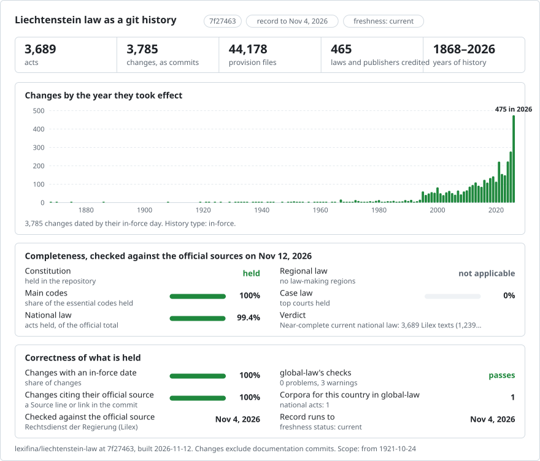

# Liechtenstein: law history in git

**English** · **[Oder auf Deutsch lesen](README.md)**

<picture>
<source media="(prefers-color-scheme: dark)" srcset="data/effort-dark.svg">

</picture>

The law of Liechtenstein as a git history: one file per article, one commit per version on the day it took effect, and the law that made each change as the commit's author. `git blame` names the law behind every paragraph; `git log` lists every change to an article; picking a date gives the text in force that day. Every act in force is here; so far three have their earlier versions too.

Part of [lexifina/global-law](https://github.com/lexifina/global-law), one git history for every country's law: this is Liechtenstein's national law, which global-law reads at `liechtenstein/national/acts/`.

**What is in it now:** all 3,689 acts that Lilex lists as in force on 4 November 2026. The Constitution (41 versions since 1921), the People's Rights Act (Volksrechtegesetz, VRG, 19 versions) and the Constitutional Court Act (Staatsgerichtshofgesetz, StGHG, 9 versions) have every version Lilex publishes; the other 3,686 have their current text: 1,236 of national law and 2,450 treaties and other international texts (LR 0), 1,368 of them notices of EEA Joint Committee decisions. [`data/current-acts.json`](data/current-acts.json) lists those 3,686 acts with their LR number, title and source; [`erlasse.csv`](erlasse.csv) lists the amending laws of the three histories with their dates.

Each act is a folder: `lv/` is the Constitution (Verfassung, LR 101), with `vrg/` and `stghg/`; the others are named by LR number and Lilex id (`lr-822-10-1967006000/` is the Arbeitsgesetz, LR 822.10, LGBl. 1967 Nr. 6). Each article is one file (`lv/art-046.md` is Art. 46 of the Constitution, on the Landtag), each paragraph one line; 1,221 acts that cannot safely be split are one `text.md`.

The text is in German, the only official language of Liechtenstein, as Lilex publishes it. An English translation is not part of this record.

## Questions as git commands

| Question | Command |
| --- | --- |
| Every change to Art. 46 of the Constitution | `git log -p --word-diff -- lv/art-046.md` |
| Which law wrote each line of Art. 46? | `git blame lv/art-046.md` |
| Every version of the Constitution, with the day each took effect | `git log --format="%h %(trailers:key=In-force,valueonly,separator=) %an" -- lv` |
| Art. 46 as in force on 1 January 1980 | `python tools/stand_am.py 1980-01-01 lv 46` |

**Outside git**, we also host this record publicly, for free:

- **[Ask Claude about Liechtenstein law](https://global-law.lexifina.com/v1/try_claude?country=liechtenstein)**: opens Claude with a first question ready.
- **[Ask ChatGPT](https://global-law.lexifina.com/v1/try_chatgpt?country=liechtenstein)**: the same question in ChatGPT.
- **[Search Liechtenstein law on our site](https://lexifina.com/law?country=liechtenstein&q=Ferien)**: a search for "Ferien", with each provision's text and its versions, no account needed.
- **[Developer REST API](https://global-law.lexifina.com/v1/search_law?query=Ferien&jurisdiction=liechtenstein)**: the same search as JSON, with no key. See the [documentation here](https://lexifina.com/api/global-law).

Both assistants read the record through the free Global law connector (MCP, `https://global-law.lexifina.com/mcp`); the first time, the chat gives you the link that adds it. Ask in German or in English.

**Host it yourself easily.** All it takes is git and Python, and the tools run on your machine:

```sh
git clone --depth 1 https://github.com/lexifina/global-law && cd global-law
python3 tools/countries.py add liechtenstein/national/acts
python3 tools/law.py show 2026-01-01 liechtenstein/national/acts/lv/art-046.md
```

Opened in Claude Code, Cursor, VS Code or Codex, the clone also starts a local MCP server with the same tools ([MCP.md](https://github.com/lexifina/global-law/blob/main/MCP.md)).

## Dates

Each commit is dated at noon, Europe/Vaduz, on the day the version took effect, and carries it in its `In-force:` trailer:

- in the three histories, the day Lilex gives as the start of each version, which for the version an amending law produced is the day that law took effect; `Dated:` and `Published:` give the day in the law's title and the day its Landesgesetzblatt was issued;
- for the other acts, the day Lilex gives as the start of the current version, matched with the Landesgesetzblatt chronology;
- git cannot store dates before 1970, so the 106 earlier commits are dated 1970-01-01, in their order, with the real day in `In-force:`. Ask for a date with `tools/stand_am.py`, not `git log --before`.

In the three histories each change is credited to the amending law its footnote names (`LGBl. 2003 Nr. 186`); the 24 changes no footnote explains, mostly Lilex's own corrections of spelling and punctuation, are committed by `Rechtsdienst der Regierung (Lilex)` with "Änderung ohne Nachweis" in the subject. Each of the other acts is one commit labelled "oldest version available", credited to the law Lilex names for that version (486) or to `Rechtsdienst der Regierung (Lilex)`.

## How it is checked

- `tools/check_repo.py` reads every version of the three histories back from git on the day it took effect and compares it with Lilex's text, file by file and word for word: 69 versions, 0 mismatches.
- `tools/check_current.py` and `tools/check_breadth.py` check the other acts against Lilex: the hash of every page and image, every date, the words of the text, and each image's place and bytes.
- The same data gives the same commits with the same hashes (`tools/build.py`, `tools/append_breadth.py`); new acts are appended to the published history, never rewriting it. Results are in [`REPRODUCE.md`](REPRODUCE.md).
- [vulnerabilities/](vulnerabilities/README.en.md): possible drafting mistakes in Liechtenstein law, found by global-law's detectors and checked by hand.

## What it does not show

- **Earlier versions of most acts.** 3,686 acts have only their current text, so `git log` and `git blame` show that one version. Lilex has no text of the StGHG before 3 November 2009.
- **Laws not yet in force.** Lilex lists only versions in force.
- **The footnotes** and Lilex's notes on case law; the footnotes are used only to credit changes.
- **Case law and municipal law** are not part of this repository.

## Sources

| Source | Kind | Past versions | Notes |
| --- | --- | --- | --- |
| [Lilex](https://www.gesetze.li) (Rechtsdienst der Regierung) | Consolidated texts of the systematic collection (LR), with the Landesgesetzblatt chronology | yes, every version (used for the three histories) | Consolidated texts have no legal force; only the Landesgesetzblatt is authoritative |

## Licence

See [`LICENSE`](LICENSE). Laws, other official enactments and official collections of them are not protected by copyright in Liechtenstein (Art. 5 URG, LR 231.1); the history, commit messages, tables and tools are CC0 1.0.

No AI model wrote or changed legal text; the scripts were written by AI models (see [`REPRODUCE.md`](REPRODUCE.md)).

## More

From [lexifina/global-law](https://github.com/lexifina/global-law):

- [FEATURES.md](https://github.com/lexifina/global-law/blob/main/FEATURES.md): every feature, and what every corpus must support (`git blame`, `law.py`, the MCP tools)
- [FAQ.md](https://github.com/lexifina/global-law/blob/main/FAQ.md): questions and answers · [CONTRIBUTING.md](https://github.com/lexifina/global-law/blob/main/CONTRIBUTING.md): proposing changes · [MCP.md](https://github.com/lexifina/global-law/blob/main/MCP.md): the MCP server · [REPRODUCE.md](https://github.com/lexifina/global-law/blob/main/REPRODUCE.md): how it was built · [CHANGELOG.md](https://github.com/lexifina/global-law/blob/main/CHANGELOG.md)
- [FRESHNESS.md](https://github.com/lexifina/global-law/blob/main/FRESHNESS.md): how current each corpus is · [Monitoring](https://github.com/lexifina/global-law/tree/main/monitoring): whether updates are running · [WATCHING.md](https://github.com/lexifina/global-law/blob/main/WATCHING.md): how each official source is watched for changes
- [performance/](https://github.com/lexifina/global-law/tree/main/performance): how fast the tools are, measured
- [visualisations/](https://github.com/lexifina/global-law/tree/main/visualisations): charts and bridges across the world's law
- [Vulnerabilities](https://github.com/lexifina/global-law/tree/main/vulnerabilities): mistakes in legislation as published
