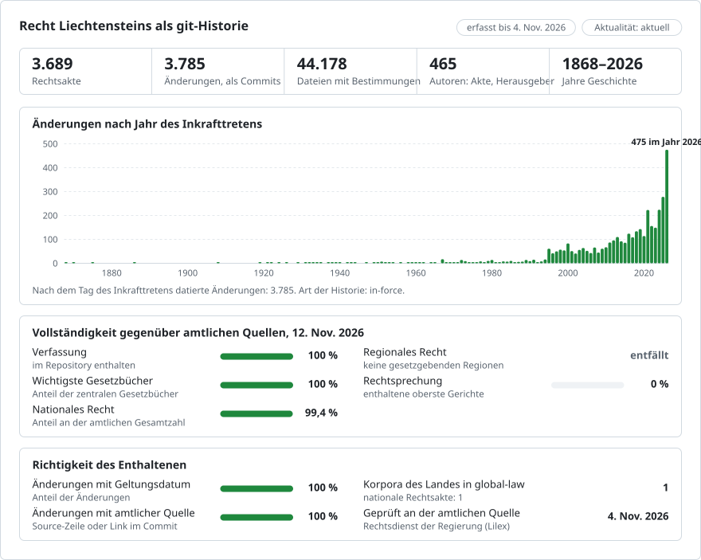

# Liechtenstein: Rechtsgeschichte in Git

**Deutsch** · **[Or read it in English](README.en.md)**

<picture>
<source media="(prefers-color-scheme: dark)" srcset="data/de/effort-dark.svg">

</picture>

Das Recht Liechtensteins als Git-Historie: eine Datei je Artikel, ein Commit je Fassung an dem Tag, an dem sie in Kraft getreten ist, und als Autor des Commits das Gesetz, das die Änderung vorgenommen hat. `git blame` nennt zu jedem Absatz das Gesetz, das ihn geschrieben hat; `git log` listet jede Änderung eines Artikels auf; ein gewähltes Datum ergibt den an diesem Tag geltenden Text. Jeder geltende Erlass ist enthalten; bisher drei auch mit ihren früheren Fassungen.

Teil von [lexifina/global-law](https://github.com/lexifina/global-law), einer Git-Historie für das Recht aller Länder: Dies ist das Landesrecht Liechtensteins, das global-law unter `liechtenstein/national/acts/` liest.

**Was es jetzt enthält:** alle 3'689 Erlasse, die Lilex am 4. November 2026 als geltend aufführt. Die Verfassung (41 Fassungen seit 1921), das Volksrechtegesetz (VRG, 19 Fassungen) und das Staatsgerichtshofgesetz (StGHG, 9 Fassungen) haben jede Fassung, die Lilex veröffentlicht; die übrigen 3'686 haben ihren geltenden Text: 1'236 des Landesrechts und 2'450 Staatsverträge und andere internationale Texte (LR 0), davon 1'368 Kundmachungen von Beschlüssen des Gemeinsamen EWR-Ausschusses. [`data/current-acts.json`](data/current-acts.json) führt diese 3'686 Erlasse mit LR-Nummer, Titel und Quelle an; [`erlasse.csv`](erlasse.csv) führt die Abänderungsgesetze der drei Versionsgeschichten mit ihren Daten an.

Jeder Erlass ist ein Ordner: `lv/` ist die Verfassung (LR 101), dazu `vrg/` und `stghg/`; die übrigen sind nach LR-Nummer und Lilex-ID benannt (`lr-822-10-1967006000/` ist das Arbeitsgesetz, LR 822.10, LGBl. 1967 Nr. 6). Jeder Artikel ist eine Datei (`lv/art-046.md` ist Art. 46 der Verfassung, über den Landtag), jeder Absatz eine Zeile; 1'221 Erlasse, die sich nicht sicher aufteilen lassen, sind eine einzige `text.md`.

Der Text ist auf Deutsch, der einzigen Amtssprache Liechtensteins, so wie ihn Lilex veröffentlicht. Eine englische Übersetzung ist nicht Teil dieses Bestands.

## Fragen als Git-Befehle

| Frage | Befehl |
| --- | --- |
| Jede Änderung von Art. 46 der Verfassung | `git log -p --word-diff -- lv/art-046.md` |
| Welches Gesetz hat jede Zeile von Art. 46 geschrieben? | `git blame lv/art-046.md` |
| Jede Fassung der Verfassung, mit dem Tag ihres Inkrafttretens | `git log --format="%h %(trailers:key=In-force,valueonly,separator=) %an" -- lv` |
| Art. 46 in der am 1. Januar 1980 geltenden Fassung | `python tools/stand_am.py 1980-01-01 lv 46` |

**Ausserhalb von Git** stellen wir diesen Bestand auch öffentlich und kostenlos bereit:

- **[Claude zum liechtensteinischen Recht fragen](https://global-law.lexifina.com/v1/try_claude?country=liechtenstein)**: öffnet Claude mit einer vorbereiteten ersten Frage.
- **[ChatGPT fragen](https://global-law.lexifina.com/v1/try_chatgpt?country=liechtenstein)**: dieselbe Frage in ChatGPT.
- **[Im liechtensteinischen Recht auf unserer Website suchen](https://lexifina.com/law?country=liechtenstein&q=Ferien)**: eine Suche nach «Ferien», mit dem Text jeder Vorschrift und ihren Fassungen, ohne Konto.
- **[REST-API für Entwickler](https://global-law.lexifina.com/v1/search_law?query=Ferien&jurisdiction=liechtenstein)**: dieselbe Suche als JSON, ohne Schlüssel. Die Dokumentation finden Sie [hier](https://lexifina.com/api/global-law).

Beide Assistenten lesen den Bestand über den kostenlosen Connector Global law (MCP, `https://global-law.lexifina.com/mcp`); beim ersten Mal gibt Ihnen der Chat den Link, mit dem Sie ihn hinzufügen. Fragen Sie auf Deutsch oder auf Englisch.

**Ganz einfach selbst betreiben.** Sie brauchen nur Git und Python, und die Werkzeuge laufen auf Ihrem Rechner:

```sh
git clone --depth 1 https://github.com/lexifina/global-law && cd global-law
python3 tools/countries.py add liechtenstein/national/acts
python3 tools/law.py show 2026-01-01 liechtenstein/national/acts/lv/art-046.md
```

In Claude Code, Cursor, VS Code oder Codex geöffnet, startet der Klon auch einen lokalen MCP-Server mit denselben Werkzeugen ([MCP.md](https://github.com/lexifina/global-law/blob/main/MCP.md)).

## Datumsangaben

Jeder Commit ist mit 12 Uhr Vaduzer Zeit (Europe/Vaduz) des Tages datiert, an dem die Fassung in Kraft getreten ist, und trägt diesen Tag in seinem `In-force:`-Trailer:

- in den drei Versionsgeschichten der Tag, den Lilex als Beginn jeder Fassung angibt, bei der Fassung, die aus einem Abänderungsgesetz hervorgegangen ist, also der Tag, an dem dieses Gesetz in Kraft trat; `Dated:` und `Published:` geben das Datum im Titel des Gesetzes und den Ausgabetag seines Landesgesetzblatts an;
- bei den übrigen Erlassen der Tag, den Lilex als Beginn der geltenden Fassung angibt, abgeglichen mit der Chronologie des Landesgesetzblatts;
- Git kann keine Daten vor 1970 speichern, daher sind die 106 früheren Commits in ihrer Reihenfolge auf den 1970-01-01 datiert, mit dem tatsächlichen Tag in `In-force:`. Fragen Sie nach einem Datum mit `tools/stand_am.py`, nicht mit `git log --before`.

In den drei Versionsgeschichten wird jede Änderung dem Abänderungsgesetz zugeschrieben, das ihre Fussnote nennt (`LGBl. 2003 Nr. 186`); die 24 Änderungen, die keine Fussnote erklärt, meist eigene Korrekturen von Rechtschreibung und Zeichensetzung durch Lilex, sind vom `Rechtsdienst der Regierung (Lilex)` committet, mit «Änderung ohne Nachweis» im Betreff. Jeder übrige Erlass ist ein Commit mit der Bezeichnung «oldest version available» (älteste verfügbare Fassung), dem Gesetz zugeschrieben, das Lilex für diese Fassung nennt (486), oder dem `Rechtsdienst der Regierung (Lilex)`.

## Wie geprüft wird

- `tools/check_repo.py` liest jede Fassung der drei Versionsgeschichten am Tag ihres Inkrafttretens aus Git zurück und vergleicht sie mit dem Text von Lilex, Datei für Datei und Wort für Wort: 69 Fassungen, 0 Abweichungen.
- `tools/check_current.py` und `tools/check_breadth.py` prüfen die übrigen Erlasse gegen Lilex: den Hash jeder Seite und jedes Bildes, jedes Datum, die Wörter des Texts sowie Stelle und Bytes jedes Bildes.
- Dieselben Daten ergeben dieselben Commits mit denselben Hashes (`tools/build.py`, `tools/append_breadth.py`); neue Erlasse werden an die veröffentlichte Historie angehängt, ohne sie umzuschreiben. Die Ergebnisse stehen in [`REPRODUCE.md`](REPRODUCE.md).

## Was es nicht zeigt

- **Frühere Fassungen der meisten Erlasse.** 3'686 Erlasse haben nur ihren geltenden Text, daher zeigen `git log` und `git blame` diese eine Fassung. Lilex hat keinen Text des StGHG vor dem 3. November 2009.
- **Gesetze, die noch nicht in Kraft sind.** Lilex führt nur geltende Fassungen.
- **Die Fussnoten** und die Hinweise von Lilex zur Rechtsprechung; die Fussnoten dienen nur dazu, Änderungen zuzuschreiben.
- **Rechtsprechung und Gemeinderecht** sind nicht Teil dieses Repositorys.

## Quellen

| Quelle | Art | Frühere Fassungen | Anmerkungen |
| --- | --- | --- | --- |
| [Lilex](https://www.gesetze.li) (Rechtsdienst der Regierung) | Konsolidierte Texte der Systematischen Sammlung (LR), mit der Chronologie des Landesgesetzblatts | ja, jede Fassung (für die drei Versionsgeschichten verwendet) | Konsolidierte Texte haben keine Rechtswirkung; massgebend ist allein das Landesgesetzblatt |

## Lizenz

Siehe [`LICENSE`](LICENSE). Gesetze, andere amtliche Erlasse und amtliche Sammlungen davon sind in Liechtenstein urheberrechtlich nicht geschützt (Art. 5 URG, LR 231.1); die Historie, die Commit-Nachrichten, die Tabellen und die Werkzeuge stehen unter CC0 1.0.

Kein KI-Modell hat Rechtstext geschrieben oder geändert; die Werkzeuge wurden von KI-Modellen geschrieben (siehe [`REPRODUCE.md`](REPRODUCE.md)).

Dies ist eine Übersetzung der englischen Fassung ([README.en.md](README.en.md)); bei Abweichungen gilt die englische Fassung.

## Mehr

Aus dem Repository [lexifina/global-law](https://github.com/lexifina/global-law) (auf Englisch):

- [FEATURES.md](https://github.com/lexifina/global-law/blob/main/FEATURES.md): alle Funktionen und was jedes Korpus unterstützen muss (`git blame`, `law.py`, MCP-Werkzeuge)
- [FAQ.md](https://github.com/lexifina/global-law/blob/main/FAQ.md): Fragen und Antworten · [CONTRIBUTING.md](https://github.com/lexifina/global-law/blob/main/CONTRIBUTING.md): Änderungen vorschlagen · [MCP.md](https://github.com/lexifina/global-law/blob/main/MCP.md): MCP-Server · [REPRODUCE.md](https://github.com/lexifina/global-law/blob/main/REPRODUCE.md): wie es erstellt wurde · [CHANGELOG.md](https://github.com/lexifina/global-law/blob/main/CHANGELOG.md)
- [FRESHNESS.md](https://github.com/lexifina/global-law/blob/main/FRESHNESS.md): wie aktuell jedes Korpus ist · [Überwachung](https://github.com/lexifina/global-law/tree/main/monitoring): ob die Aktualisierungen funktionieren · [WATCHING.md](https://github.com/lexifina/global-law/blob/main/WATCHING.md): wie jede amtliche Quelle auf Änderungen überwacht wird
- [performance/](https://github.com/lexifina/global-law/tree/main/performance): wie schnell die Werkzeuge sind, gemessen
- [visualisations/](https://github.com/lexifina/global-law/tree/main/visualisations): Diagramme und Verbindungen im Recht der ganzen Welt
- [Schwachstellen](https://github.com/lexifina/global-law/tree/main/vulnerabilities): Fehler in Rechtsakten, wie sie veröffentlicht wurden
