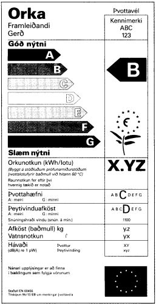
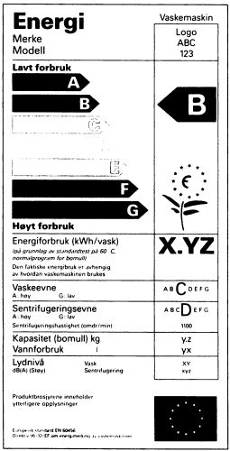
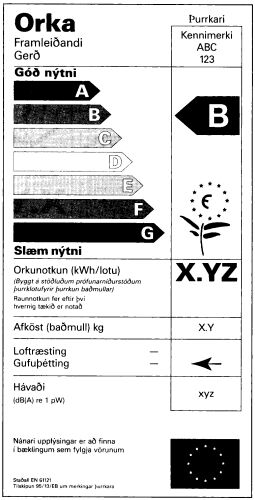
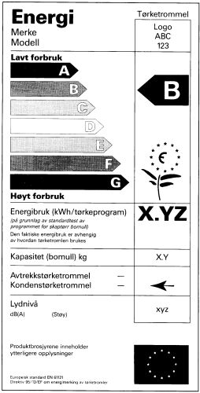

Kundmachung vom 15. Oktober 1996 der Beschlüsse Nr. 33/1996 und 34/1996 des Gemeinsamen EWR-Ausschusses Beschluss des Gemeinsamen EWR-Ausschusses: 31. Mai 1996 Inkrafttreten für das Fürstentum Liechtenstein: 1. Juni 1996 Aufgrund von Art. 3 Bst. k des Kundmachungsgesetzes vom 17. April 1985, LGBl. 1985 Nr. 41, in der Fassung des Gesetzes vom 22. März 1995, LGBl. 1995 Nr. 101, macht die Regierung in den Anhängen 1 und 2 die Beschlüsse Nr. 33/1996 und 34/1996 des Gemeinsamen EWR-Ausschusses kund. Der vollständige Wortlaut der EWR-Rechtsvorschriften, auf die in den Beschlüssen Nr. 33/1996 und 34/1996 des Gemeinsamen EWR-Ausschusses Bezug genommen wird, wird in der EWR-Rechtssammlung kundgemacht. Die EWR-Rechtssammlung steht in der Regierungskanzlei zu Amtsstunden sowie in der Landesbibliothek zur Einsichtnahme zur Verfügung. Fürstliche Regierung: gez. Dr. Mario Frick Fürstlicher Regierungschef Anhang 1 Beschluss des Gemeinsamen EWR-Ausschusses Nr. 33/96 vom 31. Mai 1996 zur Änderung des Anhangs II (Technische Vorschriften, Normen, Prüfung und Zertifizierung) und des Anhangs IV (Energie) des EWR-Abkommens Der Gemeinsame EWR-Ausschuss - gestützt auf das Abkommen über den Europäischen Wirtschaftsraum, geändert durch das Anpassungsprotokoll zum Abkommen über den Europäischen Wirtschaftsraum (im folgenden "Abkommen" genannt), insbesondere auf Art. 98, in Erwägung nachstehender Gründe: Anhang II des Abkommens wurde durch den Beschluss des Gemeinsamen EWR-Ausschusses Nr. 63/95 vom 29. September 1995 geändert. Anhang IV des Abkommens wurde durch den Beschluss des Gemeinsamen EWR-Ausschusses Nr. 63/95 vom 29. September 1995 geändert. Die Richtlinie 95/12/EG der Kommission vom 23. Mai 1995 zur Durchführung der Richtlinie 92/75/EWG des Rates betreffend die Energieetikettierung für elektrische Haushaltswaschmaschinen ist in das Abkommen aufzunehmen. Die Richtlinie 95/13/EG der Kommission vom 23. Mai 1995 zur Durchführung der Richtlinie 92/75/EWG des Rates betreffend die Energieetikettierung für elektrische Haushaltswäschetrockner ist in das Abkommen aufzunehmen - beschliesst: Art. 1 Unter Nummer 4 (Richtlinie 92/75/EWG des Rates) in Kapitel IV des Anhangs II des Abkommens werden folgende Gedankenstriche angefügt: "- 395 L 0012 : Richtlinie 95/12/EG der Kommission vom 23. Mai 1995 ( ABl. Nr. L 136 vom 21.6.1995, S. 1 ) Die Richtlinie gilt für die Zwecke dieses Abkommens mit folgenden Anpassungen: a) Anhang I der Richtlinie 95/12/EG der Kommission wird durch folgenden Text ergänzt: 

 

 b) Anhang V der Richtlinie 95/12/EG der Kommission wird durch folgenden Text ergänzt: Note DE IS NO Etikett Datenblatt Versandhandel Anhang I Anhang II Anhang III x Energie Orka Energi x Waschmaschine Pvottavél Vaskemaskin I Hersteller Framleiðandi Merke II Modell Gerð Modell x Niedriger Energieverbrauch Göð nýtni Lavt forbruk x Hoher Energieverbrauch Slæm nýtni Høyt forbruk 3 1 Energieeffizienz-klasse ... auf einer Skala von A (niedriger Energieverbrauch) bis G (hoher Energieverbrauch) Orkunýtniflok-kur ... á kvarðanum A (hámarksnýtni) til G (lakasta nýntni) Relativ energibruk ... på skalaen A (lavt forbruk) til G (høyt forbruk) V Energieverbrauch Orkunotkun Energibruk V kWh/Waschprogramm kWh/lotu kWh/vask V Ausgehend von den Ergebnissen der Normprüfung für das Programm "Baumwolle, 60°C" Byggt á stöðluð-um prófunarni-ðurstöðum þvottalotu fyrir baðmull við hitann 60°C På grunlag av standardtest på 60°C normalpro-gram for bomull 5 2 Energieverbrauch ... kWh pro Waschprogramm auf der Grundlage von Ergebnissen der Normprüfung für das Programm "Baumwolle, 60°C" Orkunotkun ... kWh/lotu, byggð á stöðluðum prófunarniðurstöðum fyrir baðmull við hitann 60°C Energibruk ... kWh/vask, på grunnlag av standardtest på 60°C normalprogram for bomull V 5 2 Der tatsächliche Energieverbrauch hängt von der Art der Nutzung des Gerätes ab Raunnotkun fer eftir því hvernig tækið er notað Den faktiske energibruk er avhengig av hvordan vaskemaskinen benyttes VI Waschwirkung A (besser) G (schlechter) Pvottahæfni ... á kvarðanum A (meiri) til G (minni) Vaskeevne A (høy) G (lav) 6 3 Waschwirkungs-klasse ... auf einer Skala von A (besser) bis G (schlechter) Pvottahæfnisflok-kur ... á kvarðanum A (meiri) til G (minni) Vaskeevne ... på skalaen fra A (høy) til G (lav) VII Schleuderwirkung A (besser) G (schlechter) Peytivinding A (meiri) G (minni) Sentrifugeringsevne A (høy) G (lav) 7 4 Schleuderwirkung auf einer Skala von A (besser) bis G (schlechter) Peytivinduafköst ... á kvarðanum A (meiri) til G (minni) Sentrifugeringsevne ... på skalaen fra A (høy) til G (lav) 7 4 Wenn Sie einen Wäschetrockner gebrauchen, denken Sie daran: - Eine Waschmaschine der Schleuderwirku ngsklasse "A" wird, im Vergleich zu einer Waschmaschine der Schleuderwirkungsklasse "G", die Kosten für das Trocknen der Wäsche halbieren - Ein Trockevorgang verbraucht normalerweise viel mehr Energie als cm Waschvorsang Ath. Notir þú þeytivindu skaltu hafa eftirfarandi í huga: Ef þú velur þvottavél með Peytivindu á A-kvarðanum í stað Peytivindu á G-kvarðanum læk-kar útlagður kost-naður þinn vegna Peytivindingar um helming. Pað fer venjulega meiri orka í að Pevtivinda föt en að þvo þau Hvis De anvender tørketrommel, bør De være oppmerksom på følgende: - en vaskemaskin som er A-merket mht. sentrifu gering vil halvere omkostningene til tørking sammenlignet med en vaskemaskin som er G-merket mht. Sentrifugering - elcktrisk tørke-tromling av tøy bruker normal mer energi enn selve vaskingen 8 Nach dem Schleudervorgang verbleibende Restfeuchte ... % (Anteil am Trockegewicht der Wäsche) Pað vatn sem eftir er að lokinni þeytivindingu ... % (sem hlutfall af þurrvigt þvottar) Restvanninnhold etter sentrfugering ...% (i forhold til vekten av tørt tøy) VIII 9 5 Schleuderdrehzahl (U/min) Snúningshraði vindu (snún. á mín.) Sentrifugeringshastighet (omdr/min) IX 10 6 Füllmenge (Baumwolle) kg Afköst (baðmull) kg Kapasitet (bomull) kg X 11 7 Wasserverbrauch Vatnsnotkun Vannforbruk 14 8 Geschätzter Jahresverbrauch eines Vier-Personen-Haushalts Dæmigerð árleg notkun hjá fjögurra manna fjölskyldu Typisk årlig forbruk for en husstand på fire personer XI 15 9 Geräusch (dB(A) re 1 pW) Hávaði (dB(A) re 1 pW) Lydnivå dB(A) (Støy) XI Waschen Pvottur Vask XI Schleudern Peytivinding Sentrifugering x Ein Datenblatt mit weiteren Geräteangaben ist in den Prospekten enthalten Nánari upplýsingar er að finna í bæklingum sem fylgja vörunum Produktbrosjyrene inneholder ytterligere opplysninger x Norm EN 60456 Staðll EN 60456 Europeisk standarc EN 60456 x Richtlinie 95/12/EG Waschma-schinenetikett Tilskipun 95/12/EB um merkingar þvottavéla Direktiv 95/12/EF om energimerking av vaskemaskiner - 395 L 0013 : Richtlinie 95/13/EG der Kommission vom 23. Mai 1995 ( ABl. Nr. L 136 vom 21.6.1995, S. 28 ) Die Richtlinie gilt für die Zwecke dieses Abkommens mit folgenden Anpassungen: a) Anhang I der Richtlinie 95/13/EG der Kommission wird durch folgenden Text ergänzt: 

 

 b) Anhang V der Richtlinie 95/13/EG der Kommission wird durch folgenden Text ergänzt: Note DE IS NO Etikett Datenblatt Versandhandel Anhang I Anhang II Anhang III x Energie Orka Energi x Trockner Purrkari Tørketrommel I Hersteller Framleiðandi Merke II Modell Gerð Modell x Niedriger Energieverbrauch Góð nýtin Lavt forbruk x Hoher Energieverbrauch Slæm nýtin Høyt forbruk 3 1 Energieeffizienzklasse ... auf einer Skala von A (niedriger Energieverbrauch) bis G (hoher Energieverbrauch) Orkunýtniflok-kur ... á kvarðanum A (hámarks-nýtni) til G (lakasta nýtni) Relativ energbruk ... på skalaen A (lavt forbruk) til G (høvt forbruk) V 5 2 Energieverbrauch Orkunotkun Energibruk V 5 2 kWh/Trocken-programm kWh/lotu kWh/tørkeprogram V 5 2 Auf der Grundlage von Ergebnissen er Normprüfung für das Programm "Baumwolle, schranktroeken" Byggt á stöðluðum prófunarniðurstöðum burrklotu fyrir baðmull På grunnlag av standardtest av programmet for skaptørr bomull V 5 2 Der tatsächliche Energieverbrauch hängt von der Art der Nutzung des Geräts ab Raunnotkun fer eftir því hverning tækið er notað Den faktiske energibruk er avhengig av hvordan tørketromlen brukes VI 6 3 Füllmenge (Baumwolle) kg Afköst (baðmull) kg Kapasitet (bomull) kg X 11 7 Wasserverbrauch Vatnsnotkun Vannforbruk 8 Trockenzeit Purrkunartími Tørketid 11 6 Geschätzter Jahresverbrauch eines Vier-Personen-Haushalts, der zum Wäschetrocknen normalerweise einen Trockner benutzt Áætluð ársnotkun fyrir fjögurra manna heimili þar sem þurrkari er notaður að jafnaði Anslått årlig forbruk for en husstand på fire personer som normalt benytter tørketrommel VII 12 Ablufttrockner Loftræsting Avtrekkstørketrommel VII 12 Kondensationstrockner Gufuþétting Kondenstørketrommel VIII 13 6 Geräusch (dB(A) re 1 pW) Hávaði (dB(A) re 1 pW) Lydnivå dB(A) (Støy) x Ein Datenblatt mit weiteren Geräteangaben ist in den Prospekten enthalten Nánari upplýsingar er að finna í bæklingum sem fylgja vörunum Produktprosjyrene inneholder ytterligere opplysninger x Norm EN 61121 Staðall EN 61121 Europeisk stadard EN 61121 x Richtlinie 95/13/EG Wäschetrockneretikett Tilskipun95/13/EB um merkingar þurrkara Direktiv 95/13/EF om energimerking av tørketromler" Art. 2 Unter Nummer 11 (Richtlinie 92/75/EWG des Rates) des Anhangs IV des Abkommens werden folgende Gedankenstriche angefügt: "- 395 L 0012 : Richtlinie 95/12/EG der Kommission vom 23. Mai 1995 ( ABl. Nr. L 136 vom 21.6.1995, S. 1 ) Die Richtlinie gilt für die Zwecke dieses Abkommens mit folgenden Anpassungen: a) Anhang I der Richtlinie 95/12/EG der Kommission wird durch folgenden Text ergänzt: 

 

 b) Anhang V der Richtlinie 95/12/EG der Kommission wird durch folgenden Text ergänzt: Note DE IS NO Etikett Datenblatt Versandhandel Anhang I Anhang II Anhang III x Energie Orka Energi x Waschmaschine Pvottavél Vaskemaskin I Hersteller Framleiðandi Merke II Modell Gerð Modell x Niedriger Energieverbrauch Göð nýtni Lavt forbruk x Hoher Energieverbrauch Slæm nýtni Høyt forbruk 3 1 Energieeffizienz-klasse ... auf einer Skala von A (niedriger Energieverbrauch) bis G (hoher Energieverbrauch) Orkunýtniflok-kur ... á kvarðanum A (hámarksnýtni) til G (lakasta nýntni) Relativ energibruk ... på skalaen A (lavt forbruk) til G (høyt forbruk) V Energieverbrauch Orkunotkun Energibruk V kWh/Waschprogramm kWh/lotu kWh/vask V Ausgehend von den Ergebnissen der Normprüfung für das Programm "Baumwolle, 60°C" Byggt á stöðluð-um prófunarni-ðurstöðum þvottalotu fyrir baðmull við hitann 60°C På grunlag av standardtest på 60°C normalpro-gram for bomull 5 2 Energieverbrauch ... kWh pro Waschprogramm auf der Grundlage von Ergebnissen der Normprüfung für das Programm "Baumwolle, 60°C" Orkunotkun ... kWh/lotu, byggð á stöðluðum prófunarniðurstöðum fyrir baðmull við hitann 60°C Energibruk ... kWh/vask, på grunnlag av standardtest på 60°C normalprogram for bomull V 5 2 Der tatsächliche Energieverbrauch hängt von der Art der Nutzung des Gerätes ab Raunnotkun fer eftir því hvernig tækið er notað Den faktiske energibruk er avhengig av hvordan vaskemaskinen benyttes VI Waschwirkung A (besser) G (schlechter) Pvottahæfni ... á kvarðanum A (meiri) til G (minni) Vaskeevne A (høy) G (lav) 6 3 Waschwirkungs-klasse ... auf einer Skala von A (besser) bis G (schlechter) Pvottahæfnisflok-kur ... á kvarðanum A (meiri) til G (minni) Vaskeevne ... på skalaen fra A (høy) til G (lav) VII Schleuderwirkung A (besser) G (schlechter) Peytivinding A (meiri) G (minni) Sentrifugeringsevne A (høy) G (lav) 7 4 Schleuderwirkung auf einer Skala von A (besser) bis G (schlechter) Peytivinduafköst ... á kvarðanum A (meiri) til G (minni) Sentrifugeringsevne ... på skalaen fra A (høy) til G (lav) 7 4 Wenn Sie einen Wäschetrockner gebrauchen, denken Sie daran: - Eine Waschmaschine der Schleuderwirku ngsklasse "A" wird, im Vergleich zu einer Waschmaschine der Schleuderwirkungsklasse "G", die Kosten für das Trocknen der Wäsche halbieren - Ein Trockevorgang verbraucht normalerweise viel mehr Energie als cm Waschvorsang Ath. Notir þú þeytivindu skaltu hafa eftirfarandi í huga: Ef þú velur þvottavél með Peytivindu á A-kvarðanum í stað Peytivindu á G-kvarðanum læk-kar útlagður kost-naður þinn vegna Peytivindingar um helming. Pað fer venjulega meiri orka í að Pevtivinda föt en að þvo þau Hvis De anvender tørketrommel, bør De være oppmerksom på følgende: - en vaskemaskin som er A-merket mht. sentrifu gering vil halvere omkostningene til tørking sammenlignet med en vaskemaskin som er G-merket mht. Sentrifugering - elcktrisk tørke-tromling av tøy bruker normal mer energi enn selve vaskingen 8 Nach dem Schleudervorgang verbleibende Restfeuchte ... % (Anteil am Trockegewicht der Wäsche) Pað vatn sem eftir er að lokinni þeytivindingu ... % (sem hlutfall af þurrvigt þvottar) Restvanninnhold etter sentrfugering ...% (i forhold til vekten av tørt tøy) VIII 9 5 Schleuderdrehzahl (U/min) Snúningshraði vindu (snún. á mín.) Sentrifugeringshastighet (omdr/min) IX 10 6 Füllmenge (Baumwolle) kg Afköst (baðmull) kg Kapasitet (bomull) kg X 11 7 Wasserverbrauch Vatnsnotkun Vannforbruk 14 8 Geschätzter Jahresverbrauch eines Vier-Personen-Haushalts Dæmigerð árleg notkun hjá fjögurra manna fjölskyldu Typisk årlig forbruk for en husstand på fire personer XI 15 9 Geräusch (dB(A) re 1 pW) Hávaði (dB(A) re 1 pW) Lydnivå dB(A) (Støy) XI Waschen Pvottur Vask XI Schleudern Peytivinding Sentrifugering x Ein Datenblatt mit weiteren Geräteangaben ist in den Prospekten enthalten Nánari upplýsingar er að finna í bæklingum sem fylgja vörunum Produktbrosjyrene inneholder ytterligere opplysninger x Norm EN 60456 Staðll EN 60456 Europeisk standarc EN 60456 x Richtlinie 95/12/EG Waschma-schinenetikett Tilskipun 95/12/EB um merkingar þvottavéla Direktiv 95/12/EF om energimerking av vaskemaskiner - 395 L 0013 : Richtlinie 95/13/EG der Kommission vom 23. Mai 1995 ( ABl. Nr. L 136 vom 21.6.1995, S. 28 ) Die Richtlinie gilt für die Zwecke dieses Abkommens mit folgenden Anpassungen: a) Anhang I der Richtlinie 95/13/EG der Kommission wird durch folgenden Text ergänzt: 

 

 b) Anhang V der Richtlinie 95/13/EG der Kommission wird durch folgenden Text ergänzt: Note DE IS NO Etikett Datenblatt Versandhandel Anhang I Anhang II Anhang III x Energie Orka Energi x Trockner Purrkari Tørketrommel I Hersteller Framleiðandi Merke II Modell Gerð Modell x Niedriger Energieverbrauch Góð nýtin Lavt forbruk x Hoher Energieverbrauch Slæm nýtin Høyt forbruk 3 1 Energieeffizienzklasse ... auf einer Skala von A (niedriger Energieverbrauch) bis G (hoher Energieverbrauch) Orkunýtniflok-kur ... á kvarðanum A (hámarks-nýtni) til G (lakasta nýtni) Relativ energbruk ... på skalaen A (lavt forbruk) til G (høvt forbruk) V 5 2 Energieverbrauch Orkunotkun Energibruk V 5 2 kWh/Trocken-programm kWh/lotu kWh/tørkeprogram V 5 2 Auf der Grundlage von Ergebnissen er Normprüfung für das Programm "Baumwolle, schranktroeken" Byggt á stöðluðum prófunarniðurstöðum burrklotu fyrir baðmull På grunnlag av standardtest av programmet for skaptørr bomull V 5 2 Der tatsächliche Energieverbrauch hängt von der Art der Nutzung des Geräts ab Raunnotkun fer eftir því hverning tækið er notað Den faktiske energibruk er avhengig av hvordan tørketromlen brukes VI 6 3 Füllmenge (Baumwolle) kg Afköst (baðmull) kg Kapasitet (bomull) kg X 11 7 Wasserverbrauch Vatnsnotkun Vannforbruk 8 Trockenzeit Purrkunartími Tørketid 11 6 Geschätzter Jahresverbrauch eines Vier-Personen-Haushalts, der zum Wäschetrocknen normalerweise einen Trockner benutzt Áætluð ársnotkun fyrir fjögurra manna heimili þar sem þurrkari er notaður að jafnaði Anslått årlig forbruk for en husstand på fire personer som normalt benytter tørketrommel VII 12 Ablufttrockner Loftræsting Avtrekkstørketrommel VII 12 Kondensationstrockner Gufuþétting Kondenstørketrommel VIII 13 6 Geräusch (dB(A) re 1 pW) Hávaði (dB(A) re 1 pW) Lydnivå dB(A) (Støy) x Ein Datenblatt mit weiteren Geräteangaben ist in den Prospekten enthalten Nánari upplýsingar er að finna í bæklingum sem fylgja vörunum Produktprosjyrene inneholder ytterligere opplysninger x Norm EN 61121 Staðall EN 61121 Europeisk stadard EN 61121 x Richtlinie 95/13/EG Wäschetrockneretikett Tilskipun95/13/EB um merkingar þurrkara Direktiv 95/13/EF om energimerking av tørketromler" Art. 3 Der Wortlaut der Richtlinie 95/12/EG der Kommission und der Richtlinie 95/13/EG der Kommission in isländischer und norwegischer Sprache, der den jeweiligen Sprachfassungen dieses Beschlusses beigefügt ist, ist verbindlich. Art. 4 Dieser Beschluss tritt am 1. Juni 1996 in Kraft, sofern dem Gemeinsamen EWR-Ausschuss alle Mitteilungen nach Art. 103 Abs. 1 des Abkommens übermittelt worden sind. Art. 5 Dieser Beschluss wird im EWR-Abschnitt und in der EWR-Beilage des Amtsblatts der Europäischen Gemeinschaften veröffentlicht. Brüssel, den 31. Mai 1996 (Es folgen die Unterschriften) Anhang 2 Beschluss des Gemeinsamen EWR-Ausschusses Nr. 34/96 vom 31. Mai 1996 über die Änderung des Anhangs XIX (Verbraucherschutz) des EWR-Abkommens Der Gemeinsame EWR-Ausschuss - gestützt auf das Abkommen über den Europäischen Wirtschaftsraum, geändert durch das Anpassungsprotokoll zum Abkommen über den Europäischen Wirtschaftsraum, nachstehend Abkommen genannt, insbesondere auf Art. 98, in Erwägung nachstehender Gründe: Anhang XIX des Abkommens wurde durch den Beschluss des Gemeinsamen EWR-Ausschusses Nr. 18/95 vom 24. Februar 1995 geändert. Die Richtlinie 95/58/EG des Europäischen Parlaments und des Rates vom 29. November 1995 zur Änderung der Richtlinie 79/581/EWG über den Schutz der Verbraucher bei der Angabe der Preise für Lebensmittel und der Richtlinie 88/314/EWG über den Schutz der Verbraucher bei der Angabe der Preise für andere Erzeugnisse als Lebensmittel ist in das Abkommen aufzunehmen - beschliesst: Art. 1 In Anhang XIX des Abkommens wird unter Nummer 1 (Richtlinie 79/581/EWG des Rates) der folgende Gedankenstrich hinzugefügt: "- 395 L 0058: Richtlinie 95/58/EG des Europäischen Parlaments und des Rates vom 29. November 1995 ( ABl. Nr. L 299 vom 12.12.1995, S. 11 )." Art. 2 In Anhang XIX des Abkommens wird unter Nummer 6 (Richtlinie 88/314/EWG des Rates) folgendes hinzugefügt: ", geändert durch: - 395 L 0058 : Richtlinie 95/58/EG des Europäischen Parlaments und des Rates vom 29. November 1995 ( ABl. Nr. L 299 vom 12.12.1995, S. 11 ).". Art. 3 Der Wortlaut der Richtlinie 95/58/EG des Europäischen Parlaments und des Rates in isländischer und norwegischer Sprache, der den jeweiligen Sprachfassungen dieses Beschlusses beigefügt ist, ist verbindlich. Art. 4 Dieser Beschluss tritt am 1. Juni 1996 in Kraft, sofern dem Gemeinsamen EWR-Ausschuss alle Mitteilungen nach Art. 103 Abs. 1 des Abkommens übermittelt worden sind. Art. 5 Dieser Beschluss wird im EWR-Abschnitt und im EWR-Supplement des Amtsblattes der Europäischen Gemeinschaften veröffentlicht. Brüssel, den 31. Mai 1996 (Es folgen die Unterschriften)
