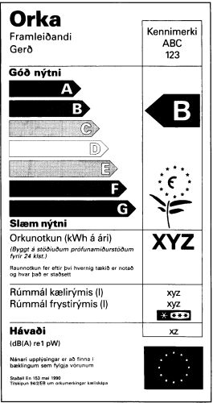
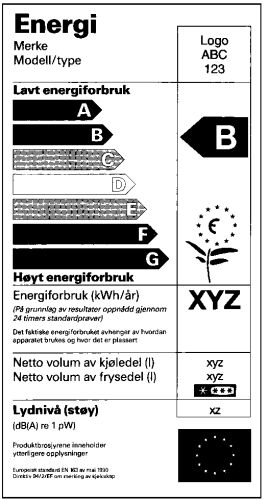

Kundmachung vom 15. Oktober 1996 des Beschlusses Nr. 63/1995 des Gemeinsamen EWR-Ausschusses Beschluss des Gemeinsamen EWR-Ausschusses: 29. September 1995 Inkrafttreten für das Fürstentum Liechtenstein: 1. April 1996 Aufgrund von Art. 3 Bst. k des Kundmachungsgesetzes vom 17. April 1985, LGBl. 1985 Nr. 41, in der Fassung des Gesetzes vom 22. März 1995, LGBl. 1995 Nr. 101, macht die Regierung im Anhang den Beschluss Nr. 63/1996 des Gemeinsamen EWR-Ausschusses kund. Der vollständige Wortlaut der EWR-Rechtsvorschriften, auf die im Beschluss Nr. 63/1996 des Gemeinsamen EWR-Ausschusses Bezug genommen wird, wird in der EWR-Rechtssammlung kundgemacht. Die EWR-Rechtssammlung steht in der Regierungskanzlei zu Amtsstunden sowie in der Landesbibliothek zur Einsichtnahme zur Verfügung. Fürstliche Regierung: gez. Dr. Mario Frick Fürstlicher Regierungschef Anhang Beschluss des Gemeinsamen EWR-Ausschusses Nr. 63/95 vom 29. September 1995 über die Änderung der Anhänge II (Technische Vorschriften, Normen, Prüfung und Zertifizierung) und IV (Energie) des EWR-Abkommens Der Gemeinsame EWR-Ausschuss - gestützt auf das Abkommen über den Europäischen Wirtschaftsraum, geändert durch das Anpassungsprotokoll zum Abkommen über den Europäischen Wirtschaftsraum, insbesondere auf Art. 98, in Erwägung nachstehender Gründe: Anhang II des Abkommens wurde durch den Beschluss des Gemeinsamen EWR-Ausschusses Nr. 7/94 vom 21. März 1994 über die Änderung des Protokolls 47 und bestimmter Anhänge des EWR-Abkommens geändert . Anhang IV des Abkommens wurde durch den Beschluss des Gemeinsamen EWR-Ausschusses Nr. 19/95 vom 5. April 1995 geändert. Die Richtlinie 94/2/EG der Kommission vom 21. Januar 1994 zur Durchführung der Richtlinie 92/75/EWG betreffend die Energieetikettierung für elektrische Haushaltskühl- und -gefriergeräte sowie entsprechende Kombinationsgeräte ist in das Abkommen aufzunehmen - beschliesst: Art. 1 In Anhang II des Abkommens wird in Kapitel IV unter Nummer 4 (Richtlinie 92/75/EWG des Rates) folgendes hinzugefügt: ", abgeändert durch: - 394 L 0002 : Richtlinie 94/2/EG der Kommission vom 21. Januar 1994 (ABI. Nr. L 45 vom 17.2.1994, S. 1)." Die Richtlinie gilt für die Zwecke dieses Abkommens mit folgenden Anpassungen: a) Anhang I der Richtlinie 94/2/EG der Kommission wird durch folgenden Text ergänzt: 

 

 b) Anhang VI der Richtlinie 94/2/EG der Kommission wird durch folgenden Text ergänzt: Note DE IS NO Etikett Datenblatt Versandhandel Anhang I Anhang II Anhang III x Energie Orka Energi I Hersteller Framleiðandi Merke II Modell Gerð Modell x Niedriger Verbrauch Góð nýtni Lavt energiforbruk x Hoher Verbrauch Slæm nýtni Høyt energifor-bruk 3 Klasse 1 Kühlgerät Kæliskápur án frystihólfs Kjøleskap uten frostboks Klasse 2 Gerät mit Kühlfach/Kellerfach Kæliskápur/ sva-laskápur Kjøle/svalskap Klassen 3-6 Kühlgerät Kæliskápur Kjøleskap Klasse 7 Kühl-Gefrier-kombination Kæliskápur/frystir Kjøle/fryseskap Klasse 8 Gefrierschrank Frystiskápur Fryseskap Klasse 9 Gefriertruhe Frystikista Fryseboks 5 1 Energieeffizienz-klasse ... auf einer Skala von A (niedriger Verbrauch) bis G (hoher Verbrauch) Orkunýtniflok-kur á kvarðanum A (góð nýtni) til G (slæm nýtni) Klassifisering av energieffektivitet etter en skala fra A (lavt energiforbruk) til G (høt energiforbruk) V 6 2 Energieverbrauch Orkunotkun Energiforbruk V 6 2 kWh/Jahr kWh á ári kWh/år V 6 2 Auf der Grundlage von Ergebnissen der Normprü-fung über 24 h Byggt á stöðluðum prófunarniðurstöðum fyrir 24 klst. På grunnlag av resultater oppnådd gjennom 24 timers standardprøver 6 2 Der tatsächliche Verbrauch hängt von der Nutzung und vom Standort des Geräts ab Raunnotkun fer eftir Pví hvernig tækið og notað og hvar Pað er staðsett Der faktiske energiforbruket avhenger av hvordan apparatet brukes og hvor det er plassert VII 7 3 Nutzinhalt Kühlteil (1) Rúmmál kælirýmis (1) Netto volum av kjøledel (1) VIII 8 4 Nutzinhalt Gefrierteil (1) Rúmmál frystirýmis (1) Netto volum av frysedel (1) 10 Kein Frost Frostlaust ,No frost' 11 Lagerzeit bei Störung ... h Piðnunartími í klukkust. ef straumrof verður Opptiningstid ved strømbrudd (t) 12 Gefriervermögen kg/24 h Frystigeta kg/24 klst. Innfrysingskapasitet i kg/24 t 13 subnormal subnormal 13 normal Temprað Temperert 13 subtropisch Heittemprað Subtropisk 13 tropisch Hitabeltis Tropisk IX 14 6 Geräusch (dB(A) re 1 pW) Hávaði (dB(A) re 1 pW) Lydnivå dB(A) (støy) x Ein Datenblatt mit weiteren Geräteangaben ist in den Prospekten enthalten Nánari upplýsingar er að finna í bæklingum sem fylgia vörunum Produktbrosjyrene inneholder ytterligere opplysninger x Norm EN 153 Ausgabe Mai 1990 Staðall EN 153 maí 1990 Europeisk standard EN 153 av mai 1990 x Kühlgeräte-Richtlinie 94/2/EG Tilskipun 94/2/EB um orkumerkingar kæliskápa Direktiv 94/2/EF om merking av kjøleskap". Art. 2 In Anhang IV des Abkommens wird unter Nummer 11 (Richtlinie 92/75/EWG des Rates) folgendes hinzugefügt: ", abgeändert durch: - 394 L 0002 : Richtlinie 94/2/EG der Kommission vom 21. Januar 1994 (ABI. Nr. L 45 vom 17.2.1994, S. 1)." Die Richtlinie gilt für die Zwecke dieses Abkommens mit folgenden Anpassungen: a) Anhang I der Richtlinie 94/2/EG der Kommission wird durch folgenden Text ergänzt: 

 

 b) Anhang VI der Richtlinie 94/2/EG der Kommission wird durch folgenden Text ergänzt: Note DE IS NO Etikett Datenblatt Versandhandel Anhang I Anhang II Anhang III x Energie Orka Energi I Hersteller Framleiðandi Merke II Modell Gerð Modell x Niedriger Verbrauch Góð nýtni Lavt energiforbruk x Hoher Verbrauch Slæm nýtni Høyt energifor-bruk 3 Klasse 1 Kühlgerät Kæliskápur án frystihólfs Kjøleskap uten frostboks Klasse 2 Gerät mit Kühlfach/Kellerfach Kæliskápur/ sva-laskápur Kjøle/svalskap Klassen 3-6 Kühlgerät Kæliskápur Kjøleskap Klasse 7 Kühl-Gefrier-kombination Kæliskápur/frystir Kjøle/fryseskap Klasse 8 Gefrierschrank Frystiskápur Fryseskap Klasse 9 Gefriertruhe Frystikista Fryseboks 5 1 Energieeffizienz-klasse ... auf einer Skala von A (niedriger Verbrauch) bis G (hoher Verbrauch) Orkunýtniflok-kur á kvarðanum A (góð nýtni) til G (slæm nýtni) Klassifisering av energieffektivitet etter en skala fra A (lavt energiforbruk) til G (høt energiforbruk) V 6 2 Energieverbrauch Orkunotkun Energiforbruk V 6 2 kWh/Jahr kWh á ári kWh/år V 6 2 Auf der Grundlage von Ergebnissen der Normprü-fung über 24 h Byggt á stöðluðum prófunarniðurstöðum fyrir 24 klst. På grunnlag av resultater oppnådd gjennom 24 timers standardprøver 6 2 Der tatsächliche Verbrauch hängt von der Nutzung und vom Standort des Geräts ab Raunnotkun fer eftir Pví hvernig tækið og notað og hvar Pað er staðsett Der faktiske energiforbruket avhenger av hvordan apparatet brukes og hvor det er plassert VII 7 3 Nutzinhalt Kühlteil (1) Rúmmál kælirýmis (1) Netto volum av kjøledel (1) VIII 8 4 Nutzinhalt Gefrierteil (1) Rúmmál frystirýmis (1) Netto volum av frysedel (1) 10 Kein Frost Frostlaust ,No frost' 11 Lagerzeit bei Störung ... h Piðnunartími í klukkust. ef straumrof verður Opptiningstid ved strømbrudd (t) 12 Gefriervermögen kg/24 h Frystigeta kg/24 klst. Innfrysingskapasitet i kg/24 t 13 subnormal subnormal 13 normal Temprað Temperert 13 subtropisch Heittemprað Subtropisk 13 tropisch Hitabeltis Tropisk IX 14 6 Geräusch (dB(A) re 1 pW) Hávaði (dB(A) re 1 pW) Lydnivå dB(A) (støy) x Ein Datenblatt mit weiteren Geräteangaben ist in den Prospekten enthalten Nánari upplýsingar er að finna í bæklingum sem fylgia vörunum Produktbrosjyrene inneholder ytterligere opplysninger x Norm EN 153 Ausgabe Mai 1990 Staðall EN 153 maí 1990 Europeisk standard EN 153 av mai 1990 x Kühlgeräte-Richtlinie 94/2/EG Tilskipun 94/2/EB um orkumerkingar kæliskápa Direktiv 94/2/EF om merking av kjøleskap". Art. 3 Der Wortlaut der Richtlinie 94/2/EG der Kommission in isländischer und norwegischer Sprache, der den jeweiligen Sprachfassungen dieses Beschlusses beigefügt ist, ist verbindlich. Art. 4 Dieser Beschluss tritt am 1. Januar 1996 in Kraft, sofern dem Gemeinsamen EWR-Ausschuss alle Mitteilungen nach Art. 103 Abs. 1 des Abkommens übermittelt worden sind. Art. 5 Dieser Beschluss wird im EWR-Abschnitt und in der EWR-Beilage des Amtsblatts der Europäischen Gemeinschaften veröffentlicht. Brüssel, den 29. September 1995 (Es folgen die Unterschriften)
