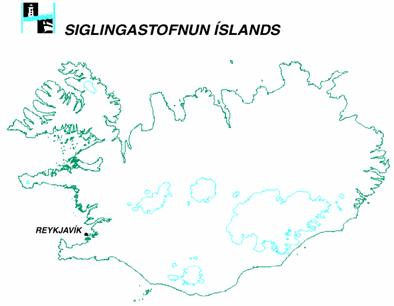
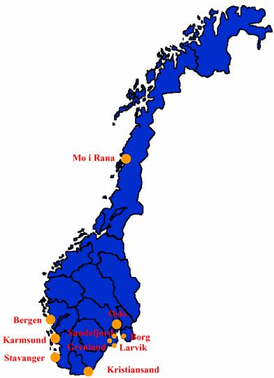

Kundmachung vom 22. Oktober 2002 der Beschlüsse Nr. 96/2002 bis 102/2002 und 104/2002 bis 111/2002 des Gemeinsamen EWR-Ausschusses Beschluss des Gemeinsamen EWR-Ausschusses: 12. Juli 2002 Inkrafttreten für das Fürstentum Liechtenstein: 13. Juli 2002 Aufgrund von Art. 3 Bst. k des Kundmachungsgesetzes vom 17. April 1985, LGBl. 1985 Nr. 41, in der Fassung des Gesetzes vom 22. März 1995, LGBl. 1995 Nr. 101, macht die Regierung in den Anhängen 1 bis 15 die Beschlüsse Nr. 96/2002 bis 102/2002 und 104/2002 bis 111/2002 des Gemeinsamen EWR-Ausschusses kund. Der vollständige Wortlaut der EWR-Rechtsvorschriften, auf die in den Beschlüssen Nr. 96/2002 bis 102/2002 und 104/2002 bis 110/2002 Bezug genommen wird, wird in der EWR-Rechtssammlung kundgemacht. Die EWR-Rechtssammlung steht in der Regierungskanzlei zu Amtsstunden sowie in der Landesbibliothek zur Einsichtnahme zur Verfügung. Fürstliche Regierung: gez. Otmar Hasler Fürstlicher Regierungschef Anhang 1 Beschluss des Gemeinsamen EWR-Ausschusses Nr. 96/2002 vom 12. Juli 2002 zur Änderung des Anhangs I (Veterinärwesen und Pflanzenschutz) des EWR-Abkommens Der Gemeinsame EWR-Ausschuss - gestützt auf das Abkommen über den Europäischen Wirtschaftsraum, geändert durch das Anpassungsprotokoll zum Abkommen über den Europäischen Wirtschaftsraum, nachstehend "Abkommen" genannt, insbesondere auf Art. 98, in Erwägung nachstehender Gründe: 1. Anhang I des Abkommens wurde durch den Beschluss des Gemeinsamen EWR-Ausschusses Nr. 79/2002 vom 25. Juni 2002 geändert. 2. Die Richtlinie 2001/46/EG des Europäischen Parlaments und des Rates vom 23. Juli 2001 zur Änderung der Richtlinie 95/53/EG des Rates mit Grundregeln für die Durchführung der amtlichen Futtermittelkontrollen sowie der Richtlinien 70/524/EWG, 96/25/EG und 1999/29/EG des Rates betreffend die Tierernährung ist in das Abkommen aufzunehmen. 3. Die Richtlinie 2001/79/EG der Kommission vom 17. September 2001 zur Änderung der Richtlinie 87/153/EWG des Rates zur Festlegung von Leitlinien zur Beurteilung von Zusatzstoffen in der Tierernährung ist in das Abkommen aufzunehmen. 4. Die Verordnung (EG) Nr. 2013/2001 der Kommission vom 12. Oktober 2001 zur vorläufigen Zulassung eines neuartigen Verwendungszwecks eines Zusatzstoffes und zur unbefristeten Zulassung eines Zusatzstoffes in Futtermitteln ist in das Abkommen aufzunehmen. 5. Die Verordnung (EG) Nr. 2205/2001 der Kommission vom 14. November 2001 zur Änderung der Richtlinie 70/524/EWG des Rates über Zusatzstoffe in der Tierernährung hinsichtlich des Widerrufs der Zulassung bestimmter Zusatzstoffe ist in das Abkommen aufzunehmen. 6. Die Verordnung (EG) Nr. 2200/2001 der Kommission vom 17. Oktober 2001 über vorläufige Zulassungen von Zusatzstoffen in der Tierernährung ist in das Abkommen aufzunehmen. 7. Die Verordnung (EG) Nr. 2380/2001 der Kommission vom 5. Dezember 2001 über die Zulassung eines Zusatzstoffes in der Tierernährung für zehn Jahre ist in das Abkommen aufzunehmen. 8. Die Richtlinie 2001/79/EG stützt sich auf eine Begriffsbestimmung in der Richtlinie 2001/18/EG des Europäischen Parlaments und des Rates und eine Bezugsnahme auf die Richtlinie 2000/33/EG der Kommission ; die beiden letztgenannten Rechtsakte wurden noch nicht in das Abkommen aufgenommen, aber ihre Aufnahme wird erwogen - beschliesst: Art. 1 Anhang I Kapitel II des Abkommens wird wie folgt geändert: 1. Unter Nummer 1 (Richtlinie 70/524/EWG des Rates) wird folgender Gedankenstrich angefügt: "- 32001 R 2205: Verordnung (EG) Nr. 2205/2001 der Kommission vom 14. November 2001 ( ABl. L 297 vom 15.11.2001, S. 3 )." 2. Unter den Nummern 1 (Richtlinie 70/524/EWG des Rates), 14a (Richtlinie 96/25/EWG des Rates) und 31a (Richtlinie 95/53/EWG des Rates) wird folgender Gedankenstrich angefügt: "- 32001 L 0046: Richtlinie 2001/46/EG des Europäischen Parlaments und des Rates vom 23. Juli 2001 ( ABl. L 234 vom 1.9.2001, S. 55 )." 3. Unter Nummer 2 (Richtlinie 87/153/EWG des Rates) wird folgender Gedankenstrich angefügt: "- 32001 L 0079: Richtlinie 2001/79/EG der Kommission vom 17. September 2001 ( ABl. L 267 vom 6.10.2001, S. 1 )." 4. Unter Nummer 32 (Richtlinie 1999/29/EG des Rates) wird folgender Gedankenstrich angefügt: "- 32001 L 0046: Richtlinie 2001/46/EG des Europäischen Parlaments und des Rates vom 23. Juli 2001 ( ABl. L 234 vom 1.9.2001, S. 55 )." 5. Nach Nummer 1v (Verordnung (EG) Nr. 1334/2001 der Kommission) werden folgende Nummern eingefügt: "1w. 32001 R 2013: Verordnung (EG) Nr. 2013/2001 der Kommission vom 12. Oktober 2001 zur vorläufigen Zulassung eines neuartigen Verwendungszwecks eines Zusatzstoffes und zur unbefristeten Zulassung eines Zusatzstoffes in Futtermitteln ( ABl. L 272 vom 13.10.2001, S. 24 ). 1x. 32001 R 2200: Verordnung (EG) Nr. 2200/2001 der Kommission vom 17. Oktober 2001 über vorläufige Zulassungen von Zusatzstoffen in der Tierernährung ( ABl. L 299 vom 15.11.2001, S. 1 ). 1y. 32001 R 2380: Verordnung (EG) Nr. 2380/2001 der Kommission vom 5. Dezember 2001 über die Zulassung eines Zusatzstoffes in der Tierernährung für zehn Jahre ( ABl. L 321 vom 6.12.2001, S. 18 )." 6. Der Wortlaut von Nummer 1s (Verordnung (EG) Nr. 2697/2000 der Kommission) wird gestrichen. Art. 2 Der Wortlaut der Richtlinien 2001/46/EG und 2001/79/EG sowie der Verordnungen (EG) Nrn. 2013/2001, 2200/2001, 2205/2001 und 2380/2001 in isländischer und norwegischer Sprache, der in der EWR-Beilage des Amtsblattes der Europäischen Gemeinschaften veröffentlicht wird, ist verbindlich. Art. 3 Dieser Beschluss tritt am 13. Juli 2002 in Kraft, sofern dem Gemeinsamen EWR-Ausschuss alle Mitteilungen nach Art. 103 Abs. 1 des Abkommens vorliegen . Art. 4 Dieser Beschluss wird im EWR-Abschnitt und in der EWR-Beilage des Amtsblattes der Europäischen Gemeinschaften veröffentlicht. Brüssel, den 12. Juli 2002 (Es folgen die Unterschriften) Anhang 2 Beschluss des Gemeinsamen EWR-Ausschusses Nr. 97/2002 vom 12. Juli 2002 zur Änderung des Anhangs II (Technische Vorschriften, Normen, Prüfung und Zertifizierung) des EWR-Abkommens Der Gemeinsame EWR-Ausschuss - gestützt auf das Abkommen über den Europäischen Wirtschaftsraum, geändert durch das Anpassungsprotokoll zum Abkommen über den Europäischen Wirtschaftsraum, nachstehend "Abkommen" genannt, insbesondere auf Art. 98, in Erwägung nachstehender Gründe: 1. Anhang II des Abkommens wurde durch den Beschluss des Gemeinsamen EWR-Ausschusses Nr. 81/2002 vom 25. Juni 2002 geändert. 2. Die Verordnung (EG) Nr. 548/2000 der Kommission vom 14. März 2000 zur Änderung der Verordnung (EWG) Nr. 94/92 mit Durchführungsbestimmungen zur Regelung der Einfuhren aus Drittländern gemäss der Verordnung (EWG) Nr. 2092/91 des Rates ist in das Abkommen aufzunehmen. 3. Die Verordnung (EG) Nr. 1616/2000 der Kommission vom 24. Juli 2000 zur Änderung der Verordnung (EWG) Nr. 94/92 mit Durchführungsbestimmungen zur Regelung der Einfuhren aus Drittländern gemäss der Verordnung (EWG) Nr. 2092/91 ist in das Abkommen aufzunehmen. 4. Die Verordnung (EG) Nr. 2426/2000 der Kommission vom 31. Oktober 2000 zur Änderung der Verordnung (EWG) Nr. 94/92 mit Durchführungsbestimmungen zur Regelung der Einfuhren aus Drittländern gemäss der Verordnung (EWG) Nr. 2092/91 des Rates ist in das Abkommen aufzunehmen. 5. Die Verordnung (EG) Nr. 349/2001 der Kommission vom 21. Februar 2001 zur Änderung der Verordnung (EWG) Nr. 94/92 mit Durchführungsbestimmungen zur Regelung der Einfuhren aus Drittländern gemäss der Verordnung (EWG) Nr. 2092/91 des Rates ist in das Abkommen aufzunehmen - beschliesst: Art. 1 In Anhang II Kapitel XII des Abkommens werden unter Nummer 54b (Verordnung (EWG) Nr. 2092/91 des Rates) folgende Gedankenstriche angefügt: "- 32000 R 0548: Verordnung (EG) Nr. 548/2000 der Kommission vom 14. März 2000 ( ABl. L 67 vom 15.3.2000, S. 12 ), - 32000 R 1616: Verordnung (EG) Nr. 1616/2000 der Kommission vom 24. Juli 2000 ( ABl. L 185 vom 25.7.2000, S. 62 ), - 32000 R 2426: Verordnung (EG) Nr. 2426/2000 der Kommission vom 31. Oktober 2000 ( ABl. L 279 vom 1.11.2000, S. 19 ), - 32001 R 0349: Verordnung (EG) Nr. 349/2001 der Kommission vom 21. Februar 2001 ( ABl. L 52 vom 22.2.2001, S. 14 )." Art. 2 Der Wortlaut der Verordnungen (EG) Nrn. 548/2000, 1616/2000, 2426/2000 und 349/2001 in isländischer und norwegischer Sprache, der in der EWR-Beilage des Amtsblattes der Europäischen Gemeinschaften veröffentlicht wird, ist verbindlich. Art. 3 Dieser Beschluss tritt am 13. Juli 2002 in Kraft, sofern dem Gemeinsamen EWR-Ausschuss alle Mitteilungen nach Art. 103 Abs. 1 des Abkommens vorliegen . Art. 4 Dieser Beschluss wird im EWR-Abschnitt und in der EWR-Beilage des Amtsblattes der Europäischen Gemeinschaften veröffentlicht. Brüssel, den 12. Juli 2002 (Es folgen die Unterschriften) Anhang 3 Beschluss des Gemeinsamen EWR-Ausschusses Nr. 98/2002 vom 12. Juli 2002 zur Änderung des Anhangs II (Technische Vorschriften, Normen, Prüfung und Zertifizierung) des EWR-Abkommens Der Gemeinsame EWR-Ausschuss - gestützt auf das Abkommen über den Europäischen Wirtschaftsraum, geändert durch das Anpassungsprotokoll zum Abkommen über den Europäischen Wirtschaftsraum, nachstehend "Abkommen" genannt, insbesondere auf Art. 98, in Erwägung nachstehender Gründe: 1. Anhang II des Abkommens wurde durch den Beschluss des Gemeinsamen EWR-Ausschusses Nr. 81/2002 vom 25. Juni 2002 geändert. 2. Die Verordnung (EG) Nr. 331/2000 der Kommission vom 17. Dezember 1999 zur Änderung von Anhang V der Verordnung (EWG) Nr. 2092/91 des Rates über den ökologischen Landbau und die entsprechende Kennzeichnung der landwirtschaftlichen Erzeugnisse und Lebensmittel ist in das Abkommen aufzunehmen - beschliesst: Art. 1 Anhang II Kapitel XII des Abkommens wird gemäss dem Anhang dieses Beschlusses geändert. Art. 2 Der Wortlaut der Verordnung (EG) Nr. 331/2000 in isländischer und norwegischer Sprache, der in der EWR-Beilage des Amtsblattes der Europäischen Gemeinschaften veröffentlicht wird, ist verbindlich. Art. 3 Dieser Beschluss tritt am 13. Juli 2002 in Kraft, sofern dem Gemeinsamen EWR-Ausschuss alle Mitteilungen nach Art. 103 Abs. 1 des Abkommens vorliegen . Art. 4 Dieser Beschluss wird im EWR-Abschnitt und in der EWR-Beilage des Amtsblattes der Europäischen Gemeinschaften veröffentlicht. Brüssel, den 12. Juli 2002 (Es folgen die Unterschriften) Anhang zum Beschluss des Gemeinsamen EWR-Ausschusses Nr. 98/2002 Anhang II Kapitel XII des Abkommens wird wie folgt geändert: 1. Unter Nummer 54b (Verordnung (EWG) Nr. 2092/91 des Rates) wird folgender Gedankenstrich angefügt: "- 32000 R 0331: Verordnung (EG) Nr. 331/2000 der Kommission vom 17. Dezember 1999 ( ABl. L 48 vom 19.2.2000, S. 1 )." 2. Die Anpassung unter Nummer 54b (Verordnung (EWG) Nr. 2092/91 des Rates) erhält folgende Fassung: "A. In Art. 2 wird Folgendes angefügt: "- isländisch: lífrænt, - norwegisch: økologisk." B. In Anhang V Teil A wird Folgendes angefügt: "IS: Lífrænn landbúnaður - EB-Eftirlitskerfi NO: Økologisk landbruk - EF-kontrollordning" C. In Anhang V Teil B.2 wird Folgendes angefügt: "Norsk Íslenska (Emblem) (Emblem)" D. In Anhang V Teil B.3.1 wird Folgendes angefügt: "IS: LÍFRÆNN LANDBÚNAÐUR NO: ØKOLOGISK LANDBRUK" E. In Anhang V Teil B.4.3.1wird Folgendes angefügt: "NORSK PANTONE 367 PANTONE REFLEX BLUE (Emblem) (Emblem) (Emblem) (Emblem) (Emblem) (Emblem) ÍSLENSKA PANTONE 367 PANTONE REFLEX BLUE (Emblem) (Emblem) (Emblem) (Emblem) (Emblem) (Emblem)"" Anhang 4 Beschluss des Gemeinsamen EWR-Ausschusses Nr. 99/2002 vom 12. Juli 2002 zur Änderung des Anhangs II (Technische Vorschriften, Normen, Prüfung und Zertifizierung) des EWR-Abkommens Der Gemeinsame EWR-Ausschuss - gestützt auf das Abkommen über den Europäischen Wirtschaftsraum, geändert durch das Anpassungsprotokoll zum Abkommen über den Europäischen Wirtschaftsraum, nachstehend "Abkommen" genannt, insbesondere auf Art. 98, in Erwägung nachstehender Gründe: 1. Anhang II des Abkommens wurde durch den Beschluss des Gemeinsamen EWR-Ausschusses Nr. 81/2002 vom 25. Juni 2002 geändert. 2. Die Richtlinie 2001/110/EG des Rates vom 20. Dezember 2001 über Honig ist in das Abkommen aufzunehmen. 3. Die Richtlinie 2001/111/EG des Rates vom 20. Dezember 2001 über bestimmte Zuckerarten für die menschliche Ernährung ist in das Abkommen aufzunehmen. 4. Die Richtlinie 2001/112/EG des Rates vom 20. Dezember 2001 über Fruchtsäfte und bestimmte gleichartige Erzeugnisse für die menschliche Ernährung ist in das Abkommen aufzunehmen. 5. Die Richtlinie 2001/113/EG des Rates vom 20. Dezember 2001 über Konfitüren, Gelees, Marmeladen und Maronenkrem für die menschliche Ernährung ist in das Abkommen aufzunehmen. 6. Die Richtlinie 2001/114/EG des Rates vom 20. Dezember 2001 über bestimmte Sorten eingedickter Milch und Trockenmilch für die menschliche Ernährung ist in das Abkommen aufzunehmen. 7. Mit der Richtlinie 2001/110/EG wird die Richtlinie 74/409/EWG des Rates , die Bestandteil des Abkommens ist, mit Wirkung vom 1. August 2003 aufgehoben, so dass die letztgenannte Richtlinie im Rahmen des Abkommens aufzuheben ist. 8. Mit der Richtlinie 2001/111/EG wird die Richtlinie 73/437/EWG des Rates , die Bestandteil des Abkommens ist, mit Wirkung vom 12. Juli 2003 aufgehoben, so dass die letztgenannte Richtlinie im Rahmen des Abkommens aufzuheben ist. 9. Mit der Richtlinie 2001/112/EG wird die Richtlinie 93/77/EWG des Rates , die Bestandteil des Abkommens ist, mit Wirkung vom 12. Juli 2003 aufgehoben, so dass die letztgenannte Richtlinie im Rahmen des Abkommens aufzuheben ist. 10. Mit der Richtlinie 2001/113/EG wird die Richtlinie 79/693/EWG des Rates , die Bestandteil des Abkommens ist, mit Wirkung vom 12. Juli 2003 aufgehoben, so dass die letztgenannte Richtlinie im Rahmen des Abkommens aufzuheben ist. 11. Mit der Richtlinie 2001/114/EG wird die Richtlinie 76/118/EWG des Rates , die Bestandteil des Abkommens ist, mit Wirkung vom 17. Juli 2003 aufgehoben, so dass die letztgenannte Richtlinie im Rahmen des Abkommens aufzuheben ist - beschliesst: Art. 1 Anhang II Kapitel XII des Abkommens wird wie folgt geändert: 1. Nach Nummer 54zn (Verordnung (EG) Nr. 466/2001 der Kommission) wird Folgendes eingefügt: "54zo. 32001 L 0110: Richtlinie 2001/110/EG des Rates vom 20. Dezember 2001 über Honig ( ABl. L 10 vom 12.1.2002, S. 47 ). 54zp. 32001 L 0111: Richtlinie 2001/111/EG des Rates vom 20. Dezember 2001 über bestimmte Zuckerarten für die menschliche Ernährung ( ABl. L 10 vom 12.1.2002, S. 53 ). 54zq. 32001 L 0112: Richtlinie 2001/112/EG des Rates vom 20. Dezember 2001 über Fruchtsäfte und bestimmte gleichartige Erzeugnisse für die menschliche Ernährung ( ABl. L 10 vom 12.1.2002, S. 58 ). 54zr. 32001 L 0113: Richtlinie 2001/113/EG des Rates vom 20. Dezember 2001 über Konfitüren, Gelees, Marmeladen und Maronenkrem für die menschliche Ernährung ( ABl. L 10 vom 12.1.2002, S. 67 ). 54zs. 32001 L 0114: Richtlinie 2001/114/EG des Rates vom 20. Dezember 2001 über bestimmte Sorten eingedickter Milch und Trockenmilch für die menschliche Ernährung ( ABl. L 15 vom 17.1.2002, S. 19 ). Die Richtlinie gilt für die Zwecke dieses Abkommens mit der folgenden Anpassung: Dem Anhang II wird Folgendes angefügt: "(k) Die isländische Bezeichnung "niðurseydd nýmjólk" und die norwegische Bezeichnung "fløtepulver" gelten für das in Anhang I Nummer 2 Bst. a) definierte Erzeugnis."" 2. Der Wortlaut von Nummer 7 (Richtlinie 73/437/EWG des Rates) wird mit Wirkung vom 12. Juli 2003 gestrichen. 3. Der Wortlaut von Nummer 9 (Richtlinie 74/409/EWG des Rates) wird mit Wirkung vom 1. August 2003 gestrichen. 4. Der Wortlaut von Nummer 11 (Richtlinie 76/118/EWG des Rates) wird mit Wirkung vom 17. Juli 2003 gestrichen. 5. Der Wortlaut von Nummer 19 (Richtlinie 79/693/EWG des Rates) wird mit Wirkung vom 12. Juli 2003 gestrichen. 6. Der Wortlaut von Nummer 54m (Richtlinie 93/77/EWG des Rates) wird mit Wirkung vom 12. Juli 2003 gestrichen. Art. 2 Der Wortlaut der Richtlinien 2001/110/EG, 2001/111/EG, 2001/112/EG, 2001/113/EG und 2001/114/EG in isländischer und norwegischer Sprache, der in der EWR-Beilage des Amtsblattes der Europäischen Gemeinschaften veröffentlicht wird, ist verbindlich. Art. 3 Dieser Beschluss tritt am 13. Juli 2002 in Kraft, sofern dem Gemeinsamen EWR-Ausschuss alle Mitteilungen nach Art. 103 Abs. 1 des Abkommens vorliegen . Art. 4 Dieser Beschluss wird im EWR-Abschnitt und in der EWR-Beilage des Amtsblattes der Europäischen Gemeinschaften veröffentlicht. Brüssel, den 12. Juli 2002 (Es folgen die Unterschriften) Anhang 5 Beschluss des Gemeinsamen EWR-Ausschusses Nr. 100/2002 vom 12. Juli 2002 zur Änderung des Anhangs II (Technische Vorschriften, Normen, Prüfung und Zertifizierung) des EWR-Abkommens Der Gemeinsame EWR-Ausschuss - gestützt auf das Abkommen über den Europäischen Wirtschaftsraum, geändert durch das Anpassungsprotokoll zum Abkommen über den Europäischen Wirtschaftsraum, nachstehend "Abkommen" genannt, insbesondere auf Art. 98, in Erwägung nachstehender Gründe: 1. Anhang II des Abkommens wurde durch den Beschluss des Gemeinsamen EWR-Ausschusses Nr. 81/2002 vom 25. Juni 2002 geändert. 2. Die Verordnung (EG) Nr. 257/2002 der Kommission vom 12. Februar 2002 zur Änderung der Verordnung (EG) Nr. 194/97 zur Festsetzung der zulässigen Höchstgehalte an Kontaminanten in Lebensmitteln sowie der Verordnung (EG) Nr. 466/2001 zur Festsetzung der Höchstgehalte für bestimmte Kontaminanten in Lebensmitteln ist in das Abkommen aufzunehmen. 3. Die Richtlinie 2002/16/EG der Kommission vom 20. Februar 2002 über die Verwendung bestimmter Epoxyderivate in Materialien und Gegenständen, die dazu bestimmt sind, mit Lebensmitteln in Berührung zu kommen , ist in das Abkommen aufzunehmen. 4. Die Richtlinie 2002/17/EG der Kommission vom 21. Februar 2002 zur Änderung der Richtlinie 90/128/EWG über Materialien und Gegenstände aus Kunststoff, die dazu bestimmt sind, mit Lebensmitteln in Berührung zu kommen , ist in das Abkommen aufzunehmen. 5. Mit der Richtlinie 2002/16/EG wird die Richtlinie 2001/61/EG der Kommission , die Bestandteil des Abkommens ist, aufgehoben, so dass die letztgenannte Richtlinie im Rahmen des Abkommens aufzuheben ist - beschliesst: Art. 1 Anhang II Kapitel XII des Abkommens wird wie folgt geändert: 1. Unter Nummer 52 (Richtlinie 90/128/EWG der Kommission) wird folgender Gedankenstrich angefügt: "- 32002 L 0017: Richtlinie 2002/17/EG der Kommission vom 21. Februar 2002 ( ABl. L 58 vom 28.2.2002, S. 19 )." 2. Unter Nummer 54zn (Verordnung (EG) Nr. 466/2001 der Kommission) wird folgender Gedankenstrich angefügt: "- 32002 R 0257: Verordnung (EG) Nr. 257/2002 der Kommission vom 12. Februar 2002 ( ABl. L 41 vom 13.2.2002, S. 12 )." 3. Nach Nummer 54zs (Richtlinie 2001/114/EG des Rates) wird folgende Nummer eingefügt: "54zt. 32002 L 0016: Richtlinie 2002/16/EG der Kommission vom 20. Februar 2002 über die Verwendung bestimmter Epoxyderivate in Materialien und Gegenständen, die dazu bestimmt sind, mit Lebensmitteln in Berührung zu kommen ( ABl. L 51 vom 22.2.2002, S. 27 )." 4. Der Wortlaut von Nummer 54zk (Richtlinie 2001/61/EG der Kommission) wird gestrichen. Art. 2 Der Wortlaut der Verordnung (EG) Nr. 257/2002 und der Richtlinien 2002/16/EG und 2002/17/EG in isländischer und norwegischer Sprache, der in der EWR-Beilage des Amtsblattes der Europäischen Gemeinschaften veröffentlicht wird, ist verbindlich. Art. 3 Dieser Beschluss tritt am 13. Juli 2002 in Kraft, sofern dem Gemeinsamen EWR-Ausschuss alle Mitteilungen nach Art. 103 Abs. 1 des Abkommens vorliegen . Art. 4 Dieser Beschluss wird im EWR-Abschnitt und in der EWR-Beilage des Amtsblattes der Europäischen Gemeinschaften veröffentlicht. Brüssel, den 12. Juli 2002 (Es folgen die Unterschriften) Anhang 6 Beschluss des Gemeinsamen EWR-Ausschusses Nr. 101/2002 vom 12. Juli 2002 zur Änderung des Anhangs II (Technische Vorschriften, Normen, Prüfung und Zertifizierung) des EWR-Abkommens Der Gemeinsame EWR-Ausschuss - gestützt auf das Abkommen über den Europäischen Wirtschaftsraum, geändert durch das Anpassungsprotokoll zum Abkommen über den Europäischen Wirtschaftsraum, nachstehend "Abkommen" genannt, insbesondere auf Art. 98, in Erwägung nachstehender Gründe: 1. Anhang II des Abkommens wurde durch den Beschluss des Gemeinsamen EWR-Ausschusses Nr. 54/2002 vom 31. Mai 2002 geändert. 2. Die Empfehlung 2001/838/EG der Kommission vom 7. November 2001 über die Ergebnisse der Risikobewertung und über die Risikobegrenzungsstrategien für die Stoffe: Acrylaldehyd; Dimethylsulfat; Nonylphenol; Phenol, 4-Nonyl-, verzweigt; tert-Butylmethylether ist in das Abkommen aufzunehmen. 3. Die Richtlinie 2002/18/EG der Kommission vom 22. Februar 2002 zur Änderung des Anhangs I der Richtlinie 91/414/EWG des Rates über das Inverkehrbringen von Pflanzenschutzmitteln zur Aufnahme des Wirkstoffs Isoproturon ist in das Abkommen aufzunehmen - beschliesst: Art. 1 Anhang II Kapitel XV des Abkommens wird wie folgt geändert: 1. Unter Nummer 12a (Richtlinie 91/414/EWG des Rates) wird folgender Gedankenstrich angefügt: "- 32002 L 0018: Richtlinie 2002/18/EG der Kommission vom 22. Februar 2002 ( ABl. L 55 vom 26.2.2002, S. 29 )." 2. Unter der Überschrift "Rechtsakte, die die Vertragsparteien zur Kenntnis nehmen" wird nach Nummer 20 (Empfehlung 2001/194/EG der Kommission) folgende Nummer eingefügt: "21. 32001 H 0838: Empfehlung 2001/838/EG der Kommission vom 7. November 2001 über die Ergebnisse der Risikobewertung und über die Risikobegrenzungsstrategien für die Stoffe: Acrylaldehyd; Dimethylsulfat; Nonylphenol; Phenol, 4-Nonyl-, verzweigt; tert-Butylmethylether ( ABl. L 319 vom 4.12.2001, S. 30 )." Art. 2 Der Wortlaut der Empfehlung 2001/838/EG und der Richtlinie 2002/18/EG in isländischer und norwegischer Sprache, der in der EWR-Beilage des Amtsblattes der Europäischen Gemeinschaften veröffentlicht wird, ist verbindlich. Art. 3 Dieser Beschluss tritt am 13. Juli 2002 in Kraft, sofern dem Gemeinsamen EWR-Ausschuss alle Mitteilungen nach Art. 103 Abs. 1 des Abkommens vorliegen . Art. 4 Dieser Beschluss wird im EWR-Abschnitt und in der EWR-Beilage des Amtsblattes der Europäischen Gemeinschaften veröffentlicht. Brüssel, den 12. Juli 2002 (Es folgen die Unterschriften) Anhang 7 Beschluss des Gemeinsamen EWR-Ausschusses Nr. 102/2002 vom 12. Juli 2002 zur Änderung des Anhangs II (Technische Vorschriften, Normen, Prüfung und Zertifizierung) des EWR-Abkommens Der Gemeinsame EWR-Ausschuss - gestützt auf das Abkommen über den Europäischen Wirtschaftsraum, geändert durch das Anpassungsprotokoll zum Abkommen über den Europäischen Wirtschaftsraum, nachstehend "Abkommen" genannt, insbesondere auf Art. 98, in Erwägung nachstehender Gründe: 1. Anhang II des Abkommens wurde durch den Beschluss des Gemeinsamen EWR-Ausschusses Nr. 15/2002 vom 1. März 2002 geändert. 2. Die Empfehlung 2001/893/EG der Kommission vom 7. Dezember 2001 über Grundsätze zur Nutzung von "SOLVIT", dem Problemlösungsnetz für den Binnenmarkt , ist in das Abkommen aufzunehmen - beschliesst: Art. 1 In Anhang II Kapitel XX des Abkommens wird nach Nummer 3 (Entschliessung 2000/C 141/02 des Rates) folgende Nummer eingefügt: "4. 32001 H 0893: Empfehlung 2001/893/EG der Kommission vom 7. Dezember 2001 über Grundsätze zur Nutzung von "SOLVIT", dem Problemlösungsnetz für den Binnenmarkt ( ABl. L 331 vom 15.12.2001, S.79 )." Art. 2 Der Wortlaut der Empfehlung 2001/893/EG in isländischer und norwegischer Sprache, der in der EWR-Beilage des Amtsblattes der Europäischen Gemeinschaften veröffentlicht wird, ist verbindlich. Art. 3 Dieser Beschluss tritt am 13. Juli 2002 in Kraft, sofern dem Gemeinsamen EWR-Ausschuss alle Mitteilungen nach Art. 103 Abs. 1 des Abkommens vorliegen . Art. 4 Dieser Beschluss wird im EWR-Abschnitt und in der EWR-Beilage des Amtsblattes der Europäischen Gemeinschaften veröffentlicht. Brüssel, den 12. Juli 2002 (Es folgen die Unterschriften) Anhang 8 Beschluss des Gemeinsamen EWR-Ausschusses Nr. 104/2002 vom 12. Juli 2002 zur Änderung des Anhangs XI (Telekommunikationsdienste) des EWR-Abkommens Der Gemeinsame EWR-Ausschuss - gestützt auf das Abkommen über den Europäischen Wirtschaftsraum, geändert durch das Anpassungsprotokoll zum Abkommen über den Europäischen Wirtschaftsraum, nachstehend "Abkommen" genannt, insbesondere auf Art. 98, in Erwägung nachstehender Gründe: 1. Anhang XI des Abkommens wurde durch den Beschluss des Gemeinsamen EWR-Ausschusses Nr. 87/2002 vom 25. Juni 2002 geändert. 2. Die Empfehlung 2002/175/EG der Kommission vom 22. Februar 2002 zur Änderung der Empfehlung 98/195/EG, zuletzt geändert durch die Empfehlung 2000/263/EG, zur Zusammenschaltung in einem liberalisierten Telekommunikationsmarkt ist in das Abkommen aufzunehmen - beschliesst: Art. 1 In Anhang XI des Abkommens wird unter Nummer 26g (Empfehlung 98/195/EG der Kommission) folgender Gedankenstrich eingefügt: "- 32002 H 0175: Richtlinie 2002/175/EG der Kommission vom 22. Februar 2002 ( ABl. L 58 vom 28.2.2002, S. 56 )." Art. 2 Der Wortlaut der Empfehlung 2002/175/EG in isländischer und norwegischer Sprache, der in der EWR-Beilage des Amtsblattes der Europäischen Gemeinschaften veröffentlicht wird, ist verbindlich. Art. 3 Dieser Beschluss tritt am 13. Juli 2002 in Kraft, sofern dem Gemeinsamen EWR-Ausschuss alle Mitteilungen nach Art. 103 Abs. 1 des Abkommens vorliegen . Art. 4 Dieser Beschluss wird im EWR-Abschnitt und in der EWR-Beilage des Amtsblattes der Europäischen Gemeinschaften veröffentlicht. Brüssel, den 12. Juli 2002 (Es folgen die Unterschriften) Anhang 9 Beschluss des Gemeinsamen EWR-Ausschusses Nr. 105/2002 vom 12. Juli 2002 zur Änderung des Anhangs XIII (Verkehr) des EWR-Abkommens Der Gemeinsame EWR-Ausschuss - gestützt auf das Abkommen über den Europäischen Wirtschaftsraum, geändert durch das Anpassungsprotokoll zum Abkommen über den Europäischen Wirtschaftsraum, nachstehend "Abkommen" genannt, insbesondere auf Art. 98, in Erwägung nachstehender Gründe: 1. Anhang XIII des Abkommens wurde durch den Beschluss des Gemeinsamen EWR-Ausschusses Nr. 56/2002 vom 31. Mai 2002 geändert. 2. Die Entscheidung Nr. 1346/2001/EG des Europäischen Parlaments und des Rates vom 22. Mai 2001 zur Änderung der Entscheidung Nr. 1692/96/EG hinsichtlich Seehäfen, Binnenhäfen und intermodaler Terminals sowie des Vorhabens Nummer 8 in Anhang III ist in das Abkommen aufzunehmen - beschliesst: Art. 1 1) In Anhang XIII des Abkommens wird Nummer 5 (Entscheidung Nr. 1692/96/EG des Europäischen Parlaments und des Rates) wie folgt geändert: a) Folgendes wird angefügt: ", geändert durch: - 32001 D 1346: Entscheidung Nr. 1346/2001/EG des Europäischen Parlaments und des Rates vom 22. Mai 2001 ( ABl. L 185 vom 6.7.2001, S. 1 )" b) Nach Anpassung (j) wird Folgendes eingefügt: "(ja) in Anhang I Kapitel 5 der Entscheidung (Seehäfen) wird Folgendes eingefügt und durch die in Anlage 1 zu diesem Anhang abgebildeten Karten illustriert: "5.6. Island 5.7. Norwegen"." 2) In Anlage 1 zu Anhang XIII des Abkommens werden die Wörter "(siehe Anpassungen (i), (j) und (k) unter Nummer 5 von Anhang XIII des Abkommens)" durch die Wörter "(siehe Anpassungen (i), (j), (ja) und (k) unter Nummer 5 von Anhang XIII des Abkommens)" ersetzt. 3) Die in der mit Abs. (b) eingeführten Anpassung (ja) genannten Karten sind im Anhang zu diesem Beschluss enthalten und werden in Anlage 1 zu Anhang XIII des Abkommens nach der Karte "3.16" betreffen Norwegen eingefügt. Art. 2 Der Wortlaut der Entscheidung 1346/2001/EG in isländischer und norwegischer Sprache, der in der EWR-Beilage des Amtsblattes der Europäischen Gemeinschaften veröffentlicht wird, ist verbindlich. Art. 3 Dieser Beschluss tritt am 13. Juli 2002 in Kraft, sofern dem Gemeinsamen EWR-Ausschuss alle Mitteilungen nach Art. 103 Abs. 1 des Abkommens vorliegen . Art. 4 Dieser Beschluss wird im EWR-Abschnitt und in der EWR-Beilage des Amtsblattes der Europäischen Gemeinschaften veröffentlicht. Brüssel, den 12. Juli 2002 (Es folgen die Unterschriften) Anhang zum Beschluss des Gemeinsamen EWR-Ausschusses Nr. 105/2002 "5.6 

 5.7 

 Anhang 10 Beschluss des Gemeinsamen EWR-Ausschusses Nr. 106/2002 vom 12. Juli 2002 zur Änderung des Anhangs XIII (Verkehr) des EWR-Abkommens Der Gemeinsame EWR-Ausschuss - gestützt auf das Abkommen über den Europäischen Wirtschaftsraum, geändert durch das Anpassungsprotokoll zum Abkommen über den Europäischen Wirtschaftsraum, nachstehend "Abkommen" genannt, insbesondere auf Art. 98, in Erwägung nachstehender Gründe: 1. Anhang XIII des Abkommens wurde durch den Beschluss des Gemeinsamen EWR-Ausschusses Nr. 56/2002 vom 31. Mai 2002 geändert. 2. Die Richtlinie 2002/6/EG des Europäischen Parlaments und des Rates vom 18. Februar 2002 über Meldeformalitäten für Schiffe beim Einlaufen in und/oder Auslaufen aus Häfen der Mitgliedstaaten der Gemeinschaft ist in das Abkommen aufzunehmen - beschliesst: Art. 1 In Anhang XIII des Abkommens wird nach Nummer 56k (Richtlinie 2001/96/EG des Europäischen Parlaments und des Rates) folgende Nummer eingefügt: "56l. 32002 L 0006: Richtlinie 2002/6/EG des Europäischen Parlaments und des Rates vom 18. Februar 2002 über Meldeformalitäten für Schiffe beim Einlaufen in und/oder Auslaufen aus Häfen der Mitgliedstaaten der Gemeinschaft ( ABl. L 67 vom 9.3.2002, S. 31 )." Art. 2 Der Wortlaut der Richtlinie 2002/6/EG in isländischer und norwegischer Sprache, der in der EWR-Beilage des Amtsblattes der Europäischen Gemeinschaften veröffentlicht wird, ist verbindlich. Art. 3 Dieser Beschluss tritt am 13. Juli 2002 in Kraft, sofern dem Gemeinsamen EWR-Ausschuss alle Mitteilungen nach Art. 103 Abs. 1 des Abkommens vorliegen . Art. 4 Dieser Beschluss wird im EWR-Abschnitt und in der EWR-Beilage des Amtsblattes der Europäischen Gemeinschaften veröffentlicht. Brüssel, den 12. Juli 2002 (Es folgen die Unterschriften) Anhang 11 Beschluss des Gemeinsamen EWR-Ausschusses Nr. 107/2002 vom 12. Juli 2002 zur Änderung des Anhangs XX (Umweltschutz) des EWR-Abkommens Der Gemeinsame EWR-Ausschuss - gestützt auf das Abkommen über den Europäischen Wirtschaftsraum, geändert durch das Anpassungsprotokoll zum Abkommen über den Europäischen Wirtschaftsraum, nachstehend "Abkommen" genannt, insbesondere auf Art. 98, in Erwägung nachstehender Gründe: 1. Anhang XX des Abkommens wurde durch den Beschluss des Gemeinsamen EWR-Ausschusses Nr. 91/2002 vom 25. Juni 2002 geändert. 2. Die Entscheidung 2002/172/EG der Kommission vom 25. Februar 2002 zur Verlängerung der Geltungsdauer der Entscheidung 1999/476/EG zur Festlegung von Umweltkriterien für die Vergabe des EG-Umweltzeichens für Waschmittel ist in das Abkommen aufzunehmen. 3. Die Entscheidung 2002/173/EG der Kommission vom 25. Februar 2002 zur Verlängerung der Geltungsdauer der Entscheidung 1999/427/EG zur Festlegung von Umweltkriterien für die Vergabe des EG-Umweltzeichens für Maschinengeschirrspülmittel ist in das Abkommen aufzunehmen - beschliesst: Art. 1 Anhang XX des Abkommens wird wie folgt geändert: 1. Unter Nummer 2ef (Entscheidung 1999/476/EG der Kommission) wird Folgendes angefügt: ", geändert durch: - 32002 D 0172: Entscheidung 2002/172/EG der Kommission vom 25. Februar 2002 ( ABl. L 56 vom 27.2.2002, S. 32 )." 2. Unter Nummer 2eq (Entscheidung 1999/427/EG der Kommission) wird Folgendes angefügt: ", geändert durch: - 32002 D 0173: Entscheidung 2002/173/EG der Kommission vom 25. Februar 2002 ( ABl. L 56 vom 27.2.2002, S. 33 )." Art. 2 Der Wortlaut der Entscheidungen Nrn. 2002/172/EG und 2002/173/EG in isländischer und norwegischer Sprache, der in der EWR-Beilage des Amtsblattes der Europäischen Gemeinschaften veröffentlicht wird, ist verbindlich. Art. 3 Dieser Beschluss tritt am 13. Juli 2002 in Kraft, sofern dem Gemeinsamen EWR-Ausschuss alle Mitteilungen nach Art. 103 Abs. 1 des Abkommens vorliegen . Art. 4 Dieser Beschluss wird im EWR-Abschnitt und in der EWR-Beilage des Amtsblattes der Europäischen Gemeinschaften veröffentlicht. Brüssel, den 12. Juli 2002 (Es folgen die Unterschriften) Anhang 12 Beschluss des Gemeinsamen EWR-Ausschusses Nr. 108/2002 vom 12. Juli 2002 zur Änderung des Anhangs XXI (Statistik) des EWR-Abkommens Der Gemeinsame EWR-Ausschuss - gestützt auf das Abkommen über den Europäischen Wirtschaftsraum, geändert durch das Anpassungsprotokoll zum Abkommen über den Europäischen Wirtschaftsraum, nachstehend "Abkommen" genannt, insbesondere auf Art. 98, in Erwägung nachstehender Gründe: 1. Anhang XXI des Abkommens wurde durch den Beschluss des Gemeinsamen EWR-Ausschusses Nr. 92/2002 vom 25. Juni 2002 geändert. 2. Die Verordnung (EG) Nr. 72/2002 der Kommission vom 16. Januar 2002 zur Durchführung der Verordnung (EG) Nr. 530/1999 des Rates hinsichtlich der Qualitätsbewertung der Verdienststrukturstatistik ist in das Abkommen aufzunehmen - beschliesst: Art. 1 In Anhang XXI des Abkommens wird nach Nummer 18e (Verordnung (EG) Nr. 1726/1999 der Kommission) folgende Nummer eingefügt: "18f. 32002 R 0072: Verordnung (EG) Nr. 72/2002 der Kommission vom 16. Januar 2002 zur Durchführung der Verordnung (EG) Nr. 530/1999 des Rates hinsichtlich der Qualitätsbewertung der Verdienststrukturstatistik ( ABl. L 15 vom 17.1.2002, S. 7 .)." Art. 2 Der Wortlaut der Verordnung (EG) Nr. 72/2002 in isländischer und norwegischer Sprache, der in der EWR-Beilage des Amtsblattes der Europäischen Gemeinschaften veröffentlicht wird, ist verbindlich. Art. 3 Dieser Beschluss tritt am 13. Juli 2002 in Kraft, sofern dem Gemeinsamen EWR-Ausschuss alle Mitteilungen nach Art. 103 Abs. 1 des Abkommens vorliegen . Art. 4 Dieser Beschluss wird im EWR-Abschnitt und in der EWR-Beilage des Amtsblattes der Europäischen Gemeinschaften veröffentlicht. Brüssel, den 12. Juli 2002 (Es folgen die Unterschriften) Anhang 13 Beschluss des Gemeinsamen EWR-Ausschusses Nr. 109/2002 vom 12. Juli 2002 zur Änderung des Anhangs XXI (Statistik) des EWR-Abkommens Der Gemeinsame EWR-Ausschuss - gestützt auf das Abkommen über den Europäischen Wirtschaftsraum, geändert durch das Anpassungsprotokoll zum Abkommen über den Europäischen Wirtschaftsraum, nachstehend "Abkommen" genannt, insbesondere auf Art. 98, in Erwägung nachstehender Gründe: 1. Anhang XXI des Abkommens wurde durch den Beschluss des Gemeinsamen EWR-Ausschusses Nr. 92/2002 vom 25. Juni 2002 geändert. 2. Die Verordnung (EG) Nr. 29/2002 der Kommission vom 19. Dezember 2001 zur Änderung der Verordnung (EWG) Nr. 3037/90 des Rates betreffend die statistische Systematik der Wirtschaftszweige in der Europäischen Gemeinschaft ist in das Abkommen aufzunehmen - beschliesst: Art. 1 Anhang XXI des Abkommens wird wie folgt geändert: 1. Unter Nummer 20 (Verordnung (EWG) Nr. 3037/90 des Rates) wird folgender Gedankenstrich angefügt: "- 32002 R 0029: Verordnung (EG) Nr. 29/2002 der Kommission vom 19. Dezember 2001 ( ABl. L 6 vom 10.1.2002, S. 3 )." 2. Unter Nummer 2 der sektoralen Anpassungen werden nach der Angabe "Verordnung (EWG) Nr. 3037/90 des Rates vom 9. Oktober 1990 betreffend die statistische Systematik der Wirtschaftszweige in der Europaeischen Gemeinschaft" die Worte "geändert durch" eingefügt. Art. 2 Der Wortlaut der Verordnung (EG) Nr. 29/2002 in isländischer und norwegischer Sprache, der in der EWR-Beilage des Amtsblattes der Europäischen Gemeinschaften veröffentlicht wird, ist verbindlich. Art. 3 Dieser Beschluss tritt am 13. Juli 2002 in Kraft, sofern dem Gemeinsamen EWR-Ausschuss alle Mitteilungen nach Art. 103 Abs. 1 des Abkommens vorliegen . Art. 4 Dieser Beschluss wird im EWR-Abschnitt und in der EWR-Beilage des Amtsblattes der Europäischen Gemeinschaften veröffentlicht. Brüssel, den 12. Juli 2002 (Es folgen die Unterschriften) Anhang 14 Beschluss des Gemeinsamen EWR-Ausschusses Nr. 110/2002 vom 12. Juli 2002 zur Änderung des Anhangs XXI (Statistik) des EWR-Abkommens Der Gemeinsame EWR-Ausschuss - gestützt auf das Abkommen über den Europäischen Wirtschaftsraum, geändert durch das Anpassungsprotokoll zum Abkommen über den Europäischen Wirtschaftsraum, nachstehend "Abkommen" genannt, insbesondere auf Art. 98, in Erwägung nachstehender Gründe: 1. Anhang XXI des Abkommens wurde durch den Beschluss des Gemeinsamen EWR-Ausschusses Nr. 92/2002 vom 25. Juni 2002 geändert. 2. Die Verordnung (EG) Nr. 204/2002 der Kommission vom 19. Dezember 2001 zur Änderung der Verordnung (EWG) Nr. 3696/93 des Rates betreffend die statistische Güterklassifikation in Verbindung mit den Wirtschaftszweigen in der Europäischen Wirtschaftsgemeinschaft ist in das Abkommen aufzunehmen - beschliesst: Art. 1 In Anhang XXI des Abkommens wird unter Nummer 20b (Verordnung (EWG) Nr. 3696/93 des Rates) folgender Gedankenstrich angefügt: "- 32002 R 0204: Verordnung (EG) Nr. 204/2002 der Kommission vom 19. Dezember 2001 ( ABl. L 36 vom 6.2.2002, S. 1 )." Art. 2 Der Wortlaut der Verordnung (EG) Nr. 204/2002 in isländischer und norwegischer Sprache, der in der EWR-Beilage des Amtsblattes der Europäischen Gemeinschaften veröffentlicht wird, ist verbindlich. Art. 3 Dieser Beschluss tritt am 13. Juli 2002 in Kraft, sofern dem Gemeinsamen EWR-Ausschuss alle Mitteilungen nach Art. 103 Abs. 1 des Abkommens vorliegen . Art. 4 Dieser Beschluss wird im EWR-Abschnitt und in der EWR-Beilage des Amtsblattes der Europäischen Gemeinschaften veröffentlicht. Brüssel, den 12. Juli 2002 (Es folgen die Unterschriften) Anhang 15 Beschluss des Gemeinsamen EWR-Ausschusses Nr. 111/2002 vom 12. Juli 2002 zur Änderung des Protokolls 31 (über die Zusammenarbeit in bestimmten Bereichen ausserhalb der vier Freiheiten) des EWR-Abkommens Der Gemeinsame EWR-Ausschuss - gestützt auf das Abkommen über den Europäischen Wirtschaftsraum, geändert durch das Anpassungsprotokoll zum Abkommen über den Europäischen Wirtschaftsraum, nachstehend "Abkommen" genannt, insbesondere auf die Art. 86 und 98, in Erwägung nachstehender Gründe: 1. Protokoll 31 des Abkommens wurde durch den Beschluss des Gemeinsamen EWR-Ausschusses Nr. 94/2002 vom 25. Juni 2002 geändert. 2. Es ist angezeigt, die Zusammenarbeit der Vertragsparteien auf den Beschluss Nr. 50/2002/EG des Europäischen Parlaments und des Rates vom 7. Dezember 2001 zur Einführung eines Aktionsprogramms der Gemeinschaft zur Förderung der Zusammenarbeit der Mitgliedstaaten bei der Bekämpfung der sozialen Ausgrenzung auszuweiten. 3. Protokoll 31 des Abkommens sollte daher geändert werden, um diese erweiterte Zusammenarbeit ab dem 1. Januar 2002 zu ermöglichen - beschliesst: Art. 1 Art. 5 des Protokolls 31 des Abkommens wird wie folgt geändert: 1. Abs. 5 erhält folgende Fassung: "Die EFTA-Staaten beteiligen sich ab 1. Januar 1996 an den in Abs. 8 unter den ersten zwei Gedankenstrichen genannten Programmen und Massnahmen der Gemeinschaft, ab 1. Januar 2000 an dem unter dem dritten Gedankenstrich genannten Programm, ab 1. Januar 2001 an dem unter dem vierten Gedankenstrich genannten Programm und ab 1. Januar 2002 an den unter dem fünften Gedankenstrich genannten Programm." 2. In Abs. 8 wird folgender Gedankenstrich angefügt: "- 32002 D 0050: Beschluss Nr. 50/2002/EG des Europäischen Parlaments und des Rates vom 7. Dezember 2001 zur Einführung eines Aktionsprogramms der Gemeinschaft zur Förderung der Zusammenarbeit der Mitgliedstaaten bei der Bekämpfung der sozialen Ausgrenzung ( ABl. L 10 vom 12.1.2002, S. 1 )." Art. 2 Dieser Beschluss tritt am 13. Juli 2002 in Kraft, sofern dem Gemeinsamen EWR-Ausschuss alle Mitteilungen nach Art. 103 Abs. 1 des Abkommens vorliegen . Er gilt ab 1. Januar 2002. Art. 3 Dieser Beschluss wird im EWR-Abschnitt und in der EWR-Beilage des Amtsblattes der Europäischen Gemeinschaften veröffentlicht. Brüssel, den 12. Juli 2002 (Es folgen die Unterschriften)
