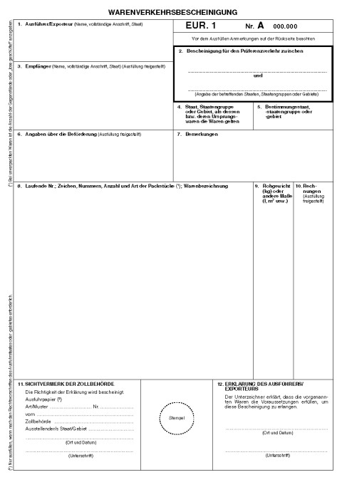
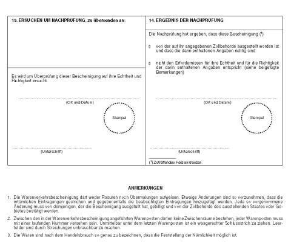
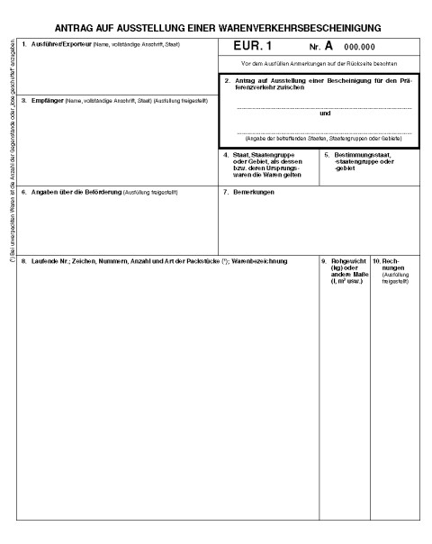
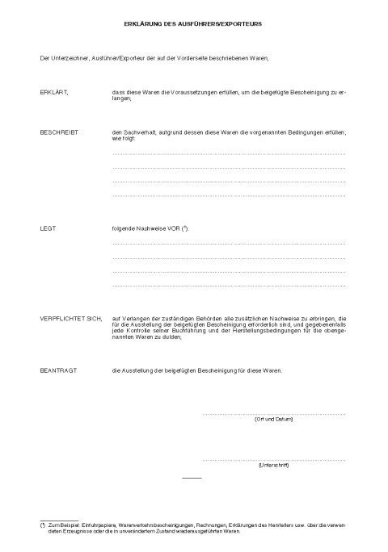
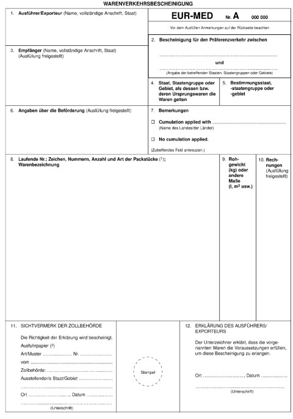
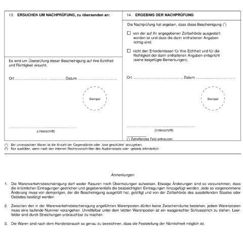
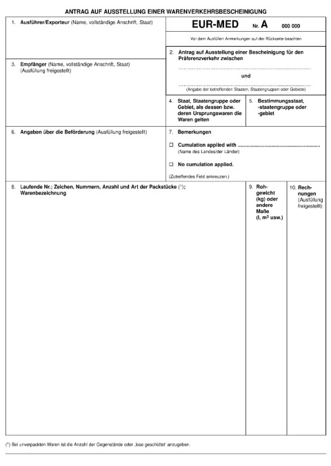
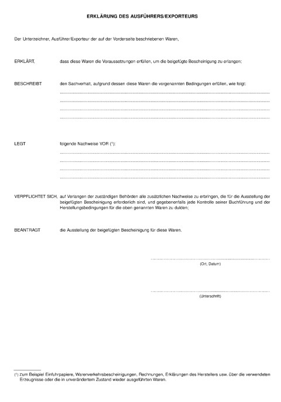

Kundmachung vom 18. Juli 2006 des Beschlusses Nr. 136/2005 des Gemeinsamen EWR-Ausschusses Beschluss des Gemeinsamen EWR-Ausschusses: 21. Oktober 2005 Inkrafttreten für das Fürstentum Liechtenstein: 22. Oktober 2005 Aufgrund von Art. 3 Bst. k des Kundmachungsgesetzes vom 17. April 1985, LGBl. 1985 Nr. 41, in der Fassung des Gesetzes vom 22. März 1995, LGBl. 1995 Nr. 101, macht die Regierung im Anhang den Beschluss Nr. 136/2005 des Gemeinsamen EWR-Ausschusses kund. Fürstliche Regierung: gez. Otmar Hasler Fürstlicher Regierungschef Anhang Beschluss des Gemeinsamen EWR-Ausschusses Nr. 136/2005 vom 21. Oktober 2005 zur Änderung von Protokoll 4 zum Abkommen über die Ursprungsregeln Der Gemeinsame EWR-Ausschuss - gestützt auf das Abkommen über den Europäischen Wirtschaftsraum , geändert durch das Anpassungsprotokoll zum Abkommen über den Europäischen Wirtschaftsraum, nachstehend Abkommen genannt, insbesondere auf Art. 98, in Erwägung nachstehender Gründe: 1. In Protokoll Nr. 4 zum Abkommen ist eine Ursprungskumulierung zwischen der Gemeinschaft und Island, Bulgarien, Norwegen, Rumänien, der Schweiz (mit Liechtenstein) und der Türkei vorgesehen. 2. Eine Ausweitung des Systems der Ursprungskumulierung ist wünschenswert, um die Verwendung von Vormaterialien mit Ursprung in der Gemeinschaft, Bulgarien, Rumänien, Island, Norwegen, der Schweiz (mit Liechtenstein), den Färöer-Inseln, der Türkei und jedem anderen Land, das aufgrund der auf der Europa-Mittelmeer-Konferenz am 27. und 28. November 1995 verabschiedeten Erklärung von Barcelona an der Europa-Mittelmeer-Partnerschaft teilnimmt, zu ermöglichen und auf diese Weise den Handel zu entwickeln und die regionale Integration zu fördern. 3. Damit das erweiterte System der Ursprungskumulierung nur zwischen den Ländern angewandt wird, die die notwendigen Voraussetzungen erfüllen, und die Umgehung von Zöllen vermieden wird, ist es erforderlich, neue Bestimmungen über die Bescheinigung des Ursprungs einzuführen. 4. Für Durchgangs- und Lagerwaren sollten am Tag des Inkrafttretens der Entscheidung Übergangsbestimmungen gelten, wonach diesen Waren das erweiterte System zur Ursprungskumulierung zugute kommt. 5. Die Gründe für den Ausschluss landwirtschaftlicher Erzeugnisse mit Ursprung in der Türkei von dem System der Ursprungskumulierung sind nicht mehr gültig. 6. Die Gemeinsame Erklärung über die Überprüfung der Änderungen der Ursprungsregeln aufgrund der Änderungen des Harmonisierten Systems kann bis zum 31. Dezember 2004 angewendet werden und muss nach diesem Termin in dem Protokoll nicht beibehalten werden. 7. Technische Änderungen sind erforderlich, um Fehler in und Abweichungen zwischen den verschiedenen Sprachfassungen des Textes zu berichtigen. 8. Für die ordnungsgemässe Anwendung des Abkommens und zur Erleichterung der Arbeit der Anwender und der Zollverwaltungen ist es daher zweckdienlich, alle fraglichen Bestimmungen in einen neuen Text des Protokolls Nr. 4 einzubeziehen - beschliesst: Art. 1 Protokoll Nr. 4 zum Abkommen wird durch den diesem Beschluss beigefügten Wortlaut, einschliesslich der entsprechenden Gemeinsamen Erklärungen, ersetzt. Art. 2 Dieser Beschluss tritt am 22. Oktober 2005 in Kraft, sofern dem Gemeinsamen EWR-Ausschuss alle Mitteilungen nach Art. 103 Abs. 1 des Abkommens vorliegen . Er gilt ab dem ersten Tag des Monats, der auf den Tag seiner Annahme folgt. Art. 3 Dieser Beschluss wird im EWR-Abschnitt und in der EWR-Beilage des Amtsblattes der Europäischen Union veröffentlicht. Brüssel, den 21. Oktober 2005 (Es folgen die Unterschriften) Protokoll 4 über die Ursprungsregeln Inhaltsübersicht Titel I Allgemeines Art. 1 Begriffsbestimmungen Titel II Bestimmung des Begriffs "Erzeugnisse mit Ursprung in" oder "Ursprungserzeugnisse" Art. 2 Allgemeines Art. 3 Diagonale Ursprungskumulierung Art. 4 Vollständig gewonnene oder hergestellte Erzeugnisse Art. 5 In ausreichendem Masse be- oder verarbeitete Erzeugnisse Art. 6 Nicht ausreichende Be- oder Verarbeitungen Art. 7 Massgebende Einheit Art. 8 Zubehör, Ersatzteile und Werkzeuge Art. 9 Warenzusammenstellungen Art. 10 Neutrale Elemente Titel III Territoriale Auflagen Art. 11 Territorialitätsprinzip Art. 12 Unmittelbare Beförderung Art. 13 Ausstellungen Titel IV Zollrückvergütung und Zollbefreiung Art. 14 Verbot der Zollrückvergütung und der Zollbefreiung Titel V Nachweis der Ursprungseigenschaft Art. 15 Allgemeines Art. 16 Verfahren für die Ausstellung der Warenverkehrsbescheinigung EUR.1 oder EUR-MED Art. 17 Nachträglich ausgestellte Warenverkehrsbescheinigung EUR.1 oder EUR-MED Art. 18 Ausstellung eines Duplikats der Warenverkehrsbescheinigung EUR.1 oder EUR-MED Art. 19 Ausstellung der Warenverkehrsbescheinigung EUR.1 oder EUR-MED auf der Grundlage eines vorher ausgestellten oder ausgefertigten Ursprungsnachweises Art. 20 Buchmässige Trennung Art. 21 Voraussetzungen für die Ausfertigung der Erklärung auf der Rechnung oder der Erklärung auf der Rechnung EUR-MED Art. 22 Ermächtigter Ausführer Art. 23 Geltungsdauer der Ursprungsnachweise Art. 24 Vorlage der Ursprungsnachweise Art. 25 Einfuhr in Teilsendungen Art. 26 Ausnahmen vom Ursprungsnachweis Art. 27 Lieferantenerklärung Art. 28 Belege Art. 29 Aufbewahrung der Ursprungsnachweise, Lieferantenerklärungen und Belege Art. 30 Abweichungen und Formfehler Art. 31 In Euro ausgedrückte Beträge Titel VI Methoden der Zusammenarbeit der Verwaltungen Art. 32 Gegenseitige Amtshilfe Art. 33 Prüfung der Ursprungsnachweise Art. 34 Prüfung der Lieferantenerklärung Art. 35 Streitbeilegung Art. 36 Sanktionen Art. 37 Freizonen Titel VII Ceuta und Melilla Art. 38 Anwendung des Protokolls Art. 39 Besondere Bestimmungen Titel VIII Schlussbestimmungen Art. 40 Übergangsbestimmung für Durchgangs- und Lagerwaren Liste der Anhänge Anhang I: Einleitende Bemerkungen zur Liste in Anhang II Anhang II: Liste der Be- oder Verarbeitungen, die an Vormaterialien ohne Ursprungseigenschaft vorgenommen werden müssen, um der Ware die Ursprungseigenschaft zu verleihen Anhang IIIa: Muster der Warenverkehrsbescheinigung EUR.1 und des Antrags auf Ausstellung einer Warenverkehrsbescheinigung EUR.1 Anhang IIIb: Muster der Warenverkehrsbescheinigung EUR-MED und des Antrags auf Ausstellung einer Warenverkehrsbescheinigung EUR-MED Anhang IVa: Wortlaut der Erklärung auf der Rechnung Anhang IVb: Wortlaut der Erklärung auf der Rechnung EUR-MED Anhang V: Muster der Lieferantenerklärung Anhang VI: Muster der Langzeit-Lieferantenerklärung Gemeinsame Erklärungen Gemeinsame Erklärung über die Anerkennung des im Rahmen der Abkommen Gemäss Art. 3 des Protokolls 4 augestellten oder ausgefertigten Ursprungsnachweise für Erzeugnisse mit Ursprung in der Gemeinschaft, in Island oder in Norwegen Gemeinsame Erklärung zu dem Fürstentum Andorra Gemeinsame Erklärung zu der Republik San Marino Titel I Allgemeines Art. 1 Begriffsbestimmungen Für die Zwecke dieses Protokolls gelten folgende Begriffsbestimmungen: a) "Herstellen" ist jede Be- oder Verarbeitung einschliesslich Zusammenbau oder besondere Vorgänge; b) "Vormaterial" sind jegliche Zutaten, Rohstoffe, Komponenten oder Teile usw., die beim Herstellen des Erzeugnisses verwendet werden; c) "Erzeugnis" ist die hergestellte Ware, auch wenn sie zur späteren Verwendung in einem anderen Herstellungsvorgang bestimmt ist; d) "Waren" sind sowohl Vormaterialien als auch Erzeugnisse; e) "Zollwert" ist der Wert, der nach dem Übereinkommen zur Durchführung des Artikels VII des Allgemeinen Zoll- und Handelsabkommens 1994 (WTO-Übereinkommen über den Zollwert) festgelegt wird; f) "Ab-Werk-Preis" ist der Preis des Erzeugnisses ab Werk, der dem Hersteller im EWR gezahlt wird, in dessen Unternehmen die letzte Be- oder Verarbeitung durchgeführt worden ist, sofern dieser Preis den Wert aller verwendeten Vormaterialien umfasst, abzüglich aller internen Abgaben, die erstattet werden oder erstattet werden können, wenn das hergestellte Erzeugnis ausgeführt wird; g) "Wert der Vormaterialien" ist der Zollwert der verwendeten Vormaterialien ohne Ursprungseigenschaft zum Zeitpunkt der Einfuhr oder, wenn dieser nicht bekannt ist und nicht festgestellt werden kann, der erste feststellbare Preis, der im EWR für die Vormaterialien gezahlt wird; h) "Wert der Vormaterialien mit Ursprungseigenschaft" ist der Wert dieser Vormaterialien nach Bst. g, der sinngemäss anzuwenden ist; i) "Wertzuwachs" ist der Ab-Werk-Preis abzüglich des Zollwerts der verwendeten Vormaterialien, die die Ursprungseigenschaft eines der in Art. 3 genannten anderen Länder, mit denen die Kumulierung zulässig ist, besitzen oder, wenn der Zollwert nicht bekannt ist oder nicht festgestellt werden kann, der erste feststellbare Preis, der im EWR für die Vormaterialien gezahlt wird; j) "Kapitel" und "Position" sind die Kapitel und Positionen (vierstellige Codes) der Nomenklatur des Harmonisierten Systems zur Bezeichnung und Codierung der Waren (in diesem Protokoll "Harmonisiertes System" oder "HS" genannt); k) "einreihen" ist die Einreihung von Erzeugnissen oder Vormaterialien in eine bestimmte Position; l) "Sendung" sind Erzeugnisse, die entweder gleichzeitig von einem Ausführer an einen Empfänger oder mit einem einzigen Frachtpapier oder - bei Fehlen eines solchen Papiers - mit einer einzigen Rechnung vom Ausführer an den Empfänger versandt werden; m) "Gebiete" sind die Gebiete einschliesslich der Küstengewässer. Titel II Bestimmung des Begriffs "Erzeugnisse mit Ursprung in" oder "Ursprungserzeugnisse" Art. 2 Allgemeines 1) Für die Zwecke des Abkommens gelten als Ursprungserzeugnisse des EWR: a) Erzeugnisse, die im Sinne des Art. 4 im EWR vollständig gewonnen oder hergestellt worden sind; b) Erzeugnisse, die im EWR unter Verwendung von Vormaterialien hergestellt worden sind, die dort nicht vollständig gewonnen oder hergestellt worden sind, vorausgesetzt, dass diese Vormaterialien im EWR im Sinne des Art. 5 in ausreichendem Masse be- oder verarbeitet worden sind. Für diese Zwecke gelten die Gebiete der Vertragsparteien, für die das Abkommen gilt, als ein Gebiet. 2) Abweichend von Abs. 1 gilt das Gebiet des Fürstentums Liechtenstein zum für die Zwecke der Bestimmung des Ursprungs der in den Tabellen I und II des Protokolls 3 aufgeführten Erzeugnisse nicht als Teil des Gebietes des EWR; diese Erzeugnisse gelten nur dann als Ursprungserzeugnisse des EWR, wenn sie im Gebiet der anderen Vertragsparteien entweder vollständig gewonnen oder hergestellt oder in ausreichendem Masse be- oder verarbeitet worden sind. Art. 3 Diagonale Ursprungskumulierung 1) Unbeschadet des Art. 2 gelten als Ursprungserzeugnisse des EWR Erzeugnisse, die dort unter Verwendung von Vormaterialien mit Ursprung in Bulgarien, der Schweiz (einschliesslich Liechtensteins) , Island, Norwegen, Rumänien, der Türkei oder in der Gemeinschaft hergestellt worden sind, sofern die im EWR vorgenommene Be- oder Verarbeitung über die in Art. 6 genannte Behandlung hinausgeht. Diese Vormaterialien brauchen nicht in ausreichendem Masse be- oder verarbeitet worden zu sein. 2) Unbeschadet des Art. 2 gelten als Ursprungserzeugnisse des EWR Erzeugnisse, die dort unter Verwendung von Vormaterialien mit Ursprung auf den Färöern oder in Teilnehmerländern der Partnerschaft Europa-Mittelmeer, die mit der auf der Europa-Mittelmeer-Konferenz vom 27. und 28. November 1995 angenommenen Erklärung von Barcelona begründet wurde, ausgenommen die Türkei , hergestellt worden sind, sofern die im EWR vorgenommene Be- oder Verarbeitung über die in Art. 6 genannte Behandlung hinausgeht. Diese Vormaterialien brauchen nicht in ausreichendem Masse be- oder verarbeitet worden zu sein. 3) Geht die im EWR vorgenommene Be- oder Verarbeitung nicht über die in Art. 6 genannte Behandlung hinaus, so gilt das hergestellte Erzeugnis nur dann als Ursprungserzeugnis des EWR, wenn der dort erzielte Wertzuwachs den Wert der verwendeten Vormaterialien mit Ursprung in einem der in den Abs. 1 und 2 genannten Länder übersteigt. Anderenfalls gilt das hergestellte Erzeugnis als Ursprungserzeugnis des Landes, auf das der höchste Wert der bei der Herstellung im EWR verwendeten Vormaterialien entfällt. 4) Ursprungserzeugnisse der in den Abs. 1 und 2 genannten Länder, die im EWR keiner Be- oder Verarbeitung unterzogen worden sind, behalten ihre Ursprungseigenschaft, wenn sie in eines dieser Länder ausgeführt werden. 5) Die Kumulierung nach diesem Artikel ist nur unter der Voraussetzung zulässig, dass a) zwischen den am Erwerb der Ursprungseigenschaft beteiligten Ländern und dem Bestimmungsland ein Präferenzhandelsabkommen nach Artikel XXIV des Allgemeinen Zoll- und Handelsabkommens (GATT) Anwendung findet, b) die Vormaterialien und Erzeugnisse die Ursprungseigenschaft aufgrund von Ursprungsregeln erworben haben, die den Regeln dieses Protokolls entsprechen, und c) Bekanntmachungen über die Erfüllung der Voraussetzungen für die Anwendung der Kumulierung im Amtsblatt der Europäischen Union (Reihe C) und im Gebiet der anderen Vertragsparteien nach deren eigenen Verfahren veröffentlicht worden sind. Die Kumulierung nach diesem Artikel ist ab dem Tag zulässig, der in der Bekanntmachung im Amtsblatt der Europäischen Union (Reihe C) angegeben ist. Die Gemeinschaft teilt den anderen Vertragsparteien über die Kommission der Europäischen Gemeinschaften die Einzelheiten der Abkommen mit den in den Abs. 1 und 2 genannten anderen Ländern mit, einschliesslich des Tages ihres Inkrafttretens und der jeweiligen Ursprungsregeln. Art. 4 Vollständig gewonnene oder hergestellte Erzeugnisse 1) Als im EWR vollständig gewonnen oder hergestellt gelten: a) dort aus dem Boden oder dem Meeresgrund gewonnene mineralische Erzeugnisse; b) dort geerntete pflanzliche Erzeugnisse; c) dort geborene oder ausgeschlüpfte und dort aufgezogene lebende Tiere; d) Erzeugnisse von dort gehaltenen lebenden Tieren; e) dort erzielte Jagdbeute und Fischfänge; f) Erzeugnisse der Seefischerei und andere von eigenen Schiffen ausserhalb der Küstengewässer der Vertragsparteien aus dem Meer gewonnene Erzeugnisse; g) Erzeugnisse, die an Bord eigener Fabrikschiffe ausschliesslich aus den unter Bst. f genannten Erzeugnissen hergestellt werden; h) dort gesammelte Altwaren, die nur zur Gewinnung von Rohstoffen verwendet werden können, einschliesslich gebrauchter Reifen, die nur zur Runderneuerung oder als Abfall verwendet werden können; i) bei einer dort ausgeübten Produktionstätigkeit anfallende Abfälle; j) aus dem Meeresboden oder Meeresuntergrund ausserhalb der eigenen Küstengewässer gewonnene Erzeugnisse, sofern sie zum Zwecke der Nutzbarmachung Ausschliesslichkeitsrechte über diesen Teil des Meeresbodens oder Meeresuntergrunds ausüben; k) Waren, die dort ausschliesslich aus unter den Bst. a bis j aufgeführten Erzeugnissen hergestellt werden. 2) Die Begriffe "eigene Schiffe" und "eigene Fabrikschiffe" in Abs. 1 Bst. f bzw. g sind nur anwendbar auf Schiffe und Fabrikschiffe, a) die in einem Mitgliedstaat der Gemeinschaft oder in einem EFTA-Staat ins Schiffsregister eingetragen oder dort angemeldet sind, b) die unter der Flagge eines Mitgliedstaats der Gemeinschaft oder eines EFTA-Staates fahren, c) die mindestens zur Hälfte Eigentum von Staatsangehörigen der Mitgliedstaaten der Gemeinschaft oder der EFTA-Staaten oder einer Gesellschaft sind, die ihren Hauptsitz in einem dieser Staaten hat, bei der der oder die Geschäftsführer, der Vorsitzende des Vorstands oder Aufsichtsrats und die Mehrheit der Mitglieder dieser Organe Staatsangehörige der Mitgliedstaaten der Gemeinschaft oder der EFTA-Staaten sind und - im Falle von Personengesellschaften und Gesellschaften mit beschränkter Haftung - ausserdem das Kapital mindestens zur Hälfte den betreffenden Staaten oder öffentlich-rechtlichen Körperschaften oder Staatsangehörigen dieser Staaten gehört, d) deren Schiffsführung aus Staatsangehörigen der Mitgliedstaaten der Gemeinschaft oder der EFTA-Staaten besteht und e) deren Besatzung zu mindestens 75 v.H. aus Staatsangehörigen der Mitgliedstaaten der Gemeinschaft oder der EFTA-Staaten besteht. Art. 5 In ausreichendem Masse be- oder verarbeitete Erzeugnisse 1) Für die Zwecke des Art. 2 gelten Erzeugnisse, die nicht vollständig gewonnen oder hergestellt worden sind, als in ausreichendem Masse be- oder verarbeitet, wenn die Bedingungen der Liste in Anhang II erfüllt sind. In den genannten Bedingungen sind für alle unter das Abkommen fallenden Erzeugnisse die Be- oder Verarbeitungen festgelegt, die an den bei der Herstellung der Erzeugnisse verwendeten Vormaterialien vorgenommen werden müssen; sie gelten nur für diese Vormaterialien. Ein Erzeugnis, das nach den Bedingungen der Liste die Ursprungseigenschaft erworben hat und bei der Herstellung eines anderen Erzeugnisses verwendet wird, hat die für das andere Erzeugnis geltenden Bedingungen nicht zu erfüllen; die gegebenenfalls bei der Herstellung des ersten Erzeugnisses verwendeten Vormaterialien ohne Ursprungseigenschaft bleiben demnach unberücksichtigt. 2) Vormaterialien ohne Ursprungseigenschaft, die nach den Bedingungen der Liste in Anhang II nicht bei der Herstellung eines Erzeugnisses verwendet werden dürfen, können ungeachtet des Abs. 1 dennoch verwendet werden, a) wenn ihr Gesamtwert 10 v.H. des Ab-Werk-Preises des Erzeugnisses nicht überschreitet; b) wenn die gegebenenfalls in der Liste aufgeführten Vomhundertsätze für den höchsten zulässigen Wert von Vormaterialien ohne Ursprungseigenschaft durch die Anwendung dieses Absatzes nicht überschritten werden. Dieser Absatz gilt nicht für Erzeugnisse der Kapitel 50 bis 63 des Harmonisierten Systems. 3) Die Abs. 1 und 2 gelten vorbehaltlich des Art. 6. Art. 6 Nicht ausreichende Be- oder Verarbeitungen 1) Unbeschadet des Abs. 2 gelten folgende Be- oder Verarbeitungen ohne Rücksicht darauf, ob die Bedingungen des Art. 5 erfüllt sind, als nicht ausreichend, um die Ursprungseigenschaft zu verleihen: a) Behandlungen, die dazu bestimmt sind, die Erzeugnisse während des Transports oder der Lagerung in ihrem Zustand zu erhalten; b) Teilen oder Zusammenstellen von Packstücken; c) Waschen, Reinigen, Entfernen von Staub, Oxid, Öl, Farbe oder anderen Beschichtungen; d) Bügeln von Textilien; e) einfaches Anstreichen oder Polieren; f) Schälen, teilweises oder vollständiges Bleichen, Polieren oder Glasieren von Getreide und Reis; g) Färben von Zucker oder Formen von Würfelzucker; h) Enthülsen, Entsteinen oder Schälen von Früchten, Nüssen und Gemüsen; i) Schärfen, einfaches Schleifen oder einfaches Zerteilen; j) Sieben, Aussondern, Einordnen, Sortieren (einschliesslich des Zusammenstellens von Sortimenten); k) einfaches Abfüllen in Flaschen, Dosen, Fläschchen, Säcke, Etuis oder Schachteln, Befestigen auf Kasten oder Brettchen sowie alle anderen einfachen Verpackungsvorgänge; l) Anbringen oder Aufdrucken von Marken, Etiketten, Logos oder anderen gleichartigen Unterscheidungszeichen auf den Erzeugnissen selbst oder auf ihren Verpackungen; m) einfaches Mischen von Erzeugnissen, auch verschiedener Arten; n) einfaches Zusammenfügen von Teilen eines Erzeugnisses zu einem vollständigen Erzeugnis oder Zerlegen von Erzeugnissen in Einzelteile; o) Zusammentreffen von zwei oder mehr der unter den Bst. a bis n genannten Behandlungen; p) Schlachten von Tieren. 2) Bei der Beurteilung, ob die an einem Erzeugnis vorgenommenen Be- oder Verarbeitungen als nicht ausreichend im Sinne des Abs. 1 gelten, sind alle im EWR an diesem Erzeugnis vorgenommenen Be- oder Verarbeitungen in Betracht zu ziehen. Art. 7 Massgebende Einheit 1) Massgebende Einheit für die Anwendung dieses Protokolls ist die für die Einreihung in die Position des Harmonisierten Systems massgebende Einheit jedes Erzeugnisses. Daraus ergibt sich, a) dass jede Gruppe oder Zusammenstellung von Erzeugnissen, die nach dem Harmonisierten System in eine einzige Position eingereiht wird, als Ganzes die massgebende Einheit darstellt; b) dass bei einer Sendung mit gleichen Erzeugnissen, die in dieselbe Position des Harmonisierten Systems eingereiht werden, jedes Erzeugnis für sich betrachtet werden muss. 2) Werden Verpackungen nach der Allgemeinen Vorschrift 5 zum Harmonisierten System wie das darin enthaltene Erzeugnis eingereiht, so werden sie auch für die Bestimmung des Ursprungs wie das Erzeugnis behandelt. Art. 8 Zubehör, Ersatzteile und Werkzeuge Zubehör, Ersatzteile und Werkzeuge, die mit Geräten, Maschinen oder Fahrzeugen geliefert werden, werden mit diesen zusammen als Einheit angesehen, wenn sie als Bestandteil der Normalausrüstung in deren Preis enthalten sind oder nicht gesondert in Rechnung gestellt werden. Art. 9 Warenzusammenstellungen Warenzusammenstellungen im Sinne der Allgemeinen Vorschrift 3 zum Harmonisierten System gelten als Ursprungserzeugnisse, wenn alle Bestandteile Ursprungserzeugnisse sind. Jedoch gilt eine Warenzusammenstellung, die aus Bestandteilen mit Ursprungseigenschaft und Bestandteilen ohne Ursprungseigenschaft besteht, in ihrer Gesamtheit als Ursprungserzeugnis, sofern der Wert der Bestandteile ohne Ursprungseigenschaft 15 v.H. des Ab-Werk-Preises der Warenzusammenstellung nicht überschreitet. Art. 10 Neutrale Elemente Bei der Feststellung, ob ein Erzeugnis ein Ursprungserzeugnis ist, braucht der Ursprung folgender gegebenenfalls bei seiner Herstellung verwendeter Erzeugnisse nicht berücksichtigt zu werden: a) Energie und Brennstoffe; b) Anlagen und Ausrüstung; c) Maschinen und Werkzeuge; d) Erzeugnisse, die nicht in die endgültige Zusammensetzung des Erzeugnisses eingehen und nicht eingehen sollen. Titel III Territoriale Auflagen Art. 11 Territorialitätsprinzip 1) Vorbehaltlich des Art. 3 und des Abs. 3 müssen die in Titel II genannten Bedingungen für den Erwerb der Ursprungseigenschaft ohne Unterbrechung im EWR erfüllt werden. 2) Ursprungswaren, die aus dem EWR in ein Drittland ausgeführt und anschliessend wieder eingeführt werden, gelten vorbehaltlich des Art. 3 als Erzeugnisse ohne Ursprungseigenschaft, es sei denn, den Zollbehörden kann glaubhaft dargelegt werden, a) dass die wieder eingeführten Waren dieselben wie die ausgeführten Waren sind und b) dass diese Waren während ihres Verbleibs in dem betreffenden Drittland oder während des Transports keine Behandlung erfahren haben, die über das zur Erhaltung ihres Zustands erforderliche Mass hinausgeht. 3) Der Erwerb der Ursprungseigenschaft nach Titel II wird durch eine Be- oder Verarbeitung, die ausserhalb des EWR an aus dem EWR ausgeführten und anschliessend wieder eingeführten Vormaterialien vorgenommen wird, nicht berührt, sofern a) die genannten Vormaterialien im EWR vollständig gewonnen oder hergestellt oder vor ihrer Ausfuhr einer Be- oder Verarbeitung unterzogen worden sind, die über die Be- oder Verarbeitungen im Sinne des Art. 6 hinausgeht, und b) den Zollbehörden glaubhaft dargelegt werden kann, i) dass die wieder eingeführten Waren durch Be- oder Verarbeitung der ausgeführten Vormaterialien hergestellt worden sind und ii) dass der nach diesem Artikel ausserhalb des EWR insgesamt erzielte Wertzuwachs 10 v.H. des Ab-Werk-Preises des Erzeugnisses, für das die Ursprungseigenschaft beansprucht wird, nicht überschreitet. 4) Für die Zwecke des Abs. 3 finden die in Titel II genannten Bedingungen für den Erwerb der Ursprungseigenschaft auf die Be- oder Verarbeitung ausserhalb des EWR keine Anwendung. Findet jedoch nach der Liste in Anhang II für die Bestimmung des Ursprungs des Erzeugnisses eine Regel Anwendung, die einen höchsten zulässigen Wert für alle verwendeten Vormaterialien ohne Ursprungseigenschaft vorsieht, so dürfen der Gesamtwert der im Gebiet der betreffenden Vertragspartei verwendeten Vormaterialien ohne Ursprungseigenschaft und der nach diesem Artikel ausserhalb des EWR insgesamt erzielte Wertzuwachs zusammengenommen den angegebenen Vomhundertsatz nicht überschreiten. 5) Im Sinne der Abs. 3 und 4 bedeutet der Begriff "insgesamt erzielter Wertzuwachs" alle ausserhalb des EWR entstandenen Kosten einschliesslich des Wertes der dort verwendeten Vormaterialien. 6) Die Abs. 3 und 4 gelten nicht für Erzeugnisse, die die Bedingungen der Liste in Anhang II nicht erfüllen und nur durch Anwendung der allgemeinen Toleranz nach Art. 5 Abs. 2 als in ausreichendem Masse be- oder verarbeitet angesehen werden können. 7) Die Abs. 3 und 4 gelten nicht für Erzeugnisse der Kapitel 50 bis 63 des Harmonisierten Systems. 8) Die unter diesen Artikel fallende Be- oder Verarbeitung ausserhalb des EWR wird im Rahmen der passiven Veredelung oder eines ähnlichen Verfahrens vorgenommen. Art. 12 Unmittelbare Beförderung 1) Die im Rahmen des Abkommens vorgesehene Präferenzbehandlung gilt nur für die den Voraussetzungen dieses Protokolls entsprechenden Erzeugnisse, die unmittelbar innerhalb des EWR oder im Durchgangsverkehr durch die Gebiete der in Art. 3 genannten Länder, mit denen die Kumulierung zulässig ist, befördert werden. Jedoch können Erzeugnisse, die eine einzige Sendung bilden, durch andere Gebiete befördert werden, gegebenenfalls auch mit einer Umladung oder vorübergehenden Einlagerung in diesen Gebieten, sofern sie unter der zollamtlichen Überwachung der Behörden des Durchfuhr- oder Einlagerungslands bleiben und dort nur ent- und wieder verladen werden oder eine auf die Erhaltung ihres Zustands gerichtete Behandlung erfahren. Ursprungserzeugnisse können in Rohrleitungen durch andere Gebiete als das Gebiet des EWR befördert werden. 2) Der Nachweis, dass die in Abs. 1 genannten Voraussetzungen erfüllt sind, wird dadurch erbracht, dass den Zollbehörden des Einfuhrlands eines der folgenden Papiere vorgelegt wird: a) ein durchgehendes Frachtpapier, mit dem die Beförderung vom Ausfuhrland durch das Durchfuhrland erfolgt ist, oder b) eine von den Zollbehörden des Durchfuhrlands ausgestellte Bescheinigung mit folgenden Angaben: i) einer genauen Beschreibung der Erzeugnisse, ii) dem Datum des Ent- und Wiederverladens der Erzeugnisse oder der Ein- und Ausschiffung unter Angabe der benutzten Schiffe oder sonstigen Beförderungsmittel und iii) den Bedingungen des Verbleibs der Erzeugnisse im Durchfuhrland, oder c) falls diese Papiere nicht vorgelegt werden können, alle sonstigen beweiskräftigen Unterlagen. Art. 13 Ausstellungen 1) Werden Ursprungserzeugnisse zu einer Ausstellung in ein Land versandt, bei dem es sich nicht um eines der in Art. 3 genannten Länder, mit denen die Kumulierung zulässig ist, handelt, und nach der Ausstellung zur Einfuhr in den EWR verkauft, so erhalten sie bei der Einfuhr die Begünstigungen des Abkommens, sofern den Zollbehörden des Einfuhrlands glaubhaft dargelegt wird, a) dass ein Ausführer diese Erzeugnisse aus dem Gebiet einer Vertragspartei in das Ausstellungsland versandt und dort ausgestellt hat, b) dass dieser Ausführer die Erzeugnisse einem Empfänger in einer anderen Vertragspartei verkauft oder überlassen hat, c) dass die Erzeugnisse während oder unmittelbar nach der Ausstellung in dem Zustand, in dem sie zur Ausstellung versandt worden waren, versandt worden sind und d) dass die Erzeugnisse ab dem Zeitpunkt, zu dem sie zu der Ausstellung versandt wurden, nicht zu anderen Zwecken als zur Vorführung auf der Ausstellung verwendet worden sind. 2) Nach Massgabe des Titels V ist ein Ursprungsnachweis auszustellen oder auszufertigen und den Zollbehörden des Einfuhrlands unter den üblichen Voraussetzungen vorzulegen. Darin sind Bezeichnung und Anschrift der Ausstellung anzugeben. Falls erforderlich, kann ein zusätzlicher Nachweis über die Umstände verlangt werden, unter denen die Erzeugnisse ausgestellt worden sind. 3) Abs. 1 gilt für Handels-, Industrie-, Landwirtschafts- und Handwerksmessen oder -ausstellungen und ähnliche öffentliche Veranstaltungen, bei denen die Erzeugnisse unter zollamtlicher Überwachung bleiben; ausgenommen sind Veranstaltungen zu privaten Zwecken für den Verkauf ausländischer Erzeugnisse in Läden oder Geschäftslokalen. Titel IV Zollrückvergütung und Zollbefreiung Art. 14 Verbot der Zollrückvergütung und der Zollbefreiung 1) Vormaterialien ohne Ursprungseigenschaft, die im EWR oder in einem der in Art. 3 genannten Länder bei der Herstellung von Ursprungserzeugnissen verwendet worden sind, für die nach Massgabe des Titels V ein Ursprungsnachweis ausgestellt oder ausgefertigt wird, dürfen im Gebiet einer Vertragspartei nicht Gegenstand einer wie auch immer gearteten Zollrückvergütung oder Zollbefreiung sein. 2) Das Verbot nach Abs. 1 betrifft im Gebiet einer Vertragspartei geltende Regelungen, nach denen Zölle auf bei der Herstellung von Ursprungserzeugnissen verwendete Vormaterialien oder Abgaben gleicher Wirkung vollständig oder teilweise erstattet, erlassen oder nicht erhoben werden, sofern die Erstattung, der Erlass oder die Nichterhebung ausdrücklich oder faktisch gewährt wird, wenn die aus den betreffenden Vormaterialien hergestellten Erzeugnisse ausgeführt werden, nicht dagegen, wenn diese Erzeugnisse im Gebiet der betreffenden Vertragspartei in den zollrechtlich freien Verkehr übergehen. 3) Der Ausführer von Erzeugnissen mit Ursprungsnachweis hat auf Verlangen der Zollbehörden jederzeit alle zweckdienlichen Unterlagen vorzulegen, um nachzuweisen, dass für die bei der Herstellung dieser Erzeugnisse verwendeten Vormaterialien ohne Ursprungseigenschaft keine Zollrückvergütung gewährt worden ist und sämtliche für solche Vormaterialien geltenden Zölle und Abgaben gleicher Wirkung tatsächlich entrichtet worden sind. 4) Die Abs. 1 bis 3 gelten auch für Verpackungen im Sinne des Art. 7 Abs. 2, für Zubehör, Ersatzteile und Werkzeuge im Sinne des Art. 8 sowie für Warenzusammenstellungen im Sinne des Art. 9, wenn es sich dabei um Erzeugnisse ohne Ursprungseigenschaft handelt. 5) Die Abs. 1 bis 4 gelten nur für Vormaterialien, die unter das Abkommen fallen. Ferner stehen sie der Anwendung eines Ausfuhrerstattungssystems für landwirtschaftliche Erzeugnisse nicht entgegen, das nach Massgabe des Abkommens bei der Ausfuhr gilt. Titel V Nachweis der Ursprungseigenschaft Art. 15 Allgemeines 1) Ursprungserzeugnisse erhalten bei der Einfuhr in eine Vertragspartei die Begünstigungen des Abkommens, sofern einer der folgenden Ursprungsnachweise erbracht wird: a) eine Warenverkehrsbescheinigung EUR.1 nach dem Muster in Anhang IIIa; b) eine Warenverkehrsbescheinigung EUR-MED nach dem Muster in Anhang IIIb; c) in den in Art. 21 Abs. 1 genannten Fällen eine vom Ausführer abgegebene Erklärung mit dem in Anhang IVa oder IVb angegebenen Wortlaut auf einer Rechnung, einem Lieferschein oder einem anderen Handelspapier, in dem die Erzeugnisse so genau bezeichnet sind, dass die Feststellung der Nämlichkeit möglich ist (im Folgenden "Erklärung auf der Rechnung" bzw. "Erklärung auf der Rechnung EUR-MED" genannt). 2) Abweichend von Abs. 1 erhalten Ursprungserzeugnisse im Sinne dieses Protokolls in den in Art. 26 genannten Fällen die Begünstigungen des Abkommens, ohne dass einer der in Abs. 1 genannten Ursprungsnachweise vorgelegt werden muss. Art. 16 Verfahren für die Ausstellung der Warenverkehrsbescheinigung EUR.1 oder EUR-MED 1) Die Warenverkehrsbescheinigung EUR.1 oder EUR-MED wird von den Zollbehörden des Ausfuhrlands auf schriftlichen Antrag ausgestellt, der vom Ausführer oder unter der Verantwortung des Ausführers von seinem bevollmächtigten Vertreter gestellt worden ist. 2) Der Ausführer oder sein bevollmächtigter Vertreter füllt zu diesem Zweck die Formblätter für die Warenverkehrsbescheinigung EUR.1 oder EUR-MED und den Antrag nach dem Muster in Anhang IIIa bzw. IIIb aus. Die Formblätter sind nach den nationalen Rechtsvorschriften des Ausfuhrlands in einer der Sprachen auszufüllen, in denen das Abkommen abgefasst ist. Werden die Formblätter handschriftlich ausgefüllt, so muss dies mit Tinte in Druckschrift erfolgen. Die Warenbezeichnung ist in dem dafür vorgesehenen Feld ohne Zeilenzwischenraum einzutragen. Ist das Feld nicht vollständig ausgefüllt, so ist unter der letzten Zeile der Warenbezeichnung ein waagerechter Strich zu ziehen und der nicht ausgefüllte Teil des Feldes durchzustreichen. 3) Der Ausführer, der die Ausstellung der Warenverkehrsbescheinigung EUR.1 oder EUR-MED beantragt, hat auf Verlangen der Zollbehörden des Ausfuhrlands, in dem die Warenverkehrsbescheinigung EUR.1 oder EUR-MED ausgestellt wird, jederzeit alle zweckdienlichen Unterlagen zum Nachweis der Ursprungseigenschaft der betreffenden Erzeugnisse sowie der Erfüllung der übrigen Voraussetzungen dieses Protokolls vorzulegen. 4) Unbeschadet des Abs. 5 wird von den Zollbehörden einer Vertragspartei eine Warenverkehrsbescheinigung EUR.1 ausgestellt, - wenn die betreffenden Erzeugnisse ohne Anwendung der Kumulierung mit Vormaterialien mit Ursprung in einem der in Art. 3 Abs. 2 genannten Länder als Ursprungserzeugnisse des EWR oder eines der in Art. 3 Abs. 1 genannten Länder, mit denen die Kumulierung zulässig ist, angesehen werden können und die übrigen Voraussetzungen dieses Protokolls erfüllt sind; - wenn die betreffenden Erzeugnisse ohne Anwendung der Kumulierung mit Vormaterialien mit Ursprung in einem der in Art. 3 genannten Länder als Ursprungserzeugnisse eines der in Art. 3 Abs. 2 genannten Länder, mit denen die Kumulierung zulässig ist, angesehen werden können und die übrigen Voraussetzungen dieses Protokolls erfüllt sind, sofern im Ursprungsland eine Warenverkehrsbescheinigung EUR-MED oder eine Erklärung auf der Rechnung EUR-MED ausgestellt bzw. ausgefertigt worden ist. 5) Eine Warenverkehrsbescheinigung EUR-MED wird von den Zollbehörden einer Vertragspartei ausgestellt, wenn die betreffenden Erzeugnisse als Ursprungserzeugnisse des EWR oder eines der in Art. 3 genannten Länder, mit denen die Kumulierung zulässig ist, angesehen werden können, die Voraussetzungen dieses Protokolls erfüllt sind und - die Kumulierung mit Vormaterialien mit Ursprung in einem der in Art. 3 Abs. 2 genannten Länder angewandt wurde oder - die Erzeugnisse als Vormaterialien im Rahmen der Kumulierung bei der Herstellung von Erzeugnissen für die Ausfuhr in eines der in Art. 3 Abs. 2 genannten Länder verwendet werden können oder - die Erzeugnisse aus dem Bestimmungsland in eines der in Art. 3 Abs. 2 genannten Länder wieder ausgeführt werden können. 6) In Feld 7 der Warenverkehrsbescheinigung EUR-MED ist einer der folgenden Vermerke in englischer Sprache einzutragen: - wenn die Ursprungseigenschaft durch Anwendung der Kumulierung mit Vormaterialien mit Ursprung in einem oder mehreren der in Art. 3 genannten Länder erworben wurde: "CUMULATION APPLIED WITH ... (name of the country/countries)"; - wenn die Ursprungseigenschaft ohne Anwendung der Kumulierung mit Vormaterialien mit Ursprung in einem oder mehreren der in Art. 3 genannten Länder erworben wurde: "NO CUMULATION APPLIED". 7) Die Zollbehörden, die die Warenverkehrsbescheinigung EUR.1 oder EUR-MED ausstellen, treffen die erforderlichen Massnahmen, um die Ursprungseigenschaft der Erzeugnisse und die Erfüllung der übrigen Voraussetzungen dieses Protokolls zu überprüfen. Sie sind befugt, zu diesem Zweck die Vorlage von Beweismitteln zu verlangen und jede Art von Überprüfung der Buchführung des Ausführers oder sonstige von ihnen für zweckdienlich erachtete Kontrolle durchzuführen. Sie achten auch darauf, dass die in Abs. 2 genannten Formblätter ordnungsgemäss ausgefüllt sind. Sie prüfen insbesondere, ob das Feld mit der Warenbezeichnung so ausgefüllt ist, dass jede Möglichkeit eines missbräuchlichen Zusatzes ausgeschlossen ist. 8) In Feld 11 der Warenverkehrsbescheinigung EUR.1 ist das Datum der Ausstellung anzugeben. 9) Die Warenverkehrsbescheinigung EUR.1 oder EUR-MED wird von den Zollbehörden ausgestellt und zur Verfügung des Ausführers gehalten, sobald die Ausfuhr tatsächlich erfolgt oder gewährleistet ist. Art. 17 Nachträglich ausgestellte Warenverkehrsbescheinigung EUR.1 oder EUR-MED 1) Abweichend von Art. 16 Abs. 9 kann die Warenverkehrsbescheinigung EUR.1 oder EUR-MED ausnahmsweise nach der Ausfuhr der Erzeugnisse, auf die sie sich bezieht, ausgestellt werden, a) wenn sie infolge eines Irrtums, eines unverschuldeten Versehens oder besonderer Umstände bei der Ausfuhr nicht ausgestellt worden ist oder b) wenn den Zollbehörden glaubhaft dargelegt wird, dass eine Warenverkehrsbescheinigung EUR.1 oder EUR-MED ausgestellt, aber bei der Einfuhr aus formalen Gründen nicht angenommen worden ist. 2) Abweichend von Art. 16 Abs. 9 kann die Warenverkehrsbescheinigung EUR-MED nach der Ausfuhr der Erzeugnisse, auf die sie sich bezieht und für die bei der Ausfuhr eine Warenverkehrsbescheinigung EUR.1 ausgestellt worden ist, ausgestellt werden, sofern den Zollbehörden glaubhaft dargelegt wird, dass die Voraussetzungen des Art. 16 Abs. 5 erfüllt sind. 3) Für die Zwecke der Abs. 1 und 2 hat der Ausführer in seinem Antrag Ort und Datum der Ausfuhr der Erzeugnisse, auf die sich die Warenverkehrsbescheinigung EUR.1 oder EUR-MED bezieht, sowie die Gründe für den Antrag anzugeben. 4) Die Zollbehörden dürfen eine Warenverkehrsbescheinigung EUR.1 oder EUR-MED nachträglich erst ausstellen, nachdem sie geprüft haben, ob die Angaben im Antrag des Ausführers mit den Angaben in den entsprechenden Unterlagen übereinstimmen. 5) Die nachträglich ausgestellte Warenverkehrsbescheinigung EUR.1 oder EUR-MED ist mit folgendem Vermerk in englischer Sprache zu versehen: "ISSUED RETROSPECTIVELY". Die nach Abs. 2 nachträglich ausgestellte Warenverkehrsbescheinigung EUR-MED ist mit folgendem Vermerk in englischer Sprache zu versehen: "ISSUED RETROSPECTIVELY (Original EUR.1 no ... [date and place of issue])". 6) Der in Abs. 5 genannte Vermerk ist in Feld 7 der Warenverkehrsbescheinigung EUR. oder EUR-MED1 einzutragen. Art. 18 Ausstellung eines Duplikats der Warenverkehrsbescheinigung EUR.1 oder EUR-MED 1) Bei Diebstahl, Verlust oder Vernichtung einer Warenverkehrsbescheinigung EUR.1 oder EUR-MED kann der Ausführer bei den Zollbehörden, die die Bescheinigung ausgestellt haben, ein Duplikat beantragen, das anhand der in ihrem Besitz befindlichen Ausfuhrpapiere ausgefertigt wird. 2) Dieses Duplikat ist mit folgendem Vermerk in englischer Sprache zu versehen: "DUPLICATE". 3) Der in Abs. 2 genannte Vermerk ist in Feld 7 der Warenverkehrsbescheinigung EUR.1 oder EUR-MED einzutragen. 4) Das Duplikat trägt das Datum des Originals und gilt mit Wirkung von diesem Tag. Art. 19 Ausstellung der Warenverkehrsbescheinigung EUR.1 oder EUR-MED auf der Grundlage eines vorher ausgestellten oder ausgefertigten Ursprungsnachweises Werden Ursprungserzeugnisse im Gebiet einer Vertragspartei der Überwachung einer Zollstelle unterstellt, so kann der ursprüngliche Ursprungsnachweis im Hinblick auf den Versand sämtlicher oder eines Teils dieser Erzeugnisse zu anderen Zollstellen im EWR durch eine oder mehrere Warenverkehrsbescheinigungen EUR.1 oder EUR-MED ersetzt werden. Diese Warenverkehrsbescheinigungen EUR.1 oder EUR-MED werden von der Zollstelle ausgestellt, unter deren Überwachung sich die Erzeugnisse befinden. Art. 20 Buchmässige Trennung 1) Ist die getrennte Lagerung von Vormaterialien mit Ursprungseigenschaft und Vormaterialien ohne Ursprungseigenschaft, die gleich und untereinander austauschbar sind, mit erheblichen Kosten oder tatsächlichen Schwierigkeiten verbunden, so können die Zollbehörden dem Beteiligten auf schriftlichen Antrag die Bewilligung erteilen, diese Lagerbestände nach der so genannten "Methode der buchmässigen Trennung" (im Folgenden "Methode" genannt) zu verwalten. 2) Die Methode muss gewährleisten, dass in einem bestimmten Bezugszeitraum die Zahl der hergestellten Erzeugnisse, die als Ursprungserzeugnisse angesehen werden können, der Zahl der Erzeugnisse entspricht, die bei räumlicher Trennung der Lagerbestände hätte hergestellt werden können. 3) Die Zollbehörden können die in Abs. 1 genannte Bewilligung von allen ihnen zweckdienlich erscheinenden Voraussetzungen abhängig machen. 4) Die Anwendung der Methode und die Aufzeichnungen richten sich nach den allgemein anerkannten Buchführungsgrundsätzen, die im Gebiet des Landes gelten, in dem das Erzeugnis hergestellt wird. 5) Der Begünstigte der Methode kann für die Menge der Erzeugnisse, die als Ursprungserzeugnisse angesehen werden können, Ursprungsnachweise ausfertigen bzw. beantragen. Auf Verlangen der Zollbehörden hat der Begünstigte eine Erklärung über die Verwaltung dieser Mengen vorzulegen. 6) Die Zollbehörden überwachen die Verwendung der Bewilligung und können diese jederzeit widerrufen, wenn der Begünstigte von der Bewilligung in unzulässiger Weise Gebrauch macht oder die übrigen Voraussetzungen dieses Protokolls nicht erfüllt. Art. 21 Voraussetzungen für die Ausfertigung der Erklärung auf der Rechnung oder der Erklärung auf der Rechnung EUR-MED 1) Die in Art. 15 Abs. 1 Bst. c genannte Erklärung auf der Rechnung oder Erklärung auf der Rechnung EUR-MED kann ausgefertigt werden a) von einem ermächtigten Ausführer im Sinne des Art. 22 oder b) von jedem Ausführer für Sendungen von einem oder mehreren Packstücken, die Ursprungserzeugnisse enthalten, deren Wert 6 000 EUR je Sendung nicht überschreitet. 2) Unbeschadet des Abs. 3 kann eine Erklärung auf der Rechnung ausgefertigt werden, - wenn die betreffenden Erzeugnisse ohne Anwendung der Kumulierung mit Vormaterialien mit Ursprung in einem der in Art. 3 Abs. 2 genannten Länder als Ursprungserzeugnisse des EWR oder eines der in Art. 3 Abs. 1 genannten Länder, mit denen die Kumulierung zulässig ist, angesehen werden können und die übrigen Voraussetzungen dieses Protokolls erfüllt sind; - wenn die betreffenden Erzeugnisse ohne Anwendung der Kumulierung mit Vormaterialien mit Ursprung in einem der in Art. 3 genannten Länder als Ursprungserzeugnisse eines der in Art. 3 Abs. 2 genannten Länder, mit denen die Kumulierung zulässig ist, angesehen werden können und die übrigen Voraussetzungen dieses Protokolls erfüllt sind, sofern im Ursprungsland eine Warenverkehrsbescheinigung EUR-MED oder eine Erklärung auf der Rechnung EUR-MED ausgestellt bzw. ausgefertigt worden ist. 3) Eine Erklärung auf der Rechnung EUR-MED kann ausgefertigt werden, wenn die betreffenden Erzeugnisse als Ursprungserzeugnisse des EWR oder eines der in Art. 3 genannten Länder, mit denen die Kumulierung zulässig ist, angesehen werden können, die Voraussetzungen dieses Protokolls erfüllt sind und - die Kumulierung mit Vormaterialien mit Ursprung in einem der in Art. 3 Abs. 2 genannten Länder angewandt wurde oder - die Erzeugnisse als Vormaterialien im Rahmen der Kumulierung bei der Herstellung von Erzeugnissen für die Ausfuhr in eines der in Art. 3 Abs. 2 genannten Länder verwendet werden können oder - die Erzeugnisse aus dem Bestimmungsland in eines der in Art. 3 Abs. 2 genannten Länder wieder ausgeführt werden können. 4) Die Erklärung auf der Rechnung EUR-MED ist mit einem der folgenden Vermerke in englischer Sprache zu versehen: - wenn die Ursprungseigenschaft durch Anwendung der Kumulierung mit Vormaterialien mit Ursprung in einem oder mehreren der in Art. 3 genannten Länder erworben wurde: "CUMULATION APPLIED WITH ... (name of the country/countries)"; - wenn die Ursprungseigenschaft ohne Anwendung der Kumulierung mit Vormaterialien mit Ursprung in einem oder mehreren der in Art. 3 genannten Länder erworben wurde: "NO CUMULATION APPLIED". 5) Der Ausführer, der eine Erklärung auf der Rechnung oder eine Erklärung auf der Rechnung EUR-MED ausfertigt, hat auf Verlangen der Zollbehörden des Ausfuhrlands jederzeit alle zweckdienlichen Unterlagen zum Nachweis der Ursprungseigenschaft der betreffenden Erzeugnisse sowie der Erfüllung der übrigen Voraussetzungen dieses Protokolls vorzulegen. 6) Die Erklärung auf der Rechnung oder die Erklärung auf der Rechnung EUR-MED ist vom Ausführer maschinenschriftlich oder mechanografisch auf der Rechnung, dem Lieferschein oder einem anderen Handelspapier mit dem Wortlaut und in einer der Sprachfassungen des Anhangs IVa bzw. IVb nach Massgabe der nationalen Rechtsvorschriften des Ausfuhrlands auszufertigen. Wird die Erklärung handschriftlich erstellt, so muss dies mit Tinte in Druckschrift erfolgen. 7) Die Erklärungen auf der Rechnung und die Erklärungen auf der Rechnung EUR-MED sind vom Ausführer eigenhändig zu unterzeichnen. Ein ermächtigter Ausführer im Sinne des Art. 22 braucht jedoch solche Erklärungen nicht zu unterzeichnen, wenn er sich gegenüber den Zollbehörden des Ausfuhrlands schriftlich verpflichtet, die volle Verantwortung für jede Erklärung auf der Rechnung zu übernehmen, die ihn so identifiziert, als ob er sie eigenhändig unterzeichnet hätte. 8) Die Erklärung auf der Rechnung oder die Erklärung auf der Rechnung EUR-MED kann vom Ausführer bei der Ausfuhr der Erzeugnisse oder nach deren Ausfuhr ausgefertigt werden, vorausgesetzt, dass sie im Einfuhrland spätestens zwei Jahre nach der Einfuhr der betreffenden Erzeugnisse vorgelegt wird. Art. 22 Ermächtigter Ausführer 1) Die Zollbehörden des Ausfuhrlands können einen Ausführer (im Folgenden "ermächtigter Ausführer" genannt), der häufig unter das Abkommen fallende Erzeugnisse ausführt, dazu ermächtigen, ohne Rücksicht auf den Wert dieser Erzeugnisse Erklärungen auf der Rechnung oder Erklärungen auf der Rechnung EUR-MED auszufertigen. Ein Ausführer, der eine solche Bewilligung beantragt, muss jede von den Zollbehörden für erforderlich gehaltene Gewähr für die Kontrolle der Ursprungseigenschaft der Erzeugnisse und der Erfüllung der übrigen Voraussetzungen dieses Protokolls bieten. 2) Die Zollbehörden können die Bewilligung des Status eines ermächtigten Ausführers von allen ihnen zweckdienlich erscheinenden Voraussetzungen abhängig machen. 3) Die Zollbehörden erteilen dem ermächtigten Ausführer eine Bewilligungsnummer, die in der Erklärung auf der Rechnung oder der Erklärung auf der Rechnung EUR-MED anzugeben ist. 4) Die Zollbehörden überwachen die Verwendung der Bewilligung durch den ermächtigten Ausführer. 5) Die Zollbehörden können die Bewilligung jederzeit widerrufen. Sie widerrufen sie, wenn der ermächtigte Ausführer die in Abs. 1 genannte Gewähr nicht mehr bietet, die in Abs. 2 genannten Voraussetzungen nicht mehr erfüllt oder von der Bewilligung in unzulässiger Weise Gebrauch macht. Art. 23 Geltungsdauer der Ursprungsnachweise 1) Die Ursprungsnachweise bleiben vier Monate nach dem Datum der Ausstellung im Ausfuhrland gültig und sind innerhalb dieser Frist den Zollbehörden des Einfuhrlands vorzulegen. 2) Ursprungsnachweise, die den Zollbehörden des Einfuhrlands nach Ablauf der in Abs. 1 genannten Vorlagefrist vorgelegt werden, können zur Gewährung der Präferenzbehandlung angenommen werden, wenn die Frist aufgrund aussergewöhnlicher Umstände nicht eingehalten werden konnte. 3) In allen anderen Fällen verspäteter Vorlage können die Zollbehörden des Einfuhrlands die Ursprungsnachweise annehmen, wenn ihnen die Erzeugnisse vor Ablauf der Vorlagefrist gestellt worden sind. Art. 24 Vorlage der Ursprungsnachweise Die Ursprungsnachweise sind den Zollbehörden des Einfuhrlands nach den dort geltenden Verfahrensvorschriften vorzulegen. Diese Behörden können eine Übersetzung des Ursprungsnachweises verlangen; sie können ausserdem verlangen, dass die Einfuhrzollanmeldung durch eine Erklärung des Einführers ergänzt wird, aus der hervorgeht, dass die Erzeugnisse die Voraussetzungen für die Anwendung des Abkommens erfüllen. Art. 25 Einfuhr in Teilsendungen Werden auf Antrag des Einführers und unter den von den Zollbehörden des Einfuhrlands festgelegten Voraussetzungen zerlegte oder noch nicht zusammengesetzte Erzeugnisse der Abschnitte XVI und XVII oder der Positionen 7308 und 9406 des Harmonisierten Systems im Sinne der Allgemeinen Vorschrift 2 a zum Harmonisierten System in Teilsendungen eingeführt, so ist den Zollbehörden bei der Einfuhr der ersten Teilsendung ein einziger Ursprungsnachweis vorzulegen. Art. 26 Ausnahmen vom Ursprungsnachweis 1) Erzeugnisse, die in Kleinsendungen von Privatpersonen an Privatpersonen versandt werden oder die sich im persönlichen Gepäck von Reisenden befinden, werden ohne Vorlage eines Ursprungsnachweises als Ursprungserzeugnisse angesehen, sofern es sich um Einfuhren nichtkommerzieller Art handelt und erklärt wird, dass die Voraussetzungen dieses Protokolls erfüllt sind, wobei an der Richtigkeit dieser Erklärung kein Zweifel bestehen darf. Bei Postversand kann diese Erklärung auf der Zollinhaltserklärung CN22/CN23 oder einem dieser Erklärung beigefügten Blatt abgegeben werden. 2) Als Einfuhren nichtkommerzieller Art gelten solche, die gelegentlich erfolgen und ausschliesslich aus Erzeugnissen bestehen, die zum persönlichen Ge- oder Verbrauch der Empfänger oder Reisenden oder zum Ge- oder Verbrauch in deren Haushalt bestimmt sind; dabei dürfen diese Erzeugnisse weder durch ihre Beschaffenheit noch durch ihre Menge zu der Vermutung Anlass geben, dass ihre Einfuhr aus kommerziellen Gründen erfolgt. 3) Ausserdem darf der Gesamtwert der Erzeugnisse bei Kleinsendungen 500 EUR und bei den im persönlichen Gepäck von Reisenden enthaltenen Waren 1 200 EUR nicht überschreiten. Art. 27 Lieferantenerklärung 1) Wird im Gebiet einer Vertragspartei eine Warenverkehrsbescheinigung EUR.1 oder eine Erklärung auf der Rechnung für Ursprungserzeugnisse ausgestellt bzw. ausgefertigt, bei deren Herstellung Waren aus dem Gebiet der anderen Vertragsparteien verwendet worden sind, die im EWR be- oder verarbeitet wurden, ohne die Präferenzursprungseigenschaft zu erwerben, so wird die für diese Waren nach Massgabe dieses Artikels abgegebene Lieferantenerklärung berücksichtigt. 2) Die Lieferantenerklärung nach Abs. 1 dient als Nachweis für die im EWR an den betreffenden Waren vorgenommene Be- oder Verarbeitung im Hinblick auf die Entscheidung, ob die Erzeugnisse, bei deren Herstellung diese Waren verwendet worden sind, als Ursprungserzeugnisse des EWR gelten können und die übrigen Voraussetzungen dieses Protokolls erfüllt sind. 3) Abgesehen von den Fällen des Abs. 4 wird vom Lieferanten für jede Warensendung eine gesonderte Lieferantenerklärung in der in Anhang V vorgeschriebenen Form auf einem Blatt Papier ausgefertigt, das der Rechnung, dem Lieferschein oder einem anderen Handelspapier beigefügt wird, in dem die betreffenden Waren so genau bezeichnet sind, dass die Feststellung der Nämlichkeit möglich ist. 4) Ein Lieferant, der regelmässig einen Kunden mit Waren beliefert, die im EWR über einen längeren Zeitraum hinweg in der gleichen Weise be- oder verarbeitet werden sollen, kann eine einmalige Lieferantenerklärung (im Folgenden "Langzeit-Lieferantenerklärung" genannt) abgeben, die für alle weiteren Sendungen der betreffenden Waren gilt. Die Langzeit-Lieferantenerklärung gilt in der Regel bis zu einem Jahr nach dem Datum der Ausfertigung. Die Zollbehörden des Landes, in dem die Erklärung ausgefertigt wird, legen fest, unter welchen Voraussetzungen eine längere Geltungsdauer zulässig ist. Die Langzeit-Lieferantenerklärung wird vom Lieferanten in der in Anhang VI vorgeschriebenen Form ausgefertigt; die betreffenden Waren müssen darin so genau bezeichnet sein, dass die Feststellung der Nämlichkeit möglich ist. Sie wird dem Kunden vor der ersten Lieferung der Waren, auf die sie sich bezieht, oder zusammen mit dieser Lieferung zur Verfügung gestellt. Der Lieferant unterrichtet seinen Kunden unverzüglich, wenn die Langzeit-Lieferantenerklärung für die betreffenden Waren nicht mehr gilt. 5) Die Lieferantenerklärung nach den Abs. 3 und 4 ist maschinenschriftlich oder gedruckt in einer der Sprachen, in denen das Abkommen abgefasst ist, nach den nationalen Rechtsvorschriften des Landes, in dem sie ausgefertigt wird, zu erstellen und vom Lieferanten eigenhändig zu unterzeichnen. Die Erklärung kann auch handschriftlich ausgefertigt werden; in diesem Fall ist sie mit Tinte in Druckschrift zu erstellen. 6) Der die Erklärung ausfertigende Lieferant hat auf Verlangen der Zollbehörden des Landes, in dem die Erklärung ausgefertigt wird, jederzeit alle zweckdienlichen Unterlagen zum Nachweis der Richtigkeit der Angaben in der Erklärung vorzulegen. Art. 28 Belege Die in Art. 16 Abs. 3, Art. 21 Abs. 5 und Art. 27 Abs. 6 genannten Unterlagen zum Nachweis dafür, dass Erzeugnisse, für die eine Warenverkehrsbescheinigung EUR.1 oder EUR-MED oder eine Erklärung auf der Rechnung oder eine Erklärung auf der Rechnung EUR-MED vorliegt, tatsächlich als Ursprungserzeugnisse des EWR oder eines der in Art. 3 genannten Länder angesehen werden können und die übrigen Voraussetzungen dieses Protokolls erfüllt sind und dass die Angaben in der Lieferantenerklärung richtig sind, können unter anderem folgende Unterlagen sein: a) der unmittelbare Nachweis der vom Ausführer oder Lieferanten angewandten Verfahren zur Herstellung der betreffenden Waren, z.B. aufgrund seiner geprüften Bücher oder seiner internen Buchführung; b) Belege über die Ursprungseigenschaft der bei der Herstellung verwendeten Vormaterialien, sofern diese Belege im Gebiet der Vertragspartei ausgestellt oder ausgefertigt worden sind, wo sie nach den nationalen Rechtsvorschriften verwendet werden; c) Belege über die im EWR an den betreffenden Vormaterialien vorgenommenen Be- oder Verarbeitungen, sofern diese Belege im Gebiet der Vertragspartei ausgestellt oder ausgefertigt worden sind, wo sie nach den nationalen Rechtsvorschriften verwendet werden; d) Warenverkehrsbescheinigungen EUR.1 oder EUR-MED oder Erklärungen auf der Rechnung oder Erklärungen auf der Rechnung EUR-MED zum Nachweis für die Ursprungseigenschaft der bei der Herstellung verwendeten Vormaterialien, sofern diese Belege im Gebiet der Vertragsparteien nach Massgabe dieses Protokolls oder in einem der in Art. 3 genannten Länder aufgrund von Ursprungsregeln ausgestellt bzw. ausgefertigt worden sind, die mit den Regeln dieses Protokolls übereinstimmen; e) Lieferantenerklärungen zum Nachweis der im EWR an den bei der Herstellung verwendeten Vormaterialien vorgenommenen Be- oder Verarbeitungen, sofern diese Belege im Gebiet der Vertragsparteien nach Massgabe dieses Protokolls ausgefertigt worden sind; f) geeignete Belege über die nach Art. 11 ausserhalb des EWR vorgenommenen Be- oder Verarbeitungen zum Nachweis dafür, dass die Voraussetzungen des genannten Artikels erfüllt sind. Art. 29 Aufbewahrung der Ursprungsnachweise, Lieferantenerklärungen und Belege 1) Ein Ausführer, der die Ausstellung einer Warenverkehrsbescheinigung EUR.1 oder EUR-MED beantragt, hat die in Art. 16 Abs. 3 genannten Unterlagen mindestens drei Jahre lang aufzubewahren. 2) Ein Ausführer, der eine Erklärung auf der Rechnung oder eine Erklärung auf der Rechnung EUR-MED ausfertigt, hat eine Kopie dieser Erklärung sowie die in Art. 21 Abs. 5 genannten Unterlagen mindestens drei Jahre lang aufzubewahren. 3) Ein Lieferant, der eine Lieferantenerklärung ausfertigt, hat Kopien der Erklärung und der Rechnung, des Lieferscheins oder des anderen Handelspapiers, dem die Erklärung beigefügt ist, sowie die in Art. 27 Abs. 6 genannten Unterlagen mindestens drei Jahre lang aufzubewahren. Ein Lieferant, der eine Langzeit-Lieferantenerklärung ausfertigt, hat Kopien der Erklärung und der Rechnungen, Lieferscheine und anderen Handelspapiere, die sich auf die im Rahmen der betreffenden Erklärung an einen Kunden gelieferten Waren beziehen, sowie die in Art. 27 Abs. 6 genannten Unterlagen mindestens drei Jahre lang aufzubewahren. Diese Frist beginnt mit dem Tag, an dem die Geltungsdauer der Langzeit-Lieferantenerklärung endet. 4) Die Zollbehörden des Ausfuhrlands, die eine Warenverkehrsbescheinigung EUR.1 oder EUR-MED ausstellen, haben das in Art. 16 Abs. 2 genannte Antragsformblatt mindestens drei Jahre lang aufzubewahren. 5) Die Zollbehörden des Einfuhrlands haben die ihnen vorgelegten Warenverkehrsbescheinigungen EUR.1 und EUR-MED und Erklärungen auf der Rechnung und Erklärungen auf der Rechnung EUR-MED mindestens drei Jahre lang aufzubewahren. Art. 30 Abweichungen und Formfehler 1) Bei geringfügigen Abweichungen zwischen den Angaben in den Ursprungsnachweisen und den Angaben in den Unterlagen, die der Zollstelle zur Erfüllung der Einfuhrförmlichkeiten für die Erzeugnisse vorgelegt werden, ist der Ursprungsnachweis nicht allein dadurch ungültig, sofern einwandfrei nachgewiesen wird, dass sich das Papier auf die gestellten Erzeugnisse bezieht. 2) Eindeutige Formfehler wie Tippfehler in einem Ursprungsnachweis dürfen nicht zur Ablehnung dieses Nachweises führen, wenn diese Fehler keinen Zweifel an der Richtigkeit der Angaben in dem Papier entstehen lassen. Art. 31 In Euro ausgedrückte Beträge 1) Für die Zwecke des Art. 21 Abs. 1 Bst. b und des Art. 26 Abs. 3 werden in den Fällen, in denen die Erzeugnisse in einer anderen Währung als Euro in Rechnung gestellt werden, die Beträge in den Landeswährungen der Mitgliedstaaten der Gemeinschaft und der in Art. 3 genannten Länder, die den in Euro ausgedrückten Beträgen entsprechen, von den betreffenden Ländern jährlich festgelegt. 2) Für die Begünstigungen des Art. 21 Abs. 1 Bst. b und des Art. 26 Abs. 3 ist der von dem betreffenden Land festgelegte Betrag in der Währung massgebend, in der die Rechnung ausgestellt ist. 3) Für die Umrechnung der in Euro ausgedrückten Beträge in die Landeswährungen gilt der Euro-Kurs der jeweiligen Landeswährung am ersten Arbeitstag des Monats Oktober eines jeden Jahres. Die Beträge sind der Kommission der Europäischen Gemeinschaften bis zum 15. Oktober mitzuteilen; sie gelten ab 1. Januar des folgenden Jahres. Die Kommission der Europäischen Gemeinschaften teilt die Beträge den betreffenden Ländern mit. 4) Ein Land kann den Betrag, der sich aus der Umrechnung eines in Euro ausgedrückten Betrages in seine Landeswährung ergibt, nach oben oder nach unten abrunden. Der abgerundete Betrag darf um höchstens 5 v.H. vom Ergebnis der Umrechnung abweichen. Ein Land kann den Betrag in seiner Landeswährung, der dem in Euro ausgedrückten Betrag entspricht, unverändert beibehalten, sofern sich durch die Umrechnung dieses Betrages zum Zeitpunkt der in Abs. 3 vorgesehenen jährlichen Anpassung der Gegenwert in Landeswährung vor dem Abrunden um weniger als 15 v.H. erhöht. Der Gegenwert in Landeswährung kann unverändert beibehalten werden, sofern die Umrechnung zu einer Verringerung dieses Gegenwerts führen würde. 5) Die in Euro ausgedrückten Beträge werden auf Antrag der Vertragsparteien vom Gemeinsamen EWR-Ausschuss überprüft. Bei dieser Überprüfung prüft der Gemeinsame EWR-Ausschuss, ob es erstrebenswert ist, die Auswirkungen dieser Beschränkungen in realen Werten zu erhalten. Zu diesem Zweck kann er beschliessen, die in Euro ausgedrückten Beträge zu ändern. Titel VI Methoden der Zusammenarbeit der Verwaltungen Art. 32 Gegenseitige Amtshilfe 1) Die Zollbehörden der Vertragsparteien übermitteln einander über die Kommission der Europäischen Gemeinschaften die Musterabdrücke der Stempel, die ihre Zollstellen bei der Ausstellung der Warenverkehrsbescheinigungen EUR.1 und EUR-MED verwenden, und teilen einander die Anschriften der Zollbehörden mit, die für die Prüfung dieser Bescheinigungen, der Erklärungen auf der Rechnung, der Erklärungen auf der Rechnung EUR-MED und der Lieferantenerklärungen zuständig sind. 2) Um die ordnungsgemässe Anwendung dieses Protokolls zu gewährleisten, leisten die Vertragsparteien einander über ihre Zollverwaltungen Amtshilfe bei der Prüfung der Echtheit der Warenverkehrsbescheinigungen EUR.1 und EUR-MED, der Erklärungen auf der Rechnung, der Erklärungen auf der Rechnung EUR-MED und der Lieferantenerklärungen sowie der Richtigkeit der Angaben in diesen Nachweisen. Art. 33 Prüfung der Ursprungsnachweise 1) Eine nachträgliche Prüfung der Ursprungsnachweise erfolgt stichprobenweise oder immer dann, wenn die Zollbehörden des Einfuhrlands begründete Zweifel an der Echtheit der Papiere, der Ursprungseigenschaft der betreffenden Erzeugnisse oder der Erfüllung der übrigen Voraussetzungen dieses Protokolls haben. 2) Für die Zwecke des Abs. 1 senden die Zollbehörden des Einfuhrlands die Warenverkehrsbescheinigung EUR.1 oder EUR-MED und die Rechnung, wenn sie vorgelegt worden ist, die Erklärung auf der Rechnung oder die Erklärung auf der Rechnung EUR-MED oder eine Kopie dieser Papiere an die Zollbehörden des Ausfuhrlands zurück, gegebenenfalls unter Angabe der Gründe für ein Ersuchen um Prüfung. Zur Begründung des Ersuchens um nachträgliche Prüfung übermitteln sie alle Unterlagen und teilen alle ihnen bekannten Umstände mit, die auf die Unrichtigkeit der Angaben in dem Ursprungsnachweis schliessen lassen. 3) Die Prüfung wird von den Zollbehörden des Ausfuhrlands durchgeführt. Sie sind befugt, zu diesem Zweck die Vorlage von Beweismitteln zu verlangen und jede Art von Überprüfung der Buchführung des Ausführers oder sonstige von ihnen für zweckdienlich erachtete Kontrolle durchzuführen. 4) Beschliessen die Zollbehörden des Einfuhrlands, bis zum Eingang des Ergebnisses der Nachprüfung die Präferenzbehandlung für die betreffenden Erzeugnisse nicht zu gewähren, so bieten sie dem Einführer an, die Erzeugnisse vorbehaltlich der für notwendig erachteten Sicherungsmassnahmen freigeben. 5) Das Ergebnis dieser Prüfung ist den Zollbehörden, die um die Prüfung ersucht haben, so bald wie möglich mitzuteilen. Anhand dieses Ergebnisses muss sich eindeutig feststellen lassen, ob die Papiere echt sind und ob die Erzeugnisse als Ursprungserzeugnisse des EWR oder eines der in Art. 3 genannten Länder angesehen werden können und die übrigen Voraussetzungen dieses Protokolls erfüllt sind. 6) Ist im Falle begründeter Zweifel zehn Monate nach dem Tag des Ersuchens um nachträgliche Prüfung noch keine Antwort eingegangen oder enthält die Antwort keine ausreichenden Angaben, um über die Echtheit des betreffenden Papiers oder den tatsächlichen Ursprung der Erzeugnisse entscheiden zu können, so lehnen die ersuchenden Zollbehörden die Gewährung der Präferenzbehandlung ab, es sei denn, dass aussergewöhnliche Umstände vorliegen. Art. 34 Prüfung der Lieferantenerklärung 1) Eine nachträgliche Prüfung der Lieferantenerklärung bzw. der Langzeit-Lieferantenerklärung kann stichprobenweise oder immer dann erfolgen, wenn die Zollbehörden des Landes, in dem die Erklärung bei der Ausstellung einer Warenverkehrsbescheinigung EUR.1 oder EUR-MED oder bei der Ausfertigung einer Erklärung auf der Rechnung oder einer Erklärung auf der Rechnung EUR-MED berücksichtigt worden ist, begründete Zweifel an der Echtheit des Papiers oder der Richtigkeit der Angaben in dem Papier haben. 2) Für die Zwecke des Abs. 1 senden die Zollbehörden des in Abs. 1 genannten Landes die Lieferantenerklärung und die Rechnungen, die Lieferscheine oder die anderen Handelspapiere, denen die Erklärung beigefügt ist, an die Zollbehörden des Landes zurück, in dem die Erklärung ausgefertigt wurde, gegebenenfalls unter Angabe der sachlichen oder formalen Gründe, die ein Ersuchen um Prüfung rechtfertigen. Zur Begründung des Ersuchens um nachträgliche Prüfung übermitteln sie alle Unterlagen und teilen alle ihnen bekannten Umstände mit, die auf die Unrichtigkeit der Angaben in der Erklärung schliessen lassen. 3) Die Prüfung wird von den Zollbehörden des Landes durchgeführt, in dem die Lieferantenerklärung ausgefertigt wurde. Sie sind befugt, zu diesem Zweck die Vorlage von Beweismitteln zu verlangen und jede Art von Überprüfung der Buchführung des Lieferanten oder sonstige von ihnen für zweckdienlich erachtete Kontrolle durchzuführen. 4) Das Ergebnis dieser Prüfung ist den Zollbehörden, die um die Prüfung ersucht haben, so bald wie möglich mitzuteilen. Anhand dieses Ergebnisses muss sich eindeutig feststellen lassen, ob die Angaben in der Lieferantenerklärung richtig sind; ferner muss es den Zollbehörden möglich sein festzustellen, ob und inwieweit die Erklärung bei der Ausstellung einer Warenverkehrsbescheinigung EUR.1 oder EUR-MED oder bei der Ausfertigung einer Erklärung auf der Rechnung oder einer Erklärung auf der Rechnung EUR-MED berücksichtigt werden konnte. Art. 35 Streitbeilegung Streitigkeiten im Zusammenhang mit den Prüfungsverfahren der Art. 33 und 34, die zwischen den Zollbehörden, die um eine Prüfung ersucht haben, und den für diese Prüfung zuständigen Zollbehörden entstehen, oder Fragen zur Auslegung dieses Protokolls sind dem Gemeinsamen EWR-Ausschuss vorzulegen. Streitigkeiten zwischen dem Einführer und den Zollbehörden des Einfuhrlands sind stets nach dem Recht des betreffenden Einfuhrlandes beizulegen. Art. 36 Sanktionen Sanktionen werden gegen jede Person angewandt, die ein Schriftstück mit sachlich falschen Angaben anfertigt oder anfertigen lässt, um die Präferenzbehandlung für ein Erzeugnis zu erlangen. Art. 37 Freizonen 1) Die Vertragsparteien treffen alle erforderlichen Massnahmen, um zu verhindern, dass Erzeugnisse mit Ursprungsnachweis, die während ihrer Beförderung zeitweilig in einer Freizone in ihrem Gebiet verbleiben, dort ausgetauscht oder anderen als den üblichen auf die Erhaltung ihres Zustands gerichteten Behandlungen unterzogen werden. 2) Abweichend von Abs. 1 stellen die zuständigen Behörden in Fällen, in denen Ursprungserzeugnisse des EWR mit Ursprungsnachweis in eine Freizone eingeführt und dort einer Behandlung oder Bearbeitung unterzogen werden, auf Antrag des Ausführers eine neue Warenverkehrsbescheinigung EUR.1 oder EUR-MED aus, wenn die Behandlung oder Bearbeitung den Bestimmungen dieses Protokolls entspricht. Titel VII Ceuta und Melilla Art. 38 Anwendung des Protokolls 1) Der Begriff "EWR" im Sinne dieses Protokolls umfasst nicht Ceuta und Melilla. Der Begriff "Ursprungserzeugnisse des EWR" umfasst nicht Ursprungserzeugnisse Ceutas und Melillas. 2) Für die Zwecke der Anwendung des Protokolls 49 auf Ursprungserzeugnisse Ceutas und Melillas gilt dieses Protokoll vorbehaltlich der besonderen Bestimmungen des Art. 39 sinngemäss. Art. 39 Besondere Bestimmungen 1) Vorausgesetzt, dass sie nach Art. 12 unmittelbar befördert worden sind, gelten 1. als Ursprungserzeugnisse Ceutas und Melillas: a) Erzeugnisse, die in Ceuta und Melilla vollständig gewonnen oder hergestellt worden sind; b) Erzeugnisse, die in Ceuta und Melilla unter Verwendung von anderen als den unter Bst. a genannten Erzeugnissen hergestellt worden sind, vorausgesetzt, i) dass diese Erzeugnisse im Sinne des Art. 5 in ausreichendem Masse be- oder verarbeitet worden sind oder ii) dass diese Erzeugnisse Ursprungserzeugnisse des EWR sind, sofern sie Be- oder Verarbeitungen unterzogen worden sind, die über die in Art. 6 genannte Behandlung hinausgehen; 2. als Ursprungserzeugnisse des EWR: a) Erzeugnisse, die im EWR vollständig gewonnen oder hergestellt worden sind; b) Erzeugnisse, die im EWR unter Verwendung von anderen als den unter Bst. a genannten Erzeugnissen hergestellt worden sind, vorausgesetzt, i) dass diese Erzeugnisse im Sinne des Art. 5 in ausreichendem Masse be- oder verarbeitet worden sind oder ii) dass diese Erzeugnisse Ursprungserzeugnisse Ceutas und Melillas oder des EWR sind, sofern sie Be- oder Verarbeitungen unterzogen worden sind, die über die in Art. 6 genannte Behandlung hinausgehen. 2) Ceuta und Melilla gelten als ein Gebiet. 3) Der Ausführer oder sein bevollmächtigter Vertreter ist verpflichtet, in Feld 2 der Warenverkehrsbescheinigung EUR.1 oder EUR-MED oder in der Erklärung auf der Rechnung oder der Erklärung auf der Rechnung EUR-MED die Vermerke "EWR" und "Ceuta und Melilla" einzutragen. Bei Ursprungserzeugnissen Ceutas und Melillas ist ferner die Ursprungseigenschaft in Feld 4 der Warenverkehrsbescheinigung EUR.1 oder EUR-MED oder in der Erklärung auf der Rechnung oder der Erklärung auf der Rechnung EUR-MED einzutragen. 4) Die spanischen Zollbehörden gewährleisten die Anwendung dieses Protokolls in Ceuta und Melilla. Titel VIII Schlussbestimmungen Art. 40 Übergangsbestimmung für Durchgangs- und Lagerwaren Waren, die die Voraussetzungen dieses Protokolls erfüllen und die sich bei Inkrafttreten dieses Protokolls im Durchgangsverkehr oder im EWR in vorübergehender Verwahrung, in einem Zolllager oder in einer Freizone befinden, können die Begünstigungen des Abkommens erhalten, sofern den Zollbehörden des Einfuhrlands innerhalb von vier Monaten nach diesem Zeitpunkt eine von den Zollbehörden des Ausfuhrlands nachträglich ausgestellte Warenverkehrsbescheinigung EUR.1 oder EUR-MED sowie Unterlagen zum Nachweis der unmittelbaren Beförderung nach Art. 12 vorgelegt werden. Anhang I Einleitende Bemerkungen zur Liste in Anhang II Bemerkung 1 In der Liste sind für alle Erzeugnisse die Bedingungen festgelegt, die zu erfüllen sind, damit diese Erzeugnisse als in ausreichendem Masse be- oder verarbeitet im Sinne des Art. 6 des Protokolls gelten können. Bemerkung 2 2.1. Die ersten beiden Spalten in dieser Liste beschreiben die hergestellten Erzeugnisse. In der ersten Spalte steht die Position oder das Kapitel nach dem Harmonisierten System, in der zweiten Spalte die Warenbezeichnung, die im Harmonisierten System für diese Position oder dieses Kapital verwendet wird. Für jede Eintragung in den ersten beiden Spalten ist in Spalte 3 oder 4 eine Regel vorgesehen. Steht vor der Eintragung in der ersten Spalte ein "ex", so bedeutet dies, dass die Regel in Spalte 3 oder 4 nur für jenen Teil der Position oder des Kapitels gilt, der in Spalte 2 genannt ist. 2.2. In Spalte 1 sind in bestimmten Fällen mehrere Positionen zusammengefasst oder Kapitel angeführt; dementsprechend ist die zugehörige Warenbezeichnung in Spalte 2 in allgemeiner Form enthalten. Die entsprechende Regeln in Spalte 3 oder 4 bezieht sich dann auf alle Waren, die nach dem Harmonisierten System in die Positionen des Kapitels oder in jede der Positionen einzureihen sind, die in Spalte 1 zusammengefasst sind. 2.3. Wenn in dieser Liste verschiedene Regeln angeführt sind, die auf verschiedene Erzeugnisse einer Position anzuwenden sind, enthält jede Eintragung die Bezeichnung jenes Teils der Position, auf die sich die entsprechende Regel in Spalte 3 oder 4 bezieht. 2.4. Sind zu einer Eintragung in den ersten beiden Spalten Ursprungsregeln sowohl in Spalte 3 als auch in Spalte 4 angeführt, so kann der Ausführer zwischen der Regel in Spalte 3 und der Regel in Spalte 4 wählen. Ist in Spalte 4 keine Ursprungsregel angeführt, so ist die Regel in Spalte 3 anzuwenden. Bemerkung 3 3.1. Die Vorschriften des Art. 5 des Protokolls für Erzeugnisse, die die Ursprungseigenschaft erworben haben und zur Herstellung anderer Erzeugnisse verwendet werden, gelten ohne Rücksicht darauf, ob die Ursprungseigenschaft in dem Unternehmen erworben wurde, in dem diese Erzeugnisse verwendet werden oder in einem anderen Unternehmen im Land der Vertragsparteien. Beispiel: Ein Motor der Position 8407, für den die Regel in dieser Liste vorsieht, dass der Wert der verwendbaren Vormaterialien ohne Ursprungseigenschaft 40 v.H. des Ab-Werk-Preises nicht übersteigen darf, wird aus vorgeschmiedetem, legiertem Stahl der Position ex 7224 hergestellt. Wenn dieser vorgeschmiedete Stahl in der Gemeinschaft aus einem Ingot ohne Ursprungseigenschaft geschmiedet wurde, hat er bereits die Ursprungseigenschaft durch die Regel der Position ex 7224 dieser Liste erworben. Bei der Berechnung der Wertanteile für den Motor kann der geschmiedete Stahl daher als Ursprungserzeugnis angerechnet werden, ohne Rücksicht darauf, ob er in demselben Unternehmen oder in einem anderen Unternehmen in der Gemeinschaft hergestellt wurde. Der Wert des Ingots ohne Ursprungseigenschaft wird daher nicht zu den bei der Herstellung des Motors verwendeten Vormaterialien gerechnet. 3.2. Die Regel in dieser Liste legt das Mindestausmass der erforderlichen Be- oder Verarbeitungen fest, ein darüber hinausgehender Herstellungsvorgang verleiht gleichfalls die Ursprungseigenschaft; umgekehrt verleiht ein weniger weit gehender Herstellungsvorgang nicht die Ursprungseigenschaft. Wenn daher eine Regel vorsieht, dass Vormaterial ohne Ursprungseigenschaft einer bestimmten Verarbeitungsstufe verwendet werden kann, ist auch die Verwendung von Vormaterial dieser Art auf einer niedrigeren Verarbeitungsstufe zulässig, nicht aber die Verwendung von solchem Vormaterial auf einer höheren Verarbeitungsstufe. 3.3. Wenn eine Regel besagt, dass "Vormaterialien jeder Position" verwendet werden können, können unbeschadet der Regel 3.2 Vormaterialien jeder Position (auch die der hergestellten Ware) verwendet werden, wenn die besonderen Beschränkungen beachtet werden, die die Regel gegebenenfalls enthält. Jedoch bedeutet der Ausdruck "Herstellen aus Vormaterialien jeder Position, einschliesslich aus anderen Vormaterialien der Position ..." oder "Herstellen aus Vormaterialien jeder Position, einschliesslich aus anderen Vormaterialien derselben Position wie der hergestellten Ware", dass Vormaterialien jeder Position verwendet werden können, mit Ausnahme derjenigen, die die selbe Warenbeschreibung haben wie die, die sich aus Spalte 2 ergibt. 3.4. Wenn eine Regel in dieser Liste vorsieht, dass ein Erzeugnis aus mehr als einem Vormaterial hergestellt werden kann, bedeutet dies, dass eines oder mehrere dieser Vormaterialien verwendet werden können; es müssen aber nicht alle verwendet werden. Beispiel: Die Regel für Gewebe der Positionen 5208 bis 5212 sieht vor, dass natürliche Fasern verwendet werden können, dass aber chemische Vormaterialien - neben anderen -ebenfalls verwendet werden können. Das bedeutet nicht, dass beide verwendet werden müssen; man kann sowohl die einen als auch die anderen oder beide verwenden. 3.5. Wenn eine Regel in dieser Liste vorsieht, dass ein Erzeugnis aus einem bestimmten Vormaterial hergestellt werden muss, so schliesst diese Bedingung die Verwendung anderer Vormaterialien nicht aus, die ihrer Natur nach nicht unter diese Regel fallen können (bezüglich Textilien siehe auch Bemerkung 6.2). Beispiel: Die Regel für zubereitete Lebensmittel der Position 1904, die die Verwendung von Getreide und seinen Folgeprodukten ausdrücklich ausschliesst, verhindert nicht die Verwendung von Salzen, Chemikalien und anderen Zusätzen, die nicht aus Getreide hergestellt werden. Dies gilt jedoch nicht für Erzeugnisse, die zwar nicht aus einem bestimmten in der Liste aufgeführten Vormaterial hergestellt werden können, wohl aber aus einem gleichartigen Vormaterial auf einer niedrigeren Verarbeitungsstufe. Beispiel: Bei einem aus Vliesstoff hergestellten Kleidungsstück des ex Kapitels 62 ist die Verwendung nur von Garnen ohne Ursprungseigenschaft zulässig; obwohl Vliesstoffe normalerweise nicht aus Garnen hergestellt werden können, darf man jedoch nicht von Vliesstoffen ausgehen. In solchen Fällen müsste das zulässige Vormaterial normalerweise eine Stufe vor dem Garn liegen, d.h. auf der Stufe der Fasern. 3.6. Sind in einer Regel in dieser Liste als Höchstwert für die zulässigen Vormaterialien ohne Ursprungseigenschaft zwei Vomhundertsätze vorgesehen, so dürfen diese nicht zusammengezählt werden. Der Gesamtwert aller Vormaterialien ohne Ursprungseigenschaft darf den höchsten der vorgesehenen Vomhundertsätze niemals überschreiten. Darüber hinaus dürfen die einzelnen Vomhundertsätze bezüglich der jeweiligen Vormaterialien, für die sie vorgesehen sind, nicht überschritten werden. Bemerkung 4 4.1. Der in dieser Liste verwendete Begriff "natürliche Fasern" bezieht sich auf alle Fasern, die nicht künstlich oder synthetisch sind; er ist auf die Verarbeitungsstufen vor dem Spinnen beschränkt und schliesst auch Abfälle ein; soweit nichts Gegenteiliges bestimmt ist, umfasst er daher auch Fasern, die gekrempelt, gekämmt oder auf andere Weise bearbeitet, aber noch nicht gesponnen sind. 4.2. Der Begriff "natürliche Fasern" umfasst Rosshaar der Position 0503, Seide der Positionen 5002 und 5003, Wolle, feine und grobe Tierhaare der Positionen 5101 bis 5105, Baumwolle der Positionen 5201 bis 5203 und andere pflanzliche Spinnstoffe der Positionen 5301 bis 5305. 4.3. Die Begriffe "Spinnmasse", "chemische Materialien" und "Materialien für die Papierherstellung" stehen in dieser Liste als Beispiel für alle nicht in die Kapitel 50 bis 63 einzureihenden Vormaterialien, die für die Herstellung künstlicher oder synthetischer Fasern oder Garne oder solcher aus Papier verwendet werden können. 4.4. Der in dieser Liste verwendete Begriff "synthetische oder künstliche Spinnfasern" bezieht sich auf synthetische oder künstliche Spinnfasern oder auf Abfälle der Positionen 5501 bis 5507. Bemerkung 5 5.1. Wird bei einem Erzeugnis in dieser Liste auf diese Bemerkung verwiesen, so werden die in Spalte 3 der Liste vorgesehenen Bedingungen auf alle bei der Herstellung dieses Erzeugnisses verwendeten textilen Grundmaterialien nicht angewendet, die zusammengenommen 10 v.H. oder weniger des Gesamtgewichts aller verwendeten textilen Grundmaterialien ausmachen (siehe auch die Bemerkungen 5.3 und 5.4). 5.2. Die in der Bemerkung 5.1 genannte Toleranz kann jedoch nur auf Mischerzeugnisse angewendet werden, die aus zwei oder mehr textilen Grundmaterialien hergestellt sind. Textile Grundmaterialien sind - Seide, - Wolle, - grobe Tierhaare, - feine Tierhaare, - Rosshaar, - Baumwolle, - Materialien für die Papierherstellung und Papier, - Flachs, - Hanf, - Jute und andere textile Bastfasern, - Sisal und andere textile Agavefasern, - Kokos, Abaca, Ramie und andere pflanzliche Spinnstoffe, - synthetische Filamente, - künstliche Filamente, - elektrische Leitfilamente, - synthetische Spinnfasern aus Polypropylen, - synthetische Spinnfasern aus Polyester, - synthetische Spinnfasern aus Polyamid, - synthetische Spinnfasern aus Polyacrylnitril, - synthetische Spinnfasern aus Polyimid, - synthetische Spinnfasern aus Polytetrafluorethylen, - synthetische Spinnfasern aus Poly(phenylen sulfid), - synthetische Spinnfasern aus Poly(vinyl chlorid), - andere synthetische Spinnfasern, - künstliche Spinnfasern aus Viskose, - andere künstliche Spinnfasern, - Polyurethangarne mit Zwischenstücken aus elastischen Polyethersegmenten, auch umsponnen - Polyurethangarne mit Zwischenstücken aus elastischen Polyestersegmenten, auch umsponnen - Erzeugnisse der Position 5605 (Metallgarne), bestehend aus einer Seele aus Aluminiumfolie oder aus Kunststofffolie, auch mit Aluminiumpulver überzogen mit einer Dicke von nicht mehr als 5 mm, die durch Kleben mit durchsichtigem oder farbigem Klebstoff zwischen zwei Lagen Kunststoff-Folie eingefügt ist, - andere Erzeugnisse der Position 5605. Beispiel: Ein Garn der Position 5205, das aus Baumwollfasern der Position 5203 und aus synthetischen Spinnfasern der Position 5506 hergestellt ist, ist ein Mischgarn. Daher können synthetische Spinnfasern ohne Ursprungseigenschaft, die die Ursprungsregeln nicht erfüllen (die das Herstellen aus chemischen Vormaterialien oder Spinnmasse verlangen), bis zu 10 v.H. des Gewichts des Garns verwendet werden. Beispiel: Ein Kammgarngewebe aus Wolle der Position 5112, das aus Kammgarn aus Wolle der Position 5107 und aus Garn aus synthetischen Spinnfasern der Position 5509 hergestellt ist, ist ein Mischgewebe. Daher kann synthetisches Garn, das die Ursprungsregeln nicht erfüllt (die das Herstellen aus chemischen Vormaterialien oder Spinnmasse verlangen), oder Kammgarn aus Wolle, das den Ursprungsregeln nicht entspricht (die das Herstellen aus Naturfasern, weder gekrempelt noch gekämmt oder anderweit für das Spinnen vorbereitet, verlangen) oder eine Mischung aus diesen beiden Garnarten bis zu 10 v.H. des Gewichts des Gewebes verwendet werden. Beispiel: Ein getuftes Spinnstofferzeugnis der Position 5802, das aus Baumwollgarn der Position 5205 und aus Baumwollgewebe der Position 5210 hergestellt ist, ist nur dann ein Mischerzeugnis, wenn das Baumwollgewebe selbst ein Mischgewebe aus Garnen ist, die in zwei verschiedenen Positionen eingereiht werden, oder wenn die verwendeten Baumwollgarne selbst Mischerzeugnisse sind. Beispiel: Wenn das betreffende getuftete Spinnstofferzeugnis aus Baumwollgarn der Position 5205 und aus synthetischem Gewebe der Position 5407 hergestellt worden ist, sind die verwendeten Garne zwei verschiedene textile Grundmaterialien und ist das getuftete Spinnstofferzeugnis folglich ein Mischerzeugnis. 5.3. Diese Toleranz erhöht sich auf 20 v.H. für "Erzeugnisse aus Polyurethangarnen mit Zwischenstücken aus elastischen Polyethersegmenten, auch umsponnen". 5.4. Diese Toleranz erhöht sich auf 30 v.H. für Erzeugnisse aus Streifen mit einer Breite von nicht mehr als 5 mm, bestehend aus einer Seele aus Aluminiumfolie oder aus einem Kunststofffilm, auch mit Aluminiumpulver beschichtet, die mit durchsichtigem oder gefärbtem Leim zwischen zwei Lagen Kunststoff geklebt ist. Bemerkung 6 6.1. Im Falle von Spinnstofferzeugnissen, die in dieser Liste mit einer auf diese Bemerkung verweisenden Fussnote bezeichnet sind, können textile Vormaterialien, ausgenommen Futter und Einlagestoffe, die nicht die Regel erfüllen, die in Spalte 3 dieser Liste für die betreffenden Konfektionswaren vorgesehen ist, dennoch verwendet werden, vorausgesetzt, dass sie zu einer anderen Position gehören als das hergestellte Erzeugnis und ihr Wert 8 v.H. des Ab-Werk-Preises des hergestellten Erzeugnisses nicht überschreitet. 6.2. Vormaterialien, die nicht zu den Kapiteln 50 bis 63 gehören, können ohne Rücksicht darauf, ob sie Spinnstoffe enthalten oder nicht, unbeschränkt verwendet werden. Beispiel: Wenn eine Regel in der Liste vorsieht, dass für ein bestimmtes Textilerzeugnis, wie etwa lange Hosen, Garn verwendet werden muss, schliesst dies nicht die Verwendung von Metallgegenständen wie etwa Knöpfen aus, weil die Knöpfe nicht zu den Kapiteln 50 bis 63 gehören. Aus demselben Grund ist auch die Verwendung von Reissverschlüssen nicht ausgeschlossen, obwohl diese in der Regel Spinnstoffe enthalten. 6.3. Der Wert der nicht zu den Kapiteln 50 bis 63 gehörenden Vormaterialien muss aber bei der Berechnung des Wertes der verwendeten Vormaterialien ohne Ursprungseigenschaft berücksichtigt werden, wenn eine Prozentregel gilt. Bemerkung 7 7.1. Als "begünstigte Verfahren" im Sinne der Positionen ex 2707, 2713 bis 2715, ex 2901, ex 2902 und ex 3403 gelten: a) die Vakuumdestillation; b) die Redestillation zur weitgehenden Zerlegung; c) das Kracken; d) das Reformieren; e) die Raffination mit Selektiv-Lösungsmitteln; f) die Behandlung mit konzentrierter Schwefelsäure, Oleum oder Schwefelsäureanhydrid und anschliessender Neutralisation mit Alkalien sowie Bleichen und Reinigen mit von Natur aktiven Erden, mit Bleicherde oder Aktivkohle und Bauxit; g) die Polymerisation; h) die Alkylierung; i) die Isomerisation. 7.2. Als "begünstigte Verfahren" im Sinne der Positionen 2710, 2711 und 2712 gelten: a) die Vakuumdestillation; b) die Redestillation zur weitgehenden Zerlegung; c) das Kracken; d) das Reformieren; e) die Raffination mit Selektiv-Lösungsmitteln; f) die Behandlung mit konzentrierter Schwefelsäure, Oleum oder Schwefelsäureanhydrid und anschliessender Neutralisation mit Alkalien sowie Bleichen und Reinigen mit von Natur aktiven Erden, mit Bleicherde oder Aktivkohle oder Bauxit; g) die Polymerisation; h) die Alkylierung; ij) die Isomerisation; k) nur für Schweröle der Position ex 2710: das Entschwefeln unter Verwendung von Wasserstoff, wenn dabei der Schwefelgehalt der Erzeugnisse um mindestens 85 % vermindert wird (Methode ASTM D 1266-59 T); l) nur für Erzeugnisse der Position 2710: das Entparaffinieren, ausgenommen einfaches Filtern; m) nur für Schweröle der Position ex 2710: die Behandlung mit Wasserstoff bei einem Druck über 20 bar und einer Temperatur über 250 °C mit Hilfe eines Katalysators zu anderen Zwecken als zum Entschwefeln, wenn dabei der Wasserstoff aktiv an einer chemischen Reaktion beteiligt ist. Die Nachbehandlung von Schmierölen der Position ex 2710 mit Wasserstoff (zum Beispiel Hydrofinishing oder Entfärbung) zur Verbesserung insbesondere der Farbe oder der Stabilität gilt jedoch nicht als begünstigtes Verfahren; n) nur für Heizöl der Position ex 2710: die atmosphärische Destillation, wenn bei der Destillation der Erzeugnisse nach ASTM D 86 bis 300 °C einschliesslich der Destillationsverluste weniger als 30 RHT übergehen; o) nur für Schweröle, andere als Gasöl und Heizöl der Position ex 2710: die Bearbeitung durch elektrische Hochfrequenz-Entladung; p) nur für Produkte in Rohform der Position ex 2712 (andere als Vaselin, Ozokerit, Montanwachs oder Torfwachs, Paraffin mit einem Gehalt an Öl von weniger als 0,75 GHT): die Entölung durch fraktionierte Kristallisation. 7.3. Im Sinne der Positionen ex 2707, 2713 bis 2715, ex 2901, ex 2902 und ex 3403 verleihen einfache Behandlungen wie Reinigen, Klären, Entsalzen, Abscheiden des Wassers, Filtern, Färben, Markieren, Erzielung eines bestimmten Schwefelgehalts durch Mischen von Erzeugnissen mit unterschiedlichem Schwefelgehalt, alle Kombinationen dieser Behandlungen oder ähnliche Behandlungen nicht die Ursprungseigenschaft. Anhang II Liste der Be- oder Verarbeitungen, die an Vormaterialien ohne Ursprungseigenschaft vorgenommen werden müssen, um den hergestellten Erzeugnissen die Ursprungseigenschaft zu verleihen Nicht alle in der Liste aufgeführten Waren fallen unter das Abkommen. Es ist daher erforderlich, die anderen Teile des Abkommens zu konsultieren. HS-Position Warenbezeichnung Be- oder Verarbeitungen von Materialien ohne Ursprungseigenschaft, die Ursprung verleihen 1) 2) 3) oder 4) Kapitel 1 Lebende Tiere Alle Tiere des Kapitels 1 müssen vollständig gewonnen oder hergestellt sein Kapitel 2 Fleisch und geniessbare Schlachtnebenerzeugnisse Herstellen, bei dem alle verwendeten Vormaterialien der Kapitel 1 und 2 vollständig gewonnen oder hergestellt sind Kapitel 3 Fische und Krebstiere, Weichtiere und andere wirbellose Wassertiere Herstellen, bei dem alle verwendeten Vormaterialien des Kapitels 3 vollständig gewonnen oder hergestellt sind ex Kapitel 4 Milch und Milcherzeugnisse; Vogeleier; natürlicher Honig; geniessbare Waren tierischen Ursprungs, anderweit weder genannt noch inbegriffen, ausgenommen: Herstellen, bei dem alle verwendeten Vormaterialien des Kapitels 4 vollständig gewonnen oder hergestellt sind 0403 Buttermilch, saure Milch und saurer Rahm, Joghurt, Kefir und andere fermentierte oder gesäuerte Milch (einschliesslich Rahm), auch eingedickt oder aromatisiert, auch mit Zusatz von Zucker, anderen Süssmitteln, Früchten, Nüssen oder Kakao Herstellen, bei dem - alle verwendeten Vormaterialien des Kapitels 4 vollständig gewonnen oder hergestellt sind und - alle verwendeten Fruchtsäfte (ausgenommen Ananas-, Limonen-, Limetten- und Pampelmusensäfte) der Position 2009 Ursprungswaren sind und - der Wert aller verwendeten Vormaterialien des Kapitels 17 30 v. H. des Ab-Werk-Preises der hergestellten Ware nicht überschreitet ex Kapitel 5 Andere Waren tierischen Ursprungs, anderweit weder genannt noch inbegriffen, ausgenommen: Herstellen, bei dem alle verwendeten Vormaterialien des Kapitels 5 vollständig gewonnen oder hergestellt sind ex 0502 Borsten von Hausschweinen oder Wildschweinen, zubereitet Reinigen, Desinfizieren, Sortieren und Gleichrichten von Borsten Kapitel 6 Lebende Pflanzen und Waren des Blumenhandels Herstellen, bei dem - alle verwendeten Vormaterialien des Kapitels 6 vollständig gewonnen oder hergestellt sind und - der Wert aller verwendeten Vormaterialien 50 v. H. des Ab-Werk-Preises der hergestellten Ware nicht überschreitet Kapitel 7 Gemüse, Pflanzen, Wurzeln und Knollen, die zu Ernährungszwecken verwendet werden Herstellen, bei dem alle verwendeten Vormaterialien des Kapitels 7 vollständig gewonnen oder hergestellt sind Kapitel 8 Geniessbare Früchte und Nüsse; Schalen von Zitrusfrüchten oder von Melonen Herstellen, bei dem - alle verwendeten Früchte vollständig gewonnen oder hergestellt sind und - der Wert aller verwendeten Vormaterialien des Kapitels 17 30 v. H. des Ab-Werk-Preises der hergestellten Ware nicht überschreitet ex Kapitel 9 Kaffee, Tee, Mate und Gewürze, ausgenommen: Herstellen, bei dem alle verwendeten Vormaterialien des Kapitels 9 vollständig gewonnen oder hergestellt sind 0901 Kaffee, auch geröstet oder entkoffeiniert; Kaffeeschalen und Kaffeehäutchen; Kaffeemittel mit beliebigem Kaffeegehalt Herstellen aus Vormaterialien jeder Position 0902 Tee, auch aromatisiert Herstellen aus Vormaterialien jeder Position ex 0910 Gewürzmischungen Herstellen aus Vormaterialien jeder Position Kapitel 10 Getreide Herstellen, bei dem alle verwendeten Vormaterialien des Kapitels 10 vollständig gewonnen oder hergestellt sind ex Kapitel 11 Müllereierzeugnisse; Malz; Stärke; Inulin; Kleber von Weizen, ausgenommen: Herstellen, bei dem alle verwendeten Getreide, Gemüse, Wurzeln und Knollen der Position 0714 oder Früchte vollständig gewonnen oder hergestellt sind ex 1106 Mehl, Griess und Pulver von getrockneten ausgelösten Hülsenfrüchten der Position 0713 Trocknen und Mahlen von Hülsenfrüchten der Position 0708 Kapitel 12 Ölsamen und ölhaltige Früchte; verschiedene Samen und Früchte; Pflanzen zum Gewerbe- oder Heilgebrauch; Stroh und Futter Herstellen, bei dem alle verwendeten Vormaterialien des Kapitels 12 vollständig gewonnen oder hergestellt sind 1301 Schellack; natürliche Gummen, Harze, Gummiharze und Oleoresine (z.B. Balsame) Herstellen, bei dem der Wert aller verwendeten Vormaterialien der Position 1301 50 v. H. des Ab-Werk-Preises der hergestellten Ware nicht überschreitet 1302 Pflanzensäfte und Pflanzenauszüge; Pektinstoffe, Pektinate und Pektate; Agar-Agar und andere Schleime und Verdickungsstoffe von Pflanzen, auch modifiziert: - Schleime und Verdickungsstoffe von Pflanzen, modifiziert Herstellen aus nicht modifizierten Schleimen und Verdickungsstoffen - andere Herstellen, bei dem der Wert aller verwendeten Vormaterialien 50 v. H. des Ab-Werk-Preises der hergestellten Ware nicht überschreitet Kapitel 14 Flechtstoffe und andere Waren pflanzlichen Ursprungs, anderweit weder genannt noch inbegriffen Herstellen, bei dem alle verwendeten Vormaterialien des Kapitels 14 vollständig gewonnen oder hergestellt sind ex Kapitel 15 Tierische und pflanzliche Fette und Öle; Erzeugnisse ihrer Spaltung; geniessbare verarbeitete Fette; Wachse tierischen und pflanzlichen Ursprungs, ausgenommen: Herstellen aus Vormaterialien jeder Position, ausgenommen aus Vormaterialien derselben Position wie die hergestellte Ware 1501 Schweinefett (einschliesslich Schweineschmalz) und Geflügelfett, ausgenommen solches der Position 0209 oder 1503: - Knochenfett und Abfallfett Herstellen aus Vormaterialien jeder Position, ausgenommen aus Vormaterialien der Position 0203, 0206 oder 0207 oder aus Knochen der Position 0506 - anderes Herstellen aus Fleisch oder geniessbaren Schlachtnebenerzeugnissen von Schweinen der Position 0203 oder 0206 oder aus Fleisch oder geniessbaren Schlachtnebenerzeugnissen von Hausgeflügel der Position 0207 1502 Fett von Rindern, Schafen oder Ziegen, ausgenommen solches der Position 1503: - Knochenfett und Abfallfett Herstellen aus Vormaterialien jeder Position, ausgenommen aus Vormaterialien der Position 0201, 0202, 0204 oder 0206 oder aus Knochen der Position 0506 - anderes Herstellen, bei dem alle verwendeten Vormaterialien des Kapitels 2 vollständig gewonnen oder hergestellt sind 1504 Fette und Öle sowie deren Fraktionen, von Fischen oder Meeressäugetieren, auch raffiniert, jedoch nicht chemisch modifiziert: - feste Fraktionen Herstellen aus Vormaterialien jeder Position, einschliesslich aus anderen Vormaterialien der Position 1504 - andere Herstellen, bei dem alle verwendeten Vormaterialien der Kapitel 2 und 3 vollständig gewonnen oder hergestellt sind ex 1505 Lanolin, raffiniert Herstellen aus Wollfett der Position 1505 1506 Andere tierische Fette und Öle sowie deren Fraktionen, auch raffiniert, jedoch nicht chemisch modifiziert: - feste Fraktionen Herstellen aus Vormaterialien jeder Position, einschliesslich aus anderen Vormaterialien der Position 1506 - andere Herstellen, bei dem alle verwendeten Vormaterialien des Kapitels 2 vollständig gewonnen oder hergestellt sind 1507 bis 1515 Pflanzliche Öle und ihre Fraktionen: - Sojaöl, Erdnussöl, Palmöl, Kokosöl (Kopraöl), Palmkernöl und Babassuöl, Tungöl (Holzöl), Oiticicaöl, Myrtenwachs, Japanwachs, Fraktionen von Jojobaöl und Öle zu technischen oder industriellen Zwecken, ausgenommen zum Herstellen von Lebensmitteln Herstellen aus Vormaterialien jeder Position, ausgenommen aus Vormaterialien derselben Position wie die hergestellte Ware - feste Fraktionen, ausgenommen von Jojobaöl Herstellen aus anderen Vormaterialien der Positionen 1507 bis 1515 - andere Herstellen, bei dem alle verwendeten pflanzlichen Vormaterialien vollständig gewonnen oder hergestellt sind 1516 Tierische und pflanzliche Fette und Öle sowie deren Fraktionen, ganz oder teilweise hydriert, umgeestert, wiederverestert, oder elaidiniert, auch raffiniert, jedoch nicht weiterverarbeitet Herstellen, bei dem - alle verwendeten Vormaterialien des Kapitels 2 vollständig gewonnen oder hergestellt sind und - alle verwendeten pflanzlichen Vormaterialien vollständig gewonnen oder hergestellt sind. Jedoch dürfen Vormaterialien der Positionen 1507, 1508, 1511 und 1513 verwendet werden 1517 Margarine; geniessbare Mischungen und Zubereitungen von tierischen oder pflanzlichen Fetten und Ölen sowie von Fraktionen verschiedener Fette und Öle dieses Kapitels, ausgenommen geniessbare Fette und Öle sowie deren Fraktionen der Position 1516 Herstellen, bei dem - alle verwendeten Vormaterialien der Kapitel 2 und 4 vollständig gewonnen oder hergestellt sein müssen und - alle verwendeten pflanzlichen Vormaterialien vollständig gewonnen oder hergestellt sind. Jedoch dürfen Vormaterialien der Positionen 1507, 1508, 1511 und 1513 verwendet werden Kapitel 16 Zubereitungen von Fleisch, Fischen oder von Krebstieren, Weichtieren und anderen wirbellosen Wassertieren Herstellen: - aus Tieren des Kapitels 1 und/oder - bei dem alle verwendeten Vormaterialien des Kapitels 3 vollständig gewonnen oder hergestellt sind ex Kapitel 17 Zucker und Zuckerwaren, ausgenommen: Herstellen aus Vormaterialien jeder Position, ausgenommen aus Vormaterialien derselben Position wie die hergestellte Ware ex 1701 Rohr- und Rübenzucker und chemisch reine Saccharose, fest, mit Zusatz von Aroma- oder Farbstoffen Herstellen, bei dem der Wert aller verwendeten Vormaterialien des Kapitels 17 30 v. H. des Ab-Werk-Preises der hergestellten Ware nicht überschreitet 1702 Andere Zucker, einschliesslich chemisch reine Lactose, Maltose, Glucose und Fructose, fest; Zuckersirupe, ohne Zusatz von Aroma- oder Farbstoffen; Invertzuckercreme, auch mit natürlichem Honig vermischt; Zucker und Melassen, karamellisiert: - chemische reine Maltose und Fructose Herstellen aus Vormaterialien jeder Position, einschliesslich aus anderen Vormaterialien der Position 1702 - andere Zucker, fest, mit Zusatz von Aroma- oder Farbstoffen Herstellen, bei dem der Wert aller verwendeten Vormaterialien des Kapitels 17 30 v. H. des Ab-Werk-Preises der hergestellten Ware nicht überschreitet - andere Herstellen, bei dem alle verwendeten Vormaterialien Ursprungswaren sind ex 1703 Melassen aus der Gewinnung oder Raffination von Zucker, mit Zusatz von Aroma- oder Farbstoffen Herstellen, bei dem der Wert aller verwendeten Vormaterialien des Kapitels 17 30 v. H. des Ab-Werk-Preises der hergestellten Ware nicht überschreitet 1704 Zuckerwaren ohne Kakaogehalt (einschliesslich weisse Schokolade) Herstellen - aus Vormaterialien jeder Position, ausgenommen aus Vormaterialien derselben Position wie die hergestellte Ware und - bei dem der Wert aller verwendeten Vormaterialien des Kapitels 17 30 v. H. des Ab-Werk-Preises der hergestellten Ware nicht überschreitet Kapitel 18 Kakao und Zubereitungen aus Kakao Herstellen - aus Vormaterialien jeder Position, ausgenommen aus Vormaterialien derselben Position wie die hergestellte Ware und - bei dem der Wert aller verwendeten Vormaterialien des Kapitels 17 30 v. H. des Ab-Werk-Preises der hergestellten Ware nicht überschreitet 1901 Malzextrakt; Lebensmittelzubereitungen aus Mehl, Grütze, Griess, Stärke oder Malzextrakt, ohne Gehalt an Kakao oder mit einem Gehalt an Kakao, berechnet als vollständig entfetteter Kakao, von weniger als 40 GHT, anderweit weder genannt noch inbegriffen; Lebensmittelzubereitungen aus Waren der Positionen 0401 bis 0404, ohne Gehalt an Kakao oder mit einem Gehalt an Kakao, berechnet als vollständig entfetteter Kakao, von weniger als 5 GHT, anderweit weder genannt noch inbegriffen: - Malzextrakt Herstellen aus Getreide des Kapitels 10 - andere Herstellen - aus Vormaterialien jeder Position, ausgenommen aus Vormaterialien derselben Position wie die hergestellte Ware und - bei dem der Wert aller verwendeten Vormaterialien des Kapitels 17 30 v. H. des Ab-Werk-Preises der hergestellten Ware nicht überschreitet 1902 Teigwaren, auch gekocht oder gefüllt (mit Fleisch oder anderen Stoffen) oder in anderer Weise zubereitet, z.B. Spaghetti, Makkaroni, Nudeln, Lasagne, Gnocchi, Ravioli, Cannelloni; Couscous, auch zubereitet: - 20 GHT oder weniger Fleisch, Schlachtnebenerzeugnisse, Fische, Krebstiere oder andere wirbellose Wassertiere enthaltend Herstellen, bei dem alles verwendete Getreide und seine Folgeprodukte (ausgenommen Hartweizen und seine Folgeprodukte) vollständig gewonnen oder hergestellt sind - mehr als 20 GHT Fleisch, Schlachtnebenerzeugnisse, Fische, Krebstiere oder andere wirbellose Wassertiere enthaltend Herstellen, bei dem - alles verwendete Getreide und seine Folgeprodukte (ausgenommen Hartweizen und seine Folgeprodukte) vollständig gewonnen oder hergestellt sind und - alle verwendeten Vormaterialien der Kapitel 2 und 3 vollständig gewonnen oder hergestellt sind 1903 Tapiokasago und Sago aus anderen Stärken, in Form von Flocken, Graupen, Perlen, Krümeln und dergleichen Herstellen aus Vormaterialien jeder Position, ausgenommen aus Kartoffelstärke der Position 1108 1904 Lebensmittel, durch Aufblähen oder Rösten von Getreide oder Getreideerzeugnissen hergestellt (z.B. Cornflakes); Getreide (ausgenommen Mais) in Form von Körnern oder Flocken oder anders bearbeiteten Körnern, ausgenommen Mehl, Grütze und Griess, vorgekocht oder in anderer Weise zubereitet, anderweit weder genannt noch inbegriffen Herstellen - aus Vormaterialien jeder Position, ausgenommen aus Vormaterialien der Position 1806, - bei dem alle verwendeten Getreide und Mehl (ausgenommen Hartweizen und Mais der Sorte "Zea Indurata" sowie ihre Folgeprodukte) vollständig gewonnen oder hergestellt sind und - bei dem der Wert aller verwendeten Vormaterialien des Kapitels 17 30 v. H. des Ab-Werk-Preises der hergestellten Ware nicht überschreitet 1905 Backwaren, auch kakaohaltig; Hostien, leere Oblatenkapseln von der für Arzneiwaren verwendeten Art, Siegeloblaten, getrocknete Teigblätter aus Mehl oder Stärke und ähnliche Waren Herstellen aus Vormaterialien jeder Position, ausgenommen aus Vormaterialien des Kapitels 11 ex Kapitel 20 Zubereitungen von Gemüse, Früchten, Nüssen oder anderen Pflanzenteilen, ausgenommen: Herstellen, bei dem alle verwendeten Früchte, Gemüse oder Nüsse vollständig gewonnen oder hergestellt sind ex 2001 Yamswurzeln, Süsskartoffeln und ähnliche geniessbare Pflanzenteile, mit einem Stärkegehalt von 5 GHT oder mehr, mit Essig oder Essigsäure zubereitet oder haltbar gemacht Herstellen aus Vormaterialien jeder Position, ausgenommen aus Vormaterialien derselben Position wie die hergestellte Ware ex 2004 und ex 2005 Kartoffeln, in Form von Mehl, Griess oder Flocken, anders als mit Essig oder Essigsäure zubereitet oder haltbar gemacht Herstellen aus Vormaterialien jeder Position, ausgenommen aus Vormaterialien derselben Position wie die hergestellte Ware 2006 Gemüse, Früchte, Nüsse, Fruchtschalen und andere Pflanzenteile, mit Zucker haltbar gemacht (durchtränkt und abgetropft, glasiert oder kandiert) Herstellen, bei dem der Wert aller verwendeten Vormaterialien des Kapitels 17 30 v. H. des Ab-Werk-Preises der hergestellten Ware nicht überschreitet 2007 Konfitüren, Fruchtgelees, Marmeladen, Fruchtmuse und Fruchtpasten durch Kochen hergestellt, auch mit Zusatz von Zucker oder anderen Süssmitteln Herstellen - aus Vormaterialien jeder Position, ausgenommen aus Vormaterialien derselben Position wie die hergestellte Ware und - bei dem der Wert aller verwendeten Vormaterialien des Kapitels 17 30 v. H. des Ab-Werk-Preises der hergestellten Ware nicht überschreitet ex 2008 - Schalenfrüchte, ohne Zusatz von Zucker oder Alkohol Herstellen, bei dem der Wert aller verwendeten Schalenfrüchte und Ölsamen mit Ursprungseigenschaft der Positionen 0801, 0802 und 1202 bis 1207 60 v. H. des Ab-Werk-Preises der hergestellten Ware überschreitet - Erdnussbutter; Mischungen auf der Grundlage von Getreide; Palmherzen; Mais Herstellen aus Vormaterialien jeder Position, ausgenommen aus Vormaterialien derselben Position wie die hergestellte Ware - andere, ausgenommen Früchte (einschliesslich Schalenfrüchte), in anderer Weise als in Wasser oder Dampf gekocht, ohne Zusatz von Zucker, gefroren Herstellen - aus Vormaterialien jeder Position, ausgenommen aus Vormaterialien derselben Position wie die hergestellte Ware und - bei dem der Wert aller verwendeten Vormaterialien des Kapitels 17 30 v. H. des Ab-Werk-Preises der hergestellten Ware nicht überschreitet 2009 Fruchtsäfte (einschliesslich Traubenmost) und Gemüsesäfte, nicht gegoren, ohne Zusatz von Alkohol, auch mit Zusatz von Zucker oder anderen Süssmitteln Herstellen - aus Vormaterialien jeder Position, ausgenommen aus Vormaterialien derselben Position wie die hergestellte Ware und - bei dem der Wert aller verwendeten Vormaterialien des Kapitels 17 30 v. H. des Ab-Werk-Preises der hergestellten Ware nicht überschreitet ex Kapitel 21 Verschiedene Lebensmittelzubereitungen, ausgenommen: Herstellen aus Vormaterialien jeder Position, ausgenommen aus Vormaterialien derselben Position wie die hergestellte Ware 2101 Auszüge, Essenzen und Konzentrate aus Kaffee, Tee oder Mate und Zubereitungen auf der Grundlage dieser Waren oder auf der Grundlage von Kaffee, Tee oder Mate; geröstete Zichorien und andere geröstete Kaffeemittel sowie Auszüge, Essenzen und Konzentrate hieraus Herstellen - aus Vormaterialien jeder Position, ausgenommen aus Vormaterialien derselben Position wie die hergestellte Ware und - bei dem alle verwendeten Zichorien vollständig gewonnen oder hergestellt sind 2103 Zubereitungen zum Herstellen von Würzsossen und zubereitete Würzsossen; zusammengesetzte Würzmittel; Senfmehl, auch zubereitet, und Senf: - Zubereitungen zum Herstellen von Würzsossen und zubereitete Würzsossen; zusammengesetzte Würzmittel Herstellen aus Vormaterialien jeder Position, ausgenommen aus Vormaterialien derselben Position wie die hergestellte Ware. Jedoch darf Senfmehl, auch zubereitet, oder Senf verwendet werden - Senfmehl, auch zubereitet, und Senf Herstellen aus Vormaterialien jeder Position ex 2104 Zubereitungen zum Herstellen von Suppen oder Brühen; Suppen und Brühen Herstellen aus Vormaterialien jeder Position, ausgenommen aus zubereiteten oder haltbar gemachten Gemüse der Positionen 2002 bis 2005 2106 Lebensmittelzubereitungen, anderweit weder genannt noch inbegriffen Herstellen - aus Vormaterialien jeder Position, ausgenommen aus Vormaterialien derselben Position wie die hergestellte Ware und - bei dem der Wert aller verwendeten Vormaterialien des Kapitels 17 30 v. H. des Ab-Werk-Preises der hergestellten Ware nicht überschreitet ex Kapitel 22 Getränke, alkoholhaltige Flüssigkeiten und Essig, ausgenommen: Herstellen - aus Vormaterialien jeder Position, ausgenommen aus Vormaterialien derselben Position wie die hergestellte Ware und - bei dem alle verwendeten Weintrauben und ihre Folgeprodukte vollständig gewonnen oder hergestellt sein müssen 2202 Wasser, einschliesslich Mineralwasser und kohlensäurehaltiges Wasser, mit Zusatz von Zucker, anderen Süssmitteln oder Aromastoffen, und andere nichtalkoholhaltige Getränke, ausgenommen Frucht- und Gemüsesäfte der Position 2009 Herstellen - aus Vormaterialien jeder Position, ausgenommen aus Vormaterialien derselben Position wie die hergestellte Ware, - bei dem der Wert aller verwendeten Vormaterialien des Kapitels 17 30 v. H. des Ab-Werk-Preises der hergestellten Ware nicht überschreitet und - bei dem alle verwendeten Fruchtsäfte (ausgenommen Ananas-, Limonen-, Limetten- und Pampelmusensäfte) Ursprungswaren sind 2207 Ethylalkohol mit einem Alkoholgehalt von 80 % vol oder mehr, unvergällt; Ethylalkohol und Branntwein mit beliebigem Alkoholgehalt, vergällt Herstellen - aus Vormaterialien jeder Position, ausgenommen aus Vormaterialien der Position 2207 oder 2208 und - bei dem alle verwendeten Weintrauben und ihre Folgeprodukte vollständig gewonnen oder hergestellt sind oder bei dem, wenn alle anderen verwendeten Vormaterialien Ursprungswaren sind, Arrak bis zu einem Anteil von 5 % vol verwendet werden darf 2208 Ethylalkohol mit einem Alkoholgehalt von weniger als 80 % vol, unvergällt; Branntwein, Likör und andere alkoholhaltige Getränke Herstellen - aus Vormaterialien aus jeder Position, ausgenommen aus Vormaterialien der Position 2207 oder 2208 und - bei dem alle verwendeten Weintrauben und ihre Folgeprodukte vollständig gewonnen oder hergestellt sind oder bei dem, wenn alle anderen verwendeten Vormaterialien Ursprungswaren sind, Arrak bis zu einem Anteil von 5 % vol verwendet werden darf ex Kapitel 23 Rückstände und Abfälle der Lebensmittelindustrie; zubereitetes Futter, ausgenommen: Herstellen aus Vormaterialien jeder Position, ausgenommen aus Vormaterialien derselben Position wie die hergestellte Ware ex 2301 Mehl von Walen; Mehl und Pellets von Fischen oder von Krebstieren, von Weichtieren oder anderen wirbellosen Wassertieren, ungeniessbar Herstellen, bei dem alle verwendeten Vormaterialien der Kapitel 2 und 3 vollständig gewonnen oder hergestellt sind ex 2303 Rückstände aus der Maisstärkegewinnung (ausgenommen eingedicktes Maisquellwasser) mit einem auf die Trockenmasse bezogenen Proteingehalt von mehr als 40 GHT Herstellen, bei dem aller verwendete Mais vollständig gewonnen oder hergestellt ist ex 2306 Olivenölkuchen und andere Rückstände aus der Gewinnung von Olivenöl, mit einem Gehalt an Olivenöl von mehr als 3 GHT Herstellen, bei dem alle verwendeten Oliven vollständig gewonnen oder hergestellt sind 2309 Zubereitungen von der zur Fütterung verwendeten Art Herstellen, bei dem - alles verwendete Getreide, aller verwendete Zucker, alle verwendeten Melassen, alles verwendete Fleisch und alle verwendete Milch Ursprungswaren sind und - alle verwendeten Vormaterialien des Kapitels 3 vollständig gewonnen oder hergestellt sind ex Kapitel 24 Tabak und verarbeitete Tabakersatzstoffe, ausgenommen: Herstellen, bei dem alle verwendeten Vormaterialien des Kapitels 24 vollständig gewonnen oder hergestellt sind 2402 Zigarren (einschliesslich Stumpen), Zigarillos und Zigaretten, aus Tabak oder Tabakersatzstoffen Herstellen, bei dem mindestens 70 GHT des verwendeten unverarbeiteten Tabaks oder der verwendeten Tabakabfälle der Position 2401 Ursprungswaren sind ex 2403 Rauchtabak Herstellen, bei dem mindestens 70 GHT des verwendeten unverarbeiteten Tabaks oder der verwendeten Tabakabfälle der Position 2401 Ursprungswaren sind ex Kapitel 25 Salz; Schwefel; Steine und Erden; Gips, Kalk und Zement, ausgenommen: Herstellen aus Vormaterialien jeder Position, ausgenommen aus Vormaterialien derselben Position wie die hergestellte Ware ex 2504 Natürlicher, kristalliner Grafit, mit Kohlenstoff angereichert, gereinigt und gemahlen Anreicherung des Kohlenstoffgehalts, Reinigen und Mahlen von kristallinem Rohgrafit ex 2515 Marmor, durch Sägen oder auf andere Weise lediglich zerteilt, in Blöcken oder in quadratischen oder rechteckigen Platten, mit einer Dicke von 25 cm oder weniger Zerteilen von Marmor, auch bereits zerteiltem, mit einer Dicke von mehr als 25 cm, durch Sägen oder auf andere Weise ex 2516 Granit, Porphyr, Basalt, Sandstein und andere Werksteine, durch Sägen oder auf andere Weise lediglich zerteilt, in Blöcken oder in quadratischen oder rechteckigen Platten, mit einer Dicke von 25 cm oder weniger Zerteilen von Steinen, auch bereits zerteilten, mit einer Dicke von mehr als 25 cm, durch Sägen oder auf andere Weise ex 2518 Dolomit, gebrannt Brennen von nicht gebranntem Dolomit ex 2519 Natürliches Magnesiumcarbonat (Magnesit), gebrochen, in luftdicht verschlossenen Behältnissen; Magnesiumoxid, auch chemisch rein, ausgenommen geschmolzene Magnesia und totgebrannte (gesinterte) Magnesia Herstellen aus Vormaterialien jeder Position, ausgenommen aus Vormaterialien derselben Position wie die hergestellte Ware. Jedoch darf natürliches Magnesiumcarbonat (Magnesit) verwendet werden. ex 2520 Gips, zu zahnärztlichen Zwecken besonders zubereitet Herstellen, bei dem der Wert aller verwendeten Vormaterialien 50 v.H. des Ab-Werk-Preises der hergestellten Ware nicht überschreitet ex 2524 Asbestfasern Herstellen aus Asbestkonzentrat ex 2525 Glimmerpulver Mahlen von Glimmer und Glimmerabfall ex 2530 Farberden, gebrannt oder gemahlen Brennen oder Mahlen von Farberden Kapitel 26 Erze sowie Schlacken und Aschen Herstellen aus Vormaterialien jeder Position, ausgenommen aus Vormaterialien derselben Position wie die hergestellte Ware ex Kapitel 27 Mineralische Brennstoffe, Mineralöle und Erzeugnisse ihrer Destillation; bituminöse Stoffe; Mineralwachse, ausgenommen: Herstellen aus Vormaterialien jeder Position, ausgenommen aus Vormaterialien derselben Position wie die hergestellte Ware ex 2707 Öle, in denen die aromatischen Bestandteile in Bezug den nichtaromatischen Bestandteilen gewichtsmässig überwiegen und die ähnlich sind den Mineralölen und anderen Erzeugnissen der Destillation des Hochtemperatur-Steinkohlenteers, bei deren Destillation bis 250 °C mindestens 65 RHT übergehen (einschliesslich der Benzin-Benzol-Gemische), zur Verwendung als Kraft- oder Heizstoffe Raffination und/oder ein oder mehrere begünstigte(s) Verfahren oder andere Verfahren, bei denen alle verwendeten Vormaterialien in eine andere Position als die hergestellte Ware einzureihen sind. Jedoch dürfen Vormaterialien derselben Position wie die hergestellte Ware verwendet werden, wenn ihr Gesamtwert 50 v. H. des Ab-Werk-Preises der hergestellten Ware nicht überschreitet ex 2709 Öl aus bituminösen Mineralien, roh Schwelung bituminöser Mineralien 2710 Erdöl und Öl aus bituminösen Mineralien, ausgenommen rohe Öle; Zubereitungen mit einem Gehalt an Erdöl oder Öl aus bituminösen Mineralien von 70 GHT oder mehr, in denen diese Öle den Charakter der Waren bestimmen, anderweit weder genannt noch inbegriffen; Ölabfälle Raffination und/oder ein oder mehrere begünstigte(s) Verfahren oder andere Verfahren, bei denen alle verwendeten Vormaterialien in eine andere Position als die hergestellte Ware einzureihen sind. Jedoch dürfen Vormaterialien derselben Position wie die hergestellte Ware verwendet werden, wenn ihr Gesamtwert 50 v. H. des Ab-Werk-Preises der hergestellten Ware nicht überschreitet 2711 Erdgas und andere gasförmige Kohlenwasserstoffe Raffination und/oder ein oder mehrere begünstigte(s) Verfahren oder andere Verfahren, bei denen alle verwendeten Vormaterialien in eine andere Position als die hergestellte Ware einzureihen sind. Jedoch dürfen Vormaterialien derselben Position wie die hergestellte Ware verwendet werden, wenn ihr Gesamtwert 50 v. H. des Ab-Werk-Preises der hergestellten Ware nicht überschreitet 2712 Vaselin; Paraffin, mikrokristallines Erdölwachs, paraffinische Rückstände ("slack wax"), Ozokerit, Montanwachs, Torfwachs, andere Mineralwachse und ähnliche durch Synthese oder andere Verfahren gewonnene Erzeugnisse, auch gefärbt Raffination und/oder ein oder mehrere begünstigte(s) Verfahren oder andere Verfahren, bei denen alle verwendeten Vormaterialien in eine andere Position als die hergestellte Ware einzureihen sind. Jedoch dürfen Vormaterialien derselben Position wie die hergestellte Ware verwendet werden, wenn ihr Gesamtwert 50 v. H. des Ab-Werk-Preises der hergestellten Ware nicht überschreitet 2713 Petrolkoks, Bitumen aus Erdöl und andere Rückstände aus Erdöl oder Öl aus bituminösen Mineralien Raffination und/oder ein oder mehrere begünstigte(s) Verfahren oder andere Verfahren, bei denen alle verwendeten Vormaterialien in eine andere Position als die hergestellte Ware einzureihen sind. Jedoch dürfen Vormaterialien derselben Position wie die hergestellte Ware verwendet werden, wenn ihr Gesamtwert 50 v. H. des Ab-Werk-Preises der hergestellten Ware nicht überschreitet 2714 Naturbitumen und Naturasphalt; bituminöse oder ölhaltige Schiefer und Sande; Asphaltite und Asphaltgestein Raffination und/oder ein oder mehrere begünstigte(s) Verfahren oder andere Verfahren, bei denen alle verwendeten Vormaterialien in eine andere Position als die hergestellte Ware einzureihen sind. Jedoch dürfen Vormaterialien derselben Position wie die hergestellte Ware verwendet werden, wenn ihr Gesamtwert 50 v. H. des Ab-Werk-Preises der hergestellten Ware nicht überschreitet 2715 Bituminöse Mischungen auf der Grundlage von Naturasphalt oder Naturbitumen, Bitumen aus Erdöl, Mineralteer oder Mineralteerpech (z. B. Asphaltmastix, Verschnittbitumen) Raffination und/oder ein oder mehrere begünstigte(s) Verfahren oder andere Verfahren, bei denen alle verwendeten Vormaterialien in eine andere Position als die hergestellte Ware einzureihen sind. Jedoch dürfen Vormaterialien derselben Position wie die hergestellte Ware verwendet werden, wenn ihr Gesamtwert 50 v. H. des Ab-Werk-Preises der hergestellten Ware nicht überschreitet ex Kapitel 28 Anorganische chemische Erzeugnisse; anorganische oder organische Verbindungen von Edelmetallen, von Seltenerdmetallen, von radioaktiven Elementen oder von Isotopen, ausgenommen: Herstellen aus Vormaterialien jeder Position, ausgenommen aus Vormaterialien derselben Position wie die hergestellte Ware. Jedoch dürfen Vormaterialien derselben Position wie die hergestellte Ware verwendet werden, wenn ihr Gesamtwert 20 v. H. des Ab-Werk-Preises der hergestellten Ware nicht überschreitet Herstellen, bei dem der Wert aller verwendeten Vormaterialien 40 v. H. des Ab-Werk-Preises der hergestellten Ware nicht überschreitet ex 2805 "Mischmetall" Herstellen durch elektrolytische oder thermische Behandlung, bei dem der Wert aller verwendeten Vormaterialien 50 v. H. des Ab-Werk-Preises der hergestellten Ware nicht überschreitet ex 2811 Schwefeltrioxid Herstellen aus Schwefeldioxid Herstellen, bei dem der Wert aller verwendeten Vormaterialien 40 v. H. des Ab-Werk-Preises der hergestellten Ware nicht überschreitet ex 2833 Aluminiumsulfate Herstellen, bei dem der Wert aller verwendeten Vormaterialien 50 v. H. des Ab-Werk-Preises der hergestellten Ware nicht überschreitet ex 2840 Natriumperborat Herstellen aus Dinatriumtetraboratpentahydrat Herstellen, bei dem der Wert aller verwendeten Vormaterialien 40 v. H. des Ab-Werk-Preises der hergestellten Ware nicht überschreitet ex Kapitel 29 Organische chemische Erzeugnisse, ausgenommen: Herstellen aus Vormaterialien jeder Position, ausgenommen aus Vormaterialien derselben Position wie die hergestellte Ware. Jedoch dürfen Vormaterialien derselben Position wie die hergestellte Ware verwendet werden, wenn ihr Gesamtwert 20 v. H. des Ab-Werk-Preises der hergestellten Ware nicht überschreitet Herstellen, bei dem der Wert aller verwendeten Vormaterialien 40 v. H. des Ab-Werk-Preises der hergestellten Ware nicht überschreitet ex 2901 Acyclische Kohlenwasserstoffe, zur Verwendung als Kraft- oder Heizstoffe Raffination und/oder ein oder mehrere begünstigte(s) Verfahren oder andere Verfahren, bei denen alle verwendeten Vormaterialien in eine andere Position als die hergestellte Ware einzureihen sind. Jedoch dürfen Vormaterialien derselben Position wie die hergestellte Ware verwendet werden, wenn ihr Gesamtwert 50 v. H. des Ab-Werk-Preises der hergestellten Ware nicht überschreitet ex 2902 Cyclane und Cyclene (ausgenommen Azulene), Benzol, Toluol, Xylole, zur Verwendung als Kraft- oder Heizstoffe Raffination und/oder ein oder mehrere begünstigte(s) Verfahren oder andere Verfahren, bei denen alle verwendeten Vormaterialien in eine andere Position als die hergestellte Ware einzureihen sind. Jedoch dürfen Vormaterialien derselben Position wie die hergestellte Ware verwendet werden, wenn ihr Gesamtwert 50 v. H. des Ab-Werk-Preises der hergestellten Ware nicht überschreitet ex 2905 Metallalkoholate von Alkoholen dieser Position oder von Ethanol Herstellen aus Vormaterialien jeder Position, einschliesslich aus anderen Vormaterialien der Position 2905. Jedoch dürfen Metallalkoholate dieser Position verwendet werden, wenn ihr Gesamtwert 20 v. H. des Ab-Werk-Preises der hergestellten Ware nicht überschreitet Herstellen, bei dem der Wert aller verwendeten Vormaterialien 40 v. H. des Ab-Werk-Preises der hergestellten Ware nicht überschreitet 2915 Gesättigte acyclische einbasische Carbonsäuren und ihre Anhydride, Halogenide, Peroxide und Peroxysäuren; ihre Halogen-, Sulfo-, Nitro- oder Nitrosoderivate Herstellen aus Vormaterialien jeder Position. Jedoch darf der Wert aller verwendeten Vormaterialien der Positionen 2915 und 2916 20 v. H. des Ab-Werk-Preises der hergestellten Ware nicht überschreiten Herstellen, bei dem der Wert aller verwendeten Vormaterialien 40 v. H. des Ab-Werk-Preises der hergestellten Ware nicht überschreitet ex 2932 - Innere Ether und ihre Halogen-, Sulfo-, Nitro- oder Nitrosoderivate Herstellen aus Vormaterialien jeder Position. Jedoch darf der Wert aller verwendeten Vormaterialien der Position 2909 20 v. H. des Ab-Werk-Preises der hergestellten Ware nicht überschreiten Herstellen, bei dem der Wert aller verwendeten Vormaterialien 40 v. H. des Ab-Werk-Preises der hergestellten Ware nicht überschreitet - Cyclische Acetale und innere Halbacetale und ihre Halogen-, Sulfo-, Nitro- oder Nitrosoderivate Herstellen aus Vormaterialien jeder Position Herstellen, bei dem der Wert aller verwendeten Vormaterialien 40 v. H. des Ab-Werk-Preises der hergestellten Ware nicht überschreitet 2933 Heterocyclische Verbindungen, nur mit Stickstoff als Heteroatom(e) Herstellen aus Vormaterialien jeder Position. Jedoch darf der Wert aller verwendeten Vormaterialien der Positionen 2932 und 2933 20 v. H. des Ab-Werk-Preises der hergestellten Ware nicht überschreiten Herstellen, bei dem der Wert aller verwendeten Vormaterialien 40 v. H. des Ab-Werk-Preises der hergestellten Ware nicht überschreitet 2934 Nucleinsäuren und ihre Salze, auch chemisch nicht einheitlich; andere heterocyclische Verbindungen Herstellen aus Vormaterialien jeder Position. Jedoch darf der Wert aller verwendeten Vormaterialien der Positionen 2932, 2933 und 2934 20 v. H. des Ab-Werk-Preises der hergestellten Ware nicht überschreiten Herstellen, bei dem der Wert aller verwendeten Vormaterialien 40 v. H. des Ab-Werk-Preises der hergestellten Ware nicht überschreitet ex 2939 Mohnstrohkonzentrate mit einem Gehalt an Alkaloiden von 50 GHT oder mehr Herstellen, bei dem der Wert aller verwendeten Vormaterialien 50 v. H. des Ab-Werk-Preises der hergestellten Ware nicht überschreitet ex Kapitel 30 Pharmazeutische Erzeugnisse, ausgenommen: Herstellen aus Vormaterialien jeder Position, ausgenommen aus Vormaterialien derselben Position wie die hergestellte Ware. Jedoch dürfen Vormaterialien derselben Position wie die hergestellte Ware verwendet werden, wenn ihr Gesamtwert 20 v. H. des Ab-Werk-Preises der hergestellten Ware nicht überschreitet 3002 Menschliches Blut; tierisches Blut, zu therapeutischen, prophylaktischen oder diagnostischen Zwecken zubereitet; Antisera und andere Blutfraktionen sowie modifizierte immunologische Erzeugnisse, auch in einem biotechnologischen Verfahren hergestellt; Vaccine, Toxine, Kulturen von Mikroorganismen (ausgenommen Hefen) und ähnliche Erzeugnisse: - Waren, bestehend aus zwei oder mehr Bestandteilen, die zu therapeutischen oder prophylaktischen Zwecken gemischt worden sind, oder ungemischte Waren zu diesen Zwecken, dosiert oder in Aufmachungen für den Einzelverkauf Herstellen aus Vormaterialien jeder Position, einschliesslich aus anderen Vormaterialien der Position 3002. Jedoch dürfen Vormaterialien dieser Beschreibung verwendet werden, wenn ihr Gesamtwert 20 v. H. des Ab-Werk-Preises der hergestellten Ware nicht überschreitet - andere: - menschliches Blut Herstellen aus Vormaterialien jeder Position, einschliesslich aus anderen Vormaterialien der Position 3002. Jedoch dürfen Vormaterialien dieser Beschreibung verwendet werden, wenn ihr Gesamtwert 20 v. H. des Ab-Werk-Preises der hergestellten Ware nicht überschreitet - tierisches Blut, zu therapeutischen oder prophylaktischen Zwecken zubereitet Herstellen aus Vormaterialien jeder Position, einschliesslich aus anderen Vormaterialien der Position 3002. Jedoch dürfen Vormaterialien dieser Beschreibung verwendet werden, wenn ihr Gesamtwert 20 v. H. des Ab-Werk-Preises der hergestellten Ware nicht überschreitet - Blutfraktionen, andere als Antisera, Hämoglobin, Blutglobuline und Serumglobine Herstellen aus Vormaterialien jeder Position, einschliesslich aus anderen Vormaterialien der Position 3002. Jedoch dürfen Vormaterialien dieser Beschreibung verwendet werden, wenn ihr Gesamtwert 20 v. H. des Ab-Werk-Preises der hergestellten Ware nicht überschreitet - Hämoglobin, Blutglobuline und Serumglobuline Herstellen aus Vormaterialien jeder Position, einschliesslich anderer Vormaterialien der Position 3002. Jedoch dürfen Vormaterialien dieser Beschreibung verwendet werden, wenn ihr Gesamtwert 20 v. H. des Ab-Werk-Preises der hergestellten Ware nicht überschreitet - andere Herstellen aus Vormaterialien jeder Position, einschliesslich aus anderen Vormaterialien der Position 3002. Jedoch dürfen Vormaterialien dieser Beschreibung verwendet werden, wenn ihr Gesamtwert 20 v. H. des Ab-Werk-Preises der hergestellten Ware nicht überschreitet 3003 und 3004 Arzneiwaren (ausgenommen Erzeugnisse der Position 3002, 3005 oder 3006): - hergestellt aus Amicacin der Position 2941 Herstellen aus Vormaterialien jeder Position, ausgenommen aus Vormaterialien derselben Position wie die hergestellte Ware. Jedoch dürfen Vormaterialien der Position 3003 oder 3004 verwendet werden, wenn ihr Gesamtwert 20 v. H. des Ab-Werk-Preises der hergestellten Ware nicht überschreitet - andere Herstellen - aus Vormaterialien jeder Position, ausgenommen aus Vormaterialien derselben Position wie die hergestellte Ware. Jedoch dürfen Vormaterialien der Position 3003 oder 3004 verwendet werden, wenn ihr Gesamtwert 20 v. H. des Ab-Werk-Preises der hergestellten Ware nicht überschreitet, und - bei dem der Wert aller verwendeten Vormaterialien 50 v. H. des Ab-Werk-Preises der hergestellten Ware nicht überschreitet ex 3006 Pharmazeutische Abfälle im Sinne der Anmerkung 4 k) zu Kapitel 30 ex Kapitel 31 Düngemittel, ausgenommen Herstellen aus Vormaterialien jeder Position, ausgenommen aus Vormaterialien derselben Position wie die hergestellte Ware. Jedoch dürfen Vormaterialien derselben Position wie die hergestellte Ware verwendet werden, wenn ihr Gesamtwert 20 v. H. des Ab-Werk-Preises der hergestellten Ware nicht überschreitet Herstellen, bei dem der Wert aller verwendeten Vormaterialien 40 v. H. des Ab-Werk-Preises der hergestellten Ware nicht überschreitet ex 3105 Mineralische oder chemische Düngemittel, zwei oder drei der düngenden Stoffe Stickstoff, Phosphor und Kalium enthaltend; andere Düngemittel; Erzeugnisse dieses Kapitels in Tabletten oder ähnlichen Formen oder in Packungen mit einem Rohgewicht von 10 kg oder weniger, ausgenommen: - Natriumnitrat - Calciumcyanamid - Kaliumsulfat - Kaliummagnesiumsulfat Herstellen - aus Vormaterialien jeder Position, ausgenommen aus Vormaterialien derselben Position wie die hergestellte Ware. Jedoch dürfen Vormaterialien derselben Position wie die hergestellte Ware verwendet werden, wenn ihr Gesamtwert 20 v. H. des Ab-Werk-Preises der hergestellten Ware nicht überschreitet, und - bei dem der Wert aller verwendeten Vormaterialien 50 v. H. des Ab-Werk-Preises der hergestellten Ware nicht überschreitet Herstellen, bei dem der Wert aller verwendeten Vormaterialien 40 v. H. des Ab-Werk-Preises der hergestellten Ware nicht überschreitet ex Kapitel 32 Gerb- und Farbstoffauszüge; Tannine und ihre Derivate; Farbstoffe, Pigmente und andere Farbmittel; Anstrichfarben und Lacke; Kitte; Tinten, ausgenommen: Herstellen aus Vormaterialien jeder Position, ausgenommen aus Vormaterialien derselben Position wie die hergestellte Ware. Jedoch dürfen Vormaterialien derselben Position wie die hergestellte Ware verwendet werden, wenn ihr Gesamtwert 20 v. H. des Ab-Werk-Preises der hergestellten Ware nicht überschreitet Herstellen, bei dem der Wert aller verwendeten Vormaterialien 40 v. H. des Ab-Werk-Preises der hergestellten Ware nicht überschreitet ex 3201 Tannine und ihre Salze, Ether, Ester und andere Derivate Herstellen aus Gerbstoffauszügen pflanzlichen Ursprungs Herstellen, bei dem der Wert aller verwendeten Vormaterialien 40 v. H. des Ab-Werk-Preises der hergestellten Ware nicht überschreitet 3205 Farblacke; Zubereitungen im Sinne der Anmerkung 3 zu diesem Kapitel auf der Grundlage von Farblacken Herstellen aus Vormaterialien jeder Position, ausgenommen aus Vormaterialien der Positionen 3203, 3204 und 3205. Jedoch dürfen Vormaterialien der Position 3205 verwendet werden, wenn ihr Gesamtwert 20 v. H. des Ab-Werk-Preises der hergestellten Ware nicht überschreitet Herstellen, bei dem der Wert aller verwendeten Vormaterialien 40 v. H. des Ab-Werk-Preises der hergestellten Ware nicht überschreitet ex Kapitel 33 Ätherische Öle und Resinoide; zubereitete Riech-, Körperpflege- oder Schönheitsmittel, ausgenommen: Herstellen aus Vormaterialien jeder Position, ausgenommen aus Vormaterialien derselben Position wie die hergestellte Ware. Jedoch dürfen Vormaterialien derselben Position wie die hergestellte Ware verwendet werden, wenn ihr Gesamtwert 20 v. H. des Ab-Werk-Preises der hergestellten Ware nicht überschreitet Herstellen, bei dem der Wert aller verwendeten Vormaterialien 40 v. H. des Ab-Werk-Preises der hergestellten Ware nicht überschreitet 3301 Ätherische Öle (auch terpenfrei gemacht), einschliesslich "konkrete" oder "absolute" Öle; Resinoide; extrahierte Oleoresine; Konzentrate ätherischer Öle in Fetten, nichtflüchtigen Ölen, Wachsen oder ähnlichen Stoffen, durch Enfleurage oder Mazeration gewonnen; terpenhaltige Nebenerzeugnisse aus ätherischen Ölen; destillierte aromatische Wässer und wässrige Lösungen ätherischer Öle Herstellen aus Materialien jeder Position, einschliesslich aus Vormaterialien einer anderen Warengruppe dieser Position. Jedoch dürfen Vormaterialien derselben Warengruppe wie die hergestellte Ware verwendet werden, wenn ihr Gesamtwert 20 v. H. des Ab-Werk-Preises der hergestellten Ware nicht überschreitet Herstellen, bei dem der Wert aller verwendeten Vormaterialien 40 v. H. des Ab-Werk-Preises der hergestellten Ware nicht überschreitet ex Kapitel 34 Seifen, organische grenzflächenaktive Stoffe, zubereitete Waschmittel, zubereitete Schmiermittel, künstliche Wachse, zubereitete Wachse, Schuhcreme, Scheuerpulver und dergleichen, Kerzen und ähnliche Erzeugnisse, Modelliermassen, "Dentalwachs" und Zubereitungen für zahnärztliche Zwecke auf der Grundlage von Gips, ausgenommen: Herstellen aus Vormaterialien jeder Position, ausgenommen aus Vormaterialien derselben Position wie die hergestellte Ware. Jedoch dürfen Vormaterialien derselben Position wie die hergestellte Ware verwendet werden, wenn ihr Gesamtwert 20 v. H. des Ab-Werk-Preises der hergestellten Ware nicht überschreitet Herstellen, bei dem der Wert aller verwendeten Vormaterialien 40 v. H. des Ab-Werk-Preises der hergestellten Ware nicht überschreitet ex 3403 Zubereitete Schmiermittel, weniger als 70 GHT an Erdöl oder Öl aus bituminösen Mineralien enthaltend Raffination und/oder ein oder mehrere begünstigte(s) Verfahren oder andere Verfahren, bei denen alle verwendeten Vormaterialien in eine andere Position als die hergestellte Ware einzureihen sind. Jedoch dürfen Vormaterialien derselben Position wie die hergestellte Ware verwendet werden, wenn ihr Gesamtwert 50 v. H. des Ab-Werk-Preises der hergestellten Ware nicht überschreitet 3404 Künstliche Wachse und zubereitete Wachse: - auf der Grundlage von Paraffin, von Erdölwachsen oder von Wachsen aus bituminösen Mineralien oder von paraffinischen Rückständen Herstellen aus Vormaterialien jeder Position, ausgenommen aus Vormaterialien derselben Position wie die hergestellte Ware. Jedoch dürfen Vormaterialien derselben Position wie die hergestellte Ware verwendet werden, wenn ihr Gesamtwert 50 v. H. des Ab-Werk-Preises der hergestellten Ware nicht überschreitet - andere Herstellen aus Vormaterialien jeder Position, ausgenommen aus: - hydrierten Ölen, die den Charakter von Wachsen haben, der Position 1516, - Fettsäuren von chemisch nicht eindeutig bestimmter Konstitution und technischen Fettalkoholen, die den Charakter von Wachsen haben, der Position 3823 und - Vormaterialien der Position 3404. Jedoch dürfen diese Vormaterialien verwendet werden, wenn ihr Gesamtwert 20 v. H. des Ab-Werk-Preises der hergestellten Ware nicht überschreitet Herstellen, bei dem der Wert aller verwendeten Vormaterialien 40 v. H. des Ab-Werk-Preises der hergestellten Ware nicht überschreitet ex Kapitel 35 Eiweissstoffe; modifizierte Stärke; Klebstoffe; Enzyme, ausgenommen: Herstellen aus Vormaterialien jeder Position, ausgenommen aus Vormaterialien derselben Position wie die hergestellte Ware. Jedoch dürfen Vormaterialien derselben Position wie die hergestellte Ware verwendet werden, wenn ihr Gesamtwert 20 v. H. des Ab-Werk-Preises der hergestellten Ware nicht überschreitet Herstellen, bei dem der Wert aller verwendeten Vormaterialien 40 v. H. des Ab-Werk-Preises der hergestellten Ware nicht überschreitet 3505 Dextrine und andere modifizierte Stärken (z.B. Quellstärke oder veresterte Stärke); Leime auf der Grundlage von Stärken, Dextrinen oder anderen modifizierten Stärken: - veretherte Stärken und veresterte Stärken Herstellen aus Vormaterialien jeder Position, einschliesslich aus anderen Vormaterialien der Position 3505 Herstellen, bei dem der Wert aller verwendeten Vormaterialien 40 v. H. des Ab-Werk-Preises der hergestellten Ware nicht überschreitet - andere Herstellen aus Vormaterialien jeder Position, ausgenommen aus Vormaterialien der Position 1108 Herstellen, bei dem der Wert aller verwendeten Vormaterialien 40 v. H. des Ab-Werk-Preises der hergestellten Ware nicht überschreitet ex 3507 Zubereitete Enzyme, anderweit weder genannt noch inbegriffen Herstellen, bei dem der Wert aller verwendeten Vormaterialien 50 v. H. des Ab-Werk-Preises der hergestellten Ware nicht überschreitet Kapitel 36 Pulver und Sprengstoffe; pyrotechnische Artikel; Zündhölzer; Zündmetall-Legierungen; leicht entzündliche Stoffe Herstellen aus Vormaterialien jeder Position, ausgenommen aus Vormaterialien derselben Position wie die hergestellte Ware einzureihen sind. Jedoch dürfen Vormaterialien derselben Position wie die hergestellte Ware verwendet werden, wenn ihr Gesamtwert 20 v. H. des Ab-Werk-Preises der hergestellten Ware nicht überschreitet Herstellen, bei dem der Wert aller verwendeten Vormaterialien 40 v. H. des Ab-Werk-Preises der hergestellten Ware nicht überschreitet ex Kapitel 37 Erzeugnisse zu fotografischen oder kinematografischen Zwecken, ausgenommen: Herstellen aus Vormaterialien jeder Position, ausgenommen aus Vormaterialien derselben Position wie die hergestellte Ware einzureihen sind. Jedoch dürfen Vormaterialien derselben Position wie die hergestellte Ware verwendet werden, wenn ihr Gesamtwert 20 v. H. des Ab-Werk-Preises der hergestellten Ware nicht überschreitet Herstellen, bei dem der Wert aller verwendeten Vormaterialien 40 v. H. des Ab-Werk-Preises der hergestellten Ware nicht überschreitet 3701 Fotografische Platten und Planfilme, sensibilisiert, nicht belichtet, aus Stoffen aller Art (ausgenommen Papier, Pappe oder Spinnstoffe); fotografische Sofortbild-Planfilme, sensibilisiert, nicht belichtet, auch in Kassetten: - Sofortbild-Planfilme für Farbaufnahmen, in Kassetten Herstellen aus Vormaterialien jeder Position, ausgenommen aus Vormaterialien der Position 3701 oder 3702. Jedoch dürfen Vormaterialien der Position 3702 verwendet werden, wenn ihr Gesamtwert 30 v. H. des Ab-Werk-Preises der hergestellten Ware nicht überschreitet Herstellen, bei dem der Wert aller verwendeten Vormaterialien 40 v. H. des Ab-Werk-Preises der hergestellten Ware nicht überschreitet - andere Herstellen aus Vormaterialien jeder Position, ausgenommen aus Vormaterialien der Position 3701 oder 3702. Jedoch dürfen Vormaterialien der Position 3701 und 3702 verwendet werden, wenn ihr Gesamtwert 20 v. H. des Ab-Werk-Preises der hergestellten Ware nicht überschreitet Herstellen, bei dem der Wert aller verwendeten Vormaterialien 40 v. H. des Ab-Werk-Preises der hergestellten Ware nicht überschreitet 3702 Fotografische Filme in Rollen, sensibilisiert, nicht belichtet, aus Stoffen aller Art (ausgenommen Papier, Pappe oder Spinnstoffe); fotografische Sofortbild-Rollfilme, sensibilisiert, nicht belichtet Herstellen aus Vormaterialien jeder Position, ausgenommen aus Vormaterialien der Position 3701 oder 3702 Herstellen, bei dem der Wert aller verwendeten Vormaterialien 40 v. H. des Ab-Werk-Preises der hergestellten Ware nicht überschreitet 3704 Fotografische Platten, Filme, Papiere, Pappen und Spinnstoffwaren, belichtet, jedoch nicht entwickelt Herstellen aus Vormaterialien jeder Position, ausgenommen aus Vormaterialien der Positionen 3701 bis 3704 Herstellen, bei dem der Wert aller verwendeten Vormaterialien 40 v. H. des Ab-Werk-Preises der hergestellten Ware nicht überschreitet ex Kapitel 38 Verschiedene Erzeugnisse der chemischen Industrie, ausgenommen: Herstellen aus Vormaterialien jeder Position, ausgenommen aus Vormaterialien derselben Position wie die hergestellte Ware. Jedoch dürfen Vormaterialien derselben Position wie die hergestellte Ware verwendet werden, wenn ihr Gesamtwert 20 v. H. des Ab-Werk-Preises der hergestellten Ware nicht überschreit Herstellen, bei dem der Wert aller verwendeten Vormaterialien 40 v. H. des Ab-Werk-Preises der hergestellten Ware nicht überschreitet ex 3801 - Kolloider Grafit in öliger Suspension; halbkolloider Grafit; kohlenstoffhaltige Pasten für Elektroden Herstellen, bei dem der Wert aller verwendeten Vormaterialien 50 v. H. des Ab-Werk-Preises der hergestellten Ware nicht überschreitet - Grafit in Form von Pasten, aus einer Mischung von mehr als 30 GHT von Grafit mit Mineralölen bestehend Herstellen, bei dem der Wert aller verwendeten Vormaterialien der Position 3403 20 v. H. des Ab-Werk-Preises der hergestellten Ware nicht überschreitet Herstellen, bei dem der Wert aller verwendeten Vormaterialien 40 v. H. des Ab-Werk-Preises der hergestellten Ware nicht überschreitet ex 3803 Tallöl, raffiniert Raffinieren von rohem Tallöl Herstellen, bei dem der Wert aller verwendeten Vormaterialien 40 v. H. des Ab-Werk-Preises der hergestellten Ware nicht überschreitet ex 3805 Sulfatterpentinöl, gereinigt Reinigen durch Destillieren oder Raffinieren von rohem Sulfatterpentinöl Herstellen, bei dem der Wert aller verwendeten Vormaterialien 40 v. H. des Ab-Werk-Preises der hergestellten Ware nicht überschreitet ex 3806 Harzester Raffinieren von Harzsäuren Herstellen, bei dem der Wert aller verwendeten Vormaterialien 40 v. H. des Ab-Werk-Preises der hergestellten Ware nicht überschreitet ex 3807 Schwarzpech, auch lediglich Pech genannt Destillieren von Holzteer Herstellen, bei dem der Wert aller verwendeten Vormaterialien 40 v. H. des Ab-Werk-Preises der hergestellten Ware nicht überschreitet 3808 Insektizide, Rodentizide, Fungizide, Herbizide, Keimhemmungsmittel und Pflanzenwuchsregulatoren, Desinfektionsmittel und ähnliche Erzeugnisse, in Formen oder Aufmachungen für den Einzelverkauf oder als Zubereitungen oder Waren (z. B. Schwefelbänder, Schwefelfäden, Schwefelkerzen und Fliegenfänger) Herstellen, bei dem der Wert aller verwendeten Vormaterialien 50 v. H. des Ab-Werk-Preises der hergestellten Ware nicht überschreitet 3809 Appretur- oder Endausrüstungsmittel, Beschleuniger zum Färben oder Fixieren von Farbstoffen und andere Erzeugnisse und Zubereitungen (z. B. zubereitete Schlichtemittel und Zubereitungen zum Beizen), von der in der Textilindustrie, Papierindustrie, Lederindustrie oder ähnlichen Industrien verwendeten Art, anderweit weder genannt noch inbegriffen Herstellen, bei dem der Wert aller verwendeten Vormaterialien 50 v. H. des Ab-Werk-Preises der hergestellten Ware nicht überschreitet 3810 Zubereitungen zum Abbeizen von Metallen; Flussmittel und andere Hilfsmittel zum Schweissen oder Löten von Metallen; Pasten und Pulver zum Schweissen oder Löten, aus Metall und anderen Stoffen; Zubereitungen von der als Überzugs- oder Füllmasse für Schweisselektroden oder Schweissstäbe verwendeten Art Herstellen, bei dem der Wert aller verwendeten Vormaterialien 50 v. H. des Ab-Werk-Preises der hergestellten Ware nicht überschreitet 3811 Zubereitete Antiklopfmittel, Antioxidantien, Antigums, Viskositätsverbesserer, Antikorrosivadditives und andere zubereitete Additives für Mineralöle (einschliesslich Kraftstoffe) oder für andere, zu denselben Zwecken wie Mineralöle verwendete Flüssigkeiten: - zubereitete Additives für Schmieröle, Erdöl oder Öl aus bituminösen Mineralien enthaltend Herstellen, bei dem der Wert aller verwendeten Vormaterialien der Position 3811 50 v. H. des Ab-Werk-Preises der hergestellten Ware nicht überschreitet - andere Herstellen, bei dem der Wert aller verwendeten Vormaterialien 50 v. H. des Ab-Werk-Preises der hergestellten Ware nicht überschreitet 3812 Zubereitete Vulkanisationsbeschleuniger; zusammengesetzte Weichmacher für Kautschuk oder Kunststoffe, anderweit weder genannt noch inbegriffen; zubereitete Antioxidationsmittel und andere zusammengesetzte Stabilisatoren für Kautschuk oder Kunststoffe Herstellen, bei dem der Wert aller verwendeten Vormaterialien 50 v. H. des Ab-Werk-Preises der hergestellten Ware nicht überschreitet 3813 Gemische und Ladungen für Feuerlöschgeräte; Feuerlöschgranaten und Feuerlöschbomben Herstellen, bei dem der Wert aller verwendeten Vormaterialien 50 v. H. des Ab-Werk-Preises der hergestellten Ware nicht überschreitet 3814 Zusammengesetzte organische Lösungs- und Verdünnungsmittel, anderweit weder genannt noch inbegriffen; Zubereitungen zum Entfernen von Farben oder Lacken Herstellen, bei dem der Wert aller verwendeten Vormaterialien 50 v. H. des Ab-Werk-Preises der hergestellten Ware nicht überschreitet 3818 Chemische Elemente, zur Verwendung in der Elektronik dotiert, in Scheiben, Plättchen oder ähnlichen Formen; chemische Verbindungen zur Verwendung in der Elektronik dotiert Herstellen, bei dem der Wert aller verwendeten Vormaterialien 50 v. H. des Ab-Werk-Preises der hergestellten Ware nicht überschreitet 3819 Flüssigkeiten für hydraulische Bremsen und andere zubereitete Flüssigkeiten für hydraulische Kraftübertragung, kein Erdöl oder Öl aus bituminösen Mineralien enthaltend oder mit einem Gehalt an Erdöl oder Öl aus bituminösen Mineralien von weniger als 70 GHT Herstellen, bei dem der Wert aller verwendeten Vormaterialien 50 v. H. des Ab-Werk-Preises der hergestellten Ware nicht überschreitet 3820 Zubereitete Gefrierschutzmittel und zubereitete Flüssigkeiten zum Enteisen Herstellen, bei dem der Wert aller verwendeten Vormaterialien 50 v. H. des Ab-Werk-Preises der hergestellten Ware nicht überschreitet 3822 Diagnostik- oder Laborreagenzien auf einem Träger und zubereitete Diagnostik- oder Laborreagenzien, auch auf einem Träger, ausgenommen Waren der Position 3002 oder 3006; zertifizierte Referenzmaterialien Herstellen, bei dem der Wert aller verwendeten Vormaterialien 50 v. H. des Ab-Werk-Preises der hergestellten Ware nicht überschreitet 3823 Technische einbasische Fettsäuren; saure Öle aus der Raffination; technische Fettalkohole: - technische einbasische Fettsäuren; saure Öle aus der Raffination Herstellen aus Vormaterialien jeder Position, ausgenommen aus Vormaterialien derselben Position wie die hergestellte Ware - technische Fettalkohole Herstellen aus Vormaterialien jeder Position, einschliesslich aus anderen Vormaterialien der Position 3823 3824 Zubereitete Bindemittel für Giessereiformen oder -kerne; chemische Erzeugnisse und Zubereitungen der chemischen Industrie oder verwandter Industrien (einschliesslich Mischungen von Naturprodukten), anderweit weder genannt noch inbegriffen: - folgende Waren dieser Position: - zubereitete Bindemittel für Giessereiformen oder Giessereikerne auf der Grundlage von natürlichen Harzprodukten - Naphthensäuren, ihre wasserunlöslichen Salze und ihre Ester Herstellen aus Vormaterialien jeder Position, ausgenommen aus Vormaterialien derselben Position wie die hergestellte Ware. Jedoch dürfen Vormaterialien derselben Position wie die hergestellte Ware verwendet werden, wenn ihr Gesamtwert 20 v. H. des Ab-Werk-Preises der hergestellten Ware nicht überschreitet Herstellen, bei dem der Wert aller verwendeten Vormaterialien 40 v. H. des Ab-Werk-Preises der hergestellten Ware nicht überschreitet - Sorbit, ausgenommen Sorbit der Position 2905 - Petroleumsulfonate, ausgenommen solche des Ammoniums, der Alkalimetalle oder der Ethanolamine; thiophenhaltige Sulfosäuren von Öl aus bituminösen Mineralien und ihre Salze - Ionenaustauscher - Absorbentien zum Vervollständigen des Vakuums in elektrischen Röhren - nicht ausgebrauchte Gasreinigungsmassen - Ammoniakwasser und ausgebrauchte Gasreinigungsmassen - Sulfonaphthensäuren und ihre wasserunlöslichen Salze und ihre Ester - Fuselöle und Dippelöle - Mischungen von Salzen mit verschiedenen Anionen - Kopierpasten auf der Grundlage von Gelatine, auch auf Unterlagen aus Papier oder Textilien - andere Herstellen, bei dem der Wert aller verwendeten Vormaterialien 50 v. H. des Ab-Werk-Preises der hergestellten Ware nicht überschreitet 3901 bis 3915 Kunststoffe in Primärformen; Abfälle, Schnitzel und Bruch, ausgenommen Waren der Positionen ex 3907 und 3912, für die die folgenden Regeln festgelegt sind: - Additionshomopolymerisationserzeugnisse mit einem Anteil eines Monomers am Gesamtgehalt des Polymers von mehr als 99 GHT Herstellen, bei dem - der Wert aller verwendeten Vormaterialien 50 v. H. des Ab-Werk-Preises der hergestellten Ware nicht überschreitet und - innerhalb der obenstehenden Begrenzung, der Wert aller verwendeten Vormaterialien des Kapitels 39 20 v. H. des Ab-Werk-Preises der hergestellten Ware nicht überschreitet Herstellen, bei dem der Wert aller verwendeten Vormaterialien 25 v. H. des Ab-Werk-Preises der hergestellten Ware nicht überschreitet - andere Herstellen, bei dem der Wert aller verwendeten Vormaterialien des Kapitels 39 20 v. H. des Ab-Werk-Preises der hergestellten Ware nicht überschreitet Herstellen, bei dem der Wert aller verwendeten Vormaterialien 25 v. H. des Ab-Werk-Preises der hergestellten Ware nicht überschreitet ex 3907 - Copolymere, aus Polycarbonat- und Acrylnitril-Butadien-Styrol-Copolymeren (ABS) Herstellen aus Vormaterialien jeder Position, ausgenommen aus Vormaterialien derselben Position wie die hergestellte Ware. Jedoch dürfen Vormaterialien derselben Position wie die hergestellte Ware verwendet werden, wenn ihr Gesamtwert 50 v. H. des Ab-Werk-Preises der hergestellten Ware nicht überschreitet - Polyester Herstellen, bei dem der Wert aller verwendeten Vormaterialien des Kapitels 39 20 v. H. des Ab-Werk-Preises der hergestellten Ware nicht überschreitet und/oder Herstellen aus Tetrabrompolycarbonat (Bisphenol A) 3912 Cellulose und ihre chemischen Derivate, anderweit weder genannt noch inbegriffen, in Primärformen Herstellen, bei dem der Wert aller verwendeten Vormaterialien derselben Position wie die hergestellte Ware 20 v. H. des Ab-Werk-Preises der hergestellten Ware nicht überschreitet 3916 bis 3921 Halb- und Fertigerzeugnisse aus Kunststoffen, ausgenommen Waren der Positionen ex 3916, ex 3917, ex 3920 und ex 3921, für die die folgenden Regeln festgelegt sind: - Flacherzeugnisse, weiter bearbeitet als nur mit Oberflächenbearbeitung oder anders als nur quadratisch oder rechteckig zugeschnitten; andere Erzeugnisse, weiter bearbeitet als nur mit Oberflächenbearbeitung Herstellen, bei dem der Wert aller verwendeten Vormaterialien des Kapitels 39 50 v. H. des Ab-Werk-Preises der hergestellten Ware nicht überschreitet Herstellen, bei dem der Wert aller verwendeten Vormaterialien 25 v. H. des Ab-Werk-Preises der hergestellten Ware nicht überschreitet - andere: - Additionshomopolymerisationserzeugnisse mit einem Anteil eines Monomers am Gesamtgehalt des Polymers von mehr als 99 GHT Herstellen, bei dem - der Wert aller verwendeten Vormaterialien 50 v. H. des Ab-Werk-Preises der hergestellten Ware nicht überschreitet und - innerhalb der obenstehenden Begrenzung, der Wert aller verwendeten Vormaterialien des Kapitels 39 20 v. H. des Ab-Werk-Preises der hergestellten Ware nicht überschreitet Herstellen, bei dem der Wert aller verwendeten Vormaterialien 25 v. H. des Ab-Werk-Preises der hergestellten Ware nicht überschreitet - andere Herstellen, bei dem der Wert aller verwendeten Vormaterialien des Kapitels 39 20 v. H. des Ab-Werk-Preises der hergestellten Ware nicht überschreitet Herstellen, bei dem der Wert aller verwendeten Vormaterialien 25 v. H. des Ab-Werk-Preises der hergestellten Ware nicht überschreitet ex 3916 und ex 3917 Profile, Rohre und Schläuche Herstellen, bei dem - der Wert aller verwendeten Vormaterialien 50 v. H. des Ab-Werk-Preises der hergestellten Ware nicht überschreitet und - innerhalb der obenstehenden Begrenzung, der Wert aller verwendeten Vormaterialien derselben Position wie die hergestellte Ware 20 v. H. des Ab-Werk-Preises der hergestellten Ware nicht überschreitet Herstellen, bei dem der Wert aller verwendeten Vormaterialien 25 v. H. des Ab-Werk-Preises der hergestellten Ware nicht überschreitet ex 3920 - Folien und Filme aus Ionomeren Herstellen aus einem Salz eines thermoplastischen Kunststoffs, der ein Mischpolymer aus Ethylen und Metacrylsäure, teilweise neutralisiert durch metallische Ionen, hauptsächlich Zink und Natrium, ist Herstellen, bei dem der Wert aller verwendeten Vormaterialien 25 v. H. des Ab-Werk-Preises der hergestellten Ware nicht überschreitet - Folien aus regenerierter Cellulose, aus Polyamid oder Polyethylen Herstellen, bei dem der Wert aller verwendeten Vormaterialien derselben Position wie die hergestellte Ware 20 v. H. des Ab-Werk-Preises der hergestellten Ware nicht überschreitet ex 3921 Bänder aus Kunststoffen, metallisiert Herstellen aus hochtransparenten Polyesterfolien mit einer Dicke von weniger als 23 Mikron Herstellen, bei dem der Wert aller verwendeten Vormaterialien 25 v. H. des Ab-Werk-Preises der hergestellten Ware nicht überschreitet 3922 bis 3926 Fertigerzeugnisse aus Kunststoffen Herstellen, bei dem der Wert aller verwendeten Vormaterialien 50 v. H. des Ab-Werk-Preises der hergestellten Ware nicht überschreitet ex Kapitel 40 Kautschuk und Waren daraus, ausgenommen: Herstellen aus Vormaterialien jeder Position, ausgenommen aus Vormaterialien derselben Position wie die hergestellte Ware ex 4001 Geschichtete Platten aus Kautschuk für Sohlenkrepp Aufeinanderschichten von Platten aus Naturkautschuk 4005 Kautschukmischungen, nicht vulkanisiert, in Primärformen oder in Platten, Blättern oder Streifen Herstellen, bei dem der Wert aller verwendeten Vormaterialien, ausgenommen Naturkautschuk, 50 v. H. des Ab-Werk-Preises der hergestellten Ware nicht überschreitet 4012 Luftreifen aus Kautschuk, runderneuert oder gebraucht; Vollreifen oder Hohlkammerreifen, Überreifen und Felgenbänder, aus Kautschuk: - Luftreifen, Vollreifen oder Hohlkammerreifen, runderneuert, aus Kautschuk Runderneuern von gebrauchten Reifen - andere Herstellen aus Vormaterialien jeder Position, ausgenommen aus Vormaterialien der Position 4011 oder 4012 ex 4017 Waren aus Hartkautschuk Herstellen aus Hartkautschuk ex Kapitel 41 Häute, Felle (andere als Pelzfelle) und Leder, ausgenommen: Herstellen aus Vormaterialien jeder Position, ausgenommen aus Vormaterialien derselben Position wie die hergestellte Ware ex 4102 Rohe Felle von Schafen oder Lämmern, enthaart Enthaaren von Schaffellen oder Lammfellen 4104 bis 4106 Gegerbte, auch getrocknete Häute und Felle, enthaart, auch gespalten, aber nicht zugerichtet Nachgerben von vorgegerbtem Leder oder Herstellen aus Vormaterialien jeder Position, ausgenommen aus Vormaterialien derselben Position wie die hergestellte Ware 4107, 4112 und 4113 Nach dem Gerben oder Trocknen zugerichtetes Leder, einschliesslich Pergament- oder Rohhautleder, enthaart, auch gespalten, ausgenommen Leder der Position 4114 Herstellen aus Vormaterialien jeder Position, ausgenommen aus Vormaterialien der Positionen 4104 bis 4113 ex 4114 Lackleder und folien-kaschierte Lackleder; metallisierte Leder Herstellen aus Leder der Positionen 4104 bis 4106, 4107, 4112 oder 4113 wenn sein Wert 50 v. H. des Ab-Werk-Preises der hergestellten Ware nicht überschreitet Kapitel 42 Lederwaren; Sattlerwaren; Reiseartikel, Handtaschen und ähnliche Behältnisse; Waren aus Därmen Herstellen aus Vormaterialien jeder Position, ausgenommen aus Vormaterialien derselben Position wie die hergestellte Ware ex Kapitel 43 Pelzfelle und künstliches Pelzwerk; Waren daraus, ausgenommen: Herstellen aus Vormaterialien jeder Position, ausgenommen aus Vormaterialien derselben Position wie die hergestellte Ware ex 4302 Pelzfelle, gegerbt oder zugerichtet, zusammengesetzt: - in Platten, Kreuzen oder ähnlichen Formen Bleichen oder Färben mit Zuschneiden und Zusammensetzen von nicht zusammengesetzten gegerbten oder zugerichteten Pelzfellen - andere Herstellen aus nicht zusammengesetzten gegerbten oder zugerichteten Pelzfellen 4303 Bekleidung, Bekleidungszubehör und andere Waren, aus Pelzfellen Herstellen aus nicht zusammengesetzten gegerbten oder zugerichteten Pelzfellen der Position 4302 ex Kapitel 44 Holz und Holzwaren; Holzkohle, ausgenommen: Herstellen aus Vormaterialien jeder Position, ausgenommen aus Vormaterialien derselben Position wie die hergestellte Ware ex 4403 Rohholz, zwei- oder vierseitig grob zugerichtet Herstellen aus Rohholz, auch entrindet oder vom Splint befreit ex 4407 Holz, in der Längsrichtung gesägt oder gesäumt, gemessert oder geschält, mit einer Dicke von mehr als 6 mm, gehobelt, geschliffen oder an den Enden verbunden Hobeln, Schleifen oder an den Enden Verbinden ex 4408 Furnierblätter (einschliesslich der durch Messern von Lagenholz gewonnenen Blätter) und Blätter für Sperrholz, mit einer Dicke von 6 mm oder weniger, an den Kanten verbunden, und anderes Holz, in der Längsrichtung gesägt, gemessert oder geschält, mit einer Dicke von 6 mm oder weniger, gehobelt, geschliffen oder an den Enden verbunden An den Kanten Verbinden, Hobeln, Schleifen oder an den Enden Verbinden ex 4409 Holz, entlang einer oder mehrerer Kanten, Enden oder Flächen profiliert, auch gehobelt, geschliffen oder an den Enden verbunden: - geschliffen oder an den Enden verbunden Schleifen oder an den Enden Verbinden - gefrieste oder profilierte Leisten und Friese Friesen oder Profilieren ex 4410 bis ex 4413 Gefrieste oder profilierte Holzleisten und Holzfriese für Möbel, Rahmen, Innenausstattungen, elektrische Leitungen oder für ähnliche Zwecke Friesen oder Profilieren ex 4415 Kisten, Kistchen, Verschläge, Trommeln und ähnliche Verpackungsmittel, aus Holz Herstellen aus noch nicht auf die erforderlichen Masse zugeschnittenen Brettern ex 4416 Fässer, Tröge, Bottiche, Eimer und andere Böttcherwaren und Teile davon, aus Holz Herstellen aus Fassstäben, auch auf beiden Hauptflächen gesägt, aber nicht weiter bearbeitet ex 4418 - Bautischler- und Zimmermannsarbeiten, aus Holz Herstellen aus Vormaterialien jeder Position, ausgenommen aus Vormaterialien derselben Position wie die hergestellte Ware. Jedoch dürfen Verbundplatten mit Hohlraummittellagen und Schindeln ("shingles" und "shakes") verwendet werden - gefrieste oder profilierte Leisten und Friese Friesen oder Profilieren ex 4421 Holz für Zündhölzer, vorgerichtet; Holznägel für Schuhe Herstellen aus Holz jeder Position, ausgenommen aus Holzdraht der Position 4409 ex Kapitel 45 Kork und Korkwaren, ausgenommen: Herstellen aus Vormaterialien jeder Position, ausgenommen aus Vormaterialien derselben Position wie die hergestellte Ware 4503 Waren aus Naturkork Herstellen aus Kork der Position 4501 Kapitel 46 Flechtwaren und Korbmacherwaren Herstellen aus Vormaterialien jeder Position, ausgenommen aus Vormaterialien derselben Position wie die hergestellte Ware Kapitel 47 Halbstoffe aus Holz oder anderen cellulosehaltigen Faserstoffen; Papier oder Pappe (Abfälle und Ausschuss) zur Wiedergewinnung Herstellen aus Vormaterialien jeder Position, ausgenommen aus Vormaterialien derselben Position wie die hergestellte Ware ex Kapitel 48 Papier und Pappe; Waren aus Papierhalbstoff, Papier oder Pappe, ausgenommen: Herstellen aus Vormaterialien jeder Position, ausgenommen aus Vormaterialien derselben Position wie die hergestellte Ware ex 4811 Papier und Pappe, nur liniert oder kariert Herstellen aus Vormaterialien für die Papierherstellung des Kapitels 47 4816 Kohlepapier, präpariertes Durchschreibepapier und anderes Vervielfältigungs- und Umdruckpapier (ausgenommen Waren der Position 4809), vollständige Dauerschablonen und Offsetplatten aus Papier, auch in Kartons Herstellen aus Vormaterialien für die Papierherstellung des Kapitels 47 4817 Briefumschläge, Kartenbriefe, Postkarten (ohne Bilder) und Korrespondenzkarten, aus Papier oder Pappe; Zusammenstellungen solcher Schreibwaren aus Papier, in Schachteln, Taschen und ähnlichen Behältnissen, aus Papier oder Pappe Herstellen - aus Vormaterialien jeder Position, ausgenommen aus Vormaterialien derselben Position wie die hergestellte Ware und - bei dem der Wert aller verwendeten Vormaterialien 50 v. H. des Ab-Werk-Preises der hergestellten Ware nicht überschreitet ex 4818 Toilettenpapier Herstellen aus Vormaterialien für die Papierherstellung des Kapitels 47 ex 4819 Schachteln, Kartons, Säcke, Beutel, Tüten und andere Verpackungsmittel, aus Papier, Pappe, Zellstoffwatte oder Vliesen aus Zellstofffasern Herstellen - aus Vormaterialien jeder Position, ausgenommen aus Vormaterialien derselben Position wie die hergestellte Ware und - bei dem der Wert aller verwendeten Vormaterialien 50 v. H. des Ab-Werk-Preises der hergestellten Ware nicht überschreitet ex 4820 Briefpapierblöcke Herstellen, bei dem der Wert aller verwendeten Vormaterialien 50 v. H. des Ab-Werk-Preises der hergestellten Ware nicht überschreitet ex 4823 Andere Papiere, Pappen, Zellstoffwatte und Vliese aus Zellstofffasern, zugeschnitten Herstellen aus Vormaterialien für die Papierherstellung des Kapitels 47 ex Kapitel 49 Bücher, Zeitungen, Bilddrucke und andere Erzeugnisse des grafischen Gewerbes; hand- oder maschinengeschriebene Schriftstücke und Pläne, ausgenommen: Herstellen aus Vormaterialien jeder Position, ausgenommen aus Vormaterialien derselben Position wie die hergestellte Ware 4909 Bedruckte oder illustrierte Postkarten; Glückwunschkarten und bedruckte Karten mit persönlichen Mitteilungen, auch illustriert, auch mit Umschlägen oder Verzierungen aller Art Herstellen aus Vormaterialien jeder Position, ausgenommen aus Vormaterialien der Position 4909 oder 4911 4910 Kalender aller Art, bedruckt, einschliesslich Blöcke von Abreisskalendern: - Dauerkalender oder Kalender, deren auswechselbarer Block auf einer Unterlage angebracht ist, die nicht aus Papier oder Pappe besteht Herstellen - aus Vormaterialien jeder Position, ausgenommen aus Vormaterialien derselben Position wie die hergestellte Ware und - bei dem der Wert aller verwendeten Vormaterialien 50 v. H. des Ab-Werk-Preises der hergestellten Ware nicht überschreitet - andere Herstellen aus Vormaterialien jeder Position, ausgenommen aus Vormaterialien der Position 4909 oder 4911 ex Kapitel 50 Seide, ausgenommen: Herstellen aus Vormaterialien jeder Position, ausgenommen aus Vormaterialien derselben Position wie die hergestellte Ware ex 5003 Abfälle von Seide (einschliesslich nicht abhaspelbare Kokons, Garnabfälle und Reissspinnstoff), gekrempelt oder gekämmt Krempeln oder Kämmen von Abfällen von Seide 5004 bis ex 5006 Seidengarne, Schappeseidengarne oder Bouretteseidengarne Herstellen aus - Grège oder Abfällen von Seide, gekrempelt oder gekämmt oder anders für die Spinnerei bearbeitet, - anderen natürlichen Spinnfasern, nicht gekrempelt oder gekämmt oder nicht anders für die Spinnerei bearbeitet, - chemischen Vormaterialien oder Spinnmasse oder - Vormaterialien für die Papierherstellung 5007 Gewebe aus Seide, Schappeseide oder Bouretteseide: - in Verbindung mit Kautschukfäden Herstellen aus einfachen Garnen - andere Herstellen aus - Kokosgarnen, - natürlichen Fasern, - synthetischen oder künstlichen Spinnfasern, nicht gekrempelt oder gekämmt oder nicht anders für die Spinnerei bearbeitet, - chemischen Vormaterialien oder Spinnmasse oder - Papier oder Bedrucken mit mindestens zwei Vor- oder Nachbehandlungen (wie Reinigen, Bleichen, Merzerisieren, Thermofixieren, Aufhellen, Kalandrieren, krumpfecht Ausrüsten, Fixieren, Dekatieren, Imprägnieren, Ausbessern und Noppen), wenn der Wert des verwendeten unbedruckten Gewebes 47,5 v. H. des Ab-Werk-Preises der hergestellten Ware nicht überschreitet ex Kapitel 51 Wolle, feine und grobe Tierhaare; Garne und Gewebe aus Rosshaar, ausgenommen: Herstellen aus Vormaterialien jeder Position, ausgenommen aus Vormaterialien derselben Position wie die hergestellte Ware 5106 bis 5110 Garne aus Wolle, feinen oder groben Tierhaaren oder Rosshaar Herstellen aus - Grège oder Abfällen von Seide, gekrempelt oder gekämmt oder anders für die Spinnerei bearbeitet, - andere natürliche Fasern, nicht gekrempelt oder gekämmt oder nicht anders für die Spinnerei bearbeitet, - chemische Vormaterialien oder Spinnmasse oder - Vormaterialien für die Papierherstellung 5111 bis 5113 Gewebe aus Wolle, feinen oder groben Tierhaaren oder Rosshaar: - in Verbindung mit Kautschukfäden Herstellen aus einfachen Garnen - andere Herstellen aus - Kokosgarnen, - natürlichen Fasern, - synthetischen oder künstlichen Spinnfasern, nicht gekrempelt oder gekämmt oder nicht anders für die Spinnerei bearbeitet, - chemischen Vormaterialien oder Spinnmasse oder - Papier oder Bedrucken mit mindestens zwei Vor- oder Nachbehandlungen (wie Reinigen, Bleichen, Merzerisieren, Thermofixieren, Aufhellen, Kalandrieren, krumpfecht Ausrüsten, Fixieren, Dekatieren, Imprägnieren, Ausbessern und Noppen), wenn der Wert des verwendeten unbedruckten Gewebes 47,5 v. H. des Ab-Werk-Preises der hergestellten Ware nicht überschreitet ex Kapitel 52 Baumwolle, ausgenommen: Herstellen aus Vormaterialien jeder Position, ausgenommen aus Vormaterialien derselben Position wie die hergestellte Ware 5204 bis 5207 Nähgarne und andere Garne aus Baumwolle Herstellen aus - Grège oder Abfällen von Seide, gekrempelt oder gekämmt oder anders für die Spinnerei bearbeitet, - natürlichen Spinnfasern, nicht gekrempelt oder gekämmt oder nicht anders für die Spinnerei bearbeitet, - chemischen Vormaterialien oder Spinnmasse oder - Vormaterialien für die Papierherstellung 5208 bis 5212 Gewebe aus Baumwolle: - in Verbindung mit Kautschukfäden Herstellen aus einfachen Garnen - andere Herstellen aus - Kokosgarnen, - natürlichen Fasern, - synthetischen oder künstlichen Spinnfasern, nicht gekrempelt oder gekämmt oder nicht anders für die Spinnerei bearbeitet, - chemischen Vormaterialien oder Spinnmasse oder - Papier oder Bedrucken mit mindestens zwei Vor- oder Nachbehandlungen (wie Reinigen, Bleichen, Merzerisieren, Thermofixieren, Aufhellen, Kalandrieren, krumpfecht Ausrüsten, Fixieren, Dekatieren, Imprägnieren, Ausbessern und Noppen), wenn der Wert des verwendeten unbedruckten Gewebes 47,5 v. H. des Ab-Werk-Preises der hergestellten Ware nicht überschreitet ex Kapitel 53 Andere pflanzliche Spinnstoffe; Papiergarne und Gewebe aus Papiergarnen, ausgenommen: Herstellen aus Vormaterialien jeder Position, ausgenommen aus Vormaterialien derselben Position wie die hergestellte Ware 5306 bis 5308 Garne aus anderen pflanzlichen Spinnstoffen; Papiergarne Herstellen aus - Grège oder Abfällen von Seide, gekrempelt oder gekämmt oder anders für die Spinnerei bearbeitet, - natürlichen Spinnfasern, nicht gekrempelt oder gekämmt oder nicht anders für die Spinnerei bearbeitet, - chemischen Vormaterialien oder Spinnmasse oder - Vormaterialien für die Papierherstellung 5309 bis 5311 Gewebe aus anderen pflanzlichen Spinnstoffen; Gewebe aus Papiergarnen: - in Verbindung mit Kautschukfäden Herstellen aus einfachen Garnen - andere Herstellen aus - Kokosgarnen, - Jutegarnen, - natürlichen Fasern, - synthetischen oder künstlichen Spinnfasern, nicht gekrempelt oder gekämmt oder nicht anders für die Spinnerei bearbeitet, - chemischen Vormaterialien oder Spinnmasse oder - Papier oder Bedrucken mit mindestens zwei Vor- oder Nachbehandlungen (wie Reinigen, Bleichen, Merzerisieren, Thermofixieren, Aufhellen, Kalandrieren, krumpfecht Ausrüsten, Fixieren, Dekatieren, Imprägnieren, Ausbessern und Noppen), wenn der Wert des verwendeten unbedruckten Gewebes 47,5 v. H. des Ab-Werk-Preises der hergestellten Ware nicht überschreitet 5401 bis 5406 Garne, Monofile und Nähgarne aus synthetischen oder künstlichen Filamenten Herstellen aus - Grège oder Abfällen von Seide, gekrempelt oder gekämmt oder anders für die Spinnerei bearbeitet, - natürlichen Spinnfasern, nicht gekrempelt oder gekämmt oder nicht anders für die Spinnerei bearbeitet, - chemischen Vormaterialien oder Spinnmasse oder - Vormaterialien für die Papierherstellung 5407 und 5408 Gewebe aus Garnen aus synthetischen oder künstlichen Filamenten: - in Verbindung mit Kautschukfäden Herstellen aus einfachen Garnen - andere Herstellen aus - Kokosgarnen, - natürlichen Fasern, - synthetischen oder künstlichen Spinnfasern, nicht gekrempelt oder gekämmt oder nicht anders für die Spinnerei bearbeitet, - chemischen Vormaterialien oder Spinnmasse oder - Papier oder Bedrucken mit mindestens zwei Vor- oder Nachbehandlungen (wie Reinigen, Bleichen, Merzerisieren, Thermofixieren, Aufhellen, Kalandrieren, krumpfecht Ausrüsten, Fixieren, Dekatieren, Imprägnieren, Ausbessern und Noppen), wenn der Wert des verwendeten unbedruckten Gewebes 47,5 v. H. des Ab-Werk-Preises der hergestellten Ware nicht überschreitet 5501 bis 5507 Synthetische oder künstliche Spinnfasern Herstellen aus chemischen Vormaterialien oder aus Spinnmasse 5508 bis 5511 Garne und Nähgarne aus synthetischen oder künstlichen Spinnfasern Herstellen aus - Grège oder Abfällen von Seide, gekrempelt oder gekämmt oder anders für die Spinnerei bearbeitet, - natürlichen Spinnfasern, nicht gekrempelt oder gekämmt oder nicht anders für die Spinnerei bearbeitet, - chemischen Vormaterialien oder Spinnmasse oder - Vormaterialien für die Papierherstellung 5512 bis 5516 Gewebe aus synthetischen oder künstlichen Spinnfasern: - in Verbindung mit Kautschukfäden Herstellen aus einfachen Garnen - andere Herstellen aus - Kokosgarnen, - natürlichen Faser, - synthetischen oder künstlichen Spinnfasern, nicht gekrempelt oder gekämmt oder nicht anders für die Spinnerei bearbeitet, - chemischen Vormaterialien oder Spinnmasse oder - Papier oder Bedrucken mit mindestens zwei Vor- oder Nachbehandlungen (wie Reinigen, Bleichen, Merzerisieren, Thermofixieren, Aufhellen, Kalandrieren, krumpfecht Ausrüsten, Fixieren, Dekatieren, Imprägnieren, Ausbessern und Noppen), wenn der Wert des verwendeten unbedruckten Gewebes 47,5 v. H. des Ab-Werk-Preises der hergestellten Ware nicht überschreitet ex Kapitel 56 Watte, Filze und Vliesstoffe; Spezialgarne; Bindfäden, Seile und Taue; Seilerwaren, ausgenommen: Herstellen aus - Kokosgarnen, - natürlichen Fasern, - chemischen Vormaterialien oder Spinnmasse oder - Vormaterialien für die Papierherstellung 5602 Filze, auch getränkt, bestrichen, überzogen oder mit Lagen versehen: - Nadelfilze Herstellen aus - natürlichen Fasern, - chemischen Vormaterialien oder Spinnmasse Jedoch können - Monofile aus Polypropylen der Position 5402, - Spinnfasern aus Polypropylen der Position 5503 oder 5506 oder - Spinnkabel aus Filamenten aus Polypropylen der Position 5501, bei denen jeweils eine Faser oder ein Filament einen Titer von weniger als 9 dtex aufweist, verwendet werden, wenn ihr Gesamtwert 40 v. H. des Ab-Werk-Preises der hergestellten Ware nicht überschreitet - andere Herstellen aus : - natürlichen Fasern, - Spinnfasern aus Kasein oder - chemischen Vormaterialien oder Spinnmasse 5604 Fäden und Schnüre aus Kautschuk, mit einem Überzug aus Spinnstoffen; Streifen und dergleichen der Position 5404 oder 5405, Garne aus Spinnstoffen, mit Kautschuk oder Kunststoff getränkt, bestrichen, überzogen oder umhüllt: - Kautschukfäden und -kordeln, mit einem Überzug aus Spinnstoffen Herstellen aus Kautschukfäden und -kordeln, nicht mit einem Überzug aus Spinnstoffen - andere Herstellen aus - natürlichen Fasern, nicht gekrempelt oder gekämmt oder nicht anders für die Spinnerei bearbeitet, - chemischen Vormaterialien oder Spinnmasse oder - Vormaterialien für die Papierherstellung 5605 Metallgarne und metallisierte Garne, auch umsponnen, bestehend aus Streifen und dergleichen der Position 5404 oder 5405 oder aus Garnen aus Spinnstoffen, in Verbindung mit Metall in Form von Fäden, Streifen oder Pulver oder mit Metall überzogen Herstellen aus - natürlichen Fasern, - synthetischen oder künstlichen Spinnfasern, nicht gekrempelt oder gekämmt oder nicht anders für die Spinnerei bearbeitet, - chemischen Vormaterialien oder Spinnmasse oder - Vormaterialien für die Papierherstellung 5606 Gimpen, umsponnene Streifen und dergleichen der Position 5404 oder 5405 (ausgenommen Waren der Position 5605 und umsponnene Garne aus Rosshaar); Chenillegarne; "Maschengarne" Herstellen aus - natürlichen Fasern, - synthetischen oder künstlichen Spinnfasern, nicht gekrempelt oder gekämmt oder nicht anders für die Spinnerei bearbeitet, - chemischen Vormaterialien oder Spinnmasse oder - Vormaterialien für die Papierherstellung Kapitel 57 Teppiche und andere Fussbodenbeläge, aus Spinnstoffen: - aus Nadelfilz Herstellen aus - natürlichen Fasern, - chemischen Vormaterialien oder Spinnmasse Jedoch dürfen - Monofile aus Polypropylen der Position 5402, - Spinnfasern aus Polypropylen der Position 5503 oder 5506 oder - Spinnkabel aus Filamenten aus Polypropylen der Position 5501, bei denen jeweils eine Faser oder ein Filament einen Titer von weniger als 9 dtex aufweist, verwendet werden, wenn ihr Gesamtwert 40 v. H. des Ab-Werk-Preises der hergestellten Ware nicht überschreitet Jutegewebe kann als Teppichgrund verwendet werden - aus anderem Filz Herstellen aus - natürlichen Fasern, nicht gekrempelt oder gekämmt oder nicht anders für die Spinnerei bearbeitet oder - chemischen Vormaterialien oder Spinnmasse - andere Herstellen aus - Kokos- oder Jutegarnen, - Garnen aus synthetischen oder künstlichen Filamenten, - natürlichen Fasern oder - synthetischen oder künstlichen Spinnfasern, nicht gekrempelt oder gekämmt oder nicht anders für die Spinnerei bearbeitet Jutegewebe kann als Teppichgrund verwendet werden ex Kapitel 58 Spezialgewebe; getuftete Spinnstofferzeugnisse; Spitzen; Tapisserien; Posamentierwaren; Stickereien, ausgenommen: - in Verbindung mit Kautschukfäden Herstellen aus einfachen Garnen - andere Herstellen aus - natürlichen Fasern, - synthetischen oder künstlichen Spinnfasern, nicht gekrempelt oder kardiert oder nicht anders für die Spinnerei bearbeitet oder - chemischen Vormaterialien oder Spinnmasse oder Bedrucken mit mindestens zwei Vor- oder Nachbehandlungen (wie Reinigen, Bleichen, Merzerisieren, Thermofixieren, Aufhellen, Kalandrieren, krumpfecht Ausrüsten, Fixieren, Dekatieren, Imprägnieren, Ausbessern und Noppen), wenn der Wert des verwendeten unbedruckten Gewebes 47,5 v. H. des Ab-Werk-Preises der hergestellten Ware nicht überschreitet 5805 Tapisserien, handgewebt (Gobelins, Flandrische Gobelins, Aubusson, Beauvais und Ähnliche), und Tapisserien als Nadelarbeit (z. B. Petit Point, Kreuzstich), auch konfektioniert Herstellen aus Vormaterialien jeder Position, ausgenommen aus Vormaterialien derselben Position wie die hergestellte Ware 5810 Stickereien als Meterware, Streifen oder als Motive Herstellen - aus Vormaterialien jeder Position, ausgenommen aus Vormaterialien derselben Position wie die hergestellte Ware und - bei dem der Wert aller verwendeten Vormaterialien 50 v. H. des Ab-Werk-Preises der hergestellten Ware nicht überschreitet 5901 Gewebe, mit Leim oder stärkehaltigen Stoffen bestrichen, von der zum Einbinden von Büchern, zum Herstellen von Futteralen, Kartonagen oder zu ähnlichen Zwecken verwendeten Art; Pausleinwand; präparierte Malleinwand; Bougram und ähnliche steife Gewebe, von der für die Hutmacherei verwendeten Art Herstellen aus Garnen 5902 Reifencordgewebe aus hochfesten Garnen aus Nylon oder anderen Polyamiden, Polyestern oder Viskose: - mit einem Anteil an textilen Vormaterialien von nicht mehr als 90 GHT Herstellen aus Garnen - andere Herstellen aus chemischen Vormaterialien oder aus Spinnmasse 5903 Gewebe, mit Kunststoff getränkt, bestrichen, überzogen oder mit Lagen aus Kunststoff versehen, andere als solche der Position 5902 Herstellen aus Garnen oder Bedrucken mit mindestens zwei Vor- oder Nachbehandlungen (wie Reinigen, Bleichen, Merzerisieren, Thermofixieren, Aufhellen, Kalandrieren, krumpfecht Ausrüsten, Fixieren, Dekatieren, Imprägnieren, Ausbessern und Noppen), wenn der Wert des verwendeten unbedruckten Gewebes 47,5 v. H. des Ab-Werk-Preises der hergestellten Ware nicht überschreitet 5904 Linoleum, auch zugeschnitten; Fussbodenbeläge, aus einer Spinnstoffunterlage mit einer Deckschicht oder einem Überzug bestehend, auch zugeschnitten Herstellen aus Garnen 5905 Wandverkleidungen aus Spinnstoffen: - mit Kunststoff getränkt, bestrichen, überzogen oder mit Lagen aus Kautschuk, Kunststoff oder anderem Material versehen Herstellen aus Garnen - andere Herstellen aus - Kokosgarnen, - natürlichen Fasern, - synthetischen oder künstlichen Spinnfasern, nicht gekrempelt oder gekämmt oder nicht anders für die Spinnerei bearbeitet oder - chemischen Vormaterialien oder Spinnmasse oder Bedrucken mit mindestens zwei Vor- oder Nachbehandlungen (wie Reinigen, Bleichen, Merzerisieren, Thermofixieren, Aufhellen, Kalandrieren, krumpfecht Ausrüsten, Fixieren, Dekatieren, Imprägnieren, Ausbessern und Noppen), wenn der Wert des verwendeten unbedruckten Gewebes 47,5 v. H. des Ab-Werk-Preises der hergestellten Ware nicht überschreitet 5906 Kautschutierte Gewebe, andere als solche der Position 5902: - aus Gewirken oder Gestricken Herstellen aus - natürlichen Fasern, - synthetischen oder künstlichen Spinnfasern, nicht gekrempelt oder gekämmt oder nicht anders für die Spinnerei bearbeitet oder - chemischen Vormaterialien oder Spinnmasse - andere Gewebe aus synthetischem Filamentgarn, mit einem Anteil an textilen Materialien von mehr als 90 GHT Herstellen aus chemischen Vormaterialien - andere Herstellen aus Garnen 5907 Andere Gewebe, getränkt, bestrichen oder überzogen; bemalte Gewebe für Theaterdekorationen, Atelierhintergründe oder dergleichen Herstellen aus Garnen oder Bedrucken mit mindestens zwei Vor- oder Nachbehandlungen (wie Reinigen, Bleichen, Merzerisieren, Thermofixieren, Aufhellen, Kalandrieren, krumpfecht Ausrüsten, Fixieren, Dekatieren, Imprägnieren, Ausbessern und Noppen), wenn der Wert des verwendeten unbedruckten Gewebes 47,5 v. H. des Ab-Werk-Preises der hergestellten Ware nicht überschreitet 5908 Dochte, gewebt, geflochten, gewirkt oder gestrickt, aus Spinnstoffen, für Lampen, Kocher, Feuerzeuge, Kerzen oder dergleichen; Glühstrümpfe und schlauchförmige Gewirke oder Gestricke für Glühstrümpfe, auch getränkt: - Glühstrümpfe, getränkt Herstellen aus schlauchförmigen Gewirken für Glühstrümpfe - andere Herstellen aus Vormaterialien jeder Position, ausgenommen aus Vormaterialien derselben Position wie die hergestellte Ware 5909 bis 5911 Waren des technischen Bedarfs aus Spinnstoffen: - Polierscheiben und -ringe, andere als aus Filz der Position 5911 Herstellen aus Garnen, Abfällen von Geweben oder Lumpen der Position 6310 - Gewebe, auch verfilzt, von der auf Papiermaschinen oder zu anderen technischen Zwecken verwendeten Art, auch getränkt oder bestrichen, schlauchförmig oder endlos, mit einfacher oder mehrfacher Kette und/oder einfachem oder mehrfachem Schuss oder flach gewebt, mit mehrfacher Kette und/oder mehrfachem Schuss der Position 5911 Herstellen aus - Kokosgarnen, - folgenden Vormaterialien: - Garne aus Polytetrafluorethylen , - Garne aus Polyamid, gezwirnt und bestrichen, getränkt oder überzogen mit Phenolharz, - Garne aus aromatischem Polyamid, hergestellt durch Polykondensation von Metaphenylendiamin und Isophthalsäure, - Monofile aus Polytetrafluorethylen , - Garne aus synthetischen Spinnfasern aus Poly( p -Phenylenterephthalamid), - Garne aus Glasfasern, bestrichen mit Phenoplast und umsponnen mit Acrylfasern , - Monofile aus Copolyester, aus einem Polyester, einem Terephthalsäureharz, 1,4-Cyclohexandiethanol und Isophthalsäure bestehend, - natürlichen Fasern, - synthetischen oder künstlichen Spinnfasern, nicht kardiert oder gekämmt oder nicht anders für die Spinnerei bearbeitet oder - chemischen Vormaterialien oder Spinnmasse - andere Herstellen aus - Kokosgarnen, - natürlichen Fasern, - synthetischen oder künstlichen Spinnfasern, nicht gekrempelt oder gekämmt oder nicht anders für die Spinnerei bearbeitet oder - chemischen Vormaterialien oder Spinnmasse Kapitel 60 Gewirke und Gestricke Herstellen aus - natürlichen Fasern, - synthetischen oder künstlichen Spinnfasern, nicht gekrempelt oder gekämmt oder nicht anders für die Spinnerei bearbeitet oder - chemischen Vormaterialien oder Spinnmasse Kapitel 61 Bekleidung und Bekleidungszubehör, aus Gewirken oder Gestricken: - hergestellt durch Zusammennähen oder sonstiges Zusammenfügen von zwei oder mehr zugeschnittenen oder abgepassten gewirkten oder gestrickten Teilen Herstellen aus Garnen , - andere Herstellen aus - natürlichen Fasern, - synthetischen oder künstlichen Spinnfasern, nicht gekrempelt oder gekämmt oder nicht anders für die Spinnerei bearbeitet oder - chemischen Vormaterialien oder Spinnmasse ex Kapitel 62 Bekleidung und Bekleidungszubehör, ausgenommen aus Gewirken oder Gestricken, ausgenommen: Herstellen aus Garnen , ex 6202, ex 6204, ex 6206, ex 6209 und ex 6211 Bekleidung für Frauen, Mädchen oder Kleinkinder, bestickt; anderes konfektioniertes Bekleidungszubehör für Kleinkinder, bestickt Herstellen aus Garnen oder Herstellen aus nicht bestickten Geweben, wenn der Wert der verwendeten nicht bestickten Gewebe 40 v. H. des Ab-Werk-Preises der hergestellten Ware nicht überschreitet ex 6210 und ex 6216 Feuerschutzausrüstung aus Geweben, mit einer Folie aus aluminisiertem Polyester überzogen Herstellen aus Garnen oder Herstellen aus nicht überzogenen Geweben, wenn der Wert der verwendeten nicht überzogenen Gewebe 40 v. H. des Ab-Werk-Preises der hergestellten Ware nicht überschreitet 6213 und 6214 Taschentücher, Ziertaschentücher, Schals, Umschlagtücher, Halstücher, Kragenschoner, Kopftücher, Schleier und ähnliche Waren: Herstellen aus rohen, einfachen Garnen , oder Herstellen aus nicht bestickten Geweben, wenn der Wert der verwendeten nicht bestickten Gewebe 40 v. H. des Ab-Werk-Preises der hergestellten Ware nicht überschreitet - bestickt - andere Herstellen aus rohen, einfachen Garnen , oder Bedrucken mit mindestens zwei Vor- oder Nachbehandlungen (wie Reinigen, Bleichen, Merzerisieren, Thermofixieren, Aufhellen, Kalandrieren, krumpfecht Ausrüsten, Fixieren, Dekatieren, Imprägnieren, Ausbessern und Noppen), wenn der Wert alles verwendeten unbedruckten Gewebes der Positionen 6213 und 6214 47,5 v. H. des Ab-Werk-Preises der hergestellten Ware nicht überschreitet 6217 Anderes konfektioniertes Bekleidungszubehör; Teile von Bekleidung oder von Bekleidungszubehör, ausgenommen solche der Position 6212: - bestickt Herstellen aus Garnen oder Herstellen aus nicht bestickten Geweben, wenn der Wert der verwendeten nicht bestickten Gewebe 40 v. H. des Ab-Werk-Preises der hergestellten Ware nicht überschreitet - Feuerschutzausrüstung aus Geweben, mit einer Folie aus aluminisiertem Polyester überzogen Herstellen aus Garnen oder Herstellen aus nicht überzogenen Geweben, wenn der Wert der verwendeten nicht überzogenen Gewebe 40 v. H. des Ab-Werk-Preises der hergestellten Ware nicht überschreitet - Einlagen für Kragen und Manschetten, zugeschnitten Herstellen - aus Vormaterialien jeder Position, ausgenommen aus Vormaterialien derselben Position wie die hergestellte Ware und - bei dem der Wert aller verwendeten Vormaterialien 40 v. H. des Ab-Werk-Preises der hergestellten Ware nicht überschreitet - andere Herstellen aus Garnen ex Kapitel 63 Andere konfektionierte Spinnstoffwaren; Warenzusammenstellungen; Altwaren und Lumpen, ausgenommen: Herstellen aus Vormaterialien jeder Position, ausgenommen aus Vormaterialien derselben Position wie die hergestellte Ware 6301 bis 6304 Decken, Bettwäsche usw.; Gardinen usw.; andere Waren zur Innenausstattung: - aus Filz oder Vliesstoffen Herstellen aus - natürlichen Fasern oder - chemischen Vormaterialien oder Spinnmasse - andere: - bestickt Herstellen aus rohen, einfachen Garnen , oder Herstellen aus nicht bestickten Geweben (andere als gewirkte oder gestrickte), wenn der Wert der verwendeten nicht bestickten Gewebe 40 v. H. des Ab-Werk-Preises der hergestellten Ware nicht überschreitet - andere Herstellen aus rohen, einfachen Garnen , 6305 Säcke und Beutel zu Verpackungszwecken Herstellen aus - natürlichen Fasern, - synthetischen oder künstlichen Spinnfasern, nicht gekrempelt oder gekämmt oder nicht anders für die Spinnerei bearbeitet oder - chemischen Vormaterialien oder Spinnmasse 6306 Planen und Markisen; Zelte; Segel für Wasserfahrzeuge, für Surfbretter und für Landfahrzeuge; Campingausrüstungen: - aus Vliesstoffen Herstellen aus , - natürlichen Fasern oder - chemischen Vormaterialien oder Spinnmasse - andere Herstellen aus rohen, einfachen Garnen , 6307 Andere konfektionierte Waren, einschliesslich Schnittmuster zum Herstellen von Bekleidung Herstellen, bei dem der Wert aller verwendeten Vormaterialien 40 v. H. des Ab-Werk-Preises der hergestellten Ware nicht überschreitet 6308 Warenzusammenstellungen, aus Geweben und Garn, auch mit Zubehör, für die Herstellung von Teppichen, Tapisserien, bestickten Tischdecken oder Servietten oder ähnlichen Spinnstoffwaren, in Aufmachungen für den Einzelverkauf Jede Ware in der Warenzusammenstellung muss die Regel erfüllen, die anzuwenden wäre, wenn sie nicht in der Warenzusammenstellung enthalten wäre. Jedoch dürfen Waren ohne Ursprungseigenschaft verwendet werden, wenn ihr Gesamtwert 15 v. H. des Ab-Werk-Preises der Warenzusammenstellung nicht überschreitet ex Kapitel 64 Schuhe, Gamaschen und ähnliche Waren; Teile davon, ausgenommen: Herstellen aus Vormaterialien jeder Position, ausgenommen aus Zusammensetzungen aus Schuhoberteilen, die mit einer Brandsohle oder anderen Bodenteilen verbunden sind, der Position 6406 6406 Schuhteile (einschliesslich Schuhoberteile, auch an Sohlen befestigt, nicht jedoch an Laufsohlen); Einlegesohlen, Fersenstücke und ähnliche herausnehmbare Waren; Gamaschen und ähnliche Waren sowie Teile davon Herstellen aus Vormaterialien jeder Position, ausgenommen aus Vormaterialien derselben Position wie die hergestellte Ware ex Kapitel 65 Kopfbedeckungen und Teile davon, ausgenommen: Herstellen aus Vormaterialien jeder Position, ausgenommen aus Vormaterialien derselben Position wie die hergestellte Ware 6503 Hüte und andere Kopfbedeckungen, aus Filz, aus Hutstumpen oder Hutplatten der Position 6501 hergestellt, auch ausgestattet Herstellen aus Garnen oder Spinnfasern 6505 Hüte und andere Kopfbedeckungen, gewirkt oder gestrickt oder aus Stücken (ausgenommen Streifen) von Spitzen, Filz oder anderen Spinnstofferzeugnissen hergestellt, auch ausgestattet; Haarnetze aus Stoffen aller Art, auch ausgestattet Herstellen aus Garnen oder Spinnfasern ex Kapitel 66 Regenschirme, Sonnenschirme, Gehstöcke, Sitzstöcke, Peitschen, Reitpeitschen und Teile davon, ausgenommen: Herstellen aus Vormaterialien jeder Position, ausgenommen aus Vormaterialien derselben Position wie die hergestellte Ware 6601 Regenschirme und Sonnenschirme (einschliesslich Stockschirme, Gartenschirme und ähnliche Waren) Herstellen, bei dem der Wert aller verwendeten Vormaterialien 50 v. H. des Ab-Werk-Preises der hergestellten Ware nicht überschreitet Kapitel 67 Zugerichtete Federn und Daunen und Waren aus Federn oder Daunen; künstliche Blumen; Waren aus Menschenhaaren Herstellen aus Vormaterialien jeder Position, ausgenommen aus Vormaterialien derselben Position wie die hergestellte Ware ex Kapitel 68 Waren aus Steinen, Gips, Zement, Asbest, Glimmer oder ähnlichen Stoffen, ausgenommen: Herstellen aus Vormaterialien jeder Position, ausgenommen aus Vormaterialien derselben Position wie die hergestellte Ware ex 6803 Waren aus Tonschiefer oder aus Pressschiefer Herstellen aus bearbeitetem Schiefer ex 6812 Waren aus Asbest oder aus Mischungen auf der Grundlage von Asbest oder auf der Grundlage von Asbest und Magnesiumcarbonat Herstellen aus Vormaterialien jeder Position ex 6814 Waren aus Glimmer, einschliesslich agglomerierter oder rekonstituierter Glimmer, auf Unterlagen aus Papier, Pappe oder aus anderen Stoffen Herstellen aus bearbeitetem Glimmer (einschliesslich agglomeriertem oder rekonstituiertem Glimmer) Kapitel 69 Keramische Waren Herstellen aus Vormaterialien jeder Position, ausgenommen aus Vormaterialien derselben Position wie die hergestellte Ware ex Kapitel 70 Glas und Glaswaren, ausgenommen: Herstellen aus Vormaterialien jeder Position, ausgenommen aus Vormaterialien derselben Position wie die hergestellte Ware ex 7003, ex 7004 und ex 7005 Glas mit absorbierender Schicht Herstellen aus Vormaterialien der Position 7001 7006 Glas der Position 7003, 7004 oder 7005, gebogen, mit bearbeiteten Kanten, graviert, gelocht, emailliert oder anders bearbeitet, jedoch weder gerahmt noch in Verbindung mit anderen Stoffen: - Glasplatten (Substrate) von einer dielektrischen Metallschicht überzogen, nach den Normen des SEMII Halbleiter Herstellen aus Glasplatten (Substraten) der Position 7006 - andere Herstellen aus Vormaterialien der Position 7001 7007 Vorgespanntes Einschichten Sicherheitsglas und Mehrschichten Sicherheitsglas (Verbundglas) Herstellen aus Vormaterialien der Position 7001 7008 Mehrschichtige Isolierverglasungen Herstellen aus Vormaterialien der Position 7001 7009 Spiegel aus Glas, auch gerahmt, einschliesslich Rückspiegel Herstellen aus Vormaterialien der Position 7001 7010 Flaschen, Glasballons, Korbflaschen, Flakons, Krüge, Töpfe, Röhrchen, Ampullen und andere Behältnisse aus Glas, zu Transport- oder Verpackungszwecken; Konservengläser; Stopfen, Deckel und andere Verschlüsse aus Glas Herstellen aus Vormaterialien jeder Position, ausgenommen aus Vormaterialien derselben Position wie die hergestellte Ware oder Schleifen von Glaswaren, wenn ihr Gesamtwert 50 v. H. des Ab-Werk-Preises der hergestellten Ware nicht überschreitet 7013 Glaswaren zur Verwendung bei Tisch, in der Küche, bei der Toilette, im Büro, zur Innenausstattung oder zu ähnlichen Zwecken (ausgenommen Waren der Position 7010 oder 7018) Herstellen aus Vormaterialien jeder Position, ausgenommen aus Vormaterialien derselben Position wie die hergestellte Ware oder Schleifen von Glaswaren, wenn ihr Gesamtwert 50 v. H. des Ab-Werk-Preises der hergestellten Ware nicht überschreitet oder mit der Hand ausgeführtes Verzieren (ausgenommen Siebdruck) von mundgeblasenen Glaswaren, wenn ihr Gesamtwert 50 v. H. des Ab-Werk-Preises der hergestellten Ware nicht überschreitet ex 7019 Waren aus Glasfasern (ausgenommen Garne) Herstellen aus - ungefärbten Glasstapelfasern, Glasseidensträngen (Rovings) oder Garnen, geschnittenem Textilglas oder - Glaswolle ex Kapitel 71 Echte Perlen oder Zuchtperlen, Edelsteine oder Schmucksteine, Edelmetalle, Edelmetallplattierungen und Waren daraus; Fantasieschmuck; Münzen, ausgenommen: Herstellen aus Vormaterialien jeder Position, ausgenommen aus Vormaterialien derselben Position wie die hergestellte Ware ex 7101 Echte Perlen oder Zuchtperlen, einheitlich zusammengestellt, zur Erleichterung der Versendung vorübergehend aufgereiht Herstellen, bei dem der Wert aller verwendeten Vormaterialien 50 v. H. des Ab-Werk-Preises der hergestellten Ware nicht überschreitet ex 7102, ex 7103 und ex 7104 Edelsteine und Schmucksteine (natürliche, synthetische oder rekonstituierte), bearbeitet Herstellen aus nicht bearbeiteten Edelsteinen oder Schmucksteinen (natürliche, synthetische oder rekonstituierte) 7106, 7108 und 7110 Edelmetalle: - in Rohform Herstellen aus Vormaterialien jeder Position, ausgenommen aus Vormaterialien der Position 7106, 7108 oder 7110 oder elektrolytisches, thermisches oder chemisches Trennen von Edelmetallen der Position 7106, 7108 oder 7110 oder Legieren von Edelmetallen der Position 7106, 7108 oder 7110 untereinander oder mit unedlen Metallen - als Halbzeug oder Pulver Herstellen aus Edelmetallen in Rohform ex 7107, ex 7109 und ex 7111 Metalle, mit Edelmetallen plattiert, als Halbzeug Herstellen aus mit Edelmetallen plattierten Metallen, in Rohform 7116 Waren aus echten Perlen oder Zuchtperlen, aus Edelsteinen oder Schmucksteinen (natürlichen, synthetischen oder rekonstituierten) Herstellen, bei dem der Wert aller verwendeten Vormaterialien 50 v. H. des Ab-Werk-Preises der hergestellten Ware nicht überschreitet 7117 Fantasieschmuck Herstellen aus Vormaterialien jeder Position, ausgenommen aus Vormaterialien derselben Position wie die hergestellte Ware oder Herstellen aus Teilen aus unedlen Metallen, nicht vergoldet, versilbert oder platiniert, wenn der Wert aller verwendeten Vormaterialien 50 v. H. des Ab-Werk-Preises der hergestellten Ware nicht überschreitet ex Kapitel 72 Eisen und Stahl, ausgenommen: Herstellen aus Vormaterialien jeder Position, ausgenommen aus Vormaterialien derselben Position wie die hergestellte Ware 7207 Halbzeug aus Eisen oder nicht legiertem Stahl Herstellen aus Vormaterialien der Position 7201, 7202, 7203, 7204 oder 7205 7208 bis 7216 Flachgewalzte Erzeugnisse, Walzdraht, Stabstahl und Profile aus Eisen oder nicht legiertem Stahl Herstellen aus Eisen oder nicht legiertem Stahl in Rohblöcken (Ingots) oder anderen Rohformen der Position 7206 7217 Draht aus Eisen oder nicht legiertem Stahl Herstellen aus Halbzeug aus Eisen oder nicht legiertem Stahl der Position 7207 ex 7218, 7219 bis 7222 Halbzeug, flachgewalzte Erzeugnisse, Walzdraht, Stabstahl und Profile aus nicht rostendem Stahl Herstellen aus nichtrostendem Stahl in Rohblöcken (Ingots) oder anderen Rohformen der Position 7218 7223 Draht aus nicht rostendem Stahl Herstellen aus Halbzeug aus nicht rostendem Stahl der Position 7218 ex 7224, 7225 bis 7228 Halbzeug, flachgewalzte Erzeugnisse, Walzdraht, Stabstahl und Profile aus anderem legierten Stahl, Hohlbohrerstäbe aus legiertem oder nicht legiertem Stahl Herstellen aus Stahl in Rohblöcken (Ingots) oder anderen Rohformen der Position 7206, 7218 oder 7224 7229 Draht aus anderem legierten Stahl Herstellen aus Halbzeug aus anderem legierten Stahl der Position 7224 ex Kapitel 73 Waren aus Eisen oder Stahl, ausgenommen: Herstellen aus Vormaterialien jeder Position, ausgenommen aus Vormaterialien derselben Position wie die hergestellte Ware ex 7301 Spundwanderzeugnisse Herstellen aus Vormaterialien der Position 7206 7302 Oberbaumaterial für Bahnen, aus Eisen oder Stahl, wie Schienen, Leitschienen und Zahnstangen, Weichenzungen, Herzstücke, Zungenverbindungsstangen und anderes Material für Kreuzungen oder Weichen, Bahnschwellen, Laschen, Schienenstühle, Winkel, Unterlagsplatten, Klemmplatten, Spurplatten und Spurstangen, und anderes für das Verlegen, Zusammenfügen oder Befestigen von Schienen besonders hergerichtetes Material Herstellen aus Vormaterialien der Position 7206 7304, 7305 und 7306 Rohre und Hohlprofile, aus Eisen (ausgenommen Gusseisen) oder Stahl Herstellen aus Vormaterialien der Position 7206, 7207, 7218 oder 7224 ex 7307 Rohrformstücke, Rohrverschlussstücke und Rohrverbindungsstücke aus nicht rostendem Stahl (ISO Nr. X5CrNiMo 1712), aus mehreren Teilen bestehend Drehen, Bohren, Aufreiben, Gewindeschneiden, Entgraten und Sandstrahlen von Schmiederohlingen, deren Wert 35 v. H. des Ab-Werk-Preises der hergestellten Ware nicht überschreitet 7308 Konstruktionen und Konstruktionsteile (z. B. Brücken und Brückenelemente, Schleusentore, Türme, Gittermaste, Pfeiler, Säulen, Gerüste, Dächer, Dachstühle, Tore, Türen, Fenster und deren Rahmen und Verkleidungen, Tor- und Türschwellen, Tür- und Fensterläden, Geländer), aus Eisen oder Stahl, ausgenommen vorgefertigte Gebäude der Position 9406; zu Konstruktionszwecken vorgearbeitete Bleche, Stäbe, Profile, Rohre und dergleichen, aus Eisen oder Stahl Herstellen aus Vormaterialien jeder Position, ausgenommen aus Vormaterialien derselben Position wie die hergestellte Ware. Jedoch dürfen durch Schweissen hergestellte Profile der Position 7301 nicht verwendet werden ex 7315 Gleitschutzketten Herstellen, bei dem der Wert aller verwendeten Vormaterialien der Position 7315 50 v. H. des Ab-Werk-Preises der hergestellten Ware nicht überschreitet ex Kapitel 74 Kupfer und Waren daraus, ausgenommen: Herstellen - aus Vormaterialien jeder Position, ausgenommen aus Vormaterialien derselben Position wie die hergestellte Ware und - bei dem der Wert aller verwendeten Vormaterialien 50 v. H. des Ab-Werk-Preises der hergestellten Ware nicht überschreitet 7401 Kupfermatte; Zementkupfer (gefälltes Kupfer) Herstellen aus Vormaterialien jeder Position, ausgenommen aus Vormaterialien derselben Position wie die hergestellte Ware 7402 Nicht raffiniertes Kupfer; Kupferanoden zum elektrolytischen Raffinieren Herstellen aus Vormaterialien jeder Position, ausgenommen aus Vormaterialien derselben Position wie die hergestellte Ware 7403 Raffiniertes Kupfer und Kupferlegierungen, in Rohform: - raffiniertes Kupfer Herstellen aus Vormaterialien in eine andere Position als die hergestellte Ware einzureihen sind - Kupferlegierungen und raffiniertes Kupfer, das andere Elemente enthält Herstellen aus raffiniertem Kupfer, in Rohform, oder aus Abfällen und Schrott, aus Kupfer 7404 Abfälle und Schrott, aus Kupfer Herstellen aus Vormaterialien jeder Position, ausgenommen aus Vormaterialien derselben Position wie die hergestellte Ware 7405 Kupfervorlegierungen Herstellen aus Vormaterialien jeder Position, ausgenommen aus Vormaterialien derselben Position wie die hergestellte Ware ex Kapitel 75 Nickel und Waren daraus, ausgenommen: Herstellen - aus Vormaterialien jeder Position, ausgenommen aus Vormaterialien derselben Position wie die hergestellte Ware und - bei dem der Wert aller verwendeten Vormaterialien 50 v. H. des Ab-Werk-Preises der hergestellten Ware nicht überschreitet 7501 bis 7503 Nickelmatte, Nickeloxidsinter und andere Zwischenerzeugnisse der Nickelmetallurgie; Nickel in Rohform; Abfälle und Schrott, aus Nickel Herstellen aus Vormaterialien jeder Position, ausgenommen aus Vormaterialien derselben Position wie die hergestellte Ware ex Kapitel 76 Aluminium und Waren daraus, ausgenommen: Herstellen - aus Vormaterialien jeder Position, ausgenommen aus Vormaterialien derselben Position wie die hergestellte Ware und - bei dem der Wert aller verwendeten Vormaterialien 50 v. H. des Ab-Werk-Preises der hergestellten Ware nicht überschreitet 7601 Aluminium in Rohform Herstellen - aus Vormaterialien jeder Position, ausgenommen aus Vormaterialien derselben Position wie die hergestellte Ware und - bei dem der Wert aller verwendeten Vormaterialien 50 v. H. des Ab-Werk-Preises der hergestellten Ware nicht überschreitet oder Herstellen durch thermische oder elektrolytische Behandlung von nichtlegiertem Aluminium oder Abfällen und Schrott, aus Aluminium 7602 Abfälle und Schrott, aus Aluminium Herstellen aus Vormaterialien jeder Position, ausgenommen aus Vormaterialien derselben Position wie die hergestellte Waren ex 7616 Andere Waren aus Aluminium, ausgenommen Gewebe, Gitter und Geflechte, aus Aluminiumdraht, und Streckbleche aus Aluminium Herstellen - aus Vormaterialien jeder Position, ausgenommen aus Vormaterialien derselben Position wie die hergestellte Ware. Jedoch dürfen Gewebe, Gitter und Geflechte aus Aluminiumdraht oder Streckbleche aus Aluminium verwendet werden, und - bei dem der Wert aller verwendeten Vormaterialien 50 v. H. des Ab-Werk-Preises der hergestellten Ware nicht überschreitet Kapitel 77 Reserviert für eine eventuelle künftige Verwendung im Harmonisierten System ex Kapitel 78 Blei und Waren daraus, ausgenommen: Herstellen - aus Vormaterialien jeder Position, ausgenommen aus Vormaterialien derselben Position wie die hergestellte Ware und - bei dem der Wert aller verwendeten Vormaterialien 50 v. H. des Ab-Werk-Preises der hergestellten Ware nicht überschreitet 7801 Blei in Rohform: - raffiniertes Blei Herstellen aus Barrenblei oder Werkblei - anderes Herstellen aus Vormaterialien jeder Position, ausgenommen aus Vormaterialien derselben Position wie die hergestellte Ware. Jedoch dürfen Abfälle und Schrott der Position 7802 nicht verwendet werden 7802 Abfälle und Schrott, aus Blei Herstellen aus Vormaterialien jeder Position, ausgenommen aus Vormaterialien derselben Position wie die hergestellte Ware ex Kapitel 79 Zink und Waren daraus, ausgenommen: Herstellen - aus Vormaterialien jeder Position, ausgenommen aus Vormaterialien derselben Position wie die hergestellte Ware und - bei dem der Wert aller verwendeten Vormaterialien 50 v. H. des Ab-Werk-Preises der hergestellten Ware nicht überschreitet 7901 Zink in Rohform Herstellen aus Vormaterialien jeder Position, ausgenommen aus Vormaterialien derselben Position wie die hergestellte Ware. Jedoch dürfen Abfälle und Schrott der Position 7902 nicht verwendet werden 7902 Abfälle und Schrott, aus Zink Herstellen aus Vormaterialien jeder Position, ausgenommen aus Vormaterialien derselben Position wie die hergestellte Ware ex Kapitel 80 Zinn und Waren daraus, ausgenommen: Herstellen - aus Vormaterialien jeder Position, ausgenommen aus Vormaterialien derselben Position wie die hergestellte Ware und - bei dem der Wert aller verwendeten Vormaterialien 50 v. H. des Ab-Werk-Preises der hergestellten Ware nicht überschreitet 8001 Zinn in Rohform Herstellen aus Vormaterialien jeder Position, ausgenommen aus Vormaterialien derselben Position wie die hergestellte Ware. Jedoch dürfen Abfälle und Schrott der Position 8002 nicht verwendet werden 8002 und 8007 Abfälle und Schrott, aus Zinn; andere Waren aus Zinn Herstellen aus Vormaterialien jeder Position, ausgenommen aus Vormaterialien derselben Position wie die hergestellte Ware Kapitel 81 Andere unedle Metalle; Cermets; Waren daraus: - andere unedle Metalle, bearbeitet; Waren daraus Herstellen, bei dem der Wert aller verwendeten Vormaterialien derselben Position wie die hergestellte Ware 50 v. H. des Ab-Werk-Preises der hergestellten Ware nicht überschreitet - andere Herstellen aus Vormaterialien jeder Position, ausgenommen aus Vormaterialien derselben Position wie die hergestellte Ware ex Kapitel 82 Werkzeuge, Schneidwaren und Essbestecke, aus unedlen Metallen; Teile davon, aus unedlen Metallen, ausgenommen: Herstellen aus Vormaterialien jeder Position, ausgenommen aus Vormaterialien derselben Position wie die hergestellte Ware 8206 Zusammenstellungen von Werkzeugen aus zwei oder mehr der Positionen 8202 bis 8205, in Aufmachungen für den Einzelverkauf Herstellen aus Vormaterialien jeder Position, ausgenommen aus Vormaterialien der Positionen 8202 bis 8205. Jedoch darf die Warenzusammenstellung auch Waren der Positionen 8202 bis 8205 enthalten, wenn ihr Gesamtwert 15 v. H. des Ab-Werk-Preises der Warenzusammenstellung nicht überschreitet 8207 Auswechselbare Werkzeuge zur Verwendung in mechanischen oder nichtmechanischen Handwerkzeugen oder in Werkzeugmaschinen (z. B. zum Pressen, Prägen, Tiefziehen, Gesenkschmieden, Stanzen, Lochen, zum Herstellen von Innen- und Aussengewinden, Bohren, Reiben, Räumen, Fräsen, Drehen, Schrauben), einschliesslich Ziehwerkzeuge und Pressmatrizen zum Ziehen oder Strang- und Fliesspressen von Metallen, und Erd-, Gesteins- oder Tiefbohrwerkzeuge Herstellen - aus Vormaterialien jeder Position, ausgenommen aus Vormaterialien derselben Position wie die hergestellte Ware und - bei dem der Wert aller verwendeten Vormaterialien 40 v. H. des Ab-Werk-Preises der hergestellten Ware nicht überschreitet 8208 Messer und Schneidklingen, für Maschinen oder mechanische Geräte Herstellen - aus Vormaterialien jeder Position, ausgenommen aus Vormaterialien derselben Position wie die hergestellte Ware und - bei dem der Wert aller verwendeten Vormaterialien 40 v. H. des Ab-Werk-Preises der hergestellten Ware nicht überschreitet ex 8211 Messer mit schneidender Klinge (ausgenommen Messer der Position 8208), auch gezahnt (einschliesslich Klappmesser für den Gartenbau) Herstellen aus Vormaterialien jeder Position, ausgenommen aus Vormaterialien derselben Position wie die hergestellte Ware. Jedoch dürfen Klingen und Griffe aus unedlen Metallen verwendet werden 8214 Andere Schneidwaren (z. B. Haarschneide- und -scherapparate, Spaltmesser, Hackmesser, Wiegemesser für Metzger/Fleischhauer oder für den Küchengebrauch, Papiermesser); Instrumente und Zusammenstellungen, für die Hand- oder Fusspflege (einschliesslich Nagelfeilen) Herstellen aus Vormaterialien jeder Position, ausgenommen aus Vormaterialien derselben Position wie die hergestellte Ware. Jedoch dürfen Griffe aus unedlen Metallen verwendet werden 8215 Löffel, Gabeln, Schöpflöffel, Schaumlöffel, Tortenheber, Fischmesser, Buttermesser, Zuckerzangen und ähnliche Waren Herstellen aus Vormaterialien jeder Position, ausgenommen aus Vormaterialien derselben Position wie die hergestellte Ware. Jedoch dürfen Griffe aus unedlen Metallen verwendet werden ex Kapitel 83 Verschiedene Waren aus unedlen Metallen, ausgenommen: Herstellenaus Vormaterialien jeder Position, ausgenommen aus Vormaterialien derselben Position wie die hergestellte Ware ex 8302 Beschläge und ähnliche Waren, für Gebäude; automatische Türschliesser Herstellen aus Vormaterialien jeder Position, ausgenommen aus Vormaterialien derselben Position wie die hergestellte Ware. Jedoch dürfen andere Vormaterialien der Position 8302 verwendet werden, wenn ihr Gesamtwert 20 v. H. des Ab-Werk-Preises der hergestellten Ware nicht überschreitet ex 8306 Statuetten und andere Ziergegenstände, aus unedlen Metallen Herstellen aus Vormaterialien jeder Position, ausgenommen aus Vormaterialien derselben Position wie die hergestellte Ware. Jedoch dürfen andere Vormaterialien der Position 8306 verwendet werden, wenn ihr Gesamtwert 30 v. H. des Ab-Werk-Preises der hergestellten Ware nicht überschreitet ex Kapitel 84 Kernreaktoren, Kessel, Maschinen, Apparate und mechanische Geräte; Teile davon, ausgenommen: Herstellen - aus Vormaterialien jeder Position, ausgenommen aus Vormaterialien derselben Position wie die hergestellte Ware und - bei dem der Wert aller verwendeten Vormaterialien 40 v. H. des Ab-Werk-Preises der hergestellten Ware nicht überschreitet Herstellen, bei dem der Wert aller verwendeten Vormaterialien 30 v. H. des Ab-Werk-Preises der hergestellten Ware nicht überschreitet ex 8401 Brennstoffelemente für Kernreaktoren Herstellen aus Vormaterialien jeder Position, ausgenommen aus Vormaterialien derselben Position wie die hergestellte Ware Herstellen, bei dem der Wert aller verwendeten Vormaterialien 30 v. H. des Ab-Werk-Preises der hergestellten Ware nicht überschreitet 8402 Dampfkessel (Dampferzeuger), ausgenommen Zentralheizungskessel, die sowohl heisses Wasser als auch Niederdruckdampf erzeugen können; Kessel zum Erzeugen von überhitztem Wasser Herstellen - aus Vormaterialien jeder Position, ausgenommen aus Vormaterialien derselben Position wie die hergestellte Ware und - bei dem der Wert aller verwendeten Vormaterialien 40 v. H. des Ab-Werk-Preises der hergestellten Ware nicht überschreitet Herstellen, bei dem der Wert aller verwendeten Vormaterialien 25 v. H. des Ab-Werk-Preises der hergestellten Ware nicht überschreitet 8403 und ex 8404 Zentralheizungskessel, ausgenommen solche der Position 8402; Hilfsapparate für Zentralheizungskessel Herstellen aus Vormaterialien jeder Position, ausgenommen aus Vormaterialien der Position 8403 oder 8404 Herstellen, bei dem der Wert aller verwendeten Vormaterialien 40 v. H. des Ab-Werk-Preises der hergestellten Ware nicht überschreitet 8406 Dampfturbinen Herstellen, bei dem der Wert aller verwendeten Vormaterialien 40 v. H. des Ab-Werk-Preises der hergestellten Ware nicht überschreitet 8407 Hub- und Rotationskolbenverbrennungsmotoren mit Fremdzündung Herstellen, bei dem der Wert aller verwendeten Vormaterialien 40 v. H. des Ab-Werk-Preises der hergestellten Ware nicht überschreitet 8408 Kolbenverbrennungsmotoren mit Selbstzündung (Diesel- oder Halbdieselmotoren) Herstellen, bei dem der Wert aller verwendeten Vormaterialien 40 v. H. des Ab-Werk-Preises der hergestellten Ware nicht überschreitet 8409 Teile, erkennbar ausschliesslich oder hauptsächlich für Motoren der Position 8407 oder 8408 bestimmt Herstellen, bei dem der Wert aller verwendeten Vormaterialien 40 v. H. des Ab-Werk-Preises der hergestellten Ware nicht überschreitet 8411 Turbo-Strahltriebwerke, Turbo-Propellertriebwerke und andere Gasturbinen Herstellen - aus Vormaterialien jeder Position, ausgenommen aus Vormaterialien derselben Position wie die hergestellte Ware und - bei dem der Wert aller verwendeten Vormaterialien 40 v. H. des Ab-Werk-Preises der hergestellten Ware nicht überschreitet Herstellen, bei dem der Wert aller verwendeten Vormaterialien 25 v. H. des Ab-Werk-Preises der hergestellten Ware nicht überschreitet 8412 Andere Motoren und Kraftmaschinen Herstellen, bei dem der Wert aller verwendeten Vormaterialien 40 v. H. des Ab-Werk-Preises der hergestellten Ware nicht überschreitet ex 8413 Rotierende Verdrängerpumpen Herstellen - aus Vormaterialien jeder Position, ausgenommen aus Vormaterialien derselben Position wie die hergestellte Ware und - bei dem der Wert aller verwendeten Vormaterialien 40 v. H. des Ab-Werk-Preises der hergestellten Ware nicht überschreitet Herstellen, bei dem der Wert aller verwendeten Vormaterialien 25 v. H. des Ab-Werk-Preises der hergestellten Ware nicht überschreitet ex 8414 Ventilatoren für industrielle Zwecke Herstellen - aus Vormaterialien jeder Position, ausgenommen aus Vormaterialien derselben Position wie die hergestellte Ware und - bei dem der Wert aller verwendeten Vormaterialien 40 v. H. des Ab-Werk-Preises der hergestellten Ware nicht überschreitet Herstellen, bei dem der Wert aller verwendeten Vormaterialien 25 v. H. des Ab-Werk-Preises der hergestellten Ware nicht überschreitet 8415 Klimageräte, bestehend aus einem motorbetriebenen Ventilator und Vorrichtungen zum Ändern der Temperatur und des Feuchtigkeitsgehalts der Luft, einschliesslich solcher, bei denen der Luftfeuchtigkeitsgrad nicht unabhängig von der Lufttemperatur reguliert wird Herstellen, bei dem der Wert aller verwendeten Vormaterialien 40 v. H. des Ab-Werk-Preises der hergestellten Ware nicht überschreitet 8418 Kühl- und Gefrierschränke, Gefrier- und Tiefkühltruhen und andere Einrichtungen, Maschinen, Apparate und Geräte zur Kälteerzeugung, mit elektrischer oder anderer Ausrüstung; Wärmepumpen, ausgenommen Klimageräte der Position 8415 Herstellen - aus Vormaterialien jeder Position, ausgenommen aus Vormaterialien derselben Position wie die hergestellte Ware, - bei dem der Wert aller verwendeten Vormaterialien 40 v. H. des Ab-Werk-Preises der hergestellten Ware nicht überschreitet und - bei dem der Wert aller verwendeten Vormaterialien ohne Ursprungseigenschaft den Wert aller verwendeten Vormaterialien mit Ursprungseigenschaft nicht überschreitet Herstellen, bei dem der Wert aller verwendeten Vormaterialien 25 v. H. des Ab-Werk-Preises der hergestellten Ware nicht überschreitet ex 8419 Maschinen für die Holz-, Papierhalbstoff-, Papier- und Pappindustrie Herstellen, bei dem - der Wert aller verwendeten Vormaterialien 40 v. H. des Ab-Werk-Preises der hergestellten Ware nicht überschreitet und - innerhalb der obenstehenden Begrenzung, der Wert aller verwendeten Vormaterialien derselben Position wie die hergestellte Ware 25 v. H. des Ab-Werk-Preises der hergestellten Ware nicht überschreitet Herstellen, bei dem der Wert aller verwendeten Vormaterialien 30 v. H. des Ab-Werk-Preises der hergestellten Ware nicht überschreitet 8420 Kalander und Walzwerke (ausgenommen Metallwalzwerke und Glaswalzmaschinen) sowie Walzen für diese Maschinen Herstellen, bei dem - der Wert aller verwendeten Vormaterialien 40 v. H. des Ab-Werk-Preises der hergestellten Ware nicht überschreitet und - der Wert aller verwendeten Vormaterialien derselben Position wie die hergestellte Ware 25 v. H. des Ab-Werk-Preises der hergestellten Ware nicht überschreitet Herstellen, bei dem der Wert aller verwendeten Vormaterialien 30 v. H. des Ab-Werk-Preises der hergestellten Ware nicht überschreitet 8423 Waagen (einschliesslich Zähl- und Kontrollwaagen), ausgenommen Waagen mit einer Empfindlichkeit von 50 mg oder feiner; Gewichte für Waagen aller Art Herstellen - aus Vormaterialien jeder Position, ausgenommen aus Vormaterialien derselben Position wie die hergestellte Ware und - bei dem der Wert aller verwendeten Vormaterialien 40 v. H. des Ab-Werk-Preises der hergestellten Ware nicht überschreitet Herstellen, bei dem der Wert aller verwendeten Vormaterialien 25 v. H. des Ab-Werk-Preises der hergestellten Ware nicht überschreitet 8425 bis 8428 Maschinen, Apparate und Geräte zum Heben, Beladen, Entladen oder Fördern Herstellen, bei dem - der Wert aller verwendeten Vormaterialien 40 v. H. des Ab-Werk-Preises der hergestellten Ware nicht überschreitet und - innerhalb der obenstehenden Begrenzung, der Wert aller verwendeten Vormaterialien der Position 8431 10 v. H. des Ab-Werk-Preises der hergestellten Ware nicht überschreitet Herstellen, bei dem der Wert aller verwendeten Vormaterialien 30 v. H. des Ab-Werk-Preises der hergestellten Ware nicht überschreitet 8429 Selbstfahrende Planiermaschinen (Bulldozer und Angledozer), Erd- oder Strassenhobel (Grader), Schürfwagen (Scraper), Bagger, Schürf- und andere Schaufellader, Strassenwalzen und andere Bodenverdichter: - Strassenwalzen Herstellen, bei dem der Wert aller verwendeten Vormaterialien 40 v. H. des Ab-Werk-Preises der hergestellten Ware nicht überschreitet - andere Herstellen, bei dem - der Wert aller verwendeten Vormaterialien 40 v. H. des Ab-Werk-Preises der hergestellten Ware nicht überschreitet und Herstellen, bei dem der Wert aller verwendeten Vormaterialien 30 v. H. des Ab-Werk-Preises der hergestellten Ware nicht überschreitet - innerhalb der obenstehenden Begrenzung, der Wert aller verwendeten Vormaterialien der Position 8431 10 v. H. des Ab-Werk-Preises der hergestellten Ware nicht überschreitet 8430 Andere Maschinen, Apparate und Geräte zur Erdbewegung, zum Planieren, Verdichten oder Bohren des Bodens oder zum Abbauen von Erzen oder anderen Mineralien; Rammen und Pfahlzieher; Schneeräumer Herstellen, bei dem - der Wert aller verwendeten Vormaterialien 40 v. H. des Ab-Werk-Preises der hergestellten Ware nicht überschreitet und - innerhalb der obenstehenden Begrenzung, der Wert aller verwendeten Vormaterialien der Position 8431 10 v. H. des Ab-Werk-Preises der hergestellten Ware nicht überschreitet Herstellen, bei dem der Wert aller verwendeten Vormaterialien 30 v. H. des Ab-Werk-Preises der hergestellten Ware nicht überschreitet ex 8431 Teile, erkennbar ausschliesslich oder hauptsächlich für Strassenwalzen bestimmt Herstellen, bei dem der Wert aller verwendeten Vormaterialien 40 v. H. des Ab-Werk-Preises der hergestellten Ware nicht überschreitet 8439 Maschinen und Apparate zum Herstellen von Halbstoff aus cellulosehaltigen Faserstoffen oder zum Herstellen oder Fertigstellen von Papier oder Pappe Herstellen, bei dem - der Wert aller verwendeten Vormaterialien 40 v. H. des Ab-Werk-Preises der hergestellten Ware nicht überschreitet und - innerhalb der obenstehenden Begrenzung, der Wert aller verwendeten Vormaterialien derselben Position wie die hergestellte Ware 25 v. H. des Ab-Werk-Preises der hergestellten Ware nicht überschreitet Herstellen, bei dem der Wert aller verwendeten Vormaterialien 30 v. H. des Ab-Werk-Preises der hergestellten Ware nicht überschreitet 8441 Andere Maschinen und Apparate zum Be- oder Verarbeiten von Papierhalbstoff, Papier oder Pappe, einschliesslich Schneidemaschinen aller Art Herstellen, bei dem - der Wert aller verwendeten Vormaterialien 40 v. H. des Ab-Werk-Preises der hergestellten Ware nicht überschreitet und - innerhalb der obenstehenden Begrenzung, der Wert aller verwendeten Vormaterialien derselben Position wie die hergestellte Ware 25 v. H. des Ab-Werk-Preises der hergestellten Ware nicht überschreitet Herstellen, bei dem der Wert aller verwendeten Vormaterialien 30 v. H. des Ab-Werk-Preises der hergestellten Ware nicht überschreitet 8444 bis 8447 Maschinen für die Textilindustrie aus diesen Positionen Herstellen, bei dem der Wert aller verwendeten Vormaterialien 40 v. H. des Ab-Werk-Preises der hergestellten Ware nicht überschreitet ex 8448 Hilfsmaschinen und -apparate für Maschinen der Position 8444 oder 8445 Herstellen, bei dem der Wert aller verwendeten Vormaterialien 40 v. H. des Ab-Werk-Preises der hergestellten Ware nicht überschreitet 8452 Nähmaschinen, andere als Fadenheftmaschinen der Position 8440; Möbel, Sockel und Deckel, für Nähmaschinen besonders hergerichtet; Nähmaschinennadeln: - Steppstichnähmaschinen, deren Kopf ohne Motor 16 kg oder weniger oder mit Motor 17 kg oder weniger wiegt Herstellen, bei dem - der Wert aller verwendeten Vormaterialien 40 v. H. des Ab-Werk-Preises der hergestellten Ware nicht überschreitet, - der Wert aller verwendeten Vormaterialien ohne Ursprungseigenschaft, die zum Zusammenbau des Kopfes (ohne Motor) verwendet werden, den Wert aller verwendeten Vormaterialien mit Ursprungseigenschaft nicht überschreitet und - der Mechanismus für die Oberfadenführung, der Greifer mit Antriebsmechanismus und die Steuerorgane für den Zick-Zack-Stich Ursprungswaren sind - andere Herstellen, bei dem der Wert aller verwendeten Vormaterialien 40 v. H. des Ab-Werk-Preises der hergestellten Ware nicht überschreitet 8456 bis 8466 Werkzeugmaschinen und Maschinen, Teile und Zubehör, aus diesen Positionen Herstellen, bei dem der Wert aller verwendeten Vormaterialien 40 v. H. des Ab-Werk-Preises der hergestellten Ware nicht überschreitet 8469 bis 8472 Büromaschinen und -apparate (Schreibmaschinen, Rechenmaschinen, automatische Datenverarbeitungsmaschinen, Vervielfältigungsmaschinen, Büroheftmaschinen) Herstellen, bei dem der Wert aller verwendeten Vormaterialien 40 v. H. des Ab-Werk-Preises der hergestellten Ware nicht überschreitet 8480 Giesserei-Formkästen; Grundplatten für Formen; Giessereimodelle; Formen für Metalle (andere als solche zum Giessen von Ingots, Masseln oder dergleichen), Metallcarbide, Glas, mineralische Stoffe, Kautschuk oder Kunststoffe Herstellen, bei dem der Wert aller verwendeten Vormaterialien 50 v. H. des Ab-Werk-Preises der hergestellten Ware nicht überschreitet 8482 Wälzlager (Kugellager, Rollenlager und Nadellager) Herstellen - aus Vormaterialien jeder Position, ausgenommen aus Vormaterialien derselben Position wie die hergestellte Ware und - bei dem der Wert aller verwendeten Vormaterialien 40 v. H. des Ab-Werk-Preises der hergestellten Ware nicht überschreitet Herstellen, bei dem der Wert aller verwendeten Vormaterialien 25 v. H. des Ab-Werk-Preises der hergestellten Ware nicht überschreitet 8484 Metalloplastische Dichtungen; Sätze oder Zusammenstellungen von Dichtungen verschiedener stofflicher Beschaffenheit, in Beuteln, Kartons oder ähnlichen Umschliessungen; mechanische Dichtungen Herstellen, bei dem der Wert aller verwendeten Vormaterialien 40 v. H. des Ab-Werk-Preises der hergestellten Ware nicht überschreitet 8485 Teile von Maschinen, Apparaten oder Geräten, in Kapitel 84 anderweit weder genannt noch inbegriffen, ausgenommen Teile mit elektrischer Isolierung, elektrischen Anschlussstücken, Wicklungen, Kontakten oder anderen charakteristischen Merkmalen elektrotechnischer Waren Herstellen, bei dem der Wert aller verwendeten Vormaterialien 40 v. H. des Ab-Werk-Preises der hergestellten Ware nicht überschreitet ex Kapitel 85 Elektrische Maschinen, Apparate, Geräte und andere elektrotechnische Waren, Teile davon; Tonaufnahme- oder Tonwiedergabegeräte, Bild- und Tonaufzeichnungs- oder -wiedergabegeräte, für das Fernsehen, Teile und Zubehör für diese Geräte, ausgenommen: Herstellen - aus Vormaterialien jeder Position, ausgenommen aus Vormaterialien derselben Position wie die hergestellte Ware und - bei dem der Wert aller verwendeten Vormaterialien 40 v. H. des Ab-Werk-Preises der hergestellten Ware nicht überschreitet Herstellen, bei dem der Wert aller verwendeten Vormaterialien 30 v. H. des Ab-Werk-Preises der hergestellten Ware nicht überschreitet 8501 Elektromotoren und elektrische Generatoren, ausgenommen Stromerzeugungsaggregate Herstellen, bei dem - der Wert aller verwendeten Vormaterialien 40 v. H. des Ab-Werk-Preises der hergestellten Ware nicht überschreitet und - innerhalb der obenstehenden Begrenzung, der Wert aller verwendeten Vormaterialien der Position 8503 10 v. H. des Ab-Werk-Preises der hergestellten Ware nicht überschreitet Herstellen, bei dem der Wert aller verwendeten Vormaterialien 30 v. H. des Ab-Werk-Preises der hergestellten Ware nicht überschreitet 8502 Stromerzeugungsaggregate und elektrische rotierende Umformer Herstellen, bei dem - der Wert aller verwendeten Vormaterialien 40 v. H. des Ab-Werk-Preises der hergestellten Ware nicht überschreitet und - innerhalb der obenstehenden Begrenzung, der Wert aller verwendeten Vormaterialien der Position 8501 oder 8503 10 v. H. des Ab-Werk-Preises der hergestellten Ware nicht überschreitet Herstellen, bei dem der Wert aller verwendeten Vormaterialien 30 v. H. des Ab-Werk-Preises der hergestellten Ware nicht überschreitet ex 8504 Stromversorgungseinheiten für automatische Datenverarbeitungsmaschinen Herstellen, bei dem der Wert aller verwendeten Vormaterialien 40 v. H. des Ab-Werk-Preises der hergestellten Ware nicht überschreitet ex 8518 Mikrofone und Haltevorrichtungen dafür; Lautsprecher, auch in Gehäusen; elektrische Tonfrequenzverstärker; elektrische Tonverstärkereinrichtungen Herstellen, bei dem - der Wert aller verwendeten Vormaterialien 40 v. H. des Ab-Werk-Preises der hergestellten Ware nicht überschreitet und - der Wert aller verwendeten Vormaterialien ohne Ursprungseigenschaft den Wert aller verwendeten Vormaterialien mit Ursprungseigenschaft nicht überschreitet Herstellen, bei dem der Wert aller verwendeten Vormaterialien 25 v. H. des Ab-Werk-Preises der hergestellten Ware nicht überschreitet 8519 Plattenspieler, Schallplattenspieler, Kassettenabspielgeräte und andere Tonwiedergabegeräte, ohne eingebaute Tonaufnahmevorrichtung Herstellen, bei dem - der Wert aller verwendeten Vormaterialien 40 v. H. des Ab-Werk-Preises der hergestellten Ware nicht überschreitet und - der Wert aller verwendeten Vormaterialien ohne Ursprungseigenschaft den Wert aller verwendeten Vormaterialien mit Ursprungseigenschaft nicht überschreitet Herstellen, bei dem der Wert aller verwendeten Vormaterialien 30 v. H. des Ab-Werk-Preises der hergestellten Ware nicht überschreitet 8520 Magnetbandgeräte und andere Tonaufnahmegeräte, auch mit eingebauter Tonwiedergabevorrichtung Herstellen, bei dem - der Wert aller verwendeten Vormaterialien 40 v. H. des Ab-Werk-Preises der hergestellten Ware nicht überschreitet und - der Wert aller verwendeten Vormaterialien ohne Ursprungseigenschaft den Wert aller verwendeten Vormaterialien mit Ursprungseigenschaft nicht überschreitet Herstellen, bei dem der Wert aller verwendeten Vormaterialien 30 v. H. des Ab-Werk-Preises der hergestellten Ware nicht überschreitet 8521 Videogeräte zur Bild- und Tonaufzeichnung oder -wiedergabe, auch mit eingebautem Videotuner Herstellen, bei dem - der Wert aller verwendeten Vormaterialien 40 v. H. des Ab-Werk-Preises der hergestellten Ware nicht überschreitet und Herstellen, bei dem der Wert aller verwendeten Vormaterialien 30 v. H. des Ab-Werk-Preises der hergestellten Ware nicht überschreitet - der Wert aller verwendeten Vormaterialien ohne Ursprungseigenschaft den Wert aller verwendeten Vormaterialien mit Ursprungseigenschaft nicht überschreitet 8522 Teile und Zubehör, erkennbar ausschliesslich oder hauptsächlich für Geräte der Positionen 8519 bis 8521 bestimmt Herstellen, bei dem der Wert aller verwendeten Vormaterialien 40 v. H. des Ab-Werk-Preises der hergestellten Ware nicht überschreitet 8523 Tonträger und ähnliche zur Aufnahme vorgerichtete Aufzeichnungsträger, ohne Aufzeichnung, ausgenommen Waren des Kapitels 37 Herstellen, bei dem der Wert aller verwendeten Vormaterialien 40 v. H. des Ab-Werk-Preises der hergestellten Ware nicht überschreitet 8524 Schallplatten, Magnetbänder und andere Tonträger und ähnliche Aufzeichnungsträger, mit Aufzeichnung, einschliesslich der zur Schallplattenherstellung dienenden Matrizen und Galvanos, ausgenommen Waren des Kapitels 37: - Matrizen und Galvanos, für die Schallplattenherstellung Herstellen, bei dem der Wert aller verwendeten Vormaterialien 40 v. H. des Ab-Werk-Preises der hergestellten Ware nicht überschreitet - andere Herstellen, bei dem - der Wert aller verwendeten Vormaterialien 40 v. H. des Ab-Werk-Preises der hergestellten Ware nicht überschreitet und - innerhalb der obenstehenden Begrenzung, der Wert aller verwendeten Vormaterialien der Position 8523 10 v. H. des Ab-Werk-Preises der hergestellten Ware nicht überschreitet Herstellen, bei dem der Wert aller verwendeten Vormaterialien 30 v. H. des Ab-Werk-Preises der hergestellten Ware nicht überschreitet 8525 Sendegeräte für den Funksprech- oder Funktelegrafieverkehr, den Rundfunk oder das Fernsehen, auch mit eingebautem Empfangsgerät, Tonaufnahmegerät oder Tonwiedergabegerät; Fernsehkameras; Standbild-Videokameras und andere Videokameraaufnahmegeräte; Digitalkameras Herstellen, bei dem - der Wert aller verwendeten Vormaterialien 40 v. H. des Ab-Werk-Preises der hergestellten Ware nicht überschreitet und - der Wert aller verwendeten Vormaterialien ohne Ursprungseigenschaft den Wert aller verwendeten Vormaterialien mit Ursprungseigenschaft nicht überschreitet Herstellen, bei dem der Wert aller verwendeten Vormaterialien 25 v. H. des Ab-Werk-Preises der hergestellten Ware nicht überschreitet 8526 Funkmessgeräte (Radargeräte), Funknavigationsgeräte und Funkfernsteuergeräte Herstellen, bei dem - der Wert aller verwendeten Vormaterialien 40 v. H. des Ab-Werk-Preises der hergestellten Ware nicht überschreitet und Herstellen, bei dem der Wert aller verwendeten Vormaterialien 25 v. H. des Ab-Werk-Preises der hergestellten Ware nicht überschreitet - der Wert aller verwendeten Vormaterialien ohne Ursprungseigenschaft den Wert aller verwendeten Vormaterialien mit Ursprungseigenschaft nicht überschreitet 8527 Empfangsgeräte für den Funksprech- oder Funktelegrafieverkehr oder den Rundfunk, auch in einem gemeinsamen Gehäuse mit einem Tonaufnahme- oder Tonwiedergabegerät oder einer Uhr kombiniert Herstellen, bei dem - der Wert aller verwendeten Vormaterialien 40 v. H. des Ab-Werk-Preises der hergestellten Ware nicht überschreitet und - der Wert aller verwendeten Vormaterialien ohne Ursprungseigenschaft den Wert aller verwendeten Vormaterialien mit Ursprungseigenschaft nicht überschreitet Herstellen, bei dem der Wert aller verwendeten Vormaterialien 25 v. H. des Ab-Werk-Preises der hergestellten Ware nicht überschreitet 8528 Fernsehempfangsgeräte, auch mit eingebautem Rundfunkempfangsgerät oder Ton- oder Bildaufzeichnungs- oder -wiedergabegerät; Videomonitore und Videoprojektoren Herstellen, bei dem - der Wert aller verwendeten Vormaterialien 40 v. H. des Ab-Werk-Preises der hergestellten Ware nicht überschreitet und - der Wert aller verwendeten Vormaterialien ohne Ursprungseigenschaft den Wert aller verwendeten Vormaterialien mit Ursprungseigenschaft nicht überschreitet Herstellen, bei dem der Wert aller verwendeten Vormaterialien 25 v. H. des Ab-Werk-Preises der hergestellten Ware nicht überschreitet 8529 Teile, erkennbar ausschliesslich oder hauptsächlich für Geräte der Positionen 8525 bis 8528 bestimmt: - erkennbar ausschliesslich für Videogeräte zur Bild- und Tonaufzeichnung oder -wiedergabe bestimmt Herstellen, bei dem der Wert aller verwendeten Vormaterialien 40 v. H. des Ab-Werk-Preises der hergestellten Ware nicht überschreitet - andere Herstellen, bei dem - der Wert aller verwendeten Vormaterialien 40 v. H. des Ab-Werk-Preises der hergestellten Ware nicht überschreitet und - der Wert aller verwendeten Vormaterialien ohne Ursprungseigenschaft den Wert aller verwendeten Vormaterialien mit Ursprungseigenschaft nicht überschreitet Herstellen, bei dem der Wert aller verwendeten Vormaterialien 25 v. H. des Ab-Werk-Preises der hergestellten Ware nicht überschreitet 8535 und 8536 Elektrische Geräte zum Schliessen, Unterbrechen, Schützen oder Verbinden von elektrischen Stromkreisen Herstellen, bei dem - der Wert aller verwendeten Vormaterialien 40 v. H. des Ab-Werk-Preises der hergestellten Ware nicht überschreitet und - innerhalb der obenstehenden Begrenzung, der Wert aller verwendeten Vormaterialien der Position 8538 10 v. H. des Ab-Werk-Preises der hergestellten Ware nicht überschreitet Herstellen, bei dem der Wert aller verwendeten Vormaterialien 30 v. H. des Ab-Werk-Preises der hergestellten Ware nicht überschreitet 8537 Tafeln, Felder, Konsolen, Pulte, Schränke und andere Träger, mit mehreren Geräten der Position 8535 oder 8536 ausgerüstet, zum elektrischen Schalten oder Steuern oder für die Stromverteilung, einschliesslich solcher mit eingebauten Instrumenten oder Geräten des Kapitels 90, sowie numerische Steuerungen, ausgenommen Vermittlungseinrichtungen der Position 8517 Herstellen, bei dem - der Wert aller verwendeten Vormaterialien 40 v. H. des Ab-Werk-Preises der hergestellten Ware nicht überschreitet und - innerhalb der obenstehenden Begrenzung, der Wert aller verwendeten Vormaterialien der Position 8538 10 v. H. des Ab-Werk-Preises der hergestellten Ware nicht überschreitet Herstellen, bei dem der Wert aller verwendeten Vormaterialien 30 v. H. des Ab-Werk-Preises der hergestellten Ware nicht überschreitet ex 8541 Dioden, Transistoren und ähnliche Halbleiterbauelemente, ausgenommen noch nicht in Mikroplättchen zerschnittene Scheiben (Wafers) Herstellen - aus Vormaterialien jeder Position, ausgenommen aus Vormaterialien derselben Position wie die hergestellte Ware und - bei dem der Wert aller verwendeten Vormaterialien 40 v. H. des Ab-Werk-Preises der hergestellten Ware nicht überschreitet Herstellen, bei dem der Wert aller verwendeten Vormaterialien 25 v. H. des Ab-Werk-Preises der hergestellten Ware nicht überschreitet 8542 Elektronische integrierte Schaltungen und zusammengesetzte elektronische Mikroschaltungen (Mikrobausteine): - monolithische integrierte Schaltungen Herstellen, bei dem - der Wert aller verwendeten Vormaterialien 40 v. H. des Ab-Werk-Preises der hergestellten Ware nicht überschreitet und Herstellen, bei dem der Wert aller verwendeten Vormaterialien 25 v. H. des Ab-Werk-Preises der hergestellten Ware nicht überschreitet - innerhalb der obenstehenden Begrenzung, der Wert aller verwendeten Vormaterialien der Position 8541 oder 8542 10 v. H. des Ab-Werk-Preises der hergestellten Ware nicht überschreitet oder das Verfahren der Diffusion (bei dem durch selektives Aufbringen eines geeigneten Dotierungsstoffes auf ein Halbleitersubstrat integrierte Schaltungen gebildet werden), auch wenn der Zusammenbau und/oder das Testen in einem in Art. 3 nicht genannten Land stattfinden - andere Herstellen, bei dem - der Wert aller verwendeten Vormaterialien 40 v. H. des Ab-Werk-Preises der hergestellten Ware nicht überschreitet und - innerhalb der obenstehenden Begrenzung, der Wert aller verwendeten Vormaterialien der Position 8541 oder 8542 10 v. H. des Ab-Werk-Preises der hergestellten Ware nicht überschreitet Herstellen, bei dem der Wert aller verwendeten Vormaterialien 25 v. H. des Ab-Werk-Preises der hergestellten Ware nicht überschreitet 8544 Isolierte (auch lackisolierte oder elektrolytisch oxidierte) Drähte, Kabel (einschliesslich Koaxialkabel) und andere isolierte elektrische Leiter, auch mit Anschlussstücken; Kabel aus optischen, einzeln umhüllten Fasern, auch elektrische Leiter enthaltend oder mit Anschlussstücken versehen Herstellen, bei dem der Wert aller verwendeten Vormaterialien 40 v. H. des Ab-Werk-Preises der hergestellten Ware nicht überschreitet 8545 Kohleelektroden, Kohlebürsten, Lampenkohlen, Batterie- und Elementekohlen und andere Waren für elektrotechnische Zwecke aus Grafit oder anderem Kohlenstoff, auch in Verbindung mit Metall Herstellen, bei dem der Wert aller verwendeten Vormaterialien 40 v. H. des Ab-Werk-Preises der hergestellten Ware nicht überschreitet 8546 Elektrische Isolatoren aus Stoffen aller Art Herstellen, bei dem der Wert aller verwendeten Vormaterialien 40 v. H. des Ab-Werk-Preises der hergestellten Ware nicht überschreitet 8547 Isolierteile, ganz aus Isolierstoffen oder nur mit in die Masse eingepressten einfachen Metallteilen zum Befestigen (z. B. mit eingepressten Hülsen mit Innengewinde), für elektrische Maschinen, Apparate, Geräte oder Installationen, ausgenommen Isolatoren der Position 8546; Isolierrohre und Verbindungsstücke dazu, aus unedlen Metallen, mit Innenisolierung Herstellen, bei dem der Wert aller verwendeten Vormaterialien 40 v. H. des Ab-Werk-Preises der hergestellten Ware nicht überschreitet 8548 Abfälle und Schrott von elektrischen Primärelementen, Primärbatterien und Akkumulatoren; ausgebrauchte elektrische Primärelemente, Primärbatterien und Akkumulatoren; elektrische Teile von Maschinen, Apparaten und Geräten, in Kapitel 85 anderweit weder genannt noch inbegriffen Herstellen, bei dem der Wert aller verwendeten Vormaterialien 40 v. H. des Ab-Werk-Preises der hergestellten Ware nicht überschreitet ex Kapitel 86 Schienenfahrzeuge und ortsfestes Gleismaterial, Teile davon; mechanische (auch elektromechanische) Signalgeräte für Verkehrswege, ausgenommen: Herstellen, bei dem der Wert aller verwendeten Vormaterialien 40 v. H. des Ab-Werk-Preises der hergestellten Ware nicht überschreitet 8608 Ortsfestes Gleismaterial; mechanische (auch elektromechanische) Signal-, Sicherungs-, Überwachungs- oder Steuergeräte für Schienenwege oder dergleichen, Strassen, Binnenwasserstrassen, Parkplätze oder Parkhäuser, Hafenanlagen oder Flughäfen; Teile davon Herstellen - aus Vormaterialien jeder Position, ausgenommen aus Vormaterialien derselben Position wie die hergestellte Ware und - bei dem der Wert aller verwendeten Vormaterialien 40 v.H. des Ab-Werk-Preises der hergestellten Ware nicht überschreitet Herstellen, bei dem der Wert aller verwendeten Vormaterialien 30 v. H. des Ab-Werk-Preises der hergestellten Ware nicht überschreitet ex Kapitel 87 Zugmaschinen, Kraftwagen, Krafträder, Fahrräder und andere nicht schienengebundene Landfahrzeuge, Teile davon und Zubehör, ausgenommen: Herstellen, bei dem der Wert aller verwendeten Vormaterialien 40 v. H. des Ab-Werk-Preises der hergestellten Ware nicht überschreitet 8709 Kraftkarren ohne Hebevorrichtung, von der in Fabriken, Lagerhäusern, Hafenanlagen oder auf Flugplätzen zum Kurzstreckentransport von Waren verwendeten Art; Zugkraftkarren, von der auf Bahnhöfen verwendeten Art; Teile davon Herstellen - aus Vormaterialien jeder Position, ausgenommen aus Vormaterialien derselben Position wie die hergestellte Ware und - bei dem der Wert aller verwendeten Vormaterialien 40 v. H. des Ab-Werk-Preises der hergestellten Ware nicht überschreitet Herstellen, bei dem der Wert aller verwendeten Vormaterialien 30 v. H. des Ab-Werk-Preises der hergestellten Ware nicht überschreitet 8710 Panzerkampfwagen und andere selbstfahrende gepanzerte Kampffahrzeuge, auch mit Waffen; Teile davon Herstellen - aus Vormaterialien jeder Position, ausgenommen aus Vormaterialien derselben Position wie die hergestellte Ware und - bei dem der Wert aller verwendeten Vormaterialien 40 v. H. des Ab-Werk-Preises der hergestellten Ware nicht überschreitet Herstellen, bei dem der Wert aller verwendeten Vormaterialien 30 v. H. des Ab-Werk-Preises der hergestellten Ware nicht überschreitet 8711 Krafträder (einschliesslich Mopeds) und Fahrräder mit Hilfsmotor, auch mit Beiwagen; Beiwagen: - mit Hubkolbenverbrennungsmotor mit einem Hubraum von: - 50 cm 3 oder weniger Herstellen, bei dem - der Wert aller verwendeten Vormaterialien 40 v. H. des Ab-Werk-Preises der hergestellten Ware nicht überschreitet und Herstellen, bei dem der Wert aller verwendeten Vormaterialien 20 v. H. des Ab-Werk-Preises der hergestellten Ware nicht überschreitet - der Wert aller verwendeten Vormaterialien ohne Ursprungseigenschaft den Wert aller verwendeten Vormaterialien mit Ursprungseigenschaft nicht überschreitet - mehr als 50 cm 3 Herstellen, bei dem - der Wert aller verwendeten Vormaterialien 40 v. H. des Ab-Werk-Preises der hergestellten Ware nicht überschreitet und - der Wert aller verwendeten Vormaterialien ohne Ursprungseigenschaft den Wert aller verwendeten Vormaterialien mit Ursprungseigenschaft nicht überschreitet Herstellen, bei dem der Wert aller verwendeten Vormaterialien 25 v. H. des Ab-Werk-Preises der hergestellten Ware nicht überschreitet - andere Herstellen, bei dem - der Wert aller verwendeten Vormaterialien 40 v. H. des Ab-Werk-Preises der hergestellten Ware nicht überschreitet und - der Wert aller verwendeten Vormaterialien ohne Ursprungseigenschaft den Wert aller verwendeten Vormaterialien mit Ursprungseigenschaft nicht überschreitet Herstellen, bei dem der Wert aller verwendeten Vormaterialien 30 v. H. des Ab-Werk-Preises der hergestellten Ware nicht überschreitet ex 8712 Fahrräder, ohne Kugellager Herstellen aus Vormaterialien jeder Position, ausgenommen aus Vormaterialien der Position 8714 Herstellen, bei dem der Wert aller verwendeten Vormaterialien 30 v. H. des Ab-Werk-Preises der hergestellten Ware nicht überschreitet 8715 Kinderwagen und Teile davon Herstellen - aus Vormaterialien jeder Position, ausgenommen aus Vormaterialien derselben Position wie die hergestellte Ware und - bei dem der Wert aller verwendeten Vormaterialien 40 v. H. des Ab-Werk-Preises der hergestellten Ware nicht überschreitet Herstellen, bei dem der Wert aller verwendeten Vormaterialien 30 v. H. des Ab-Werk-Preises der hergestellten Ware nicht überschreitet 8716 Anhänger, einschliesslich Sattelanhänger, für Fahrzeuge aller Art; andere nicht selbstfahrende Fahrzeuge; Teile davon Herstellen - aus Vormaterialien jeder Position, ausgenommen aus Vormaterialien derselben Position wie die hergestellte Ware und - bei dem der Wert aller verwendeten Vormaterialien 40 v. H. des Ab-Werk-Preises der hergestellten Ware nicht überschreitet Herstellen, bei dem der Wert aller verwendeten Vormaterialien 30 v. H. des Ab-Werk-Preises der hergestellten Ware nicht überschreitet ex Kapitel 88 Luftfahrzeuge und Raumfahrzeuge, Teile davon, ausgenommen: Herstellen aus Vormaterialien jeder Position, ausgenommen aus Vormaterialien derselben Position wie die hergestellte Ware Herstellen, bei dem der Wert aller verwendeten Vormaterialien 40 v. H. des Ab-Werk-Preises der hergestellten Ware nicht überschreitet ex 8804 Rotierende Fallschirme Herstellen aus Vormaterialien jeder Position, einschliesslich aus anderen Vormaterialien der Position 8804 Herstellen, bei dem der Wert aller verwendeten Vormaterialien 40 v. H. des Ab-Werk-Preises der hergestellten Ware nicht überschreitet 8805 Startvorrichtungen für Luftfahrzeuge; Abbremsvorrichtungen für Schiffsdecks und ähnliche Landehilfen für Luftfahrzeuge; Bodengeräte zur Flugausbildung; Teile davon Herstellen aus Vormaterialien jeder Position, ausgenommen aus Vormaterialien derselben Position wie die hergestellte Ware Herstellen, bei dem der Wert aller verwendeten Vormaterialien 30 v. H. des Ab-Werk-Preises der hergestellten Ware nicht überschreitet Kapitel 89 Wasserfahrzeuge und schwimmende Vorrichtungen Herstellen aus Vormaterialien jeder Position, ausgenommen aus Vormaterialien derselben Position wie die hergestellte Ware. Jedoch dürfen Rümpfe der Position 8906 nicht verwendet werden Herstellen, bei dem der Wert aller verwendeten Vormaterialien 40 v. H. des Ab-Werk-Preises der hergestellten Ware nicht überschreitet ex Kapitel 90 Optische, fotografische oder kinematografische Instrumente, Apparate und Geräte; Mess-, Prüf- oder Präzisionsinstrumente, -apparate und -geräte; medizinische und chirurgische Instrumente, Apparate und Geräte; Teile und Zubehör für diese Instrumente, Apparate und Geräte, ausgenommen: Herstellen - aus Vormaterialien jeder Position, ausgenommen aus Vormaterialien derselben Position wie die hergestellte Ware und - bei dem der Wert aller verwendeten Vormaterialien 40 v. H. des Ab-Werk-Preises der hergestellten Ware nicht überschreitet Herstellen, bei dem der Wert aller verwendeten Vormaterialien 30 v. H. des Ab-Werk-Preises der hergestellten Ware nicht überschreitet 9001 Optische Fasern und Bündel aus optischen Fasern; Kabel aus optischen Fasern, ausgenommen solche der Position 8544; polarisierende Stoffe in Form von Folien oder Platten; Linsen (einschliesslich Kontaktlinsen), Prismen, Spiegel und andere optische Elemente, aus Stoffen aller Art, nicht gefasst (ausgenommen solche aus optisch nicht bearbeitetem Glas) Herstellen, bei dem der Wert aller verwendeten Vormaterialien 40 v. H. des Ab-Werk-Preises der hergestellten Ware nicht überschreitet 9002 Linsen, Prismen, Spiegel und andere optische Elemente, aus Stoffen aller Art, für Instrumente, Apparate und Geräte, gefasst (ausgenommen solche aus optisch nicht bearbeitetem Glas) Herstellen, bei dem der Wert aller verwendeten Vormaterialien 40 v. H. des Ab-Werk-Preises der hergestellten Ware nicht überschreitet 9004 Brillen (Korrektionsbrillen, Schutzbrillen und andere Brillen) und ähnliche Waren Herstellen, bei dem der Wert aller verwendeten Vormaterialien 40 v. H. des Ab-Werk-Preises der hergestellten Ware nicht überschreitet ex 9005 Ferngläser, Fernrohre, optische Teleskope und Montierungen dafür Herstellen - aus Vormaterialien jeder Position, ausgenommen aus Vormaterialien derselben Position wie die hergestellte Ware, - bei dem der Wert aller verwendeten Vormaterialien 40 v. H. des Ab-Werk-Preises der hergestellten Ware nicht überschreitet und - bei dem der Wert aller verwendeten Vormaterialien ohne Ursprungseigenschaft den Wert aller verwendeten Vormaterialien mit Ursprungseigenschaft nicht überschreitet Herstellen, bei dem der Wert aller verwendeten Vormaterialien 30 v. H. des Ab-Werk-Preises der hergestellten Ware nicht überschreitet ex 9006 Fotoapparate; Blitzlichtgeräte und -vorrichtungen für fotografische Zwecke sowie Fotoblitzlampen, ausgenommen Fotoblitzlampen mit elektrischer Zündung Herstellen - aus Vormaterialien jeder Position, ausgenommen aus Vormaterialien derselben Position wie die hergestellte Ware, - bei dem der Wert aller verwendeten Vormaterialien 40 v. H. des Ab-Werk-Preises der hergestellten Ware nicht überschreitet und - bei dem der Wert aller verwendeten Vormaterialien ohne Ursprungseigenschaft den Wert aller verwendeten Vormaterialien mit Ursprungseigenschaft nicht überschreitet Herstellen, bei dem der Wert aller verwendeten Vormaterialien 30 v. H. des Ab-Werk-Preises der hergestellten Ware nicht überschreitet 9007 Filmkameras und Filmvorführapparate, auch mit eingebauten Tonaufnahme- oder Tonwiedergabegeräten Herstellen - aus Vormaterialien jeder Position, ausgenommen aus Vormaterialien derselben Position wie die hergestellte Ware, - bei dem der Wert aller verwendeten Vormaterialien 40 v. H. des Ab-Werk-Preises der hergestellten Ware nicht überschreitet und - bei dem der Wert aller verwendeten Vormaterialien ohne Ursprungseigenschaft den Wert aller verwendeten Vormaterialien mit Ursprungseigenschaft nicht überschreitet Herstellen, bei dem der Wert aller verwendeten Vormaterialien 30 v. H. des Ab-Werk-Preises der hergestellten Ware nicht überschreitet 9011 Optische Mikroskope, einschliesslich solcher für Mikrofotografie, Mikrokinematografie oder Mikroprojektion Herstellen - aus Vormaterialien jeder Position, ausgenommen aus Vormaterialien derselben Position wie die hergestellte Ware, - bei dem der Wert aller verwendeten Vormaterialien 40 v. H. des Ab-Werk-Preises der hergestellten Ware nicht überschreitet und Herstellen, bei dem der Wert aller verwendeten Vormaterialien 30 v. H. des Ab-Werk-Preises der hergestellten Ware nicht überschreitet - bei dem der Wert aller verwendeten Vormaterialien ohne Ursprungseigenschaft den Wert aller verwendeten Vormaterialien mit Ursprungseigenschaft nicht überschreitet ex 9014 Andere Navigationsinstrumente, -apparate und -geräte Herstellen, bei dem der Wert aller verwendeten Vormaterialien 40 v. H. des Ab-Werk-Preises der hergestellten Ware nicht überschreitet 9015 Instrumente, Apparate und Geräte für die Geodäsie, Topografie, Fotogrammetrie, Hydrografie, Ozeanografie, Hydrologie, Meteorologie oder Geophysik, ausgenommen Kompasse; Entfernungsmesser Herstellen, bei dem der Wert aller verwendeten Vormaterialien 40 v. H. des Ab-Werk-Preises der hergestellten Ware nicht überschreitet 9016 Waagen mit einer Empfindlichkeit von 50 mg oder feiner, auch mit Gewichten Herstellen, bei dem der Wert aller verwendeten Vormaterialien 40 v. H. des Ab-Werk-Preises der hergestellten Ware nicht überschreitet 9017 Zeichen-, Anreiss- oder Recheninstrumente und -geräte (z. B. Zeichenmaschinen, Pantografen, Winkelmesser, Reisszeuge, Rechenschieber und Rechenscheiben); Längenmessinstrumente und -geräte, für den Handgebrauch (z. B. Massstäbe und Massbänder, Mikrometer, Schieblehren und andere Lehren), in Kapitel 90 anderweit weder genannt noch inbegriffen Herstellen, bei dem der Wert aller verwendeten Vormaterialien 40 v. H. des Ab-Werk-Preises der hergestellten Ware nicht überschreitet 9018 Medizinische, chirurgische, zahnärztliche oder tierärztliche Instrumente, Apparate und Geräte, einschliesslich Szintigrafen und andere elektromedizinische Apparate und Geräte, sowie Apparate und Geräte zum Prüfen der Sehschärfe: - zahnärztliche Behandlungsstühle mit zahnärztlichen Vorrichtungen oder Speifontänen Herstellen aus Vormaterialien jeder Position, einschliesslich anderer Vormaterialien der Position 9018 Herstellen, bei dem der Wert aller verwendeten Vormaterialien 40 v. H. des Ab-Werk-Preises der hergestellten Ware nicht überschreitet - andere Herstellen - aus Vormaterialien jeder Position, ausgenommen aus Vormaterialien derselben Position wie die hergestellte Ware und - bei dem der Wert aller verwendeten Vormaterialien 40 v. H. des Ab-Werk-Preises der hergestellten Ware nicht überschreitet Herstellen, bei dem der Wert aller verwendeten Vormaterialien 25 v. H. des Ab-Werk-Preises der hergestellten Ware nicht überschreitet 9019 Apparate und Geräte für Mechanotherapie; Massageapparate und -geräte; Apparate und Geräte für Psychotechnik; Apparate und Geräte für Ozontherapie, Sauerstofftherapie oder Aerosoltherapie, Beatmungsapparate zum Wiederbeleben und andere Apparate und Geräte für Atmungstherapie Herstellen - aus Vormaterialien jeder Position, ausgenommen aus Vormaterialien derselben Position wie die hergestellte Ware und - bei dem der Wert aller verwendeten Vormaterialien 40 v. H. des Ab-Werk-Preises der hergestellten Ware nicht überschreitet Herstellen, bei dem der Wert aller verwendeten Vormaterialien 25 v. H. des Ab-Werk-Preises der hergestellten Ware nicht überschreitet 9020 Andere Atmungsapparate und -geräte und Gasmasken, ausgenommen Schutzmasken ohne mechanische Teile und ohne auswechselbares Filterelement Herstellen - aus Vormaterialien jeder Position, ausgenommen aus Vormaterialien derselben Position wie die hergestellte Ware und - bei dem der Wert aller verwendeten Vormaterialien 40 v. H. des Ab-Werk-Preises der hergestellten Ware nicht überschreitet Herstellen, bei dem der Wert aller verwendeten Vormaterialien 25 v. H. des Ab-Werk-Preises der hergestellten Ware nicht überschreitet 9024 Maschinen, Apparate und Geräte zum Prüfen der Härte, Zugfestigkeit, Druckfestigkeit, Elastizität oder anderer mechanischer Eigenschaften von Materialien (z. B. von Metallen, Holz, Spinnstoffen, Papier oder Kunststoffen) Herstellen, bei dem der Wert aller verwendeten Vormaterialien 40 v. H. des Ab-Werk-Preises der hergestellten Ware nicht überschreitet 9025 Dichtemesser (Aräometer, Senkwaagen) und ähnliche schwimmende Instrumente, Thermometer, Pyrometer, Barometer, Hygrometer und Psychrometer, auch mit Registriervorrichtung, auch miteinander kombiniert Herstellen, bei dem der Wert aller verwendeten Vormaterialien 40 v. H. des Ab-Werk-Preises der hergestellten Ware nicht überschreitet 9026 Instrumente, Apparate und Geräte zum Messen oder Überwachen von Durchfluss, Füllhöhe, Druck oder anderen veränderlichen Grössen von Flüssigkeiten oder Gasen (z. B. Durchflussmesser, Flüssigkeitsstand- oder Gasstandanzeiger, Manometer, Wärmemengenzähler), ausgenommen Instrumente, Apparate und Geräte der Position 9014, 9015, 9028 oder 9032 Herstellen, bei dem der Wert aller verwendeten Vormaterialien 40 v. H. des Ab-Werk-Preises der hergestellten Ware nicht überschreitet 9027 Instrumente, Apparate und Geräte für physikalische oder chemische Untersuchungen (z. B. Polarimeter, Refraktometer, Spektrometer und Untersuchungsgeräte für Gase oder Rauch); Instrumente, Apparate und Geräte zum Bestimmen der Viskosität, Porosität, Dilatation, Oberflächenspannung oder dergleichen oder für kalorimetrische, akustische oder fotometrische Messungen (einschliesslich Belichtungsmesser); Mikrotome Herstellen, bei dem der Wert aller verwendeten Vormaterialien 40 v. H. des Ab-Werk-Preises der hergestellten Ware nicht überschreitet 9028 Gaszähler, Flüssigkeitszähler oder Elektrizitätszähler, einschliesslich Eichzähler dafür: - Teile und Zubehör Herstellen, bei dem der Wert aller verwendeten Vormaterialien 40 v. H. des Ab-Werk-Preises der hergestellten Ware nicht überschreitet - andere Herstellen, bei dem - der Wert aller verwendeten Vormaterialien 40 v. H. des Ab-Werk-Preises der hergestellten Ware nicht überschreitet und - der Wert aller verwendeten Vormaterialien ohne Ursprungseigenschaft den Wert aller verwendeten Vormaterialien mit Ursprungseigenschaft nicht überschreitet Herstellen, bei dem der Wert aller verwendeten Vormaterialien 30 v. H. des Ab-Werk-Preises der hergestellten Ware nicht überschreitet 9029 Andere Zähler (z. B. Tourenzähler, Produktionszähler, Taxameter, Kilometerzähler oder Schrittzähler); Tachometer und andere Geschwindigkeitsmesser, ausgenommen solche der Position 9014 oder 9015; Stroboskope Herstellen, bei dem der Wert aller verwendeten Vormaterialien 40 v. H. des Ab-Werk-Preises der hergestellten Ware nicht überschreitet 9030 Oszilloskope, Spektralanalysatoren und andere Instrumente, Apparate und Geräte zum Messen oder Prüfen elektrischer Grössen; Instrumente, Apparate und Geräte zum Messen oder zum Nachweis von Alpha-, Beta-, Gamma-, Röntgenstrahlen, kosmischen oder anderen ionisierenden Strahlen Herstellen, bei dem der Wert aller verwendeten Vormaterialien 40 v. H. des Ab-Werk-Preises der hergestellten Ware nicht überschreitet 9031 Instrumente, Apparate, Geräte und Maschinen zum Messen oder Prüfen, in Kapitel 90 anderweit weder genannt noch inbegriffen; Profilprojektoren Herstellen, bei dem der Wert aller verwendeten Vormaterialien 40 v. H. des Ab-Werk-Preises der hergestellten Ware nicht überschreitet 9032 Instrumente, Apparate und Geräte zum Regeln Herstellen, bei dem der Wert aller verwendeten Vormaterialien 40 v. H. des Ab-Werk-Preises der hergestellten Ware nicht überschreitet 9033 Teile und Zubehör (in Kapitel 90 anderweit weder genannt noch inbegriffen) für Maschinen, Apparate, Geräte, Instrumente oder andere Waren des Kapitels 90 Herstellen, bei dem der Wert aller verwendeten Vormaterialien 40 v. H. des Ab-Werk-Preises der hergestellten Ware nicht überschreitet ex Kapitel 91 Uhrmacherwaren, ausgenommen: Herstellen, bei dem der Wert aller verwendeten Vormaterialien 40 v. H. des Ab-Werk-Preises der hergestellten Ware nicht überschreitet 9105 Andere Uhren Herstellen, bei dem - der Wert aller verwendeten Vormaterialien 40 v. H. des Ab-Werk-Preises der hergestellten Ware nicht überschreitet und - der Wert aller verwendeten Vormaterialien ohne Ursprungseigenschaft den Wert aller verwendeten Vormaterialien mit Ursprungseigenschaft nicht überschreitet Herstellen, bei dem der Wert aller verwendeten Vormaterialien 30 v. H. des Ab-Werk-Preises der hergestellten Ware nicht überschreitet 9109 Andere Uhrwerke (ausgenommen Kleinuhr-Werke), vollständig und zusammengesetzt Herstellen, bei dem - der Wert aller verwendeten Vormaterialien 40 v. H. des Ab-Werk-Preises der hergestellten Ware nicht überschreitet und - der Wert aller verwendeten Vormaterialien ohne Ursprungseigenschaft den Wert aller verwendeten Vormaterialien mit Ursprungseigenschaft nicht überschreitet Herstellen, bei dem der Wert aller verwendeten Vormaterialien 30 v. H. des Ab-Werk-Preises der hergestellten Ware nicht überschreitet 9110 Nicht oder nur teilweise zusammengesetzte, vollständige Uhrwerke (Schablonen); unvollständige, zusammengesetzte Uhrwerke; Uhrrohwerke Herstellen, bei dem - der Wert aller verwendeten Vormaterialien 40 v. H. des Ab-Werk-Preises der hergestellten Ware nicht überschreitet und Herstellen, bei dem der Wert aller verwendeten Vormaterialien 30 v. H. des Ab-Werk-Preises der hergestellten Ware nicht überschreitet - innerhalb der obenstehenden Begrenzung, der Wert aller verwendeten Vormaterialien der Position 9114 10 v. H. des Ab-Werk-Preises der hergestellten Ware nicht überschreitet 9111 Gehäuse für Uhren der Position 9101 oder 9102, Teile davon Herstellen - aus Vormaterialien jeder Position, ausgenommen aus Vormaterialien derselben Position wie die hergestellte Ware und - bei dem der Wert aller verwendeten Vormaterialien 40 v. H. des Ab-Werk-Preises der hergestellten Ware nicht überschreitet Herstellen, bei dem der Wert aller verwendeten Vormaterialien 30 v. H. des Ab-Werk-Preises der hergestellten Ware nicht überschreitet 9112 Gehäuse für andere Uhrmacherwaren, Teile davon Herstellen - aus Vormaterialien jeder Position, ausgenommen aus Vormaterialien derselben Position wie die hergestellte Ware und - bei dem der Wert aller verwendeten Vormaterialien 40 v. H. des Ab-Werk-Preises der hergestellten Ware nicht überschreitet Herstellen, bei dem der Wert aller verwendeten Vormaterialien 30 v. H. des Ab-Werk-Preises der hergestellten Ware nicht überschreitet 9113 Uhrarmbänder und Teile davon: - aus unedlen Metallen, auch vergoldet oder versilbert oder aus Edelmetallplattierungen Herstellen, bei dem der Wert aller verwendeten Vormaterialien 40 v. H. des Ab-Werk-Preises der hergestellten Ware nicht überschreitet - andere Herstellen, bei dem der Wert aller verwendeten Vormaterialien 50 v. H. des Ab-Werk-Preises der hergestellten Waren nicht überschreitet Kapitel 92 Musikinstrumente; Teile und Zubehör für diese Instrumente Herstellen, bei dem der Wert aller verwendeten Vormaterialien 40 v. H. des Ab-Werk-Preises der hergestellten Ware nicht überschreitet Kapitel 93 Waffen und Munition; Teile davon und Zubehör Herstellen, bei dem der Wert aller verwendeten Vormaterialien 50 v. H. des Ab-Werk-Preises der hergestellten Ware nicht überschreitet ex Kapitel 94 Möbel; medizinisch-chirurgische Möbel; Bettausstattungen und ähnliche Waren; Beleuchtungskörper, anderweit weder genannt noch inbegriffen; Reklameleuchten, Leuchtschilder, beleuchtete Namensschilder und dergleichen; vorgefertigte Gebäude, ausgenommen: Herstellen aus Vormaterialien jeder Position, ausgenommen aus Vormaterialien derselben Position wie die hergestellte Ware Herstellen, bei dem der Wert aller verwendeten Vormaterialien 40 v. H. des Ab-Werk-Preises der hergestellten Ware nicht überschreitet ex 9401 und ex 9403 Möbel aus unedlen Metallen, mit nicht gepolsterten Baumwollgeweben mit einem Quadratmetergewicht von 300 g oder weniger Herstellen aus Vormaterialien jeder Position, ausgenommen aus Vormaterialien derselben Position wie die hergestellte Ware oder Herstellen aus gebrauchsfertig konfektionierten Baumwollgeweben der Position 9401 oder 9403, wenn - ihr Wert 25 v. H. des Ab-Werk-Preises der hergestellten Ware nicht überschreitet und - alle anderen verwendeten Vormaterialien Ursprungswaren und in eine andere Position als die Position 9401 oder 9403 einzureihen sind Herstellen, bei dem der Wert aller verwendeten Vormaterialien 40 v. H. des Ab-Werk-Preises der hergestellten Ware nicht überschreitet 9405 Beleuchtungskörper (einschliesslich Scheinwerfer) und Teile davon, anderweit weder genannt noch inbegriffen; Reklameleuchten, Leuchtschilder, beleuchtete Namensschilder und dergleichen, mit fest angebrachter Lichtquelle, und Teile davon, anderweit weder genannt noch inbegriffen Herstellen, bei dem der Wert aller verwendeten Vormaterialien 50 v. H. des Ab-Werk-Preises der hergestellten Ware nicht überschreitet 9406 Vorgefertigte Gebäude Herstellen, bei dem der Wert aller verwendeten Vormaterialien 50 v. H. des Ab-Werk-Preises der hergestellten Ware nicht überschreitet ex Kapitel 95 Spielzeug, Spiele, Unterhaltungsartikel und Sportgeräte; Teile davon und Zubehör, ausgenommen: Herstellen aus Vormaterialien jeder Position, ausgenommen aus Vormaterialien derselben Position wie die hergestellte Ware 9503 Anderes Spielzeug; massstabgetreu verkleinerte Modelle und ähnliche Modelle zur Unterhaltung, auch mit Antrieb; Puzzles aller Art Herstellen - aus Vormaterialien jeder Position, ausgenommen aus Vormaterialien derselben Position wie die hergestellte Ware und - bei dem der Wert aller verwendeten Vormaterialien 50 v. H. des Ab-Werk-Preises der hergestellten Ware nicht überschreitet ex 9506 Golfschläger und Teile davon Herstellen aus Vormaterialien jeder Position, ausgenommen aus Vormaterialien derselben Position wie die hergestellte Ware. Jedoch dürfen Rohformen zum Herstellen von Golfschlägern verwendet werden ex Kapitel 96 Verschiedene Waren, ausgenommen: Herstellen aus Vormaterialien jeder Position, ausgenommen aus Vormaterialien derselben Position wie die hergestellte Ware ex 9601 und ex 9602 Waren aus tierischen, pflanzlichen und mineralischen Schnitzstoffen Herstellen aus bearbeiteten Vormaterialien derselben Position ex 9603 Besen, Bürsten und Pinsel (einschliesslich solcher, die Teile von Maschinen, Apparaten oder Fahrzeugen sind), von Hand zu führende mechanische Fussbodenkehrer ohne Motor, Mops und Staubwedel; Pinselköpfe; Kissen und Roller zum Anstreichen; Wischer aus Kautschuk oder ähnlichen geschmeidigen Stoffen, ausgenommen Reisigbesen und dergleichen sowie Bürsten und Pinsel aus Marder- oder Eichhörnchenhaar Herstellen, bei dem der Wert aller verwendeten Vormaterialien 50 v. H. des Ab-Werk-Preises der hergestellten Ware nicht überschreitet 9605 Reisezusammenstellungen zur Körperpflege, zum Nähen, zum Reinigen von Schuhen oder Bekleidung Jede Ware in der Warenzusammenstellung muss die Regel erfüllen, die anzuwenden wäre, wenn sie nicht in der Warenzusammenstellung enthalten wäre. Jedoch dürfen Waren ohne Ursprungseigenschaft mitverwendet werden, wenn ihr Gesamtwert 15 v. H. des Ab-Werk-Preises der Warenzusammenstellung nicht überschreitet 9606 Knöpfe, Druckknöpfe; Knopfformen und andere Teile; Knopfrohlinge Herstellen - aus Vormaterialien jeder Position, ausgenommen aus Vormaterialien derselben Position wie die hergestellte Ware und - bei dem der Wert aller verwendeten Vormaterialien 50 v.H. des Ab-Werk-Preises der hergestellten Ware nicht überschreitet 9608 Kugelschreiber; Schreiber und Markierstifte, mit Filzspitze oder anderer poröser Spitze; Füllfederhalter und andere Füllhalter; Durchschreibstifte; Füllbleistifte; Federhalter, Bleistifthalter und ähnliche Waren; Teile davon (einschliesslich Kappen und Klipse), ausgenommen Waren der Position 9609 Herstellen aus Vormaterialien jeder Position, ausgenommen aus Vormaterialien derselben Position wie die hergestellte Ware. Jedoch können Schreibfedern oder Schreibfederspitzen derselben Position verwendet werden 9612 Bänder für Schreibmaschinen und ähnliche Bänder, mit Tinte oder anders für Abdrucke präpariert, auch auf Spulen oder in Kassetten; Stempelkissen, auch getränkt, auch mit Schachteln Herstellen - aus Vormaterialien jeder Position, ausgenommen aus Vormaterialien derselben Position wie die hergestellte Ware und - bei dem der Wert aller verwendeten Vormaterialien 50 v. H. des Ab-Werk-Preises der hergestellten Ware nicht überschreitet ex 9613 Feuerzeuge mit piezoelektrischer Zündung Herstellen, bei dem der Wert aller verwendeten Vormaterialien der Position 9613 30 v. H. des Ab-Werk-Preises der hergestellten Ware nicht überschreitet ex 9614 Tabakpfeifen, einschliesslich Pfeifenköpfe Herstellen aus Pfeifenrohformen Kapitel 97 Kunstgegenstände, Sammlungsstücke und Antiquitäten Herstellen aus Vormaterialien jeder Position, ausgenommen aus Vormaterialien derselben Position wie die hergestellte Ware Anhang IIIa Muster der Warenverkehrsbescheinigung EUR.1 und eines Antrags auf Ausstellung einer Warenverkehrsbescheinigung EUR.1 Druckanweisungen 1. Jede Bescheinigung hat das Format 210 x 297 mm, wobei die Länge höchstens 5 mm weniger und 8 mm mehr betragen darf. Es ist weisses, holzfreies, geleimtes Schreibpapier mit einem Quadratmetergewicht von mindestens 25 g zu verwenden. Dieses ist mit einem grünen guillochierten Überdruck zu versehen, auf dem jede mechanisch oder chemisch vorgenommene Fälschung sichtbar wird. 2. Die zuständigen Behörden der Vertragsparteien können sich den Druck der Bescheinigungen vorbehalten oder ihn Druckereien überlassen, die sie hierzu ermächtigt haben. Im letzteren Fall muss in jeder Bescheinigung auf diese Ermächtigung hingewiesen werden. Jede Bescheinigung muss den Namen und die Anschrift oder das Kennzeichen der Druckerei enthalten. Sie trägt ferner zur Kennzeichnung eine Seriennummer, die auch eingedruckt sein kann. 

 

 

 

 Anhang IIIb Muster der Warenverkehrsbescheinigung EUR-MED und eines Antrags auf Ausstellung einer Warenverkehrsbescheinigung EUR-MED Druckanweisungen 1. Jede Bescheinigung hat das Format 210 x 297 mm, wobei die Länge höchstens 5 mm weniger und 8 mm mehr betragen darf. Es ist weisses, holzfreies, geleimtes Schreibpapier mit einem Quadratmetergewicht von mindestens 25 g zu verwenden. Dieses ist mit einem grünen guillochierten Überdruck zu versehen, auf dem jede mechanisch oder chemisch vorgenommene Fälschung sichtbar wird. 2. Die zuständigen Behörden der Vertragsparteien können sich den Druck der Bescheinigungen vorbehalten oder ihn Druckereien überlassen, die sie hierzu ermächtigt haben. Im letzteren Fall muss in jeder Bescheinigung auf diese Ermächtigung hingewiesen werden. Jede Bescheinigung muss den Namen und die Anschrift oder das Kennzeichen der Druckerei enthalten. Sie trägt ferner zur Kennzeichnung eine Seriennummer, die auch eingedruckt sein kann. 

 

 

 

 Anhang IVa Wortlaut der Erklärung auf der Rechnung Die Erklärung auf der Rechnung, deren Wortlaut nachstehend wiedergegeben ist, ist gemäss den Fussnoten auszufertigen. Die Fussnoten brauchen jedoch nicht wiedergegeben zu werden. Spanische Fassung El exportador de los productos incluidos en el presente documento [autorización aduanera n° ... )] declara que, salvo indicación en sentido contrario, estos productos gozan de un origen preferencial ... ) Tschechische Fassung Vývozce výrobků uvedených v tomto dokumentu [číslo povolení ... ] prohlašuje, že kromě zřetelně označených, mají tyto výrobky preferenční původ v ... ). Dänische Fassung Eksportøren af varer, der er omfattet af nærværende dokument, [toldmyndighedernes tilladelse nr. ... )], erklærer, at varerne, medmindre andet tydeligt er angivet, har præferenceoprindelse i ... ) Deutsche Fassung Der Ausführer [Ermächtigter Ausführer; Bewilligungs-Nr. ... )] der Waren, auf die sich dieses Handelspapier bezieht, erklärt, dass diese Waren, soweit nicht anderes angegeben, präferenzbegünstigte ... ) Ursprungswaren sind. Estnische Fassung Käesoleva dokumendiga hõlmatud toodete eksportija [tolliameti kinnitus nr. ... )] deklareerib, et need tooted on ... ) sooduspäritoluga, välja arvatud juhul kui on selgelt näidatud teisiti. Griechische Fassung Ο εξαγωγέας των προϊόντων που καλύπτονται από το παρόν έγγραφο [άδεια τελωνείου υπ΄αριθ. ... )] δηλώνει ότι, εκτός εάν δηλώνεται σαφώς άλλως, τα προϊόντα αυτά είναι προτιμησιακής καταγωγής ... ). Englische Fassung The exporter of the products covered by this document [customs authorization No ... )] declares that, except where otherwise clearly indicated, these products are of ... ) preferential origin. Französische Fassung L'exportateur des produits couverts par le présent document [autorisation douanière n° ... )] déclare que, sauf indication claire du contraire, ces produits ont l'origine préférentielle ... ). Italienische Fassung L'esportatore delle merci contemplate nel presente documento [autorizzazione doganale n. ... )] dichiara che, salvo indicazione contraria, le merci sono di origine preferenziale ... ). Lettische Fassung Eksportētājs produktiem, kuri ietverti šajā dokumentā [muitas pilnvara Nr. ... )], deklarē, ka, iznemot tur, kur ir citādi skaidri noteikts, šiem produktiem ir priekšrocību izcelsme no ... ). Litauische Fassung Šiame dokumente išvardytų prekių eksportuotojas [muitinės liudiji-mo Nr ... )] deklaruoja, kad, jeigu kitaip nenurodyta, tai yra ... ) preferencinės kilmės prekės. Ungarische Fassung A jelen okmányban szereplő áruk exportőre [vámfelhatalmazási szám: ... )] kijelentem, hogy eltérő jelzés hianyában az áruk kedvezményes ... ) származásúak. Maltesische Fassung L-esportatur tal-prodotti koperti b’dan id-dokument [awtorizzazzjo-ni tad-dwana nru.. ... )] jiddikjara li, hlief fejn indikat b’mod car li mhux hekk, dawn il-prodotti huma ta’ origini preferenzjali ... ). Niederländische Fassung De exporteur van de goederen waarop dit document van toepassing is [douanevergunning nr. ... )], verklaart dat, behoudens uitdrukkelijke andersluidende vermelding, deze goederen van preferentiële ... oorsprong zijn ). Polnische Fassung Eksporter produktów objętych tym dokumentem [upoważnienie władz celnych nr ... )] deklaruje, że z wyjątkiem gdzie jest to wyraźnie określone, produkty te mają ... ) preferencyjne pochodzenie. Portugiesische Fassung O abaixo assinado, exportador dos produtos cobertos pelo presente documento [autorização aduaneira n°. ... )], declara que, salvo expressamente indicado em contrário, estes produtos são de origem preferencial ... ). Slowenische Fassung Izvoznik blaga, zajetega s tem dokumentom [pooblastilo carinskih št ... )] izjavlja, da, razen če ni drugače jasno navedeno, ima to blago preferencial no ... ) poreklo. Slowakische Fassung Vývozca výrobkov uvedených v tomto dokumente [číslo povolenia ... )] vyhlasuje, že okrem zreteľne označených, majú tieto výrobky preferenčný pôvod v ... ). Finnische Fassung Tässä asiakirjassa mainittujen tuotteiden viejä [tullin lupa n:o ... )] ilmoittaa, että nämä tuotteet ovat, ellei toisin ole selvästi merkitty, etuuskohteluun oikeutettuja ... alkuperätuotteita ). Schwedische Fassung Exportören av de varor som omfattas av detta dokument [tullmyndighetens tillstånd nr. ... )] försäkrar att dessa varor, om inte annat tydligt markerats, har förmånsberättigande ... ursprung ). Isländische Fassung Útflytjandi framleiðsluvara sem skjal þetta tekur til [leyfi tollyfirvalda nr... )], lýsir því yfir að vörurnar séu, ef annars er ekki greinilega getið, af... fríðindauppruna ). Norwegische Fassung Eksportøren av produktene omfattet av dette dokument (tollmyndighetenes autorisasjonsnr... )] erklærer at disse produktene, unntatt hvor annet er tydelig angitt, har ... preferanseopprinnelse ). ............................................. ) (Ort und Datum) ............................................. ) (Unterschrift des Ausführers und Name des Unterzeichners in Druckschrift) Anhang IVb Wortlaut der Erklärung auf der Rechnung EUR-MED Die Erklärung auf der Rechnung, deren Wortlaut nachstehend wiedergegeben ist, ist gemäss den Fussnoten auszufertigen. Die Fussnoten brauchen jedoch nicht wiedergegeben zu werden. Spanische Fassung El exportador de los productos incluidos en el presente documento [autorización aduanera n° )] declara que, salvo indicación en sentido contrario, estos productos gozan de un origen preferencial ... ) - cumulation applied with ... (Name des Landes/der Länder) - no cumulation applied ) Tschechische Fassung Vývozce výrobků uvedených v tomto dokumentu [číslo povolení )] prohlašuje, že kromě zřetelně označených, mají tyto výrobky preferenční původ v ). - cumulation applied with ... (Name des Landes/der Länder) - no cumulation applied ) Dänische Fassung Eksportøren af varer, der er omfattet af nærværende dokument, [toldmyndighedernes tilladelse nr. ... )], erklærer, at varerne, medmindre andet tydeligt er angivet, har præferenceoprindelse i ... ) - cumulation applied with ... (Name des Landes/der Länder) - no cumulation applied ) Deutsche Fassung Der Ausführer [Ermächtigter Ausführer; Bewilligungs-Nr. ... )] der Waren, auf die sich dieses Handelspapier bezieht, erklärt, dass diese Waren, soweit nicht anderes angegeben, präferenzbegünstigte ... ) Ursprungswaren sind. - cumulation applied with ... (Name des Landes/der Länder) - no cumulation applied ) Estnische Fassung Käesoleva dokumendiga hõlmatud toodete eksportija [tolliameti kinnitus nr. ... )] deklareerib, et need tooted on ... ) sooduspäritoluga, välja arvatud juhul kui on selgelt näidatud teisiti. - cumulation applied with ... (Name des Landes/der Länder) - no cumulation applied ) Griechische Fassung Ο εξαγωγέας των προϊόντων που καλύπτονται από το παρόν έγγραφο [άδεια τελωνείου υπ΄αριθ. ... )] δηλώνει ότι, εκτός εάν δηλώνεται σαφώς άλλως, τα προϊόντα αυτά είναι προτιμησιακής καταγωγής ... ). - cumulation applied with ... (Name des Landes/der Länder) - no cumulation applied ) Englische Fassung The exporter of the products covered by this document [customs authorization No ... )] declares that, except where otherwise clearly indicated, these products are of ... ) preferential origin. - cumulation applied with ... (Name des Landes/der Länder) - no cumulation applied ) Französische Fassung L'exportateur des produits couverts par le présent document [autorisation douanière n° ... )] déclare que, sauf indication claire du contraire, ces produits ont l'origine préférentielle ... ). - cumulation applied with ... (Name des Landes/der Länder) - no cumulation applied ) Italienische Fassung L'esportatore delle merci contemplate nel presente documento [autorizzazione doganale n. ... )] dichiara che, salvo indicazione contraria, le merci sono di origine preferenziale ... ). - cumulation applied with ... (Name des Landes/der Länder) - no cumulation applied ) Lettische Fassung Eksportētājs produktiem, kuri ietverti šajā dokumentā [muitas pilnvara Nr. ... )], deklarē, ka, iznemot tur, kur ir citādi skaidri noteikts, šiem produktiem ir priekšrocību izcelsme no ... ). - cumulation applied with ... (Name des Landes/der Länder) - no cumulation applied ) Litauische Fassung Šiame dokumente išvardytų prekių eksportuotojas [muitinės liudiji-mo Nr ... )] deklaruoja, kad, jeigu kitaip nenurodyta, tai yra ... ) preferencinės kilmės prekės. - cumulation applied with ... (Name des Landes/der Länder) - no cumulation applied ) Ungarische Fassung A jelen okmányban szereplő áruk exportőre [vámfelhatalmazási szám: ... )] kijelentem, hogy eltérő jelzés hianyában az áruk kedvezményes ... ) származásúak. - cumulation applied with ... (Name des Landes/der Länder) - no cumulation applied ) Maltesische Fassung L-esportatur tal-prodotti koperti b’dan id-dokument [awtorizzazzjo-ni tad-dwana nru. ... )] jiddikjara li, hlief fejn indikat b’mod car li mhux hekk, dawn il-prodotti huma ta’ origini preferenzjali ... ). - cumulation applied with ... (Name des Landes/der Länder) - no cumulation applied ) Niederländische Fassung De exporteur van de goederen waarop dit document van toepassing is [douanevergunning nr. ... )], verklaart dat, behoudens uitdrukkelijke andersluidende vermelding, deze goederen van preferentiële ... oorsprong zijn ). - cumulation applied with ... (Name des Landes/der Länder) - no cumulation applied ) Polnische Fassung Eksporter produktów objętych tym dokumentem [upoważnienie władz celnych nr ... )] deklaruje, że z wyjątkiem gdzie jest to wyraźnie określone, produkty te mają ... ) preferencyjne pochodzenie. - cumulation applied with ... (Name des Landes/der Länder) - no cumulation applied ) Portugiesische Fassung O exportador dos produtos cobertos pelo presente documento [autorização aduaneira n°. ... )] declara que, salvo expressamente indicado em contrário, estes produtos são de origem preferencial ... ). - cumulation applied with ... (Name des Landes/der Länder) - no cumulation applied ) Slowenische Fassung Izvoznik blaga, zajetega s tem dokumentom [pooblastilo carinskih št ... )] izjavlja, da, razen če ni drugače jasno navedeno, ima to blago preferencial no ... ) poreklo. - cumulation applied with ... (Name des Landes/der Länder) - no cumulation applied ) Slowakische Fassung Vývozca výrobkov uvedených v tomto dokumente [číslo povolenia ... )] vyhlasuje, že okrem zreteľne označených, majú tieto výrobky preferenčný pôvod v ... ). - cumulation applied with ... (Name des Landes/der Länder) - no cumulation applied ) Finnische Fassung Tässä asiakirjassa mainittujen tuotteiden viejä [tullin lupa n:o ... )] ilmoittaa, että nämä tuotteet ovat, ellei toisin ole selvästi merkitty, etuuskohteluun oikeutettuja ... alkuperätuotteita ). - cumulation applied with ... (Name des Landes/der Länder) - no cumulation applied ) Schwedische Fassung Exportören av de varor som omfattas av detta dokument [tullmyndighetens tillstånd nr. ... )] försäkrar att dessa varor, om inte annat tydligt markerats, har förmånsberättigande ... ursprung ). - cumulation applied with ... (Name des Landes/der Länder) - no cumulation applied ) Isländische Fassung Útflytjandi framleiðsluvara sem skjal þetta tekur til [leyfi tollyfirvalda nr... )], lýsir því yfir að vörurnar séu, ef annars er ekki greinilega getið, af... fríðindauppruna ). - cumulation applied with ... (Name des Landes/der Länder) - no cumulation applied ) Norwegische Fassung Eksportøren av produktene omfattet av dette dokument [tollmyndighetenes autorisasjonsnr... )] erklærer at disse produktene, unntatt hvor annet er tydelig angitt, har ... preferanseopprinnelse ). - cumulation applied with ... (Name des Landes/der Länder) - no cumulation applied ) ............................................. ) (Ort und Datum) ............................................. ) (Unterschrift des Ausführers und Name des Unterzeichners in Druckschrift) Anhang V Lieferantenerklärung Die Lieferantenerklärung, deren Wortlaut nachstehend wiedergegeben ist, ist gemäss den Fussnoten auszufertigen. Die Fussnoten brauchen jedoch nicht wiedergegeben zu werden. Lieferantenerklärung für Waren, die im EWR be- oder verarbeitet worden sind, ohne die Präferenzursprungseigenschaft erlangt zu haben Ich, der Unterzeichner, Lieferant der in dem beigefügten Papier erfassten Waren, erkläre, dass 1. die nachstehenden Vormaterialen, die nicht ihren Ursprung im EWR haben, zur Herstellung dieser Waren im EWR verwendet worden sind: Bezeichnung der gelieferten Waren (1) Bezeichnung der verwendeten Vormaterialien ohne Ursprungseigenschaft HS-Position der verwendeten Vormaterialien ohne Ursprungseigenschaft (2) Wert der verwendeten Vormaterialien ohne Ursprungseigenschaft (2), (3) Gesamt 2. alle anderen im EWR zur Herstellung dieser Waren verwendeten Vormaterialien Ursprungserzeugnisse des EWR sind; 3. die folgenden Waren ausserhalb des EWR in Übereinstimmung mit Art. 11 des Protokolls 4 zum EWR-Abkommen be- oder verarbeitet worden sind und dort die folgende gesamte Wertsteigerung erreicht haben: Bezeichnung der gelieferten Waren Ausserhalb des EWR erzielte Wertsteigerung insgesamt (4) (Ort und Datum) (Anschrift und Unterschrift des Lieferanten und Name des Unterzeichners in Druckschrift) (1) Betreffen die Rechnungen, Lieferscheine oder sonstigen Handelspapiere, denen die Erklärung beigefügt ist, verschiedene Waren oder Waren, die nicht in gleichem Umfang Vormaterialien ohne Ursprungseigenschaft enthalten, so hat sie der Lieferant eindeutig voneinander zu unterscheiden. Beispiel: Das Papier betrifft verschiedene Modelle von Elektromotoren der Position 8501 zur Verwendung bei der Herstellung von Waschmaschinen der Position 8450. Art und Wert der bei der Herstellung dieser Motoren verwendeten Vormaterialien ohne Ursprungseigenschaft unterscheiden sich von einem Modell zum anderen. In Spalte 1 ist daher zwischen den Modellen zu unterscheiden, und die in den übrigen Spalten verlangten Angaben sind für jedes Modell getrennt aufzuführen, damit der Hersteller der Waschmaschine die Ursprungseigenschaft seiner Erzeugnisse je nach dem verwendeten Elektromotor richtig beurteilen kann. (2) Die Angaben in diesen Spalten sind nur zu machen, soweit sie erforderlich sind. Beispiele: Die Regel für Bekleidung des ex Kapitels 62 sieht vor, dass Garne ohne Ursprungseigenschaft verwendet werden können. Verwendet ein Hersteller solcher Bekleidung in Frankreich aus Norwegen eingeführtes Gewebe, das dort durch Weben von Garn ohne Ursprungseigenschaft hergestellt worden ist, so reicht es aus, wenn der Lieferant in Norwegen in seiner Erklärung das verwendete Garn ohne Ursprungseigenschaft beschreibt; es ist nicht erforderlich, die HS Position und den Wert dieses Garnes anzugeben. Ein Hersteller von Draht aus Eisen der HS Position 7217, der zur Herstellung Eisenstäbe ohne Ursprungseigenschaft verwendet hat, sollte in der zweiten Spalte "Stäbe aus Eisen" angeben. Wird dieser Draht zur Herstellung einer Maschine verwendet, bei der die Ursprungsregel die Verwendung von Vormaterialien ohne Ursprungseigenschaft auf einen bestimmten Vomhundertsatz begrenzt, so muss in der dritten Spalte der Wert der Stäbe ohne Ursprungseigenschaft angegeben werden. (3) Der "Wert der Vormaterialien" ist der Zollwert zum Zeitpunkt der Einfuhr der verwendeten Vormaterialien ohne Ursprungseigenschaft oder, wenn dieser nicht bekannt oder nicht festgestellt werden kann, der erste feststellbare Preis, der im EWR für diese Vormaterialien gezahlt worden ist. Der genaue Wert jedes Vormaterials ohne Ursprungseigenschaft ist je Einheit der in der ersten Spalte aufgeführten Ware anzugeben. (4) "Wertsteigerung insgesamt" bedeutet alle ausserhalb des EWR angefallenen Kosten einschliesslich aller dort hinzugefügten Vormaterialien. Die genaue ausserhalb des EWR insgesamt erzielte Wertsteigerung ist je Einheit der in der ersten Spalte aufgeführten Waren anzugeben. Anhang VI Langzeit-Lieferantenerklärung Die Langzeit-Lieferantenerklärung, deren Wortlaut nachstehend wiedergegeben ist, ist gemäss den Fussnoten auszufertigen. Die Fussnoten brauchen jedoch nicht wiedergegeben zu werden. Langzeit-Lieferantenerklärung für Waren, die im EWR be- oder verarbeitet worden sind, ohne die Präferenzursprungseigenschaft erlangt zu haben Ich, der Unterzeichner, Lieferant der in dem beigefügten Papier erfassten Waren, die regelmässig an .................... (1) geliefert werden, erkläre, dass 1. die nachstehenden Vormaterialen, die nicht ihren Ursprung im EWR haben, zur Herstellung dieser Waren im EWR verwendet worden sind: Bezeichnung der gelieferten Waren (2) Bezeichnung der verwendeten Vormaterialien ohne Ursprungseigenschaft HS-Position der verwendeten Vormaterialien ohne Ursprungseigenschaft (3) Wert der verwendeten Vormaterialien ohne Ursprungseigenschaft (3), (4) Gesamt 2. alle anderen im EWR zur Herstellung dieser Waren verwendeten Vormaterialien Ursprungserzeugnisse des EWR sind; 3. die folgenden Waren ausserhab des EWR in Übereinstimmung mit Art. 11 des Protokolls 4 zum EWR-Abkommen be- oder verarbeitet worden sind und dort die folgende gesamte Wertsteigerung erreicht haben: Bezeichnung der gelieferten Waren Ausserhalb des EWR erzielte Wertsteigerung insgesamt (5) Diese Erklärung gilt für alle weiteren Sendungen dieser Waren vom ............................................ bis zum ....................................... (6) Ich verpflichte mich, .................... (1) unverzüglich zu unterrichten, wenn diese Erklärung nicht mehr gültig ist. ...................................................................... (Ort und Datum) ...................................................................... (Anschrift und Unterschrift des Lieferanten und Name des Unterzeichners in Druckschrift) (1) Name und Anschrift des Empfängers der Waren. (2) Betreffen die Rechnungen, Lieferscheine oder sonstigen Handelspapiere, denen die Erklärung beigefügt ist, verschiedene Waren oder Waren, die nicht in gleichem Umfang Vormaterialien ohne Ursprungseigenschaft enthalten, so hat sie der Lieferant eindeutig voneinander zu unterscheiden. Beispiel: Das Papier betrifft verschiedene Modelle von Elektromotoren der Position 8501 zur Verwendung bei der Herstellung von Waschmaschinen der Position 8450. Art und Wert der bei der Herstellung dieser Motoren verwendeten Vormaterialien ohne Ursprungseigenschaft unterscheiden sich von einem Modell zum anderen. In Spalte 1 ist daher zwischen den Modellen zu unterscheiden, und die in den übrigen Spalten verlangten Angaben sind für jedes Modell getrennt aufzuführen, damit der Hersteller der Waschmaschine die Ursprungseigenschaft seiner Erzeugnisse je nach dem verwendeten Elektromotor richtig beurteilen kann. (3) Die Angaben in diesen Spalten sind nur zu machen, soweit sie erforderlich sind. Beispiele: Die Regel für Bekleidung des ex Kapitels 62 sieht vor, dass Garne ohne Ursprungseigenschaft verwendet werden können. Verwendet ein Hersteller solcher Bekleidung in Frankreich aus Norwegen eingeführtes Gewebe, das dort durch Weben von Garn ohne Ursprungseigenschaft hergestellt worden ist, so reicht es aus, wenn der Lieferant in Norwegen in seiner Erklärung das verwendete Garn ohne Ursprungseigenschaft beschreibt; es ist nicht erforderlich, die HS Position und den Wert dieses Garnes anzugeben. Ein Hersteller von Draht aus Eisen der HS Position 7217, der zur Herstellung Eisenstäbe ohne Ursprungseigenschaft verwendet hat, sollte in der zweiten Spalte "Stäbe aus Eisen" angeben. Wird dieser Draht zur Herstellung einer Maschine verwendet, bei der die Ursprungsregel die Verwendung von Vormaterialien ohne Ursprungseigenschaft auf einen bestimmten Vomhundertsatz begrenzt, so muss in der dritten Spalte der Wert der Stäbe ohne Ursprungseigenschaft angegeben werden. (4) Der "Wert der Vormaterialien" ist der Zollwert zum Zeitpunkt der Einfuhr der verwendeten Vormaterialien ohne Ursprungseigenschaft oder, wenn dieser nicht bekannt oder nicht festgestellt werden kann, der erste feststellbare Preis, der im EWR für diese Vormaterialien gezahlt worden ist. Der genaue Wert jedes Vormaterials ohne Ursprungseigenschaft ist je Einheit der in der ersten Spalte aufgeführten Ware anzugeben. (5) "Wertsteigerung insgesamt" bedeutet alle ausserhalb des EWR angefallenen Kosten einschliesslich aller dort hinzugefügten Vormaterialien. Die genaue ausserhalb des EWR insgesamt erzielte Wertsteigerung ist je Einheit der in der ersten Spalte aufgeführten Waren anzugeben. (6) Daten einsetzen. Die Geltungsdauer der Lieferantenerklärung sollte vorbehaltlich der Voraussetzungen, die von den Zollbehörden des Landes festgelegt werden, in dem die Erklärung ausgefertigt wird, normalerweise 12 Monate nicht überschreiten. Gemeinsame Erklärung über die Anerkennung des im Rahmen der Abkommen gemäss Art. 3 des Protokolls 4 ausgestellten oder ausgefertigten Ursprungsnachweise für Erzeugnisse mit Ursprung in der Gemeinschaft, in Island oder in Norwegen Ursprungsnachweise, die im Rahmen der in Art. 3 des Protokolls 4 genannten Abkommen für Produkte, die ihren Ursprung in der Gemeinschaft, in Island oder in Norwegen haben, ausgestellt oder ausgefertigt worden sind, werden im Hinblick auf die Gewährung einer Präferenzbehandlung gemäss dem EWR-Abkommen anerkannt. Die betreffenden Erzeugnisse gelten als Vormaterialien mit Ursprung im EWR, wenn sie dort zur Herstellung eines Erzeugnisses verwendet worden sind. Solche Vormaterialien brauchen nicht in ausreichendem Masse be- oder verarbeitet worden zu sein. Soweit diese Erzeugnisse unter das EWR-Abkommen fallen, gelten sie ferner als Ursprungserzeugnisse des EWR, wenn sie in eine andere Vertragspartei des EWR ausgeführt werden. Gemeinsame Erklärung zu dem Fürstentum Andorra 1. Erzeugnisse der Kapitel 25 bis 97 des Harmonisierten Systems mit Ursprung im Fürstentum Andorra werden von Island, Liechtenstein und Norwegen als Ursprungserzeugnisse der Gemeinschaft im Sinne des Abkommens anerkannt. 2. Das Protokoll Nr. 4 gilt sinngemäss für die Bestimmung der Ursprungseigenschaft der vorgenannten Erzeugnisse. Gemeinsame Erklärung zu der Republik San Marino 1. Erzeugnisse mit Ursprung in der Republik San Marino werden von Island, Liechtenstein und Norwegen als Ursprungserzeugnisse der Gemeinschaft im Sinne des Abkommens anerkannt. 2. Das Protokoll Nr. 4 gilt sinngemäss für die Bestimmung der Ursprungseigenschaft der vorgenannten Erzeugnisse.
