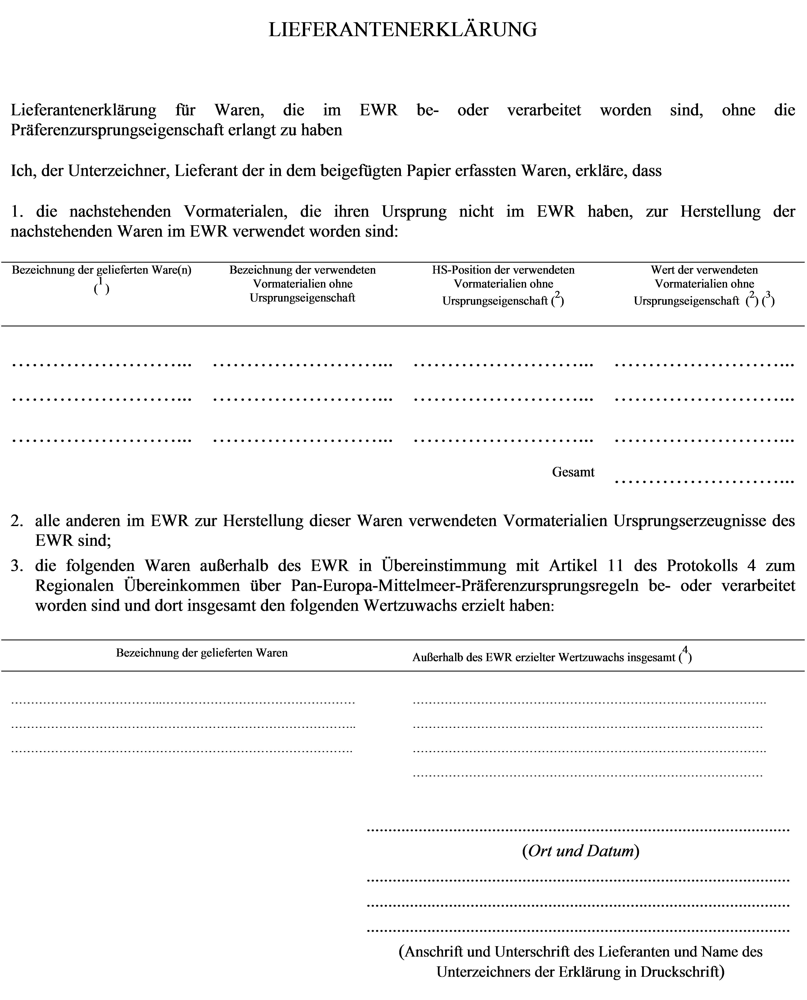
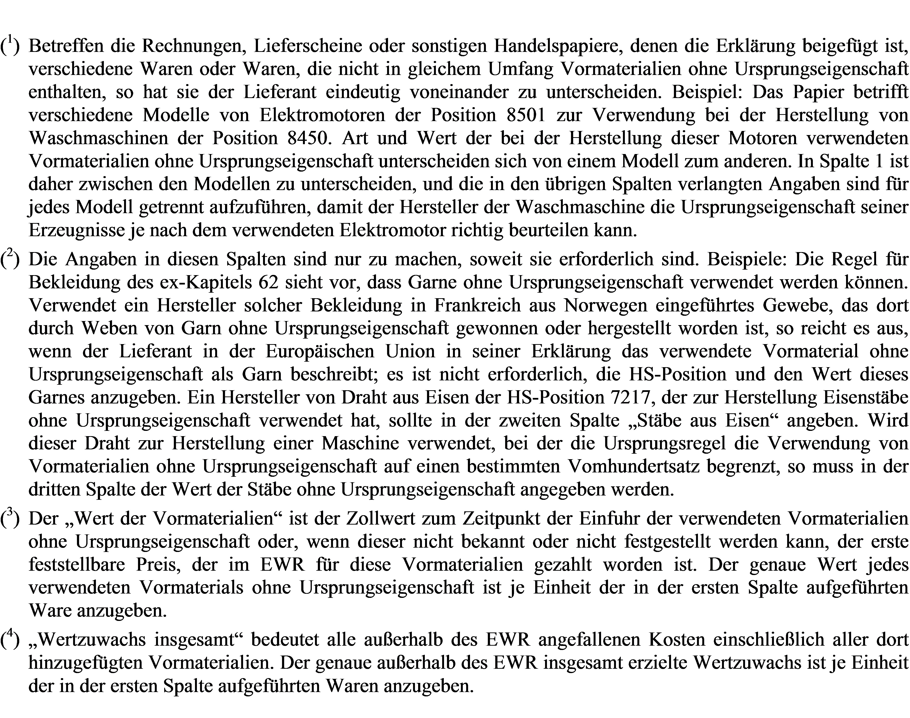
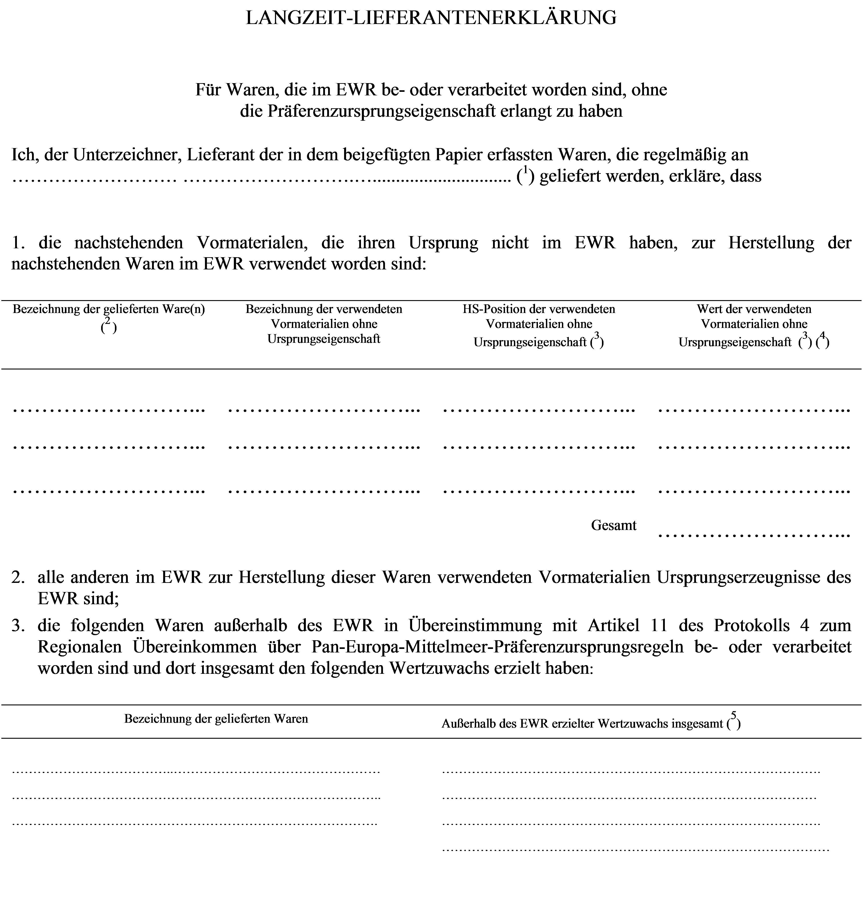
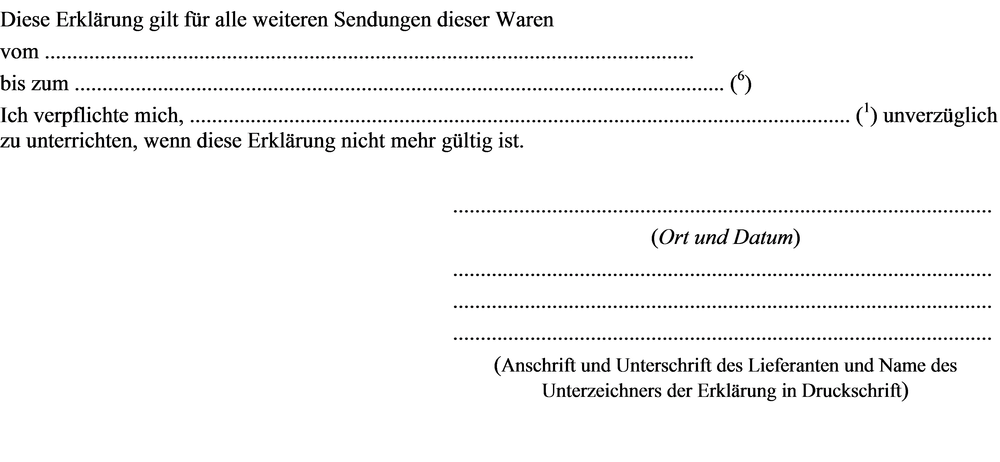

Kundmachung vom 19. April 2016 der Beschlüsse Nr. 42/2015, 43/2015, 50/2015 bis 54/2015, 56/2015 bis 61/2015, 63/2015, 66/2015 bis 68/2015, 71/2015 und 73/2015 des Gemeinsamen EWR-Ausschusses Beschluss des Gemeinsamen EWR-Ausschusses: 20. März 2015 Inkrafttreten für das Fürstentum Liechtenstein: 21. März 2015 Aufgrund von Art. 3 Bst. k des Kundmachungsgesetzes vom 17. April 1985, LGBl. 1985 Nr. 41, in der Fassung des Gesetzes vom 22. März 1995, LGBl. 1995 Nr. 101, macht die Regierung in den Anhängen 1 bis 19 die Beschlüsse Nr. 42/2015, 43/2015, 50/2015 bis 54/2015, 56/2015 bis 61/2015, 63/2015, 66/2015 bis 68/2015, 71/2015 und 73/2015 des Gemeinsamen EWR-Ausschusses kund. Der vollständige Wortlaut der EWR-Rechtsvorschriften, auf die in den Beschlüssen Nr. 42/2015, 43/2015, 50/2015 bis 54/2015, 56/2015 bis 61/2015, 63/2015 und 66/2015 bis 68/2015 Bezug genommen wird, wird in der EWR-Rechtssammlung kundgemacht. Die EWR-Rechtssammlung steht in der Regierungskanzlei zu Amtsstunden sowie in der Landesbibliothek zur Einsichtnahme zur Verfügung. Fürstliche Regierung: gez. Adrian Hasler Fürstlicher Regierungschef Anhang 1 Beschluss des Gemeinsamen EWR-Ausschusses Nr. 42/2015 vom 20. März 2015 zur Änderung von Anhang II (Technische Vorschriften, Normen, Prüfung und Zertifizierung) des EWR-Abkommens Der Gemeinsame EWR-Ausschuss - gestützt auf das Abkommen über den Europäischen Wirtschaftsraum (im Folgenden "EWR-Abkommen"), insbesondere auf Art. 98, in Erwägung nachstehender Gründe: 1. Die Verordnung (EU) Nr. 1171/2014 der Kommission vom 31. Oktober 2014 zur Änderung und Berichtigung der Anhänge I, III, VI, IX, XI und XVII der Richtlinie 2007/46/EG des Europäischen Parlaments und des Rates zur Schaffung eines Rahmens für die Genehmigung von Kraftfahrzeugen und Kraftfahrzeuganhängern sowie von Systemen, Bauteilen und selbstständigen technischen Einheiten für diese Fahrzeuge ist in das EWR-Abkommen aufzunehmen. 2. Anhang II des EWR-Abkommens sollte daher entsprechend geändert werden - hat folgenden Beschluss erlassen: Art. 1 In Anhang II Kapitel I des EWR-Abkommens wird unter Nummer 45zx (Richtlinie 2007/46/EG des Europäischen Parlaments und des Rates) folgender Gedankenstrich eingefügt: "- 32014 R 1171 : Verordnung (EU) Nr. 1171/2014 der Kommission vom 31. Oktober 2014 ( ABl. L 315 vom 1.11.2014, S. 3 )". Art. 2 Der Wortlaut der Verordnung (EU) Nr. 1171/2014 in isländischer und norwegischer Sprache, der in der EWR-Beilage des Amtsblattes der Europäischen Union veröffentlicht wird, ist verbindlich. Art. 3 Dieser Beschluss tritt am 21. März 2015 in Kraft, sofern alle Mitteilungen nach Art. 103 Abs. 1 des EWR-Abkommens vorliegen . Art. 4 Dieser Beschluss wird im EWR-Abschnitt und in der EWR-Beilage des Amtsblattes der Europäischen Union veröffentlicht. Geschehen zu Brüssel am 20. März 2015. (Es folgen die Unterschriften) Anhang 2 Beschluss des Gemeinsamen EWR-Ausschusses Nr. 43/2015 vom 20. März 2015 zur Änderung von Anhang II (Technische Vorschriften, Normen, Prüfung und Zertifizierung) des EWR-Abkommens Der Gemeinsame EWR-Ausschuss - gestützt auf das Abkommen über den Europäischen Wirtschaftsraum (im Folgenden "EWR-Abkommen"), insbesondere auf Art. 98, in Erwägung nachstehender Gründe: 1. Die Richtlinie 2014/33/EU des Europäischen Parlaments und des Rates vom 26. Februar 2014 zur Angleichung der Rechtsvorschriften der Mitgliedstaaten über Aufzüge und Sicherheitsbauteile für Aufzüge ist in das EWR-Abkommen aufzunehmen. 2. Mit der Richtlinie 2014/33/EU des Europäischen Parlaments und des Rates wird mit Wirkung vom 20. April 2016 die Richtlinie 95/16/EG des Europäischen Parlaments und des Rates aufgehoben, die in das Abkommen aufgenommen wurde und daher mit Wirkung vom 20. April 2016 aus diesem zu streichen ist 3. Anhang II des EWR-Abkommens sollte daher entsprechend geändert werden - hat folgenden Beschluss erlassen: Art. 1 Anhang II Kapitel III des EWR-Abkommens wird wie folgt geändert: 1. Nach Nummer 5 (Richtlinie 95/16/EG des Europäischen Parlaments und des Rates) wird folgende Nummer eingefügt: "6. 32014 L 0033 : Richtlinie 2014/33/EU des Europäischen Parlaments und des Rates vom 26. Februar 2014 zur Harmonisierung der Rechtsvorschriften der Mitgliedstaaten über Aufzüge und Sicherheitsbauteile für Aufzüge ( ABl. L 96 vom 29.3.2014, S. 251 )". 2. Der Text von Nummer 5 (Richtlinie 95/16/EG des Europäischen Parlaments und des Rates) wird mit Wirkung zum 20. April 2016 gestrichen. 3. Unter der Rubrik "RECHTSAKTE, DIE DIE VERTRAGSPARTEIEN ZUR KENNTNIS NEHMEN", wird die bisherige Nummer 6 (Empfehlung 95/216/EG der Kommission) die Nummer 1. Art. 2 Der Wortlaut der Richtlinie 2014/33/EU in isländischer und norwegischer Sprache, der in der EWR-Beilage des Amtsblattes der Europäischen Union veröffentlicht wird, ist verbindlich. Art. 3 Dieser Beschluss tritt am 21. März 2015 in Kraft, sofern alle Mitteilungen nach Art. 103 Abs. 1 des EWR-Abkommens vorliegen . Art. 4 Dieser Beschluss wird im EWR-Abschnitt und in der EWR-Beilage des Amtsblattes der Europäischen Union veröffentlicht. Geschehen zu Brüssel am 20. März 2015. (Es folgen die Unterschriften) Anhang 3 Beschluss des Gemeinsamen EWR-Ausschusses Nr. 50/2015 vom 20. März 2015 zur Änderung von Anhang II (Technische Vorschriften, Normen, Prüfung und Zertifizierung) des EWR-Abkommens Der Gemeinsame EWR-Ausschuss - gestützt auf das Abkommen über den Europäischen Wirtschaftsraum (im Folgenden "EWR-Abkommen"), insbesondere auf Art. 98, in Erwägung nachstehender Gründe: 1. Die Durchführungsverordnung (EU) Nr. 967/2014 der Kommission vom 12. September 2014 zur Änderung der Verordnung (EU) Nr. 37/2010 hinsichtlich des Stoffs "Lufenuron" ist in das EWR-Abkommen aufzunehmen. 2. Anhang II des EWR-Abkommens sollte daher entsprechend geändert werden - hat folgenden Beschluss erlassen: Art. 1 In Anhang II Kapitel XIII des EWR-Abkommens wird unter Nummer 13 (Verordnung (EU) Nr. 37/2010 der Kommission) folgender Gedankenstrich angefügt: "- 32014 R 0967 : Durchführungsverordnung (EU) Nr. 967/2014 der Kommission vom 12. September 2014 ( ABl. L 272 vom 13.9.2014, S. 3 )". Art. 2 Der Wortlaut der Durchführungsverordnung (EU) Nr. 967/2014 in isländischer und norwegischer Sprache, der in der EWR-Beilage des Amtsblattes der Europäischen Union veröffentlicht wird, ist verbindlich. Art. 3 Dieser Beschluss tritt am 21. März 2015 in Kraft, sofern alle Mitteilungen nach Art. 103 Abs. 1 des EWR-Abkommens vorliegen . Art. 4 Dieser Beschluss wird im EWR-Abschnitt und in der EWR-Beilage des Amtsblattes der Europäischen Union veröffentlicht. Geschehen zu Brüssel am 20. März 2015. (Es folgen die Unterschriften) Anhang 4 Beschluss des Gemeinsamen EWR-Ausschusses Nr. 51/2015 vom 20. März 2015 zur Änderung von Anhang II (Technische Vorschriften, Normen, Prüfung und Zertifizierung) des EWR-Abkommens Der Gemeinsame EWR-Ausschuss - gestützt auf das Abkommen über den Europäischen Wirtschaftsraum (im Folgenden "EWR-Abkommen"), insbesondere auf Art. 98, in Erwägung nachstehender Gründe: 1. Die Verordnung (EU) Nr. 1257/2014 der Kommission vom 24. November 2014 zur Änderung der Verordnung (EG) Nr. 2003/2003 des Europäischen Parlaments und des Rates über Düngemittel zwecks Anpassung ihrer Anhänge I und IV an den technischen Fortschritt ist in das EWR-Abkommen aufzunehmen. 2. Anhang II des EWR-Abkommens sollte daher entsprechend geändert werden - hat folgenden Beschluss erlassen: Art. 1 In Anhang II Kapitel XIV des EWR-Abkommens wird unter Nummer 1 (Verordnung (EG) Nr. 2003/2003 des Europäischen Parlaments und des Rates) folgender Gedankenstrich angefügt: "- 32014 R 1257 : Verordnung (EU) Nr. 1257/2014 der Kommission vom 24. November 2014 ( ABl. L 337 vom 25.11.2014, S. 53 )". Art. 2 Der Wortlaut der Verordnung (EU) Nr. 1257/2014 in isländischer und norwegischer Sprache, der in der EWR-Beilage des Amtsblattes der Europäischen Union veröffentlicht wird, ist verbindlich. Art. 3 Dieser Beschluss tritt am 21. März 2015 in Kraft, sofern alle Mitteilungen nach Art. 103 Abs. 1 des EWR-Abkommens vorliegen . Art. 4 Dieser Beschluss wird im EWR-Abschnitt und in der EWR-Beilage des Amtsblattes der Europäischen Union veröffentlicht. Geschehen zu Brüssel am 20. März 2015. (Es folgen die Unterschriften) Anhang 5 Beschluss des Gemeinsamen EWR-Ausschusses Nr. 52/2015 vom 20. März 2015 zur Änderung von Anhang II (Technische Vorschriften, Normen, Prüfung und Zertifizierung) des EWR-Abkommens Der Gemeinsame EWR-Ausschuss - gestützt auf das Abkommen über den Europäischen Wirtschaftsraum (im Folgenden "EWR-Abkommen"), insbesondere auf Art. 98, in Erwägung nachstehender Gründe: 1. Die Delegierte Verordnung (EU) Nr. 1062/2014 der Kommission vom 4. August 2014 über das Arbeitsprogramm zur systematischen Prüfung aller in Biozidprodukten enthaltenen alten Wirkstoffe gemäss der Verordnung (EU) Nr. 528/2012 des Europäischen Parlaments und des Rates ist in das EWR-Abkommen aufzunehmen. 2. Die Durchführungsverordnung (EU) Nr. 1090/2014 der Kommission vom 16. Oktober 2014 zur Genehmigung von Permethrin als alten Wirkstoff zur Verwendung in Biozidprodukten der Produktarten 8 und 18 ist in das EWR-Abkommen aufzunehmen. 3. Die Durchführungsverordnung (EU) Nr. 1091/2014 der Kommission vom 16. Oktober 2014 zur Genehmigung von Tralopyril als neuen Wirkstoff zur Verwendung in Biozidprodukten der Produktart 21 ist in das EWR-Abkommen aufzunehmen. 4. Mit der Delegierten Verordnung (EU) Nr. 1062/2014 wird die Verordnung (EG) Nr. 1451/2007 der Kommission aufgehoben, die in das Abkommen aufgenommen wurde und daher aus diesem zu streichen ist. 5. Anhang II des EWR-Abkommens sollte daher entsprechend geändert werden - hat folgenden Beschluss erlassen: Art. 1 Anhang II Kapitel XV des EWR-Abkommens wird wie folgt geändert: 1. Nach Nummer 12nz (Durchführungsverordnung (EU) Nr. 438/2014 der Kommission) werden folgende Nummern eingefügt: "12nza. 32014 R 1062 : Delegierte Verordnung (EU) Nr. 1062/2014 der Kommission vom 4. August 2014 über das Arbeitsprogramm zur systematischen Prüfung aller in Biozidprodukten enthaltenen alten Wirkstoffe gemäss der Verordnung (EU) Nr. 528/2012 des Europäischen Parlaments und des Rates ( ABl. L 294 vom 10.10.2014, S. 1 ). 12nzb. 32014 R 1090 : Durchführungsverordnung (EU) Nr. 1090/2014 der Kommission vom 16. Oktober 2014 zur Genehmigung von Permethrin als alten Wirkstoff zur Verwendung in Biozidprodukten der Produktarten 8 und 18 ( ABl. L 299 vom 17.10.2014, S. 10 ) 12nzc. 32014 R 1091 : Durchführungsverordnung (EU) Nr. 1091/2014 der Kommission vom 16. Oktober 2014 zur Zulassung von Tralopyril als neuen Wirkstoff zur Verwendung in Biozidprodukten der Produktart 21 ( ABl. L 299 vom 17.10.2014, S. 15 )". 2. Der Text von Nummer 12ze (Verordnung (EG) Nr. 1451/2007 der Kommission) wird gestrichen. Art. 2 Der Wortlaut der Delegierten Verordnung (EU) Nr. 1062/2014 und der Durchführungsverordnungen (EU) Nr. 1090/2014 und (EU) Nr. 1091/2014 in isländischer und norwegischer Sprache, der in der EWR-Beilage des Amtsblattes der Europäischen Union veröffentlicht wird, ist verbindlich. Art. 3 Dieser Beschluss tritt am 21. März 2015 in Kraft, sofern alle Mitteilungen nach Art. 103 Abs. 1 des EWR-Abkommens vorliegen . Art. 4 Dieser Beschluss wird im EWR-Abschnitt und in der EWR-Beilage des Amtsblattes der Europäischen Union veröffentlicht. Geschehen zu Brüssel am 20. März 2015. (Es folgen die Unterschriften) Anhang 6 Beschluss des Gemeinsamen EWR-Ausschusses Nr. 53/2015 vom 20. März 2015 zur Änderung von Anhang II (Technische Vorschriften, Normen, Prüfung und Zertifizierung) des EWR-Abkommens Der Gemeinsame EWR-Ausschuss - gestützt auf das Abkommen über den Europäischen Wirtschaftsraum (im Folgenden "EWR-Abkommen"), insbesondere auf Art. 98, in Erwägung nachstehender Gründe: 1. Die Verordnung (EU) Nr. 1297/2014 der Kommission vom 5. Dezember 2014 zur Änderung der Verordnung (EG) Nr. 1272/2008 des Europäischen Parlaments und des Rates über die Einstufung, Kennzeichnung und Verpackung von Stoffen und Gemischen zwecks Anpassung an den technischen und wissenschaftlichen Fortschritt ist in das EWR-Abkommen aufzunehmen. 2. Anhang II des EWR-Abkommens sollte daher entsprechend geändert werden - hat folgenden Beschluss erlassen: Art. 1 In Anhang II Kapitel XV des EWR-Abkommens wird unter Nummer 12zze (Verordnung (EG) Nr. 1272/2008 des Europäischen Parlaments und des Rates) folgender Gedankenstrich angefügt: "- 32014 R 1297 : Verordnung (EU) Nr. 1297/2014 der Kommission vom 5. Dezember 2014 ( ABl. L 350 vom 6.12.2014, S. 1 )". Art. 2 Der Wortlaut der Verordnung (EU) Nr. 1297/2014 in isländischer und norwegischer Sprache, der in der EWR-Beilage des Amtsblattes der Europäischen Union veröffentlicht wird, ist verbindlich. Art. 3 Dieser Beschluss tritt am 21. März 2015 in Kraft, sofern alle Mitteilungen nach Art. 103 Abs. 1 des EWR-Abkommens vorliegen . Art. 4 Dieser Beschluss wird im EWR-Abschnitt und in der EWR-Beilage des Amtsblattes der Europäischen Union veröffentlicht. Geschehen zu Brüssel am 20. März 2015. (Es folgen die Unterschriften) Anhang 7 Beschluss des Gemeinsamen EWR-Ausschusses Nr. 54/2015 vom 20. März 2015 zur Änderung von Anhang II (Technische Vorschriften, Normen, Prüfung und Zertifizierung) des EWR-Abkommens Der Gemeinsame EWR-Ausschuss - gestützt auf das Abkommen über den Europäischen Wirtschaftsraum (im Folgenden "EWR-Abkommen"), insbesondere auf Art. 98, in Erwägung nachstehender Gründe: 1. Der Durchführungsbeschluss 2014/756/EU der Kommission vom 29. Oktober 2014 über die von Deutschland gemäss der Richtlinie 98/8/EG des Europäischen Parlaments und des Rates gemeldeten Beschränkungen der Zulassungen von IPBC- und propiconazolhaltigen Biozidprodukten ist in das EWR-Abkommen aufzunehmen. 2. Der Durchführungsbeschluss 2014/757/EU der Kommission vom 29. Oktober 2014 über die von Deutschland gemäss der Richtlinie 98/8/EG des Europäischen Parlaments und des Rates mitgeteilten Beschränkungen der Zulassung eines IPBC-haltigen Biozidprodukts ist in das EWR-Abkommen aufzunehmen. 3. Der Durchführungsbeschluss 2014/758/EU der Kommission vom 29. Oktober 2014 über die Ablehnung der von Deutschland mitgeteilten Zurückweisung der Zulassung eines Biozidprodukts gemäss der Richtlinie 98/8/EG des Europäischen Parlaments und des Rates ist in das EWR-Abkommen aufzunehmen. 4. Anhang II des EWR-Abkommens sollte daher entsprechend geändert werden - hat folgenden Beschluss erlassen: Art. 1 In Anhang II Kapitel XV des EWR-Abkommens werden nach Nummer 13zzzzl (Durchführungsbeschluss 2014/289/EU der Kommission) folgende Nummern eingefügt: "14. 32014 D 0756 : Durchführungsbeschluss 2014/756/EU der Kommission vom 29. Oktober 2014 über die von Deutschland gemäss der Richtlinie 98/8/EG des Europäischen Parlaments und des Rates gemeldeten Beschränkungen der Zulassungen von IPBC- und propiconazolhaltigen Biozidprodukten ( ABl. L 311 vom 31.10.2014, S. 69 ) 15. 32014 D 0757 : Durchführungsbeschluss 2014/757/EU der Kommission vom 29. Oktober 2014 über die von Deutschland gemäss der Richtlinie 98/8/EG des Europäischen Parlaments und des Rates mitgeteilten Beschränkungen der Zulassung eines IPBC-haltigen Biozidprodukts ( ABl. L 311 vom 31.10.2014, S. 72 ) 16. 32014 D 0758 : Durchführungsbeschluss 2014/758/EU der Kommission vom 29. Oktober 2014 über die Ablehnung der von Deutschland mitgeteilten Zurückweisung der Zulassung eines Biozidprodukts gemäss der Richtlinie 98/8/EG des Europäischen Parlaments und des Rates ( ABl. L 311 vom 31.10.2014, S. 75 )". Art. 2 Der Wortlaut der Durchführungsbeschlüsse 2014/756/EU, 2014/757/EU und 2014/758/EU in isländischer und norwegischer Sprache, der in der EWR-Beilage des Amtsblattes der Europäischen Union veröffentlicht wird, ist verbindlich. Art. 3 Dieser Beschluss tritt am 21. März 2015 in Kraft, sofern alle Mitteilungen nach Art. 103 Abs. 1 des EWR-Abkommens vorliegen . Art. 4 Dieser Beschluss wird im EWR-Abschnitt und in der EWR-Beilage des Amtsblattes der Europäischen Union veröffentlicht. Geschehen zu Brüssel am 20. März 2015. (Es folgen die Unterschriften) Anhang 8 Beschluss des Gemeinsamen EWR-Ausschusses Nr. 56/2015 vom 20. März 2015 zur Änderung von Anhang II (Technische Vorschriften, Normen, Prüfung und Zertifizierung) des EWR-Abkommens Der Gemeinsame EWR-Ausschuss - gestützt auf das Abkommen über den Europäischen Wirtschaftsraum (im Folgenden "EWR-Abkommen"), insbesondere auf Art. 98, in Erwägung nachstehender Gründe: 1. Die Delegierte Verordnung (EU) Nr. 1291/2014 der Kommission vom 16. Juli 2014 über die Bedingungen für eine ohne weitere Prüfungen vorgenommene Einstufung von Holzwerkstoffen gemäss der Norm EN 13986 sowie von Innen- und Aussenbekleidungen aus Massivholz gemäss der Norm EN 14915 im Hinblick auf ihr Brandschutzvermögen, wenn sie für Wand- und Deckenbekleidungen verwendet werden ist in das EWR-Abkommen aufzunehmen. 2. Die Delegierte Verordnung (EU) Nr. 1292/2014 der Kommission vom 17. Juli 2014 über die Bedingungen für die ohne Prüfung erfolgende Klassifizierung bestimmter unter die Norm EN 14342 fallender unbeschichteter Holzfussböden im Hinblick auf deren Brandverhalten ist in das EWR-Abkommen aufzunehmen. 3. Die Delegierte Verordnung (EU) Nr. 1293/2014 der Kommission vom 17. Juli 2014 über die Bedingungen für die ohne Prüfung erfolgende Klassifizierung von Putzträgern und Putzprofilen aus Metall für Innenputze, für die die harmonisierte Norm EN 13658-1 gilt, von Putzträgern und Putzprofilen aus Metall für Aussenputze, für die die harmonisierte Norm EN 13658-2 gilt, und von Hilfs- und Zusatzprofilen aus Metall, für die die harmonisierte Norm EN 14353 gilt, in Bezug auf ihr Brandverhalten ist in das EWR-Abkommen aufzunehmen. 4. Anhang II des EWR-Abkommens sollte daher entsprechend geändert werden - hat folgenden Beschluss erlassen: Art. 1 In Anhang II Kapitel XXI des EWR-Abkommens werden nach Nummer 2q (Durchführungsverordnung (EU) Nr. 1062/2013 der Kommission) folgende Nummern eingefügt: "2r. 32014 R 1291 : Delegierte Verordnung (EU) Nr. 1291/2014 der Kommission vom 16. Juli 2014 über die Bedingungen für eine ohne weitere Prüfungen vorgenommene Einstufung von Holzwerkstoffen gemäss der Norm EN 13986 sowie von Innen- und Aussenbekleidungen aus Massivholz gemäss der Norm EN 14915 im Hinblick auf ihr Brandschutzvermögen, wenn sie für Wand- und Deckenbekleidungen verwendet werden ( ABl. L 349 vom 5.12.2014, S. 25 ) 2s. 32014 R 1292 : Delegierte Verordnung (EU) Nr. 1292/2014 der Kommission vom 17. Juli 2014 über die Bedingungen für die ohne Prüfung erfolgende Klassifizierung bestimmter unter die Norm EN 14342 fallender unbeschichteter Holzfussböden im Hinblick auf deren Brandverhalten ( ABl. L 349 vom 5.12.2014, S. 27 ) 2t. 32014 R 1293 : Delegierte Verordnung (EU) Nr. 1293/2014 der Kommission vom 17. Juli 2014 über die Bedingungen für die ohne Prüfung erfolgende Klassifizierung von Putzträgern und Putzprofilen aus Metall für Innenputze, für die die harmonisierte Norm EN 13658-1 gilt, von Putzträgern und Putzprofilen aus Metall für Aussenputze, für die die harmonisierte Norm EN 13658-2 gilt, und von Hilfs- und Zusatzprofilen aus Metall, für die die harmonisierte Norm EN 14353 gilt, in Bezug auf ihr Brandverhalten ( ABl. L 349 vom 5.12.2014, S. 29 )". Art. 2 Der Wortlaut der Delegierten Verordnungen (EU) Nr. 1291/2014, (EU) Nr. 1292/2014 und (EU) Nr. 1293/2014 in isländischer und norwegischer Sprache, der in der EWR-Beilage des Amtsblattes der Europäischen Union veröffentlicht wird, ist verbindlich. Art. 3 Dieser Beschluss tritt am 21. März 2015 in Kraft, sofern alle Mitteilungen nach Art. 103 Abs. 1 des EWR-Abkommens vorliegen . Art. 4 Dieser Beschluss wird im EWR-Abschnitt und in der EWR-Beilage des Amtsblattes der Europäischen Union veröffentlicht. Geschehen zu Brüssel am 20. März 2015. (Es folgen die Unterschriften) Anhang 9 Beschluss des Gemeinsamen EWR-Ausschusses Nr. 57/2015 vom 20. März 2015 zur Änderung von Anhang XI (Elektronische Kommunikation, audiovisuelle Dienste und Informationsgesellschaft) des EWR-Abkommens Der Gemeinsame EWR-Ausschuss - gestützt auf das Abkommen über den Europäischen Wirtschaftsraum (im Folgenden "EWR-Abkommen"), insbesondere auf Art. 98, in Erwägung nachstehender Gründe: 1. Die Durchführungsverordnung (EU) Nr. 1203/2012 der Kommission vom 14. Dezember 2012 über den separaten Verkauf regulierter Roamingdienste auf der Endkundenebene in der Union ist in das EWR-Abkommen aufzunehmen. 2. Anhang XI des EWR-Abkommens sollte daher entsprechend geändert werden - hat folgenden Beschluss erlassen: Art. 1 In Anhang XI des EWR-Abkommens wird nach Nummer 5cu (Verordnung (EU) Nr. 531/2012 des Europäischen Parlaments und des Rates) folgende Nummer eingefügt: "5cua. 32012 R 1203 : Durchführungsverordnung (EU) Nr. 1203/2012 der Kommission vom 14. Dezember 2012 über den separaten Verkauf regulierter Roamingdienste auf der Endkundenebene in der Union ( ABl. L 347 vom 15.12.2012, S. 1 )". Art. 2 Der Wortlaut der Verordnung (EU) Nr. 1203/2012 in isländischer und norwegischer Sprache, der in der EWR-Beilage des Amtsblattes der Europäischen Union veröffentlicht wird, ist verbindlich. Art. 3 Dieser Beschluss tritt am 21. März 2015 in Kraft, sofern alle Mitteilungen nach Art. 103 Abs. 1 des EWR-Abkommens vorliegen . Art. 4 Dieser Beschluss wird im EWR-Abschnitt und in der EWR-Beilage des Amtsblattes der Europäischen Union veröffentlicht. Geschehen zu Brüssel am 20. März 2015. (Es folgen die Unterschriften) Anhang 10 Beschluss des Gemeinsamen EWR-Ausschusses Nr. 58/2015 vom 20. März 2015 zur Änderung von Anhang XI (Elektronische Kommunikation, audiovisuelle Dienste und Informationsgesellschaft) des EWR-Abkommens Der Gemeinsame EWR-Ausschuss - gestützt auf das Abkommen über den Europäischen Wirtschaftsraum (im Folgenden "EWR-Abkommen"), insbesondere auf Art. 98, in Erwägung nachstehender Gründe: 1. Der Durchführungsbeschluss 2014/641/EU der Kommission vom 1. September 2014 über harmonisierte technische Bedingungen für die Nutzung von Funkfrequenzen durch drahtlose PMSE-Audioausrüstungen in der Union ist in das EWR-Abkommen aufzunehmen. 2. Anhang XI des EWR-Abkommens sollte daher entsprechend geändert werden - hat folgenden Beschluss erlassen: Art. 1 In Anhang XI des EWR-Abkommens wird nach Nummer 5czi (Durchführungsbeschluss 2012/688/EU der Kommission) folgende Nummer eingefügt: "5czj. 32014 D 0641 : Durchführungsbeschluss 2014/641/EU der Kommission vom 1. September 2014 über harmonisierte technische Bedingungen für die Nutzung von Funkfrequenzen durch drahtlose PMSE-Audioausrüstungen in der Union ( ABl. L 263 vom 3.9.2014, S. 29 )". Art. 2 Der Wortlaut des Durchführungsbeschlusses 2014/641/EU in isländischer und norwegischer Sprache, der in der EWR-Beilage des Amtsblattes der Europäischen Union veröffentlicht wird, ist verbindlich. Art. 3 Dieser Beschluss tritt am 21. März 2015 in Kraft, sofern alle Mitteilungen nach Art. 103 Abs. 1 des EWR-Abkommens vorliegen . Art. 4 Dieser Beschluss wird im EWR-Abschnitt und in der EWR-Beilage des Amtsblattes der Europäischen Union veröffentlicht. Geschehen zu Brüssel am 20. März 2015. (Es folgen die Unterschriften) Anhang 11 Beschluss des Gemeinsamen EWR-Ausschusses Nr. 59/2015 vom 20. März 2015 zur Änderung von Anhang XI (Elektronische Kommunikation, audiovisuelle Dienste und Informationsgesellschaft) des EWR-Abkommens Der Gemeinsame EWR-Ausschuss - gestützt auf das Abkommen über den Europäischen Wirtschaftsraum (im Folgenden "EWR-Abkommen"), insbesondere auf Art. 98, in Erwägung nachstehender Gründe: 1. Die Empfehlung 2013/466/EU der Kommission vom 11. September 2013 über einheitliche Nichtdiskriminierungsverpflichtungen und Kostenrechnungsmethoden zur Förderung des Wettbewerbs und zur Verbesserung des Umfelds für Breitbandinvestitionen ist in das EWR-Abkommen aufzunehmen. 2. Anhang XI des EWR-Abkommens sollte daher entsprechend geändert werden - hat folgenden Beschluss erlassen: Art. 1 In Anhang XI des EWR-Abkommens wird unter der Rubrik "RECHTSAKTE, DIE DIE VERTRAGSPARTEIEN ZUR KENNTNIS NEHMEN" nach Nummer 26m (Empfehlung 2010/167/EU der Kommission) folgende Nummer eingefügt: "26n. 32013 H 0466 : Empfehlung 2013/466/EU der Kommission vom 11. September 2013 über einheitliche Nichtdiskriminierungsverpflichtungen und Kostenrechnungsmethoden zur Förderung des Wettbewerbs und zur Verbesserung des Umfelds für Breitbandinvestitionen ( ABl. L 251 vom 21.9.2013, S. 13 )". Art. 2 Der Wortlaut der Empfehlung 2013/466/EU in isländischer und norwegischer Sprache, der in der EWR-Beilage des Amtsblattes der Europäischen Union veröffentlicht wird, ist verbindlich. Art. 3 Dieser Beschluss tritt am 21. März 2015 in Kraft, sofern alle Mitteilungen nach Art. 103 Abs. 1 des EWR-Abkommens vorliegen . Art. 4 Dieser Beschluss wird im EWR-Abschnitt und in der EWR-Beilage des Amtsblattes der Europäischen Union veröffentlicht. Geschehen zu Brüssel am 20. März 2015. (Es folgen die Unterschriften) Anhang 12 Beschluss des Gemeinsamen EWR-Ausschusses Nr. 60/2015 vom 20. März 2015 zur Änderung von Anhang XIII (Verkehr) des EWR-Abkommens Der Gemeinsame EWR-Ausschuss - gestützt auf das Abkommen über den Europäischen Wirtschaftsraum (im Folgenden "EWR-Abkommen"), insbesondere auf Art. 98, in Erwägung nachstehender Gründe: 1. Die Richtlinie 2014/103/EU der Kommission vom 21. November 2014 zur dritten Anpassung der Anhänge der Richtlinie 2008/68/EG des Europäischen Parlaments und des Rates über die Beförderung gefährlicher Güter im Binnenland an den wissenschaftlichen und technischen Fortschritt ist in das EWR-Abkommen aufzunehmen. 2. Anhang XIII des EWR-Abkommens sollte daher entsprechend geändert werden - hat folgenden Beschluss erlassen: Art. 1 In Anhang XIII des EWR-Abkommens wird unter Nummer 13c (Richtlinie 2008/68/EG des Europäischen Parlaments und des Rates) folgender Gedankenstrich angefügt: "- 32014 L 0103 : Richtlinie 2014/103/EU der Kommission vom 21. November 2014 ( ABl. L 335 vom 22.11.2014, S. 15 )". Art. 2 Der Wortlaut der Richtlinie 2014/103/EU in isländischer und norwegischer Sprache, der in der EWR-Beilage des Amtsblattes der Europäischen Union veröffentlicht wird, ist verbindlich. Art. 3 Dieser Beschluss tritt am 21. März 2015 in Kraft, sofern alle Mitteilungen nach Art. 103 Abs. 1 des EWR-Abkommens vorliegen . Art. 4 Dieser Beschluss wird im EWR-Abschnitt und in der EWR-Beilage des Amtsblattes der Europäischen Union veröffentlicht. Geschehen zu Brüssel am 20. März 2015. (Es folgen die Unterschriften) Anhang 13 Beschluss des Gemeinsamen EWR-Ausschusses Nr. 61/2015 vom 20. März 2015 zur Änderung von Anhang XIII (Verkehr) des EWR-Abkommens Der Gemeinsame EWR-Ausschuss - gestützt auf das Abkommen über den Europäischen Wirtschaftsraum (im Folgenden "EWR-Abkommen"), insbesondere auf Art. 98, in Erwägung nachstehender Gründe: 1. Die Richtlinie 2014/100/EU der Kommission vom 28. Oktober 2014 zur Änderung der Richtlinie 2002/59/EG des Europäischen Parlaments und des Rates über die Einrichtung eines gemeinschaftlichen Überwachungs- und Informationssystems für den Schiffsverkehr ist in das Abkommen aufzunehmen. 2. Anhang XIII des EWR-Abkommens sollte daher entsprechend geändert werden - hat folgenden Beschluss erlassen: Art. 1 In Anhang XIII des EWR-Abkommens wird unter Nummer 55a (Richtlinie 2002/59/EG des Europäischen Parlaments und des Rates) folgender Gedankenstrich angefügt: "- 32014 L 0100 : Richtlinie 2014/100/EU der Kommission vom 28. Oktober 2014 ( ABl. L 308 vom 29.10.2014, S. 82 )". Art. 2 Der Wortlaut der Richtlinie 2014/100/EU in isländischer und norwegischer Sprache, der in der EWR-Beilage des Amtsblattes der Europäischen Union veröffentlicht wird, ist verbindlich. Art. 3 Dieser Beschluss tritt am 21. März 2015 in Kraft, sofern alle Mitteilungen nach Art. 103 Abs. 1 des EWR-Abkommens vorliegen . Art. 4 Dieser Beschluss wird im EWR-Abschnitt und in der EWR-Beilage des Amtsblattes der Europäischen Union veröffentlicht. Geschehen zu Brüssel am 20. März 2015. (Es folgen die Unterschriften) Anhang 14 Beschluss des Gemeinsamen EWR-Ausschusses Nr. 63/2015 vom 20. März 2015 zur Änderung von Anhang XIII (Verkehr) des EWR-Abkommens Der Gemeinsame EWR-Ausschuss - gestützt auf das Abkommen über den Europäischen Wirtschaftsraum (im Folgenden "EWR-Abkommen"), insbesondere auf Art. 98, in Erwägung nachstehender Gründe: 1. Der Durchführungsbeschluss 2014/935/EU der Kommission vom 17. Dezember 2014 über die Anerkennung Japans gemäss der Richtlinie 2008/106/EG des Europäischen Parlaments und des Rates in Bezug auf die Systeme für die Ausbildung von Seeleuten und die Verfahren der Zeugniserteilung ist in das EWR-Abkommen aufzunehmen. 2. Anhang XIII des EWR-Abkommens sollte daher entsprechend geändert werden - hat folgenden Beschluss erlassen: Art. 1 In Anhang XIII des EWR-Abkommens wird nach Nummer 56jr (Durchführungsbeschluss 2013/794/EU der Kommission) folgende Nummer eingefügt: "56js. 32014 D 0935 : Durchführungsbeschluss 2014/935/EU der Kommission vom 17. Dezember 2014 über die Anerkennung Japans gemäss der Richtlinie 2008/106/EG des Europäischen Parlaments und des Rates in Bezug auf die Systeme für die Ausbildung von Seeleuten und die Verfahren der Zeugniserteilung ( ABl. L 365 vom 19.12.2014, S. 158 )". Art. 2 Der Wortlaut des Durchführungsbeschlusses 2014/935/EU in isländischer und norwegischer Sprache, der in der EWR-Beilage des Amtsblattes der Europäischen Union veröffentlicht wird, ist verbindlich. Art. 3 Dieser Beschluss tritt am 21. März 2015 in Kraft, sofern alle Mitteilungen nach Art. 103 Abs. 1 des EWR-Abkommens vorliegen . Art. 4 Dieser Beschluss wird im EWR-Abschnitt und in der EWR-Beilage des Amtsblattes der Europäischen Union veröffentlicht. Geschehen zu Brüssel am 20. März 2015. (Es folgen die Unterschriften) Anhang 15 Beschluss des Gemeinsamen EWR-Ausschusses Nr. 66/2015 vom 20. März 2015 zur Änderung von Anhang XX (Umweltschutz) des EWR-Abkommens Der Gemeinsame EWR-Ausschuss - gestützt auf das Abkommen über den Europäischen Wirtschaftsraum (im Folgenden "EWR-Abkommen"), insbesondere auf Art. 98, in Erwägung nachstehender Gründe: 1. Die Richtlinie 2014/101/EU der Kommission vom 30. Oktober 2014 zur Änderung der Richtlinie 2000/60/EG des Europäischen Parlaments und des Rates zur Schaffung eines Ordnungsrahmens für Massnahmen der Gemeinschaft im Bereich der Wasserpolitik ist in das EWR-Abkommen aufzunehmen. 2. Anhang XX des EWR-Abkommens sollte daher entsprechend geändert werden - hat folgenden Beschluss erlassen: Art. 1 In Anhang XX des EWR-Abkommens wird unter Nummer 13ca (Richtlinie 2000/60/EG des Europäischen Parlaments und des Rates) folgender Gedankenstrich angefügt: "- 32014 L 0101 : Richtlinie 2014/101/EU der Kommission vom 30. Oktober 2014 ( ABl. L 311 vom 31.10.2014, S. 32 )". Art. 2 Der Wortlaut der Richtlinie 2014/101/EU in isländischer und norwegischer Sprache, der in der EWR-Beilage des Amtsblattes der Europäischen Union veröffentlicht wird, ist verbindlich. Art. 3 Dieser Beschluss tritt am 21. März 2015 in Kraft, sofern alle Mitteilungen nach Art. 103 Abs. 1 des EWR-Abkommens vorliegen . Art. 4 Dieser Beschluss wird im EWR-Abschnitt und in der EWR-Beilage des Amtsblattes der Europäischen Union veröffentlicht. Geschehen zu Brüssel am 20. März 2015. (Es folgen die Unterschriften) Anhang 16 Beschluss des Gemeinsamen EWR-Ausschusses Nr. 67/2015 vom 20. März 2015 zur Änderung von Anhang XX (Umweltschutz) des EWR-Abkommens Der Gemeinsame EWR-Ausschuss - gestützt auf das Abkommen über den Europäischen Wirtschaftsraum (im Folgenden "EWR-Abkommen"), insbesondere auf Art. 98, in Erwägung nachstehender Gründe: 1. Die Richtlinie 2014/80/EU der Kommission vom 20. Juni 2014 zur Änderung von Anhang II der Richtlinie 2006/118/EG des Europäischen Parlaments und des Rates zum Schutz des Grundwassers vor Verschmutzung und Verschlechterung ist in das EWR-Abkommen aufzunehmen. 2. Anhang XX des EWR-Abkommens sollte daher entsprechend geändert werden - hat folgenden Beschluss erlassen: Art. 1 In Anhang XX des EWR-Abkommens wird unter Nummer 13caa (Richtlinie 2006/118/EG des Europäischen Parlaments und des Rates) folgender Gedankenstrich angefügt: ", geändert durch: - 32014 L 0080 : Richtlinie 2014/80/EU der Kommission vom 20. Juni 2014 ( ABl. L 182 vom 21.6.2014, S. 52 )". Art. 2 Der Wortlaut der Richtlinie 2014/80/EU in isländischer und norwegischer Sprache, der in der EWR-Beilage des Amtsblattes der Europäischen Union veröffentlicht wird, ist verbindlich. Art. 3 Dieser Beschluss tritt am 21. März 2015 in Kraft, sofern alle Mitteilungen nach Art. 103 Abs. 1 des EWR-Abkommens vorliegen . Art. 4 Dieser Beschluss wird im EWR-Abschnitt und in der EWR-Beilage des Amtsblattes der Europäischen Union veröffentlicht. Geschehen zu Brüssel am 20. März 2015. (Es folgen die Unterschriften) Anhang 17 Beschluss des Gemeinsamen EWR-Ausschusses Nr. 68/2015 vom 20. März 2015 zur Änderung von Anhang XXI (Statistik) des EWR-Abkommens Der Gemeinsame EWR-Ausschuss - gestützt auf das Abkommen über den Europäischen Wirtschaftsraum (im Folgenden "EWR-Abkommen"), insbesondere auf Art. 98, in Erwägung nachstehender Gründe: 1. Die Verordnung (EU) Nr. 1209/2014 der Kommission vom 29. Oktober 2014 zur Änderung der Verordnung (EG) Nr. 451/2008 des Europäischen Parlaments und des Rates zur Schaffung einer neuen statistischen Güterklassifikation in Verbindung mit den Wirtschaftszweigen (CPA) und zur Aufhebung der Verordnung (EWG) Nr. 3696/93 des Rates ist in das EWR-Abkommen aufzunehmen. 2. Anhang XXI des EWR-Abkommens sollte daher entsprechend geändert werden - hat folgenden Beschluss erlassen: Art. 1 In Anhang XXI des EWR-Abkommens wird unter Nummer 20b (Verordnung (EG) Nr. 451/2008 des Europäischen Parlaments und des Rates) Folgendes angefügt: ", geändert durch: - 32014 R 1209 : Verordnung (EU) Nr. 1209/2014 der Kommission vom 29. Oktober 2014 ( ABl. L 336 vom 22.11.2014, S. 1 )". Art. 2 Der Wortlaut der Verordnung (EU) Nr. 1209/2014 in isländischer und norwegischer Sprache, der in der EWR-Beilage des Amtsblattes der Europäischen Union veröffentlicht wird, ist verbindlich. Art. 3 Dieser Beschluss tritt am 21. März 2015 in Kraft, sofern alle Mitteilungen nach Art. 103 Abs. 1 des EWR-Abkommens vorliegen . Art. 4 Dieser Beschluss wird im EWR-Abschnitt und in der EWR-Beilage des Amtsblattes der Europäischen Union veröffentlicht. Geschehen zu Brüssel am 20. März 2015. (Es folgen die Unterschriften) Anhang 18 Beschluss des Gemeinsamen EWR-Ausschusses Nr. 71/2015 vom 20. März 2015 zur Änderung von Protokoll 4 (Ursprungsregeln) zum EWR-Abkommen Der Gemeinsame EWR-Ausschuss - gestützt auf das Abkommen über den Europäischen Wirtschaftsraum (im Folgenden "EWR-Abkommen"), insbesondere auf Art. 98, in Erwägung nachstehender Gründe: 1. Art. 9 des EWR-Abkommens verweist auf Protokoll 4, das die Ursprungsregeln enthält und eine Ursprungskumulierung zwischen der Union, der Schweiz (einschliesslich Liechtenstein), Island, Norwegen, der Türkei, den Färöer-Inseln und den Teilnehmern des Barcelona-Prozesses vorsieht. 2. Das Regionale Übereinkommen über Pan-Europa-Mittelmeer-Präferenzursprungsregeln (im Folgenden: "Übereinkommen") legt Bestimmungen für den Ursprung von Erzeugnissen fest, die im Rahmen der jeweils zwischen den Vertragsparteien geschlossenen Abkommen gehandelt werden. 3. Die EU, Norwegen und Liechtenstein haben das Übereinkommen am 15. Juni 2011 unterzeichnet, Island hat das Übereinkommen am 30. Juni 2011 unterzeichnet. 4. Die EU, Norwegen, Island und Liechtenstein haben ihre Annahmeurkunden am 26. März 2012 bzw. am 9. November 2011, 12. März 2012 und 28. November 2011 beim Verwahrer des Übereinkommens hinterlegt. Daher trat das Übereinkommen gemäss seinem Art. 10 Abs. 3 für die EU und Island am 1. Mai 2012 und für Norwegen und Liechtenstein am 1. Januar 2012 in Kraft. 5. Durch das Übereinkommen werden auch die Teilnehmer des Stabilisierungs- und Assoziierungsprozesses in die Ursprungskumulierungszone Pan-Europa-Mittelmeer einbezogen. 6. Insoweit der Übergang zum Übereinkommen nicht für alle seine Vertragsparteien in der Ursprungskumulierungszone Pan-Europa-Mittelmeer gleichzeitig erfolgt, sollte es zu keiner ungünstigeren Lage führen, als dies gemäss der vorherigen Fassung von Protokoll 4 der Fall gewesen wäre. 7. Nach Art. 6 des Übereinkommens ergreift jede Vertragspartei geeignete Massnahmen, um sicherzustellen, dass dieses Übereinkommen effektiv angewendet wird. Folglich sollte Protokoll 4 zum EWR-Abkommens über die Ursprungsregeln durch ein neues Protokoll ersetzt werden, das an das Übereinkommen angeglichen ist. 8. Beschluss Nr. 70/2015 des Gemeinsamen EWR-Ausschusses vom 20. März 2015 zur Änderung des Protokolls 4 (Ursprungsregeln) zum EWR-Abkommen sieht in Bezug auf die Anwendung der Ursprungsregeln in Protokoll 4 Übergangsregelungen für Kroatien vor. Diese Regelungen sollten bis 1. Januar 2017 gelten - hat folgenden Beschluss erlassen: Art. 1 1) Protokoll Nr. 4 des EWR-Abkommens wird durch den Anhang dieses Beschlusses ersetzt. 2) Ungeachtet des Abs. 1 gilt Art. 41 des Protokolls 4, in der Fassung der Änderung durch den Beschluss des Gemeinsamen EWR-Ausschusses Nr. 70/2015, weiterhin bis zum 1. Januar 2017. Art. 2 Dieser Beschluss tritt am Tag nach seiner Annahme in Kraft, sofern dem Gemeinsamen EWR-Ausschuss alle Mitteilungen nach Art. 103 Abs. 1 des EWR-Abkommens vorliegen . Er gilt ab dem 1. Mai 2015. Art. 3 Dieser Beschluss wird im EWR-Abschnitt und in der EWR-Beilage des Amtsblattes der Europäischen Union veröffentlicht. Geschehen zu Brüssel am 20. März 2015. (Es folgen die Unterschriften) Anhang zum Beschluss des Gemeinsamen EWR-Ausschusses Nr. 71/2015 vom 20. März 2015 "Protokoll 4 über die Ursprungsregeln Inhaltsverzeichnis Titel I Allgemeine Bestimmungen Art. 1 Begriffsbestimmungen Titel II Bestimmung des Begriffs "Erzeugnisse mit Ursprung in" oder "Ursprungserzeugnisse" Art. 2 Allgemeine Vorschriften Art. 3 Diagonale Ursprungskumulierung Art. 4 Vollständig gewonnene oder hergestellte Erzeugnisse Art. 5 In ausreichendem Masse be- oder verarbeitete Erzeugnisse Art. 6 Nicht ausreichende Be- oder Verarbeitungen Art. 7 Massgebende Einheit Art. 8 Zubehör, Ersatzteile und Werkzeuge Art. 9 Warenzusammenstellungen Art. 10 Neutrale Elemente Titel III Territoriale Voraussetzungen Art. 11 Territorialitätsprinzip Art. 12 Unmittelbare Beförderung Art. 13 Ausstellungen Titel IV Rückvergütung und Befreiung Art. 14 Verbot der Zollrückvergütung oder Zollbefreiung Titel V Nachweis der Ursprungseigenschaft Art. 15 Allgemeine Anforderungen Art. 16 Verfahren für die Ausstellung der Warenverkehrsbescheinigung EUR.1 oder EUR-MED Art. 17 Nachträglich ausgestellte Warenverkehrsbescheinigung EUR.1 oder EUR-MED Art. 18 Ausstellung eines Duplikats der Warenverkehrsbescheinigung EUR.1 oder EUR-MED Art. 19 Ausstellung der Warenverkehrsbescheinigung EUR.1 oder EUR-MED auf der Grundlage eines vorher ausgestellten oder ausgefertigten Ursprungsnachweises Art. 20 Buchmässige Trennung Art. 21 Voraussetzungen für die Ausfertigung einer Ursprungserklärung oder einer Ursprungserklärung EUR-MED Art. 22 Ermächtigter Ausführer Art. 23 Geltungsdauer der Ursprungsnachweise Art. 24 Vorlage der Ursprungsnachweise Art. 25 Einfuhr in Teilsendungen Art. 26 Ausnahmen vom Ursprungsnachweis Art. 27 Lieferantenerklärungen Art. 28 Belege Art. 29 Aufbewahrung der Ursprungsnachweise, Lieferantenerklärungen und Belege Art. 30 Abweichungen und Formfehler Art. 31 In Euro ausgedrückte Beträge Titel VI Methoden der Zusammenarbeit der Verwaltungen Art. 32 Zusammenarbeit der Verwaltungen Art. 33 Prüfung der Ursprungsnachweise Art. 34 Prüfung der Lieferantenerklärung Art. 35 Streitbeilegung Art. 36 Sanktionen Art. 37 Freizonen Titel VII Ceuta und Melilla Art. 38 Anwendung des Protokolls Art. 39 Besondere Bestimmungen Liste der Anhänge Anhang I: Einleitende Bemerkungen zur Liste in Anhang II Anhang II Liste der Be- oder Verarbeitungen, die an Vormaterialien ohne Ursprungseigenschaft vorgenommen werden müssen, um der Ware die Ursprungseigenschaft zu verleihen Anhang IIIa: Muster der Warenverkehrsbescheinigung EUR.1 und des Antrags auf Ausstellung einer Warenverkehrsbescheinigung EUR.1 Anhang IIIb: Muster der Warenverkehrsbescheinigung EUR-MED und des Antrags auf Ausstellung einer Warenverkehrsbescheinigung EUR-MED Anhang IVa: Wortlaut der Ursprungserklärung Anhang IVb: Wortlaut der Ursprungserklärung EUR-MED Anhang V: Muster der Lieferantenerklärung Anhang VI: Muster der Langzeit-Lieferantenerklärung Gemeinsame Erklärungen Gemeinsame Erklärung über die Anerkennung der im Rahmen der Abkommen gemäss Art. 3 des Protokolls 4 ausgestellten oder ausgefertigten Ursprungsnachweise für Erzeugnisse mit Ursprung in der Europäischen Union, in Island oder in Norwegen Gemeinsame Erklärung betreffend das Fürstentum Andorra Gemeinsame Erklärung betreffend die Republik San Marino Gemeinsame Erklärung über den Rücktritt einer Vertragspartei von dem Regionalen Übereinkommen über Pan-Europa-Mittelmeer-Präferenzursprungsregeln Titel I Allgemeine Bestimmungen Art. 1 Begriffsbestimmungen Für die Zwecke dieses Protokolls bezeichnet der Ausdruck: a) "Herstellen" jede Be- oder Verarbeitung einschliesslich Zusammenbau oder besondere Vorgänge; b) "Vormaterial" jegliche Zutaten, Rohstoffe, Komponenten oder Teile usw., die beim Herstellen des Erzeugnisses verwendet werden; c) "Erzeugnis" die hergestellte Ware, auch wenn sie zur späteren Verwendung in einem anderen Herstellungsvorgang bestimmt ist; d) "Waren" sowohl Vormaterialien als auch Erzeugnisse; e) "Zollwert" den Wert, der nach dem Übereinkommen zur Durchführung des Art. VII des Allgemeinen Zoll- und Handelsabkommens 1994 (WTO-Übereinkommen über den Zollwert) festgelegt wird; f) "Ab-Werk-Preis" den Preis des Erzeugnisses ab Werk, der dem Hersteller im EWR gezahlt wird, in dessen Unternehmen die letzte Be- oder Verarbeitung durchgeführt worden ist, sofern dieser Preis den Wert aller verwendeten Vormaterialien umfasst, abzüglich aller internen Abgaben, die erstattet werden oder erstattet werden können, wenn das hergestellte Erzeugnis ausgeführt wird; g) "Wert der Vormaterialien" den Zollwert der verwendeten Vormaterialien ohne Ursprungseigenschaft zum Zeitpunkt der Einfuhr oder, wenn dieser nicht bekannt ist und nicht festgestellt werden kann, den ersten feststellbaren Preis, der im EWR für die Vormaterialien gezahlt wird; h) "Wert der Vormaterialien mit Ursprungseigenschaft" den Wert dieser Vormaterialien nach Bst. g, der sinngemäss anzuwenden ist; i) "Wertzuwachs" den Ab-Werk-Preis abzüglich des Zollwerts der verwendeten Vormaterialien, die die Ursprungseigenschaft eines der in Art. 3 genannten anderen Länder, mit denen die Kumulierung zulässig ist, besitzen oder, wenn der Zollwert nicht bekannt ist oder nicht festgestellt werden kann, den ersten feststellbaren Preis, der im EWR für die Vormaterialien gezahlt wird; j) "Kapitel" und "Position" die Kapitel und Positionen (vierstellige Codes) der Nomenklatur des Harmonisierten Systems zur Bezeichnung und Codierung der Waren, in diesem Protokoll "Harmonisiertes System" oder "HS" genannt; k) "Einreihen" die Einreihung von Erzeugnissen oder Vormaterialien in eine bestimmte Position; l) "Sendung" Erzeugnisse, die entweder gleichzeitig von einem Ausführer an einen Empfänger oder mit einem einzigen Frachtpapier oder - bei Fehlen eines solchen Papiers - mit einer einzigen Rechnung vom Ausführer an den Empfänger versandt werden; m) "Gebiete" die Gebiete einschliesslich der Küstenmeere. Titel II Bestimmung des Begriffs "Erzeugnisse mit Ursprung in" oder "Ursprungserzeugnisse" Art. 2 Allgemeine Vorschriften 1) Für die Zwecke der Durchführung des Abkommens gelten als Ursprungserzeugnisse des EWR: a) Erzeugnisse, die im Sinne des Art. 4 im EWR vollständig gewonnen oder hergestellt worden sind; b) Erzeugnisse, die im EWR unter Verwendung von Vormaterialien gewonnen oder hergestellt wurden, die dort nicht vollständig gewonnen oder hergestellt worden sind, vorausgesetzt, dass diese Vormaterialien im EWR im Sinne des Art. 5 in ausreichendem Masse be- oder verarbeitet worden sind. Für diese Zwecke gelten die Gebiete der Vertragsparteien, für die das Abkommen gilt, als ein Gebiet. 2) Ungeachtet des Abs. 1 gilt das Gebiet des Fürstentums Liechtenstein für die Zwecke der Bestimmung des Ursprungs der in den Tabellen I und II des Protokolls 3 aufgeführten Erzeugnisse nicht als Teil des Gebiets des EWR; diese Erzeugnisse gelten nur dann als Ursprungserzeugnisse des EWR, wenn sie im Gebiet der anderen Vertragsparteien entweder vollständig gewonnen oder hergestellt oder in ausreichendem Masse be- oder verarbeitet worden sind. Art. 3 Diagonale Ursprungskumulierung 1) Unbeschadet des Art. 2 Abs. 1 gelten als Ursprungserzeugnisse des EWR Erzeugnisse, die dort unter Verwendung von Vormaterialien mit Ursprung in der Schweiz (einschliesslich Liechtenstein) , Island, Norwegen, auf den Färöern, in der Türkei, in der Europäischen Union oder in einem der am Stabilisierungs- und Assoziierungsprozess der Europäischen Union teilnehmenden Länder gewonnen oder hergestellt worden sind, sofern die im EWR vorgenommene Be- oder Verarbeitung über die in Art. 6 genannte Behandlung hinausgeht. Diese Vormaterialien brauchen nicht in ausreichendem Masse be- oder verarbeitet worden zu sein. 2) Unbeschadet des Art. 2 gelten als Ursprungserzeugnisse des EWR Erzeugnisse, die dort unter Verwendung von Vormaterialien mit Ursprung in einem der Teilnehmerländern der mit der Europa-Mittelmeer-Konferenz vom 27. und 28. November 1995 angenommenen Erklärung von Barcelona begründeten Partnerschaft Europa-Mittelmeer, ausgenommen die Türkei , gewonnen oder hergestellt worden sind, sofern die im EWR vorgenommene Be- oder Verarbeitung über die in Art. 6 genannte Behandlung hinausgeht. 3) Geht eine im EWR ausgeführte Be- oder Verarbeitung nicht über die in Art. 6 genannte Behandlung hinaus, so gilt das hergestellte Erzeugnis nur dann als Ursprungserzeugnis des EWR wenn der dort erzielte Wertzuwachs den Wert der verwendeten Vormaterialien mit Ursprung in einem der in den Abs. 1 und 2 genannten Länder übersteigt. Anderenfalls gilt das hergestellte Erzeugnis als Ursprungserzeugnis des Landes, auf das der höchste Wert der bei der Herstellung im EWR verwendeten Vormaterialien entfällt. 4) Ursprungserzeugnisse der in den Abs. 1 und 2 genannten Länder, die im EWR keiner Be- oder Verarbeitung unterzogen worden sind, behalten ihre Ursprungseigenschaft, wenn sie in eines dieser Länder ausgeführt werden. 5) Die Kumulierung nach diesem Artikel ist nur unter der Voraussetzung zulässig, dass a) zwischen den am Erwerb der Ursprungseigenschaft beteiligten Ländern und dem Bestimmungsland ein Präferenzhandelsabkommen nach Art. XXIV des Allgemeinen Zoll- und Handelsabkommens (GATT) Anwendung findet, b) die Vormaterialien und Erzeugnisse die Ursprungseigenschaft aufgrund von Ursprungsregeln erworben haben, die mit den Regeln dieses Protokolls identisch sind, und c) die Bekanntmachungen über die Erfüllung der für die Anwendung der Kumulierung erforderlichen Voraussetzungen im Amtsblatt der Europäischen Union (Reihe C) und im Gebiet der anderen Vertragsparteien nach deren eigenen Verfahren veröffentlicht worden sind. Die Kumulierung nach diesem Artikel ist ab dem Tag zulässig, der in der Bekanntmachung im Amtsblatt der Europäischen Union (Reihe C) angegeben ist. Die Europäische Union teilt den anderen Vertragsparteien über die Europäische Kommission die Einzelheiten der Abkommen mit den in den Abs. 1 und 2 genannten anderen Ländern mit, einschliesslich des Tages ihres Inkrafttretens und der jeweiligen Ursprungsregeln. Art. 4 Vollständig gewonnene oder hergestellte Erzeugnisse 1) Als im EWR vollständig gewonnen oder hergestellt gelten: a) dort aus dem Boden oder dem Meeresgrund gewonnene mineralische Erzeugnisse; b) dort geerntete pflanzliche Erzeugnisse; c) dort geborene oder geschlüpfte und dort aufgezogene lebende Tiere; d) Erzeugnisse von dort aufgezogenen lebenden Tieren; e) dort erzielte Jagdbeute und Fischfänge; f) Erzeugnisse der Seefischerei und andere von eigenen Schiffen ausserhalb der Küstengewässer der Vertragsparteien aus dem Meer gewonnene Erzeugnisse; g) Erzeugnisse, die an Bord eigener Fabrikschiffe ausschliesslich aus den unter Bst. f genannten Erzeugnissen hergestellt werden; h) dort gesammelte Altwaren, die nur zur Gewinnung von Rohstoffen verwendet werden können, einschliesslich gebrauchter Reifen, die nur zur Runderneuerung oder als Abfall verwendet werden können; i) bei einer dort ausgeübten Produktionstätigkeit anfallende Abfälle und Altstoffe; j) aus dem Meeresboden oder Meeresuntergrund ausserhalb der eigenen Hoheitsgewässer gewonnene Erzeugnisse, sofern die Vertragsparteien zum Zwecke der Nutzbarmachung Ausschliesslichkeitsrechte über diesen Teil des Meeresbodens oder Meeresuntergrunds ausüben; k) Waren, die dort ausschliesslich aus unter den Bst. a bis j aufgeführten Erzeugnissen hergestellt werden. 2) Die Begriffe "eigene Schiffe" und "eigene Fabrikschiffe" in Abs. 1 Bst. f und g sind nur auf Schiffe und Fabrikschiffe anwendbar, a) die in einem Mitgliedstaat der Europäischen Union oder in einem EFTA-Staat ins Schiffsregister eingetragen oder dort angemeldet sind, b) die unter der Flagge eines Mitgliedstaats der Europäischen Union oder eines EFTA-Staates fahren, c) die mindestens zu 50 % Eigentum von Staatsangehörigen der Mitgliedstaaten der Europäischen Union oder der EFTA-Staaten oder einer Gesellschaft sind, die ihren Hauptsitz in einem dieser Staaten hat, bei der der oder die Geschäftsführer, der Vorsitzende des Vorstands oder Aufsichtsrats und die Mehrheit der Mitglieder dieser Organe Staatsangehörige der Mitgliedstaaten der Europäischen Union oder der EFTA-Staaten sind und bei der - im Falle von Personengesellschaften und Gesellschaften mit beschränkter Haftung - ausserdem das Kapital mindestens zur Hälfte den betreffenden Staaten oder öffentlich-rechtlichen Körperschaften oder Staatsangehörigen dieser Staaten gehört, d) deren Schiffsführung aus Staatsangehörigen der Mitgliedstaaten der Europäischen Union oder der EFTA-Staaten besteht; und e) deren Besatzung zu mindestens 75 % aus Staatsangehörigen der Mitgliedstaaten der Europäischen Union oder der EFTA-Staaten besteht. Art. 5 In ausreichendem Masse be- oder verarbeitete Erzeugnisse 1) Für die Zwecke des Art. 2 gelten Erzeugnisse, die nicht vollständig gewonnen oder hergestellt worden sind, als in ausreichendem Masse be- oder verarbeitet, wenn die Bedingungen der Liste in Anhang II erfüllt sind. In den genannten Bedingungen sind für alle unter das Abkommen fallenden Erzeugnisse die Be- oder Verarbeitungen festgelegt, die an den bei der Herstellung der Erzeugnisse verwendeten Vormaterialien ohne Ursprungseigenschaft vorgenommen werden müssen; sie gelten nur für diese Vormaterialien. Wird demnach ein Erzeugnis, das durch Erfüllung der in der Liste genannten Bedingungen die Ursprungseigenschaft erworben hat, bei der Herstellung eines anderen Erzeugnisses verwendet, sind die für dieses andere Erzeugnis geltenden Bedingungen nicht anwendbar; die gegebenenfalls bei der Herstellung des ersten Erzeugnisses verwendeten Vormaterialien ohne Ursprungseigenschaft bleiben somit unberücksichtigt. 2) Vormaterialien ohne Ursprungseigenschaft, die nach den Bedingungen der Liste in Anhang II nicht bei der Herstellung eines Erzeugnisses verwendet werden sollten, können ungeachtet des Abs. 1 dennoch verwendet werden, wenn: a) ihr Gesamtwert 10 % des Ab-Werk-Preises des Erzeugnisses nicht überschreitet; b) die in der Liste aufgeführten Prozentsätze für den höchsten zulässigen Wert von Vormaterialien ohne Ursprungseigenschaft durch die Anwendung dieses Absatzes nicht überschritten werden. Dieser Absatz gilt nicht für die Erzeugnisse der Kapitel 50 bis 63 des Harmonisierten Systems. 3) Die Abs. 1 und 2 gelten vorbehaltlich des Art. 6. Art. 6 Nicht ausreichende Be- oder Verarbeitungen 1) Unbeschadet des Abs. 2 gelten folgende Be- oder Verarbeitungen ohne Rücksicht darauf, ob die Voraussetzungen des Art. 5 erfüllt sind, als nicht ausreichend, um die Ursprungseigenschaft zu verleihen: a) Behandlungen, die dazu bestimmt sind, die Erzeugnisse während des Transports oder der Lagerung in gutem Zustand zu erhalten; b) Teilen oder Zusammenstellen von Packstücken; c) Waschen, Reinigen, Entfernen von Staub, Oxid, Öl, Farbe oder anderen Beschichtungen; d) Bügeln von Textilien; e) einfaches Anstreichen oder Polieren; f) Schälen, teilweises oder vollständiges Bleichen, Polieren oder Glasieren von Getreide und Reis; g) Behandlungen zum Färben von Zucker oder Formen von Würfelzucker; h) Enthülsen, Entsteinen oder Schälen von Früchten, Nüssen und Gemüse; i) Schärfen, einfaches Schleifen oder einfaches Zerteilen; j) Sieben, Aussondern, Sortieren. Einordnen, Einstufen, Abgleichen (einschliesslich des Zusammenstellens von Sortimenten); k) einfaches Abfüllen in Flaschen, Dosen, Fläschchen, Säcke, Kästen, Schachteln, Befestigen auf Karten oder Brettchen sowie alle anderen einfachen Verpackungsvorgänge; l) Anbringen oder Aufdrucken von Marken, Etiketten, Logos oder anderen gleichartigen Unterscheidungszeichen auf den Erzeugnissen selbst oder auf ihren Verpackungen; m) einfaches Mischen von Erzeugnissen, auch verschiedener Arten; n) Mischen von Zucker mit anderen Vormaterialien; o) einfaches Zusammenfügen von Teilen eines Erzeugnisses zu einem vollständigen Erzeugnis oder Zerlegen von Erzeugnissen in Einzelteile; p) Zusammentreffen von zwei oder mehr der unter den Bst. a bis o genannten Behandlungen; q) Schlachten von Tieren. 2) Bei der Beurteilung, ob die an einem Erzeugnis vorgenommenen Be- oder Verarbeitungen als nicht ausreichend im Sinne des Abs. 1 gelten, sind alle im EWR an diesem Erzeugnis vorgenommenen Be- oder Verarbeitungen in Betracht zu ziehen. Art. 7 Massgebende Einheit 1) Massgebende Einheit für die Anwendung dieses Protokolls ist das einzelne Erzeugnis, das für die Einreihung in die Nomenklatur des Harmonisierten Systems als massgebende Einheit zugrunde gelegt wird. Daraus ergibt sich, a) dass jede Gruppe oder Zusammenstellung von Erzeugnissen, die nach dem Harmonisierten System in eine einzige Position eingereiht wird, als Ganzes die massgebende Einheit darstellt; b) dass bei einer Sendung mit mehreren gleichen Erzeugnissen, die in dieselbe Position des Harmonisierten Systems eingereiht werden, jedes Erzeugnis bei der Anwendung der Bestimmungen dieses Protokolls für sich betrachtet werden muss. 2) Werden Verpackungen nach der Allgemeinen Vorschrift 5 zum Harmonisierten System wie das darin enthaltene Erzeugnis eingereiht, so werden sie auch für die Bestimmung des Ursprungs wie das Erzeugnis behandelt. Art. 8 Zubehör, Ersatzteile und Werkzeuge Zubehör, Ersatzteile und Werkzeuge, die mit Geräten, Maschinen, Apparaten oder Fahrzeugen versandt werden, werden mit diesen zusammen als Einheit angesehen, wenn sie als Bestandteil der Normalausrüstung in deren Preis enthalten sind oder nicht gesondert in Rechnung gestellt werden. Art. 9 Warenzusammenstellungen Warenzusammenstellungen im Sinne der Allgemeinen Vorschrift 3 zum Harmonisierten System gelten als Ursprungserzeugnisse, wenn alle Bestandteile Ursprungserzeugnisse sind. Jedoch gilt eine Warenzusammenstellung, die aus Bestandteilen mit Ursprungseigenschaft und Bestandteilen ohne Ursprungseigenschaft besteht, in ihrer Gesamtheit als Ursprungserzeugnis, sofern der Wert der Bestandteile ohne Ursprungseigenschaft 15 % des Ab-Werk-Preises der Warenzusammenstellung nicht überschreitet. Art. 10 Neutrale Elemente Bei der Feststellung, ob ein Erzeugnis ein Ursprungserzeugnis ist, braucht der Ursprung folgender gegebenenfalls bei seiner Herstellung verwendeter Erzeugnisse nicht festgestellt zu werden: a) Energie und Brennstoffe; b) Anlagen und Ausrüstung; c) Maschinen und Werkzeuge; d) Erzeugnisse, die nicht in die endgültige Zusammensetzung des Erzeugnisses eingehen oder eingehen sollen. Titel III Territoriale Voraussetzungen Art. 11 Territorialitätsprinzip 1) Vorbehaltlich des Art. 3 und des Abs. 3 müssen die in Titel II genannten Bedingungen für den Erwerb der Ursprungseigenschaft ohne Unterbrechung im EWR erfüllt werden. 2) Ursprungswaren, die aus dem EWR in ein Drittland ausgeführt und anschliessend wieder eingeführt werden, gelten vorbehaltlich des Art. 3 als Erzeugnisse ohne Ursprungseigenschaft, es sei denn, den Zollbehörden kann glaubhaft dargelegt werden, a) dass die wieder eingeführten Waren dieselben wie die ausgeführten Waren sind, und b) dass diese Waren während ihres Verbleibs in dem betreffenden Land oder während des Transports keine Behandlung erfahren haben, die über das zur Erhaltung eines guten Zustands erforderliche Mass hinausgeht. 3) Der Erwerb der Ursprungseigenschaft nach Titel II wird durch eine Be- oder Verarbeitung, die ausserhalb des EWR an aus dem EWR ausgeführten und anschliessend wieder eingeführten Vormaterialien vorgenommen wird, nicht berührt, sofern a) die genannten Vormaterialien im EWR vollständig gewonnen oder hergestellt oder vor ihrer Ausfuhr einer Be- oder Verarbeitung unterzogen worden sind, die über die Be- oder Verarbeitungen im Sinne des Art. 6 hinausgeht, und b) den Zollbehörden glaubhaft dargelegt werden kann, dass i) die wieder eingeführten Waren durch Be- oder Verarbeitung der ausgeführten Vormaterialien hergestellt worden sind und ii) der gemäss diesem Artikel ausserhalb des EWR insgesamt erzielte Wertzuwachs 10 % des Ab-Werk-Preises des Enderzeugnisses, für das die Ursprungseigenschaft beansprucht wird, nicht überschreitet. 4) Für die Zwecke des Abs. 3 finden die in Titel II genannten Bedingungen für den Erwerb der Ursprungseigenschaft auf die Be- oder Verarbeitung ausserhalb des EWR keine Anwendung. Findet jedoch nach der Liste in Anhang II für die Bestimmung des Ursprungs des Enderzeugnisses eine Regel Anwendung, die einen höchsten zulässigen Wert für alle verwendeten Vormaterialien ohne Ursprungseigenschaft vorsieht, so dürfen der Gesamtwert der im Gebiet der betreffenden Vertragspartei verwendeten Vormaterialien ohne Ursprungseigenschaft und der nach diesem Artikel ausserhalb des EWR insgesamt erzielte Wertzuwachs zusammengenommen den angegebenen Prozentsatz nicht überschreiten. 5) Für die Zwecke der Anwendung der Abs. 3 und 4 umfasst der Begriff "insgesamt erzielter Wertzuwachs" alle ausserhalb des EWR entstandenen Kosten einschliesslich des Wertes der dort verwendeten Vormaterialien. 6) Die Abs. 3 und 4 gelten nicht für Erzeugnisse, die die Bedingungen der Liste in Anhang II nicht erfüllen und nur durch Anwendung der allgemeinen Toleranz nach Art. 5 Abs. 2 als in ausreichendem Masse be- oder verarbeitet angesehen werden können. 7) Die Abs. 3 und 4 gelten nicht für Erzeugnisse der Kapitel 50 bis 63 des Harmonisierten Systems. 8) Die unter diesen Artikel fallende Be- oder Verarbeitung ausserhalb des EWR wird im Rahmen der passiven Veredelung oder eines ähnlichen Verfahrens vorgenommen. Art. 12 Unmittelbare Beförderung 1) Die im Rahmen des Abkommens vorgesehene Präferenzbehandlung gilt nur für die den Voraussetzungen dieses Protokolls entsprechenden Erzeugnisse, die unmittelbar innerhalb des EWR oder im Durchgangsverkehr durch die Gebiete der in Art. 3 genannten Länder, mit denen die Kumulierung zulässig ist, befördert werden. Jedoch können Erzeugnisse, die eine einzige Sendung bilden, durch andere Gebiete befördert werden, gegebenenfalls auch mit einer Umladung oder vorübergehenden Einlagerung in diesen Gebieten, sofern sie unter der zollamtlichen Überwachung der Behörden des Durchfuhr- oder Einlagerungslandes bleiben und dort nur ent- und wiederverladen werden oder eine auf die Erhaltung ihres Zustands gerichtete Behandlung erfahren. Ursprungserzeugnisse können in Rohrleitungen durch andere Gebiete als das Gebiet des EWR befördert werden. 2) Der Nachweis, dass die in Abs. 1 genannten Voraussetzungen erfüllt sind, wird dadurch erbracht, dass den Zollbehörden des Einfuhrlands eines der folgenden Papiere vorgelegt wird: a) ein durchgehendes Frachtpapier, mit dem die Beförderung vom Ausfuhrland durch das Durchfuhrland erfolgt ist, oder b) eine von den Zollbehörden des Durchfuhrlands ausgestellte Bescheinigung mit folgenden Angaben: i) genaue Beschreibung der Erzeugnisse, ii) Datum des Ent- und Wiederverladens der Erzeugnisse oder der Ein- und Ausschiffung unter Angabe der benutzten Schiffe oder sonstigen Beförderungsmittel und iii) Bedingungen des Verbleibs der Erzeugnisse im Durchfuhrland oder, c) falls diese Papiere nicht vorgelegt werden können, alle sonstigen beweiskräftigen Unterlagen. Art. 13 Ausstellungen 1) Werden Ursprungserzeugnisse zu einer Ausstellung in ein Land versandt, bei dem es sich nicht um eines der in Art. 3 genannten Länder handelt, mit denen die Kumulierung zulässig ist, und nach der Ausstellung zur Einfuhr in den EWR verkauft, so erhalten sie bei der Einfuhr die Begünstigungen des Abkommens, sofern den Zollbehörden des Einfuhrlands glaubhaft dargelegt wird, a) dass ein Ausführer diese Erzeugnisse aus dem Gebiet einer Vertragspartei in das Ausstellungsland versandt und dort ausgestellt hat; b) dass dieser Ausführer die Erzeugnisse einem Empfänger in einer anderen Vertragspartei verkauft oder überlassen hat; c) die Erzeugnisse während oder unmittelbar nach der Ausstellung in dem Zustand, in dem sie zur Ausstellung versandt wurden, versandt worden sind; und d) dass die Erzeugnisse ab dem Zeitpunkt, zu dem sie zur Ausstellung versandt wurden, nicht zu anderen Zwecken als zur Vorführung auf der Ausstellung verwendet worden sind. 2) Nach Massgabe des Titels V ist ein Ursprungsnachweis auszustellen oder auszufertigen und den Zollbehörden des Einfuhrlands unter den üblichen Voraussetzungen vorzulegen. Darin sind Bezeichnung und Anschrift der Ausstellung anzugeben. Falls erforderlich, kann ein zusätzlicher Nachweis über die Umstände verlangt werden, unter denen die Erzeugnisse ausgestellt worden sind. 3) Abs. 1 gilt für Handels-, Industrie-, Landwirtschafts- und Handwerksmessen oder -ausstellungen und ähnliche öffentliche Veranstaltungen, bei denen die Erzeugnisse unter zollamtlicher Überwachung bleiben; ausgenommen sind Veranstaltungen zu privaten Zwecken für den Verkauf ausländischer Erzeugnisse in Läden oder Geschäftslokalen. Titel IV Rückvergütung oder Befreiung Art. 14 Verbot der Zollrückvergütung oder Zollbefreiung 1) Vormaterialien ohne Ursprungseigenschaft, die im EWR oder in einem der in Art. 3 genannten Länder bei der Herstellung von Ursprungserzeugnissen verwendet worden sind, für die nach Massgabe des Titels V ein Ursprungsnachweis ausgestellt oder ausgefertigt wird, dürfen im Gebiet einer Vertragspartei nicht Gegenstand einer wie auch immer gearteten Zollrückvergütung oder Zollbefreiung sein. 2) Das Verbot nach Abs. 1 betrifft im Gebiet einer Vertragspartei geltende Regelungen, nach denen Zölle auf bei der Herstellung von Ursprungserzeugnissen verwendete Vormaterialien oder Abgaben gleicher Wirkung vollständig oder teilweise erstattet, erlassen oder nicht erhoben werden, sofern die Erstattung, der Erlass oder die Nichterhebung ausdrücklich oder faktisch gewährt wird, wenn die aus den betreffenden Vormaterialien hergestellten Erzeugnisse ausgeführt werden, nicht dagegen, wenn diese Erzeugnisse im Gebiet der betreffenden Vertragspartei in den zollrechtlich freien Verkehr übergehen. 3) Der Ausführer von Erzeugnissen mit Ursprungsnachweis hat auf Verlangen der Zollbehörden jederzeit alle zweckdienlichen Unterlagen vorzulegen, um nachzuweisen, dass für die bei der Herstellung dieser Erzeugnisse verwendeten Vormaterialien ohne Ursprungseigenschaft keine Zollrückvergütung gewährt worden ist und sämtliche für solche Vormaterialien geltenden Zölle und Abgaben gleicher Wirkung tatsächlich entrichtet worden sind. 4) Die Abs. 1 bis 3 gelten auch für Verpackungen im Sinne des Art. 7 Abs. 2, für Zubehör, Ersatzteile und Werkzeuge im Sinne des Art. 8 sowie für Warenzusammenstellungen im Sinne des Art. 9, wenn es sich dabei um Erzeugnisse ohne Ursprungseigenschaft handelt. 5) Die Abs. 1 bis 4 gelten nur für Vormaterialien, die unter das Abkommen fallen. Ferner stehen sie der Anwendung eines Ausfuhrerstattungssystems für landwirtschaftliche Erzeugnisse nicht entgegen, das nach Massgabe des Abkommens bei der Ausfuhr gilt. Titel V Nachweis der Ursprungseigenschaft Art. 15 Allgemeine Anforderungen 1) Ursprungserzeugnisse erhalten bei der Einfuhr in eine der Vertragsparteien die Begünstigungen des Abkommens, sofern einer der folgenden Ursprungsnachweise erbracht wird: a) eine Warenverkehrsbescheinigung EUR.1 nach dem Muster in Anhang IIIa; b) eine Warenverkehrsbescheinigung EUR-MED nach dem Muster in Anhang IIIb; c) in den in Art. 21 Abs. 1 genannten Fällen eine vom Ausführer abgegebene Ursprungserklärung, einem Lieferschein oder einem anderen Handelspapier, in dem die Erzeugnisse so genau bezeichnet sind, dass ihre Identifizierung möglich ist, (im Folgenden "Ursprungserklärung" bzw. "Ursprungserklärung EUR-MED"). Der Wortlaut der Ursprungserklärungen ist in den Anhängen IVa und IVb angegeben. 2) Ungeachtet des Abs. 1 erhalten Ursprungserzeugnisse im Sinne dieses Protokolls in den in Art. 26 genannten Fällen die Begünstigungen dieses Abkommens, ohne dass einer der in Abs. 1 genannten Ursprungsnachweise vorgelegt werden muss. Art. 16 Verfahren für die Ausstellung der Warenverkehrsbescheinigung EUR.1 oder EUR-MED 1) Die Warenverkehrsbescheinigung EUR.1 oder EUR-MED wird von den Zollbehörden des Ausfuhrlandes auf schriftlichen Antrag ausgestellt, der vom Ausführer oder unter der Verantwortung des Ausführers von seinem bevollmächtigten Vertreter gestellt worden ist. 2) Der Ausführer oder sein bevollmächtigter Vertreter füllt zu diesem Zweck die Formblätter für die Warenverkehrsbescheinigung EUR.1 oder EUR-MED und den Antrag nach dem Muster in Anhang IIIa bzw. IIIb aus. Die Formblätter sind in einer der Sprachen auszufüllen, in denen das Abkommen abgefasst ist und nach den nationalen Rechtsvorschriften des Ausfuhrlandes. Werden die Formblätter handschriftlich ausgefüllt, so muss dies mit Tinte in Druckschrift erfolgen. Die Warenbezeichnung ist in dem dafür vorgesehenen Feld ohne Zeilenzwischenraum einzutragen. Ist das Feld nicht vollständig ausgefüllt, so ist unter der letzten Zeile der Warenbezeichnung ein waagerechter Strich zu ziehen und der nicht ausgefüllte Teil des Feldes durchzustreichen. 3) Der Ausführer, der die Ausstellung der Warenverkehrsbescheinigung EUR.1 oder EUR-MED beantragt, hat auf Verlangen der Zollbehörden des Ausfuhrlandes, in dem die Warenverkehrsbescheinigung EUR.1 oder EUR-MED ausgestellt wird, jederzeit alle zweckdienlichen Unterlagen zum Nachweis der Ursprungseigenschaft der betreffenden Erzeugnisse sowie der Erfüllung der übrigen Voraussetzungen dieses Protokolls vorzulegen. 4) Unbeschadet des Abs. 5 wird von den Zollbehörden einer Vertragspartei in den folgenden Fällen eine Warenverkehrsbescheinigung EUR.1 ausgestellt: - wenn die betreffenden Erzeugnisse ohne Anwendung der Kumulierung mit Vormaterialien mit Ursprung in einem der in Art. 3 Abs. 2 genannten Länder als Ursprungserzeugnisse des EWR oder eines der in Art. 3 Abs. 1 genannten Länder, mit denen die Kumulierung zulässig ist, angesehen werden können und die übrigen Voraussetzungen dieses Protokolls erfüllt sind; - wenn die betreffenden Erzeugnisse ohne Anwendung der Kumulierung mit Vormaterialien mit Ursprung in einem der in Art. 3 genannten Länder als Ursprungserzeugnisse eines der in Art. 3 Abs. 2 genannten Länder, mit denen die Kumulierung zulässig ist, angesehen werden können und die übrigen Voraussetzungen dieses Protokolls erfüllt sind, sofern im Ursprungsland eine Warenverkehrsbescheinigung EUR-MED oder eine Ursprungserklärung EUR-MED ausgestellt bzw. ausgefertigt worden ist. 5) Eine Warenverkehrsbescheinigung EUR-MED wird von den Zollbehörden einer Vertragspartei ausgestellt, wenn die betreffenden Erzeugnisse als Ursprungserzeugnisse des EWR oder eines der in Art. 3 genannten Länder, mit denen die Kumulierung zulässig ist, angesehen werden können, die Voraussetzungen dieses Protokolls erfüllt sind und - die Kumulierung mit Vormaterialien mit Ursprung in einem der in Art. 3 Abs. 2 genannten Länder angewandt wurde oder - die Erzeugnisse als Vormaterialien im Rahmen der Kumulierung bei der Herstellung von Erzeugnissen für die Ausfuhr in eines der in Art. 3 Abs. 2 genannten Länder verwendet werden können - die Erzeugnisse aus dem Bestimmungsland in eines der in Art. 3 Abs. 2 genannten Länder wieder ausgeführt werden können. 6) In Feld 7 der Warenverkehrsbescheinigung EUR-MED ist einer der folgenden Vermerke in englischer Sprache einzutragen: - wenn die Ursprungseigenschaft durch Anwendung der Kumulierung mit Vormaterialien mit Ursprung in einem oder mehreren der in Art. 3 genannten Länder erworben wurde: "CUMULATION APPLIED WITH ... (Name des Landes/der Länder)"; - wenn die Ursprungseigenschaft ohne Anwendung der Kumulierung mit Vormaterialien mit Ursprung in einem oder mehreren der in Art. 3 genannten Länder erworben wurde: ‚NO CUMULATION APPLIED'. 7) Die Zollbehörden, die die Warenverkehrsbescheinigung EUR.1 oder EUR-MED ausstellen, treffen die erforderlichen Massnahmen, um die Ursprungseigenschaft der Erzeugnisse und die Erfüllung der übrigen Voraussetzungen dieses Protokolls zu überprüfen. Sie sind berechtigt, zu diesem Zweck die Vorlage von Beweismitteln zu verlangen und jede Art von Überprüfung der Buchführung des Ausführers oder jede sonstige von ihnen für zweckdienlich erachtete Kontrolle durchzuführen. Sie achten auch darauf, dass die in Abs. 2 genannten Formblätter ordnungsgemäss ausgefüllt sind. Sie prüfen insbesondere, ob das Feld mit der Warenbezeichnung so ausgefüllt ist, dass jede Möglichkeit eines missbräuchlichen Zusatzes ausgeschlossen ist. 8) In Feld 11 der Warenverkehrsbescheinigung EUR.1 oder. EUR-MED ist das Datum der Ausstellung anzugeben. 9) Die Warenverkehrsbescheinigung EUR.1 oder EUR-MED wird von den Zollbehörden ausgestellt und zur Verfügung des Ausführers gehalten, sobald die Ausfuhr tatsächlich erfolgt oder gewährleistet ist. Art. 17 Nachträglich ausgestellte Warenverkehrsbescheinigung EUR.1 oder EUR-MED 1) Ungeachtet des Art. 16 Abs. 9 kann die Warenverkehrsbescheinigung EUR.1 oder EUR-MED ausnahmsweise nach der Ausfuhr der Erzeugnisse, auf die sie sich bezieht, ausgestellt werden, wenn a) sie infolge eines Irrtums, eines unverschuldeten Versehens oder besonderer Umstände bei der Ausfuhr nicht ausgestellt worden ist, oder b) wenn den Zollbehörden glaubhaft dargelegt wird, dass eine Warenverkehrsbescheinigung EUR.1 oder EUR-MED ausgestellt, aber bei der Einfuhr aus formalen Gründen nicht angenommen worden ist. 2) Ungeachtet des Art. 16 Abs. 9 kann die Warenverkehrsbescheinigung EUR-MED nach der Ausfuhr der Erzeugnisse, auf die sie sich bezieht und für die bei der Ausfuhr eine Warenverkehrsbescheinigung EUR.1 ausgestellt worden ist, ausgestellt werden, sofern den Zollbehörden glaubhaft dargelegt wird, dass die Voraussetzungen des Art. 16 Abs. 5 erfüllt sind. 3) Zur Durchführung der Abs. 1 und 2 hat der Ausführer in seinem Antrag Ort und Datum der Ausfuhr der Erzeugnisse, auf die sich die Warenverkehrsbescheinigung EUR.1 oder EUR-MED bezieht, sowie die Gründe für den Antrag anzugeben. 4) Die Zollbehörden dürfen eine Warenverkehrsbescheinigung EUR.1 oder EUR-MED erst nachträglich ausstellen, nachdem sie geprüft haben, ob die Angaben im Antrag des Ausführers mit den Angaben in den entsprechenden Unterlagen übereinstimmen. 5) Die nachträglich ausgestellte Warenverkehrsbescheinigung EUR.1 oder EUR-MED ist mit folgendem Vermerk in englischer Sprache zu versehen: ‚ISSUED RETROSPECTIVELY'. Die nach Abs. 2 nachträglich ausgestellte Warenverkehrsbescheinigung EUR-MED ist mit folgendem Vermerk in englischer Sprache zu versehen: "ISSUED RETROSPECTIVELY (Original EUR.1 No. ... [Datum und Ort der Ausstellung])". 6) Der in Abs. 5 genannte Vermerk ist in Feld 7 der Warenverkehrsbescheinigung EUR.1 oder EUR-MED einzutragen. Art. 18 Ausstellung eines Duplikats der Warenverkehrsbescheinigung EUR.1 oder EUR-MED 1) Bei Diebstahl, Verlust oder Vernichtung einer Warenverkehrsbescheinigung EUR.1 oder EUR-MED kann der Ausführer bei den Zollbehörden, die die Bescheinigung ausgestellt haben, ein Duplikat beantragen, das anhand der in ihrem Besitz befindlichen Ausfuhrpapiere ausgefertigt wird. 2) Dieses Duplikat ist mit folgendem Vermerk in englischer Sprache zu versehen: ‚DUPLICATE'. 3) Der in Abs. 2 genannte Vermerk ist in Feld 7 der Warenverkehrsbescheinigung EUR.1 oder EUR-MED einzutragen. 4) Das Duplikat trägt das Datum des Originals der Warenverkehrsbescheinigung EUR.1 oder EUR-MED und gilt mit Wirkung von diesem Tag. Art. 19 Ausstellung der Warenverkehrsbescheinigung EUR.1 oder EUR-MED auf der Grundlage eines vorher ausgestellten oder ausgefertigten Ursprungsnachweises Werden Ursprungserzeugnisse in einer der Vertragsparteien der Überwachung einer Zollstelle unterstellt, so kann der ursprüngliche Ursprungsnachweis für die Zwecke des Versands sämtlicher oder eines Teils dieser Erzeugnisse zu anderen Zollstellen im EWR durch eine oder mehrere Warenverkehrsbescheinigungen EUR.1 oder EUR-MED ersetzt werden. Die als Ersatz ausgestellten Warenverkehrsbescheinigungen EUR.1 oder EUR-MED werden von der Zollstelle ausgestellt, unter deren Überwachung sich die Erzeugnisse befinden. Art. 20 Buchmässige Trennung 1) Ist die getrennte Lagerung von Vormaterialien mit Ursprungseigenschaft und Vormaterialien ohne Ursprungseigenschaft, die gleich und untereinander austauschbar sind, mit erheblichen Kosten oder tatsächlichen Schwierigkeiten verbunden, so können die Zollbehörden dem Beteiligten auf schriftlichen Antrag die Bewilligung erteilen, diese Lagerbestände nach der Methode der buchmässigen Trennung (im Folgenden "Methode") zu verwalten. 2) Die Methode muss gewährleisten, dass in einem bestimmten Bezugszeitraum die Zahl der hergestellten Erzeugnisse, die als Ursprungserzeugnisse angesehen werden können, der Zahl der Erzeugnisse entspricht, die bei räumlicher Trennung der Lagerbestände hätte hergestellt werden können. 3) Die Zollbehörden können die Bewilligung nach Abs. 1 von allen ihnen zweckdienlich erscheinenden Voraussetzungen abhängig machen. 4) Die Anwendung der Methode und die Aufzeichnungen über ihre Anwendung richten sich nach den allgemein anerkannten Buchführungsgrundsätzen, die in dem Land gelten, in dem das Erzeugnis hergestellt wird. 5) Der Begünstigte der Methode kann für die Menge der Erzeugnisse, die als Ursprungserzeugnisse angesehen werden können, Ursprungsnachweise ausfertigen bzw. beantragen. Auf Verlangen der Zollbehörden hat der Begünstigte eine Erklärung über die Verwaltung dieser Mengen vorzulegen. 6) Die Zollbehörden überwachen die Verwendung der Bewilligung und können diese jederzeit widerrufen, wenn der Begünstigte von der Bewilligung in unzulässiger Weise Gebrauch macht oder die übrigen Voraussetzungen dieses Protokolls nicht erfüllt. Art. 21 Voraussetzungen für die Ausfertigung der Ursprungserklärung oder der Ursprungserklärung EUR-MED 1) Die in Art. 15 Abs. 1 Bst. c genannte Ursprungserklärung oder Ursprungserklärung EUR-MED kann ausgefertigt werden; a) von einem ermächtigten Ausführer im Sinne des Art. 22; oder b) von jedem Ausführer für Sendungen von einem oder mehreren Packstücken, die Ursprungserzeugnisse enthalten, deren Wert 6 000 EUR je Sendung nicht überschreitet. 2) Unbeschadet des Abs. 3 kann eine Ursprungserklärung ausgefertigt werden, - wenn die betreffenden Erzeugnisse ohne Anwendung der Kumulierung mit Vormaterialien mit Ursprung in einem der in Art. 3 Abs. 2 genannten Länder als Ursprungserzeugnisse des EWR oder eines der in Art. 3 Abs. 1 genannten Länder, mit denen die Kumulierung zulässig ist, angesehen werden können und die übrigen Voraussetzungen dieses Protokolls erfüllt sind; - wenn die betreffenden Erzeugnisse ohne Anwendung der Kumulierung mit Vormaterialien mit Ursprung in einem der in Art. 3 genannten Länder als Ursprungserzeugnisse eines der in Art. 3 Abs. 2 genannten Länder, mit denen die Kumulierung zulässig ist, angesehen werden können und die übrigen Voraussetzungen dieses Protokolls erfüllt sind, sofern im Ursprungsland eine Warenverkehrsbescheinigung EUR-MED oder eine Ursprungserklärung EUR-MED ausgestellt bzw. ausgefertigt worden ist. 3) Eine Ursprungserklärung EUR-MED kann ausgefertigt werden, wenn die betreffenden Erzeugnisse als Ursprungserzeugnisse des EWR oder eines der in Art. 3 genannten Länder, mit denen die Kumulierung zulässig ist, angesehen werden können, die Voraussetzungen dieses Protokolls erfüllt sind und - die Kumulierung mit Vormaterialien mit Ursprung in einem der in Art. 3 Abs. 2 genannten Länder angewandt wurde oder - die Erzeugnisse als Vormaterialien im Rahmen der Kumulierung bei der Herstellung von Erzeugnissen für die Ausfuhr in eines der in Art. 3 Abs. 2 genannten Länder verwendet werden können oder - die Erzeugnisse aus dem Bestimmungsland in eines der in Art. 3 Abs. 2 genannten Länder wieder ausgeführt werden können. 4) Die Ursprungserklärung EUR-MED ist mit einem der folgenden Vermerke in englischer Sprache zu versehen: - wenn die Ursprungseigenschaft durch Anwendung der Kumulierung mit Vormaterialien mit Ursprung in einem oder mehreren der in Art. 3 genannten Länder erworben wurde: "CUMULATION APPLIED WITH ... (Name des Landes/der Länder)"; - wenn die Ursprungseigenschaft ohne Anwendung der Kumulierung mit Vormaterialien mit Ursprung in einem oder mehreren der in Art. 3 genannten Länder erworben wurde: ‚NO CUMULATION APPLIED'. 5) Der Ausführer, der eine Ursprungserklärung oder eine Ursprungserklärung EUR-MED ausfertigt, hat auf Verlangen der Zollbehörden des Ausfuhrlands jederzeit alle zweckdienlichen Unterlagen zum Nachweis der Ursprungseigenschaft der betreffenden Erzeugnisse sowie der Erfüllung der übrigen Voraussetzungen dieses Protokolls vorzulegen. 6) Die Ursprungserklärung oder die Ursprungserklärung EUR-MED ist vom Ausführer maschinenschriftlich oder mechanografisch auf der Rechnung, dem Lieferschein oder einem anderen Handelspapier mit dem Wortlaut und in einer der Sprachfassungen des Anhangs IVa bzw. IVb nach Massgabe der nationalen Rechtsvorschriften des Ausfuhrlands auszufertigen. Wird die Erklärung handschriftlich erstellt, so muss dies mit Tinte in Druckschrift erfolgen. 7) Die Ursprungserklärungen und die Ursprungserklärungen EUR-MED sind vom Ausführer eigenhändig zu unterzeichnen. Ein ermächtigter Ausführer im Sinne des Art. 22 braucht jedoch solche Erklärungen nicht zu unterzeichnen, wenn er sich gegenüber den Zollbehörden des Ausfuhrlandes schriftlich verpflichtet, die volle Verantwortung für jede Erklärung auf der Rechnung zu übernehmen, die ihn so identifiziert, als ob er sie eigenhändig unterzeichnet hätte. 8) Die Ursprungserklärung oder die Ursprungserklärung EUR-MED kann vom Ausführer bei der Ausfuhr der Erzeugnisse oder nach deren Ausfuhr ausgefertigt werden, vorausgesetzt, dass sie im Einfuhrland spätestens zwei Jahre nach der Einfuhr der betreffenden Erzeugnisse vorgelegt wird. Art. 22 Ermächtigter Ausführer 1) Die Zollbehörden des Ausfuhrlands können einen Ausführer (im Folgenden ‚ermächtigter Ausführer'), der häufig unter das Abkommen fallende Erzeugnisse ausführt, dazu ermächtigen, ohne Rücksicht auf den Wert dieser Erzeugnisse Ursprungserklärungen oder Ursprungserklärungen EUR-MED auszufertigen. Ein Ausführer, der eine solche Ermächtigung beantragt, muss jede von den Zollbehörden für erforderlich gehaltene Gewähr für die Kontrolle der Ursprungseigenschaft der Erzeugnisse und der Erfüllung der übrigen Voraussetzungen dieses Protokolls bieten. 2) Die Zollbehörden können die Bewilligung des Status eines ermächtigten Ausführers von allen ihnen zweckdienlich erscheinenden Voraussetzungen abhängig machen. 3) Die Zollbehörden erteilen dem ermächtigten Ausführer eine Bewilligungsnummer, die in der Ursprungserklärung oder der Ursprungserklärung EUR-MED anzugeben ist. 4) Die Zollbehörden überwachen die Verwendung der Bewilligung durch den ermächtigten Ausführer. 5) Die Zollbehörden können die Bewilligung jederzeit widerrufen. Sie widerrufen sie, wenn der ermächtigte Ausführer die in Abs. 1 genannte Gewähr nicht mehr bietet, die in Abs. 2 genannten Voraussetzungen nicht mehr erfüllt oder von der Bewilligung in unzulässiger Weise Gebrauch macht. Art. 23 Geltungsdauer der Ursprungsnachweise 1) Die Ursprungsnachweise bleiben vier Monate nach dem Datum der Ausstellung im Ausfuhrland gültig und sind innerhalb dieser Frist den Zollbehörden des Einfuhrlandes vorzulegen. 2) Ursprungsnachweise, die den Zollbehörden des Einfuhrlandes nach Ablauf der in Abs. 1 genannten Vorlagefrist vorgelegt werden, können zur Gewährung der Präferenzbehandlung angenommen werden, wenn die Frist aufgrund aussergewöhnlicher Umstände nicht eingehalten werden konnte. 3) In allen anderen Fällen verspäteter Vorlage können die Zollbehörden des Einfuhrlandes die Ursprungsnachweise annehmen, wenn ihnen die Erzeugnisse vor Ablauf der Vorlagefrist gestellt worden sind. Art. 24 Vorlage der Ursprungsnachweise Die Ursprungsnachweise sind den Zollbehörden des Einfuhrlandes nach den dort geltenden Verfahrensvorschriften vorzulegen. Diese Behörden können eine Übersetzung des Ursprungsnachweises verlangen; sie können ausserdem verlangen, dass die Einfuhrzollanmeldung durch eine Erklärung des Einführers ergänzt wird, aus der hervorgeht, dass die Erzeugnisse die Voraussetzungen für die Anwendung des Abkommens erfüllen. Art. 25 Einfuhr in Teilsendungen Werden auf Antrag des Einführers und unter den von den Zollbehörden des Einfuhrlands festgelegten Voraussetzungen zerlegte oder noch nicht zusammengesetzte Erzeugnisse der Abschnitte XVI und XVII oder der Positionen 7308 und 9406 des Harmonisierten Systems im Sinne der Allgemeinen Vorschrift 2a zum Harmonisierten System in Teilsendungen eingeführt, so ist den Zollbehörden bei der Einfuhr der ersten Teilsendung ein einziger Ursprungsnachweis vorzulegen. Art. 26 Ausnahmen vom Ursprungsnachweis 1) Erzeugnisse, die in Kleinsendungen von Privatpersonen an Privatpersonen versandt werden oder die sich im persönlichen Gepäck von Reisenden befinden, werden ohne Vorlage eines förmlichen Ursprungsnachweises als Ursprungserzeugnisse angesehen, sofern es sich um Einfuhren nichtkommerzieller Art handelt und erklärt wird, dass die Voraussetzungen dieses Protokolls erfüllt sind, wobei an der Richtigkeit dieser Erklärung kein Zweifel bestehen darf. Bei Postversand kann diese Erklärung auf der Zollinhaltserklärung CN22/CN23 oder einem dieser Erklärung beigefügten Blatt abgegeben werden. 2) Als Einfuhren nichtkommerzieller Art gelten solche, die gelegentlich erfolgen und ausschliesslich aus Erzeugnissen bestehen, die zum persönlichen Ge- oder Verbrauch der Empfänger oder Reisenden oder zum Ge- oder Verbrauch in deren Haushalt bestimmt sind, sofern es aufgrund der Beschaffenheit und der Menge der Erzeugnisse offensichtlich ist, dass ihre Einfuhr nicht aus kommerziellen Gründen erfolgt. 3) Ausserdem darf der Gesamtwert der Erzeugnisse bei Kleinsendungen 500 EUR und bei den im persönlichen Gepäck von Reisenden enthaltenen Erzeugnissen 1200 EUR nicht überschreiten. Art. 27 Lieferantenerklärung 1) Wird im Gebiet einer Vertragspartei eine Warenverkehrsbescheinigung EUR.1 oder eine Ursprungserklärung für Ursprungserzeugnisse ausgestellt bzw. ausgefertigt, bei deren Herstellung Waren aus dem Gebiet einer anderen Vertragsparteien verwendet worden sind, die im EWR be- oder verarbeitet wurden, ohne die Präferenzursprungseigenschaft zu erwerben, so wird die für diese Waren nach Massgabe dieses Artikels abgegebene Lieferantenerklärung berücksichtigt. 2) Die Lieferantenerklärung nach Abs. 1 dient als Nachweis für die im EWR an den betreffenden Waren vorgenommene Be- oder Verarbeitung im Hinblick auf die Entscheidung, ob die Erzeugnisse, bei deren Herstellung diese Waren verwendet worden sind, als Ursprungserzeugnisse des EWR gelten können und die übrigen Voraussetzungen dieses Protokolls erfüllt sind. 3) Abgesehen von den Fällen des Abs. 4 wird vom Lieferanten für jede Warensendung eine gesonderte Lieferantenerklärung in der in Anhang V vorgeschriebenen Form auf einem Blatt Papier ausgefertigt, das der Rechnung, dem Lieferschein oder einem anderen Handelspapier beigefügt wird, in dem die betreffenden Waren so genau bezeichnet sind, dass die Feststellung der Nämlichkeit möglich ist. 4) Ein Lieferant, der regelmässig einen Kunden mit Waren beliefert, die im EWR über einen längeren Zeitraum hinweg in der gleichen Weise be- oder verarbeitet werden sollen, kann eine einmalige Lieferantenerklärung (im Folgenden "Langzeit-Lieferantenerklärung" ) abgeben, die für alle weiteren Sendungen der betreffenden Waren gilt. Die Langzeit-Lieferantenerklärung gilt in der Regel bis zu ein Jahr nach dem Datum der Ausfertigung der Erklärung. Die Zollbehörden des Landes, in dem die Erklärung ausgefertigt wird, legen fest, unter welchen Voraussetzungen eine längere Geltungsdauer zulässig ist. Die Langzeit-Lieferantenerklärung wird vom Lieferanten in der in Anhang VI vorgeschriebenen Form ausgefertigt; die betreffenden Waren müssen darin so genau bezeichnet sein, dass die Feststellung der Nämlichkeit möglich ist. Sie wird dem Kunden vor der ersten Lieferung der Waren, auf die sich die Erklärung bezieht, oder zusammen mit dieser Lieferung zur Verfügung gestellt. Der Lieferant unterrichtet seinen Kunden unverzüglich, wenn die Langzeit-Lieferantenerklärung für die betreffenden Waren nicht mehr gilt. 5) Die Lieferantenerklärung nach den Abs. 3 und 4 ist maschinenschriftlich oder gedruckt in einer der Sprachen, in denen das Abkommen abgefasst ist, nach den nationalen Rechtsvorschriften des Landes, in dem die Erklärung ausgefertigt wird, zu erstellen und vom Lieferanten eigenhändig zu unterzeichnen. Die Erklärung kann auch handschriftlich ausgefertigt werden; in diesem Fall ist sie mit Tinte in Druckschrift zu erstellen. 6) Der die Erklärung ausfertigende Lieferant hat auf Verlangen der Zollbehörden des Landes, in dem die Erklärung ausgefertigt wird, jederzeit alle zweckdienlichen Unterlagen zum Nachweis der Richtigkeit der Angaben in der Erklärung vorzulegen. Art. 28 Belege Die in Art. 16 Abs. 3, Art. 21 Abs. 5 und Art. 27 Abs. 6 genannten Unterlagen zum Nachweis dafür, dass Erzeugnisse, für die eine Warenverkehrsbescheinigung EUR.1 oder EUR-MED oder eine Ursprungserklärung oder eine Ursprungserklärung EUR-MED vorliegt, tatsächlich als Ursprungserzeugnisse des EWR oder eines der in Art. 3 genannten Länder angesehen werden können und die übrigen Voraussetzungen dieses Protokolls erfüllt sind und dass die Angaben in der Lieferantenerklärung richtig sind, können unter anderem folgende Unterlagen sein: a) der unmittelbare Nachweis der vom Ausführer oder Lieferanten angewandten Verfahren zur Herstellung der betreffenden Waren, z. B. aufgrund seiner geprüften Bücher oder seiner internen Buchführung; b) Belege über die Ursprungseigenschaft der bei der Herstellung verwendeten Vormaterialien, die im Gebiet der Vertragspartei ausgestellt oder ausgefertigt worden sind, wo sie nach den nationalen Rechtsvorschriften verwendet werden; c) Belege über die im EWR an den betreffenden Vormaterialien vorgenommenen Be- oder Verarbeitungen, die im Gebiet der Vertragspartei ausgestellt oder ausgefertigt worden sind, wo sie nach den nationalen Rechtsvorschriften verwendet werden; d) Warenverkehrsbescheinigungen EUR.1 oder EUR-MED oder Ursprungserklärungen oder Ursprungserklärungen EUR-MED zum Nachweis für die Ursprungseigenschaft der bei der Herstellung verwendeten Vormaterialien, die im Gebiet der Vertragsparteien nach Massgabe dieses Protokolls oder in einem der in Art. 3 genannten Länder aufgrund von Ursprungsregeln ausgestellt bzw. ausgefertigt worden sind, die mit den Regeln dieses Protokolls übereinstimmen; e) Lieferantenerklärungen zum Nachweis der im EWR an den bei der Herstellung verwendeten Vormaterialien vorgenommenen Be- oder Verarbeitungen, die im Gebiet der Vertragsparteien nach Massgabe dieses Protokolls ausgefertigt worden sind; f) geeignete Belege über die nach Art. 11 ausserhalb des EWR vorgenommenen Be- oder Verarbeitungen zum Nachweis dafür, dass die Voraussetzungen des genannten Artikels erfüllt sind. Art. 29 Aufbewahrung der Ursprungsnachweise, Lieferantenerklärungen und Belege 1) Ein Ausführer, der die Ausstellung einer Warenverkehrsbescheinigung EUR.1 oder EUR-MED beantragt, hat die in Art. 16 Abs. 3 genannten Unterlagen mindestens drei Jahre lang aufzubewahren. 2) Ein Ausführer, der eine Ursprungserklärung oder eine Ursprungserklärung EUR-MED ausfertigt, hat eine Kopie dieser Ursprungserklärung sowie die in Art. 21 Abs. 5 genannten Unterlagen mindestens drei Jahre lang aufzubewahren. 3) Ein Lieferant, der eine Lieferantenerklärung ausfertigt, hat Kopien dieser Erklärung und der Rechnung, der Lieferscheine oder anderer Handelspapiere, denen diese Erklärung beiliegt, sowie die in Art. 27 Abs. 6 genannten Unterlagen mindestens drei Jahre lang aufzubewahren. Ein Lieferant, der eine Langzeit-Lieferantenerklärung ausfertigt, hat Kopien der Erklärung und der Rechnungen, Lieferscheine und anderen Handelspapiere, die sich auf die im Rahmen dieser Erklärung an den betreffenden Kunden gelieferten Waren beziehen, sowie die in Art. 27 Abs. 6 genannten Unterlagen mindestens drei Jahre lang aufzubewahren. Diese Frist beginnt mit dem Tag, an dem die Geltungsdauer der Langzeit-Lieferantenerklärung endet. 4) Die Zollbehörden des Ausfuhrlands, die eine Warenverkehrsbescheinigung EUR.1 oder EUR-MED ausstellen, haben das in Art. 16 Abs. 2 genannte Antragsformblatt mindestens drei Jahre lang aufzubewahren. 5) Die Zollbehörden des Einfuhrlands haben die ihnen vorgelegten Warenverkehrsbescheinigungen EUR.1 und EUR-MED sowie die Ursprungserklärungen und die Ursprungserklärungen EUR-MED mindestens drei Jahre lang aufzubewahren. Art. 30 Abweichungen und Formfehler 1) Bei geringfügigen Abweichungen zwischen den Angaben in den Ursprungsnachweisen und den Angaben in den Unterlagen, die der Zollstelle zur Erfüllung der Einfuhrförmlichkeiten für die Erzeugnisse vorgelegt werden, ist der Ursprungsnachweis nicht allein dadurch ungültig, sofern einwandfrei nachgewiesen wird, dass dieses Papier sich auf die gestellten Erzeugnisse bezieht. 2) Eindeutige Formfehler wie Tippfehler in einem Ursprungsnachweis dürfen nicht zur Ablehnung dieses Nachweises führen, wenn diese Fehler keinen Zweifel an der Richtigkeit der Angaben in dem Papier entstehen lassen. Art. 31 In Euro ausgedrückte Beträge 1) Für die Zwecke der Anwendung des Art. 21 Abs. 1 Bst. b und des Art. 26 Abs. 3 werden in den Fällen, in denen die Erzeugnisse in einer anderen Währung als Euro in Rechnung gestellt werden, die Beträge in den Landeswährungen der Mitgliedstaaten der Europäischen Union und der in Art. 3 genannten Länder, die den in Euro ausgedrückten Beträgen entsprechen, von den betreffenden Ländern jährlich festgelegt. 2) Für die Begünstigungen des Art. 21 Abs. 1 Bst. b und des Art. 26 Abs. 3 ist der von dem betreffenden Land festgelegte Betrag in der Währung massgebend, in der die Rechnung ausgestellt ist. 3) Für die Umrechnung der in Euro ausgedrückten Beträge in die Landeswährungen gilt der Euro-Kurs der jeweiligen Landeswährung am ersten Arbeitstag des Monats Oktober eines jeden Jahres. Die Beträge sind der Europäischen Kommission bis zum 15. Oktober mitzuteilen; sie gelten ab 1. Januar des folgenden Jahres. Die Europäische Kommission teilt die einschlägigen Beträge den betreffenden Ländern mit. 4) Ein Land kann den Betrag, der sich aus der Umrechnung eines in Euro ausgedrückten Betrags in seine Landeswährung ergibt, nach oben oder nach unten runden. Der gerundete Betrag darf um höchstens 5 % vom Ergebnis der Umrechnung abweichen. Ein Land kann den Betrag in seiner Landeswährung, der dem in Euro ausgedrückten Betrag entspricht, unverändert beibehalten, sofern sich durch die Umrechnung dieses Betrages zum Zeitpunkt der in Abs. 3 vorgesehenen jährlichen Anpassung der Gegenwert in Landeswährung vor dem Runden um weniger als 15 % erhöht. Der Gegenwert in Landeswährung kann unverändert beibehalten werden, sofern die Umrechnung zu einer Verringerung dieses Gegenwerts führen würde. 5) Die in Euro ausgedrückten Beträge werden auf Antrag der Vertragsparteien vom Gemeinsamen EWR-Ausschuss überprüft. Bei dieser Überprüfung prüft der Gemeinsame EWR-Ausschuss, ob es erstrebenswert ist, die Auswirkungen dieser Beschränkungen in realen Werten zu erhalten. Zu diesem Zweck kann sie beschliessen, die in Euro ausgedrückten Beträge zu ändern. Titel VI Methoden der Zusammenarbeit der Verwaltungen Art. 32 Zusammenarbeit der Verwaltungen 1) Die Zollbehörden der Vertragsparteien übermitteln einander über die Europäische Kommission die Musterabdrücke der Stempel, die ihre Zollstellen bei der Ausstellung der Warenverkehrsbescheinigungen EUR.1 und EUR-MED verwenden, und teilen einander die Anschriften der Zollbehörden mit, die für die Prüfung dieser Bescheinigungen, der Ursprungserklärungen, der Ursprungserklärungen EUR-MED und der Lieferantenerklärungen zuständig sind. 2) Um die ordnungsgemässe Anwendung dieses Protokolls zu gewährleisten, leisten die Vertragsparteien einander über ihre Zollverwaltungen Amtshilfe bei der Prüfung der Echtheit der Warenverkehrsbescheinigungen EUR.1 und EUR-MED, der Ursprungserklärungen, der Ursprungserklärungen EUR-MED und der Lieferantenerklärungen sowie der Richtigkeit der Angaben in diesen Nachweisen. Art. 33 Prüfung der Ursprungsnachweise 1) Eine nachträgliche Prüfung der Ursprungsnachweise erfolgt stichprobenweise oder immer dann, wenn die Zollbehörden des Einfuhrlands begründete Zweifel an der Echtheit der Papiere, der Ursprungseigenschaft der betreffenden Erzeugnisse oder der Erfüllung der übrigen Voraussetzungen dieses Protokolls haben. 2) Für die Zwecke der Durchführung von Abs. 1 senden die Zollbehörden des Einfuhrlands die Warenverkehrsbescheinigung EUR.1 oder EUR-MED und die Rechnung, wenn sie vorgelegt worden ist, die Ursprungserklärung oder die Ursprungserklärung EUR-MED oder eine Kopie dieser Papiere an die Zollbehörden des Ausfuhrlands zurück, gegebenenfalls unter Angabe der Gründe für das Ersuchen um Prüfung. Zur Begründung des Ersuchens um nachträgliche Prüfung übermitteln sie alle Unterlagen und teilen alle ihnen bekannten Umstände mit, die auf die Unrichtigkeit der Angaben in dem Ursprungsnachweis schliessen lassen. 3) Die Prüfung wird von den Zollbehörden des Ausfuhrlands durchgeführt. Diese sind berechtigt, zu diesem Zweck die Vorlage von Beweismitteln zu verlangen und jede Art von Überprüfung der Buchführung des Ausführers oder jede sonstige von ihnen für zweckdienlich erachtete Kontrolle durchzuführen. 4) Beschliessen die Zollbehörden des Einfuhrlands, bis zum Eingang des Ergebnisses der Nachprüfung die Präferenzbehandlung für die betreffenden Erzeugnisse nicht zu gewähren, so bieten sie dem Einführer an, die Erzeugnisse vorbehaltlich der für notwendig erachteten Sicherungsmassnahmen freizugeben. 5) Das Ergebnis dieser Prüfung ist den Zollbehörden, die um die Prüfung ersucht haben, so bald wie möglich mitzuteilen. Anhand dieses Ergebnisses muss sich eindeutig feststellen lassen, ob die Papiere echt sind und ob die Erzeugnisse als Ursprungserzeugnisse des EWR oder eines der in Art. 3 genannten Länder angesehen werden können und die übrigen Voraussetzungen dieses Protokolls erfüllt sind. 6) Ist bei begründeten Zweifeln nach Ablauf von 10 Monaten nach dem Datum des Ersuchens um Nachprüfung noch keine Antwort erfolgt oder enthält die Antwort keine ausreichenden Angaben, um über die Echtheit des betreffenden Papiers oder den tatsächlichen Ursprung der Erzeugnisse entscheiden zu können, so lehnen die ersuchenden Zollbehörden die Gewährung der Präferenzbehandlung ab, es sei denn, dass aussergewöhnliche Umstände vorliegen. Art. 34 Prüfung der Lieferantenerklärungen 1) Eine nachträgliche Prüfung der Lieferantenerklärung bzw. der Langzeit-Lieferantenerklärung kann stichprobenweise oder immer dann erfolgen, wenn die Zollbehörden des Landes, in dem die Erklärung bei der Ausstellung einer Warenverkehrsbescheinigung EUR.1 oder EUR-MED oder bei der Ausfertigung einer Ursprungserklärung oder einer Ursprungserklärung EUR-MED berücksichtigt worden ist, begründete Zweifel an der Echtheit des Papiers oder der Richtigkeit der in dem Papier gemachten Angaben haben. 2) Für die Zwecke der Durchführung von Abs. 1 senden die Zollbehörden des in Abs. 1 genannten Landes die Lieferantenerklärung und Rechnungen, Lieferscheine oder anderen Handelspapiere, die sich auf die im Rahmen einer solchen Erklärung gelieferten Waren beziehen, an die Zollbehörden des Landes zurück, in dem die Erklärung ausgefertigt wurde, gegebenenfalls unter Angabe der sachlichen oder formalen Gründe, die ein Ersuchen um Prüfung rechtfertigen. Zur Begründung des Ersuchens um nachträgliche Prüfung übermitteln sie alle Unterlagen und teilen alle ihnen bekannten Umstände mit, die auf die Unrichtigkeit der Angaben in der Erklärung schliessen lassen. 3) Die Prüfung wird von den Zollbehörden des Landes durchgeführt, in dem die Lieferantenerklärung ausgefertigt wurde. Diese sind berechtigt, zu diesem Zweck die Vorlage von Beweismitteln zu verlangen und jede Art von Überprüfung der Buchführung des Lieferanten oder sonstige von ihnen für zweckdienlich erachtete Kontrollen durchzuführen. 4) Das Ergebnis dieser Prüfung ist den Zollbehörden, die um die Prüfung ersucht haben, so bald wie möglich mitzuteilen. Anhand dieses Ergebnisses muss sich eindeutig feststellen lassen, ob die Angaben in der Lieferantenerklärung richtig sind; ferner muss es den Zollbehörden möglich sein festzustellen, ob und inwieweit die Erklärung bei der Ausstellung einer Warenverkehrsbescheinigung EUR.1 oder EUR-MED oder bei der Ausfertigung einer Ursprungserklärung oder einer Ursprungserklärung EUR-MED berücksichtigt werden konnte. Art. 35 Streitbeilegung Streitigkeiten im Zusammenhang mit den Prüfungsverfahren der Art. 33 und 34, die zwischen den Zollbehörden, die um eine Prüfung ersucht haben, und den für diese Prüfung zuständigen Zollbehörden entstehen, oder Fragen zur Auslegung dieses Protokolls sind dem Gemeinsamen EWR-Ausschuss vorzulegen. Streitigkeiten zwischen dem Einführer und den Zollbehörden des Einfuhrlandes sind stets nach dem Recht des Einfuhrlandes beizulegen. Art. 36 Sanktionen Sanktionen werden gegen jede Person angewandt, die ein Schriftstück mit sachlich falschen Angaben anfertigt oder anfertigen lässt, um die Präferenzbehandlung für ein Erzeugnis zu erlangen. Art. 37 Freizonen 1) Die Vertragsparteien treffen alle erforderlichen Massnahmen, um sicherzustellen, dass Erzeugnisse mit Ursprungsnachweis, die während ihrer Beförderung zeitweilig in einer Freizone in ihrem Gebiet verbleiben, dort nicht ausgetauscht oder anderen als den üblichen auf die Erhaltung eines guten Zustands gerichteten Behandlungen unterzogen werden. 2) Abweichend von Abs. 1 stellen die zuständigen Behörden in Fällen, in denen Ursprungserzeugnisse des EWR mit Ursprungsnachweis in eine Freizone eingeführt und dort einer Behandlung oder Bearbeitung unterzogen werden, auf Antrag des Ausführers eine neue Warenverkehrsbescheinigung EUR.1 oder EUR-MED aus, wenn die Behandlung oder Bearbeitung den Bestimmungen dieses Protokolls entspricht. Titel VII Ceuta und Melilla Art. 38 Anwendung des Protokolls 1) Der Begriff "EWR" im Sinne dieses Protokolls umfasst nicht Ceuta und Melilla. Der Begriff "Ursprungserzeugnisse des EWR" umfasst nicht Ursprungserzeugnisse Ceutas und Melillas. 2) Für die Zwecke der Anwendung des Protokolls 49 auf Ursprungserzeugnisse Ceutas und Melillas gilt dieses Protokoll vorbehaltlich der besonderen Bestimmungen des Art. 39 entsprechend. Art. 39 Besondere Bestimmungen 1) Vorausgesetzt, dass sie nach Art. 12 unmittelbar befördert worden sind, gelten 1. als Ursprungserzeugnisse Ceutas und Melillas: a) Erzeugnisse, die in Ceuta und Melilla vollständig gewonnen oder hergestellt worden sind; b) Erzeugnisse, die in Ceuta und Melilla unter Verwendung von anderen als den unter Bst. a genannten Erzeugnissen hergestellt worden sind, vorausgesetzt, i) dass diese Erzeugnisse im Sinne des Art. 5 in ausreichendem Masse be- oder verarbeitet worden sind oder ii) dass diese Erzeugnisse Ursprungserzeugnisse des EWR sind, sofern sie Be- oder Verarbeitungen unterzogen worden sind, die über die in Art. 6 genannte Behandlung hinausgehen; 2. als Ursprungserzeugnisse des EWR: a) Erzeugnisse, die im EWR vollständig gewonnen oder hergestellt worden sind; b) Erzeugnisse, die im EWR unter Verwendung von anderen als den unter Bst. a genannten Erzeugnissen hergestellt worden sind, vorausgesetzt, i) dass diese Erzeugnisse im Sinne des Art. 5 in ausreichendem Masse be- oder verarbeitet worden sind oder ii) dass diese Erzeugnisse Ursprungserzeugnisse Ceutas und Melillas oder des EWR sind, sofern sie Be- oder Verarbeitungen unterzogen worden sind, die über die in Art. 6 genannte Behandlung hinausgehen. 2) Ceuta und Melilla gelten als ein Gebiet. 3) Der Ausführer oder sein bevollmächtigter Vertreter ist verpflichtet, in Feld 2 der Warenverkehrsbescheinigung EUR. 1 oder EUR-MED oder in der Ursprungserklärung oder der Ursprungserklärung EUR-MED ."EWR" und "Ceuta und Melilla" einzutragen. Bei Ursprungserzeugnissen Ceutas und Melillas ist dies ferner in Feld 4 der Warenverkehrsbescheinigung EUR.1 oder EUR-MED oder in der Ursprungserklärung oder der Ursprungserklärung EUR-MED einzutragen. 4) Die spanischen Zollbehörden gewährleisten die Anwendung dieses Protokolls in Ceuta und Melilla. Anhang I Einleitende Bemerkungen zur Liste in Anhang II Siehe Anhang I der Anlage I des Regionalen Übereinkommens über Pan-Europa-Mittelmeer-Präferenzursprungsregeln Alle Bezugnahmen auf "die Anlage" in Bemerkung 1 und 3.1 des Anhangs I der Anlage I des Regionalen Übereinkommens über Pan-Europa-Mittelmeer-Präferenzursprungsregeln sind als Bezugnahmen auf "das Protokoll" zu verstehen. Anhang II Liste der Be- oder Verarbeitungen, die an Vormaterialien ohne Ursprungseigenschaft vorgenommen werden müssen, um der Ware die Ursprungseigenschaft zu verleihen Siehe Anhang II der Anlage I des Regionalen Übereinkommens über Pan-Europa-Mittelmeer-Präferenzursprungsregeln Anhang IIIa Muster der Warenverkehrsbescheinigung EUR.1 und des Antrags auf Ausstellung einer Warenverkehrsbescheinigung EUR.1 Siehe Anhang IIIa der Anlage I des Regionalen Übereinkommens über Pan-Europa-Mittelmeer-Präferenzursprungsregeln Anhang IIIb Muster der Warenverkehrsbescheinigung EUR-MED und des Antrags auf Ausstellung einer Warenverkehrsbescheinigung EUR-MED Siehe Anhang IIIb der Anlage I des Regionalen Übereinkommens über Pan-Europa-Mittelmeer-Präferenzursprungsregeln Anhang IVa Wortlaut der Ursprungserklärung Siehe Anhang IVa der Anlage I des Regionalen Übereinkommens über Pan-Europa-Mittelmeer-Präferenzursprungsregeln Anhang IVb Wortlaut der Ursprungserklärung EUR-MED Siehe Anhang IVb der Anlage I des Regionalen Übereinkommens über Pan-Europa-Mittelmeer-Präferenzursprungsregeln Anhang V Lieferantenerklärung Die Lieferantenerklärung nachstehenden Wortlauts ist gemäss den Fussnoten auszufertigen. Die Fussnoten brauchen nicht wiedergegeben zu werden. 

 

 Anhang VI Langzeit-Lieferantenerklärung Die Langzeit-Lieferantenerklärung, deren Wortlaut nachstehend wiedergegeben ist, ist gemäss den Fussnoten auszufertigen. Die Fussnoten brauchen nicht wiedergegeben zu werden. 

 

 (1) Name und Anschrift des Empfängers der Waren. (2) Betreffen die Rechnungen, Lieferscheine oder sonstigen Handelspapiere, denen die Erklärung beigefügt ist, verschiedene Waren oder Waren, die nicht in gleichem Umfang Vormaterialien ohne Ursprungseigenschaft enthalten, so hat sie der Lieferant eindeutig voneinander zu unterscheiden. Beispiel: Das Papier betrifft verschiedene Modelle von Elektromotoren der Position 8501 zur Verwendung bei der Herstellung von Waschmaschinen der Position 8450. Art und Wert der bei der Herstellung dieser Motoren verwendeten Vormaterialien ohne Ursprungseigenschaft unterscheiden sich von einem Modell zum anderen. In Spalte 1 ist daher zwischen den Modellen zu unterscheiden, und die in den übrigen Spalten verlangten Angaben sind für jedes Modell getrennt aufzuführen, damit der Hersteller der Waschmaschine die Ursprungseigenschaft seiner Erzeugnisse je nach dem verwendeten Elektromotor richtig beurteilen kann. (3) Die Angaben in diesen Spalten sind nur zu machen, soweit sie erforderlich sind. Beispiele: Die Regel für Bekleidung des ex-Kapitels 62 sieht vor, dass Garne ohne Ursprungseigenschaft verwendet werden können. Verwendet ein Hersteller solcher Bekleidung in Frankreich aus Norwegen eingeführtes Gewebe, das dort durch Weben von Garn ohne Ursprungseigenschaft gewonnen oder hergestellt worden ist, so reicht es aus, wenn der Lieferant in der Europäischen Union in seiner Erklärung das verwendete Vormaterial ohne Ursprungseigenschaft als Garn beschreibt; es ist nicht erforderlich, die HS-Position und den Wert dieses Garnes anzugeben. Ein Hersteller von Draht aus Eisen der HS-Position 7217, der zur Herstellung Eisenstäbe ohne Ursprungseigenschaft verwendet hat, sollte in der zweiten Spalte "Stäbe aus Eisen" angeben. Wird dieser Draht zur Herstellung einer Maschine verwendet, bei der die Ursprungsregel die Verwendung von Vormaterialien ohne Ursprungseigenschaft auf einen bestimmten Vomhundertsatz begrenzt, so muss in der dritten Spalte der Wert der Stäbe ohne Ursprungseigenschaft angegeben werden. (4) Der "Wert der Vormaterialien" ist der Zollwert zum Zeitpunkt der Einfuhr der verwendeten Vormaterialien ohne Ursprungseigenschaft oder, wenn dieser nicht bekannt oder nicht festgestellt werden kann, der erste feststellbare Preis, der im EWR für diese Vormaterialien gezahlt worden ist. Der genaue Wert jedes Vormaterials ohne Ursprungseigenschaft ist je Einheit der in der ersten Spalte aufgeführten Ware anzugeben. (5) "Wertzuwachs insgesamt" bedeutet alle ausserhalb des EWR angefallenen Kosten einschliesslich aller dort hinzugefügten Vormaterialien. Der genaue ausserhalb des EWR insgesamt erzielte Wertzuwachs ist je Einheit der in der ersten Spalte aufgeführten Waren anzugeben. (6) Daten einsetzen. Die Geltungsdauer der Langzeit-Lieferantenerklärung sollte vorbehaltlich der Voraussetzungen, die von den Zollbehörden des Landes festgelegt werden, in dem die Erklärung ausgefertigt wird, normalerweise 12 Monate nicht überschreiten. Gemeinsame Erklärung über die Anerkennung von im Rahmen der Abkommen gemäss Art. 3 des Protokolls 4 ausgestellten Ursprungsnachweisen für Erzeugnisse mit Ursprung in der Europäischen Union, in Island oder in Norwegen 1. Ursprungsnachweise, die im Rahmen der in Art. 3 des Protokolls 4 genannten Abkommen für Produkte, die ihren Ursprung in der Europäischen Union, in Island oder in Norwegen haben, ausgestellt worden sind, werden im Hinblick auf die Gewährung einer Präferenzbehandlung gemäss dem EWR-Abkommen anerkannt. 2. Die betreffenden Erzeugnisse gelten als Vormaterialien mit Ursprung im EWR, wenn sie dort bei der Herstellung eines Erzeugnisses verwendet worden sind. Diese Vormaterialien brauchen nicht in ausreichendem Masse be- oder verarbeitet worden zu sein. 3. Soweit diese Erzeugnisse unter das EWR-Abkommen fallen, gelten sie ferner als Ursprungserzeugnisse des EWR, wenn sie in eine andere Vertragspartei des EWR ausgeführt werden. Gemeinsame Erklärung betreffend das Fürstentum Andorra 1. Erzeugnisse der Kapitel 25 bis 97 des Harmonisierten Systems mit Ursprung im Fürstentum Andorra werden von Island, Liechtenstein und Norwegen als Ursprungserzeugnisse der Europäischen Union im Sinne des Abkommens anerkannt. 2. Das Protokoll 4 gilt sinngemäss für die Bestimmung der Ursprungseigenschaft der vorgenannten Erzeugnisse. Gemeinsame Erklärung betreffend die Republik San Marino 1. Erzeugnisse mit Ursprung in der Republik San Marino werden von Island, Liechtenstein und Norwegen als Ursprungserzeugnisse der Europäischen Union im Sinne des Abkommens anerkannt. 2. Das Protokoll 4 gilt sinngemäss für die Bestimmung der Ursprungseigenschaft der vorgenannten Erzeugnisse. Gemeinsame Erklärung über den Rücktritt einer Vertragspartei vom Regionalen Übereinkommen über Pan-Europa-Mittelmeer-Präferenzursprungsregeln 1. Sollte eine Vertragspartei des EWR dem Verwahrer des Regionalen Übereinkommens über Pan-Europa-Mittelmeer-Präferenzursprungsregeln schriftlich ihre Absicht ankündigen, von dem Übereinkommen gemäss dessen Art. 9 zurückzutreten, leitet die kündigende Vertragspartei unverzüglich Verhandlungen über Ursprungsregeln mit allen anderen Vertragsparteien des EWR-Abkommens für die Zwecke der Durchführung dieses Abkommens ein. 2. Bis zum Inkrafttreten neu ausgehandelter Ursprungsregeln werden die zum Zeitpunkt des Rücktritts geltenden Ursprungsregeln der Anlage I und gegebenenfalls die jeweiligen Bestimmungen der Anlage II des Regionalen Übereinkommens über Pan-Europa-Mittelmeer-Präferenzursprungsregeln sinngemäss zwischen der kündigenden Vertragspartei und den anderen Vertragsparteien des EWR-Abkommens angewendet. Jedoch werden ab dem Zeitpunkt des Rücktritts die Ursprungsregeln der Anlage I und gegebenenfalls die jeweiligen Bestimmungen der Anlage II des Übereinkommens so ausgelegt, dass eine bilaterale Kumulierung nur zwischen der kündigenden Vertragspartei und anderen EWR-Vertragsparteien zulässig ist. Anhang 19 Beschluss des Gemeinsamen EWR-Ausschusses Nr. 73/2015 vom 20. März 2015 zur Änderung von Protokoll 31 zum EWR-Abkommen über die Zusammenarbeit in bestimmten Bereichen ausserhalb der vier Freiheiten Der Gemeinsame EWR-Ausschuss - gestützt auf das Abkommen über den Europäischen Wirtschaftsraum (im Folgenden "EWR-Abkommen"), insbesondere auf Art. 98, in Erwägung nachstehender Gründe: 1. Es ist angezeigt, die Zusammenarbeit der Vertragsparteien des EWR-Abkommens auf den Beschluss Nr. 1082/2013/EU des Europäischen Parlaments und des Rates vom 22. Oktober 2013 zu schwerwiegenden grenzüberschreitenden Gesundheitsgefahren und zur Aufhebung der Entscheidung Nr. 2119/98/EG auszuweiten. 2. Protokoll 31 zum EWR-Abkommen sollte daher geändert werden, um diese erweiterte Zusammenarbeit zu ermöglichen - hat folgenden Beschluss erlassen: Art. 1 In Art. 16 Abs. 1 von Protokoll 31 zum EWR-Abkommen wird folgender Gedankenstrich angefügt: "- 32013 D 1082 : Beschluss Nr. 1082/2013/EU des Europäischen Parlaments und des Rates vom 22. Oktober 2013 zu schwerwiegenden grenzüberschreitenden Gesundheitsgefahren und zur Aufhebung der Entscheidung Nr. 2119/98/EG ( ABl. L 293 vom 5.11.2013, S. 1 ). Liechtenstein trägt die Kosten seine Teilnahme an Aktivitäten gemäss dem Beschluss Nr. 1082/2013/EU. Nimmt Liechtenstein am dritten Aktionsprogramm der Union im Bereich der Gesundheit (2014-2020) gemäss der Verordnung (EU) Nr. 282/2014 des Europäischen Parlaments und des Rates vom 11. März 2014 teil, so gelten die üblichen Bestimmungen über die Kostenerstattung." Art. 2 Dieser Beschluss tritt am Tag nach Eingang der letzten Mitteilung gemäss Art. 103 Abs. 1 des EWR-Abkommens in Kraft . Art. 3 Dieser Beschluss wird im EWR-Abschnitt und in der EWR-Beilage des Amtsblattes der Europäischen Union veröffentlicht. Geschehen zu Brüssel am 20. März 2015. (Es folgen die Unterschriften)
