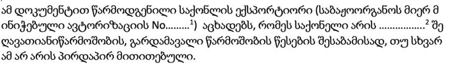
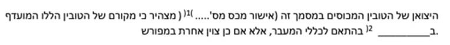
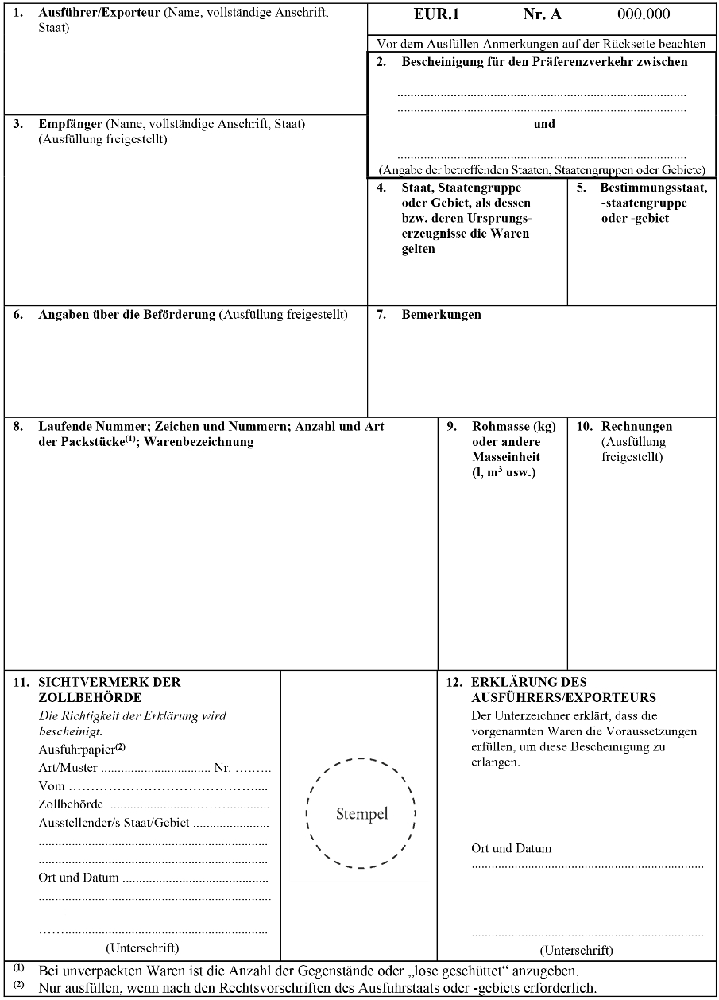
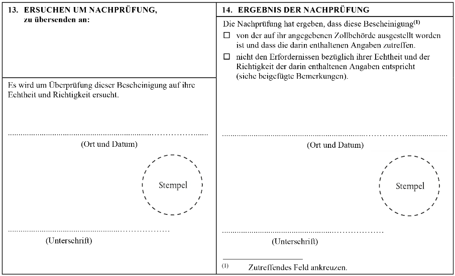
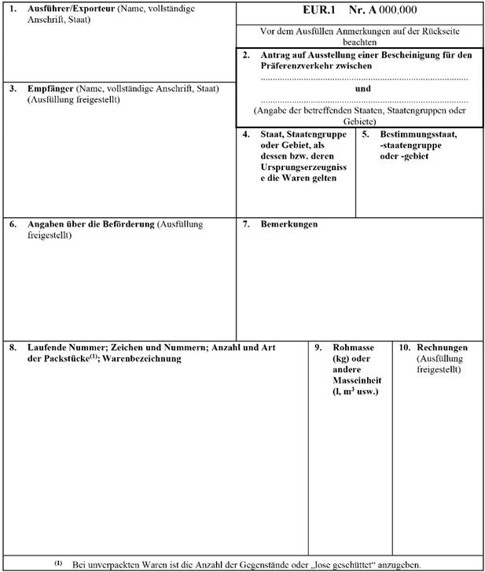

Kundmachung vom 15. November 2022 des Beschlusses Nr. 163/2022 des Gemeinsamen EWR-Ausschusses Beschluss des Gemeinsamen EWR-Ausschusses: 29. April 2022 Inkrafttreten für das Fürstentum Liechtenstein: 30. April 2022 Aufgrund von Art. 3 Bst. k des Kundmachungsgesetzes vom 17. April 1985, LGBl. 1985 Nr. 41, in der Fassung des Gesetzes vom 22. März 1995, LGBl. 1995 Nr. 101, macht die Regierung im Anhang den Beschluss Nr. 163/2022 des Gemeinsamen EWR-Ausschusses kund. Fürstliche Regierung: gez. Dr. Daniel Risch Fürstlicher Regierungschef Anhang Beschluss des Gemeinsamen EWR-Ausschusses Nr. 163/2022 vom 29. April 2022 zur Änderung von Protokoll Nr. 4 zum Abkommen über die Ursprungsregeln Der Gemeinsame EWR-Ausschuss - gestützt auf das Abkommen über den Europäischen Wirtschaftsraum (im Folgenden "EWR-Abkommen"), insbesondere auf Art. 98, in Erwägung nachstehender Gründe: 1. Art. 9 des EWR-Abkommens verweist auf das Protokoll Nr. 4 des EWR-Abkommens (im Folgenden "Protokoll Nr. 4"), das die Ursprungsregeln enthält. 2. Das Regionale Übereinkommen über Pan-Europa-Mittelmeer-Präferenzursprungsregeln (im Folgenden "PEM-Übereinkommen") zielt darauf ab, die in den zwischen den Vertragsparteien des PEM-Übereinkommens abgeschlossenen bilateralen Freihandelsabkommen eingerichteten bilateralen Systeme von Ursprungsregeln unbeschadet der in diesen bilateralen Abkommen festgelegten Grundsätze in einen multilateralen Rahmen umzuwandeln. 3. Die Union, Norwegen und Liechtenstein haben das PEM-Übereinkommen am 15. Juni 2011 unterzeichnet, Island hat das PEM-Übereinkommen am 30. Juni 2011 unterzeichnet. 4. Die Union, Norwegen, Island und Liechtenstein haben ihre Annahmeurkunden am 26. März 2012 bzw. am 9. November 2011, 12. März 2012 und 28. November 2011 beim Verwahrer des PEM-Übereinkommens hinterlegt. Daher trat das PEM-Übereinkommen gemäss seinem Art. 10 Abs. 3 für Liechtenstein und Norwegen am 1. Januar 2012 und für Island und die Union am 1. Mai 2012 in Kraft. 5. Die Vertragsparteien des EWR-Abkommens sind übereingekommen, bis zum Abschluss und Inkrafttreten der Änderung des PEM-Übereinkommens durch Hinzufügen einer Anlage A zum Protokoll Nr. 4 alternative Ursprungsregeln anzuwenden, die auf den Regeln des geänderten PEM-Übereinkommens beruhen, und die bilateral als alternative Ursprungsregeln zu den im PEM-Übereinkommen festgelegten Regeln angewandt werden können. 6. Das Protokoll Nr. 4 sollte daher entsprechend geändert werden - hat folgenden Beschluss erlassen: Art. 1 Protokoll Nr. 4 wird gemäss dem Anhang dieses Beschlusses geändert. Art. 2 Dieser Beschluss tritt am 30. April 2022 in Kraft, sofern alle Mitteilungen nach Art. 103 Abs. 1 des EWR-Abkommens vorliegen . Er gilt ab dem 1. September 2021. Art. 3 Dieser Beschluss wird im EWR-Abschnitt und in der EWR-Beilage des Amtsblattes der Europäischen Union veröffentlicht. Art. 4 Für die Zwecke der Anwendung dieses Beschlusses können Ursprungsnachweise rückwirkend für Ausfuhren ausgestellt werden, die zwischen dem 1. September 2021 und dem Tag des Inkrafttretens dieses Beschlusses getätigt wurden. Brüssel, den 29. April 2022 (Es folgen die Unterschriften) Anhang des Beschlusses des Gemeinsamen EWR-Ausschusses Nr. 163/2022 vom 29. April 2022 In Protokoll Nr. 4 wird am Ende Folgendes eingefügt: "Anlage A Alternativ geltende Ursprungsregeln Regeln zur fakultativen Anwendung durch die Vertragsparteien des Regionalen Übereinkommens über Pan-Europa-Mittelmeer-Präferenzursprungsregeln (im Folgenden "PEM-Übereinkommen") bis zum Abschluss und Inkrafttreten der Änderung des PEM-Übereinkommens (im Folgenden "Regeln" oder "Übergangsregeln") Bestimmung des Begriffs "Erzeugnisse mit Ursprung in" oder "Ursprungserzeugnisse" und Methoden der Zusammenarbeit der Verwaltungen Inhaltsübersicht Titel I Allgemeines Art. 1 Begriffsbestimmungen Titel II Bestimmung des Begriffs " Erzeugnisse mit Ursprung in " oder " Ursprungserzeugnisse " Art. 2 Allgemeine Vorschriften Art. 3 Vollständig gewonnene oder hergestellte Erzeugnisse Art. 4 Ausreichende Be- oder Verarbeitungen Art. 5 Toleranzregel Art. 6 Nicht ausreichende Be- oder Verarbeitungen Art. 7 Ursprungskumulierung Art. 8 Voraussetzungen für die Anwendung der Ursprungskumulierung Art. 9 Massgebende Einheit Art. 10 Warenzusammenstellungen Art. 11 Neutrale Elemente Art. 12 Buchmässige Trennung Titel III Territoriale Auflagen Art. 13 Territorialitätsprinzip Art. 14 Nichtveränderung Art. 15 Ausstellungen Titel IV Rückvergütung oder Befreiung Art. 16 Zollrückvergütung oder Zollbefreiung Titel V Nachweis der Ursprungseigenschaft Art. 17 Allgemeine Vorschriften Art. 18 Voraussetzungen für die Ausfertigung einer Ursprungserklärung Art. 19 Ermächtigter Ausführer Art. 20 Verfahren für die Ausstellung der Warenverkehrsbescheinigung EUR.1 Art. 21 Nachträglich ausgestellte Warenverkehrsbescheinigung EUR.1 Art. 22 Ausstellung eines Duplikats der Warenverkehrsbescheinigung EUR.1 Art. 23 Geltungsdauer der Ursprungsnachweise Art. 24 Freizonen Art. 25 Einfuhranforderungen Art. 26 Einfuhr in Teilsendungen Art. 27 Ausnahme vom Ursprungsnachweis Art. 28 Abweichungen und Formfehler Art. 29 Lieferantenerklärung Art. 30 In Euro ausgedrückte Beträge Titel VI Grundsätze der Zusammenarbeit und Nachweise Art. 31 Nachweise, Aufbewahrung von Ursprungsnachweisen und Belegen Art. 32 Streitbeilegung Titel VII Zusammenarbeit der Verwaltungen Art. 33 Notifizierung und Zusammenarbeit Art. 34 Prüfung der Ursprungsnachweise Art. 35 Prüfung der Lieferantenerklärungen Art. 36 Sanktionen Titel VIII Anwendung der Anlage Art. 37 Liechtenstein Art. 38 Republik San Marino Art. 39 Fürstentum Andorra Art. 40 Ceuta und Melilla Liste der Anhänge Anhang I Einleitende Bemerkungen zur Liste in Anhang II Anhang II Liste der Be- oder Verarbeitungen, die an Vormaterialien ohne Ursprungseigenschaft vorgenommen werden müssen, um der Ware die Ursprungseigenschaft zu verleihen Anhang III Wortlaut der Ursprungserklärung Anhang IV Muster der Warenverkehrsbescheinigung EUR.1 und des Antrags auf Ausstellung einer Warenverkehrsbescheinigung EUR.1 Anhang V Sonderbedingungen für Erzeugnisse mit Ursprung in Ceuta und Melilla Anhang VI Lieferantenerklärung Anhang VII Langzeit-Lieferantenerklärung Titel I Allgemeines Art. 1 Begriffsbestimmungen Für die Zwecke dieser Regeln gelten folgende Begriffsbestimmungen: a) "anwendende Vertragspartei" ist eine Vertragspartei des PEM-Übereinkommens, die diese Regeln in ihre bilateralen Präferenzhandelsabkommen mit einer anderen Vertragspartei des PEM-Übereinkommens aufnimmt und umfasst auch die Vertragsparteien des EWR-Abkommens; b) "Kapitel", "Positionen" und "Unterpositionen" sind die Kapitel, Positionen und Unterpositionen (vier- oder sechsstellige Codes) der Nomenklatur des Harmonisierten Systems zur Bezeichnung und Codierung der Waren (im Folgenden "Harmonisiertes System") mit den Änderungen gemäss der Empfehlung des Rates für die Zusammenarbeit auf dem Gebiet des Zollwesens vom 26. Juni 2004; c) "Einreihen" ist die Einreihung von Waren in eine bestimmte Position oder Unterposition des Harmonisierten Systems; d) "Sendung" sind Erzeugnisse, die entweder i) gleichzeitig von einem Ausführer an einen Empfänger oder ii) mit einem einzigen Frachtpapier oder - bei Fehlen eines solchen Papiers - mit einer einzigen Rechnung vom Ausführer an den Empfänger versandt werden; e) "Zollbehörden der Vertragspartei oder anwendenden Vertragspartei" der Europäischen Union sind alle Zollbehörden der Mitgliedstaaten der Europäischen Union; f) "Zollwert" ist der Wert, der nach dem Übereinkommen zur Durchführung des Art. VII des Allgemeinen Zoll- und Handelsabkommens von 1994 (WTO-Übereinkommen über den Zollwert) festgelegt wird; g) "Ab-Werk-Preis" ist der Preis des Erzeugnisses ab Werk, der dem Hersteller im EWR gezahlt wird, in dessen Unternehmen die letzte Be- oder Verarbeitung durchgeführt worden ist, sofern dieser Preis den Wert aller verwendeten Vormaterialien und alle anderen Kosten für seine Herstellung umfasst, abzüglich aller inländischen Abgaben, die erstattet werden oder erstattet werden können, wenn das hergestellte Erzeugnis ausgeführt wird. Wurde die letzte Be- oder Verarbeitung als Unterauftrag an einen Hersteller vergeben, so bezieht sich der Begriff "Hersteller" auf das Unternehmen, das den Subunternehmer beauftragt hat. Umfasst der tatsächlich entrichtete Preis nicht alle Kosten, die tatsächlich im EWR bei der Herstellung des Erzeugnisses angefallen sind, so bedeutet der Begriff "Ab-Werk-Preis" die Summe aller dort tatsächlich angefallenen Kosten abzüglich aller inländischen Abgaben, die erstattet werden oder erstattet werden können, wenn das hergestellte Erzeugnis ausgeführt wird; h) "austauschbare Vormaterialien" oder "austauschbare Erzeugnisse" sind Vormaterialien oder Erzeugnisse der gleichen Art, der gleichen Handelsqualität und mit den gleichen technischen und materiellen Eigenschaften, die nicht voneinander unterschieden werden können; i) "Waren" sind sowohl Vormaterialien als auch Erzeugnisse; j) "Herstellen" ist jede Be- oder Verarbeitung einschliesslich Zusammenbau; k) "Vormaterial" sind jegliche Zutaten, Rohstoffe, Komponenten oder Teile usw., die beim Herstellen des Erzeugnisses verwendet werden; l) "Höchstanteil der Vormaterialien ohne Ursprungseigenschaft" ist der zulässige Höchstanteil an Vormaterialien ohne Ursprungseigenschaft, der nicht überschritten werden darf, damit eine Herstellung als für die Erlangung der Ursprungseigenschaft ausreichende Be- oder Verarbeitung gilt. Er kann als Vomhundertsatz des Ab-Werk-Preises des Erzeugnisses oder als Vomhundertteil des Nettogewichts dieser verwendeten Vormaterialien aus einer bezeichneten Gruppe von Kapiteln, einem bezeichneten Kapitel, einer bezeichneten Position oder einer bezeichneten Unterposition ausgedrückt werden; m) "Erzeugnis" ist die hergestellte Ware, auch wenn sie zur späteren Verwendung in einem anderen Herstellungsvorgang bestimmt ist; n) "Gebiet" umfasst das Landgebiet, die Binnengewässer und das Küstenmeer der Vertragsparteien des EWR-Abkommens, für die das EWR-Abkommen gilt; o) "Wertzuwachs" ist der Ab-Werk-Preis des Erzeugnisses abzüglich des Zollwerts der verwendeten Vormaterialien, die die Ursprungseigenschaft der anderen anwendenden Vertragsparteien, mit denen die Kumulierung zulässig ist, besitzen, oder, wenn der Zollwert nicht bekannt ist und nicht festgestellt werden kann, der erste feststellbare Preis, der im EWR für die Vormaterialien gezahlt wird; p) "Wert der Vormaterialien" ist der Zollwert der verwendeten Vormaterialien ohne Ursprungseigenschaft zum Zeitpunkt der Einfuhr oder, wenn dieser nicht bekannt ist oder nicht ermittelt werden kann, der erste feststellbare Preis, der im EWR für diese Vormaterialien gezahlt wird. Muss der Wert der verwendeten Vormaterialien mit Ursprungseigenschaft bestimmt werden, so gilt dieser Buchstabe entsprechend. Titel II Bestimmung des Begriffs "Erzeugnisse mit Ursprung in" oder "Ursprungserzeugnisse" Art. 2 Allgemeine Vorschriften 1) Für die Zwecke der Durchführung des EWR-Abkommens gelten als Ursprungserzeugnisse des EWR: a) Erzeugnisse, die im Sinne des Art. 3 im EWR vollständig gewonnen oder hergestellt worden sind; b) Erzeugnisse, die im EWR unter Verwendung von Vormaterialien gewonnen oder hergestellt wurden, die dort nicht vollständig gewonnen oder hergestellt worden sind, vorausgesetzt, dass diese Vormaterialien im EWR im Sinne des Art. 4 in ausreichendem Masse be- oder verarbeitet worden sind. Für diese Zwecke gelten die Gebiete der Vertragsparteien des EWR-Abkommens, für die das Abkommen gilt, als ein Gebiet. 2) Ungeachtet des Abs. 1 gilt das Gebiet des Fürstentums Liechtenstein für die Zwecke der Bestimmung des Ursprungs der in den Tabellen I und II des Protokolls 3 aufgeführten Erzeugnisse nicht als Teil des Gebiets des EWR; diese Erzeugnisse gelten nur dann als Ursprungserzeugnisse des EWR, wenn sie im Gebiet der anderen Vertragsparteien des EWR-Abkommens entweder vollständig gewonnen oder hergestellt oder in ausreichendem Masse be- oder verarbeitet worden sind. Art. 3 Vollständig gewonnene oder hergestellte Erzeugnisse 1) Als im EWR vollständig gewonnen oder hergestellt gelten: a) dort aus dem Boden oder dem Meeresgrund gewonnene mineralische Erzeugnisse und natürliche Wässer; b) dort angebaute oder geerntete Pflanzen, einschliesslich Wasserpflanzen, und pflanzliche Erzeugnisse; c) dort geborene oder ausgeschlüpfte und dort aufgezogene lebende Tiere; d) Erzeugnisse von dort aufgezogenen lebenden Tieren; e) Erzeugnisse von geschlachteten Tieren, die dort geboren und aufgezogen wurden; f) dort erzielte Jagdbeute und Fischfänge; g) Aquakulturerzeugnisse, sofern die Fische, Krebstiere, Weichtiere und anderen wirbellosen Wassertiere dort aus Eiern geschlüpft sind oder dort die Larven oder Jungfische aufgezogen wurden; h) Erzeugnisse der Seefischerei und andere von eigenen Schiffen ausserhalb der Küstenmeere aus dem Meer gewonnene Erzeugnisse; i) Erzeugnisse, die an Bord eigener Fabrikschiffe ausschliesslich aus den unter Bst. h genannten Erzeugnissen hergestellt werden; j) dort gesammelte Altwaren, die nur zur Gewinnung von Rohstoffen verwendet werden können; k) bei einer dort ausgeübten Produktionstätigkeit anfallende Abfälle; l) aus dem Meeresboden oder Meeresuntergrund ausserhalb der eigenen Küstenmeere gewonnene Erzeugnisse, sofern die Vertragspartei zum Zwecke der Nutzbarmachung Ausschliesslichkeitsrechte über diesen Teil des Meeresbodens oder Meeresuntergrunds ausübt; m) dort ausschliesslich aus Erzeugnissen gemäss den Bst. a bis l hergestellte Waren. 2) Die Begriffe "eigene Schiffe" und "eigene Fabrikschiffe" in Abs. 1 Bst. h bzw. i sind nur anwendbar auf Schiffe und Fabrikschiffe, die alle nachstehend genannten Voraussetzungen erfüllen: a) Sie sind in einem Mitgliedstaat der Europäischen Union oder in einem EFTA-Staat ins Schiffsregister eingetragen; b) sie führen die Flagge eines Mitgliedstaats der Europäischen Union oder eines EFTA-Staats; c) sie erfüllen eine der folgenden Bedingungen: i) Sie sind mindestens zur Hälfte Eigentum von Staatsangehörigen der Vertragsparteien des EWR-Abkommens oder ii) sie sind Eigentum von Gesellschaften, - die ihren Hauptsitz und ihre Hauptniederlassung in einem Mitgliedstaat der Europäischen Union oder in einem EFTA-Staat haben und - die mindestens zur Hälfte Eigentum der Vertragsparteien des EWR-Abkommens oder öffentlicher Einrichtungen oder von Staatsangehörigen dieser Vertragsparteien sind. 3) Für die Zwecke von Abs. 2 gelten die EFTA-Staaten als eine einzige anwendende Vertragspartei. Art. 4 Ausreichende Be- oder Verarbeitungen 1) Unbeschadet des Abs. 3 des vorliegenden Artikels und des Art. 6 gelten Erzeugnisse, die im EWR nicht vollständig gewonnen oder hergestellt worden sind, als in ausreichendem Masse be- oder verarbeitet, wenn die Anforderungen der Liste in Anhang II für die betreffenden Waren erfüllt sind. 2) Wird ein Erzeugnis, das die Ursprungseigenschaft im EWR gemäss Abs. 1 erworben hat, bei der Herstellung eines anderen Erzeugnisses als Vormaterial verwendet, so werden bei seiner Herstellung gegebenenfalls verwendete Vormaterialien ohne Ursprungseigenschaft nicht berücksichtigt. 3) Bei jedem Erzeugnis wird geprüft, ob die Anforderungen von Abs. 1 erfüllt sind. Setzt jedoch die betreffende Regel die Einhaltung eines Höchstanteils an Vormaterialien ohne Ursprungseigenschaft voraus, so können die Zollbehörden der Vertragsparteien des EWR-Abkommens den Ausführern die Genehmigung erteilen, den Ab-Werk-Preis der Erzeugnisse und den Wert der Vormaterialien ohne Ursprungseigenschaft gemäss Abs. 4 ausgehend von Durchschnittswerten zu berechnen, um Kosten- und Wechselkursschwankungen Rechnung zu tragen. 4) Findet Abs. 3 Unterabs. 2 Anwendung, so werden ein durchschnittlicher Ab-Werk-Preis des Erzeugnisses und ein Durchschnittswert der verwendeten Vormaterialien ohne Ursprungseigenschaft jeweils ausgehend von der Summe der Ab-Werk-Preise für sämtliche Verkäufe derselben Erzeugnisse und der Summe des Wertes aller bei der Herstellung derselben Erzeugnisse verwendeten Vormaterialien ohne Ursprungseigenschaft errechnet, wobei vom vorherigen Rechnungsjahr entsprechend der Festlegung durch diese Vertragspartei des EWR-Abkommens ausgegangen wird bzw. - wenn keine Zahlen für das gesamte Rechnungsjahr vorliegen - von einem kürzeren Zeitraum, der jedoch mindestens drei Monate betragen sollte. 5) Ausführer, die sich für die Berechnung von Durchschnittswerten entschieden haben, wenden diese Methode in dem Jahr, das auf das Bezugsjahr bzw. gegebenenfalls auf den kürzeren Bezugszeitraum folgt, durchgehend an. Sie können die Anwendung dieser Methode beenden, wenn in einem bestimmten Rechnungsjahr oder einem kürzeren Zeitraum von mindestens drei Monaten die Kosten- oder Wechselkursschwankungen, die die Anwendung der Methode gerechtfertigt haben, nicht mehr festgestellt werden. 6) Für die Zwecke der Einhaltung des Höchstanteils an Vormaterialien ohne Ursprungseigenschaft gelten die in Abs. 4 genannten Durchschnittswerte als Ab-Werk-Preis bzw. als Wert der Vormaterialien ohne Ursprungseigenschaft. Art. 5 Toleranzregel 1) Abweichend von Art. 4 und vorbehaltlich der Abs. 2 und 3 des vorliegenden Artikels können Vormaterialien ohne Ursprungseigenschaft, die aufgrund der Auflagen gemäss der Liste in Anhang II bei der Herstellung eines bestimmten Erzeugnisses nicht verwendet werden dürfen, trotzdem verwendet werden, sofern a) ihr festgestelltes Nettogewicht 15 v. H. des Nettogewichts des Erzeugnisses bei Erzeugnissen der Kapitel 2 und 4 bis 24, ausgenommen verarbeitete Fischereierzeugnisse des Kapitels 16, nicht überschreitet bzw. b) ihr festgestellter Gesamtwert 15 v. H. des Ab-Werk-Preises des Erzeugnisses bei nicht unter Bst. a fallenden Erzeugnissen nicht überschreitet. Dieser Absatz gilt nicht für Erzeugnisse der Kapitel 50 bis 63 des Harmonisierten Systems, für die die Toleranzen in den Bemerkungen 6 und 7 in Anhang I gelten. 2) Nach Abs. 1 ist es nicht zulässig, die Höchstanteile an Vormaterialien ohne Ursprungseigenschaft gemäss den in der Liste in Anhang II niedergelegten Regeln zu überschreiten. 3) Die Abs. 1 und 2 gelten nicht für Erzeugnisse, die im EWR im Sinne von Art. 3 vollständig gewonnen oder hergestellt worden sind. Unbeschadet des Art. 6 und des Art. 9 Abs. 1 gilt die in diesen Bestimmungen festgelegte Toleranz dennoch für Erzeugnisse, bei denen gemäss der Regel in der Liste in Anhang II die bei der Herstellung des Erzeugnisses verwendeten Vormaterialien vollständig gewonnen oder hergestellt sind. Art. 6 Nicht ausreichende Be- oder Verarbeitungen 1) Unbeschadet des Abs. 2 gelten folgende Be- oder Verarbeitungen unabhängig davon, ob die Bedingungen des Art. 4 erfüllt sind, als nicht ausreichend, um die Ursprungseigenschaft zu verleihen: a) Behandlungen, die dazu bestimmt sind, die Erzeugnisse während des Transports und der Lagerung in gutem Zustand zu erhalten; b) Teilen oder Zusammenstellen von Packstücken; c) Waschen, Reinigen; Entfernen von Staub, Oxid, Öl, Farbe oder anderen Beschichtungen; d) Bügeln von Textilien; e) einfaches Anstreichen oder Polieren; f) Schälen und teilweises oder vollständiges Mahlen von Reis; Polieren und Glasieren von Getreide und Reis; g) Färben oder Aromatisieren von Zucker oder Formen von Würfelzucker; teilweises oder vollständiges Mahlen von Kristallzucker; h) Enthülsen, Entsteinen oder Schälen von Früchten, Nüssen und Gemüse; i) Schärfen, einfaches Schleifen oder einfaches Zerteilen; j) Sieben, Aussondern, Einordnen, Sortieren (einschliesslich des Zusammenstellens von Sortimenten); k) einfaches Abfüllen in Flaschen, Dosen, Fläschchen, Säcke, Etuis, Schachteln, Befestigen auf Karten oder Brettchen sowie alle anderen einfachen Verpackungsvorgänge; l) Anbringen oder Aufdrucken von Marken, Etiketten, Logos oder anderen gleichartigen Unterscheidungszeichen auf den Erzeugnissen selbst oder auf ihren Umschliessungen; m) einfaches Mischen von Erzeugnissen, auch verschiedener Arten; n) Mischen von Zucker mit anderen Vormaterialien; o) einfaches Hinzufügen von Wasser oder Verdünnen, Trocknen oder Denaturierung von Erzeugnissen; p) einfaches Zusammenfügen von Teilen eines Erzeugnisses zu einem vollständigen Erzeugnis oder Zerlegen von Erzeugnissen in Einzelteile; q) Schlachten von Tieren; r) Zusammentreffen von zwei oder mehr der unter den Bst. a bis q genannten Behandlungen. 2) Bei der Beurteilung, ob die an einem Erzeugnis vorgenommenen Be- oder Verarbeitungen als nicht ausreichend im Sinne des Abs. 1 gelten, sind alle im EWR an einem bestimmten Erzeugnis vorgenommenen Behandlungen zu berücksichtigen. Art. 7 Ursprungskumulierung 1) Unbeschadet des Art. 2 gelten solche Erzeugnisse als Ursprungserzeugnisse des EWR, die dort unter Verwendung von Vormaterialien mit Ursprung in einer anwendenden Vertragspartei hergestellt worden sind, sofern die im EWR vorgenommene Be- oder Verarbeitung über die in Art. 6 genannte Behandlung hinausgeht. Diese Vormaterialien brauchen nicht in ausreichendem Masse be- oder verarbeitet worden zu sein. 2) Geht eine im EWR vorgenommene Be- oder Verarbeitung nicht über die in Art. 6 genannten Behandlungen hinaus, so gilt das unter Verwendung von Vormaterialien mit Ursprung in einer anderen anwendenden Vertragspartei hergestellte Erzeugnis nur dann als Ursprungserzeugnis des EWR, wenn der dort erzielte Wertzuwachs den Wert der verwendeten Vormaterialien mit Ursprung in einer anderen anwendenden Vertragspartei übersteigt. Andernfalls gilt das hergestellte Erzeugnis als Ursprungserzeugnis der anwendenden Vertragspartei, auf die der höchste Wert der bei der Herstellung im EWR verwendeten Vormaterialien entfällt. 3) Unbeschadet des Art. 2 und unter Ausschluss der in die Kapitel 50 bis 63 fallenden Erzeugnisse gelten in einer anwendenden Vertragspartei - ausgenommen einer Vertragspartei des EWR-Abkommens - vorgenommene Be- oder Verarbeitungen als im EWR vorgenommen, wenn die hergestellten Erzeugnisse anschliessend einer Be- oder Verarbeitung im EWR unterzogen werden. 4) Unbeschadet des Art. 2 gelten bei Erzeugnissen der Kapitel 50 bis 63 - und nur für die Zwecke des bilateralen Handels zwischen den Vertragsparteien des EWR-Abkommens - in der einführenden Vertragspartei des EWR-Abkommens vorgenommene Be- oder Verarbeitungen als im EWR vorgenommen, wenn die Erzeugnisse anschliessend einer Be- oder Verarbeitung im EWR unterzogen werden. Für die Zwecke dieses Absatzes gelten die Teilnehmer des Stabilisierungs- und Assoziationsprozesses der Europäischen Union und die Republik Moldau als eine einzige anwendende Vertragspartei. 5) Die Vertragsparteien des EWR-Abkommens können sich im Wege eines Beschlusses des Gemeinsamen EWR-Ausschusses dafür entscheiden, die Anwendung von Abs. 3 auf die Einfuhr von Erzeugnissen der Kapitel 50 bis 63 auszudehnen. 6) Für die Zwecke der Kumulierung gemäss den Abs. 3 bis 5 des vorliegenden Artikels gelten die Ursprungserzeugnisse nur dann als Erzeugnisse mit Ursprung im EWR, wenn die dort vorgenommene Be- oder Verarbeitung über die in Art. 6 genannte Behandlung hinausgeht. 7) Ursprungserzeugnisse einer anwendenden Vertragspartei, die im EWR keiner Be- oder Verarbeitung unterzogen worden sind, behalten ihre Ursprungseigenschaft, wenn sie in eine der anderen Vertragsparteien des EWR-Abkommens ausgeführt werden. Art. 8 Voraussetzungen für die Anwendung der Ursprungskumulierung 1) Die Kumulierung gemäss Art. 7 ist nur unter der Voraussetzung zulässig, dass a) zwischen den am Erwerb der Ursprungseigenschaft beteiligten anwendenden Vertragsparteien und der Bestimmungsvertragspartei des EWR-Abkommens ein Präferenzhandelsabkommen nach Art. XXIV des Allgemeinen Zoll- und Handelsabkommens von 1994 (GATT) Anwendung findet und b) die Waren die Ursprungseigenschaft aufgrund von Ursprungsregeln erworben haben, die mit den vorliegenden Regeln übereinstimmen. 2) Bekanntmachungen über die Erfüllung der für die Anwendung der Kumulierung erforderlichen Voraussetzungen werden im Amtsblatt der Europäischen Union (Reihe C) und in einer amtlichen Veröffentlichung in anderen Vertragsparteien des EWR-Abkommens nach deren eigenen Verfahren veröffentlicht. Die Kumulierung gemäss Art. 7 findet ab dem in diesen Bekanntmachungen angegebenen Datum Anwendung. Die Vertragsparteien des EWR-Abkommens übermitteln der Europäischen Kommission Einzelheiten der einschlägigen mit anderen anwendenden Vertragsparteien geschlossenen Abkommen, einschliesslich des Datums des Inkrafttretens dieser Regeln. 3) Wenn Erzeugnisse die Ursprungseigenschaft durch Anwendung der Ursprungskumulierung gemäss Art. 7 erworben haben, sollte der Nachweis der Ursprungseigenschaft folgende Erklärung in Englisch enthalten: "CUMULATION APPLIED WITH (name of the relevant applying Contracting Party/Parties in English)". Wird als Ursprungsnachweis eine Warenverkehrsbescheinigung EUR.1 verwendet, so ist diese Erklärung in Feld 7 der Warenverkehrsbescheinigung EUR.1 abzugeben. 4) Die Vertragsparteien des EWR-Abkommens können entscheiden, bei innerhalb des EWR ausgeführten Erzeugnissen, die die Ursprungseigenschaft durch Anwendung der Ursprungskumulierung gemäss Art. 7 erworben haben, auf die Aufnahme der Erklärung nach Abs. 3 in den Ursprungsnachweis zu verzichten. Die Vertragsparteien des EWR-Abkommens übermitteln der Europäischen Kommission gemäss Art. 8 Abs. 2 die Aufhebung dieser Verpflichtung. Art. 9 Massgebende Einheit 1) Massgebende Einheit für die Anwendung dieser Regeln ist die für die Einreihung in die Position des Harmonisierten Systems massgebende Einheit jedes Erzeugnisses. Daraus folgt, a) dass jede Gruppe oder Zusammenstellung von Erzeugnissen, die nach dem Harmonisierten System in eine einzige Position eingereiht wird, als Ganzes die massgebende Einheit darstellt; b) bei einer Sendung mit einer Anzahl gleicher Erzeugnisse, die in dieselbe Position des Harmonisierten Systems eingereiht werden, diese Regeln für jedes Erzeugnis einzeln betrachtet gelten. 2) Werden Umschliessungen nach der Allgemeinen Vorschrift 5 zum Harmonisierten System wie das darin enthaltene Erzeugnis eingereiht, so werden sie auch für die Bestimmung des Ursprungs wie das Erzeugnis behandelt. 3) Zubehör, Ersatzteile und Werkzeuge, die mit Geräten, Maschinen, Apparaten oder Fahrzeugen geliefert werden, werden mit diesen zusammen als Einheit angesehen, wenn sie als Bestandteil der Normalausrüstung in deren Ab-Werk-Preis enthalten sind. Art. 10 Warenzusammenstellungen Warenzusammenstellungen im Sinne der Allgemeinen Vorschrift 3 zum Harmonisierten System gelten als Ursprungserzeugnisse, wenn alle Bestandteile Ursprungserzeugnisse sind. Jedoch gilt eine Warenzusammenstellung, die aus Bestandteilen mit Ursprungseigenschaft und Bestandteilen ohne Ursprungseigenschaft besteht, in ihrer Gesamtheit als Ursprungserzeugnis, sofern der Wert der Bestandteile ohne Ursprungseigenschaft 15 v. H. des Ab-Werk-Preises der Warenzusammenstellung nicht überschreitet. Art. 11 Neutrale Elemente Bei der Feststellung, ob ein Erzeugnis ein Ursprungserzeugnis ist, wird der Ursprung folgender gegebenenfalls bei seiner Herstellung verwendeter Erzeugnisse nicht berücksichtigt: a) Energie und Brennstoffe; b) Anlagen und Ausrüstung; c) Maschinen und Werkzeuge; d) Erzeugnisse, die nicht in die endgültige Zusammensetzung des Erzeugnisses eingehen oder nicht eingehen sollen. Art. 12 Buchmässige Trennung 1) Werden bei der Be- oder Verarbeitung eines Erzeugnisses austauschbare Vormaterialien mit oder ohne Ursprungseigenschaft verwendet, so können die Wirtschaftsbeteiligten die Verwaltung der Vormaterialien mithilfe der Methode der buchmässigen Trennung ohne getrennte Lagerung sicherstellen. 2) Die Wirtschaftsbeteiligten können die Verwaltung von austauschbaren Vormaterialien mit oder ohne Ursprungseigenschaft der Position 1701 mithilfe der Methode der buchmässigen Trennung ohne getrennte Lagerung sicherstellen. 3) Die Vertragsparteien des EWR-Abkommens können verlangen, dass für die Anwendung der buchmässigen Trennung eine vorherige Bewilligung bei den Zollbehörden eingeholt werden muss. Die Zollbehörden können die Bewilligung von allen ihnen zweckdienlich erscheinenden Voraussetzungen abhängig machen, und sie überwachen die Verwendung der Bewilligung. Die Zollbehörden können die Bewilligung widerrufen, wenn der Begünstigte in unzulässiger Weise von ihr Gebrauch macht oder die übrigen in diesen Regeln festgelegten Voraussetzungen nicht erfüllt. Durch die Anwendung der buchmässigen Trennung muss gewährleistet sein, dass jederzeit nicht mehr Erzeugnisse als "Ursprungserzeugnisse des EWR" angesehen werden können, als dies bei räumlicher Trennung der Lagerbestände der Fall gewesen wäre. Über die Anwendung der Methode sind nach den allgemein anerkannten Buchführungsgrundsätzen, die in der Vertragspartei des EWR-Abkommens gelten, Aufzeichnungen zu führen. 4) Der Begünstigte der Methode nach den Abs. 1 und 2 fertigt für die Menge der Erzeugnisse, die als Ursprungserzeugnisse des EWR angesehen werden können, Ursprungsnachweise aus bzw. beantragt Ursprungsnachweise für sie. Auf Verlangen der Zollbehörden hat der Begünstigte eine Erklärung über die Verwaltung dieser Mengen vorzulegen. Titel III Territoriale Auflagen Art. 13 Territorialitätsprinzip 1) Die in Titel II genannten Anforderungen müssen im EWR ohne Unterbrechung erfüllt sein. 2) Ursprungserzeugnisse, die aus dem EWR in ein anderes Land ausgeführt und anschliessend wiedereingeführt werden, gelten bei ihrer Wiedereinfuhr als Erzeugnisse ohne Ursprungseigenschaft, es sei denn, den Zollbehörden wird glaubhaft dargelegt, dass a) die wiedereingeführten Erzeugnisse dieselben wie die ausgeführten sind und b) sie während ihres Verbleibs in dem betreffenden Land oder während der Ausfuhr keine Behandlung erfahren haben, die über das zur Erhaltung ihres Zustands erforderliche Mass hinausgeht. 3) Der Erwerb der Ursprungseigenschaft nach Titel II wird durch eine Be- oder Verarbeitung, die ausserhalb des EWR an aus dem EWR ausgeführten und anschliessend wieder eingeführten Vormaterialien vorgenommen wird, nicht berührt, sofern a) diese Vormaterialien im EWR vollständig gewonnen oder hergestellt oder vor ihrer Ausfuhr einer Be- oder Verarbeitung unterzogen worden sind, die über die Be- oder Verarbeitungen im Sinne des Art. 6 hinausgeht, und b) den Zollbehörden glaubhaft dargelegt werden kann, dass i) die wiedereingeführten Erzeugnisse durch Be- oder Verarbeitung der ausgeführten Vormaterialien hergestellt worden sind und ii) die nach diesem Artikel ausserhalb des EWR insgesamt erzielte Wertsteigerung 10 v. H. des Ab-Werk-Preises des Enderzeugnisses, für das die Ursprungseigenschaft beansprucht wird, nicht überschreitet. 4) Für die Zwecke von Abs. 3 finden die in Titel II genannten Bedingungen für den Erwerb der Ursprungseigenschaft auf die Be- oder Verarbeitung ausserhalb des EWR keine Anwendung. Findet jedoch nach der Liste in Anhang II für die Bestimmung des Ursprungs des Enderzeugnisses eine Regel Anwendung, die einen zulässigen Höchstwert für alle verwendeten Vormaterialien ohne Ursprungseigenschaft vorsieht, so dürfen der Gesamtwert der im Gebiet der betreffenden Vertragspartei des EWR-Abkommens verwendeten Vormaterialien ohne Ursprungseigenschaft und der nach diesem Artikel ausserhalb des EWR insgesamt erzielte Wertzuwachs zusammengenommen den angegebenen Vomhundertsatz nicht überschreiten. 5) Im Sinne der Abs. 3 und 4 bezeichnet der Begriff "insgesamt erzielter Wertzuwachs" alle ausserhalb des EWR entstandenen Kosten einschliesslich des Wertes der dort verwendeten Vormaterialien. 6) Die Abs. 3 und 4 des vorliegenden Artikels gelten nicht für Erzeugnisse, die die Bedingungen der Liste in Anhang II nicht erfüllen oder nur durch Anwendung der allgemeinen Toleranz nach Art. 5 als in ausreichendem Masse be- oder verarbeitet angesehen werden können. 7) Die unter diesen Artikel fallende Be- oder Verarbeitung ausserhalb des EWR wird im Rahmen der passiven Veredelung oder eines ähnlichen Verfahrens vorgenommen. Art. 14 Nichtveränderung 1) Die im Rahmen des EWR-Abkommens vorgesehene Präferenzbehandlung gilt nur für Erzeugnisse, die den Anforderungen dieser Regeln entsprechen und in einer Vertragspartei des EWR-Abkommens zur Einfuhr angemeldet werden, vorausgesetzt, diese Erzeugnisse sind dieselben wie die aus der ausführenden Vertragspartei des EWR-Abkommens ausgeführten Erzeugnisse. Vor der Überführung in den freien Verkehr dürfen sie nicht verändert, in irgendeiner Weise umgewandelt oder Be- oder Verarbeitungen unterzogen worden sein, die über das zur Erhaltung ihres Zustands erforderliche Mass hinausgehen; ausgenommen davon sind das Anbringen oder Beifügen von Marken, Etiketten, Siegeln oder sonstiger Dokumentation, um die Einhaltung spezifischer inländischer Anforderungen der einführenden Vertragspartei des EWR-Abkommens zu gewährleisten, was unter zollamtlicher Überwachung in dem Durchfuhrdrittland bzw. den Durchfuhrdrittländern oder dem Drittland bzw. den Drittländern geschieht, in dem/denen die Sendung aufgeteilt wird. 2) Erzeugnisse oder Sendungen können gelagert werden, solange sie in dem Durchfuhrdrittland/den Durchfuhrdrittländern unter zollamtlicher Überwachung verbleiben. 3) Unbeschadet des Titels V dieser Anlage können Sendungen aufgeteilt werden, solange sie in dem Drittland/den Drittländern, in dem/denen die Aufteilung erfolgt, unter zollamtlicher Überwachung verbleiben. 4) Bestehen Zweifel, so kann die einführende Vertragspartei des EWR-Abkommens den Einführer oder seinen Vertreter auffordern, jederzeit alle zweckdienlichen Unterlagen vorzulegen, welche die Erfüllung der Bestimmungen dieses Artikels belegen, was durch jede Art von Nachweisen geschehen kann, insbesondere durch a) vertraglich festgelegte Frachtpapiere wie Konnossemente; b) faktische oder konkrete Nachweise anhand der Kennung oder Nummerierung von Packstücken; c) eine von den Zollbehörden des Durchfuhrlands bzw. der Durchfuhrländer oder des Landes bzw. der Länder, in dem/denen die Sendung aufgeteilt wurde, ausgestellte Bescheinigung über die Nichtbehandlung oder alle sonstigen Nachweise, die belegen, dass die Waren im Durchfuhrland bzw. in den Durchfuhrländern oder in dem Land bzw. den Ländern, in dem/denen die Sendung aufgeteilt wurde, unter zollamtlicher Überwachung verblieben; oder d) Nachweise im Zusammenhang mit den Waren selbst. Art. 15 Ausstellungen 1) Werden Ursprungserzeugnisse zu einer Ausstellung in ein Land versandt, bei dem es sich nicht um eines der in den Art. 7 und 8 genannten Länder handelt, mit denen die Kumulierung zulässig ist, und nach der Ausstellung zur Einfuhr in den EWR verkauft, so erhalten sie bei der Einfuhr die Begünstigungen des EWR-Abkommens, sofern den Zollbehörden glaubhaft dargelegt wird, dass a) ein Ausführer die Erzeugnisse aus einer Vertragspartei des EWR-Abkommens in das Ausstellungsland versandt und dort ausgestellt hat, b) dieser Ausführer die Erzeugnisse einem Empfänger in einer anderen Vertragspartei des EWR-Abkommens verkauft oder überlassen hat, c) die Erzeugnisse während oder unmittelbar nach der Ausstellung in dem Zustand, in dem sie zur Ausstellung versandt worden waren, versandt worden sind und d) die Erzeugnisse ab dem Zeitpunkt, zu dem sie zur Ausstellung versandt wurden, nicht zu anderen Zwecken als zur Vorführung auf der Ausstellung verwendet worden sind. 2) Nach Massgabe des Titels V dieser Anlage ist ein Ursprungsnachweis auszustellen oder auszufertigen und den Zollbehörden der einführenden Vertragspartei des EWR-Abkommens unter den üblichen Voraussetzungen vorzulegen. Darin sind Bezeichnung und Anschrift der Ausstellung anzugeben. Falls erforderlich, kann ein zusätzlicher Nachweis über die Umstände verlangt werden, unter denen die Erzeugnisse ausgestellt worden sind. 3) Abs. 1 gilt für Handels-, Industrie-, Landwirtschafts- und Handwerksmessen oder -ausstellungen und ähnliche öffentliche Veranstaltungen, bei denen die Erzeugnisse unter zollamtlicher Überwachung bleiben; ausgenommen sind Veranstaltungen zu privaten Zwecken für den Verkauf ausländischer Erzeugnisse in Läden oder Geschäftslokalen. Titel IV Rückvergütung oder Befreiung Art. 16 Zollrückvergütung oder Zollbefreiung 1) Vormaterialien ohne Ursprungseigenschaft, die im EWR bei der Herstellung von Ursprungserzeugnissen der Kapitel 50 bis 63 des Harmonisierten Systems verwendet worden sind, für die nach Massgabe des Titels V dieser Anlage ein Ursprungsnachweis ausgestellt oder ausgefertigt wird, dürfen in der ausführenden Vertragspartei des EWR-Abkommens nicht Gegenstand einer wie auch immer gearteten Zollrückvergütung oder Zollbefreiung sein. 2) Das Verbot nach Abs. 1 betrifft in einer ausführenden Vertragspartei des EWR-Abkommens geltende Regelungen, nach denen Zölle oder Abgaben gleicher Wirkung auf bei der Herstellung von Ursprungserzeugnissen verwendete Vormaterialien vollständig oder teilweise erstattet, erlassen oder nicht erhoben werden, sofern die Erstattung, der Erlass oder die Nichterhebung ausdrücklich oder faktisch gewährt wird, wenn die aus den betreffenden Vormaterialien hergestellten Erzeugnisse ausgeführt werden, nicht dagegen, wenn diese Erzeugnisse im Inland in den zollrechtlich freien Verkehr übergehen. 3) Der Ausführer von Erzeugnissen mit Ursprungsnachweis hat auf Verlangen der Zollbehörden jederzeit alle zweckdienlichen Unterlagen vorzulegen, um nachzuweisen, dass für die bei der Herstellung dieser Erzeugnisse verwendeten Vormaterialien ohne Ursprungseigenschaft keine Zollrückvergütung gewährt worden ist und sämtliche für solche Vormaterialien geltenden Zölle und Abgaben gleicher Wirkung tatsächlich entrichtet worden sind. 4) Das Verbot in Abs. 1 gilt nicht für den Handel zwischen den Vertragsparteien des EWR-Abkommens mit Erzeugnissen, welche die Ursprungseigenschaft durch die Ursprungskumulierung nach Art. 7 Abs. 4 oder 5 erworben haben. Titel V Nachweis der Ursprungseigenschaft Art. 17 Allgemeine Vorschriften 1) Ursprungserzeugnisse erhalten bei der Einfuhr in eine Vertragspartei des EWR-Abkommens die Begünstigungen des EWR-Abkommens, sofern a) eine Warenverkehrsbescheinigung EUR.1 nach dem Muster in Anhang IV dieser Anlage vorgelegt wird; b) in den in Art. 18 Abs. 1 genannten Fällen vom Ausführer eine Erklärung auf einer Rechnung, einem Lieferschein oder einem anderen Handelspapier (im Folgenden "Ursprungserklärung") abgegeben wird, in der die betreffenden Erzeugnisse so genau bezeichnet sind, dass die Feststellung der Nämlichkeit möglich ist; der Wortlaut der Ursprungserklärung findet sich in Anhang III dieser Anlage. 2) Ungeachtet des Abs. 1 erhalten Ursprungserzeugnisse im Sinne dieser Regeln in den in Art. 27 genannten Fällen die Begünstigungen des EWR-Abkommens, ohne dass einer der in Art. 1 genannten Ursprungsnachweise vorgelegt werden muss. 3) Ungeachtet des Abs. 1 können die Vertragsparteien des EWR-Abkommens vereinbaren, dass im Rahmen des Präferenzverkehrs zwischen ihnen die in Abs. 1 Bst. a und b genannten Ursprungsnachweise durch Erklärungen zum Ursprung ersetzt werden, ausgefertigt von in einer elektronischen Datenbank registrierten Ausführern nach den nationalen Rechtsvorschriften der Vertragsparteien des EWR-Abkommens. Die Nutzung einer von in einer elektronischen Datenbank registrierten Ausführern ausgefertigten Erklärung zum Ursprung, die von zwei oder mehr Vertragsparteien vereinbart wurde, steht der Anwendung der diagonalen Kumulierung mit anderen anwendenden Vertragsparteien nicht entgegen. 4) Für die Zwecke von Abs. 1 können die Vertragsparteien des EWR-Abkommens die Einrichtung eines Systems vereinbaren, das es ermöglicht, die in Abs. 1 Bst. a und b genannten Ursprungsnachweise elektronisch auszustellen und/oder zu übermitteln. 5) Gilt Art. 8 Abs. 4, so ergreift der in einer anwendenden Vertragspartei niedergelassene Ausführer, der einen Ursprungsnachweis auf der Grundlage eines anderen Ursprungsnachweises ausfertigt oder beantragt, für den eine Befreiung von der sonst nach Art. 8 Abs. 3 geltenden Verpflichtung zur Aufnahme der Erklärung gilt, für die Zwecke des Art. 7 alle erforderlichen Schritte, um sicherzustellen, dass die Voraussetzungen für die Anwendung der Kumulierung erfüllt sind, und er ist bereit, den Zollbehörden alle einschlägigen Unterlagen vorzulegen. Art. 18 Voraussetzungen für die Ausfertigung einer Ursprungserklärung 1) Eine in Art. 17 Abs. 1 Bst. b genannte Ursprungserklärung kann ausgefertigt werden a) von einem ermächtigten Ausführer im Sinne des Art. 19 oder b) von jedem Ausführer für Sendungen von einem oder mehreren Packstücken, die Ursprungserzeugnisse enthalten, deren Wert 6 000 EUR je Sendung nicht überschreitet. 2) Eine Ursprungserklärung kann ausgefertigt werden, wenn die Erzeugnisse als Ursprungserzeugnisse des EWR oder einer anwendenden Vertragspartei angesehen werden können und die übrigen Anforderungen dieser Regeln erfüllen. 3) Auf Verlangen der Zollbehörden der ausführenden Vertragspartei des EWR-Abkommens hat der Ausführer, der eine Ursprungserklärung ausfertigt, jederzeit alle zweckdienlichen Unterlagen zum Nachweis der Ursprungseigenschaft der betreffenden Erzeugnisse sowie der Erfüllung der übrigen Anforderungen dieser Regeln vorzulegen. 4) Eine Ursprungserklärung ist vom Ausführer maschinenschriftlich oder mechanografisch auf der Rechnung, dem Lieferschein oder einem anderen Handelspapier mit dem Wortlaut und in einer der Sprachfassungen des Anhangs III dieser Anlage nach Massgabe der nationalen Rechtsvorschriften des Ausfuhrlandes auszufertigen. Wird die Erklärung handschriftlich erstellt, so muss das mit Tinte in Druckschrift erfolgen. 5) Die Ursprungserklärung ist vom Ausführer eigenhändig zu unterzeichnen. Ein ermächtigter Ausführer im Sinne des Art. 19 braucht jedoch solche Erklärungen nicht zu unterzeichnen, wenn er sich gegenüber den Zollbehörden der ausführenden Vertragspartei des EWR-Abkommens schriftlich verpflichtet, die volle Verantwortung für jede Ursprungserklärung zu übernehmen, die ihn so identifiziert, als ob er sie eigenhändig unterzeichnet hätte. 6) Die Ursprungserklärung kann vom Ausführer bei der Ausfuhr der Erzeugnisse oder nach deren Ausfuhr (im Folgenden "nachträgliche Ursprungserklärung") ausgefertigt werden, vorausgesetzt, dass sie im Einfuhrland innerhalb von zwei Jahren nach der Einfuhr der betreffenden Erzeugnisse vorgelegt wird. Erfolgt die Aufteilung einer Sendung nach Art. 14 Abs. 3 und wird dieselbe Zweijahresfrist eingehalten, so wird die nachträgliche Ursprungserklärung vom ermächtigten Ausführer der ausführenden Vertragspartei des EWR-Abkommens ausgefertigt. Art. 19 Ermächtigter Ausführer 1) Die Zollbehörden der ausführenden Vertragspartei des EWR-Abkommens können vorbehaltlich der nationalen Vorschriften einen in dieser Vertragspartei des EWR-Abkommens niedergelassenen Ausführer (im Folgenden "ermächtigter Ausführer") ermächtigen, Ursprungserklärungen ungeachtet des Werts der betreffenden Erzeugnisse auszufertigen. 2) Ein Ausführer, der eine solche Bewilligung beantragt, muss jede von den Zollbehörden für erforderlich gehaltene Gewähr für die Kontrolle der Ursprungseigenschaft der Erzeugnisse und die Erfüllung der übrigen Anforderungen dieser Regeln bieten. 3) Die Zollbehörden erteilen dem ermächtigten Ausführer eine Bewilligungsnummer, die in der Ursprungserklärung anzugeben ist. 4) Die Zollbehörden überprüfen den ordnungsgemässen Gebrauch einer Bewilligung. Sie können die Bewilligung widerrufen, wenn der ermächtigte Ausführer in unzulässiger Weise von ihr Gebrauch macht, und widerrufen sie in jedem Fall, wenn der ermächtigte Ausführer die in Abs. 2 genannte Gewähr nicht mehr bietet. Art. 20 Verfahren für die Ausstellung der Warenverkehrsbescheinigung EUR.1 1) Die Warenverkehrsbescheinigung EUR.1 wird von den Zollbehörden der ausführenden Vertragspartei des EWR-Abkommens auf schriftlichen Antrag ausgestellt, der vom Ausführer oder unter der Verantwortung des Ausführers von seinem bevollmächtigten Vertreter gestellt worden ist. 2) Der Ausführer oder sein bevollmächtigter Vertreter füllt zu diesem Zweck das Formblatt der Warenverkehrsbescheinigung EUR.1 und des Antrags nach dem Muster in Anhang IV dieser Anlage aus. Diese Formblätter sind in einer der Sprachen, in denen das EWR-Abkommen verfasst ist, nach den nationalen Rechtsvorschriften der ausführenden Vertragspartei des EWR-Abkommens auszufüllen. Werden die Formblätter handschriftlich ausgefüllt, so erfolgt dies mit Tinte in Druckschrift. Die Warenbezeichnung ist in dem dafür vorgesehenen Feld ohne Zeilenzwischenraum einzutragen. Ist das Feld nicht vollständig ausgefüllt, so sind unter der letzten Zeile der Warenbezeichnung ein waagerechter Strich zu ziehen und der nicht ausgefüllte Teil des Feldes durchzustreichen. 3) Die Warenverkehrsbescheinigung EUR.1 enthält in Feld 7 die Erklärung in englischer Sprache "TRANSITIONAL RULES". 4) Der Ausführer, der die Ausstellung der Warenverkehrsbescheinigung EUR.1 beantragt, hat auf Verlangen der Zollbehörden der ausführenden Vertragspartei des EWR-Abkommens, in der die Warenverkehrsbescheinigung EUR.1 ausgestellt wird, jederzeit alle zweckdienlichen Unterlagen zum Nachweis der Ursprungseigenschaft der betreffenden Erzeugnisse sowie der Erfüllung der übrigen Anforderungen dieser Regeln vorzulegen. 5) Eine Warenverkehrsbescheinigung EUR.1 wird von den Zollbehörden der ausführenden Vertragspartei des EWR-Abkommens ausgestellt, wenn die betreffenden Erzeugnisse als Ursprungserzeugnisse angesehen werden können und die übrigen Anforderungen dieser Regeln erfüllen. 6) Die Zollbehörden, welche die Warenverkehrsbescheinigung EUR.1 ausstellen, treffen die erforderlichen Massnahmen, um die Ursprungseigenschaft der Erzeugnisse und die Erfüllung der übrigen Anforderungen dieser Regeln zu überprüfen. Sie sind berechtigt, zu diesem Zweck die Vorlage von Beweismitteln zu verlangen und jede Art von Überprüfung der Buchführung des Ausführers oder jede sonstige von ihnen für zweckdienlich erachtete Kontrolle durchzuführen. Sie achten auch darauf, dass die in Abs. 2 genannten Formblätter ordnungsgemäss ausgefüllt sind. Sie prüfen insbesondere, ob das Feld mit der Warenbezeichnung so ausgefüllt ist, dass jede Möglichkeit eines missbräuchlichen Zusatzes ausgeschlossen ist. 7) In Feld 11 der Warenverkehrsbescheinigung EUR.1 ist das Datum der Ausstellung der Warenverkehrsbescheinigung EUR.1 anzugeben. 8) Die Warenverkehrsbescheinigung EUR.1 wird von den Zollbehörden ausgestellt und zur Verfügung des Ausführers gehalten, sobald die Ausfuhr tatsächlich erfolgt oder sichergestellt ist. Art. 21 Nachträglich ausgestellte Warenverkehrsbescheinigung EUR.1 1) Abweichend von Art. 20 Abs. 8 kann die Warenverkehrsbescheinigung EUR.1 nach der Ausfuhr der Erzeugnisse, auf die sie sich bezieht, ausgestellt werden, wenn a) sie infolge eines Irrtums, eines unverschuldeten Versehens oder besonderer Umstände bei der Ausfuhr nicht ausgestellt worden ist; b) den Zollbehörden glaubhaft dargelegt wird, dass eine Warenverkehrsbescheinigung EUR.1 ausgestellt, aber bei der Einfuhr aus formalen Gründen nicht angenommen worden ist; c) die endgültige Bestimmung der betreffenden Erzeugnisse zum Zeitpunkt ihrer Ausfuhr unbekannt war und erst während ihrer Beförderung oder Lagerung und möglicherweise nach einer Aufteilung einer Sendung nach Art. 14 Abs. 3 festgelegt wurde; d) eine Warenverkehrsbescheinigung EUR.1 oder EUR.MED nach den Regeln des PEM-Übereinkommens für Erzeugnisse ausgestellt wurde, die auch gemäss diesen Regeln die Ursprungseigenschaft besitzen; der Ausführer ergreift alle erforderlichen Schritte, um sicherzustellen, dass die Voraussetzungen für die Anwendung der Kumulierung erfüllt sind, und ist bereit, den Zollbehörden alle einschlägigen Unterlagen zum Nachweis, dass es sich um ein Ursprungserzeugnis gemäss diesen Regeln handelt, vorzulegen; oder e) eine Warenverkehrsbescheinigung EUR.1 auf der Grundlage von Art. 8 Abs. 4 ausgestellt wurde und die Anwendung von Art. 8 Abs. 3 bei der Einfuhr in eine andere anwendende Vertragspartei vorgeschrieben ist. 2) In Fällen nach Abs. 1 hat der Ausführer in seinem Antrag Ort und Datum der Ausfuhr der Erzeugnisse, auf die sich die Warenverkehrsbescheinigung EUR.1 bezieht, sowie die Gründe für den Antrag anzugeben. 3) Die Zollbehörden dürfen eine Warenverkehrsbescheinigung EUR.1 nachträglich innerhalb von zwei Jahren ab dem Datum der Ausfuhr und nur dann ausstellen, wenn sie geprüft haben, ob die Angaben im Antrag des Ausführers mit den entsprechenden Unterlagen übereinstimmen. 4) Zusätzlich zu dem in Art. 20 Abs. 3 festgelegten Erfordernis ist die nachträglich ausgestellte Warenverkehrsbescheinigung EUR.1 mit folgendem Vermerk in englischer Sprache zu versehen: "ISSUED RETROSPECTIVELY". 5) Der in Abs. 4 genannte Vermerk ist in Feld 7 der Warenverkehrsbescheinigung EUR.1 einzutragen. Art. 22 Ausstellung eines Duplikats der Warenverkehrsbescheinigung EUR.1 1) Bei Diebstahl, Verlust oder Vernichtung einer Warenverkehrsbescheinigung EUR.1 kann der Ausführer bei den Zollbehörden, die die Bescheinigung ausgestellt haben, ein Duplikat beantragen, das anhand der in ihrem Besitz befindlichen Ausfuhrpapiere ausgefertigt wird. 2) Zusätzlich zu dem in Art. 20 Abs. 3 festgelegten Erfordernis ist das im Einklang mit Abs. 1 ausgestellte Duplikat mit folgendem Vermerk in englischer Sprache zu versehen: "DUPLICATE". 3) Der in Abs. 2 genannte Vermerk ist in Feld 7 des Duplikats der Warenverkehrsbescheinigung EUR.1 einzutragen. 4) Das Duplikat trägt das Ausstellungsdatum der Original-Warenverkehrsbescheinigung EUR.1 und gilt mit Wirkung von diesem Tag. Art. 23 Geltungsdauer der Ursprungsnachweise 1) Die Ursprungsnachweise bleiben zehn Monate nach dem Datum der Ausstellung oder Ausfertigung in der ausführenden Vertragspartei des EWR-Abkommens gültig und sind innerhalb dieser Frist den Zollbehörden der einführenden Vertragspartei des EWR-Abkommens vorzulegen. 2) Ursprungsnachweise, die den Zollbehörden der einführenden Vertragspartei des EWR-Abkommens nach Ablauf der in Abs. 1 genannten Geltungsdauer vorgelegt werden, können zur Gewährung der Präferenzbehandlung angenommen werden, wenn diese Vorlagefrist aufgrund aussergewöhnlicher Umstände nicht eingehalten werden konnte. 3) In allen anderen Fällen verspäteter Vorlage können die Zollbehörden der einführenden Vertragspartei des EWR-Abkommens die Ursprungsnachweise annehmen, wenn ihnen die Erzeugnisse vor Ablauf der Vorlagefrist gestellt worden sind. Art. 24 Freizonen 1) Die Vertragsparteien des EWR-Abkommens treffen alle erforderlichen Massnahmen, um zu verhindern, dass von einem Ursprungsnachweis begleitete Erzeugnisse, die während ihrer Beförderung zeitweilig in einer Freizone auf ihrem Gebiet verbleiben, dort ausgetauscht oder anderen als den üblichen auf die Erhaltung ihres Zustands gerichteten Behandlungen unterzogen werden. 2) Abweichend von Abs. 1 kann in Fällen, in denen von einem Ursprungsnachweis begleitete Ursprungserzeugnisse des EWR oder einer anwendenden Vertragspartei in eine Freizone eingeführt und dort einer Behandlung oder Verarbeitung unterzogen werden, ein neuer Ursprungsnachweis ausgestellt oder ausgefertigt werden, wenn die Behandlung oder Verarbeitung diesen Regeln entspricht. Art. 25 Einfuhranforderungen Die Ursprungsnachweise sind den Zollbehörden der einführenden Vertragspartei des EWR-Abkommens nach den dort geltenden Verfahrensvorschriften vorzulegen. Art. 26 Einfuhr in Teilsendungen Werden auf Antrag des Einführers und unter den von den Zollbehörden der einführenden Vertragspartei des EWR-Abkommens festgelegten Voraussetzungen zerlegte oder noch nicht zusammengesetzte Erzeugnisse der Abschnitte XVI und XVII oder der Positionen 7308 und 9406 des Harmonisierten Systems im Sinne der Allgemeinen Vorschrift 2a zur Auslegung des Harmonisierten Systems in Teilsendungen eingeführt, so ist den Zollbehörden bei der Einfuhr der ersten Teilsendung ein einziger Ursprungsnachweis vorzulegen. Art. 27 Ausnahmen vom Ursprungsnachweis 1) Erzeugnisse, die in Kleinsendungen von Privatpersonen an Privatpersonen versandt werden oder die sich im persönlichen Gepäck von Reisenden befinden, werden ohne Vorlage eines förmlichen Ursprungsnachweises als Ursprungserzeugnisse angesehen, sofern es sich um Einfuhren nichtkommerzieller Art handelt und erklärt wird, dass die Anforderungen dieser Regeln erfüllt sind, wobei an der Richtigkeit dieser Erklärung kein Zweifel bestehen darf. 2) Einfuhren gelten nicht als Einfuhren kommerzieller Art, wenn folgende Bedingungen erfüllt sind: a) Die Einfuhren erfolgen gelegentlich; b) die Einfuhren bestehen ausschliesslich aus Erzeugnissen, die zum persönlichen Ge- oder Verbrauch der Empfänger oder Reisenden oder zum Ge- oder Verbrauch in deren Haushalt bestimmt sind; c) die Erzeugnisse geben weder durch ihre Beschaffenheit noch durch ihre Menge zu der Vermutung Anlass, dass ihre Einfuhr aus kommerziellen Gründen erfolgt. 3) Der Gesamtwert der Erzeugnisse darf bei Kleinsendungen 500 EUR und bei den im persönlichen Gepäck von Reisenden enthaltenen Erzeugnissen 1 200 EUR nicht überschreiten. Art. 28 Abweichungen und Formfehler 1) Bei geringfügigen Abweichungen zwischen den Angaben in den Ursprungsnachweisen und den Angaben in den Unterlagen, die der Zollstelle zur Erfüllung der Einfuhrförmlichkeiten für die Erzeugnisse vorgelegt werden, ist der Ursprungsnachweis nicht allein dadurch ungültig, sofern einwandfrei nachgewiesen wird, dass sich dieses Papier auf die gestellten Erzeugnisse bezieht. 2) Eindeutige Formfehler wie Tippfehler in einem Ursprungsnachweis dürfen nicht zur Ablehnung der Unterlagen nach Abs. 1 führen, wenn diese Fehler keinen Zweifel an der Richtigkeit der Angaben in diesen Unterlagen entstehen lassen. Art. 29 Lieferantenerklärung 1) Wird in einer Vertragspartei des EWR-Abkommens eine Warenverkehrsbescheinigung EUR.1 oder eine Ursprungserklärung für Ursprungserzeugnisse ausgestellt bzw. ausgefertigt, bei deren Herstellung Waren aus einer anderen anwendenden Vertragspartei gemäss Art. 7 Abs. 3 oder 4 verwendet worden sind, die dort be- oder verarbeitet wurden, ohne die Präferenzursprungseigenschaft zu erwerben, so wird die für diese Waren nach Massgabe dieses Artikels abgegebene Lieferantenerklärung berücksichtigt. 2) Die Lieferantenerklärung nach Abs. 1 dient als Nachweis für die im EWR oder in einer anwendenden Vertragspartei an den betreffenden Waren vorgenommene Be- oder Verarbeitung im Hinblick auf die Entscheidung, ob die Erzeugnisse, bei deren Herstellung diese Waren verwendet worden sind, als Ursprungserzeugnisse des EWR gelten können und die übrigen Anforderungen dieser Regeln erfüllt sind. 3) Abgesehen von den Fällen des Abs. 4 wird vom Lieferanten für jede Warensendung eine gesonderte Lieferantenerklärung in der in Anhang VI vorgeschriebenen Form auf einem Blatt Papier ausgefertigt, das der Rechnung, dem Lieferschein oder einem anderen Handelspapier beigefügt wird, in dem die betreffenden Waren so genau bezeichnet sind, dass die Feststellung der Nämlichkeit möglich ist. 4) Ein Lieferant, der regelmässig einen Kunden mit Waren beliefert, die im EWR oder in einer anwendenden Vertragspartei über einen längeren Zeitraum hinweg in der gleichen Weise be- oder verarbeitet werden sollen, kann eine einmalige Lieferantenerklärung (im Folgenden "Langzeit-Lieferantenerklärung") abgeben, die für alle weiteren Sendungen der betreffenden Waren gilt. Die Langzeit-Lieferantenerklärung gilt in der Regel bis zu zwei Jahren nach dem Datum ihrer Ausfertigung. Die Zollbehörden der anwendenden Vertragspartei, in der die Erklärung ausgefertigt wird, legen die Bedingungen fest, unter denen eine längere Geltungsdauer zulässig ist. Die Langzeit-Lieferantenerklärung wird vom Lieferanten in der in Anhang VII vorgeschriebenen Form ausgefertigt; die betreffenden Waren müssen darin so genau bezeichnet sein, dass die Feststellung der Nämlichkeit möglich ist. Sie wird dem betreffenden Kunden vor der ersten Lieferung der Waren, auf die sich die Erklärung bezieht, oder zusammen mit dieser Lieferung vorgelegt. Der Lieferant unterrichtet seinen Kunden unverzüglich, wenn die Langzeit-Lieferantenerklärung für die betreffenden Waren nicht mehr gilt. 5) Die Lieferantenerklärung nach den Abs. 3 und 4 ist maschinenschriftlich oder gedruckt in einer der Sprachen, in denen das EWR-Abkommen abgefasst ist, nach den nationalen Rechtsvorschriften der anwendenden Vertragspartei, in der die Erklärung ausgefertigt wird, zu erstellen und vom Lieferanten eigenhändig zu unterzeichnen. Die Erklärung kann auch handschriftlich ausgefertigt werden; in diesem Fall ist sie mit Tinte in Druckschrift zu erstellen. 6) Der die Erklärung ausfertigende Lieferant hat auf Verlangen der Zollbehörden der anwendenden Vertragspartei, in der die Erklärung ausgefertigt wird, jederzeit alle zweckdienlichen Unterlagen zum Nachweis der Richtigkeit der in der Erklärung gemachten Angaben vorzulegen. Art. 30 In Euro ausgedrückte Beträge 1) Für die Zwecke von Art. 18 Abs. 1 Bst. b und Art. 27 Abs. 3 in den Fällen, in denen die Erzeugnisse in einer anderen Währung als Euro in Rechnung gestellt werden, werden die Beträge in den Landeswährungen der Vertragsparteien des EWR-Abkommens, die den in Euro ausgedrückten Beträgen entsprechen, von den betroffenen Ländern jährlich festgelegt. 2) Für die Begünstigungen des Art. 18 Abs. 1 Bst. b und des Art. 27 Abs. 3 ist der von dem betreffenden Land festgelegte Betrag in der Währung massgebend, in der die Rechnung ausgestellt ist. 3) Für die Umrechnung der in Euro ausgedrückten Beträge in die Landeswährungen gilt der Euro-Kurs der jeweiligen Landeswährung am ersten Arbeitstag des Monats Oktober. Die Beträge sind der Europäischen Kommission bis zum 15. Oktober mitzuteilen; sie gelten ab dem 1. Januar des Folgejahres. Die Europäische Kommission teilt die Beträge den betreffenden Ländern mit. 4) Die Vertragsparteien des EWR-Abkommens können den Betrag, der sich aus der Umrechnung eines in Euro ausgedrückten Betrags in ihre Landeswährung ergibt, nach oben oder nach unten runden. Der abgerundete Betrag darf um höchstens 5 v. H. vom Ergebnis der Umrechnung abweichen. Eine Vertragspartei kann den Betrag in ihrer Landeswährung, der dem in Euro ausgedrückten Betrag entspricht, unverändert beibehalten, sofern sich durch die Umrechnung dieses Betrags zum Zeitpunkt der in Abs. 3 vorgesehenen jährlichen Anpassung der Gegenwert in Landeswährung vor dem Abrunden um weniger als 15 v. H. erhöht. Der Gegenwert in Landeswährung kann unverändert beibehalten werden, sofern die Umrechnung zu einer Verringerung dieses Gegenwerts führen würde. 5) Die in Euro ausgedrückten Beträge werden auf Antrag einer Vertragspartei des EWR-Abkommens vom Gemeinsamen EWR-Ausschuss überprüft. Bei dieser Überprüfung prüft der Gemeinsame EWR-Ausschuss, ob es erstrebenswert ist, die Auswirkungen dieser Beschränkungen in realen Werten zu erhalten. Zu diesem Zweck kann er beschliessen, die in Euro ausgedrückten Beträge zu ändern. Titel VI Grundsätze der Zusammenarbeit und Nachweise Art. 31 Nachweise, Aufbewahrung von Ursprungsnachweisen und Belegen 1) Ein Ausführer, der eine Ursprungserklärung ausfertigt oder eine Warenverkehrsbescheinigung EUR.1 beantragt, hat eine Abschrift oder eine elektronische Fassung dieser Ursprungsnachweise sowie aller Unterlagen zum Nachweis der Ursprungseigenschaft des Erzeugnisses mindestens drei Jahre lang ab dem Datum der Ausstellung oder der Ausfertigung der Ursprungserklärung aufzubewahren. 2) Ein Lieferant, der eine Lieferantenerklärung ausfertigt, hat Kopien der Erklärung und aller Rechnungen, Lieferscheine oder anderen Handelspapiere, denen diese Erklärung beigefügt ist, sowie die in Art. 29 Abs. 6 genannten Unterlagen mindestens drei Jahre lang aufzubewahren. Ein Lieferant, der eine Langzeit-Lieferantenerklärung ausfertigt, hat Kopien der Erklärung und aller Rechnungen, Lieferscheine oder anderen Handelspapiere, die sich auf die im Rahmen der betreffenden Erklärung an einen Kunden gelieferten Waren beziehen, sowie die in Art. 29 Abs. 6 genannten Unterlagen mindestens drei Jahre lang aufzubewahren. Diese Frist beginnt mit dem Tag, an dem die Geltungsdauer der Langzeit-Lieferantenerklärung endet. 3) Für die Zwecke von Abs. 1 des vorliegenden Artikels umfassen die "Unterlagen zum Nachweis der Ursprungseigenschaft" unter anderem: a) den unmittelbaren Nachweis der vom Ausführer oder Lieferanten angewandten Verfahren zur Herstellung des Erzeugnisses, z. B. aufgrund seiner geprüften Bücher oder seiner internen Buchführung; b) Belege über die Ursprungseigenschaft der bei der Herstellung verwendeten Vormaterialien, wobei diese Belege in der jeweiligen anwendenden Vertragspartei nach deren nationalen Rechtsvorschriften ausgestellt oder ausgefertigt worden sind; c) Belege über die in der jeweiligen Vertragspartei des EWR-Abkommens an den betreffenden Vormaterialien vorgenommenen Be- oder Verarbeitungen, wobei diese Belege in dieser Vertragspartei des EWR-Abkommens nach deren nationalen Rechtsvorschriften ausgestellt oder ausgefertigt worden sind; d) Ursprungserklärungen oder Warenverkehrsbescheinigungen EUR.1 zum Nachweis der Ursprungseigenschaft der bei der Herstellung verwendeten Vormaterialien, wobei diese in den Vertragsparteien des EWR-Abkommens nach diesen Regeln ausgestellt oder ausgefertigt worden sind; e) geeignete Belege über die nach den Art. 13 und 14 ausserhalb des EWR vorgenommenen Be- oder Verarbeitungen zum Nachweis dafür, dass die Anforderungen dieser Artikel erfüllt sind. 4) Die Zollbehörden der ausführenden Vertragspartei des EWR-Abkommens, die die Warenverkehrsbescheinigung EUR.1 ausstellen, bewahren das Antragsformular nach Art. 20 Abs. 2 mindestens drei Jahre lang auf. 5) Die Zollbehörden der einführenden Vertragspartei des EWR-Abkommens bewahren die ihnen vorgelegten Ursprungserklärungen und Warenverkehrsbescheinigungen EUR.1 mindestens drei Jahre lang auf. 6) Die Lieferantenerklärung zum Nachweis der in einer anwendenden Vertragspartei oder im EWR an den verwendeten Vormaterialien vorgenommenen Be- oder Verarbeitungen wird, sofern sie in dieser anwendenden Vertragspartei oder im EWR ausgefertigt worden ist, einer der in Art. 18 Abs. 3, Art. 20 Abs. 4 und Art. 29 Abs. 6 genannten Unterlagen zum Nachweis dafür gleichgestellt, dass Erzeugnisse, für die eine Warenverkehrsbescheinigung EUR.1 oder eine Ursprungserklärung vorliegt, tatsächlich als Ursprungserzeugnisse in dieser anwendenden Vertragspartei oder im EWR angesehen werden können und die übrigen Anforderungen dieser Regeln erfüllen. Art. 32 Streitbeilegung Streitigkeiten im Zusammenhang mit den Prüfungsverfahren gemäss den Art. 34 und 35 oder mit der Auslegung dieser Anlage, die zwischen den Zollbehörden, die um eine Prüfung ersucht haben, und den für die Prüfung zuständigen Zollbehörden nicht beigelegt werden können, sind dem Gemeinsamen EWR-Ausschuss vorzulegen. Streitigkeiten zwischen dem Einführer und den Zollbehörden der einführenden Vertragspartei des EWR-Abkommens sind stets nach dem Recht des Einfuhrlandes beizulegen. Titel VII Zusammenarbeit der Verwaltungen Art. 33 Notifizierung und Zusammenarbeit 1) Die Zollbehörden der Vertragsparteien des EWR-Abkommens übermitteln einander die Musterabdrücke der Stempel, die ihre Zollstellen bei der Ausstellung der Warenverkehrsbescheinigungen EUR.1 verwenden, die Muster der Bewilligungsnummern für ermächtigte Ausführer sowie die Anschriften der Zollbehörden, die für die Prüfung dieser Bescheinigungen und Ursprungserklärungen zuständig sind. 2) Um die ordnungsgemässe Anwendung dieser Regeln sicherzustellen, leisten die Vertragsparteien des EWR-Abkommens einander über die zuständigen Zollbehörden Amtshilfe bei der Prüfung der Echtheit der Warenverkehrsbescheinigungen EUR.1, der Ursprungserklärungen, der Lieferantenerklärungen sowie der Richtigkeit der in diesen Nachweisen enthaltenen Angaben. Art. 34 Prüfung der Ursprungsnachweise 1) Eine nachträgliche Prüfung der Ursprungsnachweise erfolgt stichprobenweise oder immer dann, wenn die Zollbehörden der einführenden Vertragspartei des EWR-Abkommens begründete Zweifel an der Echtheit der Papiere, der Ursprungseigenschaft der betreffenden Erzeugnisse oder der Erfüllung der übrigen Anforderungen dieser Regeln haben. 2) Wenn die Zollbehörden der einführenden Vertragspartei des EWR-Abkommens um eine nachträgliche Prüfung ersuchen, senden sie die Warenverkehrsbescheinigung EUR.1 und die Rechnung, falls sie vorgelegt worden ist, die Ursprungserklärung oder eine Kopie dieser Papiere an die Zollbehörden der ausführenden Vertragspartei des EWR-Abkommens zurück, gegebenenfalls unter Angabe der Gründe für das Ersuchen um nachträgliche Prüfung. Zur Begründung des Ersuchens um nachträgliche Prüfung übermitteln sie alle Unterlagen und teilen alle bekannten Umstände mit, die auf die Unrichtigkeit der Angaben in dem Ursprungsnachweis schliessen lassen. 3) Die Prüfung wird von den Zollbehörden der ausführenden Vertragspartei des EWR-Abkommens durchgeführt. Sie sind berechtigt, zu diesem Zweck die Vorlage von Beweismitteln zu verlangen und jede Art von Überprüfung der Buchführung des Ausführers oder jede sonstige von ihnen für zweckdienlich erachtete Kontrolle durchzuführen. 4) Beschliessen die Zollbehörden der einführenden Vertragspartei des EWR-Abkommens, bis zum Eingang des Ergebnisses der nachträglichen Prüfung die Präferenzbehandlung für die betreffenden Erzeugnisse auszusetzen, so bieten sie dem Einführer vorbehaltlich der für notwendig erachteten Sicherungsmassnahmen an, die Erzeugnisse freizugeben. 5) Das Ergebnis dieser Prüfung ist den Zollbehörden, die um die Prüfung ersucht haben, so bald wie möglich mitzuteilen. Anhand dieses Ergebnisses muss sich eindeutig feststellen lassen, ob die Papiere echt sind und ob die Erzeugnisse als Ursprungserzeugnisse des EWR angesehen werden können und die übrigen Anforderungen dieser Regeln erfüllt sind. 6) Ist bei begründeten Zweifeln nach Ablauf von zehn Monaten nach dem Datum des Ersuchens um nachträgliche Prüfung noch keine Antwort erfolgt oder enthält die Antwort keine ausreichenden Angaben, um über die Echtheit des betreffenden Papiers oder den tatsächlichen Ursprung der Erzeugnisse entscheiden zu können, so lehnen die ersuchenden Zollbehörden die Gewährung der Präferenzbehandlung ab, es sei denn, dass aussergewöhnliche Umstände vorliegen. Art. 35 Prüfung der Lieferantenerklärungen 1) Eine nachträgliche Prüfung der Lieferantenerklärung bzw. der Langzeit-Lieferantenerklärung kann stichprobenweise oder immer dann erfolgen, wenn die Zollbehörden einer Vertragspartei des EWR-Abkommens, in der die Erklärung bei der Ausstellung einer Warenverkehrsbescheinigung EUR.1 oder bei der Ausfertigung einer Ursprungserklärung berücksichtigt worden ist, begründete Zweifel an der Echtheit des Papiers oder der Richtigkeit der Angaben in dem Papier haben. 2) Für die Zwecke von Abs. 1 senden die Zollbehörden der in Abs. 1 genannten Vertragspartei die Lieferantenerklärung oder die Langzeit-Lieferantenerklärung und die Rechnungen, die Lieferscheine oder die anderen Handelspapiere, denen die Erklärung beigefügt ist, an die Zollbehörden der anwendenden Vertragspartei zurück, in der die Erklärung ausgefertigt wurde, gegebenenfalls unter Angabe der sachlichen oder formalen Gründe, die ein Ersuchen um Prüfung rechtfertigen. Zur Begründung des Ersuchens um nachträgliche Prüfung übermitteln sie alle Unterlagen und teilen alle ihnen bekannten Umstände mit, die auf die Unrichtigkeit der in der Lieferantenerklärung bzw. Langzeit-Lieferantenerklärung gemachten Angaben schliessen lassen. 3) Die Prüfung wird von den Zollbehörden der anwendenden Vertragspartei durchgeführt, in der die Lieferantenerklärung bzw. die Langzeit-Lieferantenerklärung ausgefertigt wurde. Diese sind berechtigt, zu diesem Zweck die Vorlage von Beweismitteln zu verlangen und jede Art von Überprüfung der Buchführung des Lieferanten oder sonstige von ihnen für zweckdienlich erachtete Kontrollen durchzuführen. 4) Das Ergebnis dieser Prüfung ist den Zollbehörden, die um die Prüfung ersucht haben, so bald wie möglich mitzuteilen. Anhand dieses Ergebnisses muss sich eindeutig feststellen lassen, ob die Angaben in der Lieferantenerklärung oder Langzeit-Lieferantenerklärung richtig sind; ferner muss es den Zollbehörden möglich sein festzustellen, ob und inwieweit eine solche Erklärung bei der Ausstellung einer Warenverkehrsbescheinigung EUR.1 oder bei der Ausfertigung einer Ursprungserklärung berücksichtigt werden konnte. Art. 36 Sanktionen Jede Vertragspartei des EWR-Abkommens sieht vor, dass Verstösse gegen ihre nationalen Rechtsvorschriften, die mit diesen Regeln in Zusammenhang stehen, durch straf-, zivil- oder verwaltungsrechtliche Sanktionen geahndet werden. Titel VIII Anwendung der Anlage A Art. 37 Liechtenstein Unbeschadet des Art. 2 gilt - wegen der Zollunion zwischen der Schweiz und Liechtenstein - ein Erzeugnis mit Ursprung in Liechtenstein als Erzeugnis mit Ursprung in der Schweiz. Art. 38 Republik San Marino Unbeschadet des Art. 2 gilt - wegen der Zollunion zwischen der Europäischen Union und der Republik San Marino - ein Erzeugnis mit Ursprung in der Republik San Marino als Erzeugnis mit Ursprung in der Europäischen Union. Art. 39 Fürstentum Andorra Unbeschadet des Art. 2 gilt - wegen der Zollunion zwischen der Europäischen Union und dem Fürstentum Andorra - ein Erzeugnis mit Ursprung im Fürstentum Andorra, das in die Kapitel 25 bis 97 des Harmonisierten Systems einzureihen ist, als Erzeugnis mit Ursprung in der Europäischen Union. Art. 40 Ceuta und Melilla 1) Für die Zwecke dieser Regeln schliesst der Begriff "EWR" Ceuta und Melilla nicht ein. 2) Für die Zwecke der Anwendung des Protokolls Nr. 49 zum EWR-Abkommen auf Ursprungserzeugnisse Ceutas und Melillas gelten diese Vorschriften vorbehaltlich der besonderen Bestimmungen in Anhang V sinngemäss. Anhang I Einleitende Bemerkungen zur Liste in Anhang II Bemerkung 1 - Allgemeine Einleitung In der Liste sind für alle Erzeugnisse die Bedingungen festgelegt, die zu erfüllen sind, damit diese Erzeugnisse als in ausreichendem Masse be- oder verarbeitet im Sinne des Titels II Art. 4 dieser Anlage angesehen werden können. Je nach Erzeugnis gibt es vier verschiedene Arten von Regeln: a) durch die Be- oder Verarbeitung wird ein Höchstanteil an Vormaterialien ohne Ursprungseigenschaft nicht überschritten; b) infolge der Be- oder Verarbeitung ist das betreffende Erzeugnis in eine andere vierstellige Position oder sechsstellige Unterposition des Harmonisierten Systems einzureihen als die verwendeten Vormaterialien; c) es findet ein bestimmter Be- oder Verarbeitungsvorgang statt; d) die Be- oder Verarbeitung erfolgt mit vollständig gewonnenen oder hergestellten Vormaterialien. Bemerkung 2 - Aufbau der Liste 2.1. Die ersten beiden Spalten in der Liste beschreiben die hergestellten Erzeugnisse. In Spalte 1 steht die Position oder das Kapitel nach dem Harmonisierten System, in Spalte 2 die Warenbezeichnung, die im Harmonisierten System für diese Position oder dieses Kapital verwendet wird. Für jede Eintragung in den ersten beiden Spalten ist in Spalte 3 eine Regel vorgesehen. Steht vor der Eintragung in Spalte 1 ein "ex", so bedeutet dies, dass die Regel in Spalte 3 nur für jenen Teil der Position oder des Kapitels gilt, der in Spalte 2 genannt ist. 2.2. In Spalte 1 sind in bestimmten Fällen mehrere Positionen zusammengefasst oder Kapitel angeführt; dementsprechend ist die zugehörige Warenbezeichnung in Spalte 2 in allgemeiner Form enthalten. Die entsprechende Regel in Spalte 3 bezieht sich dann auf alle Erzeugnisse, die nach dem Harmonisierten System in die Positionen des Kapitels oder in jede der Positionen einzureihen sind, die in Spalte 1 zusammengefasst sind. 2.3. Sind in dieser Liste verschiedene Regeln angeführt, die auf verschiedene Erzeugnisse einer Position anzuwenden sind, so enthält jede Eintragung die Bezeichnung jenes Teils der Position, auf die sich die entsprechende Regel in Spalte 3 bezieht. 2.4. Sind in Spalte 3 zwei alternative, durch "oder" getrennte Regeln angeführt, so kann der Ausführer zwischen diesen wählen. Bemerkung 3 - Beispiele zur richtigen Anwendung der Regeln 3.1. Titel II Art. 4 dieser Anlage betreffend Erzeugnisse, welche die Ursprungseigenschaft erworben haben und zur Herstellung anderer Erzeugnisse verwendet werden, gilt unabhängig davon, ob die Ursprungseigenschaft in dem Unternehmen erworben wurde, in dem diese Erzeugnisse verwendet werden, oder in einem anderen Unternehmen im EWR. 3.2. Gemäss Titel II Art. 6 dieser Anlage muss die vorgenommene Be- oder Verarbeitung über die in diesem Artikel aufgelisteten Vorgänge hinausgehen. Andernfalls kann keine Präferenzzollbehandlung gewährt werden, auch wenn die in nachstehender Liste genannten Bedingungen erfüllt sind. Vorbehaltlich Titel II Art. 6 dieser Anlage legen die Regeln in der Liste das Mindestausmass der erforderlichen Be- oder Verarbeitungen fest, ein darüber hinausgehender Bearbeitungsvorgang verleiht gleichfalls die Ursprungseigenschaft; umgekehrt verleiht ein weniger weit gehender Herstellungsvorgang nicht die Ursprungseigenschaft. Wenn daher eine Regel vorsieht, dass Vormaterial ohne Ursprungseigenschaft einer bestimmten Verarbeitungsstufe verwendet werden kann, ist auch die Verwendung von Vormaterial dieser Art auf einer niedrigeren Verarbeitungsstufe zulässig, nicht aber die Verwendung von solchem Vormaterial auf einer höheren Verarbeitungsstufe. Wenn eine Regel vorsieht, dass Vormaterial ohne Ursprungseigenschaft einer bestimmten Verarbeitungsstufe nicht verwendet werden kann, ist die Verwendung von Vormaterial dieser Art auf einer niedrigeren Verarbeitungsstufe zulässig, nicht aber die Verwendung von solchem Vormaterial auf einer höheren Verarbeitungsstufe. Beispiel: Sieht die Listenregel für Kapitel 19 vor, dass "Vormaterialien ohne Ursprungseigenschaft der Positionen 1101 bis 1108 20 v. H. des Gewichts nicht überschreiten darf", so ist die Verwendung (also die Einfuhr) von Getreide des Kapitels 10 (Vormaterialien auf einer niedrigeren Verarbeitungsstufe) uneingeschränkt zulässig. 3.3. Wenn eine Regel das "Herstellen aus Vormaterialien jeder Position" erlaubt, können unbeschadet der Bemerkung 3.2 Vormaterialien jeder Position (auch Vormaterialien der Position der hergestellten Ware mit derselben Warenbezeichnung) verwendet werden, wenn die besonderen Beschränkungen beachtet werden, die die Regel gegebenenfalls enthält. Jedoch bedeutet der Ausdruck "Herstellen aus Vormaterialien jeder Position, einschliesslich aus anderen Vormaterialien der Position …" oder "Herstellen aus Vormaterialien jeder Position, einschliesslich aus anderen Vormaterialien derselben Position wie der hergestellten Ware", dass Vormaterialien jeder Position verwendet werden können, mit Ausnahme derjenigen, die dieselbe Warenbezeichnung haben wie die, die sich aus Spalte 2 ergibt. 3.4. Wenn eine Regel in der Liste vorsieht, dass ein Erzeugnis aus mehr als einem Vormaterial hergestellt werden kann, bedeutet dies, dass eines oder mehrere dieser Vormaterialien verwendet werden können. Es müssen aber nicht alle verwendet werden. 3.5. Wenn eine Regel in der Liste vorsieht, dass ein Erzeugnis aus einem bestimmten Vormaterial hergestellt werden muss, so schliesst diese Bedingung die Verwendung anderer Vormaterialien nicht aus, die ihrer Natur nach nicht unter diese Regel fallen können. 3.6. Sind in einer Regel in dieser Liste als Höchstwert für die zulässigen Vormaterialien ohne Ursprungseigenschaft zwei Vomhundertsätze vorgesehen, so dürfen diese nicht zusammengezählt werden. Der Gesamtwert aller Vormaterialien ohne Ursprungseigenschaft darf den höheren der vorgesehenen Vomhundertsätze niemals überschreiten. Darüber hinaus dürfen die einzelnen Vomhundertsätze bezüglich der jeweiligen Vormaterialien, für die sie vorgesehen sind, nicht überschritten werden. Bemerkung 4 - Allgemeine Bestimmungen für bestimmte landwirtschaftliche Erzeugnisse 4.1. Landwirtschaftliche Erzeugnisse der Kapitel 6, 7, 8, 9, 10 und 12 sowie der Position 2401, die im EWR angebaut oder geerntet werden, gelten auch dann als Erzeugnisse mit Ursprung im EWR, wenn sie aus Saatgut, Bulben, Zwiebeln, Knollen, Wurzelstöcken, Stecklingen, Pfröpflingen, Sprossen, Knospen oder anderen lebenden Teilen von Pflanzen erzeugt werden, die eingeführt wurden. 4.2. In Fällen, in denen für den Gehalt an Zucker ohne Ursprungseigenschaft in einem Erzeugnis eine Höchstgrenze gilt, wird zu deren Berechnung das Gewicht der Zucker der Positionen 1701 (Saccharose) und 1702 (z. B. Fructose, Glucose, Lactose, Maltose, Isoglucose oder Invertzuckercreme) berücksichtigt, die bei der Herstellung des Enderzeugnisses und beim Herstellen der in dem Enderzeugnis verarbeiteten Erzeugnisse ohne Ursprungseigenschaft verwendet worden sind. Bemerkung 5 - In Bezug auf bestimmte Spinnstofferzeugnisse verwendete Begriffe 5.1. Der in der Liste verwendete Begriff "natürliche Fasern" bezieht sich auf alle Fasern, die nicht künstlich oder synthetisch sind. Er ist auf die Verarbeitungsstufen vor dem Spinnen beschränkt und schliesst auch Abfälle ein. Sofern nichts anderes bestimmt ist, umfasst er daher auch Fasern, die gekrempelt, gekämmt oder auf andere Weise bearbeitet, aber noch nicht gesponnen sind. 5.2. Der Begriff "natürliche Fasern" umfasst Rosshaar der Position 0511, Seide der Positionen 5002 und 5003, Wolle, feine und grobe Tierhaare der Positionen 5101 bis 5105, Baumwolle der Positionen 5201 bis 5203 und andere pflanzliche Spinnstoffe der Positionen 5301 bis 5305. 5.3. Die Begriffe "Spinnmasse", "chemische Materialien" und "Materialien für die Papierherstellung" stehen in dieser Liste als Beispiel für alle nicht in die Kapitel 50 bis 63 einzureihenden Vormaterialien, die für die Herstellung künstlicher oder synthetischer Fasern oder Garne oder solcher aus Papier verwendet werden können. 5.4. Der in dieser Liste verwendete Begriff "synthetische oder künstliche Spinnfasern" bezieht sich auf Kabel aus synthetischen oder künstlichen Filamenten, synthetische oder künstliche Spinnfasern oder Abfälle der Positionen 5501 bis 5507. 5.5. "Bedrucken" (in Kombination mit Weben, Wirken/Stricken, Tuften oder Beflocken) ist definiert als ein Verfahren, wodurch der Spinnstoff mithilfe von Sieb-, Walz-, Digital- oder Sublimationsdrucktechniken eine dauerhafte objektiv bewertbare Funktion, wie Farbe, Design oder technische Leistung, erhält. 5.6. "Bedrucken" (als eigenständige Behandlung) ist definiert als ein Verfahren, bei dem der Spinnstoff eine dauerhafte objektiv bewertbare Funktion, wie Farbe, Design oder technische Leistung, erhält, und zwar mithilfe von Sieb-, Walz-, Digital- oder Sublimationsdrucktechniken und mindestens zwei Vor- oder Nachbehandlungen (wie Reinigen, Bleichen, Merzerisieren, Thermofixieren, Aufhellen, Kalandrieren, krumpfecht Ausrüsten, Fixieren, Dekatieren, Tränken oder Ausbessern und Noppen), sofern der Wert aller verwendeten Vormaterialien 50 v. H. des Ab-Werk-Preises des Erzeugnisses nicht überschreitet. Bemerkung 6 - Toleranzen für Erzeugnisse, die aus verschiedenen textilen Vormaterialien hergestellt sind 6.1. Wird bei einem Erzeugnis in der Liste auf diese Bemerkung verwiesen, so werden die in Spalte 3 der Liste vorgesehenen Bedingungen auf keines der bei der Herstellung dieses Erzeugnisses verwendeten textilen Grundmaterialien angewendet, die zusammengenommen 15 v. H. oder weniger des Gesamtgewichts aller verwendeten textilen Grundmaterialien ausmachen. (Siehe auch die Bemerkungen 6.3 und 6.4). 6.2. Diese Toleranz nach Bemerkung 6.1 kann jedoch nur auf Mischerzeugnisse angewandt werden, die aus zwei oder mehr textilen Grundmaterialien hergestellt sind. Textile Grundmaterialien sind: - Seide, - Wolle, - grobe Tierhaare, - feine Tierhaare, - Rosshaar, - Baumwolle, - Materialien für die Papierherstellung und Papier, - Flachs, - Hanf, - Jute und andere textile Bastfasern, - Sisal und andere textile Agavefasern, - Kokos, Abaca, Ramie und andere pflanzliche Spinnstoffe, - synthetische Spinnfasern aus Polypropylen, - synthetische Spinnfasern aus Polyester, - synthetische Spinnfasern aus Polyamid, - synthetische Spinnfasern aus Polyacrylnitril, - synthetische Spinnfasern aus Polyimid, - synthetische Spinnfasern aus Polytetrafluorethylen, - synthetische Spinnfasern aus Poly(phenylensulfid), - synthetische Spinnfasern aus Poly(vinylchlorid), - andere synthetische Spinnfasern, - künstliche Spinnfasern aus Viskose, - andere künstliche Spinnfasern, - elektrische Leitfilamente, - synthetische Spinnfasern aus Polypropylen, - synthetische Spinnfasern aus Polyester, - synthetische Spinnfasern aus Polyamid, - synthetische Spinnfasern aus Polyacrylnitril, - synthetische Spinnfasern aus Polyimid, - synthetische Spinnfasern aus Polytetrafluorethylen, - synthetische Spinnfasern aus Poly(phenylensulfid), - synthetische Spinnfasern aus Poly(vinylchlorid), - andere synthetische Spinnfasern, - künstliche Spinnfasern aus Viskose, - andere künstliche Spinnfasern, - Polyurethangarne mit Zwischenstücken aus elastischen Polyethersegmenten, auch umsponnen, - Erzeugnisse der Position 5605 (Metallgarne), bestehend aus einer Seele aus Aluminiumfolie oder aus Kunststofffolie, auch mit Aluminiumpulver überzogen, mit einer Dicke von nicht mehr als 5 mm, die durch Kleben mit durchsichtigem oder farbigem Klebstoff zwischen zwei Lagen Kunststoff-Folie eingefügt ist, - andere Erzeugnisse der Position 5605, - Glasfasern, - Metallfasern, - Mineralfasern. 6.3. Diese Toleranz erhöht sich auf 20 v. H. für Erzeugnisse aus "Polyurethangarnen mit Zwischenstücken aus elastischen Polyethersegmenten, auch umsponnen". 6.4. Diese Toleranz erhöht sich auf 30 v. H. für Erzeugnisse aus Streifen von nicht mehr als 5 mm, bestehend aus einer Seele aus Aluminiumfolie oder aus Kunststofffolie, auch mit Aluminiumpulver überzogen, die durch Kleben mit durchsichtigem oder farbigem Klebstoff zwischen zwei Lagen Kunststofffolie eingefügt ist. Bemerkung 7 - Andere Toleranzen für bestimmte Spinnstofferzeugnisse 7.1. Wird bei einem Erzeugnis in der Liste auf diese Bemerkung verwiesen, so können textile Vormaterialien, ausgenommen Futter und Einlagestoffe, die nicht die Regel erfüllen, die in Spalte 3 der Liste für die betreffenden Konfektionswaren vorgesehen ist, dennoch verwendet werden, vorausgesetzt, dass sie zu einer anderen Position gehören als das hergestellte Erzeugnis und ihr Wert 15 v. H. des Ab-Werk-Preises des hergestellten Erzeugnisses nicht überschreitet. 7.2. Unbeschadet der Bemerkung 7.3 können Vormaterialien, die nicht zu den Kapiteln 50 bis 63 gehören, ohne Rücksicht darauf, ob sie Spinnstoffe enthalten oder nicht, unbeschränkt verwendet werden. 7.3. Der Wert der nicht zu den Kapiteln 50 bis 63 gehörenden Vormaterialien ohne Ursprungseigenschaft muss bei der Berechnung des Wertes der verwendeten Vormaterialien ohne Ursprungseigenschaft berücksichtigt werden, wenn eine Prozentregel gilt. Bemerkung 8 - Definition begünstigter Verfahren und einfacher Verfahren für bestimmte Erzeugnisse des Kapitels 27 8.1. Als "begünstigte Verfahren" im Sinne der Positionen ex 2707 und 2713 gelten: a) die Vakuumdestillation; b) die Redestillation zur weitgehenden Zerlegung; c) das Kracken; d) das Reformieren; e) die Raffination mit Selektiv-Lösemitteln; f) das Verfahren, das sämtliche der folgenden Schritte umfasst: die Behandlung mit konzentrierter Schwefelsäure, Oleum oder Schwefelsäureanhydrid, die Neutralisation mit Alkalien, das Bleichen und Reinigen mit von Natur aktiven Erden, mit Bleicherde, Aktivkohle oder Bauxit; g) die Polymerisation; h) die Alkylierung; i) die Isomerisation. 8.2. Als "begünstigte Verfahren" im Sinne der Positionen 2710, 2711 und 2712 gelten: a) die Vakuumdestillation; b) die Redestillation zur weitgehenden Zerlegung; c) das Kracken; d) das Reformieren; e) die Raffination mit Selektiv-Lösemitteln; f) das Verfahren, das sämtliche der folgenden Schritte umfasst: die Behandlung mit konzentrierter Schwefelsäure, Oleum oder Schwefelsäureanhydrid, die Neutralisation mit Alkalien, das Bleichen und Reinigen mit von Natur aktiven Erden, mit Bleicherde, Aktivkohle oder Bauxit; g) die Polymerisation; h) die Alkylierung; i) die Isomerisation; j) nur für Schweröle der Position ex 2710: das Entschwefeln unter Verwendung von Wasserstoff, wenn dabei der Schwefelgehalt der verarbeiteten Erzeugnisse um mindestens 85 v. H. vermindert wird (Methode ASTM D 1266-59 T); k) nur für Erzeugnisse der Position 2710: das Entparaffinieren, ausgenommen einfaches Filtern; l) nur für Schweröle der Position ex 2710: die Behandlung mit Wasserstoff bei einem Druck über 20 bar und einer Temperatur über 250°C mithilfe eines Katalysators zu anderen Zwecken als zum Entschwefeln, wenn dabei der Wasserstoff aktiv an einer chemischen Reaktion beteiligt ist. Die Nachbehandlung von Schmierölen der Position ex 2710 mit Wasserstoff (zum Beispiel Hydrofinishing oder Entfärbung) zur Verbesserung insbesondere der Farbe oder der Stabilität gilt jedoch nicht als begünstigtes Verfahren; m) nur für Heizöl der Position ex 2710: die atmosphärische Destillation, wenn bei der Destillation der Erzeugnisse nach der Methode ASTM D 86 bei 300°C einschliesslich der Destillationsverluste weniger als 30 RHT übergehen; n) nur für Schweröle, andere als Gasöl und Heizöl der Position ex 2710: die Bearbeitung durch elektrische Hochfrequenz-Entladung; o) nur für Produkte in Rohform der Position ex 2712 (andere als Vaselin, Ozokerit, Montanwachs oder Torfwachs, Paraffin mit einem Gehalt an Öl von weniger als 0,75 GHT): die Entölung durch fraktionierte Kristallisation. 8.3. Im Sinne der Positionen ex 2707 und 2713 verleihen einfache Behandlungen wie Reinigen, Klären, Entsalzen, Abscheiden des Wassers, Filtern, Färben, Markieren, die Erzielung eines bestimmten Schwefelgehalts durch Mischen von Erzeugnissen mit unterschiedlichem Schwefelgehalt, alle Kombinationen dieser Behandlungen oder ähnliche Behandlungen nicht die Ursprungseigenschaft. Bemerkung 9 - Definition begünstigter Verfahren und einfacher Verfahren für bestimmte Erzeugnisse der Kapitel 9.1. Erzeugnisse des Kapitels 30, die im EWR unter Verwendung von Zellkulturen hergestellt werden, gelten als Erzeugnisse mit Ursprung im EWR. Der Begriff "Zellkultur" ist definiert als die Kultivierung menschlicher, tierischer und pflanzlicher Zellen unter kontrollierten Bedingungen (z. B. genau festgelegte Temperatur, Nährmedium, Gasgemisch, pH-Wert) ausserhalb eines lebenden Organismus. 9.2. Erzeugnisse der Kapitel 29 (ausgenommen 2905.43-2905.44), 30, 32, 33 (ausgenommen 3302.10, 3301), 34, 35 (ausgenommen 35.01, 3502.11-3502.19, 3502.20, 35.05), 36, 37, 38 (ausgenommen 3809.10, 38.23, 3824.60, 38.26) und 39 (ausgenommen 39.16-39.26), die im EWR durch Fermentierung hergestellt werden, gelten als Erzeugnisse mit Ursprung im EWR. "Fermentierung" ist ein biotechnologischer Prozess, bei dem menschliche, tierische und pflanzliche Zellen, Bakterien, Hefen, Pilze oder Enzyme zur Herstellung von Erzeugnissen der Kapitel 29 bis 39 verwendet werden. 9.3. Die folgenden Verarbeitungsvorgänge werden gemäss Art. 4 Abs. 1 als ausreichend erachtet bei Erzeugnissen der Kapitel 28, 29 (ausgenommen 2905.43-2905.44), 30, 32, 33 (ausgenommen 3302.10, 3301), 34, 35 (ausgenommen 35.01, 3502.11-3502.19, 3502.20, 35.05), 36, 37, 38 (ausgenommen 3809.10, 38.23, 3824.60, 38.26) und 39 (ausgenommen 39.16-39.26): - Chemische Reaktion: Eine "chemische Reaktion" ist ein Prozess (einschliesslich eines biochemischen Prozesses), bei dem durch Auflösung intramolekularer Bindungen und Bildung neuer intramolekularer Bindungen oder durch Änderung der räumlichen Anordnung von Atomen in einem Molekül ein Molekül mit einer neuen Struktur entsteht. Eine chemische Reaktion kann durch eine Änderung der "CAS-Nummer" ausgedrückt werden. Folgende Verfahren sollten nicht für Ursprungszwecke in Betracht gezogen werden: a) Auflösen in Wasser oder anderen Lösungsmitteln, b) Entzug von Lösungsmitteln einschliesslich des Lösungsmittels Wasser oder c) Hinzufügen oder Entzug von Kristallwasser. Eine chemische Reaktion gemäss der obigen Definition ist als ursprungsverleihend anzusehen. - Mischungen und Gemische: Das absichtliche und bezogen auf die Anteile kontrollierte Mischen oder Vermengen (einschliesslich Verteilen) von Vormaterialien, ausser der Zugabe von Verdünnungsmitteln, zur Einhaltung vorher festgelegter Spezifikationen, das zur Herstellung einer Ware führt, deren physikalische oder chemische Eigenschaften für die Zwecke oder die Verwendung der Ware relevant sind und sich von denen der eingesetzten Vormaterialien unterscheiden, ist als ursprungsverleihend anzusehen. - Reinigung: Die Reinigung ist als ursprungsverleihend anzusehen, sofern diese im EWR erfolgt und dazu führt, dass eines der folgenden Kriterien erfüllt ist: a) Die Reinigung einer Ware führt zur Beseitigung von mindestens 80 % der enthaltenen Verunreinigungen; oder b) die Verringerung oder Beseitigung von Verunreinigungen führt zu einer Ware mit geeigneter Qualität für einen oder mehrere der folgenden Verwendungszwecke: i) Stoffe in pharmazeutischer, medizinischer, kosmetischer, Veterinär- oder Lebensmittelqualität; ii) chemische Erzeugnisse und Reagenzien zur Verwendung im Analyse-, Diagnose- oder Laborbereich; iii) Elemente und Bauteile zur Verwendung in der Mikroelektronik; iv) optische Spezialzwecke; v) Verwendung in der Biotechnik (z. B. in der Zellkulturtechnik, in der Gentechnik oder als Katalysatoren); vi) Träger zur Verwendung in Trennverfahren oder vii) nukleare Verwendungszwecke. - Änderung der Partikelgrösse: Die absichtliche und kontrollierte Änderung der Partikelgrösse einer Ware auf andere Weise als durch einfaches Zerkleinern oder Zermahlen, die zu einer Ware führt, deren spezifische Partikelgrösse, Partikelgrössenverteilung oder Oberfläche für die Verwendungszwecke der entstehenden Ware relevant sind und deren physikalische oder chemische Eigenschaften sich von denen der eingesetzten Vormaterialien unterscheiden, ist als ursprungverleihend anzusehen. - Standardvormaterialien: Standardvormaterialien (einschliesslich Standardlösungsmitteln) sind vom Hersteller zertifizierte Präparate für Analyse-, Kalibrierungs- und Referenzzwecke mit präzisen Reinheitsgraden oder Anteilen. Die Herstellung von Standardvormaterialien ist als ursprungsverleihend anzusehen. - Isomerentrennung: Das Isolieren oder Abtrennen einzelner Isomere aus einem Isomerengemisch ist als ursprungsverleihend anzusehen. Anhang II Liste der Be- oder Verarbeitungen, die an Vormaterialien ohne Ursprungseigenschaft vorgenommen werden müssen, um der Ware die Ursprungseigenschaft zu verleihen Position Warenbezeichnung Be- oder Verarbeitungen von Vormaterialien ohne Ursprungseigenschaft, die Ursprung verleihen (1) (2) (3) Kapitel 1 Lebende Tiere Alle Tiere des Kapitels 1 müssen vollständig gewonnen oder hergestellt sein Kapitel 2 Fleisch und geniessbare Schlachtnebenerzeugnisse Herstellen, bei dem alles Fleisch und alle geniessbaren Schlachtnebenerzeugnisse in den Erzeugnissen dieses Kapitels vollständig gewonnen oder hergestellt sind Kapitel 3 Fische und Krebstiere, Weichtiere und andere wirbellose Wassertiere Herstellen, bei dem alle verwendeten Vormaterialien des Kapitels 3 vollständig gewonnen oder hergestellt sind Kapitel 4 Milch und Milcherzeugnisse; Vogeleier; natürlicher Honig; geniessbare Waren tierischen Ursprungs, anderweit weder genannt noch inbegriffen Herstellen, bei dem alle verwendeten Vormaterialien des Kapitels 4 vollständig gewonnen oder hergestellt sind ex Kapitel 5 Andere Waren tierischen Ursprungs, anderweit weder genannt noch inbegriffen, ausgenommen: Herstellen aus Vormaterialien jeder Position ex 0511 91 Ungeniessbare Fischrogen und Fischmilch Aller Rogen und alle Fischmilch sind vollständig gewonnen oder hergestellt Kapitel 6 Lebende Pflanzen und Waren des Blumenhandels; Bulben, Zwiebeln, Knollen, Wurzelknollen und Wurzelstöcke; Schnittblumen und Pflanzenteile zu Binde- oder Zierzwecken Herstellen, bei dem alle verwendeten Vormaterialien des Kapitels 6 vollständig gewonnen oder hergestellt sind Kapitel 7 Gemüse, Pflanzen, Wurzeln und Knollen, die zu Ernährungszwecken verwendet werden Herstellen, bei dem alle verwendeten Vormaterialien des Kapitels 7 vollständig gewonnen oder hergestellt sind Kapitel 8 Geniessbare Früchte und Nüsse; Schalen von Zitrusfrüchten oder von Melonen Herstellen, bei dem alle Früchte, Nüsse und Schalen von Zitrusfrüchten oder von Melonen des Kapitels 8 vollständig gewonnen oder hergestellt sind Kapitel 9 Kaffee, Tee, Mate und Gewürze Herstellen aus Vormaterialien jeder Position Kapitel 10 Getreide Herstellen, bei dem alle verwendeten Vormaterialien des Kapitels 10 vollständig gewonnen oder hergestellt sind Kapitel 11 Müllereierzeugnisse; Malz; Stärke; Inulin; Kleber von Weizen Herstellen, bei dem alle verwendeten Vormaterialien der Kapitel 8, 10 und 11, der Positionen 0701, 0714, 2302 und 2303 sowie der Unterposition 0710 10 vollständig gewonnen oder hergestellt sind Kapitel 12 Ölsamen und ölhaltige Früchte; verschiedene Samen und Früchte; Pflanzen zum Gewerbe- oder Heilgebrauch; Stroh und Futter Herstellen aus Vormaterialien jeder Position, ausgenommen aus Vormaterialien derselben Position wie das Erzeugnis ex Kapitel 13 Schellack; Gummen, Harze und andere Pflanzensäfte und Pflanzenauszüge, ausgenommen: Herstellen aus Vormaterialien jeder Position ex 1302 Pektinstoffe, Pektinate und Pektate Herstellen aus Vormaterialien jeder Position, bei dem das Gewicht des verwendeten Zuckers 40 v. H. des Gewichts des Enderzeugnisses nicht überschreitet Kapitel 14 Flechtstoffe und andere Waren pflanzlichen Ursprungs, anderweit weder genannt noch inbegriffen Herstellen aus Vormaterialien jeder Position ex Kapitel 15 Tierische und pflanzliche Fette und Öle; Erzeugnisse ihrer Spaltung; geniessbare verarbeitete Fette; Wachse tierischen und pflanzlichen Ursprungs, ausgenommen: Herstellen aus Vormaterialien jeder Position, ausgenommen aus Vormaterialien derselben Position wie das Erzeugnis 1504 bis 1506 Fette und Öle sowie deren Fraktionen, von Fischen oder Meeressäugetieren; Wollfett und daraus stammende Fettstoffe, einschliesslich Lanolin; andere tierische Fette und Öle sowie deren Fraktionen, auch raffiniert, jedoch nicht chemisch modifiziert Herstellen aus Vormaterialien jeder Position 1508 Erdnussöl und seine Fraktionen, auch raffiniert, jedoch nicht chemisch modifiziert Herstellen aus Vormaterialien jeder Unterposition, ausgenommen aus Vormaterialien derselben Unterposition wie das Erzeugnis 1509 und 1510 Olivenöl und seine Fraktionen Herstellen, bei dem alle verwendeten pflanzlichen Vormaterialien vollständig gewonnen oder hergestellt sind 1511 Palmöl und seine Fraktionen, auch raffiniert, jedoch nicht chemisch modifiziert Herstellen aus Vormaterialien jeder Unterposition, ausgenommen aus Vormaterialien derselben Unterposition wie das Erzeugnis ex 1512 Sonnenblumenöl und seine Fraktionen - zu technischen oder industriellen Zwecken, ausgenommen zum Herstellen von Lebensmitteln Herstellen aus Vormaterialien jeder Position, ausgenommen aus Vormaterialien derselben Position wie das Erzeugnis - andere Herstellen, bei dem alle verwendeten pflanzlichen Vormaterialien vollständig gewonnen oder hergestellt sind 1515 Andere pflanzliche Fette und fette Öle (einschliesslich Jojobaöl) sowie deren Fraktionen, auch raffiniert, jedoch nicht chemisch modifiziert Herstellen aus Vormaterialien jeder Unterposition, ausgenommen aus Vormaterialien derselben Unterposition wie das Erzeugnis ex 1516 Fette und Öle sowie deren Fraktionen, von Fischen Herstellen aus Vormaterialien jeder Position 1520 Glycerin, roh; Glycerinwasser und Glycerinunterlaugen Herstellen aus Vormaterialien jeder Position Kapitel 16 Zubereitungen von Fleisch, Fischen oder von Krebstieren, Weichtieren und anderen wirbellosen Wassertieren Herstellen, bei dem alle verwendeten Vormaterialien der Kapitel 2, 3 und 16 vollständig gewonnen oder hergestellt sind ex Kapitel 17 Zucker und Zuckerwaren, ausgenommen: Herstellen aus Vormaterialien jeder Position, ausgenommen aus Vormaterialien derselben Position wie das Erzeugnis 1702 Andere Zucker, einschliesslich chemisch reine Lactose, Maltose, Glucose und Fructose, fest; Zuckersirupe, ohne Zusatz von Aroma- oder Farbstoffen; Invertzuckercreme, auch mit natürlichem Honig vermischt; Zucker und Melassen, karamellisiert: - chemische reine Maltose und Fructose Herstellen aus Vormaterialien jeder Position, einschliesslich anderer Vormaterialien der Position 1702 - andere Herstellen aus Vormaterialien jeder Position, ausgenommen aus Vormaterialien derselben Position wie das Erzeugnis, bei dem das Gewicht der verwendeten Vormaterialien der Positionen 1101 bis 1108, 1701 und 1703 30 v. H. des Gewichts des Enderzeugnisses nicht überschreitet 1704 Zuckerwaren ohne Kakaogehalt (einschliesslich weisser Schokolade) Herstellen aus Vormaterialien jeder Position, ausgenommen aus Vormaterialien derselben Position wie das Erzeugnis, bei dem - das Gewicht des verwendeten Zuckers 40 v. H. des Gewichts des Enderzeugnisses nicht überschreitet oder - der Wert des verwendeten Zuckers 30 v. H. des Ab-Werk-Preises des Erzeugnisses nicht überschreitet ex Kapitel 18 Kakao und Zubereitungen aus Kakao, ausgenommen: Herstellen aus Vormaterialien jeder Position, ausgenommen aus Vormaterialien derselben Position wie das Erzeugnis, bei dem das Gewicht des verwendeten Zuckers 40 v. H. des Gewichts des Enderzeugnisses nicht überschreitet ex 1806 Schokolade und andere kakaohaltige Lebensmittelzubereitungen, ausgenommen: Herstellen aus Vormaterialien jeder Position, ausgenommen aus Vormaterialien derselben Position wie das Erzeugnis, bei dem - das Gewicht des verwendeten Zuckers 40 v. H. des Gewichts des Enderzeugnisses nicht überschreitet oder - der Wert des verwendeten Zuckers 30 v. H. des Ab-Werk-Preises des Erzeugnisses nicht überschreitet 1806 10 Kakaopulver mit Zusatz von Zucker oder anderen Süssmitteln Herstellen aus Vormaterialien jeder Position, ausgenommen aus Vormaterialien derselben Position wie das Erzeugnis, bei dem das Gewicht des verwendeten Zuckers 40 v. H. des Gewichts des Enderzeugnisses nicht überschreitet 1901 Malzextrakt; Lebensmittelzubereitungen aus Mehl, Grütze, Griess, Stärke oder Malzextrakt, ohne Gehalt an Kakao oder mit einem Gehalt an Kakao, berechnet als vollständig entfetteter Kakao, von weniger als 40 GHT, anderweit weder genannt noch inbegriffen; Lebensmittelzubereitungen aus Waren der Positionen 0401 bis 0404, ohne Gehalt an Kakao oder mit einem Gehalt an Kakao, berechnet als vollständig entfetteter Kakao, von weniger als 5 GHT, anderweit weder genannt noch inbegriffen: Herstellen aus Getreide des Kapitels 10 Herstellen aus Vormaterialien jeder Position, ausgenommen aus Vormaterialien derselben Position wie das Erzeugnis, bei dem das Einzelgewicht des verwendeten Zuckers und der verwendeten Vormaterialien des Kapitels 4 40 v. H. des Gewichts des Enderzeugnisses nicht überschreitet - Malzextrakt - andere 1902 Teigwaren, auch gekocht oder gefüllt (mit Fleisch oder anderen Stoffen) oder in anderer Weise zubereitet, z. B. Spaghetti, Makkaroni, Nudeln, Lasagne, Gnocchi, Ravioli, Cannelloni; Couscous, auch zubereitet Herstellen aus Vormaterialien jeder Position, ausgenommen aus Vormaterialien derselben Position wie das Erzeugnis, bei dem - das Gewicht der verwendeten Vormaterialien der Positionen 1006 und 1101 bis 1108 20 v. H. des Gewichts des Enderzeugnisses nicht überschreitet und - das Gewicht der verwendeten Vormaterialien der Kapitel 2, 3 und 16 20 v. H. des Gewichts des Enderzeugnisses nicht überschreitet 1903 Tapiokasago und Sago aus anderen Stärken, in Form von Flocken, Graupen, Perlen, Krümeln und dergleichen Herstellen aus Vormaterialien jeder Position, ausgenommen aus Kartoffelstärke der Position 1108 1904 Lebensmittel, durch Aufblähen oder Rösten von Getreide oder Getreideerzeugnissen hergestellt (z. B. Cornflakes); Getreide (ausgenommen Mais) in Form von Körnern oder Flocken oder anders bearbeiteten Körnern, ausgenommen Mehl, Grobgriess und Feingriess, vorgekocht oder in anderer Weise zubereitet, anderweit weder genannt noch inbegriffen Herstellen aus Vormaterialien jeder Position, ausgenommen aus Vormaterialien derselben Position wie das Erzeugnis, bei dem - das Gewicht der verwendeten Vormaterialien der Positionen 1006 und 1101 bis 1108 20 v. H. des Gewichts des Enderzeugnisses nicht überschreitet und - das Gewicht des verwendeten Zuckers 40 v. H. des Gewichts des Enderzeugnisses nicht überschreitet 1905 Backwaren, auch kakaohaltig; Hostien, leere Oblatenkapseln von der für Arzneiwaren verwendeten Art, Siegeloblaten, getrocknete Teigblätter aus Mehl oder Stärke und ähnliche Waren Herstellen aus Vormaterialien jeder Position, ausgenommen aus Vormaterialien derselben Position wie das Erzeugnis, bei dem das Gewicht der verwendeten Vormaterialien der Positionen 1006 und 1101 bis 1108 20 v. H. des Gewichts des Enderzeugnisses nicht überschreitet ex Kapitel 20 Zubereitungen von Gemüse, Früchten, Nüssen oder anderen Pflanzenteilen, ausgenommen: Herstellen aus Vormaterialien jeder Position, ausgenommen aus Vormaterialien derselben Position wie das Erzeugnis 2002 und 2003 Tomaten, Pilze und Trüffeln, anders als mit Essig oder Essigsäure zubereitet oder haltbar gemacht Herstellen aus Vormaterialien jeder Position, ausgenommen aus Vormaterialien derselben Position wie das Erzeugnis, bei dem alle verwendeten Vormaterialien des Kapitels 7 vollständig gewonnen oder hergestellt sind 2006 Gemüse, Früchte, Nüsse, Fruchtschalen und andere Pflanzenteile, mit Zucker haltbar gemacht (durchtränkt und abgetropft, glasiert oder kandiert) Herstellen aus Vormaterialien jeder Position, ausgenommen aus Vormaterialien derselben Position wie das Erzeugnis, bei dem das Gewicht des verwendeten Zuckers 40 v. H. des Gewichts des Enderzeugnisses nicht überschreitet 2007 Konfitüren, Fruchtgelees, Marmeladen, Fruchtmuse und Fruchtpasten, durch Kochen hergestellt, auch mit Zusatz von Zucker oder anderen Süssmitteln Herstellen aus Vormaterialien jeder Position, ausgenommen aus Vormaterialien derselben Position wie das Erzeugnis, bei dem das Gewicht des verwendeten Zuckers 40 v. H. des Gewichts des Enderzeugnisses nicht überschreitet ex 2008 Andere Erzeugnisse als - Schalenfrüchte, ohne Zusatz von Zucker oder Alkohol - Erdnussbutter; Mischungen auf der Grundlage von Getreide; Palmherzen; Mais - Früchte, in anderer Weise als in Wasser oder Dampf gegart, ohne Zusatz von Zucker; gefroren Herstellen aus Vormaterialien jeder Position, ausgenommen aus Vormaterialien derselben Position wie das Erzeugnis, bei dem das Gewicht des verwendeten Zuckers 40 v. H. des Gewichts des Enderzeugnisses nicht überschreitet 2009 Fruchtsäfte (einschliesslich Traubenmost) und Gemüsesäfte, nicht gegoren, ohne Zusatz von Alkohol, auch mit Zusatz von Zucker oder anderen Süssmitteln Herstellen aus Vormaterialien jeder Position, ausgenommen aus Vormaterialien derselben Position wie das Erzeugnis, bei dem das Gewicht des verwendeten Zuckers 40 v. H. des Gewichts des Enderzeugnisses nicht überschreitet ex Kapitel 21 Verschiedene Lebensmittelzubereitungen, ausgenommen: Herstellen aus Vormaterialien jeder Position, ausgenommen aus Vormaterialien derselben Position wie das Erzeugnis 2103 - Zubereitungen zum Herstellen von Würzsossen und zubereitete Würzsossen; zusammengesetzte Würzmittel Herstellen aus Vormaterialien jeder Position, ausgenommen aus Vormaterialien derselben Position wie das Erzeugnis. Jedoch darf Senfmehl, auch zubereitet, oder Senf verwendet werden - Senfmehl, auch zubereitet, und Senf Herstellen aus Vormaterialien jeder Position 2105 Speiseeis, auch kakaohaltig Herstellen aus Vormaterialien jeder Position, ausgenommen aus Vormaterialien derselben Position wie das Erzeugnis, bei dem - das Einzelgewicht des verwendeten Zuckers und der verwendeten Vormaterialien des Kapitels 4 40 v. H. des Gewichts des Enderzeugnisses nicht überschreitet und - das Gesamtgewicht des verwendeten Zuckers und der verwendeten Vormaterialien des Kapitels 4 60 v. H. des Gewichts des Enderzeugnisses nicht überschreitet 2106 Lebensmittelzubereitungen, anderweit weder genannt noch inbegriffen Herstellen aus Vormaterialien jeder Position, ausgenommen aus Vormaterialien derselben Position wie das Erzeugnis, bei dem das Gewicht des verwendeten Zuckers 40 v. H. des Gewichts des Enderzeugnisses nicht überschreitet ex Kapitel 22 Getränke, alkoholhaltige Flüssigkeiten und Essig, ausgenommen: Herstellen aus Vormaterialien jeder Position, ausgenommen aus Vormaterialien derselben Position wie das Erzeugnis, bei dem alle verwendeten Vormaterialien der Unterpositionen 0806 10, 2009 61 und 2009 69 vollständig gewonnen oder hergestellt sind 2202 Wasser, einschliesslich Mineralwasser und kohlensäurehaltiges Wasser, mit Zusatz von Zucker, anderen Süssmitteln oder Aromastoffen, und andere nicht alkoholhaltige Getränke, ausgenommen Frucht- und Gemüsesäfte der Position 2009 Herstellen aus Vormaterialien jeder Position, ausgenommen aus Vormaterialien derselben Position wie das Erzeugnis 2207 und 2208 Ethylalkohol mit einem Alkoholgehalt von mehr oder weniger als 80 % vol, unvergällt; Branntwein, Likör und andere alkoholhaltige Getränke Herstellen aus Vormaterialien jeder Position, ausgenommen aus Vormaterialien der Position 2207 oder 2208, bei dem alle verwendeten Vormaterialien der Unterpositionen 0806 10, 2009 61 und 2009 69 vollständig gewonnen oder hergestellt sind ex Kapitel 23 Rückstände und Abfälle der Lebensmittelindustrie; zubereitetes Futter, ausgenommen: Herstellen aus Vormaterialien jeder Position, ausgenommen aus Vormaterialien derselben Position wie das Erzeugnis 2309 Zubereitungen von der zur Fütterung verwendeten Art Herstellen, bei dem - alle verwendeten Vormaterialien der Kapitel 2 und 3 vollständig gewonnen oder hergestellt sind, - das Gewicht der verwendeten Vormaterialien der Kapitel 10 und 11 und der Positionen 2302 und 2303 20 v. H. des Gewichts des Enderzeugnisses nicht überschreitet, - das Einzelgewicht des verwendeten Zuckers und der verwendeten Vormaterialien des Kapitels 4 40 v. H. des Gewichts des Enderzeugnisses nicht überschreitet und - das Gesamtgewicht des verwendeten Zuckers und der verwendeten Vormaterialien des Kapitels 4 50 v. H. des Gewichts des Enderzeugnisses nicht überschreitet ex Kapitel 24 Tabak und verarbeitete Tabakersatzstoffe, ausgenommen: Herstellen aus Vormaterialien jeder Position, bei dem das Gewicht der verwendeten Vormaterialien der Position 2401 30 v. H. des Gesamtgewichts der verwendeten Vormaterialien des Kapitels 24 nicht überschreitet 2401 Tabak, unverarbeitet; Tabakabfälle Herstellen, bei dem alle verwendeten Vormaterialien der Position 2401 vollständig gewonnen oder hergestellt sind ex 2402 Zigaretten, aus Tabak oder Tabakersatzstoffen Herstellen aus Vormaterialien jeder Position, ausgenommen aus Vormaterialien derselben Position wie das Erzeugnis und aus Rauchtabak der Unterposition 2403 19, bei dem mindestens 10 GHT aller verwendeten Vormaterialien der Position 2401 vollständig gewonnen oder hergestellt sind ex 2403 Erzeugnisse zum Inhalieren durch Erhitzen oder durch andere Verfahren, ohne Verbrennung Herstellen aus Vormaterialien jeder Position, ausgenommen aus Vormaterialien derselben Position wie das Erzeugnis, bei dem mindestens 10 GHT aller verwendeten Vormaterialien der Position 2401 vollständig gewonnen oder hergestellt sind ex Kapitel 25 Salz; Schwefel; Steine und Erden; Gips, Kalk und Zement, ausgenommen: Herstellen aus Vormaterialien jeder Position, ausgenommen aus Vormaterialien derselben Position wie das Erzeugnis oder Herstellen, bei dem der Wert aller verwendeten Vormaterialien 70 v. H. des Ab-Werk-Preises des Erzeugnisses nicht überschreitet ex 2519 Natürliches Magnesiumcarbonat (Magnesit), gebrochen, in luftdicht verschlossenen Behältnissen, und Magnesiumoxid, auch chemisch rein, ausgenommen geschmolzene Magnesia und totgebrannte (gesinterte) Magnesia Herstellen aus Vormaterialien jeder Position, ausgenommen aus Vormaterialien derselben Position wie das Erzeugnis. Jedoch darf natürliches Magnesiumcarbonat (Magnesit) verwendet werden Kapitel 26 Erze sowie Schlacken und Aschen Herstellen aus Vormaterialien jeder Position, ausgenommen aus Vormaterialien derselben Position wie das Erzeugnis, ex Kapitel 27 Mineralische Brennstoffe, Mineralöle und Erzeugnisse ihrer Destillation; bituminöse Stoffe; Mineralwachse, ausgenommen: Herstellen aus Vormaterialien jeder Position, ausgenommen aus Vormaterialien derselben Position wie das Erzeugnis oder Herstellen, bei dem der Wert aller verwendeten Vormaterialien 50 v. H. des Ab-Werk-Preises des Erzeugnisses nicht überschreitet ex 2707 Öle, in denen die aromatischen Bestandteile in Bezug auf das Gewicht gegenüber den nicht aromatischen Bestandteilen überwiegen und die ähnlich sind den Mineralölen und anderen Erzeugnissen der Destillation des Hochtemperatur-Steinkohlenteers, bei deren Destillation bis 250°C mindestens 65 RHT übergehen (einschliesslich der Benzin-Benzol-Gemische), zur Verwendung als Kraft- oder Heizstoffe Raffination und/oder ein oder mehrere begünstigte Verfahren (1) oder andere Verfahren, bei denen alle verwendeten Vormaterialien in eine andere Position als das Erzeugnis einzureihen sind. Jedoch dürfen Vormaterialien derselben Position wie das Erzeugnis verwendet werden, wenn ihr Gesamtwert 50 v. H. des Ab-Werk-Preises des Erzeugnisses nicht überschreitet 2710 Erdöl und Öl aus bituminösen Mineralien, ausgenommen rohe Öle; Zubereitungen mit einem Gehalt an Erdöl oder Öl aus bituminösen Mineralien von 70 GHT oder mehr, in denen diese Öle den Charakter der Waren bestimmen, anderweit weder genannt noch inbegriffen; Ölabfälle Raffination und/oder ein oder mehrere begünstigte Verfahren (1) oder andere Verfahren, bei denen alle verwendeten Vormaterialien in eine andere Position als das Erzeugnis einzureihen sind. Jedoch dürfen Vormaterialien derselben Position wie das Erzeugnis verwendet werden, wenn ihr Gesamtwert 50 v. H. des Ab-Werk-Preises des Erzeugnisses nicht überschreitet 2711 Erdgas und andere gasförmige Kohlenwasserstoffe Raffination und/oder ein oder mehrere begünstigte Verfahren (1) oder andere Verfahren, bei denen alle verwendeten Vormaterialien in eine andere Position als das Erzeugnis einzureihen sind. Jedoch dürfen Vormaterialien derselben Position wie das Erzeugnis verwendet werden, wenn ihr Gesamtwert 50 v. H. des Ab-Werk-Preises des Erzeugnisses nicht überschreitet 2712 Vaselin; Paraffin, mikrokristallines Erdölwachs, paraffinische Rückstände ("slack wax"), Ozokerit, Montanwachs, Torfwachs, andere Mineralwachse und ähnliche durch Synthese oder andere Verfahren gewonnene Erzeugnisse, auch gefärbt Raffination und/oder ein oder mehrere begünstigte Verfahren (1) oder andere Verfahren, bei denen alle verwendeten Vormaterialien in eine andere Position als das Erzeugnis einzureihen sind. Jedoch dürfen Vormaterialien derselben Position wie das Erzeugnis verwendet werden, wenn ihr Gesamtwert 50 v. H. des Ab-Werk-Preises des Erzeugnisses nicht überschreitet 2713 Petrolkoks, Bitumen aus Erdöl und andere Rückstände aus Erdöl oder Öl aus bituminösen Mineralien Raffination und/oder ein oder mehrere begünstigte Verfahren (1) oder andere Verfahren, bei denen alle verwendeten Vormaterialien in eine andere Position als das Erzeugnis einzureihen sind. Jedoch dürfen Vormaterialien derselben Position wie das Erzeugnis verwendet werden, wenn ihr Gesamtwert 50 v. H. des Ab-Werk-Preises des Erzeugnisses nicht überschreitet Kapitel 28 Anorganische chemische Erzeugnisse; anorganische oder organische Verbindungen von Edelmetallen, von Seltenerdmetallen, von radioaktiven Elementen oder von Isotopen Herstellen aus Vormaterialien jeder Position, ausgenommen aus Vormaterialien derselben Position wie das Erzeugnis. Jedoch dürfen Vormaterialien derselben Position wie das Erzeugnis verwendet werden, wenn ihr Gesamtwert 20 v. H. des Ab-Werk-Preises des Erzeugnisses nicht überschreitet oder Herstellen, bei dem der Wert aller verwendeten Vormaterialien 50 v. H. des Ab-Werk-Preises des Erzeugnisses nicht überschreitet ex Kapitel 29 Organische chemische Erzeugnisse, ausgenommen: begünstigte Verfahren (4) oder Herstellen aus Vormaterialien jeder Position, ausgenommen aus Vormaterialien derselben Position wie das Erzeugnis. Jedoch dürfen Vormaterialien derselben Position wie das Erzeugnis verwendet werden, wenn ihr Gesamtwert 20 v. H. des Ab-Werk-Preises des Erzeugnisses nicht überschreitet oder Herstellen, bei dem der Wert aller verwendeten Vormaterialien 50 v. H. des Ab-Werk-Preises des Erzeugnisses nicht überschreitet ex 2901 Acyclische Kohlenwasserstoffe, zur Verwendung als Kraft- oder Heizstoffe begünstigte Verfahren (4) oder Raffination und/oder ein oder mehrere begünstigte Verfahren (1) oder Herstellen aus Vormaterialien jeder Position, ausgenommen aus Vormaterialien derselben Position wie das Erzeugnis. Jedoch dürfen Vormaterialien derselben Position wie das Erzeugnis verwendet werden, wenn ihr Gesamtwert 50 v. H. des Ab-Werk-Preises des Erzeugnisses nicht überschreitet ex 2902 Cyclane und Cyclene (ausgenommen Azulene), Benzol, Toluol, Xylole, zur Verwendung als Kraft- oder Heizstoffe begünstigte Verfahren (4) oder Raffination und/oder ein oder mehrere begünstigte Verfahren (1) oder Herstellen aus Vormaterialien jeder Position, ausgenommen aus Vormaterialien derselben Position wie das Erzeugnis. Jedoch dürfen Vormaterialien derselben Position wie das Erzeugnis verwendet werden, wenn ihr Gesamtwert 50 v. H. des Ab-Werk-Preises des Erzeugnisses nicht überschreitet ex 2905 Metallalkoholate von Alkoholen dieser Position oder von Ethanol begünstigte Verfahren (4) oder Herstellen aus Vormaterialien jeder Position, einschliesslich aus anderen Vormaterialien der Position 2905. Jedoch dürfen Metallalkoholate dieser Position verwendet werden, wenn ihr Gesamtwert 20 v. H. des Ab-Werk-Preises des Erzeugnisses nicht überschreitet oder Herstellen, bei dem der Wert aller verwendeten Vormaterialien 50 v. H. des Ab-Werk-Preises des Erzeugnisses nicht überschreitet Kapitel 30 Pharmazeutische Erzeugnisse begünstigte Verfahren (4) oder Herstellen aus Vormaterialien jeder Position Kapitel 31 Düngemittel Herstellen aus Vormaterialien jeder Position, ausgenommen aus Vormaterialien derselben Position wie das Erzeugnis. Jedoch dürfen Vormaterialien derselben Position wie das Erzeugnis verwendet werden, wenn ihr Gesamtwert 20 v. H. des Ab-Werk-Preises des Erzeugnisses nicht überschreitet oder Herstellen, bei dem der Wert aller verwendeten Vormaterialien 50 v. H. des Ab-Werk-Preises des Erzeugnisses nicht überschreitet Kapitel 32 Gerb- und Farbstoffauszüge; Tannine und ihre Derivate; Farbstoffe, Pigmente und andere Farbmittel; Anstrichfarben und Lacke; Kitte; Tinten begünstigte Verfahren (4) oder Herstellen aus Vormaterialien jeder Position, ausgenommen aus Vormaterialien derselben Position wie das Erzeugnis. Jedoch dürfen Vormaterialien derselben Position wie das Erzeugnis verwendet werden, wenn ihr Gesamtwert 20 v. H. des Ab-Werk-Preises des Erzeugnisses nicht überschreitet oder Herstellen, bei dem der Wert aller verwendeten Vormaterialien 50 v. H. des Ab-Werk-Preises des Erzeugnisses nicht überschreitet Kapitel 33 Ätherische Öle und Resinoide; zubereitete Riech-, Körperpflege- oder Schönheitsmittel begünstigte Verfahren (4) oder Herstellen aus Vormaterialien jeder Position, ausgenommen aus Vormaterialien derselben Position wie das Erzeugnis. Jedoch dürfen Vormaterialien derselben Position wie das Erzeugnis verwendet werden, wenn ihr Gesamtwert 20 v. H. des Ab-Werk-Preises des Erzeugnisses nicht überschreitet oder Herstellen, bei dem der Wert aller verwendeten Vormaterialien 50 v. H. des Ab-Werk-Preises des Erzeugnisses nicht überschreitet Kapitel 34 Seifen, organische grenzflächenaktive Stoffe, zubereitete Waschmittel, zubereitete Schmiermittel, künstliche Wachse, zubereitete Wachse, Schuhcreme, Scheuerpulver und dergleichen, Kerzen und ähnliche Erzeugnisse, Modelliermassen, "Dentalwachs" und Zubereitungen für zahnärztliche Zwecke auf der Grundlage von Gips begünstigte Verfahren (4) oder Herstellen aus Vormaterialien jeder Position, ausgenommen aus Vormaterialien derselben Position wie das Erzeugnis. Jedoch dürfen Vormaterialien derselben Position wie das Erzeugnis verwendet werden, wenn ihr Gesamtwert 20 v. H. des Ab-Werk-Preises des Erzeugnisses nicht überschreitet oder Herstellen, bei dem der Wert aller verwendeten Vormaterialien 50 v. H. des Ab-Werk-Preises des Erzeugnisses nicht überschreitet Kapitel 35 Eiweissstoffe; modifizierte Stärke; Klebstoffe; Enzyme begünstigte Verfahren (4) oder Herstellen aus Vormaterialien jeder Position, ausgenommen aus Vormaterialien derselben Position wie das Erzeugnis. Jedoch dürfen Vormaterialien derselben Position wie das Erzeugnis verwendet werden, wenn ihr Gesamtwert 20 v. H. des Ab-Werk-Preises des Erzeugnisses nicht überschreitet oder Herstellen, bei dem der Wert aller verwendeten Vormaterialien 40 v. H. des Ab-Werk-Preises des Erzeugnisses nicht überschreitet Kapitel 36 Pulver und Sprengstoffe; pyrotechnische Artikel; Zündhölzer; Zündmetall-Legierungen; leicht entzündliche Stoffe begünstigte Verfahren (4) oder Herstellen aus Vormaterialien jeder Position, ausgenommen aus Vormaterialien derselben Position wie das Erzeugnis. Jedoch dürfen Vormaterialien derselben Position wie das Erzeugnis verwendet werden, wenn ihr Gesamtwert 20 v. H. des Ab-Werk-Preises des Erzeugnisses nicht überschreitet oder Herstellen, bei dem der Wert aller verwendeten Vormaterialien 50 v. H. des Ab-Werk-Preises des Erzeugnisses nicht überschreitet Kapitel 37 Erzeugnisse zu fotografischen oder kinematografischen Zwecken begünstigte Verfahren (4) oder Herstellen aus Vormaterialien jeder Position, ausgenommen aus Vormaterialien derselben Position wie das Erzeugnis. Jedoch dürfen Vormaterialien derselben Position wie das Erzeugnis verwendet werden, wenn ihr Gesamtwert 20 v. H. des Ab-Werk-Preises des Erzeugnisses nicht überschreitet oder Herstellen, bei dem der Wert aller verwendeten Vormaterialien 50 v. H. des Ab-Werk-Preises des Erzeugnisses nicht überschreitet ex Kapitel 38 Verschiedene Erzeugnisse der chemischen Industrie, ausgenommen: begünstigte Verfahren (4) oder Herstellen aus Vormaterialien jeder Position, ausgenommen aus Vormaterialien derselben Position wie das Erzeugnis. Jedoch dürfen Vormaterialien derselben Position wie das Erzeugnis verwendet werden, wenn ihr Gesamtwert 20 v. H. des Ab-Werk-Preises des Erzeugnisses nicht überschreitet oder Herstellen, bei dem der Wert aller verwendeten Vormaterialien 50 v. H. des Ab-Werk-Preises des Erzeugnisses nicht überschreitet ex 3811 Zubereitete Antiklopfmittel, Antioxidantien, Antigums, Viskositätsverbesserer, Antikorrosivadditive und andere zubereitete Additive für Mineralöle (einschliesslich Kraftstoffe) oder für andere, zu denselben Zwecken wie Mineralöle verwendete Flüssigkeiten: begünstigte Verfahren (4) oder - zubereitete Additive für Schmieröle, Erdöl oder Öl aus bituminösen Mineralien enthaltend Herstellen, bei dem der Wert aller verwendeten Vormaterialien der Position 3811 50 v. H. des Ab-Werk-Preises des Erzeugnisses nicht überschreitet ex 3824 99 und ex 3826 00 Biodiesel Herstellen, bei dem Biodiesel durch Umesterung und/oder Veresterung oder Wasserstoffbehandlung gewonnen wird Kapitel 39 Kunststoffe und Waren daraus begünstigte Verfahren (4) oder Herstellen aus Vormaterialien jeder Position, ausgenommen aus Vormaterialien derselben Position wie das Erzeugnis. Jedoch dürfen Vormaterialien derselben Unterposition wie das Erzeugnis verwendet werden, wenn ihr Gesamtwert 20 v. H. des Ab-Werk-Preises des Erzeugnisses nicht überschreitet oder Herstellen, bei dem der Wert aller verwendeten Vormaterialien 50 v. H. des Ab-Werk-Preises des Erzeugnisses nicht überschreitet ex Kapitel 40 Kautschuk und Waren daraus, ausgenommen: Herstellen aus Vormaterialien jeder Position, ausgenommen aus Vormaterialien derselben Position wie das Erzeugnis oder Herstellen, bei dem der Wert aller verwendeten Vormaterialien 50 v. H. des Ab-Werk-Preises des Erzeugnisses nicht überschreitet ex 4012 Luftreifen, Vollreifen oder Hohlkammerreifen, runderneuert, aus Kautschuk Runderneuern von gebrauchten Reifen ex Kapitel 41 Häute, Felle (andere als Pelzfelle) und Leder, ausgenommen: Herstellen aus Vormaterialien jeder Position, ausgenommen aus Vormaterialien derselben Position wie das Erzeugnis 4104 bis 4106 Gegerbte, auch getrocknete Häute und Felle, enthaart, auch gespalten, aber nicht zugerichtet Nachgerben von vorgegerbtem Leder oder Herstellen aus Vormaterialien jeder Position, ausgenommen aus Vormaterialien derselben Position wie das Erzeugnis Kapitel 42 Lederwaren; Sattlerwaren; Reiseartikel, Handtaschen und ähnliche Behältnisse; Waren aus Därmen Herstellen aus Vormaterialien jeder Position, ausgenommen aus Vormaterialien derselben Position wie das Erzeugnis oder Herstellen, bei dem der Wert aller verwendeten Vormaterialien 50 v. H. des Ab-Werk-Preises des Erzeugnisses nicht überschreitet ex Kapitel 43 Pelzfelle und künstliches Pelzwerk; Waren daraus, ausgenommen: Herstellen aus Vormaterialien jeder Position, ausgenommen aus Vormaterialien derselben Position wie das Erzeugnis ex 4302 Pelzfelle, gegerbt oder zugerichtet, zusammengesetzt: - in Platten, Kreuzen oder ähnlichen Formen Bleichen oder Färben mit Zuschneiden und Zusammensetzen von nicht zusammengesetzten gegerbten oder zugerichteten Pelzfellen - andere Herstellen aus nicht zusammengesetzten gegerbten oder zugerichteten Pelzfellen 4303 Bekleidung, Bekleidungszubehör und andere Waren, aus Pelzfellen Herstellen aus nicht zusammengesetzten gegerbten oder zugerichteten Pelzfellen der Position 4302 ex Kapitel 44 Holz und Holzwaren; Holzkohle, ausgenommen: Herstellen aus Vormaterialien jeder Position, ausgenommen aus Vormaterialien derselben Position wie das Erzeugnis, oder Herstellen, bei dem der Wert aller verwendeten Vormaterialien 50 v. H. des Ab-Werk-Preises des Erzeugnisses nicht überschreitet ex 4407 Holz, in der Längsrichtung gesägt oder gesäumt, gemessert oder geschält, mit einer Dicke von mehr als 6 mm, gehobelt, geschliffen oder an den Enden verbunden Hobeln, Schleifen oder an den Enden verbinden ex 4408 Furnierblätter (einschliesslich der durch Messern von Lagenholz gewonnenen Blätter) und Blätter für Sperrholz, mit einer Dicke von 6 mm oder weniger, an den Kanten verbunden, und anderes Holz, in der Längsrichtung gesägt, gemessert oder geschält, mit einer Dicke von 6 mm oder weniger, gehobelt, geschliffen oder an den Enden verbunden Hobeln, Schleifen oder an den Enden verbinden ex 4410 bis ex 4413 Gefrieste oder profilierte Holzleisten und Holzfriese für Möbel, Rahmen, Innenausstattungen, elektrische Leitungen oder für ähnliche Zwecke Friesen oder Profilieren ex 4415 Kisten, Kistchen, Verschläge, Trommeln und ähnliche Verpackungsmittel, aus Holz Herstellen aus noch nicht auf die erforderlichen Masse zugeschnittenen Brettern ex 4418 - Bautischler- und Zimmermannsarbeiten, aus Holz Herstellen aus Vormaterialien jeder Position, ausgenommen aus Vormaterialien derselben Position wie das Erzeugnis. Jedoch dürfen Verbundplatten mit Hohlraum-Mittellagen und Schindeln ("shingles" und "shakes") verwendet werden. - gefrieste oder profilierte Leisten und Friese Friesen oder Profilieren ex 4421 Holz für Zündhölzer, vorgerichtet; Holznägel für Schuhe Herstellen aus Holz jeder Position, ausgenommen aus Holzdraht der Position 4409 Kapitel 45 Kork und Korkwaren Herstellen aus Vormaterialien jeder Position, ausgenommen aus Vormaterialien derselben Position wie das Erzeugnis oder Herstellen, bei dem der Wert aller verwendeten Vormaterialien 50 v. H. des Ab-Werk-Preises des Erzeugnisses nicht überschreitet Kapitel 46 Flechtwaren; Korbmacherwaren Herstellen aus Vormaterialien jeder Position, ausgenommen aus Vormaterialien derselben Position wie das Erzeugnis oder Herstellen, bei dem der Wert aller verwendeten Vormaterialien 50 v. H. des Ab-Werk-Preises des Erzeugnisses nicht überschreitet Kapitel 47 Halbstoffe aus Holz oder anderen cellulosehaltigen Faserstoffen; Papier oder Pappe (Abfälle und Ausschuss) zur Wiedergewinnung Herstellen aus Vormaterialien jeder Position, ausgenommen aus Vormaterialien derselben Position wie das Erzeugnis oder Herstellen, bei dem der Wert aller verwendeten Vormaterialien 50 v. H. des Ab-Werk-Preises des Erzeugnisses nicht überschreitet Kapitel 48 Papier und Pappe; Waren aus Papierhalbstoff, Papier oder Pappe Herstellen aus Vormaterialien jeder Position, ausgenommen aus Vormaterialien derselben Position wie das Erzeugnis oder Herstellen, bei dem der Wert aller verwendeten Vormaterialien 50 v. H. des Ab-Werk-Preises des Erzeugnisses nicht überschreitet Kapitel 49 Bücher, Zeitungen, Bilddrucke und andere Erzeugnisse des grafischen Gewerbes; hand- oder maschinengeschriebene Schriftstücke und Pläne Herstellen aus Vormaterialien jeder Position, ausgenommen aus Vormaterialien derselben Position wie das Erzeugnis oder Herstellen, bei dem der Wert aller verwendeten Vormaterialien 50 v. H. des Ab-Werk-Preises des Erzeugnisses nicht überschreitet ex Kapitel 50 Seide, ausgenommen: Herstellen aus Vormaterialien jeder Position, ausgenommen aus Vormaterialien derselben Position wie das Erzeugnis ex 5003 Abfälle von Seide (einschliesslich nicht abhaspelbare Kokons, Garnabfälle und Reissspinnstoff), gekrempelt oder gekämmt Krempeln oder Kämmen von Abfällen von Seide 5004 bis ex 5006 Seidengarne, Schappeseidengarne oder Bouretteseidengarne (2) Spinnen von natürlichen Fasern oder Extrudieren von Garnen aus synthetischen oder künstlichen Filamenten, mit Spinnen oder Extrudieren von Garnen aus synthetischen oder künstlichen Filamenten, mit Zwirnen oder Zwirnen mit einem anderen mechanischen Vorgang 5007 Gewebe aus Seide, Schappeseide oder Bourretteseide (2) Spinnen von natürlichen und/oder synthetischen oder künstlichen Spinnfasern, mit Weben oder Extrudieren von Garnen aus synthetischen oder künstlichen Filamenten, mit Weben oder Zwirnen oder ein anderer mechanischer Vorgang, mit Weben oder Weben mit Färben oder Färben von Garnen, mit Weben oder Weben mit Bedrucken oder Bedrucken (als eigenständige Behandlung) ex Kapitel 51 Wolle, feine und grobe Tierhaare; Garne und Gewebe aus Rosshaar, ausgenommen: Herstellen aus Vormaterialien jeder Position, ausgenommen aus Vormaterialien derselben Position wie das Erzeugnis 5106 bis 5110 Garne aus Wolle, feinen oder groben Tierhaaren oder Rosshaar (2) Spinnen von natürlichen Fasern oder Extrudieren von Chemiefasern, mit Spinnen oder Zwirnen mit einem anderen mechanischen Vorgang 5111 bis 5113 Gewebe aus Wolle, feinen oder groben Tierhaaren oder Rosshaar (2) Spinnen von natürlichen und/oder synthetischen oder künstlichen Spinnfasern, mit Weben oder Extrudieren von Garnen aus synthetischen oder künstlichen Filamenten, mit Weben oder Weben mit Färben oder Färben von Garnen, mit Weben oder Weben mit Bedrucken oder Bedrucken (als eigenständige Behandlung) ex Kapitel 52 Baumwolle, ausgenommen: Herstellen aus Vormaterialien jeder Position, ausgenommen aus Vormaterialien derselben Position wie das Erzeugnis 5204 bis 5207 Nähgarne und andere Garne aus Baumwolle (2) Spinnen von natürlichen Fasern oder Extrudieren von Chemiefasern, mit Spinnen oder Zwirnen mit einem anderen mechanischen Vorgang 5208 bis 5212 Gewebe aus Baumwolle (2) Spinnen von natürlichen und/oder synthetischen oder künstlichen Spinnfasern, mit Weben oder Extrudieren von Garnen aus synthetischen oder künstlichen Filamenten, mit Weben oder Zwirnen oder ein anderer mechanischer Vorgang, mit Weben oder Weben mit Färben oder Bestreichen oder mit Lagen Versehen oder Färben von Garnen, mit Weben oder Weben mit Bedrucken oder Bedrucken (als eigenständige Behandlung) ex Kapitel 53 Andere pflanzliche Spinnstoffe; Papiergarne und Gewebe aus Papiergarnen, ausgenommen: Herstellen aus Vormaterialien jeder Position, ausgenommen aus Vormaterialien derselben Position wie das Erzeugnis 5306 bis 5308 Garne aus anderen pflanzlichen Spinnstoffen; Papiergarne (2) Spinnen von natürlichen Fasern oder Extrudieren von Chemiefasern, mit Spinnen oder Zwirnen mit einem anderen mechanischen Vorgang 5309 bis 5311 Gewebe aus anderen pflanzlichen Spinnstoffen; Gewebe aus Papiergarnen: (2) Spinnen von natürlichen und/oder synthetischen oder künstlichen Spinnfasern, mit Weben oder Extrudieren von Garnen aus synthetischen oder künstlichen Filamenten, mit Weben oder Weben mit Färben oder Bestreichen oder mit Lagen Versehen oder Färben von Garnen, mit Weben oder Weben mit Bedrucken oder Bedrucken (als eigenständige Behandlung) 5401 bis 5406 Garne, Monofile und Nähgarne aus synthetischen oder künstlichen Filamenten (2) Spinnen von natürlichen Fasern oder Extrudieren von Chemiefasern, mit Spinnen oder Zwirnen mit einem anderen mechanischen Vorgang 5407 und 5408 Gewebe aus Garnen aus synthetischen oder künstlichen Filamenten (2) Spinnen von natürlichen und/oder synthetischen oder künstlichen Spinnfasern, mit Weben oder Extrudieren von Garnen aus synthetischen oder künstlichen Filamenten, mit Weben oder Zwirnen oder ein anderer mechanischer Vorgang, mit Weben oder Färben von Garnen, mit Weben oder Weben mit Färben oder Bestreichen oder mit Lagen Versehen oder Weben mit Bedrucken oder Bedrucken (als eigenständige Behandlung) 5501 bis 5507 Synthetische oder künstliche Spinnfasern Extrudieren von Chemiefasern 5508 bis 5511 Garne und Nähgarne aus synthetischen oder künstlichen Spinnfasern (2) Spinnen von natürlichen Fasern oder Extrudieren von Chemiefasern, mit Spinnen oder Zwirnen mit einem anderen mechanischen Vorgang 5512 bis 5516 Gewebe aus synthetischen oder künstlichen Spinnfasern: (2) Spinnen von natürlichen und/oder synthetischen oder künstlichen Spinnfasern, mit Weben oder Extrudieren von Garnen aus synthetischen oder künstlichen Filamenten, mit Weben oder Zwirnen oder ein anderer mechanischer Vorgang, mit Weben oder Weben mit Färben oder Bestreichen oder mit Lagen Versehen oder Färben von Garnen, mit Weben oder Weben mit Bedrucken oder Bedrucken (als eigenständige Behandlung) ex Kapitel 56 Watte, Filze und Vliesstoffe; Spezialgarne; Bindfäden, Seile und Taue; Seilerwaren, ausgenommen: (2) Spinnen von natürlichen Fasern oder Extrudieren von Chemiefasern, mit Spinnen 5601 Watte aus Spinnstoffen und Waren daraus; Spinnfasern mit einer Breite von 5 mm oder weniger (Scherstaub), Knoten und Noppen, aus Spinnstoffen Spinnen von natürlichen Fasern oder Extrudieren von Chemiefasern, mit Spinnen oder Beflocken mit Färben oder Bedrucken oder Bestreichen, Beflocken, mit Lagen Versehen oder Metall Aufdampfen, mit mindestens zwei weiteren wichtigen Vor- oder Nachbehandlungen (wie Kalandrieren oder krumpfecht Ausrüsten, Thermofixieren, Fixieren), sofern der Wert aller verwendeten Vormaterialien 50 v. H. des Ab-Werk-Preises des Erzeugnisses nicht überschreitet 5602 Filze, auch getränkt, bestrichen, überzogen oder mit Lagen versehen: - Nadelfilze (2) Extrudieren von Chemiefasern, mit Gewebebildung Jedoch dürfen - Monofile aus Polypropylen der Position 5402, - Spinnfasern aus Polypropylen der Position 5503 oder 5506 oder - Spinnkabel aus Filamenten aus Polypropylen der Position 5501, bei denen jeweils eine Faser oder ein Filament einen Titer von weniger als 9 dtex aufweist, verwendet werden, wenn ihr Gesamtwert 40 v. H. des Ab-Werk-Preises des Erzeugnisses nicht überschreitet oder Bei Filz aus natürlichen Fasern ausschliesslich Bilden vliesartiger Gewebe - andere (2) Extrudieren von Chemiefasern, mit Gewebebildung oder Bei anderen Filzen aus natürlichen Fasern ausschliesslich Bilden vliesartiger Gewebe 5603 Vliesstoffe, auch getränkt, bestrichen, überzogen oder mit Lagen versehen 5603 11 bis 5603 14 Vliesstoffe, auch getränkt, bestrichen, überzogen oder mit Lagen versehen, aus synthetischen oder künstlichen Filamenten Herstellen aus - gerichteten oder zufällig angeordneten Filamenten oder - Substanzen oder Polymeren natürlichen, synthetischen oder künstlichen Ursprungs, in beiden Fällen mit Verarbeiten zu nicht gewebten Erzeugnissen 5603 91 bis 5603 94 Vliesstoffe, auch getränkt, bestrichen, überzogen oder mit Lagen versehen, nicht aus synthetischen oder künstlichen Filamenten Herstellen aus - gerichteten oder zufällig angeordneten Spinnfasern und/oder - Schnittfasern natürlichen, synthetischen oder künstlichen Ursprungs, in beiden Fällen mit Verarbeiten zu nicht gewebten Erzeugnissen 5604 Fäden und Kordeln aus Kautschuk, mit einem Überzug aus Spinnstoffen; Streifen und dergleichen der Position 5404 oder 5405, Garne aus Spinnstoffen, mit Kautschuk oder Kunststoff getränkt, bestrichen, überzogen oder umhüllt: - Kautschukfäden und -kordeln, mit einem Überzug aus Spinnstoffen Herstellen aus Kautschukfäden und -kordeln, nicht mit einem Überzug aus Spinnstoffen - andere (2) Spinnen von natürlichen Fasern oder Extrudieren von Chemiefasern, mit Spinnen oder Zwirnen mit einem anderen mechanischen Vorgang 5605 Metallgarne und metallisierte Garne, auch umsponnen, bestehend aus Streifen und dergleichen der Position 5404 oder 5405 oder aus Garnen aus Spinnstoffen, in Verbindung mit Metall in Form von Fäden, Streifen oder Pulver oder mit Metall überzogen (2) Spinnen von natürlichen und/oder synthetischen oder künstlichen Spinnfasern oder Extrudieren von Chemiefasern, mit Spinnen oder Zwirnen mit einem anderen mechanischen Vorgang 5606 Gimpen, umsponnene Streifen und dergleichen der Position 5404 oder 5405 (ausgenommen Waren der Position 5605 und umsponnene Garne aus Rosshaar); Chenillegarne; "Maschengarne" (2) Extrudieren von Chemiefasern, mit Spinnen oder Zwirnen mit Gimpen oder Spinnen von natürlichen und/oder synthetischen oder künstlichen Spinnfasern oder Beflocken mit Färben Kapitel 57 Teppiche und andere Fussbodenbeläge, aus Spinnstoffen: (2) Spinnen von natürlichen und/oder synthetischen oder künstlichen Spinnfasern, mit Weben oder Tuften oder Extrudieren von Garnen aus synthetischen oder künstlichen Filamenten, mit Weben oder Tuften oder Herstellen aus Kokos-, Sisal- oder Jutegarnen oder klassischem Ringgarn aus Viskose oder Tuften mit Färben oder mit Bedrucken oder Beflocken mit Färben oder mit Bedrucken oder Extrudieren von Chemiefasern mit Techniken zur Vliesbildung, einschliesslich Nadeln Jutegewebe kann als Teppichgrund verwendet werden ex Kapitel 58 Spezialgewebe; getuftete Spinnstofferzeugnisse; Spitzen; Tapisserien; Posamentierwaren; Stickereien, ausgenommen: (2) Spinnen von natürlichen und/oder synthetischen oder künstlichen Spinnfasern, mit Weben oder Tuften oder Extrudieren von Garnen aus synthetischen oder künstlichen Filamenten, mit Weben oder Tuften oder Weben mit Färben oder Beflocken oder Bestreichen oder mit Lagen Versehen oder Metall Aufdampfen oder Tuften mit Färben oder mit Bedrucken oder Beflocken mit Färben oder Bedrucken oder Färben von Garnen, mit Weben oder Weben mit Bedrucken oder Bedrucken (als eigenständige Behandlung) 5805 Tapisserien, handgewebt (Gobelins, Flandrische Gobelins, Aubusson, Beauvais und ähnliche), und Tapisserien als Nadelarbeit (z. B. Petit Point, Kreuzstich), auch konfektioniert Herstellen aus Vormaterialien jeder Position, ausgenommen aus Vormaterialien derselben Position wie das Erzeugnis 5810 Stickereien als Meterware, Streifen oder als Motive Besticken, bei dem der Wert aller verwendeten Vormaterialien jeder Position, ausgenommen des Werts derselben Position wie das Erzeugnis, 50 v. H. des Ab-Werk-Preises des Erzeugnisses nicht überschreitet 5901 Gewebe, mit Leim oder stärkehaltigen Stoffen bestrichen, von der zum Einbinden von Büchern, zum Herstellen von Futteralen, Kartonagen oder zu ähnlichen Zwecken verwendeten Art; Pausleinwand; präparierte Malleinwand; Bougram und ähnliche Erzeugnisse für die Hutmacherei Weben mit Färben oder Beflocken oder Bestreichen oder mit Lagen Versehen oder Metall Aufdampfen oder Beflocken mit Färben oder mit Bedrucken 5902 Reifencordgewebe aus hochfesten Garnen aus Nylon oder anderen Polyamiden, Polyestern oder Viskose: - mit einem Anteil an textilen Vormaterialien von nicht mehr als 90 GHT Weben - andere Extrudieren von Chemiefasern, mit Weben 5903 Gewebe, mit Kunststoff getränkt, bestrichen, überzogen oder mit Lagen aus Kunststoff versehen, andere als solche der Position 5902 Weben mit Tränken oder Bestreichen oder Überziehen oder mit Lagen Versehen oder Metall Aufdampfen oder Weben mit Bedrucken oder Bedrucken (als eigenständige Behandlung) 5904 Linoleum, auch zugeschnitten; Bodenbeläge, bestehend aus einer Spinnstoffunterlage mit einer Deckschicht oder einem Überzug, auch zugeschnitten (2) Weben mit Färben oder Bestreichen oder mit Lagen Versehen oder Metall Aufdampfen Jutegewebe kann als Teppichgrund verwendet werden 5905 Wandverkleidungen aus Spinnstoffen: - mit Kunststoff getränkt, bestrichen, überzogen oder mit Lagen aus Kautschuk, Kunststoff oder anderem Material versehen Weben, Stricken oder Bilden vliesartiger Gewebe mit Tränken oder Bestreichen oder Überziehen oder mit Lagen Versehen oder Metall Aufdampfen - andere (2) Spinnen von natürlichen und/oder synthetischen oder künstlichen Spinnfasern, mit Weben oder Extrudieren von Garnen aus synthetischen oder künstlichen Filamenten, mit Weben oder Weben, Stricken oder Bilden vliesartiger Gewebe mit Färben oder Bestreichen oder mit Lagen Versehen oder Weben mit Bedrucken oder Bedrucken (als eigenständige Behandlung) 5906 Kautschutierte Gewebe, andere als solche der Position 5902: - Gewirke und Gestricke (2) Spinnen von natürlichen und/oder synthetischen oder künstlichen Spinnfasern, mit Wirken/Stricken oder Extrudieren von Garnen aus synthetischen oder künstlichen Filamenten, mit Wirken/Stricken oder Wirken oder Stricken, mit Kautschutieren oder Kautschutieren, mit mindestens zwei weiteren wichtigen Vor- oder Nachbehandlungen (wie Kalandrieren oder krumpfecht Ausrüsten, Thermofixieren, Fixieren), sofern der Wert aller verwendeten Vormaterialien 50 v. H. des Ab-Werk-Preises des Erzeugnisses nicht überschreitet - andere Gewebe aus synthetischem Filamentgarn, mit einem Anteil an textilen Vormaterialien von mehr als 90 GHT Extrudieren von Chemiefasern, mit Weben - andere Weben, Stricken oder Verfahren zur Vliesbildung, mit Färben oder Bestreichen/Kautschutieren oder Färben von Garnen mit Weben, Stricken oder Verfahren zur Vliesbildung oder Kautschutieren, mit mindestens zwei weiteren wichtigen Vor- oder Nachbehandlungen (wie Kalandrieren oder krumpfecht Ausrüsten, Thermofixieren, Fixieren), sofern der Wert aller verwendeten Vormaterialien 50 v. H. des Ab-Werk-Preises des Erzeugnisses nicht überschreitet 5907 Andere Gewebe, getränkt, bestrichen oder überzogen; bemalte Gewebe für Theaterdekorationen, Atelierhintergründe oder dergleichen Weben, Stricken oder Bilden vliesartiger Gewebe mit Färben oder Bedrucken oder Bestreichen oder Tränken oder Überziehen oder Beflocken mit Färben oder mit Bedrucken oder Bedrucken (als eigenständige Behandlung) 5908 Dochte, gewebt, geflochten, gewirkt oder gestrickt, aus Spinnstoffen, für Lampen, Kocher, Feuerzeuge, Kerzen oder dergleichen; Glühstrümpfe und schlauchförmige Gewirke oder Gestricke für Glühstrümpfe, auch getränkt: - Glühstrümpfe, getränkt Herstellen aus schlauchförmigen Gewirken für Glühstrümpfe - andere Herstellen aus Vormaterialien jeder Position, ausgenommen aus Vormaterialien derselben Position wie das Erzeugnis 5909 bis 5911 Waren des technischen Bedarfs aus Spinnstoffen: (2) Spinnen von natürlichen und/oder synthetischen oder künstlichen Spinnfasern, mit Weben oder Extrudieren von Chemiefasern, mit Weben oder Weben mit Färben oder Bestreichen oder mit Lagen Versehen oder Bestreichen, Beflocken, mit Lagen Versehen oder Metall Aufdampfen, mit mindestens zwei weiteren wichtigen Vor- oder Nachbehandlungen (wie Kalandrieren oder krumpfecht Ausrüsten, Thermofixieren, Fixieren), sofern der Wert aller verwendeten Vormaterialien 50 v. H. des Ab-Werk-Preises des Erzeugnisses nicht überschreitet Kapitel 60 Gewirke und Gestricke (2) Spinnen von natürlichen und/oder synthetischen oder künstlichen Spinnfasern, mit Wirken/Stricken oder Extrudieren von Garnen aus synthetischen oder künstlichen Filamenten, mit Wirken/Stricken oder Wirken/Stricken mit Färben oder Beflocken oder Bestreichen oder mit Lagen Versehen oder Bedrucken oder Beflocken mit Färben oder Bedrucken oder Färben von Garnen, mit Wirken/Stricken oder Zwirnen oder Texturieren mit Wirken/Stricken, wenn der Wert der verwendeten nicht gezwirnten/nicht texturierten Garne 50 v. H. des Ab-Werk-Preises des Erzeugnisses nicht überschreitet Kapitel 61 Bekleidung und Bekleidungszubehör, aus Gewirken oder Gestricken: - hergestellt durch Zusammennähen oder sonstiges Zusammenfügen von zwei oder mehr zugeschnittenen oder abgepassten gewirkten oder gestrickten Teilen (2)(3) Wirken oder Stricken mit Konfektionieren (einschliesslich Zuschneiden) - andere (2) Spinnen von natürlichen und/oder synthetischen oder künstlichen Spinnfasern, mit Wirken oder Stricken oder Extrudieren von Garnen aus synthetischen oder künstlichen Filamenten, mit Wirken oder Stricken oder Stricken und Konfektionieren in einem Arbeitsgang ex Kapitel 62 Bekleidung und Bekleidungszubehör, ausgenommen aus Gewirken oder Gestricken, ausgenommen: (2)(3) Weben mit Konfektionieren (einschliesslich Zuschneiden) oder Konfektionieren (einschliesslich Zuschneiden) nach Bedrucken (als eigenständige Behandlung) ex 6202, ex 6204, ex 6206, ex 6209 und ex 6211 Bekleidung für Frauen, Mädchen oder Kleinkinder, bestickt; anderes konfektioniertes Bekleidungszubehör für Kleinkinder, bestickt (3) Weben mit Konfektionieren (einschliesslich Zuschneiden) oder Herstellen aus nicht bestickten Geweben, wenn der Wert der verwendeten nicht bestickten Gewebe 40 v. H. des Ab-Werk-Preises des Erzeugnisses nicht überschreitet ex 6210 und ex 6216 Feuerschutzausrüstung aus Geweben, mit einer Folie aus aluminisiertem Polyester überzogen (2)(3) Weben mit Konfektionieren (einschliesslich Zuschneiden) oder Bestreichen oder mit Lagen versehen, wenn der Wert der verwendeten nicht bestrichenen oder mit Lagen versehenen Gewebe 40 v. H. des Ab-Werk-Preises des Erzeugnisses nicht überschreitet, mit Konfektionieren (einschliesslich Zuschneiden) ex 6212 Büstenhalter, Hüftgürtel, Korsette, Hosenträger, Strumpfhalter, Strumpfbänder und ähnliche Waren, Teile davon, auch aus Gewirken oder Gestricken, hergestellt durch Zusammennähen oder sonstiges Zusammenfügen von zwei oder mehr zugeschnittenen oder abgepassten gewirkten oder gestrickten Teilen (2)(3) Stricken mit Konfektionieren (einschliesslich Zuschneiden) oder Konfektionieren (einschliesslich Zuschneiden) nach Bedrucken (als eigenständige Behandlung) 6213 und 6214 Taschentücher, Ziertaschentücher, Schals, Umschlagtücher, Halstücher, Kragenschoner, Kopftücher, Schleier und ähnliche Waren: - bestickt (2)(3) Weben mit Konfektionieren (einschliesslich Zuschneiden) oder Herstellen aus nicht bestickten Geweben, wenn der Wert der verwendeten nicht bestickten Gewebe 40 v. H. des Ab-Werk-Preises des Erzeugnisses nicht überschreitet oder Konfektionieren (einschliesslich Zuschneiden) nach Bedrucken (als eigenständige Behandlung) andere 2)(3) Weben mit Konfektionieren (einschliesslich Zuschneiden) oder Konfektionieren nach Bedrucken (als eigenständige Behandlung) 6217 Anderes konfektioniertes Bekleidungszubehör; Teile von Bekleidung oder von Bekleidungszubehör, ausgenommen solche der Position 6212: - bestickt (3) Weben mit Konfektionieren (einschliesslich Zuschneiden) oder Herstellen aus nicht bestickten Geweben, wenn der Wert der verwendeten nicht bestickten Gewebe 40 v. H. des Ab-Werk-Preises des Erzeugnisses nicht überschreitet oder Konfektionieren nach Bedrucken (als eigenständige Behandlung) - Feuerschutzausrüstung aus Geweben, mit einer Folie aus aluminisiertem Polyester überzogen (3) Weben mit Konfektionieren (einschliesslich Zuschneiden) oder Bestreichen oder mit Lagen versehen, wenn der Wert der verwendeten nicht bestrichenen oder mit Lagen versehenen Gewebe 40 v. H. des Ab-Werk-Preises des Erzeugnisses nicht überschreitet, mit Konfektionieren (einschliesslich Zuschneiden) - Einlagen für Kragen und Manschetten, zugeschnitten Herstellen - aus Vormaterialien jeder Position, ausgenommen aus Vormaterialien derselben Position wie das Erzeugnis, und - bei dem der Wert aller verwendeten Vormaterialien 40 v. H. des Ab-Werk-Preises des Erzeugnisses nicht überschreitet - andere (3) Weben mit Konfektionieren (einschliesslich Zuschneiden) ex Kapitel 63 Andere konfektionierte Spinnstoffwaren; Warenzusammenstellungen; Altwaren und Lumpen, ausgenommen: Herstellen aus Vormaterialien jeder Position, ausgenommen aus Vormaterialien derselben Position wie das Erzeugnis, 6301 bis 6304 Decken, Bettwäsche usw.; Gardinen usw.; andere Waren zur Innenausstattung: - aus Filz oder Vliesstoffen (2) Bilden vliesartiger Gewebe mit Konfektionieren (einschliesslich Zuschneiden) - andere -- bestickt (2)(3) Weben oder Wirken/Stricken mit Konfektionieren (einschliesslich Zuschneiden) oder Herstellen aus nicht bestickten Geweben (andere als gewirkte oder gestrickte), wenn der Wert der verwendeten nicht bestickten Gewebe 40 v. H. des Ab-Werk-Preises des Erzeugnisses nicht überschreitet -- andere (2)(3) Weben oder Wirken/Stricken mit Konfektionieren (einschliesslich Zuschneiden) 6305 Säcke und Beutel zu Verpackungszwecken ( 2 ) Extrudieren von Chemiefasern oder Spinnen von natürlichen und/oder synthetischen oder künstlichen Fasern, mit Weben oder Stricken und Konfektionieren (einschliesslich Zuschneiden) 6306 Planen und Markisen; Zelte; Segel für Wasserfahrzeuge, für Surfbretter und für Landfahrzeuge; Campingausrüstungen: - aus Vliesstoffen (2)(3) Bilden vliesartiger Gewebe mit Konfektionieren (einschliesslich Zuschneiden) - andere (2)(3) Weben mit Konfektionieren (einschliesslich Zuschneiden) 6307 Andere konfektionierte Waren, einschliesslich Schnittmuster zum Herstellen von Bekleidung Herstellen, bei dem der Wert aller verwendeten Vormaterialien 40 v. H. des Ab-Werk-Preises des Erzeugnisses nicht überschreitet 6308 Warenzusammenstellungen, aus Geweben und Garn, auch mit Zubehör, für die Herstellung von Teppichen, Tapisserien, bestickten Tischdecken oder Servietten oder ähnlichen Spinnstoffwaren, in Aufmachungen für den Einzelverkauf Jede Ware in der Warenzusammenstellung muss die Regel erfüllen, die anzuwenden wäre, wenn sie nicht in der Warenzusammenstellung enthalten wäre. Jedoch dürfen Waren ohne Ursprungseigenschaft verwendet werden, wenn ihr Gesamtwert 15 v. H. des Ab-Werk-Preises der Warenzusammenstellung nicht überschreitet ex Kapitel 64 Schuhe, Gamaschen und ähnliche Waren; Teile davon, ausgenommen: Herstellen aus Vormaterialien jeder Position, ausgenommen aus Zusammensetzungen aus Schuhoberteilen, die mit einer Brandsohle oder anderen Bodenteilen verbunden sind, der Position 6406 6406 Schuhteile (einschliesslich Schuhoberteile, auch an Sohlen befestigt, nicht jedoch an Laufsohlen); Einlegesohlen, Fersenstücke und ähnliche herausnehmbare Waren; Gamaschen und ähnliche Waren sowie Teile davon Herstellen aus Vormaterialien jeder Position, ausgenommen aus Vormaterialien derselben Position wie das Erzeugnis Kapitel 65 Kopfbedeckungen und Teile davon Herstellen aus Vormaterialien jeder Position, ausgenommen aus Vormaterialien derselben Position wie das Erzeugnis Kapitel 66 Regenschirme, Sonnenschirme, Gehstöcke, Sitzstöcke, Peitschen, Reitpeitschen und Teile davon Herstellen aus Vormaterialien jeder Position, ausgenommen aus Vormaterialien derselben Position wie das Erzeugnis oder Herstellen, bei dem der Wert aller verwendeten Vormaterialien 50 v. H. des Ab-Werk-Preises des Erzeugnisses nicht überschreitet Kapitel 67 Zugerichtete Federn und Daunen und Waren aus Federn oder Daunen; künstliche Blumen; Waren aus Menschenhaaren Herstellen aus Vormaterialien jeder Position, ausgenommen aus Vormaterialien derselben Position wie das Erzeugnis oder Herstellen, bei dem der Wert aller verwendeten Vormaterialien 50 v. H. des Ab-Werk-Preises des Erzeugnisses nicht überschreitet Kapitel 68 Waren aus Steinen, Gips, Zement, Asbest, Glimmer oder ähnlichen Stoffen Herstellen aus Vormaterialien jeder Position, ausgenommen aus Vormaterialien derselben Position wie das Erzeugnis, oder Herstellen, bei dem der Wert aller verwendeten Vormaterialien 70 v. H. des Ab-Werk-Preises des Erzeugnisses nicht überschreitet Kapitel 69 Keramische Waren Herstellen aus Vormaterialien jeder Position, ausgenommen aus Vormaterialien derselben Position wie das Erzeugnis ex Kapitel 70 Glas und Glaswaren Herstellen aus Vormaterialien jeder Position, ausgenommen aus Vormaterialien derselben Position wie das Erzeugnis oder Herstellen, bei dem der Wert aller verwendeten Vormaterialien 50 v. H. des Ab-Werk-Preises des Erzeugnisses nicht überschreitet 7010 Flaschen, Glasballons, Korbflaschen, Flakons, Krüge, Töpfe, Röhrchen, Ampullen und andere Behältnisse aus Glas, zu Transport- oder Verpackungszwecken; Konservengläser; Stopfen, Deckel und andere Verschlüsse aus Glas Herstellen aus Vormaterialien jeder Position, ausgenommen aus Vormaterialien derselben Position wie das Erzeugnis oder Schleifen von Glaswaren, wenn der Gesamtwert der verwendeten nicht geschliffenen Glaswaren 50 v. H. des Ab-Werk-Preises des Erzeugnisses nicht überschreitet 7013 Glaswaren zur Verwendung bei Tisch, in der Küche, bei der Toilette, im Büro, zur Innenausstattung oder zu ähnlichen Zwecken (ausgenommen Waren der Position 7010 oder 7018) Herstellen aus Vormaterialien jeder Position, ausgenommen aus Vormaterialien derselben Position wie das Erzeugnis ex Kapitel 71 Echte Perlen oder Zuchtperlen, Edelsteine oder Schmucksteine, Edelmetalle, Edelmetallplattierungen und Waren daraus; Fantasieschmuck; Münzen, ausgenommen: Herstellen aus Vormaterialien jeder Position, ausgenommen aus Vormaterialien derselben Position wie das Erzeugnis oder Herstellen, bei dem der Wert aller verwendeten Vormaterialien 70 v. H. des Ab-Werk-Preises des Erzeugnisses nicht überschreitet ex 7102, ex 7103 und ex 7104 Edelsteine und Schmucksteine (natürliche, synthetische oder rekonstituierte), bearbeitet Herstellen aus Vormaterialien jeder Unterposition, ausgenommen aus Vormaterialien derselben Unterposition wie das Erzeugnis 7106, 7108 und 7110 Edelmetalle: - in Rohform Herstellen aus Vormaterialien jeder Position, ausgenommen aus Vormaterialien der Position 7106, 7108 und 7110, oder elektrolytisches, thermisches oder chemisches Trennen von Edelmetallen der Position 7106, 7108 oder 7110, oder Legieren von Edelmetallen der Position 7106, 7108 oder 7110 untereinander oder mit unedlen Metallen oder Reinigen - als Halbzeug oder Pulver Herstellen aus Edelmetallen in Rohform ex 7107, ex 7109 und ex 7111 Metalle, mit Edelmetallen plattiert, als Halbzeug Herstellen aus mit Edelmetallen plattierten Metallen, in Rohform ex Kapitel 72 Eisen und Stahl, ausgenommen: Herstellen aus Vormaterialien jeder Position, ausgenommen aus Vormaterialien derselben Position wie das Erzeugnis 7207 Halbzeug aus Eisen oder nichtlegiertem Stahl Herstellen aus Vormaterialien der Position 7201, 7202, 7203, 7204 oder 7205 7208 bis 7212 Flachgewalzte Erzeugnisse aus Eisen oder nichtlegiertem Stahl Herstellen aus Halbzeug der Position 7207 7213 bis 7216 Flachgewalzte Erzeugnisse, Walzdraht, Stabstahl und Profile aus Eisen oder nichtlegiertem Stahl Herstellen aus Rohblöcken (Ingots) oder anderen Rohformen der Position 7206 7217 Draht aus Eisen oder nichtlegiertem Stahl Herstellen aus Halbzeug der Position 7207 7218 91 und 7218 99 Halbzeug Herstellen aus Vormaterialien der Position 7201, 7202, 7203, 7204 oder 7205 7219 bis 7222 Flachgewalzte Erzeugnisse, Walzdraht, Stabstahl und Profile aus nicht rostendem Stahl Herstellen aus Rohblöcken (Ingots) oder anderen Rohformen der Position 7218 7223 Draht aus nicht rostendem Stahl Herstellen aus Halbzeug der Position 7218 7224 90 Halbzeug Herstellen aus Vormaterialien der Position 7201, 7202, 7203, 7204 oder 7205 7225 bis 7228 Flachgewalzte Erzeugnisse, Walzdraht und Stabstahl, warmgewalzt, in Ringen regellos aufgehaspelt; Profile, aus anderem legierten Stahl; Hohlbohrerstäbe aus legiertem oder nichtlegiertem Stahl Herstellen aus Stahl in Rohblöcken (Ingots) oder anderen Rohformen der Position 7206, 7218 oder 7224 7229 Draht aus anderem legiertem Stahl Herstellen aus Halbzeug der Position 7224 ex Kapitel 73 Waren aus Eisen oder Stahl, ausgenommen: Herstellen aus Vormaterialien jeder Position, ausgenommen aus Vormaterialien derselben Position wie das Erzeugnis ex 7301 Spundwanderzeugnisse Herstellen aus Vormaterialien der Position 7207 7302 Oberbaumaterial für Bahnen, aus Eisen oder Stahl, wie Schienen, Leitschienen und Zahnstangen, Weichenzungen, Herzstücke, Zungenverbindungsstangen und anderes Material für Kreuzungen oder Weichen, Bahnschwellen, Laschen, Schienenstühle, Winkel, Unterlagsplatten, Klemmplatten, Spurplatten und Spurstangen, und anderes für das Verlegen, Zusammenfügen oder Befestigen von Schienen besonders hergerichtetes Material Herstellen aus Vormaterialien der Position 7206 7304, 7305 und 7306 Rohre und Hohlprofile, aus Eisen oder Stahl Herstellen aus Vormaterialien der Positionen 7206 bis 7212 und 7218 oder 7224 ex 7307 Rohrformstücke, Rohrverschlussstücke und Rohrverbindungsstücke aus nicht rostendem Stahl (ISO Nr. X5CrNiMo 1712), aus mehreren Teilen bestehend Drehen, Bohren, Aufreiben, Gewindeschneiden, Entgraten und Sandstrahlen von Schmiederohlingen, deren Gesamtwert 35 v. H. des Ab-Werk-Preises des Erzeugnisses nicht überschreitet 7308 Konstruktionen und Konstruktionsteile (z. B. Brücken und Brückenelemente, Schleusentore, Türme, Gittermaste, Pfeiler, Säulen, Gerüste, Dächer, Dachstühle, Tore, Türen, Fenster, und deren Rahmen und Verkleidungen, Tor- und Türschwellen, Tür- und Fensterläden, Geländer), aus Eisen oder Stahl, ausgenommen vorgefertigte Gebäude der Position 9406; zu Konstruktionszwecken vorgearbeitete Bleche, Stäbe, Profile, Rohre und dergleichen, aus Eisen oder Stahl Herstellen aus Vormaterialien jeder Position, ausgenommen aus Vormaterialien derselben Position wie das Erzeugnis. Jedoch dürfen durch Schweissen hergestellte Profile der Position 7301 nicht verwendet werden ex 7315 Gleitschutzketten Herstellen, bei dem der Wert aller verwendeten Vormaterialien der Position 7315 50 v. H. des Ab-Werk-Preises des Erzeugnisses nicht überschreitet ex Kapitel 74 Kupfer und Waren daraus, ausgenommen: Herstellen aus Vormaterialien jeder Position, ausgenommen aus Vormaterialien derselben Position wie das Erzeugnis 7403 Raffiniertes Kupfer und Kupferlegierungen, in Rohform Herstellen aus Vormaterialien jeder Position 7408 Draht aus Kupfer Herstellen - aus Vormaterialien jeder Position, ausgenommen aus Vormaterialien derselben Position wie das Erzeugnis, und - bei dem der Wert aller verwendeten Vormaterialien 50 v. H. des Ab-Werk-Preises des Erzeugnisses nicht überschreitet Kapitel 75 Nickel und Waren daraus Herstellen aus Vormaterialien jeder Position, ausgenommen aus Vormaterialien derselben Position wie das Erzeugnis ex Kapitel 76 Aluminium und Waren daraus, ausgenommen: Herstellen - aus Vormaterialien jeder Position, ausgenommen aus Vormaterialien derselben Position wie das Erzeugnis, und - bei dem der Wert aller verwendeten Vormaterialien 50 v. H. des Ab-Werk-Preises des Erzeugnisses nicht überschreitet 7601 Aluminium in Rohform Herstellen - aus Vormaterialien jeder Position, ausgenommen aus Vormaterialien derselben Position wie das Erzeugnis, und - bei dem der Wert aller verwendeten Vormaterialien 50 v. H. des Ab-Werk-Preises des Erzeugnisses nicht überschreitet oder Herstellen durch thermische oder elektrolytische Behandlung von nichtlegiertem Aluminium oder Abfällen und Schrott, aus Aluminium 7602 Abfälle und Schrott, aus Aluminium Herstellen aus Vormaterialien jeder Position, ausgenommen aus Vormaterialien derselben Position wie das Erzeugnis ex 7616 Andere Waren aus Aluminium, ausgenommen Gewebe, Gitter und Geflechte aus Aluminiumdraht, und Streckbleche aus Aluminium Herstellen - aus Vormaterialien jeder Position, ausgenommen aus Vormaterialien derselben Position wie das Erzeugnis. Jedoch dürfen Gewebe, Gitter und Geflechte aus Aluminiumdraht oder Streckbleche aus Aluminium verwendet werden, und - bei dem der Wert aller verwendeten Vormaterialien 50 v. H. des Ab-Werk-Preises des Erzeugnisses nicht überschreitet Kapitel 78 Blei und Waren daraus Herstellen aus Vormaterialien jeder Position, ausgenommen aus Vormaterialien derselben Position wie das Erzeugnis Kapitel 79 Zink und Waren daraus Herstellen aus Vormaterialien jeder Position, ausgenommen aus Vormaterialien derselben Position wie das Erzeugnis Kapitel 80 Zinn und Waren daraus Herstellen aus Vormaterialien jeder Position, ausgenommen aus Vormaterialien derselben Position wie das Erzeugnis Kapitel 81 Andere unedle Metalle; Cermets; Waren daraus Herstellen aus Vormaterialien jeder Position ex Kapitel 82 Werkzeuge, Schneidwaren und Essbestecke, aus unedlen Metallen; Teile davon, aus unedlen Metallen, ausgenommen: Herstellen aus Vormaterialien jeder Position, ausgenommen aus Vormaterialien derselben Position wie das Erzeugnis oder Herstellen, bei dem der Wert aller verwendeten Vormaterialien 50 v. H. des Ab-Werk-Preises des Erzeugnisses nicht überschreitet 8206 Zusammenstellungen von Werkzeugen aus zwei oder mehr der Positionen 8202 bis 8205, in Aufmachungen für den Einzelverkauf Herstellen aus Vormaterialien jeder Position, ausgenommen aus Vormaterialien der Positionen 8202 bis 8205. Jedoch darf die Warenzusammenstellung auch Waren der Positionen 8202 bis 8205 enthalten, wenn ihr Gesamtwert 15 v. H. des Ab-Werk-Preises der Warenzusammenstellung nicht überschreitet Kapitel 83 Verschiedene Waren aus unedlen Metallen Herstellen aus Vormaterialien jeder Position, ausgenommen aus Vormaterialien derselben Position wie das Erzeugnis oder Herstellen, bei dem der Wert aller verwendeten Vormaterialien 50 v. H. des Ab-Werk-Preises des Erzeugnisses nicht überschreitet ex Kapitel 84 Kernreaktoren, Kessel, Maschinen, Apparate und mechanische Geräte; Teile davon; ausgenommen: Herstellen aus Vormaterialien jeder Position, ausgenommen aus Vormaterialien derselben Position wie das Erzeugnis oder Herstellen, bei dem der Wert aller verwendeten Vormaterialien 50 v. H. des Ab-Werk-Preises des Erzeugnisses nicht überschreitet 8407 Hub- und Rotationskolbenverbrennungsmotoren mit Fremdzündung Herstellen, bei dem der Wert aller verwendeten Vormaterialien 50 v. H. des Ab-Werk-Preises des Erzeugnisses nicht überschreitet 8408 Kolbenverbrennungsmotoren mit Selbstzündung (Diesel- oder Halbdieselmotoren) Herstellen, bei dem der Wert aller verwendeten Vormaterialien 50 v. H. des Ab-Werk-Preises des Erzeugnisses nicht überschreitet 8425 bis 8430 Flaschenzüge; Zugwinden und Spille; Hubwinden; Derrickkrane; Kabelkrane, Laufkrane, Verladebrücken und andere Krane; fahrbare Hubportale, Portalhubkraftkarren und Krankraftkarren; Gabelstapler; andere mit Hebevorrichtung ausgerüstete Karren zum Fördern und für das Hantieren Andere Maschinen, Apparate und Geräte zum Heben, Beladen, Entladen oder Fördern (z. B. Aufzüge, Rolltreppen, Stetigförderer und Seilschwebebahnen) Selbstfahrende Planiermaschinen (Bulldozer und Angledozer), Erd- oder Strassenhobel (Grader), Schürfwagen (Scraper), Bagger, Schürf- und andere Schaufellader, Strassenwalzen und andere Bodenverdichter Andere Maschinen, Apparate und Geräte zur Erdbewegung, zum Planieren, Verdichten oder Bohren des Bodens oder zum Abbauen von Erzen oder anderen Mineralien; Rammen und Pfahlzieher; Schneeräumer Herstellen aus Vormaterialien jeder Position, ausgenommen aus Vormaterialien derselben Position wie das Erzeugnis und aus Position 8431 oder Herstellen, bei dem der Wert aller verwendeten Vormaterialien 50 v. H. des Ab-Werk-Preises des Erzeugnisses nicht überschreitet 8444 bis 8447 Maschinen zum Düsenspinnen, Verstrecken, Texturieren oder Schneiden von synthetischen oder künstlichen Spinnstoffen: Maschinen zum Vorbereiten oder Aufbereiten von Spinnstoffen; Maschinen zum Spinnen, Dublieren oder Zwirnen von Spinnstoffen und andere Maschinen und Apparate zum Herstellen von Spinnstoffgarnen; Maschinen zum Spulen (einschliesslich Schussspulmaschinen), Wickeln oder Haspeln von Spinnstoffen sowie Maschinen zum Vorbereiten von Spinnstoffgarnen zur Verwendung auf Maschinen der Position 8446 oder 8447 Webmaschinen: Wirk-, Strick-, Nähwirk-, Gimpen-, Tüll-, Spitzen-, Stick-, Posamentier-, Flecht-, Netzknüpf- und Tuftingmaschinen Herstellen aus Vormaterialien jeder Position, ausgenommen aus Vormaterialien derselben Position wie das Erzeugnis und aus Position 8448 oder Herstellen, bei dem der Wert aller verwendeten Vormaterialien 50 v. H. des Ab-Werk-Preises des Erzeugnisses nicht überschreitet 8456 bis 8465 Werkzeugmaschinen zum Abtragen von Stoffen aller Art Bearbeitungszentren, Mehrwegemaschinen und Transfermaschinen, zum Bearbeiten von Metallen Drehmaschinen zur spanabhebenden Metallbearbeitung Werkzeugmaschinen Herstellen aus Vormaterialien jeder Position, ausgenommen aus Vormaterialien derselben Position wie das Erzeugnis und aus Position 8466 oder Herstellen, bei dem der Wert aller verwendeten Vormaterialien 50 v. H. des Ab-Werk-Preises des Erzeugnisses nicht überschreitet 8470 bis 8472 Rechenmaschinen und Geräte im Taschenformat, zum Aufzeichnen, Wiedergeben und Anzeigen von Daten, mit Rechenfunktionen; Abrechnungsmaschinen, Frankiermaschinen, Fahrkarten- oder Eintrittskarten-Ausgabemaschinen u. ä. Maschinen, mit Rechenwerk; Registrierkassen Automatische Datenverarbeitungsmaschinen und ihre Einheiten; Leser, magnetische oder optische, Maschinen zum Aufzeichnen von Daten auf Datenträger in codierter Form und Maschinen zum Verarbeiten solcher Daten Andere Büromaschinen Herstellen aus Vormaterialien jeder Position, ausgenommen aus Vormaterialien derselben Position wie das Erzeugnis und aus Position 8473 oder Herstellen, bei dem der Wert aller verwendeten Vormaterialien 50 v. H. des Ab-Werk-Preises des Erzeugnisses nicht überschreitet ex Kapitel 85 Elektrische Maschinen, Apparate, Geräte und andere elektrotechnische Waren, Teile davon; Tonaufnahme- oder Tonwiedergabegeräte, Bild- und Tonaufzeichnungs- oder -wiedergabegeräte, für das Fernsehen, Teile und Zubehör für diese Geräte; ausgenommen: Herstellen aus Vormaterialien jeder Position, ausgenommen aus Vormaterialien derselben Position wie das Erzeugnis oder Herstellen, bei dem der Wert aller verwendeten Vormaterialien 50 v. H. des Ab-Werk-Preises des Erzeugnisses nicht überschreitet 8501 bis 8502 Elektromotoren und elektrische Generatoren Stromerzeugungsaggregate und elektrische rotierende Umformer Herstellen aus Vormaterialien jeder Position, ausgenommen aus Vormaterialien derselben Position wie das Erzeugnis und aus Position 8503 oder Herstellen, bei dem der Wert aller verwendeten Vormaterialien 50 v. H. des Ab-Werk-Preises des Erzeugnisses nicht überschreitet 8519, 8521 Tonaufnahmegeräte; Tonwiedergabegeräte; Tonaufnahme- und -wiedergabegeräte Videogeräte zur Bild- und Tonaufzeichnung oder wiedergabe, auch mit eingebautem Videotuner Herstellen aus Vormaterialien jeder Position, ausgenommen aus Vormaterialien derselben Position wie das Erzeugnis und aus Position 8522 oder Herstellen, bei dem der Wert aller verwendeten Vormaterialien 50 v. H. des Ab-Werk-Preises des Erzeugnisses nicht überschreitet 8525 bis 8528 Sendegeräte für den Rundfunk oder das Fernsehen, Fernsehkameras, Digitalkameras und Videokameraaufnahmegeräte Funkmessgeräte (Radargeräte), Funknavigationsgeräte und Funkfernsteuergeräte Rundfunkempfangsgeräte Monitore und Projektoren, ohne eingebautes Fernsehempfangsgerät Fernsehempfangsgeräte oder Bildaufzeichnungs- oder -wiedergabegeräte Herstellen aus Vormaterialien jeder Position, ausgenommen aus Vormaterialien derselben Position wie das Erzeugnis und aus Position 8529 oder Herstellen, bei dem der Wert aller verwendeten Vormaterialien 50 v. H. des Ab-Werk-Preises des Erzeugnisses nicht überschreitet 8535 bis 8537 Elektrische Geräte zum Schliessen, Unterbrechen, Schützen oder Verbinden von elektrischen Stromkreisen; Verbinder für optische Fasern, Bündel aus optischen Fasern oder optische Kabel; Tafeln, Felder, Konsolen, Pulte, Schränke und andere Träger, zum elektrischen Schalten oder Steuern oder für die Stromverteilung Herstellen aus Vormaterialien jeder Position, ausgenommen aus Vormaterialien derselben Position wie das Erzeugnis und aus Position 8538 oder Herstellen, bei dem der Wert aller verwendeten Vormaterialien 50 v. H. des Ab-Werk-Preises des Erzeugnisses nicht überschreitet 8542 31 bis 8542 39 Monolithisch integrierte Schaltungen Diffusion, bei der durch selektives Aufbringen eines geeigneten Dotierungsstoffes auf ein Halbleitersubstrat integrierte Schaltungen gebildet werden, auch wenn der Zusammenbau und/oder das Testen in einem Land stattfinden, das keine Vertragspartei ist oder Herstellen, bei dem der Wert aller verwendeten Vormaterialien 50 v. H. des Ab-Werk-Preises des Erzeugnisses nicht überschreitet 8544 bis 8548 Isolierte Drähte, Kabel und andere isolierte elektrische Leiter, Kabel aus optischen Fasern Kohleelektroden, Kohlebürsten, Lampenkohlen, Batterie- und Elementekohlen und andere Waren für elektrotechnische Zwecke, aus Grafit oder anderem Kohlenstoff Elektrische Isolatoren aus Stoffen aller Art Isolierteile für elektrische Maschinen, Apparate oder Geräte, Isolierrohre und Verbindungsstücke dazu, aus unedlen Metallen, mit Innenisolierung Abfälle und Schrott von elektrischen Primärelementen, Primärbatterien und Akkumulatoren; ausgebrauchte elektrische Primärelemente, Primärbatterien und Akkumulatoren; elektrische Teile von Maschinen, Apparaten und Geräten, in diesem Kapitel anderweit weder genannt noch inbegriffen Herstellen, bei dem der Wert aller verwendeten Vormaterialien 50 v. H. des Ab-Werk-Preises des Erzeugnisses nicht überschreitet Kapitel 86 Schienenfahrzeuge und ortsfestes Gleismaterial, Teile davon; ortsfestes Gleismaterial für Schienenwege und Teile davon; mechanische (auch elektromechanische) Signalgeräte für Verkehrswege Herstellen, bei dem der Wert aller verwendeten Vormaterialien 50 v. H. des Ab-Werk-Preises des Erzeugnisses nicht überschreitet ex Kapitel 87 Zugmaschinen, Kraftwagen, Krafträder, Fahrräder und andere nicht schienengebundene Landfahrzeuge, Teile davon und Zubehör, ausgenommen: Herstellen, bei dem der Wert aller verwendeten Vormaterialien 45 v. H. des Ab-Werk-Preises des Erzeugnisses nicht überschreitet 8708 Teile und Zubehör für Fahrzeuge der Positionen 8701 bis 8705 Herstellen aus Vormaterialien jeder Position, ausgenommen aus Vormaterialien derselben Position wie das Erzeugnis oder Herstellen, bei dem der Wert aller verwendeten Vormaterialien 50 v. H. des Ab-Werk-Preises des Erzeugnisses nicht überschreitet 8711 Krafträder (einschliesslich Mopeds) und Fahrräder mit Hilfsmotor, auch mit Beiwagen; Beiwagen Herstellen aus Vormaterialien jeder Position, ausgenommen aus Vormaterialien derselben Position wie das Erzeugnis oder Herstellen, bei dem der Wert aller verwendeten Vormaterialien 50 v. H. des Ab-Werk-Preises des Erzeugnisses nicht überschreitet Kapitel 88 Luftfahrzeuge und Raumfahrzeuge, Teile davon Herstellen aus Vormaterialien jeder Position, ausgenommen aus Vormaterialien derselben Position wie das Erzeugnis oder Herstellen, bei dem der Wert aller verwendeten Vormaterialien 50 v. H. des Ab-Werk-Preises des Erzeugnisses nicht überschreitet Kapitel 89 Wasserfahrzeuge und schwimmende Vorrichtungen Herstellen aus Vormaterialien jeder Position, ausgenommen aus Vormaterialien derselben Position wie das Erzeugnis; jedoch dürfen Rümpfe der Position 8906 nicht verwendet werden oder Herstellen, bei dem der Wert aller verwendeten Vormaterialien 40 v. H. des Ab-Werk-Preises des Erzeugnisses nicht überschreitet ex Kapitel 90 Mess-, Prüf- oder Präzisionsinstrumente, -apparate und -geräte; medizinische und chirurgische Instrumente, Apparate und Geräte; Teile und Zubehör dafür ausgenommen: Herstellen aus Vormaterialien jeder Position, ausgenommen aus Vormaterialien derselben Position wie das Erzeugnis oder Herstellen, bei dem der Wert aller verwendeten Vormaterialien 50 v. H. des Ab-Werk-Preises des Erzeugnisses nicht überschreitet 9001 50 Brillengläser aus anderen Stoffen als Glas Herstellen aus Vormaterialien jeder Position, ausgenommen aus Vormaterialien derselben Position wie das Erzeugnis oder Herstellen, wobei eines der folgenden Verfahren durchgeführt wird: - Oberflächenbearbeiten der halbfertigen Linse zu einem fertigen Brillenglas mit optischer Korrektur zum Einbau in ein Brillengestell - Beschichten einer Linse mittels geeigneter Verfahren zur Verbesserung des Sehvermögens und zum Schutz des Brillenträgers oder Herstellen, bei dem der Wert aller verwendeten Vormaterialien 50 v. H. des Ab-Werk-Preises des Erzeugnisses nicht überschreitet Kapitel 91 Uhrmacherwaren Herstellen, bei dem der Wert aller verwendeten Vormaterialien 40 v. H. des Ab-Werk-Preises des Erzeugnisses nicht überschreitet Kapitel 92 Musikinstrumente; Teile und Zubehör für diese Instrumente Herstellen, bei dem der Wert aller verwendeten Vormaterialien 50 v. H. des Ab-Werk-Preises des Erzeugnisses nicht überschreitet Kapitel 93 Waffen und Munition; Teile und Zubehör dafür Herstellen, bei dem der Wert aller verwendeten Vormaterialien 50 v. H. des Ab-Werk-Preises des Erzeugnisses nicht überschreitet Kapitel 94 Möbel; medizinisch-chirurgische Möbel; Bettausstattungen und ähnliche Waren; Beleuchtungskörper, anderweit weder genannt noch inbegriffen; Reklameleuchten, Leuchtschilder, beleuchtete Namensschilder und dergleichen; vorgefertigte Gebäude Herstellen aus Vormaterialien jeder Position, ausgenommen aus Vormaterialien derselben Position wie das Erzeugnis oder Herstellen, bei dem der Wert aller verwendeten Vormaterialien 50 v. H. des Ab-Werk-Preises des Erzeugnisses nicht überschreitet Kapitel 95 Spielzeug, Spiele, Unterhaltungsartikel und Sportgeräte; Teile und Zubehör dafür Herstellen aus Vormaterialien jeder Position, ausgenommen aus Vormaterialien derselben Position wie das Erzeugnis oder Herstellen, bei dem der Wert aller verwendeten Vormaterialien 50 v. H. des Ab-Werk-Preises des Erzeugnisses nicht überschreitet Kapitel 96 Verschiedene Waren Herstellen aus Vormaterialien jeder Position, ausgenommen aus Vormaterialien derselben Position wie das Erzeugnis oder Herstellen, bei dem der Wert aller verwendeten Vormaterialien 50 v. H. des Ab-Werk-Preises des Erzeugnisses nicht überschreitet Kapitel 97 Kunstgegenstände, Sammlungsstücke und Antiquitäten Herstellen aus Vormaterialien jeder Position, ausgenommen aus Vormaterialien derselben Position wie das Erzeugnis (1) Die begünstigten Verfahren sind in den Bemerkungen 8.1 und 8.3 aufgeführt. (2) Zu den besonderen Vorschriften für Erzeugnisse, die aus verschiedenen textilen Vormaterialien bestehen, siehe Bemerkung 6. (3) Siehe Bemerkung 7. (4) Siehe Bemerkung 9. Anhang III Wortlaut der Ursprungserklärung Die Lieferantenerklärung, deren Wortlaut nachstehend wiedergegeben ist, ist gemäss den Fussnoten zu fertigen. Die Fussnoten brauchen jedoch nicht wiedergegeben zu werden. Albanische Fassung Eksportuesi i produkteve të mbuluara nga ky dokument (autorizim doganor Nr. .............. (1) ) deklaron që përveç rasteve kur tregohet qartësisht ndryshe, këto produkte janë me origjine preferenciale …………….. (2) n në përputhje me Rregullat kalimtare të origjinës. Arabische Fassung 

 Bosnische Fassung Izvoznik proizvoda obuhvaćenih ovom ispravom (carinsko ovlaštenje br. .... (1) ) izjavljuje da su, osim ako je to drugačije izričito navedeno, ovi proizvodi ....... (2) preferencijalnog porijekla u skladu sa prijelaznim pravilima porijekla. Bulgarische Fassung Износителят на продуктите, обхванати от този документ (митническо разрешение №……… (1) ), декларира, че освен където ясно е отбелязано друго, тези продукти са с …………….. (2) преференциален произход съгласно преходните правила за произход. Kroatische Fassung Izvoznik proizvoda obuhvaćenih ovom ispravom (carinsko ovlaštenje br. ……… (1) ) izjavljuje da su, osim ako je drukčije izričito navedeno, ovi proizvodi …………….. (2) preferencijalnog podrijetla prema prijelaznim pravilima o podrijetlu. Tschechische Fassung Vývozce výrobků uvedených v tomto dokumentu (číslo povolení ……… (1) ) prohlašuje, že podle přechodných pravidel původu mají tyto výrobky kromě zřetelně označených preferenční původ v ……………. (2) . Dänische Fassung Eksportøren af varer, der er omfattet af nærværende dokument (toldmyndighedernes tilladelse nr. ……… (1) ) erklærer, at varerne, medmindre andet tydeligt er angivet, har præferenceoprindelse i …………….. (2) i henhold til overgangsreglerne for oprindelse. Niederländische Fassung De exporteur van de goederen waarop dit document van toepassing is (douanevergunning nr. ……… (1) ), verklaart dat, behoudens uitdrukkelijke andersluidende vermelding, deze goederen van preferentiële ……………. (2) oorsprong zijn in overeenstemming met de overgangsregels van oorsprong. Englische Fassung The exporter of the products covered by this document (customs authorization No……… (1) ) declares that, except where otherwise clearly indicated, these products are of …………….. (2) preferential origin according to the transitional rules of origin. Estnische Fassung Käesoleva dokumendiga hõlmatud toodete eksportija (tolli kinnitus nr. ……… (1) ) deklareerib, et need tooted on päritolureeglite üleminekueeskirjade kohaselt …………….. (2) sooduspäritoluga, välja arvatud juhul, kui on selgelt näidatud teisiti. Färöische Fassung Útflytarin av vørunum, sum hetta skjal fevnir um (tollvaldsins loyvi nr. … (1) ) váttar, át um ikki nakað annað er tilskilað, eru hesar vørur upprunavørur … (2) sambært skiftisreglunum um uppruna. Finnische Fassung Tässä asiakirjassa mainittujen tuotteiden viejä (tullin lupa n:o ……… (1) ) ilmoittaa, että nämä tuotteet ovat, ellei toisin ole selvästi merkitty, etuuskohteluun oikeutettuja…………….. (2) alkuperätuotteita siirtymäkauden alkuperäsääntöjen nojalla. Französische Fassung L'exportateur des produits couverts par le présent document (autorisation douanière nº ……… (1) ) déclare que, sauf indication claire du contraire, ces produits ont l'origine préférentielle …………….. (2) selon les règles d'origine transitoires. Deutsche Fassung Der Ausführer (Ermächtigter Ausführer; Bewilligungs-Nr. ……… (1) ) der Waren, auf die sich dieses Handelspapier bezieht, erklärt, dass diese Waren, soweit nicht anders angegeben, präferenzbegünstigte …………….. (2) Ursprungswaren gemäss den Übergangsregeln für den Ursprung sind. Georgische Fassung 

 Griechische Fassung Ο εξαγωγέας των προϊόντων που καλύπτονται από το παρόν έγγραφο (άδεια τελωνείου υπ’ αριθ. ……… (1) ) δηλώνει ότι, εκτός εάν δηλώνεται σαφώς άλλως, τα προϊόντα αυτά είναι προτιμησιακής καταγωγής ................. (2) σύμφωνα με τους μεταβατικούς κανόνες καταγωγής. Hebräische Fassung 

 Ungarische Fassung A jelen okmányban szereplő termékek exportőre (vámfelhatalmazási szám: ……… (1) ) kijelentem, hogy eltérő egyértelmű jelzés hiányában a termékek az átmeneti származási szabályok szerint preferenciális …………….. (2) származásúak. Isländische Fassung Útflytjandi framleiðsluvara sem skjal þetta tekur til (leyfi tollyfirvalda nr. ............ (1) ), lýsir því yfir að vörurnar séu, ef annars er ekki greinilega getið, af .......................... (2) uppruna samkvæmt upprunareglum á umbreytingartímabili. Italienische Fassung L'esportatore delle merci contemplate nel presente documento (autorizzazione doganale n. ……… (1) ) dichiara che, salvo indicazione contraria, le merci sono di origine preferenziale …………….. (2) conformemente alle norme di origine transitorie. Lettische Fassung To produktu eksportētājs, kuri ietverti šajā dokumentā (muitas atļauja Nr. .………… (1) ), deklarē, ka, izņemot tur, kur ir citādi skaidri noteikts, šiem produktiem ir…………….. (2) preferenciāla izcelsme saskaņā ar pārejas noteikumiem par izcelsmi. Litauische Fassung Šiame dokumente nurodytų produktų eksportuotojas (muitinės leidimo Nr. .……… (1) ) deklaruoja, kad, jeigu aiškiai nenurodyta kitaip, šie produktai turi …………….. (2) lengvatinės kilmės statusą pagal pereinamojo laikotarpio kilmės taisykles. Mazedonische Fassung Извозникот на производите што ги покрива овоj документ (царинскo одобрение бр. ………… (1) ) изjавува дека, освен ако тоа не е jасно поинаку назначено, овие производи се со .........…………. (2) преференциjaлно потекло, во согласност со преодните правила за потекло. Maltesische Fassung L-esportatur tal-prodotti koperti minn dan id-dokument (awtorizzazzjoni tad-dwana nru……… (1) ) jiddikjara li, ħlief fejn indikat mod ieħor b’mod ċar, dawn il-prodotti huma ta’ oriġini preferenzjali ……………. (2) skont ir-regoli ta’ oriġini tranżitorji. Montenegrinische Fassung Извозник производа обухваћених овом исправом (царинско овлашћење бр. ...... (1) ) изјављује да су, осим ако је другачије изричито наведено, ови производи .......... (2) преференцијалног пориjекла, у складу са транзиционим правилима поријекла. Izvoznik proizvoda obuhvaćenih ovom ispravom (carinsko ovlašćenje br. .... (1) ) izjavljuje da su, osim ako je drugačije izričito navedeno, ovi proizvodi ………. (2) preferencijalnog porijekla u skladu sa tranzicionim pravilima porijekla. Norwegische Fassung Eksportøren av produktene omfattet av dette dokument (tollmyndighetenes autorisasjonsnr…… (1) ) erklærer at disse produktene, unntatt hvor annet er tydelig angitt, har … preferanseopprinnelse i henhold til overgangsreglene for opprinnelse (2) . Polnische Fassung Eksporter produktów objętych tym dokumentem (upoważnienie władz celnych nr……… (1) ) deklaruje, że z wyjątkiem gdzie jest to wyraźnie określone, produkty te mają …………….. (2) preferencyjne pochodzenie zgodnie z przejściowymi regułami pochodzenia. Portugiesische Fassung O exportador dos produtos cobertos pelo presente documento (autorização aduaneira n.º......... (1) ) declara que, salvo expressamente indicado em contrário, estes produtos são de origem preferencial …………….. (2) de acordo com as regras de origem transitórias. Rumänische Fassung Exportatorul produselor care fac obiectul prezentului document (autorizaţia vamală nr. ……… (1) ) declară că, exceptând cazul în care se indică altfel în mod clar, aceste produse sunt de origine preferenţială ……………... (2) în conformitate cu regulile de origine tranzitorii. Serbische Fassung Извозник производа обухваћених овом исправом (царинско овлашћење бр. ...... (1) ) изјављује да су, осим ако је другачије изричито наведено, ови производи .......... (2) преференцијалног порекла, у складу са прелазним правилима о пореклу. Izvoznik proizvoda obuhvaćenih ovom ispravom (carinsko ovlašćenje br................ (1) ) izjavljuje da su, osim ako je drugačije izričito nаvedeno, ovi proizvodi .................................. (2) preferencijalnog porekla, u skladu sa prelaznim pravilima o poreklu. Slowakische Fassung Vývozca výrobkov uvedených v tomto dokumente (číslo povolenia ……… (1) ) vyhlasuje, že pokiaľ nie je zreteľne uvedené inak, tieto výrobky majú v súlade s prechodnými pravidlami pôvodu preferenčný pôvod v ……………... (2) . Slowenische Fassung Izvoznik blaga, zajetega s tem dokumentom (pooblastilo carinskih organov št ................... (1) ), izjavlja, da, razen če ni drugače jasno navedeno, ima to blago preferencialno .......................................... (2) poreklo v skladu s prehodnimi pravili o poreklu. Spanische Fassung El exportador de los productos incluidos en el presente documento (autorización aduanera n.º……… (1) ) declara que, excepto donde se indique claramente lo contrario, estos productos son de origen preferencial…………….. (2) con arreglo a las normas de origen transitorias. Schwedische Fassung Exportören av de varor som omfattas av detta dokument (tullmyndighetens tillstånd nr. ……… (1) ) försäkrar att dessa varor, om inte annat tydligt markerats, har förmånsberättigande ……………. (2) ursprung i enlighet med övergångsreglerna om ursprung. Türkische Fassung Bu belge kapsamındaki ürünlerin ihracatçısı (gümrük yetki No: ................ (1) ), aksi açıkça belirtilmedikçe, bu ürünlerin geçiş menşe kurallarına göre ........................................... (2) tercihli menşeli olduğunu beyan eder. Ukrainische Fassung Експортер продукції, на яку поширюється цей документ (митний дозвіл № ………. (1) ) заявляє, що, за винятком випадків, де це явно зазначено, ця продукція має ……………. (2) преференційне походження згідно з перехідними правилами походження. ............................................................................................................................ (Ort und Datum) (3) ............................................................................................................................ (Unterschrift des Ausführers sowie Name des Unterzeichners der Erklärung in Druckschrift) (4) (1) Wird die Ursprungserklärung von einem ermächtigten Ausführer ausgefertigt, so ist die Bewilligungsnummer des ermächtigten Ausführers an dieser Stelle einzutragen. Wird die Ursprungserklärung nicht von einem ermächtigten Ausführer ausgefertigt, so werden die Wörter in Klammern weggelassen bzw. wird der Raum leer gelassen. (2) Der Ursprung der Erzeugnisse ist anzugeben. Betrifft die Ursprungserklärung ganz oder teilweise Erzeugnisse mit Ursprung in Ceuta und Melilla, so bringt der Ausführer auf dem Papier, auf dem die Erklärung ausgefertigt wird, deutlich sichtbar die Kurzbezeichnung "CM" an. (3) Diese Angaben können entfallen, wenn sie in dem Papier selbst enthalten sind. (4) In Fällen, in denen der Ausführer nicht unterzeichnen muss, entfällt auch der Name des Unterzeichners. Anhang IV Muster der Warenverkehrsbescheinigung Eur.1 und des Antrags auf Ausstellung einer Warenverkehrsbescheinigung Eur.1 DRUCKANWEISUNGEN 1. Jede Bescheinigung hat das Format 210 × 297 mm, wobei die Länge höchstens 5 mm weniger und 8 mm mehr betragen darf. Es ist weisses, holzfreies, geleimtes Schreibpapier mit einem Quadratmetergewicht von mindestens 25 g zu verwenden. Dieses ist mit einem grünen, guillochierten Überdruck zu versehen, auf dem jede mechanisch oder chemisch vorgenommene Verfälschung sichtbar wird. 2. Die zuständigen Behörden der Vertragsparteien des EWR-Abkommens können sich den Druck der Bescheinigungen vorbehalten oder ihn Druckereien überlassen, die sie hierzu ermächtigt haben. In diesem Fall muss in jeder Bescheinigung auf diese Ermächtigung hingewiesen werden. Jede Bescheinigung muss den Namen und die Anschrift oder das Kennzeichen der Druckerei enthalten. Sie trägt ferner zur Kennzeichnung eine Seriennummer, die auch aufgedruckt sein kann. WARENVERKEHRSBESCHEINIGUNG 

 

 ANMERKUNGEN 1. Die Warenverkehrsbescheinigung darf weder Radierungen noch Übermalungen aufweisen. Etwaige Änderungen sind so vorzunehmen, dass die irrtümlichen Eintragungen gestrichen und gegebenenfalls die beabsichtigten Eintragungen hinzugefügt werden. Jede so vorgenommene Änderung muss von demjenigen, der die Bescheinigung ausgefüllt hat, gebilligt und von den Zollbehörden des ausstellenden Staats oder Gebiets bestätigt werden. 2. Zwischen den in der Warenverkehrsbescheinigung angeführten Warenposten dürfen keine Zwischenräume bestehen, jedem Warenposten muss eine laufende Nummer vorangehen. Unmittelbar unter dem letzten Warenposten ist ein waagrechter Schlussstrich zu ziehen. Leerfelder sind durch Streichungen unbrauchbar zu machen. 3. Die Waren sind nach dem Handelsbrauch so genau zu bezeichnen, dass die Feststellung der Nämlichkeit möglich ist. ANTRAG AUF AUSSTELLUNG EINER WARENVERKEHRSBESCHEINIGUNG 

 ERKLÄRUNG DES AUSFÜHRERS/EXPORTEURS Der Unterzeichner, Ausführer/Exporteur der auf der Vorderseite beschriebenen Waren, ERKLÄRT, dass diese Waren die Voraussetzungen erfüllen, um die beigefügte Bescheinigung zu erlangen; BESCHREIBT den Sachverhalt, aufgrund dessen diese Waren die vorgenannten Voraussetzungen erfüllen, wie folgt: ............................................................................................................................ ............................................................................................................................ ............................................................................................................................ ............................................................................................................................ LEGT folgende Nachweise VOR (1) : ............................................................................................................................ ............................................................................................................................ ............................................................................................................................ ............................................................................................................................ VERPFLICHTET SICH, auf Verlangen der zuständigen Behörden alle zusätzlichen Nachweise zu erbringen, die für die Ausstellung der beigefügten Bescheinigung erforderlich sind, und gegebenenfalls jede Kontrolle seiner Buchführung und der Herstellungsbedingungen für die oben bezeichneten Waren durch die genannten Behörden zu dulden; BEANTRAGT, die Ausstellung der beigefügten Bescheinigung für diese Waren. ............................................................................................................................ (Ort und Datum) ............................................................................................................................ (Unterschrift) (1) Zum Beispiel Einfuhrpapiere, Warenverkehrsbescheinigungen, Rechnungen, Erklärungen des Herstellers usw. über die bei der Herstellung verwendeten Erzeugnisse oder die in unverändertem Zustand wieder ausgeführten Waren. Anhang V Sonderbedingungen für Erzeugnisse mit Ursprung in Ceuta und Melilla Einziger Artikel 1) Sofern sie den Bestimmungen der Nichtveränderungsregel in Art. 14 dieser Anlage entsprechen, gelten folgende Erzeugnisse als 1. Ursprungserzeugnisse Ceutas und Melillas: a) Erzeugnisse, die in Ceuta und Melilla vollständig gewonnen oder hergestellt worden sind; b) Erzeugnisse, die in Ceuta und Melilla unter Verwendung anderer als in Ceuta und Melilla vollständig gewonnener oder hergestellter Erzeugnisse hergestellt worden sind, vorausgesetzt, dass i) diese Erzeugnisse im Sinne des Art. 4 dieser Anlage in ausreichendem Masse be- oder verarbeitet worden sind, oder ii) diese Erzeugnisse Ursprungserzeugnisse des EWR sind, sofern sie Be- oder Verarbeitungen unterzogen worden sind, die über die in Art. 6 dieser Anlage genannte Behandlung hinausgehen; 2. Ursprungserzeugnisse des EWR; a) Erzeugnisse, die im EWR vollständig gewonnen oder hergestellt worden sind; b) Erzeugnisse, die im EWR unter Verwendung anderer als im EWR vollständig gewonnener oder hergestellter Erzeugnisse hergestellt worden sind, vorausgesetzt, dass i) diese Erzeugnisse im Sinne des Art. 4 dieser Anlage in ausreichendem Masse be- oder verarbeitet worden sind, oder ii) diese Erzeugnisse Ursprungserzeugnisse Ceutas und Melillas oder des EWR sind, und sie Be- oder Verarbeitungen unterzogen worden sind, die über die in Art. 6 dieser Anlage genannte Behandlung hinausgehen. 2) Ceuta und Melilla gelten als ein Gebiet. 3) Der Ausführer oder sein bevollmächtigter Vertreter ist verpflichtet, in Feld 2 der Warenverkehrsbescheinigung EUR.1 oder in Ursprungserklärungen den Vermerk "Name der ausführenden Vertragspartei" und "Ceuta und Melilla" einzutragen. Bei Ursprungserzeugnissen Ceutas und Melillas ist ferner die Ursprungseigenschaft in Feld 4 der Warenverkehrsbescheinigung EUR.1 oder in die Ursprungserklärung einzutragen. 4) Die spanischen Zollbehörden gewährleisten die Anwendung dieser Regeln in Ceuta und Melilla. Anhang VI Lieferantenerklärung Die Lieferantenerklärung mit nachstehendem Wortlaut ist gemäss den Fussnoten auszufertigen. Die Fussnoten brauchen jedoch nicht wiedergegeben zu werden. LIEFERANTENERKLÄRUNG für Waren, die im EWR oder in den anwendenden Vertragsparteien be- oder verarbeitet worden sind, ohne die Präferenzursprungseigenschaft erlangt zu haben Der Unterzeichnete, Lieferant der in dem beigefügten Papier aufgeführten Waren, erklärt: 1. Folgende Vormaterialien ohne Ursprung im EWR oder in [Namen der betreffenden anwendenden Vertragspartei(en) angeben] wurden im EWR oder in [Namen der betreffenden anwendenden Vertragspartei(en) angeben] bei der Herstellung dieser Waren verwendet: Bezeichnung der gelieferten Waren (1) Bezeichnung der verwendeten Vormaterialien ohne Ursprungseigenschaft HS-Position der verwendeten Vormaterialien ohne Ursprungseigenschaft (2) Wert der verwendeten Vormaterialien ohne Ursprungseigenschaft (2)(3) Gesamtwert 2. Alle anderen im EWR oder in [Namen der betreffenden anwendenden Vertragspartei(en) angeben] bei der Herstellung dieser Waren verwendeten Vormaterialien besitzen die Ursprungseigenschaft im EWR oder in [Namen der betreffenden anwendenden Vertragspartei(en) angeben]. 3. Folgende Waren wurden ausserhalb des EWR oder ausserhalb von [Namen der betreffenden anwendenden Vertragspartei(en) angeben] gemäss Art. 13 dieser Anlage be- oder verarbeitet und haben dort insgesamt folgenden Wertzuwachs erzielt: Bezeichnung der gelieferten Waren Ausserhalb des EWR oderBezeichnung der gelieferten Waren Bezeichnung der gelieferten Warenausserhalb von [Namen der Bezeichnung der gelieferten Warenbetreffenden anwendenden Vertragspartei(en)Bezeichnung der gelieferten Waren angeben] insgesamt erzielter WertzuwachsBezeichnung der gelieferten Waren Bezeichnung der gelieferten Waren(4) (Ort und Datum) (Anschrift und Unterschrift des Lieferanten sowie Name des Unterzeichners der Erklärung in Druckschrift) (1) Betreffen die Rechnungen, Lieferscheine oder sonstigen Handelspapiere, denen die Erklärung beigefügt ist, verschiedene Waren oder Waren, die nicht in gleichem Umfang Vormaterialien ohne Ursprungseigenschaft enthalten, so hat sie der Lieferant eindeutig voneinander zu unterscheiden. Beispiel: Das Papier betrifft verschiedene Modelle von Elektromotoren der Position 8501 zur Verwendung bei der Herstellung von Waschmaschinen der Position 8450. Art und Wert der bei der Herstellung dieser Motoren verwendeten Vormaterialien ohne Ursprungseigenschaft unterscheiden sich von einem Modell zum anderen. In Spalte 1 ist daher zwischen den Modellen zu unterscheiden, und die in den übrigen Spalten verlangten Angaben sind für jedes Modell getrennt aufzuführen, damit der Hersteller der Waschmaschinen die Ursprungseigenschaft seiner Erzeugnisse je nach dem verwendeten Elektromotor richtig beurteilen kann. (2) Die Angaben in diesen Spalten sind nur zu machen, soweit sie erforderlich sind. Beispiele: Die Regel für Bekleidung des ex-Kapitels 62 sieht vor, dass Weben mit Konfektionieren (einschliesslich Zuschneiden) zulässig ist. Verwendet ein Hersteller solcher Bekleidung in einer anwendenden Vertragspartei aus der Europäischen Union eingeführtes Gewebe, das dort durch Weben von Garn ohne Ursprungseigenschaft hergestellt worden ist, so reicht es aus, wenn der Lieferant der Europäischen Union in seiner Erklärung das verwendete Garn ohne Ursprungseigenschaft beschreibt; es ist nicht erforderlich, die HS-Position und den Wert dieses Garns anzugeben. Ein Hersteller von Draht aus Eisen der HS-Position 7217, der zur Herstellung Eisenstäbe ohne Ursprungseigenschaft verwendet hat, sollte in der zweiten Spalte "Stäbe aus Eisen" angeben. Wird dieser Draht zur Herstellung einer Maschine verwendet, bei der die Ursprungsregel die Verwendung von Vormaterialien ohne Ursprungseigenschaft auf einen bestimmten Vomhundertsatz begrenzt, so muss in der dritten Spalte der Wert der Stäbe ohne Ursprungseigenschaft angegeben werden. (3) "Wert der Vormaterialien" ist der Zollwert der verwendeten Vormaterialien ohne Ursprungseigenschaft zum Zeitpunkt der Einfuhr oder, wenn der Zollwert nicht bekannt ist oder nicht festgestellt werden kann, der erste feststellbare Preis, der im EWR oder in [den Namen der betreffenden Vertragspartei(en) angeben] für die Vormaterialien gezahlt wird. Der genaue Wert jedes Vormaterials ohne Ursprungseigenschaft ist je Einheit der in der ersten Spalte aufgeführten Ware anzugeben. (4) "Insgesamt erzielter Wertzuwachs" bezeichnet alle ausserhalb des EWR und ausserhalb von [Namen der betreffenden anwendenden Vertragspartei(en) angeben] entstandenen Kosten einschliesslich des Wertes aller dort hinzugefügten Vormaterialien. Der genaue insgesamt erzielte Wertzuwachs ausserhalb des EWR und ausserhalb von [Namen der betreffenden anwendenden Vertragspartei(en) angeben] ist je Einheit der in der ersten Spalte aufgeführten Ware anzugeben. Anhang VII Langzeit-Lieferantenerklärung Die Langzeit-Lieferantenerklärung mit nachstehendem Wortlaut ist gemäss den Fussnoten auszufertigen. Die Fussnoten brauchen jedoch nicht wiedergegeben zu werden. LANGZEIT-LIEFERANTENERKLÄRUNG für Waren, die im EWR oder in einer anwendenden Vertragspartei be- oder verarbeitet worden sind, ohne die Präferenzursprungseigenschaft erlangt zu haben Der Unterzeichnete, Lieferant der in dem beigefügten Papier bezeichneten Waren, die regelmässig an (1) ............................. geliefert werden, erklärt Folgendes: 1. Folgende Vormaterialien ohne Ursprung im EWR oder in [Namen der betreffenden anwendenden Vertragspartei(en) angeben] wurden im EWR oder in [Namen der betreffenden anwendenden Vertragspartei(en) angeben] bei der Herstellung dieser Waren verwendet: Bezeichnung der gelieferten Waren (2) Bezeichnung der verwendeten Vormaterialien ohne Ursprungseigenschaft HS-Position der verwendeten Vormaterialien ohne Ursprungseigenschaft (3) Wert der verwendeten Vormaterialien ohne Ursprungseigenschaft (3)(4) Gesamtwert 2. Alle anderen im EWR oder in [Namen der betreffenden anwendenden Vertragspartei(en) angeben] bei der Herstellung dieser Waren verwendeten Vormaterialien besitzen die Ursprungseigenschaft im EWR oder in [Namen der betreffenden anwendenden Vertragspartei(en) angeben]. 3. Folgende Waren wurden ausserhalb des EWR oder ausserhalb von [Namen der betreffenden anwendenden Vertragspartei(en) angeben] gemäss Art. 13 dieser Anlage be- oder verarbeitet und haben dort insgesamt folgenden Wertzuwachs erzielt: Bezeichnung der gelieferten Waren Ausserhalb des EWR oder ausserhalb von [Namen der betreffenden anwendenden Vertragspartei(en) angeben] insgesamt erzielter Wertzuwachs (5) Diese Erklärung gilt für alle weiteren Sendungen dieser Waren vom … bis……………………………………………… (6) Ich verpflichte mich, .................................................. (1) unverzüglich zu unterrichten, wenn diese Erklärung nicht mehr gültig ist. (Ort und Datum) (Anschrift und Unterschrift des Lieferanten sowie Name des Unterzeichners der Erklärung in Druckschrift) (1) Name und Anschrift des Empfängers der Waren. (2) Betreffen die Rechnungen, Lieferscheine oder sonstigen Handelspapiere, denen die Erklärung beigefügt ist, verschiedene Waren oder Waren, die nicht in gleichem Umfang Vormaterialien ohne Ursprungseigenschaft enthalten, so hat sie der Lieferant eindeutig voneinander zu unterscheiden. Beispiel: Das Papier betrifft verschiedene Modelle von Elektromotoren der Position 8501 zur Verwendung bei der Herstellung von Waschmaschinen der Position 8450. Art und Wert der bei der Herstellung dieser Motoren verwendeten Vormaterialien ohne Ursprungseigenschaft unterscheiden sich von einem Modell zum anderen. In Spalte 1 ist daher zwischen den Modellen zu unterscheiden, und die in den übrigen Spalten verlangten Angaben sind für jedes Modell getrennt aufzuführen, damit der Hersteller der Waschmaschinen die Ursprungseigenschaft seiner Erzeugnisse je nach dem verwendeten Elektromotor richtig beurteilen kann. (3) Die Angaben in diesen Spalten sind nur zu machen, soweit sie erforderlich sind. Beispiele: Die Regel für Bekleidung des ex-Kapitels 62 sieht vor, dass Weben mit Konfektionieren (einschliesslich Zuschneiden) zulässig ist. Verwendet ein Hersteller solcher Bekleidung in einer anwendenden Vertragspartei aus der Europäischen Union eingeführtes Gewebe, das dort durch Weben von Garn ohne Ursprungseigenschaft hergestellt worden ist, so reicht es aus, wenn der Lieferant der Europäischen Union in seiner Erklärung das verwendete Garn ohne Ursprungseigenschaft beschreibt; es ist nicht erforderlich, die HS-Position und den Wert dieses Garns anzugeben. Ein Hersteller von Draht aus Eisen der HS-Position 7217, der zur Herstellung Eisenstäbe ohne Ursprungseigenschaft verwendet hat, sollte in der zweiten Spalte "Stäbe aus Eisen" angeben. Wird dieser Draht zur Herstellung einer Maschine verwendet, bei der die Ursprungsregel die Verwendung von Vormaterialien ohne Ursprungseigenschaft auf einen bestimmten Vomhundertsatz begrenzt, so muss in der dritten Spalte der Wert der Stäbe ohne Ursprungseigenschaft angegeben werden. (4) "Wert der Vormaterialien" ist der Zollwert der verwendeten Vormaterialien ohne Ursprungseigenschaft zum Zeitpunkt der Einfuhr oder, wenn der Zollwert nicht bekannt ist oder nicht festgestellt werden kann, der erste feststellbare Preis, der im EWR oder in [den Namen der betreffenden Vertragspartei(en) angeben] für die Vormaterialien gezahlt wird. Der genaue Wert jedes Vormaterials ohne Ursprungseigenschaft ist je Einheit der in der ersten Spalte aufgeführten Ware anzugeben. (5) "Insgesamt erzielter Wertzuwachs" bezeichnet alle ausserhalb des EWR und ausserhalb von [Namen der betreffenden anwendenden Vertragspartei(en) angeben] entstandenen Kosten einschliesslich des Wertes aller dort hinzugefügten Vormaterialien. Der genaue insgesamt erzielte Wertzuwachs ausserhalb des EWR und ausserhalb von [Namen der betreffenden anwendenden Vertragspartei(en) angeben] ist je Einheit der in der ersten Spalte aufgeführten Ware anzugeben. (6) Daten einsetzen. Die Geltungsdauer der Langzeit-Lieferantenerklärung sollte vorbehaltlich der Voraussetzungen, die von den Zollbehörden der anwendenden Vertragspartei festgelegt werden, in der die Erklärung ausgefertigt wird, normalerweise 24 Monate nicht überschreiten."
