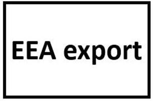

Kundmachung vom 4. Juli 2023 des Beschlusses Nr. 197/2022 des Gemeinsamen EWR-Ausschusses Beschluss des Gemeinsamen EWR-Ausschusses: 10. Juni 2022 Inkrafttreten für das Fürstentum Liechtenstein: 1. Februar 2023 Aufgrund von Art. 3 Bst. k des Kundmachungsgesetzes vom 17. April 1985, LGBl. 1985 Nr. 41, in der Fassung des Gesetzes vom 22. März 1995, LGBl. 1995 Nr. 101, macht die Regierung im Anhang den Beschluss Nr. 197/2022 des Gemeinsamen EWR-Ausschusses kund. Fürstliche Regierung: gez. Dr. Daniel Risch Fürstlicher Regierungschef Anhang Beschluss des Gemeinsamen EWR‑Ausschusses Nr. 197/2022 vom 10. Juni 2022 zur Änderung von Anhang XVII (Geistiges Eigentum) des EWR-Abkommens Der Gemeinsame EWR-Ausschuss - gestützt auf das Abkommen über den Europäischen Wirtschaftsraum (im Folgenden "EWR-Abkommen"), insbesondere auf Art. 98, in Erwägung nachstehender Gründe: 1. Die Verordnung (EU) 2019/933 des Europäischen Parlaments und des Rates vom 20. Mai 2019 zur Änderung der Verordnung (EG) Nr. 469/2009 über das ergänzende Schutzzertifikat für Arzneimittel ist in das EWR-Abkommen aufzunehmen. 2. Aufgrund des Beschlusses des Gemeinsamen EWR-Ausschusses Nr. 92/2017 vom 5. Mai 2017 erteilt Liechtenstein keine ergänzenden Schutzzertifikate für Arzneimittel gemäss der Verordnung (EG) Nr. 469/2009 des Europäischen Parlaments und des Rates . Die Verordnung (EU) 2019/933 der Kommission sollte daher nicht für Liechtenstein gelten. 3. Anhang XVII des EWR-Abkommens sollte daher entsprechend geändert werden - hat folgenden Beschluss erlassen: Art. 1 In Anhang XVII des EWR-Abkommens wird Nummer 6 (Verordnung (EG) Nr. 469/2009 des Europäischen Parlaments und des Rates) wie folgt geändert: 1. Folgendes wird angefügt: ," geändert durch: - 32019 R 0933 : Verordnung (EU) 2019/933 des Europäischen Parlaments und des Rates vom 20. Mai 2019 (ABl. L 153 vom 11.6.2019, S. 1) " 2. Die Anpassungen a) bis c) werden die Anpassungen b) bis d). 3. Vor Anpassung b) wird folgende Anpassung eingefügt: "a) In Art. 5 Abs. 10 wird für die EFTA-Staaten die Angabe ‚bis zum 1. Juli 2019‘ durch die Angabe ‚bis zum Tag des Inkrafttretens des Beschlusses des Gemeinsamen EWR-Ausschusses Nr. 197/2022 vom 10. Juni 2022‘ ersetzt." 4. Nach Anpassung d) wird folgende Anpassung eingefügt: "e) Für die EFTA-Staaten erhält Anhang -I folgende Fassung: ‚Logo Dieses Logo ist in schwarz und so gross anzubringen, dass es hinreichend erkennbar ist. 

 ‚." Art. 2 Der Wortlaut der Verordnung (EU) Nr. 2019/933 in isländischer und norwegischer Sprache, der in der EWR-Beilage des Amtsblattes der Europäischen Union veröffentlicht wird, ist verbindlich. Art. 3 Dieser Beschluss tritt am 11. Juni 2022 in Kraft, sofern alle Mitteilungen nach Art. 103 Abs. 1 des EWR-Abkommens vorliegen . Art. 4 Dieser Beschluss wird im EWR-Abschnitt und in der EWR-Beilage des Amtsblattes der Europäischen Union veröffentlicht. Geschehen zu Brüssel am 10. Juni 2022. (Es folgen die Unterschriften)
