Kundmachung vom 19. August 2025 der Beschlüsse Nr. 266/2024 bis 269/2024, 275/2024 bis 290/2024, 293/2024, 295/2024 bis 307/2024 und 311/2024 des Gemeinsamen EWR-Ausschusses Beschluss des Gemeinsamen EWR-Ausschusses: 6. Dezember 2024 Inkrafttreten für das Fürstentum Liechtenstein: 7. Dezember 2024 Aufgrund von Art. 3 Bst. k des Kundmachungsgesetzes vom 17. April 1985, LGBl. 1985 Nr. 41, in der Fassung des Gesetzes vom 22. März 1995, LGBl. 1995 Nr. 101, macht die Regierung in den Anhängen 1 bis 35 die Beschlüsse Nr. 266/2024 bis 269/2024, 275/2024 bis 290/2024, 293/2024, 295/2024 bis 307/2024 und 311/2024 des Gemeinsamen EWR-Ausschusses kund. Fürstliche Regierung: gez. Brigitte Haas Fürstliche Regierungschefin Anhang 1 Beschluss des Gemeinsamen EWR-Ausschusses Nr. 266/2024 vom 6. Dezember 2024 zur Änderung von Anhang II (Technische Vorschriften, Normen, Prüfung und Zertifizierung) des EWR-Abkommens Der Gemeinsame EWR-Ausschuss - gestützt auf das Abkommen über den Europäischen Wirtschaftsraum (im Folgenden "EWR-Abkommen"), insbesondere auf Art. 98, in Erwägung nachstehender Gründe: 1. Die Delegierte Verordnung (EU) 2024/1180 der Kommission vom 14. Februar 2024 zur Änderung der Verordnung (EU) 2015/758 des Europäischen Parlaments und des Rates hinsichtlich der Normen für eCall ist in das EWR-Abkommen aufzunehmen. 2. Anhang II des EWR-Abkommens sollte daher entsprechend geändert werden - hat folgenden Beschluss erlassen: Art. 1 In Anhang II Kapitel I des EWR-Abkommens wird unter Nummer 47 (Verordnung (EU) 2015/758 des Europäischen Parlaments und des Rates) folgender Gedankenstrich angefügt: "- 32024 R 1180 : Delegierte Verordnung (EU) 2024/1180 der Kommission vom 14. Februar 2024 (ABl. L, 2024/1180, 19.4.2024)" Art. 2 Der Wortlaut der Delegierten Verordnung (EU) 2024/1180 in isländischer und norwegischer Sprache, der in der EWR-Beilage des Amtsblattes der Europäischen Union veröffentlicht wird, ist verbindlich. Art. 3 Dieser Beschluss tritt am 7. Dezember 2024 in Kraft, sofern alle Mitteilungen nach Art. 103 Abs. 1 des EWR-Abkommens vorliegen. Art. 4 Dieser Beschluss wird im EWR-Abschnitt und in der EWR-Beilage des Amtsblattes der Europäischen Union veröffentlicht. Geschehen zu Brüssel am 6. Dezember 2024. (Es folgen die Unterschriften) Anhang 2 Beschluss des Gemeinsamen EWR-Ausschusses Nr. 267/2024 vom 6. Dezember 2024 zur Änderung von Anhang II (Technische Vorschriften, Normen, Prüfung und Zertifizierung) des EWR-Abkommens Der Gemeinsame EWR-Ausschuss - gestützt auf das Abkommen über den Europäischen Wirtschaftsraum (im Folgenden "EWR-Abkommen"), insbesondere auf Art. 98, in Erwägung nachstehender Gründe: 1. Die Delegierte Verordnung (EU) 2021/1958 der Kommission vom 23. Juni 2021 zur Ergänzung der Verordnung (EU) 2019/2144 des Europäischen Parlaments und des Rates durch Festlegung detaillierter Vorschriften für die spezifischen Prüfverfahren und technischen Anforderungen für die Typgenehmigung von Kraftfahrzeugen hinsichtlich ihrer intelligenten Geschwindigkeitsassistenten und für die Typgenehmigung von intelligenten Geschwindigkeitsassistenten als selbstständige technische Einheiten sowie zur Änderung von Anhang II der genannten Verordnung ist in das EWR-Abkommen aufzunehmen. 2. Die Delegierte Verordnung (EU) 2023/1675 der Kommission vom 26. Juni 2023 zur Berichtigung bestimmter Sprachfassungen der Delegierten Verordnung (EU) 2021/1958 zur Ergänzung der Verordnung (EU) 2019/2144 des Europäischen Parlaments und des Rates durch Festlegung detaillierter Vorschriften für die spezifischen Prüfverfahren und technischen Anforderungen für die Typgenehmigung von Kraftfahrzeugen hinsichtlich ihrer intelligenten Geschwindigkeitsassistenten und für die Typgenehmigung von intelligenten Geschwindigkeitsassistenten als selbstständige technische Einheiten ist in das EWR-Abkommen aufzunehmen. 3. Anhang II des EWR-Abkommens sollte daher entsprechend geändert werden - hat folgenden Beschluss erlassen: Art. 1 Anhang II Kapitel I des EWR-Abkommens wird wie folgt geändert: 1. Unter Nummer 52 (Verordnung (EU) 2019/2144 des Europäischen Parlaments und des Rates) wird folgender Gedankenstrich angefügt: "- 32021 R 1958 : Delegierte Verordnung (EU) 2021/1958 der Kommission vom 23. Juni 2021 (ABl. L 409 vom 17.11.2021, S. 1) " 2. Nach Nummer 52e (Durchführungsverordnung (EU) 2022/1426 der Kommission) wird Folgendes eingefügt: "52f. 32021 R 1958 : Delegierte Verordnung (EU) 2021/1958 der Kommission vom 23. Juni 2021 zur Ergänzung der Verordnung (EU) 2019/2144 des Europäischen Parlaments und des Rates durch Festlegung detaillierter Vorschriften für die spezifischen Prüfverfahren und technischen Anforderungen für die Typgenehmigung von Kraftfahrzeugen hinsichtlich ihrer intelligenten Geschwindigkeitsassistenten und für die Typgenehmigung von intelligenten Geschwindigkeitsassistenten als selbstständige technische Einheiten sowie zur Änderung von Anhang II der genannten Verordnung (ABl. L 409 vom 17.11.2021, S. 1) , geändert durch: - 32023 R 1675 : Delegierte Verordnung (EU) 2023/1675 der Kommission vom 26. Juni 2023 (ABl. L 216 vom 1.9.2023, S. 9) Die Verordnung gilt für die Zwecke des EWR-Abkommens mit folgenden Anpassungen: In Anhang II Teil 5 wird Folgendes angefügt: "30. Island ZEICHEN SONSTIGE RELEVANTE ANGABEN ERWARTETE IAS-RÜCKMELDUNG IN KM/H M1 M2 M3 N1 N2 N3 Explizite numerische Geschwindigkeitsbegrenzungszeichen 

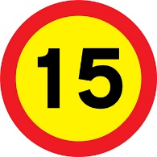

 B26.15 Örtliche Geschwindigkeitsbegrenzung Explizit 15 15 15 15 15 15 

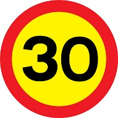

 B26.30 Örtliche Geschwindigkeitsbegrenzung Explizit 30 30 30 30 30 30 

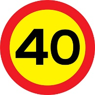

 B26.40 Örtliche Geschwindigkeitsbegrenzung 40 40 40 40 40 40 

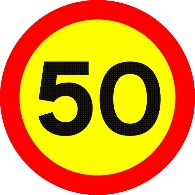

 B26.50 Örtliche Geschwindigkeitsbegrenzung Explizit 50 50 50 50 50 50 

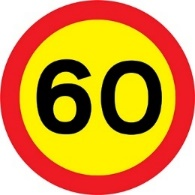

 B26.60 Örtliche Geschwindigkeitsbegrenzung Explizit 60 60 60 60 60 60 

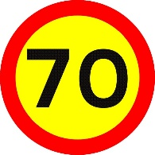

 B26.70 Örtliche Geschwindigkeitsbegrenzung Explizit 70 70 70 70 70 70 

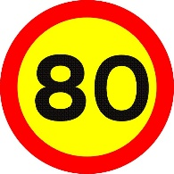

 B26.80 Örtliche Geschwindigkeitsbegrenzung Explizit 80 80 80 80 80 80 

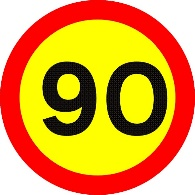

 B26.90 Örtliche Geschwindigkeitsbegrenzung Explizit 90 90 90 90 90 90 

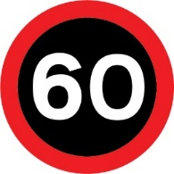

 362.60 (362.xx) Variable örtliche Geschwindigkeitsbegrenzung (xx = 30, 40, 50, 60, 70, 80, 90) Explizit 30, 40, 50, 60, 70, 80, 90 30, 40, 50, 60, 70, 80, 90 30, 40, 50, 60, 70, 80, 90 30, 40, 50, 60, 70, 80, 90 30, 40, 50, 60, 70, 80, 90 30, 40, 50, 60, 70, 80, 90 Implizite numerische Geschwindigkeitsbegrenzungszeichen 

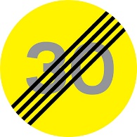

 B27.30 Ende der örtlichen Geschwindigkeitsbegrenzung Explizit N N N N N N 

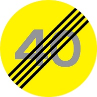

 B27.40 Ende der örtlichen Geschwindigkeitsbegrenzung Explizit N N N N N N 

 B27.50 Ende der örtlichen Geschwindigkeitsbegrenzung Explizit N N N N N N 

 B27.60 Ende der örtlichen Geschwindigkeitsbegrenzung Explizit N N N N N N 

 B27.70 Ende der örtlichen Geschwindigkeitsbegrenzung Explizit N N N N N N 

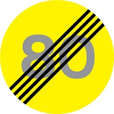

 B27.80 Ende der örtlichen Geschwindigkeitsbegrenzung Explizit N N N N N N 

 363.60 (363.xx) Ende der variablen örtlichen Geschwindigkeitsbegrenzung (xx = 30, 40, 50, 60, 70, 80) Explizit N N N N N N Implizite nicht-numerische Geschwindigkeitsbegrenzungszeichen 

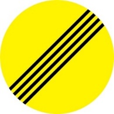

 B34.11 Ende der Verbote N N N N N N Numerische Zonen 

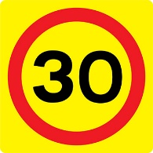

 B 28.30 Zone mit örtlicher Geschwindigkeitsbegrenzung Explizit 30 30 30 30 30 30 

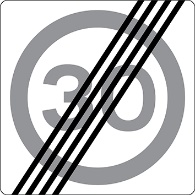

 B 29.30 Ende der Zone mit örtlicher Geschwindigkeitsbegrenzung Explizit N N N N N N 

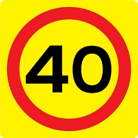

 B 28.40 Zone mit örtlicher Geschwindigkeitsbegrenzung Explizit 40 40 40 40 40 40 

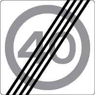

 B 29.40 Ende der Zone mit örtlicher Geschwindigkeitsbegrenzung Explizit N N N N N N 

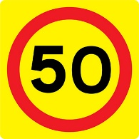

 B 28.50 Zone mit örtlicher Geschwindigkeitsbegrenzung Explizit 50 50 50 50 50 50 

 B 29.50 Ende der Zone mit örtlicher Geschwindigkeitsbegrenzung Explizit N N N N N N Verkehrsberuhigter Bereich 

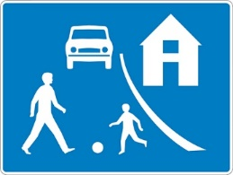

 D14.11 Zone mit Wohngebiet (Wohn- und Spielbereich) Implizit 15 15 15 15 15 15 

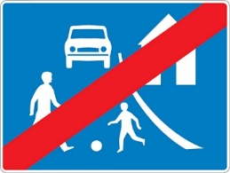

 D14.21 Ende der Zone mit Wohngebiet (Wohn- und Spielbereich) Implizit N N N N N N 

 548 Fussgängerzone Implizit 10 10 10 10 10 10 

 550 Ende der Fussgängerzone Implizit N N N N N N Stadt-/Ortsgrenzen 

 D12.11 Bebautes Gebiet (implizit) Hinweis: Dies ist ein implizites Geschwindigkeitsbegrenzungszeichen, das die für innerorts geltende nationale Geschwindigkeitsbegrenzung anzeigt. 50 50 50 50 50 50 

 D12.21 Ende des bebauten Gebiets Hinweis: Dies ist ein implizites Geschwindigkeitsbegrenzungszeichen, das die für ausserorts geltende nationale Geschwindigkeitsbegrenzung anzeigt. Auf befestigten Strassen 90 km/h, auf unbefestigten Strassen 80 km/h. 90/80 90/80 90/80 90/80 90/80 90/80 ‘" Art. 2 Der Wortlaut der Delegierten Verordnungen (EU) 2021/1958 und (EU) 2023/1675 in isländischer und norwegischer Sprache, der in der EWR-Beilage des Amtsblattes der Europäischen Union veröffentlicht wird, ist verbindlich. Art. 3 Dieser Beschluss tritt am 7. Dezember 2024 in Kraft, sofern alle Mitteilungen nach Art. 103 Abs. 1 des EWR-Abkommens vorliegen. Art. 4 Dieser Beschluss wird im EWR-Abschnitt und in der EWR-Beilage des Amtsblattes der Europäischen Union veröffentlicht. Geschehen zu Brüssel am 6. Dezember 2024. (Es folgen die Unterschriften) Anhang 3 Beschluss des Gemeinsamen EWR-Ausschusses Nr. 268/2024 vom 6. Dezember 2024 zur Änderung von Anhang II (Technische Vorschriften, Normen, Prüfung und Zertifizierung) des EWR-Abkommens Der Gemeinsame EWR-Ausschuss - gestützt auf das Abkommen über den Europäischen Wirtschaftsraum (im Folgenden "EWR-Abkommen"), insbesondere auf Art. 98, in Erwägung nachstehender Gründe: 1. Die Delegierte Verordnung (EU) 2023/2590 der Kommission vom 13. Juli 2023 zur Ergänzung der Verordnung (EU) 2019/2144 des Europäischen Parlaments und des Rates durch Festlegung detaillierter Vorschriften für die spezifischen Prüfverfahren und technischen Anforderungen für die Typgenehmigung von bestimmten Kraftfahrzeugen hinsichtlich ihrer hochentwickelten Warnsysteme bei nachlassender Konzentration des Fahrers sowie zur Änderung der genannten Verordnung ist in das EWR-Abkommen aufzunehmen. 2. Anhang II des EWR-Abkommens sollte daher entsprechend geändert werden - hat folgenden Beschluss erlassen: Art. 1 Anhang II Kapitel I des EWR-Abkommens wird wie folgt geändert: 1. Unter Nummer 52 (Verordnung (EU) 2019/2144 des Europäischen Parlaments und des Rates) wird folgender Gedankenstrich angefügt: "- 32023 R 2590 : Delegierte Verordnung (EU) 2023/2590 der Kommission vom 13. Juli 2023 (ABl. L, 2023/2590, 22.11.2023)" 2. Nach Nummer 52f (Delegierte Verordnung (EU) 2021/1958 der Kommission) wird folgende Nummer eingefügt: "52g. 32023 R 2590 : Delegierte Verordnung (EU) 2023/2590 der Kommission vom 13. Juli 2023 zur Ergänzung der Verordnung (EU) 2019/2144 des Europäischen Parlaments und des Rates durch Festlegung detaillierter Vorschriften für die spezifischen Prüfverfahren und technischen Anforderungen für die Typgenehmigung von bestimmten Kraftfahrzeugen hinsichtlich ihrer hochentwickelten Warnsysteme bei nachlassender Konzentration des Fahrers sowie zur Änderung der genannten Verordnung (ABl. L, 2023/2590, 22.11.2023)" Art. 2 Der Wortlaut der Delegierten Verordnung (EU) 2023/2590 in isländischer und norwegischer Sprache, der in der EWR-Beilage des Amtsblattes der Europäischen Union veröffentlicht wird, ist verbindlich. Art. 3 Dieser Beschluss tritt am 7. Dezember 2024 in Kraft, sofern alle Mitteilungen nach Art. 103 Abs. 1 des EWR-Abkommens vorliegen. Art. 4 Dieser Beschluss wird im EWR-Abschnitt und in der EWR-Beilage des Amtsblattes der Europäischen Union veröffentlicht. Geschehen zu Brüssel am 6. Dezember 2024. (Es folgen die Unterschriften) Anhang 4 Beschluss des Gemeinsamen EWR-Ausschusses Nr. 269/2024 vom 6. Dezember 2024 zur Änderung von Anhang II (Technische Vorschriften, Normen, Prüfung und Zertifizierung) des EWR-Abkommens Der Gemeinsame EWR-Ausschuss - gestützt auf das Abkommen über den Europäischen Wirtschaftsraum (im Folgenden "EWR-Abkommen"), insbesondere auf Art. 98, in Erwägung nachstehender Gründe: 1. Die Durchführungsverordnung (EU) 2024/1721 der Kommission vom 19. Juni 2024 zur Festlegung von Vorschriften für die Anwendung der Verordnung (EU) 2019/2144 des Europäischen Parlaments und des Rates im Hinblick auf Muster für die Genehmigung des intelligenten Geschwindigkeitsassistenten, des Warnsystems bei Müdigkeit und nachlassender Aufmerksamkeit des Fahrers, des Ereignisdatenspeichers, der Vorrichtung zum Einbau einer alkoholempfindlichen Wegfahrsperre und des hochentwickelten Warnsystems bei nachlassender Konzentration des Fahrers ist in das EWR-Abkommen aufzunehmen. 2. Anhang II des EWR-Abkommens sollte daher entsprechend geändert werden - hat folgenden Beschluss erlassen: Art. 1 In Anhang II Kapitel I des EWR-Abkommens wird nach Nummer 52g (Delegierte Verordnung (EU) 2023/2590 der Kommission) folgende Nummer eingefügt: "52h. 32024 R 1721 : Durchführungsverordnung (EU) 2024/1721 der Kommission vom 19. Juni 2024 zur Festlegung von Vorschriften für die Anwendung der Verordnung (EU) 2019/2144 des Europäischen Parlaments und des Rates im Hinblick auf Muster für die Genehmigung des intelligenten Geschwindigkeitsassistenten, des Warnsystems bei Müdigkeit und nachlassender Aufmerksamkeit des Fahrers, des Ereignisdatenspeichers, der Vorrichtung zum Einbau einer alkoholempfindlichen Wegfahrsperre und des hochentwickelten Warnsystems bei nachlassender Konzentration des Fahrers (ABl. L, 2024/1721, 20.6.2024)" Art. 2 Der Wortlaut der Durchführungsverordnung (EU) 2024/1721 in isländischer und norwegischer Sprache, der in der EWR-Beilage des Amtsblattes der Europäischen Union veröffentlicht wird, ist verbindlich. Art. 3 Dieser Beschluss tritt am 7. Dezember 2024 in Kraft, sofern alle Mitteilungen nach Art. 103 Abs. 1 des EWR-Abkommens vorliegen. Art. 4 Dieser Beschluss wird im EWR-Abschnitt und in der EWR-Beilage des Amtsblattes der Europäischen Union veröffentlicht. Geschehen zu Brüssel am 6. Dezember 2024. (Es folgen die Unterschriften) Anhang 5 Beschluss des Gemeinsamen EWR-Ausschusses Nr. 275/2024 vom 6. Dezember 2024 zur Änderung von Anhang II (Technische Vorschriften, Normen, Prüfung und Zertifizierung) und Anhang IV (Energie) des EWR-Abkommens Der Gemeinsame EWR-Ausschuss - gestützt auf das Abkommen über den Europäischen Wirtschaftsraum (im Folgenden "EWR-Abkommen"), insbesondere auf Art. 98, in Erwägung nachstehender Gründe: 1. Die Delegierte Verordnung (EU) 2023/2048 der Kommission vom 4. Juli 2023 zur Berichtigung der Delegierten Verordnungen (EU) Nr. 626/2011, (EU) 2019/2015, (EU) 2019/2016 und (EU) 2019/2018 in Bezug auf die Anforderungen an die Energieverbrauchskennzeichnung von Luftkonditionierern, Lichtquellen, Kühlgeräten und Kühlgeräten mit Direktverkaufsfunktion ist in das EWR-Abkommen aufzunehmen. 2. Die Anhänge II und IV des EWR-Abkommens sollten daher entsprechend geändert werden - hat folgenden Beschluss erlassen: Art. 1 In Anhang II Kapitel IV des EWR-Abkommens wird unter den Nummern 4m (Delegierte Verordnung (EU) Nr. 626/2011 der Kommission), 4x (Delegierte Verordnung (EU) 2019/2015 der Kommission), 4y (Delegierte Verordnung (EU) 2019/2016 der Kommission) und 4za (Delegierte Verordnung (EU) 2019/2018 der Kommission) folgender Gedankenstrich angefügt: "- 32023 R 2048 : Delegierte Verordnung (EU) 2023/2048 der Kommission vom 4. Juli 2023 (ABl. L 236 vom 26.9.2023, S. 1) " Art. 2 In Anhang IV des EWR-Abkommens wird unter den Nummern 11m (Delegierte Verordnung (EU) Nr. 626/2011 der Kommission), 11x (Delegierte Verordnung (EU) 2019/2015 der Kommission), 11y (Delegierte Verordnung (EU) 2019/2016 der Kommission) und 11za (Delegierte Verordnung (EU) 2019/2018 der Kommission) folgender Gedankenstrich angefügt: "- 32023 R 2048 : Delegierte Verordnung (EU) 2023/2048 der Kommission vom 4. Juli 2023 (ABl. L 236 vom 26.9.2023, S. 1) " Art. 3 Der Wortlaut der Delegierten Verordnung (EU) 2023/2048 in isländischer und norwegischer Sprache, der in der EWR-Beilage des Amtsblattes der Europäischen Union veröffentlicht wird, ist verbindlich. Art. 4 Dieser Beschluss tritt am 7. Dezember 2024 in Kraft, sofern alle Mitteilungen nach Art. 103 Abs. 1 des EWR-Abkommens vorliegen. Art. 5 Dieser Beschluss wird im EWR-Abschnitt und in der EWR-Beilage des Amtsblattes der Europäischen Union veröffentlicht. Geschehen zu Brüssel am 6. Dezember 2024. (Es folgen die Unterschriften) Anhang 6 Beschluss des Gemeinsamen EWR-Ausschusses Nr. 276/2024 vom 6. Dezember 2024 zur Änderung von Anhang II (Technische Vorschriften, Normen, Prüfung und Zertifizierung) des EWR-Abkommens Der Gemeinsame EWR-Ausschuss - gestützt auf das Abkommen über den Europäischen Wirtschaftsraum (im Folgenden "EWR-Abkommen"), insbesondere auf Art. 98, in Erwägung nachstehender Gründe: 1. Die Durchführungsverordnung (EU) 2024/859 der Kommission vom 18. März 2024 zur Änderung der Verordnung (EU) Nr. 37/2010 in Bezug auf die Einstufung des Stoffs Natriumsalicylat hinsichtlich der Rückstandshöchstmenge in Lebensmitteln tierischen Ursprungs ist in das EWR-Abkommen aufzunehmen. 2. Die Durchführungsverordnung (EU) 2024/860 der Kommission vom 18. März 2024 zur Änderung der Verordnung (EU) Nr. 37/2010 in Bezug auf den Wirkstoff 17β-Östradiol ist in das EWR-Abkommen aufzunehmen. 3. Anhang II des EWR-Abkommens sollte daher entsprechend geändert werden - hat folgenden Beschluss erlassen: Art. 1 In Anhang II Kapitel XIII des EWR-Abkommens werden unter Nummer 13 (Verordnung (EU) Nr. 37/2010 der Kommission) folgende Gedankenstriche angefügt: "- 32024 R 0859 : Durchführungsverordnung (EU) 2024/859 der Kommission vom 18. März 2024 (ABl. L, 2024/859, 19.3.2024) - 32024 R 0860 : Durchführungsverordnung (EU) 2024/860 der Kommission vom 18. März 2024 (ABl. L, 2024/860, 19.3.2024)" Art. 2 Der Wortlaut der Durchführungsverordnungen (EU) 2024/859 und (EU) 2024/860 in isländischer und norwegischer Sprache, der in der EWR-Beilage des Amtsblattes der Europäischen Union veröffentlicht wird, ist verbindlich. Art. 3 Dieser Beschluss tritt am 7. Dezember 2024 in Kraft, sofern alle Mitteilungen nach Art. 103 Abs. 1 des EWR-Abkommens vorliegen. Art. 4 Dieser Beschluss wird im EWR-Abschnitt und in der EWR-Beilage des Amtsblattes der Europäischen Union veröffentlicht. Geschehen zu Brüssel am 6. Dezember 2024. (Es folgen die Unterschriften) Anhang 7 Beschluss des Gemeinsamen EWR-Ausschusses Nr. 277/2024 vom 6. Dezember 2024 zur Änderung von Anhang II (Technische Vorschriften, Normen, Prüfung und Zertifizierung) des EWR-Abkommens Der Gemeinsame EWR-Ausschuss - gestützt auf das Abkommen über den Europäischen Wirtschaftsraum (im Folgenden "EWR-Abkommen"), insbesondere auf Art. 98, in Erwägung nachstehender Gründe: 1. Die Delegierte Verordnung (EU) 2024/1331 der Kommission vom 28. Februar 2024 zur Änderung der Verordnung (EG) Nr. 273/2004 des Europäischen Parlaments und des Rates und der Verordnung (EG) Nr. 111/2005 des Rates betreffend die Aufnahme des Drogenausgangsstoffes Isopropyliden (2-(3,4-methylenodioxiphenyl)acetyl)malonat (IMDPAM) und anderer Stoffe in die Liste der erfassten Stoffe ist in das EWR-Abkommen aufzunehmen. 2. Anhang II des EWR-Abkommens sollte daher entsprechend geändert werden - hat folgenden Beschluss erlassen: Art. 1 In Anhang II Kapitel XIII des EWR-Abkommens wird unter Nummer 15x (Verordnung (EG) Nr. 273/2004 des Europäischen Parlaments und des Rates) folgender Gedankenstrich angefügt: "- 32024 R 1331 : Delegierte Verordnung (EU) 2024/1331 der Kommission vom 28. Februar 2024 (ABl. L, 2024/1331, 14.5.2024)" Art. 2 Der Wortlaut der Delegierten Verordnung (EU) 2024/1331 in isländischer und norwegischer Sprache, der in der EWR-Beilage des Amtsblattes der Europäischen Union veröffentlicht wird, ist verbindlich. Art. 3 Dieser Beschluss tritt am 7. Dezember 2024 in Kraft, sofern alle Mitteilungen nach Art. 103 Abs. 1 des EWR-Abkommens vorliegen. Art. 4 Dieser Beschluss wird im EWR-Abschnitt und in der EWR-Beilage des Amtsblattes der Europäischen Union veröffentlicht. Geschehen zu Brüssel am 6. Dezember 2024. (Es folgen die Unterschriften) Anhang 8 Beschluss des Gemeinsamen EWR-Ausschusses Nr. 278/2024 vom 6. Dezember 2024 zur Änderung von Anhang II (Technische Vorschriften, Normen, Prüfung und Zertifizierung) des EWR-Abkommens Der Gemeinsame EWR-Ausschuss - gestützt auf das Abkommen über den Europäischen Wirtschaftsraum (im Folgenden "EWR-Abkommen"), insbesondere auf Art. 98, in Erwägung nachstehender Gründe: 1. Die Delegierte Verordnung (EU) 2023/905 der Kommission vom 27. Februar 2023 zur Ergänzung der Verordnung (EU) 2019/6 des Europäischen Parlaments und des Rates im Hinblick auf die Anwendung des Verbots der Verwendung bestimmter antimikrobieller Arzneimittel in Bezug auf Tiere oder Erzeugnisse tierischen Ursprungs, die aus Drittländern in die Union ausgeführt werden , ist in das EWR-Abkommen aufzunehmen. 2. Anhang II des EWR-Abkommens sollte daher entsprechend geändert werden - hat folgenden Beschluss erlassen: Art. 1 In Anhang II Kapitel XIII des EWR-Abkommens wird nach Nummer 22k (Durchführungsverordnung (EU) 2022/1255 der Kommission) folgende Nummer eingefügt: "22l. 32023 R 0905 : Delegierte Verordnung (EU) 2023/905 der Kommission vom 27. Februar 2023 zur Ergänzung der Verordnung (EU) 2019/6 des Europäischen Parlaments und des Rates im Hinblick auf die Anwendung des Verbots der Verwendung bestimmter antimikrobieller Arzneimittel in Bezug auf Tiere oder Erzeugnisse tierischen Ursprungs, die aus Drittländern in die Union ausgeführt werden (ABl. L 116 vom 4.5.2023, S. 1) " Art. 2 Der Wortlaut der Delegierten Verordnung (EU) 2023/905 in isländischer und norwegischer Sprache, der in der EWR-Beilage des Amtsblattes der Europäischen Union veröffentlicht wird, ist verbindlich. Art. 3 Dieser Beschluss tritt am 7. Dezember 2024 in Kraft, sofern alle Mitteilungen nach Art. 103 Abs. 1 des EWR-Abkommens vorliegen. Art. 4 Dieser Beschluss wird im EWR-Abschnitt und in der EWR-Beilage des Amtsblattes der Europäischen Union veröffentlicht. Geschehen zu Brüssel am 6. Dezember 2024. (Es folgen die Unterschriften) Anhang 9 Beschluss des Gemeinsamen EWR-Ausschusses Nr. 279/2024 vom 6. Dezember 2024 zur Änderung von Anhang II (Technische Vorschriften, Normen, Prüfung und Zertifizierung) des EWR-Abkommens Der Gemeinsame EWR-Ausschuss - gestützt auf das Abkommen über den Europäischen Wirtschaftsraum (im Folgenden "EWR-Abkommen"), insbesondere auf Art. 98, in Erwägung nachstehender Gründe: 1. Die Durchführungsverordnung (EU) 2024/875 der Kommission vom 21. März 2024 zur Annahme einer Liste von in der gesamten Union gebräuchlichen Abkürzungen und Piktogrammen, die für die Zwecke von Art. 10 Abs. 2 und Art. 11 Abs. 3 der Verordnung (EU) 2019/6 des Europäischen Parlaments und des Rates auf der Verpackung von Tierarzneimitteln zu verwenden sind , ist in das EWR-Abkommen aufzunehmen. 2. Die Durchführungsverordnung (EU) 2024/878 der Kommission vom 21. März 2024 zur Festlegung einheitlicher Vorschriften über die Grösse kleiner Primärverpackungseinheiten von Tierarzneimitteln gemäss Art. 12 der Verordnung (EU) 2019/6 des Europäischen Parlaments und des Rates ist in das EWR-Abkommen aufzunehmen. 3. Anhang II des EWR-Abkommens sollte daher entsprechend geändert werden - hat folgenden Beschluss erlassen: Art. 1 In Anhang II Kapitel XIII des EWR-Abkommens werden nach Nummer 22l (Delegierte Verordnung (EU) 2023/905 der Kommission) folgende Nummern eingefügt: "22m. 32024 R 0875 : Durchführungsverordnung (EU) 2024/875 der Kommission vom 21. März 2024 zur Annahme einer Liste von in der gesamten Union gebräuchlichen Abkürzungen und Piktogrammen, die für die Zwecke von Art. 10 Abs. 2 und Art. 11 Abs. 3 der Verordnung (EU) 2019/6 des Europäischen Parlaments und des Rates auf der Verpackung von Tierarzneimitteln zu verwenden sind (ABl. L, 2024/875, 22.3.2024) 22n. 32024 R 0878 : Durchführungsverordnung (EU) 2024/878 der Kommission vom 21. März 2024 zur Festlegung einheitlicher Vorschriften über die Grösse kleiner Primärverpackungseinheiten von Tierarzneimitteln gemäss Art. 12 der Verordnung (EU) 2019/6 des Europäischen Parlaments und des Rates (ABl. L, 2024/878, 22.3.2024)" Art. 2 Der Wortlaut der Durchführungsverordnungen (EU) 2024/875 und (EU) 2024/878 in isländischer und norwegischer Sprache, der in der EWR-Beilage des Amtsblattes der Europäischen Union veröffentlicht wird, ist verbindlich. Art. 3 Dieser Beschluss tritt am 7. Dezember 2024 in Kraft, sofern alle Mitteilungen nach Art. 103 Abs. 1 des EWR-Abkommens vorliegen. Art. 4 Dieser Beschluss wird im EWR-Abschnitt und in der EWR-Beilage des Amtsblattes der Europäischen Union veröffentlicht. Geschehen zu Brüssel am 6. Dezember 2024. (Es folgen die Unterschriften) Anhang 10 Beschluss des Gemeinsamen EWR-Ausschusses Nr. 280/2024 vom 6. Dezember 2024 zur Änderung von Anhang II (Technische Vorschriften, Normen, Prüfung und Zertifizierung) des EWR-Abkommens Der Gemeinsame EWR-Ausschuss - gestützt auf das Abkommen über den Europäischen Wirtschaftsraum (im Folgenden "EWR-Abkommen"), insbesondere auf Art. 98, in Erwägung nachstehender Gründe: 1. Die Verordnung (EU) 2024/1328 der Kommission vom 16. Mai 2024 zur Änderung des Anhangs XVII der Verordnung (EG) Nr. 1907/2006 des Europäischen Parlaments und des Rates zur Registrierung, Bewertung, Zulassung und Beschränkung chemischer Stoffe (REACH) betreffend Octamethylcyclotetrasiloxan (D4), Decamethylcyclopentasiloxan (D5) und Dodecamethylcyclohexasiloxan (D6) ist in das EWR-Abkommen aufzunehmen. 2. Anhang II des EWR-Abkommens sollte daher entsprechend geändert werden - hat folgenden Beschluss erlassen: Art. 1 In Anhang II Kapitel XV des EWR-Abkommens wird unter Nummer 12zc (Verordnung (EG) Nr. 1907/2006 des Europäischen Parlaments und des Rates) folgender Gedankenstrich angefügt: "- 32024 R 1328 : Verordnung (EU) 2024/1328 der Kommission vom 16. Mai 2024 (ABl. L, 2024/1328, 17.5.2024)" Art. 2 Der Wortlaut der Verordnung (EU) 2024/1328 in isländischer und norwegischer Sprache, der in der EWR-Beilage des Amtsblattes der Europäischen Union veröffentlicht wird, ist verbindlich. Art. 3 Dieser Beschluss tritt am 7. Dezember 2024 in Kraft, sofern alle Mitteilungen nach Art. 103 Abs. 1 des EWR-Abkommens vorliegen. Art. 4 Dieser Beschluss wird im EWR-Abschnitt und in der EWR-Beilage des Amtsblattes der Europäischen Union veröffentlicht. Geschehen zu Brüssel am 6. Dezember 2024. (Es folgen die Unterschriften) Anhang 11 Beschluss des Gemeinsamen EWR-Ausschusses Nr. 281/2024 vom 6. Dezember 2024 zur Änderung von Anhang II (Technische Vorschriften, Normen, Prüfung und Zertifizierung) des EWR-Abkommens Der Gemeinsame EWR-Ausschuss - gestützt auf das Abkommen über den Europäischen Wirtschaftsraum (im Folgenden "EWR-Abkommen"), insbesondere auf Art. 98, in Erwägung nachstehender Gründe: 1. Die Delegierte Verordnung (EU) 2024/1682 der Kommission vom 4. März 2024 zur Änderung der Verordnung (EU) 2019/1009 des Europäischen Parlaments und des Rates hinsichtlich der Hinzufügung von verarbeiteter Gülle als Komponentenmaterial in EU-Düngeprodukten ist in das EWR-Abkommen aufzunehmen. 2. Anhang II des EWR-Abkommens sollte daher entsprechend geändert werden - hat folgenden Beschluss erlassen: Art. 1 In Anhang II Kapitel XIV des EWR-Abkommens wird unter Nummer 1 (Verordnung (EU) 2019/1009 des Europäischen Parlaments und des Rates) folgender Gedankenstrich angefügt: "- 32024 R 1682 : Delegierte Verordnung (EU) 2024/1682 der Kommission vom 4. März 2024 (ABl. L, 2024/1682, 13.6.2024)" Art. 2 Der Wortlaut der Delegierten Verordnung (EU) 2024/1682 in isländischer und norwegischer Sprache, der in der EWR-Beilage des Amtsblattes der Europäischen Union veröffentlicht wird, ist verbindlich. Art. 3 Dieser Beschluss tritt am 7. Dezember 2024 in Kraft, sofern alle Mitteilungen nach Art. 103 Abs. 1 des EWR-Abkommens vorliegen. Art. 4 Dieser Beschluss wird im EWR-Abschnitt und in der EWR-Beilage des Amtsblattes der Europäischen Union veröffentlicht. Geschehen zu Brüssel am 6. Dezember 2024. (Es folgen die Unterschriften) Anhang 12 Beschluss des Gemeinsamen EWR-Ausschusses Nr. 282/2024 vom 6. Dezember 2024 zur Änderung von Anhang II (Technische Vorschriften, Normen, Prüfung und Zertifizierung) des EWR-Abkommens Der Gemeinsame EWR-Ausschuss - gestützt auf das Abkommen über den Europäischen Wirtschaftsraum (im Folgenden "EWR-Abkommen"), insbesondere auf Art. 98, in Erwägung nachstehender Gründe: 1. Die Verordnung (EU) 2024/2462 der Kommission vom 19. September 2024 zur Änderung von Anhang XVII der Verordnung (EG) Nr. 1907/2006 des Europäischen Parlaments und des Rates hinsichtlich Undecafluorhexansäure (PFHxA), ihrer Salze und PFHxA-verwandter Stoffe ist in das EWR-Abkommen aufzunehmen. 2. Anhang II des EWR-Abkommens sollte daher entsprechend geändert werden - hat folgenden Beschluss erlassen: Art. 1 In Anhang II Kapitel XV des EWR-Abkommens wird unter Nummer 12zc (Verordnung (EG) Nr. 1907/2006 des Europäischen Parlaments und des Rates) folgender Gedankenstrich angefügt: "- 32024 R 2462 :Verordnung (EU) 2024/2462 der Kommission vom 19. September 2024 ( ABl. L, 2024/2462, 20.9.2024)" Art. 2 Der Wortlaut der Verordnung (EU) 2024/2462 in isländischer und norwegischer Sprache, der in der EWR-Beilage des Amtsblattes der Europäischen Union veröffentlicht wird, ist verbindlich. Art. 3 Dieser Beschluss tritt am 7. Dezember 2024 in Kraft, sofern alle Mitteilungen nach Art. 103 Abs. 1 des EWR-Abkommens vorliegen. Art. 4 Dieser Beschluss wird im EWR-Abschnitt und in der EWR-Beilage des Amtsblattes der Europäischen Union veröffentlicht. Geschehen zu Brüssel am 6. Dezember 2024. (Es folgen die Unterschriften) Anhang 13 Beschluss des Gemeinsamen EWR-Ausschusses Nr. 283/2024 vom 6. Dezember 2024 zur Änderung von Anhang II (Technische Vorschriften, Normen, Prüfung und Zertifizierung) des EWR-Abkommens Der Gemeinsame EWR-Ausschuss - gestützt auf das Abkommen über den Europäischen Wirtschaftsraum (im Folgenden "EWR-Abkommen"), insbesondere auf Art. 98, in Erwägung nachstehender Gründe: 1. Die Delegierte Verordnung (EU) 2024/2564 der Kommission vom 19. Juni 2024 zur Änderung der Verordnung (EG) Nr. 1272/2008 des Europäischen Parlaments und des Rates hinsichtlich der harmonisierten Einstufung und Kennzeichnung bestimmter Stoffe ist in das EWR-Abkommen aufzunehmen. 2. Anhang II des EWR-Abkommens sollte daher entsprechend geändert werden - hat folgenden Beschluss erlassen: Art. 1 In Anhang II Kapitel XV des EWR-Abkommens wird unter Nummer 12zze (Verordnung (EG) Nr. 1272/2008 des Europäischen Parlaments und des Rates) folgender Gedankenstrich angefügt: "- 32024 R 2564 : Delegierte Verordnung (EU) 2024/2564 der Kommission vom 19. Juni 2024 (ABl. L, 2024/2564, 30.9.2024)" Art. 2 Der Wortlaut der Delegierten Verordnung (EU) 2024/2564 in isländischer und norwegischer Sprache, der in der EWR-Beilage des Amtsblattes der Europäischen Union veröffentlicht wird, ist verbindlich. Art. 3 Dieser Beschluss tritt am 7. Dezember 2024 in Kraft, sofern alle Mitteilungen nach Art. 103 Abs. 1 des EWR-Abkommens vorliegen. Art. 4 Dieser Beschluss wird im EWR-Abschnitt und in der EWR-Beilage des Amtsblattes der Europäischen Union veröffentlicht. Geschehen zu Brüssel am 6. Dezember 2024. (Es folgen die Unterschriften) Anhang 14 Beschluss des Gemeinsamen EWR-Ausschusses Nr. 284/2024 vom 6. Dezember 2024 zur Änderung von Anhang II (Technische Vorschriften, Normen, Prüfung und Zertifizierung) des EWR-Abkommens Der Gemeinsame EWR-Ausschuss - gestützt auf das Abkommen über den Europäischen Wirtschaftsraum (im Folgenden "EWR-Abkommen"), insbesondere auf Art. 98, in Erwägung nachstehender Gründe: 1. Die Durchführungsverordnung (EU) 2024/1696 der Kommission vom 19. Juni 2024 zur Aufhebung der Genehmigung für den Wirkstoff Acibenzolar-S-methyl gemäss der Verordnung (EG) Nr. 1107/2009 des Europäischen Parlaments und des Rates, zur Änderung der Durchführungsverordnung (EU) Nr. 540/2011 der Kommission und zur Aufhebung der Durchführungsverordnung (EU) 2016/389 der Kommission ist in das EWR-Abkommen aufzunehmen. 2. Die Durchführungsverordnung (EU) 2024/1718 der Kommission vom 19. Juni 2024 zur Änderung der Durchführungsverordnungen (EU) 2020/617 und (EU) Nr. 540/2011 hinsichtlich der Bedingungen der Genehmigung für den Wirkstoff Metalaxyl-M ist in das EWR-Abkommen aufzunehmen. 3. Die Durchführungsverordnung (EU) 2024/1892 der Kommission vom 10. Juli 2024 zur Änderung der Durchführungsverordnung (EU) Nr. 540/2011 hinsichtlich der Verlängerung der Laufzeit der Genehmigung für die Wirkstoffe Amisulbrom, S-Abscisinsäure, Thiencarbazon und Valifenalat ist in das EWR-Abkommen aufzunehmen. 4. Die Durchführungsverordnung (EU) 2016/389 , die in das EWR-Abkommen aufgenommen wurde, wird mit der Durchführungsverordnung (EU) 2024/1696 aufgehoben und ist daher aus dem EWR-Abkommen zu streichen. 5. Anhang II des EWR-Abkommens sollte daher entsprechend geändert werden - hat folgenden Beschluss erlassen: Art. 1 Anhang II Kapitel XV des EWR-Abkommens wird wie folgt geändert: 1. Nummer 13a (Durchführungsverordnung (EU) Nr. 540/2011 der Kommission) wird wie folgt geändert: i) Der Text des hundertfünfundsiebzigsten Gedankenstrichs (Durchführungsverordnung (EU) 2016/389 der Kommission) wird gestrichen. ii) Unter Nummer 13a werden folgende Gedankenstriche angefügt: "- 32024 R 1696 : Durchführungsverordnung (EU) 2024/1696 der Kommission vom 19. Juni 2024 (ABl. L, 2024/1696, 20.6.2024) - 32024 R 1718 : Durchführungsverordnung (EU) 2024/1718 der Kommission vom 19. Juni 2024 (ABl. L, 2024/1718, 20.6.2024) - 32024 R 1892 : Durchführungsverordnung (EU) 2024/1892 der Kommission vom 10. Juli 2024 (ABl. L, 2024/1892, 11.7.2024)" 2. Unter Nummer 13zzzzzzzzzzr (Durchführungsverordnung (EU) 2020/617 der Kommission) wird Folgendes angefügt: ", geändert durch: - 32024 R 1718 : Durchführungsverordnung (EU) 2024/1718 der Kommission vom 19. Juni 2024 (ABl. L, 2024/1718, 20.6.2024)" 3. Nach Nummer 13zzzzzzzzzzzzzzl (Durchführungsverordnung (EU) 2024/836 der Kommission) wird folgende Nummer eingefügt: "13zzzzzzzzzzzzzzm. 32024 R 1696 : Durchführungsverordnung (EU) 2024/1696 der Kommission vom 19. Juni 2024 zur Aufhebung der Genehmigung für den Wirkstoff Acibenzolar-S-methyl gemäss der Verordnung (EG) Nr. 1107/2009 des Europäischen Parlaments und des Rates, zur Änderung der Durchführungsverordnung (EU) Nr. 540/2011 der Kommission und zur Aufhebung der Durchführungsverordnung (EU) 2016/389 der Kommission (ABl. L, 2024/1696, 20.6.2024)" 4. Der Text von Nummer 13zzzzzzb (Durchführungsverordnung (EU) 2016/389 der Kommission) wird gestrichen. Art. 2 Der Wortlaut der Durchführungsverordnungen (EU) 2024/1696, (EU) 2024/1718 und (EU) 2024/1892 in isländischer und norwegischer Sprache, der in der EWR-Beilage des Amtsblattes der Europäischen Union veröffentlicht wird, ist verbindlich. Art. 3 Dieser Beschluss tritt am 7. Dezember 2024 in Kraft, sofern alle Mitteilungen nach Art. 103 Abs. 1 des EWR-Abkommens vorliegen. Art. 4 Dieser Beschluss wird im EWR-Abschnitt und in der EWR-Beilage des Amtsblattes der Europäischen Union veröffentlicht. Geschehen zu Brüssel am 6. Dezember 2024. (Es folgen die Unterschriften) Anhang 15 Beschluss des Gemeinsamen EWR-Ausschusses Nr. 285/2024 vom 6. Dezember 2024 zur Änderung von Anhang II (Technische Vorschriften, Normen, Prüfung und Zertifizierung) des EWR-Abkommens Der Gemeinsame EWR-Ausschuss - gestützt auf das Abkommen über den Europäischen Wirtschaftsraum (im Folgenden "EWR-Abkommen"), insbesondere auf Art. 98, in Erwägung nachstehender Gründe: 1. Die Verordnung (EU) 2024/1487 der Kommission vom 29. Mai 2024 zur Festlegung der Datenanforderungen für die Genehmigung von Safenern und Synergisten und zur Erstellung eines Arbeitsprogramms für die schrittweise Überprüfung der auf dem Markt befindlichen Safener und Synergisten gemäss der Verordnung (EG) Nr. 1107/2009 des Europäischen Parlaments und des Rates ist in das EWR-Abkommen aufzunehmen. 2. Die Durchführungsverordnung (EU) 2024/324 der Kommission vom 19. Januar 2024 zur Änderung der Durchführungsverordnung (EU) Nr. 540/2011 hinsichtlich der Verlängerung der Laufzeit der Genehmigung für die Wirkstoffe Benzovindiflupyr, Bromuconazol, Buprofezin, Cyflufenamid, Fluazinam, Fluopyram, Flutolanil, Lambda-Cyhalothrin, Mecoprop-P, Mepiquat, Metsulfuron-methyl, Phosphan und Pyraclostrobin ist in das EWR-Abkommen aufzunehmen. 3. Die Durchführungsverordnung (EU) 2024/1734 der Kommission vom 21. Juni 2024 zur Änderung der Durchführungsverordnung (EU) Nr. 686/2012 betreffend die Übertragung der Überprüfung des Wirkstoffs Deltamethrin auf Mitgliedstaaten zum Zweck des Erneuerungsverfahrens ist in das EWR-Abkommen aufzunehmen. 4. Die Durchführungsverordnung (EU) 2024/1749 der Kommission vom 24. Juni 2024 zur Erneuerung der Genehmigung für den Wirkstoff Metconazol als Substitutionskandidat gemäss der Verordnung (EG) Nr. 1107/2009 des Europäischen Parlaments und des Rates und zur Änderung der Durchführungsverordnung (EU) Nr. 540/2011 der Kommission ist in das EWR-Abkommen aufzunehmen. 5. Die Durchführungsverordnung (EU) 2024/1768 der Kommission vom 26. Juni 2024 zur Genehmigung des Grundstoffs Onobrychis viciifolia (Saat-Esparsette) in Form von getrockneten Pellets gemäss der Verordnung (EG) Nr. 1107/2009 des Europäischen Parlaments und des Rates und zur Änderung der Durchführungsverordnung (EU) Nr. 540/2011 der Kommission ist in das EWR-Abkommen aufzunehmen. 6. Anhang II des EWR-Abkommens sollte daher entsprechend geändert werden - hat folgenden Beschluss erlassen: Art. 1 Anhang II Kapitel XV des EWR-Abkommens wird wie folgt geändert: 1. Unter Nummer 13a (Durchführungsverordnung (EU) Nr. 540/2011 der Kommission) werden folgende Gedankenstriche angefügt: "- 32024 R 0324 : Durchführungsverordnung (EU) 2024/324 der Kommission vom 19. Januar 2024 (ABl. L, 2024/324, 22.1.2024) - 32024 R 1749 : Durchführungsverordnung (EU) 2024/1749 der Kommission vom 24. Juni 2024 (ABl. L, 2024/1749, 25.6.2024) - 32024 R 1768 : Durchführungsverordnung (EU) 2024/1768 der Kommission vom 26. Juni 2024 (ABl. L, 2024/1768, 27.6.2024)" 2. Unter Nummer 13zzze (Durchführungsverordnung (EU) Nr. 686/2012 der Kommission) wird folgender Gedankenstrich angefügt: "- 32024 R 1734 : Durchführungsverordnung (EU) 2024/1734 der Kommission vom 21. Juni 2024 (ABl. L, 2024/1734, 24.6.2024)" 3. Nach Nummer 13zzzzzzzzzzzzzzm (Durchführungsverordnung (EU) 2024/836 der Kommission) werden folgende Nummern eingefügt: "13zzzzzzzzzzzzzzn. 32024 R 1487 : Verordnung (EU) 2024/1487 der Kommission vom 29. Mai 2024 zur Festlegung der Datenanforderungen für die Genehmigung von Safenern und Synergisten und zur Erstellung eines Arbeitsprogramms für die schrittweise Überprüfung der auf dem Markt befindlichen Safener und Synergisten gemäss der Verordnung (EG) Nr. 1107/2009 des Europäischen Parlaments und des Rates (ABl. L, 2024/1487, 30.5.2024) 13zzzzzzzzzzzzzzo. 32024 R 1749 : Durchführungsverordnung (EU) 2024/1749 der Kommission vom 24. Juni 2024 zur Erneuerung der Genehmigung für den Wirkstoff Metconazol als Substitutionskandidat gemäss der Verordnung (EG) Nr. 1107/2009 des Europäischen Parlaments und des Rates und zur Änderung der Durchführungsverordnung (EU) Nr. 540/2011 der Kommission (ABl. L, 2024/1749, 25.6.2024) 13zzzzzzzzzzzzzzp. 32024 R 1768 : Durchführungsverordnung (EU) 2024/1768 der Kommission vom 26. Juni 2024 zur Genehmigung des Grundstoffs Onobrychis viciifolia (Saat-Esparsette) in Form von getrockneten Pellets gemäss der Verordnung (EG) Nr. 1107/2009 des Europäischen Parlaments und des Rates und zur Änderung der Durchführungsverordnung (EU) Nr. 540/2011 der Kommission (ABl. L, 2024/1768, 27.6.2024)" Art. 2 Der Wortlaut der Verordnung (EU) 2024/1487 sowie der Durchführungsverordnungen (EU) 2024/324, (EU) 2024/1734, (EU) 2024/1749 und (EU) 2024/1768 in isländischer und norwegischer Sprache, der in der EWR-Beilage des Amtsblattes der Europäischen Union veröffentlicht wird, ist verbindlich. Art. 3 Dieser Beschluss tritt am 7. Dezember 2024 in Kraft, sofern alle Mitteilungen nach Art. 103 Abs. 1 des EWR-Abkommens vorliegen. Art. 4 Dieser Beschluss wird im EWR-Abschnitt und in der EWR-Beilage des Amtsblattes der Europäischen Union veröffentlicht. Geschehen zu Brüssel am 6. Dezember 2024. (Es folgen die Unterschriften) Anhang 16 Beschluss des Gemeinsamen EWR-Ausschusses Nr. 286/2024 vom 6. Dezember 2024 zur Änderung von Anhang II (Technische Vorschriften, Normen, Prüfung und Zertifizierung) des EWR-Abkommens Der Gemeinsame EWR-Ausschuss - gestützt auf das Abkommen über den Europäischen Wirtschaftsraum (im Folgenden "EWR-Abkommen"), insbesondere auf Art. 98, in Erwägung nachstehender Gründe: 1. Die Durchführungsverordnung (EU) 2020/2151 der Kommission vom 17. Dezember 2020 zur Festlegung harmonisierter Kennzeichnungsvorschriften für in Teil D des Anhangs der Richtlinie (EU) 2019/904 des Europäischen Parlaments und des Rates über die Verringerung der Auswirkungen bestimmter Kunststoffprodukte auf die Umwelt aufgeführte Einwegkunststoffartikel ist in das EWR-Abkommen aufzunehmen. 2. Anhang II des EWR-Abkommens sollte daher entsprechend geändert werden - hat folgenden Beschluss erlassen: Art. 1 In Anhang II Kapitel XVII des EWR-Abkommens wird nach Nummer 9dc (Durchführungsbeschluss (EU) 2022/162 der Kommission) folgende Nummer eingefügt: "9dd. 32020 R 2151 : Durchführungsverordnung (EU) 2020/2151 der Kommission vom 17. Dezember 2020 zur Festlegung harmonisierter Kennzeichnungsvorschriften für in Teil D des Anhangs der Richtlinie (EU) 2019/904 des Europäischen Parlaments und des Rates über die Verringerung der Auswirkungen bestimmter Kunststoffprodukte auf die Umwelt aufgeführte Einwegkunststoffartikel (ABl. L 428 vom 18.12.2020, S. 57) " Art. 2 Der Wortlaut der Durchführungsverordnung (EU) 2020/2151 in isländischer und norwegischer Sprache, der in der EWR-Beilage des Amtsblattes der Europäischen Union veröffentlicht wird, ist verbindlich. Art. 3 Dieser Beschluss tritt am 7. Dezember 2024 in Kraft, sofern alle Mitteilungen nach Art. 103 Abs. 1 des EWR-Abkommens vorliegen. Art. 4 Dieser Beschluss wird im EWR-Abschnitt und in der EWR-Beilage des Amtsblattes der Europäischen Union veröffentlicht. Geschehen zu Brüssel am 6. Dezember 2024. (Es folgen die Unterschriften) Anhang 17 Beschluss des Gemeinsamen EWR-Ausschusses Nr. 287/2024 vom 6. Dezember 2024 zur Änderung von Anhang II (Technische Vorschriften, Normen, Prüfung und Zertifizierung) des EWR-Abkommens Der Gemeinsame EWR-Ausschuss - gestützt auf das Abkommen über den Europäischen Wirtschaftsraum (im Folgenden "EWR-Abkommen"), insbesondere auf Art. 98, in Erwägung nachstehender Gründe: 1. Der Durchführungsbeschluss (EU) 2024/1944 der Kommission vom 5. Juli 2024 zur Änderung des Durchführungsbeschlusses (EU) 2019/450 hinsichtlich der Veröffentlichung der Referenznummern Europäischer Bewertungsdokumente für Wärmedämmplatten aus mikroporöser Kieselsäure und Elemente aus Polyurethan-Hartschaum (PUR) für die Befestigung von Anbauteilen an Aussenwänden sowie andere Bauprodukte ist in das EWR-Abkommen aufzunehmen. 2. Anhang II des EWR-Abkommens sollte daher entsprechend geändert werden - hat folgenden Beschluss erlassen: Art. 1 In Anhang II Kapitel XXI des EWR-Abkommens wird unter Nummer 1zzp (Durchführungsbeschluss (EU) 2019/450 der Kommission) folgender Gedankenstrich angefügt: "- 32024 D 1944 : Durchführungsbeschluss (EU) 2024/1944 der Kommission vom 5. Juli 2024 (ABl. L, 2024/1944, 11.7.2024)" Art. 2 Der Wortlaut des Durchführungsbeschlusses (EU) 2024/1944 in isländischer und norwegischer Sprache, der in der EWR-Beilage des Amtsblattes der Europäischen Union veröffentlicht wird, ist verbindlich. Art. 3 Dieser Beschluss tritt am 7. Dezember 2024 in Kraft, sofern alle Mitteilungen nach Art. 103 Abs. 1 des EWR-Abkommens vorliegen. Art. 4 Dieser Beschluss wird im EWR-Abschnitt und in der EWR-Beilage des Amtsblattes der Europäischen Union veröffentlicht. Geschehen zu Brüssel am 6. Dezember 2024. (Es folgen die Unterschriften) Anhang 18 Beschluss des Gemeinsamen EWR-Ausschusses Nr. 288/2024 vom 6. Dezember 2024 zur Änderung von Anhang II (Technische Vorschriften, Normen, Prüfung und Zertifizierung) des EWR-Abkommens Der Gemeinsame EWR-Ausschuss - gestützt auf das Abkommen über den Europäischen Wirtschaftsraum (im Folgenden "EWR-Abkommen"), insbesondere auf Art. 98, in Erwägung nachstehender Gründe: 1. Die Delegierte Verordnung (EU) 2024/1399 der Kommission vom 10. November 2023 über die Bedingungen für die Einstufung von Wand- und Deckenbekleidungen aus Massivholz ohne Prüfung hinsichtlich ihres Brandverhaltens und zur Änderung der Entscheidung 2006/213/EG ist in das EWR-Abkommen aufzunehmen. 2. Anhang II des EWR-Abkommens sollte daher entsprechend geändert werden - hat folgenden Beschluss erlassen: Art. 1 Anhang II Kapitel XXI des EWR-Abkommens wird wie folgt geändert: 1. Unter Nummer 2f (Entscheidung 2006/213/EG der Kommission) wird Folgendes angefügt: ", geändert durch: - 32024 R 1399 : Delegierte Verordnung (EU) 2024/1399 der Kommission vom 10. November 2023 (ABl. L, 2024/1399, 22.5.2024)" 2. Nach Nummer 2f (Beschluss 2006/213/EG der Kommission) wird folgende Nummer eingefügt: "2fa. 32024 R 1399 : Delegierte Verordnung (EU) 2024/1399 der Kommission vom 10. November 2023 über die Bedingungen für die Einstufung von Wand- und Deckenbekleidungen aus Massivholz ohne Prüfung hinsichtlich ihres Brandverhaltens und zur Änderung der Entscheidung 2006/213/EG (ABl. L, 2024/1399, 22.5.2024)" Art. 2 Der Wortlaut der Delegierten Verordnung (EU) 2024/1399 in isländischer und norwegischer Sprache, der in der EWR-Beilage des Amtsblattes der Europäischen Union veröffentlicht wird, ist verbindlich. Art. 3 Dieser Beschluss tritt am 7. Dezember 2024 in Kraft, sofern alle Mitteilungen nach Art. 103 Abs. 1 des EWR-Abkommens vorliegen. Art. 4 Dieser Beschluss wird im EWR-Abschnitt und in der EWR-Beilage des Amtsblattes der Europäischen Union veröffentlicht. Geschehen zu Brüssel am 6. Dezember 2024. (Es folgen die Unterschriften) Anhang 19 Beschluss des Gemeinsamen EWR-Ausschusses Nr. 289/2024 vom 6. Dezember 2024 zur Änderung von Anhang VII (Anerkennung von Berufsqualifikationen) des EWR-Abkommens Der Gemeinsame EWR-Ausschuss - gestützt auf das Abkommen über den Europäischen Wirtschaftsraum (im Folgenden "EWR-Abkommen"), insbesondere auf Art. 98, in Erwägung nachstehender Gründe: 1. Die Delegierte Richtlinie (EU) 2024/782 der Kommission vom 4. März 2024 zur Änderung der Richtlinie 2005/36/EG des Europäischen Parlaments und des Rates hinsichtlich der Mindestanforderungen an die Ausbildung der Berufe der Krankenschwester und des Krankenpflegers für allgemeine Pflege, des Zahnarztes und des Apothekers ist in das EWR-Abkommen aufzunehmen. 2. Der Delegierte Beschluss (EU) 2024/1395 der Kommission vom 5. März 2024 zur Änderung der Richtlinie 2005/36/EG des Europäischen Parlaments und des Rates hinsichtlich der Ausbildungsnachweise und Titel von Ausbildungsgängen ist in das EWR-Abkommen aufzunehmen. 3. Anhang VII des EWR-Abkommens sollte daher entsprechend geändert werden - hat folgenden Beschluss erlassen: Art. 1 In Anhang VII des EWR-Abkommens werden unter Nummer 1 (Richtlinie 2005/36/EG des Europäischen Parlaments und des Rates) folgende Gedankenstriche angefügt: "- 32024 L 0782 : Delegierte Richtlinie (EU) 2024/782 der Kommission vom 4. März 2024 (ABl. L, 2024/782, 31.5.2024) - 32024 D 1395 : Delegierter Beschluss (EU) 2024/1395 der Kommission vom 5. März 2024 (ABl. L, 2024/1395, 31.5.2024)" Art. 2 Der Wortlaut der Delegierten Richtlinie (EU) 2024/782 und des Delegierten Beschlusses (EU) 2024/1395 in isländischer und norwegischer Sprache, der in der EWR-Beilage des Amtsblattes der Europäischen Union veröffentlicht wird, ist verbindlich. Art. 3 Dieser Beschluss tritt am 7. Dezember 2024 in Kraft, sofern alle Mitteilungen nach Art. 103 Abs. 1 des EWR-Abkommens vorliegen. Art. 4 Dieser Beschluss wird im EWR-Abschnitt und in der EWR-Beilage des Amtsblattes der Europäischen Union veröffentlicht. Geschehen zu Brüssel am 6. Dezember 2024. (Es folgen die Unterschriften) Anhang 20 Beschluss des Gemeinsamen EWR-Ausschusses Nr. 290/2024 vom 6. Dezember 2024 zur Änderung von Anhang IX (Finanzdienstleistungen) des EWR-Abkommens Der Gemeinsame EWR-Ausschuss - gestützt auf das Abkommen über den Europäischen Wirtschaftsraum (im Folgenden "EWR-Abkommen"), insbesondere auf Art. 98, in Erwägung nachstehender Gründe: 1. Die Durchführungsverordnung (EU) 2024/1820 der Kommission vom 1. Juli 2024 zur Änderung der in der Durchführungsverordnung (EU) 2016/1800 der Kommission festgelegten technischen Durchführungsstandards im Hinblick auf die Tabellen mit der Zuweisung der Ratings externer Ratingagenturen zu einer objektiven Skala von Bonitätsstufen gemäss der Richtlinie 2009/138/EG des Europäischen Parlaments und des Rates ist in das EWR-Abkommen aufzunehmen. 2. Anhang IX des EWR-Abkommens sollte daher entsprechend geändert werden - hat folgenden Beschluss erlassen: Art. 1 In Anhang IX des EWR-Abkommens wird unter Nummer 1w (Durchführungsverordnung (EU) 2016/1800 der Kommission) folgender Gedankenstrich angefügt: "- 32024 R 1820 : Durchführungsverordnung (EU) 2024/1820 der Kommission vom 1. Juli 2024 (ABl. L, 2024/1820, 2.7.2024)" Art. 2 Der Wortlaut der Durchführungsverordnung (EU) 2024/1820 in isländischer und norwegischer Sprache, der in der EWR-Beilage des Amtsblattes der Europäischen Union veröffentlicht wird, ist verbindlich. Art. 3 Dieser Beschluss tritt am 7. Dezember 2024 in Kraft, sofern alle Mitteilungen nach Art. 103 Abs. 1 des EWR-Abkommens vorliegen. Art. 4 Dieser Beschluss wird im EWR-Abschnitt und in der EWR-Beilage des Amtsblattes der Europäischen Union veröffentlicht. Geschehen zu Brüssel am 6. Dezember 2024. (Es folgen die Unterschriften) Anhang 21 Beschluss des Gemeinsamen EWR-Ausschusses Nr. 293/2024 vom 6. Dezember 2024 zur Änderung von Anhang IX (Finanzdienstleistungen) des EWR-Abkommens Der Gemeinsame EWR-Ausschuss - gestützt auf das Abkommen über den Europäischen Wirtschaftsraum (im Folgenden "EWR-Abkommen"), insbesondere auf Art. 98, in Erwägung nachstehender Gründe: 1. Die Durchführungsverordnung (EU) 2024/1872 der Kommission vom 1. Juli 2024 zur Änderung der in der Durchführungsverordnung (EU) 2016/1799 der Kommission festgelegten technischen Durchführungsstandards im Hinblick auf die Zuordnungstabellen mit den Entsprechungen zwischen den Bonitätsbeurteilungen durch externe Ratingagenturen und den in der Verordnung (EU) Nr. 575/2013 des Europäischen Parlaments und des Rates genannten Bonitätsstufen ist in das EWR-Abkommen aufzunehmen. 2. Anhang IX des EWR-Abkommens sollte daher entsprechend geändert werden - hat folgenden Beschluss erlassen: Art. 1 In Anhang IX des EWR-Abkommens wird unter Nummer 14azc (Durchführungsverordnung (EU) 2016/1799 der Kommission) folgender Gedankenstrich angefügt: "- 32024 R 1872 : Durchführungsverordnung (EU) 2024/1872 der Kommission vom 1. Juli 2024 (ABl. L, 2024/1872, 5.7.2024)." Art. 2 Der Wortlaut der Durchführungsverordnung (EU) 2024/1872 in isländischer und norwegischer Sprache, der in der EWR-Beilage des Amtsblattes der Europäischen Union veröffentlicht wird, ist verbindlich. Art. 3 Dieser Beschluss tritt am 7. Dezember 2024 in Kraft, sofern alle Mitteilungen nach Art. 103 Abs. 1 des EWR-Abkommens vorliegen . Art. 4 Dieser Beschluss wird im EWR-Abschnitt und in der EWR-Beilage des Amtsblattes der Europäischen Union veröffentlicht. Geschehen zu Brüssel am 6. Dezember 2024. (Es folgen die Unterschriften) Anhang 22 Beschluss des Gemeinsamen EWR-Ausschusses Nr. 295/2024 vom 6. Dezember 2024 zur Änderung von Anhang XIII (Verkehr) des EWR-Abkommens Der Gemeinsame EWR-Ausschuss - gestützt auf das Abkommen über den Europäischen Wirtschaftsraum (im Folgenden "EWR-Abkommen"), insbesondere auf Art. 98, in Erwägung nachstehender Gründe: 1. Die Delegierte Verordnung (EU) 2022/1012 der Kommission vom 7. April 2022 zur Ergänzung der Verordnung (EG) Nr. 561/2006 des Europäischen Parlaments und des Rates hinsichtlich der Festlegung von Normen für das Dienstleistungsniveau und das Sicherheitsniveau von sicheren und gesicherten Parkflächen sowie der Verfahren für deren Zertifizierung ist in das EWR-Abkommen aufzunehmen. 2. Anhang XIII des EWR-Abkommens sollte daher entsprechend geändert werden - hat folgenden Beschluss erlassen: Art. 1 In Anhang XIII des EWR-Abkommens wird nach Nummer 24eb (Verordnung (EU) Nr. 581/2010 der Kommission) folgende Nummer eingefügt: "24ec. 32022 R 1012 : Delegierte Verordnung (EU) 2022/1012 der Kommission vom 7. April 2022 zur Ergänzung der Verordnung (EG) Nr. 561/2006 des Europäischen Parlaments und des Rates hinsichtlich der Festlegung von Normen für das Dienstleistungsniveau und das Sicherheitsniveau von sicheren und gesicherten Parkflächen sowie der Verfahren für deren Zertifizierung (ABl. L 170 vom 28.6.2022, S. 27) ." Art. 2 Der Wortlaut der Delegierten Verordnung (EU) 2022/1012 in isländischer und norwegischer Sprache, der in der EWR-Beilage des Amtsblattes der Europäischen Union veröffentlicht wird, ist verbindlich. Art. 3 Dieser Beschluss tritt am 7. Dezember 2024 in Kraft, sofern alle Mitteilungen nach Art. 103 Abs. 1 des EWR-Abkommens vorliegen . Art. 4 Dieser Beschluss wird im EWR-Abschnitt und in der EWR-Beilage des Amtsblattes der Europäischen Union veröffentlicht. Geschehen zu Brüssel am 6. Dezember 2024. (Es folgen die Unterschriften) Anhang 23 Beschluss des Gemeinsamen EWR-Ausschusses Nr. 296/2024 vom 6. Dezember 2024 zur Änderung von Anhang XIII (Verkehr) des EWR-Abkommens Der Gemeinsame EWR-Ausschuss - gestützt auf das Abkommen über den Europäischen Wirtschaftsraum (im Folgenden "EWR-Abkommen"), insbesondere auf Art. 98, in Erwägung nachstehender Gründe: 1. Die Durchführungsverordnung (EU) 2023/893 der Kommission vom 21. April 2023 zur Änderung der Verordnung (EU) 2015/340 zur Festlegung technischer Vorschriften und von Verwaltungsverfahren in Bezug auf Lizenzen und Bescheinigungen von Fluglotsen ist in das EWR-Abkommen aufzunehmen. 2. Die Durchführungsverordnung (EU) 2023/989 der Kommission vom 22. Mai 2023 zur Änderung der Verordnung (EU) Nr. 1321/2014 der Kommission über die Aufrechterhaltung der Lufttüchtigkeit von Luftfahrzeugen und luftfahrttechnischen Erzeugnissen, Teilen und Ausrüstungen und die Erteilung von Genehmigungen für Organisationen und Personen, die diese Tätigkeiten ausführen, sowie zur Berichtigung jener Verordnung ist in das EWR-Abkommen aufzunehmen. 3. Anhang XIII des EWR-Abkommens sollte daher entsprechend geändert werden - hat folgenden Beschluss erlassen: Art. 1 Anhang XIII des EWR-Abkommens wird wie folgt geändert: 1. Unter Nummer 66nj (Verordnung (EU) 2015/340 der Kommission) wird folgender Gedankenstrich angefügt: "- 32023 R 0893 : Durchführungsverordnung (EU) 2023/893 der Kommission vom 21. April 2023 (ABl. L 118 vom 4.5.2023, S. 1) " 2. Unter Nummer 66q (Verordnung (EU) Nr. 1321/2014 der Kommission) wird folgender Gedankenstrich angefügt: "- 32023 R 0989 : Durchführungsverordnung (EU) 2023/989 der Kommission vom 22. Mai 2023 (ABl. L 135 vom 23.5.2023, S. 53) " Art. 2 Der Wortlaut der Durchführungsverordnungen (EU) 2023/893 und (EU) 2023/989 in isländischer und norwegischer Sprache, der in der EWR-Beilage des Amtsblattes der Europäischen Union veröffentlicht wird, ist verbindlich. Art. 3 Dieser Beschluss tritt am 7. Dezember 2024 in Kraft, sofern alle Mitteilungen nach Art. 103 Abs. 1 des EWR-Abkommens vorliegen . Art. 4 Dieser Beschluss wird im EWR-Abschnitt und in der EWR-Beilage des Amtsblattes der Europäischen Union veröffentlicht. Geschehen zu Brüssel am 6. Dezember 2024. (Es folgen die Unterschriften) Anhang 24 Beschluss des Gemeinsamen EWR-Ausschusses Nr. 297/2024 vom 6. Dezember 2024 zur Änderung von Anhang XIII (Verkehr) des EWR-Abkommens Der Gemeinsame EWR-Ausschuss - gestützt auf das Abkommen über den Europäischen Wirtschaftsraum (im Folgenden "EWR-Abkommen"), insbesondere auf Art. 98, in Erwägung nachstehender Gründe: 1. Die Delegierte Verordnung (EU) 2023/1028 der Kommission vom 20. März 2023 zur Änderung der Verordnung (EU) Nr. 748/2012 hinsichtlich der Begriffsbestimmung für technisch komplizierte motorgetriebene Luftfahrzeuge und zur Berichtigung jener Verordnung ist in das EWR-Abkommen aufzunehmen. 2. Anhang XIII des EWR-Abkommens sollte daher entsprechend geändert werden - hat folgenden Beschluss erlassen: Art. 1 In Anhang XIII des EWR-Abkommens wird unter Nummer 66p (Verordnung (EU) Nr. 748/2012 der Kommission) folgender Gedankenstrich angefügt: "- 32023 R 1028 : Delegierte Verordnung (EU) 2023/1028 der Kommission vom 20. März 2023 (ABl. L 139 vom 26.5.2023, S. 10) ." Art. 2 Der Wortlaut der Delegierten Verordnung (EU) 2023/1028 in isländischer und norwegischer Sprache, der in der EWR-Beilage des Amtsblattes der Europäischen Union veröffentlicht wird, ist verbindlich. Art. 3 Dieser Beschluss tritt am 7. Dezember 2024 in Kraft, sofern alle Mitteilungen nach Art. 103 Abs. 1 des EWR-Abkommens vorliegen . Art. 4 Dieser Beschluss wird im EWR-Abschnitt und in der EWR-Beilage des Amtsblattes der Europäischen Union veröffentlicht. Geschehen zu Brüssel am 6. Dezember 2024. (Es folgen die Unterschriften) Anhang 25 Beschluss des Gemeinsamen EWR-Ausschusses Nr. 298/2024 vom 6. Dezember 2024 zur Änderung von Anhang XIII (Verkehr) des EWR-Abkommens Der Gemeinsame EWR-Ausschuss - gestützt auf das Abkommen über den Europäischen Wirtschaftsraum (im Folgenden "EWR-Abkommen"), insbesondere auf Art. 98, in Erwägung nachstehender Gründe: 1. Der Durchführungsbeschluss (EU) 2024/1688 der Kommission vom 12. Juni 2024 zur Festlegung unionsweit geltender Leistungsziele für das Luftverkehrsmanagementnetz für den vierten Bezugszeitraum (vom 1. Januar 2025 bis zum 31. Dezember 2029) ist in das EWR-Abkommen aufzunehmen. 2. Anhang XIII des EWR-Abkommens sollte daher entsprechend geändert werden - hat folgenden Beschluss erlassen: Art. 1 In Anhang XIII des EWR-Abkommens wird nach Nummer 66xk (Durchführungsverordnung (EU) 2019/317 der Kommission) folgende Nummer eingefügt: "66xka. 32024 D 1688 : Durchführungsbeschluss (EU) 2024/1688 der Kommission vom 12. Juni 2024 zur Festlegung unionsweit geltender Leistungsziele für das Luftverkehrsmanagementnetz für den vierten Bezugszeitraum (vom 1. Januar 2025 bis zum 31. Dezember 2029) (ABl. L, 2024/1688, 17.6.2024)." Art. 2 Der Wortlaut des Durchführungsbeschlusses (EU) 2024/1688 in isländischer und norwegischer Sprache, der in der EWR-Beilage des Amtsblattes der Europäischen Union veröffentlicht wird, ist verbindlich. Art. 3 Dieser Beschluss tritt am 7. Dezember 2024 in Kraft, sofern alle Mitteilungen nach Art. 103 Abs. 1 des EWR-Abkommens vorliegen . Art. 4 Dieser Beschluss wird im EWR-Abschnitt und in der EWR-Beilage des Amtsblattes der Europäischen Union veröffentlicht. Geschehen zu Brüssel am 6. Dezember 2024. (Es folgen die Unterschriften) Anhang 26 Beschluss des Gemeinsamen EWR-Ausschusses Nr. 299/2024 vom 6. Dezember 2024 zur Änderung von Anhang XIII (Verkehr) des EWR-Abkommens Der Gemeinsame EWR-Ausschuss - gestützt auf das Abkommen über den Europäischen Wirtschaftsraum (im Folgenden "EWR-Abkommen"), insbesondere auf Art. 98, in Erwägung nachstehender Gründe: 1. Der Beschluss (EU) 2023/2481 der Kommission vom 10. November 2023 zur Festlegung indikativer Zielbereiche für die unionsweit geltenden Leistungsziele für das Flugverkehrsmanagementnetz im vierten Bezugszeitraum (2025-2029) ist in das EWR-Abkommen aufzunehmen. 2. Anhang XIII des EWR-Abkommens sollte daher entsprechend geändert werden - hat folgenden Beschluss erlassen: Art. 1 In Anhang XIII des EWR-Abkommens wird nach Nummer 66xl (Durchführungsverordnung (EU) 2020/1627 der Kommission) folgende Nummer eingefügt: "66xm. 32023 D 2481 : Beschluss (EU) 2023/2481 der Kommission vom 10. November 2023 zur Festlegung indikativer Zielbereiche für die unionsweit geltenden Leistungsziele für das Flugverkehrsmanagementnetz im vierten Bezugszeitraum (2025-2029) (ABl. L, 2023/2481, 14.11.2023)." Art. 2 Der Wortlaut des Beschlusses (EU) 2023/2481 in isländischer und norwegischer Sprache, der in der EWR-Beilage des Amtsblattes der Europäischen Union veröffentlicht wird, ist verbindlich. Art. 3 Dieser Beschluss tritt am 7. Dezember 2024 in Kraft, sofern alle Mitteilungen nach Art. 103 Abs. 1 des EWR-Abkommens vorliegen . Art. 4 Dieser Beschluss wird im EWR-Abschnitt und in der EWR-Beilage des Amtsblattes der Europäischen Union veröffentlicht. Geschehen zu Brüssel am 6. Dezember 2024. (Es folgen die Unterschriften) Anhang 27 Beschluss des Gemeinsamen EWR-Ausschusses Nr. 300/2024 vom 6. Dezember 2024 zur Änderung von Anhang II (Technische Vorschriften, Normen, Prüfung und Zertifizierung) und Anhang XX (Umweltschutz) des EWR-Abkommens Der Gemeinsame EWR-Ausschuss - gestützt auf das Abkommen über den Europäischen Wirtschaftsraum (im Folgenden "EWR-Abkommen"), insbesondere auf Art. 98, in Erwägung nachstehender Gründe: 1. Die Verordnung (EU) 2019/1010 des Europäischen Parlaments und des Rates vom 5. Juni 2019 zur Angleichung der Berichterstattungspflichten im Bereich der Rechtsvorschriften mit Bezug zur Umwelt und zur Änderung der Verordnungen (EG) Nr. 166/2006 und (EU) Nr. 995/2010 des Europäischen Parlaments und des Rates, der Richtlinien 2002/49/EG, 2004/35/EG, 2007/2/EG, 2009/147/EG und 2010/63/EU des Europäischen Parlaments und des Rates, der Verordnungen (EG) Nr. 338/97 und (EG) Nr. 2173/2005 des Rates und der Richtlinie 86/278/EWG des Rates ist in das EWR-Abkommen aufzunehmen. 2. Die Anhänge II und XX des EWR-Abkommens sollten daher entsprechend geändert werden - hat folgenden Beschluss erlassen: Art. 1 Anhang II des EWR-Abkommens wird wie folgt geändert: 1. In Kapitel XIII wird unter Nummer 7 (Richtlinie 2010/63/EU des Europäischen Parlaments und des Rates) folgender Gedankenstrich angefügt: ", geändert durch: - 32019 R 1010 : Verordnung (EU) 2019/1010 des Europäischen Parlaments und des Rates vom 5. Juni 2019 (ABl. L 170 vom 25.6.2019, S. 115) ." Die Richtlinie gilt für die Zwecke dieses Abkommens mit folgender Anpassung: In Art. 43 Abs. 4 und in Art. 54 Abs. 2 Unterabs. 3 wird folgender Satz angefügt: "Die EFTA-Überwachungsbehörde hat in Bezug auf die EFTA-Staaten Zugang zu dieser Datenbank." 2. In Kapitel XVII wird unter Nummer 9c (Verordnung (EU) Nr. 995/2010 des Europäischen Parlaments und des Rates) folgender Gedankenstrich angefügt: ", geändert durch: - 32019 R 1010 : Verordnung (EU) 2019/1010 des Europäischen Parlaments und des Rates vom 5. Juni 2019 (ABl. L 170 vom 25.6.2019, S. 115) ." Art. 2 Anhang XX des EWR-Abkommens wird wie folgt geändert: 1. Unter Nummer 1h (Verordnung (EG) Nr. 166/2006 des Europäischen Parlaments und des Rates) wird Folgendes angefügt: ", geändert durch: - 32019 R 1010 : Verordnung (EU) 2019/1010 des Europäischen Parlaments und des Rates vom 5. Juni 2019 (ABl. L 170 vom 25.6.2019, S. 115) ." 2. Unter Nummer 1i (Richtlinie 2004/35/EG des Europäischen Parlaments und des Rates) und Nummer 32 (Richtlinie 86/278/EWG des Rates) wird Folgendes angefügt: "- 32019 R 1010 : Verordnung (EU) 2019/1010 des Europäischen Parlaments und des Rates vom 5. Juni 2019 (ABl. L 170 vom 25.6.2019, S. 115) ." 3. Nummer 1j (Richtlinie 2007/2/EG des Europäischen Parlaments und des Rates) wird wie folgt geändert: i) Folgendes wird angefügt: ", geändert durch: - 32019 R 1010 : Verordnung (EU) 2019/1010 des Europäischen Parlaments und des Rates vom 5. Juni 2019 (ABl. L 170 vom 25.6.2019, S. 115) ." ii) In Anpassung b wird die Angabe "Art. 21 Abs. 2 und 3" durch die Angabe "Art. 21 Abs. 2" ersetzt. 4. Unter Nummer 32g (Richtlinie 2002/49/EG des Europäischen Parlaments und des Rates) wird folgender Gedankenstrich angefügt: "- 32019 R 1010 : Verordnung (EU) 2019/1010 des Europäischen Parlaments und des Rates vom 5. Juni 2019 (ABl. L 170 vom 25.6.2019, S. 115) ." Die Richtlinie gilt für die Zwecke dieses Abkommens mit folgenden Anpassungen: a) In Art. 10 Abs. 2 wird folgender Satz angefügt: "Die EFTA-Überwachungsbehörde hat in Bezug auf die EFTA-Staaten Zugang zu dieser Datenablage." b) In Anhang VI Nummer 3 wird folgender Satz angefügt: "Die EFTA-Überwachungsbehörde hat in Bezug auf die EFTA-Staaten Zugang zu diesem Mechanismus für den digitalen Informationsaustausch." Art. 3 Der Wortlaut der Verordnung (EU) 2019/1010 in isländischer und norwegischer Sprache, der in der EWR-Beilage des Amtsblattes der Europäischen Union veröffentlicht wird, ist verbindlich. Art. 4 Dieser Beschluss tritt am 7. Dezember 2024 in Kraft, sofern alle Mitteilungen nach Art. 103 Abs. 1 des EWR-Abkommens vorliegen . Art. 5 Dieser Beschluss wird im EWR-Abschnitt und in der EWR-Beilage des Amtsblattes der Europäischen Union veröffentlicht. Geschehen zu Brüssel am 6. Dezember 2024. (Es folgen die Unterschriften) Anhang 28 Beschluss des Gemeinsamen EWR-Ausschusses Nr. 301/2024 vom 6. Dezember 2024 zur Änderung von Anhang XX (Umweltschutz) des EWR-Abkommens Der Gemeinsame EWR-Ausschuss - gestützt auf das Abkommen über den Europäischen Wirtschaftsraum (im Folgenden "EWR-Abkommen"), insbesondere auf Art. 98, in Erwägung nachstehender Gründe: 1. Die Verordnung (EU) 2023/2431 der Kommission vom 24. Oktober 2023 zur Änderung der Verordnung (EU) Nr. 1089/2010 zur Durchführung der Richtlinie 2007/2/EG des Europäischen Parlaments und des Rates hinsichtlich der Interoperabilität von Geodatensätzen und -diensten ist in das EWR-Abkommen aufzunehmen. 2. Anhang XX des EWR-Abkommens sollte daher entsprechend geändert werden - hat folgenden Beschluss erlassen: Art. 1 In Anhang XX des EWR-Abkommens wird unter Nummer 1je (Verordnung (EU) Nr. 1089/2010 der Kommission) folgender Gedankenstrich angefügt: "- 32023 R 2431 : Verordnung (EU) 2023/2431 der Kommission vom 24. Oktober 2023 (ABl. L, 2023/2431, 30.10.2023)." Art. 2 Der Wortlaut der Verordnung (EU) 2023/2431 in isländischer und norwegischer Sprache, der in der EWR-Beilage des Amtsblattes der Europäischen Union veröffentlicht wird, ist verbindlich. Art. 3 Dieser Beschluss tritt am 7. Dezember 2024 in Kraft, sofern alle Mitteilungen nach Art. 103 Abs. 1 des EWR-Abkommens vorliegen . Art. 4 Dieser Beschluss wird im EWR-Abschnitt und in der EWR-Beilage des Amtsblattes der Europäischen Union veröffentlicht. Geschehen zu Brüssel am 6. Dezember 2024. (Es folgen die Unterschriften) Anhang 29 Beschluss des Gemeinsamen EWR-Ausschusses Nr. 302/2024 vom 6. Dezember 2024 zur Änderung von Anhang XX (Umweltschutz) des EWR-Abkommens Der Gemeinsame EWR-Ausschuss - gestützt auf das Abkommen über den Europäischen Wirtschaftsraum (im Folgenden "EWR-Abkommen"), insbesondere auf Art. 98, in Erwägung nachstehender Gründe: 1. Der Durchführungsbeschluss (EU) 2024/2165 der Kommission vom 1. Juli 2024 über die Veröffentlichung einer Liste mit bestimmten CO 2 -Emissionswerten je Hersteller sowie den durchschnittlichen spezifischen CO 2 -Emissionen aller in der Union zugelassenen neuen schweren Nutzfahrzeuge gemäss der Verordnung (EU) 2019/1242 des Europäischen Parlaments und des Rates für den Berichtszeitraum des Jahres 2021 ist in das EWR-Abkommen aufzunehmen. 2. Anhang XX des EWR-Abkommens sollte daher entsprechend geändert werden - hat folgenden Beschluss erlassen: Art. 1 In Anhang XX des EWR-Abkommens wird nach Nummer 21azkac (Delegierte Verordnung (EU) 2024/1127 der Kommission) folgende Nummer eingefügt: "21azkad. 32024 D 2165 : Durchführungsbeschluss (EU) 2024/2165 der Kommission vom 1. Juli 2024 über die Veröffentlichung einer Liste mit bestimmten CO 2 -Emissionswerten je Hersteller sowie den durchschnittlichen spezifischen CO 2 -Emissionen aller in der Union zugelassenen neuen schweren Nutzfahrzeuge gemäss der Verordnung (EU) 2019/1242 des Europäischen Parlaments und des Rates für den Berichtszeitraum des Jahres 2021 (ABl. L, 2024/2165, 21.8.2024)." Art. 2 Der Wortlaut des Durchführungsbeschlusses (EU) 2024/2165 in isländischer und norwegischer Sprache, der in der EWR-Beilage des Amtsblattes der Europäischen Union veröffentlicht wird, ist verbindlich. Art. 3 Dieser Beschluss tritt am 7. Dezember 2024 in Kraft, sofern alle Mitteilungen nach Art. 103 Abs. 1 des EWR-Abkommens vorliegen . Art. 4 Dieser Beschluss wird im EWR-Abschnitt und in der EWR-Beilage des Amtsblattes der Europäischen Union veröffentlicht. Geschehen zu Brüssel am 6. Dezember 2024. (Es folgen die Unterschriften) Anhang 30 Beschluss des Gemeinsamen EWR-Ausschusses Nr. 303/2024 vom 6. Dezember 2024 zur Änderung von Anhang XX (Umweltschutz) des EWR-Abkommens Der Gemeinsame EWR-Ausschuss - gestützt auf das Abkommen über den Europäischen Wirtschaftsraum (im Folgenden "EWR-Abkommen"), insbesondere auf Art. 98, in Erwägung nachstehender Gründe: 1. Der Durchführungsbeschluss (EU) 2023/2698 der Kommission vom 4. Dezember 2023 zur Spezifikation der Bezugswerte für CO 2 -Emissionen von Gruppen schwerer Nutzfahrzeuge, die nicht unter die Verordnung (EU) 2019/1242 des Europäischen Parlaments und des Rates fallen, gemäss der Richtlinie 1999/62/EG des Europäischen Parlaments und des Rates ist in das EWR-Abkommen aufzunehmen. 2. Anhang XX des EWR-Abkommens sollte daher entsprechend geändert werden - hat folgenden Beschluss erlassen: Art. 1 In Anhang XX des EWR-Abkommens wird nach Nummer 21azkd (Durchführungsverordnung (EU) 2021/941 der Kommission) folgende Nummer eingefügt: "21azke. 32023 D 2698 : Durchführungsbeschluss (EU) 2023/2698 der Kommission vom 4. Dezember 2023 zur Spezifikation der Bezugswerte für CO 2 -Emissionen von Gruppen schwerer Nutzfahrzeuge, die nicht unter die Verordnung (EU) 2019/1242 des Europäischen Parlaments und des Rates fallen, gemäss der Richtlinie 1999/62/EG des Europäischen Parlaments und des Rates (ABl. L, 2023/2698, 6.12.2023)." Art. 2 Der Wortlaut des Durchführungsbeschlusses (EU) 2023/2698 in isländischer und norwegischer Sprache, der in der EWR-Beilage des Amtsblattes der Europäischen Union veröffentlicht wird, ist verbindlich. Art. 3 Dieser Beschluss tritt am 7. Dezember 2024 in Kraft, sofern alle Mitteilungen nach Art. 103 Abs. 1 des EWR-Abkommens vorliegen . Art. 4 Dieser Beschluss wird im EWR-Abschnitt und in der EWR-Beilage des Amtsblattes der Europäischen Union veröffentlicht. Geschehen zu Brüssel am 6. Dezember 2024. (Es folgen die Unterschriften) Anhang 31 Beschluss des Gemeinsamen EWR-Ausschusses Nr. 304/2024 vom 6. Dezember 2024 zur Änderung von Anhang XX (Umweltschutz) des EWR-Abkommens Der Gemeinsame EWR-Ausschuss - gestützt auf das Abkommen über den Europäischen Wirtschaftsraum (im Folgenden "EWR-Abkommen"), insbesondere auf Art. 98, in Erwägung nachstehender Gründe: 1. Die Delegierte Verordnung (EU) 2023/2049 der Kommission vom 14. Juli 2023 zur Änderung der Verordnung (EU) 2017/852 des Europäischen Parlaments und des Rates in Bezug auf mit Quecksilber versetzte Produkte, die einem Herstellungs-, Einfuhr- und Ausfuhrverbot unterliegen , ist in das EWR-Abkommen aufzunehmen. 2. Anhang XX des EWR-Abkommens sollte daher entsprechend geändert werden - hat folgenden Beschluss erlassen: Art. 1 In Anhang XX des EWR-Abkommens wird unter Nummer 22a (Verordnung (EU) Nr. 2017/852 des Europäischen Parlaments und des Rates) folgender Gedankenstrich angefügt: "- 32023 R 2049 : Delegierte Verordnung (EU) 2023/2049 der Kommission vom 14. Juli 2023 (ABl. L 236 vom 26.9.2023, S. 21) " Art. 2 Der Wortlaut der Delegierten Verordnung (EU) 2023/2049 in isländischer und norwegischer Sprache, der in der EWR-Beilage des Amtsblattes der Europäischen Union veröffentlicht wird, ist verbindlich. Art. 3 Dieser Beschluss tritt am 7. Dezember 2024 in Kraft, sofern alle Mitteilungen nach Art. 103 Abs. 1 des EWR-Abkommens vorliegen . Art. 4 Dieser Beschluss wird im EWR-Abschnitt und in der EWR-Beilage des Amtsblattes der Europäischen Union veröffentlicht. Geschehen zu Brüssel am 6. Dezember 2024. (Es folgen die Unterschriften) Anhang 32 Beschluss des Gemeinsamen EWR-Ausschusses Nr. 305/2024 vom 6. Dezember 2024 zur Änderung von Anhang XX (Umweltschutz) des EWR-Abkommens Der Gemeinsame EWR-Ausschuss - gestützt auf das Abkommen über den Europäischen Wirtschaftsraum (im Folgenden "EWR-Abkommen"), insbesondere auf Art. 98, in Erwägung nachstehender Gründe: 1. Der Durchführungsbeschluss (EU) 2024/1956 der Kommission vom 16. Juli 2024 zur Änderung des Durchführungsbeschlusses (EU) 2016/2323 zur Aufstellung der europäischen Liste von Abwrackeinrichtungen gemäss der Verordnung (EU) Nr. 1257/2013 des Europäischen Parlaments und des Rates ist in das EWR-Abkommen aufzunehmen. 2. Anhang XX des EWR-Abkommens sollte daher entsprechend geändert werden - hat folgenden Beschluss erlassen: Art. 1 In Anhang XX des EWR-Abkommens wird unter Nummer 32fhd (Durchführungsbeschluss (EU) 2016/2323 der Kommission) folgender Gedankenstrich angefügt: "- 32024 D 1956 : Durchführungsbeschluss (EU) 2024/1956 der Kommission vom 16. Juli 2024 (ABl. L, 2024/1956, 17.7.2024)" Art. 2 Der Wortlaut des Durchführungsbeschlusses (EU) 2024/1956 in isländischer und norwegischer Sprache, der in der EWR-Beilage des Amtsblattes der Europäischen Union veröffentlicht wird, ist verbindlich. Art. 3 Dieser Beschluss tritt am 7. Dezember 2024 in Kraft, sofern alle Mitteilungen nach Art. 103 Abs. 1 des EWR-Abkommens vorliegen. Art. 4 Dieser Beschluss wird im EWR-Abschnitt und in der EWR-Beilage des Amtsblattes der Europäischen Union veröffentlicht. Geschehen zu Brüssel am 6. Dezember 2024. (Es folgen die Unterschriften) Anhang 33 Beschluss des Gemeinsamen EWR-Ausschusses Nr. 306/2024 vom 6. Dezember 2024 zur Änderung von Anhang XXI (Statistik) des EWR-Abkommens Der Gemeinsame EWR-Ausschuss - gestützt auf das Abkommen über den Europäischen Wirtschaftsraum (im Folgenden "EWR-Abkommen"), insbesondere auf Art. 98, in Erwägung nachstehender Gründe: 1. Die Durchführungsverordnung (EU) 2021/2286 der Kommission vom 16. Dezember 2021 zu den für das Referenzjahr 2023 gemäss der Verordnung (EU) 2018/1091 des Europäischen Parlaments und des Rates über integrierte Statistiken zu landwirtschaftlichen Betrieben zu liefernden Daten hinsichtlich der Liste der Variablen und ihrer Beschreibung sowie zur Aufhebung der Verordnung (EG) Nr. 1200/2009 der Kommission ist in das EWR-Abkommen aufzunehmen. 2. Die Verordnung (EG) Nr. 1200/2009 der Kommission , die in das EWR-Abkommen aufgenommen wurde, wird mit der Durchführungsverordnung (EU) 2021/2286 aufgehoben und ist daher aus dem EWR-Abkommen zu streichen. 3. Gemäss dem Beschluss Nr. 327/2019 des Gemeinsamen EWR-Ausschusses vom 13. Dezember 2019 gilt die Verordnung (EU) 2018/1091 nicht für Liechtenstein, 4. Anhang XXI des EWR-Abkommens sollte daher entsprechend geändert werden - hat folgenden Beschluss erlassen: Art. 1 Der Text von Nummer 23a (Verordnung (EG) Nr. 1200/2009 der Kommission) erhält folgende Fassung: " 32021 R 2286 : Durchführungsverordnung (EU) 2021/2286 der Kommission vom 16. Dezember 2021 zu den für das Referenzjahr 2023 gemäss der Verordnung (EU) 2018/1091 des Europäischen Parlaments und des Rates über integrierte Statistiken zu landwirtschaftlichen Betrieben zu liefernden Daten hinsichtlich der Liste der Variablen und ihrer Beschreibung sowie zur Aufhebung der Verordnung (EG) Nr. 1200/2009 der Kommission (ABl. L 458 vom 22.12.2021, S. 284) " Art. 2 Der Wortlaut der Durchführungsverordnung (EU) 2021/2286 in isländischer und norwegischer Sprache, der in der EWR-Beilage des Amtsblattes der Europäischen Union veröffentlicht wird, ist verbindlich. Art. 3 Dieser Beschluss tritt am 7. Dezember 2024 in Kraft, sofern alle Mitteilungen nach Art. 103 Abs. 1 des EWR-Abkommens vorliegen. Art. 4 Dieser Beschluss wird im EWR-Abschnitt und in der EWR-Beilage des Amtsblattes der Europäischen Union veröffentlicht. Geschehen zu Brüssel am 6. Dezember 2024. (Es folgen die Unterschriften) Anhang 34 Beschluss des Gemeinsamen EWR-Ausschusses Nr. 307/2024 vom 6. Dezember 2024 zur Änderung von Anhang XXII (Gesellschaftsrecht) des EWR-Abkommens Der Gemeinsame EWR-Ausschuss - gestützt auf das Abkommen über den Europäischen Wirtschaftsraum (im Folgenden "EWR-Abkommen"), insbesondere auf Art. 98, in Erwägung nachstehender Gründe: 1. Die Verordnung (EU) 2023/1803 der Kommission vom 13. August 2023 zur Übernahme bestimmter internationaler Rechnungslegungsstandards gemäss der Verordnung (EG) Nr. 1606/2002 des Europäischen Parlaments und des Rates , berichtigt in ABl. L 239 vom 28.9.2023, S. 39 , ist in das EWR-Abkommen aufzunehmen. 2. Die Verordnung (EU) 2023/2468 der Kommission vom 8. November 2023 zur Änderung der Verordnung (EU) 2023/1803 im Hinblick auf den International Accounting Standard 12 ist in das EWR-Abkommen aufzunehmen. 3. Die Verordnung (EU) 2023/2579 der Kommission vom 20. November 2023 zur Änderung der Verordnung (EU) 2023/1803 im Hinblick auf den International Financial Reporting Standard 16 ist in das EWR-Abkommen aufzunehmen. 4. Die Verordnung (EU) 2023/2822 der Kommission vom 19. Dezember 2023 zur Änderung der Verordnung (EU) 2023/1803 im Hinblick auf den International Accounting Standard 1 ist in das EWR-Abkommen aufzunehmen. 5. Anhang XXII des EWR-Abkommens sollte daher entsprechend geändert werden - hat folgenden Beschluss erlassen: Art. 1 In Anhang XXII des EWR-Abkommens wird nach Nummer 10ba (Verordnung (EG) Nr. 1126/2008 der Kommission) Folgendes eingefügt: "10bb. 32023 R 1803 : Verordnung (EU) 2023/1803 der Kommission vom 13. August 2023 zur Übernahme bestimmter internationaler Rechnungslegungsstandards gemäss der Verordnung (EG) Nr. 1606/2002 des Europäischen Parlaments und des Rates (ABl. L 237 vom 26.9.2023, S. 1) , berichtigt in ABl. L 239 vom 28.9.2023, S. 39 , geändert durch: - 32023 R 2468 :Verordnung (EU) 2023/2468 der Kommission vom 8. November 2023 (ABl. L, 2023/2468, 9.11.2023) - 32023 R 2579 : Verordnung (EU) 2023/2579 der Kommission vom 20. November 2023 (ABl. L, 2023/2579, 21.11.2023) - 32023 R 2822 : Verordnung (EU) 2023/2822 der Kommission vom 19. Dezember 2023 (ABl. L, 2023/2822, 20.12.2023)" Art. 2 Der Wortlaut der Verordnungen (EU) 2023/1803, berichtigt in ABl. L 239 vom 28.9.2023, S. 39 , (EU) 2023/2468, (EU) 2023/2579 und (EU) 2023/2822 in isländischer und norwegischer Sprache, der in der EWR-Beilage des Amtsblattes der Europäischen Union veröffentlicht wird, ist verbindlich. Art. 3 Dieser Beschluss tritt am 7. Dezember 2024 in Kraft, sofern alle Mitteilungen nach Art. 103 Abs. 1 des EWR-Abkommens vorliegen. Art. 4 Dieser Beschluss wird im EWR-Abschnitt und in der EWR-Beilage des Amtsblattes der Europäischen Union veröffentlicht. Geschehen zu Brüssel am 6. Dezember 2024. (Es folgen die Unterschriften) Anhang 35 Beschluss des Gemeinsamen EWR-Ausschusses Nr. 311/2024 vom 6. Dezember 2024 zur Änderung von Anhang IX (Finanzdienstleistungen) des EWR-Abkommens Der Gemeinsame EWR-Ausschuss - gestützt auf das Abkommen über den Europäischen Wirtschaftsraum (im Folgenden "EWR-Abkommen"), insbesondere auf Art. 98, in Erwägung nachstehender Gründe: 1. Die Durchführungsverordnung (EU) 2024/2883 der Kommission vom 18. November 2024 zur Festlegung technischer Informationen für die Berechnung von versicherungstechnischen Rückstellungen und Basiseigenmitteln für Meldungen mit Stichtagen vom 30. September 2024 bis 30. Dezember 2024 gemäss der Richtlinie 2009/138/EG des Europäischen Parlaments und des Rates betreffend die Aufnahme und Ausübung der Versicherungs- und der Rückversicherungstätigkeit ist in das EWR-Abkommen aufzunehmen. 2. Anhang IX des EWR-Abkommens sollte daher entsprechend geändert werden - hat folgenden Beschluss erlassen: Art. 1 In Anhang IX des EWR-Abkommens wird nach Nummer 1zze (Durchführungsverordnung (EU) 2024/2147 der Kommission) folgende Nummer eingefügt: "1zzf. 32024 R 2883 : Die Durchführungsverordnung (EU) 2024/2883 der Kommission vom 18. November 2024 zur Festlegung technischer Informationen für die Berechnung von versicherungstechnischen Rückstellungen und Basiseigenmitteln für Meldungen mit Stichtagen vom 30. September 2024 bis 30. Dezember 2024 gemäss der Richtlinie 2009/138/EG des Europäischen Parlaments und des Rates betreffend die Aufnahme und Ausübung der Versicherungs- und der Rückversicherungstätigkeit (ABl. L, 2024/2883, 19.11.2024)." Art. 2 Der Wortlaut der Durchführungsverordnung (EU) 2024/2883 in isländischer und norwegischer Sprache, der in der EWR-Beilage des Amtsblattes der Europäischen Union veröffentlicht wird, ist verbindlich. Art. 3 Dieser Beschluss tritt am 7. Dezember 2024 in Kraft, sofern alle Mitteilungen nach Art. 103 Abs. 1 des EWR-Abkommens vorliegen . Art. 4 Dieser Beschluss wird im EWR-Abschnitt und in der EWR-Beilage des Amtsblattes der Europäischen Union veröffentlicht. Geschehen zu Brüssel am 6. Dezember 2024. (Es folgen die Unterschriften)
