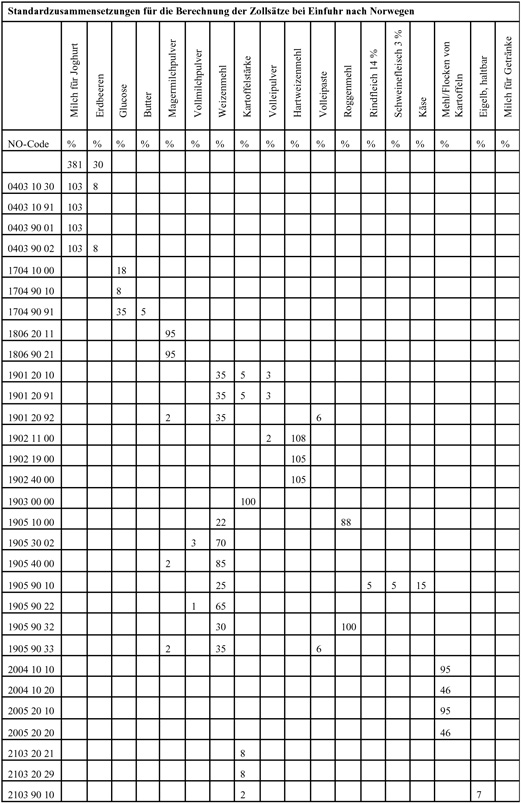
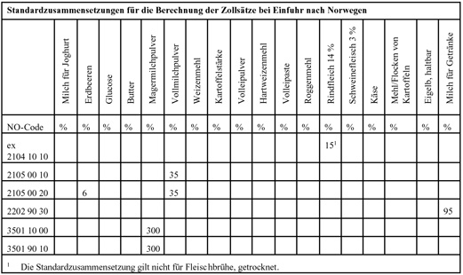

0.110 Protokoll 3 über Waren nach Art. 8 Abs. 3 Bst. b des Abkommens Art. 1 1) Vorbehaltlich der Bestimmungen dieses Protokolls gilt das Abkommen für die in den Tabellen I und II aufgeführten Waren. 2) Die Bestimmungen dieses Protokolls gelten nicht für Liechtenstein. Art. 2 1) Für die in Tabelle I aufgeführten Waren gelten die in den Anhängen dieser Tabelle aufgeführten Zollsätze. 2) Diese Zölle werden in jährlichen Abständen überprüft. Der Gemeinsame Ausschuss kann sie an die Entwicklung der Kosten der landwirtschaftlichen Grunderzeugnisse in den Vertragsparteien und/oder die Entwicklung der gegenseitigen Zugeständnisse anpassen. Art. 3 1) Dieses Protokoll hindert keine Vertragspartei daran, ihr Ausfuhrerstattungssystem für die in Tabelle I aufgeführten Waren anzuwenden; dabei werden die Auswirkungen der unterschiedlichen Preise für landwirtschaftliche Grunderzeugnisse auf dem Weltmarkt und auf den Märkten der Vertragsparteien berücksichtigt. 2) Werden Produktionserstattungen oder direkte Beihilfen für die bei der Herstellung der ausgeführten Waren verwendeten landwirtschaftlichen Grunderzeugnisse gewährt, so wird die Ausfuhrerstattung entsprechend gekürzt. Art. 4 Die Vertragsparteien teilen einander in regelmässigen Abständen die Höhe der bei landwirtschaftlichen Grunderzeugnissen gewährten Erstattungen, die für die in Tabelle I aufgeführten Waren beantragt werden können, und die entsprechenden Veränderungen in der Agrarpolitik, einschliesslich der institutionellen Preise, mit. Art. 5 1) Die Vertragsparteien dürfen bei der Einfuhr der in Tabelle II aufgeführten Waren keine Zölle oder Abgaben gleicher Wirkung erheben oder Erstattungen bei ihrer Ausfuhr gewähren. 2) Für die in Tabelle II aufgeführten Waren gelten die Bestimmungen von Art. 4 sinngemäss. Art. 6 Auf Ersuchen einer Vertragspartei kann der Gemeinsame EWR-Ausschuss dieses Protokoll überarbeiten. Eine solche Überarbeitung kann auch Änderungen der Tabellen I und II hinsichtlich des Umfangs der erfassten Waren und der geltenden Zölle umfassen. Art. 7 1) Die Vertragsparteien geben dem Gemeinsamen EWR-Ausschuss die zur Anwendung dieses Protokolls erlassenen Durchführungsvorschriften im Einzelnen bekannt. 2) Jede Vertragsparteil kann jederzeit eine Beratung über die Funktionsweise dieses Protokolls im Gemeinsamen EWR-Ausschuss beantragen. Tabelle I HS-Position Warenbezeichnung 0403 Buttermilch, saure Milch und saurer Rahm, Joghurt, Kefir und andere fermentierte oder gesäuerte Milch (einschliesslich Rahm), auch eingedickt oder aromatisiert, auch mit Zusatz von Zucker, anderen Süssmitteln, Früchten, Nüssen oder Kakao: 10 - Joghurt: ex 10 - aromatisiert oder mit Zusatz von Früchten, Nüssen oder Kakao 90 - andere: ex 90 - aromatisiert oder mit Zusatz von Früchten, Nüssen oder Kakao 0501 Menschenhaare, roh, auch gewaschen oder entfettet; Abfälle von Menschenhaar 0502 Borsten von Hausschweinen oder Wildschweinen; Dachshaare und andere Tierhaare zur Herstellung von Besen, Bürsten oder Pinseln; Abfälle dieser Borsten und Haare 0503 Rosshaar und Rosshaarabfälle, auch in Lagen, mit oder ohne Unterlage 0505 Vogelbälge und andere Vogelteile, mit ihren Federn oder Daunen, Federn und Teile von Federn (auch beschnitten), Daunen, roh oder nur gereinigt, desinfiziert oder zum Haltbarmachen behandelt; Mehl und Abfälle von Federn oder Federteilen 0507 Elfenbein, Schildpatt, Fischbein (einschliesslich Bartenfransen), Hörner, Geweihe, Hufe, Klauen, Krallen und Schnäbel, roh oder einfach bearbeitet, aber nicht zugeschnitten; Mehl und Abfälle davon 0508 Korallen und ähnliche Stoffe, roh oder einfach bearbeitet, aber nicht weiterverarbeitet; Schalen und Panzer von Weichtieren, Krebstieren oder Stachelhäutern und Schulp von Tintenfischen, roh oder einfach bearbeitet, aber nicht zugeschnitten; Mehl und Abfälle davon 0509 Naturschwämme tierischen Ursprungs 0510 Graue Ambra, Bibergeil, Zibet und Moschus; Kanthariden; Galle, auch getrocknet; Drüsen und andere tierische Stoffe, die zur Herstellung von Arzneiwaren verwendet werden, frisch, gekühlt, gefroren oder auf andere Weise vorläufig haltbar gemacht 0710 Gemüse, auch in Wasser oder Dampf gekocht, gefroren: 40 - Zuckermais ( Zea mays var. saccharata ) 0711 Gemüse, vorläufig haltbar gemacht (z. B. durch Schwefeldioxid oder in Wasser, dem Salz, Schwefeldioxid oder andere vorläufig konservierend wirkende Stoffe zugesetzt sind), zum unmittelbaren Genuss nicht geeignet: 90 - anderes Gemüse; Mischungen von Gemüsen: ex 90 - Zuckermais ( Zea mays var. saccharata ) 1302 Pflanzensäfte und Pflanzenauszüge; Pektinstoffe, Pektinate und Pektate; Agar-Agar und andere Schleime und Verdickungsstoffe von Pflanzen, auch modifiziert: - Pflanzensäfte und Pflanzenauszüge: 14 - von Pyrethrum und rotenonhaltigen Wurzeln 19 - andere: ex 19 - zusammengesetzte Pflanzenauszüge zum Herstellen von Getränken oder Lebensmittelzubereitungen ex 19 - andere als zusammengesetzte Pflanzenauszüge zum Herstellen von Getränken oder Lebensmittelzubereitungen und Vanille-Oleoresine 20 - Pektinstoffe, Pektinate und Pektate: ex 20 - mit einem Gehalt an zugesetztem Zucker von 5 GHT oder mehr 1401 Pflanzliche Stoffe von der hauptsächlich zum Herstellen von Korb- oder Flechtwaren verwendeten Art (z. B. Bambus, Peddig und Stuhlrohr, Schilf, Binsen, Korbweiden/Flechtweiden, Raffiabast, gereinigtes, gebleichtes oder gefärbtes Getreidestroh, Lindenbast) 1402 Pflanzliche Stoffe von der hauptsächlich zu Polsterzwecken verwendeten Art (z. B. Kapok, Pflanzenhaar und Seegras), auch in Lagen, mit oder ohne Unterlage aus anderen Stoffen 1403 Pflanzliche Stoffe von der hauptsächlich zum Herstellen von Besen, Bürsten oder Pinseln verwendeten Art (z. B. Besensorgho, Piassava, Reiswurzeln, Istel), auch in Strängen oder Bündeln 1404 Pflanzliche Erzeugnisse, anderweit weder genannt noch inbegriffen: 10 - pflanzliche Rohstoffe von der hauptsächlich zum Färben oder Gerben verwendeten Art 90 - andere 1517 Margarine; geniessbare Mischungen und Zubereitungen von tierischen oder pflanzlichen Fetten und Ölen sowie von Fraktionen verschiedener Fette und Öle dieses Kapitels, ausgenommen geniessbare Fette und Öle sowie deren Fraktionen der Position 1516: 10 - Margarine, ausgenommen flüssige Margarine: ex 10 - mit einem Milchfettgehalt von mehr als 10 bis 15 GHT 90 - andere: ex 90 - mit einem Milchfettgehalt von mehr als 10 bis 15 GHT ex 90 - geniessbare Mischungen und Zubereitungen der als Form- und Trennöle verwendeten Art 1520 Glycerin, roh; Glycerinwasser und Glycerinunterlaugen: ex 00 zu Futterzwecken 1 1522 Degras; Rückstände aus der Verarbeitung von Fettstoffen oder von tierischen oder pflanzlichen Wachsen: ex 00 - Degras zu Futterzwecken 1 1702 Andere Zucker, einschliesslich chemisch reine Lactose, Maltose, Glucose und Fructose, fest; Zuckersirupe, ohne Zusatz von Aroma- oder Farbstoffen; Invertzuckercreme, auch mit natürlichem Honig vermischt; Zucker und Melassen, karamellisiert: 50 - chemisch reine Fructose 90 - andere, einschliesslich Invertzucker: ex 90 - chemisch reine Maltose 1704 Zuckerwaren ohne Kakaogehalt (einschliesslich weisse Schokolade) 1806 Schokolade und andere kakaohaltige Lebensmittelzubereitungen 1901 Malzextrakt; Lebensmittelzubereitungen aus Mehl, Griess, Stärke oder Malzextrakt, ohne Gehalt an Kakao oder mit einem Gehalt an Kakao, berechnet als vollständig entölter Kakao, von weniger als 40 GHT, anderweit weder genannt noch inbegriffen; Lebensmittelzubereitungen aus Waren der Positionen 0401 bis 0404, ohne Gehalt an Kakao oder mit einem Gehalt an Kakao, berechnet als vollständig entölter Kakao, von weniger als 5 GHT, anderweit weder genannt noch inbegriffen 1902 Teigwaren, auch gekocht oder gefüllt (mit Fleisch oder anderen Stoffen) oder in anderer Weise zubereitet, z. B. Spaghetti, Makkaroni, Nudeln, Lasagne, Gnocchi, Ravioli, Cannelloni; Couscous, auch zubereitet: - Teigwaren, weder gekocht oder gefüllt noch in anderer Weise zubereitet: 11 - Eier enthaltend 19 - andere 20 - Teigwaren, gefüllt (auch gekocht oder in anderer Weise zubereitet): ex 20 - andere als Waren mit einem Gehalt an Wurst, Fleisch, Schlachtnebenerzeugnissen oder Blut oder Mischungen daraus von mehr als 20 GHT 30 - andere Teigwaren 40 - Couscous 1903 Tapiokasago und Sago aus anderen Stärken, in Form von Flocken, Graupen, Perlen, Krümeln und dergleichen 1904 Lebensmittel, durch Aufblähen oder Rösten von Getreide oder Getreideerzeugnissen hergestellt (z.B. Corn Flakes); Getreide (ausgenommen Mais) in Form von Körnern oder Flocken oder anders bearbeiteten Körnern, ausgenommen Mehl und Griess, vorgekocht oder in anderer Weise zubereitet, anderweit weder genannt noch inbegriffen 1905 Backwaren, auch kakaohaltig; Hostien, leere Oblatenkapseln der für Arzneiwaren verwendeten Art, Siegeloblaten, getrocknete Teigblätter aus Mehl oder Stärke und ähnliche Waren 2001 Gemüse, Früchte, Nüsse und andere geniessbare Pflanzenteile, mit Essig oder Essigsäure zubereitet oder haltbar gemacht: 90 - andere: ex 90 - Zuckermais ( Zea mays var. saccharata ); Palmherzen; Yamswurzeln, Süsskartoffeln und ähnliche geniessbare Pflanzenteile, mit einem Stärkegehalt von 5 GHT oder mehr 2004 Anderes Gemüse, anders als mit Essig oder Essigsäure zubereitet oder haltbar gemacht, gefroren, ausgenommen Erzeugnisse der Position 2006: 10 - Kartoffeln: ex 10 - in Form von Mehl, Griess oder Flocken 90 - anderes Gemüse und Mischungen von Gemüsen: ex 90 - Zuckermais ( Zea mays var. saccharata ) 2005 Anderes Gemüse, anders als mit Essig oder Essigsäure zubereitet oder haltbar gemacht, nicht gefroren, ausgenommen Erzeugnisse der Position 2006: 20 - Kartoffeln: ex 20 - in Form von Mehl, Griess oder Flocken 80 - Zuckermais ( Zea mays var. saccharata ) 2006 Gemüse, Früchte, Nüsse, Fruchtschalen und andere Pflanzenteile, mit Zucker haltbar gemacht (durchtränkt und abgetropft, glasiert oder kandiert): ex 2006 - Zuckermais ( Zea mays var. saccharata ) 2007 Konfitüren, Fruchtgelees, Marmeladen, Fruchtmuse und Fruchtpasten durch Kochen hergestellt, auch mit Zusatz von Zucker und anderen Süssmitteln 2008 Früchte, Nüsse und andere geniessbare Pflanzenteile, in anderer Weise zubereitet oder haltbar gemacht, auch mit Zusatz von Zucker, anderen Süssmitteln oder Alkohol, anderweit weder genannt noch inbegriffen: - Schalenfrüchte, Erdnüsse und andere Samen, auch miteinander vermischt: 11 - Erdnüsse: ex 11 - Erdnussbutter ex 11 - Erdnüsse, geröstet - andere, einschliesslich Mischungen, ausgenommen Mischungen der Unterposition 2008 19: ex 91 - Palmherzen zu Futterzwecken 1 99 - andere: ex 99 - Mais, ausgenommen Zuckermais ( Zea mays var. saccharata ) 2101 Auszüge, Essenzen und Konzentrate aus Kaffee, Tee oder Mate und Zubereitungen auf der Grundlage dieser Waren oder auf der Grundlage von Kaffee, Tee oder Mate; geröstete Zichorien und andere geröstete Kaffeemittel sowie Auszüge, Essenzen und Konzentrate hieraus: - Auszüge, Essenzen und Konzentrate aus Kaffee und Zubereitungen auf der Grundlage dieser Auszüge, Essenzen und Konzentrate oder auf der Grundlage von Kaffee: 12 - Zubereitungen auf der Grundlage dieser Auszüge, Essenzen und Konzentrate oder auf der Grundlage von Kaffee: ex 12 - mit einem Gehalt an Milchfett von 1,5 GHT oder mehr, an Milchprotein von 2,5 GHT oder mehr, an Zucker von 5 GHT oder mehr oder an Stärke von 5 GHT oder mehr 20 - Auszüge, Essenzen und Konzentrate aus Tee oder Mate und Zubereitungen auf der Grundlage dieser Auszüge, Essenzen und Konzentrate oder auf der Grundlage von Tee oder Mate: ex 20 - mit einem Gehalt an Milchfett von 1,5 GHT oder mehr, an Milchprotein von 2,5 GHT oder mehr, an Zucker von 5 GHT oder mehr oder an Stärke von 5 GHT oder mehr 30 - geröstete Zichorien und andere geröstete Kaffeemittel sowie Auszüge, Essenzen und Konzentrate hieraus: ex 30 - geröstete Kaffeemittel, ausgenommen geröstete Zichorien; Auszüge, Essenzen und Konzentrate aus gerösteten Kaffeemitteln, ausgenommen aus gerösteten Zichorien 2102 Hefen (lebend oder nicht lebend); andere Einzeller-Mikroorganismen, nicht lebend (ausgenommen Vaccine der Position 3002); zubereitete Backtriebmittel in Pulverform 2103 Zubereitungen zum Herstellen von Würzsossen und zubereitete Würzsossen; zusammengesetzte Würzmittel; Senfmehl, auch zubereitet, und Senf: 20 - Tomatenketchup und andere Tomatensossen 30 - Senfmehl, auch zubereitet, und Senf: ex 30 - Senf mit einem Gehalt an zugesetztem Zucker von 5 GHT oder mehr 90 - andere: ex 90 - andere als Mango-Chutney, flüssig 2104 Zubereitungen zum Herstellen von Suppen oder Brühen, Suppen und Brühen; zusammengesetzte homogenisierte Lebensmittelzubereitungen 2105 Speiseeis, auch kakaohaltig 2 2106 Lebensmittelzubereitungen, anderweit weder genannt noch inbegriffen 3 : ex 2106 - andere als Zuckersirupe, aromatisiert oder gefärbt 2202 Wasser, einschliesslich Mineralwasser und kohlensäurehaltiges Wasser, mit Zusatz von Zucker, anderen Süssmitteln oder Aromastoffen, und andere nichtalkoholhaltige Getränke, ausgenommen Frucht- und Gemüsesäfte der Position 2009 2203 Bier aus Malz 2205 Wermutwein und andere Weine aus frischen Weintrauben, mit Pflanzen oder anderen Stoffen aromatisiert 2207 Ethylalkohol mit einem Alkoholgehalt von 80 % vol oder mehr, unvergällt; Ethylalkohol und Branntwein mit beliebigem Alkoholgehalt, vergällt; Branntwein, Likör und andere Spirituosen: 20 - Ethylalkohol und Branntwein mit beliebigem Alkoholgehalt, vergällt 2208 Ethylalkohol mit einem Alkoholgehalt von weniger als 80 % vol, unvergällt; Branntwein, Likör und andere Spirituosen: 40 - Rum und Taffia 50 - Gin und Genever 60 - Wodka 70 - Likör ex 70 - Likör mit einem Gehalt an zugesetztem Zucker von mehr als 5 GHT 90 - andere: ex 90 - Aquavit 2209 Speiseessig und aus Essigsäure hergestellter Essigersatz 2402 Zigarren (einschliesslich Stumpen), Zigarillos und Zigaretten, aus Tabak oder Tabakersatzstoffen 2403 Anderer verarbeiteter Tabak und andere verarbeitete Tabakersatzstoffe; "homogenisierter" oder "rekonstituierter" Tabak; Tabakauszüge und Tabaksossen 2905 Acyclische Alkohole, ihre Halogen-, Sulfo-, Nitro- oder Nitrosoderivate: - andere mehrwertige Alkohole: 43 - Mannitol 44 - D-Glucitol (Sorbit) 3302 Mischungen von Riechstoffen und Mischungen (einschliesslich alkoholische Lösungen) auf der Grundlage eines oder mehrerer dieser Stoffe, von der als Rohstoffe für die Industrie verwendeten Art; andere Zubereitungen auf der Grundlage von Riechstoffen, von der zum Herstellen von Getränken verwendeten Art: 10 - von der in der Lebensmittel- oder Getränkeindustrie verwendeten Art 3501 Casein, Caseinate und andere Caseinderivate; Caseinleime 3505 Dextrine und andere modifizierte Stärken (z. B. Quellstärke oder veresterte Stärke); Leime auf der Grundlage von Stärken, Dextrinen oder anderen modifizierten Stärken 3809 Appretur- oder Endausrüstungsmittel, Beschleuniger zum Färben oder Fixieren von Farbstoffen und andere Erzeugnisse und Zubereitungen (z.B. zubereitete Schlichtemittel und Zubereitungen zum Beizen), von der in der Textilindustrie, Papierindustrie, Lederindustrie oder ähnlichen Industrien verwendeten Art, anderweit weder genannt noch inbegriffen: 10 - auf der Grundlage von Stärke oder Stärkederivaten 3824 Zubereitete Bindemittel für Giessereiformen oder -kerne; chemische Erzeugnisse und Zubereitungen der chemischen Industrie oder verwandter Industrien (einschliesslich Mischungen von Naturprodukten), anderweit weder genannt noch inbegriffen; Rückstände der chemischen Industrie oder verwandter Industrien, anderweit weder genannt noch inbegriffen: 60 - Sorbit, ausgenommen Waren der Unterposition 2905 44 1 Diese Unterteilung gilt nur für Norwegen. 2 Im Falle Islands gelten die Bestimmungen von Protokoll 3 nicht für Waren der Position 2105. 3 Im Falle Islands gelten die Bestimmungen von Protokoll 3 nicht für Zubereitungen, die hauptsächlich aus Fett und Wasser bestehen, einen Gehalt an Butter oder anderem Milchfett von mehr als 15 GHT haben und unter die Unterposition 2106 90 fallen. Anhang I zu Tabelle I Einfuhrregelung der Gemeinschaft 1. Bei der Berechnung der landwirtschaftlichen Teilbeträge und der Zusatzzölle wird von folgenden Grundbeträgen ausgegangen: - Getreide (Weichweizen, Hartweizen, Roggen, Gerste und Mais): 7.583 EUR/100 kg - langkörniger, geschälter Reis: 25.610 EUR/100 kg - Vollmilchpulver: 126.488 EUR/100 kg - Magermilchpulver: 115.236 EUR/100 kg - Butter: 183.912 EUR/100 kg - Zucker: 40.640 EUR/100 kg - Melasse: 0.34 EUR/100 kg 2. Der Grenzwert für geringfügige Mengen Stärke/Glucose sowie Saccharose/Invertzucker/Isoglucose, die bei der Berechnung des Zolls unberücksichtigt bleiben, beträgt 5 %. 3. Die zu berücksichtigenden Spannen für die theoretischen und die vereinbarten Mengen landwirtschaftlicher Grunderzeugnisse sowie die zur Berechnung der Zollsätze zugrunde gelegten Standardzusammensetzungen sind in der Anlage aufgeführt. 4. Für die in der nachstehenden Tabelle genannten Waren gelten die angegebenen Zollsätze. KN-Code Geltender Zollsatz Kommentare 0501 00 00 Null 0502 10 00 Null 0502 90 00 Null 0503 00 00 Null 0505 10 10 Null 0505 10 90 Null 0505 90 00 Null 0507 10 00 Null 0507 90 00 Null 0508 00 00 Null 0509 00 10 Null 0509 00 90 Null 0510 00 00 Null 1302 14 00 Null 1302 19 30 Null 1302 19 91 Null ex 1302 20 10 18,6 % mit einem Gehalt an zugesetztem Zucker von 5 GHT oder mehr ex 1302 20 90 10,9 % mit einem Gehalt an zugesetztem Zucker von 5 GHT oder mehr 1401 10 00 Null 1401 20 00 Null 1401 90 00 Null 1402 00 00 Null 1403 00 00 Null 1404 10 00 Null 1404 90 00 Null 1517 10 10 0 % + 26,1 EUR/100 kg 1517 90 10 0 % + 26,1 EUR/100 kg 1517 90 93 Null 1702 50 00 Null 1702 90 10 Null 1704 90 10 Null 1806 10 15 Null 1901 90 91 Null 1902 20 10 8,2 % 2001 90 60 Null ex 2006 00 38 9,12 EUR/100 kg Zuckermais (Zea mays var. saccharata) ex 2006 00 99 9,12 EUR/100 kg Zuckermais (Zea mays var. saccharata) 2007 10 10 13.98 % + 4,07 EUR/100 kg 2007 10 91 13,14 % 2007 10 99 15,15 % 2007 91 10 11,64 % + 22,31 EUR/100 kg 2007 91 30 11,64 % + 4,07 EUR/100 kg 2007 91 90 18,90 % 2007 99 10 19,53 % 2007 99 20 13,98 % + 19,11 EUR/100 kg 2007 99 31 13,98 % + 22,31 EUR/100 kg 2007 99 33 13,98 % + 22,31 EUR/100 kg 2007 99 35 13,98 % + 22,31 EUR/100 kg 2007 99 39 7 % + 22,31 EUR/100 kg 2007 99 55 13,98 % + 4,07 EUR/100 kg ex 2007 99 57 13,98 % + 4,07 EUR/100 kg Maronenpaste und Maronenmus ex 2007 99 57 7 % + 4,07 EUR/100 kg andere 2007 99 91 20,97 % 2007 99 93 13,14 % 2007 99 98 16,31 % 2008 11 10 Null 2008 11 92 Null 2008 11 96 Null 2102 10 10 Null 2102 10 90 Null 2102 20 11 Null 2102 20 19 Null 2102 20 90 Null 2102 30 00 Null 2103 20 00 Null ex 2103 30 90 Null mit einem Gehalt an zugesetztem Zucker von 5 GHT oder mehr 2103 90 30 Null 2103 90 90 Null 2104 10 10 Null 2104 10 90 Null 2104 20 00 Null 2106 10 20 12,4 % 2106 90 10 24,25 EUR/100 kg 2106 90 20 16,8 % min 0,97 EUR/ %vol/hl 2106 90 92 Null 2202 10 00 Null 2202 90 10 Null 1 2203 00 01 Null 2203 00 09 Null 2203 00 10 Null 2205 10 10 Null 2205 10 90 Null 2205 90 10 Null 2205 90 90 Null 2207 20 00 9,9 EUR/hl 2208 40 11 Null 2208 40 31 Null 2208 40 39 Null 2208 40 51 Null 2208 40 91 Null 2208 40 99 Null 2208 50 11 Null 2208 50 19 Null 2208 50 91 Null 2208 50 99 Null 2208 60 11 Null 2208 60 19 Null 2208 60 91 Null 2208 60 99 Null 2208 70 10 11 Null mit einem Gehalt an zugesetztem Zucker von 5 GHT oder mehr 2208 70 90 11 Null mit einem Gehalt an zugesetztem Zucker von 5 GHT oder mehr 2208 90 56 10 Null Aquavit 2208.90 77 10 Null Aquavit 2209 00 11 3,10 EUR/hl 2209 00 19 2,33 EUR/hl 2209 00 91 2,49 EUR/hl 2209 00 99 1,50 EUR/hl 2402 10 00 12,60 % 2402 20 10 Null 2402 20 90 27,95 % 2402 90 00 27,95 % 2403 10 10 36,35 % 2403 10 90 36,35 % 2403 91 00 8,05 % 2403 99 10 20,2 % 2403 99 90 Null 3302 10 21 5,8 % 3501 10 10 Null 3501 10 50 10 Null mit einem Wassergehalt von mehr als 50 GHT 3501 10 50 90 2,9 % mit einem Wassergehalt von nicht mehr als 50 GHT 3501 10 90 8,7 % 3501 90 10 8,1 % 3501 90 90 6,2 % 3505 10 50 7,5 % 5. Der Wertzollanteil der Zölle auf die nachstehenden Waren beträgt 0 %: 0403 10 51 to 1806 20 95 1902 19 2101 30 99 0403 10 59 1806 31 00 1902 20 91 2105 00 0403 10 91 to 1806 32 1902 20 99 2106 10 80 0403 10 99 1806 90 11 to 1902 30 2106 90 98 0403 90 71 to 1806 90 50 1902 40 0403 90 79 1806 90 60 10 1903 00 00 0403 90 91 to 1806 90 60 90 1904 0403 90 99 1806 90 70 10 1905 2202 90 91 to 0710 40 00 1806 90 70 90 2001 90 30 2202 90 99 0711 90 30 1806 90 90 11 2001 90 40 3302 10 29 1704 10 1806 90 90 19 2004 10 91 3505 10 10 1704 90 30 to 1806 90 90 91 2004 90 10 3505 10 90 1704 90 99 1806 90 90 99 2005 20 10 3505 20 1806 10 20 to 1901 10 00 2005 80 00 3809 10. 1806 10 90 1901 20 00 2008 99 85 1806 20 10 to 1901 90 11 2008 99 91 1806 20 50 1901 90 19 2101 12 98 91 1806 20 70 1901 90 99 2101 20 98 90 1806 20 80 1902 11 00 2101 30 19 6. Der Wertzollanteil der Zölle auf die nachstehenden Waren beträgt 5,8 %: 2905 44 3824 60 7. Der Wertzollanteil der Zölle auf die nachstehenden Waren beträgt 7.8 %: 2905 43 00. 8. Die in diesem Anhang genannten Zollcodes beziehen sich auf die in der Gemeinschaft am 1. Januar 2004 geltenden Zollcodes. Werden in der Zollnomenklatur Veränderungen vorgenommen, bleibt dieser Anhang davon unberührt. Anlage In Abs. 3 genannte Mengen und Standardzusammensetzungen (je 100 kg Waren) Innerhalb der Bandbreiten zu berücksichtigende Mengen - Milch und Milcherzeugnisse Milchfett, (in GHT) Milcheiweiss (in GHT) Magermilchpulver (in kg) Vollmilchpulver (in kg) Butter (in kg) 0 - 1,5 0 - 2,5 0 0 0 2,5 - 6 14 0 0 6 - 18 42 0 0 18 - 30 75 0 0 30 - 60 146 0 0 60 - > 208 0 0 1,5 - 3 0 - 2,5 0 0 3 2,5 - 6 14 0 3 6 - 18 42 0 3 18 - 30 75 0 3 30 - 60 146 0 3 60 - > 208 0 3 3 - 6 0 - 2,5 0 0 6 2,5 - 12 12 20 0 12 - > 71 0 6 6 - 9 0 - 4 0 0 10 4 - 15 10 32 0 15 - > 71 0 10 9 - 12 0 - 6 0 0 14 6 - 18 9 43 0 18 - > 70 0 14 12 - 18 0 - 6 0 0 20 6 - 18 0 56 2 18 - > 65 0 20 18 - 26 0 - 6 0 0 29 6 - > 50 0 29 26 - 40 0 - 6 0 0 45 6 - > 38 0 45 40 - 55 0 0 0 63 55 - 70 0 0 0 81 70 - 85 0 0 0 99 85 - > 0 0 0 117 (je 100 kg Waren) Innerhalb der Bandbreiten zu berücksichtigende Mengen - andere als Milcherzeugnisse Bandbreiten Anzuwenden auf Weisszucker (in kg) Weichweizen (in kg) Mais (in kg) Saccharose, Invertzucker und/oder Isoglucose 0 - 5 0 5 - 30 24 30 - 50 45 50 - 70 65 70 - > 93 Stärke/Glucose 0 - 5 0 0 5 - 25 22 22 25 - 50 47 47 50 - 75 74 74 75 - > 101 101 Standardzusammensetzungen für die Berechnung der Zollsätze bei der Einfuhr in die Gemeinschaft Weichweizen Hartweizen Roggen Gerste Mais Reis Weisszucker Melas-sen Magermilchpulver Vollmilchpulver Butter KN-Code kg kg kg kg kg kg kg kg kg kg kg 0403 10 51 100 0403 10 53 100 0403 10 59 42 68 0403 10 91 9 2 0403 10 93 8 5 0403 10 99 8 10 0403 90 71 100 0403 90 73 100 0403 90 79 42 68 0403 90 91 9 2 0403 90 93 8 5 0403 90 99 8 10 0710 40 00 100 1 0711 90 30 100 1 1704 10 11 30 58 1704 10 19 30 58 1704 10 91 16 70 1704 10 99 16 70 1704 90 30 45 20 1806 10 20 60 1806 10 30 75 1806 10 90 100 1806 32 90 2 50 20 1901 90 11 195 1901 90 19 159 1902 11 00 167 1902 19 10 3 167 1902 19 90 4 67 100 1902 20 91 41 1902 20 99 116 1902 30 10 167 1902 30 90 66 1902 40 10 167 1902 40 90 66 161 1903 00 00 1904 10 10 213 1904 10 30 174 1904 10 90 53 53 53 53 1904 20 91 213 1904 20 95 174 1904 20 99 53 53 53 53 1904 90 10 174 1904 90 80 174 1905 10 00 140 1905 20 10 44 40 25 1905 20 30 33 30 45 1905 20 90 22 20 65 1905 90 10 168 1905 90 20 644 2001 90 30 100 5 2001 90 40 40 5 2004 90 10 100 5 2005 80 00 100 5 2008 99 85 100 5 2008 99 91 40 5 2101 30 19 137 2101 30 99 245 2102 10 31 425 2102 10 39 125 2105 00 10 25 10 2105 00 91 20 23 2105 00 99 20 35 2202 90 91 10 8 2202 90 95 10 6 2202 90 99 10 13 2905 43 00 300 2905 44 11 172 2905 44 19 90 2905 44 91 245 2905 44 99 128 3505 10 10 189 3505 10 90 189 3505 20 10 48 3505 20 30 95 3505 20 50 151 3505 20 90 189 3809 10 10 95 3809 10 30 132 3809 10 50 161 3809 10 90 189 3824 60 11 172 3824 60 19 90 3824 60 91 245 3824 60 99 128 1 Je 100 Kilogramm Süsskartoffeln oder Mais (Abtropfgewicht). 2 Für Waren mit einem Milchfettgehalt von 3 GHT oder mehr, jedoch weniger als 6 GHT, gilt der Zusatzcode 6920. 3 Für Teigwaren aus Hartweizen, auch mit einem Gehalt an anderen Getreiden von nicht mehr als 3 GHT, gilt der Zusatzcode 6921. 4 Für andere Waren dieser Unterposition als Teigwaren aus Hartweizen, auch mit einem Gehalt an anderen Getreiden von nicht mehr als 3 GHT, gilt der Zusatzcode 6922. 5 Je 100 Kilogramm Süsskartoffeln oder Mais (Abtropfgewicht). Anhang II zu Tabelle I Isländische Einfuhrregelung 1. Für die in Tabelle I aufgeführten landwirtschaftlichen Verarbeitungserzeugnisse betragen die Zollsätze Null, ausgenommen für folgende Waren, für die die nachstehend angegebenen Zollsätze (ISK/kg) gelten: Isländischer Zollcode Warenbezeichnung geltender Zollsatz (ISK/kg) 0403 Buttermilch, saure Milch und saurer Rahm, Joghurt, Kefir und andere fermentierte oder gesäuerte Milch (einschliesslich Rahm), auch eingedickt oder aromatisiert, auch mit Zusatz von Zucker, anderen Süssmitteln, Früchten, Nüssen oder Kakao: 0403.1011 - Joghurt mit Kakao 53 0403.1012 - Joghurt mit Früchten oder Nüssen 53 0403.1013 - Joghurt, aromatisiert, anderweit nicht genannt 53 0403.1021 - Trinkjoghurt mit Kakao 51 0403.1022 - Trinkjoghurt mit Früchten oder Nüssen 51 ex 0403 1029 - Trinkjoghurt, aromatisiert, anderweit nicht genannt 51 0403.9011 - andere mit Kakao 45 0403.9012 - andere mit Früchten oder Nüssen 45 0403.9013 - andere, aromatisiert, anderweit nicht genannt 45 0403.9021 - andere, als Getränk mit Kakao 45 0403.9022 - andere, als Getränk mit Früchten oder Nüssen 45 ex 0403 9029 - andere, als Getränk, aromatisiert, anderweit nicht genannt 45 1517 Margarine; geniessbare Mischungen und Zubereitungen von tierischen oder pflanzlichen Fetten und Ölen sowie von Fraktionen verschiedener Fette und Öle dieses Kapitels, ausgenommen geniessbare Fette und Öle sowie deren Fraktionen der Position 1516: 1517.1001 - Margarine, ausgenommen flüssige Margarine, mit einem Milchfettgehalt von mehr als 10 GHT bis 15 GHT 88 1517.9002 - andere als Margarine, mit einem Milchfettgehalt von mehr als 10 GHT bis 15 GHT (ausgenommen flüssige Margarine) 88 1806 Schokolade und andere kakaohaltige Lebensmittelzubereitungen: - andere Zubereitungen in Blöcken, Tafeln oder Riegeln mit einem Gewicht von mehr als 2 kg oder flüssig, pastenförmig, als Pulver, Granulat oder in ähnlicher loser Form, in Behältnissen oder unmittelbaren Umschliessungen mit einem Inhalt von mehr als 2 kg: 1806. 2003 - Kakaopulver, ausgenommen Waren der Position 1901, mit einem Gehalt an Frischmilchpulver und/oder Magermilchpulver von 30 GHT oder mehr, auch mit Zusatz von Zucker oder anderen Süssmitteln, jedoch nicht gemischt mit anderen Stoffen 109 1806.2004 - Kakaopulver, ausgenommen Waren der Position 1901, mit einem Gehalt an Frischmilchpulver und/oder Magermilchpulver von weniger als 30 GHT, auch mit Zusatz von Zucker oder anderen Süssmitteln, jedoch nicht gemischt mit anderen Stoffen 39 1806.2005 - andere Zubereitungen, ausgenommen Waren der Position 1901, mit einem Gehalt an Frischmilchpulver und/oder Magermilchpulver von 30 GHT oder mehr 109 1806.2006 - andere Zubereitungen, ausgenommen Waren der Position 1901, mit einem Gehalt an Frischmilchpulver und/oder Magermilchpulver von weniger als 30 GHT 39 - andere, in Blöcken, Tafeln oder Riegeln: 1806.3101 - gefüllte Schokolade in Tafeln oder Riegeln 51 1806.3109 - andere, gefüllt, in Blöcken, Tafeln oder Riegeln 51 1806.3202 - nicht gefüllte Schokolade, mit Kakaomasse, Zucker, Kakaobutter und Milchpulver, in Tafeln oder Riegeln 47 1806.3203 - Schokoladenersatz, nicht gefüllt, in Tafeln oder Riegeln 39 1806.3209 - andere, nicht gefüllt, in Blöcken, Tafeln oder Riegeln 21 - andere: - Stoffe für die Getränkeherstellung: 1806.9011 - Ausgangsstoffe für die Getränkezubereitung, auf der Grundlage von Waren der Positionen 0401 bis 0404, mit einem Gehalt an Kakaopulver von 5 GHT oder mehr, berechnet als vollständig entfetteter Kakao, anderweit nicht genannt, mit Zucker oder anderen Süssmitteln und sonstigen Stoffen und Aromen in geringerem Umfang 22 - andere als Stoffe für die Getränkeherstellung: 1806.9022 - speziell zur Säuglingsernährung und für diätetische Zwecke zubereitete Lebensmittel 18 1806.9023 - Ostereier 48 1806.9024 - Speiseeissossen und -dips 39 1806.9025 - bestrichen oder überzogen, wie Rosinen, Nüsse, "Puff"-Getreide, Süssholz, Karamellen und Geleedragees 53 1806.9026 - Schokoladencreme (Konfekt) 48 1806.9028 - Kakaopulver, ausgenommen Waren der Position 1901, mit einem Gehalt an Frischmilchpulver und/oder Magermilchpulver von 30 GHT oder mehr, auch mit Zusatz von Zucker oder anderen Süssmitteln, jedoch nicht gemischt mit anderen Stoffen 118 1806.9029 - Kakaopulver, ausgenommen Waren der Position 1901, mit einem Gehalt an Frischmilchpulver und/oder Magermilchpulver von weniger als 30 GHT, auch mit Zusatz von Zucker oder anderen Süssmitteln, jedoch nicht gemischt mit anderen Stoffen 43 1806.9039 - andere 47 1901 Malzextrakt; Lebensmittelzubereitungen aus Mehl, Griess, Stärke oder Malzextrakt, ohne Gehalt an Kakao oder mit einem Gehalt an Kakao, berechnet als vollständig entfetteter Kakao, von weniger als 40 GHT, anderweit weder genannt noch inbegriffen; Lebensmittelzubereitungen aus Waren der Positionen 0401 bis 0404, ohne Gehalt an Kakao oder mit einem Gehalt an Kakao, berechnet als vollständig entfetteter Kakao, von weniger als 5 GHT, anderweit weder genannt noch inbegriffen: - Mischungen und Teig zum Herstellen von Backwaren der Position 1905, mit einem Gesamtgehalt an Frischmilchpulver, Magermilchpulver, Eiern, Milchfett (z. B. Butter), Käse oder Fleisch von 3 GHT oder mehr: 1901.2012 - zur Zubereitung von Leb- und Honigkuchen und dergleichen der Position 1905.2000 25 1901.2013 - zur Zubereitung von Keksen und ähnlichem Kleingebäck, gesüsst, der Positionen. 1905.3011 und 1905.3029 17 1901.2014 - zur Zubereitung von Ingwerplätzchen der Position 1905.3021 29 1901.2015 - zur Zubereitung von Waffeln der Position 1905.3030 10 1901.2016 - zur Zubereitung von Zwieback, geröstetem Brot und ähnlichen gerösteten Waren der Position 1905.4000 15 1901.2017 - zur Zubereitung von Brot der Position 1905.9011 mit einer Füllung auf der Basis von Butter oder anderen Milcherzeugnissen 39 1901.2018 - zur Zubereitung von Brot der Position 1905.9019 5 1901.2019 - zur Zubereitung von Keksen und ähnlichem Kleingebäck, ungesüsst, der Position 1905(9020) 5 1901.2022 - zur Zubereitung von feinen Backwaren, gesüsst, der Position 1905.9040 33 1901.2023 - Mischungen und Teig, Fleisch enthaltend, zur Zubereitung von Pasteten und Pizza der Position 1905.9051 97 1901.2024 - Mischungen und Teig, andere Zutaten als Fleisch enthaltend, zur Zubereitung von Pizza und dergleichen der Position 1905.9059 53 1901.2029 - zum Herstellen von Waren der Position 1905(9090) 43 1902 Teigwaren, auch gekocht oder gefüllt (mit Fleisch oder anderen Stoffen) oder in anderer Weise zubereitet, z. B. Spaghetti, Makkaroni, Nudeln, Lasagne, Gnocchi, Ravioli, Cannelloni; Couscous, auch zubereitet: 1902.1100 - Teigwaren, weder gekocht oder gefüllt noch in anderer Weise zubereitet, Eier enthaltend 8 - Teigwaren, gefüllt (auch gekocht oder in anderer Weise zubereitet): 1902.2022 - gefüllt mit Zubereitungen aus Wurst, Fleisch, Schlachtnebenerzeugnissen oder Blut bzw. Mischungen daraus, mit einem Gehalt an diesen Zubereitungen von 3 GHT oder mehr, jedoch nicht mehr als 20 GHT 41 1902.2031 - mit Käse gefüllt, bei einem Käsegehalt von mehr als 3 GHT 35 1902.2041 - mit Fleisch und Käse gefüllt, bei einem Fleisch- und Käsegehalt von mehr als 20 GHT 142 1902.2042 - mit Fleisch und Käse gefüllt, bei einem Fleisch- und Käsegehalt von 3 GHT oder mehr, jedoch nicht mehr als 20 GHT 41 - andere Teigwaren: 1902.3021 - mit einem Gehalt von 3 GHT oder mehr, jedoch nicht mehr als 20 GHT an Wurst, Fleisch, Schlachtnebenerzeugnissen oder Blut bzw. Mischungen daraus 41 1902.3031 - mit einem Käsegehalt von mehr als 3 GHT 35 1902.3041 - mit einem Gehalt an Fleisch und Käse von 3 GHT oder mehr, jedoch nicht mehr als 20 GHT 41 1902.4021 - Couscous, mit einem Gehalt an Wurst, Fleisch, Schlachtnebenerzeugnissen oder Blut bzw. Mischungen daraus von 3 GHT oder mehr, jedoch nicht mehr als 20 GHT 41 1903 Tapiokasago und Sago aus anderen Stärken, in Form von Flocken, Graupen, Perlen, Krümeln und dergleichen: 1903.0001 - in Einzelhandelspackungen von 5 kg oder weniger Null 1903.0009 - andere als in Einzelhandelspackungen von 5 kg oder weniger Null 1904 Lebensmittel, durch Aufblähen oder Rösten von Getreide oder Getreideerzeugnissen hergestellt (z.B. Corn Flakes); Getreide (ausgenommen Mais) in Form von Körnern oder Flocken oder anders bearbeiteten Körnern, ausgenommen Mehl und Griess, vorgekocht oder in anderer Weise zubereitet, anderweit weder genannt noch inbegriffen: - andere: 1904.9001 - mit einem Fleischgehalt von 3 GHT oder mehr, jedoch nicht mehr als 20 GHT 42 1905 Backwaren, auch kakaohaltig; Hostien, leere Oblatenkapseln von der für Arzneiwaren verwendeten Art, Siegeloblaten, getrocknete Teigblätter aus Mehl oder Stärke und ähnliche Waren: 1905.2000 - Leb- und Honigkuchen und dergleichen 83 - Kekse und ähnliches Kleingebäck, gesüsst; Waffeln, mit Schokolade oder kakaohaltigen Überzugsmassen überzogen oder bedeckt: 1905.3011 - Kekse und ähnliches Kleingebäck, gesüsst 17 1905.3019 - andere als Kekse und ähnliches Kleingebäck, gesüsst 16 - Kekse und ähnliches Kleingebäck, gesüsst; Waffeln, nicht mit Schokolade oder kakaohaltigen Überzugsmassen überzogen oder bedeckt: - Kekse und ähnliches Kleingebäck, gesüsst: 1905.3021 - Ingwerplätzchen 31 1905.3022 - Kekse und ähnliches Kleingebäck, mit einem Zuckergehalt von weniger als 20 GHT 23 1905.3029 - ausgenommen Kekse und ähnliches Kleingebäck, gesüsst 19 1905.3030 - andere 11 1905.4000 - Zwieback, geröstetes Brot und ähnliche geröstete Waren 16 - andere: - Brot: 1905.9011 - mit einer im Wesentlichen aus Butter oder anderen Milcherzeugnissen (z. B. Knoblauchbutter) bestehenden Füllung 39 1905.9019 - anderes 5 1905.9020 - Kekse und ähnliches Kleingebäck, ungesüsst 5 1905.9040 - feine Backwaren, gesüsst 35 - Pasteten und Pizza: 1905.9051 - Fleisch enthaltend 97 1905.9059 - andere 53 1905.9090 - andere 45 2103 Zubereitungen zum Herstellen von Würzsossen und zubereitete Würzsossen; zusammengesetzte Würzmittel; Senfmehl, auch zubereitet, und Senf: - andere als Sojasosse, Tomatenketchup und andere Tomatensossen, Sossen aus Senfmehl, auch zubereitet, und Senf: 2103.9020 - Mayonnaise 19 2103.9030 - ölhaltige Sossen, anderweit nicht genannt (z. B. Remouladensossen) 19 2103.9051 - mit einem Fleischgehalt von mehr als 20 GHT 97 2103.9052 - mit einem Fleischgehalt von mehr als 3 GHT, jedoch nicht mehr als 20 GHT 52 2104 Zubereitungen zum Herstellen von Suppen oder Brühen, Suppen und Brühen; zusammengesetzte homogenisierte Lebensmittelzubereitungen: - Zubereitungen zum Herstellen von Suppen oder Brühen, Suppen und Brühen: 2104.1001 - Zubereitungen für Gemüsesuppen mit den Grundbestandteilen Mehl, Griess, Stärke oder Malzextrakt 3 2104.1002 - andere Suppenpulver in Packungen von 5 kg oder mehr 31 2104.1003 - Fischsuppen in Dosen 27 - andere Suppen: 2104.1011 - mit einem Fleischgehalt von mehr als 20 GHT 78 2104.1012 - mit einem Fleischgehalt von mehr als 3 GHT, jedoch nicht mehr als 20 GHT 44 2104.1019 - andere 21 - andere: 2104.1021 - mit einem Fleischgehalt von mehr als 20 GHT 78 2104.1022 - mit einem Fleischgehalt von mehr als 3 GHT, jedoch nicht mehr als 20 GHT 44 2104.1029 - andere 21 - zusammengesetzte homogenisierte Lebensmittelzubereitungen: 2104.2001 - mit einem Fleischgehalt von mehr als 20 GHT 97 2104.2002 - mit einem Fleischgehalt von mehr als 3 GHT, jedoch nicht mehr als 20 GHT 51 2104.2003 - Fische, Krebstiere, Weichtiere oder andere wirbellose Wassertiere enthaltend 24 2104.2009 - andere 24 2106 Lebensmittelzubereitungen, anderweit weder genannt noch inbegriffen: - andere: - Pulver zur Zubereitung von Desserts: 2106.9041 - in Einzelhandelspackungen von 5 kg oder weniger, Milchpulver, Eiweiss oder Eigelb enthaltend 67 2106.9048 - andere, Milchpulver, Eiweiss oder Eigelb enthaltend 80 2106.9049 - andere, kein Milchpulver, Eiweiss oder Eigelb enthaltend 67 2106.9064 - mit einem Fleischgehalt von mehr als 3 GHT bis einschliesslich 20 GHT 41 2202 Wasser, einschliesslich Mineralwasser und kohlensäurehaltiges Wasser, mit Zusatz von Zucker, anderen Süssmitteln oder Aromastoffen, und andere nichtalkoholhaltige Getränke, ausgenommen Frucht- und Gemüsesäfte der Position 2009: - anderes: - aus Milcherzeugnissen mit anderen Zutaten, sofern der Gehalt an Milcherzeugnissen 75 GHT oder mehr ohne die Verpackung ausmacht: 2202.9011 - in Kartonverpackungen 41 2202.9012 - in Einwegverpackungen aus Stahl 41 2202.9013 - in Einwegverpackungen aus Aluminium 41 2202.9014 - in Einwegverpackungen aus Glas mit mehr als 500 ml Inhalt 41 2202.9015 - in Einwegverpackungen aus Glas mit nicht mehr als 500 ml Inhalt 41 2202.9016 - in Einwegverpackungen aus Kunststoff, gefärbt 41 2202.9017 - in Einwegverpackungen aus Kunststoff, ungefärbt 41 2202.9019 - andere 41 2. Die in diesem Anhang aufgeführten Zollcodes beziehen sich auf die in der Gemeinschaft am 1. Juli 2001 geltenden Zollcodes. Werden in der Zollnomenklatur Veränderungen vorgenommen, bleibt dieser Anhang davon unberührt. 3. Dieses Protokoll gilt nicht für folgende Waren: HS-Code Warenbezeichnung 2105 Speiseeis, auch kakaohaltig 2106 Lebensmittelzubereitungen, anderweit weder genannt noch inbegriffen: .90 - andere: ex .90 - Zubereitungen, überwiegend aus Fett und Wasser, mit einem Gehalt an Butter oder anderem Milchfett von mehr als 15 GHT 4. Die in Abs. 3 enthaltene befristete Regelung wird von den Vertragsparteien vor Ende 2007 überprüft. Anhang III zu Tabelle I Norwegische Einfuhrregelung 1. Vorbehaltlich der Bestimmungen von Abs. 6 werden zur Berechnung der Zölle auf die landwirtschaftlichen Verarbeitungserzeugnisse die folgenden Referenzzollsätze (NOK/kg) für die landwirtschaftlichen Grunderzeugnisse zugrunde gelegt: Matrix ( a ) Standardzusammensetzung Tatsächlicher Gehalt Vollmilchpulver (*) 11,43 11,43 11,43 Magermilchpulver (*) 12,16 12,16 12,16 Butter (*) 12,74 12,74 12,74 Milch zur Herstellung von Joghurt ( b ) 3,01 3,01 Milch zur Herstellung von Getränken ( b ) 2,23 2,23 Vollmilch ( b ) - 1,43 Magermilch ( b ) - 1,07 kondensierte Vollmilch ( b ) - 4,98 kondensierte Magermilch ( b ) - 4,72 Milchpulver, 20 % Fett ( b ) - 11,41 Buttermilchpulver ( b ) - 11,93 Rahm ( b ) - 4,48 Rahmmischung ( b ) - 5,33 eingedickter Sauerrahm ( b ) - 6,69 Rahmpulver ( b ) - 10,77 Molkepulver ( b ) - 3,00 Caseinate ( b ) - 33,47 Milchalbumin ( b ) - 33,47 Weizenmehl (*) 1,96 1,96 1,96 Roggenmehl 1,96 2,16 1,96 Hartweizenmehl 1,96 1,32 1,96 Gerstenmehl 1,96 - 1,96 Mehl aus Roggen und Weizen 1,96 - 1,96 Maismehl 0 - 0 Reismehl 0 - 0 Mehl aus anderen Getreiden 0 - 0 Weichweizen 1,52 - 1,52 Hartweizen 0,98 - 0,98 Gerste 1,37 - 1,37 Hafer 1,17 - 1,17 Roggen 1,46 - 1,46 Roggen und Weizen 1,46 - 1,46 Mais 0 - 0 Andere Getreide 0 - 0 Weizenkleie 1,96 - 1,96 Haferkleie 1,96 - 1,96 Hafer, gequetscht 1,96 - 1,96 Weizenmalz 0 - 0 Gerstenmalz 0 - 0 Weizenkleber 0 - 0 Reis 0 - 0 Kartoffelstärke (*) 4,41 4,41 4,41 andere Stärke (*) 4,41 - 4,41 modifizierte Stärke 4,41 - 4,41 Glucose und Glucosesirup 4,41 4,41 4,41 Zucker 0 - 0 Maltodextrin 0 - 0 Kartoffeln 0,81 - 0,81 Mehl und Flocken von Kartoffeln 3,75 12,01 12,01 Rindfleisch, entbeint (14 % Fett) (*) 25,89 25,89 25,89 Schweinefleisch (23 % Fett) 19,23 19,23 19,23 Schaffleisch 8,63 - 8,63 Geflügelfleisch 3,02 - 3,02 Fette, ausgenommen Butter 0 - 0 Himbeeren, gefroren (*) 4,29 ( c ) - 4,29 ( c ) Konzentrat aus Himbeeren 22,22 ( c ) - 22,22 ( c ) Schwarze Johannisbeeren, gefroren 0 ( c ) - 0 ( c ) Konzentrat aus schwarzen Johannisbeeren 0 ( c ) - 0 ( c ) Erdbeeren, gefroren 4,45 ( c ) 4,45 ( c ) 4,45 ( c ) Konzentrat aus Erdbeeren 23,05 ( c ) - 23,05 ( c ) Fruchtfleisch von Äpfeln 0 - 0 Konzentrat aus Äpfeln 0 - 0 Käse (*) 20,08 20,08 20,08 Käsepulver 12,45 - 12,45 Volleipulver (*) 45,37 45,37 45,37 Eier in der Schale 9,48 - 9,48 Eigelb, haltbar gemacht (flüssig) 26,90 26,90 26,90 Trockeneigelb 56,81 - 56,81 Volleipaste (Eier, nicht in der Schale) 9,32 9,32 9,32 Albumin, flüssig 0 - 0 Albumin, in Pulverform 0 - 0 ( a ) Die mit Sternchen (*) gekennzeichneten Referenzzollsätze für landwirtschaftliche Grunderzeugnisse dienen als Grundlage für die Berechnung der Zölle auf landwirtschaftliche Verarbeitungserzeugnisse nach dem Matrix-System. Die übrigen Referenzzollsätze für die in dieser Spalte aufgeführten landwirtschaftlichen Grunderzeugnisse ergeben sich aus dem Umrechnungskoeffizienten. ( b ) Die Matrixreferenzzollsätze dieser landwirtschaftlichen Grunderzeugnisse werden anhand des tatsächlichen Gehalts an Milchfett und Milchprotein in Verbindung mit dem Umrechnungskoeffizienten berechnet. ( c ) Die Referenzzollsätze dieser landwirtschaftlichen Grunderzeugnisse werden vor dem 15. Juni jeden Jahres gemeinsam überprüft. Bei diesen gemeinsamen Überprüfungen werden die Marktpreise, die Marktlage, die Produktion in Norwegen und die Einfuhren nach Norwegen berücksichtigt. 2. Die in diesem Anhang genannten Zollcodes beziehen sich auf die in Norwegen am 1. Januar 2004 geltenden Zollcodes. Werden in der Zollnomenklatur Veränderungen vorgenommen, bleibt dieser Anhang davon unberührt. 3. Der Grenzwert für geringfügige Mengen Mehl, Stärke und/oder Glucose, die bei der Berechnung des Zolls unberücksichtigt bleiben, beträgt 5 %. 4. Der Grenzwert für geringfügige Mengen zusätzlicher landwirtschaftlicher Grunderzeugnisse (Fleisch, Käse, Eier und Strauchbeeren, wie gefrorene Himbeeren, gefrorene schwarze Johannisbeeren und gefrorene Erdbeeren), die bei der Berechnung des Zolls unberücksichtigt bleiben, beträgt 3 %. Bei der Berechnung des Zolls werden frische Strauchbeeren wie gefrorene Strauchbeeren im Verhältnis eins zu eins behandelt. 5. Die zu berücksichtigenden Spannen für die theoretischen und die vereinbarten Mengen landwirtschaftlicher Grunderzeugnisse sowie die zur Berechnung der Zollsätze zugrunde gelegten Standardzusammensetzungen sind in der Anlage aufgeführt. 6. Die Zölle für folgende Waren werden anhand der Referenzzollsätze (NOK/kg) für landwirtschaftliche Grunderzeugnisse berechnet, die in Abs. 1 aufgeführt sind, gekürzt um 7,2 %: Norwegischer Zollcode Warenbezeichnung 19.04 Lebensmittel, durch Aufblähen oder Rösten von Getreide oder Getreideerzeugnissen hergestellt (z.B. Corn Flakes); Getreide (ausgenommen Mais) in Form von Körnern oder Flocken oder anders bearbeiteten Körnern, ausgenommen Mehl, Grütze und Griess, vorgekocht oder in anderer Weise zubereitet, anderweitig weder genannt noch inbegriffen: - Lebensmittelzubereitungen aus ungerösteten Getreideflocken oder aus Mischungen von ungerösteten und gerösteten Getreideflocken oder aus aufgeblähtem Getreide: .2010 - Zubereitungen nach Art der "Müsli" auf der Grundlage nicht gerösteter Getreideflocken 21.04 Zubereitungen zum Herstellen von Suppen oder Brühen, Suppen und Brühen; zusammengesetzte homogenisierte Lebensmittelzubereitungen: - Zubereitungen zum Herstellen von Suppen oder Brühen, Suppen und Brühen: - in luftdicht verschlossenen Behältnissen: .1020 - Gemüsesuppe, auch vorgekocht, weder Fleisch noch Fleischextrakt enthaltend .1030 - Fischsuppe mit einem Fischgehalt von 25 GHT oder mehr .1040 - andere - andere: .1050 - Fleisch oder Fleischextrakt enthaltend .1060 - Fischsuppe mit einem Fischgehalt von 25 GHT oder mehr .1090 - andere 7. Für die in der nachstehenden Tabelle aufgeführten Waren gelten die angegebenen Zollsätze. Norwegischer Zollcode Warenbezeichnung Geltender Zollsatz (NOK/kg) 05.01 Menschenhaare, roh, auch gewaschen oder entfettet; Menschenhaarabfälle Null 05.02 Borsten von Hausschweinen oder Wildschweinen; Dachshaare und andere Tierhaare zur Herstellung von Besen, Bürsten oder Pinseln; Abfälle dieser Borsten oder Haare Null 05.03 Rosshaar und Rosshaarabfälle, auch in Lagen, mit oder ohne Unterlage Null 05.05 Vogelbälge und andere Vogelteile, mit ihren Federn oder Daunen, Federn und Teile von Federn (auch beschnitten), Daunen, roh oder nur gereinigt, desinfiziert oder zum Haltbarmachen behandelt; Mehl und Abfälle von Federn oder Federteilen Null 05.07 Elfenbein, Schildpatt, Fischbein (einschliesslich Bartenfransen), Hörner, Geweihe, Hufe, Klauen, Krallen und Schnäbel, roh oder einfach bearbeitet, aber nicht zugeschnitten; Mehl und Abfälle dieser Stoffe Null 05.08 Korallen und ähnliche Stoffe, roh oder einfach bearbeitet, aber nicht weiterverarbeitet; Schalen und Panzer von Weichtieren, Krebstieren oder Stachelhäutern und Schulp von Tintenfischen, roh oder einfach bearbeitet, aber nicht zugeschnitten, Mehl und Abfälle davon Null 05.09 Natürliche Schwämme tierischen Ursprungs Null 05.10 Graue Ambra, Bibergeil, Zibet und Moschus; Kanthariden; Galle, auch getrocknet; Drüsen und andere tierische Stoffe, die zur Herstellung von Arzneiwaren verwendet werden, frisch, gekühlt, gefroren oder auf andere Weise vorläufig haltbar gemacht Mate Null 07.10 Gemüse, auch in Wasser oder Dampf gekocht, gefroren: - Zuckermais .4010 - zu Futterzwecken 1,73 .4090 - andere Null 07.11 Gemüse, vorläufig haltbar gemacht (z. B. durch Schwefeldioxid oder in Wasser, dem Salz, Schwefeldioxid oder andere vorläufig konservierend wirkende Stoffe zugesetzt sind), zum unmittelbaren Genuss nicht geeignet: - anderes Gemüse; Mischungen von Gemüsen: - Zuckermais; .9011 - zu Futterzwecken 1,73 .9020 - andere Null 13.02 Pflanzensäfte und Pflanzenauszüge; Pektinstoffe, Pektinate und Pektate; Agar-Agar und andere Schleime und Verdickungsstoffe von Pflanzen, auch modifiziert: - Pflanzensäfte und Pflanzenauszüge: .1400 - von Pyrethrum und rotenonhaltigen Wurzeln Null - andere: .1903 - zusammengesetzte Pflanzenauszüge zum Herstellen von Getränken oder Lebensmittelzubereitungen Null .1904 - zu therapeutischen und prophylaktischen (medizinischen) Zwecken Null - Pektinstoffe, Pektinate und Pektate ex .2000 - mit einem Gehalt an zugesetztem Zucker von 5 GHT oder mehr Null 14.01 Pflanzliche Stoffe von der hauptsächlich zum Herstellen von Korb- oder Flechtwaren verwendeten Art (z. B. Bambus, Peddig und Stuhlrohr, Schilf, Binsen, Korbweiden/Flechtweiden, Raffiabast, gereinigtes, gebleichtes oder gefärbtes Getreidestroh, Lindenbast) Null 14.02 Pflanzliche Stoffe von der hauptsächlich zu Polsterzwecken verwendeten Art (z. B. Kapok, Pflanzenhaar und Seegras), auch in Lagen, mit oder ohne Unterlage aus anderen Stoffen Null 14.03 Pflanzliche Stoffe von der hauptsächlich zum Herstellen von Besen, Bürsten oder Pinseln verwendeten Art (z. B. Besensorgho, Piassava, Reiswurzeln, Istel), auch in Strängen oder Bündeln Null 14.04 Pflanzliche Erzeugnisse, anderweit weder genannt noch inbegriffen: .1000 - pflanzliche Rohstoffe von der hauptsächlich zum Färben und Gerben verwendeten Art Null .9000 - andere Null 15.17 Margarine; geniessbare Mischungen und Zubereitungen von tierischen und pflanzlichen Fetten und Ölen sowie von Fraktionen verschiedener Fette und Öle dieses Kapitels, ausgenommen geniessbare Fette und Öle sowie deren Fraktionen der Position 15.16: - Margarine, ausgenommen flüssige Margarine: - andere: - tierischen Ursprungs: .1021 - mit einem Milchfettgehalt von mehr als 10 bis 15 GHT 14,5 % - pflanzlichen Ursprungs: .1031 - mit einem Milchfettgehalt von mehr als 10 bis 15 GHT 14,5 % - andere: - andere: - flüssige Margarine: .9032 - mit einem Milchfettgehalt von mehr als 10 bis 15 GHT 14,5 % - flüssige geniessbare Mischungen von tierischen und pflanzlichen Ölen, die vorwiegend aus pflanzlichen Ölen bestehen .9041 - mit einem Milchfettgehalt von mehr als 10 bis 15 GHT 10,2 % - andere: .9091 - mit einem Milchfettgehalt von mehr als 10 bis 15 GHT Null ex .9098 - geniessbare Mischungen und Zubereitungen der als Form- und Trennöle verwendeten Art Null 15.20 Glycerin, roh; Glycerinwasser und Glycerinunterlaugen: .0010 - zu Futterzwecken 3,79 15.22 Degras; Rückstände aus der Verarbeitung von Fettstoffen oder von tierischen oder pflanzlichen Wachsen: .0011 - zu Futterzwecken 3,79 17.02 Andere Zucker, einschliesslich chemisch reine Laktose, Maltose, Glukose und Fruktose, fest; Zuckersirupe, ohne Zusatz von Aroma- oder Farbstoffen; Invertzuckercreme, auch mit natürlichem Honig vermischt; Zucker und Melassen, karamelisiert: - chemisch reine Fructose: .5010 - zu Futterzwecken 1,37 .5090 - andere Null - andere, einschliesslich Invertzucker und anderer Zucker und Zuckersirup mit einem Gehalt an Fructose, bezogen auf die Trockenmasse, von 50 GHT ex .9022 - chemisch reine Maltose zu Futterzwecken 1,37 ex .9099 - chemisch reine Maltose, nicht zu Futterzwecken Null 18.06 Schokolade und andere kakaohaltige Lebensmittelzubereitungen: .1000 - Kakaopulver mit Zusatz von Zucker oder anderen Süssmitteln Null 19.01 Malzextrakt; Lebensmittelzubereitungen aus Mehl, Grütze, Griess, Stärke oder Malzextrakt, ohne Gehalt an Kakao oder mit einem Gehalt an Kakao, berechnet als vollständig entfetteter Kakao, von weniger als 40 GHT, anderweit weder genannt noch inbegriffen; Lebensmittelzubereitungen aus Waren der Positionen 04.01 bis 04.04, ohne Gehalt an Kakao oder mit einem Gehalt an Kakao berechnet als vollständig entfetteter Kakao, von weniger als 5 GHT, anderweitig weder genannt noch inbegriffen: - Zubereitungen zur Ernährung von Kindern, in Aufmachungen für den Einzelverkauf: .1010 - aus Waren der Positionen 04.01 bis 04.04 5,10 1 - andere: .9010 - Malzextrakt Null 19.04 Lebensmittel, durch Aufblähen oder Rösten von Getreide oder Getreideerzeugnissen hergestellt (z. B. Corn Flakes); Getreide (ausgenommen Mais) in Form von Körnern oder Flocken oder anders bearbeiteten Körnern, ausgenommen Mehl, Grütze und Griess, vorgekocht oder in anderer Weise zubereitet, anderweitig weder genannt noch inbegriffen: - Lebensmittel, durch Aufblähen oder Rösten von Getreide oder Getreideerzeugnissen hergestellt: .1010 - Corn Flakes Null - andere: .1091 - Popcorn Null .1099 - andere Null - andere: - Reis, vorgekocht, ohne Zusatz weiterer Zutaten: .9010 - zu Futterzwecken 1,11 .9020 - andere Null 19.05 Backwaren, auch kakaohaltig; Hostien, leere Oblatenkapseln von der für Arzneiwaren verwendeten Art, Siegeloblaten, getrocknete Teigblätter aus Mehl oder Stärke und ähnliche Waren: .2000 - Leb- und Honigkuchen und ähnliche Waren 0,75 20.01 Gemüse, Früchte, Nüsse und andere geniessbare Pflanzenteile, mit Essig oder Essigsäure zubereitet oder haltbar gemacht: - andere: - Gemüse: - Zuckermais ( Zea mays var, saccharata ): .9031 - zu Futterzwecken 1,73 .9041 - andere Null - andere .9062 - Palmherzen 2,22 .9063 - Yamswurzeln, Süsskartoffeln und ähnliche geniessbare Pflanzenteile, mit einem Stärkegehalt von 5 GHT oder mehr 2,22 20.04 Anderes Gemüse, anders als mit Essig oder Essigsäure zubereitet oder haltbar gemacht, gefroren, ausgenommen Erzeugnisse der Position 20.06: - anderes Gemüse und Mischungen von Gemüse: - Zuckermais ( Zea mays var. saccharata ) .9011 - zu Futterzwecken 1,73 .9020 - andere Null 20.05 Anderes Gemüse, anders als mit Essig oder Essigsäure zubereitet oder haltbar gemacht, nicht gefroren, ausgenommen Erzeugnisse der Position 20.06: - Zuckermais ( Zea mays var. saccharata ) .8010 - zu Futterzwecken 1,73 .8090 - andere Null 20.06 Gemüse, Früchte, Nüsse, Fruchtschalen und andere Pflanzenteile, mit Zucker haltbar gemacht (durchtränkt und abgetropft, glasiert oder kandiert): - Sonstige Erzeugnisse: ex .0031 - Zuckermais ( Zea mays var. saccharata ) mit einem Zuckergehalt von mehr als 13 GHT zu Futterzwecken 1,94 ex .0031 - Zuckermais ( Zea mays var. saccharata ) mit einem Zuckergehalt von mehr als 13 GHT, nicht zu Futterzwecken Null ex .0091 - Zuckermais ( Zea mays var. saccharata ) mit einem Zuckergehalt von bis zu 13 GHT zu Futterzwecken 1,94 ex .0091 - Zuckermais ( Zea mays var. saccharata ) mit einem Zuckergehalt von bis zu 13 GHT, nicht zu Futterzwecken Null 20.07 Konfitüren, Fruchtgelees, Marmeladen, Fruchtmuse und Fruchtpasten, durch Kochen hergestellt, auch mit Zusatz von Zucker und anderen Süssmitteln - Homogenisierte Zubereitungen: .1001 - mit Zusatz von Zucker oder anderen Süssmitteln 5,30 ex.1009 - andere, ohne Zusatz von Zucker oder anderen Süssmitteln, aus anderen Rohstoffen als Erdbeeren, schwarzen Johannisbeeren und Himbeeren 3,28 ex .1009 - andere 4,55 - andere: - von Zitrusfrüchten: .9110 - mit Zusatz von Zucker oder anderen Süssmitteln Null .9190 - andere Null - andere: - mit Zusatz von Zucker oder anderen Süssmitteln: .9902 - von Aprikosen/Marillen, Mangos, Kiwis, Pfirsichen oder Mischungen davon Null ex .9903 - von Preiselbeeren (Vaccinium vitus-idaea), Heidelbeeren (Vaccinium myrtillus), anderen Früchten der Gattung Vaccinium oder Moltebeeren (norwegische Tarifzeile 0810.9010) oder Mischungen davon 1,76 ex .9903 - andere 5,30 - andere: .9907 - von Aprikosen/Marillen, Mangos, Kiwis, Pfirsichen oder Mischungen davon Null ex .9908 - von anderen Rohstoffen als Erdbeeren, schwarzen Johannisbeeren und Himbeeren 1,76 ex .9908 - andere 5,30 20.08 Früchte, Nüsse und andere geniessbare Pflanzenteile, in anderer Weise zubereitet oder haltbar gemacht, auch mit Zusatz von Zucker, anderen Süssmitteln oder Alkohol, anderweit weder genannt noch inbegriffen: - Schalenfrüchte, Erdnüsse und andere Samen, auch miteinander vermischt: - Erdnüsse: .1110 - Erdnussbutter Null - andere: .1180 - For feed purpose 1,69 .1191 - andere Null - andere, einschliesslich Mischungen, ausgenommen Mischungen der Unterposition 2008.19: - Palmherzen: .9110 - zu Futterzwecken 4,67 - andere: ex .9903 - Mais, ausgenommen Zuckermais ( Zea mays var. saccharata ) zu Futterzwecken 2,67 21.01 Auszüge, Essenzen und Konzentrate aus Kaffee, Tee oder Mate und Zubereitungen auf der Grundlage dieser Waren oder auf der Grundlage von Kaffee, Tee oder Mate; geröstete Zichorien und andere geröstete Kaffeemittel sowie Auszüge, Essenzen und Konzentrate hieraus: - Auszüge, Essenzen und Konzentrate aus Kaffee und Zubereitungen auf der Grundlage dieser Auszüge, Essenzen und Konzentrate oder auf der Grundlage von Kaffee: - Zubereitungen auf der Grundlage von Auszügen, Essenzen und Konzentraten oder auf der Grundlage von Kaffee ex .1202 - Zubereitungen auf der Grundlage von Kaffee mit einem Gehalt an Milchfett von 1,5 GHT oder mehr, an Milchprotein von 2,5 GHT oder mehr, an Zucker von 5 GHT oder mehr oder an Stärke von 5 GHT oder mehr Null ex .1209 - andere mit einem Gehalt an Milchfett von 1,5 GHT oder mehr, an Milchprotein von 2,5 GHT oder mehr, an Zucker von 5 GHT oder mehr oder an Stärke von 5 GHT oder mehr Null - Auszüge, Essenzen und Konzentrate aus Tee oder Mate und Zubereitungen auf der Grundlage dieser Auszüge, Essenzen und Konzentrate oder auf der Grundlage von Tee oder Mate: ex .2010 - Auszüge, Essenzen und Konzentrate aus Tee mit einem Gehalt an Milchfett von 1,5 GHT oder mehr, an Milchproteinen von 2,5 GHT oder mehr, an Zucker von 5 GHT oder mehr oder an Stärke von 5 GHT oder mehr Null - andere: ex .2091 - Zubereitungen auf der Grundlage von Tee oder Mate mit einem Gehalt an Milchfett von 1,5 GHT oder mehr, an Milchprotein von 2,5 GHT oder mehr, an Zucker von 5 GHT oder mehr oder an Stärke von 5 GHT oder mehr Null ex .2099 - andere mit einem Gehalt an Milchfett von 1,5 GHT oder mehr, an Milchprotein von 2,5 GHT oder mehr, an Zucker von 5 GHT oder mehr oder an Stärke von 5 GHT oder mehr Null ex .3000 - andere geröstete Kaffeemittel, ausgenommen geröstete Zichorien; Auszüge, Essenzen und Konzentrate aus gerösteten Kaffeemittel, ausgenommen aus gerösteten Zichorien Null 21.02 Hefen (lebend oder nicht lebend); andere Einzeller-Mikroorganismen, nicht lebend (ausgenommen Vaccine der Position 30.02); zubereitete Backtriebmittel in Pulverform: - Hefen, lebend: .1010 - Hefen, nicht lebend Null .1020 - Backhefe, flüssig, gepresst oder getrocknet Null 2 .1090 - andere Null - Hefen, nicht lebend; andere Einzeller-Mikroorganismen, nicht lebend: .2010 - Hefen zu Futterzwecken 2,58 .2020 - andere Hefen, nicht lebend Null .2031 - andere Einzeller-Mikroorganismen, nicht lebend, zu Futterzwecken 2,58 .2040 - andere Einzeller-Mikroorganismen, nicht lebend, nicht zu Futterzwecken Null .3000 - zubereitete Backtriebmittel in Pulverform Null 21.03 Zubereitungen zum Herstellen von Würzsossen und zubereitete Würzsossen; zusammengesetzte Würzmittel; Senfmehl, auch zubereitet, und Senf: - Tomatenketchup und andere Tomatensossen: .2010 - Tomatenketchup Null - Senfmehl, auch zubereitet, und Senf: - Senf: .3009 - zubereiteter Senf mit einem Gehalt an zugesetztem Zucker von 5 GHT oder mehr Null 21.04 Suppen und Brühen sowie Zubereitungen zu ihrer Herstellung; zusammengesetzte homogenisierte Lebensmittel-zubereitungen: - Zubereitungen zum Herstellen von Suppen oder Brühen; Suppen und Brühen: - in luftdicht verschlossenen Behältnissen: - Fleischbrühe .1011 - getrocknet Null 21.05 Speiseeis, auch kakaohaltig: - andere: .0090 - andere Null 21.06 Lebensmittelzubereitungen, anderweitig weder genannt noch inbegriffen: - anderes: .9010 - nichtalkoholische Zusammensetzungen ("Essenzen") auf der Grundlage von Erzeugnissen der Position 13.02, zur Herstellung von Getränken Null .9020 - Zubereitungen auf der Grundlage von Apfelsaft oder Saft schwarzer Johannisbeeren, zur Herstellung von Getränken 8,73 % - Säcke und Beutel zu Verpackungszwecken: .9039 - andere als Zuckersirupe, aromatisiert oder gefärbt Null - Bonbons und Kaugummi, ohne Zucker: .9041 - Bonbons Null - Kaugummi: .9043 - Nikotinhaltiger Kaugummi Null .9044 - andere Null - andere: - Rahmersatz: .9051 - getrocknet 5,83 .9052 - flüssig 2,92 22.02 Wasser, einschliesslich Mineralwasser und kohlensäurehaltiges Wasser, mit Zusatz von Zucker, anderen Süssmitteln oder Aromastoffen, und andere nichtalkoholhaltige Getränke, ausgenommen Frucht- und Gemüsesäfte der Position 20.09: .1000 - Wasser, einschliesslich Mineralwasser und kohlensäurehaltiges Wasser, mit Zusatz von Zucker, anderen Süssmitteln oder Aromastoffen Null - anderes: .9010 - alkoholfreier Wein Null .9020 - alkoholfreies Bier (Bier mit einem Alkoholgehalt von nicht mehr als 0,5 % vol) Null .9090 - andere Null 22.03 Bier aus Malz Null 22.05 Wermutwein und andere Weine aus frischen Weintrauben, mit Pflanzen oder anderen Stoffen aromatisiert: Null 22.07 Ethylalkohol mit einem Alkoholgehalt von 80 % vol oder mehr, unvergällt; Ethylalkohol und Branntwein mit beliebigem Alkoholgehalt, vergällt: .2000 - Ethylalkohol und Branntwein mit beliebigem Alkoholgehalt, vergällt Null 22.08 Ethylalkohol mit einem Alkoholgehalt von weniger als 80 % vol, unvergällt; Branntwein, Liköre und andere Spirituosen: .4000 - Rum und Taffia Null .5000 - Gin und Genever Null .6000 - Wodka Null - Likör: ex .7000 - Liköre mit einem Gehalt an zugesetztem Zucker von mehr als 5 GHT Null - andere: .9003 - Aquavit (mit Kümmelsamen gewürzte Spirituosen) Null 22.09 Speiseessig und Essigersatz aus Essigsäure: Null 24.02 Zigarren (einschliesslich Stumpen), Zigarillos und Zigaretten, aus Tabak oder Tabakersatzstoffen: - Zigarren (einschliesslich Stumpen) und Zigarillos, Tabak enthaltend: .1001 - Zigarren Null .1009 - andere Null .2000 - Zigaretten, Tabak enthaltend Null .9000 - andere Null 24.03 Anderer verarbeiteter Tabak und andere verarbeitete Tabakersatzstoffe; "homogenisierter" oder "rekonstituierter" Tabak; Tabakauszüge und Tabaksossen: .1000 - Rauchtabak, auch teilweise oder ganz aus Tabakersatzstoffen Null - andere: .9100 - "homogenisierter" oder "rekonstituierter" Tabak Null - andere: .9910 - Tabakauszüge und Tabaksossen Null .9990 - andere Null 29.05 Acyclische Alkohole, ihre Halogen-, Sulfo-, Nitro- oder Nitrosoderivate: - andere mehrwertige Alkohole: .4300 - Mannitol Null .4400 - D-Glucitol (Sorbit) Null 33.02 Mischungen von Riechstoffen und Mischungen (einschliesslich alkoholische Lösungen) auf der Grundlage eines oder mehrerer dieser Stoffe, von der als Rohstoffe für die Industrie verwendeten Art andere Zubereitungen der zum Herstellen von Getränken verwendeten Art auf der Basis von Riechstoffen .1000 - von der in der Lebensmittel- oder Getränkeindustrie verwendeten Art Null 35.05 Dextrine und andere modifizierte Stärken, ausgenommen veretherte oder veresterte Stärken; Leime auf der Grundlage von Stärken, Dextrinen oder anderen modifizierten Stärken: - Dextrine und andere modifizierte Stärken: .1001 - veretherte Stärken und veresterte Stärken 7.40 3 .1009 - andere 7.40 3 .2000 - Leime Null 38.09 Appretur- oder Endausrüstungsmittel, Beschleuniger zum Färben oder Fixieren von Farbstoffen und andere Erzeugnisse und Zubereitungen (z.B. zubereitete Schlichtemittel und Zubereitungen zum Beizen), von der in der Textilindustrie, Papierindustrie, Lederindustrie oder ähnlichen Industrien verwendeten Art, anderweit weder genannt noch inbegriffen: .1000 - auf der Grundlage von Stärke oder Stärkederivaten Null 38.24 Zubereitete Bindemittel für Giessereiformen oder -kerne; chemische Erzeugnisse und Zubereitungen der chemischen Industrie oder verwandter Industrien (einschliesslich Mischungen von Naturprodukten), anderweitig weder genannt noch inbegriffen: .6000 - Sorbit, ausgenommen Waren der Unterposition 2905.44 Null Anmerkungen: 1) Der landwirtschaftliche Teilbetrag beruht auf einer Standardzusammensetzung nach Protokoll 2 des Freihandelsabkommens. 2) Die Zollbefreiung gilt ab dem 1. Januar 2005. 3) Zu zolltechnischen Zwecken beträgt der Zollsatz Null. 8. Die Zollsätze auf die folgenden Waren ergeben sich aus dem tatsächlichen Gehalt an landwirtschaftlichen Grunderzeugnissen, auf die ein landwirtschaftlicher Zoll erhoben wird: Norwegischer Zollcode Warenbezeichnung 1806.2012 Puddingpulver in Behältnissen oder unmittelbaren Umschliessungen mit einem Inhalt von mehr als 2 kg 1806.2090 andere (ausgenommen Speiseeis- oder Puddingpulver) in Blöcken, Tafeln oder Riegeln mit einem Gewicht von mehr als 2 kg oder flüssig, pastenförmig, als Pulver, Granulat oder in ähnlicher loser Form, in Behältnissen oder unmittelbaren Umschliessungen mit einem Inhalt von mehr als 2 kg: 1806.3100 andere, gefüllt, in Blöcken, Tafeln oder Riegeln 1806.3200 andere, ungefüllt, in Blöcken, Tafeln oder Riegeln 1806.9010 andere Schokolade, einschliesslich kakaohaltige Zuckerwaren (ausgenommen in Blöcken, Tafeln oder Riegeln mit einem Gewicht von mehr als 2 kg oder flüssig, pastenförmig, als Pulver, Granulat oder in ähnlicher loser Form, in Behältnissen oder unmittelbaren Umschliessungen mit einem Inhalt von mehr als 2 kg 1806.9022 Puddingpulver 1806.9090 andere Lebensmittelzubereitungen 2103.9099 Zubereitungen zum Herstellen von Würzsossen und zubereitete Würzsossen; zusammengesetzte Würzmittel (ausgenommen Tomatenketchup und andere Tomatensossen, Senfmehl, auch zubereitet, und Senf, Mayonnaise, Remouladen und Mango-Chutney, flüssig) 9. Die Zölle auf Waren der Positionen 1901.2097 und 1901.2098 des norwegischen Zolltarifs (andere Mischungen zur Zubereitung von Backwaren der Position 1905), die als glutenfrei und für Zöliakiekranke geeignet erklärt werden, betragen 0,37 NOK/kg. 10. Die Zölle auf Waren der Position ex 2008.9903 des norwegischen Zolltarifs (Mais, ohne Zuckermais (Zee mays var. Saccharata), nicht zu Futterzwecken) wird nach dem Matrixsystem berechnet. Der Höchstzollsatz darf jedoch 12 NOK/kg nicht überschreiten. 11. Der Zoll auf Waren der Position 2106.9060 des norwegischen Zolltarifs (emulgierte Fette und ähnliche Erzeugnisse mit einem Milchfettgehalt von mehr als 15 GHT) wird nach dem Matrix-System berechnet. Der Höchstzollsatz darf jedoch 7 NOK/kg nicht überschreiten. Anlage In Abs. 5 genannte Mengen und Standardzusammensetzungen (je 100 kg Waren) Innerhalb der Bandbreiten zu berücksichtigende Mengen - Milch und Milcherzeugnisse Milchfett (in GHT) Milcheiweiss (in GHT) Magermilchpulver (in kg) Vollmilchpulver (in kg) Butter (in kg) 0 - 1,5 0 - 2,5 0 0 0 2,5 - 6 14 0 0 6 - 18 42 0 0 18 - 30 75 0 0 30 - 60 146 0 0 60 - > 208 0 0 1,5 - 3 0 - 2,5 0 0 3 2,5 - 6 14 0 3 6 - 18 42 0 3 18 - 30 75 0 3 30 - 60 146 0 3 60 - > 208 0 3 3 - 6 0 - 2,5 0 0 6 2,5 - 12 12 20 0 12 - > 71 0 6 6 - 9 0 - 4 0 0 10 4 - 15 10 32 0 15 - > 71 0 10 9 - 12 0 - 6 0 0 14 6 - 18 9 43 0 18 - > 70 0 14 12 - 18 0 - 6 0 0 20 6 - 18 0 56 2 18 - > 65 0 20 18 - 26 0 - 6 0 0 29 6 - > 50 0 29 26 - 40 0 - 6 0 0 45 6 - > 38 0 45 40 - 55 0 0 0 63 55 - 70 0 0 0 81 70 - 85 0 0 0 99 85 - > 0 0 0 117 (je 100 kg Waren) Innerhalb der Bandbreiten zu berücksichtigende Mengen - andere als Milcherzeugnisse Bandbreiten Anzuwenden Stärke/Glucose 0 - 5 0 5 - 15 12,5 (3,13 NOS + 9,38 PS) 15 - 25 22,5 (5,63 NOS + 16,88 PS) 25 - 50 43,75 (10,94 NOS + 32,81 PS) 50 - 75 68,75 (17,19 NOS + 51,56 PS) 75 - > 100 (25 NOS + 75 PS) Mehl/Griess aus Getreide 0 - 5 0 5 - 15 12,5 15 - 25 22,5 25 - 35 32,5 35 - 45 42,5 45 - 55 52,5 55 - 65 62,5 65 - 75 72,5 75 - > 115 Fleisch 0 - 3 0 3 - 6 5,25 6 - 10 7,5 10 - 15 12,5 15 - 20 17,5 20 - > 50 Käse 0 - 3 0 3 - 5 4,5 5 - 10 8,75 10 - 15 13,75 15 - 20 18,75 20 - 30 27,5 30 - 50 45 50 - > 60 Eier 0 - 3 0 3 - 5 4,5 5 - 10 8,75 10 - 15 13,75 15 - 20 18,75 20 - 30 27,5 30 - 50 45 50 - > 60 Beeren 0 - 3 0 3 - 5 4,5 5 - 10 8,75 10 - 15 13,75 15 - 20 18,75 20 - 30 27,5 30 - 50 45 50 - > 60 

 

 Tabelle II HS-Position Warenbezeichnung 0901 Kaffee, auch geröstet oder entkoffeiniert; Kaffeeschalen und Kaffeehäutchen; Kaffeemittel mit beliebigem Kaffeegehalt 0902 Tee 1302 Pflanzensäfte und Pflanzenauszüge; Pektinstoffe, Pektinate und Pektate; Agar-Agar und andere Schleime und Verdickungsstoffe von Pflanzen, auch modifiziert: - Pflanzensäfte und Pflanzenauszüge: .12 - von Süssholzwurzeln .13 - von Hopfen .20 - Pektinstoffe, Pektinate und Pektate: ex .20 - mit einem Gehalt an zugesetztem Zucker von weniger als 5 GHT - Schleime und Verdickungsstoffe von Pflanzen, auch modifiziert: .31 - Agar-Agar .32 - Schleime und Verdickungsstoffe aus Johannisbrot, Johannisbrotkernen oder Guarsamen, auch modifiziert .39 - andere 1404 Pflanzliche Erzeugnisse, anderweit weder genannt noch inbegriffen: .20 - Baumwoll-Linters 1516 Tierische und pflanzliche Fette und Öle sowie deren Fraktionen, ganz oder teilweise hydriert, umgeestert, wiederverestert oder elaidiniert, auch raffiniert, jedoch nicht weiterverarbeitet: .20 - pflanzliche Fette und Öle sowie deren Fraktionen: ex .20 - hydriertes Rizinusöl (sog. Opalwachs) 1518 Tierische und pflanzliche Fette und Öle sowie deren Fraktionen, gekocht, oxidiert, dehydratisiert, geschwefelt, geblasen, durch Hitze im Vakuum oder in inertem Gas polymerisiert oder anders chemisch modifiziert, ausgenommen Waren der Position 1516; ungeniessbare Mischungen und Zubereitungen von tierischen oder pflanzlichen Fetten und Ölen sowie von Fraktionen verschiedener Fette und Öle dieses Kapitels, anderweit weder genannt noch inbegriffen: ex 1518 - Linoxyn 1520 Glycerin, roh; Glycerinwasser und Glycerinunterlaugen 1 1521 Pflanzenwachse (ausgenommen Triglyceride), Bienenwachs, andere Insektenwachse und Walrat, auch raffiniert oder gefärbt 1522 Degras; Rückstände aus der Verarbeitung von Fettstoffen oder von tierischen oder pflanzlichen Wachsen 2 1803 Kakaomasse, auch entfettet 1804 Kakaobutter, Kakaofett und Kakaoöl 1805 Kakaopulver ohne Zusatz von Zucker oder anderen Süssmitteln 2002 Tomaten, ohne Essig oder Essigsäure zubereitet oder haltbar gemacht: .90 - andere 2008 Früchte, Nüsse und andere geniessbare Pflanzenteile, in anderer Weise zubereitet oder haltbar gemacht, auch mit Zusatz von Zucker, anderen Süssmitteln oder Alkohol, anderweit weder genannt noch inbegriffen: - andere, einschliesslich Mischungen, ausgenommen Mischungen der Unterposition 2008 19: .91 - Palmherzen 3 2101 Auszüge, Essenzen und Konzentrate aus Kaffee, Tee oder Mate und Zubereitungen auf der Grundlage dieser Waren oder auf der Grundlage von Kaffee, Tee oder Mate; geröstete Zichorien und andere geröstete Kaffeemittel sowie Auszüge, Essenzen und Konzentrate hieraus: - Auszüge, Essenzen und Konzentrate aus Kaffee und Zubereitungen auf der Grundlage dieser Auszüge, Essenzen und Konzentrate oder auf der Grundlage von Kaffee: .11 - Auszüge, Essenzen und Konzentrate .12 - Zubereitungen auf der Grundlage dieser Auszügen, Essenzen und Konzentrate oder auf der Grundlage von Kaffee: ex .12 - kein Milchfett, Milchprotein, keinen Zucker oder keine Stärke enthalten oder mit einem Gehalt an Milchfett von weniger als 1,5 GHT, an Milchprotein von weniger als 2,5 GHT, an Zucker von weniger als 5 GHT oder an Stärke von weniger als 5 GHT .20 - Auszüge, Essenzen und Konzentrate aus Tee oder Mate und Zubereitungen auf der Grundlage dieser Auszüge, Essenzen und Konzentrate oder auf der Grundlage von Tee oder Mate: ex .20 - kein Milchfett, Milchprotein, keinen Zucker oder keine Stärke enthalten oder mit einem Gehalt an Milchfett von weniger als 1,5 GHT, an Milchprotein von weniger als 2,5 GHT, an Zucker von weniger als 5 GHT oder an Stärke von weniger als 5 GHT .30 - geröstete Zichorien und andere geröstete Kaffeemittel sowie Auszüge, Essenzen und Konzentrate hieraus: ex .30 - geröstete Zichorien; Auszüge, Essenzen und Konzentrate aus gerösteten Zichorien 2103 Zubereitungen zum Herstellen von Würzsossen und zubereitete Würzsossen; zusammengesetzte Würzmittel; Senfmehl, auch zubereitet, und Senf: .10 - Sojasosse .30 - Senfmehl, auch zubereitet, und Senf: ex .30 - Senfmehl, auch zubereitet, und Senf, mit einem Gehalt an zugesetztem Zucker von weniger als 5 GHT .90 - andere: ex .90 - Mango-Chutney, flüssig 2201 Wasser, einschliesslich natürliches oder künstliches Mineralwasser und kohlensäurehaltiges Wasser, ohne Zusatz von Zucker, anderen Süssmitteln oder Aromastoffen; Eis und Schnee 2208 Ethylalkohol mit einem Alkoholgehalt von weniger als 80 % vol, unvergällt; Branntwein, Likör und andere Spirituosen: .20 - Branntwein aus Wein oder Traubentrester .30 - Whisky .70 - Likör: ex .70 - anderer als Likör mit einem Gehalt an zugesetztem Zucker von mehr als 5 GHT .90 - anderer: ex .90 - anderer als Aquavit 1 Im Fall von Norwegen sind die Waren zu Futterzwecken, die unter diese Position fallen, in Tabelle I erfasst. 2 Im Fall von Norwegen ist Degras zu Futterzwecken, das unter diese Position fällt, in Tabelle I erfasst. 3 Im Fall von Norwegen sind Palmherzen zu Futterzwecken, die unter diese Position fallen, in Tabelle I erfasst.
