0.110 Anhang II Technische Vorschriften, Normen, Prüfung und Zertifizierung Verzeichnis nach Art. 23 Einleitung Falls die Rechtsakte, auf die in diesem Anhang Bezug genommen wird, Begriffe enthalten oder sich auf Verfahren beziehen, die für die Rechtsordnung der Gemeinschaft charakteristisch sind, wie: - Präambeln - die Adressaten der gemeinschaftlichen Rechtsakte - Bezugnahmen auf Gebiete oder Sprachen der EG - Bezugnahmen auf Rechte und Pflichten der EG-Mitgliedstaaten, deren Körperschaften des öffentlichen Rechts, Unternehmen oder Einzelpersonen in ihren Beziehungen zueinander und - Bezugnahmen auf Informations- und Notifizierungsverfahren, so findet das Protokoll 1 über horizontale Anpassungen Anwendung, soweit in diesem Anhang nichts anderes bestimmt ist. Sektorale Anpassungen Die Bezugnahme auf die Art. 30 und 36 oder 30 bis 36 des Vertrags zur Gründung der Europäischen Wirtschaftsgemeinschaft wird durch die Bezugnahme auf die Art. 11 und 13 oder 11 bis 13 und gegebenenfalls Art. 18 des Abkommens ersetzt. Liechtenstein kann für Erzeugnisse, die unter die in diesem Anhang aufgeführten Rechtsakte fallen, auf dem liechtensteinischen Markt parallel zu den Durchführungsvorschriften zu den Rechtsakten, auf die in diesem Anhang Bezug genommen wird, schweizerische technische Vorschriften und Normen anwenden, die sich aus seiner regionalen Union mit der Schweiz ergeben. Bestimmungen über den freien Warenverkehr in diesem Abkommen oder in den aufgeführten Rechtsakten gelten bei Ausfuhren aus Liechtenstein in das Gebiet der anderen Vertragsparteien nur für Erzeugnisse, die den Rechtsakten entsprechen, auf die in diesem Anhang Bezug genommen wird. I. Kraftfahrzeuge Für die Zwecke dieses Abkommens und zur Gewährleistung des freien Handels auf der Grundlage des Besitzstands der Gemeinschaft vom 1. Januar 1995 wird Art. 3 der Richtlinien 91/441/EWG, 92/97/EWG, 93/59/EWG und 94/12/EG und des Art. 6 der Richtlinie 97/24/EG und 2005/55/EG von den EFTA-Staaten wie folgt angewandt: Bei der Festlegung von Bestimmungen über steuerliche Anreize gewährleisten die EFTA-Staaten, dass diese Anreize den Wettbewerb im EWR nicht verzerren. Solche Anreize müssen insbesondere folgenden Bedingungen entsprechen: - Sie dürfen den freien Handel nicht behindern; - sie müssen für alle Kraftfahrzeuge gelten, die auf dem Markt eines EFTA-Staates zum Verkauf angeboten werden; - sie gelten nicht für Fahrzeuge, die verbindliche Normen erfüllen; - sie stellen aufgrund ihrer Höhe oder ihres Anwendungsbereichs keine handelsverzerrende Subvention dar. Die EFTA-Überwachungsbehörde wird rechtzeitig über Vorhaben zur Einführung oder Änderung steuerlicher Anreize unterrichtet. Die EG-Kommission und die EFTA-Überwachungsbehörde tauschen Informationen aus, die sie von den EG-Mitgliedstaaten oder von den EFTA-Staaten erhalten. Rechtsakte, auf die Bezug genommen wird 1. Aufgehoben 2. 370 L 0157: Richtlinie 70/157/EWG des Rates vom 6. Februar 1970 zur Angleichung der Rechtsvorschriften der Mitgliedstaaten über den zulässigen Geräuschpegel und die Auspuffvorrichtung von Kraftfahrzeugen (ABl. Nr. L 42 vom 23.2.1970, S. 16) , geändert durch: - 1 72 B: Akte über die Beitrittsbedingungen und die Anpassungen der Verträge - Beitritt des Königreichs Dänemark, Irlands und des Vereinigten Königreichs Grossbritannien und Nordirland zu den Europäischen Gemeinschaften (ABl. Nr. L 73 vom 27.3.1972, S. 115) ; - 373 L 0350: Richtlinie 73/350/EWG der Kommission vom 7. November 1973 (ABl. Nr. L 321 vom 22.11.1973, S. 33) ; - 377 L 0212: Richtlinie 77/212/EWG des Rates vom 8. März 1977 (ABl. Nr. L 66 vom 12.3.1977, S. 33) ; - 381 L 0334: Richtlinie 81/334/EWG der Kommission vom 13. April 1981 (ABl. Nr. L 131 vom 18.5.1981, S. 6) ; - 384 L 0372: Richtlinie 84/372/EWG der Kommission vom 3. Juli 1984 (ABl. Nr. L 196 vom 26.7.1984, S. 47) ; - 384 L 0424: Richtlinie 84/424/EWG des Rates vom 3. September 1984 (ABl. Nr. L 238 vom 6.9.1984, S. 31) ; - 1 85 I: Akte über die Beitrittsbedingungen und die Anpassungen der Verträge - Beitritt des Königreichs Spanien und der Portugiesischen Republik zu den Europäischen Gemeinschaften (ABl. Nr. L 302 vom 15.11.1985, S. 211) ; - 389 L 0491: Richtlinie 89/491/EWG der Kommission vom 17. Juli 1989 (ABl. Nr. L 238 vom 15.8.1989, S. 43) ; - 392 L 0097: Richtlinie 92/97/EWG des Rates vom 10. November 1992 (ABl. Nr. L 371 vom 19.12.1992, S. 1) ; - 396 L 0020: Richtlinie 96/20/EG der Kommission vom 27. März 1996 (ABl. Nr. L 92 vom 13.4.1996, S. 23) ; - 399 L 0101: Richtlinie 1999/101/EG der Kommission vom 15. Dezember 1999 (ABl. L 334 vom 28.12.1999, S. 41) ; - 1 94 N: Akte über die Bedingungen des Beitritts der Republik Österreich, der Republik Finnland und des Königreichs Schweden und die Anpassungen der die Europäische Union begründenden Verträge (ABl. C 241 vom 29.8.1994, S. 21 , geändert durch ABl. L 1 vom 1.1.1995, S. 1) ; - 1 03 T: Akte über die Bedingungen des Beitritts der Tschechischen Republik, der Republik Estland, der Republik Zypern, der Republik Lettland, der Republik Litauen, der Republik Ungarn, der Republik Malta, der Republik Polen, der Republik Slowenien und der Slowakischen Republik und die Anpassungen der Verträge, auf denen die Europäische Union beruht, angenommen am 16. April 2003 (Abl. L 236 vom 23. September 2003, S. 33); - 32006 L 0096: Richtlinie 2006/96/EG des Rates vom 20. November 2006 (ABl. L 363 vom 20.12.2006, S. 81) ; - 32007 L 0034: Richtlinie 2007/34/EG der Kommission vom 14. Juni 2007 (ABl. L 155 vom 15.6.2007, S. 49) ; - 32013 L 0015: Richtlinie 2013/15/EU des Rates vom 13. Mai 2013 (ABl. L 158 vom 10.6.2013, S. 172) . Die Richtlinie gilt für die Zwecke dieses Abkommens mit folgenden Anpassungen: a) In Anhang II wird unter Nummer 4.2 Folgendes angefügt: "IS für Island FL für Liechtenstein 16 für Norwegen." b) Aufgehoben 2a. 32014 R 0540 : Verordnung (EU) Nr. 540/2014 des Europäischen Parlaments und des Rates vom 16. April 2014 über den Geräuschpegel von Kraftfahrzeugen und von Austauschschalldämpferanlagen sowie zur Änderung der Richtlinie 2007/46/EG und zur Aufhebung der Richtlinie 70/157/EWG (ABl. L 158 vom 27.5.2014, S. 131) , geändert durch: - 32017 R 1576 : Delegierte Verordnung (EU) 2017/1576 der Kommission vom 26. Juni 2017 (ABl. L 239 vom 19.9.2017, S. 3) ; - 32019 R 0839 : Delegierte Verordnung (EU) 2019/839 der Kommission vom 7. März 2019 (ABl. L 138 vom 24.5.2019, S. 70) . Die Verordnung gilt für die Zwecke dieses Abkommens mit den folgenden Anpassungen: In Anhang IX wird die Nr. 4.2 wie folgt ergänzt: "IS für Island; FL für Liechtenstein; 16 für Norwegen". 3. Aufgehoben 4. Aufgehoben 5. Aufgehoben 6. Aufgehoben 7. Aufgehoben 8. Aufgehoben 9. Aufgehoben 10. Aufgehoben 11. Aufgehoben 12. Aufgehoben 13. Aufgehoben 14. Aufgehoben 15. Aufgehoben 16. Aufgehoben 17. Aufgehoben 18. Aufgehoben 19. Aufgehoben 20. Aufgehoben 21. Aufgehoben 22. Aufgehoben 23. Aufgehoben 24. Aufgehoben 25. Aufgehoben 26. Aufgehoben 27. Aufgehoben 28. Aufgehoben 29. Aufgehoben 30. Aufgehoben 31. Aufgehoben 32. Aufgehoben 33. Aufgehoben 34. Aufgehoben 35. Aufgehoben 36. Aufgehoben 37. Aufgehoben 38. Aufgehoben 39. Aufgehoben 40. Aufgehoben 41. Aufgehoben 42. Aufgehoben 43. Aufgehoben 44. Aufgehoben 45. Aufgehoben 45a. Aufgehoben 45b. Aufgehoben 45c. Aufgehoben 45d. Aufgehoben 45e. Aufgehoben 45f. Aufgehoben 45g. Aufgehoben 45h. Aufgehoben 45i. Aufgehoben 45j. Aufgehoben 45k. Aufgehoben 45l. Aufgehoben 45m. Aufgehoben 45n. Aufgehoben 45o. Aufgehoben 45p. Aufgehoben 45q. Aufgehoben 45r. Aufgehoben 45s. Aufgehoben 45t. Aufgehoben 45u. Aufgehoben 45v. Aufgehoben 45w. Aufgehoben 45x. Aufgehoben 45y. Aufgehoben 45z. Aufgehoben 45za. Aufgehoben 45zb. Aufgehoben 45zc. Aufgehoben 45zd. Aufgehoben 45ze. 32004 D 0090: Entscheidung 2004/90/EG der Kommission vom 23. Dezember 2003 über die technischen Vorschriften zur Ausführung von Art. 3 der Richtlinie 2003/102/EG des Europäischen Parlaments und des Rates zum Schutz von Fussgängern und anderen ungeschützten Verkehrsteilnehmern vor und bei Kollisionen mit Kraftfahrzeugen und zur Änderung der Richtlinie 70/156/EWG (ABl. L 31 vom 4.2.2004, S. 21) . 45zf. 32004 L 0104: Richtlinie 2004/104/EG der Kommission vom 14. Oktober 2004 zur Anpassung der Richtlinie 72/245/EWG des Rates über die Funkentstörung (elektromagnetische Verträglichkeit) von Kraftfahrzeugen an den technischen Fortschritt und zur Änderung der Richtlinie 70/156/EWG des Rates zur Angleichung der Rechtsvorschriften der Mitgliedstaaten über die Betriebserlaubnis von Kraftfahrzeugen und Kraftfahrzeuganhängern (ABl. L 337 vom 13.11.2004, S. 13) , berichtigt in ABl. L 56 vom 2.3.2005, S. 35 . 45zg. 32005 L 0030: Richtlinie 2005/30/EG der Kommission vom 22. April 2005 zur Änderung der Richtlinien 97/24/EG und 2002/24/EG des Europäischen Parlaments und des Rates über die Typgenehmigung für zweirädrige oder dreirädrige Kraftfahrzeuge im Hinblick auf die Anpassung an den technischen Fortschritt (ABl. L 106 vom 27.4.2005, S. 17) , geändert durch: - 32006 L 0120: Richtlinie 2006/120/EG der Kommission vom 27. November 2006 (ABl. L 330 vom 28.11.2006, S. 16) . 45zh. 32005 L 0049: Richtlinie 2005/49/EG der Kommission vom 25. Juli 2005 zur Änderung der Richtlinie 72/245/EWG des Rates über die Funkentstörung (elektromagnetische Verträglichkeit) von Kraftfahrzeugen und der Richtlinie 70/156/EWG des Rates zur Angleichung der Rechtsvorschriften der Mitgliedstaaten über die Betriebserlaubnis für Kraftfahrzeuge und Kraftfahrzeuganhänger zwecks Anpassung an den technischen Fortschritt (ABl. L 194 vom 26.7.2005, S. 12) . 45zi. 32005 L 0039: Richtlinie 2005/39/EG des Europäischen Parlaments und des Rates vom 7. September 2005 zur Änderung der Richtlinie 74/408/EWG des Rates über Kraftfahrzeuge hinsichtlich der Sitze, ihrer Verankerungen und Kopfstützen (ABl. L 255 vom 30.9.2005, S. 143) . 45zj. 32005 L 0040: Richtlinie 2005/40/EG des Europäischen Parlaments und des Rates vom 7. September 2005 zur Änderung der Richtlinie 77/541/EWG des Rates zur Angleichung der Rechtsvorschriften der Mitgliedstaaten über Sicherheitsgurte und Haltesysteme für Kraftfahrzeuge (ABl. L 255 vom 30.9.2005, S. 146) . 45zk. 32005 L 0041: Richtlinie 2005/41/EG des Europäischen Parlaments und des Rates vom 7. September 2005 zur Änderung der Richtlinie 76/115/EWG des Rates zur Angleichung der Rechtsvorschriften der Mitgliedstaaten über die Verankerungen der Sicherheitsgurte in Kraftfahrzeugen (ABl. L 255 vom 30.9.2005, S. 149) . 45zl. Aufgehoben 45zm. Aufgehoben 45zn. 32005 L 0064: Richtlinie 2005/64/EG des Europäischen Parlaments und des Rates vom 26. Oktober 2005 über die Typgenehmigung für Kraftfahrzeuge hinsichtlich ihrer Wiederverwendbarkeit, Recyclingfähigkeit und Verwertbarkeit und zur Änderung der Richtlinie 70/156/EWG des Rates (ABl. L 310 vom 25.11.2005, S. 10) , geändert durch: - 32009 L 0001: Richtlinie 2009/1/EG der Kommission vom 7. Januar 2009 (ABl. L 9 vom 14.1.2009, S. 31) . 45zo. Aufgehoben 45zp. 32006 D 0368: Entscheidung Nr. 2006/368/EG der Kommission vom 20. März 2006 über die ausführlichen technischen Vorschriften für die Durchführung der in der Richtlinie 2005/66/EG des Europäischen Parlaments und des Rates über die Verwendung von Frontschutzsystemen an Kraftfahrzeugen genannten Prüfungen (ABl. L 140 vom 29.5.2006, S. 33) . 45zq. 32006 L 0040: Richtlinie 2006/40/EG des Europäischen Parlaments und des Rates vom 17. Mai 2006 über Emissionen aus Klimaanlagen in Kraftfahrzeugen und zur Änderung der Richtlinie 70/156/EWG des Rates (ABl. L 161 vom 14.6.2006, S. 12) . 45zr. 32007 R 0706: Verordnung (EG) Nr. 706/2007 der Kommission vom 21. Juni 2007 zur Festlegung von Verwaltungsvorschriften für die EG-Typgenehmigung von Kraftfahrzeugen und eines harmonisierten Verfahrens für die Messung von Leckagen aus bestimmten Klimaanlagen nach der Richtlinie 2006/40/EG des Europäischen Parlaments und des Rates (ABl. L 161 vom 22.6.2007, S. 33) , geändert durch: - 32013 R 0519: Verordnung (EU) Nr. 519/2013 der Kommission vom 21. Februar 2013 (ABl. L 158 vom 10.6.2013, S. 74) . Die Verordnung gilt für die Zwecke dieses Abkommens mit folgender Anpassung: In Anhang I Teil 3 wird unter Nummer 1.1.1 Folgendes angefügt: "IS für Island FL für Liechtenstein 16 für Norwegen." 45zs. 32007 L 0038: Richtlinie 2007/38/EG des Europäischen Parlaments und des Rates vom 11. Juli 2007 über die Nachrüstung von in der Gemeinschaft zugelassenen schweren Lastkraftwagen mit Spiegeln (ABl. L 184 vom 14.7.2007, S. 25) . 45zt. 32007 R 0715: Verordnung (EG) Nr. 715/2007 des Europäischen Parlaments und des Rates vom 20. Juni 2007 über die Typgenehmigung von Kraftfahrzeugen hinsichtlich der Emissionen von leichten Personenkraftwagen und Nutzfahrzeugen (Euro 5 und Euro 6) und über den Zugang zu Reparatur- und Wartungsinformationen für Fahrzeuge (ABl. L 171 vom 29.6.2007, S. 1) , geändert durch: - 32008 R 0692: Verordnung (EG) Nr. 692/2008 der Kommission vom 18. Juli 2008 (ABl. L 199 vom 28.7.2008, S. 1) ; - 32009 R 0595 : Verordnung (EG) Nr. 595/2009 des Europäischen Parlaments und des Rates vom 18. Juni 2009 (ABl. L 188 vom 18.7.2009, S. 1) , berichtigt in ABl. L 200 vom 31.7.2009, S. 52 ; - 32011 R 0566 : Verordnung (EU) Nr. 566/2011 der Kommission vom 8. Juni 2011 (ABl. L 158 vom 16.6.2011, S. 1) ; - 32012 R 0459 : Verordnung (EU) Nr. 459/2012 der Kommission vom 29. Mai 2012 (ABl. L 142 vom 1.6.2012, S. 16) ; - 32018 R 0858 : Verordnung (EU) 2018/858 des Europäischen Parlaments und des Rates vom 30. Mai 2018 (ABl. L 151 vom 14.6.2018, S. 1) . 45zu. Aufgehoben 45zv. Aufgehoben 45zw. Aufgehoben 45zx. Aufgehoben 45zy. Aufgehoben 45zz. Aufgehoben 45zza. Aufgehoben 45zzb. Aufgehoben 45zzc. Aufgehoben 45zzd. Aufgehoben 45zze. Aufgehoben 45zzf. Aufgehoben 45zzg. Aufgehoben 45zzh. Aufgehoben 45zzi. Aufgehoben 45zzj. Aufgehoben 45zzk. 32009 R 0595 : Verordnung (EG) Nr. 595/2009 des Europäischen Parlaments und des Rates vom 18. Juni 2009 über die Typgenehmigung von Kraftfahrzeugen und Motoren hinsichtlich der Emissionen von schweren Nutzfahrzeugen (Euro VI) und über den Zugang zu Fahrzeugreparatur- und -wartungsinformationen, zur Änderung der Verordnung (EG) Nr. 715/2007 und der Richtlinie 2007/46/EG sowie zur Aufhebung der Richtlinien 80/1269/EWG, 2005/55/EG und 2005/78/EG (ABl. L 188 vom 18.7.2009, S. 1) , berichtigt in ABl. L 200 vom 31.7.2009, S. 52 , geändert durch: - 32011 R 0582 : Verordnung (EU) Nr. 582/2011 der Kommission vom 25. Mai 2011 (ABl. L 167 vom 25.6.2011, S. 1) ; - 32014 R 0133 : Verordnung (EU) Nr. 133/2014 der Kommission vom 31. Januar 2014 (ABl. L 47 vom 18.2.2014, S. 1) ; - 32018 R 0858 : Verordnung (EU) 2018/858 des Europäischen Parlaments und des Rates vom 30. Mai 2018 (ABl. L 151 vom 14.6.2018, S. 1) ; - 32019 R 1242 : Verordnung (EU) 2019/1242 des Europäischen Parlaments und des Rates vom 20. Juni 2019 (ABl. L 198 vom 25.7.2019, S. 202) . 45zzl. 32011 R 0582: Verordnung (EU) Nr. 582/2011 der Kommission vom 25. Mai 2011 zur Durchführung und Änderung der Verordnung (EG) Nr. 595/2009 des Europäischen Parlaments und des Rates hinsichtlich der Emissionen von schweren Nutzfahrzeugen (Euro VI) und zur Änderung der Anhänge I und III der Richtlinie 2007/46/EG des Europäischen Parlaments und des Rates (ABl. L 167 vom 25.6.2011, S. 1) , geändert durch: - 32012 R 0064 : Verordnung (EU) Nr. 64/2012 der Kommission vom 23. Januar 2012 (ABl. L 28 vom 31.1.2012, S. 1) ; - 32014 R 0133 : Verordnung (EU) Nr. 133/2014 der Kommission vom 31. Januar 2014 (ABl. L 47 vom 18.2.2014, S. 1) ; - 32014 R 0136 : Verordnung (EU) Nr. 136/2014 der Kommission vom 11. Februar 2014 (ABl. L 43 vom 13.2.2014, S. 12) ; - 32013 R 0519: Verordnung (EU) Nr. 519/2013 der Kommission vom 21. Februar 2013 (ABl. L 158 vom 10.6.2013, S. 74) ; - 32014 R 0627 : Verordnung (EU) Nr. 627/2014 der Kommission vom 12. Juni 2014 (ABl. L 174 vom 13.6.2014, S. 28) ; - 32016 R 1718 : Verordnung (EU) 2016/1718 der Kommission vom 20. September 2016 (ABl. L 259 vom 27.9.2016, S. 1) ; - 32017 R 1347 : Verordnung (EU) 2017/1347 der Kommission vom 13. Juli 2017 (ABl. L 192 vom 24.7.2017, S. 1) ; - 32017 R 2400 : Verordnung (EU) 2017/2400 der Kommission vom 12. Dezember 2017 (ABl. L 349 vom 29.12.2017, S. 1) ; - 32018 R 0932 : Verordnung (EU) 2018/932 der Kommission vom 29. Juni 2018 (ABl. L 165 vom 2.7.2018, S. 32) ; - 32022 R 2383 : Verordnung (EU) 2022/2383 der Kommission vom 6. Dezember 2022 (ABl. L 315 vom 7.12.2022, S. 63) ; - 32020 R 1181 : Verordnung (EU) 2020/1181 der Kommission vom 7. August 2020 (ABl. L 263 vom 12.8.2020, S. 1) ; - 32019 R 1939 : Verordnung (EU) 2019/1939 der Kommission vom 7. November 2019 (ABl. L 303 vom 25.11.2019, S. 1) ; - 32025 R 0258 : Verordnung (EU) 2025/258 der Kommission vom 7. Februar 2025 (ABl. L, 2025/258, 20.2.2025). Die Verordnung gilt für die Zwecke dieses Abkommens mit der folgenden Anpassung: In Anhang I Nummer 3.2.1 und in Anhang XI Nummer 3.2 wird Folgendes angefügt: "IS für Island FL für Liechtenstein 16 für Norwegen" 45zzm. Aufgehoben 45zzn. Aufgehoben 45zzo. Aufgehoben 45zzp. Aufgehoben 45zzq. Aufgehoben 45zzr. 32012 R 0523 : Verordnung (EU) Nr. 523/2012 der Kommission vom 20. Juni 2012 zur Änderung der Verordnung (EG) Nr. 661/2009 des Europäischen Parlaments und des Rates bezüglich der Aufnahme bestimmter UN/ECE-Regelungen für die Zwecke der Typgenehmigung von Kraftfahrzeugen, Kraftfahrzeuganhängern und von Systemen, Bauteilen und selbstständigen technischen Einheiten für diese Fahrzeuge (ABl. L 160 vom 21.6.2012, S. 8) . 45zzs. Aufgehoben 45zzt. Aufgehoben 45zzu. Aufgehoben 45zzv. 32017 R 1151 : Verordnung (EU) 2017/1151 der Kommission vom 1. Juni 2017 zur Ergänzung der Verordnung (EG) Nr. 715/2007 des Europäischen Parlaments und des Rates über die Typgenehmigung von Kraftfahrzeugen hinsichtlich der Emissionen von leichten Personenkraftwagen und Nutzfahrzeugen (Euro 5 und Euro 6) und über den Zugang zu Fahrzeugreparatur- und -wartungsinformationen, zur Änderung der Richtlinie 2007/46/EG des Europäischen Parlaments und des Rates, der Verordnung (EG) Nr. 692/2008 der Kommission sowie der Verordnung (EU) Nr. 1230/2012 der Kommission und zur Aufhebung der Verordnung (EG) Nr. 692/2008 der Kommission (ABl. L 175 vom 7.7.2017, S. 1) , geändert durch: - 32017 R 1154 : Verordnung (EU) 2017/1154 der Kommission vom 7. Juni 2017 (ABl. L 175 vom 7.7.2017, S. 708) , berichtigt in ABl. L 256 vom 4.10.2017, S. 11 ; - 32017 R 1347 : Verordnung (EU) 2017/1347 der Kommission vom 13. Juli 2017 (ABl. L 192 vom 24.7.2017, S. 1 ; - 32018 R 1832 : Verordnung (EU) 2018/1832 der Kommission vom 5. November 2018 (ABl. L 301 vom 27.11.2018, S. 1) , berichtigt in ABl. L 263 vom 16.10.2019, S. 41 ; - 32020 R 0049 : Verordnung (EU) 2020/49 der Kommission vom 21. Januar 2020 (ABl. L 17 vom 22.1.2020, S. 1) ; - 32023 R 0443 : Verordnung (EU) 2023/443 der Kommission vom 8. Februar 2023 (ABl. L 66 vom 2.3.2023, S. 1) Die Verordnung gilt für die Zwecke des EWR-Abkommens mit folgender Anpassung: Ungeachtet der Bestimmungen des Protokolls 1 werden in Art. 5 Abs. 11 Unterabs. 9, in Art. 9 Abs. 5 und 7, Anhang II Teil 7 Nummer 7.10, in Anhang IIIA Teil 7 Nummern 7.7.2.2. und 7.7.2.3. und in Anhang XI Anlage 1 Nummer 1.1.2. Unterabs. 1 nach den Wörtern ‚die Kommission‘ die Wörter ‚oder die EFTA-Überwachungsbehörde in Bezug auf in den EFTA-Staaten ansässige Hersteller‘ eingefügt. 45zzw. 32017 R 2400 : Verordnung (EU) 2017/2400 der Kommission vom 12. Dezember 2017 zur Durchführung der Verordnung (EG) Nr. 595/2009 des Europäischen Parlaments und des Rates hinsichtlich der Bestimmung der CO2-Emissionen und des Kraftstoffverbrauchs von schweren Nutzfahrzeugen sowie zur Änderung der Richtlinie 2007/46/EG des Europäischen Parlaments und des Rates sowie der Verordnung (EU) Nr. 582/2011 der Kommission (ABl. L 349 vom 29.12.2017, S. 1) , geändert durch: - 32019 R 0318 : Verordnung (EU) 2019/318 der Kommission vom 19. Februar 2019 (ABl. L 58 vom 26.2.2019, S. 1) ; - 32022 R 1379 : Verordnung (EU) 2022/1379 der Kommission vom 5. Juli 2022 (ABl. L 212 vom 12.8.2022, S. 1) ; - 32020 R 1181 : Verordnung (EU) 2020/1181 der Kommission vom 7. August 2020 (ABl. L 263 vom 12.8.2020, S. 1) ; - 32025 R 0258 : Verordnung (EU) 2025/258 der Kommission vom 7. Februar 2025 (ABl. L, 2025/258, 20.2.2025). 45zzx. 32019 R 0543 : Verordnung (EU) 2019/543 der Kommission vom 3. April 2019 zur Änderung des Anhangs IV der Verordnung (EG) Nr. 661/2009 des Europäischen Parlaments und des Rates sowie der Anhänge I, III und IV der Richtlinie 2007/46/EG des Europäischen Parlaments und des Rates hinsichtlich der Aktualisierung der Bezugnahmen auf bestimmte Regelungen der Wirtschaftskommission der Vereinten Nationen für Europa über die Typgenehmigung von Kraftfahrzeugen und der Aufnahme bestimmter Regelungen (ABl. L 95 vom 4.4.2019, S. 1) . 45zzy. 32022 R 1362 : Durchführungsverordnung (EU) 2022/1362 der Kommission vom 1. August 2022 zur Durchführung der Verordnung (EG) Nr. 595/2009 des Europäischen Parlaments und des Rates in Bezug auf die Leistung von schweren Anhängern im Hinblick auf deren Einfluss auf die CO 2 -Emissionen, den Kraftstoff- und Energieverbrauch und die emissionsfreie Reichweite von Kraftfahrzeugen und zur Änderung der Durchführungsverordnung (EU) 2020/683 (ABl. L 205 vom 5.8.2022, S. 145) , geändert durch: - 32023 R 2399 : Durchführungsverordnung (EU) 2023/2399 der Kommission vom 6. Oktober 2023 (ABl. L, 2023/2399, 9.10.2023). 45zzz. 32024 R 1257 : Verordnung (EU) 2024/1257 des Europäischen Parlaments und des Rates vom 24. April 2024 über die Typgenehmigung von Kraftfahrzeugen und Motoren sowie von Systemen, Bauteilen und selbstständigen technischen Einheiten für diese Fahrzeuge hinsichtlich ihrer Emissionen und der Dauerhaltbarkeit von Batterien (Euro 7), zur Änderung der Verordnung (EU) 2018/858 des Europäischen Parlaments und des Rates und zur Aufhebung der Verordnungen (EG) Nr. 715/2007 und (EG) Nr. 595/2009 des Europäischen Parlaments und des Rates, der Verordnung (EU) Nr. 582/2011 der Kommission, der Verordnung (EU) 2017/1151 der Kommission, der Verordnung (EU) 2017/2400 der Kommission und der Durchführungsverordnung (EU) 2022/1362 der Kommission (ABl. L, 2024/1257, 8.5.2024) Die Verordnung gilt für die Zwecke dieses Abkommens mit folgenden Anpassungen: a) In Art. 13 werden nach dem Wort ,Kommission‘ die Wörter ‚oder wenn die Typgenehmigung in einem EFTA-Staat erteilt wurde, von der EFTA-Überwachungsbehörde‘ eingefügt. b) In Art. 14 Abs. 2 werden nach dem Wort ,Kommission‘ die Wörter ‚bzw. wenn die Typgenehmigung in einem EFTA-Staat erteilt wurde, von der EFTA-Überwachungsbehörde‘ eingefügt. 46. 32013 R 0168 : Verordnung (EU) Nr. 168/2013 des Europäischen Parlaments und des Rates vom 15. Januar 2013 über die Genehmigung und Marktüberwachung von zwei- oder dreirädrigen und vierrädrigen Fahrzeugen (ABl. L 60 vom 2.3.2013, S. 52) , geändert durch: - 32014 R 0134 : Delegierte Verordnung (EU) Nr. 134/2014 der Kommission vom 16. Dezember 2013 (ABl. L 53 vom 21.2.2014, S. 1) ; - 32019 R 0129 : Verordnung (EU) 2019/129 des Europäischen Parlaments und des Rates vom 16. Januar 2019 (ABl. L 30 vom 31.1.2019, S. 106) ; - 32020 R 1694 : Verordnung (EU) 2020/1694 des Europäischen Parlaments und des Rates vom 11. November 2020 (ABl. L 381 vom 13.11.2020, S. 4) ; - 32024 R 2838 : Verordnung (EU) 2024/2838 des Europäischen Parlaments und des Rates vom 23. Oktober 2024 (ABl. L, 2024/2838, 7.11.2024). 46a. 32014 R 0003 : Delegierte Verordnung (EU) Nr. 3/2014 der Kommission vom 24. Oktober 2013 zur Ergänzung der Verordnung (EU) Nr. 168/2013 des Europäischen Parlaments und des Rates hinsichtlich der Anforderungen an die funktionale Sicherheit von Fahrzeugen für die Genehmigung von zwei- oder dreirädrigen und vierrädrigen Fahrzeugen (ABl. L 7 vom 10.1.2014, S. 1) , geändert durch: - 32016 R 1824 : Delegierte Verordnung (EU) 2016/1824 der Kommission vom 14. Juli 2016 (ABl. L 279 vom 15.10.2016, S. 1) . 46b. 32014 R 0044 : Delegierte Verordnung (EU) Nr. 44/2014 der Kommission vom 21. November 2013 zur Ergänzung der Verordnung (EU) Nr. 168/2013 des Europäischen Parlaments und des Rates hinsichtlich der Anforderungen an die Bauweise von Fahrzeugen und der allgemeinen Anforderungen im Zusammenhang mit der Typgenehmigung von zwei-, drei- und vierrädrigen Fahrzeugen (ABl. L 25 vom 28.1.2014, S. 1) , geändert durch: - 32016 R 1824 : Delegierte Verordnung (EU) 2016/1824 der Kommission vom 14. Juli 2016 (ABl. L 279 vom 15.10.2016, S. 1) ; - 32018 R 0295 : Delegierte Verordnung (EU) 2018/295 der Kommission vom 15. Dezember 2017 (ABl. L 56 vom 28.2.2018, S. 1) . 46c. 32014 R 0901 : Durchführungsverordnung (EU) Nr. 901/2014 der Kommission vom 18. Juli 2014 zur Durchführung der Verordnung (EU) Nr. 168/2013 des Europäischen Parlaments und des Rates hinsichtlich der Verwaltungsvorschriften für die Genehmigung und Marktüberwachung von zwei- oder dreirädrigen und vierrädrigen Fahrzeugen (ABl. L 249 vom 22.8.2014, S. 1) , geändert durch: - 32016 R 1825 : Durchführungsverordnung (EU) 2016/1825 der Kommission vom 6. September 2016 (ABl. L 279 vom 15.10.2016, S. 47) ; - 32020 R 0239 : Durchführungsverordnung (EU) 2020/239 der Kommission vom 20. Februar 2020 (ABl. L 48 vom 21.2.2020, S. 6) . Die Verordnung gilt für die Zwecke dieses Abkommens mit folgenden Anpassungen: In Anhang VII wird die Nr. 2.1 wie folgt ergänzt: ,IS für Island FL für Liechtenstein 16 für Norwegen‘ 46d. 32014 R 0134 : Delegierte Verordnung (EU) Nr. 134/2014 der Kommission vom 16. Dezember 2013 zur Ergänzung der Verordnung (EU) Nr. 168/2013 des Europäischen Parlaments und des Rates in Bezug auf die Anforderungen an die Umweltverträglichkeit und die Leistung der Antriebseinheit sowie zur Änderung ihres Anhangs V (ABl. L 53 vom 21.2.2014, S. 1) , geändert durch: - 32016 R 1824 : Delegierte Verordnung (EU) 2016/1824 der Kommission vom 14. Juli 2016 (ABl. L 279 vom 15.10.2016, S. 1) ; - 32018 R 0295 : Delegierte Verordnung (EU) 2018/295 der Kommission vom 15. Dezember 2017 (ABl. L 56 vom 28.2.2018, S. 1) ; - 32023 R 2724 : Delegierte Verordnung (EU) 2023/2724 der Kommission vom 27. September 2023 (ABl. L, 2023/2724, 6.12.2023). 47. 32015 R 0758 : Verordnung (EU) 2015/758 des Europäischen Parlaments und des Rates vom 29. April 2015 über Anforderungen für die Typgenehmigung zur Einführung des auf dem 112-Notruf basierenden bordeigenen eCall-Systems in Fahrzeugen und zur Änderung der Richtlinie 2007/46/EG, geändert durch: - 32017 R 0079 : Delegierte Verordnung (EU) 2017/79 der Kommission vom 12. September 2016 (ABl. L 12 vom 17.1.2017, S. 44) ; - 32024 R 1180 : Delegierte Verordnung (EU) 2024/1180 der Kommission vom 14. Februar 2024 (ABl. L, 2024/1180, 19.4.2024). 48. 32017 R 0078 : Durchführungsverordnung (EU) 2017/78 der Kommission vom 15. Juli 2016 zur Festlegung von Verwaltungsvorschriften für die EG-Typgenehmigung von Kraftfahrzeugen bezüglich der auf dem 112-Notruf basierenden bordeigenen eCall-Systeme und einheitlicher Bedingungen für die Durchführung der Verordnung (EU) 2015/758 des Europäischen Parlaments und des Rates hinsichtlich der Privatsphäre und des Datenschutzes für die Benutzer solcher Systeme (ABl. L 12 vom 17.1.2017, S. 26) 49. 32017 R 0079 : Delegierte Verordnung (EU) 2017/79 der Kommission vom 12. September 2016 zur Festlegung detaillierter technischer Anforderungen und Prüfverfahren für die EG-Typgenehmigung von Kraftfahrzeugen hinsichtlich ihrer auf dem 112-Notruf basierenden bordeigenen eCall-Systeme, von auf dem 112-Notruf basierenden bordeigenen selbstständigen technischen eCall-Einheiten und Bauteilen und zur Ergänzung und Änderung der Verordnung (EU) 2015/758 des Europäischen Parlaments und des Rates im Hinblick auf die Ausnahmen und die anzuwendenden Normen (ABl. L 12 vom 17.1.2017, S. 44) . 50. 32019 R 0026 : Verordnung (EU) 2019/26 des Europäischen Parlaments und des Rates vom 8. Januar 2019 zur Ergänzung der Unionsvorschriften über die Typgenehmigung angesichts des Austritts des Vereinigten Königreichs aus der Union (ABl. L 8I vom 10.1.2019, S. 1), berichtigt in ABl. L 11 vom 14.1.2019, S. 34 . 51. 32018 R 0858 : Verordnung (EU) 2018/858 des Europäischen Parlaments und des Rates vom 30. Mai 2018 über die Genehmigung und die Marktüberwachung von Kraftfahrzeugen und Kraftfahrzeuganhängern sowie von Systemen, Bauteilen und selbstständigen technischen Einheiten für diese Fahrzeuge, zur Änderung der Verordnungen (EG) Nr. 715/2007 und (EG) Nr. 595/2009 und zur Aufhebung der Richtlinie 2007/46/EG (ABl. L 151 vom 14.6.2018, S. 1) , geändert durch: - 32021 R 1244 : Delegierte Verordnung (EU) 2021/1244 der Kommission vom 20. Mai 2021 (ABl. L 272 vom 30.7.2021, S. 16) ; - 32021 R 1445 : Delegierte Verordnung (EU) 2021/1445 der Kommission vom 23. Juni 2021 (ABl. L 313 vom 6.9.2021, S. 4) ; - 32019 R 2144 : Verordnung (EU) 2019/2144 des Europäischen Parlaments und des Rates vom 27. November 2019 (ABl. L 325 vom 16.12.2019, S. 1) , berichtigt in ABl. L 398 vom 11.11.2021, S. 29 ; - 32022 R 2236 : Delegierte Verordnung (EU) 2022/2236 der Kommission vom 20. Juni 2022 (ABl. L 296 vom 16.11.2022, S. 1) , berichtigt in ABl. L 304 vom 24.11.2022, S. 103 ; - 32024 R 1257 : Verordnung (EU) 2024/1257 des Europäischen Parlaments und des Rates vom 24. April 2024 (ABl. L, 2024/1257, 8.5.2024). Die Verordnung gilt für die Zwecke des EWR-Abkommens mit folgenden Anpassungen: a) In Art. 9 Abs. 1 bis 5 wird das Wort "Kommission" durch das Wort "EFTA-Überwachungsbehörde" ersetzt, wenn die Typgenehmigung in einem der EFTA-Staaten erteilt wurde. b) Die EFTA-Staaten beteiligen sich an dem Forum für den Informationsaustausch über die Durchsetzung gemäss Art. 11 und dem Forum für Fragen des Zugangs zu Fahrzeuginformationen gemäss Art. 66. c) In Art. 15 Abs. 2 werden nach dem Wort "Kommission" die Worte "bzw. die EFTA-Überwachungsbehörde, wenn die Typgenehmigung in einem der EFTA-Staaten erteilt wurde" angefügt. d) Ungeachtet der Bestimmungen von Protokoll 1 zu diesem Abkommen werden in Art. 53 Abs. 1 bis 6 nach dem Wort "Kommission" die Worte "bzw. in Bezug auf die EFTA-Staaten die EFTA-Überwachungsbehörde" in der jeweils grammatisch korrekten Form angefügt. e) Ungeachtet der Bestimmungen von Protokoll 1 zu diesem Abkommen werden in Art. 54 nach dem Wort "Kommission" die Worte "bzw. in Bezug auf die EFTA-Staaten die EFTA-Überwachungsbehörde" in der jeweils grammatisch korrekten Form angefügt. f) Ungeachtet der Bestimmungen von Protokoll 1 zu diesem Abkommen werden in Art. 56 Abs. 6 nach dem Wort "Kommission" die Worte "bzw. in Bezug auf die EFTA-Staaten die EFTA-Überwachungsbehörde" in der jeweils grammatisch korrekten Form angefügt. g) In Art. 85 Abs. 1 wird folgender Unterabsatz angefügt: "Handelt es sich um Unternehmen in den EFTA-Staaten, so werden die in Art. 85 Abs. 1 genannten Aufgaben von der EFTA-Überwachungsbehörde wahrgenommen." h) In Art. 85 Abs. 4 wird folgender Unterabsatz angefügt: "Für die EFTA-Staaten bestimmen die EFTA-Staaten über die Verwendung der Beträge der Bussgelder. 51a. 32020 R 0683 : Durchführungsverordnung (EU) 2020/683 der Kommission vom 15. April 2020 zur Durchführung der Verordnung (EU) 2018/858 des Europäischen Parlaments und des Rates hinsichtlich der administrativen Anforderungen für die Genehmigung und Marktüberwachung von Kraftfahrzeugen und Kraftfahrzeuganhängern sowie von Systemen, Bauteilen und selbstständigen technischen Einheiten für diese Fahrzeuge (ABl. L 163 vom 26.5.2020, S. 1) , geändert durch: - 32022 R 0195: Durchführungsverordnung (EU) 2022/195 der Kommission vom 11. Februar 2022 (ABl. L 31 vom 14.2.2022, S. 27) , berichtigt in ABl. L 89 vom 17.3.2022, S. 10 ; - 32022 R 0799 : Durchführungsverordnung (EU) 2022/799 der Kommission vom 20. Mai 2022 (ABl. L 143 vom 23.5.2022, S. 1) ; - 32022 R 1177 : Durchführungsverordnung (EU) 2022/1177 der Kommission vom 7. Juli 2022 (ABl. L 183 vom 8.7.2022, S. 54) ; - 32022 R 1362 : Durchführungsverordnung (EU) 2022/1362 der Kommission vom 1. August 2022 (ABl. L 205 vom 5.8.2022, S. 145) . 51b. 32020 R 1812 : Durchführungsverordnung (EU) 2020/1812 der Kommission vom 1. Dezember 2020 zur Festlegung der Vorschriften für den Online-Datenaustausch und die Meldung von EU-Typgenehmigungen gemäss der Verordnung (EU) 2018/858 des Europäischen Parlaments und des Rates (ABl. L 404 vom 2.12.2020, S. 5) , berichtigt in ABl. L 104 vom 25.3.2021, S. 55 . 51c. 32021 R 0133 : Durchführungsverordnung (EU) 2021/133 der Kommission vom 4. Februar 2021 zur Durchführung der Verordnung (EU) 2018/858 des Europäischen Parlaments und des Rates hinsichtlich des Grundformats, der Grundstruktur und der Mittel zum Austausch der Datensätze der Übereinstimmungsbescheinigung in elektronischem Format (ABl. L 42 vom 5.2.2021, S. 1) , geändert durch: - 32024 R 1061 : Durchführungsverordnung (EU) 2024/1061 der Kommission vom 10. April 2024 (ABl. L, 2024/1061, 11.4.2024). 51d. 32022 R 0545 : Delegierte Verordnung (EU) 2022/545 vom 26. Januar 2022der Kommission zur Ergänzung der Verordnung (EU) 2019/2144 des Europäischen Parlaments und des Rates durch Festlegung detaillierter Vorschriften für die spezifischen Prüfverfahren und technischen Anforderungen für die Typgenehmigung von Kraftfahrzeugen hinsichtlich ihrer Ereignisdatenspeicher und für die Typgenehmigung von Ereignisdatenspeichern als selbstständige technische Einheiten sowie zur Änderung von Anhang II der genannten Verordnung (ABl. L 107 vom 6.4.2022, S. 18) . 51e. 32022 R 0163 : Durchführungsverordnung (EU) 2022/163 der Kommission vom 7. Februar 2022 mit Durchführungsbestimmungen zur Verordnung (EU) 2018/858 des Europäischen Parlaments und des Rates hinsichtlich funktioneller Anforderungen an die Marktüberwachung von Fahrzeugen, Systemen, Bauteilen und selbstständigen technischen Einheiten (ABl. L 27 vom 8.2.2022, S. 1) . 51f. 32024 R 1061 : Durchführungsverordnung (EU) 2024/1061 der Kommission vom 10. April 2024 mit Durchführungsbestimmungen zur Verordnung (EU) 2018/858 des Europäischen Parlaments und des Rates hinsichtlich des sicheren Austausches von Datensätzen der Übereinstimmungsbescheinigung in elektronischem Format sowie des Lesezugriffs auf die Übereinstimmungsbescheinigung und zur Änderung der Durchführungsverordnung (EU) 2021/133 der Kommission (ABl. L, 2024/1061, 11.4.2024) 52. 32019 R 2144 : Verordnung (EU) 2019/2144 des Europäischen Parlaments und des Rates vom 27. November 2019 über die Typgenehmigung von Kraftfahrzeugen und Kraftfahrzeuganhängern sowie von Systemen, Bauteilen und selbstständigen technischen Einheiten für diese Fahrzeuge im Hinblick auf ihre allgemeine Sicherheit und den Schutz der Fahrzeuginsassen und von ungeschützten Verkehrsteilnehmern, zur Änderung der Verordnung (EU) 2018/858 des Europäischen Parlaments und des Rates und zur Aufhebung der Verordnungen (EG) Nr. 78/2009, (EG) Nr. 79/2009 und (EG) Nr. 661/2009 des Europäischen Parlaments und des Rates sowie der Verordnungen (EG) Nr. 631/2009, (EU) Nr. 406/2010, (EU) Nr. 672/2010, (EU) Nr. 1003/2010, (EU) Nr. 1005/2010, (EU) Nr. 1008/2010, (EU) Nr. 1009/2010, (EU) Nr. 19/2011, (EU) Nr. 109/2011, (EU) Nr. 458/2011, (EU) Nr. 65/2012, (EU) Nr. 130/2012, (EU) Nr. 347/2012, (EU) Nr. 351/2012, (EU) Nr. 1230/2012 und (EU) 2015/166 der Kommission (ABl. L 325 vom 16.12.2019, S. 1) , berichtigt in ABl. L 398 vom 11.11.2021, S. 29 , geändert durch: - 32021 R 1243 : Delegierte Verordnung (EU) 2021/1243 der Kommission vom 19. April 2021 (ABl. L 272 vom 30.7.2021, S. 11) ; - 32021 R 1341 : Delegierte Verordnung (EU) 2021/1341 der Kommission vom 23. April 2021 (ABl. L 292 vom 16.8.2021, S. 4) ; - 32021 R 1958 : Delegierte Verordnung (EU) 2021/1958 der Kommission vom 23. Juni 2021 (ABl. L 409 vom 17.11.2021, S. 1) ; - 32022 R 1398 : Delegierte Verordnung (EU) 2022/1398 der Kommission vom 8. Juni 2022 (ABl. L 213 vom 16.8.2022, S. 1) ; - 32022 R 0545 : Delegierte Verordnung (EU) 2022/545 der Kommission vom 26. Januar 2022 (ABl. L 107 vom 6.4.2022, S. 18) ; - 32023 R 2590 : Delegierte Verordnung (EU) 2023/2590 der Kommission vom 13. Juli 2023 (ABl. L, 2023/2590, 22.11.2023); - 32024 R 2220 : Delegierte Verordnung (EU) 2024/2220 der Kommission vom 26. Juli 2024 (ABl. L, 2024/2220, 2.10.2024). 52a. 32021 R 0535 : Durchführungsverordnung (EU) 2021/535 der Kommission vom 31. März 2021 mit Durchführungsbestimmungen zur Verordnung (EU) 2019/2144 des Europäischen Parlaments und des Rates hinsichtlich einheitlicher Verfahren und technischer Spezifikationen für die Typgenehmigung von Fahrzeugen sowie von Systemen, Bauteilen und selbstständigen technischen Einheiten für diese Fahrzeuge im Hinblick auf ihre allgemeinen Baumerkmale und ihre Sicherheit (ABl. L 117 vom 6.4.2021, S. 1) , geändert durch: - 32024 R 0883 : Durchführungsverordnung (EU) 2024/883 der Kommission vom 21. März 2024 (ABl. L, 2024/883, 22.3.2024) 52b. 32021 R 0646 : Durchführungsverordnung (EU) 2021/646 der Kommission vom 19. April 2021 mit Durchführungsbestimmungen zur Verordnung (EU) 2019/2144 des Europäischen Parlaments und des Rates in Bezug auf einheitliche Verfahren und technische Spezifikationen für die Typgenehmigung von Kraftfahrzeugen hinsichtlich ihrer Notfall-Spurhalteassistenten (ABl. L 133 vom 20.4.2021, S. 31) . 52c. 32021 R 1243 : Delegierte Verordnung (EU) 2021/1243 der Kommission vom 19. April 2021 zur Ergänzung der Verordnung (EU) 2019/2144 des Europäischen Parlaments und des Rates durch Festlegung detaillierter Vorschriften für die Vorrichtung zum Einbau einer alkoholempfindlichen Wegfahrsperre in Kraftfahrzeugen und zur Änderung des Anhangs II der genannten Verordnung (ABl. L 272 vom 30.7.2021, S. 11) . 52d. 32021 R 1341 : Delegierte Verordnung (EU) 2021/1341 der Kommission vom 23. April 2021 zur Ergänzung der Verordnung (EU) 2019/2144 des Europäischen Parlaments und des Rates durch Festlegung detaillierter Vorschriften für die spezifischen Prüfverfahren und technischen Anforderungen für die Typgenehmigung von Kraftfahrzeugen hinsichtlich ihrer Warnsysteme bei Müdigkeit und nachlassender Aufmerksamkeit des Fahrers sowie zur Änderung von Anhang II der genannten Verordnung (ABl. L 292 vom 16.8.2021, S. 4) . 52e. 32022 R 1426 : Durchführungsverordnung (EU) 2022/1426 der Kommission vom 5. August 2022 mit detaillierten Regelungen zur Durchführung der Verordnung (EU) 2019/2144 des Europäischen Parlaments und des Rates im Hinblick auf die einheitlichen Verfahren und technischen Spezifikationen für die Typgenehmigung des automatisierten Fahrsystems (ADS) vollautomatisierter Fahrzeuge (ABl. L 221 vom 26.8.2022, S. 1) Die Verordnung gilt für die Zwecke des EWR-Abkommens mit folgender Anpassung: Ungeachtet der Bestimmungen des Protokolls 1 zu diesem Abkommen werden in Anhang III Teil 2 Nummer 5.4. nach den Wörtern ‚der Kommission‘ die Wörter ‚bzw. im Falle eines Herstellers, der in einem EFTA-Staat niedergelassen ist, der EFTA-Überwachungsbehörde‘ eingefügt. 52f. 32021 R 1958 : Delegierte Verordnung (EU) 2021/1958 der Kommission vom 23. Juni 2021 zur Ergänzung der Verordnung (EU) 2019/2144 des Europäischen Parlaments und des Rates durch Festlegung detaillierter Vorschriften für die spezifischen Prüfverfahren und technischen Anforderungen für die Typgenehmigung von Kraftfahrzeugen hinsichtlich ihrer intelligenten Geschwindigkeitsassistenten und für die Typgenehmigung von intelligenten Geschwindigkeitsassistenten als selbstständige technische Einheiten sowie zur Änderung von Anhang II der genannten Verordnung (ABl. L 409 vom 17.11.2021, S. 1) , geändert durch: - 32023 R 1675 : Delegierte Verordnung (EU) 2023/1675 der Kommission vom 26. Juni 2023 (ABl. L 216 vom 1.9.2023, S. 9) Die Verordnung gilt für die Zwecke des EWR-Abkommens mit folgenden Anpassungen: In Anhang II Teil 5 wird Folgendes angefügt: "30. Island ZEICHEN SONSTIGE RELEVANTE ANGABEN ERWARTETE IAS-RÜCKMELDUNG IN KM/H M1 M2 M3 N1 N2 N3 Explizite numerische Geschwindigkeitsbegrenzungszeichen 

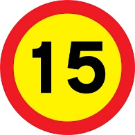

 B26.15 Örtliche Geschwindigkeitsbegrenzung Explizit 15 15 15 15 15 15 

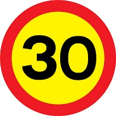

 B26.30 Örtliche Geschwindigkeitsbegrenzung Explizit 30 30 30 30 30 30 

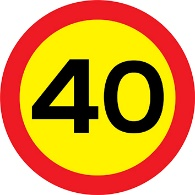

 B26.40 Örtliche Geschwindigkeitsbegrenzung 40 40 40 40 40 40 

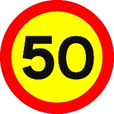

 B26.50 Örtliche Geschwindigkeitsbegrenzung Explizit 50 50 50 50 50 50 

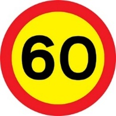

 B26.60 Örtliche Geschwindigkeitsbegrenzung Explizit 60 60 60 60 60 60 

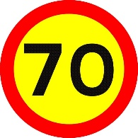

 B26.70 Örtliche Geschwindigkeitsbegrenzung Explizit 70 70 70 70 70 70 

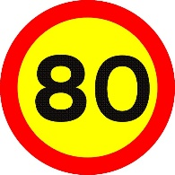

 B26.80 Örtliche Geschwindigkeitsbegrenzung Explizit 80 80 80 80 80 80 

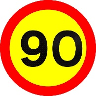

 B26.90 Örtliche Geschwindigkeitsbegrenzung Explizit 90 90 90 90 90 90 

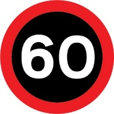

 362.60 (362.xx) Variable örtliche Geschwindigkeitsbegrenzung (xx = 30, 40, 50, 60, 70, 80, 90) Explizit 30, 40, 50, 60, 70, 80, 90 30, 40, 50, 60, 70, 80, 90 30, 40, 50, 60, 70, 80, 90 30, 40, 50, 60, 70, 80, 90 30, 40, 50, 60, 70, 80, 90 30, 40, 50, 60, 70, 80, 90 Implizite numerische Geschwindigkeitsbegrenzungszeichen 

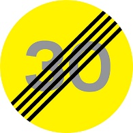

 B27.30 Ende der örtlichen Geschwindigkeitsbegrenzung Explizit N N N N N N 

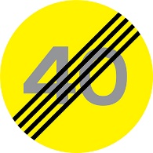

 B27.40 Ende der örtlichen Geschwindigkeitsbegrenzung Explizit N N N N N N 

 B27.50 Ende der örtlichen Geschwindigkeitsbegrenzung Explizit N N N N N N 

 B27.60 Ende der örtlichen Geschwindigkeitsbegrenzung Explizit N N N N N N 

 B27.70 Ende der örtlichen Geschwindigkeitsbegrenzung Explizit N N N N N N 

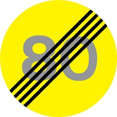

 B27.80 Ende der örtlichen Geschwindigkeitsbegrenzung Explizit N N N N N N 

 363.60 (363.xx) Ende der variablen örtlichen Geschwindigkeitsbegrenzung (xx = 30, 40, 50, 60, 70, 80) Explizit N N N N N N Implizite nicht-numerische Geschwindigkeitsbegrenzungszeichen 

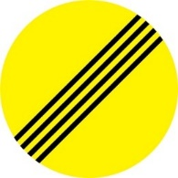

 B34.11 Ende der Verbote N N N N N N Numerische Zonen 

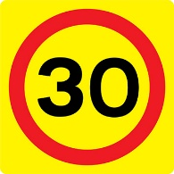

 B 28.30 Zone mit örtlicher Geschwindigkeitsbegrenzung Explizit 30 30 30 30 30 30 

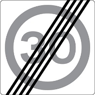

 B 29.30 Ende der Zone mit örtlicher Geschwindigkeitsbegrenzung Explizit N N N N N N 

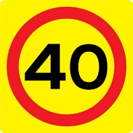

 B 28.40 Zone mit örtlicher Geschwindigkeitsbegrenzung Explizit 40 40 40 40 40 40 

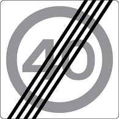

 B 29.40 Ende der Zone mit örtlicher Geschwindigkeitsbegrenzung Explizit N N N N N N 

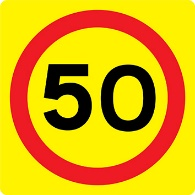

 B 28.50 Zone mit örtlicher Geschwindigkeitsbegrenzung Explizit 50 50 50 50 50 50 

 B 29.50 Ende der Zone mit örtlicher Geschwindigkeitsbegrenzung Explizit N N N N N N Verkehrsberuhigter Bereich 

 D14.11 Zone mit Wohngebiet (Wohn- und Spielbereich) Implizit 15 15 15 15 15 15 

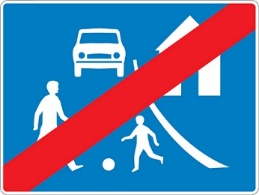

 D14.21 Ende der Zone mit Wohngebiet (Wohn- und Spielbereich) Implizit N N N N N N 

 548 Fussgängerzone Implizit 10 10 10 10 10 10 

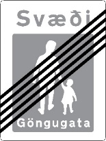

 550 Ende der Fussgängerzone Implizit N N N N N N Stadt-/Ortsgrenzen 

 D12.11 Bebautes Gebiet (implizit) Hinweis: Dies ist ein implizites Geschwindigkeitsbegrenzungszeichen, das die für innerorts geltende nationale Geschwindigkeitsbegrenzung anzeigt. 50 50 50 50 50 50 

 D12.21 Ende des bebauten Gebiets Hinweis: Dies ist ein implizites Geschwindigkeitsbegrenzungszeichen, das die für ausserorts geltende nationale Geschwindigkeitsbegrenzung anzeigt. Auf befestigten Strassen 90 km/h, auf unbefestigten Strassen 80 km/h. 90/80 90/80 90/80 90/80 90/80 90/80 52g. 32023 R 2590 : Delegierte Verordnung (EU) 2023/2590 der Kommission vom 13. Juli 2023 zur Ergänzung der Verordnung (EU) 2019/2144 des Europäischen Parlaments und des Rates durch Festlegung detaillierter Vorschriften für die spezifischen Prüfverfahren und technischen Anforderungen für die Typgenehmigung von bestimmten Kraftfahrzeugen hinsichtlich ihrer hochentwickelten Warnsysteme bei nachlassender Konzentration des Fahrers sowie zur Änderung der genannten Verordnung (ABl. L, 2023/2590, 22.11.2023) 52h. 32024 R 1721 : Durchführungsverordnung (EU) 2024/1721 der Kommission vom 19. Juni 2024 zur Festlegung von Vorschriften für die Anwendung der Verordnung (EU) 2019/2144 des Europäischen Parlaments und des Rates im Hinblick auf Muster für die Genehmigung des intelligenten Geschwindigkeitsassistenten, des Warnsystems bei Müdigkeit und nachlassender Aufmerksamkeit des Fahrers, des Ereignisdatenspeichers, der Vorrichtung zum Einbau einer alkoholempfindlichen Wegfahrsperre und des hochentwickelten Warnsystems bei nachlassender Konzentration des Fahrers (ABl. L, 2024/1721, 20.6.2024) 52i. 32024 R 2220 : Delegierte Verordnung (EU) 2024/2220 der Kommission vom 26. Juli 2024 zur Ergänzung der Verordnung (EU) 2019/2144 des Europäischen Parlaments und des Rates durch Festlegung detaillierter Vorschriften für die spezifischen Prüfverfahren und technischen Anforderungen für die Typgenehmigung schwerer Nutzfahrzeuge hinsichtlich ihrer Ereignisdatenspeicher und für die Typgenehmigung von Ereignisdatenspeichern als selbstständige technische Einheiten sowie zur Änderung von Anhang II der genannten Verordnung (ABl. L, 2024/2220, 2.10.2024) Rechtsakte, die die Vertragsparteien zur Kenntnis nehmen Die Vertragsparteien nehmen den Inhalt der folgenden Rechtsakte zur Kenntnis: 1. 32014 R 0901 : Durchführungsverordnung (EU) Nr. 901/2014 der Kommission vom 18. Juli 2014 zur Durchführung der Verordnung (EU) Nr. 168/2013 des Europäischen Parlaments und des Rates hinsichtlich der Verwaltungsvorschriften für die Genehmigung und Marktüberwachung von zwei- oder dreirädrigen und vierrädrigen Fahrzeugen (ABl. L 249 vom 22.8.2014, S. 1) . Die Verordnung gilt für die Zwecke dieses Abkommens mit folgenden Anpassungen: In Anhang VII wird die Nr. 2.1 wie folgt ergänzt: "IS für Island FL für Liechtenstein 16 für Norwegen" 2. Aufgehoben 3. 52007 SC 0169: Erläuternde Mitteilung 2007/C 68/04 der Kommission zu den Zulassungsverfahren für Kraftfahrzeuge, die aus einem Mitgliedstaat in einen anderen verbracht wurden (ABl. C 68 vom 24.3.2007, S. 15) . II. Land- und forstwirtschaftliche Zugmaschinen Rechtsakte, auf die Bezug genommen wird 1. Aufgehoben 2. Aufgehoben 3. Aufgehoben 4. Aufgehoben 5. Aufgehoben 6. Aufgehoben 7. Aufgehoben 8. Aufgehoben 9. Aufgehoben 10. Aufgehoben 11. Aufgehoben 12. Aufgehoben 13. Aufgehoben 14. Aufgehoben 15. Aufgehoben 16. Aufgehoben 17. Aufgehoben 18. Aufgehoben 19. Aufgehoben 20. Aufgehoben 21. Aufgehoben 22. Aufgehoben 23. Aufgehoben 24. Aufgehoben 25. Aufgehoben 26. 32000 L 0002: Richtlinie 2000/2/EG der Kommission vom 14. Januar 2000 zur Anpassung der Richtlinie 75/322/EWG des Rates über die Funkentstörung der Fremdzündungsmotoren von land- oder forstwirtschaftlichen Zugmaschinen auf Rädern an den technischen Fortschritt und der Richtlinie 74/150/EWG des Rates über die Betriebserlaubnis für land- oder forstwirtschaftliche Zugmaschinen auf Rädern (ABl. L 21 vom 26.1.2000, S. 23) . 27. 32001 L 0003: Richtlinie 2001/3/EG der Kommission vom 8. Januar 2001 zur Anpassung der Richtlinie 74/150/EWG des Rates über Betriebserlaubnis für land- und forstwirtschaftliche Zugmaschinen auf Rädern und der Richtlinie 75/322/EWG des Rates über die Funkentstörung land- und forstwirtschaftlicher Zugmaschinen auf Rädern an den technischen Fortschritt (ABl. L 28 vom 30.1.2001, S. 1) . 28. Aufgehoben 29. Aufgehoben 30. 32008 L 0002: Richtlinie 2008/2/EG des Europäischen Parlaments und des Rates vom 15. Januar 2008 über das Sichtfeld und die Scheibenwischer von land- oder forstwirtschaftlichen Zugmaschinen auf Rädern (ABl. L 24 vom 29.1.2008, S. 30) . 31. Aufgehoben 32. Aufgehoben 33. Aufgehoben 34. Aufgehoben 35. Aufgehoben 36. Aufgehoben 37. Aufgehoben 38. Aufgehoben 39. Aufgehoben 40. 32013 R 0167 : Verordnung (EU) Nr. 167/2013 des Europäischen Parlaments und des Rates vom 5. Februar 2013 über die Genehmigung und Marktüberwachung von land- und forstwirtschaftlichen Fahrzeugen (ABl. L 60 vom 2.3.2013, S. 1) , geändert durch: - 32014 R 1322 : Delegierte Verordnung (EU) Nr. 1322/2014 der Kommission vom 19. September 2014 (ABl. L 364 vom 18.12.2014, S. 1) ; - 32016 R 1788 : Delegierte Verordnung (EU) 2016/1788 der Kommission vom 14. Juli 2016 (ABl. L 277 vom 13.10.2016, S. 1) ; - 32016 R 1628 : Verordnung (EU) 2016/1628 des Europäischen Parlaments und des Rates vom 14. September 2016 (ABl. L 252 vom 16.9.2016, S. 53) , berichtigt in ABl. L 231 vom 6.9.2019, S. 29 ; - 32018 R 0830 : Delegierte Verordnung (EU) 2018/830 der Kommission vom 9. März 2018 (ABl. L 140 vom 6.6.2018, S. 15) ; - 32019 R 0519 : Verordnung (EU) 2019/519 des Europäischen Parlaments und des Rates vom 19. März 2019 (ABl. L 91 vom 29.3.2019, S. 42) ; - 32024 R 2838 : Verordnung (EU) 2024/2838 des Europäischen Parlaments und des Rates vom 23. Oktober 2024 (ABl. L, 2024/2838, 7.11.2024). 40a. 32014 R 1322 : Delegierte Verordnung (EU) Nr. 1322/2014 der Kommission vom 19. September 2014 zur Ergänzung und Änderung der Verordnung (EU) Nr. 167/2013 des Europäischen Parlaments und des Rates hinsichtlich der Anforderungen an die Bauweise von Fahrzeugen und der allgemeinen Anforderungen im Zusammenhang mit der Typgenehmigung von land- und forstwirtschaftlichen Fahrzeugen (ABl. L 364 vom 18.12.2014, S. 1) , geändert durch: - 32016 R 1788 : Delegierte Verordnung (EU) 2016/1788 der Kommission vom 14. Juli 2016 (ABl. L 277 vom 13.10.2016, S. 1) . 40b. 32015 R 0068 : Delegierte Verordnung (EU) 2015/68 der Kommission vom 15. Oktober 2014 zur Ergänzung der Verordnung (EU) Nr. 167/2013 des Europäischen Parlaments und des Rates hinsichtlich der Anforderungen für die Bremsen von Fahrzeugen im Zusammenhang mit der Typgenehmigung von land- und forstwirtschaftlichen Fahrzeugen (ABl. L 17 vom 23.1.2015, S. 1) , geändert durch: - 32016 R 1788 : Delegierte Verordnung (EU) 2016/1788 der Kommission vom 14. Juli 2016 (ABl. L 277 vom 13.10.2016, S. 1) ; - 32018 R 0828 : Delegierte Verordnung (EU) 2018/828 der Kommission vom 15. Februar 2018 (ABl. L 140 vom 6.6.2018, S. 5) . 40c. 32018 R 0985 : Delegierte Verordnung (EU) 2018/985 der Kommission vom 12. Februar 2018 zur Ergänzung der Verordnung (EU) Nr. 167/2013 des Europäischen Parlaments und des Rates in Bezug auf die Anforderungen an die Umweltverträglichkeit und die Leistung der Antriebseinheit land- und forstwirtschaftlicher Fahrzeuge und ihrer Motoren und zur Aufhebung der Delegierten Verordnung (EU) 2015/96 der Kommission (ABl. L 182 vom 18.7.2018, S. 1) , geändert durch: - 32020 R 1564 : Delegierte Verordnung (EU) 2020/1564 der Kommission vom 6. August 2020 (ABl. L 358 vom 28.10.2020, S. 1) ; - 32022 R 0518 : Delegierte Verordnung (EU) 2022/518 der Kommission vom 13. Januar 2022 (ABl. L 104 vom 1.4.2022, S. 56) . 40d. 32015 R 0504 : Durchführungsverordnung (EU) 2015/504 der Kommission vom 11. März 2015 zur Durchführung der Verordnung (EU) Nr. 167/2013 des Europäischen Parlaments und des Rates hinsichtlich der Verwaltungsvorschriften für die Genehmigung und Marktüberwachung von land- und forstwirtschaftlichen Fahrzeugen (ABl. L 85 vom 28.3.2015, S. 1) , geändert durch: - 32016 R 1789 : Durchführungsverordnung (EU) 2016/1789 der Kommission vom 7. September 2016 (ABl. L 277 vom 13.10.2016, S. 60) ; - 32018 R 0986 : Durchführungsverordnung (EU) 2018/986 der Kommission vom 3. April 2018 (ABl. L 182 vom 18.7.2018, S. 16) ; - 32018 R 0128 : Durchführungsverordnung (EU) 2018/128 der Kommission vom 25. Januar 2018 (ABl. L 22 vom 26.1.2018, S. 16) . 41. 32015 R 0208 : Delegierte Verordnung (EU) 2015/208 der Kommission vom 8. Dezember 2014 zur Ergänzung der Verordnung (EU) Nr. 167/2013 des Europäischen Parlaments und des Rates hinsichtlich der Anforderungen an die funktionale Sicherheit von Fahrzeugen für die Genehmigung von land- und forstwirtschaftlichen Fahrzeugen (ABl. L 42 vom 17.2.2015, S. 1) , geändert durch: - 32016 R 1788 : Delegierte Verordnung (EU) 2016/1788 der Kommission vom 14. Juli 2016 (ABl. L 277 vom 13.10.2016, S. 1) - 32018 R 0829 : Delegierte Verordnung (EU) 2018/829 der Kommission vom 15. Februar 2018 (ABl. L 140 vom 6.6.2018, S. 8) - 32020 R 0540 : Delegierte Verordnung (EU) 2020/540 der Kommission vom 21. Januar 2020 (ABl. L 121 vom 20.4.2020, S. 1) III. Hebezeuge und Fördergeräte Rechtsakte, auf die Bezug genommen wird 1. 373 L 0361: Richtlinie 73/361/EWG des Rates vom 19. November 1973 zur Angleichung der Rechts- und Verwaltungsvorschriften der Mitgliedstaaten über Bescheinigungen und Kennzeichnungen für Drahtseile, Ketten und Lasthaken (ABl. Nr. L 335 vom 5.12.1973, S. 51) , geändert durch: - 376 L 0434: Richtlinie 76/434/EWG der Kommission vom 13. April 1976 (ABl. Nr. L 122 vom 8.5.1976, S. 20) . 2. Aufgehoben 3. Aufgehoben 4. 386 L 0663: Richtlinie 86/663/EWG des Rates vom 22. Dezember 1986 zur Angleichung der Rechtsvorschriften der Mitgliedstaaten über kraftbetriebene Flurförderzeuge (ABl. Nr. L 384 vom 31.12.1986, S. 12) , geändert durch: - 389 L 0240: Richtlinie 89/240/EWG der Kommission vom 16. Dezember 1988 (ABl. Nr. L 100 vom 12.4.1989, S. 1) . 5. Aufgehoben 6. 32014 L 0033 : Richtlinie 2014/33/EU des Europäischen Parlaments und des Rates vom 26. Februar 2014 zur Angleichung der Rechtsvorschriften der Mitgliedstaaten über Aufzüge und Sicherheitsbauteile für Aufzüge (ABl. L 96 vom 29.3.2014, S. 251) . Rechtsakte, die die Vertragsparteien zur Kenntnis nehmen: Die Vertragsparteien nehmen den Inhalt der folgenden Rechtsakte zur Kenntnis: 1. 395 X 0216: Empfehlung 95/216/EG der Kommission vom 8. Juni 1995 über die Verbesserung der Sicherheit der vorhandenen Aufzüge (ABl. Nr. L 134 vom 20.6.1995, S. 37) . IV. Haushaltsgeräte Rechtsakte, auf die Bezug genommen wird 1. Aufgehoben 2. Aufgehoben 3. Aufgehoben 4. 32017 R 1369 : Verordnung (EU) 2017/1369 des Europäischen Parlaments und des Rates vom 4. Juli 2017 zur Festlegung eines Rahmens für die Energieverbrauchskennzeichnung und zur Aufhebung der Richtlinie 2010/30/EU (ABl. L 198 vom 28.7.2017, S. 1) , geändert durch: - 32020 R 0740 : Verordnung (EU) 2020/740 des Europäischen Parlaments und des Rates vom 25. Mai 2020 (ABl. L 177 vom 5.6.2020, S. 1) , berichtigt in ABl. L 241 vom 27.7.2020, S. 46 , und ABl. L 147 vom 30.4.2021, S. 23 . 4a. Aufgehoben 4b. Aufgehoben 4c. 32023 R 2534 : Delegierte Verordnung (EU) 2023/2534 der Kommission vom 13. Juli 2023 zur Ergänzung der Verordnung (EU) 2017/1369 des Europäischen Parlaments und des Rates in Bezug auf die Energieverbrauchskennzeichnung von Haushaltswäschetrocknern und zur Aufhebung der Delegierten Verordnung (EU) Nr. 392/2012 der Kommission (ABl. L, 2023/2534, 22.11.2023) 4d. 396 L 0060: Richtlinie 96/60/EG der Kommission vom 19. September 1996 zur Durchführung der Richtlinie 92/75/EWG des Rates betreffend die Energieetikettierung für kombinierte Haushalts-Wasch-Trockenautomaten (ABl. L 266 vom 18.10.1996, S. 1) , geändert durch: - 1 03 T: Akte über die Bedingungen des Beitritts der Tschechischen Republik, der Republik Estland, der Republik Zypern, der Republik Lettland, der Republik Litauen, der Republik Ungarn, der Republik Malta, der Republik Polen, der Republik Slowenien und der Slowakischen Republik und die Anpassungen der Verträge, auf denen die Europäische Union beruht, angenommen am 16. April 2003 (Abl. L 236 vom 23. September 2003, S. 33); - 32006 L 0080: Richtlinie 2006/80/EG der Kommission vom 23. Oktober 2006 (ABl. L 362 vom 20.12.2006, S. 67) . Die Richtlinie gilt für die Zwecke dieses Abkommens mit folgenden Anpassungen: a) Anhang I der Richtlinie 96/60/EG der Kommission wird durch den Wortlaut in Abschnitt 4 der Anlage 1 des Anhangs II des Abkommens ergänzt. b) Anhang V der Richtlinie 96/60/EG der Kommission wird durch den Wortlaut in Abschnitt 4 der Anlage 2 des Anhangs II des Abkommens ergänzt. 4e. Aufgehoben 4f. Aufgehoben 4g. Aufgehoben 4h. Aufgehoben 4i. Aufgehoben 4j. Aufgehoben 4k. Aufgehoben 4l. Aufgehoben 4m. 32011 R 0626 : Delegierte Verordnung (EU) Nr. 626/2011 der Kommission vom 4. Mai 2011 zur Ergänzung der Richtlinie 2010/30/EU des Europäischen Parlaments und des Rates im Hinblick auf die Kennzeichnung von Luftkonditionierern in Bezug auf den Energieverbrauch (ABl. L 178 vom 6.7.2011, S. 1) , geändert durch: - 32014 R 0518 : Delegierte Verordnung (EU) Nr. 518/2014 der Kommission vom 5. März 2014 (ABl. L 147 vom 17.5.2014, S. 1) , berichtigt in ABl. L 244 vom 19.9.2013, S. 60 ; - 32017 R 0254 : Delegierte Verordnung (EU) 2017/254 der Kommission vom 30. November 2016 (ABl. L 38 vom 15.2.2017, S. 1) ; - 32020 R 1059 : Delegierte Verordnung (EU) 2020/1059 der Kommission vom 27. April 2020 (ABl. L 232 vom 20.7.2020, S. 28) ; - 32023 R 2048 : Delegierte Verordnung (EU) 2023/2048 der Kommission vom 4. Juli 2023 (ABl. L 236 vom 26.9.2023, S. 1) 4n. Aufgehoben 4o. 32014 R 1254 : Delegierte Verordnung (EU) Nr. 1254/2014 der Kommission vom 11. Juli 2014 zur Ergänzung der Richtlinie 2010/30/EU des Europäischen Parlaments und des Rates im Hinblick auf die Kennzeichnung von Wohnraumlüftungsgeräten in Bezug auf den Energieverbrauch (ABl. L 337 vom 25.11.2014, S. 27) , geändert durch: - 32017 R 0254 : Delegierte Verordnung (EU) 2017/254 der Kommission vom 30. November 2016 (ABl. L 38 vom 15.2.2017, S. 1) - 32020 R 0987 : Delegierte Verordnung (EU) 2020/987 der Kommission vom 20. Januar 2020 (ABl. L 221 vom 10.7.2020, S. 1) 4p. 32015 R 1186 : Delegierte Verordnung (EU) 2015/1186 vom 24. April 2015 zur Ergänzung der Richtlinie 2010/30/EU des Europäischen Parlaments und des Rates im Hinblick auf die Energieverbrauchskennzeichnung von Einzelraumheizgeräten (ABl. L 193 vom 21.7.2015, S. 20) , geändert durch: - 32017 R 0254 : Delegierte Verordnung (EU) 2017/254 der Kommission vom 30. November 2016 (ABl. L 38 vom 15.2.2017, S. 1) 4q. 32015 R 1187 : Delegierte Verordnung (EU) 2015/1187 der Kommission vom 27. April 2015 zur Ergänzung der Richtlinie 2010/30/EU des Europäischen Parlaments und des Rates im Hinblick auf die Energieverbrauchskennzeichnung von Festbrennstoffkesseln und Verbundanlagen aus einem Festbrennstoffkessel, Zusatzheizgeräten, Temperaturreglern und Solareinrichtungen (ABl. L 193 vom 21.7.2015, S. 43) , geändert durch: - 32017 R 0254 : Delegierte Verordnung (EU) 2017/254 der Kommission vom 30. November 2016 (ABl. L 38 vom 15.2.2017, S. 1) 4r. 32015 R 1094 : Delegierte Verordnung (EU) 2015/1094 der Kommission vom 5. Mai 2015 zur Ergänzung der Richtlinie 2010/30/EU des Europäischen Parlaments und des Rates im Hinblick auf die Energieverbrauchskennzeichnung von gewerblichen Kühllagerschränken (ABl. L 177 vom 8.7.2015, S. 2) , geändert durch: - 32017 R 0254 : Delegierte Verordnung (EU) 2017/254 der Kommission vom 30. November 2016 (ABl. L 38 vom 15.2.2017, S. 1) 4s. 32013 R 0811 : Delegierte Verordnung (EU) Nr. 811/2013 der Kommission vom 18. Februar 2013 zur Ergänzung der Richtlinie 2010/30/EU des Europäischen Parlaments und des Rates im Hinblick auf die Energiekennzeichnung von Raumheizgeräten, Kombiheizgeräten, Verbundanlagen aus Raumheizgeräten, Temperaturreglern und Solareinrichtungen sowie von Verbundanlagen aus Kombiheizgeräten, Temperaturreglern und Solareinrichtungen (ABl. L 239 vom 6.9.2013, S. 1) , geändert durch: - 32014 R 0518 : Delegierte Verordnung (EU) Nr. 518/2014 der Kommission vom 5. März 2014 (ABl. L 147 vom 17.5.2014, S. 1) , berichtigt in ABl. L 244 vom 19.9.2013, S. 60 ; - 32017 R 0254 : Delegierte Verordnung (EU) 2017/254 der Kommission vom 30. November 2016 (ABl. L 38 vom 15.2.2017, S. 1) . 4t. 32013 R 0812 : Delegierte Verordnung (EU) Nr. 812/2013 der Kommission vom 18. Februar 2013 zur Ergänzung der Richtlinie 2010/30/EU des Europäischen Parlaments und des Rates im Hinblick auf die Energieeffizienzkennzeichnung von Warmwasserbereitern, Warmwasserspeichern und Verbundanlagen aus Warmwasserbereitern und Solareinrichtungen (ABl. L 239 vom 6.9.2013, S. 83) , geändert durch: - 32014 R 0518 : Delegierte Verordnung (EU) Nr. 518/2014 der Kommission vom 5. März 2014 (ABl. L 147 vom 17.5.2014, S. 1) , berichtigt in ABl. L 244 vom 19.9.2013, S. 60 ; - 32017 R 0254 : Delegierte Verordnung (EU) 2017/254 der Kommission vom 30. November 2016 (ABl. L 38 vom 15.2.2017, S. 1) ; - 32018 R 0543 : Delegierte Verordnung (EU) 2018/543 der Kommission vom 23. Januar 2018 (ABl. L 90 vom 6.4.2018, S. 63) . 4u. 32014 R 0065 : Delegierte Verordnung (EU) Nr. 65/2014 der Kommission vom 1. Oktober 2013 zur Ergänzung der Richtlinie 2010/30/EU des Europäischen Parlaments und des Rates im Hinblick auf die Energieverbrauchskennzeichnung von Haushaltsbacköfen und -dunstabzugshauben (ABl. L 29 vom 31.1.2014, S. 1) , berichtigt in ABl. L 61 vom 5.3.2015, S. 26 , geändert durch: - 32017 R 0254 : Delegierte Verordnung (EU) 2017/254 der Kommission vom 30. November 2016 (ABl. L 38 vom 15.2.2017, S. 1) . 4v. 32019 R 2013 : Delegierte Verordnung (EU) 2019/2013 der Kommission vom 11. März 2019 zur Ergänzung der Verordnung (EU) 2017/1369 des Europäischen Parlaments und des Rates in Bezug auf die Energieverbrauchskennzeichnung elektronischer Displays und zur Aufhebung der Delegierten Verordnung (EU) Nr. 1062/2010 der Kommission (ABl. L 315 vom 5.12.2019, S. 1) , berichtigt in ABl. L 50 vom 24.2.2020, S. 18 , geändert durch: - 32021 R 0340 : Delegierte Verordnung (EU) 2021/340 der Kommission vom 17. Dezember 2020 (ABl. L 68 vom 26.2.2021, S. 62) 4w. 32019 R 2014 : Delegierte Verordnung (EU) 2019/2014 der Kommission vom 11. März 2019 zur Ergänzung der Verordnung (EU) 2017/1369 des Europäischen Parlaments und des Rates in Bezug auf die Energieverbrauchskennzeichnung von Haushaltswaschmaschinen und Haushaltswaschtrocknern sowie zur Aufhebung der Delegierten Verordnung (EU) Nr. 1061/2010 der Kommission und der Richtlinie 96/60/EG der Kommission (ABl. L 315 vom 5.12.2019, S. 29) , berichtigt in ABl. L 50 vom 24.2.2020, S. 19 , geändert durch: - 32021 R 0340 : Delegierte Verordnung (EU) 2021/340 der Kommission vom 17. Dezember 2020 (ABl. L 68 vom 26.2.2021, S. 62) 4x. 32019 R 2015 : Delegierte Verordnung (EU) 2019/2015 der Kommission vom 11. März 2019 zur Ergänzung der Verordnung (EU) 2017/1369 des Europäischen Parlaments und des Rates in Bezug auf die Energieverbrauchskennzeichnung von Lichtquellen und zur Aufhebung der Delegierten Verordnung (EU) Nr. 874/2012 der Kommission (ABl. L 315 vom 5.12.2019, S. 68) , geändert durch: - 32021 R 0340 : Delegierte Verordnung (EU) 2021/340 der Kommission vom 17. Dezember 2020 (ABl. L 68 vom 26.2.2021, S. 62) - 32023 R 2048 : Delegierte Verordnung (EU) 2023/2048 der Kommission vom 4. Juli 2023 (ABl. L 236 vom 26.9.2023, S. 1) 4y. 32019 R 2016 : Delegierte Verordnung (EU) 2019/2016 der Kommission vom 11. März 2019 zur Ergänzung der Verordnung (EU) 2017/1369 des Europäischen Parlaments und des Rates im Hinblick auf die Energieverbrauchskennzeichnung von Kühlgeräten und zur Aufhebung der Delegierten Verordnung (EU) Nr. 1060/2010 der Kommission (ABl. L 315 vom 5.12.2019, S. 102) , berichtigt in ABl. L 50 vom 24.2.2020, S. 21 , geändert durch: - 32021 R 0340 : Delegierte Verordnung (EU) 2021/340 der Kommission vom 17. Dezember 2020 (ABl. L 68 vom 26.2.2021, S. 62) - 32023 R 2048 : Delegierte Verordnung (EU) 2023/2048 der Kommission vom 4. Juli 2023 (ABl. L 236 vom 26.9.2023, S. 1) 4z. 32019 R 2017 : Delegierte Verordnung (EU) 2019/2017 der Kommission vom 11. März 2019 zur Ergänzung der Verordnung (EU) 2017/1369 des Europäischen Parlaments und des Rates in Bezug auf die Energieverbrauchskennzeichnung von Haushaltsgeschirrspülern und zur Aufhebung der Delegierten Verordnung (EU) Nr. 1059/2010 der Kommission (ABl. L 315 vom 5.12.2019, S. 134) , geändert durch: - 32021 R 0340 : Delegierte Verordnung (EU) 2021/340 der Kommission vom 17. Dezember 2020 (ABl. L 68 vom 26.2.2021, S. 62) 4za. 32019 R 2018 : Delegierte Verordnung (EU) 2019/2018 der Kommission vom 11. März 2019 zur Ergänzung der Verordnung (EU) 2017/1369 des Europäischen Parlaments und des Rates im Hinblick auf die Energieverbrauchskennzeichnung von Kühlgeräten mit Direktverkaufsfunktion (ABl. L 315 vom 5.12.2019, S. 155) , geändert durch: - 32021 R 0340 : Delegierte Verordnung (EU) 2021/340 der Kommission vom 17. Dezember 2020 (ABl. L 68 vom 26.2.2021, S. 62) - 32023 R 2048 : Delegierte Verordnung (EU) 2023/2048 der Kommission vom 4. Juli 2023 (ABl. L 236 vom 26.9.2023, S. 1) 4zb. 32023 R 1669 : Delegierte Verordnung (EU) 2023/1669 der Kommission vom 16. Juni 2023 zur Ergänzung der Verordnung (EU) 2017/1369 des Europäischen Parlaments und des Rates im Hinblick auf die Energieverbrauchskennzeichnung von Smartphones und Slate-Tablets (ABl. L 214 vom 31.8.2023, S. 9) 4zc. 32024 R 0994 : Durchführungsverordnung (EU) 2024/994 der Kommission vom 2. April 2024 zur Festlegung operativer Einzelheiten der gemäss der Verordnung (EU) 2017/1369 des Europäischen Parlaments und des Rates eingerichteten Produktdatenbank (ABl. L, 2024/994, 2.4.2024), berichtigt in ABl. L, 2024/90603, 4.10.2024 5. Aufgehoben 6. 32009 L 0125: Richtlinie 2009/125/EG des Europäischen Parlaments und des Rates vom 21. Oktober 2009 zur Schaffung eines Rahmens für die Festlegung von Anforderungen an die umweltgerechte Gestaltung energieverbrauchsrelevanter Produkte (ABl. L 285 vom 31.10.2009, S. 10) Die Richtlinie gilt für die Zwecke dieses Abkommens mit der folgenden Anpassung: Die EFTA-Staaten nehmen uneingeschränkt an der Arbeit des in Art. 19 genannten Ausschusses teil, haben jedoch kein Stimmrecht. 6a. 32012 R 0206 : Verordnung (EU) Nr. 206/2012 der Kommission vom 6. März 2012 zur Durchführung der Richtlinie 2009/125/EG des Europäischen Parlaments und des Rates im Hinblick auf die Festlegung von Anforderungen an die umweltgerechte Gestaltung von Raumklimageräten und Komfortventilatoren (ABl. L 72 vom 10.3.2012, S. 7) , geändert durch: - 32016 R 2282 : Verordnung (EU) 2016/2282 der Kommission vom 30. November 2016 (ABl. L 346 vom 20.12.2016, S. 51) . 6b. 32019 R 2023 : Verordnung (EU) 2019/2023 der Kommission vom 1. Oktober 2019 zur Festlegung von Ökodesign-Anforderungen an Haushaltswaschmaschinen und Haushaltswaschtrockner gemäss der Richtlinie 2009/125/EG des Europäischen Parlaments und des Rates, zur Änderung der Verordnung (EG) Nr. 1275/2008 der Kommission und zur Aufhebung der Verordnung (EU) Nr. 1015/2010 der Kommission (ABl. L 315 vom 5.12.2019, S. 285) , berichtigt in ABl. L 50 vom 24.2.2020, S. 24 , geändert durch: - 32021 R 0341 : Verordnung (EU) 2021/341 der Kommission vom 23. Februar 2021 (ABl. L 68 vom 26.2.2021, S. 108) . 6c. 32019 R 2022 : Verordnung (EU) 2019/2022 der Kommission vom 1. Oktober 2019 zur Festlegung von Ökodesign-Anforderungen an Haushaltsgeschirrspüler gemäss der Richtlinie 2009/125/EG des Europäischen Parlaments und des Rates, zur Änderung der Verordnung (EG) Nr. 1275/2008 der Kommission und zur Aufhebung der Verordnung (EU) Nr. 1016/2010 der Kommission (ABl. L 315 vom 5.12.2019, S. 267) , geändert durch: - 32021 R 0341 : Verordnung (EU) 2021/341 der Kommission vom 23. Februar 2021 (ABl. L 68 vom 26.2.2021, S. 108) . 6d. 32011 R 0327 : Verordnung (EU) Nr. 327/2011 der Kommission vom 30. März 2011 zur Durchführung der Richtlinie 2009/125/EG des Europäischen Parlaments und des Rates im Hinblick auf die Festlegung von Anforderungen an die umweltgerechte Gestaltung von Ventilatoren, die durch Motoren mit einer elektrischen Eingangsleistung zwischen 125 W und 500 kW angetrieben werden (ABl. L 90 vom 6.4.2011, S. 8) , geändert durch: - 32013 R 0666 : Verordnung (EU) Nr. 666/2013 der Kommission vom 8. Juli 2013 (ABl. L 192 vom 13.7.2013, S. 24) ; - 32016 R 2282 : Verordnung (EU) 2016/2282 der Kommission vom 30. November 2016 (ABl. L 346 vom 20.12.2016, S. 51) . 6e. 32012 R 0932 : Verordnung (EU) Nr. 932/2012 der Kommission vom 3. Oktober 2012 zur Durchführung der Richtlinie 2009/125/EG des Europäischen Parlaments und des Rates im Hinblick auf die Festlegung von Anforderungen an die umweltgerechte Gestaltung von Haushaltswäschetrocknern (ABl. L 278 vom 12.10.2012, S. 1) , geändert durch: - 32016 R 2282 : Verordnung (EU) 2016/2282 der Kommission vom 30. November 2016 (ABl. L 346 vom 20.12.2016, S. 51) 6f. 32012 R 0547 : Verordnung (EU) Nr. 547/2012 der Kommission vom 25. Juni 2012 zur Durchführung der Richtlinie 2009/125/EG des Europäischen Parlaments und des Rates im Hinblick auf die Festlegung von Anforderungen an die umweltgerechte Gestaltung von Wasserpumpen (ABl. L 165 vom 26.6.2012, S. 28) , geändert durch: - 32016 R 2282 : Verordnung (EU) 2016/2282 der Kommission vom 30. November 2016 (ABl. L 346 vom 20.12.2016, S. 51) 6g. 32019 R 2020 : Verordnung (EU) 2019/2020 der Kommission vom 1. Oktober 2019 zur Festlegung von Ökodesign-Anforderungen an Lichtquellen und separate Betriebsgeräte gemäss der Richtlinie 2009/125/EG des Europäischen Parlaments und des Rates und zur Aufhebung der Verordnungen (EG) Nr. 244/2009, (EG) Nr. 245/2009 und (EU) Nr. 1194/2012 der Kommission (ABl. L 315 vom 5.12.2019, S. 209) , berichtigt in ABl. L 50 vom 24.2.2020, S. 22 , geändert durch: - 32021 R 0341 : Verordnung (EU) 2021/341 der Kommission vom 23. Februar 2021 (ABl. L 68 vom 26.2.2021, S. 108) . 6h. 32014 R 0548 : Verordnung (EU) Nr. 548/2014 der Kommission vom 21. Mai 2014 zur Umsetzung der Richtlinie 2009/125/EG des Europäischen Parlaments und des Rates hinsichtlich Kleinleistungs-, Mittelleistungs- und Grossleistungstransformatoren (ABl. L 152 vom 22.5.2014, S. 1) , geändert durch: - 32016 R 2282 : Verordnung (EU) 2016/2282 der Kommission vom 30. November 2016 (ABl. L 346 vom 20.12.2016, S. 51) ; - 32019 R 1783 : Verordnung (EU) 2019/1783 der Kommission vom 1. Oktober 2019 (ABl. L 272 vom 25.10.2019, S. 107) . 6i. 32013 R 0617 : Verordnung (EU) Nr. 617/2013 der Kommission vom 26. Juni 2013 zur Durchführung der Richtlinie 2009/125/EG des Europäischen Parlaments und des Rates im Hinblick auf die Festlegung von Anforderungen an die umweltgerechte Gestaltung von Computern und Computerservern (ABl. L 175 vom 27.6.2013, S. 13) , geändert durch: - 32016 R 2282 : Verordnung (EU) 2016/2282 der Kommission vom 30. November 2016 (ABl. L 346 vom 20.12.2016, S. 51) ; - 32019 R 0424 : Verordnung (EU) 2019/424 der Kommission vom 15. März 2019 (ABl. L 74 vom 18.3.2019, S. 46) . 6j. 32013 R 0666 : Verordnung (EU) Nr. 666/2013 der Kommission vom 8. Juli 2013 zur Durchführung der Richtlinie 2009/125/EG des Europäischen Parlaments und des Rates im Hinblick auf die Festlegung von Anforderungen an die umweltgerechte Gestaltung von Staubsaugern (ABl. L 192 vom 13.7.2012, S. 24) , geändert durch: - 32016 R 2282 : Verordnung (EU) 2016/2282 der Kommission vom 30. November 2016 (ABl. L 346 vom 20.12.2016, S. 51) 6k. 32014 R 0066 : Verordnung (EU) Nr. 66/2014 der Kommission vom 14. Januar 2014 zur Durchführung der Richtlinie 2009/125/EG des Europäischen Parlaments und des Rates im Hinblick auf die Festlegung von Anforderungen an die umweltgerechte Gestaltung von Haushaltsbacköfen, -kochmulden und -dunstabzugshauben (ABl. L 29 vom 31.1.2014, S. 33) , geändert durch: - 32016 R 2282 : Verordnung (EU) 2016/2282 der Kommission vom 30. November 2016 (ABl. L 346 vom 20.12.2016, S. 51) 6l. 32014 R 1253 : Verordnung (EU) Nr. 1253/2014 der Kommission vom 7. Juli 2014 zur Durchführung der Richtlinie 2009/125/EG des Europäischen Parlaments und des Rates hinsichtlich der Anforderungen an die umweltgerechte Gestaltung von Lüftungsanlagen (ABl. L 337 vom 25.11.2014, S. 8) , geändert durch: - 32016 R 2282 : Verordnung (EU) 2016/2282 der Kommission vom 30. November 2016 (ABl. L 346 vom 20.12.2016, S. 51) ; - 32020 R 1000 : Verordnung (EU) 2020/1000 der Kommission vom 9. Juli 2020 (ABl. L 221 vom 10.7.2020, S. 105) . 6m. 32015 R 1185 : Verordnung (EU) 2015/1185 der Kommission vom 24. April 2015 zur Durchführung der Richtlinie 2009/125/EG des Europäischen Parlaments und des Rates im Hinblick auf die Festlegung von Anforderungen an die umweltgerechte Gestaltung von Festbrennstoff-Einzelraumheizgeräten (ABl. L 193 vom 21.7.2015, S. 1) , geändert durch: - 32016 R 2282 : Verordnung (EU) 2016/2282 der Kommission vom 30. November 2016 (ABl. L 346 vom 20.12.2016, S. 51) 6n. 32015 R 1189 : Verordnung (EU) 2015/1189 der Kommission vom 28. April 2015 zur Durchführung der Richtlinie 2009/125/EG des Europäischen Parlaments und des Rates im Hinblick auf die Festlegung von Anforderungen an die umweltgerechte Gestaltung von Festbrennstoffkesseln (ABl. L 193 vom 21.7.2015, S. 100) , geändert durch: - 32016 R 2282 : Verordnung (EU) 2016/2282 der Kommission vom 30. November 2016 (ABl. L 346 vom 20.12.2016, S. 51) 6o. 32015 R 1095 : Verordnung (EU) 2015/1095 der Kommission vom 5. Mai 2015 zzur Durchführung der Richtlinie 2009/125/EG des Europäischen Parlaments und des Rates im Hinblick auf die Festlegung von Anforderungen an die umweltgerechte Gestaltung von gewerblichen Kühllagerschränken, Schnellkühlern/-frostern, Verflüssigungssätzen und Prozesskühlern (ABl. L 177 vom 8.7.2015, S. 19) , geändert durch: - 32016 R 2282 : Verordnung (EU) 2016/2282 der Kommission vom 30. November 2016 (ABl. L 346 vom 20.12.2016, S. 51) 6p. Aufgehoben 6q. 32016 R 2281 : Verordnung (EU) 2016/2281 der Kommission vom 30. November 2016 zur Durchführung der Richtlinie 2009/125/EG des Europäischen Parlaments und des Rates zur Schaffung eines Rahmens für die Festlegung von Anforderungen an die umweltgerechte Gestaltung energieverbrauchsrelevanter Produkte im Hinblick auf Luftheizungsprodukte, Kühlungsprodukte, Prozesskühler mit hoher Betriebstemperatur und Gebläsekonvektoren (ABl. L 346 vom 20.12.2016, S. 1) , geändert durch: - 32016 R 2282 : Verordnung (EU) 2016/2282 der Kommission vom 30. November 2016 (ABl. L 346 vom 20.12.2016, S. 51) 6r. 32013 R 0813 : Verordnung (EU) Nr. 813/2013 der Kommission vom 2. August 2013 zur Durchführung der Richtlinie 2009/125/EG des Europäischen Parlaments und des Rates im Hinblick auf die Festlegung von Anforderungen an die umweltgerechte Gestaltung von Raumheizgeräten und Kombiheizgeräten (ABl. L 239 vom 6.9.2013, S. 136) 6s. 32019 R 1781 : Verordnung (EU) 2019/1781 der Kommission vom 1. Oktober 2019 zur Festlegung von Ökodesign-Anforderungen an Elektromotoren und Drehzahlregelungen gemäss der Richtlinie 2009/125/EG des Europäischen Parlaments und des Rates, zur Änderung der Verordnung (EG) Nr. 641/2009 im Hinblick auf die Festlegung von Anforderungen an die umweltgerechte Gestaltung von externen Nassläufer-Umwälzpumpen und in Produkte integrierten Nassläufer-Umwälzpumpen und zur Aufhebung der Verordnung (EG) Nr. 640/2009 der Kommission (ABl. L 272 vom 25.10.2019, S. 74) , geändert durch: - 32021 R 0341 : Verordnung (EU) 2021/341 der Kommission vom 23. Februar 2021 (ABl. L 68 vom 26.2.2021, S. 108) ; - 32023 R 0003 : Verordnung (EU) 2023/3 der Kommission vom 3. Januar 2023 (ABl. L 2 vom 4.1.2023, S. 1) . 6t. 32019 R 1782 : Verordnung (EU) 2019/1782 der Kommission vom 1. Oktober 2019 zur Festlegung von Ökodesign-Anforderungen an externe Netzteile gemäss der Richtlinie 2009/125/EG des Europäischen Parlaments und des Rates und zur Aufhebung der Verordnung (EG) Nr. 278/2009 der Kommission (ABl. L 272 vom 25.10.2019, S. 95) 6u. 32019 R 0424 : Verordnung (EU) 2019/424 der Kommission vom 15. März 2019 zur Festlegung von Ökodesign-Anforderungen an Server und Datenspeicherprodukte gemäss der Richtlinie 2009/125/EG des Europäischen Parlaments und des Rates und zur Änderung der Verordnung (EU) Nr. 617/2013 der Kommission (ABl. L 74 vom 18.3.2019, S. 46) , geändert durch: - 32021 R 0341 : Verordnung (EU) 2021/341 der Kommission vom 23. Februar 2021 (ABl. L 68 vom 26.2.2021, S. 108) . 6v. 32019 R 2019 : Verordnung (EU) 2019/2019 der Kommission vom 1. Oktober 2019 zur Festlegung von Ökodesign-Anforderungen an Kühlgeräte gemäss der Richtlinie 2009/125/EG des Europäischen Parlaments und des Rates und zur Aufhebung der Verordnung (EG) Nr. 643/2009 der Kommission, geändert durch: - 32021 R 0341 : Verordnung (EU) 2021/341 der Kommission vom 23. Februar 2021 (ABl. L 68 vom 26.2.2021, S. 108) . 6w. 32019 R 2021 : Verordnung (EU) 2019/2021 der Kommission vom 1. Oktober 2019 zur Festlegung von Ökodesign-Anforderungen an elektronische Displays gemäss der Richtlinie 2009/125/EG des Europäischen Parlaments und des Rates, zur Änderung der Verordnung (EG) Nr. 1275/2008 der Kommission und zur Aufhebung der Verordnung (EG) Nr. 642/2009 der Kommission (ABl. L 315 vom 5.12.2019, S. 241) , berichtigt in ABl. L 50 vom 24.2.2020, S. 23 , geändert durch: - 32021 R 0341 : Verordnung (EU) 2021/341 der Kommission vom 23. Februar 2021 (ABl. L 68 vom 26.2.2021, S. 108) . 6x. 32019 R 2024 : Verordnung (EU) 2019/2024 der Kommission vom 1. Oktober 2019 zur Festlegung von Ökodesign-Anforderungen an Kühlgeräte mit Direktverkaufsfunktion gemäss der Richtlinie 2009/125/EG des Europäischen Parlaments und des Rates (ABl. L 315 vom 5.12.2019, S. 313) , geändert durch: - 32021 R 0341 : Verordnung (EU) 2021/341 der Kommission vom 23. Februar 2021 (ABl. L 68 vom 26.2.2021, S. 108) . 6y. 32019 R 1784 : Verordnung (EU) 2019/1784 der Kommission vom 1. Oktober 2019 zur Festlegung von Anforderungen an die umweltgerechte Gestaltung von Schweissgeräten gemäss der Richtlinie 2009/125/EG des Europäischen Parlaments und des Rates (ABl. L 272 vom 25.10.2019, S. 121) 6z. 32024 R 1834 : Verordnung (EU) 2024/1834 der Kommission vom 3. Juli 2024 zur Durchführung der Richtlinie 2009/125/EG des Europäischen Parlaments und des Rates im Hinblick auf Ökodesign-Anforderungen an Ventilatoren, die von Motoren mit einer elektrischen Eingangsleistung zwischen 125 W und 500 kW angetrieben werden, und zur Aufhebung der Verordnung (EU) Nr. 327/2011 der Kommission (ABl. L, 2024/1834, 4.7.2024) 6za. 32023 R 0826 : Verordnung (EU) 2023/826 der Kommission vom 17. April 2023 zur Festlegung von Ökodesign-Anforderungen an den Energieverbrauch elektrischer und elektronischer Haushalts- und Bürogeräte im Aus-Zustand, im Bereitschaftszustand und im vernetzten Bereitschaftsbetrieb gemäss der Richtlinie 2009/125/EG des Europäischen Parlaments und des Rates und zur Aufhebung der Verordnungen (EG) Nr. 1275/2008 und (EG) Nr. 107/2009 der Kommission (ABl. L 103 vom 18.4.2023, S. 29) , geändert durch: - 32023 R 1670 : Verordnung (EU) 2023/1670 der Kommission vom 16. Juni 2023 (ABl. L 214 vom 31.8.2023, S. 47) 6zb. 32023 R 1670 : Verordnung (EU) 2023/1670 der Kommission vom 16. Juni 2023 zur Festlegung von Ökodesign-Anforderungen an Smartphones, Mobiltelefone, die keine Smartphones sind, schnurlose Telefone und Slate-Tablets gemäss der Richtlinie 2009/125/EG des Europäischen Parlaments und des Rates und zur Änderung der Verordnung (EU) 2023/826 der Kommission (ABl. L 214 vom 31.8.2023, S. 47) 6zc. 32024 R 1103 : Verordnung (EU) 2024/1103 der Kommission vom 18. April 2024 zur Durchführung der Richtlinie 2009/125/EG des Europäischen Parlaments und des Rates in Bezug auf Ökodesign-Anforderungen an Einzelraumheizgeräte und separate zugehörige Regler und zur Aufhebung der Verordnung (EU) 2015/1188 der Kommission (ABl. L, 2024/1103, 19.4.2024), berichtigt in ABl. L, 2024/90295, 17.5.2024 7. 32008 D 0591: Beschluss 2008/591/EG der Kommission vom 30. Juni 2008 über das Ökodesign-Konsultationsforum (ABl. L 190 vom 18.7.2008, S. 22) . 8. Aufgehoben 9. Aufgehoben 10. Aufgehoben 11. Aufgehoben 12. Aufgehoben 13. Aufgehoben 14. 32009 R 0641: Verordnung (EG) Nr. 641/2009 der Kommission vom 22. Juli 2009 zur Durchführung der Richtlinie 2005/32/EG des Europäischen Parlaments und des Rates im Hinblick auf die Festlegung von Anforderungen an die umweltgerechte Gestaltung von externen Nassläufer-Umwälzpumpen und in Produkte integrierten Nassläufer-Umwälzpumpen (ABl. L 191 vom 23.7.2009, S. 35) , geändert durch: - 32012 R 0622 : Verordnung (EU) Nr. 622/2012 der Kommission vom 11. Juli 2012 (ABl. L 180 vom 12.7.2012, S. 4) ; - 32016 R 2282 : Verordnung (EU) 2016/2282 der Kommission vom 30. November 2016 (ABl. L 346 vom 20.12.2016, S. 51) ; - 32019 R 1781 : Verordnung (EU) 2019/1781 der Kommission vom 1. Oktober 2019 (ABl. L 272 vom 25.10.2019, S. 74) . 15. Aufgehoben 16. Aufgehoben V. Gasgeräte Rechtsakte, auf die Bezug genommen wird 1. Aufgehoben 2. Aufgehoben 3. 392 L 0042: Richtlinie 92/42/EWG des Rates vom 21. Mai 1992 über die Wirkungsgrade von mit flüssigen oder gasförmigen Brennstoffen beschickten neuen Warmwasserheizkesseln (ABl. Nr. L 167 vom 22.6.1992, S. 17) , geändert durch: - 393 L 0068: Richtlinie 93/68/EWG des Rates vom 22. Juli 1993 (ABl. Nr. L 220 vom 30.8.1993, S. 1) ; - 32005 L 0032: Richtlinie 2005/32/EG des Europäischen Parlaments und des Rates vom 6. Juli 2005 (ABl. L 191 vom 22.7.2005, S. 29) . 4. 32016 R 0426 : Verordnung (EU) 2016/426 des Europäischen Parlaments und des Rates vom 9. März 2016 über Geräte zur Verbrennung gasförmiger Brennstoffe und zur Aufhebung der Richtlinie 2009/142/EG (ABl. L 81 vom 31.3.2016, S. 99) . VI. Baumaschinen und Baugeräte Rechtsakte, auf die Bezug genommen wird 1. Aufgehoben 2. Aufgehoben 3. Aufgehoben 4. Aufgehoben 5. Aufgehoben 6. Aufgehoben 7. Aufgehoben 8. 386 L 0295: Richtlinie 86/295/EWG des Rates vom 26. Mai 1986 zur Angleichung der Rechtsvorschriften der Mitgliedstaaten über Überrollschutzaufbauten (ROPS) bestimmter Baumaschinen (ABl. Nr. L 186 vom 8.7.1986, S. 1) , geändert durch: - 1 94 N: Akte über die Bedingungen des Beitritts der Republik Österreich, der Republik Finnland und des Königreichs Schweden und die Anpassungen der die Europäische Union begründenden Verträge (ABl. C 241 vom 29.8.1994, S. 21 , geändert durch ABl. L 1 vom 1.1.1995, S. 1) . Die Richtlinie gilt für die Zwecke dieses Abkommens mit folgender Anpassung: In Anhang IV wird der Text in Klammern wie folgt ergänzt: "FL für Liechtenstein, IS für Island, N für Norwegen" 9. 386 L 0296: Richtlinie 86/296/EWG des Rates vom 26. Mai 1986 zur Angleichung der Rechtsvorschriften der Mitgliedstaaten über Schutzaufbauten gegen herabfallende Gegenstände (FOPS) bestimmter Baumaschinen (ABl. Nr. L 186 vom 8.7.1986, S. 10) , geändert durch: - 1 94 N: Akte über die Bedingungen des Beitritts der Republik Österreich, der Republik Finnland und des Königreichs Schweden und die Anpassungen der die Europäische Union begründenden Verträge (ABl. C 241 vom 29.8.1994, S. 21 , geändert durch ABl. L 1 vom 1.1.1995, S. 1) . Die Richtlinie gilt für die Zwecke dieses Abkommens mit folgender Anpassung: In Anhang IV wird der Text in Klammern wie folgt ergänzt: "FL für Liechtenstein, IS für Island, N für Norwegen" 10. Aufgehoben 10a. 32000 L 0014: Richtlinie 2000/14/EG des Europäischen Parlaments und des Rates vom 8. Mai 2000 zur Angleichung der Rechtsvorschriften der Mitgliedstaaten über umweltbelastende Geräuschemissionen von zur Verwendung im Freien vorgesehenen Geräten und Maschinen (ABl. L 162 vom 3.7.2000, S. 1) , geändert durch: - 32005 L 0088: Richtlinie 2005/88/EG des Europäischen Parlaments und des Rates vom 14. Dezember 2005 (ABl. L 344 vom 27.12.2005, S. 44) , berichtigt in ABl. L 165 vom 17.6.2006, S. 35 ; - 32024 R 1208 : Delegierte Verordnung (EU) 2024/1208 der Kommission vom 16. November 2023 (ABl. L, 2024/1208, 2.5.2024), berichtigt in ABl. L, 2024/90290, 8.5.2024. Rechtsakte, die die Vertragsparteien zur Kenntnis nehmen Die Vertragsparteien nehmen den Inhalt folgender Rechtsakte zur Kenntnis: 11. Mitteilung der Kommission über die Angleichung der Methoden zur Messung des Lärms von Baumaschinen (am 3.1.1981 angenommen) 12. 386 X 0666: Empfehlung 86/666/EWG des Rates vom 22. Dezember 1986 über den Brandschutz in bestehenden Hotels (ABl. Nr. L 384 vom 31.12.1986, S. 60) . VII. Sonstige Maschinen Rechtsakte, auf die Bezug genommen wird 1. Aufgehoben VIII. Druckgefässe Rechtsakte, auf die Bezug genommen wird 1. 375 L 0324: Richtlinie 75/324/EWG des Rates vom 20. Mai 1975 zur Angleichung der Rechtsvorschriften der Mitgliedstaaten über Aerosolpackungen (ABl. Nr. L 147 vom 9.6.1975, S. 40) , geändert durch: - 394 L 0001: Richtlinie 94/1/EG der Kommission vom 6. Januar 1994 (ABl. Nr. L 23 vom 28.1.1994, S. 28) ; - 32008 L 0047 : Richtlinie 2008/47/EG der Kommission vom 8. April 2008 (ABl. L 96 vom 9.4.2008, S. 15) ; - 32013 L 0010 : Richtlinie 2013/10/EU der Kommission vom 19. März 2013 (ABl. L 77 vom 20.3.2013, S. 20) , berichtigt in ABl. L 91 vom 3.4.2013, S. 16 ; - 32016 L 2037 : Richtlinie (EU) 2016/2037 der Kommission vom 21. November 2016 (ABl. L 314 vom 22.11.2016, S. 11) . 2. Aufgehoben 3. Aufgehoben 4. Aufgehoben 5. Aufgehoben 6. Aufgehoben 6a. Aufgehoben 6b. Aufgehoben 6c. 32003 D 0525: Entscheidung 2003/525/EG der Kommission vom 18. Juli 2003 zur Verschiebung des Anwendungsdatums der Richtlinie 1999/36/EG des Rates über ortsbewegliche Druckgeräte hinsichtlich bestimmter Geräte (ABl. L 183 vom 22.7.2003, S. 45) . 6d. 32010 L 0035 : Richtlinie 2010/35/EU des Europäischen Parlaments und des Rates vom 16. Juni 2010 über ortsbewegliche Druckgeräte und zur Aufhebung der Richtlinien des Rates 76/767/EWG, 84/525/EWG, 84/526/EWG, 84/527/EWG und 1999/36/EG (ABl. L 165 vom 30.6.2010). 6e. 32014 L 0068 : Richtlinie 2014/68/EU des Europäischen Parlaments und des Rates vom 15. Mai 2014 zur Harmonisierung der Rechtsvorschriften der Mitgliedstaaten über die Bereitstellung von Druckgeräten auf dem Markt (ABl. L 189 vom 27.6.2014, S. 164) . 6f. 32014 L 0029 : Richtlinie 2014/29/EU des Europäischen Parlaments und des Rates vom 26. Februar 2014 zur Harmonisierung der Rechtsvorschriften der Mitgliedstaaten über die Bereitstellung einfacher Druckbehälter auf dem Markt (ABl. L 96 vom 29.3.2014, S. 45) . Rechtsakte, die die Vertragsparteien zur Kenntnis nehmen Die Vertragsparteien nehmen den Inhalt der folgenden Rechtsakte zur Kenntnis: 7. 389 X 0349: Empfehlung 89/349/EWG der Kommission vom 13. April 1989 zur freiwilligen Verringerung der Fluorchlorkohlenwasserstoffe durch die europäische Aerosolindustrie (ABl. Nr. L 144 vom 27.5.1989, S. 56) . 8. C/328/92/S. 3: Mitteilung der Kommission im Rahmen der Durchführung der Richtlinie 87/404/EWG des Rates vom 25. Juni 1987 über einfache Druckbehälter, geändert durch die Richtlinie 90/488/EWG des Rates vom 17. September 1990 (ABl. Nr. C 328 vom 12.12.1992, S. 3) . IX. Messgeräte Rechtsakte, auf die Bezug genommen wird 1. 32009 L 0034 : Richtlinie 2009/34/EG des Europäischen Parlaments und des Rates vom 23. April 2009 betreffend gemeinsame Vorschriften über Messgeräte sowie über Mess- und Prüfverfahren (Neufassung) (ABl. L 106 vom 28.4.2009, S. 7) Die Richtlinie gilt für die Zwecke dieses Abkommens mit den folgenden Anpassungen: a) In Anhang I Nummer 3.1 erster Gedankenstrich und in Anhang II Nummer 3.1.1.1 Bst. a erster Gedankenstrich wird dem Text in Klammern Folgendes angefügt: "FL für Liechtenstein, IS für Island, N für Norwegen" b) Die Zeichnungen, auf die in Anhang II Nummer 3.2.1 verwiesen wird, werden durch die für die Zeichen erforderlichen Buchstaben FL, IS, N ergänzt. 2. Aufgehoben 3. Aufgehoben 4. Aufgehoben 5. Aufgehoben 6. Aufgehoben 7. Aufgehoben 8. 373 L 0360: Richtlinie 73/360/EWG des Rates vom 19. November 1973 zur Angleichung der Rechtsvorschriften der Mitgliedstaaten für nicht selbsttätige Waagen (ABl. Nr. L 335 vom 5.12.1973, S. 1) , geändert durch: - 376 L 0696: Richtlinie 76/696/EWG der Kommission vom 27. Juli 1976 (ABl. Nr. 236 vom 27.8.1976, S. 26); - 382 L 0622: Richtlinie 82/622/EWG der Kommission vom 1. Juli 1982 (ABl. Nr. L 252 vom 27.8.1982, S. 2) ; - 390 L 0384: Richtlinie 90/384/EWG des Rates vom 20. Juni 1990 zur Angleichung der Rechtsvorschriften der Mitgliedstaaten über nichtselbsttätige Waagen (ABl. Nr. L 189 vom 20.7.1990, S. 1) , berichtigt in ABl. Nr. L 258 vom 22.9.1990, S. 35 . 9. Aufgehoben 10. Aufgehoben 11. Aufgehoben 12. Aufgehoben 13. 375 L 0107: Richtlinie 75/107/EWG des Rates vom 19. Dezember 1974 zur Angleichung der Rechtsvorschriften der Mitgliedstaaten über Flaschen als Massbehältnisse (ABl. Nr. L 42 vom 15.2.1975, S. 14) . 14. Aufgehoben 15. 376 L 0211: Richtlinie 76/211/EWG des Rates vom 20. Januar 1976 zur Angleichung der Rechtsvorschriften der Mitgliedstaaten über die Abfüllung bestimmter Erzeugnisse nach Gewicht oder Volumen in Fertigpackungen (ABl. Nr. L 46 vom 21.2.1976, S. 1) , geändert durch: - 378 L 0891: Richtlinie 78/891/EWG der Kommission vom 28. September 1978 (ABl. Nr. L 311 vom 4.11.1978, S. 21) ; - 32007 L 0045: Richtlinie 2007/45/EG des Europäischen Parlaments und des Rates (ABl. L 247 vom 21.9.2007, S. 17) . 16. Aufgehoben 17. Aufgehoben 18. Aufgehoben 19. Aufgehoben 20. Aufgehoben 21. Aufgehoben 22. Aufgehoben 23. Aufgehoben 24. 380 L 0181: Richtlinie 80/181/EWG des Rates vom 20. Dezember 1979 zur Angleichung der Rechtsvorschriften der Mitgliedstaaten über die Einheiten im Messwesen und zur Aufhebung der Richtlinie 71/354/EWG (ABl. Nr. L 39 vom 15.2.1980, S. 40) , geändert durch: - 385 L 0001: Richtlinie 85/1/EWG des Rates vom 18. Dezember 1984 (ABl. Nr. L 2 vom 3.1.1985, S. 11) ; - 387 L 0355: Richtlinie 87/355/EWG des Rates vom 25. Juni 1987 (ABl. Nr. L 192 vom 11.7.1987, S. 46) ; - 389 L 0617: Richtlinie 89/617/EWG des Rates vom 27. November 1989 (ABl. Nr. L 357 vom 7.12.1989, S. 28) ; - 399 L 0103: Richtlinie 1999/103/EG des Europäischen Parlaments und des Rates vom 24. Januar 2000 zur Änderung der Richtlinie 80/181/EWG zur Angleichung der Rechtsvorschriften der Mitgliedstaaten über die Einheiten im Messwesen (ABl. L 34 vom 9.2.2000, S. 17 , berichtigt in ABl. L 104 vom 29.4.2000, S. 89 , und ABl. L 311 vom 12.12.2000, S. 50) ; - 32009 L 0003: Richtlinie 2009/3/EG des Europäischen Parlaments und des Rates vom 11. März 2009 (ABl. L 114 vom 7.5.2009, S. 10) ; - 32019 L 1258 : Richtlinie (EU) 2019/1258 der Kommission vom 23. Juli 2019 (ABl. L 196 vom 24.7.2019, S. 6) . 25. Aufgehoben 26. Aufgehoben 27. Aufgehoben 27a. Aufgehoben 27b. Aufgehoben 27c. 32007 L 0045: Richtlinie 2007/45/EG des Europäischen Parlaments und des Rates vom 5. September 2007 zur Festlegung von Nennfüllmengen für Erzeugnisse in Fertigpackungen, zur Aufhebung der Richtlinien 75/106/EWG und 80/232/EWG des Rates und zur Änderung der Richtlinie 76/211/EWG des Rates (ABl. L 247 vom 21.9.2007, S. 17) . 27d. 32014 L 0031 : Richtlinie 2014/31/EU des Europäischen Parlaments und des Rates vom 26. Februar 2014 zur Angleichung der Rechtsvorschriften der Mitgliedstaaten betreffend die Bereitstellung nichtselbsttätiger Waagen auf dem Markt (ABl. L 96 vom 29.3.2014, S. 107) . 27e. 32014 L 0032 : Richtlinie 2014/32/EU des Europäischen Parlaments und des Rates vom 26. Februar 2014 zur Angleichung der Rechtsvorschriften der Mitgliedstaaten über die Bereitstellung von Messgeräten auf dem Markt (ABl. L 96 vom 29.3.2014, S. 149) , geändert durch: - 32015 L 0013 : Delegierte Richtlinie 2015/13/EU der Kommission vom 31. Oktober 2014 (ABl. L 3 vom 7.1.2015, S. 42) . Rechtsakte, die die Vertragsparteien zur Kenntnis nehmen Die Vertragsparteien nehmen den Inhalt der folgenden Rechtsakte zur Kenntnis: 28. 376 X 0223: Empfehlung 76/223/EWG der Kommission vom 5. Februar 1976 an die Mitgliedstaaten über die in den Patentübereinkommen bezeichneten Masseinheiten (ABl. Nr. L 43 vom 19.2.1976, S. 22) . 29. C/64/73/S. 26: Mitteilung der Kommission in Anwendung der Richtlinie 71/316/EWG des Rates (ABl. Nr. C 64 vom 6.8.1973, S. 26) . 30. C/29/74/S. 33: Mitteilung der Kommission in Anwendung der Richtlinie 71/316/EWG des Rates (ABl. Nr. C 29 vom 18.3.1974, S. 33) . 31. C/108/74/S. 8: Mitteilung der Kommission in Anwendung der Richtlinie 71/316/EWG des Rates (ABl. Nr. C 108 vom 18.9.1974, S. 8) . 32. C/50/75/S. 1: Mitteilung der Kommission in Anwendung der Richtlinie 71/316/EWG des Rates (ABl. Nr. C 50 vom 3.3.1975, S. 1) . 33. C/66/76/S. 1: Mitteilung der Kommission in Anwendung der Richtlinie 71/316/EWG des Rates (ABl. Nr. C 66 vom 22.3.1976, S. 1) . 34. C/247/76/S. 1: Mitteilung der Kommission in Anwendung der Richtlinie 71/316/EWG des Rates (ABl. Nr. C 247 vom 20.10.1976, S. 1) . 35. C/298/76/S. 1: Mitteilung der Kommission in Anwendung der Richtlinie 71/316/EWG des Rates (ABl. Nr. C 298 vom 17.12.1976, S. 1) . 36. C/9/77/S. 1: Mitteilung der Kommission in Anwendung der Richtlinie 71/316/EWG des Rates (ABl. Nr. C 9 vom 13.1.1977, S. 1) . 37. C/53/77/S. 1: Mitteilung der Kommission in Anwendung der Richtlinie 71/316/EWG des Rates (ABl. Nr. C 53 vom 3.3.1977, S. 1) . 38. C/156/77/S. 1: Mitteilung der Kommission in Anwendung der Richtlinie 71/316/EWG des Rates (ABl. Nr. C 176 vom 25.7.1977, S. 1) . 39. C/79/78/S. 1: Mitteilung der Kommission in Anwendung der Richtlinie 71/316/EWG des Rates (ABl. Nr. C 79 vom 3.4.1978, S. 1) . 40. C/221/78/S. 1: Mitteilung der Kommission in Anwendung der Richtlinie 71/316/EWG des Rates (ABl. Nr. C 221 vom 18.9.1978, S. 1) . 41. C/47/79/S. 1: Mitteilung der Kommission in Anwendung der Richtlinie 71/316/EWG des Rates (ABl. Nr. C 47 vom 21.2.1979, S. 1) . 42. C/194/79/51: Mitteilung der Kommission in Anwendung der Richtlinie 71/316/EWG des Rates (ABl. Nr. C 194 vom 31.7.1979, S. 1) . 43. C/40/80/S. 1: Mitteilung der Kommission in Anwendung der Richtlinie 71/316/EWG des Rates (ABl. Nr. C 40 vom 18.2.1980, S. 1) . 44. C/349/80/S. 1: Mitteilung der Kommission in Anwendung der Richtlinie 71/316/EWG des Rates (ABl. Nr. C 349 vom 31.12.1980, S. 1) . 45. C/297/81/S. 1: Mitteilung der Kommission in Anwendung der Richtlinie 71/316/EWG des Rates (ABl. Nr. C 297 vom 16.11.1981, S. 1) . 46. C/104/93/S. 9: Mitteilung der Kommission gemäss Art. 5 Abs. 2 der Richtlinie 90/384/EWG des Rates vom 20. Juni 1990 über nicht selbsttätige Waagen (ABl. Nr. C 104 vom 15.4.1993, S. 9) . X. Elektrische Betriebsmittel Rechtsakte, auf die Bezug genommen wird 1. Aufgehoben 2. Aufgehoben 3. Aufgehoben 4. Aufgehoben 5. Aufgehoben 5a. 32008 L 0013 : Richtlinie 2008/13/EG des Europäischen Parlaments und des Rates vom 11. März 2008 zur Aufhebung der Richtlinie 84/539/EWG des Rates zur Angleichung der Rechtsvorschriften der Mitgliedstaaten über die in der Veterinärmedizin eingesetzten elektrischen Geräte (ABl. L 76 vom 19.3.2008, S. 41) . 6. Aufgehoben 7. Aufgehoben 7a. Aufgehoben 7b. Aufgehoben 7c. Aufgehoben 7d. Aufgehoben 7e. 32014 L 0030 : Richtlinie 2014/30/EU des Europäischen Parlaments und des Rates vom 26. Februar 2014 zur Harmonisierung der Rechtsvorschriften der Mitgliedstaaten über die elektromagnetische Verträglichkeit (Neufassung) (ABl. L 96 vom 29.3.2014, S. 79) , geändert durch: - 32018 R 1139 : Verordnung (EU) 2018/1139 des Europäischen Parlaments und des Rates vom 4. Juli 2018 (ABl. L 212 vom 22.8.2018, S. 1) 7f. 32014 L 0034 : Richtlinie 2014/34/EU des Europäischen Parlaments und des Rates vom 26. Februar 2014 zur Harmonisierung der Rechtsvorschriften der Mitgliedstaaten für Geräte und Schutzsysteme zur bestimmungsgemässen Verwendung in explosionsgefährdeten Bereichen (Neufassung) (ABl. L 96 vom 29.3.2014, S. 309) . 7g. 32014 L 0035 : Richtlinie 2014/35/EU des Europäischen Parlaments und des Rates vom 26. Februar 2014 zur Harmonisierung der Rechtsvorschriften der Mitgliedstaaten über die Bereitstellung elektrischer Betriebsmittel zur Verwendung innerhalb bestimmter Spannungsgrenzen auf dem Markt (ABl. L 96 vom 29.3.2014, S. 357) . Rechtsakte, die die Vertragsparteien zur Kenntnis nehmen Die Vertragsparteien nehmen den Inhalt der folgenden Rechtsakte zur Kenntnis: 1. Aufgehoben 2. Aufgehoben 3. Aufgehoben 4. Aufgehoben 5. Aufgehoben 6. Aufgehoben 7. Aufgehoben 8. C/46/81/S. 3: Mitteilung der Kommission im Rahmen der Richtlinie 76/117/EWG des Rates vom 18. Dezember 1975 zur Angleichung der Rechtsvorschriften der Mitgliedstaaten betreffend elektrische Betriebsmittel zur Verwendung in explosibler Atmosphäre (ABl. Nr. C 46 vom 5.3.1981, S. 3) . 9. C/149/81/S. 1: Mitteilung der Kommission in Anwendung der Richtlinie 76/117/EWG des Rates vom 18. Dezember 1975 zur Angleichung der Rechtsvorschriften der Mitgliedstaaten betreffend elektrische Betriebsmittel zur Verwendung in explosibler Atmosphäre (ABl. Nr. C 149 vom 18.6.1981, S. 1) . 10. 382 X 0490: Empfehlung 82/490/EWG der Kommission vom 6. Juli 1982 betreffend die in der Richtlinie 76/117/EWG des Rates zur Angleichung der Rechtsvorschriften der Mitgliedstaaten betreffend elektrische Betriebsmittel zur Verwendung in explosibler Atmosphäre vorgesehenen Konformitätsbescheinigungen (ABl. Nr. C 218 vom 27.7.1982, S. 27) . 11. C/328/82/S. 2: Erste Mitteilung der Kommission infolge der Richtlinie 79/196/EWG des Rates vom 6. Februar 1979 zur Angleichung der Rechtsvorschriften der Mitgliedstaaten betreffend elektrische Be-triebsmittel zur Verwendung in explosibler Atmosphäre, die mit bestimmten Zündschutzarten versehen sind (ABl. Nr. C 328 vom 14.12.1982, S. 2) und Anhang (ABl. Nr. C 328A vom 14.12.1982, S. 1). 12. C/356/83/S. 20: Zweite Mitteilung der Kommission infolge der Richtlinie 79/196/EWG des Rates vom 6. Februar 1979 zur Angleichung der Rechtsvorschriften der Mitgliedstaaten betreffend elektrische Betriebsmittel zur Verwendung in explosibler Atmosphäre, die mit bestimmten Zündschutzarten versehen sind (ABl. Nr. C 356 vom 31.12.1983, S. 20) und Anhang (ABl. Nr. C 356A vom 31.12.1983, S. 1). 13. C/194/86/S. 3: Mitteilung der Kommission im Rahmen der Durchführung der Richtlinie 76/117/EWG des Rates vom 18. Dezember 1975 zur Angleichung der Rechtsvorschriften der Mitgliedstaaten betreffend elektrische Betriebsmittel zur Verwendung in explosibler Atmosphäre (ABl. Nr. C 194 vom 1.8.1986, S. 3) . 14. C/311/87/S. 3: Mitteilung der Kommission infolge der Richtlinie 82/130/EWG des Rates vom 15. Februar 1982 zur Angleichung der Rechtsvorschriften der Mitgliedstaaten betreffend elektrische Betriebsmittel zur Verwendung in explosionsgefährdeten Bereichen in grubengasgefährdeten Bergwerken (ABl. Nr. C 311 vom 21.11.1987, S. 3) . 15. C/44/92/S. 12: Mitteilung der Kommission im Rahmen der Durchführung der Richtlinie nach der "Neuen Konzeption-, Richtlinie 89/336/EWG des Rates vom 3. Mai 1989 über die elektromagnetische Verträglichkeit (ABl. Nr. C 44 vom 19.2.1992, S. 12) . 16. C/90/92/S. 2: Mitteilung der Kommission im Rahmen der Durchführung der Richtlinie 89/336/EWG des Rates vom 3. Mai 1989 über die elektromagnetische Verträglichkeit (ABl. Nr. C 90 vom 10.4.1992, S. 2) . 17. Aufgehoben 18. Aufgehoben XI. Textilien Rechtsakte, auf die Bezug genommen wird 1. Aufgehoben 2. Aufgehoben 3. Aufgehoben 4. Aufgehoben 4a. Aufgehoben 4b. Aufgehoben 4c. Aufgehoben 4d. 32011 R 1007 : Verordnung (EU) Nr. 1007/2011 des Europäischen Parlaments und des Rates vom 27. September 2011 über die Bezeichnungen von Textilfasern und die damit zusammenhängende Etikettierung und Kennzeichnung der Faserzusammensetzung von Textilerzeugnissen und zur Aufhebung der Richtlinie 73/44/EWG des Rates und der Richtlinien 96/73/EG und 2008/121/EG des Europäischen Parlaments und des Rates (ABl. L 272 vom 18.10.2011, S. 1) , geändert durch: - 32012 R 0286 : Delegierte Verordnung (EU) Nr. 286/2012 der Kommission vom 27. Januar 2012 (ABl. L 95 vom 31.3.2012, S. 1) ; - 32013 R 0517: Verordnung (EU) Nr. 517/2013 des Rates vom 13. Mai 2013 (ABl. L 158 vom 10.6.2013, S. 1) ; - 32018 R 0122 : Delegierte Verordnung (EU) 2018/122 der Kommission vom 20. Oktober 2017 (ABl. L 22 vom 26.1.2018, S. 3) . Rechtsakte, die die Vertragsparteien zur Kenntnis nehmen Die Vertragsparteien nehmen den Inhalt der folgenden Rechtsakte zur Kenntnis: 5. Aufgehoben 6. Aufgehoben XII. Lebensmittel Dieses Kapitel gilt nicht für Liechtenstein, solange Liechtenstein in das Abkommen zwischen der Europäischen Gemeinschaft und der Schweizerischen Eidgenossenschaft über den Handel mit landwirtschaftlichen Erzeugnissen einbezogen ist. Die EG-Kommission ernennt aus einem Kreis hochqualifizierter Wissenschaftler der EFTA-Staaten mindestens einen, der im Wissenschaftlichen Ausschuss für Lebensmittel anwesend ist und die Befugnis hat, seine Auffassungen dort vorzubringen. Sein Standpunkt wird getrennt aufgezeichnet. Die EG-Kommission unterrichtet ihn rechtzeitig über den Zeitpunkt der Ausschusssitzung und übermittelt ihm die entsprechenden Informationen. XIII. Arzneispezialitäten Die EFTA-Überwachungsbehörde kann entsprechend ihrer Verfahrensordnung zwei Beobachter bestellen, die die Befugnis haben, an den Aufgaben des Ausschusses nach Art. 2 erster Gedankenstrich des Beschlusses 75/320/EWG des Rates vom 20. Mai 1975 betreffend die Einsetzung eines Pharmazeutischen Ausschusses teilzunehmen. Unbeschadet von Art. 101 des Abkommens lädt die EG-Kommission entsprechend Art. 99 des Abkommens Sachverständige der EFTA-Staaten ein, an den in Art. 2 zweiter Gedankenstrich des Beschlusses 75/320/EWG des Rates beschriebenen Aufgaben teilzunehmen. Die Kommission unterrichtet die EFTA-Überwachungsbehörde rechtzeitig über den Zeitpunkt der Ausschusssitzung und übermittelt die entsprechenden Unterlagen. Für die Zwecke dieses Kapitels und ungeachtet der Bestimmungen von Protokoll 1 zu diesem Abkommen bezeichnen die Ausdrücke Mitgliedstaaten und zuständige Behörden neben ihrer Bedeutung in den einschlägigen EU-Rechtsakten auch die EFTA-Staaten beziehungsweise deren zuständige Behörden. Werden Entscheidungen über die Zulassung von Arzneimitteln erlassen, die im Einklang mit den Unionsverfahren nach der Verordnung (EG) Nr. 726/2004 des Europäischen Parlaments und des Rates, der Richtlinie 2001/83/EG des Europäischen Parlaments und des Rates sowie nach der Verordnung (EU) 2019/6 des Europäischen Parlaments und des Rates stehen, so erlassen die EFTA-Staaten auf der Grundlage der einschlägigen Rechtsakte gleichzeitig und innerhalb von 30 Tagen nach Erlass der Entscheidung der Union die entsprechenden Entscheidungen. Der Gemeinsame EWR-Ausschuss wird hierüber unterrichtet und veröffentlicht regelmässig Listen derartiger Entscheidungen in der EWR-Beilage des Amtsblattes der Europäischen Union. Die EFTA-Überwachungsbehörde kontrolliert nach Art. 109 des Abkommens die Umsetzung der von den EFTA-Staaten erlassenen Entscheidungen. Sehen die einschlägigen Rechtsakte für die Erteilung, die Aussetzung oder den Widerruf von Zulassungen sowie für die Überwachung, einschliesslich der Pharmakovigilanz, und für Inspektionen und Sanktionen Unionsverfahren vor, so werden diese und ähnliche Aufgaben von den zuständigen Behörden in den EFTA-Staaten übernommen, die dabei denselben Verpflichtungen wie die zuständigen Behörden in den EU-Mitgliedstaaten unterliegen. Bei Meinungsverschiedenheiten zwischen den Vertragsparteien über die Auslegung dieser Bestimmungen gilt Teil VII des Abkommens entsprechend. Die EFTA-Staaten beteiligen sich an der Arbeit der durch die Verordnung (EG) Nr. 726/2004 des Europäischen Parlaments und des Rates errichteten Europäischen Arzneimittel-Agentur (im Folgenden ‚Agentur‘). Für die Beteiligung der EFTA-Staaten an der Arbeit der Agentur gelten die Finanzbestimmungen von Titel IV Kapitel 2 der Verordnung (EG) Nr. 726/2004 des Europäischen Parlaments und des Rates. Demnach beteiligen sich die EFTA-Staaten am Unionsbeitrag, auf den in Art. 67 Abs. 3 der Verordnung (EG) Nr. 726/2004 des Europäischen Parlaments und des Rates Bezug genommen wird. Im Hinblick auf die finanzielle Beteiligung der EFTA-Staaten am vorgenannten Unionsbeitrag gelten die in Art. 82 Abs. 1 Bst. a des Abkommens und in Protokoll 32 festgelegten Verfahren entsprechend. Die EFTA-Staaten können Beobachter zu den Sitzungen des Verwaltungsrats der Agentur entsenden. Die EFTA-Staaten werden in vollem Umfang in die Arbeit des Ausschusses für Humanarzneimittel, des Ausschusses für Arzneimittel für seltene Leiden, des Pädiatrieausschusses, des Ausschusses für Risikobewertung im Bereich der Pharmakovigilanz und des Ausschusses für pflanzliche Arzneimittel einbezogen. Für die von den EFTA-Staaten ernannten Ausschussmitglieder gilt Titel IV Kapitel 1 der Verordnung (EG) Nr. 726/2004 des Europäischen Parlaments und des Rates. Die von den EFTA-Staaten ernannten Ausschussmitglieder haben die gleichen Rechte und Pflichten wie die von den EU-Mitgliedstaaten ernannten Mitglieder, mit Ausnahme des Stimmrechts. Die Standpunkte der von den EFTA-Staaten ernannten Mitglieder werden gesondert erfasst. Der Vorsitz ist Ausschussmitgliedern vorbehalten, die von einem EU-Mitgliedstaat benannt wurden. Die EFTA-Staaten werden in vollem Umfang in die Arbeit des Ausschusses für Tierarzneimittel einbezogen. Für die von den EFTA-Staaten ernannten Ausschussmitglieder gilt Art. 140 der Verordnung (EU) 2019/6 des Europäischen Parlaments und des Rates. Die von den EFTA-Staaten ernannten Ausschussmitglieder haben die gleichen Rechte und Pflichten wie die von den EU-Mitgliedstaaten ernannten Mitglieder, mit Ausnahme des Stimmrechts. Die Standpunkte der von den EFTA-Staaten ernannten Mitglieder werden gesondert erfasst. Der Vorsitz ist Ausschussmitgliedern vorbehalten, die von einem EU-Mitgliedstaat benannt wurden. Die EFTA-Staaten werden in vollem Umfang in die Arbeit der Koordinierungsgruppen gemäss Art. 27 der Richtlinie 2001/83/EG des Europäischen Parlaments und des Rates und gemäss Art. 142 der Verordnung (EU) 2019/6 des Europäischen Parlaments und des Rates einbezogen. Die von den EFTA-Staaten ernannten Mitglieder nehmen jedoch nicht an Abstimmungen teil und ihre Standpunkte werden gesondert erfasst. Der Vorsitz ist Ausschussmitgliedern vorbehalten, die von einem EU-Mitgliedstaat benannt wurden. Erhebt die zuständige Behörde eines EFTA-Staates Einwände gemäss Art. 49 Abs. 5, Art. 52 Abs. 6, Art. 53 Abs. 8 oder Art. 66 Abs. 8 der Verordnung (EU) 2019/6 des Europäischen Parlaments und des Rates, so wird das Überprüfungsverfahren nach Art. 54 der Verordnung eingeleitet. Nach Titel III Kapitel 4 der Richtlinie 2001/83/EG des Europäischen Parlaments und des Rates kann ein EFTA-Staat die Agentur mit einem Schiedsverfahren befassen. Ein entsprechender Antrag ist zuerst an die Kommission zu richten; ist die Kommission der Auffassung, dass der Fall von gemeinsamem Interesse ist, so verweist sie den Antrag an die Agentur zur weiteren Bearbeitung. Die EFTA-Staaten werden in vollem Umfang in die Arbeit der mit Art. 3 der Verordnung (EU) 2022/123 des Europäischen Parlaments und des Rates eingesetzten Lenkungsgruppe zur Überwachung von Engpässen bei Arzneimitteln und zur Sicherheit von Arzneimitteln einbezogen und haben dort mit Ausnahme des Stimmrechts die gleichen Rechte und Pflichten wie die EU-Mitgliedstaaten. Die EFTA-Staaten werden in vollem Umfang in die Arbeit der mit Art. 15 der Verordnung (EU) 2022/123 des Europäischen Parlaments und des Rates eingesetzten Notfall-Einsatzgruppe einbezogen und haben dort mit Ausnahme des Stimmrechts die gleichen Rechte und Pflichten wie die EU-Mitgliedstaaten. Die EFTA-Staaten beteiligen sich in vollem Umfang an dem Programm zum Informationsaustausch über Arzneimittel per Telematik (IMP). Island und Norwegen übermitteln ihren nationalen zuständigen Behörden und den Zulassungsinhabern die Sprachfassung der Zulassungen, die für den Zugang zu ihrem Markt erforderlich sind. Für die zentralisierte Zulassung eines Arzneimittels werden keine anderen Gebühren erhoben als diejenigen, die in Art. 67 Abs. 3 der Verordnung (EG) Nr. 726/2004 des Europäischen Parlaments und des Rates aufgeführt sind. Die Agentur besitzt Rechtspersönlichkeit und verfügt in jedem Staat, der Vertragspartei ist, über die weitestgehende Rechts- und Geschäftsfähigkeit, die juristischen Personen nach dessen Recht zuerkannt wird. Die EFTA-Staaten räumen der Agentur Vorrechte und Befreiungen ein, die den im Protokoll über die Vorrechte und Befreiungen der Europäischen Union aufgeführten entsprechen. Die Verordnung (EG) Nr. 1049/2001 des Europäischen Parlaments und des Rates vom 30. Mai 2001 über den Zugang der Öffentlichkeit zu Dokumenten des Europäischen Parlaments, des Rates und der Kommission gilt für die Zwecke der Anwendung der Verordnung (EG) Nr. 726/2004 des Europäischen Parlaments und des Rates für Dokumente der Agentur, die auch EFTA-Staaten betreffen. Abweichend von Art. 12 Abs. 2 Bst. a der Beschäftigungsbedingungen für die sonstigen Bediensteten der Europäischen Gemeinschaften können Staatsangehörige der EFTA-Staaten, die die bürgerlichen Ehrenrechte besitzen, vom Exekutivdirektor der Agentur auf Vertragsbasis eingestellt werden. Rechtsakte, auf die Bezug genommen wird 1. Aufgehoben 2. Aufgehoben 3. Aufgehoben 4. 32009 L 0035: Richtlinie 2009/35/EG des Europäischen Parlaments und des Rates vom 23. April 2009 über die Stoffe, die Arzneimitteln zum Zwecke der Färbung hinzugefügt werden dürfen (Neufassung) (ABl. L 109 vom 30.4.2009, S. 10) . 5. Aufgehoben 6. Aufgehoben 7. 32010 L 0063 : Richtlinie 2010/63/EU des Europäischen Parlaments und des Rates vom 22. September 2010 zum Schutz der für wissenschaftliche Zwecke verwendeten Tiere (ABl. L 276 vom 20.10.2010, S. 33) . 8. 393 L 0041: Richtlinie 93/41/EWG des Rates vom 14. Juni 1993 zur Aufhebung der Richtlinie 87/22/EWG zur Angleichung der einzelstaatlichen Massnahmen betreffend das Inverkehrbringen technologisch hochwertiger Arzneimittel, insbesondere aus der Biotechnologie (ABl. L 214 vom 24.8.1993, S. 40) . 9. 389 L 0105: Richtlinie 89/105/EWG des Rates vom 21. Dezember 1988 betreffend die Transparenz von Massnahmen zur Regelung der Preisfestsetzung bei Arzneimitteln für den menschlichen Gebrauch und ihre Einbeziehung in die staatlichen Krankenversicherungssysteme (ABl. Nr. L 40 vom 11.2.1989, S. 8) . 10. Aufgehoben 11. Aufgehoben 12. 32009 R 0470: Verordnung (EG) Nr. 470/2009 des Europäischen Parlaments und des Rates vom 6. Mai 2009 über die Schaffung eines Gemeinschaftsverfahrens für die Festsetzung von Höchstmengen für Rückstände pharmakologisch wirksamer Stoffe in Lebensmitteln tierischen Ursprungs, zur Aufhebung der Verordnung (EWG) Nr. 2377/90 des Rates und zur Änderung der Richtlinie 2001/82/EG des Europäischen Parlaments und des Rates und der Verordnung (EG) Nr. 726/2004 des Europäischen Parlaments und des Rates (ABl. L 152 vom 16.6.2009, S. 11) . Die Verordnung gilt für die Zwecke dieses Abkommens mit der folgenden Anpassung: a) In der Verordnung enthaltene Verweise auf andere Rechtsakte gelten in dem Umfang und in der Form, in denen sie in das Abkommen übernommen wurden. b) Ein EFTA-Staat kann bei der Agentur ein Gutachten gemäss Art. 9 Abs. 1, Art. 11 Abs. 1, Art. 15 Abs. 1 und Art. 27 Abs. 2 beantragen. Ein entsprechender Antrag ist zuerst an die Kommission zu richten, die ihn, sofern er ihrer Auffassung nach von gemeinsamem Interesse ist, zur weiteren Bearbeitung an die Agentur weiterleitet. 12a. 32017 R 0880 : Verordnung (EU) 2017/880 der Kommission vom 23. Mai 2017 mit Regelungen über die Anwendung einer Rückstandshöchstmenge, die für einen pharmakologisch wirksamen Stoff in einem bestimmten Lebensmittel festgelegt wurde, auf ein anderes von derselben Tierart stammendes Lebensmittel bzw. die Anwendung einer Rückstandshöchstmenge, die für einen pharmakologisch wirksamen Stoff in einer oder mehreren Tierarten festgelegt wurde, auf andere Tierarten, gemäss der Verordnung (EG) Nr. 470/2009 des Europäischen Parlaments und des Rates (ABl. L 135 vom 24.5.2017, S. 1) . 12b. 32017 R 0012 : Durchführungsverordnung (EU) 2017/12 der Kommission vom 6. Januar 2017 hinsichtlich Form und Inhalt der Anträge auf Festsetzung von Rückstandshöchstmengen gemäss der Verordnung (EG) Nr. 470/2009 des Europäischen Parlaments und des Rates (ABl. L 4 vom 7.1.2017, S. 1) , geändert durch: - 32025 R 1103 : Durchführungsverordnung (EU) 2025/1103 der Kommission vom 3. Juni 2025 (ABl. L, 2025/1103, 4.6.2025) 12c. 32018 R 0782 : Verordnung (EU) 2018/782 der Kommission vom 29. Mai 2018 zur Festlegung der Grundsätze zur Methodik der Risikobewertung und der Empfehlungen für das Risikomanagement gemäss der Verordnung (EG) Nr. 470/2009 (ABl. L 132 vom 30.5.2018, S. 5) , geändert durch: - 32025 R 1101 : Verordnung (EU) 2025/1101 der Kommission vom 3. Juni 2025 (ABl. L, 2025/1101, 4.6.2025). 13. 32010 R 0037: Verordnung (EU) Nr. 37/2010 der Kommission vom 22. Dezember 2009 über pharmakologisch wirksame Stoffe und ihre Einstufung hinsichtlich der Rückstandshöchstmengen in Lebensmitteln tierischen Ursprungs (ABl. L 15 vom 20.1.2010, S. 1) , berichtigt durch ABl. L 293 vom 11.11.2010, S. 72 , geändert durch: - 32010 R 0890 : Verordnung (EU) Nr. 890/2010 der Kommission vom 8. Oktober 2010 (ABl. L 266 vom 9.10.2010, S. 1) ; - 32010 R 0914 : Verordnung (EU) Nr. 914/2010 der Kommission vom 12. Oktober 2010 (ABl. L 269 vom 13.10.2010, S. 5) ; - 32010 R 0758 : Verordnung (EU) Nr. 758/2010 der Kommission vom 24. August 2010 (ABl. L 223 vom 25.8.2010, S. 37) ; - 32010 R 0759 : Verordnung (EU) Nr. 759/2010 der Kommission vom 24. August 2010 (ABl. L 223 vom 25.8.2010, S. 39) ; - 32010 R 0761 : Verordnung (EU) Nr. 761/2010 der Kommission vom 25. August 2010 (ABl. L 224 vom 26.8.2010, S. 1) ; - 32011 R 0362 : Verordnung (EU) Nr. 362/2011 der Kommission vom 13. April 2011 (ABl. L 100 vom 14.4.2011, S. 26) ; - 32011 R 0363 : Verordnung (EU) Nr. 363/2011 der Kommission vom 13. April 2011 (ABl. L 100 vom 14.4.2011, S. 28) ; - 32012 R 0084 : Durchführungsverordnung (EU) Nr. 84/2012 der Kommission vom 1. Februar 2012 (ABl. L 30 vom 2.2.2012, S. 1) ; - 32012 R 0085 : Durchführungsverordnung (EU) Nr. 85/2012 der Kommission vom 1. Februar 2012 (ABl. L 30 vom 2.2.2012, S. 4) ; - 32012 R 0086 : Durchführungsverordnung (EU) Nr. 86/2012 der Kommission vom 1. Februar 2012 (ABl. L 30 vom 2.2.2012, S. 6) ; - 32012 R 0107 : Durchführungsverordnung (EU) Nr. 107/2012 der Kommission vom 8. Februar 2012 (ABl. L 36 vom 9.2.2012, S. 25) ; - 32012 R 0122 : Durchführungsverordnung (EU) Nr. 122/2012 der Kommission vom 13. Februar 2012 (ABl. L 40 vom 14.2.2012, S. 2) ; - 32012 R 0123 : Durchführungsverordnung (EU) Nr. 123/2012 der Kommission vom 13. Februar 2012 (ABl. L 40 vom 14.2.2012, S. 4) ; - 32012 R 0201 : Durchführungsverordnung (EU) Nr. 201/2012 der Kommission vom 8. März 2012 (ABl. L 71 vom 9.3.2012, S. 37) ; - 32012 R 0202 : Durchführungsverordnung (EU) Nr. 202/2012 der Kommission vom 8. März 2012 (ABl. L 71 vom 9.3.2012, S. 40) ; - 32012 R 0221: Durchführungsverordnung (EU) Nr. 221/2012 der Kommission vom 14. März 2012 (ABl. L 75 vom 15.3.2012, S. 7) ; - 32012 R 0222 : Durchführungsverordnung (EU) Nr. 222/2012 der Kommission vom 14. März 2012 (ABl. L 75 vom 15.3.2012, S. 10) ; - 32012 R 0436 : Durchführungsverordnung (EU) Nr. 436/2012 der Kommission vom 23. Mai 2012 (ABl. L 134 vom 24.5.12, S. 10); - 32012 R 0466 : Durchführungsverordnung (EU) Nr. 466/2012 der Kommission vom 1. Juni 2012 (ABl. L 143 vom 2.6.2012, S. 2) ; - 32012 R 1161 : Durchführungsverordnung (EU) Nr. 1161/2012 der Kommission vom 7. Dezember 2012 (ABl. L 336 vom 8.12.2012, S. 14) ; - 32012 R 1186 : Durchführungsverordnung (EU) Nr. 1186/2012 der Kommission vom 11. Dezember 2012 (ABl. L 338 vom 12.12.2012, S. 20) ; - 32012 R 1191 : Durchführungsverordnung (EU) Nr. 1191/2012 der Kommission vom 12. Dezember 2012 (ABl. L 340 vom 13.12.2012, S. 35) ; - 32013 R 0059 : Durchführungsverordnung (EU) Nr. 59/2013 der Kommission vom 23. Januar 2013 (ABl. L 21 vom 24.1.2013, S. 21) ; - 32013 R 0115 : Durchführungsverordnung (EU) Nr. 115/2013 der Kommission vom 8. Februar 2013 (ABl. L 38 vom 9.2.2013, S. 11) ; - 32013 R 0116 : Durchführungsverordnung (EU) Nr. 116/2013 der Kommission vom 8. Februar 2013 (ABl. L 38 vom 9.2.2013, S. 14) ; - 32013 R 0394 : Durchführungsverordnung (EU) Nr. 394/2013 der Kommission vom 29. April 2013 (ABl. L 118 vom 30.4.2013, S. 17) ; - 32013 R 0406 : Durchführungsverordnung (EU) Nr. 406/2013 der Kommission vom 2. Mai 2013 (ABl. L 121 vom 3.5.2013, S. 42) ; - 32013 R 0489 : Durchführungsverordnung (EU) Nr. 489/2013 der Kommission vom 27. Mai 2013 (ABl. L 141 vom 25.5.2013, S. 4) ; - 32013 R 1056 : Durchführungsverordnung (EU) Nr. 1056/2013 der Kommission vom 29. Oktober 2013 (ABl. L 288 vom 30.10.2013, S. 60) ; - 32013 R 1057 : Durchführungsverordnung (EU) Nr. 1057/2013 der Kommission vom 29. Oktober 2013 (ABl. L 288 vom 30.10.2013, S. 63) ; - 32013 R 1235 : Durchführungsverordnung (EU) Nr. 1235/2013 der Kommission vom 2. Dezember 2013 (ABl. L 322 vom 3.12.2013, S. 21) ; - 32014 R 0019 : Durchführungsverordnung (EU) Nr. 19/2014 der Kommission vom 10. Januar 2014 (ABl. L 8 vom 11.1.2014, S. 18) ; - 32014 R 0020 : Durchführungsverordnung (EU) Nr. 20/2014 der Kommission vom 10. Januar 2014 (ABl. L 8 vom 11.1.2014, S. 20) ; - 32014 R 0200: Durchführungsverordnung (EU) Nr. 200/2014 der Kommission vom 3. März 2014 (ABl. L 62 vom 4.3.2014, S. 8) ; - 32014 R 0201 : Durchführungsverordnung (EU) Nr. 201/2014 der Kommission vom 3. März 2014 (ABl. L 62 vom 4.3.2014, S. 10) ; - 32014 R 0418: Durchführungsverordnung (EU) Nr. 418/2014 der Kommission vom 24. April 2014 (ABl. L 124 vom 25.4.2014, S. 19) ; - 32014 R 0676 : Durchführungsverordnung (EU) Nr. 676/2014 der Kommission vom 19. Juni 2014 (ABl. L 180 vom 20.6.2014, S. 5) ; - 32014 R 0677 : Durchführungsverordnung (EU) Nr. 677/2014 der Kommission vom 19. Juni 2014 (ABl. L 180 vom 20.6.2014, S. 8) ; - 32014 R 0681 : Durchführungsverordnung (EU) Nr. 681/2014 der Kommission vom 20. Juni 2014 (ABl. L 182 vom 21.6.2014, S. 11) ; - 32014 R 0682 : Durchführungsverordnung (EU) Nr. 682/2014 der Kommission vom 20. Juni 2014 (ABl. L 182 vom 21.6.2014, S. 14) ; - 32014 R 0683 : Durchführungsverordnung (EU) Nr. 683/2014 der Kommission vom 20. Juni 2014 (ABl. L 182 vom 21.6.2014, S. 17) ; - 32014 R 0967 : Durchführungsverordnung (EU) Nr. 967/2014 der Kommission vom 12. September 2014 (ABl. L 272 vom 13.9.2014, S. 3) ; - 32015 R 0394 : Durchführungsverordnung (EU) 2015/394 der Kommission vom 10. März 2015 (ABl. L 66 vom 11.3.2015, S. 1) ; - 32015 R 0446 : Durchführungsverordnung (EU) 2015/446 der Kommission vom 17. März 2015 (ABl. L 74 vom 18.3.2015, S. 18) ; - 32014 R 1277 : Durchführungsverordnung (EU) Nr. 1277/2014 der Kommission vom 1. Dezember 2014 (ABl. L 346 vom 2.12.2014, S. 23) ; - 32014 R 1359 : Durchführungsverordnung (EU) Nr. 1359/2014 der Kommission vom 18. Dezember 2014 (ABl. L 365 vom 19.12.2014, S. 103) ; - 32014 R 1390 : Durchführungsverordnung (EU) Nr. 1390/2014 der Kommission vom 19. Dezember 2014 (ABl. L 369 vom 24.12.2014, S. 65) ; - 32015 R 1078 : Durchführungsverordnung (EU) 2015/1078 der Kommission vom 3. Juli 2015 (ABl. L 175 vom 4.7.2015, S. 5) ; - 32015 R 1079 : Durchführungsverordnung (EU) 2015/1079 der Kommission vom 3. Juli 2015 (ABl. L 175 vom 4.7.2015, S. 8) ; - 32015 R 1080 : Durchführungsverordnung (EU) 2015/1080 der Kommission vom 3. Juli 2015 (ABl. L 175 vom 4.7.2015, S. 11) ; - 32015 R 1308 : Durchführungsverordnung (EU) Nr. 2015/1308 der Kommission vom 27. Juli 2015 (ABl. L 200 vom 30.7.2015, S. 11) ; - 32015 R 0149 : Durchführungsverordnung (EU) 2015/149 der Kommission vom 30. Januar 2015 (ABl. L 26 vom 31.1.2015, S. 7) ; - 32015 R 0150 : Durchführungsverordnung (EU) 2015/150 der Kommission vom 30. Januar 2015 (ABl. L 26 vom 31.1.2015, S. 10) ; - 32015 R 0151 : Durchführungsverordnung (EU) 2015/151 der Kommission vom 30. Januar 2015 (ABl. L 26 vom 31.1.2015, S. 13) ; - 32015 R 0152 : Durchführungsverordnung (EU) 2015/152 der Kommission vom 30. Januar 2015 (ABl. L 26 vom 31.1.2015, S. 16) ; - 32015 R 1491 : Durchführungsverordnung (EU) 2015/1491 der Kommission vom 3. September 2015 (ABl. L 231 vom 4.9.2015, S. 7) ; - 32015 R 1492 : Durchführungsverordnung (EU) 2015/1492 der Kommission vom 3. September 2015 (ABl. L 231 vom 4.9.2015, S. 10) ; - 32015 R 1820 : Durchführungsverordnung (EU) 2015/1820 der Kommission vom 9. Oktober 2015 (ABl. L 265 vom 10.10.2015, S. 1) ; - 32015 R 2062 : Durchführungsverordnung (EU) 2015/2062 der Kommission vom 17. November 2015 (ABl. L 301 vom 18.11.2015, S. 7) ; - 32016 R 0129 : Durchführungsverordnung (EU) 2016/129 der Kommission vom 1. Februar 2016 (ABl. L 25 vom 2.2.2016, S. 44) ; - 32016 R 0305 : Durchführungsverordnung (EU) 2016/305 der Kommission vom 3. März 2016 (ABl. L 58 vom 4.3.2016, S. 35) ; - 32016 R 0312 : Durchführungsverordnung (EU) 2016/312 der Kommission vom 4. März 2016 (ABl. L 60 vom 5.3.2016, S. 3) ; - 32016 R 0576 : Durchführungsverordnung (EU) 2016/576 der Kommission vom 14. April 2016 (ABl. L 99 vom 15.4.2016, S. 1) ; - 32016 R 0710 : Durchführungsverordnung (EU) 2016/710 der Kommission vom 12. Mai 2016 (ABl. L 125 vom 13.5.2016, S. 6) ; - 32016 R 0885 : Durchführungsverordnung (EU) 2016/885 der Kommission vom 3. Juni 2016 (ABl. L 148 vom 4.6.2016, S. 1) ; - 32016 R 1444 : Durchführungsverordnung (EU) 2016/1444 der Kommission vom 31. August 2016 (ABl. L 235 vom 1.9.2016, S. 8) ; - 32016 R 1834 : Durchführungsverordnung (EU) 2016/1834 der Kommission vom 17. Oktober 2016 (ABl. L 280 vom 18.10.2016, S. 22) ; - 32016 R 2045 : Durchführungsverordnung (EU) 2016/2045 der Kommission vom 23. November 2016 (ABl. L 318 vom 24.11.2016, S. 3) ; - 32016 R 2074 : Durchführungsverordnung (EU) 2016/2074 der Kommission vom 25. November 2016 (ABl. L 320 vom 26.11.2016, S. 29) ; - 32017 R 0201 : Durchführungsverordnung (EU) 2017/201 der Kommission vom 6. Februar 2017 (ABl. L 32 vom 7.2.2017, S. 17) ; - 32017 R 1558 : Durchführungsverordnung (EU) 2017/1558 der Kommission vom 14. September 2017 (ABl. L 237 vom 15.9.2017, S. 67) ; - 32017 R 1559 : Durchführungsverordnung (EU) 2017/1559 der Kommission vom 14. September 2017 (ABl. L 237 vom 15.9.2017, S. 69) ; - 32018 R 0520 : Durchführungsverordnung (EU) 2018/520 der Kommission vom 28. März 2018 (ABl. L 87 vom 3.4.2018, S. 9) ; - 32018 R 0523 : Durchführungsverordnung (EU) 2018/523 der Kommission vom 28. März 2018 (ABl. L 88 vom 4.4.2018, S. 1) ; - 32018 R 0721 : Durchführungsverordnung (EU) 2018/721 der Kommission vom 16. Mai 2018 (ABl. L 122 vom 17.5.2018, S. 5) ; - 32018 R 0722 : Durchführungsverordnung (EU) 2018/722 der Kommission vom 16. Mai 2018 (ABl. L 122 vom 17.5.2018, S. 8) ; - 32018 R 1076 : Durchführungsverordnung (EU) 2018/1076 der Kommission vom 30. Juli 2018 (ABl. L 194 vom 31.7.2018, S. 41) ; - 32018 R 1967 : Durchführungsverordnung (EU) 2018/1967 der Kommission vom 12. Dezember 2018 (ABl. L 316 vom 13.12.2018, S. 6) ; - 32019 R 0238 : Durchführungsverordnung (EU) 2019/238 der Kommission vom 8. Februar 2019 (ABl. L 39 vom 11.2.2019, S. 4) ; - 32022 R 0634 : Durchführungsverordnung (EU) 2022/634 der Kommission vom 13. April 2022 (ABl. L 117 vom 19.4.2022, S. 29) ; - 32019 R 1881 : Durchführungsverordnung (EU) 2019/1881 der Kommission vom 8. November 2019 (ABl. L 290 vom 11.11.2019, S. 8) ; - 32020 R 0042 : Durchführungsverordnung (EU) 2020/42 der Kommission vom 17. Januar 2020 (ABl. L 15 vom 20.1.2020, S. 2) ; - 32020 R 0043 : Durchführungsverordnung (EU) 2020/43 der Kommission vom 17. Januar 2020 (ABl. L 15 vom 20.1.2020, S. 5) ; - 32020 R 1685 : Durchführungsverordnung (EU) 2020/1685 der Kommission vom 12. November 2020 (ABl. L 379 vom 13.11.2020, S. 44) ; - 32020 R 1712 : Durchführungsverordnung (EU) 2020/1712 der Kommission vom 16. November 2020 (ABl. L 384 vom 17.11.2020, S. 3) ; - 32021 R 0621 : Durchführungsverordnung (EU) 2021/621 der Kommission vom 15. April 2021 (ABl. L 131 vom 16.4.2021, S. 120) ; - 32023 R 0454 : Durchführungsverordnung (EU) 2023/454 der Kommission vom 2. März 2023 (ABl. L 67 vom 3.3.2023, S. 38) ; - 32023 R 0981 : Durchführungsverordnung (EU) 2023/981 der Kommission vom 17. Mai 2023 (ABl. L 134 vom 22.5.2023, S. 36) ; - 32023 R 2194 : Durchführungsverordnung (EU) 2023/2194 der Kommission vom 19. Oktober 2023 (ABl. L, 2023/2194, 20.10.2023); - 32023 R 2203 : Durchführungsverordnung (EU) 2023/2203 der Kommission vom 20. Oktober 2023 (ABl. L, 2023/2203, 23.10.2023); - 32024 R 0859 : Durchführungsverordnung (EU) 2024/859 der Kommission vom 18. März 2024 (ABl. L, 2024/859, 19.3.2024); - 32024 R 0860 : Durchführungsverordnung (EU) 2024/860 der Kommission vom 18. März 2024 (ABl. L, 2024/860, 19.3.2024); - 32025 R 1102 : Durchführungsverordnung (EU) 2025/1102 der Kommission vom 3. Juni 2025 (ABl. L, 2025/1102, 4.6.2025); - 32025 R 1105 : Durchführungsverordnung (EU) 2025/1105 der Kommission vom 3. Juni 2025 (ABl. L, 2025/1105, 4.6.2025); - 32025 R 1908 : Durchführungsverordnung (EU) 2025/1908 der Kommission vom 24. September 2025 (ABl. L, 2025/1908, 25.9.2025); 14. Aufgehoben 15. Aufgehoben 15a. 391 L 0412: Richtlinie 91/412/EWG der Kommission vom 23. Juli 1991 zur Festlegung der Grundsätze und Leitlinien der guten Herstellungspraxis für Tierarzneimittel (ABl. Nr. L 228 vom 17.8.1991, S. 70) . 15b. Aufgehoben 15c. Aufgehoben 15d. Aufgehoben 15e. Aufgehoben 15f. Aufgehoben 15g. Aufgehoben 15h. 395 R 0297: Verordnung (EG) Nr. 297/95 des Rates vom 10. Februar 1995 über die Gebühren der Europäischen Agentur für die Beurteilung von Arzneimitteln (ABl. L 35 vom 15.2.1995, S. 1) , geändert durch: - 398 R 2743 :Verordnung (EG) Nr. 2743/98 des Rates vom 14. Dezember 1998 (ABl. L 345 vom 19.12.1998, S. 3) ; - 32003 R 0494: Verordnung (EG) Nr. 494/2003 der Kommission vom 18. März 2003 (ABl. L 73 vom 19.3.2003, S. 6) ; - 32005 R 1905 : Verordnung (EG) Nr. 1905/2005 des Rates vom 14. November 2005 (ABl. L 304 vom 23.11.2005, S. 1) ; - 32009 R 0249: Verordnung (EG) Nr. 249/2009 der Kommission vom 23. März 2009 (ABl. L 79 vom 25.3.2009, S. 34) ; - 32011 R 0301 : Verordnung (EU) Nr. 301/2011 der Kommission vom 28. März 2011 (ABl. L 81 vom 29.3.2011, S. 5) ; - 32012 R 0273 : Verordnung (EU) Nr. 273/2012 der Kommission vom 27. März 2012 (ABl. L 90 vom 28.3.2012, S. 11) ; - 32013 R 0220 : Verordnung (EU) Nr. 220/2013 der Kommission vom 13. März 2013 (ABl. L 70 vom 14.3.2013, S. 1) ; - 32014 R 0272 : Verordnung (EU) Nr. 272/2014 des Kommission vom 17. März 2014 (ABl. L 79 vom 18.3.2014, S. 37) ; - 32015 R 0490 : Verordnung (EU) 2015/490 der Kommission vom 23. März 2015 (ABl. L 78 vom 24.3.2015, S. 9) ; - 32016 R 0461 : Verordnung (EU) 2016/461 der Kommission vom 30. März 2016 (ABl. L 80 vom 31.3.2016, S. 25) ; - 32017 R 0612 : Verordnung (EU) 2017/612 der Kommission vom 30. März 2017 (ABl. L 86 vom 31.3.2017, S. 7) ; - 32018 R 0471 : Verordnung (EU) 2018/471 der Kommission vom 21. März 2018 (ABl. L 79 vom 22.3.2018, S. 19) ; - 32019 R 0480 : Verordnung (EU) 2019/480 der Kommission vom 22. März 2019 (ABl. L 82 vom 25.3.2019, S. 15) ; - 32020 R 0422 : Verordnung (EU) 2020/422 der Kommission vom 19. März 2020 (ABl. L 84 vom 20.3.2020, S. 11) ; - 32022 R 0510 : Verordnung (EU) 2022/510 der Kommission vom 29. März 2022 (ABl. L 103 vom 31.3.2022, S. 3) ; - 32023 R 0699 : Verordnung (EU) 2023/699 der Kommission vom 29. März 2023 (ABl. L 92 vom 30.3.2023, S. 1) ; - 32024 R 0848 : Verordnung (EU) 2024/848 der Kommission vom 14. März 2024 (ABl. L, 2024/848, 15.3.2024). 15i. 395 R 0540: Verordnung (EG) Nr. 540/95 der Kommission vom 10. März 1995 zur Festlegung der Bestimmungen für die Mitteilung von vermuteten unerwarteten, nicht schwerwiegenden Nebenwirkungen, die innerhalb oder ausserhalb der Gemeinschaft an gemäss der Verordnung (EWG) Nr. 2309/93 zugelassenen Human- oder Tierarzneimitteln festgestellt werden (ABl. L 55 vom 11.3.1995, S. 5) . 15j. Aufgehoben 15k. Aufgehoben 15l. 396 R 2141: Verordnung (EG) Nr. 2141/96 der Kommission vom 7. November 1996 über die Prüfung eines Antrags auf Übertragung einer Zulassung für ein in den Geltungsbereich der Verordnung (EWG) Nr. 2309/93 des Rates fallendes Arzneimittel (ABl. L 286 vom 8.11.1996, S. 6) . 15m. 32000 R 0141: Verordnung (EG) Nr. 141/2000 des Europäischen Parlaments und des Rates vom 16. Dezember 1999 über Arzneimittel für seltene Leiden (ABl. L 18 vom 22.1.2000, S. 1) . Die Verordnung gilt für die Zwecke dieses Abkommens mit der folgenden Anpassung: Die EFTA-Staaten werden an der Arbeit des Ausschusses für Arzneimittel für seltene Leiden beteiligt. Die Modalitäten der Beteiligung der Vertreter aus den EFTA-Staaten richten sich nach den Bestimmungen von Art. 4 der Verordnung. Diese Vertreter nehmen jedoch nicht an Abstimmungen teil, und ihre Standpunkte werden getrennt zu Protokoll gegeben. Der Vorsitz ist einem von einem Mitgliedstaat der Gemeinschaft benannten Mitglied vorbehalten. Die Geschäftsordnung dieses Ausschusses wird so geändert, dass die Beteiligung der EFTA-Staaten voll wirksam werden kann. Die EFTA-Staaten leisten nach Massgabe des Art. 82 Abs. 1 Bst. a des Abkommens einen Finanzbeitrag zur Arbeit des Ausschusses. 15n. 32000 R 0847: Verordnung (EG) Nr. 847/2000 der Kommission vom 27. April 2000 zur Festlegung von Bestimmungen für die Anwendung der Kriterien für die Ausweisung eines Arzneimittels als Arzneimittel für seltene Leiden und von Definitionen für die Begriffe "ähnliches Arzneimittel" und "klinische Überlegenheit" (ABl. L 103 vom 28.4.2000, S. 5) , geändert durch: - 32018 R 0781 : Verordnung (EU) 2018/781 der Kommission vom 29. Mai 2018 (ABl. L 132 vom 30.5.2018, S. 1) . 15o. 32001 L 0020: Richtlinie 2001/20/EG des Europäischen Parlaments und des Rates vom 4. April 2001 zur Angleichung der Rechts- und Verwaltungsvorschriften der Mitgliedstaaten über die Anwendung der guten klinischen Praxis bei der Durchführung von klinischen Prüfungen mit Humanarzneimitteln (ABl. L 121 vom 1.5.2001, S. 34) . 15p. Aufgehoben 15q. 32001 L 0083: Richtlinie 2001/83/EG des Europäischen Parlaments und des Rates vom 6. November 2001 zur Schaffung eines Gemeinschaftskodexes für Humanarzneimittel (ABl. L 311 vom 28.11.2001, S. 67) , geändert durch: - 32003 L 0063: Richtlinie 2003/63/EG der Kommission vom 25. Juni 2003 (ABl. L 159 vom 27.6.2003, S. 46) ; - 32002 L 0098 : Richtlinie 2002/98/EG des Europäischen Parlaments und des Rates vom 27. Januar 2003 (ABl. L 33 vom 8.2.2003, S. 30) ; - 32009 L 0053 : Richtlinie 2009/53/EG des Europäischen Parlaments und des Rates vom 18. Juni 2009 (ABl. L 168 vom 30.6.2009, S. 33) ; - 32009 L 0120 : Richtlinie 2009/120/EG der Kommission vom 14. September 2009 (ABl. L 242 vom 15.9.2009, S. 3) ; - 32004 L 0027: Richtlinie 2004/27/EG des Europäischen Parlaments und des Rates vom 31. März 2004 (ABl. L 136 vom 30.4.2004, S. 34) ; - 32004 L 0024: Richtlinie 2004/24/EG des Europäischen Parlaments und des Rates vom 31. März 2004 (ABl. L 136 vom 30.4.2004, S. 85) ; - 32007 R 1394: Verordnung (EG) Nr. 1394/2007 des Europäischen Parlaments und des Rates vom 13. November 2007 (ABl. L 324 vom 10.12.2007, S. 121) , berichtigt in ABl. L 87 vom 31.3.2009, S. 174 ; - 32011 L 0062: Richtlinie 2011/62/EU des Europäischen Parlaments und des Rates vom 8. Juni 2011 (ABl. L 174 vom 1.7.2011, S. 74) ; - 32012 L 0026: Richtlinie 2012/26/EU des Europäischen Parlaments und des Rates vom 25. Oktober 2012 (ABl. L 299 vom 27.10.2012, S. 1) ; - 32010 L 0084 : Richtlinie 2010/84/EU des Europäischen Parlaments und des Rates vom 15. Dezember 2010 (ABl. L 348 vom 31.12.2010, S. 74) , berichtigt in ABl. L 21 vom 25.1.2011, S. 8 und ABl. L 276 vom 21.10.2011, S. 63 ; - 32006 R 1901 : Verordnung (EG) Nr. 1901/2006 des Europäischen Parlaments und des Rates vom 12. Dezember 2006 (ABl. L 378 vom 27.12.2006, S. 1) ; - 32017 R 0745 : Verordnung (EU) 2017/745 des Europäischen Parlaments und des Rates vom 5. April 2017 (ABl. L 117 vom 5.5.2017, S. 1) , berichtigt in ABl. L 117 vom 3.5.2019, S. 9 ; - 32019 R 0005 : Verordnung (EU) 2019/5 des Europäischen Parlaments und des Rates (ABl. L 4 vom 7.1.2019, S. 24) ; - 32022 L 0642 : Richtlinie (EU) 2022/642 des Europäischen Parlaments und des Rates vom 12. April 2022 (ABl. L 118 vom 20.4.2022, S. 4) - 32023 R 1182 : Verordnung (EU) 2023/1182 des Europäischen Parlaments und des Rates vom 14. Juni 2023 (ABl. L 157 vom 20.6.2023, S. 1) . Die Richtlinie gilt für die Zwecke dieses Abkommens mit den folgenden Anpassungen: a) Liechtenstein ist weder zur Teilnahme am dezentralisierten Verfahren (DCP) noch zur Teilnahme am Verfahren der gegenseitigen Anerkennung (MRP) verpflichtet und ist daher nicht gehalten, die entsprechenden Genehmigungen für das Inverkehrbringen auszustellen. Stattdessen gelten Genehmigungen für das Inverkehrbringen, die Österreich im dezentralisierten Verfahren oder im Verfahren der gegenseitigen Anerkennung ausstellt, auf Antrag eines die Genehmigung Beantragenden gleichermassen für Liechtenstein. b) Art. 5a, Art. 8 Abs. 2a und 2b, Art. 20 Unterabs. 2 und Art. 126c gelten nicht für die EFTA-Staaten. c) Die EFTA-Staaten können das Dringlichkeitsverfahren der Union gemäss Titel IX Kapitel 3 Abschnitt 4 der Richtlinie einleiten. d) Im Hinblick auf Titel IX werden die Verpflichtungen Liechtensteins von Österreich erfüllt. Liechtenstein wird allerdings, sofern dies auf Liechtenstein anwendbar ist, - gemäss Art. 101 Abs. 1 ein Pharmakovigilanz-System betreiben; - gemäss Art. 101 Abs. 2 regelmässige Audits seiner Pharmakovigilanz-Systeme durchführen; - gemäss Art. 101 Abs. 3 eine für die Durchführung seiner Pharmakovigilanz-Aufgaben zuständige Behörde benennen; - gemäss Art. 102 Bst. a alle geeigneten Massnahmen treffen, damit Patienten sowie Ärzte, Apotheker und andere Angehörige der Gesundheitsberufe vermutete Nebenwirkungen den zuständigen nationalen Behörden melden; - gemäss Art. 102 Bst. b Meldungen von Patienten erleichtern, indem es neben dem internetbasierten Meldeformat auch andere Meldeformate zur Verfügung stellt; - gemäss Art. 104a Abs. 2 dem Inhaber der Genehmigung für das Inverkehrbringen die Verpflichtung auferlegen, ein Risikomanagement-System gemäss Art. 104 Abs. 3 Bst. c zu betreiben, wenn Bedenken bestehen, dass die Risiken das Nutzen-Risiko-Verhältnis eines genehmigten Arzneimittels verändern können; bei der Auferlegung dieser Verpflichtung stützt sich Liechtenstein auf einen entsprechenden Beschluss der österreichischen Behörden; - gemäss Art. 106 ein nationales Internetportal für Arzneimittel schaffen und pflegen, das mit dem europäischen Internetportal für Arzneimittel verlinkt wird; - gemäss Art. 107a Abs. 1 alle vermuteten Nebenwirkungen in seinem Hoheitsgebiet erfassen, die ihm von Angehörigen der Gesundheitsberufe oder von Patienten zur Kenntnis gebracht werden, und sicherstellen, dass solche Meldungen über die nationalen Internetportale für Arzneimittel oder auf andere Art und Weise erfolgen können, sowie - gemäss Art. 107a Abs. 4 Meldungen übermitteln. e) In Art. 107c Abs. 5 wird folgender Unterabsatz angefügt: "Eine schweizerische Genehmigung für das Inverkehrbringen eines Arzneimittels in Liechtenstein nach liechtensteinischem Recht auf der Grundlage der Zollunion zwischen dem Fürstentum Liechtenstein und der Schweizerischen Eidgenossenschaft wird nicht als erste Genehmigung für das Inverkehrbringen eines Erzeugnisses im Sinne dieses Absatzes betrachtet." 15qa. 32013 D 0051 : Durchführungsbeschluss 2013/51/EU der Kommission vom 23. Januar 2013 über die Beurteilung des Rechtsrahmens eines Drittlandes für Wirkstoffe in Humanarzneimitteln und der entsprechenden Kontroll- und Durchsetzungsmassnahmen gemäss Art. 111b der Richtlinie 2001/83/EG des Europäischen Parlaments und des Rates (ABl. L 21 vom 24.1.2013, S. 36) . 15qb. 32012 D 0715 : Durchführungsbeschluss 2012/715/EU der Kommission vom 22. November 2012 zur Festlegung einer Liste von Drittländern mit einem Rechtsrahmen für Wirkstoffe von Humanarzneimitteln und den entsprechenden Kontroll- und Durchsetzungsmassnahmen zur Sicherstellung eines dem der EU gleichwertigen Gesundheitsschutzniveaus gemäss der Richtlinie 2001/83/EG des Europäischen Parlaments und des Rates (ABl. L 325 vom 23.11.2012. S. 15), geändert durch: - 32013 D 0262 : Durchführungsbeschluss 2013/262/EU der Kommission vom 4. Juni 2013 (ABl. L 152 vom 5.6.2013, S. 52) ; - 32013 D 0301 : Durchführungsbeschluss 2013/301/EU der Kommission vom 11. Juni 2013 (ABl. L 169 vom 21.6.2013, S. 71) ; - 32013 D 0196 : Durchführungsbeschluss 2013/196/EU der Kommission vom 24. April 2013 (ABl. L 113 vom 25.4.2013, S. 22) ; - 32015 D 1057 : Durchführungsbeschluss (EU) 2015/1057 der Kommission vom 1. Juli 2015 (ABl. L 171 vom 2.7.2015, S. 23) ; - 32019 D 0769 : Durchführungsbeschluss (EU) 2019/769 der Kommission vom 14. Mai 2019 (ABl. L 126 vom 15.5.2019, S. 70) ; - 32023 D 0172 : Durchführungsbeschluss (EU) 2023/172 der Kommission vom 24. Januar 2023 (ABl. L 24 vom 26.1.2023, S. 37) ; - 32023 D 2484 : Durchführungsbeschluss (EU) 2023/2484 der Kommission vom 9. November 2023 (ABl. L, 2023/2484, 10.11.2023). 15qc. 32014 R 0357: Delegierte Verordnung (EU) Nr. 357/2014 der Kommission vom 3. Februar 2014 zur Ergänzung der Richtlinie 2001/83/EG des Europäischen Parlaments und des Rates und der Verordnung (EG) Nr. 726/2004 des Europäischen Parlaments und des Rates im Hinblick auf Situationen, in denen Wirksamkeitsstudien nach der Zulassung verlangt werden können. 15qd. 32014 R 1252 : Delegierte Verordnung (EU) Nr. 1252/2014 der Kommission vom 28. Mai 2014 zur Ergänzung der Richtlinie 2001/83/EG des Europäischen Parlaments und des Rates hinsichtlich der Grundsätze und Leitlinien der guten Herstellungspraxis für Wirkstoffe für Humanarzneimittel (ABl. L 337 vom 25.11.2014, S. 1) . 15qe. 32017 L 1572 : Richtlinie (EU) 2017/1572 der Kommission vom 15. September 2017 zur Ergänzung der Richtlinie 2001/83/EG des Europäischen Parlaments und des Rates hinsichtlich der Grundsätze und Leitlinien der Guten Herstellungspraxis für Humanarzneimittel (ABl. L 238 vom 16.9.2017, S. 44) . Die Richtlinie gilt für die Zwecke dieses Abkommens mit folgender Anpassung: Die Inspektionen in Liechtenstein werden, aufgrund der Vereinbarung zwischen Swissmedic und dem Amt für Gesundheit (Verwaltungsvereinbarung betreffend Inspektionen), vom Schweizerischen Inspektorat im Auftrag von Liechtenstein durchgeführt. 15qf. 32016 R 0161 : Delegierte Verordnung (EU) 2016/161 der Kommission vom 2. Oktober 2015 zur Ergänzung der Richtlinie 2001/83/EG des Europäischen Parlaments und des Rates durch die Festlegung genauer Bestimmungen über die Sicherheitsmerkmale auf der Verpackung von Humanarzneimitteln (ABl. L 32 vom 9.2.2016, S. 1) , geändert durch: - 32021 R 0457 : Delegierte Verordnung (EU) 2021/457 der Kommission vom 13. Januar 2021 (ABl. L 91 vom 17.3.2021, S. 1) ; - 32021 R 1686 : Delegierte Verordnung (EU) 2021/1686 der Kommission vom 7. Juli 2021 (ABl. L 332 vom 21.9.2021, S. 1) : - 32022 R 0315 : Delegierte Verordnung (EU) 2022/315 der Kommission vom 17. Dezember 2021 (ABl. L 55 vom 28.2.2022, S. 33) . 15r. Aufgehoben 15s. Aufgehoben 15t. Aufgehoben 15u. 32002 L 0098: Richtlinie 2002/98/EG des Europäischen Parlaments und des Rates vom 27. Januar 2003 zur Festlegung von Qualitäts- und Sicherheitsstandards für die Gewinnung, Testung, Verarbeitung, Lagerung und Verteilung von menschlichem Blut und Blutbestandteilen und zur Änderung der Richtlinie 2001/83/EG (ABl. L 33 vom 8.2.2003, S. 30) . 15v. 32004 L 0033: Richtlinie 2004/33/EG der Kommission vom 22. März 2004 zur Durchführung der Richtlinie 2002/98/EG des Europäischen Parlaments und des Rates hinsichtlich bestimmter technischer Anforderungen für Blut und Blutbestandteile (ABl. L 91 vom 30.3.2004, S. 25) , geändert durch: - 32011 L 0038 : Durchführungsrichtlinie 2011/38/EU der Kommission vom 11. April 2011 (ABl. L 97 vom 12.4.2011, S. 28) ; - 32014 L 0110 : Richtlinie 2014/110/EU der Kommission vom 17. Dezember 2014 (ABl. L 366 vom 20.12.2014, S. 81) . 15va. 32005 L 0061: Richtlinie 2005/61/EG der Kommission vom 30. September 2005 zur Durchführung der Richtlinie 2002/98/EG des Europäischen Parlaments und des Rates in Bezug auf die Anforderungen an die Rückverfolgbarkeit und die Meldung ernster Zwischenfälle und ernster unerwünschter Reaktionen (ABl. L 256 vom 1.10.2005, S. 32) . 15vb. 32005 L 0062: Richtlinie 2005/62/EG der Kommission vom 30. September 2005 zur Durchführung der Richtlinie 2002/98/EG des Europäischen Parlaments und des Rates in Bezug auf gemeinschaftliche Standards und Spezifikationen für ein Qualitätssystem für Blutspendeeinrichtungen (ABl. L 256 vom 1.10.20005, S. 41), geändert durch: - 32016 L 1214 : Richtlinie (EU) 2016/1214 der Kommission vom 25. Juli 2016 (ABl. L 199 vom 26.07.2016, S. 14 . 15w. 32004 L 0023: Richtlinie 2004/23/EG des Europäischen Parlaments und des Rates vom 31. März 2004 zur Festlegung von Qualitäts- und Sicherheitsstandards für die Spende, Beschaffung, Testung, Verarbeitung, Konservierung, Lagerung und Verteilung von menschlichen Geweben und Zellen (ABl. L 102 vom 7.4.2004, S. 48) . 15x. 32004 R 0273: Verordnung (EG) Nr. 273/2004 des Europäischen Parlaments und des Rates vom 11. Februar 2004 betreffend Drogenausgangsstoffe (ABl. L 47 vom 18.2.2004, S. 1) , geändert durch: - 32013 R 1258 : Verordnung (EU) Nr. 1258/2013 des Europäischen Parlaments und des Rates vom 20. November 2013 (ABl. L 330 vom 10.12.2013, S. 21) ; - 32016 R 1443 : Delegierte Verordnung (EU) 2016/1443 der Kommission vom 29. Juni 2016 (ABl. L 235 vom 26.11.2016, S. 6) ; - 32018 R 0729 : Delegierte Verordnung (EU) 2018/729 der Kommission vom 26. Februar 2018 (ABl. L 123 vom 18.5.2018, S. 4) ; - 32020 R 1737 : Delegierte Verordnung (EU) 2020/1737 der Kommission vom 14. Juli 2020 (ABl. L 392 vom 23.11.2020, S. 1) ; - 32022 R 1518 : Delegierte Verordnung (EU) 2022/1518 der Kommission vom 29. März 2022 (ABl. L 236 vom 13.9.2022, S. 1) ; - 32023 R 0196 : Delegierte Verordnung (EU) 2023/196 der Kommission vom 25. November 2022 (ABl. L 27 vom 31.1.2023, S. 1) ; - 32024 R 1331 : Delegierte Verordnung (EU) 2024/1331 der Kommission vom 28. Februar 2024 (ABl. L, 2024/1331, 14.5.2024); - 32025 R 1475 : Delegierte Verordnung (EU) 2025/1475 der Kommission vom 21. Mai 2025 (ABl. L, 2025/1475, 25.7.2025). Die Verordnung gilt für die Zwecke dieses Abkommens mit den folgenden Anpassungen: a) Art. 11 Abs. 2 findet keine Anwendung. b) In Art. 14a wird auf den Ausschuss verwiesen, der durch Art. 30 der Verordnung (EG) Nr. 111/2005 des Rates eingerichtet wird. Wenn sich dieser Ausschuss mit Angelegenheiten befasst, die unter diese Verordnung fallen, beteiligen sich die EFTA-Staaten uneingeschränkt an den Arbeiten dieses Ausschusses, sie haben jedoch kein Stimmrecht. 15xa. 32015 R 1011 : Delegierte Verordnung (EU) 2015/1011 der Kommission vom 24. April 2015 zur Ergänzung der Verordnung (EG) Nr. 273/2004 des Europäischen Parlaments und des Rates und der Verordnung (EG) Nr. 111/2005 des Rates zur Festlegung von Vorschriften für die Überwachung des Handels mit Drogenausgangsstoffen zwischen der Gemeinschaft und Drittländern sowie zur Aufhebung der Verordnung (EG) Nr. 1277/2005 der Kommission (ABl. L 162 vom 27.6.2015, S. 12) , berichtigt in ABl. L 185 vom 14.7.2015, S. 31 und ABl. L 125 vom 18.5.2017, S. 75 Die Delegierte Verordnung gilt für die Zwecke dieses Abkommens mit folgender Anpassung: Die Verordnung gilt für die EFTA-Staaten nur in Bezug auf die Verordnung (EG) Nr. 273/2004. 15xb. 32015 R 1013 : Durchführungsverordnung (EU) 2015/1013 der Kommission vom 25. Juni 2015 mit Vorschriften in Bezug auf die Verordnung (EG) Nr. 273/2004 des Europäischen Parlaments und des Rates betreffend Drogenausgangsstoffe und auf die Verordnung (EG) Nr. 111/2005 des Rates zur Festlegung von Vorschriften für die Überwachung des Handels mit Drogenausgangsstoffen zwischen der Union und Drittländern (ABl. L 162 vom 27.6.2015, S. 44) Die Durchführungsverordnung gilt für die Zwecke dieses Abkommens mit folgender Anpassung: Die Verordnung gilt für die EFTA-Staaten nur in Bezug auf die Verordnung (EG) Nr. 273/2004. 15y. 32006 L 0017: Richtlinie 2006/17/EG der Kommission vom 8. Februar 2006 zur Umsetzung der Richtlinie 2004/23/EG des Europäischen Parlaments und des Rates hinsichtlich technischer Vorschriften für die Spende, Beschaffung und Testung von menschlichen Geweben und Zellen (ABl. L 38 vom 9.2.2006, S. 40) , geändert durch: - 32012 L 0039 : Richtlinie 2012/39/EU der Kommission vom 26. November 2012 (ABl. L 327 vom 27.11.2012, S. 24) . 15z. 32006 L 0086: Richtlinie 2006/86/EG der Kommission vom 24. Oktober 2006 zur Umsetzung der Richtlinie 2004/23/EG des Europäischen Parlaments und des Rates hinsichtlich der Anforderungen an die Rückverfolgbarkeit, der Meldung schwerwiegender Zwischenfälle und unerwünschter Reaktionen sowie bestimmter technischer Anforderungen an die Kodierung, Verarbeitung, Konservierung, Lagerung und Verteilung von menschlichen Geweben und Zellen (ABl. L 294 vom 25.10.2006, S. 32) , geändert durch: - 32015 L 0565 : Richtlinie (EU) 2015/565 der Kommission vom 8. April 2015 (ABl. L 93 vom 9.4.2015, S. 43) . 15za. 32006 R 1950: Verordnung (EG) Nr. 1950/2006 der Kommission vom 13. Dezember 2006 zur Erstellung eines Verzeichnisses von für die Behandlung von Equiden wesentlichen Stoffen gemäss der Richtlinie 2001/82/EG des Europäischen Parlaments und des Rates zur Schaffung eines Gemeinschaftskodexes für Tierarzneimittel (ABl. L 367 vom 22.12.2006, S. 33) , geändert durch: - 32013 R 0122: Verordnung (EU) Nr. 122/2013 der Kommission vom 12. Februar 2013 (ABl. L 42 vom 13.2.2013, S. 1) . 15zb. 32004 R 0726: Verordnung (EG) Nr. 726/2004 des Europäischen Parlaments und des Rates vom 31. März 2004 zur Festlegung von Gemeinschaftsverfahren für die Genehmigung und Überwachung von Human- und Tierarzneimitteln und zur Errichtung einer Europäischen Arzneimittel-Agentur (ABl. L 136 vom 30.4.2004, S. 1) , geändert durch: - 32007 R 1394: Verordnung (EG) Nr. 1394/2007 des Europäischen Parlaments und des Rates vom 13. November 2007 (ABl. L 324 vom 10.12.2007, S. 121) , berichtigt in ABl. L 87 vom 31.3.2009, S. 174 ; - 32009 R 0470 : Verordnung (EG) Nr. 470/2009 des Europäischen Parlaments und des Rates vom 6. Mai 2009 (ABl. L 152 vom 16.6.2009, S. 11) ; - 32010 R 1235 : Verordnung (EU) Nr. 1235/2010 des Europäischen Parlaments und des Rates vom 15. Dezember 2010 (ABl. L 348 vom 31.12.2010, S. 1) , berichtigt in ABl. L 201 vom 27.7.2012, S. 138 ; - 32012 R 1027 : Verordnung (EG) Nr. 1027/2012 des Europäischen Parlaments und des Rates vom 25. Oktober 2012 (ABl. L 316 vom 14.11.2012, S. 38) ; - 32018 R 1718 : Verordnung (EU) 2018/1718 des Europäischen Parlaments und des Rates vom 14. November 2018 (ABl. L 291 vom 16.11.2018, S. 3) ; - 32019 R 0005 : Verordnung (EU) 2019/5 des Europäischen Parlaments und des Rates (ABl. L 4 vom 7.1.2019, S. 24) . Die Verordnung gilt für die Zwecke dieses Abkommens mit folgender Anpassung: Die der Europäischen Kommission in Bezug auf das Verstossverfahren gemäss Art. 84a übertragenen Befugnisse, einschliesslich der Befugnis zur Verhängung finanzieller Sanktionen gegen Zulassungsinhaber, werden in den Fällen, in denen der Zulassungsinhaber in einem EFTA-Staat ansässig ist, von der EFTA-Überwachungsbehörde in enger Zusammenarbeit mit der Kommission ausgeübt. Bevor die EFTA-Überwachungsbehörde eine Entscheidung über finanzielle Sanktionen trifft, legt die Kommission ihr ihre Bewertung und einen Massnahmenvorschlag vor. 15zc. 32005 R 2049: Verordnung (EG) Nr. 2049/2005 der Kommission vom 15. Dezember 2005 zur Festlegung, aufgrund der Verordnung (EG) Nr. 726/2004 des Europäischen Parlaments und des Rates, von Regeln für die Entrichtung von Gebühren an die Europäische Arzneimittel-Agentur durch Kleinstunternehmen und kleine und mittlere Unternehmen sowie für deren administrative Unterstützung durch die Europäische Arzneimittel-Agentur (ABl. L 329 vom 16.12.2005, S. 4) . 15zd. 32006 R 0507: Verordnung (EG) Nr. 507/2006 der Kommission vom 29. März 2006 über die bedingte Zulassung von Humanarzneimitteln, die unter den Geltungsbereich der Verordnung (EG) Nr. 726/2004 des Europäischen Parlaments und des Rates fallen (ABl. L 92 vom 30.3.2006, S. 6) . 15ze. 32022 R 0123 : Verordnung (EU) 2022/123 des Europäischen Parlaments und des Rates vom 25. Januar 2022 zu einer verstärkten Rolle der Europäischen Arzneimittel-Agentur bei der Krisenvorsorge und -bewältigung in Bezug auf Arzneimittel und Medizinprodukte (ABl. L 20 vom 31.1.2022, S. 1) , berichtigt in ABl. L 71 vom 9.3.2023, S. 37 Die Verordnung gilt für die Zwecke dieses Abkommens mit folgender Anpassung: In Art. 34 Abs. 2 werden nach den Wörtern ‚Art. 101 des AEUV‘ die Wörter ‚oder Art. 53 des EWR-Abkommens‘ eingefügt. 15zf. Aufgehoben 15zg. 32006 L 0130: Richtlinie 2006/130/EG der Kommission vom 11. Dezember 2006 zur Durchführung der Richtlinie 2001/82/EG des Europäischen Parlaments und des Rates in Bezug auf die Festlegung von Kriterien für die Ausnahme bestimmter Tierarzneimittel, die für zur Nahrungsmittelerzeugung genutzte Tiere bestimmt sind, von der Pflicht der tierärztlichen Verschreibung (ABl. L 349 vom 12.12.2006, S. 15) . 15zh. 32007 R 1394: Verordnung (EG) Nr. 1394/2007 des Europäischen Parlaments und des Rates vom 13. November 2007 über Arzneimittel für neuartige Therapien und zur Änderung der Richtlinie 2001/83/EG und der Verordnung (EG) Nr. 726/2004 (ABl. L 324 vom 10.12.2007, S. 121) , berichtigt in ABl. L 87 vom 31.3.2009, S. 174 , geändert durch: - 32010 R 1235 : Verordnung (EU) Nr. 1235/2010 des Europäischen Parlaments und des Rates vom 15. Dezember 2010 (ABl. L 348 vom 31.12.2010, S. 1) , berichtigt in ABl. L 201 vom 27.7.2012, S. 138 . Die Verordnung gilt für die Zwecke dieses Abkommens mit folgender Anpassung: Die EFTA-Staaten werden in vollem Umfang an den Arbeiten des Ausschusses für neuartige Therapien beteiligt, haben aber kein Stimmrecht. 15zi. 32008 R 1234: Verordnung (EG) Nr. 1234/2008 der Kommission vom 24. November 2008 über die Prüfung von Änderungen der Zulassungen von Human- und Tierarzneimitteln (ABl. L 334 vom 12.12.2008, S. 7) , geändert durch: - 32012 R 0712: Verordnung (EU) Nr. 712/2012 der Kommission vom 3. August 2012 (ABl. L 209 vom 4.8.2012, S. 4) ; - 32021 R 0756 : Delegierte Verordnung (EU) 2021/756 der Kommission vom 24. März 2021 (ABl. L 162 vom 10.5.2021, S. 1) ; - 32024 R 1701 : Delegierte Verordnung (EU) 2024/1701 der Kommission vom 11. März 2024 (ABl. L, 2024/1701, 17.6.2024). 15zj. 32007 R 0658 : Verordnung (EG) Nr. 658/2007 der Kommission vom 14. Juni 2007 über finanzielle Sanktionen bei Verstössen gegen bestimmte Verpflichtungen im Zusammenhang mit Zulassungen, die gemäss der Verordnung (EG) Nr. 726/2004 des Europäischen Parlaments und des Rates erteilt wurden (ABl. L 155 vom 15.6.2007, S. 10) , geändert durch: - 32012 R 0488 : Verordnung (EU) Nr. 488/2012 der Kommission vom 8. Juni 2012 (ABl. L 150 vom 9.6.2012, S. 68) , berichtigt in ABl. L 338 vom 12.12.2012, S. 44 Die Verordnung gilt für die Zwecke dieses Abkommens mit folgenden Anpassungen: Die der Europäischen Kommission in Bezug auf das Verstossverfahren übertragenen Befugnisse, einschliesslich der Befugnis zur Verhängung von finanziellen Sanktionen gegen Inhaber von Zulassungen, werden in den Fällen, in denen der Zulassungsinhaber in einem EFTA-Staat ansässig ist, von der EFTA-Überwachungsbehörde in enger Zusammenarbeit mit der Kommission ausgeübt. Bevor die EFTA-Überwachungsbehörde eine Entscheidung über finanzielle Sanktionen trifft, legt die Kommission ihr ihre Bewertung und einen Massnahmenvorschlag vor. 15zk. Aufgehoben 15zl. 32008 D 0911 : Entscheidung 2008/911/EG der Kommission vom 21. November 2008 zur Erstellung einer Liste pflanzlicher Stoffe, pflanzlicher Zubereitungen und Kombinationen davon zur Verwendung in traditionellen pflanzlichen Arzneimitteln (ABl. L 328 vom 6.12.2008, S. 42) , geändert durch: - 32010 D 0028 : Entscheidung 2010/28/EG der Kommission vom 28. Juli 2009 (ABl. L 11 vom 16.1.2010, S. 12) ; - 32010 D 0030 : Beschluss 2010/30/EU der Kommission vom 9. Dezember 2009 (ABl. L 12 vom 19.1.2010, S. 14) ; - 32010 D 0180 : Beschluss 2010/180/EU der Kommission vom 25. März 2010 (ABl. L 80 vom 26.3.2010, S. 52) ; - 32012 D 0067: Durchführungsbeschluss 2012/67/EU der Kommission vom 3. Februar 2012 (ABl. L 34 vom 7.2.2012, S. 5) ; - 32012 D 0068: Durchführungsbeschluss 2012/68/EU der Kommission vom 3. Februar 2012 (ABl. L 34 vom 7.2.2012, S. 8) ; - 32016 D 1658 : Durchführungsbeschluss (EU) 2016/1658 der Kommission vom 13. September 2016 (ABl. L 247 vom 15.9.2016, S. 19) ; - 32016 D 1659 : Durchführungsbeschluss (EU) 2016/1659 der Kommission vom 13. September 2016 (ABl. L 247 vom 15.9.2016, S. 22) ; - 32011 D 0785 : Durchführungsbeschluss 2011/785/EU der Kommission vom 28. November 2011 (ABl. L 319 vom 2.12.2011, S. 102) ; - 32018 D 0134 : Durchführungsbeschluss (EU) 2018/134 der Kommission vom 24. Januar 2018 (ABl. L 22 vom 26.1.2018, S. 41) ; - 32018 D 0133 : Durchführungsbeschluss (EU) 2018/133 der Kommission vom 24. Januar 2018 (ABl. L 22 vom 26.1.2018, S. 36) , berichtigt in ABl. L 38 vom 10.2.2018, S. 42 ; - 32022 D 1316 : Durchführungsbeschluss (EU) 2022/1316 der Kommission vom 25. Juli 2022 (ABl. L 198 vom 27.7.2022, S. 22) . 15zm. 32009 R 0668 : Verordnung (EG) Nr. 668/2009 der Kommission vom 24. Juli 2009 zur Umsetzung der Verordnung (EG) Nr. 1394/2007 des Europäischen Parlaments und des Rates im Hinblick auf die Beurteilung und Zertifizierung von qualitätsbezogenen und nichtklinischen Daten zu von Kleinstunternehmen und kleinen und mittleren Unternehmen entwickelten Arzneimitteln für neuartige Therapien (ABl. L 194 vom 25.7.2009, S. 7) . 15zn. 32010 L 0053 : Richtlinie 2010/53/EU des Europäischen Parlaments und des Rates vom 7. Juli 2010 über Qualitäts- und Sicherheitsstandards für zur Transplantation bestimmte menschliche Organe (ABl. L 207 vom 6.8.2010, S. 14) , berichtigt in ABl. L 243 vom 16.9.2010, S. 68 . Die Richtlinie gilt für die Zwecke dieses Abkommens mit den folgenden Anpassungen: Diese Richtlinie gilt nicht für Liechtenstein, mit Ausnahme der Art. 15 und 16. Die Begriffsbestimmungen in Art. 3 und die allgemeinen Bestimmungen in Art. 17 Abs. 2 Bst. h und Art. 23 gelten nur für Liechtenstein soweit erforderlich für die Umsetzung der Art. 15 und 16 der Richtlinie. 15zna. 32012 L 0025 : Durchführungsrichtlinie 2012/25/EU der Kommission vom 9. Oktober 2012 zur Festlegung von Informationsverfahren für den Austausch von zur Transplantation bestimmten Organen zwischen den Mitgliedstaaten (ABl. L 275 vom 10.10.2012, S. 27) . Die Durchführungsrichtlinie gilt für die Zwecke dieses Abkommens mit der folgenden Anpassung: Diese Richtlinie gilt nicht für Liechtenstein, mit Ausnahme des Art. 7. 15zo. 32013 R 0198 : Durchführungsverordnung (EU) Nr. 198/2013 der Kommission vom 7. März 2013 über die Wahl eines Symbols für die Kennzeichnung von Humanarzneimitteln, die einer zusätzlichen Überwachung unterliegen (ABl. L 65 vom 8.3.2013, S. 17) . 15zp. 32020 D 0569 : Durchführungsbeschluss (EU) 2020/569 der Kommission vom 16. April 2020 zur Festlegung eines gemeinsamen Formats für die Vorlage der von den Mitgliedstaaten gemäss der Richtlinie 2010/63/EU des Europäischen Parlaments und des Rates zum Schutz der für wissenschaftliche Zwecke verwendeten Tiere zu meldenden Informationen und deren Inhalt sowie zur Aufhebung des Durchführungsbeschlusses 2012/707/EU der Kommission (ABl. L 129 vom 24.4.2020, S. 16) 15zq. 32012 R 0520 : Durchführungsverordnung (EU) Nr. 520/2012 der Kommission vom 19. Juni 2012 über die Durchführung der in der Verordnung (EG) Nr. 726/2004 des Europäischen Parlaments und des Rates und der Richtlinie 2001/83/EG des Europäischen Parlaments und des Rates vorgesehenen Pharmakovigilanz-Aktivitäten (ABl. L 159 vom 20.6.2012, S. 5) . 15zr. 32006 R 1901 : Verordnung (EG) Nr. 1901/2006 des Europäischen Parlaments und des Rates vom 12. Dezember 2006 über Kinderarzneimittel und zur Änderung der Verordnung (EWG) Nr. 1768/92, der Richtlinien 2001/20/EG und 2001/83/EG sowie der Verordnung (EG) Nr. 726/2004 (ABl. L 378 vom 27.12.2006, S. 1) , geändert durch: - 32006 R 1902 : Verordnung (EG) Nr. 1902/2006 des Europäischen Parlaments und des Rates vom 20. Dezember 2006 (ABl. L 378 vom 27.12.2006, S. 20) ; - 32019 R 0005 : Verordnung (EU) 2019/5 des Europäischen Parlaments und des Rates (ABl. L 4 vom 7.1.2019, S. 24) Die Verordnung gilt für die Zwecke dieses Abkommens mit folgenden Anpassungen: a) Die Anwendung von Art. 36 Abs. 3 wird nicht an eine Genehmigung des Arzneimittels in Liechtenstein gebunden. b) Die der Europäischen Kommission übertragenen Befugnisse in Bezug auf das Verstossverfahren gemäss Art. 49 Abs. 3, einschliesslich der Befugnis zur Verhängung von Geldbussen gegen Genehmigungsinhaber, werden in den Fällen, in denen der Genehmigungsinhaber in einem EFTA-Staat ansässig ist, von der EFTA-Überwachungsbehörde in enger Zusammenarbeit mit der Kommission ausgeübt. Bevor die EFTA-Überwachungsbehörde eine Entscheidung über Geldbussen trifft, legt die Kommission ihr ihre Bewertung und einen Massnahmenvorschlag vor. 16. 32014 R 0658: Verordnung (EU) Nr. 658/2014 des Europäischen Parlaments und des Rates vom 15. Mai 2014 über die Gebühren, die der Europäischen Arzneimittelagentur für die Durchführung von Pharmakovigilanz-Tätigkeiten in Bezug auf Humanarzneimittel zu entrichten sind (ABl. L 189 vom 27.6.2014, S. 112) , geändert durch: - 32018 R 0092 : Delegierte Verordnung (EU) 2018/92 der Kommission vom 18. Oktober 2017 (ABl. L 17 vom 23.1.2018, S. 2) ; - 32018 R 1298 : Delegierte Verordnung (EU) 2018/1298 der Kommission vom 11. Juli 2018 (ABl. L 244 vom 28.9.2018, S. 1) ; - 32020 R 1431 : Delegierte Verordnung (EU) 2020/1431 der Kommission vom 14. Juli 2020 (ABl. L 331 vom 12.10.2020, S. 2) ; - 32022 R 1520 : Delegierte Verordnung (EU) 2022/1520 der Kommission vom 17. Juni 2022 (ABl. L 236 vom 13.9.2022, S. 16) ; - 32023 R 1766 : Delegierte Verordnung (EU) 2023/1766 der Kommission vom 29. Juni 2023 (ABl. L 226 vom 14.9.2023, S. 102) . 17. 32015 L 0566 : Richtlinie (EU) 2015/566 der Kommission vom 8. April 2015 zur Durchführung der Richtlinie 2004/23/EG hinsichtlich der Verfahren zur Prüfung der Gleichwertigkeit von Qualitäts- und Sicherheitsstandards bei eingeführten Geweben und Zellen (ABl. L 93 vom 9.4.2015, S. 56) . 18. 32014 R 0536 : Verordnung (EU) Nr. 536/2014 des Europäischen Parlaments und des Rates vom 16. April 2014 über klinische Prüfungen mit Humanarzneimitteln und zur Aufhebung der Richtlinie 2001/20/EG (ABl. L 158 vom 27.5.2014, S. 1) , geändert durch: - 32022 R 0641 : Verordnung (EU) 2022/641 des Europäischen Parlaments und des Rates vom 12. April 2022 (ABl. L 118 vom 20.4.2022, S. 1) ; - 32022 R 2239 : Delegierte Verordnung (EU) 2022/2239 der Kommission vom 6. September 2022 (ABl. L 294 vom 15.11.2022, S. 5) . 18a. 32017 R 1569 : Delegierte Verordnung (EU) 2017/1569 der Kommission vom 23. Mai 2017 zur Ergänzung der Verordnung (EU) Nr. 536/2014 des Europäischen Parlaments und des Rates durch die Festlegung von Grundsätzen und Leitlinien für die Gute Herstellungspraxis bei Prüfpräparaten, die zur Anwendung beim Menschen bestimmt sind, und der Einzelheiten von Inspektionen (ABl. L 238 vom 16.9.2017, S. 12 .) Die Delegierte Verordnung gilt für die Zwecke dieses Abkommens mit folgenden Anpassungen: Die Inspektionen in Liechtenstein werden von der schweizerischen Inspektionsstelle im Namen von Liechtenstein durchgeführt. 18b. 32021 D 1240 : Beschluss (EU) 2021/1240 der Kommission vom 13. Juli 2021 über die Übereinstimmung des EU-Portals und der EU-Datenbank für klinische Prüfungen mit Humanarzneimitteln mit den Anforderungen gemäss Art. 82 Abs. 2 der Verordnung (EU) Nr. 536/2014 des Europäischen Parlaments und des Rates (ABl. L 275 vom 31.7.2021, S. 1) 18c. 32022 R 0020 : Durchführungsverordnung (EU) 2022/20 der Kommission vom 7. Januar 2022 zur Festlegung der Regeln für die Anwendung der Verordnung (EU) Nr. 536/2014 des Europäischen Parlaments und des Rates im Zusammenhang mit den Vorschriften und Verfahren für die Zusammenarbeit der Mitgliedstaaten bei der Sicherheitsbeurteilung von klinischen Prüfungen (ABl. L 5 vom 10.1.2022, S. 14) 19. 32014 R 0699 : Durchführungsverordnung (EU) Nr. 699/2014 der Kommission vom 24. Juni 2014 über die Gestaltung des gemeinsamen Logos zur Identifizierung von Personen, die der Öffentlichkeit Arzneimittel zum Verkauf im Fernabsatz anbieten, und über die technischen, elektronischen und kryptografischen Anforderungen zur Überprüfung der Echtheit desselben (ABl. L 184 vom 25.6.2014, S. 5) . 20. 32020 R 1043 : Verordnung (EU) 2020/1043 des Europäischen Parlaments und des Rates vom 15. Juli 2020 über die Durchführung klinischer Prüfungen mit genetisch veränderte Organismen enthaltenden oder aus solchen bestehenden Humanarzneimitteln zur Behandlung oder Verhütung der Coronavirus-Erkrankung (COVID-19) und deren Abgabe (ABl. L 231 vom 17.7.2020, S. 12) . 21. 32017 R 0556 : Durchführungsverordnung (EU) 2017/556 der Kommission vom 24. März 2017 über die Einzelheiten der Inspektionsverfahren hinsichtlich der guten klinischen Praxis gemäss der Verordnung (EU) Nr. 536/2014 des Europäischen Parlaments und des Rates (ABl. L 80 vom 25.3.2017, S. 7) . 22. 32019 R 0006 : Verordnung (EU) 2019/6 des Europäischen Parlaments und des Rates vom 11. Dezember 2018 über Tierarzneimittel und zur Aufhebung der Richtlinie 2001/82/EG (ABl. L 4 vom 7.1.2019, S. 43) , geändert durch: - 32021 R 0805: Delegierte Verordnung (EU) 2021/805 der Kommission vom 8. März 2021 (ABl. L 180 vom 21.5.2021, S. 3) ; - 32023 R 0183: Delegierte Verordnung (EU) 2023/183 der Kommission vom 23. November 2022 (ABl. L 26 vom 30.1.2023, S. 7) . Die Verordnung gilt für die Zwecke des EWR-Abkommens mit folgenden Anpassungen: a) Die folgenden Bestimmungen der Verordnung zu veterinärrechtlichen Fragen gelten nicht für Liechtenstein: - Art. 57 - Art. 103 bis einschliesslich Art. 115. b) Liechtenstein ist weder zur Teilnahme am dezentralisierten Verfahren (DCP) noch zur Teilnahme am Verfahren der gegenseitigen Anerkennung (MRP) verpflichtet und ist daher nicht gehalten, die entsprechenden Zulassungen zu erteilen. Stattdessen gelten Zulassungen, die Österreich im dezentralisierten Verfahren oder im Verfahren der gegenseitigen Anerkennung erteilt, auf Ersuchen eines Antragstellers für eine Zulassung gleichermassen für Liechtenstein. c) Die der Europäischen Kommission gemäss Art. 136 übertragenen Befugnisse zur Verhängung finanzieller Sanktionen gegen Zulassungsinhaber werden in den Fällen, in denen der Zulassungsinhaber in einem EFTA-Staat ansässig ist, von der EFTA-Überwachungsbehörde in enger Zusammenarbeit mit der Kommission ausgeübt. Bevor die EFTA-Überwachungsbehörde eine Entscheidung über finanzielle Sanktionen trifft, legt die Kommission ihr ihre Bewertung und einen Massnahmenvorschlag vor. 22a. 32021 R 0016 : Durchführungsverordnung (EU) 2021/16 der Kommission vom 8. Januar 2021 zur Festlegung der erforderlichen Massnahmen und praktischen Modalitäten für die Datenbank der Union für Tierarzneimittel (Produktdatenbank der Union) (ABl. L 7 vom 11.1.2021, S. 1) . Die Verordnung gilt für die Zwecke dieses Abkommens mit folgender Anpassung: In Art. 6 Abs. 4 werden die Wörter ‚Amtssprachen der Union‘ durch die Wörter ‚Amtssprachen der Vertragsparteien des EWR-Abkommens‘ ersetzt. 22b. 32021 R 0017 : Durchführungsverordnung (EU) 2021/17 der Kommission vom 8. Januar 2021 zur Erstellung einer Liste der Änderungen, die keine Bewertung erfordern, gemäss der Verordnung (EU) 2019/6 des Europäischen Parlaments und des Rates (ABl. L 7 vom 11.1.2021, S. 22) , geändert durch: - 32023 R 0997 : Durchführungsverordnung (EU) 2023/997 der Kommission vom 23. Mai 2023 (ABl. L 136 vom 24.5.2023, S. 1) ; - 32024 R 0916 : Durchführungsverordnung (EU) 2024/916 der Kommission vom 26. März 2024 (ABl. L, 2024/916, 27.3.2024). 22c. 32021 R 0578 : Delegierte Verordnung (EU) 2021/578 der Kommission vom 29. Januar 2021 zur Ergänzung der Verordnung (EU) 2019/6 des Europäischen Parlaments und des Rates im Hinblick auf Anforderungen an die Erhebung von Daten über das Verkaufsvolumen und die Anwendung von antimikrobiellen Arzneimitteln bei Tieren (ABl. L 123 vom 9.4.2021, S. 7) . 22d. 32021 R 1904 : Durchführungsverordnung (EU) 2021/1904 der Kommission vom 29. Oktober 2021 zur Festlegung der Gestaltung eines gemeinsamen Logos für den Einzelhandel mit Tierarzneimitteln im Fernabsatz (ABl. L 387 vom 3.11.2021, S. 133) . 22e. 32021 R 1248 : Durchführungsverordnung (EU) 2021/1248 der Kommission vom 29. Juli 2021 über Massnahmen zur guten Vertriebspraxis für Tierarzneimittel gemäss der Verordnung (EU) 2019/6 des Europäischen Parlaments und des Rates (ABl. L 272 vom 30.7.2021, S. 46) . 22f. 32021 R 1280 : Durchführungsverordnung (EU) 2021/1280 der Kommission vom 2. August 2021 über Massnahmen zur guten Vertriebspraxis für Wirkstoffe, die als Ausgangsstoffe für Tierarzneimittel verwendet werden, gemäss der Verordnung (EU) 2019/6 des Europäischen Parlaments und des Rates (ABl. L 279 vom 3.8.2021, S. 1) . 22g. 32021 R 1760 : Delegierte Verordnung (EU) 2021/1760 der Kommission vom 26. Mai 2021 zur Ergänzung der Verordnung (EU) 2019/6 des Europäischen Parlaments und des Rates durch die Festlegung der Kriterien für die Bestimmung antimikrobieller Wirkstoffe, die der Behandlung bestimmter Infektionen beim Menschen vorbehalten bleiben müssen (ABl. L 353 vom 6.10.2021, S. 1) . 22h. 32022 R 0209 : Durchführungsverordnung (EU) 2022/209 der Kommission vom 16. Februar 2022 zur Festlegung des Formats der zu erhebenden und zu meldenden Daten für die Bestimmung des Verkaufsvolumens und der Anwendung von antimikrobiellen Arzneimitteln bei Tieren gemäss der Verordnung (EU) 2019/6 des Europäischen Parlaments und des Rates (ABl. L 35 vom 17.2.2022, S. 7) . 22i. 32022 R 0839 : Verordnung (EU) 2022/839 des Europäischen Parlaments und des Rates vom 30. Mai 2022 zur Festlegung von Übergangsbestimmungen für die Verpackung und Kennzeichnung von Tierarzneimitteln, die gemäss der Richtlinie 2001/82/EG oder der Verordnung (EG) Nr. 726/2004 zugelassen oder registriert wurden (ABl. L 148 vom 31.5.2022, S. 6) . 22j. 32021 R 1281 : Durchführungsverordnung (EU) 2021/1281 der Kommission vom 2. August 2021 mit Bestimmungen zur Anwendung der Verordnung (EU) 2019/6 des Europäischen Parlaments und des Rates in Bezug auf die gute Pharmakovigilanz-Praxis sowie das Format, den Inhalt und die Zusammenfassung der Pharmakovigilanz-Stammdokumentation für Tierarzneimittel (ABl. L 279 vom 3.8.2021, S. 15) . 22k. 32022 R 1255 : Durchführungsverordnung (EU) 2022/1255 der Kommission vom 19. Juli 2022 zur Bestimmung von antimikrobiellen Wirkstoffen oder von Gruppen antimikrobieller Wirkstoffe, die gemäss der Verordnung (EU) 2019/6 des Europäischen Parlaments und des Rates der Behandlung bestimmter Infektionen beim Menschen vorbehalten bleiben müssen (ABl. L 191 vom 20.7.2022, S. 58) . 22l. 32023 R 0905 : Delegierte Verordnung (EU) 2023/905 der Kommission vom 27. Februar 2023 zur Ergänzung der Verordnung (EU) 2019/6 des Europäischen Parlaments und des Rates im Hinblick auf die Anwendung des Verbots der Verwendung bestimmter antimikrobieller Arzneimittel in Bezug auf Tiere oder Erzeugnisse tierischen Ursprungs, die aus Drittländern in die Union ausgeführt werden (ABl. L 116 vom 4.5.2023, S. 1) 22m. 32024 R 0875 : Durchführungsverordnung (EU) 2024/875 der Kommission vom 21. März 2024 zur Annahme einer Liste von in der gesamten Union gebräuchlichen Abkürzungen und Piktogrammen, die für die Zwecke von Art. 10 Abs. 2 und Art. 11 Abs. 3 der Verordnung (EU) 2019/6 des Europäischen Parlaments und des Rates auf der Verpackung von Tierarzneimitteln zu verwenden sind (ABl. L, 2024/875, 22.3.2024) 22n. 32024 R 0878 : Durchführungsverordnung (EU) 2024/878 der Kommission vom 21. März 2024 zur Festlegung einheitlicher Vorschriften über die Grösse kleiner Primärverpackungseinheiten von Tierarzneimitteln gemäss Art. 12 der Verordnung (EU) 2019/6 des Europäischen Parlaments und des Rates (ABl. L, 2024/878, 22.3.2024) 22o. 32024 R 1973 : Durchführungsverordnung (EU) 2024/1973 der Kommission vom 18. Juli 2024 zur Erstellung eines Verzeichnisses antimikrobieller Arzneimittel, die nicht gemäss den Art. 112 und 113 der Verordnung (EU) 2019/6 des Europäischen Parlaments und des Rates oder nur unter bestimmten Bedingungen gemäss diesen Artikeln angewendet werden dürfen (ABl. L, 2024/1973, 19.7.2024) 22p. 32024 R 1159 : Delegierte Verordnung (EU) 2024/1159 der Kommission vom 7. Februar 2024 zur Ergänzung der Verordnung (EU) 2019/6 des Europäischen Parlaments und des Rates durch Festlegung von Bestimmungen über angemessene Massnahmen, mit denen eine wirksame und sichere Anwendung von Tierarzneimitteln gewährleistet werden soll, die für die orale Verabreichung bzw. Anwendung auf anderem Wege denn als Arzneifuttermittel zugelassen und verschrieben wurden und vom Tierhalter an der Lebensmittelgewinnung dienende Tiere verabreicht werden (ABl. L, 2024/1159, 19.4.2024) Die Verordnung gilt für die Zwecke dieses Abkommens mit folgender Anpassung: Diese Verordnung gilt nicht für Liechtenstein. 23. 32021 R 2282 : Verordnung (EU) 2021/2282 des Europäischen Parlaments und des Rates vom 15. Dezember 2021 über die Bewertung von Gesundheitstechnologien und zur Änderung der Richtlinie 2011/24/EU (ABl. L 458 vom 22.12.2021, S. 1) Die Verordnung gilt für die Zwecke dieses Abkommens mit folgender Anpassung: Abs. 4 Bst. a von Protokoll 1 zu diesem Abkommen gilt nicht für Art. 3. 23a. 32024 R 1381 : Durchführungsverordnung (EU) 2024/1381 der Kommission vom 23. Mai 2024 zur Festlegung von Verfahrensvorschriften für das Zusammenspiel im Zuge der Erstellung und Aktualisierung gemeinsamer klinischer Bewertungen von Humanarzneimitteln auf Unionsebene, den Informationsaustausch darüber und die Beteiligung daran sowie zur Festlegung von Mustern für diese gemeinsamen klinischen Bewertungen gemäss der Verordnung (EU) 2021/2282 über die Bewertung von Gesundheitstechnologien (ABl. L, 2024/1381, 24.5.2024) 23b. 32025 R 0117 : Durchführungsverordnung (EU) 2025/117 der Kommission vom 24. Januar 2025 zur Festlegung der Vorschriften zur Anwendung der Verordnung (EU) 2021/2282 hinsichtlich der Verfahren für gemeinsame wissenschaftliche Beratungen zu Medizinprodukten und In-vitro-Diagnostika auf Unionsebene (ABl. L, 2025/117, 27.1.2025) 24. 32023 R 1182 : Verordnung (EU) 2023/1182 des Europäischen Parlaments und des Rates vom 14. Juni 2023 mit besonderen Vorschriften für Humanarzneimittel, die in Nordirland in Verkehr gebracht werden sollen und zur Änderung der Richtlinie 2001/83/EG (ABl. L 157 vom 20.6.2023, S. 1) Die Verordnung gilt für die Zwecke dieses Abkommens mit folgender Anpassung: Art. 1 Abs. 3, die Art. 3 bis 6 und die Art. 8 bis 12 gelten nicht für die EFTA-Staaten. Rechtsakte, die die Vertragsparteien zur Kenntnis nehmen Die Vertragsparteien nehmen den Inhalt der folgenden Rechtsakte zur Kenntnis: 1. C/310/86/S. 7: Mitteilung der Kommission zur Frage der Vereinbarkeit der von den Mitgliedstaaten auf dem Gebiet der Arzneimittelpreiskontrolle und der -kostenerstattung getroffenen Massnahmen mit Art. 30 EWG-Vertrag (ABl. Nr. C 310 vom 4.12.1986, S. 7) . 2. C/115/82/S. 5: Mitteilung der Kommission über parallele Einfuhren von Arzneispezialitäten, für die bereits eine Genehmigung für das Inverkehrbringen erteilt wurde (ABl. Nr. C 115 vom 6.5.1982, S. 5) . 3. 32010 D 0453: Beschluss 2010/453/EU der Kommission vom 3. August 2010 zur Festlegung von Leitlinien für die Bedingungen der Inspektionen und Kontrollmassnahmen sowie für die Ausbildung und Qualifikation der Bediensteten im Bereich menschlicher Gewebe und Zellen gemäss der Richtlinie 2004/23/EG des Europäischen Parlaments und des Rates (ABl. L 213 vom 13.8.2010, S. 48) . XIV. Düngemittel Rechtsakte, auf die Bezug genommen wird 1. 32019 R 1009 : Verordnung (EU) 2019/1009 des Europäischen Parlaments und des Rates vom 5. Juni 2019 mit Vorschriften für die Bereitstellung von EU-Düngeprodukten auf dem Markt und zur Änderung der Verordnungen (EG) Nr. 1069/2009 und (EG) Nr. 1107/2009 sowie zur Aufhebung der Verordnung (EG) Nr. 2003/2003 (ABl. L 170 vom 25.6.2019, S. 1) , berichtigt in ABl. L 83 vom 10.3.2022, S. 66 , und ABl. L 161 vom 16.6.2022, S. 121 , und geändert durch: - 32020 R 1666 : Verordnung (EU) 2020/1666 der Kommission vom 10. November 2020 (ABl. L 377 vom 11.11.2020, S. 3) ; - 32021 R 0862 : Verordnung (EU) 2021/862 der Kommission vom 28. Mai 2021 (ABl. L 190 vom 31.5.2021, S. 74) ; - 32021 R 1768 : Delegierte Verordnung (EU) 2021/1768 der Kommission vom 23. Juni 2021 (ABl. L 356 vom 8.10.2021, S. 8) ; - 32021 R 2086 : Delegierte Verordnung (EU) 2021/2086 der Kommission vom 5. Juli 2021 (ABl. L 427 vom 30.11.2021, S. 120) ; - 32021 R 2087 : Delegierte Verordnung (EU) 2021/2087 der Kommission vom 6. Juli 2021 (ABl. L 427 vom 30.11.2021, S. 130) ; - 32021 R 2088 : Delegierte Verordnung (EU) 2021/2088 der Kommission vom 7. Juli 2021 (ABl. L 427 vom 30.11.2021, S. 140) ; - 32022 R 1171 : Delegierte Verordnung (EU) 2022/1171 der Kommission vom 22. März 2022 (ABl. L 183 vom 8.7.2022, S. 2) ; - 32022 R 1519 : Delegierte Verordnung (EU) 2022/1519 der Kommission vom 5. Mai 2022 (ABl. L 236 vom 13.9.2022, S. 5) ; - 32023 R 0409 : Delegierte Verordnung (EU) 2023/409 der Kommission vom 18. November 2022 (ABl. L 59 vom 24.2.2023, S. 1) ; - 32024 R 1682 : Delegierte Verordnung (EU) 2024/1682 der Kommission vom 4. März 2024 (ABl. L, 2024/1682, 13.6.2024); - 32024 R 2770 : Delegierte Verordnung (EU) 2024/2770 der Kommission vom 15. Juli 2024 (ABl. L, 2024/2770, 28.10.2024); - 32024 R 2786 : Delegierte Verordnung (EU) 2024/2786 der Kommission vom 23. Juli 2024 (ABl. L, 2024/2786, 31.10.2024); - 32024 R 2787 : Delegierte Verordnung (EU) 2024/2787 der Kommission vom 23. Juli 2024 (ABl. L, 2024/2787, 31.10.2024); - 32024 R 2788 : Delegierte Verordnung (EU) 2024/2788 der Kommission vom 23. Juli 2024 (ABl. L, 2024/2788, 31.10.2024); - 32024 R 2790 : Delegierte Verordnung (EU) 2024/2790 der Kommission vom 23. Juli 2024 (ABl. L, 2024/2790, 31.10.2024). Die Verordnung gilt für die Zwecke dieses Abkommens mit den folgenden Anpassungen: a) Es steht den EFTA-Staaten frei, ihre zum Zeitpunkt des Inkrafttretens des Beschlusses des Gemeinsamen EWR-Ausschusses Nr. 77/2023 vom 28. April 2023 geltenden nationalen Grenzwerte für Cadmium in Phosphatdüngern so lange weiter anzuwenden, bis gleich hohe oder niedrigere harmonisierte Grenzwerte für den Cadmiumgehalt von Phosphatdüngern im Europäischen Wirtschaftsraum Geltung erlangen. b) In Art. 1 Abs. 2 werden nach Bst. p folgende Buchstaben angefügt: ,q) nationale Rechtsvorschriften der EFTA-Staaten über den Pflanzenschutz; r) nationale Rechtsvorschriften der EFTA-Staaten über invasive gebietsfremde Arten.‘ c) In Art. 52 wird nach der Angabe ‚16. Juli 2022‘ der Wortlaut ‚oder vor dem Datum des Inkrafttretens des Beschlusses des Gemeinsamen EWR-Ausschusses Nr. 77/2023 vom 28. April 2023, je nachdem, welcher Zeitpunkt der spätere ist,‘ eingefügt. 1a. 32022 R 0973 : Delegierte Verordnung (EU) 2022/973 der Kommission vom 14. März 2022 zur Ergänzung der Verordnung (EU) 2019/1009 des Europäischen Parlaments und des Rates durch die Festlegung von Kriterien für agronomische Wirksamkeit und Sicher-heit bei der Verwendung von Nebenprodukten in EU-Düngeprodukten (ABl. L 167 vom 24.6.2022, S. 29) 1b. 32023 R 1605 : Delegierte Verordnung (EU) 2023/1605 der Kommission vom 22. Mai 2023 zur Ergänzung der Verordnung (EG) Nr. 1069/2009 des Europäischen Parlaments und des Rates hinsichtlich der Bestimmung von Endpunkten in der Herstellungskette bestimmter organischer Düngemittel und Bodenverbesserungsmittel (ABl. L 198 vom 8.8.2023, S. 1) 2. 32006 D 0347: Entscheidung 2006/347/EG der Kommission vom 3. Januar 2006 zu vom Königreich Schweden gemäss Art. 95 Abs. 4 EG-Vertrag mitgeteilten einzelstaatlichen Bestimmungen über den höchsten zulässigen Cadmiumgehalt von Düngemitteln (ABl. L 129 vom 17.5.2006, S. 19) . 3. 32006 D 0348: Entscheidung 2006/348/EG der Kommission vom 3. Januar 2006 zu von der Republik Finnland gemäss Art. 95 Abs. 4 EG-Vertrag mitgeteilten einzelstaatlichen Bestimmungen über den höchsten zulässigen Cadmiumgehalt von Düngemitteln (ABl. L 129 vom 17.5.2006, S. 25) . 4. 32006 D 0349: Entscheidung 2006/349/EG der Kommission vom 3. Januar 2006 zu von der Republik Österreich gemäss Art. 95 Abs. 4 EG-Vertrag mitgeteilten einzelstaatlichen Bestimmungen über den höchsten zulässigen Cadmiumgehalt von Düngemitteln (ABl. L 129 vom 17.5.2006, S. 31) . 5. 32006 D 0390: Entscheidung 2006/390/EG der Kommission vom 24. Mai 2006 zu von der Tschechischen Republik gemäss Art. 95 Abs. 4 EG-Vertrag mitgeteilten einzelstaatlichen Bestimmungen über den höchsten zulässigen Cadmiumgehalt von Düngemitteln (ABl. L 150 vom 3.6.2006, S. 17) . 6. 32020 D 1178 : Beschluss (EU) 2020/1178 der Kommission vom 27. Juli 2020 zu vom Königreich Dänemark gemäss Art. 114 Abs. 4 des Vertrags über die Arbeitsweise der Europäischen Union mitgeteilten einzelstaatlichen Bestimmungen über den Cadmiumgehalt in Düngemittel (ABl. L 259 vom 10.8.2020, S. 14) . 7. 32020 D 1184 : Beschluss (EU) 2020/1184 der Kommission vom 17. Juli 2020 zu von Ungarn gemäss Art. 114 Abs. 4 des Vertrags über die Arbeitsweise der Europäischen Union mitgeteilten einzelstaatlichen Bestimmungen über den Cadmiumgehalt in Phosphatdüngern (ABl. L 261 vom 11.8.2020, S. 42) . 8. 32020 D 1205 : Beschluss (EU) 2020/1205 der Kommission vom 6. August 2020 zu den von der Slowakischen Republik gemäss Art. 114 Abs. 4 des Vertrags über die Arbeitsweise der Europäischen Union mitgeteilten einzelstaatlichen Bestimmungen über den Cadmiumgehalt von Phosphatdüngern (ABl. L 270 vom 18.8.2020, S. 7) . RECHTSAKTE, DIE DIE VERTRAGSPARTEIEN ZUR KENNTNIS NEHMEN Die Vertragsparteien nehmen die folgenden Rechtsakte zur Kenntnis: 1. 52021XC0407(04) : Mitteilung der Kommission über die Gestaltung des Etiketts auf EU-Düngeprodukten gemäss Anhang III der Verordnung (EU) 2019/1009 des Europäischen Parlaments und des Rates (ABl. C 119 vom 7.4.2021, S. 1) . XV. Gefährliche Stoffe Rechtsakte, auf die Bezug genommen wird 1. Aufgehoben 2. Aufgehoben 3. Aufgehoben 4. Aufgehoben 5. Aufgehoben 6. Aufgehoben 7. Aufgehoben 8. 32004 L 0010: Richtlinie 2004/10/EG des Europäischen Parlaments und des Rates vom 11. Februar 2004 zur Angleichung der Rechts- und Verwaltungsvorschriften für die Anwendung der Grundsätze der Guten Laborpraxis und zur Kontrolle ihrer Anwendung bei Versuchen mit chemischen Stoffen (ABl. L 50 vom 20.2.2004, S. 44) . 9. 32004 L 0009: Richtlinie 2004/9/EG des Europäischen Parlaments und des Rates vom 11. Februar 2004 über die Inspektion und Überprüfung der Guten Laborpraxis (GLP) (ABl. L 50 vom 20.2.2004, S. 28) . 10. Aufgehoben 11. Aufgehoben 12. Aufgehoben 12a. Aufgehoben 12b. Aufgehoben 12c. Aufgehoben 12d. 32018 R 0470 : Durchführungsverordnung (EU) 2018/470 der Kommission vom 21. März 2018 mit ausführlichen Vorschriften zu den Rückstandshöchstmengen, die bei Kontrollen von Lebensmitteln zu berücksichtigen sind, die von in der EU gemäss Art. 11 der Richtlinie 2001/82/EG behandelten Tieren stammen (ABl. L 79 vom 22.3.2018, S. 16) 12e. 32019 R 1871 : Verordnung (EU) 2019/1871 der Kommission vom 7. November 2019 betreffend die Referenzwerte für Massnahmen für nicht zulässige pharmakologisch wirksame Stoffe, die in Lebensmitteln tierischen Ursprungs enthalten sind, und zur Aufhebung der Entscheidung 2005/34/EG (ABl. L 289 vom 8.11.2019, S. 41) , geändert durch: - 32023 R 0411: Verordnung (EU) 2023/411 der Kommission vom 23. Februar 2023 (ABl. L 59 vom 24.2.2023, S. 8) ; - 32024 R 2858 : Verordnung (EU) 2024/2858 der Kommission vom 12. November 2024 (ABl. L, 2024/2858, 13.11.2024) Die Verordnung gilt für die Zwecke des EWR-Abkommens mit folgender Anpassung: In der Verordnung enthaltene Verweise auf andere Rechtsakte gelten in dem Umfang und in der Form, in denen sie in das Abkommen übernommen wurden." 12f. Aufgehoben 12g. 394 D 0643: Entscheidung 94/643/EG der Kommission vom 12. September 1994 über die Widerrufung der Zulassungen für Pflanzenschutzmittel mit dem Wirkstoff Cyhalothrin (ABl. Nr. L 249 vom 24.9.1994, S. 18) . 12h. 397 R 0142: Verordnung (EG) Nr. 142/97 der Kommission vom 27. Januar 1997 über die in der Verordnung (EWG) Nr. 793/93 vorgesehene Übermittlung von Informationen über bestimmte chemische Altstoffe (ABl. Nr. L 25 vom 28.1.1997, S. 11) . 12i. 399 R 2161: Verordnung (EG) Nr. 2161/1999 der Kommission vom 12. Oktober 1999 über weitere verpflichtende Prüfungen für Importeure oder Hersteller eines bestimmten Stoffes gemäß der Verordnung (EWG) Nr. 793/93 des Rates (ABl. L 265 vom 13.10.1999, S. 11) . 12j. Aufgehoben 12k. 32000 D 0166: Entscheidung 2000/166/EG der Kommission vom 23. Februar 2000 zur Verlängerung des für vorläufige Zulassungen des neuen Wirkstoffs Quinoxyfen vorgesehenen Zeitraums (ABl. L 52 vom 25.2.2000, S. 44) . 12l. 32000 D 0657: Beschluss 2000/657/EG der Kommission vom 16. Oktober 2000 zum Erlass der Entscheidungen der Gemeinschaft gemäss der Verordnung (EWG) Nr. 2455/92 des Rates betreffend die Ausfuhr und Einfuhr bestimmter gefährlicher Chemikalien (ABl. L 275 vom 27.10.2000, S. 44) , geändert durch: - 32004 R 0886: Verordnung (EG) Nr. 886/2004 der Kommission vom 4. März 2004 (ABl. L 168 vom 1.5.2004, S. 14) ; - 32006 R 1792: Verordnung (EG) Nr. 1792/2006 der Kommission vom 23. Oktober 2006 (ABl. L 362 vom 20.12.2006, S. 1) ; - 32013 R 0519: Verordnung (EU) Nr. 519/2013 der Kommission vom 21. Februar 2013 (ABl. L 158 vom 10.6.2013, S. 74) . 12m. 32001 R 2592: Verordnung (EG) Nr. 2592/2001 der Kommission vom 28. Dezember 2001 über weitere Informations- und Prüfungsanforderungen an Hersteller und Importeure bestimmter mit Vorrang zu prüfender Stoffe gemäss der Verordnung (EWG) Nr. 793/93 zur Bewertung und Kontrolle der Umweltrisiken chemischer Altstoffe (ABl. L 345 vom 29.12.2001, S. 25) . 12n. 32012 R 0528 : Verordnung (EU) Nr. 528/2012 des Europäischen Parlaments und des Rates vom 22. Mai 2012 über die Bereitstellung auf dem Markt und die Verwendung von Biozidprodukten (ABl. L 167 vom 27.6.2012, S. 1) , geändert durch: - 32013 R 0736 : Delegierte Verordnung (EU) Nr. 736/2013 der Kommission vom 17. Mai 2013 (ABl. L 204 vom 31.7.2013, S. 25) ; - 32013 R 0837 : Delegierte Verordnung (EU) Nr. 837_2013 der Kommission vom 25. Juni 2013 (ABl. L 234 vom 3.9.2013, S. 1 ; - 32014 R 0334 : Verordnung (EU) Nr. 334/2014 des Europäischen Parlaments und des Rates 11. März 2014 (ABl. L 103 vom 5.4.2014, S. 22) ; - 32019 R 1819 : Delegierte Verordnung (EU) 2019/1819 der Kommission vom 8. August 2019 (ABl. L 279 vom 31.10.2019, S. 1) ; - 32019 R 1820 : Delegierte Verordnung (EU) 2019/1820 der Kommission vom 8. August 2019 (ABl. L 279 vom 31.10.2019, S. 4) ; - 32019 R 1821 : Delegierte Verordnung (EU) 2019/1821 der Kommission vom 8. August 2019 (ABl. L 279 vom 31.10.2019, S. 7) ; - 32019 R 1822 : Delegierte Verordnung (EU) 2019/1822 der Kommission vom 8. August 2019 (ABl. L 279 vom 31.10.2019, S. 10) ; - 32019 R 1823 : Delegierte Verordnung (EU) 2019/1823 der Kommission vom 8. August 2019 (ABl. L 279 vom 31.10.2019, S. 13) ; - 32019 R 1824 : Delegierte Verordnung (EU) 2019/1824 der Kommission vom 8. August 2019 (ABl. L 279 vom 31.10.2019, S. 16) ; - 32019 R 1825 : Delegierte Verordnung (EU) 2019/1825 der Kommission vom 8. August 2019 (ABl. L 279 vom 31.10.2019, S. 19) ; - 32021 R 0407 : Delegierte Verordnung (EU) 2021/407 der Kommission vom 3. November 2020 (ABl. L 81 vom 9.3.2021, S. 15) ; - 32021 R 0525 : Delegierte Verordnung (EU) 2021/525 vom 19. Oktober 2020 (ABl. L 106 vom 26.3.2021, S. 3) ; - 32021 R 0806 : Delegierte Verordnung (EU) 2021/806 der Kommission vom 10. März 2021 (ABl. L 180 vom 21.5.2021, S. 78) ; - 32021 R 0807 : Delegierte Verordnung (EU) 2021/807 der Kommission vom 10. März 2021 (ABl. L 180 vom 21.5.2021, S. 81) ; - 32024 R 1290 : Delegierte Verordnung (EU) 2024/1290 der Kommission vom 29. Februar 2024 (ABl. L, 2024/1290, 6.5.2024); - 32024 R 1398 : Delegierte Verordnung (EU) 2024/1398 der Kommission vom 14. März 2024 (ABl. L, 2024/1398, 22.5.2024). Die Verordnung gilt für die Zwecke Abkommens mit folgenden Anpassungen: a) Die EFTA-Staaten beteiligen sich an der Arbeit der durch die Verordnung (EG) Nr. 1907/2006 des Europäischen Parlaments und des Rates eingerichteten Europäischen Agentur für chemische Stoffe (im Folgenden "Agentur"). b) Ungeachtet der Bestimmungen von Protokoll 1 zum Abkommen bezeichnet der Ausdruck "Mitgliedstaat(en)" in der Verordnung (EU) Nr. 528/2012 neben seiner Bedeutung in der Verordnung auch die EFTA-Staaten. c) Hinsichtlich der EFTA-Staaten unterstützt die Agentur gegebenenfalls die EFTA-Überwachungsbehörde bzw. den Ständigen Ausschuss bei der Erfüllung ihrer jeweiligen Aufgaben. d) In Art. 35 wird folgender Absatz angefügt: "4) Die EFTA-Staaten sind berechtigt, an den Arbeiten der Koordinierungsgruppe uneingeschränkt teilzunehmen, und verfügen dort mit Ausnahme des Stimmrechts über dieselben Rechte und Pflichten wie EU-Mitgliedstaaten. Die Geschäftsordnung der Koordinierungsgruppe räumt der Beteiligung der EFTA-Staaten uneingeschränkte Wirkung ein." e) In Art. 44 Abs. 5 wird folgender Unterabsatz angefügt: "Erteilt die Kommission eine Unionszulassung oder beschliesst sie, dass eine Unionszulassung nicht erteilt wird, so erlassen die EFTA-Staaten gleichzeitig innerhalb von 30 Tagen nach Erlass des Rechtsaktes der Kommission entsprechende Entscheidungen. Der Gemeinsame EWR-Ausschuss wird hierüber unterrichtet und veröffentlicht regelmässig Listen derartiger Entscheidungen in der EWR-Beilage des Amtsblattes." f) In Art. 48 wird folgender Absatz angefügt: "4) Wird eine Unionszulassung von der Kommission aufgehoben oder geändert, so wird auch die entsprechende Entscheidung von den EFTA-Staaten aufgehoben oder geändert." g) In Art. 49 wird folgender Unterabsatz angefügt: "Wird eine Unionszulassung von der Kommission aufgehoben, so wird auch die entsprechende Entscheidung von den EFTA-Staaten aufgehoben." h) In Art. 50 wird folgender Absatz angefügt: "4) Wird eine Unionszulassung von der Kommission geändert, so wird auch die entsprechende Entscheidung von den EFTA-Staaten geändert." i) In Art. 75 wird folgender Absatz angefügt: "5) Die EFTA-Staaten sind berechtigt, an den Arbeiten des Ausschusses für Biozidprodukte uneingeschränkt teilzunehmen, und verfügen dort mit Ausnahme des Stimmrechts über dieselben Rechte und Pflichten wie EU-Mitgliedstaaten." j) In Art. 78 wird folgender Absatz angefügt: "3) Die EFTA-Staaten beteiligen sich ab dem Inkrafttreten dieses Beschlusses an der Finanzierung der Agentur. Für diesen Zweck gelten die Verfahren des Art. 82 Abs. 1 Bst. a des Abkommens und des Protokolls 32 zum Abkommen sinngemäss." k) Bei Meinungsverschiedenheiten zwischen den Vertragsparteien über die Auslegung dieser Bestimmungen gilt Teil VII des Abkommens sinngemäss. 12na. 32013 R 0945 : Durchführungsverordnung (EU) Nr. 945/2013 der Kommission vom 2. Oktober 2013 zur Genehmigung von Cypermethrin als alten Wirkstoff zur Verwendung in Biozidprodukten der Produktart 8 (ABl. L 261 vom 3.10.2013, S. 23) 12nb. 32013 R 0955 : Durchführungsverordnung (EU) Nr. 955/2013 der Kommission vom 4. Oktober 2013 über die Zulassung von Propiconazol als alter Wirkstoff zur Verwendung in Biozidprodukten des Produkttyps 9 (ABl. L 263 vom 5.10.2013, S. 7) 12nc. 32013 R 1032 : Durchführungsverordnung (EU) Nr. 1032/2013 der Kommission vom 24. Oktober 2013 zur Genehmigung von Bromessigsäure als alten Wirkstoff zur Verwendung in Biozidprodukten der Produktart 4 (ABl. L 283 vom 25.10.2013, S. 22) 12nd. 32013 R 1033 : Durchführungsverordnung (EU) Nr. 1033/2013 der Kommission vom 24. Oktober 2013 über die Zulassung von Kupfersulfat-Pentahydrat als alter Wirkstoff zur Verwendung in Biozidprodukten der Produktart 2 (ABl. L 283 vom 25.10.2013, S. 25) 12ne. 32013 R 1034 : Durchführungsverordnung (EU) Nr. 1034/2013 der Kommission vom 24. Oktober 2013 zur Genehmigung von Phosphin freisetzendem Aluminiumphosphid als Wirkstoff zur Verwendung in Biozidprodukten der Produktart 20 (ABl. L 283 vom 25.10.2013, S. 28) 12nf. 32013 R 1035 : Durchführungsverordnung (EU) Nr. 1035/2013 der Kommission vom 24. Oktober 2013 zur Genehmigung von Benzoesäure als alten Wirkstoff zur Verwendung in Biozidprodukten der Produktarten 3 und 4 (ABl. L 283 vom 25.10.2013, S. 31) 12ng. 32013 R 1036 : Durchführungsverordnung (EU) Nr. 1036/2013 der Kommission vom 24. Oktober 2013 über die Zulassung von Etofenprox als alter Wirkstoff zur Verwendung in Biozidprodukten der Produktart 18 (ABl. L 283 vom 25.10.2013, S. 35) 12nh. 32013 R 1037 : Durchführungsverordnung (EU) Nr. 1037/2013 der Kommission vom 24. Oktober 2013 zur Genehmigung von IPBC als alten Wirkstoff zur Verwendung in Biozidprodukten der Produktart 6 (ABl. L 283 vom 25.10.2013, S. 38) 12ni. 32013 R 1038 : Durchführungsverordnung (EU) Nr. 1038/2013 der Kommission vom 24. Oktober 2013 zur Genehmigung von Tebuconazol als alten Wirkstoff zur Verwendung in Biozidprodukten der Produktarten 7 und 10 (ABl. L 283 vom 25.10.2013, S. 40) 12nj. 32013 R 1039 : Durchführungsverordnung (EU) Nr. 1039/2013 der Kommission vom 24. Oktober 2013 zur Änderung der Zulassung von Nonansäure als alter Wirkstoff zur Verwendung in Biozidprodukten der Produktart 2 (ABl. L 283 vom 25.10.2013, S. 43) . 12nk. 32013 R 0354 : Durchführungsverordnung (EU) Nr. 354/2013 der Kommission vom 18. April 2013 über Änderungen von gemäss der Verordnung (EU) Nr. 528/2012 des Europäischen Parlaments und des Rates zugelassenen Biozidprodukten (ABl. L 109 vom 19.4.2013, S. 4) 12nl. 32013 R 0564 : Durchführungsverordnung (EU) Nr. 564/2013 der Kommission vom 18. Juni 2013 über die an die Europäische Chemikalienagentur zu entrichtenden Gebühren und Abgaben gemäss der Verordnung (EU) Nr. 528/2012 des Europäischen Parlaments und des Rates über die Bereitstellung auf dem Markt und die Verwendung von Biozidprodukten (ABl. L 167 vom 19.6.2013, S. 17) , geändert durch: - 32025 R 1490 : Durchführungsverordnung (EU) 2025/1490 der Kommission vom 24. Juli 2025 (ABl. L, 2025/1490, 25.7.2025) 12nm. 32014 R 0088 : Durchführungsverordnung (EU) Nr. 88/2014 der Kommission vom 31. Januar 2014 zur Festlegung eines Verfahrens zur Änderung von Anhang I der Verordnung (EU) Nr. 528/2012 des Europäischen Parlaments und des Rates über die Bereitstellung auf dem Markt und die Verwendung von Biozidprodukten (ABl. 32 vom 1.2.2014, S. 3). 12nn. 32014 R 0089 : Durchführungsverordnung (EU) Nr. 89/2014 der Kommission vom 31. Januar 2014 zur Genehmigung von Bis-(N-cyclohexyldiazeniumdioxy)-Kupfer (Cu-HDO) als alten Wirkstoff zur Verwendung in Biozidprodukten der Produktart 8 (ABl. L 32 vom 1.2.2014, S. 6) . 12no. 32014 R 0090 : Durchführungsverordnung (EU) Nr. 90/2014 der Kommission vom 31. Januar 2014 zur Genehmigung von Decansäure als alten Wirkstoff zur Verwendung in Biozidprodukten der Produktarten 4, 18 und 19 (ABl. L 32 vom 1.2.2014, S. 9) . 12np. 32014 R 0091 : Durchführungsverordnung (EU) Nr. 91/2014 der Kommission vom 31. Januar 2014 zur Genehmigung von S-Methopren als alten Wirkstoff zur Verwendung in Biozidprodukten der Produktart 18 (ABl. L 32 vom 1.2.2014, S. 13) . 12nq. 32014 R 0092 : Durchführungsverordnung (EU) Nr. 92/2014 der Kommission vom 31. Januar 2014 über die Zulassung von Zineb als alter Wirkstoff zur Verwendung in Biozidprodukten des Produkttyps 21 (ABl. L 32 vom 1.2.2014, S. 16) . 12nr. 32014 R 0093 : Durchführungsverordnung (EU) Nr. 93/2014 der Kommission vom 31. Januar 2014 zur Genehmigung von Octansäure als alten Wirkstoff zur Verwendung in Biozidprodukten der Produktarten 4 und 18 (ABl. L 32 vom 1.2.2014, S. 19) . 12ns. 32014 R 0094 : Durchführungsverordnung (EU) Nr. 94/2014 der Kommission vom 31. Januar 2014 zur Genehmigung von Iod, einschliesslich Polyvinylpyrrolidon-Iod, als alten Wirkstoff zur Verwendung in Biozidprodukten der Produktarten 1, 3, 4 und 22 (ABl. L 32 vom 1.2.2014, S. 23) . 12nt. 32014 R 0405 : Durchführungsverordnung (EU) Nr. 405/2014 der Kommission vom 23. April 2014 zur Genehmigung von Laurinsäure als alter Wirkstoff zur Verwendung in Biozidprodukten der Produktart 19 (ABl. L 121 vom 24.4.2014, S. 8) 12nu. 32014 R 0406 : Durchführungsverordnung (EU) Nr. 406/2014 der Kommission vom 23. April 2014 zur Genehmigung von Ethylbutylacetylaminopropionat als alter Wirkstoff zur Verwendung in Biozidprodukten der Produktart 19 (ABl. L 121 vom 24.4.2014, S. 11) 12nv. 32014 R 0407 : Durchführungsverordnung (EU) Nr. 407/2014 der Kommission vom 23. April 2014 zur Zulassung von Transfluthrin als alten Wirkstoff zur Verwendung in Biozidprodukten der Produktart 18 (ABl. L 121 vom 24.4.2014, S. 14) 12nw. 32014 R 0408 : Durchführungsverordnung (EU) Nr. 408/2014 der Kommission vom 23. April 2014 zur Genehmigung von synthetischem amorphem Siliciumdioxid als alten Wirkstoff zur Verwendung in Biozidprodukten der Produktart 18 (ABl. L 121 vom 24.4.2014, S. 17) 12nx. 32014 D 0227 : Durchführungsbeschluss Nr. 2014/227/EU der Kommission vom 24. April 2014 über die Nichtgenehmigung bestimmter biozider Wirkstoffe gemäss der Verordnung (EU) Nr. 528/2012 des Europäischen Parlaments und des Rates (ABl. 124 vom 25.4.2014, S. 27) 12ny. 32014 R 0437 : Durchführungsverordnung (EU) Nr. 437/2014 der Kommission vom 29. April 2014 zur Zulassung von 4,5-Dichlor-2-octyl-2H-isothiazol-3-on als alter Wirkstoff zur Verwendung in Biozidprodukten der Produktart 21 (ABl. L 128 vom 30.4.2014, S. 64) 12nz. 32014 R 0438 : Durchführungsverordnung (EU) Nr. 438/2014 der Kommission vom 29. April 2014 zur Genehmigung von Cyproconazol als alter Wirkstoff zur Verwendung in Biozidprodukten der Produktart 8 (ABl. L 128 vom 30.4.2014, S. 68) . 12nza. 32014 R 1062 : Delegierte Verordnung (EU) Nr. 1062/2014 der Kommission vom 4. August 2014 über das Arbeitsprogramm zur systematischen Prüfung aller in Biozidprodukten enthaltenen alten Wirkstoffe gemäss der Verordnung (EU) Nr. 528/2012 des Europäischen Parlaments und des Rates (ABl. L 294 vom 10.10.2014, S. 1) , geändert durch: - 32017 R 0698 : Delegierte Verordnung (EU) 2017/698 der Kommission vom 3. Februar 2017 (ABl. L 103 vom 19.4.2017, S. 1) ; - 32019 R 0157 : Delegierte Verordnung (EU) 2019/157 der Kommission vom 6. November 2018 (ABl. L 31 vom 1.2.2019, S. 1) ; - 32019 R 0227 : Delegierte Verordnung (EU) 2019/227 der Kommission vom 28. November 2018 (ABl. L 37 vom 8.2.2019, S. 1) ; - 32022 R 0825 : Delegierte Verordnung (EU) 2022/825 der Kommission vom 17. März 2022 (ABl. L 147 vom 30.5.2022, S. 3) . 12nzb. 32014 R 1090 : Durchführungsverordnung (EU) Nr. 1090/2014 der Kommission vom 16. Oktober 2014 zur Genehmigung von Permethrin als alten Wirkstoff zur Verwendung in Biozidprodukten der Produktarten 8 und 18 (ABl. L 299 vom 17.10.2014, S. 10) 12nzc. 32014 R 1091 : Durchführungsverordnung (EU) Nr. 1091/2014 der Kommission vom 16. Oktober 2014 zur Zulassung von Tralopyril als neuen Wirkstoff zur Verwendung in Biozidprodukten der Produktart 21 (ABl. L 299 vom 17.10.2014, S. 15) . 12nna. 32014 R 0492: Delegierte Verordnung (EU) Nr. 492/2014 der Kommission vom 7. März 2014 zur Ergänzung der Verordnung (EU) Nr. 528/2012 des Europäischen Parlaments und des Rates mit Bestimmungen für die Verlängerung von Zulassungen für Biozidprodukte, die Gegenstand der gegenseitigen Anerkennung waren (ABl. L 139 vom 14.5.2014, S. 1) . 12nnb. 32014 D 0397: Durchführungsbeschluss 2014/397/EU zur Verschiebung des Ablaufdatums der Genehmigung von Difethialon und Difenacoum zur Verwendung in Biozidprodukten der Produktart 14 (ABl. L 186 vom 26.6.2014, S. 111) 12nnc. 32014 D 0402: Durchführungsbeschluss 2014/402/EU der Kommission vom 25. Juni 2014 über die von Deutschland gemäss der Richtlinie 98/8/EG des Europäischen Parlaments und des Rates gemeldeten Beschränkungen der Zulassung von IPBC-haltigen Biozidprodukten (ABl. L 188 vom 27.6.2014, S. 85) . 12nnd. 32015 D 0646 : Durchführungsbeschluss (EU) 2015/646 der Kommission vom 23. April 2015 gemäss Art. 3 Abs. 3 der Verordnung (EU) Nr. 528/2012 des Europäischen Parlaments und des Rates betreffend Bakterienkulturen, die zur Verringerung organischer Feststoffe bestimmt sind und zu diesem Zweck in Verkehr gebracht werden sollen (ABl. L 106 vom 24.4.2015, S. 79) . 12nne. 32015 D 0655 : Durchführungsbeschluss (EU) 2015/655 der Kommission vom 23. April 2015 gemäss Art. 3 Abs. 3 der Verordnung (EU) Nr. 528/2012 des Europäischen Parlaments und des Rates betreffend eine Formulierung auf der Basis von Polydimethylsiloxan, die zur Mückenbekämpfung in Verkehr gebracht wird (ABl. 107 vom 25.4.2015, S 75). 12nnf. 32015 R 1609 : Durchführungsverordnung (EU) 2015/1609 der Kommission vom 24. September 2015 zur Genehmigung von Propiconazol als alten Wirkstoff zur Verwendung in Biozidprodukten der Produktart 7 (ABl. L 249 vom 25.9.2015, S. 17) . 12nng. 32015 R 1610 : Durchführungsverordnung (EU) 2015/1610 der Kommission vom 24. September 2015 zur Genehmigung von Pythium oligandrum Stamm M1 als Wirkstoff zur Verwendung in Biozidprodukten der Produktart 10 (ABl. L 249 vom 25.9.2015, S. 20) . 12nnh. 32015 R 1726 : Durchführungsverordnung (EU) 2015/1726 der Kommission vom 28. September 2015 zur Genehmigung von 2-Methyl-3(2H)-isothiazolon als alten Wirkstoff zur Verwendung in Biozidprodukten der Produktart 13 (ABl. L 252 vom 29.9.2015, S. 14) . 12nni. 32015 R 1727 : Durchführungsverordnung (EU) 2015/1727 der Kommission vom 28. September 2015 zur Genehmigung von 5-Chlor-2-(4-chlorphenoxy)phenol als alten Wirkstoff zur Verwendung in Biozidprodukten der Produktarten 1, 2 und 4 (ABl. L 252 vom 29.9.2015, S. 17) . 12nnj. 32015 R 1728 : Durchführungsverordnung (EU) 2015/1728 der Kommission vom 28. September 2015 zur Genehmigung von IPBC als alten Wirkstoff zur Verwendung in Biozidprodukten der Produktart 13 (ABl. L 252 vom 29.9.2015, S. 21) . 12nnk. 32015 R 1729 : Durchführungsverordnung (EU) 2015/1729 der Kommission vom 28. September 2015 zur Genehmigung von Kaliumsorbat als alten Wirkstoff zur Verwendung in Biozidprodukten der Produktart 8 (ABl. L 252 vom 29.9.2015, S. 24) . 12nnl. 32015 R 1730 : Durchführungsverordnung (EU) 2015/1730 der Kommission vom 28. September 2015 zur Genehmigung von Wasserstoffperoxid als alter Wirkstoff zur Verwendung in Biozidprodukten der Produktarten 1, 2, 3, 4, 5 und 6 (ABl. L 252 vom 29.9.2015, S. 27) . 12nnm. 32015 R 1731 : Durchführungsverordnung (EU) 2015/1731 der Kommission vom 28. September 2015 zur Genehmigung von Medetomidin als Wirkstoff zur Verwendung in Biozidprodukten der Produktart 21 (ABl. L 252 vom 29.9.2015, S. 33) . 12nnn. 32015 D 1736 : Durchführungsbeschluss (EU) 2015/1736 der Kommission vom 28. September 2015 zur Nichtgenehmigung von Triflumuron als alten Wirkstoff zur Verwendung in Biozidprodukten der Produktart 18 (ABl. L 252 vom 29.9.2015, S. 56) . 12nno. 32015 D 1737 : Durchführungsbeschluss (EU) 2015/1737 der Kommission vom 28. September 2015 zur Verschiebung des Ablaufdatums der Genehmigung von Bromadiolon, Chlorophacinon und Coumatetralyl zur Verwendung in Biozidprodukten der Produktart 14 (ABl. L 252 vom 29.9.2015, S. 58) . 12nnp. 32015 D 1751 : Durchführungsbeschluss (EU) 2015/1751 der Kommission vom 29. September 2015 über die Bedingungen der Zulassung eines Bromadiolon enthaltenden Biozidprodukts, mit denen das Vereinigte Königreich gemäss Art. 36 der Verordnung (EU) Nr. 528/2012 des Europäischen Parlaments und des Rates die Kommission befasst hat (ABl. L 256 vom 1.10.2015, S. 15) . 12nnq. 32015 R 1757 : Durchführungsverordnung (EU) 2015/1757 der Kommission vom 28. September 2015 zur Genehmigung von Folpet als Wirkstoff zur Verwendung in Biozidprodukten der Produktart 6 (ABl. L 257 vom 2.10.2015, S. 12) . 12nnr. 32015 R 1758 : Durchführungsverordnung (EU) 2015/1758 der Kommission vom 28. September 2015 zur Genehmigung von Folpet als alter Wirkstoff zur Verwendung in Biozidprodukten der Produktarten 7 und 9 (ABl. L 257 vom 2.10.2015, S. 15) . 12nns. 32015 R 1759 : Durchführungsverordnung (EU) 2015/1759 der Kommission vom 28. September 2015 zur Genehmigung von Glutaraldehyd als alten Wirkstoff zur Verwendung in Biozidprodukten der Produktarten 2, 3, 4, 6, 11 und 12 (ABl. L 257 vom 2.10.2015, S. 19) . 12nnt. 32015 R 1981 : Durchführungsverordnung (EU) 2015/1981 der Kommission vom 4. November 2015 zur Genehmigung von aus N,N'-Methylenbismorpholin freigesetztem Formaldehyd als alten Wirkstoff zur Verwendung in Biozidprodukten der Produktarten 6 und 13 (ABl. L 289 vom 5.11.2015, S. 9) . 12nnu. 32015 R 1982 : Durchführungsverordnung (EU) 2015/1982 der Kommission vom 4. November 2015 zur Genehmigung von Hexaflumuron als alten Wirkstoff zur Verwendung in Biozidprodukten der Produktart 18 (ABl. L 289 vom 5.11.2015, S. 13) . 12nnv. 32015 D 1985 : Durchführungsbeschluss (EU) 2015/1985 der Kommission vom 4. November 2015 gemäss Art. 3 Abs. 3 der Verordnung (EU) Nr. 528/2012 des Europäischen Parlaments und des Rates über ein mit Zitronensäure imprägniertes antivirales Papiertaschentuch (ABl. L 289 vom 5.11.2015, S. 26) . 12nnw. 32016 D 0903: Durchführungsbeschluss (EU) 2016/903 der Kommission vom 8. Juni 2016 gemäss Art. 3 Abs. 3 der Verordnung (EU) Nr. 528/2012 des Europäischen Parlaments und des Rates betreffend eine mit Permethrin beschichtete Pferdedecke zur Bekämpfung von Lästlingen im Umfeld von Pferden (ABl. L 152 vom 9.6.2016, S. 43) . 12nnx. 32016 D 0904: Durchführungsbeschluss (EU) 2016/904 der Kommission vom 8. Juni 2016 gemäss Art. 3 Abs. 3 der Verordnung (EU) Nr. 528/2012 des Europäischen Parlaments und des Rates über 2-Propanol-haltige Produkte für die Händedesinfektion (ABl. L 152 vom 9.6.2016, S. 45) . 12nny. 32016 D 1174 : Durchführungsbeschluss (EU) 2016/1174 der Kommission vom 15. Juli 2016 über die Bedingungen der Zulassung eines Difenacoum enthaltenden Biozidprodukts, mit denen Spanien gemäss Art. 36 der Verordnung (EU) Nr. 528/2012 des Europäischen Parlaments und des Rates die Kommission befasst hat (ABl. L 193 vom 19.7.2016, S. 110) . 12nnz. 32016 D 1175 : Durchführungsbeschluss (EU) 2016/1175 der Kommission vom 15. Juli 2016 über die Bedingungen der Zulassung eines spinosadhaltigen Biozidprodukts, mit denen das Vereinigte Königreich gemäss Art. 36 der Verordnung (EU) Nr. 528/2012 des Europäischen Parlaments und des Rates die Kommission befasst hat (ABl. L 193 vom 19.7.2016, S. 113) . 12nnna. 32024 D 0816 : Durchführungsbeschluss (EU) 2024/816 der Kommission vom 5. März 2024 zur Beantwortung der Fragen zur zweiten vergleichenden Bewertung gerinnungshemmender Rodentizide gemäss Art. 23 Abs. 5 der Verordnung (EU) Nr. 528/2012 des Europäischen Parlaments und des Rates (ABl. L, 2024/816, 7.3.2024). 12o. 32000 R 1896: Verordnung (EG) Nr. 1896/2000 der Kommission vom 7. September 2000 über die erste Phase des Programms gemäss Art. 16 Abs. 2 der Richtlinie 98/8/EG des Europäischen Parlaments und des Rates über Biozid-Produkte (ABl. L 228 vom 8.9.2000, S. 6) . Die Verordnung gilt für die Zwecke dieses Abkommens mit den folgenden Anpassungen, zusätzlich zu den Anpassungen an Richtlinie 98/8/EG: a) Die EFTA-Staaten und ihre Hersteller beteiligen sich an dem in Art. 16 Abs. 2 der Richtlinie 98/8/EG genannten Zehn-Jahres-Arbeitsprogramm. Im Rahmen von Art. 7 Abs. 5 können die EFTA-Staaten als für die Überprüfung der unter dieses Programm fallenden Wirkstoffe zuständig benannt werden. b) Die Kommission wird die Informationen über Wirkstoffe, die zum 14. Mai 2000 in den EFTA-Staaten bereits im Verkehr waren und nach Art. 3 Abs. 1 vor Inkrafttreten des Beschlusses des Gemeinsamen EWR-Ausschusses zur Aufnahme dieser Verordnung in das Abkommen vorgelegt wurden, berücksichtigen. c) Die Kommission wird die Informationen über Wirkstoffe, die zum 14. Mai 2000 in den EFTA-Staaten bereits im Verkehr waren und nach Art. 4 Abs. 1 vor Inkrafttreten des Beschlusses des Gemeinsamen EWR-Ausschusses zur Aufnahme dieser Verordnung in das Abkommen vorgelegt wurden, berücksichtigen. 12p. 32002 R 1687: Verordnung (EG) Nr. 1687/2002 der Kommission vom 25. September 2002 über eine zusätzliche Frist für die Notifizierung bestimmter Wirkstoffe, die zur Verwendung in Biozid-Produkten bereits in Verkehr waren, gemäss Art. 4 Abs. 1 der Verordnung (EG) Nr. 1896/2000 (ABl. L 258 vom 26.9.2002, S. 15) . 12q. 32011 L 0065 : Richtlinie 2011/65/EU des Europäischen Parlaments und des Rates vom 8. Juni 2011 zur Beschränkung der Verwendung bestimmter gefährlicher Stoffe in Elektro- und Elektronikgeräten (ABl. L 174 vom 1.7.2011, S. 88) , geändert durch: - 32012 L 0050 : delegierte Richtlinie 2012/50/EU der Kommission vom 10. Oktober 2012 (ABl. L 348 vom 18.12.2012, S. 16) ; - 32012 L 0051 : delegierte Richtlinie 2012/51/EU der Kommission vom 10. Oktober 2012 (ABl. L 348 vom 18.12.13, S. 18); - 32014 R 0001 : Delegierte Richtlinie 2014/1/EU der Kommission vom 18. Oktober 2013 (ABl. L 4 vom 9.1.2014, S. 45) ; - 32014 R 0002 : Delegierte Richtlinie 2014/2/EU der Kommission vom 18. Oktober 2013 (ABl. L 4 vom 9.1.2014, S. 47) ; - 32014 R 0003 : Delegierte Richtlinie 2014/3/EU der Kommission vom 18. Oktober 2013 (ABl. L 4 vom 9.1.2014, S. 49) ; - 32014 R 0004 : Delegierte Richtlinie 2014/4/EU der Kommission vom 18. Oktober 2013 (ABl. L 4 vom 9.1.2014, S. 51) ; - 32014 R 0005 : Delegierte Richtlinie 2014/5/EU der Kommission vom 18. Oktober 2013 (ABl. L 4 vom 9.1.2014, S. 53) ; - 32014 R 0006 : Delegierte Richtlinie 2014/6/EU der Kommission vom 18. Oktober 2013 (ABl. L 4 vom 9.1.2014, S. 55) ; - 32014 R 0007 : Delegierte Richtlinie 2014/7/EU der Kommission vom 18. Oktober 2013 (ABl. L 4 vom 9.1.2014, S. 57) ; - 32014 R 0008 : Delegierte Richtlinie 2014/8/EU der Kommission vom 18. Oktober 2013 (ABl. L 4 vom 9.1.2014, S. 59) ; - 32014 R 0009 : Delegierte Richtlinie 2014/9/EU der Kommission vom 18. Oktober 2013 (ABl. L 4 vom 9.1.2014, S. 61) ; - 32014 R 0010 : Delegierte Richtlinie 2014/10/EU der Kommission vom 18. Oktober 2013 (ABl. L 4 vom 9.1.2014, S. 63) ; - 32014 R 0011 : Delegierte Richtlinie 2014/11/EU der Kommission vom 18. Oktober 2013 (ABl. L 4 vom 9.1.2014, S. 65) ; - 32014 R 0012 : Delegierte Richtlinie 2014/12/EU der Kommission vom 18. Oktober 2013 (ABl. L 4 vom 9.1.2014, S. 67) ; - 32014 R 0013 : Delegierte Richtlinie 2014/13/EU der Kommission vom 18. Oktober 2013 (ABl. L 4 vom 9.1.2014, S. 69) ; - 32014 R 0014 : Delegierte Richtlinie 2014/14/EU der Kommission vom 18. Oktober 2013 (ABl. L 4 vom 9.1.2014, S. 71) ; - 32014 R 0015 : Delegierte Richtlinie 2014/15/EU der Kommission vom 18. Oktober 2013 (ABl. L 4 vom 9.1.2014, S. 73) ; - 32014 R 0016 : Delegierte Richtlinie 2014/16/EU der Kommission vom 18. Oktober 2013 (ABl. L 4 vom 9.1.2014, S. 75) ; - 32014 L 0069 : Delegierte Richtlinie 2014/69/EU der Kommission vom 13. März 2014 (ABl. L 148 vom 20.5.2014, S. 72) ; - 32014 L 0070 : Delegierte Richtlinie 2014/70/EU der Kommission vom 13. März 2014 (ABl. L 148 vom 20.5.2014, S. 74) ; - 32014 L 0071 : Delegierte Richtlinie 2014/71/EU der Kommission vom 13. März 2014 (ABl. L 148 vom 20.5.2014, S. 76) ; - 32014 L 0072 : Delegierte Richtlinie 2014/72/EU der Kommission vom 13. März 2014 (ABl. L 148 vom 20.5.2014, S. 78) ; - 32014 L 0073 : Delegierte Richtlinie 2014/73/EU der Kommission vom 13. März 2014 (ABl. L 148 vom 20.5.2014, S. 80) ; - 32014 L 0074 : Delegierte Richtlinie 2014/74/EU der Kommission vom 13. März 2014 (ABl. L 148 vom 20.5.2014, S. 82) ; - 32014 L 0075 : Delegierte Richtlinie 2014/75/EU der Kommission vom 13. März 2014 (ABl. L 148 vom 20.5.2014, S. 84) ; - 32014 L 0076 : Delegierte Richtlinie 2014/76/EU der Kommission vom 13. März 2014 (ABl. L 148 vom 20.5.2014, S. 86) ; - 32015 L 0573 : Delegierte Richtlinie (EU) 2015/573 der Kommission vom 30. Januar 2015 (ABl. L 94 vom 10.4.2015, S. 4) ; - 32015 L 0574 : Delegierte Richtlinie (EU) 2015/574 der Kommission vom 30. Januar 2015 (ABl. L 94 vom 10.4.2015, S. 6) ; - 32015 L 0863 : Delegierte Richtlinie (EU) 2015/863 der Kommission vom 31. März 2015 (ABl. L 137 vom 4.6.2015, S. 10) ; - 32016 L 1028 : Delegierte Richtlinie (EU) 2016/1028 der Kommission vom 19. April 2016 (ABl. L 168 vom 25.6.2016, S. 13) ; - 32016 L 1029 : Delegierte Richtlinie (EU) 2016/1029 der Kommission vom 19. April 2016 (ABl. L 168 vom 25.6.2016, S. 15) ; - 32016 L 0585 : Delegierte Richtlinie (EU) 2016/585 der Kommission vom 12. Februar 2016 (ABl. L 101 vom 16.4.2016, S. 12) ; - 32017 L 1009 : Delegierte Richtlinie (EU) 2017/1009 der Kommission vom 13. März 2017 (ABl. L 153 vom 16.06.2017, S. 21) ; - 32017 L 1010 : Delegierte Richtlinie (EU) 2017/1010 der Kommission vom 13. März 2017 (ABl. L 153 vom 16.06.2017, S. 23) ; - 32017 L 1011 : Delegierte Richtlinie (EU) 2017/1011 der Kommission vom 15. März 2017 (ABl. L 153 vom 16.06.2017, S. 25) ; - 32017 L 1975 : Delegierte Richtlinie (EU) 2017/1975 der Kommission vom 7. August 2017 (ABl. L 281 vom 31.10.2017, S. 29) , berichtigt in ABl. L 285 vom 1.11.2017, S. 32 ; - 32017 L 2102 : Richtlinie (EU) 2017/2102 des Europäischen Parlaments und des Rates vom 15. November 2017 zur Änderung der Richtlinie 2011/65/EU zur Beschränkung der Verwendung bestimmter gefährlicher Stoffe in Elektro- und Elektronikgeräten (ABl. L 305 vom 21.11.2017, S. 8) ; - 32018 L 0736 : Delegierte Richtlinie (EU) 2018/736 der Kommission vom 27. Februar 2018 (ABl. L 123 vom 18.5.2018, S. 94) ; - 32018 L 0737 : Delegierte Richtlinie (EU) 2018/737 der Kommission vom 27. Februar 2018 (ABl. L 123 vom 18.5.2018, S. 97) ; - 32018 L 0738 : Delegierte Richtlinie (EU) 2018/738 der Kommission vom 27. Februar 2018 (ABl. L 123 vom 18.5.2018, S. 100) ; - 32018 L 0739 : Delegierte Richtlinie (EU) 2018/739 der Kommission vom 1. März 2018 (ABl. L 123 vom 18.5.2018, S. 103) ; - 32018 L 0740 : Delegierte Richtlinie (EU) 2018/740 der Kommission vom 1. März 2018 (ABl. L 123 vom 18.5.2018, S. 106) ; - 32018 L 0741 : Delegierte Richtlinie (EU) 2018/741 der Kommission vom 1. März 2018 (ABl. L 123 vom 18.5.2018, S. 109) ; - 32018 L 0742 : Delegierte Richtlinie (EU) 2018/742 der Kommission vom 1. März 2018 (ABl. L 123 vom 18.5.2018, S. 112) ; - 32019 L 0169 : Delegierte Richtlinie (EU) 2019/169 der Kommission vom 16. November 2018 (ABl. L 33 vom 5.2.2019, S. 5) ; - 32019 L 0170 : Delegierte Richtlinie (EU) 2019/170 der Kommission vom 16. November 2018 (ABl. L 33 vom 5.2.2019, S. 8) ; - 32019 L 0171 : Delegierte Richtlinie (EU) 2019/170 der Kommission vom 27. Februar 2018 (ABl. L 33 vom 5.2.2019, S. 11) ; - 32019 L 0172 : Delegierte Richtlinie (EU) 2019/172 der Kommission vom 16. November 2018 (ABl. L 33 vom 5.2.2019, S. 14) ; - 32019 L 0173 : Delegierte Richtlinie (EU) 2019/173 der Kommission vom 16. November 2018 (ABl. L 33 vom 5.2.2019, S. 17) ; - 32019 L 0174: Delegierte Richtlinie (EU) 2019/174 der Kommission vom 16. November 2018 (ABl. L 33 vom 5.2.2019, S. 20) ; - 32019 L 0175 : Delegierte Richtlinie (EU) 2019/175 der Kommission vom 16. November 2018 (ABl. L 33 vom 5.2.2019, S. 23) ; - 32019 L 0176 : Delegierte Richtlinie (EU) 2019/176 der Kommission vom 16. November 2018 (ABl. L 33 vom 5.2.2019, S. 26) ; - 32019 L 0177 : Delegierte Richtlinie (EU) 2019/177 der Kommission vom 16. November 2018 (ABl. L 33 vom 5.2.2019, S. 29) ; - 32019 L 0178 : Delegierte Richtlinie (EU) 2019/178 der Kommission vom 16. November 2018 (ABl. L 33 vom 5.2.2019, S. 32) ; - 32019 L 1845 : Delegierte Richtlinie (EU) 2019/1845 der Kommission vom 8. August 2019 (ABl. L 283 vom 5.11.2019, S. 38) ; - 32019 L 1846 : Delegierte Richtlinie (EU) 2019/1846 der Kommission vom 8. August 2019 (ABl. L 283 vom 5.11.2019, S. 41) ; - 32020 L 0360: Delegierte Richtlinie (EU) 2020/360 der Kommission vom 17. Dezember 2019 (ABl. L 67 vom 5.3.2020, S. 109) ; - 32020 L 0361: Delegierte Richtlinie (EU) 2020/361 der Kommission vom 17. Dezember 2019 (ABl. L 67 vom 5.3.2020, S. 112) ; - 32020 L 0364: Delegierte Richtlinie (EU) 2020/364 der Kommission vom 17. Dezember 2019 (ABl. L 67 vom 5.3.2020, S. 122) ; - 32020 L 0365: Delegierte Richtlinie (EU) 2020/365 der Kommission vom 17. Dezember 2019 (ABl. L 67 vom 5.3.2020, S. 125) ; - 32020 L 0366: Delegierte Richtlinie (EU) 2020/366 der Kommission vom 17. Dezember 2019 (ABl. L 67 vom 5.3.2020, S. 129) ; - 32021 L 0647 : Delegierte Richtlinie (EU) 2021/647 der Kommission vom 15. Januar 2021 (ABl. L 133 vom 20.4.2021, S. 54) ; - 32021 L 0884 : Delegierte Richtlinie (EU) 2021/884 der Kommission vom 8. März 2021 (ABl. L 194 vom 2.6.2021, S. 37) ; - 32021 L 1978 : Delegierte Richtlinie (EU) 2021/1978 der Kommission vom 11. August 2021 (ABl. L 402 vom 15.11.2021, S. 65) ; - 32021 L 197 9: Delegierte Richtlinie (EU) 2021/1979 der Kommission vom 11. August 2021 (ABl. L 402 vom 15.11.2021, S. 69) ; - 32021 L 1980 : Delegierte Richtlinie (EU) 2021/1980 der Kommission vom 11. August 2021 (ABl. L 402 vom 15.11.2021, S. 73) ; - 32022 L 0274 : Delegierte Richtlinie (EU) 2022/274 der Kommission vom 13. Dezember 2021 (ABl. L 43 vom 24.2.2022, S. 25) ; - 32022 L 0275 : Delegierte Richtlinie (EU) 2022/275 der Kommission vom 13. Dezember 2021 (ABl. L 43 vom 24.2.2022, S. 29) ; - 32022 L 0276 : Delegierte Richtlinie (EU) 2022/276 der Kommission vom 13. Dezember 2021 (ABl. L 43 vom 24.2.2022, S. 32) ; - 32022 L 0277 : Delegierte Richtlinie (EU) 2022/277 der Kommission vom 13. Dezember 2021 (ABl. L 43 vom 24.2.2022, S. 35) ; - 32022 L 0278 : Delegierte Richtlinie (EU) 2022/278 der Kommission vom 13. Dezember 2021 (ABl. L 43 vom 24.2.2022, S. 38) ; - 32022 L 0279 : Delegierte Richtlinie (EU) 2022/279 der Kommission vom 13. Dezember 2021 (ABl. L 43 vom 24.2.2022, S. 41) ; - 32022 L 0280 : Delegierte Richtlinie (EU) 2022/280 der Kommission vom 13. Dezember 2021 (ABl. L 43 vom 24.2.2022, S. 44) ; - 32022 L 0281 : Delegierte Richtlinie (EU) 2022/281 der Kommission vom 13. Dezember 2021 (ABl. L 43 vom 24.2.2022, S. 47) ; - 32022 L 0282 : Delegierte Richtlinie (EU) 2022/282 der Kommission vom 13. Dezember 2021 (ABl. L 43 vom 24.2.2022, S. 51) ; - 32022 L 0283 : Delegierte Richtlinie (EU) 2022/283 der Kommission vom 13. Dezember 2021 (ABl. L 43 vom 24.2.2022, S. 54) ; - 32022 L 0284 : Delegierte Richtlinie (EU) 2022/284 der Kommission vom 16. Dezember 2021 (ABl. L 43 vom 24.2.2022, S. 57) ; - 32022 L 0287 : Delegierte Richtlinie (EU) 2022/287 der Kommission vom 13. Dezember 2021 (ABl. L 43 vom 24.2.2022, S. 64) ; - 32022 L 1631 : Delegierte Richtlinie (EU) 2022/1631 der Kommission vom 12. Mai 2022 (ABl. L 245 vom 22.9.2022, S. 45) ; - 32022 L 1632 : Delegierte Richtlinie (EU) 2022/1632 der Kommission vom 12. Mai 2022 (ABl. L 245 vom 22.9.2022, S. 48) ; - 32023 L 0171 : Delegierte Richtlinie (EU) 2023/171 der Kommission vom 28. Oktober 2022 (ABl. L 24 vom 26.1.2023, S. 33) ; - 32023 L 1526 : Delegierte Richtlinie (EU) 2023/1526 der Kommission vom 16. Mai 2023 (ABl. L 185 vom 24.7.2023, S. 26) ; - 32023 L 1437 : Delegierte Richtlinie (EU) 2023/1437 der Kommission vom 4. Mai 2023 (ABl. L 176 vom 11.7.2023, S. 14) ; - 32024 L 0232 : Delegierte Richtlinie (EU) 2024/232 der Kommission vom 25. Oktober 2023 (ABl. L 2024/232 vom 10.1.2024); - 32024 L 1416 : Delegierte Richtlinie (EU) 2024/1416 der Kommission vom 13. März 2024 (ABl. L 2024/1416 vom 21.5.2024); - 32025 L 1802 : Delegierte Richtlinie (EU) 2025/1802 der Kommission vom 8. September 2025 (ABl. L, 2025/1802, 21.11.2025) - 32025 L 2363 : Delegierte Richtlinie (EU) 2025/2363 der Kommission vom 8. September 2025 (ABl. L, 2025/2363, 21.11.2025) - 32025 L 2364 : Delegierte Richtlinie (EU) 2025/2364 der Kommission vom 8. September 2025 (ABl. L, 2025/2364, 21.11.2025). 12r. Aufgehoben 12s. Aufgehoben 12t. 32005 R 0642: Verordnung (EG) Nr. 642/2005 der Kommission vom 27. April 2005 über Prüf- und Informationsanforderungen an Importeure und Hersteller bestimmter prioritärer Stoffe gemäss der Verordnung (EWG) Nr. 793/93 zur Bewertung und Kontrolle der Risiken chemischer Altstoffe (ABl. L 107 vom 28.4.2005, S. 14) . 12u. 32004 R 0648: Verordnung (EG) Nr. 648/2004 des Europäischen Parlaments und des Rates vom 31. März 2004 (ABl. L 104 vom 8.4.2004, S. 1) ), geändert durch: - 32006 R 0907: Verordnung (EG) Nr. 907/2006 der Kommission vom 20. Juni 2006 (ABl. L. 168 vom 21.6.2006, S. 5); - 32009 R 0551: Verordnung (EG) Nr. 551/2009 der Kommission vom 25. Juni 2009 (ABl. L 164 vom 26.6.2009, S. 3) ; - 32008 R 1336 : Verordnung (EG) Nr. 1336/2008 des Europäischen Parlaments und des Rates vom 16. Dezember 2008 (ABl. L 354 vom 31.12.2008, S. 60) ; - 32012 R 0259 : Verordnung (EU) Nr. 259/2012 des Europäischen Parlaments und des Rates vom 14. März 2012 (ABl. L 94 vom 30.3.2012, S. 16) . 12v. 32006 R 0565: Verordnung (EG) Nr. 565/2006 der Kommission vom 6. April 2006 über Prüf- und Informationsanforderungen an Importeure und Hersteller bestimmter prioritärer Stoffe gemäss der Verordnung (EWG) Nr. 793/93 des Rates zur Bewertung und Kontrolle der Umweltrisiken chemischer Altstoffe (ABl. L 99 vom 7.4.2006, S. 3) . 12w. 32019 R 1021 : Verordnung (EU) 2019/1021 des Europäischen Parlaments und des Rates vom 20. Juni 2019 über persistente organische Schadstoffe (ABl. L 169 vom 25.6.2019, S. 45) , berichtigt in ABl. L 179I vom 9.6.2020, S. 4, geändert durch: - 32020 R 0784 : Delegierte Verordnung (EU) 2020/784 der Kommission vom 8. April 2020 (ABl. L 188I vom 15.6.2020, S. 1), berichtigt in ABl. L 220 vom 9.7.2020, S. 11 ; - 32020 R 1203 : Delegierte Verordnung (EU) 2020/1203 der Kommission vom 9. Juni 2020 (ABl. L 270 vom 18.8.2020, S. 1) ; - 32020 R 1204 : Delegierte Verordnung (EU) 2020/1204 der Kommission vom 9. Juni 2020 (ABl. L 270 vom 18.8.2020, S. 4) ; - 32021 R 0277 : Delegierte Verordnung (EU) 2021/277 der Kommission vom 16. Dezember 2020 (ABl. L 62 vom 23.2.2021, S. 1) ; - 32021 R 0115 : Delegierte Verordnung (EU) 2021/115 der Kommission vom 27. November 2020 (ABl. L 36 vom 2.2.2021, S. 7) ; - 32022 R 2291: Delegierte Verordnung (EU) 2022/2291 der Kommission vom 8. September 2022 (ABl. L 303 vom 23.11.2022, S. 19) ; - 32023 R 0866: Delegierte Verordnung (EU) 2023/866 der Kommission vom 24. Februar 2023 (ABl. L 113 vom 28.4.2023, S. 5) ; - 32022 R 2400: Verordnung (EU) 2022/2400 des Europäischen Parlaments und des Rates vom 23. November 2022 (ABl. L 317 vom 9.12.2022, S. 24) ; - 32023 R 1608: Delegierte Verordnung (EU) 2023/1608 der Kommission vom 30. Mai 2023 (ABl. L 198 vom 8.8.2023, S. 24) ; - 32024 R 2555 : Delegierte Verordnung (EU) 2024/2555 der Kommission vom 21. März 2024 (ABl. L, 2024/2555, 27.9.2024); - 32024 R 2570 : Delegierte Verordnung (EU) 2024/2570 der Kommission vom 22. Juli 2024 (ABl. L, 2024/2570, 27.9.2024). Die Verordnung gilt für die Zwecke dieses Abkommens mit folgenden Anpassungen: a) Ungeachtet der Bestimmungen von Protokoll 1 zu diesem Abkommen und sofern in diesem Abkommen nichts anderes bestimmt ist, bezeichnen die Ausdrücke Mitgliedstaat(en) und zuständige Behörden neben ihrer Bedeutung in der Verordnung auch die EFTA-Staaten beziehungsweise deren zuständige Behörden. b) Folgende Bestimmungen gelten nicht für die EFTA-Staaten: i) Art. 4 Abs. 2 Unterabs. 4, ii) Art. 12 und iii) Art. 13 Abs. 3. c) In Art. 13 Abs. 1 Unterabs. 2 werden für die EFTA-Staaten nach den Wörtern ,alle drei Jahre‘ die Wörter ,oder in den Zeitabständen, die von der Konferenz der Vertragsparteien des Stockholmer Übereinkommens für die Berichterstattung beschlossen werden‘ eingefügt. 12x. 32006 L 0066: Richtlinie 2006/66/EG des Europäischen Parlaments und des Rates vom 6. September 2006 über Batterien und Akkumulatoren sowie Altbatterien und Altakkumulatoren und zur Aufhebung der Richtlinie 91/157/EWG (ABl. L 266 vom 29.9.2006, S. 1) berichtigt in ABl. L 339 vom 6.12.2006, S. 39 . und ABl. 139 vom 31.5.2007, S. 40, geändert durch: - 32008 L 0103: Richtlinie 2008/103/EG des Europäischen Parlaments und des Rates vom 19. November 2008 (ABl. L 327 vom 5.12.2008, S. 7) ; - 32013 L 0056 : Richtlinie 2013/56/EU des Europäischen Parlaments und des Rates vom 20. November 2013 (ABl. L 329 vom 10.12.2013, S. 5) ; - 32018 L 0849 : Richtlinie (EU) 2018/849 des Europäischen Parlaments und des Rates vom 30. Mai 2018 (ABl. L 150 vom 14.6.2018, S. 93) . Die Richtlinie gilt für die Zwecke dieses Abkommens mit der folgenden Anpassung: Art. 17 gilt nicht für Liechtenstein. 12y. 32007 D 0395: Entscheidung 2007/395/EG der Kommission vom 7. Juni 2007 über die von den Niederlanden nach Art. 95 Abs. 4 EG-Vertrag notifizierten einzelstaatlichen Bestimmungen zur Verwendung kurzkettiger Chlorparaffine (ABl. L 148 vom 9.6.2007, S. 17) . 12z. 32007 D 0597: Entscheidung 2007/597/EG der Kommission vom 27. August 2007 über die Nichtaufnahme von Guazatintriacetat in Anhang I, IA oder IB der Richtlinie 98/8/EG des Europäischen Parlaments und des Rates über das Inverkehrbringen von Biozid-Produkten (ABl. L 230 vom 1.9.2007, S. 18) . 12za. 32007 D 0639: Entscheidung 2007/639/EG der Kommission vom 2. Oktober 2007 zur Festlegung eines gemeinsamen Formats für die Übermittlung von Daten und Informationen gemäss der Verordnung (EG) Nr. 850/2004 des Europäischen Parlaments und des Rates über persistente organische Schadstoffe (ABl. L 258 vom 4.10.2007, S. 39) . 12zb. 32007 D 0565: Entscheidung 2007/565/EG der Kommission vom 14. August 2007 über die Nichtaufnahme bestimmter Wirkstoffe, die im Rahmen des Zehn-Jahres-Arbeitsprogramms gemäss Art. 16 Abs. 2 der Richtlinie 98/8/EG des Europäischen Parlaments und des Rates über das Inverkehrbringen von Biozid-Produkten untersucht werden, in Anhang I, IA oder IB der Richtlinie (ABl. L 216 vom 21.8.2007, S. 17) . 12zc. 32006 R 1907: Verordnung (EG) Nr. 1907/2006 des Europäischen Parlaments und des Rates vom 18. Dezember 2006 zur Registrierung, Bewertung, Zulassung und Beschränkung chemischer Stoffe (REACH), zur Schaffung einer Europäischen Agentur für chemische Stoffe, zur Änderung der Richtlinie 1999/45/EG und zur Aufhebung der Verordnung (EWG) Nr. 793/93 des Rates, der Verordnung (EG) Nr. 1488/94 der Kommission, der Richtlinie 76/769/EWG des Rates sowie der Richtlinien 91/155/EWG, 93/67/EWG, 93/105/EG und 2000/21/EG der Kommission (ABl. L 396 vom 30.12.2006, S. 1) , berichtigt in ABl. L 136 vom 29.5.2007, S. 3 , geändert durch: - 32007 R 1354: Verordnung (EG) Nr. 1354/2007 des Rates vom 15. November 2007 (ABl. L 304 vom 22.11.2007, S. 1) ; - 32008 R 0987: Verordnung (EG) Nr. 987/2008 der Kommission vom 8. Oktober 2008 (ABl. L 268 vom 9.10.2008, S. 14) ; - 32009 R 0552: Verordnung (EG) Nr. 552/2009 der Kommission vom 22. Juni 2009 (ABl. L 164 vom 26.6.2009, S. 7) ; - 32010 R 0276: Verordnung (EU) Nr. 276/2010 der Kommission vom 31. März 2010 (ABl. L 86 vom 1.4.2010, S. 7) ; - 32011 R 0143: Verordnung (EU) Nr. 143/2011 der Kommission vom 17. Februar 2011 (ABl. L 44 vom 18.2.2011, S. 2) , berichtigt durch ABl. L 49 vom 24.2.2011, S. 52 ; - 32011 R 0207: Verordnung (EU) Nr. 207/2011 der Kommission vom 2. März 2011 (ABl. L 58 vom 3.3.2011, S. 27) ; - 32011 R 0253 : Verordnung (EU) Nr. 253/2011 der Kommission vom 15. März 2011 (ABl. L 69 vom 16.3.2011, S. 7) ; - 32011 R 0366 : Verordnung (EU) Nr. 366/2011 der Kommission vom 14. April 2011 (ABl. L 101 vom 15.4.2011, S. 12) ; - 32008 R 1272: Verordnung (EG) Nr. 1272/2008 des Europäischen Parlaments und des Rates vom 16. Dezember 2008 (ABl. L 353 vom 31.12.2008, S. 1) ; - 32010 R 0453 : Verordnung (EU) Nr. 453/2010 der Kommission vom 20. Mai 2010 (ABl. L 133 vom 31.5.2010, S. 1) ; - 32011 R 0252: Verordnung (EU) Nr. 252/2011 der Kommission vom 15. März 2011 (ABl. L 69 vom 16.3.2011, S. 3) ; - 32012 R 0109 : Verordnung (EU) Nr. 109/2012 der Kommission vom 9. Februar 2012 (ABl. L 37 vom 10.2.2012, S. 1) ; - 32012 R 0125 : Verordnung (EU) Nr. 125/2012 der Kommission vom 14. Februar 2012 (ABl. L 41 vom 15.2.2012, S. 1) ; - 32012 R 0412 : Verordnung (EU) Nr. 412/2012 der Kommission vom 15. Mai 2012 (ABl. L 128 vom 16.5.2012, S. 1) ; - 32011 R 0494 : Verordnung (EU) Nr. 494/2011 der Kommission vom 20. Mai 2011 (ABl. L 134 vom 21.5.2011, S. 2) , berichtigt in ABl. L 136 vom 24.5.2011, S. 105 ; - 32012 R 0835 : Verordnung (EU) Nr. 835/2012 der Kommission vom 18. September 2012 (ABl. L 252 vom 19.9.2012, S. 1) ; - 32012 R 0836 : Verordnung (EU) Nr. 836/2012 der Kommission vom 18. September 2012 (ABl. L 252 vom 19.9.2012, S. 4) ; - 32013 R 0126 : Verordnung (EU) Nr. 126/2013 der Kommission vom 13. Februar 2013 (ABl. L 43 vom 14.2.2013, S. 24) ; - 32013 R 0348 : Verordnung (EU) Nr. 348/2013 der Kommission vom 17. April 2013 (ABl. L 108 vom 18.4.2013, S. 1) ; - 32012 R 0847 : Verordnung (EU) Nr. 847/2012 der Kommission vom 19. September 2012 (ABl. L 253 vom 20.9.2012, S. 1) ; - 32013 R 1272 : Verordnung (EU) Nr. 1272/2013 der Kommission vom 6. Dezember 2013 (ABl. L 328 vom 7.12.2013, S. 69) ; - 32012 R 0848 : Verordnung (EU) Nr. 848/2012 der Kommission vom 19. September 2012 (ABl. L 253 vom 20.9.2013, S. 5) ; - 32013 R 0517: Verordnung (EU) Nr. 517/2013 des Rates vom 13. Mai 2013 (ABl. L 158 vom 10.6.2013, S. 1) ; - 32014 R 0301 : Verordnung (EU) Nr. 301/2014 des Rates vom 25. März 2014 (ABl. L 90 vom 26.3.2014, S. 1) ; - 32014 R 0474 : Verordnung (EU) Nr. 474/2014 der Kommission vom 8. Mai 2014 (ABl. L 136 vom 9.5.2014, S. 19) ; - 32014 R 0895: Verordnung (EU) Nr. 895/2014 der Kommission vom 14. August 2014 (ABl. L 244 vom 19.8.2014, S. 6) ; - 32014 R 0317 : Verordnung (EU) Nr. 317/2014 der Kommission vom 27. März 2014 (ABl. L 93 vom 28.3.2014, S. 24) ; - 32015 R 0628 : Verordnung (EU) 2015/628 der Kommission vom 22. April 2015 (ABl. L 104 vom 23.4.2015, S. 2) ; - 32015 R 0326 : Verordnung (EU) 2015/326 der Kommission vom 2. März 2015 (ABl. L 58 vom 3.3.2011, S. 43) ; - 32015 R 1494 : Verordnung (EU) 2015/1494 der Kommission vom 4. September 2015 (ABl. L 233 vom 5.9.2015, S. 2) ; - 32015 R 0830 : Verordnung (EU) Nr. 2015/830 der Kommission vom 28. Mai 2015 (ABl. L 132 vom 29.5.2010, S. 8) ; - 32015 R 0282 : Verordnung (EU) 2015/282 der Kommission vom 20. Februar 2015 (ABl. L 50 vom 21.2.2015, S. 1) ; - 32016 R 0026 : Verordnung (EU) 2016/26 der Kommission vom 13. Januar 2016 (ABl. L 9 vom 14.1.2016, S. 1) ; - 32016 R 0217 : Verordnung (EU) 2016/217 der Kommission vom 16. Februar 2016 (ABl. L 40 vom 17.2.2016, S. 5) ; - 32016 R 0863 : Verordnung (EU) 2016/863 der Kommission vom 31. Mai 2016 (ABl. L 144 vom 1.6.2016, S. 27) ; - 32016 R 1005 : Verordnung (EU) 2016/1005 der Kommission vom 22. Juni 2016 (ABl. L 165 vom 23.6.2016, S. 4) ; - 32016 R 1017 : Verordnung (EU) 2016/1017 der Kommission vom 23. Juni 2016 (ABl. L 166 vom 24.6.2016, S. 1) ; - 32016 R 2235 : Verordnung (EU) 2016/2235 der Kommission vom 12. Dezember 2016 (ABl. L 337 vom 13.12.2016, S. 3) ; - 32017 R 0227 : Verordnung (EU) 2017/227 der Kommission vom 9. Februar 2017 (ABl. L 35 vom 10.2.2017, S. 6) ; - 32017 R 0706 : Verordnung (EU) 2017/706 der Kommission vom 19. April 2017 (ABl. L 104 vom 20.4.2017, S. 8) ; - 32017 R 0999 : Verordnung (EU) 2017/999 der Kommission vom 13. Juni 2017 (ABl. L 150 vom 14.6.2017, S. 7) ; - 32017 R 1000 : Verordnung (EU) 2017/1000 der Kommission vom 13. Juni 2017 (ABl. L 150 vom 14.6.2017, S. 14) ; - 32017 R 1510 : Verordnung (EU) 2017/1510 der Kommission vom 30. August 2017 (ABl. L 224 vom 31.8.2017, S. 110) ; - 32018 R 0035 : Verordnung (EU) 2018/35 der Kommission vom 10. Januar 2018 (ABl. L 6 vom 11.1.2018, S. 45) ; - 32019 R 0957 : Verordnung (EU) 2019/957 der Kommission vom 11. Juni 2019 (ABl. L 154 vom 12.6.2019, S. 37) ; - 32018 R 1881 : Verordnung (EU) 2018/1881 der Kommission vom 3. Dezember 2018 (ABl. L 308 vom 4.12.2018, S. 1) ; - 32018 R 2005 : Verordnung (EU) 2018/2005 der Kommission vom 17. Dezember 2018 (ABl. L 322 vom 18.12.2018, S. 14) ; - 32018 R 1513 : Verordnung (EU) 2018/1513 der Kommission vom 10. Oktober 2018 (ABl. L 256 vom 12.10.2018, S. 1) ; - 32018 R 0588 : Verordnung (EU) 2018/588 der Kommission vom 18. April 2018 (ABl. L 99 vom 19.4.2018, S. 3) ; - 32018 R 0589 : Verordnung (EU) 2018/589 der Kommission vom 18. April 2018 (ABl. L 99 vom 19.4.2018, S. 7) , berichtigt in ABl. L 102 vom 23.4.2018, S. 99 ; - 32018 R 0675 : Verordnung (EU) 2018/675 der Kommission vom 2. Mai 2018 (ABl. L 114 vom 4.5.2018, S. 4) ; - 32019 R 1691 : Verordnung (EU) 2019/1691 der Kommission vom 9. Oktober 2019 (ABl. L 259 vom 10.10.2019, S. 9) ; - 32020 R 0171 : Verordnung (EU) 2020/171 der Kommission vom 6. Februar 2020 (ABl. L 35 vom 7.2.2020, S. 1) , berichtigt in ABl. L 141 vom 5.5.2020, S. 37 ; - 32020 R 0878 : Verordnung (EU) 2020/878 der Kommission vom 18. Juni 2020 (ABl. L 203 vom 26.6.2020, S. 28) ; - 32020 R 1149 : Verordnung (EU) 2020/1149 der Kommission vom 3. August 2020 (ABl. L 252 vom 4.8.2020, S. 24) ; - 32021 R 1297 : Verordnung (EU) 2021/1297 der Kommission vom 4. August 2021 (ABl. L 282 vom 5.8.2021, S. 29) ; - 32021 R 2045 : Verordnung (EU) 2021/2045 der Kommission vom 23. November 2021 (ABl. L 418 vom 24.11.2021, S. 6) ; - 32021 R 2204 : Verordnung (EU) 2021/2204 der Kommission vom 13. Dezember 2021 (ABl. L 446 vom 14.12.2021, S. 34) ; - 32021 R 2030 : Verordnung (EU) 2021/2030 der Kommission vom 19. November 2021 (ABl. L 415 vom 22.11.2021, S. 16) ; - 32022 R 0477 : Verordnung (EU) 2022/477 der Kommission vom 24. März 2022 (ABl. L 98 vom 25.3.2022, S. 38) ; - 32022 R 0586 : Verordnung (EU) 2022/586 der Kommission vom 8. April 2022 (ABl. L 112 vom 11.4.2022, S. 6) ; - 32023 R 1132 : Verordnung (EU) 2023/1132 der Kommission vom 8. Juni 2023 (ABl. L 149 vom 9.6.2023, S. 49) ; - 32023 R 2482 : Verordnung (EU) 2023/2482 der Kommission vom 13. November 2023 (ABl. L, 2023/2482, 14.11.2023); - 32019 R 1148 : Verordnung (EU) 2019/1148 des Europäischen Parlaments und des Rates vom 20. Juni 2019 (ABl. L 186 vom 11.7.2019, S. 1) , berichtigt in ABl. L 231 vom 6.9.2019, S. 30 ; - 32020 R 0507 : Verordnung (EU) 2020/507 der Kommission vom 7. April 2020 (ABl. L 110 vom 8.4.2020, S. 1) ; - 32020 R 2081 : Verordnung (EU) 2020/2081 der Kommission vom 14. Dezember 2020 (ABl. L 423 vom 15.12.2020, S. 6) ; - 32020 R 2096 : Verordnung (EU) 2020/2096 der Kommission vom 15. Dezember 2020 (ABl. L 425 vom 16.12.2020, S. 3) ; - 32020 R 2160 : Verordnung (EU) 2020/2160 der Kommission vom 18. Dezember 2020 (ABl. L 431 vom 21.12.2020, S. 38) ; - 32021 R 0057 : Verordnung (EU) 2021/57 der Kommission vom 25. Januar 2021 (ABl. L 24 vom 26.1.2021, S. 19) ; - 32021 R 0979 : Verordnung (EU) 2021/979 der Kommission vom 17. Juni 2021 (ABl. L 216 vom 18.6.2021, S. 121) ; - 32021 R 1199 : Verordnung (EU) 2021/1199 der Kommission vom 20. Juli 2021 (ABl. L 259 vom 21.7.2021, S. 1) ; - 32023 R 0923 : Verordnung (EU) 2023/923 der Kommission vom 3. Mai 2023 (ABl. L 123 vom 8.5.2023, S. 1) ; - 32023 R 1464 : Verordnung (EU) 2023/1464 der Kommission vom 14. Juli 2023 (ABl. L 180 vom 17.7.2023, S. 12) ; - 32023 R 2055 : Verordnung (EU) 2023/2055 der Kommission vom 25. September 2023 (ABl. L 238 vom 27.9.2023, S. 67) ; - 32024 R 1328 : Verordnung (EU) 2024/1328 der Kommission vom 16. Mai 2024 (ABl. L, 2024/1328, 17.5.2024); - 32024 R 2462 :Verordnung (EU) 2024/2462 der Kommission vom 19. September 2024 ( ABl. L, 2024/2462, 20.9.2024); - 32024 R 2929 : Verordnung (EU) 2024/2929 der Kommission vom 27. November 2024 (ABl. L, 2024/2929, 28.11.2024); - 32025 R 0660 : Verordnung (EU) 2025/660 der Kommission vom 1. April 2025 (ABl. L, 2025/660, 2.4.2025); - 32025 R 1090 : Verordnung (EU) 2025/1090 der Kommission vom 2. Juni 2025 (ABl. L, 2025/1090, 3.6.2025). Es gelten die in den Anhängen zur Beitrittsakte vom 9. Dezember 2011 festgelegten Übergangsregelungen für Kroatien (Anhang V Kapitel 10 Abschnitt VI). Die Verordnung gilt für die Zwecke dieses Abkommens mit folgenden Anpassungen: a) Die EFTA-Staaten beteiligen sich an der Arbeit der durch die Verordnung (EG) Nr. 1907/2006 des Europäischen Parlaments und des Rates eingerichteten Europäischen Agentur für chemische Stoffe, nachstehend "Agentur" genannt. b) Unbeschadet der Bestimmungen von Protokoll 1 des Abkommens bezeichnet der Begriff "Mitgliedstaat(en)" in der Verordnung neben seiner Bedeutung in der Verordnung auch die EFTA-Staaten. c) In Bezug auf die EFTA-Staaten unterstützt die Agentur erforderlichenfalls die EFTA-Überwachungsbehörde und den Ständigen Ausschuss bei der Wahrnehmung ihrer jeweiligen Aufgaben. d) In Bezug auf Produkte, die unter die Richtlinie 91/414/EWG des Rates fallen, steht es den EFTA-Staaten frei, den Zugang zu ihren Märkten abhängig von den Anforderungen ihrer gesetzlichen Bestimmungen zum Zeitpunkt des Inkrafttretens dieses Abkommens zu begrenzen. Bei neuen EG-Vorschriften wird nach den in Art. 97 bis 104 dieses Abkommens festgelegten Verfahren vorgegangen. e) Bei Meinungsverschiedenheiten zwischen den Vertragsparteien über die Auslegung dieser Bestimmungen gilt Teil VII des Abkommens entsprechend. f) In Art. 3 Abs. 10 werden am Ende folgende Wörter angefügt: "oder in das Gebiet der EFTA-Staaten". g) Art. 64 Abs. 8 gilt mit folgender Anpassung: "Wenn die Kommission Zulassungsentscheidungen erlässt, erlassen die EFTA-Staaten gleichzeitig und innerhalb von 30 Tagen nach Erlass der Entscheidung der Kommission entsprechende Entscheidungen. Der Gemeinsame EWR-Ausschuss wird hierüber unterrichtet und veröffentlicht regelmässig Listen derartiger Entscheidungen in der EWR-Beilage des Amtsblattes." h) In Art. 79 wird folgender Absatz angefügt: "4) Die EFTA-Staaten beteiligen sich uneingeschränkt am Verwaltungsrat und verfügen dort mit Ausnahme des Stimmrechts über dieselben Rechte und Pflichten wie EG-Mitgliedstaaten. Die interne Geschäftsordnung des Verwaltungsrates räumt der Beteiligung der EFTA-Staaten uneingeschränkte Wirkung ein." i) In Art. 85 wird folgender Absatz angefügt: "10) Die EFTA-Staaten beteiligen sich uneingeschränkt an dem Ausschuss der Mitgliedstaaten, dem Ausschuss für Risikobeurteilung und dem Ausschuss für sozioökonomische Analyse und verfügen dort mit Ausnahme des Stimmrechts über dieselben Rechte und Pflichten wie EG-Mitgliedstaaten. Die interne Geschäftsordnung dieser Ausschüsse räumt der Beteiligung der EFTA-Staaten uneingeschränkte Wirkung ein." j) In Art. 86 wird folgender Absatz angefügt: "5) Die EFTA-Staaten beteiligen sich an dem Forum für den Austausch von Informationen zur Durchsetzung. Die interne Geschäftsordnung dieses Forums räumt der Beteiligung der EFTA Staaten uneingeschränkte Wirkung ein." k) In Art. 89 wird folgender Absatz angefügt: "Angehörige der EFTA-Staaten kommen als Mitglieder der Widerspruchskammer und als deren Stellvertreter in Betracht." l) In Art. 96 wird folgender Absatz angefügt: "12) Die EFTA-Staaten beteiligen sich ab dem Inkrafttreten dieses Beschlusses an der Finanzierung der Agentur. Für diesen Zweck gelten die Verfahren nach Art. 82 Abs. 1 Bst. a und Protokoll 32 des Abkommens entsprechend." m) In Art. 102 wird Folgendes angefügt: "Die EFTA-Staaten räumen der Agentur Vorrechte und Befreiungen ein, die den im Protokoll über die Vorrechte und Befreiungen der Europäischen Union aufgeführten entsprechen." n) In Art. 103 wird folgender Absatz angefügt: "Abweichend von Art. 12 Abs. 2 Bst. a der Beschäftigungsbedingungen für die sonstigen Bediensteten der Europäischen Gemeinschaften können Angehörige eines EFTA-Staates, die die bürgerlichen Ehrenrechte besitzen, vom Direktor der Agentur unter Vertrag genommen werden." o) In Art. 118 wird folgender Absatz angefügt: "5) Die Verordnung (EG) Nr. 1049/2001 des Europäischen Parlaments und des Rates vom 30. Mai 2001 über den Zugang der Öffentlichkeit zu Dokumenten des Europäischen Parlaments, des Rates und der Kommission gilt hinsichtlich der Durchführung der Verordnung (EG) Nr. 1907/2006 ebenfalls für jegliche Dokumente der Agentur in Bezug auf die EFTA-Staaten." p) In Art. 124 wird folgender Absatz angefügt: "Liechtenstein ist nicht verpflichtet, eine nationale Auskunftsstelle einzurichten. Stattdessen wird Liechtenstein auf der Homepage der zuständigen liechtensteinischen Behörde für chemische Stoffe einen Link zur Auskunftsstelle der deutschen Bundesanstalt für Arbeitsschutz und Arbeitsmedizin veröffentlichen." 12zca. 32007 R 1238: Verordnung (EG) Nr. 1238/2007 der Kommission vom 23. Oktober 2007 zur Festlegung der Vorschriften für die Qualifikation der Mitglieder der Widerspruchskammer der Europäischen Agentur für chemische Stoffe (ABl. L 280 vom 24.10.2007, S. 10) . 12zcb. 32021 R 0876 : Durchführungsverordnung (EU) 2021/876 der Kommission vom 31. Mai 2021 zur Festlegung von Bestimmungen zur Anwendung der Verordnung (EG) Nr. 1907/2006 hinsichtlich der Zulassungsanträge und Überprüfungsberichte für die Verwendungen von Stoffen bei der Herstellung von Ersatzteilen für langlebige Alterzeugnisse und bei der Reparatur von nicht mehr hergestellten Erzeugnissen und komplexen Produkten und zur Änderung der Verordnung (EG) Nr. 340/2008 (ABl. L 192 vom 1.6.2021, S. 3) 12zd. 32007 D 0794: Entscheidung 2007/794/EG der Kommission vom 29. November 2007 zur Festsetzung einer neuen Frist für die Einreichung der Unterlagen für bestimmte im Rahmen des Zehn-Jahres-Arbeitsprogramms gemäss Art. 16 Abs. 2 der Richtlinie 98/8/EG zu untersuchende Wirkstoffe (ABl. L 320 vom 6.12.2007, S. 35) . 12ze. Aufgehoben. 12zf. 32008 R 0340: Verordnung (EG) Nr. 340/2008 der Kommission vom 16. April 2008 über die an die Europäische Chemikalienagentur zu entrichtenden Gebühren und Entgelte gemäss der Verordnung (EG) Nr. 1907/2006 des Europäischen Parlaments und des Rates zur Registrierung, Bewertung, Zulassung und Beschränkung chemischer Stoffe (REACH) (ABl. L 107 vom 17.4.2008, S. 6) , geändert durch: - 32013 R 0254: Durchführungsverordnung (EU) Nr. 254/2013 der Kommission vom 20. März 2013 (ABl. L 79 vom 21.3.2013, S. 7) ; - 32015 R 0864 : Durchführungsverordnung (EU) 2015/864 der Kommission vom 4. Juni 2015 (ABl. L 139 vom 5.6.2015, S. 1) ; - 32018 R 0895 : Durchführungsverordnung (EU) 2018/895 der Kommission vom 22. Juni 2018 (ABl. L 160 vom 25.6.2018, S. 1) ; - 32021 R 0876 : Durchführungsverordnung (EU) 2021/876 der Kommission vom 31. Mai 2021 (ABl. L 192 vom 1.6.2021, S. 3) . 12zg. 32008 D 0423: Entscheidung 2008/423/EG der Kommission vom 8. Mai 2008 zur Festsetzung einer neuen Frist für die Einreichung der Unterlagen für bestimmte im Rahmen des Zehn-Jahres-Arbeitsprogramms gemäss Art. 16 Abs. 2 der Richtlinie 98/8/EG des Europäischen Parlaments und des Rates zu untersuchende Wirkstoffe (ABl. L 149 vom 7.6.2008, S. 79) . 12zh. 32008 D 0763: Entscheidung 2008/763/EG der Kommission vom 29. September 2008 zur Aufstellung - gemäss Richtlinie 2006/66/EG des Europäischen Parlaments und des Rates - einer gemeinsamen Methodik für die Berechnung des Jahresabsatzes von Gerätebatterien und akkumulatoren an Endnutzer (ABl. L 262 vom 1.10.2008, S. 39) . 12zi. 32008 D 0809: Entscheidung 2008/809/EG der Kommission vom 14. Oktober 2008 über die Nichtaufnahme bestimmter Wirkstoffe in Anhang I, IA oder IB der Richtlinie 98/8/EG des Europäischen Parlaments und des Rates über das Inverkehrbringen von Biozid-Produkten (ABl. L 281 vom 24.10.2008, S. 16) . 12zj. 32008 D 0831: Entscheidung 2008/831/EG der Kommission vom 31. Oktober 2008 zur Festsetzung einer neuen Frist für die Einreichung von Unterlagen für bestimmte im Rahmen des Zehn-Jahres-Arbeitsprogramms gemäss Art. 16 Abs. 2 der Richtlinie 98/8/EG zu untersuchende Wirkstoffe (ABl. L 295 vom 4.11.2008, S. 50) . 12zk. 32008 D 0681: Entscheidung 2008/681/EG der Kommission vom 28. Juli 2008 über die Nichtaufnahme bestimmter Wirkstoffe in Anhang I, IA oder IB der Richtlinie 98/8/EG des Europäischen Parlaments und des Rates über das Inverkehrbringen von Biozid-Produkten (ABl. L 222 vom 20.8.2008, S. 7) . 12zl. 32007 R 0506: Verordnung (EG) Nr. 506/2007 der Kommission vom 8. Mai 2007 über Prüf- und Informationsanforderungen an Importeure oder Hersteller bestimmter vorrangig zu prüfender Stoffe gemäss der Verordnung (EWG) Nr. 793/93 zur Bewertung und Kontrolle der Umweltrisiken chemischer Altstoffe (ABl. L 119 vom 9.5.2007, S. 24) . 12zm. 32008 R 0465: Verordnung (EG) Nr. 465/2008 der Kommission vom 28. Mai 2008 zur Prüf- und Informationspflicht der Importeure und Hersteller bestimmter im Europäischen Verzeichnis der auf dem Markt vorhandenen chemischen Stoffe aufgeführter persistenter, bioakkumulierbarer und toxischer Stoffe gemäss der Verordnung (EWG) Nr. 793/93 des Rates (ABl. L 139 vom 29.5.2008, S. 8) . 12zn. 32008 R 0466: Verordnung (EG) Nr. 466/2008 der Kommission vom 28. Mai 2008 über Prüf- und Informationsanforderungen an Importeure und Hersteller bestimmter vorrangig zu prüfender Stoffe gemäss der Verordnung (EWG) Nr. 793/93 zur Bewertung und Kontrolle der Umweltrisiken chemischer Altstoffe (ABl. L 139 vom 29.05.2008, S. 10) . 12zo. 32009 D 0063: Entscheidung 2009/63/EC der Kommission vom 20. November 2008 zur Festlegung des Formats für die Übermittlung der Informationen gemäss Art. 7 Abs. 4 Bst. b Ziff. iii der Verordnung (EG) Nr. 850/2004 des Europäischen Parlaments und des Rates durch die Mitgliedstaaten (ABl. L 23 vom 27.1.2009, S. 30) . 12zp. 32009 D 0321 : Entscheidung 2009/321/EG der Kommission vom 8. April 2009 zur Festsetzung einer neuen Frist für die Einreichung der Unterlagen für bestimmte im Rahmen des Zehn-Jahres-Arbeitsprogramms gemäss Art. 16 Abs. 2 der Richtlinie 98/8/EG des Europäischen Parlaments und des Rates zu untersuchende Wirkstoffe (ABl. L 95 vom 9.4.2009, S. 42) . 12zq. 32009 D 0322: Entscheidung 2009/322/EG der Kommission vom 8. April 2009 über die Nichtaufnahme bestimmter Wirkstoffe in Anhang I, IA oder IB der Richtlinie 98/8/EG des Europäischen Parlaments und des Rates über das Inverkehrbringen von Biozid-Produkten (ABl. L 95 vom 9.4.2009, S. 44) . 12zr. 32009 D 0324: Entscheidung 2009/324/EG der Kommission vom 14. April 2009 über die Nichtaufnahme bestimmter Wirkstoffe in Anhang I, IA oder IB der Richtlinie 98/8/EG des Europäischen Parlaments und des Rates über das Inverkehrbringen von Biozid-Produkten (ABl. L 96 vom 15.4.2009, S. 37) . 12zs. 32008 R 0771: Verordnung (EG) Nr. 771/2008 der Kommission vom 1. August 2008 zur Festlegung der Vorschriften für die Organisation und die Verfahren der Widerspruchskammer der Europäischen Chemikalienagentur (ABl. L 206 vom 2.8.2008, S. 5) , geändert durch: - 32016 R 0823 : Durchführungsverordnung (EU) 2016/823 der Kommission vom 25. Mai 2016 (ABl. L 137 vom 26.5.2016, S. 4) . 12zt. Aufgehoben 12zu. 32010 D 0071: Beschluss 2010/71/EU der Kommission vom 8. Februar 2010 über die Nichtaufnahme von Diazinon in Anhang I, IA oder IB der Richtlinie 98/8/EG des Europäischen Parlaments und des Rates über das Inverkehrbringen von Biozid-Produkten (ABl. L 36 vom 9.2.2010, S. 34) . 12zv. 32010 D 0072: Beschluss 2010/72/EU der Kommission vom 8. Februar 2010 über die Nichtaufnahme bestimmter Wirkstoffe in Anhang I, IA oder IB der Richtlinie 98/8/EG des Europäischen Parlaments und des Rates über das Inverkehrbringen von Biozid-Produkten (ABl. L 36 vom 9.2.2010, S. 36) . 12zw. 32010 D 0084: Beschluss 2010/84/EU der Kommission vom 9. Februar 2010 zur Festsetzung einer neuen Frist für die Einreichung der Unterlagen für bestimmte im Rahmen des Zehn-Jahres-Arbeitsprogramms gemäss Art. 16 Abs. 2 der Richtlinie 98/8/EG des Europäischen Parlaments und des Rates zu untersuchende Wirkstoffe (ABl. L 38 vom 11.2.2010, S. 15) . 12zx. 32010 D 0226 : Beschluss 2010/226/EU der Kommission vom 20. April 2010 über die erneute Prüfung der Beschränkungen für die in Anhang XVII der Verordnung (EG) Nr. 1907/2006 des Europäischen Parlaments und des Rates aufgeführten kurzkettigen Chlorparaffine (ABl. L 100 vom 22.4.2010, S. 15) . 12zy. 32010 D 0675: Beschluss 2010/675/EU der Kommission vom 8. November 2010 über die Nichtaufnahme bestimmter Wirkstoffe in Anhang I, IA oder IB der Richtlinie 98/8/EG des Europäischen Parlaments und des Rates über das Inverkehrbringen von Biozid-Produkten (ABl. L 291 vom 9.11.2010, S. 47) . 12zz. 32010 D 0296 : Beschluss 2010/296/EU der Kommission vom 21. Mai 2010 zur Einrichtung eines Registers für Biozid-Produkte (ABl. L 126 vom 22.5.2010, S. 26) . 12zza. 32008 R 0440 : Verordnung (EG) Nr. 440/2008 der Kommission vom 30. Mai 2008 zur Festlegung von Prüfmethoden gemäss der Verordnung (EG) Nr. 1907/2006 des Europäischen Parlaments und des Rates zur Registrierung, Bewertung, Zulassung und Beschränkung chemischer Stoffe (REACH) (ABl. L 142 vom 31.5.2008, S. 1) , geändert durch: - 32009 R 0761 : Verordnung (EG) Nr. 761/2009 der Kommission vom 23. Juli 2009 (ABl. L 220 vom 24.8.2009, S. 1) ; - 32010 R 1152 : Verordnung (EU) Nr. 1152/2010 der Kommission vom 8. Dezember 2010 (ABl. L 324 vom 9.12.2010, S. 13) ; - 32012 R 0640 : Verordnung (EU) Nr. 640/2012 der Kommission vom 6. Juli 2012 (ABl. L 193 vom 20.7.2012, S. 1) ; - 32014 R 0260 : Verordnung (EU) Nr. 260/2014 der Kommission vom 24. Januar 2014 (ABl. L 81 vom 19.3.2014, S. 1) ; - 32014 R 0900 : Verordnung (EU) Nr. 900/2014 der Kommission vom 15. Juli 2014 (ABl. L 247 vom 21.8.2014, S. 1) ; - 32016 R 0266 : Verordnung (EU) 2016/266 der Kommission vom 7. Dezember 2015 (ABl. L 54 vom 1.3.2016, S. 1) ; - 32017 R 0735 : Verordnung (EU) 2017/735 der Kommission vom 14. Februar 2017 (ABl. L 112 vom 28.4.2017, S. 1) ; - 32019 R 1390 : Verordnung (EU) 2019/1390 der Kommission vom 31. Juli 2019 (ABl. L 247 vom 26.9.2019, S. 1) ; - 32023 R 0464 : Verordnung (EU) 2023/464 der Kommission vom 3. März 2023 (ABl. L 68 vom 6.3.2023, S. 37) ; - 32024 R 2492 : Verordnung (EU) 2024/2492 der Kommission vom 23. September 2024 (ABl. L, 2024/2492, 24.9.2024). 12zzb. 32009 D 0851 : Entscheidung 2009/851/EG der Kommission vom 25. November 2009 zur Einführung eines Fragebogens für Berichte der Mitgliedstaaten über die Umsetzung der Richtlinie 2006/66/EG des Europäischen Parlaments und des Rates über Batterien und Akkumulatoren sowie Altbatterien und Altakkumulatoren (ABl. L 312 vom 27.11.2009, S. 56) . 12zzc. 32011 D 0391: Beschluss 2011/391/EU der Kommission vom 1. Juli 2011 über die Nichtaufnahme bestimmter Wirkstoffe in Anhang I, IA oder IB der Richtlinie 98/8/EG des Europäischen Parlaments und des Rates über das Inverkehrbringen von Biozid-Produkten (ABl. L 175 vom 2.7.2011, S. 28) . 12zzd. 32010 R 1103 : Verordnung (EU) Nr. 1103/2010 der Kommission vom 29. November 2010 zur Festlegung - gemäss der Richtlinie 2006/66/EG des Europäischen Parlaments und des Rates - von Vorschriften für die Angabe der Kapazität auf sekundären (wiederaufladbaren) Gerätebatterien und -akkumulatoren sowie auf Fahrzeugbatterien und -akkumulatoren (ABl. L 313 vom 30.11.2010, S. 3) . 12zze. 32008 R 1272 : Verordnung (EG) Nr. 1272/2008 des Europäischen Parlaments und des Rates vom 16. Dezember 2008 über die Einstufung, Kennzeichnung und Verpackung von Stoffen und Gemischen, zur Änderung und Aufhebung der Richtlinien 67/548/EWG und 1999/45/EG und zur Änderung der Verordnung (EG) Nr. 1907/2006 (ABl. L 353 vom 31.12.2008, S. 1) ", geändert durch: - 32009 R 0790 : Verordnung (EG) Nr. 790/2009 der Kommission vom 10. August 2009 (ABl. L 235 vom 5.9.2009, S. 1) ; - 32011 R 0286: Verordnung (EU) Nr. 286/2011 der Kommission vom 10. März 2011 (ABl. L 83 vom 30.3.2011, S. 1) , berichtigt in ABl. L 138 vom 26.5.2011, S. 66 ; - 32012 R 0618 : Verordnung (EU) Nr. 618/2012 der Kommission vom 10. Juli 2012 (ABl. L 179 vom 11.7.2012, S. 3) ; - 32013 R 0758 : Verordnung (EU) Nr. 758/2013 der Kommission vom 7. August 2013 (ABl. L 216 vom 10.8.2013, S. 1) ; - 32013 R 0944 : Verordnung (EU) Nr. 944/2013 der Kommission vom 2. Oktober 2013 (ABl. L 261 vom 3.10.2013, S. 5) ; - 32013 R 0487 : Verordnung (EU) Nr. 487/2013 der Kommission vom 8. Mai 2013 (ABl. L 149 vom 1.6.2013, S. 1) ; - 32013 R 0517: Verordnung (EU) Nr. 517/2013 des Rates vom 13. Mai 2013 (ABl. L 158 vom 10.6.2013, S. 1) ; - 32013 R 0519: Verordnung (EU) Nr. 519/2013 der Kommission vom 21. Februar 2013 (ABl. L 158 vom 10.6.2013, S. 74) ; - 32014 R 0605 : Verordnung (EU) Nr. 605/2014 der Kommission vom 5. Juni 2014 (ABl. L 167 vom 6.6.2014, S. 36) . - 32014 R 1297 : Verordnung (EU) Nr. 1297/2014 der Kommission vom 5. Dezember 2014 (ABl. L 350 vom 6.12.2014, S. 1) ; - 32015 R 0491 : Verordnung (EU) 2015/491 der Kommission vom 23. März 2015 (ABl. L 78 vom 24.3.2015, S. 12) ; - 32015 R 1221 : Verordnung (EU) 2015/1221 der Kommission vom 24. Juli 2015 (ABl. L 197 vom 25.7.2015, S. 10) ; - 32016 R 1179 : Verordnung (EU) 2016/1179 der Kommission vom 19. Juli 2016 (ABl. L 195 vom 20.7.2016, S. 11) ; - 32016 R 0918 : Verordnung (EU) 2016/918 der Kommission vom 19. Mai 2016 (ABl. L 156 vom 14.6.2016, S. 1) ; - 32017 R 0542 : Verordnung (EU) 2017/542 der Kommission vom 22. März 2017 (ABl. L 78 vom 23.3.2017, S. 1) ; - 32017 R 0776 : Verordnung (EU) 2017/776 der Kommission vom 4. Mai 2017 (ABl. L 116 vom 5.5.2017, S. 1) , geändert durch: - 32018 R 1480 : Verordnung (EU) 2018/1480 der Kommission vom 4. Oktober 2018 (ABl. L 251 vom 5.10.2018, S. 1) ; - 32018 R 0669 : Verordnung (EU) 2018/669 der Kommission vom 16. April 2018 (ABl. L 115 vom 4.5.2018, S. 1) ; - 32018 R 1480 : Verordnung (EU) 2018/1480 der Kommission vom 4. Oktober 2018 (ABl. L 251 vom 5.10.2018, S. 1) ; - 32019 R 0521 : Verordnung (EU) 2019/521 der Kommission vom 27. März 2019 (ABl. L 86 vom 28.3.2019, S. 1) ; - 32021 R 0643 : Delegierte Verordnung (EU) 2021/643 der Kommission vom 3. Februar 2021 (ABl. L 133 vom 20.4.2021, S. 5) ; - 32021 R 0849 : Delegierte Verordnung (EU) 2021/849 der Kommission vom 11. März 2021 (ABl. L 188 vom 28.5.2021, S. 27) ; - 32021 R 1962 : Delegierte Verordnung (EU) 2021/1962 der Kommission vom 12. August 2021 (ABl. L 400 vom 12.11.2021, S. 16) ; - 32022 R 0692 : Delegierte Verordnung (EU) 2022/692 der Kommission vom 16. Februar 2022 (ABl. L 129 vom 3.5.2022, S. 1) berichtigt in ABl. L 146 vom 25.5.2022, S. 150 ; - 32020 R 0011 : Delegierte Verordnung (EU) 2020/11 der Kommission vom 29. Oktober 2019 (ABl. L 6 vom 10.1.2020, S. 8) ; - 32020 R 1413 : Delegierte Verordnung (EU) 2020/1413 der Kommission vom 29. Juni 2020 (ABl. L 326 vom 8.10.2020, S. 1) ; - 32020 R 1676 : Delegierte Verordnung (EU) 2020/1676 der Kommission vom 31. August 2020 (ABl. L 379 vom 13.11.2020, S. 1) ; - 32020 R 1677 : Delegierte Verordnung (EU) 2020/1677 der Kommission vom 31. August 2020 (ABl. L 379 vom 13.11.2020, S. 3) ; - 32021 R 0797 : Delegierte Verordnung (EU) 2021/797 der Kommission vom 8. März 2021 (ABl. L 176 vom 19.5.2021, S. 1) ; - 32023 R 1434 : Delegierte Verordnung (EU) 2023/1434 der Kommission vom 25. April 2023 (ABl. L 176 vom 11.7.2023, S. 3) ; - 32023 R 1435 : Delegierte Verordnung (EU) 2023/1435 der Kommission vom 2. Mai 2023 (ABl. L 176 vom 11.7.2023, S. 6) ; - 32020 R 0217 : Delegierte Verordnung (EU) 2020/217 der Kommission vom 4. Oktober 2019 (ABl. L 44 vom 18.2.2020, S. 1) , berichtigt in ABl. L 51 vom 25.2.2020, S. 13 ; - 32020 R 1182 : Delegierte Verordnung (EU) 2020/1182 der Kommission vom 19. Mai 2020 (ABl. L 261 vom 11.8.2020, S. 2) ; - 32023 R 0707 : Delegierte Verordnung (EU) 2023/707 der Kommission vom 19. Dezember 2022 (ABl. L 93 vom 31.3.2023, S. 7) ; - 32024 R 0197 : Delegierte Verordnung (EU) 2024/197 der Kommission vom 19. Oktober 2023 (ABl. L, 2024/197, 5.1.2024); - 32024 R 2564 : Delegierte Verordnung (EU) 2024/2564 der Kommission vom 19. Juni 2024 (ABl. L, 2024/2564, 30.9.2024); - 32025 R 1222 : Delegierte Verordnung (EU) 2025/1222 der Kommission vom 2. April 2025 (ABl. L, 2025/1222, 20.6.2025). Die Verordnung (EG) Nr. 1272/2008 gilt für die Zwecke dieses Abkommens mit den folgenden Anpassungen: a) Liechtenstein ist nicht verpflichtet, eine nationale Auskunftsstelle im Sinne von Art. 44 der Verordnung (EG) Nr. 1272/2008 einzurichten. Stattdessen wird Liechtenstein auf der Homepage der für chemische Stoffe zuständigen liechtensteinischen Behörde, dem Amt für Umweltschutz, einen Link zur Auskunftsstelle der deutschen Bundesanstalt für Arbeitsschutz und Arbeitsmedizin veröffentlichen. b) Folgende Bestimmungen finden auf Norwegen keine Anwendung: i) Art. 51 in Verbindung mit Art. 4 und Art. 46 Abs. 1 in Bezug auf die Vorschriften für die Einstufung, Kennzeichnung und/oder spezifische Konzentrationsgrenzwerte für die nachstehenden Stoffe oder Stoffgruppen, die in Anhang VI Teil 3 der Verordnung (EG) Nr. 1272/2008 sowie in der folgenden Liste aufgeführt sind. Für diese Stoffe kann Norwegen die Anwendung abweichender Bestimmungen für die Einstufung, Kennzeichnung und/oder spezifische Konzentrationsgrenzwerte vorschreiben. Name CAS-Nr. Index-Nr. EINECS Acrylamid 79-06-1 616-003-00-0 201-173-7 ii) Art. 51 in Verbindung mit Art. 4 und Art. 46 Abs. 1 in Bezug auf die Vorschriften für die Einstufung, die Kennzeichnung und/oder spezifische Konzentrationsgrenzwerte für die nachstehenden Stoffe oder Stoffgruppen, die nicht in Anhang VI Teil 3 der Verordnung (EG) Nr. 1272/2008, aber in der folgenden Liste aufgeführt sind. Für diese Stoffe kann Norwegen die Anwendung abweichender Bestimmungen für die Einstufung, die Kennzeichnung und/oder spezifische Konzentrationsgrenzwerte vorschreiben. Name CAS-Nr. Index-Nr. ELINCS Methylacrylamidoglykolat (Acrylamidgehalt zw. 0,01 % u. 0,1 %) 77402-05-2 [NOR-UNN-02-91] 403-230-3 Methylacrylamidomethoxyacetat (Acrylamidgehalt zw. 0,01 % u. 0,1 %) 77402-03-0 [NOR-UNN-03-01] 401-890-7 iii) Art. 51 in Verbindung mit Art. 4, Art. 9 und Art. 46 Abs. 1 in Bezug auf Gemische, die die unter den Ziff. i und ii genannten Stoffe enthalten. iv) Diese Ausnahmeregelungen finden ab dem 1. Juni 2012 keine Anwendung mehr, wenn Norwegen bis dahin die Vorschläge für eine harmonisierte Einstufung und Kennzeichnung, die der Europäischen Agentur für chemische Stoffe am 1. Juni 2009 zur Untermauerung der strengeren Einstufung und Kennzeichnung unterbreitet wurden, nicht im Einklang mit Art. 37 Abs. 1 der Verordnung (EG) Nr. 1272/2008 weiterverfolgt. Bei Weiterverfolgung des in Art. 37 der Verordnung (EG) Nr. 1272/2008 vorgesehenen Verfahrens zur Harmonisierung der Einstufung und Kennzeichnung werden die Ausnahmeregelungen vor dem 31. Dezember 2013 überprüft. Rechtfertigt das Ergebnis des Verfahrens die Ausnahmeregelungen, so kann der Gemeinsame EWR-Ausschuss ihre Beibehaltung beschliessen. Ergeht vor dem 1. Juli 2014 kein derartiger Beschluss, so finden die Ausnahmeregelungen ab diesem Tag keine Anwendung mehr." c) Die isländische und die norwegische Fassung der in den Art. 21 und 22 genannten Hinweise sind in Anlage 5 bzw. 6 enthalten. 12zzf. 32010 R 0440 : Verordnung (EU) Nr. 440/2010 der Kommission vom 21. Mai 2010 über die an die Europäische Chemikalienagentur zu entrichtenden Gebühren gemäss der Verordnung (EG) Nr. 1272/2008 des Europäischen Parlaments und des Rates über die Einstufung, Kennzeichnung und Verpackung von Stoffen und Gemischen (ABl. L 126 vom 22.5.2010, S. 1) . 12zzg. 32012 D 0077 : Beschluss 2012/77/EU der Kommission vom 9. Februar 2012 über die Nichtaufnahme von Flufenoxuron in Anhang I, IA oder IB der Richtlinie 98/8/EG des Europäischen Parlaments und des Rates über das Inverkehrbringen von Biozid-Produkten für die Produktart 18 (ABl. L 38 vom 11.2.2012, S. 47) . 12zzh. 32012 D 0078 : Beschluss 2012/78/EU der Kommission vom 9. Februar 2012 über die Nichtaufnahme bestimmter Wirkstoffe in Anhang I, IA oder IB der Richtlinie 98/8/EG des Europäischen Parlaments und des Rates über das Inverkehrbringen von Biozid-Produkten (ABl. L 38 vom 11.2.2012, S. 48) . 12zzi 32012 R 0493 : Verordnung (EU) Nr. 493/2012 der Kommission vom 11. Juni 2012 mit Durchführungsbestimmungen zur Berechnung der Recyclingeffizienzen von Recyclingverfahren für Altbatterien und Altakkumulatoren gemäss der Richtlinie 2006/66/EG des Europäischen Parlaments und des Rates (ABl. L 151 vom 12.6.2012, S. 9) . 12zzj. 32012 D 0254 : Beschluss 2012/254/EU der Kommission vom 10. Mai 2012 über die Nichtaufnahme von Dichlorvos in Anhang I, IA oder IB der Richtlinie 98/8/EG des Europäischen Parlaments und des Rates über das Inverkehrbringen von Biozid-Produkten für die Produktart 18 (ABl. L 125 vom 12.5.2012, S. 53) . 12zzk. 32012 D 0257 : Beschluss 2012/257/EU der Kommission vom 11. Mai 2012 über die Nichtaufnahme von Naled in Anhang I, IA oder IB der Richtlinie 98/8/EG des Europäischen Parlaments und des Rates über das Inverkehrbringen von Biozid-Produkten für die Produktart 18 (ABl. L 126 vom 15.5.2012, S. 12) . 12zzl. 32012 D 0483 : Beschluss 2012/483/EU der Kommission vom 20. August 2012 zur Festsetzung einer neuen Frist für die Einreichung der Unterlagen für bestimmte im Rahmen des Vierzehn-Jahres-Arbeitsprogramms gemäss Art. 16 Abs. 2 der Richtlinie 98/8/EG des Europäischen Parlaments und des Rates zu untersuchende Wirkstoffe (ABl. L 226 vom 22.8.2012, S. 6) . 12zzm. 32012 D 0728 : Beschluss 2012/728/EU der Kommission vom 23. November 2012 über die Nichtaufnahme von Bifenthrin in Anhang I, IA oder IB der Richtlinie 98/8/EG des Europäischen Parlaments und des Rates über das Inverkehrbringen von Biozid-Produkten für die Produktart 18 (ABl. L 327 vom 27.11.2012, S. 55) . 12zzn. 32013 D 0085 : Beschluss 2013/85/EU der Kommission vom 14. Februar 2013 über die Nichtaufnahme bestimmter Wirkstoffe in Anhang I, IA oder IB der Richtlinie 98/8/EG des Europäischen Parlaments und des Rates über das Inverkehrbringen von Biozid-Produkten (ABl. L 45 vom 16.2.2013, S. 30) . 12zzo. 32013 D 0204 : Beschluss 2013/204/EU der Kommission vom 25. April 2013 über die Nichtaufnahme von Formaldehyd in Anhang I, IA oder IB der Richtlinie 98/8/EG des Europäischen Parlaments und des Rates über das Inverkehrbringen von Biozid-Produkten für die Produktart 20 (ABl. L 117 vom 27.4.2013, S. 18) . 12zzp. 32013 R 0414 : Durchführungsverordnung (EU) Nr. 414/2013 der Kommission vom 6. Mai 2013 zur Festlegung eines Verfahrens für die Zulassung gleicher Biozidprodukte gemäss der Verordnung (EU) Nr. 528/2012 des Europäischen Parlaments und des Rates (ABl. L 125 vom 7.5.2013, S. 4) , geändert durch: - 32016 R 1802 : Durchführungsverordnung (EU) 2016/1802 der Kommission vom 11. Oktober 2016 (ABl. L 275 vom 12.10.2016, S. 34) . 12zzq. 32019 R 1148 : Verordnung (EU) 2019/1148 des Europäischen Parlaments und des Rates vom 20. Juni 2019 über die Vermarktung und Verwendung von Ausgangsstoffen für Explosivstoffe, zur Änderung der Verordnung (EG) Nr. 1907/2006 und zur Aufhebung der Verordnung (EU) Nr. 98/2013 (ABl. L 186 vom 11.7.2019, S. 1) , berichtigt in ABl. L 231 vom 6.9.2019, S. 30 12zzr. 32015 R 0292 : Durchführungsverordnung (EU) 2015/292 der Kommission vom 24. Februar 2015 zur Genehmigung von Kohlendioxid als Wirkstoff zur Verwendung in Biozidprodukten der Produktart 15 (ABl. L 53 vom 25.2.2015, S. 3) . 12zzs. 32015 R 0405 : Durchführungsverordnung (EU) 2015/405 der Kommission vom 11. März 2015 zur Genehmigung von Alpha-Cypermethrin als Wirkstoff zur Verwendung in Biozidprodukten der Produktart 18 (ABl. L 67 vom 12.3.2015, S. 9) 12zzt. 32015 R 0406 : Durchführungsverordnung (EU) 2015/406 der Kommission vom 11. März 2015 zur Genehmigung von Bacillus thuringiensis subsp. israelensis Serotyp H14, Stamm SA3A als Wirkstoff zur Verwendung in Biozidprodukten der Produktart 18 (ABl. L 67 vom 12.3.2015, S. 12) 12zzu. 32015 R 0407 : Durchführungsverordnung (EU) Nr. 2015/407 der Kommission vom 11. März 2015 über die Genehmigung von 2-Propanol als Wirkstoff zur Verwendung in Biozidprodukten der Produktarten 1, 2 und 4 (ABl. L 67 vom 12.3.2015, S. 15) . 12zzv. 32015 D 0411 : Durchführungsbeschluss (EU) 2015/411 der Kommission vom 11. März 2015 gemäss Art. 3 Abs. 3 der Verordnung (EU) Nr. 528/2012 des Europäischen Parlaments und des Rates betreffend kationische Polymerbindemittel mit quartären Ammoniumverbindungen in Anstrichfarben und Beschichtungen (ABl. L 67 vom 12.3.2015, S. 30) 12zzw. 32015 R 0416 : Durchführungsverordnung (EU) Nr. 2015/416 der Kommission vom 12. März 2015 zur Genehmigung von Dinotefuran als Wirkstoff zur Verwendung in Biozidprodukten der Produktart 18 (ABl. L 68 vom 13.3.2015, S. 30) 12zzx. 32015 R 0417 : Durchführungsverordnung (EU) 2015/417 der Kommission vom 12. März 2015 zur Genehmigung von Bacillus sphaericus 2362 Serotyp H5a5b, Stamm ABTS1743 als Wirkstoff zur Verwendung in Biozidprodukten der Produktart 18 (ABl. L 68 vom 13.3.2015, S. 33) 12zzy. 32015 R 0419 : Durchführungsverordnung (EU) Nr. 2015/419 der Kommission vom 12. März 2015 zur Genehmigung von Tolylfluanid als Wirkstoff zur Verwendung in Biozidprodukten der Produktart 21 (ABl. L 68 vom 13.3.2015, S. 39) . 12zzz. 32015 D 0744 : Durchführungsbeschluss (EU) 2015/744 der Kommission vom 8. Mai 2015 zur Genehmigung der vorläufigen Massnahme der Niederlande gemäss Art. 52 der Verordnung (EG) Nr. 1272/2008 des Europäischen Parlaments und des Rates im Hinblick auf die zusätzlichen Verpackungs- und Kennzeichnungsvorschriften für nikotinhaltige elektronische Zigaretten und Nachfüllbehälter (ABl. L 118 vom 9.5.2015, S. 8) . 12zzza. 32015 R 0984 : Durchführungsverordnung (EU) 2015/984 der Kommission vom 24. Juni 2015 zur Genehmigung von Kupferpyrithion als alten Wirkstoff zur Verwendung in Biozidprodukten der Produktart 21 (ABl. L 159 vom 25.6.2015, S. 43) . 12zzzb. 32015 R 0985 : Durchführungsverordnung (EU) 2015/985 der Kommission vom 24. Juni 2015 zur Genehmigung von Clothianidin als alten Wirkstoff zur Verwendung in Biozidprodukten der Produktart 18 (ABl. L 159 vom 25.6.2015, S. 46) . 12zzzc. 32016 R 0106 : Durchführungsverordnung (EU) 2016/105 der Kommission vom 27. Januar 2016 zur Genehmigung von Biphenyl-2-ol als alten Wirkstoff zur Verwendung in Biozidprodukten der Produktarten 1, 2, 4, 6 und 13 (ABl. L 21 vom 28.1.2016, S. 74) 12zzzd. 32016 D 0107 : Durchführungsbeschluss (EU) 2016/107 der Kommission vom 27. Januar 2016 zur Nichtgenehmigung von Cybutryn als altem Wirkstoff zur Verwendung in Biozidprodukten der Produktart 21 (ABl. L 21 vom 28.1.2016, S. 81) 12zzze. 32016 D 0108 : Durchführungsbeschluss (EU) 2016/108 der Kommission vom 27. Januar 2016 zur Nichtgenehmigung von 2-Butanon-peroxid als altem Wirkstoff zur Verwendung in Biozidprodukten der Produktarten 1 und 2 (ABl. L 21 vom 28.1.2016, S. 83) 12zzzf. 32016 D 0109 : Durchführungsbeschluss (EU) 2016/109 der Kommission vom 27. Januar 2016 über die Nichtgenehmigung von PHMB (1600; 1.8) als alten Wirkstoff zur Verwendung in Biozidprodukten der Produktarten 1, 6 und 9 (ABl. L 21 vom 28.1.2016, S. 84) 12zzzg. 32016 D 0110 : Durchführungsbeschluss (EU) 2016/110 der Kommission vom 27. Januar 2016 zur Nichtgenehmigung von Triclosan als altem Wirkstoff zur Verwendung in Biozidprodukten der Produktart 1 (ABl. L 21 vom 28.1.2016, S. 86) 12zzzh. 32016 R 0124 : Durchführungsverordnung (EU) 2016/124 der Kommission vom 29. Januar 2016 zur Genehmigung von PHMB (1600; 1.8) als alten Wirkstoff zur Verwendung in Biozidprodukten der Produktart 4 (ABl. L 24 vom 30.1.2016, S. 1) 12zzzi. 32016 R 0125 : Durchführungsverordnung (EU) 2016/125 der Kommission vom 29. Januar 2016 über die Genehmigung von PHMB (1600; 1.8) als alten Wirkstoff zur Verwendung in Biozidprodukten der Produktarten 2, 3 und 11 (ABl. L 24 vom 30.1.2016, S. 6) 12zzzj. 32016 R 0131 : Durchführungsverordnung (EU) 2016/131 der Kommission vom 1. Februar 2016 zur Genehmigung von C(M)IT/MIT (3:1) als alten Wirkstoff zur Verwendung in Biozidprodukten der Produktarten 2, 4, 6, 11, 12 und 13 (ABl. L 25 vom 2.2.2016, S. 48) 12zzzk. 32016 D 0135 : Durchführungsbeschluss (EU) 2016/135 der Kommission vom 29. Januar 2016 zur Verschiebung des Ablaufdatums der Genehmigung von Flocoumafen, Brodifacoum und Warfarin zur Verwendung in Biozidprodukten der Produktart 14 (ABl. L 25 vom 2.2.2016, S. 65) 12zzzl. 32016 R 1068 : Durchführungsverordnung (EU) 2016/1068 der Kommission vom 1. Juli 2016 zur Genehmigung von N-Cyclopropyl-1,3,5-triazin-2,4,6-triamin (Cyromazin) als alten Wirkstoff zur Verwendung in Biozidprodukten der Produktart 18 (ABl. L 178 vom 2.7.2016, S. 13) 12zzzm. 32016 R 1083 : Durchführungsverordnung (EU) 2016/1083 der Kommission vom 5. Juli 2016 zur Genehmigung von Aminen, N-C10-16-alkyltrimethylendi-, Reaktionsprodukten mit Chloressigsäure, als alten Wirkstoff zur Verwendung in Biozidprodukten der Produktarten 2, 3 und 4 (ABl. L 180 vom 6.7.2016, S. 4) 12zzzn. 32016 R 1084 : Durchführungsverordnung (EU) 2016/1084 der Kommission vom 5. Juli 2016 zur Genehmigung von Biphenyl-2-ol als alten Wirkstoff zur Verwendung in Biozidprodukten der Produktart 3 (ABl. L 180 vom 6.7.2016, S. 9) 12zzzo. 32016 R 1085 : Durchführungsverordnung (EU) 2016/1085 der Kommission vom 5. Juli 2016 zur Genehmigung von Bacillus amyloliquefaciens Stamm ISB06 als alten Wirkstoff zur Verwendung in Biozidprodukten der Produktart 3 (ABl. L 180 vom 6.7.2016, S. 12) 12zzzp. 32016 R 1086 : Durchführungsverordnung (EU) 2016/1086 der Kommission vom 5. Juli 2016 zur Genehmigung von 2-Brom-2-(brommethyl)pentandinitril (DBDCB) als alten Wirkstoff zur Verwendung in Biozidprodukten der Produktart 6 (ABl. L 180 vom 6.7.2016, S. 15) 12zzzq. 32022 R 1990 : Durchführungsverordnung (EU) 2022/1990 der Kommission vom 20. Oktober 2022 zur Annullierung der Genehmigung von Tolylfluanid als Wirkstoff zur Verwendung in Biozidprodukten der Produktart 7 gemäss der Verordnung (EU) Nr. 528/2012 des Europäischen Parlaments und des Rates (ABl. L 273 vom 21.10.2022, S. 9) 12zzzr. 32016 R 1088 : Durchführungsverordnung (EU) 2016/1088 der Kommission vom 5. Juli 2016 zur Genehmigung von Kupferflocken (beschichtet mit einem Film aus aliphatischer Säure) als alten Wirkstoff zur Verwendung in Biozidprodukten der Produktart 21 (ABl. L 180 vom 6.7.2016, S. 21) 12zzzs. 32016 R 1089 : Durchführungsverordnung (EU) 2016/1089 der Kommission vom 5. Juli 2016 zur Genehmigung von Dikupferoxid als alten Wirkstoff zur Verwendung in Biozidprodukten der Produktart 21 (ABl. L 180 vom 6.7.2016, S. 25) 12zzzt. 32016 R 1090 : Durchführungsverordnung (EU) 2016/1090 der Kommission vom 5. Juli 2016 zur Genehmigung von Kupferthiocyanat als alten Wirkstoff zur Verwendung in Biozidprodukten der Produktart 21 (ABl. L 180 vom 6.7.2016, S. 29) 12zzzu. 32016 R 1093 : Durchführungsverordnung (EU) 2016/1093 der Kommission vom 6. Juli 2016 zur Genehmigung von Didecyl-methyl-poly(oxyethyl)ammoniumpropanoat als alten Wirkstoff zur Verwendung in Biozidprodukten der Produktart 8 (ABl. L 182 vom 7.7.2016, S. 1) 12zzzv. 32016 R 1094 : Durchführungsverordnung (EU) 2016/1094 der Kommission vom 6. Juli 2016 zur Genehmigung von Kupfer, granuliert, als Wirkstoff zur Verwendung in Biozidprodukten der Produktart 8 (ABl. L 182 vom 7.7.2016, S. 4) . 12zzzw. 32016 R 1929 : Durchführungsverordnung (EU) 2016/1929 der Kommission vom 4. November 2016 zur Genehmigung von Bacillus thuringiensis subsp. kurstaki, Serotyp 3a3b, Stamm ABTS-351 als Wirkstoff zur Verwendung in Biozidprodukten der Produktart 18 (ABl. L 299 vom 5.11.2016, S. 26) 12zzzx. 32016 R 1930 : Durchführungsverordnung (EU) 2016/1930 der Kommission vom 4. November 2016 zur Genehmigung von Chlorokresol als alten Wirkstoff zur Verwendung in Biozidprodukten der Produktarten 1, 2, 3, 6 und 9 (ABl. L 299 vom 5.11.2016, S. 29) 12zzzy. 32016 R 1931 : Durchführungsverordnung (EU) 2016/1931 der Kommission vom 4. November 2016 zur Genehmigung von Chlorkresol als alten Wirkstoff zur Verwendung in Biozidprodukten der Produktart 13 (ABl. L 299 vom 5.11.2016, S. 33) 12zzzz. 32016 R 1932 : Durchführungsverordnung (EU) 2016/1932 der Kommission vom 4. November 2016 zur Genehmigung von Calciummagnesiumoxid (Dolomitbranntkalk) als alten Wirkstoff zur Verwendung in Biozidprodukten der Produktarten 2 und 3 (ABl. L 299 vom 5.11.2016, S. 36) 12zzzza. 32016 R 1933 : Durchführungsverordnung (EU) 2016/1933 der Kommission vom 4. November 2016 zur Genehmigung von Calciummagnesiumtetrahydroxid (Dolomitkalkhydrat) als alten Wirkstoff zur Verwendung in Biozidprodukten der Produktarten 2 und 3 (ABl. L 299 vom 5.11.2016, S. 39) 12zzzzb. 32016 R 1934 : Durchführungsverordnung (EU) 2016/1934 der Kommission vom 4. November 2016 zur Genehmigung von Kokos-Alkyltrimethylammoniumchlorid (ATMAC/TMAC) als alten Wirkstoff zur Verwendung in Biozidprodukten der Produktart 8 (ABl. L 299 vom 5.11.2016, S. 42) 12zzzzc. 32016 R 1935 : Durchführungsverordnung (EU) 2016/1935 der Kommission vom 4. November 2016 zur Genehmigung von Calciumdihydroxid (Kalkhydrat) als alten Wirkstoff zur Verwendung in Biozidprodukten der Produktarten 2 und 3 (ABl. L 299 vom 5.11.2016, S. 45) 12zzzzd. 32016 R 1937 : Durchführungsverordnung (EU) 2016/1937 der Kommission vom 4. November 2016 zur Genehmigung von Cyfluthrin als alten Wirkstoff zur Verwendung in Biozidprodukten der Produktart 18 (ABl. L 299 vom 5.11.2016, S. 51) 12zzzze. 32016 R 1938 : Durchführungsverordnung (EU) 2016/1938 der Kommission vom 4. November 2016 zur Genehmigung von Zitronensäure als alten Wirkstoff zur Verwendung in Biozidprodukten der Produktart 2 (ABl. L 299 vom 5.11.2016, S. 54) 12zzzzf. 32016 D 1943 : Durchführungsbeschluss (EU) 2016/1943 der Kommission vom 4. November 2016 gemäss Art. 3 Abs. 3 der Verordnung (EU) Nr. 528/2012 des Europäischen Parlaments und des Rates über die Verwendung von Paraffinöl zur Beschichtung von Eiern zum Zweck der Kontrolle der Populationsgrösse von Brutvögeln (ABl. L 299 vom 5.11.2016, S. 90) 12zzzzg. 32016 D 1950 : Durchführungsbeschluss (EU) 2016/1950 der Kommission vom 4. November 2016 über die Nichtgenehmigung bestimmter biozider Wirkstoffe gemäss der Verordnung (EU) Nr. 528/2012 des Europäischen Parlaments und des Rates (ABl. L 300 vom 8.11.2016, S. 14) 12zzzzh. 32016 R 1936 : Durchführungsverordnung (EU) 2016/1936 der Kommission vom 4. November 2016 zur Genehmigung von Calciumoxid (gebranntem Kalk) als alten Wirkstoff zur Verwendung in Biozidprodukten der Produktarten 2 und 3 (ABl. L 299 vom 5.11.2016, S. 48) 12zzzzi. 32016 R 2288 : Durchführungsverordnung (EU) 2016/2288 der Kommission vom 16. Dezember 2016 zur Genehmigung von Piperonylbutoxid als alten Wirkstoff zur Verwendung in Biozidprodukten der Produktart 18 (ABl. L 344 vom 17.12.2016, S. 65) 12zzzzj. 32016 R 2289 : Durchführungsverordnung (EU) 2016/2289 der Kommission vom 16. Dezember 2016 zur Genehmigung von epsilon-Momfluorothrin als Wirkstoff zur Verwendung in Biozidprodukten der Produktart 18 (ABl. L 344 vom 17.12.2016, S. 68) 12zzzzk. 32016 R 2290 : Durchführungsverordnung (EU) 2016/2290 der Kommission vom 16. Dezember 2016 zur Genehmigung von Peressigsäure als alten Wirkstoff zur Verwendung in Biozidprodukten der Produktarten 11 und 12 (ABl. L 344 vom 17.12.2016, S. 71) 12zzzzl. 32016 R 2291 : Die Durchführungsverordnung (EU) 2016/2291 der Kommission vom 16. Dezember 2016 zur Genehmigung von L(+)-Milchsäure als Wirkstoff zur Verwendung in Biozidprodukten der Produktart 1 (ABl. L 344 vom 17.12.2016, S. 74) 12zzzzm. 32017 R 0794 : Durchführungsverordnung (EU) 2017/794 der Kommission vom 10. Mai 2017 zur Genehmigung von Siliciumdioxid/Kieselgur als altem Wirkstoff zur Verwendung in Biozidprodukten der Produktart 18 (ABl. L 120 vom 11.5.2017, S. 7) 12zzzzn. 32017 R 0795 : Durchführungsverordnung (EU) 2017/795 der Kommission vom 10. Mai 2017 zur Genehmigung von pyrogenem, synthetisch amorphem, oberflächenbehandeltem Siliciumdioxid in Nanoform als altem Wirkstoff zur Verwendung in Biozidprodukten der Produktart 18 (ABl. L 120 vom 11.5.2017, S. 10) 12zzzzo. 32017 R 0796 : Durchführungsverordnung (EU) 2017/796 der Kommission vom 10. Mai 2017 zur Genehmigung von Dichlofluanid als alten Wirkstoff zur Verwendung in Biozidprodukten der Produktart 21 (ABl. L 120 vom 11.5.2017, S. 13) 12zzzzp. 32017 D 0802 : Durchführungsbeschluss (EU) 2017/802 der Kommission vom 10. Mai 2017 zur Nichtgenehmigung von PHMB (1600; 1.8) als alten Wirkstoff zur Verwendung in Biozidprodukten der Produktart 5 (ABl. L 120 vom 11.5.2017, S. 29) 12zzzzq. 32017 R 1273 : Durchführungsverordnung (EU) 2017/1273 der Kommission vom 14. Juli 2017 zur Genehmigung von aus Natriumhypochlorit freigesetztem Aktivchlor als alten Wirkstoff zur Verwendung in Biozidprodukten der Produktarten 1, 2, 3, 4 und 5 (ABl. L 184 vom 15.7.2017, S. 13) 12zzzzr. 32017 R 1274 : Durchführungsverordnung (EU) 2017/1274 der Kommission vom 14. Juli 2017 zur Genehmigung von aus Calciumhypochlorit freigesetztem Aktivchlor als alten Wirkstoff zur Verwendung in Biozidprodukten der Produktarten 2, 3, 4 und 5 (ABl. L 184 vom 15.7.2017, S. 17) 12zzzzs. 32017 R 1275 : Durchführungsverordnung (EU) 2017/1275 der Kommission vom 14. Juli 2017 zur Genehmigung von aus Chlor freigesetztem Aktivchlor als alten Wirkstoff zur Verwendung in Biozidprodukten der Produktarten 2 und 5 (ABl. L 184 vom 15.7.2017, S. 21) 12zzzzt. 32017 R 1276 : Durchführungsverordnung (EU) 2017/1276 der Kommission vom 14. Juli 2017 zur Genehmigung von Peressigsäure, hergestellt aus Tetraacetylethylendiamin und Natriumpercarbonat, als alten Wirkstoff zur Verwendung in Biozidprodukten der Produktarten 2, 3 und 4 (ABl. L 184 vom 15.7.2017, S. 24) 12zzzzu. 32017 R 1277 : Durchführungsverordnung (EU) 2017/1277 der Kommission vom 14. Juli 2017 zur Genehmigung von 2-Octyl-(2H)-isothiazol-3-on als Wirkstoff zur Verwendung in Biozidprodukten der Produktart 8 (ABl. L 184 vom 15.7.2017, S. 27) 12zzzzv. 32017 R 1278 : Durchführungsverordnung (EU) 2017/1278 der Kommission vom 14. Juli 2017 zur Genehmigung von 2-Methyl-3(2H)-isothiazolon als alten Wirkstoff zur Verwendung in Biozidprodukten der Produktart 11 (ABl. L 184 vom 15.7.2017, S. 30) 12zzzzw. 32017 D 1282 : Durchführungsbeschluss (EU) 2017/1282 der Kommission vom 14. Juli 2017 zur Nichtgenehmigung von 2-Methyl-1,2-benzisothiazol-3(2H)-on als Wirkstoff zur Verwendung in Biozidprodukten der Produktart 13 (ABl. L 184 vom 15.7.2017, S. 69) 12zzzzx. 32017 R 1376 : Durchführungsverordnung (EU) 2017/1376 der Kommission vom 25. Juli 2017 zur Erneuerung der Genehmigung für Warfarin als Wirkstoff zur Verwendung in Biozidprodukten der Produktart 14 (ABl. L 194 vom 26.7.2017, S. 9) 12zzzzy. 32017 R 1377 : Durchführungsverordnung (EU) 2017/1377 der Kommission vom 25. Juli 2017 zur Erneuerung der Genehmigung für Chlorphacinon als Wirkstoff zur Verwendung in Biozidprodukten der Produktart 14 (ABl. L 194 vom 26.7.2017, S. 15) 12zzzzz. 32017 R 1378 : Durchführungsverordnung (EU) 2017/1378 der Kommission vom 25. Juli 2017 zur Erneuerung der Genehmigung für Coumatetralyl als Wirkstoff zur Verwendung in Biozidprodukten der Produktart 14 (ABl. L 194 vom 26.7.2017, S. 21) 12zzzzza. 32017 R 1379 : Durchführungsverordnung (EU) 2017/1379 der Kommission vom 25. Juli 2017 zur Erneuerung der Genehmigung für Difenacoum als Wirkstoff zur Verwendung in Biozidprodukten der Produktart 14 (ABl. L 194 vom 26.7.2017, S. 27) 12zzzzzb. 32017 R 1380 : Durchführungsverordnung (EU) 2017/1380 der Kommission vom 25. Juli 2017 zur Erneuerung der Genehmigung für Bromadiolon als Wirkstoff zur Verwendung in Biozidprodukten der Produktart 14 (ABl. L 194 vom 26.7.2017, S. 33) 12zzzzzc. 32017 R 1381 : Durchführungsverordnung (EU) 2017/1381 der Kommission vom 25. Juli 2017 zur Erneuerung der Genehmigung für Brodifacoum als Wirkstoff zur Verwendung in Biozidprodukten der Produktart 14 (ABl. L 194 vom 26.7.2017, S. 39) 12zzzzzd. 32017 R 1382 : Durchführungsverordnung (EU) 2017/1382 der Kommission vom 25. Juli 2017 zur Erneuerung der Genehmigung für Difethialon als Wirkstoff zur Verwendung in Biozidprodukten der Produktart 14 (ABl. L 194 vom 26.7.2017, S. 45) 12zzzzze. 32017 R 1383 : Durchführungsverordnung (EU) 2017/1383 der Kommission vom 25. Juli 2017 zur Erneuerung der Genehmigung für Flocoumafen als Wirkstoff zur Verwendung in Biozidprodukten der Produktart 14 (ABl. L 194 vom 26.7.2017, S. 51) 12zzzzzf. 32017 R 2326 : Durchführungsverordnung (EU) 2017/2326 der Kommission vom 14. Dezember 2017 zur Genehmigung von Imiprothrin als alten Wirkstoff zur Verwendung in Biozidprodukten der Produktart 18 (ABl. L 333 vom 5.12.2017, S. 22) . 12zzzzzg. 32017 R 2327 : Durchführungsverordnung (EU) 2017/2327 der Kommission vom 14. Dezember 2017 zur Genehmigung von 2-Methyl-1,2-benzisothiazol-3(2H)-on als Wirkstoff zur Verwendung in Biozidprodukten der Produktart 6 (ABl. L 333 vom 15.12.2017, S. 25) . 12zzzzzh. 32017 D 2334 : Durchführungsbeschluss (EU) 2017/2334 der Kommission vom 14. Dezember 2017 zur Verschiebung des Ablaufdatums der Genehmigung von Kreosot zur Verwendung in Biozidprodukten der Produktart 8 (ABl. L 333 vom 15.12.2017, S. 64) . 12zzzzzi. 32018 D 0622 : Durchführungsbeschluss (EU) 2018/622 der Kommission vom 20. April 2018 zur Nichtgenehmigung von Chlorophen als alten Wirkstoff zur Verwendung in Biozidprodukten der Produktart 3 (ABl. L 102 vom 23.4.2018, S. 80) . 12zzzzzj. 32018 R 0613 : Durchführungsverordnung (EU) 2018/613 der Kommission vom 20. April 2018 über die Genehmigung von PHMB (1415; 4.7) als alten Wirkstoff zur Verwendung in Biozidprodukten der Produktarten 2 und 4 (ABl. L 102 vom 23.4.2018, S. 1) . 12zzzzzk. 32018 R 0614 : Durchführungsverordnung (EU) 2018/614 der Kommission vom 20. April 2018 zur Genehmigung von Azoxystrobin als Wirkstoff zur Verwendung in Biozidprodukten der Produktarten 7, 9 und 10 (ABl. L 102 vom 23.4.2018, S. 5) . 12zzzzzl. 32018 D 0619: Durchführungsbeschluss (EU) 2018/619 der Kommission vom 20. April 2018 zur Nichtgenehmigung von PHMB (1415; 4.7) als alten Wirkstoff zur Verwendung in Biozidprodukten der Produktarten 1, 5 und 6 (ABl. L 102 vom 23.4.2018, S. 21) . 12zzzzzm. 32018 R 1129 : Durchführungsverordnung (EU) 2018/1129 der Kommission vom 13. August 2018 zur Genehmigung von Acetamiprid als alten Wirkstoff zur Verwendung in Biozidprodukten der Produktart 18 (ABl. L 205 vom 14.8.2018, S. 4) . 12zzzzzn. 32018 R 1130 : Durchführungsverordnung (EU) 2018/1130 der Kommission vom 13. August 2018 zur Genehmigung von Cypermethrin als alten Wirkstoff zur Verwendung in Biozidprodukten der Produktart 18 (ABl. L 205 vom 14.8.2018, S. 8) . 12zzzzzo. 32018 R 1131 : Durchführungsverordnung (EU) 2018/1131 der Kommission vom 13. August 2018 zur Genehmigung von Penflufen als Wirkstoff zur Verwendung in Biozidprodukten der Produktart 8 (ABl. L 205 vom 14.8.2018, S. 12) . 12zzzzzp. 32018 D 1477 : Durchführungsbeschluss (EU) 2018/1477 der Kommission vom 2. Oktober 2018 über die Bedingungen der Zulassungen von Ethylbutylacetylaminopropionat enthaltenden Biozidprodukten, mit denen Belgien gemäss Art. 36 der Verordnung (EU) Nr. 528/2012 des Europäischen Parlaments und des Rates die Kommission befasst hat (ABl. L 249 vom 4.10.2018, S. 3) 12zzzzzq. 32018 D 1479 : Durchführungsbeschluss (EU) 2018/1479 der Kommission vom 3. Oktober 2018 zur Verschiebung des Ablaufdatums der Genehmigung von Sulfurylfluorid zur Verwendung in Biozidprodukten der Produktart 8 (ABl. L 249 vom 4.10.2018, S. 16) 12zzzzzr. 32018 D 1622 : Durchführungsbeschluss (EU) 2018/1622 der Kommission vom 29. Oktober 2018 über die Nichtgenehmigung bestimmter Wirkstoffe in Biozidprodukten gemäss der Verordnung (EU) Nr. 528/2012 des Europäischen Parlaments und des Rates (ABl. L 271 vom 30.10.2018, S. 26) 12zzzzzs. 32018 D 1623 : Durchführungsbeschluss (EU) 2018/1623 der Kommission vom 29. Oktober 2018 gemäss Art. 3 Abs. 3 der Verordnung (EU) Nr. 528/2012 des Europäischen Parlaments und des Rates über auf nicht natürliche Weise mit Wolbachia infizierte Stechmücken, die zur Vektorkontrolle eingesetzt werden (ABl. L 271 vom 30.10.2018, S. 30) 12zzzzzt. 32018 R 1292 : Durchführungsverordnung (EU) 2018/1292 der Kommission vom 25. September 2018 zur Genehmigung von Cyphenothrin als alten Wirkstoff zur Verwendung in Biozidprodukten der Produktart 18 (ABl. L 241 vom 26.9.2018, S. 11) 12zzzzzu. 32018 D 1305 : Durchführungsbeschluss (EU) 2018/1305 der Kommission vom 26. September 2018 über die Bedingungen der Zulassung einer Deltamethrin enthaltenden Biozidproduktfamilie, mit denen Schweden gemäss Art. 36 der Verordnung (EU) Nr. 528/2012 des Europäischen Parlaments und des Rates die Kommission befasst hat (ABl. L 244 vom 28.9.2018, S. 109) 12zzzzzv. 32018 D 1985 : Durchführungsbeschluss (EU) 2018/1985 der Kommission vom 13. Dezember 2018 zur Nichtgenehmigung von Willaertia magna c2c maky als Wirkstoff zur Verwendung in Biozidprodukten der Produktart 11 (ABl. L 317 vom 14.12.2018, S. 27) 12zzzzzw. 32018 D 1251 : Durchführungsbeschluss (EU) 2018/1251 der Kommission vom 18. September 2018 zur Nichtgenehmigung von Empenthrin als alten Wirkstoff zur Verwendung in Biozidprodukten der Produktart 18 (ABl. L 235 vom 19.9.2018, S. 24) 12zzzzzx. 32019 R 0637 : Durchführungsverordnung (EU) 2019/637 der Kommission vom 23. April 2019 zur Genehmigung von Cholecalciferol als Wirkstoff zur Verwendung in Biozidprodukten der Produktart 14 (ABl. L 109 vom 24.4.2019, S. 13) 12zzzzzy. 32019 D 0641 : Durchführungsbeschluss (EU) 2019/641 der Kommission vom 17. April 2019 über die Bedingungen der Zulassung einer 1R-trans-Phenothrin enthaltenden Biozidproduktfamilie, mit denen Irland gemäss Art. 36 der Verordnung (EU) Nr. 528/2012 des Europäischen Parlaments und des Rates die Kommission befasst hat (ABl. L 109 vom 24.4.2019, S. 26) 12zzzzzz. 32019 D 0994 : Durchführungsbeschluss (EU) 2019/994 der Kommission vom 17. Juni 2019 zur Verschiebung des Ablaufdatums der Genehmigung von Etofenprox zur Verwendung in Biozidprodukten der Produktart 8 (ABl. L 160 vom 18.6.2019, S. 26) 12zzzzzza. 32019 D 1030 : Durchführungsbeschluss (EU) 2019/1030 der Kommission vom 21. Juni 2019 zur Verschiebung des Ablaufdatums der Genehmigung von Indoxacarb zur Verwendung in Biozidprodukten der Produktart 18 (ABl. L 167 vom 24.6.2019, S. 32) 12zzzzzzb. 32019 D 1331 : Durchführungsbeschluss (EU) 2019/1331 der Kommission vom 5. August 2019 über die Bedingungen der Zulassung eines Pfefferminzöl und Citronellal enthaltenden Biozidprodukts, mit denen das Vereinigte Königreich gemäss Art. 36 Abs. 1 der Verordnung (EU) Nr. 528/2012 des Europäischen Parlaments und des Rates die Kommission befasst hat (ABl. L 207 vom 7.8.2019, S. 37) 12zzzzzzc. 32019 R 1692 : Durchführungsverordnung (EU) 2019/1692 der Kommission vom 9. Oktober 2019 über die Anwendung bestimmter Bestimmungen der Verordnung (EG) Nr. 1907/2006 des Europäischen Parlaments und des Rates über die Registrierung und gemeinsame Nutzung von Daten nach Ablauf der endgültigen Registrierungsfrist für Phase-in-Stoffe (ABl. L 259 vom 10.10.2019, S. 12) 12zzzzzzd. 32019 D 1942 : Durchführungsbeschluss (EU) 2019/1942 der Kommission vom 22. November 2019 zur Nichtgenehmigung von Carbendazim als alten Wirkstoff zur Verwendung in Biozidprodukten der Produktart 9 (ABl. L 303 vom 25.11.2019, S. 29) 12zzzzzze. 32019 D 1950 : Durchführungsbeschluss (EU) 2019/1950 Der Kommission vom 25. November 2019 zur Verschiebung des Ablaufdatums der Genehmigung von K-HDO zur Verwendung in Biozidprodukten der Produktart 8 (ABl. L 304 vom 26.11.2019, S. 19) 12zzzzzzf. 32019 D 1951 : Durchführungsbeschluss (EU) 2019/1951 Der Kommission vom 25. November 2019 zur Verschiebung des Ablaufdatums der Genehmigung von Tebuconazol zur Verwendung in Biozidprodukten der Produktart 8 (ABl. L 304 vom 26.11.2019, S. 21) 12zzzzzzg. 32019 D 1959 : Durchführungsbeschluss (EU) 2019/1959 der Kommission vom 26. November 2019 zur Nichtgenehmigung von Silber-Natrium-Hydrogen-Zirconium-Phosphat als alten Wirkstoff zur Verwendung in Biozidprodukten der Produktarten 2 und 7 (ABl. L 306 vom 27.11.2019, S. 40) 12zzzzzzh. 32019 D 1960 : Durchführungsbeschluss (EU) 2019/1960 der Kommission vom 26. November 2019 zur Nichtgenehmigung von Silberzeolith als alten Wirkstoff zur Verwendung in Biozidprodukten der Produktarten 2 und 7 (ABl. L 306 vom 27.11.2019, S. 42) 12zzzzzzi. 32019 D 1969 : Durchführungsbeschluss (EU) 2019/1969 der Kommission vom 26. November 2019 zur Verschiebung des Ablaufdatums der Genehmigung von IPBC zur Verwendung in Biozidprodukten der Produktart 8 (ABl. L 307 vom 28.11.2019, S. 45) 12zzzzzzj. 32019 D 1973 : Durchführungsbeschluss (EU) 2019/1973 der Kommission vom 27. November 2019 zur Nichtgenehmigung von Silber-Kupfer-Zeolith als alten Wirkstoff zur Verwendung in Biozidprodukten der Produktarten 2 und 7 (ABl. L 307 vom 28.11.2019, S. 58) 12zzzzzzk. 32020 D 0027 : Durchführungsbeschluss (EU) 2020/27 der Kommission vom 13. Januar 2020 zur Verschiebung des Ablaufdatums der Genehmigung von Propiconazol zur Verwendung in Biozidprodukten der Produktart 8 (ABl. L 8 vom 14.1.2020, S. 39) 12zzzzzzl. 32020 R 1435 : Durchführungsverordnung (EU) 2020/1435 der Kommission vom 9. Oktober 2020 über die den Registranten auferlegten Pflichten zur Aktualisierung ihrer Registrierungen gemäss Verordnung (EG) Nr. 1907/2006 des Europäischen Parlaments und des Rates zur Registrierung, Bewertung, Zulassung und Beschränkung chemischer Stoffe (REACH) (ABl. L 331 vom 12.10.2020, S. 24) 12zzzzzzm. 32020 D 1036 : Durchführungsbeschluss (EU) 2020/1036 der Kommission vom 15. Juli 2020 über die Nichtgenehmigung bestimmter Wirkstoffe in Biozidprodukten gemäss der Verordnung (EU) Nr. 528/2012 des Europäischen Parlaments und des Rates (ABl. L 227 vom 16.7.2020, S. 68) 12zzzzzzn. 32020 D 1037 : Durchführungsbeschluss (EU) 2020/1037 der Kommission vom 15. Juli 2020 zur Verschiebung des Ablaufdatums der Genehmigung von Acrolein zur Verwendung in Biozidprodukten der Produktart 12 (ABl. L 227 vom 16.7.2020, S. 72) 12zzzzzzo. 32020 D 1038 : Durchführungsbeschluss (EU) 2020/1038 der Kommission vom 15. Juli 2020 zur Verschiebung des Ablaufs der Genehmigung von Kreosot zur Verwendung in Biozidprodukten der Produktart 8 (ABl. L 227 vom 16.7.2020, S. 74) 12zzzzzzp. 32020 R 1086 : Durchführungsverordnung (EU) 2020/1086 der Kommission vom 23. Juli 2020 zur Genehmigung von Icaridin als alten Wirkstoff zur Verwendung in Biozidprodukten der Produktart 19 (ABl. L 239 vom 24.7.2020, S. 9) 12zzzzzzq. 32020 R 1771 : Durchführungsverordnung (EU) 2020/1771 der Kommission vom 26. November 2020 zur Genehmigung der Reaktionsmasse aus Peressigsäure (PAA) und Peroxyoctansäure (POOA) als alten Wirkstoff für die Verwendung in Biozidprodukten der Produktarten 2, 3 und 4 (ABl. L 398 vom 27.11.2020, S. 9) 12zzzzzzr. 32020 D 1765 : Durchführungsbeschluss (EU) 2020/1765 der Kommission vom 25. November 2020 zur Nichtgenehmigung von Chlorophen als alten Wirkstoff zur Verwendung in Biozidprodukten der Produktart 2 (ABl. L 397 vom 26.11.2020, S. 24) 12zzzzzzs. 32021 D 0098 : Durchführungsbeschluss (EU) 2021/98 der Kommission vom 28. Januar 2021 zur Nichtgenehmigung von Esbiothrin als alten Wirkstoff zur Verwendung in Biozidprodukten der Produktart 18 (ABl. L 31 vom 29.1.2021, S. 214) 12zzzzzzt. 32021 D 0103 : Durchführungsbeschluss (EU) 2021/103 der Kommission vom 29. Januar 2021 zur Nichtgenehmigung von Kohlendioxid als alten Wirkstoff zur Verwendung in Biozidprodukten der Produktart 19 (ABl. L 34 vom 1.2.2021, S. 31) 12zzzzzzu. 32020 R 1763 : Durchführungsverordnung (EU) 2020/1763 der Kommission vom 25. November 2020 zur Genehmigung von Formaldehyd als alten Wirkstoff zur Verwendung in Biozidprodukten der Produktarten 2 und 3 (ABl. L 397 vom 26.11.2020, S. 17) 12zzzzzzv. 32021 R 0345 : Durchführungsverordnung (EU) 2021/345 der Kommission vom 25. Februar 2021 zur Genehmigung von aus Natriumchlorid durch Elektrolyse hergestelltem Aktivchlor als Wirkstoff zur Verwendung in Biozidprodukten der Produktarten 2, 3, 4 und 5 (ABl. L 68 vom 26.2.2021, S. 163) 12zzzzzzw. 32021 R 0347 : Durchführungsverordnung (EU) 2021/347 der Kommission vom 25. Februar 2021 zur Genehmigung von aus Calciumhypochlorit freigesetztem Aktivchlor als alten Wirkstoff zur Verwendung in Biozidprodukten der Produktarten 2, 3, 4 und 5 (ABl. L 68 vom 26.2.2021, S. 170) 12zzzzzzx. 32021 R 0348 : Durchführungsverordnung (EU) 2021/348 der Kommission vom 25. Februar 2021 zur Genehmigung von Carbendazim als alten Wirkstoff zur Verwendung in Biozidprodukten der Produktarten 7 und 10 (ABl. L 68 vom 26.2.2021, S. 174) 12zzzzzzy. 32021 D 0327 : Durchführungsbeschluss (EU) 2021/327 der Kommission vom 23. Februar 2021 zur Verschiebung des Ablaufdatums der Genehmigung von Metofluthrin zur Verwendung in Biozidprodukten der Produktart 18 (ABl. L 64 vom 24.2.2021, S. 10) 12zzzzzzz. 32021 D 0333 : Durchführungsbeschluss (EU) 2021/333 der Kommission vom 24. Februar 2021 zur Verschiebung des Ablaufs der Genehmigung von Alpha-Chloralose zur Verwendung in Biozidprodukten der Produktart 14 (ABl. L 65 vom 25.2.2021, S. 58) 12zzzzzzza. 32021 D 0354 : Durchführungsbeschluss (EU) 2021/354 der Kommission vom 25. Februar 2021 zur Verschiebung des Ablaufdatums der Genehmigung von Propiconazol zur Verwendung in Biozidprodukten der Produktart 8 (ABl. L 68 vom 26.2.2021, S. 219) 12zzzzzzzb. 32021 R 0364 : Durchführungsverordnung (EU) 2021/364 der Kommission vom 26. Februar 2021 zur Genehmigung von aus Natriumchlorid durch Elektrolyse hergestelltem Aktivchlor als Wirkstoff zur Verwendung in Biozidprodukten der Produktart 1 (ABl. L 70 vom 1.3.2021, S. 6) 12zzzzzzzc. 32021 R 0365 : Durchführungsverordnung (EU) 2021/365 der Kommission vom 26. Februar 2021 zur Genehmigung von Aktivchlor, freigesetzt aus Hypochlorsäure, als Wirkstoff zur Verwendung in Biozidprodukten der Produktart 1 (ABl. L 70 vom 1.3.2021, S. 9) 12zzzzzzzd. 32021 D 0713 : Durchführungsbeschluss (EU) 2021/713 der Kommission vom 29. April 2021 zur Verschiebung des Ablaufdatums der Genehmigung von Sulfurylfluorid zur Verwendung in Biozidprodukten der Produktarten 8 und 18 (ABl. L 147 vom 30.4.2021, S. 21) 12zzzzzzze. 32021 R 1045 : Durchführungsverordnung (EU) 2021/1045 der Kommission vom 24. Juni 2021 zur Genehmigung von Didecyldimethylammoniumchlorid als Wirkstoff zur Verwendung in Biozidprodukten der Produktarten 3 und 4 (ABl. L 225 vom 25.6.2021, S. 62) 12zzzzzzzf. 32021 R 1063 : Durchführungsverordnung (EU) 2021/1063 der Kommission vom 28. Juni 2021 zur Genehmigung von Alkyl(C12-16)dimethylbenzylammoniumchlorid als Wirkstoff zur Verwendung in Biozidprodukten der Produktarten 3 und 4 (ABl. L 229 vom 29.6.2021, S. 4) 12zzzzzzzg. 32021 D 1287 : Durchführungsbeschluss (EU) 2021/1287 der Kommission vom 2. August 2021 zur Verschiebung des Ablaufdatums der Genehmigung von Indoxacarb zur Verwendung in Biozidprodukten der Produktart 18 (ABl. L 279 vom 3.8.2021, S. 41) 12zzzzzzzh. 32021 D 1283 : Durchführungsbeschluss (EU) 2021/1283 der Kommission vom 2. August 2021 über die Nichtgenehmigung bestimmter Wirkstoffe in Biozidprodukten gemäss der Verordnung (EU) Nr. 528/2012 des Europäischen Parlaments und des Rates (ABl. L 279 vom 3.8.2021, S. 32) 12zzzzzzzi. 32021 D 1285 : Durchführungsbeschluss (EU) 2021/1285 der Kommission vom 2. August 2021 zur Verschiebung des Ablaufdatums der Genehmigung von Magnesiumphosphid zur Verwendung in Biozidprodukten der Produktart 18 (ABl. L 279 vom 3.8.2021, S. 37) 12zzzzzzzj. 32021 D 1286 : Durchführungsbeschluss (EU) 2021/1286 der Kommission vom 2. August 2021 zur Verschiebung des Ablaufdatums der Genehmigung von Dinotefuran zur Verwendung in Biozidprodukten der Produktart 18 (ABl. L 279 vom 3.8.2021, S. 39) 12zzzzzzzk. 32021 D 1288 : Durchführungsbeschluss (EU) 2021/1288 der Kommission vom 2. August 2021 zur Verschiebung des Ablaufs der Genehmigung von Borsäure zur Verwendung in Biozidprodukten der Produktart 8 (ABl. L 279 vom 3.8.2021, S. 43) 12zzzzzzzl. 32021 D 1289 : Durchführungsbeschluss (EU) 2021/1289 der Kommission vom 2. August 2021 zur Verschiebung des Ablaufs der Genehmigung von Dazomet zur Verwendung in Biozidprodukten der Produktart 8 (ABl. L 279 vom 3.8.2021, S. 45) 12zzzzzzzm. 32021 D 1290 : Durchführungsbeschluss (EU) 2021/1290 der Kommission vom 2. August 2021 zur Verschiebung des Ablaufdatums der Genehmigung von Dinatriumtetraborat zur Verwendung in Biozidprodukten der Produktart 8 (ABl. L 279 vom 3.8.2021, S. 47) 12zzzzzzzn. 32021 D 1299 : Durchführungsbeschluss (EU) 2021/1299 der Kommission vom 4. August 2021 zur Verschiebung des Ablaufdatums der Genehmigung von Hexaflumuron zur Verwendung in Biozidprodukten der Produktart 18 (ABl. L 282 vom 5.8.2021, S. 36) 12zzzzzzzo. 32021 D 1284 : Durchführungsbeschluss (EU) 2021/1284 der Kommission vom 2. August 2021 zur Verschiebung des Ablaufdatums der Genehmigung von Aluminiumphosphid zur Verwendung in Biozidprodukten der Produktarten 14 und 18 (ABl. L 279 vom 3.8.2021, S. 35) 12zzzzzzzp. 32022 R 1950 : Durchführungsverordnung (EU) 2022/1950 der Kommission vom 14. Oktober 2022 zur Verlängerung der Genehmigung von Kreosot als Wirkstoff zur Verwendung in Biozidprodukten der Produktart 8 gemäss der Verordnung (EU) Nr. 528/2012 des Europäischen Parlaments und des Rates (ABl. L 269 vom 17.10.2022, S. 1) 12zzzzzzzq. 32021 D 2146 : Durchführungsbeschluss (EU) 2021/2146 der Kommission vom 3. Dezember 2021 zur Verschiebung des Ablaufdatums der Genehmigung von N,N-Diethyl-meta-toluamid zur Verwendung in Biozidprodukten der Produktart 19 (ABl. L 433 vom 6.12.2021, S. 23) 12zzzzzzzr. 32021 D 2148 : Durchführungsbeschluss (EU) 2021/2148 der Kommission vom 3. Dezember 2021 hinsichtlich gemäss Art. 36 der Verordnung (EU) Nr. 528/2012 des Europäischen Parlaments und des Rates übermittelter ungelöster Einwände gegen die Bedingungen der Zulassung der Biozidproduktfamilie Oxybio (ABl. L 434 vom 6.12.2021, S. 1) 12zzzzzzzs. 32021 D 2149 : Durchführungsbeschluss (EU) 2021/2149 der Kommission vom 3. Dezember 2021 hinsichtlich von Frankreich gemäss Art. 36 Abs. 1 der Verordnung (EU) Nr. 528/2012 des Europäischen Parlaments und des Rates übermittelter ungelöster Einwände gegen die Bedingungen der vorläufigen Zulassung eines Biozidprodukts, das 5-Chlor-2-methyl-2H-isothiazol-3-on (C(M)IT) enthält (ABl. L 434 vom 6.12.2021, S. 5) 12zzzzzzzt. 32021 D 2174 : Durchführungsbeschluss (EU) 2021/2174 der Kommission vom 3. Dezember 2021 hinsichtlich von Frankreich gemäss Art. 36 Abs. 1 der Verordnung (EU) Nr. 528/2012 des Europäischen Parlaments und des Rates übermittelter ungelöster Einwände gegen die Bedingungen der Zulassung des Biozidprodukts Konservan P40 (ABl. L 441 vom 9.12.2021, S. 1) 12zzzzzzzu. 32021 D 2166 : Durchführungsbeschluss (EU) 2021/2166 der Kommission vom 3. Dezember 2021 hinsichtlich ungelöster Einwände gegen die Bedingungen für die Erteilung einer Zulassung des Biozidprodukts Teknol Aqua 1411-01 gemäss Art. 36 der Verordnung (EU) Nr. 528/2012 des Europäischen Parlaments und des Rates (ABl. L 437 vom 7.12.2021, S. 10) 12zzzzzzzv. 32022 D 0146 : Durchführungsbeschluss (EU) 2022/146 der Kommission vom 1. Februar 2022 zur Feststellung, ob es sich bei einem Alkyl(C12-16)dimethylbenzylammoniumchlorid enthaltenden Produkt um ein Biozidprodukt gemäss Art. 3 Abs. 3 der Verordnung (EU) Nr. 528/2012 des Europäischen Parlaments und des Rates handelt (ABl. L 24 vom 3.2.2022, S. 133) 12zzzzzzzw. 32022 D 0986 : Durchführungsbeschluss (EU) 2022/986 der Kommission vom 23. Juni 2022 zur Nichtgenehmigung von N-(3-Aminopropyl)-N-dodecylpropan-1,3-diamin als alten Wirkstoff zur Verwendung in Biozidprodukten der Produktart 8 (ABl. L 167 vom 24.6.2022, S. 111) 12zzzzzzzx. 32022 D 1005 : Durchführungsbeschluss (EU) 2022/1005 der Kommission vom 23. Juni 2022 in Bezug auf die ungelösten Einwände Frankreichs und Schwedens gegen die Bedingungen der Zulassung der Biozidproduktfamilie Alpha-Chloralose Grain gemäss der Verordnung (EU) Nr. 528/2012 des Europäischen Parlaments und des Rates (ABl. L 168 vom 27.6.2022, S. 86) 12zzzzzzzy. 32022 D 1006 : Durchführungsbeschluss (EU) 2022/1006 der Kommission vom 24. Juni 2022 in Bezug auf die ungelösten Einwände Frankreichs und Schwedens gegen die Bedingungen der Zulassung für die Biozidproduktfamilie Alphachloralose Pasta gemäss der Verordnung (EU) Nr. 528/2012 des Europäischen Parlaments und des Rates (ABl. L 168 vom 27.6.2022, S. 90) 12zzzzzzzz. 32022 D 0323 : Durchführungsbeschluss (EU) 2022/323 der Kommission vom 22. Februar 2022 in Bezug auf die ungelösten Einwände hinsichtlich der Bedingungen für die Erteilung einer Zulassung für das Biozidprodukt Sojet gemäss der Verordnung (EU) Nr. 528/2012 des Europäischen Parlaments und des Rates (ABl. L 55 vom 28.2.2022, S. 51) . 12zzzzzzzza. 32022 D 1388 : Durchführungsbeschluss (EU) 2022/1388 der Kommission vom 23. Juni 2022 in Bezug auf die ungelösten Einwände Frankreichs und Schwedens gegen die Bedingungen der Zulassung des Biozidprodukts Pat’Appât Souricide Canadien Foudroyant gemäss der Verordnung (EU) Nr. 528/2012 des Europäischen Parlaments und des Rates (ABl. L 208 vom 10.8.2022, S. 7) . 12zzzzzzzzb. 32022 D 0835 : Durchführungsbeschluss (EU) 2022/835 der Kommission vom 25. Mai 2022 in Bezug auf die ungelösten Einwände hinsichtlich der Bedingungen für die Erteilung einer Zulassung für das Biozidprodukt Primer Stain TIP gemäss der Verordnung (EU) Nr. 528/2012 des Europäischen Parlaments und des Rates (ABl. L 147 vom 30.5.2022, S. 49) . 12zzzzzzzzc. 32022 D 0866 : Durchführungsbeschluss (EU) 2022/866 der Kommission vom 25. Mai 2022 in Bezug auf die ungelösten Einwände hinsichtlich der Bedingungen für die Erteilung einer Zulassung für das Biozidprodukt Primer PIP gemäss der Verordnung (EU) Nr. 528/2012 des Europäischen Parlaments und des Rates (ABl. L 151 vom 2.6.2022, S. 68) . 12zzzzzzzzd. 32022 D 0874 : Durchführungsbeschluss (EU) 2022/874 der Kommission vom 1. Juni 2022 über die Bedingungen der Zulassung eines N-(Trichlor-methylthio)-phthalimid (Folpet) enthaltenden Biozidprodukts, mit der die Kommission von den Niederlanden nach Art. 36 Abs. 1 der Verordnung (EU) Nr. 528/2012 des Europäischen Parlaments und des Rates befasst wurde (ABl. L 152 vom 3.6.2022, S. 187) . 12zzzzzzzze. 32022 D 1484 : Durchführungsbeschluss (EU) 2022/1484 der Kommission vom 7. September 2022 zur Verschiebung des Ablaufdatums der Genehmigung von DDA-Carbonat zur Verwendung in Biozidprodukten der Produktart 8 gemäss der Verordnung (EU) Nr. 528/2012 des Europäischen Parlaments und des Rates (ABl. L 233 vom 8.9.2022, S. 79) 12zzzzzzzzf. Aufgehoben 12zzzzzzzzg. 32022 D 1487 : Durchführungsbeschluss (EU) 2022/1487 der Kommission vom 7. September 2022 zur Verschiebung des Ablaufdatums der Genehmigung von Etofenprox zur Verwendung in Biozidprodukten der Produktart 8 gemäss der Verordnung (EU) Nr. 528/2012 des Europäischen Parlaments und des Rates (ABl. L 233 vom 8.9.2022, S. 85) 12zzzzzzzzh. 32022 D 1488 : Durchführungsbeschluss (EU) 2022/1488 der Kommission vom 7. September 2022 zur Verschiebung des Ablaufdatums der Genehmigung von K-HDO zur Verwendung in Biozidprodukten der Produktart 8 gemäss der Verordnung (EU) Nr. 528/2012 des Europäischen Parlaments und des Rates (ABl. L 233 vom 8.9.2022, S. 87) 12zzzzzzzzi. 32022 D 1489 : Durchführungsbeschluss (EU) 2022/1489 der Kommission vom 7. September 2022 zur Verschiebung des Ablaufdatums der Genehmigung von Spinosad zur Verwendung in Biozidprodukten der Produktart 18 gemäss der Verordnung (EU) Nr. 528/2012 des Europäischen Parlaments und des Rates (ABl. L 233 vom 8.9.2022, S. 89) 12zzzzzzzzj. 32022 D 1494 : Durchführungsbeschluss (EU) 2022/1494 der Kommission vom 7. September 2022 in Bezug auf die ungelösten Einwände hinsichtlich der Bedingungen für die Erteilung einer Zulassung für das Biozidprodukt Mouskito Spray gemäss der Verordnung (EU) Nr. 528/2012 des Europäischen Parlaments und des Rates (ABl. L 234 vom 9.9.2022, S. 23) 12zzzzzzzzk. 32022 D 1495 : Durchführungsbeschluss (EU) 2022/1495 der Kommission vom 8. September 2022 zur Verschiebung des Ablaufdatums der Genehmigung von Medetomidin zur Verwendung in Biozidprodukten der Produktart 21 gemäss der Verordnung (EU) Nr. 528/2012 des Europäischen Parlaments und des Rates (ABl. L 234 vom 9.9.2022, S. 26) 12zzzzzzzzl. 32022 D 1496 : Durchführungsbeschluss (EU) 2022/1496 der Kommission vom 8. September 2022 zur Verschiebung des Ablaufdatums der Genehmigung von Tebuconazol zur Verwendung in Biozidprodukten der Produktart 8 gemäss der Verordnung (EU) Nr. 528/2012 des Europäischen Parlaments und des Rates (ABl. L 234 vom 9.9.2022, S. 28) 12zzzzzzzzm. 32022 D 1497 : Durchführungsbeschluss (EU) 2022/1497 der Kommission vom 8. September 2022 zur Feststellung, ob es sich bei einem ‚expellergepresstes Capsicum-Oleoresin‘ enthaltenden Produkt um ein Biozidprodukt gemäss Art. 3 Abs. 3 der Verordnung (EU) Nr. 528/2012 des Europäischen Parlaments und des Rates handelt (ABl. L 234 vom 9.9.2022, S. 30) 12zzzzzzzzn. 32022 D 1515 : Durchführungsbeschluss (EU) 2022/1515 der Kommission vom 8. September 2022 in Bezug auf die ungelösten Einwände hinsichtlich der Bedingungen für die Erteilung einer Zulassung für das Biozidprodukt Mouskito Junior Lotion gemäss der Verordnung (EU) Nr. 528/2012 des Europäischen Parlaments und des Rates (ABl. L 235 vom 12.9.2022, S. 58) 12zzzzzzzzo. 32022 D 1485 : Durchführungsbeschluss (EU) 2022/1485 der Kommission vom 7. September 2022 zur Verschiebung des Ablaufdatums der Genehmigung von IPBC zur Verwendung in Biozidprodukten der Produktart 8 gemäss der Verordnung (EU) Nr. 528/2012 des Europäischen Parlaments und des Rates (ABl. L 233 vom 8.9.2022, S. 81) 12zzzzzzzzp. 32022 D 2325 : Durchführungsbeschluss (EU) 2022/2325 der Kommission vom 24. November 2022 zur Nichtgenehmigung von 1,2-Benzisothiazol-3(2H)-on (Benzisothiazolinon, BIT) als Wirkstoff zur Verwendung in Biozidprodukten der Produktart 10 gemäss der Verordnung (EU) Nr. 528/2012 des Europäischen Parlaments und des Rates (ABl. L 307 vom 28.11.2022, S. 267) 12zzzzzzzzq. 32022 D 2326 : Durchführungsbeschluss (EU) 2022/2326 der Kommission vom 24. November 2022 zur Nichtgenehmigung von Epsilon-metofluthrin als Wirkstoff zur Verwendung in Biozidprodukten der Produktart 19 gemäss der Verordnung (EU) Nr. 528/2012 des Europäischen Parlaments und des Rates (ABl. L 307 vom 28.11.2022, S. 269) 12zzzzzzzzr. 32022 D 2327 : Durchführungsbeschluss (EU) 2022/2327 der Kommission vom 24. November 2022 zur Nichtgenehmigung von Chloramin B als Wirkstoff zur Verwendung in Biozidprodukten der Produktarten 2, 3, 4 und 5 gemäss der Verordnung (EU) Nr. 528/2012 des Europäischen Parlaments und des Rates (ABl. L 307 vom 28.11.2022, S. 271) 12zzzzzzzzs. 32022 R 1992 : Durchführungsverordnung (EU) 2022/1992 der Kommission vom 20. Oktober 2022 zur Genehmigung von Chrysanthemum-cinerariaefolium-Extrakt aus offenen und reifen Tanacetum-cinerariifolium-Blüten, mit Kohlenwasserstoff-Lösungsmittel gewonnen als Wirkstoff zur Verwendung in Biozidprodukten der Produktart 19 gemäss der Verordnung (EU) Nr. 528/2012 des Europäischen Parlaments und des Rates (ABl. L 273 vom 21.10.2022, S. 14) 12zzzzzzzzt. 32022 R 1993 : Durchführungsverordnung (EU) 2022/1993 der Kommission vom 20. Oktober 2022 zur Genehmigung von Chrysanthemum-cinerariaefolium-Extrakt aus offenen und reifen Tanacetum-cinerariifolium-Blüten, mit überkritischem Kohlendioxid gewonnen, als Wirkstoff zur Verwendung in Biozidprodukten der Produktart 19 gemäss der Verordnung (EU) Nr. 528/2012 des Europäischen Parlaments und des Rates (ABl. L 273 vom 21.10.2022, S. 17) 12zzzzzzzzu. 32022 D 2005 : Durchführungsbeschluss (EU) 2022/2005 der Kommission vom 21. Oktober 2022 zur Nichtgenehmigung von Methylendithiocyanat als alten Wirkstoff zur Verwendung in Biozidprodukten der Produktart 12 gemäss der Verordnung (EU) Nr. 528/2012 des Europäischen Parlaments und des Rates (ABl. L 274 vom 24.10.2022, S. 76) 12zzzzzzzzv. 32022 R 2048 : Durchführungsverordnung (EU) 2022/2048 der Kommission vom 24. Oktober 2022 zur Genehmigung von L-(+)-Milchsäure als alten Wirkstoff zur Verwendung in Biozidprodukten der Produktart 6 gemäss der Verordnung (EU) Nr. 528/2012 des Europäischen Parlaments und des Rates (ABl. L 275 vom 25.10.2022, S. 60) 12zzzzzzzzw. 32022 D 2054 : Durchführungsbeschluss (EU) 2022/2054 der Kommission vom 21. Oktober 2022 in Bezug auf die ungelösten Einwände hinsichtlich der Bedingungen für die Erteilung einer Zulassung für das Biozidprodukt Preventol A 12 TK 50 gemäss der Verordnung (EU) Nr. 528/2012 des Europäischen Parlaments und des Rates (ABl. L 275 vom 25.10.2022, S. 77) 12zzzzzzzzx. 32022 D 2570 : Durchführungsbeschluss (EU) 2022/2570 der Kommission vom 24. November 2022 zur Nichtgenehmigung von Silbernitrat als Wirkstoff zur Verwendung in Biozidprodukten der Produktart 7 gemäss der Verordnung (EU) Nr. 528/2012 des Europäischen Parlaments und des Rates (ABl. L 330 vom 23.12.2022, S. 233) 12zzzzzzzzy. 32022 D 2298 : Durchführungsbeschluss (EU) 2022/2298 der Kommission vom 23. November 2022 zur Verschiebung des Ablaufdatums der Genehmigung von Propiconazol zur Verwendung in Biozidprodukten der Produktart 8 gemäss der Verordnung (EU) Nr. 528/2012 des Europäischen Parlaments und des Rates (ABl. L 304 vom 24.11.2022, S. 85) 12zzzzzzzzz. 32022 R 1991 : Durchführungsverordnung (EU) 2022/1991 der Kommission vom 20. Oktober 2022 (ABl. L 273 vom 21.10.2022, S. 11) 12zzzzzzzzza. 32023 D 0458 : Durchführungsbeschluss (EU) 2023/458 der Kommission vom 1. März 2023 über die Nichtgenehmigung bestimmter Wirkstoffe zur Verwendung in Biozidprodukten gemäss der Verordnung (EU) Nr. 528/2012 des Europäischen Parlaments und des Rates (ABl. L 67 vom 3.3.2023, S. 51) 12zzzzzzzzzb. 32023 D 0459 : Durchführungsbeschluss (EU) 2023/459 der Kommission vom 2. März 2023 zur Nichtgenehmigung von 2,2-Dibrom-2-cyanacetamid (DBNPA) als alten Wirkstoff zur Verwendung in Biozidprodukten der Produktart 4 gemäss der Verordnung (EU) Nr. 528/2012 des Europäischen Parlaments und des Rates (ABl. L 67 vom 3.3.2023, S. 54) 12zzzzzzzzzc. 32023 D 0460 : Durchführungsbeschluss (EU) 2023/460 der Kommission vom 2. März 2023 zur Verschiebung des Ablaufdatums der Genehmigung von Imidacloprid zur Verwendung in Biozidprodukten der Produktart 18 gemäss der Verordnung (EU) Nr. 528/2012 des Europäischen Parlaments und des Rates (ABl. L 67 vom 3.3.2023, S. 58) 12zzzzzzzzzd. 32023 R 0680 : Durchführungsverordnung (EU) 2023/680 der Kommission vom 23. März 2023 zur Genehmigung von Alkyl(C 12-16 )dimethylbenzylammoniumchlorid (ADBAC/BKC (C 12-C16 )) als Wirkstoff zur Verwendung in Biozidprodukten der Produktart 1 gemäss der Verordnung (EU) Nr. 528/2012 des Europäischen Parlaments und des Rates (ABl. L 86 vom 24.3.2023, S. 41) 12zzzzzzzzze. 32023 R 1078 : Durchführungsverordnung (EU) 2023/1078 der Kommission vom 2. Juni 2023 zur Genehmigung von aus Sauerstoff erzeugtem Ozon als Wirkstoff zur Verwendung in Biozidprodukten der Produktarten 2, 4, 5 und 11 gemäss der Verordnung (EU) Nr. 528/2012 des Europäischen Parlaments und des Rates (ABl. L 144 vom 5.6.2023, S. 7) 12zzzzzzzzzf. 32023 R 1079 : Durchführungsverordnung (EU) 2023/1079 der Kommission vom 2. Juni 2023 zur Genehmigung von (13Z)-Hexadec-13-en-11-in-1-yl-acetat als Wirkstoff zur Verwendung in Biozidprodukten der Produktart 19 gemäss der Verordnung (EU) Nr. 528/2012 des Europäischen Parlaments und des Rates (ABl. L 144 vom 5.6.2023, S. 11) 12zzzzzzzzzg. 32023 D 1084 : Durchführungsbeschluss (EU) 2023/1084 der Kommission vom 1. Juni 2023 in Bezug auf die ungelösten Einwände hinsichtlich der Bedingungen für die Erteilung einer Zulassung für das Biozidprodukt A-Quasan gemäss der Verordnung (EU) Nr. 528/2012 des Europäischen Parlaments und des Rates (ABl. L 144 vom 5.6.2023, S. 91) 12zzzzzzzzzh. 32023 D 1085 : Durchführungsbeschluss (EU) 2023/1085 der Kommission vom 2. Juni 2023 zur Verschiebung des Ablaufdatums der Genehmigung für Bacillus thuringiensis subsp. israelensis Serotyp H14, Stamm AM65-52, zur Verwendung in Biozidprodukten der Produktart 18 gemäss der Verordnung (EU) Nr. 528/2012 des Europäischen Parlaments und des Rates (ABl. L 144 vom 5.6.2023, S. 94) 12zzzzzzzzzi. 32023 D 1086 : Durchführungsbeschluss (EU) 2023/1086 der Kommission vom 2. Juni 2023 zur Verschiebung des Ablaufdatums der Genehmigung für Metofluthrin zur Verwendung in Biozidprodukten der Produktart 18 gemäss der Verordnung (EU) Nr. 528/2012 des Europäischen Parlaments und des Rates (ABl. L 144 vom 5.6.2023, S. 96) 12zzzzzzzzzj. 32023 D 1087 : Durchführungsbeschluss (EU) 2023/1087 der Kommission vom 2. Juni 2023 zur Verschiebung des Ablaufdatums der Genehmigung für Lambda-Cyhalothrin zur Verwendung in Biozidprodukten der Produktart 18 gemäss der Verordnung (EU) Nr. 528/2012 des Europäischen Parlaments und des Rates (ABl. L 144 vom 5.6.2023, S. 98) 12zzzzzzzzzk. 32023 D 1088 : Durchführungsbeschluss (EU) 2023/1088 der Kommission vom 2. Juni 2023 zur Verschiebung des Ablaufdatums der Genehmigung für Deltamethrin zur Verwendung in Biozidprodukten der Produktart 18 gemäss der Verordnung (EU) Nr. 528/2012 des Europäischen Parlaments und des Rates (ABl. L 144 vom 5.6.2023, S. 100) 12zzzzzzzzzl. 32023 D 1097 : Durchführungsbeschluss (EU) 2023/1097 der Kommission vom 5. Juni 2023 zur Nichtgenehmigung von Cyanamid als alten Wirkstoff zur Verwendung in Biozidprodukten der Produktarten 3 und 18 gemäss der Verordnung (EU) Nr. 528/2012 des Europäischen Parlaments und des Rates (ABl. L 146 vom 6.6.2023, S. 27) 12zzzzzzzzzm. 32023 D 0470 : Durchführungsbeschluss (EU) 2023/470 der Kommission vom 2. März 2023 zur Nichtgenehmigung von d-Allethrin als alten Wirkstoff zur Verwendung in Biozidprodukten der Produktart 18 gemäss der Verordnung (EU) Nr. 528/2012 des Europäischen Parlaments und des Rates (ABl. L 68 vom 6.3.2023, S. 177) 12zzzzzzzzzn. 32023 D 0471 : Durchführungsbeschluss (EU) 2023/471 der Kommission vom 2. März 2023 zur Verschiebung des Ablaufdatums der Genehmigung von 4,5-Dichlor-2-octyl-2H-isothiazol-3-on zur Verwendung in Biozidprodukten der Produktart 8 gemäss der Verordnung (EU) Nr. 528/2012 des Europäischen Parlaments und des Rates (ABl. L 68 vom 6.3.2023, S. 179) 12zzzzzzzzzo. 32023 R 2089 : Durchführungsverordnung (EU) 2023/2089 der Kommission vom 28. September 2023 zur Genehmigung der Reaktionsmasse von N,N-Didecyl-N-(2-hydroxyethyl)-N-methylammoniumpropanoat und N,N-Didecyl-N-(2-(2-hydroxyethoxy)ethyl)-N-methylammoniumpropanoat und N,N-Didecyl-N-(2-(2-(2-hydroxyethoxy)ethoxy)ethyl)-N-methylammoniumpropanoat als Wirkstoff zur Verwendung in Biozidprodukten der Produktarten 2 und 4 gemäss der Verordnung (EU) Nr. 528/2012 des Europäischen Parlaments und des Rates (ABl. L 241 vom 29.9.2023, S. 102) 12zzzzzzzzzp. 32023 D 2100 : Durchführungsbeschluss (EU) 2023/2100 der Kommission vom 28. September 2023 zur Verschiebung des Ablaufdatums der Genehmigung von Kupfer(II)-oxid zur Verwendung in Biozidprodukten der Produktart 8 gemäss der Verordnung (EU) Nr. 528/2012 des Europäischen Parlaments und des Rates (ABl. L 241 vom 29.9.2023, S. 145) 12zzzzzzzzzq. Aufgehoben 12zzzzzzzzzr. 32023 D 2377 : Durchführungsbeschluss (EU) 2023/2377 der Kommission vom 28. September 2023 zur Nichtgenehmigung von Silber-Kupfer-Zeolith als alten Wirkstoff zur Verwendung in Biozidprodukten der Produktart 4 gemäss der Verordnung (EU) Nr. 528/2012 des Europäischen Parlaments und des Rates (ABl. L, 2023/2377, 3.10.2023) 12zzzzzzzzzs. 32023 D 2378 : Durchführungsbeschluss (EU) 2023/2378 der Kommission vom 28. September 2023 zur Verschiebung des Ablaufdatums der Genehmigung von Alpha-Chloralose zur Verwendung in Biozidprodukten der Produktart 14 gemäss der Verordnung (EU) Nr. 528/2012 des Europäischen Parlaments und des Rates (ABl. L, 2023/2378, 3.10.2023) 12zzzzzzzzzt. 32023 D 2380 : Durchführungsbeschluss (EU) 2023/2380 der Kommission vom 28. September 2023 zur Verschiebung des Ablaufdatums der Genehmigung von basischem Kupfercarbonat zur Verwendung in Biozidprodukten der Produktart 8 gemäss der Verordnung (EU) Nr. 528/2012 des Europäischen Parlaments und des Rates (ABl. L, 2023/2380, 2.10.2023) 12zzzzzzzzzu. 32023 D 2386 : Durchführungsbeschluss (EU) 2023/2386 der Kommission vom 29. September 2023 zur Verschiebung des Ablaufdatums der Genehmigung von Kupferhydroxid zur Verwendung in Biozidprodukten der Produktart 8 gemäss der Verordnung (EU) Nr. 528/2012 des Europäischen Parlaments und des Rates (ABl. L, 2023/2386, 2.10.2023) 12zzzzzzzzzv. 32023 R 2088 : Durchführungsverordnung (EU) 2023/2088 der Kommission vom 28. September 2023 zur Genehmigung der Reaktionsmasse von N,N-Didecyl-N-(2-hydroxyethyl)-N-methylammoniumpropanoat und N,N-Didecyl-N-(2-(2-hydroxyethoxy)ethyl)-N-methylammoniumpropanoat und N,N-Didecyl-N-(2-(2-(2-hydroxyethoxy)ethoxy)ethyl)-N-methylammoniumpropanoat als Wirkstoff zur Verwendung in Biozidprodukten der Produktart 8 gemäss der Verordnung (EU) Nr. 528/2012 des Europäischen Parlaments und des Rates (ABl. L 241 vom 29.9.2023, S. 99) 12zzzzzzzzzw. 32023 R 2596 : Durchführungsverordnung (EU) 2023/2596 der Kommission vom 21. November 2023 zur Verlängerung der Genehmigung von Propiconazol als Wirkstoff zur Verwendung in Biozidprodukten der Produktart 8 gemäss der Verordnung (EU) Nr. 528/2012 des Europäischen Parlaments und des Rates (ABl. L, 2023/2596, 22.11.2023) 12zzzzzzzzzx. 32023 R 2620 : Durchführungsverordnung (EU) 2023/2620 der Kommission vom 24. November 2023 zur Genehmigung von Schwefeldioxid, hergestellt aus Schwefel durch Verbrennung, als Wirkstoff zur Verwendung in Biozidprodukten der Produktart 4 gemäss der Verordnung (EU) Nr. 528/2012 des Europäischen Parlaments und des Rates (ABl. L, 2023/2620, 27.11.2023) 12zzzzzzzzzy. 32023 D 2622 : Durchführungsbeschluss (EU) 2023/2622 der Kommission vom 24. November 2023 zur Nichtgenehmigung von Silber-Zink-Zeolith als alten Wirkstoff zur Verwendung in Biozidprodukten der Produktart 4 gemäss der Verordnung (EU) Nr. 528/2012 des Europäischen Parlaments und des Rates (ABl. L, 2023/2622, 28.11.2023) 12zzzzzzzzzz. 32023 D 2630 : Durchführungsbeschluss (EU) 2023/2630 der Kommission vom 27. November 2023 in Bezug auf die ungelösten Einwände hinsichtlich der Bedingungen für die Erteilung einer Zulassung für das Produkt Procalx gemäss der Verordnung (EU) Nr. 528/2012 des Europäischen Parlaments und des Rates (ABl. L, 2023/2630, 29.11.2023) 12zzzzzzzzzza. 32023 R 2643 : Durchführungsverordnung (EU) 2023/2643 der Kommission vom 27. November 2023 zur Genehmigung von Ameisensäure als alten Wirkstoff zur Verwendung in Biozidprodukten der Produktarten 2, 3, 4 und 5 gemäss der Verordnung (EU) Nr. 528/2012 des Europäischen Parlaments und des Rates (ABl. L, 2023/2643, 28.11.2023) 12zzzzzzzzzzb. 32023 D 2648 : Durchführungsbeschluss (EU) 2023/2648 der Kommission vom 27. November 2023 zur Nichtgenehmigung von Silberzeolith als alten Wirkstoff zur Verwendung in Biozidprodukten der Produktart 4 gemäss der Verordnung (EU) Nr. 528/2012 des Europäischen Parlaments und des Rates (ABl. L, 2023/2648, 29.11.2023) 12zzzzzzzzzzc. 32023 D 2672 : Durchführungsbeschluss (EU) 2023/2672 der Kommission vom 27. November 2023 in Bezug auf die ungelösten, gemäss Art. 36 der Verordnung (EU) Nr. 528/2012 des Europäischen Parlaments und des Rates erhobenen Einwände hinsichtlich der Bedingungen der Zulassung für die Biozidproduktfamilie INTEROX Biocidal Product Family 2 (ABl. L, 2023/2672, 29.11.2023) 12zzzzzzzzzzd. 32023 D 2619 : Durchführungsbeschluss (EU) 2023/2619 der Kommission vom 24. November 2023 zur Verschiebung des Ablaufdatums der Genehmigung von Salzsäure zur Verwendung in Biozidprodukten der Produktart 2 gemäss der Verordnung (EU) Nr. 528/2012 des Europäischen Parlaments und des Rates (ABl. L, 2023/2619, 27.11.2023) 12zzzzzzzzzze. 32023 R 1530 : Durchführungsverordnung (EU) 2023/1530 der Kommission vom 6. Juli 2023 zur Genehmigung von Chrysanthemum-cinerariaefolium-Extrakt aus offenen und reifen Tanacetum-cinerariifolium-Blüten, mit Kohlenwasserstoff-Lösungsmittel gewonnen, als Wirkstoff zur Verwendung in Biozidprodukten der Produktart 18 gemäss der Verordnung (EU) Nr. 528/2012 des Europäischen Parlaments und des Rates (ABl. L 186 vom 25.7.2023, S. 16) . 12zzzzzzzzzzf. 32023 D 1155 : Durchführungsbeschluss (EU) 2023/1155 der Kommission vom 9. Juni 2023 in Bezug auf die ungelösten Einwände Frankreichs gegen die Bedingungen der Zulassung für das Biozidprodukt Rapid Pro gemäss der Verordnung (EU) Nr. 528/2012 des Europäischen Parlaments und des Rates (ABl. L 152 vom 13.6.2023, S. 13) . 12zzzzzzzzzzg. 32023 D 1157 : Durchführungsbeschluss (EU) 2023/1157 der Kommission vom 9. Juni 2023 in Bezug auf die ungelösten Einwände Frankreichs gegen die Bedingungen der Zulassung für das Biozidprodukt Virazan gemäss der Verordnung (EU) Nr. 528/2012 des Europäischen Parlaments und des Rates (ABl. L 152 vom 13.6.2023, S. 21) . 12zzzzzzzzzzh. 32023 D 2052 : Durchführungsbeschluss (EU) 2023/2052 der Kommission vom 25. September 2023 zur Nichtgenehmigung von Silber-Natrium-Hydrogen-Zirconium-Phosphat als alten Wirkstoff zur Verwendung in Biozidprodukten der Produktart 4 gemäss der Verordnung (EU) Nr. 528/2012 des Europäischen Parlaments und des Rates (ABl. L 236 vom 26.9.2023, S. 40) . 12zzzzzzzzzzi. 32024 D 0208 : Durchführungsbeschluss (EU) 2024/208 der Kommission vom 10. Januar 2024 zur Verschiebung des Ablaufdatums der Genehmigung von Dinatriumtetraborat zur Verwendung in Biozidprodukten der Produktart 8 gemäss der Verordnung (EU) Nr. 528/2012 des Europäischen Parlaments und des Rates (ABl. L, 2024/208, 12.1.2024) 12zzzzzzzzzzj. 32024 D 0222 : Durchführungsbeschluss (EU) 2024/222 der Kommission vom 12. Januar 2024 zur Verschiebung des Ablaufdatums der Genehmigung für Borsäure zur Verwendung in Biozidprodukten der Produktart 8 gemäss der Verordnung (EU) Nr. 528/2012 des Europäischen Parlaments und des Rates (ABl. L, 2024/222, 16.1.2024) 12zzzzzzzzzzk. 32024 R 0235 : Durchführungsverordnung (EU) 2024/235 der Kommission vom 15. Januar 2024 zur Genehmigung von Alkyl(C 12-16 )dimethylbenzylammoniumchlorid (ADBAC/BKC (C 12- C 16 )) als alten Wirkstoff zur Verwendung in Biozidprodukten der Produktart 2 gemäss der Verordnung (EU) Nr. 528/2012 des Europäischen Parlaments und des Rates (ABl. L, 2024/235, 16.1.2024) 12zzzzzzzzzzl. 32024 D 0241 : Durchführungsbeschluss (EU) 2024/241 der Kommission vom 15. Januar 2024 zur Nichtgenehmigung von Willaertia magna c2c maky als Wirkstoff zur Verwendung in Biozidprodukten der Produktart 11 gemäss der Verordnung (EU) Nr. 528/2012 des Europäischen Parlaments und des Rates (ABl. L, 2024/241, 17.1.2024) 12zzzzzzzzzzm. 32024 R 0893 : Durchführungsverordnung (EU) 2024/893 der Kommission vom 22. März 2024 zur Genehmigung von thermisch behandeltem Knoblauchsaft als alten Wirkstoff zur Verwendung in Biozidprodukten der Produktart 19 gemäss der Verordnung (EU) Nr. 528/2012 des Europäischen Parlaments und des Rates (ABl. L, 2024/893, 25.3.2024) 12zzzzzzzzzzn. 32024 D 0734 : Durchführungsbeschluss (EU) 2024/734 der Kommission vom 27. Februar 2024 zur Verschiebung des Ablaufdatums der Genehmigung von Brodifacoum, Bromadiolon, Chlorphacinon, Coumatetralyl, Difenacoum, Difethialon und Flocoumafen zur Verwendung in Biozidprodukten der Produktart 14 gemäss der Verordnung (EU) Nr. 528/2012 des Europäischen Parlaments und des Rates (ABl. L, 2024/734, 29.2.2024) 12zzzzzzzzzzo. 32024 D 0731 : Durchführungsbeschluss (EU) 2024/731 der Kommission vom 28. Februar 2024 zur Verschiebung des Ablaufdatums der Genehmigung von Indoxacarb zur Verwendung in Biozidprodukten der Produktart 18 gemäss der Verordnung (EU) Nr. 528/2012 des Europäischen Parlaments und des Rates (ABl. L, 2024/731, 1.3.2024) 12zzzzzzzzzzp. 32024 D 0732 : Durchführungsbeschluss (EU) 2024/732 der Kommission vom 28. Februar 2024 zur Verschiebung des Ablaufdatums der Genehmigung für Aluminiumphosphid zur Verwendung in Biozidprodukten der Produktarten 14 und 18 gemäss der Verordnung (EU) Nr. 528/2012 des Europäischen Parlaments und des Rates (ABl. L, 2024/732, 1.3.2024) 12zzzzzzzzzzq. 32024 D 0733 : Durchführungsbeschluss (EU) 2024/733 der Kommission vom 28. Februar 2024 zur Verschiebung des Ablaufdatums der Genehmigung von Cholecalciferol zur Verwendung in Biozidprodukten der Produktart 14 gemäss der Verordnung (EU) Nr. 528/2012 des Europäischen Parlaments und des Rates (ABl. L, 2024/733, 1.3.2024) 12zzzzzzzzzzr. 32024 D 0787 : Durchführungsbeschluss (EU) 2024/787 der Kommission vom 28. Februar 2024 zur Verschiebung des Ablaufdatums der Genehmigung von Magnesiumphosphid zur Verwendung in Biozidprodukten der Produktart 18 gemäss der Verordnung (EU) Nr. 528/2012 des Europäischen Parlaments und des Rates (ABl. L, 2024/787, 4.3.2024) 12zzzzzzzzzzs. 32024 D 0888 : Durchführungsbeschluss (EU) 2024/888 der Kommission vom 22. März 2024 über die Nichtgenehmigung bestimmter Wirkstoffe zur Verwendung in Biozidprodukten gemäss der Verordnung (EU) Nr. 528/2012 des Europäischen Parlaments und des Rates (ABl. L, 2024/888, 26.3.2024) 12zzzzzzzzzzt. 32024 D 1278 : Durchführungsbeschluss (EU) 2024/1278 der Kommission vom 8. Mai 2024 zur Verschiebung des Ablaufdatums der Genehmigung für Hydrogencyanid zur Verwendung in Biozidprodukten der Produktarten 8, 14 und 18 gemäss der Verordnung (EU) Nr. 528/2012 des Europäischen Parlaments und des Rates (ABl. L, 2024/1278, 13.5.2024) 12zzzzzzzzzzu. 32024 D 1286 : Durchführungsbeschluss (EU) 2024/1286 der Kommission vom 8. Mai 2024 hinsichtlich gemäss Art. 36 der Verordnung (EU) Nr. 528/2012 des Europäischen Parlaments und des Rates übermittelter ungelöster Einwände gegen die Bedingungen der Zulassung des Biozidprodukts BOMBEX® PEBBYS® CS (ABl. L, 2024/1286, 15.5.2024) 12zzzzzzzzzzv. 32024 D 1305 : Durchführungsbeschluss (EU) 2024/1305 der Kommission vom 8. Mai 2024 in Bezug auf die ungelösten Einwände hinsichtlich der Bedingungen für die Verlängerung einer Zulassung für das Biozidprodukt Elector gemäss der Verordnung (EU) Nr. 528/2012 des Europäischen Parlaments und des Rates (ABl. L, 2024/1305, 13.5.2024) 12zzzzzzzzzzw. 32024 D 1283 : Durchführungsbeschluss (EU) 2024/1283 der Kommission vom 13. Mai 2024 zur Verschiebung des Ablaufdatums der Genehmigung für cis-Tricos-9-en zur Verwendung in Biozidprodukten der Produktart 19 gemäss der Verordnung (EU) Nr. 528/2012 des Europäischen Parlaments und des Rates (ABl. L, 2024/1283, 15.5.2024) 12zzzzzzzzzzx. 32024 D 1285 : Durchführungsbeschluss (EU) 2024/1285 der Kommission vom 13. Mai 2024 zur Verschiebung des Ablaufdatums der Genehmigung für Hexaflumuron zur Verwendung in Biozidprodukten der Produktart 18 gemäss der Verordnung (EU) Nr. 528/2012 des Europäischen Parlaments und des Rates (ABl. L, 2024/1285, 15.5.2024) 12zzzzzzzzzzy. 32024 R 0247 : Durchführungsverordnung (EU) 2024/247 der Kommission vom 16. Januar 2024 zur Genehmigung von Trihydrogen-Pentakalium-di(peroxomonosulfat)-di(sulfat) als alten Wirkstoff zur Verwendung in Biozidprodukten der Produktarten 2, 3, 4 und 5 gemäss der Verordnung (EU) Nr. 528/2012 des Europäischen Parlaments und des Rates (ABl. L, 2024/247, 17.1.2024) 12zzzzzzzzzzz. 32023 D 1424 : Durchführungsbeschluss (EU) 2023/1424 der Kommission vom 5. Juli 2023 zur Nichterneuerung der Genehmigung von Acrolein zur Verwendung in Biozidprodukten der Produktart 12 gemäss der Verordnung (EU) Nr. 528/2012 des Europäischen Parlaments und des Rates (ABl. L 174 vom 7.7.2023, S. 17) 12zzzzzzzzzzza. 32023 R 1421 : Durchführungsverordnung (EU) 2023/1421 der Kommission vom 6. Juli 2023 zur Genehmigung von aus Natriumdisulfit freigesetztem Schwefeldioxid als Wirkstoff zur Verwendung in Biozidprodukten der Produktart 9 gemäss der Verordnung (EU) Nr. 528/2012 des Europäischen Parlaments und des Rates (ABl. L 174 vom 7.7.2023, S. 9) 12zzzzzzzzzzzb. 32023 R 1429 : Durchführungsverordnung (EU) 2023/1429 der Kommission vom 7. Juli 2023 zur Genehmigung von Chrysanthemum-cinerariaefolium-Extrakt aus offenen und reifen Tanacetum-cinerariifolium-Blüten, mit überkritischem Kohlendioxid gewonnen, als Wirkstoff zur Verwendung in Biozidprodukten der Produktart 18 gemäss der Verordnung (EU) Nr. 528/2012 des Europäischen Parlaments und des Rates (ABl. L 175 vom 10.7.2023, S. 12) 12zzzzzzzzzzzc. 32024 D 2411 : Durchführungsbeschluss (EU) 2024/2411 der Kommission vom 13. September 2024 zur Verschiebung des Ablaufdatums der Genehmigung von Didecyldimethylammoniumchlorid zur Verwendung in Biozidprodukten der Produktart 8 gemäss der Verordnung (EU) Nr. 528/2012 des Europäischen Parlaments und des Rates (ABl. L, 2024/2411, 16.9.2024) 12zzzzzzzzzzzd. 32024 R 2576 : Durchführungsverordnung (EU) 2024/2576 der Kommission vom 2. Oktober 2024 zur Genehmigung von 2-Methyl-4-oxo-3-(prop-2-ynyl)cyclopent-2-en-1-yl 2,2-dimethyl-3-(2-methylprop-1-enyl)cyclopropancarboxylat (Prallethrin) als alten Wirkstoff zur Verwendung in Biozidprodukten der Produktart 18 gemäss der Verordnung (EU) Nr. 528/2012 des Europäischen Parlaments und des Rates (ABl. L, 2024/2576, 3.10.2024) 12zzzzzzzzzzze. 32024 R 2635 : Durchführungsverordnung (EU) 2024/2635 der Kommission vom 3. Oktober 2024 zur Genehmigung von Silber-Zink-Zeolith als alten Wirkstoff zur Verwendung in Biozidprodukten der Produktarten 2, 7 und 9 gemäss der Verordnung (EU) Nr. 528/2012 des Europäischen Parlaments und des Rates (ABl. L, 2024/2635, 4.10.2024) 12zzzzzzzzzzzf. Aufgehoben 12zzzzzzzzzzzg. 32024 D 2416 : Durchführungsbeschluss (EU) 2024/2416 der Kommission vom 13. September 2024 zur Verschiebung des Ablaufdatums der Genehmigung von Pyriproxyfen zur Verwendung in Biozidprodukten der Produktart 18 gemäss der Verordnung (EU) Nr. 528/2012 des Europäischen Parlaments und des Rates (ABl. L, 2024/2416, 16.9.2024) 12zzzzzzzzzzzh. 32024 D 2417 : Durchführungsbeschluss (EU) 2024/2417 der Kommission vom 13. September 2024 zur Verschiebung des Ablaufdatums der Genehmigung von Alkyl(C12-16)dimethylbenzylammoniumchlorid zur Verwendung in Biozidprodukten der Produktart 8 gemäss der Verordnung (EU) Nr. 528/2012 des Europäischen Parlaments und des Rates (ABl. L, 2024/2417, 16.9.2024) 12zzzzzzzzzzzi. 32024 D 2421 : Durchführungsbeschluss (EU) 2024/2421 der Kommission vom 13. September 2024 zur Verschiebung des Ablaufdatums der Genehmigung für Formaldehyd zur Verwendung in Biozidprodukten der Produktarten 2 und 3 gemäss der Verordnung (EU) Nr. 528/2012 des Europäischen Parlaments und des Rates (ABl. L, 2024/2421, 16.9.2024) 12zzzzzzzzzzzj. Aufgehoben 12zzzzzzzzzzzk. 32024 D 2712 : Durchführungsbeschluss (EU) 2024/2712 der Kommission vom 23. Oktober 2024 in Bezug auf die ungelösten Einwände hinsichtlich der Voraussetzungen für die Erteilung einer Zulassung für das Biozidprodukt Phenogen gemäss der Verordnung (EU) Nr. 528/2012 des Europäischen Parlaments und des Rates (ABl. L, 2024/2712, 28.10.2024) 12zzzzzzzzzzzl. 32024 R 2964: Durchführungsverordnung (EU) 2024/2964 der Kommission vom 29. November 2024 zur Genehmigung von Reaktionsprodukten von Borsäure mit Didecylamin und Ethylenoxid (polymeres Betain) als alten Wirkstoff zur Verwendung in Biozidprodukten der Produktart 8 gemäss der Verordnung (EU) Nr. 528/2012 des Europäischen Parlaments und des Rates (ABl. L, 2024/2964, 2.12.2024) 12zzzzzzzzzzzm. 32024 D 2402: Durchführungsbeschluss (EU) 2024/2402 der Kommission vom 12. September 2024 zur Nichterneuerung der Genehmigung für Sulfurylfluorid zur Verwendung in Biozidprodukten der Produktarten 8 und 18 gemäss der Verordnung (EU) Nr. 528/2012 des Europäischen Parlaments und des Rates (ABl. L, 2024/2402, 13.9.2024) 12zzzzzzzzzzzn. 32024 D 2930: Durchführungsbeschluss (EU) 2024/2930 der Kommission vom 28. November 2024 zur Verschiebung des Ablaufdatums der Genehmigung von Dazomet zur Verwendung in Biozidprodukten der Produktart 8 gemäss der Verordnung (EU) Nr. 528/2012 des Europäischen Parlaments und des Rates (ABl. L, 2024/2930, 2.12.2024) 12zzzzzzzzzzzo. 32024 D 2945: Durchführungsbeschluss (EU) 2024/2945 der Kommission vom 29. November 2024 zur Verschiebung des Ablaufdatums der Genehmigung von Tralopyril zur Verwendung in Biozidprodukten der Produktart 21 gemäss der Verordnung (EU) Nr. 528/2012 des Europäischen Parlaments und des Rates (ABl. L, 2024/2945, 2.12.2024) 12zzzzzzzzzzzp. 32024 D 2948: Durchführungsbeschluss (EU) 2024/2948 der Kommission vom 29. November 2024 über die Nichtgenehmigung bestimmter Wirkstoffe zur Verwendung in Biozidprodukten gemäss der Verordnung (EU) Nr. 528/2012 des Europäischen Parlaments und des Rates (ABl. L, 2024/2948, 3.12.2024) 12zzzzzzzzzzzq. 32025 D 0349 : Durchführungsbeschluss (EU) 2025/349 der Kommission vom 21. Februar 2025 zur Verschiebung des Ablaufdatums der Genehmigung von Spinosad zur Verwendung in Biozidprodukten der Produktart 18 gemäss der Verordnung (EU) Nr. 528/2012 des Europäischen Parlaments und des Rates (ABl. L, 2025/349, 24.2.2025) 12zzzzzzzzzzzr. 32025 D 0357 : Durchführungsbeschluss (EU) 2025/357 der Kommission vom 21. Februar 2025 zur Nichtgenehmigung von 5-Chlor-2-methyl-2H-isothiazol-3-on (Chlormethylisothiazolinon, CIT) als Wirkstoff zur Verwendung in Biozidprodukten der Produktart 6 gemäss der Verordnung (EU) Nr. 528/2012 des Europäischen Parlaments und des Rates (ABl. L, 2025/357, 24.2.2025) 12zzzzzzzzzzzs. 32025 D 0360 : Durchführungsbeschluss (EU) 2025/360 der Kommission vom 21. Februar 2025 zur Verschiebung des Ablaufdatums der Genehmigung von Bromessigsäure zur Verwendung in Biozidprodukten der Produktart 4 gemäss der Verordnung (EU) Nr. 528/2012 des Europäischen Parlaments und des Rates (ABl. L, 2025/360, 25.2.2025) 12zzzzzzzzzzzt. 32025 D 0362 : Durchführungsbeschluss (EU) 2025/362 der Kommission vom 21. Februar 2025 zur Verschiebung des Ablaufdatums der Genehmigung von Cypermethrin zur Verwendung in Biozidprodukten der Produktart 8 gemäss der Verordnung (EU) Nr. 528/2012 des Europäischen Parlaments und des Rates (ABl. L, 2025/362, 24.2.2025) 12zzzzzzzzzzzu. 32025 D 0432 : Durchführungsbeschluss (EU) 2025/432 der Kommission vom 5. März 2025 zur Verschiebung des Ablaufdatums der Genehmigung von Kupfersulfat-Pentahydrat zur Verwendung in Biozidprodukten der Produktart 2 gemäss der Verordnung (EU) Nr. 528/2012 des Europäischen Parlaments und des Rates (ABl. L, 2025/432, 6.3.2025) 12zzzzzzzzzzzv. 32025 D 0434 : Durchführungsbeschluss (EU) 2025/434 der Kommission vom 5. März 2025 zur Verschiebung des Ablaufdatums der Genehmigung von Etofenprox zur Verwendung in Biozidprodukten der Produktart 18 gemäss der Verordnung (EU) Nr. 528/2012 des Europäischen Parlaments und des Rates (ABl. L, 2025/434, 6.3.2025) 12zzzzzzzzzzzw. 32025 D 0444 : Durchführungsbeschluss (EU) 2025/444 der Kommission vom 5. März 2025 zur Verschiebung des Ablaufdatums der Genehmigung von Benzoesäure zur Verwendung in Biozidprodukten der Produktarten 3 und 4 gemäss der Verordnung (EU) Nr. 528/2012 des Europäischen Parlaments und des Rates (ABl. L, 2025/444, 7.3.2025) 12zzzzzzzzzzzx. 32025 D 0450 : Durchführungsbeschluss (EU) 2025/450 der Kommission vom 6. März 2025 zur Verschiebung des Ablaufdatums der Genehmigung von IPBC zur Verwendung in Biozidprodukten der Produktart 6 gemäss der Verordnung (EU) Nr. 528/2012 des Europäischen Parlaments und des Rates (ABl. L, 2025/450, 7.3.2025) 12zzzzzzzzzzzy. 32025 R 0457 : Durchführungsverordnung (EU) 2025/457 der Kommission vom 10. März 2025 zur Verlängerung der Genehmigung von Dinotefuran als Wirkstoff zur Verwendung in Biozidprodukten der Produktart 18 gemäss der Verordnung (EU) Nr. 528/2012 des Europäischen Parlaments und des Rates (ABl. L, 2025/457, 11.3.2025) 12zzzzzzzzzzzz. 32025 D 0461 : Durchführungsbeschluss (EU) 2025/461 der Kommission vom 10. März 2025 zur Verschiebung des Ablaufdatums der Genehmigung von Phosphin freisetzendem Aluminiumphosphid zur Verwendung in Biozidprodukten der Produktart 20 gemäss der Verordnung (EU) Nr. 528/2012 des Europäischen Parlaments und des Rates (ABl. L, 2025/461, 11.3.2025) 12zzzzzzzzzzzza. 32024 D 2950 : Durchführungsbeschluss (EU) 2024/2950 der Kommission vom 29. November 2024 zur Verschiebung des Ablaufdatums der Genehmigung von N,N-Diethyl-meta-toluamid zur Verwendung in Biozidprodukten der Produktart 19 gemäss der Verordnung (EU) Nr. 528/2012 des Europäischen Parlaments und des Rates (ABl. L, 2024/2950, 3.12.2024) 12zzzzzzzzzzzzb. 32025 D 0946 : Durchführungsbeschluss (EU) 2025/946 der Kommission vom 22. Mai 2025 zur Verschiebung des Ablaufdatums der Genehmigung von Octansäure zur Verwendung in Biozidprodukten der Produktart 4 gemäss der Verordnung (EU) Nr. 528/2012 des Europäischen Parlaments und des Rates (ABl. L, 2025/946, 23.5.2025) 12zzzzzzzzzzzzc. 32025 D 1791 : Durchführungsbeschluss (EU) 2025/1791 der Kommission vom 10. September 2025 zur Verschiebung des Ablaufdatums der Genehmigung für Imidacloprid zur Verwendung in Biozidprodukten der Produktart 18 gemäss der Verordnung (EU) Nr. 528/2012 des Europäischen Parlaments und des Rates (ABl. L, 2025/1791, 11.9.2025) 12zzzzzzzzzzzzd. 32025 D 1792 : Durchführungsbeschluss (EU) 2025/1792 der Kommission vom 10. September 2025 zur Verschiebung des Ablaufdatums der Genehmigung für Ethylbutylacetylaminopropionat zur Verwendung in Biozidprodukten der Produktart 19 gemäss der Verordnung (EU) Nr. 528/2012 des Europäischen Parlaments und des Rates (ABl. L, 2025/1792, 11.9.2025) 12zzzzzzzzzzzze. 32025 D 1778 : Durchführungsbeschluss (EU) 2025/1778 der Kommission vom 11. September 2025 zur Verschiebung des Ablaufdatums der Genehmigung für Kupferpyrithion zur Verwendung in Biozidprodukten der Produktart 21 gemäss der Verordnung (EU) Nr. 528/2012 des Europäischen Parlaments und des Rates (ABl. L, 2025/1778, 12.9.2025) 12zzzzzzzzzzzzf. 32025 D 1779 : Durchführungsbeschluss (EU) 2025/1779 der Kommission vom 11. September 2025 zur Verschiebung des Ablaufdatums der Genehmigung für Azoxystrobin zur Verwendung in Biozidprodukten der Produktarten 7, 9 und 10 gemäss der Verordnung (EU) Nr. 528/2012 des Europäischen Parlaments und des Rates (ABl. L, 2025/1779, 12.9.2025) 12zzzzzzzzzzzzg. 32025 D 1806 : Durchführungsbeschluss (EU) 2025/1806 der Kommission vom 11. September 2025 zur Verschiebung des Ablaufdatums der Genehmigung für Transfluthrin zur Verwendung in Biozidprodukten der Produktart 18 gemäss der Verordnung (EU) Nr. 528/2012 des Europäischen Parlaments und des Rates (ABl. L, 2025/1806, 12.9.2025) 12zzzzzzzzzzzzh. 32025 D 1809 : Durchführungsbeschluss (EU) 2025/1809 der Kommission vom 11. September 2025 zur Verschiebung des Ablaufdatums der Genehmigung für Zineb zur Verwendung in Biozidprodukten der Produktart 21 gemäss der Verordnung (EU) Nr. 528/2012 des Europäischen Parlaments und des Rates (ABl. L, 2025/1809, 12.9.2025) 12zzzzzzzzzzzzi. 32025 D 1811 : Durchführungsbeschluss (EU) 2025/1811 der Kommission vom 11. September 2025 zur Verschiebung des Ablaufdatums der Genehmigung für 4,5-Dichlor-2-octyl-2H-isothiazol-3-on zur Verwendung in Biozidprodukten der Produktarten 8 und 21 gemäss der Verordnung (EU) Nr. 528/2012 des Europäischen Parlaments und des Rates (ABl. L, 2025/1811, 12.9.2025). 12zzzzzzzzzzzzj. 32025 D 1814 : Durchführungsbeschluss (EU) 2025/1814 der Kommission vom 11. September 2025 zur Verschiebung des Ablaufdatums der Genehmigung für Laurinsäure zur Verwendung in Biozidprodukten der Produktart 19 gemäss der Verordnung (EU) Nr. 528/2012 des Europäischen Parlaments und des Rates (ABl. L, 2025/1814, 12.9.2025) 12zzzzzzzzzzzzk. 32025 D 1807 : Durchführungsbeschluss (EU) 2025/1807 der Kommission vom 12. September 2025 zur Verschiebung des Ablaufdatums der Genehmigung für Kupferthiocyanat zur Verwendung in Biozidprodukten der Produktart 21 gemäss der Verordnung (EU) Nr. 528/2012 des Europäischen Parlaments und des Rates (ABl. L, 2025/1807, 15.9.2025) 12zzzzzzzzzzzzl. 32025 D 1812 : Durchführungsbeschluss (EU) 2025/1812 der Kommission vom 12. September 2025 zur Verschiebung des Ablaufdatums der Genehmigung für Dikupferoxid zur Verwendung in Biozidprodukten der Produktart 21 gemäss der Verordnung (EU) Nr. 528/2012 des Europäischen Parlaments und des Rates (ABl. L, 2025/1812, 15.9.2025) 12zzzzzzzzzzzzm. 32025 R 0929 : Durchführungsverordnung (EU) 2025/929 der Kommission vom 21. Mai 2025 zur Genehmigung von 1,2-Benzisothiazol-3(2H)-on (BIT) als alten Wirkstoff zur Verwendung in Biozidprodukten der Produktarten 6 und 13 gemäss der Verordnung (EU) Nr. 528/2012 des Europäischen Parlaments und des Rates (ABl. L, 2025/929, 22.5.2025) 12zzzzzzzzzzzzn. 32025 R 0937 : Durchführungsverordnung (EU) 2025/937 der Kommission vom 21. Mai 2025 zur Genehmigung von 2,2-Dibrom-2-cyanacetamid (DBNPA) als alten Wirkstoff zur Verwendung in Biozidprodukten der Produktart 6 gemäss der Verordnung (EU) Nr. 528/2012 des Europäischen Parlaments und des Rates (ABl. L, 2025/937, 22.5.2025) 12zzzzzzzzzzzzo. 32025 R 1043 : Durchführungsverordnung (EU) 2025/1043 der Kommission vom 26. Mai 2025 zur Genehmigung von Ameisensäure als alten Wirkstoff zur Verwendung in Biozidprodukten der Produktart 6 gemäss der Verordnung (EU) Nr. 528/2012 des Europäischen Parlaments und des Rates (ABl. L, 2025/1043, 27.5.2025) 12zzzzzzzzzzzzp. 32025 D 0944 : Durchführungsbeschluss (EU) 2025/944 der Kommission vom 22. Mai 2025 zur Verschiebung des Ablaufdatums der Genehmigung von DDA-Carbonat zur Verwendung in Biozidprodukten der Produktart 8 gemäss der Verordnung (EU) Nr. 528/2012 des Europäischen Parlaments und des Rates (ABl. L, 2025/944, 23.5.2025) 12zzzzzzzzzzzzq. 32025 D 0945 : Durchführungsbeschluss (EU) 2025/945 der Kommission vom 22. Mai 2025 zur Verschiebung des Ablaufdatums der Genehmigung von Nonansäure zur Verwendung in Biozidprodukten der Produktart 2 gemäss der Verordnung (EU) Nr. 528/2012 des Europäischen Parlaments und des Rates (ABl. L, 2025/945, 23.5.2025) 12zzzzzzzzzzzzr. 32025 D 0947 : Durchführungsbeschluss (EU) 2025/947 der Kommission vom 22. Mai 2025 zur Verschiebung des Ablaufdatums der Genehmigung von Iod zur Verwendung in Biozidprodukten der Produktart 3 gemäss der Verordnung (EU) Nr. 528/2012 des Europäischen Parlaments und des Rates (ABl. L, 2025/947, 23.5.2025) 12zzzzzzzzzzzzs. 32025 D 0949 : Durchführungsbeschluss (EU) 2025/949 der Kommission vom 22. Mai 2025 zur Verschiebung des Ablaufdatums der Genehmigung von Decansäure zur Verwendung in Biozidprodukten der Produktart 4 gemäss der Verordnung (EU) Nr. 528/2012 des Europäischen Parlaments und des Rates (ABl. L, 2025/949, 26.5.2025) 12zzzzzzzzzzzzt. 32025 D 0950 : Durchführungsbeschluss (EU) 2025/950 der Kommission vom 22. Mai 2025 zur Verschiebung des Ablaufdatums der Genehmigung für 1R-trans-Phenothrin zur Verwendung in Biozidprodukten der Produktart 18 gemäss der Verordnung (EU) Nr. 528/2012 des Europäischen Parlaments und des Rates (ABl. L, 2025/950, 26.5.2025) 12zzzzzzzzzzzzu. 32025 D 0951 : Durchführungsbeschluss (EU) 2025/951 der Kommission vom 22. Mai 2025 zur Verschiebung des Ablaufdatums der Genehmigung für Polyvinylpyrrolidon-Iod zur Verwendung in Biozidprodukten der Produktarten 1 und 3 gemäss der Verordnung (EU) Nr. 528/2012 des Europäischen Parlaments und des Rates (ABl. L, 2025/951, 26.5.2025) 12zzzzzzzzzzzzv. 32025 D 0952 : Durchführungsbeschluss (EU) 2025/952 der Kommission vom 22. Mai 2025 zur Verschiebung des Ablaufdatums der Genehmigung für S-Methopren zur Verwendung in Biozidprodukten der Produktart 18 gemäss der Verordnung (EU) Nr. 528/2012 des Europäischen Parlaments und des Rates (ABl. L, 2025/952, 23.5.2025) 12zzzzzzzzzzzzw. 32025 D 0953 : Durchführungsbeschluss (EU) 2025/953 der Kommission vom 23. Mai 2025 zur Verschiebung des Ablaufdatums der Genehmigung für Medetomidin zur Verwendung in Biozidprodukten der Produktart 21 gemäss der Verordnung (EU) Nr. 528/2012 des Europäischen Parlaments und des Rates (ABl. L, 2025/953, 23.5.2025) 12zzzzzzzzzzzzx. 32025 D 0970 : Durchführungsbeschluss (EU) 2025/970 der Kommission vom 22. Mai 2025 zur Verschiebung des Ablaufdatums der Genehmigung von IPBC zur Verwendung in Biozidprodukten der Produktart 8 gemäss der Verordnung (EU) Nr. 528/2012 des Europäischen Parlaments und des Rates (ABl. L, 2025/970, 23.5.2025) 12zzzzzzzzzzzzy. 32025 D 0998 : Durchführungsbeschluss (EU) 2025/998 der Kommission vom 22. Mai 2025 zur Verschiebung des Ablaufdatums der Genehmigung von Bis-(N-cyclohexyldiazeniumdioxy)-Kupfer (Cu-HDO) zur Verwendung in Biozidprodukten der Produktart 8 gemäss der Verordnung (EU) Nr. 528/2012 des Europäischen Parlaments und des Rates (ABl. L, 2025/998, 23.5.2025) 12zzzzzzzzzzzzz. 32025 D 1074 : Durchführungsbeschluss (EU) 2025/1074 der Kommission vom 2. Juni 2025 zur Nichtgenehmigung von Ethylenoxid als alten Wirkstoff zur Verwendung in Biozidprodukten der Produktart 2 gemäss der Verordnung (EU) Nr. 528/2012 des Europäischen Parlaments und des Rates (ABl. L, 2025/1074, 3.6.2025) 12zzzzzzzzzzzzza. 32025 R 1248 : Durchführungsverordnung (EU) 2025/1248 der Kommission vom 26. Juni 2025 zur Verlängerung der Genehmigung von Epsilon-metofluthrin als Wirkstoff zur Verwendung in Biozidprodukten der Produktart 18 gemäss der Verordnung (EU) Nr. 528/2012 des Europäischen Parlaments und des Rates (ABl. L, 2025/1248, 27.6.2025) 12zzzzzzzzzzzzzb. 32025 R 1257 : Durchführungsverordnung (EU) 2025/1257 der Kommission vom 26. Juni 2025 zur Genehmigung von 2-Methyl-2H-isothiazol-3-on (MIT) als alten Wirkstoff zur Verwendung in Biozidprodukten der Produktart 6 gemäss der Verordnung (EU) Nr. 528/2012 des Europäischen Parlaments und des Rates (ABl. L, 2025/1257, 27.6.2025) 12zzzzzzzzzzzzzc. 32025 R 1260 : Durchführungsverordnung (EU) 2025/1260 der Kommission vom 26. Juni 2025 zur Genehmigung von Peressigsäure, hergestellt aus 1,3-Diacetyloxypropan-2-ylacetat und Wasserstoffperoxid, als alten Wirkstoff zur Verwendung in Biozidprodukten der Produktart 2 gemäss der Verordnung (EU) Nr. 528/2012 des Europäischen Parlaments und des Rates (ABl. L, 2025/1260, 27.6.2025) 12zzzzzzzzzzzzzd. 32025 R 1282 : Durchführungsverordnung (EU) 2025/1282 der Kommission vom 2. Juli 2025 zur Genehmigung von 2-Methyl-2,3-dihydro-1,2-thiazol-3-on-Hydrochlorid als Wirkstoff zur Verwendung in Biozidprodukten der Produktart 6 gemäss der Verordnung (EU) Nr. 528/2012 des Europäischen Parlaments und des Rates (ABl. L, 2025/1282, 3.7.2025) 12zzzzzzzzzzzzze. 32025 D 1262 : Durchführungsbeschluss (EU) 2025/1262 der Kommission vom 27. Juni 2025 über die Nichtgenehmigung bestimmter Wirkstoffe zur Verwendung in Biozidprodukten gemäss der Verordnung (EU) Nr. 528/2012 des Europäischen Parlaments und des Rates (ABl. L, 2025/1262, 1.7.2025) 13. 32009 R 1107 : Verordnung (EG) Nr. 1107/2009 des Europäischen Parlaments und des Rates vom 21. Oktober 2009 über das Inverkehrbringen von Pflanzenschutzmitteln und zur Aufhebung der Richtlinien 79/117/EWG und 91/414/EWG des Rates (ABl. L 309 vom 24.11.2009, S. 1) , geändert durch: - 32013 R 0518 : Verordnung (EU) Nr. 518/2013 des Rates vom 13. Mai 2013 (ABl. L 158 vom 10.6.2013, S. 72) ; - 32017 R 1432 : Verordnung (EU) 2017/1432 der Kommission vom 7. August 2017 (ABl. L 205 vom 8.8.2017, S. 59) ; - 32018 R 0605 : Verordnung (EU) 2018/605 der Kommission vom 19. April 2018 (ABl. L 101 vom 20.4.2018, S. 33) , berichtigt in ABl. L 111 vom 2.5.2018, S. 10 ; - 32022 R 1438 : Verordnung (EU) 2022/1438 der Kommission vom 31. August 2022 (ABl. L 227 vom 1.9.2022, S. 2) ; - 32019 R 1009 : Verordnung (EU) 2019/1009 des Europäischen Parlaments und des Rates vom 5. Juni 2019 (ABl. L 170 vom 25.6.2019, S. 1) , berichtigt in ABl. L 83 vom 10.3.2022, S. 66 , und ABl. L 161 vom 16.6.2022, S. 121 ; - 32019 R 1381 : Verordnung (EU) 2019/1381 des Europäischen Parlaments und des Rates vom 20. Juni 2019 (ABl. L 231 vom 6.9.2019, S. 1) ; - 32021 R 0383 : Verordnung (EU) 2021/383 der Kommission vom 3. März 2021 (ABl. L 74 vom 4.3.2021, S. 7) . Die Verordnung gilt für die Zwecke dieses Abkommens mit folgenden Anpassungen: a) Den EFTA-Staaten steht es frei, bei Pflanzenschutzmitteln, die gemäss der Richtlinie 91/414/EWG des Rates oder den Übergangsmassnahmen des Art. 80 der Verordnung (EG) Nr. 1107/2009 zugelassene Wirkstoffe enthalten, den Zugang zu ihren Märkten zu beschränken. b) Mit Ausnahme von Liechtenstein können die EFTA-Staaten als ‚berichterstattender Mitgliedstaat‘ oder ‚Mitberichterstatter‘ fungieren. c) In Art. 18 wird Folgendes angefügt: ‚Die Zuweisung der Bewertung von Wirkstoffen an einen EFTA-Staat gemäss Art. 18 Bst. f erfolgt vorbehaltlich der Zustimmung dieses Staates.‘ d) In Art. 37 Abs. 4 und Art. 42 Abs. 2 wird Folgendes angefügt: ‚Für die EFTA-Staaten beginnt die Frist von 120 Tagen frühestens an dem Tag, an dem der Rechtsakt zur Zulassung der in dem Pflanzenschutzmittel enthaltenen Wirkstoffe in dieses Abkommen aufgenommen wurde.‘ e) In Art. 47 Abs. 3 wird Folgendes angefügt: ‚Für die EFTA-Staaten beginnt die Frist von 120 Tagen frühestens an dem Tag, an dem der Rechtsakt zur Zulassung der in dem Pflanzenschutzmittel mit geringem Risiko enthaltenen Wirkstoffe in dieses Abkommen aufgenommen wurde.‘ f) In Art. 48 wird Folgendes angefügt: ‚Die EFTA-Staaten können bei Pflanzenschutzmitteln, die genetisch veränderte Organismen enthalten, den Zugang zu ihren Märkten beschränken, sofern Massnahmen ergriffen wurden, um gemäss Art. 23 der Richtlinie 2001/18/EG in der durch dieses Abkommen angepassten Fassung den Einsatz und/oder Verkauf dieser Organismen einzuschränken oder zu verbieten.‘ g) Art. 49 gilt nicht für Liechtenstein. h) Art. 80 Abs. 6 erhält folgende Fassung: ‚Pflanzenschutzmittel, die gemäss den zum Zeitpunkt der Zulassung geltenden nationalen Bestimmungen zugelassen wurden, können bis zur Risikobewertung der Pflanzenschutzmittel nach der Verordnung (EU) Nr. 1107/2009 weiter in Verkehr gebracht werden.‘ i) In Art. 80 Abs. 8 wird für die EFTA-Staaten die Angabe ‚15. Juli 2019‘ durch die Angabe ‚Tag des Inkrafttretens des Beschlusses des Gemeinsamen EWR-Ausschusses Nr. 77/2023 vom 28. April 2023‘ ersetzt. j) In der Liste ‚Zone A - Norden‘ in Anhang I wird Folgendes angefügt: ‚Island, Norwegen‘. k) In der Liste ‚Zone B - Mitte‘ in Anhang I wird Folgendes angefügt: ‚Liechtenstein‘ 13a. 32011 R 0540 : Durchführungsverordnung (EU) Nr. 540/2011 der Kommission vom 25. Mai 2011 zur Durchführung der Verordnung (EG) Nr. 1107/2009 des Europäischen Parlaments und des Rates hinsichtlich der Liste zugelassener Wirkstoffe (ABl. L 153 vom 11.6.2011, S. 1) , berichtigt in ABl. L 26 vom 28.1.2012, S. 38 , geändert durch - 32011 R 0541 : Durchführungsverordnung (EU) Nr. 541/2011 der Kommission vom 1. Juni 2011 (ABl. L 153 vom 11.6.2011, S. 187) ; - 32011 R 0542 : Durchführungsverordnung (EU) Nr. 542/2011 der Kommission vom 1. Juni 2011 (ABl. L 153 vom 11.6.2011, S. 189) ; - 32011 R 0702 : Durchführungsverordnung (EU) Nr. 702/2011 der Kommission vom 20. Juli 2011 (ABl. L 190 vom 21.7.2012, S. 28) ; - 32011 R 0703 : Durchführungsverordnung (EU) Nr. 703/2011 der Kommission vom 20. Juli 2011 (ABl. L 190 vom 21.7.2011, S. 33) ; - 32011 R 0704 : Durchführungsverordnung (EU) Nr. 704/2011 der Kommission vom 20. Juli 2011 (ABl. L 190 vom 21.7.2011, S. 38) ; - 32011 R 0705 : Durchführungsverordnung (EU) Nr. 705/2011 der Kommission vom 20. Juli 2011 (ABl. L 190 vom 21.7.2011, S. 43) ; - 32011 R 0706 : Durchführungsverordnung (EU) Nr. 706/2011 der Kommission vom 20. Juli 2011 (ABl. L 190 vom 21.7.2011, S. 50) ; - 32011 R 0736 : Durchführungsverordnung (EU) Nr. 736/2011 der Kommission vom 26. Juli 2011 (ABl. L 195 vom 27.7.2011, S. 37) ; - 32011 R 0740 : Durchführungsverordnung (EU) Nr. 740/2011 der Kommission vom 27. Juli 2011 (ABl. L 196 vom 28.7.2012, S. 6) ; - 32011 R 0786 : Durchführungsverordnung (EU) Nr. 786/2011 der Kommission vom 5. August 2011 (ABl. L 203 vom 6.8.2011, S. 11) ; - 32011 R 0787 : Durchführungsverordnung (EU) Nr. 787/2011 der Kommission vom 5. August 2011 (ABl. L 203 vom 6.8.2011, S. 16) ; - 32011 R 0788 : Durchführungsverordnung (EU) Nr. 788/2011 der Kommission vom 5. August 2011 (ABl. L 203 vom 6.8.2011, S. 21) ; - 32011 R 0797 : Durchführungsverordnung (EU) Nr. 797/2011 der Kommission vom 9. August 2011 (ABl. L 205 vom 10.8.2011, S. 3) ; - 32011 R 0798 : Durchführungsverordnung (EU) Nr. 798/2011 der Kommission vom 9. August 2011 (ABl. L 205 vom 10.8.2011, S. 9) ; - 32011 R 0800 : Durchführungsverordnung (EU) Nr. 800/2011 der Kommission vom 9. August 2011 (ABl. L 205 vom 10.8.2011, S. 22) ; - 32011 R 0806 : Durchführungsverordnung (EU) Nr. 806/2011 der Kommission vom 10. August 2011 (ABl. L 206 vom 11.8.2011, S. 39) ; - 32011 R 0807 : Durchführungsverordnung (EU) Nr. 807/2011 der Kommission vom 10. August 2011 (ABl. L 206 vom 11.8.2011, S. 44) ; - 32011 R 0810 : Durchführungsverordnung (EU) Nr. 810/2011 der Kommission vom 11. August 2011 (ABl. L 207 vom 12.8.2011, S. 7) ; - 32011 R 0820 : Durchführungsverordnung (EU) Nr. 820/2011 der Kommission vom 16. August 2011 (ABl. L 209 vom 17.8.2011, S. 18) ; - 32011 R 0974 : Durchführungsverordnung (EU) Nr. 974/2011 der Kommission vom 29. September 2011 (ABl. L 255 vom 1.10.2011, S. 1) ; - 32011 R 0993 : Durchführungsverordnung (EU) Nr. 993/2011 der Kommission vom 6. Oktober 2011 (ABl. L 263 vom 7.10.2011, S. 1) ; - 32011 R 1022 : Durchführungsverordnung (EU) Nr. 1022/2011 der Kommission vom 14. Oktober 2011 (ABl. L 270 vom 15.10.2011, S. 20) ; - 32011 R 1100 : Durchführungsverordnung (EU) Nr. 1100/2011 der Kommission vom 31. Oktober 2011 (ABl. L 285 vom 1.11.2011, S. 10) ; - 32011 R 1134 : Durchführungsverordnung (EU) Nr. 1134/2011 der Kommission vom 9. November 2011 (ABl. L 292 vom 10.11.2011, S. 1) ; - 32011 R 1143 : Durchführungsverordnung (EU) Nr. 1143/2011 der Kommission vom 10. November 2011 (ABl. L 293 vom 11.11.2011, S. 26) ; - 32012 R 0087 : Durchführungsverordnung (EU) Nr. 87/2012 der Kommission vom 1. Februar 2012 (ABl. L 30 vom 2.2.2012, S. 8) ; - 32012 R 0127 : Durchführungsverordnung (EU) Nr. 127/2012 der Kommission vom 14. Februar 2012 (ABl. L 41 vom 15.2.2014, S. 12) ; - 32012 R 0287 : Durchführungsverordnung (EU) Nr. 287/2012 der Kommission vom 30. März 2012 (ABl. L 95 vom 31.3.2012, S. 7) ; - 32012 R 0359 : Durchführungsverordnung (EU) Nr. 359/2012 der Kommission vom 25. April 2012 (ABl. L 114 vom 26.4.2012, S. 1) ; - 32012 R 0369 : Durchführungsverordnung (EU) Nr. 369/2012 der Kommission vom Freitag, 27. April 2012 (ABl. L 116 vom 28.4.2012, S. 19) ; - 32012 R 0571 : Durchführungsverordnung (EU) Nr. 571/2012 der Kommission vom 28. Juni 2012 (ABl. L 169 vom 29.6.2012, S. 46) ; - 32012 R 0582 : Durchführungsverordnung (EU) Nr. 582/2012 der Kommission vom 2. Juli 2012 (ABl. L 173 vom 3.7.2012, S. 3) ; - 32012 R 0589 : Durchführungsverordnung (EU) Nr. 589/2012 der Kommission vom 4. Juli 2012 (ABl. L 175 vom 5.7.2012, S. 7) ; - 32012 R 0595 : Durchführungsverordnung (EU) Nr. 595/2012 der Kommission vom 5. Juli 2012 (ABl. L 176 vom 6.7.2012, S. 46) ; - 32012 R 0597 : Durchführungsverordnung (EU) Nr. 597/2012 der Kommission vom 5. Juli 2012 (ABl. L 176 vom 6.7.2012, S. 54) ; - 32012 R 0608 : Durchführungsverordnung (EU) Nr. 608/2012 der Kommission vom 6. Juli 2012 (ABl. L 177 vom 7.7.2012, S. 19) ; - 32012 R 0637 : Durchführungsverordnung (EU) Nr. 637/2012 der Kommission vom 13. Juli 2012 (ABl. L 186 vom 14.7.2012, S. 20) ; - 32012 R 0735 : Durchführungsverordnung (EU) Nr. 735/2012 der Kommission vom 14. August 2012 (ABl. L 218 vom 15.8.2012, S. 3) ; - 32012 R 0746 : Durchführungsverordnung (EU) Nr. 746/2012 der Kommission vom 16. August 2012 (ABl. L 219 vom 17.8.2012, S. 15) ; - Aufgehoben; - 32012 R 1043 : Durchführungsverordnung (EU) Nr. 1043/2012 der Kommission vom 8. November 2012 (ABl. L 310 vom 9.11.2012, S. 24) ; - 32012 R 1197 : Durchführungsverordnung (EU) Nr. 1197/2012 der Kommission vom 13. Dezember 2012 (ABl. L 342 vom 14.12.2012, S. 27) ; - 32012 R 1237 : Durchführungsverordnung (EU) Nr. 1237/2012 der Kommission vom 19. Dezember 2012 (ABl. L 350 vom 20.12.2012, S. 55) ; - 32012 R 1238 : Durchführungsverordnung (EU) Nr. 1238/2012 der Kommission vom 19. Dezember 2012 (ABl. L 350 vom 20.12.2012, S. 59) ; - 32013 R 0017 : Durchführungsverordnung (EU) Nr. 17/2013 der Kommission vom 14. Januar 2013 (ABl. L 9 vom 15.1.2013, S. 5) ; - 32013 R 0022 : Durchführungsverordnung (EU) Nr. 22/2013 der Kommission vom 15. Januar 2013 (ABl. L 11 vom 16.1.2013, S. 8) ; - 32013 R 0175 : Durchführungsverordnung (EU) Nr. 175/2013 der Kommission vom 27. Februar 2013 (ABl. L 56 vom 28.2.2013, S. 4) ; - 32013 R 0187 : Durchführungsverordnung (EU) Nr. 187/2013 der Kommission vom 5. März 2013 (ABl. L 62 vom 6.3.2013, S. 10) ; - 32013 R 0188 : Durchführungsverordnung (EU) Nr. 188/2013 der Kommission vom 5. März 2013 (ABl. L 62 vom 6.3.2013, S. 13) ; - 32013 R 0190 : Durchführungsverordnung (EU) Nr. 190/2013 der Kommission vom 5. März 2013 (ABl. L 62 vom 6.3.2013, S. 19) ; - 32013 R 0200 : Durchführungsverordnung (EU) Nr. 200/2013 der Kommission vom 8. März 2013 (ABl. L 67 vom 9.3.2013, S. 1) , berichtigt in ABl. L 235 vom 4.9.2013, S. 12 ; - 32013 R 0201 : Durchführungsverordnung (EU) Nr. 201/2013 der Kommission vom 8. März 2013 (ABl. L 67 vom 9.3.2013, S. 6) ; - 32013 R 0350 : Durchführungsverordnung (EU) Nr. 350/2013 der Kommission vom 17. April 2013 (ABl. L 108 vom 18.4.2013, S. 9) ; - 32013 R 0355 : Durchführungsverordnung (EU) Nr. 355/2013 der Kommission vom 18. April 2013 (ABl. L 109 vom 19.4.2013, S. 14) ; - 32013 R 0356 : Durchführungsverordnung (EU) Nr. 356/2013 der Kommission vom 18. April 2013 (ABl. L 109 vom 19.4.2013, S. 18) ; - 32013 R 0365 : Durchführungsverordnung (EU) Nr. 365/2013 der Kommission vom 22. April 2013 (ABl. L 111 vom 23.4.2013, S. 27) ; - 32013 R 0366 : Durchführungsverordnung (EU) Nr. 366/2013 der Kommission vom 22. April 2013 (ABl. L 111 vom 23.4.2013, S. 30) ; - 32013 R 0367 : Durchführungsverordnung (EU) Nr. 367/2013 der Kommission vom 22. April 2013 (ABl. L 111 vom 23.4.2013, S. 33) ; - 32013 R 0368 : Durchführungsverordnung (EU) Nr. 368/2013 der Kommission vom 22. April 2013 (ABl. L 111 vom 23.4.2013, S. 36) ; - 32013 R 0369 : Durchführungsverordnung (EU) Nr. 369/2013 der Kommission vom 22. April 2013 (ABl. L 111 vom 23.4.2013, S. 39) ; - 32013 R 0373 : Durchführungsverordnung (EU) Nr. 373/2013 der Kommission vom 23. April 2013 (ABl. L 112 vom 24.4.2013, S. 10) ; - 32013 R 0375 : Durchführungsverordnung (EU) Nr. 375/2013 der Kommission vom 23. April 2013 (ABl. L 112 vom 24.4.2013, S. 15) ; - 32013 R 0378 : Durchführungsverordnung (EU) Nr. 378/2013 der Kommission vom 24. April 2013 (ABl. L 113 vom 25.4.2013, S. 5) ; - 32013 R 0485 : Durchführungsverordnung (EU) Nr. 485/2013 der Kommission vom 24. Mai 2013 (ABl. L 139 vom 25.5.2013, S. 12) ; - 32013 R 0532 : Durchführungsverordnung (EU) Nr. 532/2013 der Kommission vom 10. Juni 2013 (ABl. L 159 vom 11.6.2013, S. 6) ; - 32013 R 0533 : Durchführungsverordnung (EU) Nr. 533/2013 der Kommission vom 10. Juni 2013 (ABl. L 159 vom 11.6.2013, S. 9) ; - 32013 R 0546 : Durchführungsverordnung (EU) Nr. 546/2013 der Kommission vom 14. Juni 2013 (ABl. L 163 vom 15.6.2013, S. 17) ; - 32013 R 0568 : Durchführungsverordnung (EU) Nr. 568/2013 der Kommission vom 18. Juni 2013 (ABl. L 167 vom 19.6.2013, S. 33) ; - 32013 R 0570 : Durchführungsverordnung (EU) Nr. 570/2013 der Kommission vom 17. Juni 2013 (ABl. L 168 vom 20.6.2013, S. 18) ; - 32013 R 0762 : Durchführungsverordnung (EU) Nr. 762/2013 der Kommission vom 7. August 2013 (ABl. L 213 vom 8.8.2013, S. 14) ; - 32013 R 0767 : Durchführungsverordnung (EU) Nr. 767/2013 der Kommission vom 8. August 2013 (ABl. L 214 vom 9.8.2013, S. 5) ; - 32013 R 0781 : Durchführungsverordnung (EU) Nr. 781/2013 der Kommission vom 14. August 2013 (ABl. L 219 vom 15.8.2013, S. 22) ; - 32013 R 0790 : Durchführungsverordnung (EU) Nr. 790/2013 der Kommission vom 19. August 2013 (ABl. L 222 vom 20.8.2013, S. 6) ; - 32013 R 0798 : Durchführungsverordnung (EU) Nr. 798/2013 der Kommission vom 21. August 2013 (ABl. L 224 vom 22.8.2013, S. 9) ; - 32013 R 0802 : Durchführungsverordnung (EU) Nr. 802/2013 der Kommission vom 22. August 2013 (ABl. L 225 vom 23.8.2013, S. 13) ; - 32013 R 0826 : Durchführungsverordnung (EU) Nr. 826/2013 der Kommission vom 29. August 2013 (ABl. L 232 vom 30.8.2013, S. 13) ; - 32013 R 0827 : Durchführungsverordnung (EU) Nr. 827/2013 der Kommission vom 29. August 2013 (ABl. L 232 vom 30.8.2013, S. 18) ; - 32013 R 0828 : Durchführungsverordnung (EU) Nr. 828/2013 der Kommission vom 29. August 2013 (ABl. L 232 vom 30.8.2013, S. 23) ; - 32013 R 0829 : Durchführungsverordnung (EU) Nr. 829/2013 der Kommission vom 29. August 2013 (ABl. L 232 vom 30.8.2013, S. 29) ; - 32013 R 0832 : Durchführungsverordnung (EU) Nr. 832/2013 der Kommission vom 30. August 2013 (ABl. L 233 vom 31.8.2013, S. 3) ; - 32013 R 0833 : Durchführungsverordnung (EU) Nr. 833/2013 der Kommission vom 30. August 2013 (ABl. L 233 vom 31.8.2013, S. 7) ; - 32013 R 1031 : Durchführungsverordnung (EU) Nr. 1031/2013 der Kommission vom 24. Oktober 2013 (ABl. L 283 vom 25.10.2013, S. 17) ; - 32013 R 1089 : Durchführungsverordnung (EU) Nr. 1089/2013 der Kommission vom 4. November 2013 (ABl. L 293 vom 5.11.2013, S. 31) ; - 32013 R 1124 : Durchführungsverordnung (EU) Nr. 1124/2013 der Kommission vom 8. November 2013 (ABl. L 299 vom 9.11.2013, S. 34) ; - 32013 R 1136 : Durchführungsverordnung (EU) Nr. 1136/2013 der Kommission vom 12. November 2013 (ABl. L 302 vom 13.11.2013, S. 34) ; - 32013 R 1150 : Durchführungsverordnung (EU) Nr. 1150/2013 der Kommission vom 14. November 2013 (ABl. L 305 vom 15.11.2013, S. 13) ; - 32013 R 1165 : Durchführungsverordnung (EU) Nr. 1165/2013 der Kommission vom 18. November 2013 (ABl. L 309 vom 19.11.2013, S. 17) ; - 32013 R 1166 : Durchführungsverordnung (EU) Nr. 1166/2013 der Kommission vom 18. November 2013 (ABl. L 309 vom 19.11.2013, S. 22) ; - 32013 R 1175 : Durchführungsverordnung (EU) Nr. 1175/2013 der Kommission vom 20. November 2013 (ABl. L 312 vom 21.11.2013, S. 18) ; - 32013 R 1176 : Durchführungsverordnung (EU) Nr. 1176/2013 der Kommission vom 20. November 2013 (ABl. L 312 vom 21.11.2013, S. 23) ; - 32013 R 1177 : Durchführungsverordnung (EU) Nr. 1177/2013 der Kommission vom 20. November 2013 (ABl. L 312 vom 21.11.2013, S. 28) ; - 32013 R 1178 : Durchführungsverordnung (EU) Nr. 1178/2013 der Kommission vom 20. November 2013 (ABl. L 312 vom 21.11.2013, S. 33) . - 32013 R 1187 : Durchführungsverordnung (EU) Nr. 1187/2013 der Kommission vom 21. November 2013 (ABl. L 313 vom 22.11.2013, S. 42) ; - 32013 R 1192 : Durchführungsverordnung (EU) Nr. 1192/2013 der Kommission vom 22. November 2013 (ABl. L 314 vom 23.11.2013, S. 6) ; - 32013 R 1195 : Durchführungsverordnung (EU) Nr. 1195/2013 der Kommission vom 22. November 2013 (ABl. L 315 vom 26.11.2013, S. 27) ; - 32013 R 1199 : Durchführungsverordnung (EU) Nr. 1199/2013 der Kommission vom 25. November 2013 (ABl. L 315 vom 26.11.2013, S. 69) ; - 32014 R 0085 : Durchführungsverordnung (EU) Nr. 85/2014 der Kommission vom 30. Januar 2014 (ABl. L 28 vom 31.1.2014, S. 34) ; - 32014 R 0140 : Durchführungsverordnung (EU) Nr. 140/2014 der Kommission vom 13. Februar 2014 (ABl. L 44 vom 14.2.2014, S. 35) ; - 32014 R 0141 : Durchführungsverordnung (EU) Nr. 141/2014 der Kommission vom 13. Februar 2014 (ABl. L 44 vom 14.2.2014, S. 40) ; - 32014 R 0143 : Durchführungsverordnung (EU) Nr. 143/2014 der Kommission vom 14. Februar 2014 (ABl. L 45 vom 15.2.2014, S. 1) ; - 32014 R 0144 : Durchführungsverordnung (EU) Nr. 144/2014 der Kommission vom 14. Februar 2014 (ABl. L 45 vom 15.2.2014, S. 7) ; - 32014 R 0145 : Durchführungsverordnung (EU) Nr. 145/2014 der Kommission vom 14. Februar 2014 (ABl. L 45 vom 15.2.2014, S. 12) ; - 32014 R 0149 : Durchführungsverordnung (EU) Nr. 149/2014 der Kommission vom 17. Februar 2014 (ABl. L 46 vom 18.2.2014, S. 3) ; - 32014 R 0151 : Durchführungsverordnung (EU) Nr. 151/2014 der Kommission vom 18. Februar 2014 (ABl. L 48 vom 19.2.2014, S. 1) ; - 32014 R 0154 : Durchführungsverordnung (EU) Nr. 154/2014 der Kommission vom 19. Februar 2014 (ABl. L 50 vom 20.2.2014, S. 7) ; - 32014 R 0187 : Durchführungsverordnung (EU) Nr. 187/2014 der Kommission vom 26. Februar 2014 (ABl. L 57 vom 27.2.2014, S. 24) ; - 32014 R 0192 : Durchführungsverordnung (EU) Nr. 192/2014 der Kommission vom 27. Februar 2014 (ABl. L 59 vom 28.2.2014, S. 20) ; - 32014 R 0193 : Durchführungsverordnung (EU) Nr. 193/2014 der Kommission vom 27. Februar 2014 (ABl. L 59 vom 28.2.2014, S. 25) ; - 32014 R 0462 : Durchführungsverordnung (EU) Nr. 462/2014 der Kommission vom 5. Mai 2014 (ABl. L 134 vom 7.5.2014, S. 28) ; - 32014 R 0485 : Durchführungsverordnung (EU) Nr. 485/2014 der Kommission vom 12. Mai 2014 (ABl. L 138 vom 13.5.2014, S. 65) ; - 32014 R 0486 : Durchführungsverordnung (EU) Nr. 486/2014 der Kommission vom 12. Mai 2014 (ABl. L 138 vom 13.5.2014, S. 70) ; - 32014 R 0487 : Durchführungsverordnung (EU) Nr. 487/2014 der Kommission vom 12. Mai 2014 (ABl. L 138 vom 13.5.2014, S. 72) ; - 32014 R 0496 : Durchführungsverordnung (EU) Nr. 496/2014 der Kommission vom 14. Mai 2014 (ABl. L 143 vom 15.5.2014, S. 1) ; - 32014 R 0504 : Durchführungsverordnung (EU) Nr. 504/2014 der Kommission vom 15. Mai 2014 (ABl. L 145 vom 16.5.2014, S. 28) ; - 32014 R 0563: Durchführungsverordnung (EU) Nr. 563/2014 der Kommission vom 23. Mai 2014 (ABl. L 156 vom 24.5.2014, S. 5) ; - 32014 R 0629: Durchführungsverordnung (EU) Nr. 629/2014 der Kommission vom 12. Juni 2014 (ABl. L 174 vom 13.6.2014, S. 33) ; - 32014 R 0632: Durchführungsverordnung (EU) Nr. 632/2014 der Kommission vom 13. Mai 2014 (ABl. L 175 vom 14.6.2014, S. 1) ; - 32014 R 0678: Durchführungsverordnung (EU) Nr. 678/2014 der Kommission vom 19. Juni 2014 (ABl. L 180 vom 20.6.2014, S. 11) ; - 32014 R 0878: Durchführungsverordnung (EU) Nr. 878/2014 der Kommission vom 12. August 2014 (ABl. L 240 vom 13.8.2014, S. 18) ; - 32014 R 0880: Durchführungsverordnung (EU) Nr. 880/2014 der Kommission vom 12. August 2014 (ABl. L 240 vom 13.8.2014, S. 22) ; - 32014 R 0890: Durchführungsverordnung (EU) Nr. 890/2014 der Kommission vom 14. August 2014 (ABl. L 243 vom 15.8.2014, S. 42) ; - 32014 R 0891: Durchführungsverordnung (EU) Nr. 891/2014 der Kommission vom 14. August 2014 (ABl. L 243 vom 15.8.2014, S. 47) ; - 32014 R 0916: Durchführungsverordnung (EU) Nr. 916/2014 der Kommission vom 22. August 2014 (ABl. L 251 vom 23.8.2014, S. 16) ; - 32014 R 0917: Durchführungsverordnung (EU) Nr. 917/2014 der Kommission vom 22. August 2014 (ABl. L 251 vom 23.8.2014, S. 19) ; - 32014 R 0918: Durchführungsverordnung (EU) Nr. 918/2014 der Kommission vom 22. August 2014 (ABl. L 251 vom 23.8.2014, S. 24) ; - 32014 R 0921: Durchführungsverordnung (EU) Nr. 921/2014 der Kommission vom 25. August 2014 (ABl. L 252 vom 26.8.2014, S. 3) ; - 32014 R 0922 : Durchführungsverordnung (EU) Nr. 922/2014 der Kommission vom 25. August 2014 (ABl. L 252 vom 26.8.2014, S. 6) ; - 32014 R 1316 : Durchführungsverordnung (EU) Nr. 1316/2014 der Kommission vom 11. Dezember 2014 (ABl. L 355 vom 12.12.2014, S. 1) ; - 32014 R 1330 : Durchführungsverordnung (EU) Nr. 1330/2014 der Kommission vom 15. Dezember 2014 (ABl. L 359 vom 16.12.2014, S. 85) ; - 32014 R 1334 : Durchführungsverordnung (EU) Nr. 1334/2014 der Kommission vom 16. Dezember 2014 (ABl. L 360 vom 17.12.2014, S. 1) ; - 32015 R 0051 : Durchführungsverordnung (EU) Nr. 2015/51 der Kommission vom 14. Januar 2015 (ABl. L 9 vom 15.1.2015, S. 22) ; - 32015 R 0058 : Durchführungsverordnung (EU) Nr. 2015/58 der Kommission vom 15. Januar 2015 (ABl. L 10 vom 16.1.2015, S. 25) ; - 32015 R 0232 : Durchführungsverordnung (EU) Nr. 2015/232 der Kommission vom 13. Februar 2015 (ABl. L 39 vom 14.2.2015, S. 7) ; - 32015 R 0306 : Durchführungsverordnung (EU) 2015/306 der Kommission vom 26. Februar 2015 (ABl. L 56 vom 27.2.2015, S. 1) - 32015 R 0307 : Durchführungsverordnung (EU) 2015/307 der Kommission vom 26. Februar 2015 (ABl. L 56 vom 27.2.2015, S. 6) - 32015 R 0308 : Durchführungsverordnung (EU) 2015/308 der Kommission vom 26. Februar 2015 (ABl. L 56 vom 27.2.2015, S. 9) ; - 32015 R 0404 : 32015 R 0404: Durchführungsverordnung (EU) Nr. 2015/404 der Kommission vom 11. März 2015 (ABl. L 67 vom 12.3.2015, S. 6) ; - 32015 R 0415 : Durchführungsverordnung (EU) Nr. 2015/415 der Kommission vom 12. März 2015 (ABl. L 68 vom 13.3.2015, S. 28) ; - 32015 R 0418 : Durchführungsverordnung (EU) Nr. 2015/418 der Kommission vom 12. März 2015 (ABl. L 68 vom 13.3.2015, S. 36) ; - 32015 R 0543 : Durchführungsverordnung (EU) 2015/543 der Kommission vom 1. April 2015 (ABl. L 90 vom 2.4.2015, S. 1) ; - 32015 R 0553 : Durchführungsverordnung (EU) 2015/553 der Kommission vom 7. April 2015 (ABl. L 92 vom 8.4.2015, S. 86) ; - 32015 R 0762 : Durchführungsverordnung (EU) 2015/762 der Kommission vom 12. Mai 2015 (ABl. L 120 vom 13.5.2015, S. 6) ; - 32015 R 1106 : Durchführungsverordnung (EU) 2015/1106 der Kommission vom 8. Juli 2015 (ABl. L 181 vom 9.7.2015, S. 70) ; - 32015 R 1107 : Durchführungsverordnung (EU) 2015/1107 der Kommission vom 8. Juli 2015 (ABl. L 181 vom 9.7.2015, S. 72) ; - 32015 R 1108 : Durchführungsverordnung (EU) 2015/1108 der Kommission vom 8. Juli 2015 (ABl. L 181 vom 9.7.2015, S. 75) ; - 32015 R 1115 : Durchführungsverordnung (EU) 2015/1115 der Kommission vom 9. Juli 2015 (ABl. L 182 vom 10.7.2015, S. 22) ; - 32015 R 1116 : Durchführungsverordnung (EU) 2015/1116 der Kommission vom 9. Juli 2015 (ABl. L 182 vom 10.7.2015, S. 26) ; - 32015 R 1154 : Durchführungsverordnung (EU) 2015/1154 der Kommission vom 14. Juli 2015 (ABl. L 187 vom 15.7.2015, S. 18) ; - 32015 R 1165: Durchführungsverordnung (EU) 2015/1165 der Kommission vom 15. Juli 2015 (ABl. L 188 vom 16.7.2015, S. 30) ; - 32015 R 1166 : Durchführungsverordnung (EU) 2015/1166 der Kommission vom 15. Juli 2015 (ABl. L 188 vom 16.7.2015, S. 34) ; - 32015 R 1176 : Durchführungsverordnung (EU) 2015/1176 der Kommission vom 17. Juli 2015 (ABl. L 192 vom 18.7.2015, S. 1) ; - 32015 R 1192: Durchführungsverordnung (EU) 2015/1192 der Kommission vom 20. Juli 2015 (ABl. L 193 vom 21.7.2015, S. 124) ; - 32015 R 1201 : Durchführungsverordnung (EU) 2015/1201 der Kommission vom 22. Juli 2015 (ABl. L 195 vom 23.7.2015, S. 37) ; - 32015 R 1295: Durchführungsverordnung (EU) 2015/1295 der Kommission vom 27. Juli 2015 (ABl. L 199 vom 29.7.2015, S. 8) ; - 32015 R 1392 : Durchführungsverordnung (EU) 2015/1392 der Kommission vom 13. August 2015 (ABl. L 215 vom 14.8.2015, S. 34) ; - 32015 R 1396 : Durchführungsverordnung (EU) 2015/1396 der Kommission vom 14. August 2015 (ABl. L 216 vom 15.8.2015, S. 1) ; - 32015 R 1397 : Durchführungsverordnung (EU) 2015/1397 der Kommission vom 14. August 2015 (ABl. L 216 vom 15.8.2015, S. 3) ; - 32015 R 1885 : Durchführungsverordnung (EU) 2015/1885 der Kommission vom 20. Oktober 2015 (ABl. L 276 vom 21.10.2015, S. 48) ; - 32015 R 2033 : Durchführungsverordnung (EU) 2015/2033 der Kommission vom 13. November 2015 (ABl. L 298 vom 14.11.2015, S. 8) ; - 32015 R 2047 : Durchführungsverordnung (EU) 2015/2047 der Kommission vom 16. November 2015 (ABl. L 300 vom 17.11.2015, S. 8) ; - 32015 R 2069 : Durchführungsverordnung (EU) 2015/2069 der Kommission vom 17. November 2015 (ABl. L 301 vom 18.11.2015, S. 42) ; - 32015 R 2084 : Durchführungsverordnung (EU) 2015/2084 der Kommission vom 18. November 2015 (ABl. L 302 vom 19.11.2015, S. 89) ; - 32015 R 2085 : Durchführungsverordnung (EU) 2015/2085 der Kommission vom 18. November 2015 (ABl. L 302 vom 19.11.2015, S. 93) ; - 32015 R 2105 : Durchführungsverordnung (EU) 2015/2105 der Kommission vom 20. November 2015 (ABl. L 305 vom 21.11.2015, S. 31) ; - 32015 R 2198 : Durchführungsverordnung (EU) 2015/2198 der Kommission vom 27. November 2015 (ABl. L 313 vom 28.11.2015, S. 35) ; - 32015 R 2233 : Durchführungsverordnung (EU) 2015/2233 der Kommission vom 2. Dezember 2015 (ABl. L 317 vom 3.12.2015, S. 26) ; - 32016 R 0138 : Durchführungsverordnung (EU) 2016/138 der Kommission vom 2. Februar 2016 (ABl. L 27 vom 3.2.2016, S. 5) ; - 32016 R 0139 : Durchführungsverordnung (EU) 2016/139 der Kommission vom 2. Februar 2016 (ABl. L 27 vom 3.2.2016, S. 7) ; - 32016 R 0146 : Durchführungsverordnung (EU) 2016/146 der Kommission vom 4. Februar 2016 (ABl. L 30 vom 5.2.2016, S. 7) ; - 32016 R 0147 : Durchführungsverordnung (EU) 2016/147 der Kommission vom 4. Februar 2016 (ABl. L 30 vom 5.2.2016, S. 12) ; - 32016 R 0177 : Durchführungsverordnung (EU) 2016/177 der Kommission vom 10. Februar 2016 (ABl. L 35 vom 11.2.2016, S. 1) ; - 32016 R 0182 : Durchführungsverordnung (EU) 2016/182 der Kommission vom 11. Februar 2016 (ABl. L 37 vom 11.2.2016, S. 40) ; - 32016 R 0370 : Durchführungsverordnung (EU) 2016/370 der Kommission vom 15. März 2016 (ABl. L 70 vom 16.3.2016, S. 7) ; - Aufgehoben - 32016 R 0548 : Durchführungsverordnung (EU) 2016/548 der Kommission vom 8. April 2016 (ABl. L 95 vom 9.4.2016, S. 1) ; - 32016 R 0549 : Durchführungsverordnung (EU) 2016/549 der Kommission vom 8. April 2016 (ABl. L 95 vom 9.4.2016, S. 4) ; - 32016 R 0560 : Durchführungsverordnung (EU) 2016/560 der Kommission vom 11. April 2016 (ABl. L 96 vom 12.4.2016, S. 23) ; - 32016 R 0636 : Durchführungsverordnung (EU) 2016/636 der Kommission vom 22. April 2016 (ABl. L 108 vom 23.4.2016, S. 22) - 32016 R 0638 : Durchführungsverordnung (EU) 2016/638 der Kommission vom 22. April 2016 (ABl. L 108 vom 23.4.2016, S. 28) ; - 32016 R 0864 : Durchführungsverordnung (EU) 2016/864 der Kommission vom 31. Mai 2016 (ABl. L 144 vom 1.6.2016, S. 32) ; - 32016 R 0871 : Durchführungsverordnung (EU) 2016/871 der Kommission vom 1. Juni 2016 (ABl. L 145 vom 2.6.2016, S. 4) ; - 32016 R 0872 : Durchführungsverordnung (EU) 2016/872 der Kommission vom 1. Juni 2016 (ABl. L 145 vom 2.6.2016, S. 7) ; - 32016 R 0950 : Durchführungsverordnung (EU) 2016/950 der Kommission vom 15. Juni 2016 (ABl. L 159 vom 16.6.2016, S. 3) ; - 32016 R 0951 : Durchführungsverordnung (EU) 2016/951 der Kommission vom 15. Juni 2016 (ABl. L 159 vom 16.6.2016, S. 6) ; - 32016 R 0952 : Durchführungsverordnung (EU) 2016/952 der Kommission vom 15. Juni 2016 (ABl. L 159 vom 16.6.2016, S. 10) ; - 32016 R 1056 : Durchführungsverordnung (EU) 2016/1056 der Kommission vom 29. Juni 2016 (ABl. L 173 vom 30.6.2016, S. 52) ; - 32016 R 1313 : Durchführungsverordnung (EU) 2016/1313 der Kommission vom 1. August 2016 (ABl. L 208 vom 2.8.2016, S. 1) ; - 32016 R 1414 : Durchführungsverordnung (EU) 2016/1414 der Kommission vom 24. August 2016 (ABl. L 230 vom 25.8.2016, S. 16) ; - 32016 R 1423 : Durchführungsverordnung (EU) 2016/1423 der Kommission vom 25. August 2016 (ABl. L 231 vom 26.8.2016, S. 20) ; - 32016 R 1424 : Durchführungsverordnung (EU) 2016/1424 der Kommission vom 25. August 2016 (ABl. L 231 vom 26.8.2016, S. 25) ; - 32016 R 1425 : Durchführungsverordnung (EU) 2016/1425 der Kommission vom 25. August 2016 (ABl. L 231 vom 26.8.2016, S. 30) ; - 32016 R 1426 : Durchführungsverordnung (EU) 2016/1426 der Kommission vom 25. August 2016 (ABl. L 231 vom 26.8.2016, S. 34) ; - 32016 R 1429 : Durchführungsverordnung (EU) 2016/1429 der Kommission vom 26. August 2016 (ABl. L 232 vom 27.8.2016, S. 1) ; - 32016 R 1978 : Durchführungsverordnung (EU) 2016/1978 der Kommission vom 11. November 2016 (ABl. L 305 vom 12.11.2016, S. 23) ; - 32016 R 2016 : Durchführungsverordnung (EU) 2016/2016 der Kommission vom 17. November 2016 (ABl. L 312 vom 18.11.2016, S. 21) ; - 32016 R 2035 : Durchführungsverordnung (EU) 2016/2035 der Kommission vom 21. November 2016 (ABl. L 314 vom 22.11.2016, S. 7) ; - 32017 R 0157 : Durchführungsverordnung (EU) 2017/157 der Kommission vom 30. Januar 2017 (ABl. L 25 vom 31.1.2017, S. 5) ; - 32017 R 0195 : Durchführungsverordnung (EU) 2017/195 der Kommission vom 3. Februar 2017 (ABl. L 31 vom 4.2.2017, S. 21) ; - 32017 R 0239 : Durchführungsverordnung (EU) 2017/239 der Kommission vom 10. Februar 2017 (ABl. L 36 vom 11.2.2017, S. 39) ; - 32017 R 0244 : Durchführungsverordnung (EU) 2017/244 der Kommission vom 10. Februar 2017 (ABl. L 36 vom 11.2.2017, S. 54) ; - 32017 R 0270 : Durchführungsverordnung (EU) 2017/270 der Kommission vom 16. Februar 2017 (ABl. L 40 vom 17.2.2017, S. 48) ; - 32017 R 0359 : Durchführungsverordnung (EU) 2017/359 der Kommission vom 28. Februar 2017 (ABl. L 54 vom 1.3.2017, S. 8) ; - 32017 R 0360 : Durchführungsverordnung (EU) 2017/360 der Kommission vom 28. Februar 2017 (ABl. L 54 vom 1.3.2017, S. 11) ; - 32017 R 0375 : Durchführungsverordnung (EU) 2017/375 der Kommission vom 2. März 2017 (ABl. L 58 vom 4.3.2017, S. 3) ; - 32017 R 0406 : Durchführungsverordnung (EU) 2017/406 der Kommission vom 8. März 2017 (ABl. L 63 vom 9.3.2017, S. 83) ; - 32017 R 0407 : Durchführungsverordnung (EU) 2017/407 der Kommission vom 8. März 2017 (ABl. L 63 vom 9.3.2017, S. 87) ; - 32017 R 0408 : Durchführungsverordnung (EU) 2017/408 der Kommission vom 8. März 2017 (ABl. L 63 vom 9.3.2017, S. 91) ; - 32017 R 0409 : Durchführungsverordnung (EU) 2017/409 der Kommission vom 8. März 2017 (ABl. L 63 vom 9.3.2017, S. 95) ; - 32017 R 0419 : Durchführungsverordnung (EU) 2017/419 der Kommission vom 9. März 2017 (ABl. L 64 vom 10.3.2017, S. 4) ; - 32017 R 0428 : Durchführungsverordnung (EU) 2017/428 der Kommission vom 10. März 2017 (ABl. L 66 vom 11.3.2017, S. 1) ; - 32017 R 0438 : Durchführungsverordnung (EU) 2017/438 der Kommission vom 13. März 2017 (ABl. L 67 vom 14.3.2017, S. 67) ; - 32017 R 0555 : Durchführungsverordnung (EU) 2017/555 der Kommission vom 24. März 2017 (ABl. L 80 vom 25.3.2017, S. 1) ; - 32017 R 0725 : Durchführungsverordnung (EU) 2017/725 der Kommission vom 24. April 2017 (ABl. L 107 vom 25.4.2017, S. 24) ; - 32017 R 0753 : Durchführungsverordnung (EU) 2017/753 der Kommission vom 28. April 2017 (ABl. L 113 vom 29.4.2017, S. 24) ; - 32017 R 0755 : Durchführungsverordnung (EU) 2017/755 der Kommission vom 28. April 2017 (ABl. L 113 vom 29.4.2017, S. 35) ; - 32017 R 0781 : Durchführungsverordnung (EU) 2017/781 der Kommission vom 5. Mai 2017 (ABl. L 118 vom 6.5.2017, S. 1) ; - 32017 R 0805 : Durchführungsverordnung (EU) 2017/805 der Kommission vom 11. Mai 2017 (ABl. L 121 vom 12.5.2017, S. 26) ; - 32017 R 0806 : Durchführungsverordnung (EU) 2017/806 der Kommission vom 11. Mai 2017 (ABl. L 121 vom 12.5.2017, S. 31) ; - 32017 R 0831 : Durchführungsverordnung (EU) 2017/831 der Kommission vom 16. Mai 2017 (ABl. L 124 vom 12.5.2017, S. 27) ; - 32017 R 0841 : Durchführungsverordnung (EU) 2017/841 der Kommission vom 17. Mai 2017 (ABl. L 125 vom 18.5.2017, S. 12) ; - 32017 R 0842 : Durchführungsverordnung (EU) 2017/842 der Kommission vom 17. Mai 2017 (ABl. L 125 vom 18.5.2017, S. 16) ; - 32017 R 0843 : Durchführungsverordnung (EU) 2017/843 der Kommission vom 17. Mai 2017 (ABl. L 125 vom 18.5.2017, S. 21) ; - 32017 R 0855 : Durchführungsverordnung (EU) 2017/855 der Kommission vom 18. Mai 2017 (ABl. L 128 vom 19.5.2017, S. 10) ; - 32017 R 0856 : Durchführungsverordnung (EU) 2017/856 der Kommission vom 18. Mai 2017 (ABl. L 128 vom 19.5.2017, S. 14) ; - 32017 R 1113 : Durchführungsverordnung (EU) 2017/1113 der Kommission vom 22. Juni 2017 (ABl. L 162 vom 23.6.2017, S. 27) ; - 32017 R 1114 : Durchführungsverordnung (EU) 2017/1114 der Kommission vom 22. Juni 2017 (ABl. L 162 vom 23.6.2017, S. 32) ; - 32017 R 1115 : Durchführungsverordnung (EU) 2017/1115 der Kommission vom 22. Juni 2017 (ABl. L 162 vom 23.6.2017, S. 38) ; - 32017 R 1125 : Durchführungsverordnung (EU) 2017/1125 der Kommission vom 22. Juni 2017 (ABl. L 132 vom 24.6.2017, S. 10) ; - 32017 R 1186 : Durchführungsverordnung (EU) 2017/1186 der Kommission vom 3. Juli 2017 (ABl. L 171 vom 4.7.2017, S. 131) ; - 32017 R 1455 : Durchführungsverordnung (EU) 2017/1455 der Kommission vom 10. August 2017 (ABl. L 208 vom 11.8.2017, S. 28) ; - 32017 R 1491 : Durchführungsverordnung (EU) 2017/1491 der Kommission vom 21. August 2017 (ABl. L 216 vom 22.8.2017, S. 15) ; - 32017 R 1496 : Durchführungsverordnung (EU) 2017/1496 der Kommission vom 23. August 2017 (ABl. L 218 vom 24.8.2017, S. 7) ; - 32017 R 1506 : Durchführungsverordnung (EU) 2017/1506 der Kommission vom 28. August 2017 (ABl. L 222 vom 29.8.2017, S. 21) ; - 32017 R 1511 : Durchführungsverordnung (EU) 2017/1511 der Kommission vom 30. August 2017 (ABl. L 224 vom 31.8.2017, S. 115) ; - 32017 R 1527 : Durchführungsverordnung (EU) 2017/1527 der Kommission vom 6. September 2017 (ABl. L 231 vom 7.9.2017, S. 3) ; - 32017 R 1529 : Durchführungsverordnung (EU) 2017/1529 der Kommission vom 7. September 2017 (ABl. L 232 vom 8.9.2017, S. 1) ; - 32017 R 1530 : Durchführungsverordnung (EU) 2017/1530 der Kommission vom 7. September 2017 (ABl. L 232 vom 8.9.2017, S. 4) ; - 32017 R 1531 : Durchführungsverordnung (EU) 2017/1531 der Kommission vom 7. September 2017 (ABl. L 232 vom 8.9.2017, S. 6) ; - 32017 R 2066 : Durchführungsverordnung (EU) 2017/2066 der Kommission vom 13. November 2017 (ABl. L 295 vom 14.11.2017, S. 43) ; - 32017 R 2069 : Durchführungsverordnung (EU) 2017/2069 der Kommission vom 13. November 2017 (ABl. L 295 vom 14.11.2017, S. 51) ; - 32017 R 2090 : Durchführungsverordnung (EU) 2017/2090 der Kommission vom 14. November 2017 (ABl. L 297 vom 15.11.2017, S. 22) ; - 32017 R 2091 : Durchführungsverordnung (EU) 2017/2091 der Kommission vom 14. November 2017 (ABl. L 297 vom 15.11.2017, S. 25) ; - 32017 R 2324 : Durchführungsverordnung (EU) 2017/2324 der Kommission vom 12. Dezember 2017 (ABl. L 333 vom 15.12.2017, S. 10) ; - 32018 R 0084 : Durchführungsverordnung (EU) 2018/84 der Kommission vom 19. Januar 2018 (ABl. L 16 vom 20.1.2018, S. 8) ; - 32018 R 0112 : Durchführungsverordnung (EU) 2018/112 der Kommission vom 24. Januar 2018 (ABl. L 20 vom 25.1.2018, S. 3) ; - 32018 R 0113 : Durchführungsverordnung (EU) 2018/113 der Kommission vom 24. Januar 2018 (ABl. L 20 vom 25.1.2018, S. 7) ; - 32018 R 0184 : Durchführungsverordnung (EU) 2018/184 der Kommission vom 7. Februar 2018 (ABl. L 34 vom 8.2.2018, S. 10) ; - 32018 R 0291 : Durchführungsverordnung (EU) 2018/291 der Kommission vom 26. Februar 2018 (ABl. L 55 vom 27.2.2018, S. 30) ; - 32018 R 0309 : Durchführungsverordnung (EU) 2018/309 der Kommission vom 1. März 2018 (ABl. L 60 vom 2.3.2018, S. 16) ; - 32018 R 0524 : Durchführungsverordnung (EU) 2018/524 der Kommission vom 28. März 2018 (ABl. L 88 vom 4.4.2018, S. 4) ; - 32018 R 0660 : Durchführungsverordnung (EU) 2018/660 der Kommission vom 26. April 2018 (ABl. L 110 vom 30.4.2018, S. 122) ; - 32018 R 0670 : Durchführungsverordnung (EU) 2018/670 der Kommission vom 30. April 2018 (ABl. L 113 vom 3.5.2018, S. 1) ; - 32018 R 0679 : Durchführungsverordnung (EU) 2018/679 der Kommission vom 3. Mai 2018 (ABl. L 114 vom 4.5.2018, S. 18) ; - 32018 R 0690 : Durchführungsverordnung (EU) 2018/690 der Kommission vom 7. Mai 2018 (ABl. L 117 vom 8.5.2018, S. 3) ; - 32018 R 0691 : Durchführungsverordnung (EU) 2018/691 der Kommission vom 7. Mai 2018 (ABl. L 117 vom 8.5.2018, S. 6) ; - 32018 R 0692 : Durchführungsverordnung (EU) 2018/692 der Kommission vom 7. Mai 2018 (ABl. L 117 vom 8.5.2018, S. 9) ; - 32018 R 0710 : Durchführungsverordnung (EU) 2018/710 der Kommission vom 14. Mai 2018 (ABl. L 119 vom 15.5.2018, S. 31) ; - 32018 R 0755 : Durchführungsverordnung (EU) 2018/755 der Kommission vom 23. Mai 2018 (ABl. L 128 vom 24.5.2018, S. 4) ; - 32018 R 0783 : Durchführungsverordnung (EU) 2018/783 der Kommission vom 29. Mai 2018 (ABl. L 132 vom 30.5.2018, S. 31) ; - 32018 R 0784 : Durchführungsverordnung (EU) 2018/784 der Kommission vom 29. Mai 2018 (ABl. L 132 vom 30.5.2018, S. 35) ; - 32018 R 0785 : Durchführungsverordnung (EU) 2018/785 der Kommission vom 29. Mai 2018 (ABl. L 132 vom 30.5.2018, S. 40) ; - 32018 R 0917 : Durchführungsverordnung (EU) 2018/917 der Kommission vom 27. Juni 2018 (ABl. L 163 vom 28.6.2018, S. 13) ; - 32018 R 1019 : Durchführungsverordnung (EU) 2018/1019 der Kommission vom 18. Juli 2018 (ABl. L 183 vom 19.7.2018, S. 14) ; - 32018 R 1043 : Durchführungsverordnung (EU) 2018/1043 der Kommission vom 24. Juli 2018 (ABl. L 188 vom 25.7.2018, S. 9) ; - 32018 R 1060 : Durchführungsverordnung (EU) 2018/1060 der Kommission vom 26. Juli 2018 (ABl. L 190 vom 27.7.2018, S. 3) ; - 32018 R 1061 : Durchführungsverordnung (EU) 2018/1061 der Kommission vom 26. Juli 2018 (ABl. L 190 vom 27.7.2018, S. 8) ; - 32018 R 1075 : Durchführungsverordnung (EU) 2018/1075 der Kommission vom 27. Juli 2018 (ABl. L 194 vom 31.7.2018, S. 36) ; - 32018 R 1260 : Durchführungsverordnung (EU) 2018/1260 der Kommission vom 20. September 2018 (ABl. L 238 vom 21.9.2018, S. 30) ; - 32018 R 1262 : Durchführungsverordnung (EU) 2018/1262 der Kommission vom 20. September 2018 (ABl. L 238 vom 21.9.2018, S. 62) ; - 32018 R 1264 : Durchführungsverordnung (EU) 2018/1264 der Kommission vom 20. September 2018 (ABl. L 238 vom 21.9.2018, S. 71) ; - 32018 R 1265 : Durchführungsverordnung (EU) 2018/1265 der Kommission vom 20. September 2018 (ABl. L 238 vom 21.9.2018, S. 77) ; - 32018 R 1266 : Durchführungsverordnung (EU) 2018/1266 der Kommission vom 20. September 2018 (ABl. L 238 vom 21.9.2018, S. 81) ; - 32018 R 1278 : Durchführungsverordnung (EU) 2018/1278 der Kommission vom 21. September 2018 (ABl. L 239 vom 24.9.2018, S. 4) ; - 32018 R 1295 : Durchführungsverordnung (EU) 2018/1295 der Kommission vom 26. September 2018 (ABl. L 243 vom 27.9.2018, S. 7) ; - 32018 R 1495 : Durchführungsverordnung (EU) 2018/1495 der Kommission vom 8. Oktober 2018 (ABl. L 253 vom 9.10.2018, S. 1) ; - 32018 R 1500 : Durchführungsverordnung (EU) 2018/1500 der Kommission vom 9. Oktober 2018 (ABl. L 254 vom 10.10.2018, S. 1) ; - 32018 R 1501 : Durchführungsverordnung (EU) 2018/1501 der Kommission vom 9. Oktober 2018 (ABl. L 254 vom 10.10.2018, S. 4) ; - 32018 R 1532 : Durchführungsverordnung (EU) 2018/1532 der Kommission vom 12. Oktober 2018 (ABl. L 257 vom 15.10.2018, S. 10) ; - 32018 R 1796 : Durchführungsverordnung (EU) 2018/1796 der Kommission vom 20. November 2018 (ABl. L 294 vom 21.11.2018, S. 15) ; - 32018 R 1865 : Durchführungsverordnung (EU) 2018/1865 der Kommission vom 28. November 2018 (ABl. L 304 vom 29.11.2018, S. 6) ; - 32018 R 1913 : Durchführungsverordnung (EU) 2018/1913 der Kommission vom 6. Dezember 2018 (ABl. L 311 vom 7.12.2018, S. 13) ; - 32018 R 1914 : Durchführungsverordnung (EU) 2018/1914 der Kommission vom 6. Dezember 2018 (ABl. L 311 vom 7.12.2018, S. 17) ; - 32018 R 1915 : Durchführungsverordnung (EU) 2018/1915 der Kommission vom 6. Dezember 2018 (ABl. L 311 vom 7.12.2018, S. 20) ; - 32018 R 1916 : Durchführungsverordnung (EU) 2018/1916 der Kommission vom 6. Dezember 2018 (ABl. L 311 vom 7.12.2018, S. 24) ; - 32018 R 1917 : Durchführungsverordnung (EU) 2018/1917 der Kommission vom 6. Dezember 2018 (ABl. L 311 vom 7.12.2018, S. 27) ; - 32018 R 1981 : Durchführungsverordnung (EU) 2018/1981 der Kommission vom 13. Dezember 2018 (ABl. L 317 vom 14.12.2018, S. 16) ; - 32019 R 0139 : Durchführungsverordnung (EU) 2019/139 der Kommission vom 29. Januar 2019 (ABl. L 26 vom 30.1.2019, S. 4) ; - 32019 R 0147 : Durchführungsverordnung (EU) 2019/147 der Kommission vom 30. Januar 2019 (ABl. L 27 vom 31.1.2019, S. 14) ; - 32019 R 0149 : Durchführungsverordnung (EU) 2019/149 der Kommission vom 30. Januar 2019 (ABl. L 27 vom 31.1.2019, S. 20) ; - 32019 R 0151 : Durchführungsverordnung (EU) 2019/151 der Kommission vom 30. Januar 2019 (ABl. L 27 vom 31.1.2019, S. 26) ; - 32019 R 0158 : Durchführungsverordnung (EU) 2019/158 der Kommission vom 31. Januar 2019 (ABl. L 31 vom 1.2.2019, S. 21) ; - 32019 R 0168 : Durchführungsverordnung (EU) 2019/168 der Kommission vom 31. Januar 2019 (ABl. L 33 vom 5.2.2019, S. 1) ; - 32019 R 0291 : Durchführungsverordnung (EU) 2019/291 der Kommission vom 19. Februar 2019 (ABl. L 48 vom 20.2.2019, S. 17) ; - 32019 R 0324 : Durchführungsverordnung (EU) 2019/324 der Kommission vom 25. Februar 2019 (ABl. L 57 vom 26.2.2019, S. 1) ; - 32019 R 0337 : Durchführungsverordnung (EU) 2019/337 der Kommission vom 27. Februar 2019 (ABl. L 60 vom 28.2.2019, S. 12) ; - 32019 R 0344 : Durchführungsverordnung (EU) 2019/344 der Kommission vom 28. Februar 2019 (ABl. L 62 vom 1.3.2019, S. 7) ; - 32019 R 0481 : Durchführungsverordnung (EU) 2019/481 der Kommission vom 22. März 2019 (ABl. L 82 vom 25.3.2019, S. 19) ; - 32019 R 0676 : Durchführungsverordnung (EU) 2019/676 der Kommission vom 29. April 2019 (ABl. L 114 vom 30.4.2019, S. 12) ; - 32019 R 0677 : Durchführungsverordnung (EU) 2019/677 der Kommission vom 29. April 2019 (ABl. L 114 vom 30.4.2019, S. 15) ; - 32019 R 0706 : Durchführungsverordnung (EU) 2019/706 der Kommission vom 7. Mai 2019 (ABl. L 120 vom 8.5.2019, S. 11) ; - 32019 R 0707 : Durchführungsverordnung (EU) 2019/707 der Kommission vom 7. Mai 2019 (ABl. L 120 vom 8.5.2019, S. 16) ; - 32019 R 0716 : Durchführungsverordnung (EU) 2019/716 der Kommission vom 30. April 2019 (ABl. L 122 vom 10.5.2019, S. 39) ; - 32019 R 0717: Durchführungsverordnung (EU) 2019/717 der Kommission vom 8. Mai 2019 (ABl. L 122 vom 10.5.2019, S. 44) ; - 32019 R 0989 : Durchführungsverordnung (EU) 2019/989 der Kommission vom 17. Juni 2019 (ABl. L 160 vom 18.6.2019, S. 11) ; - 32019 R 1085 : Durchführungsverordnung (EU) 2019/1085 der Kommission vom 25. Juni 2019 (ABl. L 171 vom 26.6.2019, S. 110) ; - 32019 R 1090 : Durchführungsverordnung (EU) 2019/1090 der Kommission vom 26. Juni 2019 (ABl. L 173 vom 27.6.2019, S. 39) ; - 32019 R 1100 : Durchführungsverordnung (EU) 2019/1100 der Kommission vom 27. Juni 2019 (ABl. L 175 vom 28.6.2019, S. 17) ; - 32019 R 1101 : Durchführungsverordnung (EU) 2019/1101 der Kommission vom 27. Juni 2019 (ABl. L 175 vom 28.6.2019, S. 20) ; - 32019 R 1137 : Durchführungsverordnung (EU) 2019/1137 der Kommission vom 3. Juli 2019 (ABl. L 180 vom 4.7.2019, S. 3) ; - 32019 R 1138 : Durchführungsverordnung (EU) 2019/1138 der Kommission vom 3. Juli 2019 (ABl. L 180 vom 4.7.2019, S. 8) ; - 32019 R 1589 : Durchführungsverordnung (EU) 2019/1589 der Kommission vom 26. September 2019 (ABl. L 248 vom 27.9.2019, S. 24) ; - 32019 R 1605 : Durchführungsverordnung (EU) 2019/1605 der Kommission vom 27. September 2019 (ABl. L 250 vom 30.9.2019, S. 49) ; - 32019 R 1606 : Durchführungsverordnung (EU) 2019/1606 der Kommission vom 27. September 2019 (ABl. L 250 vom 30.9.2019, S. 53) ; - 32019 R 1675 : Durchführungsverordnung (EU) 2019/1675 der Kommission vom 4. Oktober 2019 (ABl. L 257 vom 8.10.2019, S. 6) ; - 32019 R 1690 : Durchführungsverordnung (EU) 2019/1690 der Kommission vom 9. Oktober 2019 (ABl. L 259 vom 10.10.2019, S. 2) ; - 32019 R 2094 : Durchführungsverordnung (EU) 2019/2094 der Kommission vom 29. November 2019 (ABl. L 317 vom 9.12.2019, S. 102) ; - 32020 R 0017 : Durchführungsverordnung (EU) 2020/17 der Kommission vom 10. Januar 2020 (ABl. L 7 vom 13.1.2020, S. 11) ; - 32020 R 0018 : Durchführungsverordnung (EU) 2020/18 der Kommission vom 10. Januar 2020 (ABl. L 7 vom 13.1.2020, S. 14) ; - 32020 R 0023 : Durchführungsverordnung (EU) 2020/23 der Kommission vom 13. Januar 2020 (ABl. L 8 vom 14.1.2020, S. 8) ; - 32020 R 0421 : Durchführungsverordnung (EU) 2020/421 der Kommission vom 18. März 2020 (ABl. L 84 vom 20.3.2020, S. 7) - 32020 R 0616 : Durchführungsverordnung (EU) 2020/616 der Kommission vom 5. Mai 2020 (ABl. L 143 vom 6.5.2020, S. 1) - 32020 R 0617 : Durchführungsverordnung (EU) 2020/617 der Kommission vom 5. Mai 2020 (ABl. L 143 vom 6.5.2020, S. 6) - 32020 R 0642 : Durchführungsverordnung (EU) 2020/642 der Kommission vom 12. Mai 2020 (ABl. L 150 vom 13.5.2020, S. 134) - 32020 R 0646 : Durchführungsverordnung (EU) 2020/646 der Kommission vom 13. Mai 2020 (ABl. L 151 vom 14.5.2020, S. 3) - 32020 R 0653 : Durchführungsverordnung (EU) 2020/653 der Kommission vom 14. Mai 2020 (ABl. L 152 vom 15.5.2020, S. 1) - 32020 R 0869 : Durchführungsverordnung (EU) 2020/869 der Kommission vom 24. Juni 2020 (ABl. L 201 vom 25.6.2020, S. 7) - 32020 R 0892 : Durchführungsverordnung (EU) 2020/892 der Kommission vom 29. Juni 2020 (ABl. L 206 vom 30.6.2020, S. 5) - 32020 R 0968 : Durchführungsverordnung (EU) 2020/968 der Kommission vom 3. Juli 2020 (ABl. L 213 vom 6.7.2020, S. 7) - 32020 R 1003 : Durchführungsverordnung (EU) 2020/1003 der Kommission vom 9. Juli 2020 (ABl. L 221 vom 10.7.2020, S. 127) - 32020 R 1004 : Durchführungsverordnung (EU) 2020/1004 der Kommission vom 9. Juli 2020 (ABl. L 221 vom 10.7.2020, S. 133) - 32020 R 1018 : Durchführungsverordnung (EU) 2020/1018 der Kommission vom 13. Juli 2020 (ABl. L 225 vom 14.7.2020, S. 9) - 32020 R 1160 : Durchführungsverordnung (EU) 2020/1160 der Kommission vom 5. August 2020 (ABl. L 257 vom 6.8.2020, S. 29) - 32020 R 1246 : Durchführungsverordnung (EU) 2020/1246 der Kommission vom 2. September 2020 (ABl. L 288 vom 3.9.2020, S. 18) - 32020 R 1263 : Durchführungsverordnung (EU) 2020/1263 der Kommission vom 10. September 2020 (ABl. L 297 vom 11.9.2020, S. 1) - 32020 R 1276 : Durchführungsverordnung (EU) 2020/1276 der Kommission vom 11. September 2020 (ABl. L 300 vom 14.9.2020, S. 32) , berichtigt in ABl. L 302 vom 16.9.2020, S. 27 - 32020 R 1280 : Durchführungsverordnung (EU) 2020/1280 der Kommission vom 14. September 2020 (ABl. L 301 vom 15.9.2020, S. 4) - 32020 R 1293 : Durchführungsverordnung (EU) 2020/1293 der Kommission vom 15. September 2020 (ABl. L 302 vom 16.9.2020, S. 24) - 32020 R 1498 : Durchführungsverordnung (EU) 2020/1498 der Kommission vom 15. Oktober 2020 (ABl. L 342 vom 16.10.2020, S. 5) ; - 32020 R 1511 : Durchführungsverordnung (EU) 2020/1511 der Kommission vom 16. Oktober 2020 (ABl. L 344 vom 19.10.2020, S. 18) ; - 32020 R 1643 : Durchführungsverordnung (EU) 2020/1643 der Kommission vom 5. November 2020 (ABl. L 370 vom 6.11.2020, S. 18) ; - 32020 R 2007 : Durchführungsverordnung (EU) 2020/2007 der Kommission vom 8. Dezember 2020 (ABl. L 414 vom 9.12.2020, S. 10) ; - 32020 R 2087 : Durchführungsverordnung (EU) 2020/2087 der Kommission vom 14. Dezember 2020 (ABl. L 423 vom 15.12.2020, S. 50) ; - 32020 R 2101 : Durchführungsverordnung (EU) 2020/2101 der Kommission vom 15. Dezember 2020 (ABl. L 425 vom 16.12.2020, S. 79) ; - 32020 R 2104 : Durchführungsverordnung (EU) 2020/2104 der Kommission vom 15. Dezember 2020 (ABl. L 425 vom 16.12.2020, S. 93) ; - 32020 R 2105 : Durchführungsverordnung (EU) 2020/2105 der Kommission vom 15. Dezember 2020 (ABl. L 425 vom 16.12.2020, S. 96) ; - 32021 R 0052 : Durchführungsverordnung (EU) 2021/52 der Kommission vom 22. Januar 2021 (ABl. L 23 vom 25.1.2021, S. 13) ; - 32021 R 0081 : Durchführungsverordnung (EU) 2021/81 der Kommission vom 27. Januar 2021 (ABl. L 29 vom 28.1.2021, S. 12) ; - 32021 R 0129 : Durchführungsverordnung (EU) 2021/129 der Kommission vom 3. Februar 2021 (ABl. L 40 vom 4.2.2021, S. 11) ; - 32021 R 0134 : Durchführungsverordnung (EU) 2021/134 der Kommission vom 4. Februar 2021 (ABl. L 42 vom 5.2.2021, S. 4) ; - 32021 R 0413 : Durchführungsverordnung (EU) 2021/413 der Kommission vom 8. März 2021 (ABl. L 81 vom 9.3.2021, S. 32) ; - 32021 R 0427 : Durchführungsverordnung (EU) 2021/427 der Kommission vom 10. März 2021 (ABl. L 84 vom 11.3.2021, S. 21) ; - 32021 R 0459 : Durchführungsverordnung (EU) 2021/459 der Kommission vom 16. März 2021 (ABl. L 91 vom 17.3.2021, S. 4) ; - 32021 R 0556 : Durchführungsverordnung (EU) 2021/556 der Kommission vom 31. März 2021 (ABl. L 115 vom 6.4.2021, S. 26) ; - 32021 R 0566 : Durchführungsverordnung (EU) 2021/566 der Kommission vom 30. März 2021 (ABl. L 118 vom 7.4.2021, S. 1) ; - 32021 R 0567 : Durchführungsverordnung (EU) 2021/567 der Kommission vom 6. April 2021 (ABl. L 118 vom 7.4.2021, S. 6) ; - 32021 R 0574 : Durchführungsverordnung (EU) 2021/574 der Kommission vom 30. März 2021 (ABl. L 120 vom 8.4.2021, S. 9) ; - 32021 R 0726 : Durchführungsverordnung (EU) 2021/726 der Kommission vom 4. Mai 2021 (ABl. L 155 vom 5.5.2021, S. 20) - 32021 R 0745 : Durchführungsverordnung (EU) 2021/745 der Kommission vom 6. Mai 2021 (ABl. L 160 vom 7.5.2021, S. 89) - 32021 R 0795 : Durchführungsverordnung (EU) 2021/795 der Kommission vom 17. Mai 2021 (ABl. L 174 vom 18.5.2021, S. 2) - 32021 R 0824 : Durchführungsverordnung (EU) 2021/824 der Kommission vom 21. Mai 2021 (ABl. L 183 vom 25.5.2021, S. 35) - 32021 R 0843 : Durchführungsverordnung (EU) 2021/843 der Kommission vom 26. Mai 2021 (ABl. L 186 vom 27.5.2021, S. 20) - 32021 R 0853 : Durchführungsverordnung (EU) 2021/853 der Kommission vom 27. Mai 2021 (ABl. L 188 vom 28.5.2021, S. 56) - 32021 R 0917 : Durchführungsverordnung (EU) 2021/917 der Kommission vom 7. Juni 2021 (ABl. L 201 vom 8.6.2021, S. 19) - 32021 R 1191 : Durchführungsverordnung (EU) 2021/1191 der Kommission vom 19. Juli 2021 (ABl. L 258 vom 20.7.2021, S. 37) ; - 32021 R 1379 : Durchführungsverordnung (EU) 2021/1379 der Kommission vom 19. August 2021 (ABl. L 297 vom 20.8.2021, S. 32) ; - 32021 R 1446 : Durchführungsverordnung (EU) 2021/1446 der Kommission vom 3. September 2021 (ABl. L 313 vom 6.9.2021, S. 9) ; - 32021 R 1448 : Durchführungsverordnung (EU) 2021/1448 der Kommission vom 3. September 2021 (ABl. L 313 vom 6.9.2021, S. 15) ; - 32021 R 1449 : Durchführungsverordnung (EU) 2021/1449 der Kommission vom 3. September 2021 (ABl. L 313 vom 6.9.2021, S. 20) ; - 32021 R 1450 : Durchführungsverordnung (EU) 2021/1450 der Kommission vom 3. September 2021 (ABl. L 313 vom 6.9.2021, S. 25) ; - 32021 R 1452 : Durchführungsverordnung (EU) 2021/1452 der Kommission vom 3. September 2021 (ABl. L 313 vom 6.9.2021, S. 30) ; - 32021 R 1455 : Durchführungsverordnung (EU) 2021/1455 der Kommission vom 6. September 2021 (ABl. L 315 vom 7.9.2021, S. 1) ; - 32021 R 2049 : Durchführungsverordnung (EU) 2021/2049 der Kommission vom 24. November 2021 (ABl. L 420 vom 25.11.2021, S. 6) ; - 32021 R 2068 : Durchführungsverordnung (EU) 2021/2068 der Kommission vom 25. November 2021 (ABl. L 421 vom 26.11.2021, S. 25) ; - 32021 R 2081 : Durchführungsverordnung (EU) 2021/2081 der Kommission vom 26. November 2021 (ABl. L 426 vom 29.11.2021, S. 28) ; - 32022 R 0004 : Durchführungsverordnung (EU) 2022/4 der Kommission vom 4. Januar 2022 (ABl. L 1 vom 5.1.2022, S. 5) ; - 32022 R 0019 : Durchführungsverordnung (EU) 2022/19 der Kommission vom 7. Januar 2022 (ABl. L 5 vom 10.1.2022, S. 9) ; - 32022 R 0043 : Durchführungsverordnung (EU) 2022/43 der Kommission vom 13. Januar 2022 (ABl. L 9 vom 14.1.2022, S. 7) ; - 32022 R 0094: Durchführungsverordnung (EU) 2022/94 der Kommission vom 24. Januar 2022 (ABl. L 16 vom 25.1.2022, S. 33) ; - 32022 R 0159 : Durchführungsverordnung (EU) 2022/159 der Kommission vom 4. Februar 2022 (ABl. L 26 vom 7.2.2022, S. 7) ; - 32022 R 0378 : Durchführungsverordnung (EU) 2022/378 der Kommission vom 4. März 2022 (ABl. L 72 vom 7.3.2022, S. 2) ; - 32022 R 0383 : Durchführungsverordnung (EU) 2022/383 der Kommission vom 4. März 2022 (ABl. L 76 vom 7.3.2022, S. 1) ; - 32022 R 0437 : Durchführungsverordnung (EU) 2022/437 der Kommission vom 16. März 2022 (ABl. L 89 vom 17.3.2022, S. 3) ; - 32022 R 0456 : Durchführungsverordnung (EU) 2022/456 der Kommission vom 21. März 2022 (ABl. L 93 vom 22.3.2022, S. 138) ; - 32022 R 0489 : Durchführungsverordnung (EU) 2022/489 der Kommission vom 25. März 2022 (ABl. L 100 vom 28.3.2022, S. 7) ; - 32022 R 0496 : Durchführungsverordnung (EU) 2022/496 der Kommission vom 28. März 2022 (ABl. L 101 vom 29.3.2022, S. 1) ; - 32022 R 0501 : Durchführungsverordnung (EU) 2022/501 der Kommission vom 25. März 2022 (ABl. L 102 vom 30.3.2022, S. 1) ; - 32022 R 0686 : Durchführungsverordnung (EU) 2022/686 der Kommission vom 28. April 2022 (ABl. L 126 vom 29.4.2022, S. 18) ; - 32022 R 0698 : Durchführungsverordnung (EU) 2022/698 der Kommission vom 3. Mai 2022 (ABl. L 130 vom 4.5.2022, S. 3) ; - 32022 R 0708 : Durchführungsverordnung (EU) 2022/708 der Kommission vom 5. Mai 2022 (ABl. L 133 vom 10.5.2022, S. 1) ; - 32022 R 0782 : Durchführungsverordnung (EU) 2022/782 der Kommission vom 18. Mai 2022 (ABl. L 140 vom 19.5.2022, S. 3) ; - 32022 R 0800 : Durchführungsverordnung (EU) 2022/800 der Kommission vom 20 Mai 2022 (ABl. L 143 vom 23.5.2022, S. 4) ; - 32022 R 0801 : Durchführungsverordnung (EU) 2022/801 der Kommission vom 20. Mai 2022 (ABl. L 143 vom 23.5.2022, S. 7) ; - 32022 R 0808 : Durchführungsverordnung (EU) 2022/808 der Kommission vom 23. Mai 2022 (ABl. L 145 vom 24.5.2022, S. 37) ; - 32022 R 0814 : Durchführungsverordnung (EU) 2022/814 der Kommission vom 20. Mai 2022 (ABl. L 146 vom 25.5.2022, S. 6) ; - 32022 R 1251 : Durchführungsverordnung (EU) 2022/1251 der Kommission vom 19. Juli 2022 (ABl. L 191 vom 20.7.2022, S. 35) ; - 32022 R 1468 : Durchführungsverordnung (EU) 2022/1468 der Kommission vom 5. September 2022 (ABl. L 231 vom 6.9.2022, S. 101) ; - 32022 R 1474 : Durchführungsverordnung (EU) 2022/1474 der Kommission vom 6. September 2022 (ABl. L 232 vom 7.9.2022, S. 3) ; - 32022 R 1480 : Durchführungsverordnung (EU) 2022/1480 der Kommission vom 7. September 2022 (ABl. L 233 vom 8.9.2022, S. 43) ; - 32022 R 2305 : Durchführungsverordnung (EU) 2022/2305 der Kommission vom 24. November 2022 (ABl. L 305 vom 25.11.2022, S. 53) ; - 32022 R 2314 : Durchführungsverordnung (EU) 2022/2314 der Kommission vom 25. November 2022 (ABl. L 307 vom 28.11.2022, S. 47) ; - 32022 R 2315 : Durchführungsverordnung (EU) 2022/2315 der Kommission vom 25. November 2022 (ABl. L 307 vom 28.11.2022, S. 52) ; - 32022 R 2364 : Durchführungsverordnung (EU) 2022/2364 der Kommission vom 2. Dezember 2022 (ABl. L 312 vom 5.12.2022, S. 99) ; - 32023 R 0114 : Durchführungsverordnung (EU) 2023/114 der Kommission vom 16. Januar 2023 (ABl. L 15 vom 17.1.2023, S. 9) ; - 32023 R 0115 : Durchführungsverordnung (EU) 2023/115 der Kommission vom 16. Januar 2023 (ABl. L 15 vom 17.1.2023, S. 13) ; - 32023 R 0116 : Durchführungsverordnung (EU) 2023/116 der Kommission vom 16. Januar 2023 (ABl. L 15 vom 17.1.2023, S. 15) ; - 32023 R 0149 : Durchführungsverordnung (EU) 2023/149 der Kommission vom 20. Januar 2023 (ABl. L 20 vom 23.1.2023, S. 30) ; - 32023 R 0199 : Durchführungsverordnung (EU) 2023/199 der Kommission vom 30. Januar 2023 (ABl. L 27 vom 31.1.2023, S. 22) ; - 32023 R 0216 : Durchführungsverordnung (EU) 2023/216 der Kommission vom 1. Februar 2023 (ABl. L 30 vom 2.2.2023, S. 7) ; - 32023 R 0223 : Durchführungsverordnung (EU) 2023/223 der Kommission vom 27. Januar 2023 (ABl. L 32 vom 3.2.2023, S. 5) ; - 32023 R 0515 : Durchführungsverordnung (EU) 2023/515 der Kommission vom 8. März 2023 (ABl. L 71 vom 9.3.2023, S. 22) ; - 32023 R 0689 : Durchführungsverordnung (EU) 2023/689 der Kommission vom 20. März 2023 (ABl. L 91 vom 29.3.2023, S. 1) ; - 32023 R 0741 : Durchführungsverordnung (EU) 2023/741 der Kommission vom 5. April 2023 (ABl. L 98 vom 11.4.2023, S. 1) , berichtigt in ABl. L 101 vom 14.4.2023, S. 101 ; - 32023 R 0918 : Durchführungsverordnung (EU) 2023/918 der Kommission vom 4. Mai 2023 (ABl. L 119 vom 5.5.2023, S. 160) ; - 32023 R 0932 : Durchführungsverordnung (EU) 2023/932 der Kommission vom 8. Mai 2023 (ABl. L 124 vom 10.5.2023, S. 4) ; - 32023 R 0939 : Durchführungsverordnung (EU) 2023/939 der Kommission vom 10. Mai 2023 (ABl. L 125 vom 11.5.2023, S. 19) ; - 32023 R 0962 : Durchführungsverordnung (EU) 2023/962 der Kommission vom 15. Mai 2023 (ABl. L 129 vom 16.5.2023, S. 8) ; - 32023 R 0998 : Durchführungsverordnung (EU) 2023/998 der Kommission vom 23. Mai 2023 (ABl. L 136 vom 24.5.2023, S. 4) ; - 32023 R 0999 : Durchführungsverordnung (EU) 2023/999 der Kommission vom 23. Mai 2023 (ABl. L 136 vom 24.5.2023, S. 11) ; - 32023 R 1000 : Durchführungsverordnung (EU) 2023/1000 der Kommission vom 23. Mai 2023 (ABl. L 136 vom 24.5.2023, S. 16) ; - 32023 R 1001 : Durchführungsverordnung (EU) 2023/1001 der Kommission vom 23. Mai 2023 (ABl. L 136 vom 24.5.2023, S. 23) ; - 32023 R 1002 : Durchführungsverordnung (EU) 2023/1002 der Kommission vom 23. Mai 2023 (ABl. L 136 vom 24.5.2023, S. 28) ; - 32023 R 1003 : Durchführungsverordnung (EU) 2023/1003 der Kommission vom 23. Mai 2023 (ABl. L 136 vom 24.5.2023, S. 35) ; - 32023 R 1004 : Durchführungsverordnung (EU) 2023/1004 der Kommission vom 23. Mai 2023 (ABl. L 136 vom 24.5.2023, S. 42) ; - 32023 R 1005 : Durchführungsverordnung (EU) 2023/1005 der Kommission vom 23. Mai 2023 (ABl. L 136 vom 24.5.2023, S. 49) ; - 32023 R 1021 : Durchführungsverordnung (EU) 2023/1021 der Kommission vom 24. Mai 2023 (ABl. L 137 vom 25.5.2023, S. 16) ; - 32023 R 1436 : Durchführungsverordnung (EU) 2023/1436 der Kommission vom 10. Juli 2023 (ABl. L 176 vom 11.7.2023, S. 10) ; - 32023 R 1446 : Durchführungsverordnung (EU) 2023/1446 der Kommission vom 12. Juli 2023 (ABl. L 178 vom 13.7.2023, S. 1) ; - 32023 R 1447 : Durchführungsverordnung (EU) 2023/1447 der Kommission vom 12. Juli 2023 (ABl. L 178 vom 13.7.2023, S. 7) ; - 32023 R 1488 : Durchführungsverordnung (EU) 2023/1488 der Kommission vom 6. Juli 2023 (ABl. L 183 vom 20.7.2023, S. 1) ; - 32023 R 1755 : Durchführungsverordnung (EU) 2023/1755 der Kommission vom 11. September 2023 (ABl. L 224 vom 12.9.2023, S. 18) , berichtigt in ABl. L, 2023/90211, 22.12.2023; - 32023 R 1756 : Durchführungsverordnung (EU) 2023/1756 der Kommission vom 11. September 2023 (ABl. L 224 vom 12.9.2023, S. 23) ; - 32023 R 1757 : Durchführungsverordnung (EU) 2023/1757 der Kommission vom 11. September 2023 (ABl. L 224 vom 12.9.2023, S. 28) ; - 32023 R 2455 : Durchführungsverordnung (EU) 2023/2455 der Kommission vom 7. November 2023 (ABl. L, 2023/2455, 8.11.2023); - 32023 R 2456 : Durchführungsverordnung (EU) 2023/2456 der Kommission vom 7. November 2023 (ABl. L, 2023/2456, 8.11.2023); - 32023 R 2513 : Durchführungsverordnung (EU) 2023/2513 der Kommission vom 16. November 2023 (ABl. L, 2023/2513, 17.11.2023); - 32023 R 2589 : Durchführungsverordnung (EU) 2023/2589 der Kommission vom 21. November 2023 (ABl. L, 2023/2589, 22.11.2023); - 32023 R 2591 : Durchführungsverordnung (EU) 2023/2591 der Kommission vom 21. November 2023 (ABl. L, 2023/2591, 22.11.2023); - 32023 R 2592 : Durchführungsverordnung (EU) 2023/2592 der Kommission vom 21. November 2023 (ABl. L, 2023/2592, 22.11.2023); - 32023 R 2657 : Durchführungsverordnung (EU) 2023/2657 der Kommission vom 6. November 2023 (ABl. L, 2023/2657, 23.11.2023); - 32023 R 2660 : Durchführungsverordnung (EU) 2023/2660 der Kommission vom 28. November 2023 (ABl. L, 2023/2660, 29.11.2023;) - 32024 R 0020 : Durchführungsverordnung (EU) 2024/20 der Kommission vom 12. Dezember 2023 (ABl. L, 2024/20, 3.1.2024); - 32024 R 0324 : Durchführungsverordnung (EU) 2024/324 der Kommission vom 19. Januar 2024 (ABl. L, 2024/324, 22.1.2024); - 32024 R 0821 : Durchführungsverordnung (EU) 2024/821 der Kommission vom 8. März 2024 (ABl. L, 2024/821, 11.3.2024); - 32024 R 0835 : Durchführungsverordnung (EU) 2024/835 der Kommission vom 12. März 2024 (ABl. L, 2024/835, 13.3.2024); - 32024 R 0836 : Durchführungsverordnung (EU) 2024/836 der Kommission vom 12. März 2024 (ABl. L, 2024/836, 13.3.2024); - 32024 R 0839 : Durchführungsverordnung (EU) 2024/839 der Kommission vom 8. März 2024 (ABl. L, 2024/839, 11.3.2024); - 32024 R 1206 : Durchführungsverordnung (EU) 2024/1206 der Kommission vom 29. April 2024 (ABl. L, 2024/1206, 30.4.2024); - 32024 R 1207 : Durchführungsverordnung (EU) 2024/1207 der Kommission vom 29. April 2024 (ABl. L, 2024/1207, 30.4.2024); - 32024 R 1217 : Durchführungsverordnung (EU) 2024/1217 der Kommission vom 29. April 2024 (ABl. L, 2024/1217, 30.4.2024); - 32024 R 1280 : Durchführungsverordnung (EU) 2024/1280 der Kommission vom 30. April 2024 (ABl. L, 2024/1280, 3.5.2024); - 32024 R 1696 : Durchführungsverordnung (EU) 2024/1696 der Kommission vom 19. Juni 2024 (ABl. L, 2024/1696, 20.6.2024); - 32024 R 1718 : Durchführungsverordnung (EU) 2024/1718 der Kommission vom 19. Juni 2024 (ABl. L, 2024/1718, 20.6.2024); - 32024 R 1749 : Durchführungsverordnung (EU) 2024/1749 der Kommission vom 24. Juni 2024 (ABl. L, 2024/1749, 25.6.2024); - 32024 R 1768 : Durchführungsverordnung (EU) 2024/1768 der Kommission vom 26. Juni 2024 (ABl. L, 2024/1768, 27.6.2024); - 32024 R 1892 : Durchführungsverordnung (EU) 2024/1892 der Kommission vom 10. Juli 2024 (ABl. L, 2024/1892, 11.7.2024); - 32024 R 2186 : Durchführungsverordnung (EU) 2024/2186 der Kommission vom 3. September 2024 (ABl. L, 2024/2186, 4.9.2024); - 32024 R 2198 : Durchführungsverordnung (EU) 2024/2198 der Kommission vom 4. September 2024 (ABl. L, 2024/2198, 5.9.2024); - 32024 R 2221 : Durchführungsverordnung (EU) 2024/2221 der Kommission vom 6. September 2024 (ABl. L, 2024/2221, 9.9.2024); - 32024 R 2390 : Durchführungsverordnung (EU) 2024/2390 der Kommission vom 6. September 2024 (ABl. L, 2024/2390, 9.9.2024); - 32024 R 2777 : Durchführungsverordnung (EU) 2024/2777 der Kommission vom 31. Oktober 2024 (ABl. L, 2024/2777, 4.11.2024); - 32024 R 2781 : Durchführungsverordnung (EU) 2024/2781 der Kommission vom 31. Oktober 2024 (ABl. L, 2024/2781, 4.11.2024); - 32024 R 2806 : Durchführungsverordnung (EU) 2024/2806 der Kommission vom 31. Oktober 2024 (ABl. L, 2024/2806, 4.11.2024); - 32024 R 2848 : Durchführungsverordnung (EU) 2024/2848 der Kommission vom 11. November 2024 (ABl. L, 2024/2848, 12.11.2024); - 32024 R 2878 : Durchführungsverordnung (EU) 2024/2878 der Kommission vom 8. November 2024 (ABl. L, 2024/2878, 11.11.2024); - 32025 R 0096 : Durchführungsverordnung (EU) 2025/96 der Kommission vom 21. Januar 2025 (ABl. L, 2025/96, 22.1.2025); - 32025 R 0099 : Durchführungsverordnung (EU) 2025/99 der Kommission vom 21. Januar 2025 (ABl. L, 2025/99, 22.1.2025); - 32025 R 0102 : Durchführungsverordnung (EU) 2025/102 der Kommission vom 21. Januar 2025 (ABl. L, 2025/102, 22.1.2025); - 32025 R 0103 : Durchführungsverordnung (EU) 2025/103 der Kommission vom 22. Januar 2025 (ABl. L, 2025/103, 23.1.2025); - 32025 R 0106 : Durchführungsverordnung (EU) 2025/106 der Kommission vom 22. Januar 2025 (ABl. L, 2025/106, 23.1.2025); - 32025 R 0109 : Durchführungsverordnung (EU) 2025/109 der Kommission vom 22. Januar 2025 (ABl. L, 2025/109, 23.1.2025); - 32025 R 0119 : Durchführungsverordnung (EU) 2025/119 der Kommission vom 24. Januar 2025 (ABl. L, 2025/119, 27.1.2025); - 32025 R 0150 : Durchführungsverordnung (EU) 2025/150 der Kommission vom 29. Januar 2025 (ABl. L, 2025/150, 30.1.2025); - 32025 R 0787 : Verordnung (EU) 2025/787 der Kommission vom 24. April 2025 (ABl. L, 2025/787, 25.4.2025); - 32025 R 0833 : Durchführungsverordnung (EU) 2025/833 der Kommission vom 5. Mai 2025 (ABl. L, 2025/833, 6.5.2025); - 32025 R 0845 : Durchführungsverordnung (EU) 2025/845 der Kommission vom 5. Mai 2025 (ABl. L, 2025/845, 6.5.2025); - 32025 R 0881 : Verordnung (EU) 2025/881 der Kommission vom 7. Mai 2025 (ABl. L, 2025/881, 8.5.2025); - 32025 R 0910 : Verordnung (EU) 2025/910 der Kommission vom 20. Mai 2025 (ABl. L, 2025/910, 21.5.2025); - 32025 R 1092 : Verordnung (EU) 2025/1092 der Kommission vom 2. Juni 2025 (ABl. L, 2025/1092, 3.6.2025); - 32025 R 1152 : Verordnung (EU) 2025/1152 der Kommission vom 11. Juni 2025 (ABl. L, 2025/1152, 12.6.2025) - 32025 R 1177 : Verordnung (EU) 2025/1177 der Kommission vom 16. Juni 2025 (ABl. L, 2025/1177, 17.6.2025). Die Verordnung gilt für die Zwecke dieses Abkommens mit folgender Anpassung: Den EFTA-Staaten steht es frei, bei Pflanzenschutzmitteln, die gemäss der Richtlinie 91/414/EWG des Rates oder den Übergangsmassnahmen nach Art. 80 der Verordnung (EG) Nr. 1107/2009 zugelassene Wirkstoffe enthalten, den Zugang zu ihren Märkten zu beschränken. 13aa. 32012 R 0823 : Verordnung (EU) Nr. 823/2012 der Kommission vom 14. September 2012 zur Festlegung von von der Durchführungsverordnung (EU) Nr. 540/2011 abweichenden Fristen für die Genehmigung der Wirkstoffe 2,4-DB, Benzoesäure, beta-Cyfluthrin, Carfentrazon-ethyl, Coniothyrium minitans Stamm CON/M/91-08 (DSM 9660), Cyazofamid, Cyfluthrin, Deltamethrin, Dimethenamid-P, Ethofumesat, Ethoxysulfuron, Fenamidon, Flazasulfuron, Flufenacet, Flurtamon, Foramsulfuron, Fosthiazat, Imazamox, Iodosulfuron, Iprodion, Isoxaflutol, Linuron, Maleinsäurehydrazid, Mecoprop, Mecoprop-P, Mesosulfuron, Mesotrion, Oxadiargyl, Oxasulfuron, Pendimethalin, Picoxystrobin, Propiconazol, Propineb, Propoxycarbazon, Propyzamid, Pyraclostrobin, Silthiofam, Trifloxystrobin, Warfarin und Zoxamid (ABl. L 250 vom 15.9.2012, S. 13) , geändert durch: - 32014 R 0460 : Verordnung (EU) Nr. 460/2014 der Kommission vom 5. Mai 2014 (ABl. L 133 vom 6.5.2014, S. 51) ; - 32014 R 0186 : Verordnung (EU) Nr. 186/2014 der Kommission vom 26. Februar 2014 (ABl. L 57 vom 27.2.2014, S. 22) . 13b. 32013 R 0283 : Verordnung (EU) Nr. 283/2013 der Kommission vom 1. März 2013 zur Festlegung der Datenanforderungen für Wirkstoffe gemäss der Verordnung (EG) Nr. 1107/2009 des Europäischen Parlaments und des Rates über das Inverkehrbringen von Pflanzenschutzmitteln (ABl. L 93 vom 3.4.2013, S. 1) , , geändert durch: - 32014 R 1136 : Verordnung (EU) Nr. 1136/2014 der Kommission vom 24. Oktober 2014 (ABl. L 307 vom 28.10.2014, S. 26) ; - 32022 R 1439 : Verordnung (EU) 2022/1439 der Kommission vom 31. August 2022 (ABl. L 227 vom 1.9.2022, S. 8) , berichtigt in ABl. L 304 vom 24.11.2022. 13c. 32013 R 0284 : Verordnung (EU) Nr. 284/2013 der Kommission vom 1. März 2013 zur Festlegung der Datenanforderungen für Pflanzenschutzmittel gemäss der Verordnung (EG) Nr. 1107/2009 des Europäischen Parlaments und des Rates über das Inverkehrbringen von Pflanzenschutzmitteln (ABl. L 93 vom 3.4.2013, S. 85) , geändert durch: - 32015 R 1475 : Verordnung (EU) 2015/1475 der Kommission vom 27. August 2015 (ABl. L 225 vom 28.4.2015, S. 10) ; - 32022 R 1440 : Verordnung (EU) 2022/1440 der Kommission vom 31. August 2022 (ABl. L 227 vom 1.9.2022, S. 38) , berichtigt in ABl. L 304 vom 24.11.2022, S. 97 . 13d. 32011 R 0546 : Verordnung (EU) Nr. 546/2011 der Kommission vom 10. Juni 2011 zur Durchführung der Verordnung (EG) Nr. 1107/2009 des Europäischen Parlaments und des Rates hinsichtlich einheitlicher Grundsätze für die Bewertung und Zulassung von Pflanzenschutzmitteln (ABl. L 155 vom 11.6.2011, S. 127) , geändert durch: - 32018 R 0676 : Verordnung (EU) 2018/676 der Kommission vom 3. Mai 2018 (ABl. L 114 vom 4.5.2018, S. 8) ; - 32022 R 1441 : Verordnung (EU) 2022/1441 der Kommission vom 31. August 2022 (ABl. L 227 vom 1.9.2022, S. 70) , berichtigt in ABl. L 304 vom 24.11.2022, S. 100 . 13e. 32011 R 0547 : Verordnung (EU) Nr. 547/2011 der Kommission vom 8. Juni 2011 zur Durchführung der Verordnung (EG) Nr. 1107/2009 des Europäischen Parlaments und des Rates hinsichtlich der Kennzeichnungsanforderungen für Pflanzenschutzmittel (ABl. L 155 vom 11.6.2011, S. 176) . Die Verordnung gilt für die Zwecke dieses Abkommens mit folgenden Anpassungen: a) In Anhang II Nummer 1.1 wird in der Liste unter ‚RSh 1‘ Folgendes angefügt: ‚IS: Eitrað í snertingu við augu. NO: Giftig ved øyekontakt.‘ b) In Anhang II Nummer 1.1 wird in der Liste unter ‚RSh 2‘ Folgendes angefügt: ‚IS: Getur valdið ljósnæmingu. NO: Kan gi overfølsomhet for sollys/UV-stråling.‘ c) In Anhang II Nummer 1.1 wird in der Liste unter ‚RSh 3‘ Folgendes angefügt: ‚IS: Efnið brennir húð og augu í snertingu við gufu og veldur kali í snertingu við vökva. NO: Kontakt med damp virker etsende på hud og øyne, og kontakt med væske gir frostskade.‘ d) In Anhang III Nummer 1 wird in der Liste Folgendes angefügt: ‚IS: Mengið ekki vatn með efninu eða íláti þess. (Hreinsið ekki búnað nálægt yfirborðsvatni/Koma skal í veg fyrir að mengun verði með afrennsli frá bæjarhlöðum og vegum.) NO: Unngå forurensning av vannmiljøet med produktet eller emballasjen. (Ikke rengjør spredeutstyr nær overflatevann/unngå forurensning via avrenning fra gårdsplasser og veier).‘ e) In Anhang III Nummer 2.1 wird in der Liste unter ‚SPo 1‘ unter der Überschrift ‚Sonderbestimmungen‘ Folgendes angefügt: ‚IS: Ef efnið kemst í snertingu við húð skal fyrst hreinsa það af með þurrum klút og skola síðan húðina með miklu vatni. NO: Etter kontakt med huden, fjern først produktet med en tørr klut, og vask deretter med mye vann.‘ f) In Anhang III Nummer 2.1 wird in der Liste unter ‚SPo 2‘ unter der Überschrift ‚Sonderbestimmungen‘ Folgendes angefügt: ‚IS: Þvoið allan hlífðarfatnað að lokinni notkun. NO: Vask alt personlig verneutstyr etter bruk.‘ g) In Anhang III Nummer 2.1 wird in der Liste unter ‚SPo 3‘ unter der Überschrift ‚Sonderbestimmungen‘ Folgendes angefügt: ‚IS: Forðist innöndun reyks eftir að kveikt hefur verið í efninu og yfirgefið þegar í stað svæðið sem er til meðhöndlunar. NO: Pust ikke inn røyken etter at produktet har antent, og forlat det behandlede området øyeblikkelig.‘ h) In Anhang III Nummer 2.1 wird in der Liste unter ‚SPo 4‘ unter der Überschrift ‚Sonderbestimmungen‘ Folgendes angefügt: ‚IS: Opna skal ílátið utanhús og við þurr skilyrði. NO: Beholderen skal åpnes utendørs og under tørre forhold.‘ i) In Anhang III Nummer 2.1 wird in der Liste unter ‚SPo 5‘ unter der Überschrift ‚Sonderbestimmungen‘ Folgendes angefügt: ‚IS: Loftræsta skal úðuð svæði/gróðurhús (vandlega/eða í tilgreindan tíma/þar til úðinn hefur þornað) áður en farið er þangað inn aftur. NO: De behandlede områder/veksthus ventileres (grundig/eller angivelse av tid/inntil produktet har tørket) før man oppholder seg der igjen.‘ j) In Anhang III Nummer 2.2 wird in der Liste unter ‚SPe 1‘ Folgendes angefügt: ‚IS: Til að vernda grunnvatn/jarðvegslífverur skal ekki nota þetta eða annað efni sem inniheldur (tilgreinið virkt efni eða flokk virkra efna eftir því sem við á) lengur eða oftar en (tilgreinið hversu lengi eða oft má nota efnið). NO: For å beskytte (grunnvannet/jordlevende organismer) må dette produktet eller andre produkter som inneholder (angi navnet på virksomt stoff eller gruppe av virksomme stoffer) kun brukes/ikke brukes mer enn (angi tidsperiode eller antall behandlinger).‘ k) In Anhang III Nummer 2.2 wird in der Liste unter ‚SPe 2‘ Folgendes angefügt: ‚IS: Til að vernda grunnvatn/vatnalífverur skal ekki nota þetta efni (á tilgreinda jarðvegsgerð eða við tilgreindar aðstæður). NO: For å beskytte (grunnvannet/vannlevende organismer) må dette produktet ikke brukes (på beskrevet jordtype eller under beskrevne forhold).‘ l) In Anhang III Nummer 2.2 wird in der Liste unter ‚SPe 3‘ Folgendes angefügt: ‚IS: Til að vernda vatnalífverur/plöntur utan markhóps/liðdýr utan markhóps/skordýr má ekki nota efnið nær óræktuðu landi/yfirborðsvatni en (tilgreind breidd svæðis sem er óheimilt að úða). NO: For å beskytte (vannlevende organismer/viltlevende planter/insekter/leddyr) må dette produktet ikke brukes nærmere enn (angi avstand) fra (overflatevann/kantvegetasjon).‘ m) In Anhang III Nummer 2.2 wird in der Liste unter ‚SPe 4‘ Folgendes angefügt: ‚IS: Til að vernda vatnalífverur/plöntur utan markhóps má ekki nota efnið á malbikað, steinsteypt, hellulagðt eða malarborið yfirborð eða vegi (járnbrautarspor) eða önnur svæði þar sem hætt er við afrennsli út í umhverfið. NO: For å beskytte (vannlevende organismer/viltlevende planter) må dette produktet ikke brukes på harde overflater som asfalterte, betong- brostein- eller gruslagte områder og veier/jernbane, eller på andre områder med stor risiko for avrenning.‘ n) In Anhang III Nummer 2.2 wird in der Liste unter ‚SPe 5‘ Folgendes angefügt: ‚IS: Til að vernda fugla/villt spendýr verður að gæta þess vandlega að efnið sé algerlega hulið jarðvegi; gætið þess sérstaklega að efnið sé hulið í endum raða. NO: For å beskytte (fugler/ville pattedyr) skal produktet innblandes i jorden. Sørg også for at produktet er helt innblandet i enden av radene.‘ o) In Anhang III Nummer 2.2 wird in der Liste unter ‚SPe 6‘ Folgendes angefügt: ‚IS: Hreinsið upp allt efni, sem hefur farið til spillis, til að vernda fugla/villt spendýr. NO: For å beskytte (fugler/ville pattedyr) skal alt søl fjernes.‘ p) In Anhang III Nummer 2.2 wird in der Liste unter ‚SPe 7‘ Folgendes angefügt: ‚IS: Óheimilt er að nota efnið á varptíma fugla. NO: Må ikke brukes i fuglenes hekketid.‘ q) In Anhang III Nummer 2.2 wird in der Liste unter ‚SPe 8‘ Folgendes angefügt: ‚IS: Hættulegt frævandi skordýrum/Til að vernda býflugur og önnur frævandi skordýr er óheimilt að nota efnið á blómstrandi nytjaplöntur/Óheimilt er að nota efnið þar sem býflugur eru í fæðuleit/Fjarlægið býkúpur meðan meðhöndlun með efninu fer fram eða hyljið þær á meðan og í (tilgreinið tíma) að lokinni meðhöndlun/Óheimilt er að nota efnið ef blómstrandi illgresi er til staðar/Eyða skal illgresi áður en það blómgast/Óheimilt er að nota efnið fyrir (tilgreinið tíma). NO: Farlig for bier./For å beskytte bier og andre pollinerende insekter må dette produkt ikke brukes mens kulturen blomstrer./Må ikke brukes der biene søker næring./Dekk til eller flytt bikuber i behandlingsperioden og i (nevn antall timer/dager) etter behandlingen./Må ikke brukes i nærheten av blomstrende ugress./Fjern ugresset før det blomstrer./Må ikke brukes før (tidspunkt).‘ r) In Anhang III Nummer 2.3 wird in der Liste Folgendes angefügt: ‚IS: Til að koma í veg fyrir þolmyndun skal ekki nota þetta eða annað varnarefni sem inniheldur (tilgreinið virkt efni eða flokk virkra efna eftir því sem við á) oftar eða lengur en (tilgreinið hversu oft eða lengi má nota efnið). NO: For å unngå utvikling av resistens må dette produkt eller andre produkter som inneholder (angi virksomt stoff eller gruppe av virksomme stoffer) kun brukes/ikke brukes mer enn (i tidsperioden eller antall ganger).‘ s) In Anhang III Nummer 2.4 wird in der Liste unter ‚SPr 1‘ Folgendes angefügt: ‚IS: Beitu skal komið fyrir þannig að ekki sé hætta á að önnur dýr komist í hana. Festa skal beituna tryggilega þannig að nagdýr geti ekki dregið hana í burtu. NO: Produktet skal plasseres på en slik måte at risikoen for at andre dyr kan innta produktet minimeres. Pass på at produkt i blokkform ikke kan flyttes vekk av de gnagere som skal bekjempes.‘ t) In Anhang III Nummer 2.4 wird in der Liste unter ‚SPr 2‘ Folgendes angefügt: ‚IS: Auðkennið svæðið, sem meðhöndla á, meðan á meðhöndlun stendur. Varað skal við hættunni á að verða fyrir eitrun (beinni eða óbeinni) af völdum storkuvarans og tilgreina skal móteitrið við honum. NO: Det behandlede området skal merkes i behandlingsperioden. Faren for forgiftning (primær eller sekundær) ved inntak av antikoaguleringsmidler, samt motgift, skal angis på oppslag.‘ u) In Anhang III Nummer 2.4 wird in der Liste unter ‚SPr 3‘ Folgendes angefügt: ‚IS: Hræ nagdýra skulu fjarlægð daglega af meðhöndlaða svæðinu meðan meðhöndlun stendur yfir. Ekki má setja hræin í opin sorpílát. NO: Døde gnagere skal fjernes fra behandlingsområdet hver dag. Døde gnagere må ikke plasseres i åpne avfallsbeholdere.‘ 13f. 32020 R 1740 : Durchführungsverordnung (EU) 2020/1740 der Kommission vom 20. November 2020 zur Festlegung der notwendigen Bestimmungen für das Erneuerungsverfahren für Wirkstoffe gemäss der Verordnung (EG) Nr. 1107/2009 des Europäischen Parlaments und des Rates und zur Aufhebung der Durchführungsverordnung (EU) Nr. 844/2012 der Kommission (ABl. L 392 vom 23.11.2020, S. 20) 13g. 32011 R 0702 : Durchführungsverordnung (EU) Nr. 702/2011 der Kommission vom 20. Juli 2011 zur Genehmigung des Wirkstoffs Prohexadion gemäss der Verordnung (EG) Nr. 1107/2009 des Europäischen Parlaments und des Rates über das Inverkehrbringen von Pflanzenschutzmitteln und zur Änderung des Anhangs der Durchführungsverordnung (EU) Nr. 540/2011 der Kommission (ABl. L 190 vom 21.7.2011, S. 28) . 13h. 32011 R 0703 : Durchführungsverordnung (EU) Nr. 703/2011 der Kommission vom 20. Juli 2011 zur Genehmigung des Wirkstoffs Azoxystrobin gemäss der Verordnung (EG) Nr. 1107/2009 des Europäischen Parlaments und des Rates über das Inverkehrbringen von Pflanzenschutzmitteln und zur Änderung des Anhangs der Durchführungsverordnung (EU) Nr. 540/2011 der Kommission (ABl. L 190 vom 21.7.2011, S. 33) . 13i. 32011 R 0704 : Durchführungsverordnung (EU) Nr. 704/2011 der Kommission vom 20. Juli 2011 zur Genehmigung des Wirkstoffs Azimsulfuron gemäss der Verordnung (EG) Nr. 1107/2009 des Europäischen Parlaments und des Rates über das Inverkehrbringen von Pflanzenschutzmitteln und zur Änderung des Anhangs der Durchführungsverordnung (EU) Nr. 540/2011 der Kommission (ABl. L 190 vom 21.7.2011, S. 38) . 13j. 32011 R 0705 : Durchführungsverordnung (EU) Nr. 705/2011 der Kommission vom 20. Juli 2011 zur Genehmigung des Wirkstoffs Imazalil gemäss der Verordnung (EG) Nr. 1107/2009 des Europäischen Parlaments und des Rates über das Inverkehrbringen von Pflanzenschutzmitteln und zur Änderung des Anhangs der Durchführungsverordnung (EU) Nr. 540/2011 der Kommission (ABl. L 190 vom 21.7.2011, S. 43) . 13k. 32011 R 0706 : Durchführungsverordnung (EU) Nr. 706/2011 der Kommission vom 20. Juli 2011 zur Genehmigung des Wirkstoffs Profoxydim gemäss der Verordnung (EG) Nr. 1107/2009 des Europäischen Parlaments und des Rates über das Inverkehrbringen von Pflanzenschutzmitteln und zur Änderung des Anhangs der Durchführungsverordnung (EU) Nr. 540/2011 der Kommission (ABl. L 190 vom 21.7.2011, S. 50) . 13l. 32011 R 0736 : Durchführungsverordnung (EU) Nr. 736/2011 der Kommission vom 26. Juli 2011 zur Genehmigung des Wirkstoffs Fluroxypyr gemäss der Verordnung (EG) Nr. 1107/2009 des Europäischen Parlaments und des Rates über das Inverkehrbringen von Pflanzenschutzmitteln und zur Änderung des Anhangs der Durchführungsverordnung (EU) Nr. 540/2011 der Kommission (ABl. L 195 vom 21.7.2011, S. 37) . 13m. 32011 R 0740 : Durchführungsverordnung (EU) Nr. 740/2011 der Kommission vom 27. Juli 2011 zur Genehmigung des Wirkstoffs Bispyribac gemäss der Verordnung (EG) Nr. 1107/2009 des Europäischen Parlaments und des Rates über das Inverkehrbringen von Pflanzenschutzmitteln und zur Änderung des Anhangs der Durchführungsverordnung (EU) Nr. 540/2011 der Kommission (ABl. L 196 vom 28.7.2011, S. 6) . 13n. 32011 R 0786 : (Durchführungsverordnung (EU) Nr. 786/2011 der Kommission vom 5. August 2011 zur Genehmigung des Wirkstoffs 1 Naphthylacetamid gemäss der Verordnung (EG) Nr. 1107/2009 des Europäischen Parlaments und des Rates über das Inverkehrbringen von Pflanzenschutzmitteln sowie zur Änderung des Anhangs der Durchführungsverordnung (EU) Nr. 540/2011 der Kommission und der Entscheidung 2008/941/EG der Kommission (ABl. L 203 vom 6.8.2011, S. 11) ). 13o. 32011 R 0787 : Durchführungsverordnung (EU) Nr. 787/2011 der Kommission vom 5. August 2011 zur Genehmigung des Wirkstoffs 1-Naphthylessigsäure gemäss der Verordnung (EG) Nr. 1107/2009 des Europäischen Parlaments und des Rates über das Inverkehrbringen von Pflanzenschutzmitteln sowie zur Änderung des Anhangs der Durchführungsverordnung (EU) Nr. 540/2011 der Kommission und der Entscheidung 2008/941/EG der Kommission (ABl. L 203 vom 6.8.2011, S. 16) . 13p. 32011 R 0788 : Durchführungsverordnung (EU) Nr. 788/2011 der Kommission vom 5. August 2011 zur Genehmigung des Wirkstoffs Fluazifop-P gemäss der Verordnung (EG) Nr. 1107/2009 des Europäischen Parlaments und des Rates über das Inverkehrbringen von Pflanzenschutzmitteln sowie zur Änderung des Anhangs der Durchführungsverordnung (EU) Nr. 540/2011 der Kommission und der Entscheidung 2008/934/EG der Kommission (ABl. L 203 vom 6.8.2011, S. 21) , geändert durch: - 32013 R 0201 : Durchführungsverordnung (EU) Nr. 201/2013 der Kommission vom 8. März 2013 (ABl. L 67 vom 9.3.2013, S. 6) . 13q. 32011 R 0797 : Durchführungsverordnung (EU) Nr. 797/2011 der Kommission vom 9. August 2011 zur Genehmigung des Wirkstoffs Spiroxamin gemäss der Verordnung (EG) Nr. 1107/2009 des Europäischen Parlaments und des Rates über das Inverkehrbringen von Pflanzenschutzmitteln und zur Änderung des Anhangs der Durchführungsverordnung (EU) Nr. 540/2011 der Kommission (ABl. L 205 vom 10.8.2011, S. 3) . 13r. 32011 R 0798 : Durchführungsverordnung (EU) Nr. 798/2011 der Kommission vom 9. August 2011 zur Genehmigung des Wirkstoffs Oxyfluorfen gemäss der Verordnung (EG) Nr. 1107/2009 des Europäischen Parlaments und des Rates über das Inverkehrbringen von Pflanzenschutzmitteln sowie zur Änderung des Anhangs der Durchführungsverordnung (EU) Nr. 540/2011 der Kommission und der Entscheidung 2008/934/EG der Kommission (ABl. L 205 vom 10.8.2011, S. 9) . 13s. 32011 R 0800 : Durchführungsverordnung (EU) Nr. 800/2011 der Kommission vom 9. August 2011 zur Genehmigung des Wirkstoffs Tefluthrin gemäss der Verordnung (EG) Nr. 1107/2009 des Europäischen Parlaments und des Rates über das Inverkehrbringen von Pflanzenschutzmitteln sowie zur Änderung des Anhangs der Durchführungsverordnung (EU) Nr. 540/2011 der Kommission und der Entscheidung 2008/934/EG der Kommission (ABl. L 205 vom 10.8.2011, S. 22) . 13t. 32011 R 0806 : Durchführungsverordnung (EU) Nr. 806/2011 der Kommission vom 10. August 2011 zur Genehmigung des Wirkstoffs Fluquinconazol gemäss der Verordnung (EG) Nr. 1107/2009 des Europäischen Parlaments und des Rates über das Inverkehrbringen von Pflanzenschutzmitteln sowie zur Änderung des Anhangs der Durchführungsverordnung (EU) Nr. 540/2011 der Kommission und der Entscheidung 2008/934/EG der Kommission (ABl. L 206 vom 11.8.2011, S. 39) . 13u. 32011 R 0807 : Durchführungsverordnung (EU) Nr. 807/2011 der Kommission vom 10. August 2011 zur Genehmigung des Wirkstoffs Triazoxid gemäss der Verordnung (EG) Nr. 1107/2009 des Europäischen Parlaments und des Rates über das Inverkehrbringen von Pflanzenschutzmitteln und zur Änderung des Anhangs der Durchführungsverordnung (EU) Nr. 540/2011 der Kommission (ABl. L 206 vom 11.8.2011, S. 44) . 13v. 32011 R 0810 : Durchführungsverordnung (EU) Nr. 810/2011 der Kommission vom 11. August 2011 zur Genehmigung des Wirkstoffs Kresoxim-Methyl gemäss der Verordnung (EG) Nr. 1107/2009 des Europäischen Parlaments und des Rates über das Inverkehrbringen von Pflanzenschutzmitteln und zur Änderung des Anhangs der Durchführungsverordnung (EU) Nr. 540/2011 der Kommission (ABl. L 207 vom 12.8.2011, S. 7) . 13w. 32011 R 0820 : Durchführungsverordnung (EU) Nr. 820/2011 der Kommission vom 16. August 2011 zur Genehmigung des Wirkstoffs Terbuthylazin gemäss der Verordnung (EG) Nr. 1107/2009 des Europäischen Parlaments und des Rates über das Inverkehrbringen von Pflanzenschutzmitteln sowie zur Änderung des Anhangs der Durchführungsverordnung (EU) Nr. 540/2011 der Kommission und der Entscheidung 2008/934/EG der Kommission (ABl. L 209 vom 17.8.2011, S. 18) , geändert durch: - 32021 R 0824 : Durchführungsverordnung (EU) 2021/824 der Kommission vom 21. Mai 2021 (ABl. L 183 vom 25.5.2021, S. 35) 13x. 32011 R 0942 : Durchführungsverordnung (EU) Nr. 942/2011 der Kommission vom 22. September 2011 zur Nichtgenehmigung des Wirkstoffs Flufenoxuron gemäss der Verordnung (EG) Nr. 1107/2009 des Europäischen Parlaments und des Rates über das Inverkehrbringen von Pflanzenschutzmitteln sowie zur Änderung der Entscheidung 2008/934/EG der Kommission (ABl. L 246 vom 23.9.2011, S. 13) . 13y. 32011 R 0943 : Durchführungsverordnung (EU) Nr. 943/2011 der Kommission vom 22. September 2011 zur Nichtgenehmigung des Wirkstoffs Propargit gemäss der Verordnung (EG) Nr. 1107/2009 des Europäischen Parlaments und des Rates über das Inverkehrbringen von Pflanzenschutzmitteln sowie zur Änderung der Entscheidung 2008/934/EG der Kommission (ABl. L 246 vom 23.9.2011, S. 16) . 13z. 32011 R 0974 : Durchführungsverordnung (EU) Nr. 974/2011 der Kommission vom 29. September 2011 zur Genehmigung des Wirkstoffs Acrinathrin gemäss der Verordnung (EG) Nr. 1107/2009 des Europäischen Parlaments und des Rates über das Inverkehrbringen von Pflanzenschutzmitteln sowie zur Änderung des Anhangs der Durchführungsverordnung (EU) Nr. 540/2011 der Kommission und der Entscheidung 2008/934/EG der Kommission (ABl. L 255 vom 1.10.2011, S. 1) . 13za. 32011 R 0993 : Durchführungsverordnung (EU) Nr. 993/2011 der Kommission vom 6. Oktober 2011 zur Genehmigung des Wirkstoffs 8-Hydroxychinolin gemäss der Verordnung (EG) Nr. 1107/2009 des Europäischen Parlaments und des Rates über das Inverkehrbringen von Pflanzenschutzmitteln und zur Änderung des Anhangs der Durchführungsverordnung (EU) Nr. 540/2011 der Kommission (ABl. L 263 vom 7.10.2011, S. 1) . 13zb. 32011 R 1022 : Durchführungsverordnung (EU) Nr. 1022/2011 der Kommission vom 14. Oktober 2011 zur Nichterneuerung der Genehmigung für den Wirkstoff Cyclanilid gemäss der Verordnung (EG) Nr. 1107/2009 des Europäischen Parlaments und des Rates über das Inverkehrbringen von Pflanzenschutzmitteln und zur Änderung der Durchführungsverordnung (EU) Nr. 540/2011 der Kommission (ABl. L 270 vom 15.10.2011, S. 20) . 13zc. 32011 R 1045 : Durchführungsverordnung (EU) Nr. 1045/2011 der Kommission vom 19. Oktober 2011 zur Nichtgenehmigung des Wirkstoffs Asulam gemäss der Verordnung (EG) Nr. 1107/2009 des Europäischen Parlaments und des Rates über das Inverkehrbringen von Pflanzenschutzmitteln sowie zur Änderung der Entscheidung 2008/934/EG der Kommission (ABl. L 275 vom 20.10.2011, S. 23) . 13zd. 32011 R 1078 : Durchführungsverordnung (EU) Nr. 1078/2011 der Kommission vom 25. Oktober 2011 zur Nichtgenehmigung des Wirkstoffs Propanil gemäss der Verordnung (EG) Nr. 1107/2009 des Europäischen Parlaments und des Rates über das Inverkehrbringen von Pflanzenschutzmitteln (ABl. L 279 vom 26.10.2011, S. 1) . 13ze. 32011 R 1127 : Durchführungsverordnung (EU) Nr. 1127/2011 der Kommission vom 7. November 2011 zur Nichtgenehmigung des Wirkstoffs 2 Naphthyloxyessigsäure gemäss der Verordnung (EG) Nr. 1107/2009 des Europäischen Parlaments und des Rates über das Inverkehrbringen von Pflanzenschutzmitteln (ABl. L 289 vom 8.11.2011, S. 26) . 13zf. 32011 R 1134 : Durchführungsverordnung (EU) Nr. 1134/2011 der Kommission vom 9. November 2011 zur Nichterneuerung der Genehmigung des Wirkstoffs Cinidonethyl gemäss der Verordnung (EG) Nr. 1107/2009 des Europäischen Parlaments und des Rates über das Inverkehrbringen von Pflanzenschutzmitteln und zur Änderung der Durchführungsverordnung (EU) Nr. 540/2011 der Kommission (ABl. L 292 vom 10.11.2011, S. 1) . 13zg. 32011 R 1143 : Durchführungsverordnung (EU) Nr. 1143/2011 der Kommission vom 10. November 2011 zur Genehmigung des Wirkstoffs Prochloraz gemäss der Verordnung (EG) Nr. 1107/2009 des Europäischen Parlaments und des Rates über das Inverkehrbringen von Pflanzenschutzmitteln sowie zur Änderung des Anhangs der Durchführungsverordnung (EU) Nr. 540/2011 der Kommission und der Entscheidung 2008/934/EG der Kommission (ABl. L 293 vom 11.11.2011, S. 26) . 13zh. 32011 R 1372 : Durchführungsverordnung (EU) Nr. 1372/2011 der Kommission vom 21. Dezember 2011 zur Nichtgenehmigung des Wirkstoffs Acetochlor gemäss der Verordnung (EG) Nr. 1107/2009 des Europäischen Parlaments und des Rates über das Inverkehrbringen von Pflanzenschutzmitteln sowie zur Änderung der Entscheidung 2008/934/EG der Kommission (ABl. L 341 vom 22.12.2011, S. 45) . 13zi. 32011 R 1381 : Durchführungsverordnung (EU) Nr. 1381/2011 der Kommission vom 22. Dezember 2011 zur Nichtgenehmigung des Wirkstoffs Chlorpikrin gemäss der Verordnung (EG) Nr. 1107/2009 des Europäischen Parlaments und des Rates über das Inverkehrbringen von Pflanzenschutzmitteln sowie zur Änderung der Entscheidung 2008/934/EG (ABl. L 343 vom 23.12.2011, S. 26) . 13zj. 32012 R 0746 : Durchführungsverordnung (EU) Nr. 746/2012 der Kommission vom 16. August 2012 zur Genehmigung des Wirkstoffs Adoxophyes orana granulovirus gemäss der Verordnung (EG) Nr. 1107/2009 des Europäischen Parlaments und des Rates über das Inverkehrbringen von Pflanzenschutzmitteln und zur Änderung des Anhangs der Durchführungsverordnung (EU) Nr. 540/2011 der Kommission (ABl. L 219 vom 17.8.2012, S. 15) . 13zk. 32012 R 0359 : Durchführungsverordnung (EU) Nr. 359/2012 der Kommission vom 25. April 2012 zur Genehmigung des Wirkstoffs Metam gemäss der Verordnung (EG) Nr. 1107/2009 des Europäischen Parlaments und des Rates über das Inverkehrbringen von Pflanzenschutzmitteln und zur Änderung des Anhangs der Durchführungsverordnung (EU) Nr. 540/2011 der Kommission (ABl. L 114 vom 26.4.2012, S. 1) . 13zl. 32012 R 0578 : Durchführungsverordnung (EU) Nr. 578/2012 der Kommission vom 29. Juni 2012 zur Nichtgenehmigung des Wirkstoffs Diphenylamin gemäss der Verordnung (EG) Nr. 1107/2009 des Europäischen Parlaments und des Rates über das Inverkehrbringen von Pflanzenschutzmitteln (ABl. L 171 vom 30.6.2012, S. 2) . 13zm. 32012 R 0582 : Durchführungsverordnung (EU) Nr. 582/2012 der Kommission vom 2. Juli 2012 zur Genehmigung des Wirkstoffs Bifenthrin gemäss der Verordnung (EG) Nr. 1107/2009 des Europäischen Parlaments und des Rates über das Inverkehrbringen von Pflanzenschutzmitteln und zur Änderung des Anhangs der Durchführungsverordnung (EU) Nr. 540/2011 der Kommission (ABl. L 173 vom 3.7.2012, S. 3) . 13zn. 32012 R 0589 : Durchführungsverordnung (EU) Nr. 589/2012 der Kommission vom 4. Juli 2012 zur Genehmigung des Wirkstoffs Fluxapyroxad gemäss der Verordnung (EG) Nr. 1107/2009 des Europäischen Parlaments und des Rates über das Inverkehrbringen von Pflanzenschutzmitteln und zur Änderung des Anhangs der Durchführungsverordnung (EU) Nr. 540/2011 der Kommission (ABl. L 175 vom 5.7.2012, S. 7) . 13zo. 32012 R 0595 : Durchführungsverordnung (EU) Nr. 595/2012 der Kommission vom 5. Juli 2012 zur Genehmigung des Wirkstoffs Fenpyrazamin gemäss der Verordnung (EG) Nr. 1107/2009 des Europäischen Parlaments und des Rates über das Inverkehrbringen von Pflanzenschutzmitteln und zur Änderung des Anhangs der Durchführungsverordnung (EU) Nr. 540/2011 der Kommission (ABl. L 176 vom 6.7.2012, S. 46) . 13zq. 32012 D 0480 : Durchführungsbeschluss 2012/480/EU der Kommission vom 16. August 2012 zur Ermächtigung der Mitgliedstaaten, die vorläufigen Zulassungen für den neuen Wirkstoff Aureobasidium pullulans zu verlängern (ABl. L 222 vom 18.8.2012, S. 13) . 13zr. 32012 D 0677 : Durchführungsbeschluss 2012/677/EU der Kommission vom 30. Oktober 2012 zur Ermächtigung der Mitgliedstaaten, vorläufige Zulassungen in Bezug auf die neuen Wirkstoffe Ametoctradin (ursprünglicher Antrag unter Entwicklungscode BAS 650 F) und Dinatriumphosphonat zu verlängern (ABl. L 305 vom 1.11.2012, S. 27) . 13zs. 32022 R 0782 : Durchführungsverordnung (EU) 2022/782 der Kommission vom 18. Mai 2022 zum Widerruf der Genehmigung für den Wirkstoff Isopyrazam gemäss der Verordnung (EG) Nr. 1107/2009 des Europäischen Parlaments und des Rates über das Inverkehrbringen von Pflanzenschutzmitteln, zur Änderung der Durchführungsverordnung (EU) Nr. 540/2011 der Kommission und zur Aufhebung der Durchführungsverordnung (EU) Nr. 1037/2012 (ABl. L 140 vom 19.5.2022, S. 3) 13zt. 32012 R 1043 : Durchführungsverordnung (EU) Nr. 1043/2012 der Kommission vom 8. November 2012 zur Genehmigung des Wirkstoffs Phosphan gemäss der Verordnung (EG) Nr. 1107/2009 des Europäischen Parlaments und des Rates über das Inverkehrbringen von Pflanzenschutzmitteln und zur Änderung des Anhangs der Durchführungsverordnung (EU) Nr. 540/2011 der Kommission (ABl. L 310 vom 9.11.2012, S. 24) ." 13zu. 32012 R 1237 : Durchführungsverordnung (EU) Nr. 1237/2012 der Kommission vom 19. Dezember 2012 zur Genehmigung des Wirkstoffs Zucchinigelbmosaikvirus (abgeschwächter Stamm) gemäss der Verordnung (EG) Nr. 1107/2009 des Europäischen Parlaments und des Rates über das Inverkehrbringen von Pflanzenschutzmitteln und zur Änderung des Anhangs der Durchführungsverordnung (EU) Nr. 540/2011 der Kommission (ABl. L 350 vom 20.12.2012, S. 55) . 13zv. 32012 R 1238 : Durchführungsverordnung (EU) Nr. 1238/2012 der Kommission vom 19. Dezember 2012 zur Genehmigung des Wirkstoffs Trichoderma asperellum (Stamm T34) gemäss der Verordnung (EG) Nr. 1107/2009 des Europäischen Parlaments und des Rates über das Inverkehrbringen von Pflanzenschutzmitteln und zur Änderung des Anhangs der Durchführungsverordnung (EU) Nr. 540/2011 der Kommission (ABl. L 350 vom 20.12.2012, S. 59) . 13zw. 32013 R 0017 : Durchführungsverordnung (EU) Nr. 17/2013 der Kommission vom 14. Januar 2013 zur Genehmigung des Wirkstoffs Trichoderma atroviride Stamm I-1237 gemäss der Verordnung (EG) Nr. 1107/2009 des Europäischen Parlaments und des Rates über das Inverkehrbringen von Pflanzenschutzmitteln und zur Änderung des Anhangs der Durchführungsverordnung (EU) Nr. 540/2011 der Kommission (ABl. L 9 vom 15.1.2013, S. 5) . 13zx. 32013 R 0022 : Durchführungsverordnung (EU) Nr. 22/2013 der Kommission vom 15. Januar 2013 zur Genehmigung des Wirkstoffs Cyflumetofen gemäss der Verordnung (EG) Nr. 1107/2009 des Europäischen Parlaments und des Rates über das Inverkehrbringen von Pflanzenschutzmitteln und zur Änderung des Anhangs der Durchführungsverordnung (EU) Nr. 540/2011 der Kommission (ABl. L 11 vom 16.1.2013, S. 8) , geändert durch: - 32019 R 0716 : Durchführungsverordnung (EU) 2019/716 der Kommission vom 30. April 2019 (ABl. L 122 vom 10.5.2019, S. 39) . 13zy. 32013 R 0188 : Durchführungsverordnung (EU) Nr. 188/2013 der Kommission vom 5. März 2013 zur Genehmigung des Wirkstoffs Mandipropamid gemäss der Verordnung (EG) Nr. 1107/2009 des Europäischen Parlaments und des Rates über das Inverkehrbringen von Pflanzenschutzmitteln und zur Änderung des Anhangs der Durchführungsverordnung (EU) Nr. 540/2011 der Kommission (ABl. L 62 vom 6.3.2013, S. 13) . 13zz. 32013 R 0200 : Durchführungsverordnung (EU) Nr. 200/2013 der Kommission vom 8. März 2013 zur Genehmigung des Wirkstoffs Ametoctradin gemäss der Verordnung (EG) Nr. 1107/2009 des Europäischen Parlaments und des Rates über das Inverkehrbringen von Pflanzenschutzmitteln sowie zur Änderung des Anhangs der Durchführungsverordnung (EU) Nr. 540/2011 der Kommission (ABl. L 67 vom 9.3.2013, S. 1) , berichtigt in ABl. L 235 vom 4.9.2013, S. 12 . 13zza. 32013 R 0350 : Durchführungsverordnung (EU) Nr. 350/2013 der Kommission vom 17. April 2013 zur Genehmigung des Wirkstoffs Bixafen gemäss der Verordnung (EG) Nr. 1107/2009 des Europäischen Parlaments und des Rates über das Inverkehrbringen von Pflanzenschutzmitteln und zur Änderung des Anhangs der Durchführungsverordnung (EU) Nr. 540/2011 der Kommission (ABl. L 108 vom 18.4.2013, S. 9) . 13zzb. 32013 R 0355 : Durchführungsverordnung (EU) Nr. 355/2013 der Kommission vom 18. April 2013 zur Genehmigung des Wirkstoffs Maltodextrin gemäss der Verordnung (EG) Nr. 1107/2009 des Europäischen Parlaments und des Rates über das Inverkehrbringen von Pflanzenschutzmitteln und zur Änderung des Anhangs der Durchführungsverordnung (EU) Nr. 540/2011 der Kommission (ABl. L 109 vom 19.4.2013, S. 14) . 13zzc. 32013 R 0356 : Durchführungsverordnung (EU) Nr. 356/2013 der Kommission vom 18. April 2013 zur Genehmigung des Wirkstoffs Halosulfuron-methyl gemäss der Verordnung (EG) Nr. 1107/2009 des Europäischen Parlaments und des Rates über das Inverkehrbringen von Pflanzenschutzmitteln und zur Änderung des Anhangs der Durchführungsverordnung (EU) Nr. 540/2011 der Kommission (ABl. L 109 vom 19.4.2013, S. 18) . 13zzd. 32013 R 0366 : Durchführungsverordnung (EU) Nr. 366/2013 der Kommission vom 22. April 2013 zur Genehmigung des Wirkstoffs Bacillus firmus I-1582 gemäss der Verordnung (EG) Nr. 1107/2009 des Europäischen Parlaments und des Rates über das Inverkehrbringen von Pflanzenschutzmitteln und zur Änderung des Anhangs der Durchführungsverordnung (EU) Nr. 540/2011 der Kommission (ABl. L 111 vom 23.4.2013, S. 30) . 13zze. 32013 R 0367 : Durchführungsverordnung (EU) Nr. 367/2013 der Kommission vom 22. April 2013 zzur Genehmigung des Wirkstoffs Spodoptera littoralis Nucleopolyhedrovirus gemäss der Verordnung (EG) Nr. 1107/2009 des Europäischen Parlaments und des Rates über das Inverkehrbringen von Pflanzenschutzmitteln und zur Änderung des Anhangs der Durchführungsverordnung (EU) Nr. 540/2011 der Kommission (ABl. L 111 vom 23.4.2013, S. 33) . 13zzf. 32013 R 0368 : Durchführungsverordnung (EU) Nr. 368/2013 der Kommission vom 22. April 2013 zzur Genehmigung des Wirkstoffs Helicoverpa armigera Nucleopolyhedrovirus gemäss der Verordnung (EG) Nr. 1107/2009 des Europäischen Parlaments und des Rates über das Inverkehrbringen von Pflanzenschutzmitteln und zur Änderung des Anhangs der Durchführungsverordnung (EU) Nr. 540/2011 der Kommission (ABl. L 111 vom 23.4.2013, S. 36) . 13zzg. 32013 R 0373 : Durchführungsverordnung (EU) Nr. 373/2013 der Kommission vom 23. April 2013 zur Genehmigung des Wirkstoffs Candida oleophila Stamm O gemäss der Verordnung (EG) Nr. 1107/2009 des Europäischen Parlaments und des Rates über das Inverkehrbringen von Pflanzenschutzmitteln und zur Änderung des Anhangs der Durchführungsverordnung (EU) Nr. 540/2011 der Kommission (ABl. L 112 vom 24.4.2013, S. 10) . 13zzh. 32013 R 0375 : Durchführungsverordnung (EU) Nr. 375/2013 der Kommission vom 23. April 2013 zur Genehmigung des Wirkstoffs Spiromesifen gemäss der Verordnung (EG) Nr. 1107/2009 des Europäischen Parlaments und des Rates über das Inverkehrbringen von Pflanzenschutzmitteln und zur Änderung des Anhangs der Durchführungsverordnung (EU) Nr. 540/2011 der Kommission (ABl. L 112 vom 24.4.2013, S. 15) . 13zzi. 32013 R 0378 : Durchführungsverordnung (EU) Nr. 378/2013 der Kommission vom 24. April 2013 zur Genehmigung des Wirkstoffs Paecilomyces fumosoroseus Stamm FE 9901 gemäss der Verordnung (EG) Nr. 1107/2009 des Europäischen Parlaments und des Rates über das Inverkehrbringen von Pflanzenschutzmitteln und zur Änderung des Anhangs der Durchführungsverordnung (EU) Nr. 540/2011 der Kommission (ABl. L 113 vom 25.4.2013, S. 5) . 13zzj. 32013 R 0546 : Durchführungsverordnung (EU) Nr. 546/2013 der Kommission vom 14. Juni 2013 zur Genehmigung des Wirkstoffs Eugenol gemäss der Verordnung (EG) Nr. 1107/2009 des Europäischen Parlaments und des Rates über das Inverkehrbringen von Pflanzenschutzmitteln und zur Änderung des Anhangs der Durchführungsverordnung (EU) Nr. 540/2011 der Kommission (ABl. L 163 vom 15.6.2013, S. 17) . 13zzk. 32013 R 0568 : Durchführungsverordnung (EU) Nr. 568/2013 der Kommission vom 18. Juni 2013 zur Genehmigung des Wirkstoffs Thymol gemäss der Verordnung (EG) Nr. 1107/2009 des Europäischen Parlaments und des Rates über das Inverkehrbringen von Pflanzenschutzmitteln und zur Änderung des Anhangs der Durchführungsverordnung (EU) Nr. 540/2011 der Kommission (ABl. L 167 vom 19.6.2013, S. 33) . 13zzl. 32013 R 0570 : Durchführungsverordnung (EU) Nr. 570/2013 der Kommission vom 17. Juni 2013 zur Genehmigung des Wirkstoffs Geraniol gemäss der Verordnung (EG) Nr. 1107/2009 des Europäischen Parlaments und des Rates über das Inverkehrbringen von Pflanzenschutzmitteln und zur Änderung des Anhangs der Durchführungsverordnung (EU) Nr. 540/2011 der Kommission (ABl. L 168 vom 20.6.2013, S. 18) . 13zzm. 32013 R 0767 : Durchführungsverordnung (EU) Nr. 767/2013 der Kommission vom 8. August 2013 zum Widerruf der Genehmigung für den Wirkstoff Bitertanol gemäss der Verordnung (EG) Nr. 1107/2009 des Europäischen Parlaments und des Rates über das Inverkehrbringen von Pflanzenschutzmitteln und zur Änderung der Durchführungsverordnung (EU) Nr. 540/2011 der Kommission (ABl. L 214 vom 9.8.2013, S. 5) . 13zzn. 32013 R 0802 : Durchführungsverordnung (EU) Nr. 802/2013 der Kommission vom 22. August 2013 zur Genehmigung des Wirkstoffs Fluopyram gemäss der Verordnung (EG) Nr. 1107/2009 des Europäischen Parlaments und des Rates über das Inverkehrbringen von Pflanzenschutzmitteln und zur Änderung des Anhangs der Durchführungsverordnung (EU) Nr. 540/2011 der Kommission (ABl. L 225 vom 23.8.2013, S. 13) . 13zzo. 32013 R 0826 : Durchführungsverordnung (EU) Nr. 826/2013 der Kommission vom 29. August 2013 zur Genehmigung des Wirkstoffs Sedaxan gemäss der Verordnung (EG) Nr. 1107/2009 des Europäischen Parlaments und des Rates über das Inverkehrbringen von Pflanzenschutzmitteln und zur Änderung des Anhangs der Durchführungsverordnung (EU) Nr. 540/2011 der Kommission (ABl. L 232 vom 30.8.2013, S. 13) . 13zzp. 32013 R 0827 : Durchführungsverordnung (EU) Nr. 827/2013 der Kommission vom 29. August 2013 zur Genehmigung des Aureobasidium pullulans (Stämme DSM 14940 und DSM 14941) gemäss der Verordnung (EG) Nr. 1107/2009 des Europäischen Parlaments und des Rates über das Inverkehrbringen von Pflanzenschutzmitteln sowie zur Änderung des Anhangs der Durchführungsverordnung (EU) Nr. 540/2011 der Kommission (ABl. L 232 vom 30.8.2013, S. 18) . 13zzq. 32013 R 0828 : Durchführungsverordnung (EU) Nr. 828/2013 der Kommission vom 29. August 2013 zur Genehmigung des Wirkstoffs Emamectin gemäss der Verordnung (EG) Nr. 1107/2009 des Europäischen Parlaments und des Rates über das Inverkehrbringen von Pflanzenschutzmitteln und zur Änderung des Anhangs der Durchführungsverordnung (EU) Nr. 540/2011 der Kommission (ABl. L 232 vom 30.8.2013, S. 23) . 13zzr. 32013 R 0829 : Durchführungsverordnung (EU) Nr. 829/2013 der Kommission vom 29. August 2013 zur Genehmigung des Wirkstoffs Wirkstoffs Pseudomonas sp. Stamm DSMZ 13134 gemäss der Verordnung (EG) Nr. 1107/2009 des Europäischen Parlaments und des Rates über das Inverkehrbringen von Pflanzenschutzmitteln und zur Änderung des Anhangs der Durchführungsverordnung (EU) Nr. 540/2011 der Kommission (ABl. L 232 vom 30.8.2013, S. 29) . 13zzs. 32013 R 0832 : Durchführungsverordnung (EU) Nr. 832/2013 der Kommission vom 30. August 2013 zur Genehmigung des Wirkstoffs Dinatriumphosphonat gemäss der Verordnung (EG) Nr. 1107/2009 des Europäischen Parlaments und des Rates über das Inverkehrbringen von Pflanzenschutzmitteln und zur Änderung des Anhangs der Durchführungsverordnung (EU) Nr. 540/2011 der Kommission (ABl. L 233 vom 31.8.2013, S. 3) . 13zzt. 32013 R 0833 : Durchführungsverordnung (EU) Nr. 833/2013 der Kommission vom 30. August 2013 zur Genehmigung des Wirkstoffs Pyriofenon gemäss der Verordnung (EG) Nr. 1107/2009 des Europäischen Parlaments und des Rates über das Inverkehrbringen von Pflanzenschutzmitteln und zur Änderung des Anhangs der Durchführungsverordnung (EU) Nr. 540/2011 der Kommission (ABl. L 233 vom 31.8.2013, S. 7) . 13zzu. 32013 R 1031 : Durchführungsverordnung (EU) Nr. 1031/2013 der Kommission vom 24. Oktober 2013 zur Genehmigung des Wirkstoffs Penflufen gemäss der Verordnung (EG) Nr. 1107/2009 des Europäischen Parlaments und des Rates über das Inverkehrbringen von Pflanzenschutzmitteln und zur Änderung des Anhangs der Durchführungsverordnung (EU) Nr. 540/2011 der Kommission (ABl. L 283 vom 25.10.2013, S. 17) . 13zzv. 32013 R 1175 : Durchführungsverordnung (EU) Nr. 1175/2013 der Kommission vom 20. November 2013 zur Genehmigung des Wirkstoffs Benalaxyl-M gemäss der Verordnung (EG) Nr. 1107/2009 des Europäischen Parlaments und des Rates über das Inverkehrbringen von Pflanzenschutzmitteln und zur Änderung des Anhangs der Durchführungsverordnung (EU) Nr. 540/2011 der Kommission (ABl. L 312 vom 21.11.2013, S. 18) . 13zzw. 32013 R 1176 : Durchführungsverordnung (EU) Nr. 1176/2013 der Kommission vom 20. November 2013 zur Genehmigung des Wirkstoffs Pyroxsulam gemäss der Verordnung (EG) Nr. 1107/2009 des Europäischen Parlaments und des Rates über das Inverkehrbringen von Pflanzenschutzmitteln und zur Änderung des Anhangs der Durchführungsverordnung (EU) Nr. 540/2011 der Kommission (ABl. L 312 vom 21.11.2013, S. 23) . 13zzx. 32013 R 1177 : Durchführungsverordnung (EU) Nr. 1177/2013 der Kommission vom 20. November 2013 zur Genehmigung des Wirkstoffs Spirotetramat gemäss der Verordnung (EG) Nr. 1107/2009 des Europäischen Parlaments und des Rates über das Inverkehrbringen von Pflanzenschutzmitteln und zur Änderung des Anhangs der Durchführungsverordnung (EU) Nr. 540/2011 der Kommission (ABl. L 312 vom 21.11.2013, S. 28) . 13zzy. 32013 R 1187 : Durchführungsverordnung (EU) Nr. 1187/2013 der Kommission vom 21. November 2013 zur Genehmigung des Wirkstoffs Penthiopyrad gemäss der Verordnung (EG) Nr. 1107/2009 des Europäischen Parlaments und des Rates über das Inverkehrbringen von Pflanzenschutzmitteln und zur Änderung des Anhangs der Durchführungsverordnung (EU) Nr. 540/2011 der Kommission (ABl. L 313 vom 22.11.2013, S. 42) . 13zzz. 32013 R 1192 : Durchführungsverordnung (EU) Nr. 1192/2013 der Kommission vom 22. November 2013 zur Genehmigung des Wirkstoffs Tembotrion gemäss der Verordnung (EG) Nr. 1107/2009 des Europäischen Parlaments und des Rates über das Inverkehrbringen von Pflanzenschutzmitteln und zur Änderung des Anhangs der Durchführungsverordnung (EU) Nr. 540/2011 der Kommission (ABl. L 314 vom 23.11.2013, S. 6) . 13zzza. 32013 R 1195 : Durchführungsverordnung (EU) Nr. 1195/2013 der Kommission vom 22. November 2013 zzur Genehmigung des Wirkstoffs Natriumsilberthiosulfat gemäss der Verordnung (EG) Nr. 1107/2009 des Europäischen Parlaments und des Rates über das Inverkehrbringen von Pflanzenschutzmitteln und zur Änderung des Anhangs der Durchführungsverordnung (EU) Nr. 540/2011 der Kommission (ABl. L 315 vom 26.11.2013, S. 27) . 13zzzb. 32013 R 1199 : Durchführungsverordnung (EU) Nr. 1199/2013 der Kommission vom 25. November 2013 zur Genehmigung des Wirkstoffs Chlorantraniliprol gemäss der Verordnung (EG) Nr. 1107/2009 des Europäischen Parlaments und des Rates über das Inverkehrbringen von Pflanzenschutzmitteln und zur Änderung des Anhangs der Durchführungsverordnung (EU) Nr. 540/2011 der Kommission (ABl. L 315 vom 26.11.2013, S. 69) . 13zzzc. 32012 D 0191 : Durchführungsbeschluss 2012/191/EU der Kommission vom 10. April 2012 zur Ermächtigung der Mitgliedstaaten, vorläufige Zulassungen in Bezug auf die neuen Wirkstoffe Amisulbrom, Chlorantraniliprol, Meptyldinocap, Pinoxaden, Silberthiosulfat und Tembotrion zu verlängern (ABl. L 102 vom 12.4.2012, S. 15) . 13zzzd. 32012 D 0363 : Durchführungsbeschluss 2012/363/EU der Kommission vom 4. Juli 2012 zur Ermächtigung der Mitgliedstaaten, vorläufige Zulassungen in Bezug auf die neuen Wirkstoffe Bixafen, Candida oleophila Stamm O, Fluopyram, Halosulfuron, Kaliumiodid, Kaliumthiocyanat und Spirotetramat zu verlängern (ABl. L 176 vom 6.7.2012, S. 70) . 13zzze. 32012 R 0686 : Durchführungsverordnung (EU) Nr. 686/2012 der Kommission vom 26. Juli 2012 zur Übertragung der Überprüfung der Wirkstoffe, deren Genehmigung spätestens am 31. Dezember 2018 ausläuft, auf die Mitgliedstaaten zum Zweck des Erneuerungsverfahrens (ABl. L 200 vom 27.7.2012, S. 5) , geändert durch: - 32014 R 0700: Durchführungsverordnung (EU) Nr. 700/2014 der Kommission vom 24. Juni 2014 (ABl. L 184 vom 25.6.2014, S. 8) ; - 32015 R 0052 : Durchführungsverordnung (EU) Nr. 2015/52 der Kommission vom 14. Januar 2015 (ABl. L 9 vom 15.1.2015, S. 27) ; - 32016 R 0183 : Durchführungsverordnung (EU) 2016/183 der Kommission vom 11. Februar 2016 (ABl. L 37 vom 12.2.2016, S. 44) ; - 32017 R 0243 : Durchführungsverordnung (EU) 2017/243 der Kommission vom 10. Februar 2017 (ABl. L 36 vom 11.2.2017, S. 53) ; - 32018 R 0155 : Durchführungsverordnung (EU) 2018/155 der Kommission vom 31. Januar 2018 (ABl. L 29 vom 1.2.2018, S. 8) ; - 32019 R 0150 : Durchführungsverordnung (EU) 2019/150 der Kommission vom 30. Januar 2019 (ABl. L 27 vom 31.1.2019, S. 23) ; - 32019 R 0336 : Durchführungsverordnung (EU) 2019/336 der Kommission vom 27. Februar 2019 (ABl. L 60 vom 28.2.2019, S. 8) ; - 32019 R 0724 : Durchführungsverordnung (EU) 2019/724 der Kommission vom 10. Mai 2019 (ABl. L 124 vom 13.5.2019, S. 32) ; - 32020 R 1093 : Durchführungsverordnung (EU) 2020/1093 der Kommission vom 24. Juli 2020 (ABl. L 241 vom 27.7.2020, S. 13) ; - 32023 R 0543 : Durchführungsverordnung (EU) 2023/543 der Kommission vom 9. März 2023 (ABl. L 73 vom 10.3.2023, S. 1) ; - 32023 R 1784 : Durchführungsverordnung (EU) 2023/1784 der Kommission vom 15. September 2023 (ABl. L 229 vom 18.9.2023, S. 89) ; - 32024 R 1734 : Durchführungsverordnung (EU) 2024/1734 der Kommission vom 21. Juni 2024 (ABl. L, 2024/1734, 24.6.2024). 13zzzf. 32013 D 0038 : Durchführungsbeschluss 2013/38/EU der Kommission vom 18. Januar 2013 zur Ermächtigung der Mitgliedstaaten, die vorläufigen Zulassungen für die neuen Wirkstoffe Emamectin und Maltodextrin zu verlängern (ABl. L 18 vom 22.1.2013, S. 17) . 13zzzg. 32013 R 0369 : Durchführungsverordnung (EU) Nr. 369/2013 der Kommission vom 22. April 2013 zur Genehmigung des Wirkstoffs Kaliumphosphonat gemäss der Verordnung (EG) Nr. 1107/2009 des Europäischen Parlaments und des Rates über das Inverkehrbringen von Pflanzenschutzmitteln und zur Änderung des Anhangs der Durchführungsverordnung (EU) Nr. 540/2011 der Kommission (ABl. L 111 vom 23.4.2013, S. 39) . 13zzzh. 32013 D 0205 : Durchführungsbeschluss 2013/205/EU der Kommission vom 25. April 2013 zur Ermächtigung der Mitgliedstaaten, vorläufige Zulassungen für die neuen Wirkstoffe Acequinocyl, Aminopyralid, Ascorbinsäure, Flubendiamid, gamma-Cyhalothrin, Ipconazol, Metaflumizon, Orthosulfamuron, Pseudomonas sp. Stamm DSMZ 13134, Pyridalil, Pyroxsulam, Spiromesifen, Thiencarbazon und Topramezon zu verlängern (ABl. L 117 vom 27.4.2013, S. 20) . 13zzzi. 32013 R 0485 : Durchführungsverordnung (EU) Nr. 485/2013 der Kommission vom 24. Mai 2013 zur Änderung der Durchführungsverordnung (EU) Nr. 540/2011 hinsichtlich der Bedingungen für die Genehmigung der Wirkstoffe Clothianidin, Thiamethoxam und Imidacloprid sowie des Verbots der Anwendung und des Verkaufs von Saatgut, das mit diese Wirkstoffe enthaltenden Pflanzenschutzmitteln behandelt wurde (ABl. L 139 vom 25.5.2013, S. 12) , geändert durch: - 32018 R 0783 : Durchführungsverordnung (EU) 2018/783 der Kommission vom 29. Mai 2018 (ABl. L 132 vom 30.5.2018, S. 31) - 32018 R 0784 : Durchführungsverordnung (EU) 2018/784 der Kommission vom 29. Mai 2018 (ABl. L 132 vom 30.5.2018, S. 35) - 32018 R 0785 : Durchführungsverordnung (EU) 2018/785 der Kommission vom 29. Mai 2018 (ABl. L 132 vom 30.5.2018, S. 40 13zzzj. 32013 D 0431 : Durchführungsbeschluss 2013/431/EU der Kommission vom 12. August 2013 zur Ermächtigung der Mitgliedstaaten, vorläufige Zulassungen betreffend die Wirkstoffe Benalaxyl-M und Valifenalat zu verlängern (ABl. L 218 vom 14.8.2013, S. 28) . 13zzzk. 32013 R 0781 : Durchführungsverordnung (EU) Nr. 781/2013 der Kommission vom 14. August 2013 zur Änderung der Durchführungsverordnung (EU) Nr. 540/2011 hinsichtlich der Bedingungen für die Genehmigung des Wirkstoffs Fipronil und zum Verbot der Verwendung und des Verkaufs von Saatgut, das mit Pflanzenschutzmitteln behandelt wurde, die diesen Wirkstoff enthalten (ABl. L 219 vom 15.8.2013, S. 22) . 13zzzl. 32013 R 1165 : Durchführungsverordnung (EU) Nr. 1165/2013 der Kommission vom 18. November 2013 zur Genehmigung des Wirkstoffs Orangenöl gemäss der Verordnung (EG) Nr. 1107/2009 des Europäischen Parlaments und des Rates über das Inverkehrbringen von Pflanzenschutzmitteln und zur Änderung des Anhangs der Durchführungsverordnung (EU) Nr. 540/2011 der Kommission (ABl. L 309 vom 19.11.2013, S. 17) . 13zzzm. 32014 R 0108 : Durchführungsverordnung (EU) Nr. 108/2014 der Kommission vom 5. Februar 2014 über die Nichtgenehmigung des Wirkstoffs Kaliumthiocyanat gemäss der Verordnung (EG) Nr. 1107/2009 des Europäischen Parlaments und des Rates über das Inverkehrbringen von Pflanzenschutzmitteln (ABl. L 36 vom 6.2.2014, S. 9) . 13zzzn. 32014 R 0116 : Durchführungsverordnung (EU) Nr. 116/2014 der Kommission vom 6. Februar 2014 über die Nichtgenehmigung des Wirkstoffs Kaliumiodid gemäss der Verordnung (EG) Nr. 1107/2009 des Europäischen Parlaments und des Rates über das Inverkehrbringen von Pflanzenschutzmitteln (ABl. L 38 vom 7.2.2014, S. 26) . 13zzzo. 32014 R 0140 : Durchführungsverordnung (EU) Nr. 140/2014 der Kommission vom 13. Februar 2014 zur Genehmigung des Wirkstoffs Spinetoram gemäss der Verordnung (EG) Nr. 1107/2009 des Europäischen Parlaments und des Rates über das Inverkehrbringen von Pflanzenschutzmitteln und zur Änderung des Anhangs der Durchführungsverordnung (EU) Nr. 540/2011 der Kommission (ABl. L 44 vom 14.2.2014, S. 35) . 13zzzp. 32014 R 0143 : Durchführungsverordnung (EU) Nr. 143/2014 der Kommission vom 14. Februar 2014 zur Genehmigung des Wirkstoffs Pyridalyl gemäss der Verordnung (EG) Nr. 1107/2009 des Europäischen Parlaments und des Rates über das Inverkehrbringen von Pflanzenschutzmitteln und zur Änderung des Anhangs der Durchführungsverordnung (EU) Nr. 540/2011 der Kommission (ABl. L 45 vom 15.2.2014, S. 1) . 13zzzq. 32014 R 0144 : Durchführungsverordnung (EU) Nr. 144/2014 der Kommission vom 14. Februar 2014 zur Genehmigung des Wirkstoffs Valifenalat gemäss der Verordnung (EG) Nr. 1107/2009 des Europäischen Parlaments und des Rates über das Inverkehrbringen von Pflanzenschutzmitteln und zur Änderung des Anhangs der Durchführungsverordnung (EU) Nr. 540/2011 der Kommission (ABl. L 45 vom 15.2.2014, S. 7) . 13zzzr. 32014 R 0145 : Durchführungsverordnung (EU) Nr. 145/2014 der Kommission vom 14. Februar 2014 zur Genehmigung des Wirkstoffs Thiencarbazon gemäss der Verordnung (EG) Nr. 1107/2009 des Europäischen Parlaments und des Rates über das Inverkehrbringen von Pflanzenschutzmitteln und zur Änderung des Anhangs der Durchführungsverordnung (EU) Nr. 540/2011 der Kommission (ABl. L 45 vom 15.2.2014, S. 12) . 13zzzs. 32014 R 0149 : Durchführungsverordnung (EU) Nr. 149/2014 der Kommission vom 17. Februar 2014 zur Genehmigung des Wirkstoffs L-Ascorbinsäure gemäss der Verordnung (EG) Nr. 1107/2009 des Europäischen Parlaments und des Rates über das Inverkehrbringen von Pflanzenschutzmitteln und zur Änderung des Anhangs der Durchführungsverordnung (EU) Nr. 540/2011 der Kommission (ABl. L 46 vom 18.2.2014, S. 3) . 13zzzt. 32014 R 0151 : Durchführungsverordnung (EU) Nr. 151/2014 der Kommission vom 18. Februar 2014 zur Genehmigung des Wirkstoffs S-Abscisinsäure gemäss der Verordnung (EG) Nr. 1107/2009 des Europäischen Parlaments und des Rates über das Inverkehrbringen von Pflanzenschutzmitteln und zur Änderung des Anhangs der Durchführungsverordnung (EU) Nr. 540/2011 der Kommission (ABl. L 48 vom 19.2.2014, S. 1) . 13zzzu. 32014 R 0192 : Durchführungsverordnung (EU) Nr. 192/2014 der Kommission vom 27. Februar 2014 zur Genehmigung des Wirkstoffs 1,4-Dimethylnaphthalin gemäss der Verordnung (EG) Nr. 1107/2009 des Europäischen Parlaments und des Rates über das Inverkehrbringen von Pflanzenschutzmitteln und zur Änderung des Anhangs der Durchführungsverordnung (EU) Nr. 540/2011 (ABl. L 59 vom 28.2.2014, S. 20) . 13zzzv. 32014 R 0193 : Durchführungsverordnung (EU) Nr. 193/2014 der Kommission vom 27. Februar 2014 zur Genehmigung des Wirkstoffs Amisulbrom gemäss der Verordnung (EG) Nr. 1107/2009 des Europäischen Parlaments und des Rates über das Inverkehrbringen von Pflanzenschutzmitteln und zur Änderung des Anhangs der Durchführungsverordnung (EU) Nr. 540/2011 der Kommission (ABl. L 59 vom 28.2.2014, S. 25) . 13zzzw. 32014 R 0187 : Durchführungsverordnung (EU) Nr. 187/2014 der Kommission vom 26. Februar 2014 zur Änderung der Durchführungsverordnung (EU) Nr. 540/2011 hinsichtlich der Bedingungen für die Genehmigung des Wirkstoffs Methiocarb (ABl. L 57 vom 27.2.2014, S. 24) . 13zzzx. 32014 R 0462 : Durchführungsverordnung (EU) Nr. 462/2014 der Kommission vom 5. Mai 2014 zur Genehmigung des Grundstoffs Equisetum arvense L. gemäss der Verordnung (EG) Nr. 1107/2009 des Europäischen Parlaments und des Rates über das Inverkehrbringen von Pflanzenschutzmitteln und zur Änderung der Durchführungsverordnung (EU) Nr. 540/2011 der Kommission (ABl. L 134 vom 7.5.2014, S. 28) . 13zzzy. 32014 R 0485 : Durchführungsverordnung (EU) Nr. 485/2014 der Kommission vom 12. Mai 2014 zur Genehmigung des Wirkstoffs Bacillus pumilus QST 2808 gemäss der Verordnung (EG) Nr. 1107/2009 des Europäischen Parlaments und des Rates über das Inverkehrbringen von Pflanzenschutzmitteln und zur Änderung des Anhangs der Durchführungsverordnung (EU) Nr. 540/2011 der Kommission (ABl. L 138 vom 13.5.2014, S. 65) . 13zzzz. 32014 R 0486 : Durchführungsverordnung (EU) Nr. 486/2014 der Kommission vom 12. Mai 2014 zum Widerruf der Genehmigung für den Wirkstoff Fenbutatinoxid gemäss der Verordnung (EG) Nr. 1107/2009 des Europäischen Parlaments und des Rates über das Inverkehrbringen von Pflanzenschutzmitteln und zur Änderung der Durchführungsverordnung (EU) Nr. 540/2011 (ABl. L 138 vom 13.5.2014, S. 70) . 13zzzza. 32014 R 0496 : Durchführungsverordnung (EU) Nr. 496/2014 der Kommission vom 14. Mai 2014 zur Genehmigung des Wirkstoffs Acequinocyl gemäss der Verordnung (EG) Nr. 1107/2009 des Europäischen Parlaments und des Rates über das Inverkehrbringen von Pflanzenschutzmitteln und zur Änderung des Anhangs der Durchführungsverordnung (EU) Nr. 540/2011 (ABl. L 143 vom 28.2.2014, S. 1) . 13zzzzb. 32014 R 0504 : Durchführungsverordnung (EU) Nr. 504/2014 der Kommission vom 15. Mai 2014 zur Änderung der Durchführungsverordnung (EU) Nr. 540/2011 hinsichtlich der Bedingungen für die Genehmigung des Wirkstoffs Pflanzenöle/Citronellöl (ABl. L 145 vom 16.5.2014, S. 28) . 13zzzzc. 32014 R 0563 : Durchführungsverordnung (EU) Nr. 563/2014 der Kommission vom 23. Mai 2014 zur Genehmigung des Grundstoffs Chitosanhydrochlorid gemäss der Verordnung (EG) Nr. 1107/2009 des Europäischen Parlaments und des Rates über das Inverkehrbringen von Pflanzenschutzmitteln und zur Änderung der Durchführungsverordnung (EU) Nr. 540/2011 der Kommission (ABl. L 156 vom 24.5.2014, S. 5) , geändert durch: - 32021 R 1446 : Durchführungsverordnung (EU) 2021/1446 der Kommission vom 3. September 2021 (ABl. L 313 vom 6.9.2021, S. 9) . 13zzzzd. Aufgehoben 13zzzze. 32014 R 0629 : Durchführungsverordnung (EU) Nr. 629/2014 der Kommission vom 12. Juni 2014 zur Änderung der Durchführungsverordnung (EU) Nr. 540/2011 hinsichtlich der Bedingungen für die Genehmigung des Wirkstoffs Methylnonylketon (ABl. L 174 vom 13.6.2014, S. 33) . 13zzzzf. 32014 R 0632 : Durchführungsverordnung (EU) Nr. 632/2014 der Kommission vom 13. Mai 2014 zur Genehmigung des Wirkstoffs Flubendiamid gemäss der Verordnung (EG) Nr. 1107/2009 des Europäischen Parlaments und des Rates über das Inverkehrbringen von Pflanzenschutzmitteln und zur Änderung des Anhangs der Durchführungsverordnung (EU) Nr. 540/2011 (ABl. L 175 vom 27.5.2014, S. 1) . 13zzzzg. 32014 R 0890 : Durchführungsverordnung (EU) Nr. 890/2014 der Kommission vom 14. August 2014 zur Genehmigung des Wirkstoffs Metobromuron gemäss der Verordnung (EG) Nr. 1107/2009 des Europäischen Parlaments und des Rates über das Inverkehrbringen von Pflanzenschutzmitteln und zur Änderung des Anhangs der Durchführungsverordnung (EU) Nr. 540/2011 (ABl. L 243 vom 15.8.2014, S. 42) . 13zzzzh. 32014 R 0891 : Durchführungsverordnung (EU) Nr. 891/2014 der Kommission vom 14. August 2014 zur Genehmigung des Wirkstoffs Aminopyralid gemäss der Verordnung (EG) Nr. 1107/2009 des Europäischen Parlaments und des Rates über das Inverkehrbringen von Pflanzenschutzmitteln und zur Änderung des Anhangs der Durchführungsverordnung (EU) Nr. 540/2011 der Kommission (ABl. L 243 vom 15.8.2014, S. 47) . 13zzzzi. 32014 R 0916 : Durchführungsverordnung (EU) Nr. 916/2014 der Kommission vom 22. August 2014 zur Genehmigung des Grundstoffs Saccharose gemäss der Verordnung (EG) Nr. 1107/2009 des Europäischen Parlaments und des Rates über das Inverkehrbringen von Pflanzenschutzmitteln und zur Änderung des Anhangs der Durchführungsverordnung (EU) Nr. 540/2011 der Kommission (ABl. L 251 vom 23.8.2014, S. 16) . 13zzzzj. 32014 R 0917 : Durchführungsverordnung (EU) Nr. 917/2014 der Kommission vom 22. August 2014 zur Genehmigung des Wirkstoffs Streptomyces lydicus Stamm WYEC 108 gemäss der Verordnung (EG) Nr. 1107/2009 des Europäischen Parlaments und des Rates über das Inverkehrbringen von Pflanzenschutzmitteln und zur Änderung des Anhangs der Durchführungsverordnung (EU) Nr. 540/2011 (ABl. L 251 vom 23.8.2014, S. 19) . 13zzzzk. 32014 R 0922 : Durchführungsverordnung (EU) Nr. 922/2014 der Kommission vom 25. August 2014 zur Genehmigung des Wirkstoffs Metaflumizon gemäss der Verordnung (EG) Nr. 1107/2009 des Europäischen Parlaments und des Rates über das Inverkehrbringen von Pflanzenschutzmitteln und zur Änderung des Anhangs der Durchführungsverordnung (EU) Nr. 540/2011 (ABl. L 252 vom 26.8.2014, S. 6) . 13zzzzl. 32014 D 0289 : Durchführungsbeschluss 2014/289/EU der Kommission vom 15. Mai 2014 zur Ermächtigung der Mitgliedstaaten, vorläufige Zulassungen betreffend die Wirkstoffe Pinoxaden und Meptyldinocap zu verlängern (ABl. L 147 vom 17.5.2013, S. 114) . 13zzzzm. 32014 R 1316 : Durchführungsverordnung (EU) Nr. 1316/2014 der Kommission vom 11. Dezember 2014 zur Genehmigung des Wirkstoffs Bacillus amyloliquefaciens subsp. plantarum Stamm D747 gemäss der Verordnung (EG) Nr. 1107/2009 des Europäischen Parlaments und des Rates über das Inverkehrbringen von Pflanzenschutzmitteln und zur Änderung des Anhangs der Durchführungsverordnung (EU) Nr. 540/2011 der Kommission sowie zur Ermächtigung der Mitgliedstaaten, die vorläufigen Zulassungen für diesen Wirkstoff zu verlängern (ABl. L 355 vom 12.12.2014, S. 1) 13zzzzn. 32014 R 1330 : Durchführungsverordnung (EU) Nr. 1330/2014 der Kommission vom 15. Dezember 2014 zur Genehmigung des Wirkstoffs Meptyldinocap gemäss der Verordnung (EG) Nr. 1107/2009 des Europäischen Parlaments und des Rates über das Inverkehrbringen von Pflanzenschutzmitteln und zur Änderung des Anhangs der Durchführungsverordnung (EU) Nr. 540/2011 der Kommission (ABl. L 359 vom 16.12.2014, S. 85) 13zzzzo. 32014 R 1334 : Durchführungsverordnung (EU) Nr. 1334/2014 der Kommission vom 16. Dezember 2014 zur Genehmigung des Wirkstoffs gamma-Cyhalothrin gemäss der Verordnung (EG) Nr. 1107/2009 des Europäischen Parlaments und des Rates über das Inverkehrbringen von Pflanzenschutzmitteln und zur Änderung des Anhangs der Durchführungsverordnung (EU) Nr. 540/2011 der Kommission sowie zur Ermächtigung der Mitgliedstaaten, vorläufige Zulassungen betreffend diesen Wirkstoff zu verlängern (ABl. L 360 vom 17.12.2014, S. 1) 13zzzzp. 32015 R 0051 : Durchführungsverordnung (EU) 2015/51 der Kommission vom 14. Januar 2015 zur Genehmigung des Wirkstoffs Chromafenozid gemäss der Verordnung (EG) Nr. 1107/2009 des Europäischen Parlaments und des Rates über das Inverkehrbringen von Pflanzenschutzmitteln und zur Änderung des Anhangs der Durchführungsverordnung (EU) Nr. 540/2011 der Kommission sowie zur Ermächtigung der Mitgliedstaaten, die vorläufigen Zulassungen bezüglich dieses Wirkstoffs zu verlängern (ABl. L 9 vom 15.1.2015, S. 22) . 13zzzzq. 32015 R 0306 : Durchführungsverordnung (EU) Nr. 2015/306 der Kommission vom 26. Februar 2015 zur Erneuerung der Genehmigung des Wirkstoffs Isaria fumosorosea Stamm Apopka 97 gemäss der Verordnung (EG) Nr. 1107/2009 des Europäischen Parlaments und des Rates über das Inverkehrbringen von Pflanzenschutzmitteln und zur Änderung des Anhangs der Durchführungsverordnung (EU) Nr. 540/2011 der Kommission (ABl. L 56 vom 27.2.2015, S. 1) . 13zzzzr. 32015 R 0543 : Durchführungsverordnung (EU) 2015/543 der Kommission vom 1. April 2015 zur Genehmigung des Wirkstoffs COS-OGA gemäss der Verordnung (EG) Nr. 1107/2009 des Europäischen Parlaments und des Rates über das Inverkehrbringen von Pflanzenschutzmitteln sowie zur Änderung des Anhangs der Durchführungsverordnung (EU) Nr. 540/2011 (ABl. L 90 vom 2.4.2015, S. 1) 13zzzzs. 32015 R 0553 : Durchführungsverordnung (EU) 2015/553 der Kommission vom 7. April 2015 zur Genehmigung des Wirkstoffs Cerevisan gemäss der Verordnung (EG) Nr. 1107/2009 des Europäischen Parlaments und des Rates über das Inverkehrbringen von Pflanzenschutzmitteln sowie zur Änderung des Anhangs der Durchführungsverordnung (EU) Nr. 540/2011 (ABl. L 92 vom 8.4.2015, S. 86) . 13zzzzt. 32015 R 0408 : Durchführungsverordnung (EU) 2015/408 der Kommission vom 11. März 2015 zur Durchführung des Art. 80 Abs. 7 der Verordnung (EG) Nr. 1107/2009 des Europäischen Parlaments und des Rates über das Inverkehrbringen von Pflanzenschutzmitteln und zur Erstellung einer Liste mit Substitutionskandidaten (ABl. L 67 vom 12.3.2015, S. 18) , geändert durch: - 32017 R 2065 : Durchführungsverordnung (EU) 2017/2065 der Kommission vom 13. November 2017 (ABl. L 295 vom 14.11.2017, S. 40) ; - 32021 R 1177 : Durchführungsverordnung (EU) 2021/1177 der Kommission vom 16. Juli 2021 (ABl. L 256 vom 19.7.2021, S. 60) ; - 32019 R 1085 : Durchführungsverordnung (EU) 2019/1085 der Kommission vom 25. Juni 2019 (ABl. L 171 vom 26.6.2019, S. 110) ; - 32020 R 1295 : Durchführungsverordnung (EU) 2020/1295 der Kommission vom 16. September 2020 (ABl. L 303 vom 17.9.2020, S. 18) ; - 32022 R 0043 : Durchführungsverordnung (EU) 2022/43 der Kommission vom 13. Januar 2022 (ABl. L 9 vom 14.1.2022, S. 7) ; - 32022 R 1252 : Durchführungsverordnung (EU) 2022/1252 der Kommission vom 19. Juli 2022 (ABl. L 191 vom 20.7.2022, S. 41) ; - 32023 R 1436 : Durchführungsverordnung (EU) 2023/1436 der Kommission vom 10. Juli 2023 (ABl. L 176 vom 11.7.2023, S. 10) ; - 32024 R 2806 : Durchführungsverordnung (EU) 2024/2806 der Kommission vom 31. Oktober 2024 (ABl. L, 2024/2806, 4.11.2024); - 32025 R 0808 : Durchführungsverordnung (EU) 2025/808 der Kommission vom 5. Mai 2025 (ABl. L, 2025/808, 6.5.2025); - 32025 R 0833 : Durchführungsverordnung (EU) 2025/833 der Kommission vom 5. Mai 2025 (ABl. L, 2025/833, 6.5.2025); - 32025 R 0910 : Verordnung (EU) 2025/910 der Kommission vom 20. Mai 2025 (ABl. L, 2025/910, 21.5.2025); - 32025 R 1152 : Verordnung (EU) 2025/1152 der Kommission vom 11. Juni 2025 (ABl. L, 2025/1152, 12.6.2025). 13zzzzu. 32015 R 0707 : Durchführungsverordnung (EU) 2015/707 der Kommission vom 30. April 2015 über die Nichtgenehmigung von Rheum-officinale-Wurzelextrakt als Grundstoff gemäss der Verordnung (EG) Nr. 1107/2009 des Europäischen Parlaments und des Rates über das Inverkehrbringen von Pflanzenschutzmitteln (ABl. L 113 vom 1.5.2015, S. 44) . 13zzzzv. 32015 R 0762 : Durchführungsverordnung (EU) 2015/762 der Kommission vom 12. Mai 2015 zur Genehmigung des Grundstoffs Calciumhydroxid gemäss der Verordnung (EG) Nr. 1107/2009 des Europäischen Parlaments und des Rates über das Inverkehrbringen von Pflanzenschutzmitteln und zur Änderung des Anhangs der Durchführungsverordnung (EU) Nr. 540/2011 der Kommission (ABl. L 120 vom 13.5.2015, S. 6) . 13zzzzw. 32015 R 1115 : Durchführungsverordnung (EU) 2015/1115 der Kommission vom 9. Juli 2015 zur Erneuerung der Genehmigung des Wirkstoffs Pyridat gemäss der Verordnung (EG) Nr. 1107/2009 des Europäischen Parlaments und des Rates über das Inverkehrbringen von Pflanzenschutzmitteln und zur Änderung des Anhangs der Durchführungsverordnung (EU) Nr. 540/2011 der Kommission (ABl. L 182 vom 10.7.2015, S. 22) . 13zzzzx. 32015 R 1154 : Durchführungsverordnung (EU) 2015/1154 der Kommission vom 14. Juli 2015 zur Erneuerung der Genehmigung des Wirkstoffs Sulfosulfuron gemäss der Verordnung (EG) Nr. 1107/2009 des Europäischen Parlaments und des Rates über das Inverkehrbringen von Pflanzenschutzmitteln und zur Änderung des Anhangs der Durchführungsverordnung (EU) Nr. 540/2011 (ABl. L 187 vom 15.7.2015, S. 18) . 13zzzzy. 32015 R 1166 : Durchführungsverordnung (EU) 2015/1166 der Kommission vom 15. Juli 2015 zur Erneuerung der Genehmigung des Wirkstoffs Eisen(III)-phosphat gemäss der Verordnung (EG) Nr. 1107/2009 des Europäischen Parlaments und des Rates über das Inverkehrbringen von Pflanzenschutzmitteln und zur Änderung des Anhangs der Durchführungsverordnung (EU) Nr. 540/2011 der Kommission (ABl. L 188 vom 16.7.2015, S. 34) . 13zzzzz. 32015 R 1201 : Durchführungsverordnung (EU) 2015/1201 der Kommission vom 22. Juli 2015 zur Erneuerung der Genehmigung des Wirkstoffs Fenhexamid gemäss der Verordnung (EG) Nr. 1107/2009 des Europäischen Parlaments und des Rates über das Inverkehrbringen von Pflanzenschutzmitteln und zur Änderung des Anhangs der Durchführungsverordnung (EU) Nr. 540/2011 der Kommission (ABl. L 195 vom 23.7.2015, S. 37) . 13zzzzza. 32015 R 1107 : Durchführungsverordnung (EU) 2015/1107 der Kommission vom 8. Juli 2015 zur Genehmigung des Grundstoffs Salix spp cortex gemäss der Verordnung (EG) Nr. 1107/2009 des Europäischen Parlaments und des Rates über das Inverkehrbringen von Pflanzenschutzmitteln und zur Änderung des Anhangs der Durchführungsverordnung (EU) Nr. 540/2011 der Kommission (ABl. L 181 vom 9.7.2015, S. 72) . 13zzzzzb. 32015 R 1108 : Durchführungsverordnung (EU) 2015/1108 der Kommission vom 8. Juli 2015 zur Genehmigung des Grundstoffs Essig gemäss der Verordnung (EG) Nr. 1107/2009 des Europäischen Parlaments und des Rates über das Inverkehrbringen von Pflanzenschutzmitteln und zur Änderung des Anhangs der Durchführungsverordnung (EU) Nr. 540/2011 der Kommission (ABl. L 181 vom 9.7.2015, S. 75) , geändert durch: - 32019 R 0149 : Durchführungsverordnung (EU) 2019/149 der Kommission vom 30. Januar 2019 (ABl. L 27 vom 31.1.2019, S. 20) . 13zzzzzc. 32015 R 1116 : Durchführungsverordnung (EU) 2015/1116 der Kommission vom 9. Juli 2015 zur Genehmigung des Grundstoffs Lecithine gemäss der Verordnung (EG) Nr. 1107/2009 des Europäischen Parlaments und des Rates über das Inverkehrbringen von Pflanzenschutzmitteln und zur Änderung des Anhangs der Durchführungsverordnung (EU) Nr. 540/2011 der Kommission (ABl. L 182 vom 10.7.2015, S. 26) . 13zzzzzd. 32015 R 1165 : Durchführungsverordnung (EU) 2015/1165 der Kommission vom 15. Juli 2015 zur Genehmigung des Wirkstoffs Halauxifen-methyl gemäss der Verordnung (EG) Nr. 1107/2009 des Europäischen Parlaments und des Rates über das Inverkehrbringen von Pflanzenschutzmitteln sowie zur Änderung des Anhangs der Durchführungsverordnung (EU) Nr. 540/2011 (ABl. L 188 vom 16.7.2015, S. 30) . 13zzzzze. 32015 R 1176 : Durchführungsverordnung (EU) 2015/1176 der Kommission vom 17. Juli 2015 zur Genehmigung des Wirkstoffs Pepino Mosaic Virus Stamm CH2 Isolat 1906 gemäss der Verordnung (EG) Nr. 1107/2009 des Europäischen Parlaments und des Rates über das Inverkehrbringen von Pflanzenschutzmitteln und zur Änderung des Anhangs der Durchführungsverordnung (EU) Nr. 540/2011 der Kommission (ABl. L 192 vom 18.7.2015, S. 1) . 13zzzzzf. 32015 R 1191 : Durchführungsverordnung (EU) 2015/1191 der Kommission vom 20. Juli 2015 über die Nichtgenehmigung von Artemisia vulgaris L. als Grundstoff gemäss der Verordnung (EG) Nr. 1107/2009 des Europäischen Parlaments und des Rates über das Inverkehrbringen von Pflanzenschutzmitteln (ABl. L 193 vom 21.7.2015, S. 122) . 13zzzzzg. 32015 R 1192 : Durchführungsverordnung (EU) 2015/1192 der Kommission vom 20. Juli 2015 zur Genehmigung des Wirkstoffs Terpen-Gemisch QRD 460 gemäss der Verordnung (EG) Nr. 1107/2009 des Europäischen Parlaments und des Rates über das Inverkehrbringen von Pflanzenschutzmitteln sowie zur Änderung des Anhangs der Durchführungsverordnung (EU) Nr. 540/2011 der Kommission (ABl. L 193 vom 21.7.2014, S. 124) . 13zzzzzh. 32015 R 1295 : Durchführungsverordnung (EU) 2015/1295 der Kommission vom 27. Juli 2015 zur Genehmigung des Wirkstoffs Sulfoxaflor gemäss der Verordnung (EG) Nr. 1107/2009 des Europäischen Parlaments und des Rates über das Inverkehrbringen von Pflanzenschutzmitteln sowie zur Änderung des Anhangs der Durchführungsverordnung (EU) Nr. 540/2011 (ABl. L 199 vom 29.7.2015, S. 8) , geändert durch: - 32022 R 0686 : Durchführungsverordnung (EU) 2022/686 der Kommission vom 28. April 2022 (ABl. L 126 vom 29.4.2022, S. 18) 13zzzzzi. 32015 R 1392 : Durchführungsverordnung (EU) 2015/1392 der Kommission vom 13. August 2015 zur Genehmigung des Grundstoffs Fructose gemäss der Verordnung (EG) Nr. 1107/2009 des Europäischen Parlaments und des Rates über das Inverkehrbringen von Pflanzenschutzmitteln und zur Änderung des Anhangs der Durchführungsverordnung (EU) Nr. 540/2011 der Kommission (ABl. L 215 vom 14.8.2015, S. 34) . 13zzzzzj. 32015 R 1397 : Durchführungsverordnung (EU) 2015/1397 der Kommission vom 14. August 2015 zur Erneuerung der Genehmigung des Wirkstoffs Florasulam gemäss der Verordnung (EG) Nr. 1107/2009 des Europäischen Parlaments und des Rates über das Inverkehrbringen von Pflanzenschutzmitteln und zur Änderung des Anhangs der Durchführungsverordnung (EU) Nr. 540/2011 der Kommission (ABl. L 216 vom 15.8.2014, S. 3) . 13zzzzzk. 32015 R 2046 : Durchführungsverordnung (EU) 2015/2046 der Kommission vom 16. November 2015 über die Nichtgenehmigung von Artemisia absinthium L. als Grundstoff gemäss der Verordnung (EG) Nr. 1107/2009 des Europäischen Parlaments und des Rates über das Inverkehrbringen von Pflanzenschutzmitteln (ABl. L 300 vom 17.11.2015, S. 6) 13zzzzzl. 32015 R 2069 : Durchführungsverordnung (EU) 2015/2069 der Kommission vom 17. November 2015 zur Genehmigung des Grundstoffs Natriumhydrogencarbonat gemäss der Verordnung (EG) Nr. 1107/2009 des Europäischen Parlaments und des Rates über das Inverkehrbringen von Pflanzenschutzmitteln sowie zur Änderung des Anhangs der Durchführungsverordnung (EU) Nr. 540/2011 der Kommission (ABl. L 301 vom 18.11.2015, S. 42) . 13zzzzzm. 32015 R 2082 : Durchführungsverordnung (EU) 2015/2082 der Kommission vom 18. November 2015 über die Nichtgenehmigung von Arctium lappa L. (oberirdische Teile) als Grundstoff gemäss der Verordnung (EG) Nr. 1107/2009 des Europäischen Parlaments und des Rates über das Inverkehrbringen von Pflanzenschutzmitteln (ABl. L 302 vom 19.11.2015, S. 85) . 13zzzzzn. 32015 R 2083 : Durchführungsverordnung (EU) 2015/2083 der Kommission vom 18. November 2015 über die Nichtgenehmigung von Tanacetum vulgare L. als Grundstoff gemäss der Verordnung (EG) Nr. 1107/2009 des Europäischen Parlaments und des Rates über das Inverkehrbringen von Pflanzenschutzmitteln (ABl. L 302 vom 19.11.2015, S. 87) . 13zzzzzo. 32015 R 2085 : Durchführungsverordnung (EU) 2015/2085 der Kommission vom 18. November 2015 zur Genehmigung des Wirkstoffs Mandestrobin gemäss der Verordnung (EG) Nr. 1107/2009 des Europäischen Parlaments und des Rates über das Inverkehrbringen von Pflanzenschutzmitteln sowie zur Änderung des Anhangs der Durchführungsverordnung (EU) Nr. 540/2011 der Kommission (ABl. L 302 vom 19.11.2015, S. 93) . 13zzzzzp. 32015 R 2033 : Durchführungsverordnung (EU) 2015/2033 der Kommission vom 13. November 2015 zur Erneuerung der Genehmigung des Wirkstoffs 2,4-D gemäss der Verordnung (EG) Nr. 1107/2009 des Europäischen Parlaments und des Rates über das Inverkehrbringen von Pflanzenschutzmitteln und zur Änderung des Anhangs der Durchführungsverordnung (EU) Nr. 540/2011 der Kommission (ABl. L 298 vom 14.11.2015, S. 8) 13zzzzzq. 32015 R 2047 : Durchführungsverordnung (EU) 2015/2047 der Kommission vom 16. November 2015 zur Erneuerung der Genehmigung des Wirkstoffs Esfenvalerat als Substitutionskandidat gemäss der Verordnung (EG) Nr. 1107/2009 des Europäischen Parlaments und des Rates über das Inverkehrbringen von Pflanzenschutzmitteln und zur Änderung des Anhangs der Durchführungsverordnung (EU) Nr. 540/2011 der Kommission (ABl. L 300 vom 17.11.2015, S. 8) 13zzzzzr. 32015 R 2084 : Durchführungsverordnung (EU) 2015/2084 der Kommission vom 18. November 2015 zur Genehmigung des Wirkstoffs Flupyradifuron gemäss der Verordnung (EG) Nr. 1107/2009 des Europäischen Parlaments und des Rates über das Inverkehrbringen von Pflanzenschutzmitteln sowie zur Änderung des Anhangs der Durchführungsverordnung (EU) Nr. 540/2011 der Kommission (ABl. L 302 vom 19.11.2015, S. 89) 13zzzzzs. 32015 R 2105 : Durchführungsverordnung (EU) 2015/2105 der Kommission vom 20. November 2015 zur Genehmigung des Wirkstoffs Flumetralin als Substitutionskandidat gemäss der Verordnung (EG) Nr. 1107/2009 des Europäischen Parlaments und des Rates über das Inverkehrbringen von Pflanzenschutzmitteln und zur Änderung der Durchführungsverordnung (EU) Nr. 540/2011 der Kommission (ABl. L 305 vom 21.11.2015, S. 31) 13zzzzzt. 32015 R 2198 : Durchführungsverordnung (EU) 2015/2198 der Kommission vom 27. November 2015 zur Genehmigung des Wirkstoffs Rescalure gemäss der Verordnung (EG) Nr. 1107/2009 des Europäischen Parlaments und des Rates über das Inverkehrbringen von Pflanzenschutzmitteln sowie zur Änderung des Anhangs der Durchführungsverordnung (EU) Nr. 540/2011 der Kommission (ABl. L 313 vom 28.11.2015, S. 35) 13zzzzzu. 32016 R 0138 : Durchführungsverordnung (EU) 2016/138 der Kommission vom 2. Februar 2016 über die Nichtgenehmigung des Wirkstoffs 3-Decen-2-on gemäss der Verordnung (EG) Nr. 1107/2009 des Europäischen Parlaments und des Rates über das Inverkehrbringen von Pflanzenschutzmitteln (ABl. L 27 vom 3.2.2015, S. 5) 13zzzzzv. 32016 R 0139 : Durchführungsverordnung (EU) 2016/139 der Kommission vom 2. Februar 2016 zur Erneuerung der Genehmigung des Wirkstoffs Metsulfuron-methyl als Substitutionskandidat gemäss der Verordnung (EG) Nr. 1107/2009 des Europäischen Parlaments und des Rates über das Inverkehrbringen von Pflanzenschutzmitteln und zur Änderung des Anhangs der Durchführungsverordnung (EU) Nr. 540/2011 (ABl. L 27 vom 3.2.2016, S. 7) 13zzzzzw. 32016 R 0146 : Durchführungsverordnung (EU) 2016/146 der Kommission vom 4. Februar 2016 zur Erneuerung der Genehmigung des Wirkstoffs Lambda-Cyhalothrin als Substitutionskandidat gemäss der Verordnung (EG) Nr. 1107/2009 des Europäischen Parlaments und des Rates über das Inverkehrbringen von Pflanzenschutzmitteln und zur Änderung des Anhangs der Durchführungsverordnung (EU) Nr. 540/2011 (ABl. L 30 vom 5.2.2016, S. 7) 13zzzzzx. 32016 R 0147 : Durchführungsverordnung (EU) 2016/147 der Kommission vom 4. Februar 2016 zur Erneuerung der Genehmigung des Wirkstoffs Iprovalicarb gemäss der Verordnung (EG) Nr. 1107/2009 des Europäischen Parlaments und des Rates über das Inverkehrbringen von Pflanzenschutzmitteln und zur Änderung des Anhangs der Durchführungsverordnung (EU) Nr. 540/2011 (ABl. L 30 vom 5.2.2016, S. 12) 13zzzzzy. 32016 R 0177 : Durchführungsverordnung (EU) 2016/177 der Kommission vom 10. Februar 2016 zur Genehmigung des Wirkstoffs Benzovindiflupyr als Substitutionskandidat gemäss der Verordnung (EG) Nr. 1107/2009 des Europäischen Parlaments und des Rates über das Inverkehrbringen von Pflanzenschutzmitteln und zur Änderung des Anhangs der Durchführungsverordnung (EU) Nr. 540/2011 der Kommission (ABl. L 35 vom 11.2.2016, S. 1) 13zzzzzz. 32016 R 0182 : Durchführungsverordnung (EU) 2016/182 der Kommission vom 11. Februar 2016 zur Erneuerung der Genehmigung des Wirkstoffs Pyraflufen-ethyl gemäss der Verordnung (EG) Nr. 1107/2009 des Europäischen Parlaments und des Rates über das Inverkehrbringen von Pflanzenschutzmitteln und zur Änderung des Anhangs der Durchführungsverordnung (EU) Nr. 540/2011 der Kommission (ABl. L 37 vom 12.2.2016, S. 40) . 13zzzzzza. 32016 R 0370 : Durchführungsverordnung (EU) 2016/370 der Kommission vom 15. März 2016 zur Genehmigung des Wirkstoffs Pinoxaden gemäss der Verordnung (EG) Nr. 1107/2009 des Europäischen Parlaments und des Rates über das Inverkehrbringen von Pflanzenschutzmitteln, zur Änderung des Anhangs der Durchführungsverordnung (EU) Nr. 540/2011 der Kommission sowie zur Ermächtigung der Mitgliedstaaten, vorläufige Zulassungen betreffend diesen Wirkstoff zu verlängern (ABl. L 70 vom 16.3.2016, S. 7) . 13zzzzzzb. Aufgehoben 13zzzzzzc. 32016 R 0636 : Durchführungsverordnung (EU) 2016/636 der Kommission vom 22. April 2016 zum Widerruf der Genehmigung für den Wirkstoff Z,Z,Z,Z-7,13,16,19-docosatetraen-1-yl-isobutyrat im Einklang mit der Verordnung (EG) Nr. 1107/2009 des Europäischen Parlaments und des Rates und zur Änderung der Durchführungsverordnung (EU) Nr. 540/2011 der Kommission (ABl. L 108 vom 23.4.2016, S. 22) . 13zzzzzzd. 32016 R 0638 : Durchführungsverordnung (EU) 2016/638 der Kommission vom 22. April 2016 zum Widerruf der Genehmigung für den Wirkstoff Z-13-hexadecen-11-yn-1-yl-acetat in Übereinstimmung mit der Verordnung (EG) Nr. 1107/2009 des Europäischen Parlaments und des Rates und zur Änderung der Durchführungsverordnung (EU) Nr. 540/2011 der Kommission (ABl. L 108 vom 23.4.2016, S. 28) . 13zzzzzze. 32016 R 0548 : Durchführungsverordnung (EU) 2016/548 der Kommission vom 8. April 2016 zur Genehmigung des Grundstoffs Diammoniumphosphat gemäss der Verordnung (EG) Nr. 1107/2009 des Europäischen Parlaments und des Rates über das Inverkehrbringen von Pflanzenschutzmitteln und zur Änderung des Anhangs der Durchführungsverordnung (EU) Nr. 540/2011 der Kommission (ABl. L 95 vom 9.4.2016, S. 1) . 13zzzzzzf. 32016 R 0560 : Durchführungsverordnung (EU) 2016/560 der Kommission vom 11. April 2016 zur Genehmigung des Grundstoffs Molke gemäss der Verordnung (EG) Nr. 1107/2009 des Europäischen Parlaments und des Rates über das Inverkehrbringen von Pflanzenschutzmitteln und zur Änderung des Anhangs der Durchführungsverordnung (EU) Nr. 540/2011 der Kommission (ABl. L 96 vom 12.4.2016, S. 23) . 13zzzzzzg. 32016 R 0864 : Durchführungsverordnung (EU) 2016/864 der Kommission vom 31. Mai 2016 zur Nichterneuerung der Genehmigung des Wirkstoffs Triasulfuron gemäss der Verordnung (EG) Nr. 1107/2009 des Europäischen Parlaments und des Rates über das Inverkehrbringen von Pflanzenschutzmitteln und zur Änderung der Durchführungsverordnung (EU) Nr. 540/2011 der Kommission (ABl. L 144 vom 1.6.2016, S. 32) . 13zzzzzzh. 32016 R 0871 : Durchführungsverordnung (EU) 2016/871 der Kommission vom 1. Juni 2016 zur Nichterneuerung der Genehmigung des Wirkstoffs Amitrol gemäss der Verordnung (EG) Nr. 1107/2009 des Europäischen Parlaments und des Rates über das Inverkehrbringen von Pflanzenschutzmitteln und zur Änderung der Durchführungsverordnung (EU) Nr. 540/2011 der Kommission (ABl. L 145 vom 2.6.2016, S. 4) . 13zzzzzzi. 32016 R 0872 : Durchführungsverordnung (EU) 2016/872 der Kommission vom 1. Juni 2016 zur Nichterneuerung der Genehmigung für den Wirkstoff Isoproturon gemäss der Verordnung (EG) Nr. 1107/2009 des Europäischen Parlaments und des Rates über das Inverkehrbringen von Pflanzenschutzmitteln und zur Änderung der Durchführungsverordnung (EU) Nr. 540/2011 der Kommission (ABl. L 145 vom 2.6.2016, S. 7) . 13zzzzzzj. 32016 R 0951 : Durchführungsverordnung (EU) 2016/951 der Kommission vom 15. Juni 2016 zur Genehmigung des Wirkstoffs mit geringem Risiko Trichoderma atroviride Stamm SC1 gemäss der Verordnung (EG) Nr. 1107/2009 des Europäischen Parlaments und des Rates über das Inverkehrbringen von Pflanzenschutzmitteln und zur Änderung des Anhangs der Durchführungsverordnung (EU) Nr. 540/2011 (ABl. L 159 vom 16.6.2016, S. 6) . 13zzzzzzk. 32016 R 1414 : Durchführungsverordnung (EU) 2016/1414 der Kommission vom 24. August 2016 zur Genehmigung des Wirkstoffs Cyantraniliprol gemäss der Verordnung (EG) Nr. 1107/2009 des Europäischen Parlaments und des Rates über das Inverkehrbringen von Pflanzenschutzmitteln sowie zur Änderung des Anhangs der Durchführungsverordnung (EU) Nr. 540/2011 der Kommission (ABl. L 230 vom 25.8.2016, S. 16) 13zzzzzzl. 32016 R 1423 : Durchführungsverordnung (EU) 2016/1423 der Kommission vom 25. August 2016 zur Erneuerung der Genehmigung des Wirkstoffs Picolinafen gemäss der Verordnung (EG) Nr. 1107/2009 des Europäischen Parlaments und des Rates über das Inverkehrbringen von Pflanzenschutzmitteln und zur Änderung des Anhangs der Durchführungsverordnung (EU) Nr. 540/2011 der Kommission (ABl. L 231 vom 26.8.2016, S. 20) 13zzzzzzm. 32016 R 1425 : Durchführungsverordnung (EU) 2016/1425 der Kommission vom 25. August 2016 zur Genehmigung des Wirkstoffs Isofetamid gemäss der Verordnung (EG) Nr. 1107/2009 des Europäischen Parlaments und des Rates über das Inverkehrbringen von Pflanzenschutzmitteln sowie zur Änderung des Anhangs der Durchführungsverordnung (EU) Nr. 540/2011 der Kommission (ABl. L 231 vom 26.8.2016, S. 30) 13zzzzzzn. 32016 R 1426 : Durchführungsverordnung (EU) 2016/1426 der Kommission vom 25. August 2016 zur Erneuerung der Genehmigung des Wirkstoffs Ethofumesat gemäss der Verordnung (EG) Nr. 1107/2009 des Europäischen Parlaments und des Rates über das Inverkehrbringen von Pflanzenschutzmitteln und zur Änderung des Anhangs der Durchführungsverordnung (EU) Nr. 540/2011 der Kommission (ABl. L 231 vom 26.8.2016, S. 34) 13zzzzzzo. 32016 R 0952 : Durchführungsverordnung (EU) 2016/952 der Kommission vom 15. Juni 2016 zur Genehmigung des Wirkstoffs mit geringem Risiko Saccharomyces cerevisiae Stamm LAS02 gemäss der Verordnung (EG) Nr. 1107/2009 des Europäischen Parlaments und des Rates über das Inverkehrbringen von Pflanzenschutzmitteln und zur Änderung des Anhangs der Durchführungsverordnung (EU) Nr. 540/2011 der Kommission (ABl. L 159 vom 16.6.2016, S. 10) 13zzzzzzp. 32016 R 1424 : Durchführungsverordnung (EU) 2016/1424 der Kommission vom 25. August 2016 zur Erneuerung der Genehmigung des Wirkstoffs Thifensulfuron-methyl gemäss der Verordnung (EG) Nr. 1107/2009 des Europäischen Parlaments und des Rates über das Inverkehrbringen von Pflanzenschutzmitteln und zur Änderung des Anhangs der Durchführungsverordnung (EU) Nr. 540/2011 der Kommission (ABl. L 231 vom 26.8.2016, S. 25) 13zzzzzzq. 32016 R 1429 : Durchführungsverordnung (EU) 2016/1429 der Kommission vom 26. August 2016 zur Genehmigung des Wirkstoffs Bacillus amyloliquefaciens Stamm MBI 600 gemäss der Verordnung (EG) Nr. 1107/2009 des Europäischen Parlaments und des Rates über das Inverkehrbringen von Pflanzenschutzmitteln und zur Änderung des Anhangs der Durchführungsverordnung (EU) Nr. 540/2011 der Kommission (ABl. L 232 vom 27.8.2016, S. 1) 13zzzzzzr. 32016 R 1978 : Durchführungsverordnung (EU) 2016/1978 der Kommission vom 11. November 2016 zur Genehmigung des Grundstoffs Sonnenblumenöl gemäss der Verordnung (EG) Nr. 1107/2009 des Europäischen Parlaments und des Rates über das Inverkehrbringen von Pflanzenschutzmitteln und zur Änderung des Anhangs der Durchführungsverordnung (EU) Nr. 540/2011 der Kommission (ABl. L 305 vom 12.11.2016, S. 23) 13zzzzzzs. 32016 R 1826 : Durchführungsverordnung (EU) 2016/1826 der Kommission vom 14. Oktober 2016 zur Nichtgenehmigung des Wirkstoffs Tricyclazol gemäss der Verordnung (EG) Nr. 1107/2009 des Europäischen Parlaments und des Rates über das Inverkehrbringen von Pflanzenschutzmitteln (ABl. L 279 vom 15.10.2016, S. 88) 13zzzzzzt. 32017 R 0157 : Durchführungsverordnung (EU) 2017/157 der Kommission vom 30. Januar 2017 zur Erneuerung der Genehmigung des Wirkstoffs Thiabendazol gemäss der Verordnung (EG) Nr. 1107/2009 des Europäischen Parlaments und des Rates über das Inverkehrbringen von Pflanzenschutzmitteln und zur Änderung des Anhangs der Durchführungsverordnung (EU) Nr. 540/2011 (ABl. L 25 vom 31.1.2017, S. 5) 13zzzzzzu. 32017 R 0239 : Durchführungsverordnung (EU) 2017/239 der Kommission vom 10. Februar 2017 zur Genehmigung des Wirkstoffs Oxathiapiprolin gemäss der Verordnung (EG) Nr. 1107/2009 des Europäischen Parlaments und des Rates über das Inverkehrbringen von Pflanzenschutzmitteln sowie zur Änderung des Anhangs der Durchführungsverordnung (EU) Nr. 540/2011 der Kommission (ABl. L 36 vom 11.2.2017, S. 39) 13zzzzzzv. 32017 R 0244 : Durchführungsverordnung (EU) 2017/244 der Kommission vom 10. Februar 2017 zur Nichterneuerung der Genehmigung für den Wirkstoff Linuron gemäss der Verordnung (EG) Nr. 1107/2009 des Europäischen Parlaments und des Rates über das Inverkehrbringen von Pflanzenschutzmitteln und zur Änderung des Anhangs der Durchführungsverordnung (EU) Nr. 540/2011 der Kommission (ABl. L 36 vom 11.2.2017, S. 54) 13zzzzzzw. 32017 R 0240 : Durchführungsverordnung (EU) 2017/240 der Kommission vom 10. Februar 2017 über die Nichtgenehmigung des ätherischen Öls von Satureja montana L. als Grundstoff gemäss der Verordnung (EG) Nr. 1107/2009 des Europäischen Parlaments und des Rates über das Inverkehrbringen von Pflanzenschutzmitteln (ABl. L 36 vom 11.2.2017, S. 43) 13zzzzzzx. 32017 R 0241 : Durchführungsverordnung (EU) 2017/241 der Kommission vom 10. Februar 2017 über die Nichtgenehmigung von ätherischem Öl aus Origanum vulgare L. als Grundstoff gemäss der Verordnung (EG) Nr. 1107/2009 des Europäischen Parlaments und des Rates über das Inverkehrbringen von Pflanzenschutzmitteln (ABl. L 36 vom 11.2.2017, S. 45) 13zzzzzzy. 32017 R 0407 : Durchführungsverordnung (EU) 2017/407 der Kommission vom 8. März 2017 zur Erneuerung der Genehmigung des Wirkstoffs Iodosulfuron gemäss der Verordnung (EG) Nr. 1107/2009 des Europäischen Parlaments und des Rates über das Inverkehrbringen von Pflanzenschutzmitteln und zur Änderung des Anhangs der Durchführungsverordnung (EU) Nr. 540/2011 der Kommission (ABl. L 63 vom 9.3.2017, S. 87) 13zzzzzzz. 32017 R 0357 : Durchführungsverordnung (EU) 2017/357 der Kommission vom 28. Februar 2017 über die Nichtgenehmigung des Wirkstoffs Cyclaniliprol gemäss der Verordnung (EG) Nr. 1107/2009 des Europäischen Parlaments und des Rates über das Inverkehrbringen von Pflanzenschutzmitteln (ABl. L 54 vom 1.3.2017, S. 4) 13zzzzzzza. 32017 R 0358 : Durchführungsverordnung (EU) 2017/358 der Kommission vom 28. Februar 2017 zur Bestätigung der Bedingungen für die Genehmigung des Wirkstoffs Acrinathrin gemäss der Durchführungsverordnung (EU) Nr. 540/2011 (ABl. L 54 vom 1.3.2017, S. 6) 13zzzzzzzb. 32017 R 0375 : Durchführungsverordnung (EU) 2017/375 der Kommission vom 2. März 2017 zur Erneuerung der Genehmigung für den Wirkstoff Prosulfuron als Substitutionskandidat gemäss der Verordnung (EG) Nr. 1107/2009 des Europäischen Parlaments und des Rates über das Inverkehrbringen von Pflanzenschutzmitteln und zur Änderung des Anhangs der Durchführungsverordnung (EU) Nr. 540/2011 der Kommission (ABl. L 58 vom 4.3.2017, S. 3) , geändert durch: - 32021 R 0574 : Durchführungsverordnung (EU) 2021/574 der Kommission vom 30. März 2021 (ABl. L 120 vom 8.4.2021, S. 9) . 13zzzzzzzc. 32017 R 0377 : Durchführungsverordnung (EU) 2017/377 der Kommission vom 3. März 2017 zur Nichtgenehmigung des Wirkstoffs Pseudozyma flocculosa Stamm ATCC 64874 gemäss der Verordnung (EG) Nr. 1107/2009 des Europäischen Parlaments und des Rates über das Inverkehrbringen von Pflanzenschutzmitteln (ABl. L 58 vom 4.3.2017, S. 11) 13zzzzzzzd. 32017 R 0406 : Durchführungsverordnung (EU) 2017/406 der Kommission vom 8. März 2017 zur Genehmigung des Wirkstoffs mit geringem Risiko Mildes Pepino Mosaic Virus-Isolat VX1 gemäss der Verordnung (EG) Nr. 1107/2009 des Europäischen Parlaments und des Rates über das Inverkehrbringen von Pflanzenschutzmitteln und zur Änderung des Anhangs der Durchführungsverordnung (EU) Nr. 540/2011 der Kommission (ABl. L 63 vom 9.3.2017, S. 83) 13zzzzzzze. 32017 R 0408 : Durchführungsverordnung (EU) 2017/408 der Kommission vom 8. März 2017 zur Genehmigung des Wirkstoffs mit geringem Risiko Mildes Pepino Mosaic Virus-Isolat VC1 gemäss der Verordnung (EG) Nr. 1107/2009 des Europäischen Parlaments und des Rates über das Inverkehrbringen von Pflanzenschutzmitteln und zur Änderung des Anhangs der Durchführungsverordnung (EU) Nr. 540/2011 (ABl. L 63 vom 9.3.2017, S. 91) 13zzzzzzzf. 32017 R 0409 : Durchführungsverordnung (EU) 2017/409 der Kommission vom 8. März 2017 zur Genehmigung des Grundstoffs Wasserstoffperoxid gemäss der Verordnung (EG) Nr. 1107/2009 des Europäischen Parlaments und des Rates über das Inverkehrbringen von Pflanzenschutzmitteln und zur Änderung des Anhangs der Durchführungsverordnung (EU) Nr. 540/2011 der Kommission (ABl. L 63 vom 9.3.2017, S. 95) 13zzzzzzzg. 32017 R 0419 : Durchführungsverordnung (EU) 2017/419 der Kommission vom 9. März 2017 zur Genehmigung des Grundstoffs Urtica spp. gemäss der Verordnung (EG) Nr. 1107/2009 des Europäischen Parlaments und des Rates über das Inverkehrbringen von Pflanzenschutzmitteln und zur Änderung des Anhangs der Durchführungsverordnung (EU) Nr. 540/2011 der Kommission (ABl. L 64 vom 10.3.2017, S. 4) 13zzzzzzzh. 32017 R 0428 : Durchführungsverordnung (EU) 2017/428 der Kommission vom 10. März 2017 zur Genehmigung des Grundstoffs tonhaltige Pflanzenkohle (charbon argileux) gemäss der Verordnung (EG) Nr. 1107/2009 des Europäischen Parlaments und des Rates über das Inverkehrbringen von Pflanzenschutzmitteln und zur Änderung des Anhangs der Durchführungsverordnung (EU) Nr. 540/2011 der Kommission (ABl. L 66 vom 11.3.2017, S. 1) 13zzzzzzzi. 32017 R 0725 : Durchführungsverordnung (EU) 2017/725 der Kommission vom 24. April 2017 zur Erneuerung der Genehmigung für den Wirkstoff Mesotrion gemäss der Verordnung (EG) Nr. 1107/2009 des Europäischen Parlaments und des Rates über das Inverkehrbringen von Pflanzenschutzmitteln und zur Änderung des Anhangs der Durchführungsverordnung (EU) Nr. 540/2011 der Kommission (ABl. L 107 vom 25.4.2017, S. 24) 13zzzzzzzj. 32017 R 0753 : Durchführungsverordnung (EU) 2017/753 der Kommission vom 28. April 2017 zur Erneuerung der Genehmigung für den Wirkstoff Cyhalofop-butyl gemäss der Verordnung (EG) Nr. 1107/2009 des Europäischen Parlaments und des Rates über das Inverkehrbringen von Pflanzenschutzmitteln und zur Änderung des Anhangs der Durchführungsverordnung (EU) Nr. 540/2011 der Kommission (ABl. L 113 vom 29.4.2017, S. 24) 13zzzzzzzk. 32017 R 0755 : Durchführungsverordnung (EU) 2017/755 der Kommission vom 28. April 2017 zur Erneuerung der Genehmigung des Wirkstoffs Mesosulfuron gemäss der Verordnung (EG) Nr. 1107/2009 des Europäischen Parlaments und des Rates über das Inverkehrbringen von Pflanzenschutzmitteln und zur Änderung des Anhangs der Durchführungsverordnung (EU) Nr. 540/2011 der Kommission (ABl. L 113 vom 29.4.2017, S. 35) 13zzzzzzzl. 32017 R 0781 : Durchführungsverordnung (EU) Nr. 2017/781 der Kommission vom 5. Mai 2017 zum Widerruf der Genehmigung für den Wirkstoff Bitertanol gemäss der Verordnung (EG) Nr. 1107/2009 des Europäischen Parlaments und des Rates über das Inverkehrbringen von Pflanzenschutzmitteln und zur Änderung der Durchführungsverordnung (EU) Nr. 540/2011 der Kommission (ABl. L 118 vom 9.8.2013, S. 1) . 13zzzzzzzm. 32017 R 0805 : Durchführungsverordnung (EU) 2017/805 der Kommission vom 11. Mai 2017 zur Erneuerung der Genehmigung für den Wirkstoff Flazasulfuron gemäss der Verordnung (EG) Nr. 1107/2009 des Europäischen Parlaments und des Rates über das Inverkehrbringen von Pflanzenschutzmitteln und zur Änderung des Anhangs der Durchführungsverordnung (EU) Nr. 540/2011 der Kommission (ABl. L 121 vom 12.5.2017, S. 26) 13zzzzzzzn. 32017 R 0806 : Durchführungsverordnung (EU) 2017/806 der Kommission vom 11. Mai 2017 zur Genehmigung des Wirkstoffs mit geringem Risiko Bacillus amyloliquefaciens Stamm FZB24 gemäss der Verordnung (EG) Nr. 1107/2009 des Europäischen Parlaments und des Rates über das Inverkehrbringen von Pflanzenschutzmitteln und zur Änderung des Anhangs der Durchführungsverordnung (EU) Nr. 540/2011 der Kommission (ABl. L 121 vom 12.5.2017, S. 31) 13zzzzzzzo. 32017 R 0831 : Durchführungsverordnung (EU) 2017/831 der Kommission vom 16. Mai 2017 zur Genehmigung des Wirkstoffs Beauveria bassiana Stamm 147 gemäss der Verordnung (EG) Nr. 1107/2009 des Europäischen Parlaments und des Rates über das Inverkehrbringen von Pflanzenschutzmitteln und zur Änderung des Anhangs der Durchführungsverordnung (EU) Nr. 540/2011 der Kommission (ABl. L 124 vom 17.5.2017, S. 27) 13zzzzzzzp. 32017 R 0840 : Durchführungsverordnung (EU) 2017/840 der Kommission vom 17. Mai 2017 über die Nichtgenehmigung des Wirkstoffs Orthosulfamuron gemäss der Verordnung (EG) Nr. 1107/2009 des Europäischen Parlaments und des Rates über das Inverkehrbringen von Pflanzenschutzmitteln (ABl. L 125 vom 18.5.2017, S. 10) 13zzzzzzzq. 32017 R 0842 : Durchführungsverordnung (EU) 2017/842 der Kommission vom 17. Mai 2017 zur Erneuerung der Genehmigung des Wirkstoffs mit geringem Risiko Coniothyrium minitans Stamm CON/M/91-08 gemäss der Verordnung (EG) Nr. 1107/2009 des Europäischen Parlaments und des Rates über das Inverkehrbringen von Pflanzenschutzmitteln und zur Änderung des Anhangs der Durchführungsverordnung (EU) Nr. 540/2011 der Kommission (ABl. L 125 vom 18.5.2017, S. 16) 13zzzzzzzr. 32017 R 0843 : Durchführungsverordnung (EU) 2017/843 der Kommission vom 17. Mai 2017 zur Genehmigung des Wirkstoffs Beauveria bassiana Stamm NPP111B005 gemäss der Verordnung (EG) Nr. 1107/2009 des Europäischen Parlaments und des Rates über das Inverkehrbringen von Pflanzenschutzmitteln und zur Änderung des Anhangs der Durchführungsverordnung (EU) Nr. 540/2011 der Kommission (ABl. L 125 vom 18.5.2017, S. 21) 13zzzzzzzs. 32017 R 1113 : Durchführungsverordnung (EU) 2017/1113 der Kommission vom 22. Juni 2017 zur Erneuerung der Genehmigung für den Wirkstoff Benzoesäure gemäss der Verordnung (EG) Nr. 1107/2009 des Europäischen Parlaments und des Rates über das Inverkehrbringen von Pflanzenschutzmitteln und zur Änderung des Anhangs der Durchführungsverordnung (EU) Nr. 540/2011 der Kommission (ABl. L 162 vom 23.6.2017, S. 27) 13zzzzzzzt. 32017 R 1114 : Durchführungsverordnung (EU) 2017/1114 der Kommission vom 22. Juni 2017 zur Erneuerung der Genehmigung für den Wirkstoff Pendimethalin als Substitutionskandidat gemäss der Verordnung (EG) Nr. 1107/2009 des Europäischen Parlaments und des Rates über das Inverkehrbringen von Pflanzenschutzmitteln und zur Änderung des Anhangs der Durchführungsverordnung (EU) Nr. 540/2011 der Kommission (ABl. L 162 vom 23.6.2017, S. 32) 13zzzzzzzu. 32017 R 1115 : Durchführungsverordnung (EU) 2017/1115 der Kommission vom 22. Juni 2017 zur Erneuerung der Genehmigung für den Wirkstoff Propoxycarbazon gemäss der Verordnung (EG) Nr. 1107/2009 des Europäischen Parlaments und des Rates über das Inverkehrbringen von Pflanzenschutzmitteln und zur Änderung des Anhangs der Durchführungsverordnung (EU) Nr. 540/2011 der Kommission (ABl. L 162 vom 23.6.2017, S. 38) 13zzzzzzzv. 32017 R 1125 : Durchführungsverordnung (EU) 2017/1125 der Kommission vom 22. Juni 2017 zum Widerruf der Genehmigung für den Wirkstoff Repellents (Geruch) tierischen oder pflanzlichen Ursprungs/Tallölpech gemäss der Verordnung (EG) Nr. 1107/2009 des Europäischen Parlaments und des Rates über das Inverkehrbringen von Pflanzenschutzmitteln sowie zur Änderung der Durchführungsverordnung (EU) Nr. 540/2011 der Kommission (ABl. L 163 vom 24.6.2017, S. 10) 13zzzzzzzw. 32017 R 1186 : Durchführungsverordnung (EU) 2017/1186 der Kommission vom 3. Juli 2017 zum Widerruf der Genehmigung für den Wirkstoff Repellents (Geruch) tierischen oder pflanzlichen Ursprungs/Tallöl (roh) gemäss der Verordnung (EG) Nr. 1107/2009 des Europäischen Parlaments und des Rates über das Inverkehrbringen von Pflanzenschutzmitteln sowie zur Änderung der Durchführungsverordnung (EU) Nr. 540/2011 der Kommission (ABl. L 171 vom 4.7.2017, S. 131) . 13zzzzzzzx. 32017 R 1491 : Durchführungsverordnung (EU) 2017/1491 der Kommission vom 21. August 2017 zur Erneuerung der Genehmigung des Wirkstoffs 2,4-DB gemäss der Verordnung (EG) Nr. 1107/2009 des Europäischen Parlaments und des Rates über das Inverkehrbringen von Pflanzenschutzmitteln und zur Änderung des Anhangs der Durchführungsverordnung (EU) Nr. 540/2011 der Kommission (ABl. L 216 vom 22.8.2017, S. 15) . 13zzzzzzzy. 32017 R 1506 : Durchführungsverordnung (EU) 2017/1506 der Kommission vom 28. August 2017 zur Erneuerung der Genehmigung für den Wirkstoff Maleinsäurehydrazid gemäss der Verordnung (EG) Nr. 1107/2009 des Europäischen Parlaments und des Rates über das Inverkehrbringen von Pflanzenschutzmitteln und zur Änderung des Anhangs der Durchführungsverordnung (EU) Nr. 540/2011 der Kommission (ABl. L 222 vom 29.8.2017, S. 21) . 13zzzzzzzz. 32017 R 1455 : Durchführungsverordnung (EU) 2017/1455 der Kommission vom 10. August 2017 zur Nichterneuerung der Genehmigung für den Wirkstoff Picoxystrobin gemäss der Verordnung (EG) Nr. 1107/2009 des Europäischen Parlaments und des Rates über das Inverkehrbringen von Pflanzenschutzmitteln und zur Änderung des Anhangs der Durchführungsverordnung (EU) Nr. 540/2011 der Kommission (ABl. L 208 vom 11.8.2017, S. 28) 13zzzzzzzza. 32017 R 1496 : Durchführungsverordnung (EU) 2017/1496 der Kommission vom 23. August 2017 zur Nichterneuerung der Genehmigung für den Wirkstoff DPX KE 459 (Flupyrsulfuron-methyl) gemäss der Verordnung (EG) Nr. 1107/2009 des Europäischen Parlaments und des Rates über das Inverkehrbringen von Pflanzenschutzmitteln und zur Änderung der Durchführungsverordnung (EU) Nr. 540/2011 der Kommission (ABl. L 218 vom 24.8.2017, S. 7) 13zzzzzzzzb. 32017 R 1526 : Durchführungsverordnung (EU) 2017/1526 der Kommission vom 6. September 2017 über die Nichtgenehmigung des Wirkstoffs Beta-Cypermethrin gemäss der Verordnung (EG) Nr. 1107/2009 des Europäischen Parlaments und des Rates über das Inverkehrbringen von Pflanzenschutzmitteln (ABl. L 231 vom 7.9.2017, S. 1) 13zzzzzzzzc. 32017 R 1529 : Durchführungsverordnung (EU) 2017/1529 der Kommission vom 7. September 2017 zur Genehmigung des Grundstoffs Natriumchlorid gemäss der Verordnung (EG) Nr. 1107/2009 des Europäischen Parlaments und des Rates über das Inverkehrbringen von Pflanzenschutzmitteln und zur Änderung des Anhangs der Durchführungsverordnung (EU) Nr. 540/2011 der Kommission (ABl. L 232 vom 8.9.2017, S. 1) , geändert durch: - 32021 R 0556 : Durchführungsverordnung (EU) 2021/556 der Kommission vom 31. März 2021 (ABl. L 115 vom 6.4.2021, S. 26) . 13zzzzzzzzd. 32017 R 1531 : Durchführungsverordnung (EU) 2017/1531 der Kommission vom 7. September 2017 zur Erneuerung der Genehmigung für den Wirkstoff Imazamox als Substitutionskandidat gemäss der Verordnung (EG) Nr. 1107/2009 des Europäischen Parlaments und des Rates über das Inverkehrbringen von Pflanzenschutzmitteln und zur Änderung des Anhangs der Durchführungsverordnung (EU) Nr. 540/2011 der Kommission (ABl. L 232 vom 8.9.2017, S. 6) . 13zzzzzzzze. 32017 R 2057 : Durchführungsverordnung (EU) 2017/2057 der Kommission vom 10. November 2017 über die Nichtgenehmigung von Achillea millefolium L. als Grundstoff gemäss der Verordnung (EG) Nr. 1107/2009 des Europäischen Parlaments und des Rates über das Inverkehrbringen von Pflanzenschutzmitteln (ABl. L 294 vom 11.11.2017, S. 27) 13zzzzzzzzf. 32017 R 2065 : Durchführungsverordnung (EU) 2017/2065 der Kommission vom 13. November 2017 zur Bestätigung der Bedingungen für die Genehmigung des in der Durchführungsverordnung (EU) Nr. 540/2011 aufgeführten Wirkstoffs 8-Hydroxychinolin und zur Änderung der Durchführungsverordnung (EU) 2015/408 hinsichtlich der Aufnahme des Wirkstoffs 8-Hydroxychinolin in die Liste der Substitutionskandidaten (ABl. L 295 vom 14.11.2017, S. 40) 13zzzzzzzzg. 32017 R 2066: Durchführungsverordnung (EU) 2017/2066 der Kommission vom 13. November 2017 zur Genehmigung von Senfsaatpulver als Grundstoff gemäss der Verordnung (EG) Nr. 1107/2009 des Europäischen Parlaments und des Rates über das Inverkehrbringen von Pflanzenschutzmitteln und zur Änderung des Anhangs der Durchführungsverordnung (EU) Nr. 540/2011 der Kommission (ABl. L 295 vom 14.11.2017, S. 43) 13zzzzzzzzh. 32017 R 2067 : Durchführungsverordnung (EU) 2017/2067 der Kommission vom 13. November 2017 über die Nichtgenehmigung von Paprikaextrakt (Capsanthin, Capsorubin E 160c) als Grundstoff gemäss der Verordnung (EG) Nr. 1107/2009 des Europäischen Parlaments und des Rates über das Inverkehrbringen von Pflanzenschutzmitteln (ABl. L 295 vom 14.11.2017, S. 47) 13zzzzzzzzi. 32017 R 2068 : Durchführungsverordnung (EU) 2017/2068 der Kommission vom 13. November 2017 über die Nichtgenehmigung von Kaliumsorbat als Grundstoff gemäss der Verordnung (EG) Nr. 1107/2009 des Europäischen Parlaments und des Rates über das Inverkehrbringen von Pflanzenschutzmitteln (ABl. L 295 vom 14.11.2017, S. 49) 13zzzzzzzzj. 32017 R 2090 : Durchführungsverordnung (EU) 2017/2090 der Kommission vom 14. November 2017 zur Genehmigung von Bier als Grundstoff gemäss der Verordnung (EG) Nr. 1107/2009 des Europäischen Parlaments und des Rates über das Inverkehrbringen von Pflanzenschutzmitteln und zur Änderung des Anhangs der Durchführungsverordnung (EU) Nr. 540/2011 der Kommission (ABl. L 297 vom 15.11.2017, S. 22) 13zzzzzzzzk. 32017 R 2091 : Durchführungsverordnung (EU) 2017/2091 der Kommission vom 14. November 2017 zur Nichterneuerung der Genehmigung für den Wirkstoff Iprodion gemäss der Verordnung (EG) Nr. 1107/2009 des Europäischen Parlaments und des Rates über das Inverkehrbringen von Pflanzenschutzmitteln und zur Änderung der Durchführungsverordnung (EU) Nr. 540/2011 der Kommission (ABl. L 297 vom 15.11.2017, S. 25) 13zzzzzzzzl. 32017 R 2324 : Durchführungsverordnung (EU) 2017/2324 der Kommission vom 12. Dezember 2017 zur Erneuerung der Genehmigung des Wirkstoffs Glyphosat gemäss der Verordnung (EG) Nr. 1107/2009 des Europäischen Parlaments und des Rates über das Inverkehrbringen von Pflanzenschutzmitteln und zur Änderung des Anhangs der Durchführungsverordnung (EU) Nr. 540/2011 der Kommission (ABl. L 333 vom 15.12.2017, S. 10) 13zzzzzzzzm. 32018 R 0112 : Durchführungsverordnung (EU) 2018/112 der Kommission vom 24. Januar 2018 zur Erneuerung der Genehmigung des Wirkstoffs mit geringem Risiko Laminarin gemäss der Verordnung (EG) Nr. 1107/2009 des Europäischen Parlaments und des Rates über das Inverkehrbringen von Pflanzenschutzmitteln und zur Änderung des Anhangs der Durchführungsverordnung (EU) Nr. 540/2011 der Kommission (ABl. L 20 vom 25.1.2018, S. 3) 13zzzzzzzzn. 32018 R 0113 : Durchführungsverordnung (EU) 2018/113 der Kommission vom 24. Januar 2018 zur Erneuerung der Genehmigung für den Wirkstoff Acetamiprid gemäss der Verordnung (EG) Nr. 1107/2009 des Europäischen Parlaments und des Rates über das Inverkehrbringen von Pflanzenschutzmitteln und zur Änderung des Anhangs der Durchführungsverordnung (EU) Nr. 540/2011 der Kommission (ABl. L 20 vom 25.1.2018, S. 7) 13zzzzzzzzo. 32018 R 0296 : Durchführungsverordnung (EU) 2018/296 der Kommission vom 27. Februar 2018 zur Nichtgenehmigung des Wirkstoffs Extrakt aus Reynoutria sachalinensis gemäss der Verordnung (EG) Nr. 1107/2009 des Europäischen Parlaments und des Rates über das Inverkehrbringen von Pflanzenschutzmitteln (ABl. L 56 vom 28.2.2018, S. 31) 13zzzzzzzzp. 32018 R 0309 : Durchführungsverordnung (EU) 2018/309 der Kommission vom 1. März 2018 zur Nichterneuerung der Genehmigung für den Wirkstoff Propineb gemäss der Verordnung (EG) Nr. 1107/2009 des Europäischen Parlaments und des Rates über das Inverkehrbringen von Pflanzenschutzmitteln und zur Änderung des Anhangs der Durchführungsverordnung (EU) Nr. 540/2011 der Kommission (ABl. L 60 vom 2.3.2018, S. 16) 13zzzzzzzzq. 32018 R 0660: Durchführungsverordnung (EU) 2018/660 der Kommission vom 26. April 2018 zur Erneuerung der Genehmigung des Wirkstoffs Bentazon gemäss der Verordnung (EG) Nr. 1107/2009 des Europäischen Parlaments und des Rates über das Inverkehrbringen von Pflanzenschutzmitteln und zur Änderung des Anhangs der Durchführungsverordnung (EU) Nr. 540/2011 der Kommission (ABl. L 110 vom 30.4.2018, S. 122) 13zzzzzzzzr. 32018 R 0679 : Durchführungsverordnung (EU) 2018/679 der Kommission vom 3. Mai 2018 zur Erneuerung der Genehmigung für den Wirkstoff Forchlorfenuron gemäss der Verordnung (EG) Nr. 1107/2009 des Europäischen Parlaments und des Rates über das Inverkehrbringen von Pflanzenschutzmitteln und zur Änderung des Anhangs der Durchführungsverordnung (EU) Nr. 540/2011 der Kommission (ABl. L 114 vom 4.5.2018, S. 18) 13zzzzzzzzs. 32018 R 0691 : Durchführungsverordnung (EU) 2018/691 der Kommission vom 7. Mai 2018 zur Genehmigung des Grundstoffs Talkum E 553b gemäss der Verordnung (EG) Nr. 1107/2009 des Europäischen Parlaments und des Rates über das Inverkehrbringen von Pflanzenschutzmitteln und zur Änderung des Anhangs der Durchführungsverordnung (EU) Nr. 540/2011 der Kommission (ABl. L 117 vom 8.5.2018, S. 6) 13zzzzzzzzt. 32018 R 0692 : Durchführungsverordnung (EU) 2018/692 der Kommission vom 7. Mai 2018 zur Erneuerung der Genehmigung für den Wirkstoff Zoxamid gemäss der Verordnung (EG) Nr. 1107/2009 des Europäischen Parlaments und des Rates über das Inverkehrbringen von Pflanzenschutzmitteln und zur Änderung des Anhangs der Durchführungsverordnung (EU) Nr. 540/2011 der Kommission (ABl. L 117 vom 8.5.2018, S. 9) 13zzzzzzzzu. 32018 R 0710 : Durchführungsverordnung (EU) 2018/710 der Kommission vom 14. Mai 2018 zur Erneuerung der Genehmigung für den Wirkstoff Silthiofam gemäss der Verordnung (EG) Nr. 1107/2009 des Europäischen Parlaments und des Rates über das Inverkehrbringen von Pflanzenschutzmitteln und zur Änderung des Anhangs der Durchführungsverordnung (EU) Nr. 540/2011 der Kommission (ABl. L 119 vom 15.5.2018, S. 31) 13zzzzzzzzv. 32018 R 0755 : Durchführungsverordnung (EU) 2018/755 der Kommission vom 23. Mai 2018 zur Erneuerung der Genehmigung für den Wirkstoff Propyzamid - als Substitutionskandidat - gemäss der Verordnung (EG) Nr. 1107/2009 des Europäischen Parlaments und des Rates über das Inverkehrbringen von Pflanzenschutzmitteln und zur Änderung des Anhangs der Durchführungsverordnung (EU) Nr. 540/2011 der Kommission (ABl. L 128 vom 24.5.2018, S. 4) 13zzzzzzzzw. 32018 R 1060 : Durchführungsverordnung (EU) 2018/1060 der Kommission vom 26. Juli 2018 zur Erneuerung der Genehmigung für den Wirkstoff Trifloxystrobin gemäss der Verordnung (EG) Nr. 1107/2009 des Europäischen Parlaments und des Rates über das Inverkehrbringen von Pflanzenschutzmitteln und zur Änderung des Anhangs der Durchführungsverordnung (EU) Nr. 540/2011 der Kommission (ABl. L 190 vom 27.7.2018, S. 3) 13zzzzzzzzx. 32018 R 1019 : Durchführungsverordnung (EU) 2018/1019 der Kommission vom 18. Juli 2018 zur Nichterneuerung der Genehmigung für den Wirkstoff Oxasulfuron gemäss der Verordnung (EG) Nr. 1107/2009 des Europäischen Parlaments und des Rates über das Inverkehrbringen von Pflanzenschutzmitteln und zur Änderung der Durchführungsverordnung (EU) Nr. 540/2011 der Kommission (ABl. L 183 vom 19.7.2018, S. 14) 13zzzzzzzzy. 32018 R 1043 : Durchführungsverordnung (EU) 2018/1043 der Kommission vom 24. Juli 2018 zur Nichterneuerung der Genehmigung für den Wirkstoff Fenamidon gemäss der Verordnung (EG) Nr. 1107/2009 des Europäischen Parlaments und des Rates über das Inverkehrbringen von Pflanzenschutzmitteln und zur Änderung der Durchführungsverordnung (EU) Nr. 540/2011 der Kommission (ABl. L 188 vom 25.7.2018, S. 9) 13zzzzzzzzz. 32018 R 1061 : Durchführungsverordnung (EU) 2018/1061 der Kommission vom 26. Juli 2018 zur Erneuerung der Genehmigung für den Wirkstoff Carfentrazon-ethyl gemäss der Verordnung (EG) Nr. 1107/2009 des Europäischen Parlaments und des Rates über das Inverkehrbringen von Pflanzenschutzmitteln und zur Änderung der Durchführungsverordnung (EU) Nr. 540/2011 der Kommission (ABl. L 190 vom 27.7.2018, S. 8) 13zzzzzzzzza. 32018 R 1075 : Durchführungsverordnung (EU) 2018/1075 der Kommission vom 27. Juli 2018 zur Erneuerung der Genehmigung für den Wirkstoff Ampelomyces quisqualis Stamm: AQ10 als Wirkstoff mit geringem Risiko gemäss der Verordnung (EG) Nr. 1107/2009 des Europäischen Parlaments und des Rates über das Inverkehrbringen von Pflanzenschutzmitteln und zur Änderung des Anhangs der Durchführungsverordnung (EU) Nr. 540/2011 der Kommission (ABl. L 194 vom 31.7.2018, S. 36) 13zzzzzzzzzb. 32018 R 1278 : Durchführungsverordnung (EU) 2018/1278 der Kommission vom 21. September 2018 zur Genehmigung des Wirkstoffs mit geringem Risiko Pasteuria nishizawae Pn1 gemäss der Verordnung (EG) Nr. 1107/2009 des Europäischen Parlaments und des Rates über das Inverkehrbringen von Pflanzenschutzmitteln und zur Änderung des Anhangs der Durchführungsverordnung (EU) Nr. 540/2011 der Kommission (ABl. L 239 vom 24.9.2018, S. 4) 13zzzzzzzzzc. 32018 R 1264 : Durchführungsverordnung (EU) 2018/1264 der Kommission vom 20. September 2018 zur Erneuerung der Genehmigung für den Wirkstoff Pethoxamid gemäss der Verordnung (EG) Nr. 1107/2009 des Europäischen Parlaments und des Rates über das Inverkehrbringen von Pflanzenschutzmitteln und zur Änderung des Anhangs der Durchführungsverordnung (EU) Nr. 540/2011 der Kommission (ABl. L 238 vom 21.9.2018, S. 71) 13zzzzzzzzzd. 32018 R 1265 : Durchführungsverordnung (EU) 2018/1265 der Kommission vom 20. September 2018 zur Genehmigung des Wirkstoffs Fenpicoxamid gemäss der Verordnung (EG) Nr. 1107/2009 des Europäischen Parlaments und des Rates über das Inverkehrbringen von Pflanzenschutzmitteln sowie zur Änderung der Durchführungsverordnung (EU) Nr. 540/2011 der Kommission (ABl. L 238 vom 21.9.2018, S. 77) 13zzzzzzzzze. 32018 R 1294 : Durchführungsverordnung (EU) 2018/1294 der Kommission vom 26. September 2018 über die Nichtgenehmigung von Seekiefernteer als Grundstoff gemäss der Verordnung (EG) Nr. 1107/2009 des Europäischen Parlaments und des Rates über das Inverkehrbringen von Pflanzenschutzmitteln (ABl. L 243 vom 27.9.2018, S. 5) 13zzzzzzzzzf. 32018 R 1295 : Durchführungsverordnung (EU) 2018/1295 der Kommission vom 26. September 2018 zur Genehmigung des Grundstoffs Zwiebelöl gemäss der Verordnung (EG) Nr. 1107/2009 des Europäischen Parlaments und des Rates über das Inverkehrbringen von Pflanzenschutzmitteln und zur Änderung des Anhangs der Durchführungsverordnung (EU) Nr. 540/2011 der Kommission (ABl. L 243 vom 27.9.2018, S. 7) . 13zzzzzzzzzg. 32018 R 1500 : Durchführungsverordnung (EU) 2018/1500 der Kommission vom 9. Oktober 2018 zur Nichterneuerung der Genehmigung für den Wirkstoff Thiram sowie zum Verbot der Verwendung und des Verkaufs von Saatgut, das mit Thiram enthaltenden Pflanzenschutzmitteln behandelt wurde, gemäss der Verordnung (EG) Nr. 1107/2009 des Europäischen Parlaments und des Rates über das Inverkehrbringen von Pflanzenschutzmitteln und zur Änderung der Durchführungsverordnung (EU) Nr. 540/2011 der Kommission (ABl. L 254 vom 10.10.2018, S. 1) 13zzzzzzzzzh. 32018 R 1501 : Durchführungsverordnung (EU) 2018/1501 der Kommission vom 9. Oktober 2018 zur Nichterneuerung der Genehmigung für den Wirkstoff Pymetrozin gemäss der Verordnung (EG) Nr. 1107/2009 des Europäischen Parlaments und des Rates über das Inverkehrbringen von Pflanzenschutzmitteln und zur Änderung der Durchführungsverordnung (EU) Nr. 540/2011 der Kommission (ABl. L 254 vom 10.10.2018, S. 4) 13zzzzzzzzzi. 32018 R 1532 : Durchführungsverordnung (EU) 2018/1532 der Kommission vom 12. Oktober 2018 zur Nichterneuerung der Genehmigung für den Wirkstoff Diquat gemäss der Verordnung (EG) Nr. 1107/2009 des Europäischen Parlaments und des Rates über das Inverkehrbringen von Pflanzenschutzmitteln und zur Änderung der Durchführungsverordnung (EU) Nr. 540/2011 der Kommission (ABl. L 257 vom 15.10.2018, S. 10) 13zzzzzzzzzj. 32018 R 1913 : Durchführungsverordnung (EU) 2018/1913 der Kommission vom 6. Dezember 2018 zur Erneuerung der Genehmigung für den Wirkstoff Tribenuron gemäss der Verordnung (EG) Nr. 1107/2009 des Europäischen Parlaments und des Rates über das Inverkehrbringen von Pflanzenschutzmitteln und zur Änderung des Anhangs der Durchführungsverordnung (EU) Nr. 540/2011 der Kommission (ABl. L 294 vom 21.11.2018, S. 15) 13zzzzzzzzzk. 32018 R 1914 : Durchführungsverordnung (EU) 2018/1914 der Kommission vom 6. Dezember 2018 über die Nichterneuerung der Genehmigung für den Wirkstoff Quinoxyfen gemäss der Verordnung (EG) Nr. 1107/2009 des Europäischen Parlaments und des Rates über das Inverkehrbringen von Pflanzenschutzmitteln und zur Änderung der Durchführungsverordnung (EU) Nr. 540/2011 der Kommission (ABl. L 311 vom 7.12.2018, S. 17) 13zzzzzzzzzl. 32018 R 1915 : Durchführungsverordnung (EU) 2018/1915 der Kommission vom 6. Dezember 2018 zur Genehmigung des Wirkstoffs Metschnikowia fructicola Stamm NRRL Y-27328 gemäss der Verordnung (EG) Nr. 1107/2009 des Europäischen Parlaments und des Rates über das Inverkehrbringen von Pflanzenschutzmitteln und zur Änderung des Anhangs der Durchführungsverordnung (EU) Nr. 540/2011 der Kommission (ABl. L 311 vom 7.12.2018, S. 20) 13zzzzzzzzzm. 32018 R 1917 : Durchführungsverordnung (EU) 2018/1917 der Kommission vom 6. Dezember 2018 über die Nichterneuerung der Genehmigung für den Wirkstoff Flurtamon gemäss der Verordnung (EG) Nr. 1107/2009 des Europäischen Parlaments und des Rates über das Inverkehrbringen von Pflanzenschutzmitteln und zur Änderung der Durchführungsverordnung (EU) Nr. 540/2011 der Kommission (ABl. L 311 vom 7.12.2018, S. 27) 13zzzzzzzzzn. 32018 R 1865 : Durchführungsverordnung (EU) 2018/1865 der Kommission vom 28. November 2018 über die Nichterneuerung der Genehmigung für den Wirkstoff Propiconazol gemäss der Verordnung (EG) Nr. 1107/2009 des Europäischen Parlaments und des Rates über das Inverkehrbringen von Pflanzenschutzmitteln und zur Änderung der Durchführungsverordnung (EU) Nr. 540/2011 der Kommission (ABl. L 304 vom 29.11.2018, S. 6) 13zzzzzzzzzo. 32018 R 1981 : Durchführungsverordnung (EU) 2018/1981 der Kommission vom 13. Dezember 2018 zur Erneuerung der Genehmigung für die Wirkstoffe Kupferverbindungen als Substitutionskandidaten gemäss der Verordnung (EG) Nr. 1107/2009 des Europäischen Parlaments und des Rates über das Inverkehrbringen von Pflanzenschutzmitteln und zur Änderung des Anhangs der Durchführungsverordnung (EU) Nr. 540/2011 der Kommission (ABl. L 317 vom 14.12.2018, S. 16) 13zzzzzzzzzp. 32019 R 0139 : Durchführungsverordnung (EU) 2019/139 der Kommission vom 29. Januar 2019 zur Genehmigung des Wirkstoffs Beauveria bassiana Stamm IMI389521 gemäss der Verordnung (EG) Nr. 1107/2009 des Europäischen Parlaments und des Rates über das Inverkehrbringen von Pflanzenschutzmitteln und zur Änderung des Anhangs der Durchführungsverordnung (EU) Nr. 540/2011 der Kommission (ABl. L 26 vom 30.1.2019, S. 4) 13zzzzzzzzzq. 32019 R 0147 : Durchführungsverordnung (EU) 2019/147 der Kommission vom 30. Januar 2019 zur Genehmigung des Wirkstoffs Beauveria bassiana Stamm PPRI 5339 gemäss der Verordnung (EG) Nr. 1107/2009 des Europäischen Parlaments und des Rates über das Inverkehrbringen von Pflanzenschutzmitteln und zur Änderung des Anhangs der Durchführungsverordnung (EU) Nr. 540/2011 der Kommission (ABl. L 27 vom 31.1.2019, S. 14) 13zzzzzzzzzr. 32019 R 0148 : Durchführungsverordnung (EU) 2019/148 der Kommission vom 30. Januar 2019 zur Nichtgenehmigung des Wirkstoffs Propanil gemäss der Verordnung (EG) Nr. 1107/2009 des Europäischen Parlaments und des Rates über das Inverkehrbringen von Pflanzenschutzmitteln (ABl. L 27 vom 31.1.2019, S. 18) 13zzzzzzzzzs. 32019 R 0151 : Durchführungsverordnung (EU) 2019/151 der Kommission vom 30. Januar 2019 zur Erneuerung der Genehmigung für den Wirkstoff Clonostachys rosea Stamm: J1446 als Wirkstoff mit geringem Risiko gemäss der Verordnung (EG) Nr. 1107/2009 des Europäischen Parlaments und des Rates über das Inverkehrbringen von Pflanzenschutzmitteln und zur Änderung des Anhangs der Durchführungsverordnung (EU) Nr. 540/2011 der Kommission (ABl. L 27 vom 31.1.2019, S. 26) 13zzzzzzzzzt. 32019 R 0158 : Durchführungsverordnung (EU) 2019/158 der Kommission vom 31. Januar 2019 zur Erneuerung der Genehmigung für den Wirkstoff Methoxyfenozid - als Substitutionskandidat - gemäss der Verordnung (EG) Nr. 1107/2009 des Europäischen Parlaments und des Rates über das Inverkehrbringen von Pflanzenschutzmitteln und zur Änderung des Anhangs der Durchführungsverordnung (EU) Nr. 540/2011 der Kommission (ABl. L 31 vom 1.2.2019, S. 21) 13zzzzzzzzzu. 32019 R 0337 : Durchführungsverordnung (EU) 2019/337 der Kommission vom 27. Februar 2019 zur Genehmigung des Wirkstoffs Mefentrifluconazol gemäss der Verordnung (EG) Nr. 1107/2009 des Europäischen Parlaments und des Rates über das Inverkehrbringen von Pflanzenschutzmitteln und zur Änderung des Anhangs der Durchführungsverordnung (EU) Nr. 540/2011 der Kommission (ABl. L 60 vom 28.2.2019, S. 12) 13zzzzzzzzzv. 32019 R 0344 : Durchführungsverordnung (EU) 2019/344 der Kommission vom 28. Februar 2019 zur Nichterneuerung der Genehmigung für den Wirkstoff Ethoprophos gemäss der Verordnung (EG) Nr. 1107/2009 des Europäischen Parlaments und des Rates über das Inverkehrbringen von Pflanzenschutzmitteln und zur Änderung des Anhangs der Durchführungsverordnung (EU) Nr. 540/2011 der Kommission (ABl. L 62 vom 1.3.2019, S. 7) 13zzzzzzzzzw. 32019 R 0481 : Durchführungsverordnung (EU) 2019/481 der Kommission vom 22. März 2019 zur Genehmigung des Wirkstoffs Flutianil gemäss der Verordnung (EG) Nr. 1107/2009 des Europäischen Parlaments und des Rates über das Inverkehrbringen von Pflanzenschutzmitteln sowie zur Änderung des Anhangs der Durchführungsverordnung (EU) Nr. 540/2011 der Kommission (ABl. L 82 vom 25.3.2019, S. 19) 13zzzzzzzzzx. 32019 R 0677 : Durchführungsverordnung (EU) 2019/677 der Kommission vom 29. April 2019 zur Nichterneuerung der Genehmigung für den Wirkstoff Chlorthalonil gemäss der Verordnung (EG) Nr. 1107/2009 des Europäischen Parlaments und des Rates über das Inverkehrbringen von Pflanzenschutzmitteln und zur Änderung der Durchführungsverordnung (EU) Nr. 540/2011 der Kommission (ABl. L 114 vom 30.4.2019, S. 15) 13zzzzzzzzzy. 32019 R 0706 : Durchführungsverordnung (EU) 2019/706 der Kommission vom 7. Mai 2019 zur Erneuerung der Genehmigung für den Wirkstoff Carvon gemäss der Verordnung (EG) Nr. 1107/2009 des Europäischen Parlaments und des Rates über das Inverkehrbringen von Pflanzenschutzmitteln und zur Änderung des Anhangs der Durchführungsverordnung (EU) Nr. 540/2011 der Kommission (ABl. L 120 vom 8.5.2019, S. 11) , geändert durch: - 32020 R 0653 : Durchführungsverordnung (EU) 2020/653 der Kommission vom 14. Mai 2020 (ABl. L 152 vom 15.5.2020, S. 1) 13zzzzzzzzzz. 32019 R 0717 : Durchführungsverordnung (EU) 2019/717 der Kommission vom 8. Mai 2019 zur Erneuerung der Genehmigung für den Wirkstoff Isoxaflutol gemäss der Verordnung (EG) Nr. 1107/2009 des Europäischen Parlaments und des Rates über das Inverkehrbringen von Pflanzenschutzmitteln und zur Änderung des Anhangs der Durchführungsverordnung (EU) Nr. 540/2011 der Kommission (ABl. L 122 vom 10.5.2019, S. 44) 13zzzzzzzzzza. 32019 R 0676 : Durchführungsverordnung (EU) 2019/676 der Kommission vom 29. April 2019 zur Genehmigung des Wirkstoffs mit geringem Risiko ABE-IT 56 (Lysatbestandteile von Saccharomyces cerevisiae Stamm DDSF623) gemäss der Verordnung (EG) Nr. 1107/2009 des Europäischen Parlaments und des Rates über das Inverkehrbringen von Pflanzenschutzmitteln und zur Änderung des Anhangs der Durchführungsverordnung (EU) Nr. 540/2011 der Kommission (ABl. L 114 vom 30.4.2019, S. 12) 13zzzzzzzzzzb. 32019 R 1606 : Durchführungsverordnung (EU) 2019/1606 der Kommission vom 27. September 2019 zur Nichterneuerung der Genehmigung für den Wirkstoff Methiocarb gemäss der Verordnung (EG) Nr. 1107/2009 des Europäischen Parlaments und des Rates über das Inverkehrbringen von Pflanzenschutzmitteln und zur Änderung des Anhangs der Durchführungsverordnung (EU) Nr. 540/2011 der Kommission (ABl. L 250 vom 30.9.2019, S. 53) 13zzzzzzzzzzc. 32019 R 1085 : Durchführungsverordnung (EU) 2019/1085 der Kommission vom 25. Juni 2019 zur Erneuerung der Genehmigung für den Wirkstoff 1-Methylcyclopropen gemäss der Verordnung (EG) Nr. 1107/2009 des Europäischen Parlaments und des Rates über das Inverkehrbringen von Pflanzenschutzmitteln und zur Änderung des Anhangs der Durchführungsverordnung (EU) Nr. 540/2011 der Kommission sowie zur Änderung des Anhangs der Durchführungsverordnung (EU) 2015/408 der Kommission (ABl. L 171 vom 26.6.2019, S. 110) , geändert durch: - 32025 R 0881 : Verordnung (EU) 2025/881 der Kommission vom 7. Mai 2025 (ABl. L, 2025/881, 8.5.2025). 13zzzzzzzzzzd. 32019 R 1090 : Durchführungsverordnung (EU) 2019/1090 der Kommission vom 26. Juni 2019 zur Nichterneuerung der Genehmigung für den Wirkstoff Dimethoat gemäss der Verordnung (EG) Nr. 1107/2009 des Europäischen Parlaments und des Rates über das Inverkehrbringen von Pflanzenschutzmitteln und zur Änderung des Anhangs der Durchführungsverordnung (EU) Nr. 540/2011 der Kommission (ABl. L 173 vom 27.6.2019, S. 39) 13zzzzzzzzzze. 32019 R 1100 : Durchführungsverordnung (EU) 2019/1100 der Kommission vom 27. Juni 2019 zur Nichterneuerung der Genehmigung für den Wirkstoff Desmedipham gemäss der Verordnung (EG) Nr. 1107/2009 des Europäischen Parlaments und des Rates über das Inverkehrbringen von Pflanzenschutzmitteln und zur Änderung des Anhangs der Durchführungsverordnung (EU) Nr. 540/2011 der Kommission (ABl. L 175 vom 28.6.2019, S. 17) 13zzzzzzzzzzf. 32019 R 1101 : Durchführungsverordnung (EU) 2019/1101 der Kommission vom 27. Juni 2019 zur Erneuerung der Genehmigung des Wirkstoffs Tolclofos-Methyl gemäss der Verordnung (EG) Nr. 1107/2009 des Europäischen Parlaments und des Rates über das Inverkehrbringen von Pflanzenschutzmitteln und zur Änderung des Anhangs der Durchführungsverordnung (EU) Nr. 540/2011 der Kommission (ABl. L 175 vom 28.6.2019, S. 20) 13zzzzzzzzzzg. 32019 R 1137 : Durchführungsverordnung (EU) 2019/1137 der Kommission vom 3. Juli 2019 zur Erneuerung der Genehmigung für den Wirkstoff Dimethenamid-p gemäss der Verordnung (EG) Nr. 1107/2009 des Europäischen Parlaments und des Rates über das Inverkehrbringen von Pflanzenschutzmitteln und zur Änderung des Anhangs der Durchführungsverordnung (EU) Nr. 540/2011 der Kommission (ABl. L 180 vom 4.7.2019, S. 3) 13zzzzzzzzzzh. 32019 R 1138 : Durchführungsverordnung (EU) 2019/1138 der Kommission vom 3. Juli 2019 zur Genehmigung des Wirkstoffs Florpyrauxifen-benzyl gemäss der Verordnung (EG) Nr. 1107/2009 des Europäischen Parlaments und des Rates über das Inverkehrbringen von Pflanzenschutzmitteln und zur Änderung des Anhangs der Durchführungsverordnung (EU) Nr. 540/2011 der Kommission (ABl. L 180 vom 4.7.2019, S. 8) 13zzzzzzzzzzi. 32019 R 1605 : Durchführungsverordnung (EU) 2019/1605 der Kommission vom 27. September 2019 zur Genehmigung des Wirkstoffs Bacillus subtilis Stamm IAB/BS03 gemäss der Verordnung (EG) Nr. 1107/2009 des Europäischen Parlaments und des Rates über das Inverkehrbringen von Pflanzenschutzmitteln und zur Änderung des Anhangs der Durchführungsverordnung (EU) Nr. 540/2011 der Kommission (ABl. L 250 vom 30.9.2019, S. 49) 13zzzzzzzzzzj. 32019 R 1690 : Durchführungsverordnung (EU) 2019/1690 Der Kommission vom 9. Oktober 2019 zur Erneuerung der Genehmigung für den Wirkstoff Alpha-Cypermethrin als Substitutionskandidat gemäss der Verordnung (EG) Nr. 1107/2009 des Europäischen Parlaments und des Rates über das Inverkehrbringen von Pflanzenschutzmitteln und zur Änderung des Anhangs der Durchführungsverordnung (EU) Nr. 540/2011 der Kommission (ABl. L 259 vom 10.10.2019, S. 2) 13zzzzzzzzzzk. 32019 R 0989 : Durchführungsverordnung (EU) 2019/989 der Kommission vom 17. Juni 2019 zur Nichterneuerung der Genehmigung für den Wirkstoff Chlorpropham gemäss der Verordnung (EG) Nr. 1107/2009 des Europäischen Parlaments und des Rates über das Inverkehrbringen von Pflanzenschutzmitteln und zur Änderung des Anhangs der Durchführungsverordnung (EU) Nr. 540/2011 der Kommission (ABl. L 160 vom 18.6.2019, S. 11) 13zzzzzzzzzzl. 32020 R 0023 : Durchführungsverordnung (EU) 2020/23 der Kommission vom 13. Januar 2020 zur Nichterneuerung der Genehmigung für den Wirkstoff Thiacloprid gemäss der Verordnung (EG) Nr. 1107/2009 des Europäischen Parlaments und des Rates über das Inverkehrbringen von Pflanzenschutzmitteln und zur Änderung des Anhangs der Durchführungsverordnung (EU) Nr. 540/2011 der Kommission (ABl. L 8 vom 14.1.2020, S. 8) 13zzzzzzzzzzm. 32020 R 0029 : Durchführungsverordnung (EU) 2020/29 der Kommission vom 14. Januar 2020 zur Nichtgenehmigung von Tanninen aus der Weinrebe Vitis vinifera als Grundstoff gemäss der Verordnung (EG) Nr. 1107/2009 des Europäischen Parlaments und des Rates über das Inverkehrbringen von Pflanzenschutzmitteln (ABl. L 9 vom 15.1.2020, S. 1) 13zzzzzzzzzzn. 32019 R 1675 : Durchführungsverordnung (EU) 2019/1675 der Kommission vom 4. Oktober 2019 zur Erneuerung der Genehmigung für den Wirkstoff Verticillium albo-atrum Stamm: WCS850 als Wirkstoff mit geringem Risiko gemäss der Verordnung (EG) Nr. 1107/2009 des Europäischen Parlaments und des Rates über das Inverkehrbringen von Pflanzenschutzmitteln und zur Änderung des Anhangs der Durchführungsverordnung (EU) Nr. 540/2011 der Kommission (ABl. L 257 vom 8.10.2019, S. 6) 13zzzzzzzzzzo. 32020 R 0017 : Durchführungsverordnung (EU) 2020/17 der Kommission vom 10. Januar 2020 zur Nichterneuerung der Genehmigung des Wirkstoffs Chlorpyrifos-methyl gemäss der Verordnung (EG) Nr. 1107/2009 des Europäischen Parlaments und des Rates über das Inverkehrbringen von Pflanzenschutzmitteln und zur Änderung des Anhangs der Durchführungsverordnung (EU) Nr. 540/2011 der Kommission (ABl. L 7 vom 13.1.2020, S. 11) 13zzzzzzzzzzp. 32020 R 0018 : Durchführungsverordnung (EU) 2020/18 der Kommission vom 10. Januar 2020 zur Nichterneuerung der Genehmigung des Wirkstoffs Chlorpyrifos gemäss der Verordnung (EG) Nr. 1107/2009 des Europäischen Parlaments und des Rates über das Inverkehrbringen von Pflanzenschutzmitteln und zur Änderung des Anhangs der Durchführungsverordnung (EU) Nr. 540/2011 der Kommission (ABl. L 7 vom 13.1.2020, S. 14) 13zzzzzzzzzzq. 32020 R 0616 : Durchführungsverordnung (EU) 2020/616 der Kommission vom 5. Mai 2020 zur Erneuerung der Genehmigung für den Wirkstoff Foramsulfuron gemäss der Verordnung (EG) Nr. 1107/2009 des Europäischen Parlaments und des Rates über das Inverkehrbringen von Pflanzenschutzmitteln und zur Änderung des Anhangs der Durchführungsverordnung (EU) Nr. 540/2011 der Kommission (ABl. L 143 vom 6.5.2020, S. 1) 13zzzzzzzzzzr. 32020 R 0617 : Durchführungsverordnung (EU) 2020/617 der Kommission vom 5. Mai 2020 zur Erneuerung der Genehmigung für den Wirkstoff Metalaxyl-M und zur Beschränkung der Verwendung von Saatgut, das mit Metalaxyl-M enthaltenden Pflanzenschutzmitteln behandelt wurde, gemäss der Verordnung (EG) Nr. 1107/2009 des Europäischen Parlaments und des Rates über das Inverkehrbringen von Pflanzenschutzmitteln sowie zur Änderung des Anhangs der Durchführungsverordnung (EU) Nr. 540/2011 der Kommission (ABl. L 143 vom 6.5.2020, S. 6) , geändert durch: - 32024 R 1718: Durchführungsverordnung (EU) 2024/1718 der Kommission vom 19. Juni 2024 (ABl. L, 2024/1718, 20.6.2024). 13zzzzzzzzzzs. 32020 R 0640 : Durchführungsverordnung (EU) 2020/640 der Kommission vom 12. Mai 2020 über die Nichtgenehmigung von Propolis-Extrakt als Grundstoff gemäss der Verordnung (EG) Nr. 1107/2009 des Europäischen Parlaments und des Rates über das Inverkehrbringen von Pflanzenschutzmitteln (ABl. L 150 vom 13.5.2020, S. 32) 13zzzzzzzzzzt. 32020 R 0642 : Durchführungsverordnung (EU) 2020/642 der Kommission vom 12. Mai 2020 zur Genehmigung des Grundstoffs L-Cystein gemäss der Verordnung (EG) Nr. 1107/2009 des Europäischen Parlaments und des Rates über das Inverkehrbringen von Pflanzenschutzmitteln und zur Änderung des Anhangs der Durchführungsverordnung (EU) Nr. 540/2011 der Kommission (ABl. L 150 vom 13.5.2020, S. 134) 13zzzzzzzzzzu. 32020 R 0643 : Durchführungsverordnung (EU) 2020/643 der Kommission vom 12. Mai 2020 über die Nichtgenehmigung von Wurzeln von Saponaria officinalis L. als Grundstoff gemäss der Verordnung (EG) Nr. 1107/2009 des Europäischen Parlaments und des Rates über das Inverkehrbringen von Pflanzenschutzmitteln (ABl. L 150 vom 13.5.2020, S. 138) 13zzzzzzzzzzv. 32020 R 0646 : Durchführungsverordnung (EU) 2020/646 der Kommission vom 13. Mai 2020 zur Genehmigung des Wirkstoffs Lavandulylsenecioat als Wirkstoff mit geringem Risiko gemäss der Verordnung (EG) Nr. 1107/2009 des Europäischen Parlaments und des Rates über das Inverkehrbringen von Pflanzenschutzmitteln und zur Änderung der Durchführungsverordnung (EU) Nr. 540/2011 der Kommission (ABl. L 151 vom 14.5.2020, S. 3) 13zzzzzzzzzzw. 32020 R 0892 : Durchführungsverordnung (EU) 2020/892 der Kommission vom 29. Juni 2020 zur Nichterneuerung der Genehmigung für den Wirkstoff beta-Cyfluthrin gemäss der Verordnung (EG) Nr. 1107/2009 des Europäischen Parlaments und des Rates über das Inverkehrbringen von Pflanzenschutzmitteln und zur Änderung des Anhangs der Durchführungsverordnung (EU) Nr. 540/2011 der Kommission (ABl. L 206 vom 30.6.2020, S. 5) 13zzzzzzzzzzx. 32020 R 0968 : Durchführungsverordnung (EU) 2020/968 der Kommission vom 3. Juli 2020 zur Erneuerung der Genehmigung für den Wirkstoff Pyriproxyfen gemäss der Verordnung (EG) Nr. 1107/2009 des Europäischen Parlaments und des Rates über das Inverkehrbringen von Pflanzenschutzmitteln und zur Änderung des Anhangs der Durchführungsverordnung (EU) Nr. 540/2011 der Kommission (ABl. L 213 vom 6.7.2020, S. 7) 13zzzzzzzzzzy. 32020 R 1003 : Durchführungsverordnung (EU) 2020/1003 der Kommission vom 9. Juli 2020 zur Erneuerung der Genehmigung für die Wirkstoffe Phlebiopsis gigantea Stämme VRA 1835, VRA 1984 und FOC PG 410.3 als Wirkstoffe mit geringem Risiko gemäss der Verordnung (EG) Nr. 1107/2009 des Europäischen Parlaments und des Rates über das Inverkehrbringen von Pflanzenschutzmitteln sowie zur Änderung des Anhangs der Durchführungsverordnung (EU) Nr. 540/2011 der Kommission (ABl. L 221 vom 10.7.2020, S. 127) 13zzzzzzzzzzz. 32020 R 1004 : Durchführungsverordnung (EU) 2020/1004 der Kommission vom 9. Juli 2020 zur Genehmigung des Grundstoffs Kuhmilch gemäss der Verordnung (EG) Nr. 1107/2009 des Europäischen Parlaments und des Rates über das Inverkehrbringen von Pflanzenschutzmitteln und zur Änderung des Anhangs der Durchführungsverordnung (EU) Nr. 540/2011 der Kommission (ABl. L 221 vom 10.7.2020, S. 133) 13zzzzzzzzzzza. 32020 R 1018 : Durchführungsverordnung (EU) 2020/1018 der Kommission vom 13. Juli 2020 zur Genehmigung des Wirkstoffs Eisendiphosphat als Wirkstoff mit geringem Risiko gemäss der Verordnung (EG) Nr. 1107/2009 des Europäischen Parlaments und des Rates über das Inverkehrbringen von Pflanzenschutzmitteln und zur Änderung der Durchführungsverordnung (EU) Nr. 540/2011 der Kommission (ABl. L 225 vom 14.7.2020, S. 9) 13zzzzzzzzzzzb. 32020 R 1246 : Durchführungsverordnung (EU) 2020/1246 der Kommission vom 2. September 2020 zur Nichterneuerung der Genehmigung für den Wirkstoff Fenamiphos gemäss der Verordnung (EG) Nr. 1107/2009 des Europäischen Parlaments und des Rates über das Inverkehrbringen von Pflanzenschutzmitteln und zur Änderung des Anhangs der Durchführungsverordnung (EU) Nr. 540/2011 der Kommission (ABl. L 288 vom 3.9.2020, S. 18) 13zzzzzzzzzzzc. 32020 R 1263 : Durchführungsverordnung (EU) 2020/1263 der Kommission vom 10. September 2020 zur Genehmigung des Wirkstoffs Natriumhydrogencarbonat als Wirkstoff mit geringem Risiko gemäss der Verordnung (EG) Nr. 1107/2009 des Europäischen Parlaments und des Rates über das Inverkehrbringen von Pflanzenschutzmitteln und zur Änderung der Durchführungsverordnung (EU) Nr. 540/2011 der Kommission (ABl. L 297 vom 11.9.2020, S. 1) 13zzzzzzzzzzzd. 32020 R 1276 : Durchführungsverordnung (EU) 2020/1276 der Kommission vom 11. September 2020 zur Nichterneuerung der Genehmigung für den Wirkstoff Bromoxynil gemäss der Verordnung (EG) Nr. 1107/2009 des Europäischen Parlaments und des Rates über das Inverkehrbringen von Pflanzenschutzmitteln und zur Änderung des Anhangs der Durchführungsverordnung (EU) Nr. 540/2011 der Kommission (ABl. L 300 vom 14.9.2020, S. 32) , berichtigt in ABl. L 302 vom 16.9.2020, S. 27 13zzzzzzzzzzze. 32020 R 1280 : Durchführungsverordnung (EU) 2020/1280 der Kommission vom 14. September 2020 zur Nichterneuerung der Genehmigung für den Wirkstoff Benalaxyl gemäss der Verordnung (EG) Nr. 1107/2009 des Europäischen Parlaments und des Rates über das Inverkehrbringen von Pflanzenschutzmitteln und zur Änderung des Anhangs der Durchführungsverordnung (EU) Nr. 540/2011 der Kommission (ABl. L 301 vom 15.9.2020, S. 4) 13zzzzzzzzzzzf. 32020 R 1281 : Durchführungsverordnung (EU) 2020/1281 der Kommission vom 14. September 2020 zur Nichtgenehmigung des Wirkstoffs Ethametsulfuron-Methyl gemäss der Verordnung (EG) Nr. 1107/2009 des Europäischen Parlaments und des Rates über das Inverkehrbringen von Pflanzenschutzmitteln (ABl. L 301 vom 15.9.2020, S. 7) 13zzzzzzzzzzzg. 32020 R 1498 : Durchführungsverordnung (EU) 2020/1498 der Kommission vom 15. Oktober 2020 zur Nichterneuerung der Genehmigung des Wirkstoffs Thiophanatmethyl gemäss der Verordnung (EG) Nr. 1107/2009 des Europäischen Parlaments und des Rates über das Inverkehrbringen von Pflanzenschutzmitteln und zur Änderung des Anhangs der Durchführungsverordnung (EU) Nr. 540/2011 der Kommission (ABl. L 342 vom 16.10.2020, S. 5) 13zzzzzzzzzzzh. 32020 R 2087 : Durchführungsverordnung (EU) 2020/2087 der Kommission vom 14. Dezember 2020 zur Nichterneuerung der Genehmigung für den Wirkstoff Mancozeb gemäss der Verordnung (EG) Nr. 1107/2009 des Europäischen Parlaments und des Rates über das Inverkehrbringen von Pflanzenschutzmitteln und zur Änderung des Anhangs der Durchführungsverordnung (EU) Nr. 540/2011 der Kommission (ABl. L 423 vom 15.12.2020, S. 50) 13zzzzzzzzzzzi. 32020 R 2101 : Durchführungsverordnung (EU) 2020/2101 der Kommission vom 15. Dezember 2020 zur Erneuerung der Genehmigung für den Wirkstoff Kieselgur (Diatomeenerde) gemäss der Verordnung (EG) Nr. 1107/2009 des Europäischen Parlaments und des Rates über das Inverkehrbringen von Pflanzenschutzmitteln und zur Änderung des Anhangs der Durchführungsverordnung (EU) Nr. 540/2011 der Kommission (ABl. L 425 vom 16.12.2020, S. 79) 13zzzzzzzzzzzj. 32020 R 2105 : Durchführungsverordnung (EU) 2020/2105 der Kommission vom 15. Dezember 2020 zur Erneuerung der Genehmigung für den Wirkstoff Etoxazol - als Substitutionskandidat - gemäss der Verordnung (EG) Nr. 1107/2009 des Europäischen Parlaments und des Rates über das Inverkehrbringen von Pflanzenschutzmitteln und zur Änderung des Anhangs der Durchführungsverordnung (EU) Nr. 540/2011 der Kommission (ABl. L 425 vom 16.12.2020, S. 96) 13zzzzzzzzzzzk. 32021 R 0079 : Durchführungsverordnung (EU) 2021/79 der Kommission vom 27. Januar 2021 zur Nichtgenehmigung des Wirkstoffs Topramezon gemäss der Verordnung (EG) Nr. 1107/2009 des Europäischen Parlaments und des Rates über das Inverkehrbringen von Pflanzenschutzmitteln (ABl. L 29 vom 28.1.2021, S. 8) 13zzzzzzzzzzzl. 32021 R 0080 : Durchführungsverordnung (EU) 2021/80 der Kommission vom 27. Januar 2021 zur Nichtgenehmigung von Kohlendioxid als Grundstoff gemäss der Verordnung (EG) Nr. 1107/2009 des Europäischen Parlaments und des Rates über das Inverkehrbringen von Pflanzenschutzmitteln (ABl. L 29 vom 28.1.2021, S. 10) 13zzzzzzzzzzzm. 32021 R 0081 : Durchführungsverordnung (EU) 2021/81 der Kommission vom 27. Januar 2021 zur Genehmigung des Grundstoffs Extrakt der Zwiebel von Allium cepa L. gemäss der Verordnung (EG) Nr. 1107/2009 des Europäischen Parlaments und des Rates über das Inverkehrbringen von Pflanzenschutzmitteln sowie zur Änderung des Anhangs der Durchführungsverordnung (EU) Nr. 540/2011 der Kommission (ABl. L 29 vom 28.1.2021, S. 12) 13zzzzzzzzzzzn. 32021 R 0129 : Durchführungsverordnung (EU) 2021/129 der Kommission vom 3. Februar 2021 zur Erneuerung der Genehmigung für den Wirkstoff Knoblauchextrakt gemäss der Verordnung (EG) Nr. 1107/2009 des Europäischen Parlaments und des Rates über das Inverkehrbringen von Pflanzenschutzmitteln und zur Änderung des Anhangs der Durchführungsverordnung (EU) Nr. 540/2011 der Kommission (ABl. L 40 vom 4.2.2021, S. 11) 13zzzzzzzzzzzo. 32021 R 0134 : Durchführungsverordnung (EU) 2021/134 der Kommission vom 4. Februar 2021 zur Erneuerung der Genehmigung für den Wirkstoff mit geringem Risiko Akanthomyces muscarius Stamm Ve6 (vormals Lecanicillium muscarium Stamm Ve6) gemäss der Verordnung (EG) Nr. 1107/2009 des Europäischen Parlaments und des Rates über das Inverkehrbringen von Pflanzenschutzmitteln sowie zur Änderung des Anhangs der Durchführungsverordnung (EU) Nr. 540/2011 der Kommission (ABl. L 42 vom 5.2.2021, S. 4) 13zzzzzzzzzzzp. 32021 R 0413 : Durchführungsverordnung (EU) 2021/413 der Kommission vom 8. März 2021 zur Erneuerung der Genehmigung des Wirkstoffs mit geringem Risiko Blutmehl gemäss der Verordnung (EG) Nr. 1107/2009 des Europäischen Parlaments und des Rates über das Inverkehrbringen von Pflanzenschutzmitteln und zur Änderung des Anhangs der Durchführungsverordnung (EU) Nr. 540/2011 der Kommission (ABl. L 81 vom 9.3.2021, S. 32) 13zzzzzzzzzzzq. 32021 R 0427 : Durchführungsverordnung (EU) 2021/427 der Kommission vom 10. März 2021 zur Genehmigung des Wirkstoffs 24-Epibrassinolid als Wirkstoff mit geringem Risiko gemäss der Verordnung (EG) Nr. 1107/2009 des Europäischen Parlaments und des Rates über das Inverkehrbringen von Pflanzenschutzmitteln und zur Änderung der Durchführungsverordnung (EU) Nr. 540/2011 der Kommission (ABl. L 84 vom 11.3.2021, S. 21) 13zzzzzzzzzzzr. 32021 R 0464 : Durchführungsverordnung (EU) 2021/464 der Kommission vom 17. März 2021 über die Nichtgenehmigung von Capsicum annuum L. var. annuum, Longum-Gruppe, Paprika, Extrakt, als Grundstoff gemäss der Verordnung (EG) Nr. 1107/2009 des Europäischen Parlaments und des Rates über das Inverkehrbringen von Pflanzenschutzmitteln (ABl. L 94 vom 18.3.2021, S. 1) 13zzzzzzzzzzzs. 32021 R 0567 : Durchführungsverordnung (EU) 2021/567 der Kommission vom 6. April 2021 zur Genehmigung des wässrigen Extrakts aus gekeimten Samenkörnern der Süsslupine Lupinus albus als Wirkstoff mit geringem Risiko gemäss der Verordnung (EG) Nr. 1107/2009 des Europäischen Parlaments und des Rates über das Inverkehrbringen von Pflanzenschutzmitteln und zur Änderung der Durchführungsverordnung (EU) Nr. 540/2011 der Kommission (ABl. L 118 vom 7.4.2021, S. 6) 13zzzzzzzzzzzt. 32021 R 0795 : Durchführungsverordnung (EU) 2021/795 der Kommission vom 17. Mai 2021 zum Widerruf der Genehmigung für den Wirkstoff Alpha-Cypermethrin gemäss der Verordnung (EG) Nr. 1107/2009 des Europäischen Parlaments und des Rates über das Inverkehrbringen von Pflanzenschutzmitteln und zur Änderung der Durchführungsverordnung (EU) Nr. 540/2011 der Kommission (ABl. L 174 vom 18.5.2021, S. 2) 13zzzzzzzzzzzu. 32021 R 0809 : Durchführungsverordnung (EU) 2021/809 der Kommission vom 20. Mai 2021 über die Nichtgenehmigung von fermentiertem Extrakt aus den Blättern von Symphytum officinale L. (Beinwell) als Grundstoff gemäss der Verordnung (EG) Nr. 1107/2009 des Europäischen Parlaments und des Rates über das Inverkehrbringen von Pflanzenschutzmitteln (ABl. L 180 vom 21.5.2021, S. 110) 13zzzzzzzzzzzv. 32021 R 0824 : Durchführungsverordnung (EU) 2021/824 der Kommission vom 21. Mai 2021 zur Änderung der Durchführungsverordnungen (EU) Nr. 540/2011 und (EU) Nr. 820/2011 hinsichtlich der Bedingungen für die Genehmigung des Wirkstoffs Terbuthylazin (ABl. L 183 vom 25.5.2021, S. 35) 13zzzzzzzzzzzw. 32021 R 0843 : Durchführungsverordnung (EU) 2021/843 der Kommission vom 26. Mai 2021 zur Erneuerung der Genehmigung für den Wirkstoff Cyazofamid gemäss der Verordnung (EG) Nr. 1107/2009 des Europäischen Parlaments und des Rates über das Inverkehrbringen von Pflanzenschutzmitteln und zur Änderung des Anhangs der Durchführungsverordnung (EU) Nr. 540/2011 der Kommission (ABl. L 186 vom 27.5.2021, S. 20) 13zzzzzzzzzzzx. 32021 R 0853 : Durchführungsverordnung (EU) 2021/853 der Kommission vom 27. Mai 2021 zur Erneuerung der Genehmigung für den Wirkstoff Streptomyces Stamm K61 gemäss der Verordnung (EG) Nr. 1107/2009 des Europäischen Parlaments und des Rates über das Inverkehrbringen von Pflanzenschutzmitteln und zur Änderung des Anhangs der Durchführungsverordnung (EU) Nr. 540/2011 der Kommission (ABl. L 188 vom 28.5.2021, S. 56) 13zzzzzzzzzzzy. 32021 R 0917 : Durchführungsverordnung (EU) 2021/917 der Kommission vom 7. Juni 2021 zur Genehmigung der Wirkstoffe mit geringem Risiko Pepino Mosaic Virus, EU-Stamm, mildes Isolat Abp1 und Pepino Mosaic Virus, CH2-Stamm, mildes Isolat Abp2 gemäss der Verordnung (EG) Nr. 1107/2009 des Europäischen Parlaments und des Rates über das Inverkehrbringen von Pflanzenschutzmitteln und zur Änderung der Durchführungsverordnung (EU) Nr. 540/2011 der Kommission (ABl. L 201 vom 8.6.2021, S. 19) 13zzzzzzzzzzzz. 32021 R 1191 : Durchführungsverordnung (EU) 2021/1191 der Kommission vom 19. Juli 2021 zur Erneuerung der Genehmigung für den Wirkstoff Clopyralid gemäss der Verordnung (EG) Nr. 1107/2009 des Europäischen Parlaments und des Rates über das Inverkehrbringen von Pflanzenschutzmitteln und zur Änderung des Anhangs der Durchführungsverordnung (EU) Nr. 540/2011 der Kommission (ABl. L 258 vom 20.7.2021, S. 37) 13zzzzzzzzzzzza. 32021 R 0428 : Durchführungsverordnung (EU) 2021/428 der Kommission vom 10. März 2021 zur Annahme von Standarddatenformaten für die Einreichung von Anträgen auf Genehmigung oder Änderung der Bedingungen für die Genehmigung von Wirkstoffen gemäss der Verordnung (EG) Nr. 1107/2009 des Europäischen Parlaments und des Rates (ABl. L 84 vom 11.3.2021, S. 25) 13zzzzzzzzzzzzb. 32021 R 1448 : Durchführungsverordnung (EU) 2021/1448 der Kommission vom 3. September 2021 zur Erneuerung der Genehmigung des Wirkstoffs mit geringem Risiko Calciumcarbonat gemäss der Verordnung (EG) Nr. 1107/2009 des Europäischen Parlaments und des Rates über das Inverkehrbringen von Pflanzenschutzmitteln und zur Änderung des Anhangs der Durchführungsverordnung (EU) Nr. 540/2011 der Kommission (ABl. L 313 vom 6.9.2021, S. 15) , geändert durch: - 32023 R 0962 : Durchführungsverordnung (EU) 2023/962 der Kommission vom 15. Mai 2023 (ABl. L 129 vom 16.5.2023, S. 8) . 13zzzzzzzzzzzzc. 32021 R 1379 : Durchführungsverordnung (EU) 2021/1379 der Kommission vom 19. August 2021 über die Nichterneuerung der Genehmigung für den Wirkstoff Famoxadon gemäss der Verordnung (EG) Nr. 1107/2009 des Europäischen Parlaments und des Rates über das Inverkehrbringen von Pflanzenschutzmitteln und zur Änderung der Durchführungsverordnung (EU) Nr. 540/2011 der Kommission (ABl. L 297 vom 20.8.2021, S. 32) 13zzzzzzzzzzzzd. 32021 R 1452 : Durchführungsverordnung (EU) 2021/1452 der Kommission vom 3. September 2021 zur Erneuerung der Genehmigung für den Wirkstoff Kaliumhydrogencarbonat als Wirkstoff mit geringem Risiko gemäss der Verordnung (EG) Nr. 1107/2009 des Europäischen Parlaments und des Rates über das Inverkehrbringen von Pflanzenschutzmitteln und zur Änderung des Anhangs der Durchführungsverordnung (EU) Nr. 540/2011 der Kommission (ABl. L 313 vom 6.9.2021, S. 30) 13zzzzzzzzzzzze. 32021 R 1455 : Durchführungsverordnung (EU) 2021/1455 der Kommission vom 6. September 2021 zur Genehmigung des Wirkstoffs mit geringem Risiko Bacillus amyloliquefaciens Stamm AH2 gemäss der Verordnung (EG) Nr. 1107/2009 des Europäischen Parlaments und des Rates über das Inverkehrbringen von Pflanzenschutzmitteln und zur Änderung der Durchführungsverordnung (EU) Nr. 540/2011 der Kommission (ABl. L 315 vom 7.9.2021, S. 1) 13zzzzzzzzzzzzf. 32021 R 1451 : Durchführungsverordnung (EU) 2021/1451 der Kommission vom 3. September 2021 zur Nichtgenehmigung von Dimethylsulfid als Grundstoff gemäss der Verordnung (EG) Nr. 1107/2009 des Europäischen Parlaments und des Rates über das Inverkehrbringen von Pflanzenschutzmitteln (ABl. L 313 vom 6.9.2021, S. 28) 13zzzzzzzzzzzzg. 32021 R 2049 : Durchführungsverordnung (EU) 2021/2049 der Kommission vom 24. November 2021 zur Erneuerung der Genehmigung für den Wirkstoff Cypermethrin als Substitutionskandidat gemäss der Verordnung (EG) Nr. 1107/2009 des Europäischen Parlaments und des Rates über das Inverkehrbringen von Pflanzenschutzmitteln und zur Änderung des Anhangs der Durchführungsverordnung (EU) Nr. 540/2011 der Kommission (ABl. L 420 vom 25.11.2021, S. 6) 13zzzzzzzzzzzzh. 32021 R 2081 : Durchführungsverordnung (EU) 2021/2081 der Kommission vom 26. November 2021 zur Nichterneuerung der Genehmigung für den Wirkstoff Indoxacarb gemäss der Verordnung (EG) Nr. 1107/2009 des Europäischen Parlaments und des Rates über das Inverkehrbringen von Pflanzenschutzmitteln und zur Änderung der Durchführungsverordnung (EU) Nr. 540/2011 der Kommission (ABl. L 426 vom 29.11.2021, S. 28) 13zzzzzzzzzzzzi. 32022 R 0004 : Durchführungsverordnung (EU) 2022/4 der Kommission vom 4. Januar 2022 zur Genehmigung des Wirkstoffs Purpureocillium lilacinum Stamm PL11 als Wirkstoff mit geringem Risiko gemäss der Verordnung (EG) Nr. 1107/2009 des Europäischen Parlaments und des Rates über das Inverkehrbringen von Pflanzenschutzmitteln und zur Änderung der Durchführungsverordnung (EU) Nr. 540/2011 der Kommission (ABl. L 1 vom 5.1.2022, S. 5) 13zzzzzzzzzzzzj. 32022 R 0019 : Durchführungsverordnung (EU) 2022/19 der Kommission vom 7. Januar 2022 zur Erneuerung der Genehmigung für den Wirkstoff Purpureocillium lilacinum Stamm 251 gemäss der Verordnung (EG) Nr. 1107/2009 des Europäischen Parlaments und des Rates über das Inverkehrbringen von Pflanzenschutzmitteln und zur Änderung des Anhangs der Durchführungsverordnung (EU) Nr. 540/2011 der Kommission (ABl. L 5 vom 10.1.2022, S. 9) 13zzzzzzzzzzzzk. 32022 R 0043 : Durchführungsverordnung (EU) 2022/43 der Kommission vom 13. Januar 2022 zur Erneuerung der Genehmigung für den Wirkstoff Flumioxazin gemäss der Verordnung (EG) Nr. 1107/2009 des Europäischen Parlaments und des Rates über das Inverkehrbringen von Pflanzenschutzmitteln sowie zur Änderung der Anhänge der Durchführungsverordnung (EU) Nr. 540/2011 der Kommission und der Durchführungsverordnung (EU) 2015/408 (ABl. L 9 vom 14.1.2022, S. 7) 13zzzzzzzzzzzzl. 32022 R 0159 : Durchführungsverordnung (EU) 2022/159 der Kommission vom 4. Februar 2022 zur Genehmigung des Wirkstoffs mit geringem Risiko Bacillus amyloliquefaciens Stamm IT-45 gemäss der Verordnung (EG) Nr. 1107/2009 des Europäischen Parlaments und des Rates über das Inverkehrbringen von Pflanzenschutzmitteln und zur Änderung der Durchführungsverordnung (EU) Nr. 540/2011 der Kommission (ABl. L 26 vom 7.2.2022, S. 7) 13zzzzzzzzzzzzm. 32022 R 0094 : Durchführungsverordnung (EU) 2022/94 der Kommission vom 24. Januar 2022 zur Nichterneuerung der Genehmigung für den Wirkstoff Phosmet gemäss der Verordnung (EG) Nr. 1107/2009 des Europäischen Parlaments und des Rates über das Inverkehrbringen von Pflanzenschutzmitteln und zur Änderung des Anhangs der Durchführungsverordnung (EU) Nr. 540/2011 der Kommission (ABl. L 16 vom 25.1.2022, S. 33) 13zzzzzzzzzzzzn. 32022 R 0698 : Durchführungsverordnung (EU) 2022/698 der Kommission vom 3. Mai 2022 zur Erneuerung der Genehmigung für den Wirkstoff Bifenazat gemäss der Verordnung (EG) Nr. 1107/2009 des Europäischen Parlaments und des Rates über das Inverkehrbringen von Pflanzenschutzmitteln und zur Änderung des Anhangs der Durchführungsverordnung (EU) Nr. 540/2011 der Kommission (ABl. L 130 vom 4.5.2022, S. 3) 13zzzzzzzzzzzzo. 32022 R 0740 : Durchführungsverordnung (EU) 2022/740 der Kommission vom 13. Mai 2022 zur Nichtgenehmigung des Wirkstoffs 1,3-Dichlorpropen gemäss der Verordnung (EG) Nr. 1107/2009 des Europäischen Parlaments und des Rates über das Inverkehrbringen von Pflanzenschutzmitteln (ABl. L 137 vom 16.5.2022, S. 10) 13zzzzzzzzzzzzp. 32022 R 0751 : Durchführungsverordnung (EU) 2022/751 der Kommission vom 16. Mai 2022 zur Nichtgenehmigung des Wirkstoffs Chlorpikrin gemäss der Verordnung (EG) Nr. 1107/2009 des Europäischen Parlaments und des Rates über das Inverkehrbringen von Pflanzenschutzmittel (ABl. L 138 vom 17.5.2022, S. 11) 13zzzzzzzzzzzzq. 32022 R 1443 : Durchführungsverordnung (EU) 2022/1443 der Kommission vom 31. August 2022 zur Nichtgenehmigung von Calciumpropionat als Grundstoff gemäss der Verordnung (EG) Nr. 1107/2009 des Europäischen Parlaments und des Rates über das Inverkehrbringen von Pflanzenschutzmitteln (ABl. L 227 vom 1.9.2022, S. 123) 13zzzzzzzzzzzzr. 32022 R 1444 : Durchführungsverordnung (EU) 2022/1444 der Kommission vom 31. August 2022 zur Nichtgenehmigung von schwarzer Seife E470a als Grundstoff gemäss der Verordnung (EG) Nr. 1107/2009 des Europäischen Parlaments und des Rates über das Inverkehrbringen von Pflanzenschutzmitteln (ABl. L 227 vom 1.9.2022, S. 125) 13zzzzzzzzzzzzs. 32022 R 1474 : Durchführungsverordnung (EU) 2022/1474 der Kommission vom 6. September 2022 zur Erneuerung der Genehmigung für Schafsfett als Wirkstoff mit geringem Risiko gemäss der Verordnung (EG) Nr. 1107/2009 des Europäischen Parlaments und des Rates über das Inverkehrbringen von Pflanzenschutzmitteln und zur Änderung des Anhangs der Durchführungsverordnung (EU) Nr. 540/2011 der Kommission (ABl. L 232 vom 7.9.2022, S. 3) 13zzzzzzzzzzzzt. 32022 R 0383 : Durchführungsverordnung (EU) 2022/383 der Kommission vom 4. März 2022 zur Erneuerung der Genehmigung für den Wirkstoff mit geringem Risiko Metarhizium brunneum Stamm Ma 43 (vormals Metarhizium anisopliae var. anisopliae Stamm BIPESCO 5/F52) gemäss der Verordnung (EG) Nr. 1107/2009 des Europäischen Parlaments und des Rates über das Inverkehrbringen von Pflanzenschutzmitteln sowie zur Änderung des Anhangs der Durchführungsverordnung (EU) Nr. 540/2011 der Kommission (ABl. L 76 vom 7.3.2022, S. 1) 13zzzzzzzzzzzzu. 32022 R 0437 : Durchführungsverordnung (EU) 2022/437 der Kommission vom 16. März 2022 zur Erneuerung der Genehmigung für den Wirkstoff Kohlendioxid gemäss der Verordnung (EG) Nr. 1107/2009 des Europäischen Parlaments und des Rates über das Inverkehrbringen von Pflanzenschutzmitteln und zur Änderung des Anhangs der Durchführungsverordnung (EU) Nr. 540/2011 der Kommission (ABl. L 89 vom 17.3.2022, S. 3) 13zzzzzzzzzzzzv. 32022 R 0501 : Durchführungsverordnung (EU) 2022/501 der Kommission vom 25. März 2022 zur Genehmigung des Wirkstoffs Beauveria bassiana Stamm 203 gemäss der Verordnung (EG) Nr. 1107/2009 des Europäischen Parlaments und des Rates über das Inverkehrbringen von Pflanzenschutzmitteln und zur Änderung des Anhangs der Durchführungsverordnung (EU) Nr. 540/2011 der Kommission (ABl. L 102 vom 30.3.2022, S. 1) 13zzzzzzzzzzzzw. 32022 R 0456 : Durchführungsverordnung (EU) 2022/456 der Kommission vom 21. März 2022 zur Genehmigung des Grundstoffs Chitosan gemäss der Verordnung (EG) Nr. 1107/2009 des Europäischen Parlaments und des Rates über das Inverkehrbringen von Pflanzenschutzmitteln und zur Änderung des Anhangs der Durchführungsverordnung (EU) Nr. 540/2011 (ABl. L 93 vom 22.3.2022, S. 138) 13zzzzzzzzzzzzx. 32022 R 0496 : Durchführungsverordnung (EU) 2022/496 der Kommission vom 28. März 2022 zur Genehmigung von Spodoptera exigua Multikapsid-Nucleopolyhedrovirus (SeMNPV), Isolat BV-0004 als Wirkstoff mit geringem Risiko gemäss der Verordnung (EG) Nr. 1107/2009 des Europäischen Parlaments und des Rates über das Inverkehrbringen von Pflanzenschutzmitteln und zur Änderung der Durchführungsverordnung (EU) Nr. 540/2011 der Kommission (ABl. L 101 vom 29.3.2022, S. 1) 13zzzzzzzzzzzzy. 32022 R 1251 : Durchführungsverordnung (EU) 2022/1251 der Kommission vom 19. Juli 2022 zur Erneuerung der Genehmigung der Wirkstoffe ‚geradkettige Lepidopterenpheromone‘ (Acetate) als Wirkstoffe mit geringem Risiko sowie der Wirkstoffe ‚geradkettige Lepidopterenpheromone‘ (Aldehyde und Alkohole) gemäss der Verordnung (EG) Nr. 1107/2009 des Europäischen Parlaments und des Rates und zur Änderung des Anhangs der Durchführungsverordnung (EU) Nr. 540/2011 der Kommission (ABl. L 191 vom 20.7.2022, S. 35) 13zzzzzzzzzzzzz. 32022 R 2315 : Durchführungsverordnung (EU) 2022/2315 der Kommission vom 25. November 2022 zur Erneuerung der Genehmigung für Heptamaloxyloglucan als Wirkstoff mit geringem Risiko gemäss der Verordnung (EG) Nr. 1107/2009 des Europäischen Parlaments und des Rates über das Inverkehrbringen von Pflanzenschutzmitteln und zur Änderung des Anhangs der Durchführungsverordnung (EU) Nr. 540/2011 der Kommission (ABl. L 307 vom 28.11.2022, S. 52) 13zzzzzzzzzzzzza. 32022 R 2305 : Durchführungsverordnung (EU) 2022/2305 der Kommission vom 24. November 2022 zur Erneuerung der Genehmigung für Fischöl als Wirkstoff mit geringem Risiko gemäss der Verordnung (EG) Nr. 1107/2009 des Europäischen Parlaments und des Rates über das Inverkehrbringen von Pflanzenschutzmitteln und zur Änderung des Anhangs der Durchführungsverordnung (EU) Nr. 540/2011 der Kommission (ABl. L 305 vom 25.11.2022, S. 53) 13zzzzzzzzzzzzzb. 32022 R 2314 : Durchführungsverordnung (EU) 2022/2314 der Kommission vom 25. November 2022 zur Erneuerung der Genehmigung für den Wirkstoff Pythium oligandrum Stamm M1 gemäss der Verordnung (EG) Nr. 1107/2009 des Europäischen Parlaments und des Rates über das Inverkehrbringen von Pflanzenschutzmitteln und zur Änderung des Anhangs der Durchführungsverordnung (EU) Nr. 540/2011 der Kommission (ABl. L 307 vom 28.11.2022, S. 47) 13zzzzzzzzzzzzzc. verschoben nach 12zzzzzzzzzzz. 13zzzzzzzzzzzzzd. verschoben nach 12zzzzzzzzzzza. 13zzzzzzzzzzzzze. verschoben nach 12zzzzzzzzzzzb. 13zzzzzzzzzzzzzf. 32023 R 0149 : Durchführungsverordnung (EU) 2023/149 der Kommission vom 20. Januar 2023 zur Nichterneuerung der Genehmigung für den Wirkstoff Benfluralin gemäss der Verordnung (EG) Nr. 1107/2009 des Europäischen Parlaments und des Rates über das Inverkehrbringen von Pflanzenschutzmitteln und zur Änderung des Anhangs der Durchführungsverordnung (EU) Nr. 540/2011 der Kommission (ABl. L 20 vom 23.1.2023, S. 30) 13zzzzzzzzzzzzzg. 32023 R 0223 : Durchführungsverordnung (EU) 2023/223 der Kommission vom 27. Januar 2023 zur Erneuerung der Genehmigung für den Wirkstoff Pseudomonas chlororaphis Stamm MA 342 gemäss der Verordnung (EG) Nr. 1107/2009 des Europäischen Parlaments und des Rates über das Inverkehrbringen von Pflanzenschutzmitteln und zur Änderung des Anhangs der Durchführungsverordnung (EU) Nr. 540/2011 der Kommission (ABl. L 32 vom 3.2.2023, S. 5) 13zzzzzzzzzzzzzh. 32023 R 0199 : Durchführungsverordnung (EU) 2023/199 der Kommission vom 30. Januar 2023 zur Genehmigung des Wirkstoffs mit geringem Risiko Trichoderma atroviride AT10 gemäss der Verordnung (EG) Nr. 1107/2009 des Europäischen Parlaments und des Rates über das Inverkehrbringen von Pflanzenschutzmitteln und zur Änderung der Durchführungsverordnung (EU) Nr. 540/2011 der Kommission (ABl. L 27 vom 31.1.2023, S. 22) 13zzzzzzzzzzzzzi. 32023 R 0200 : Durchführungsverordnung (EU) 2023/200 der Kommission vom 30. Januar 2023 zur Nichtgenehmigung von ätherischem Zitronenöl (ätherischem Öl aus Citrus limon) als Grundstoff gemäss der Verordnung (EG) Nr. 1107/2009 des Europäischen Parlaments und des Rates über das Inverkehrbringen von Pflanzenschutzmitteln (ABl. L 27 vom 31.1.2023, S. 26) 13zzzzzzzzzzzzzj. 32023 R 0216 : Durchführungsverordnung (EU) 2023/216 der Kommission vom 1. Februar 2023 zur Genehmigung des Wirkstoffs mit geringem Risiko Trichoderma atroviride AGR2 gemäss der Verordnung (EG) Nr. 1107/2009 des Europäischen Parlaments und des Rates über das Inverkehrbringen von Pflanzenschutzmitteln und zur Änderung der Durchführungsverordnung (EU) Nr. 540/2011 der Kommission (ABl. L 30 vom 2.2.2023, S. 7) 13zzzzzzzzzzzzzk. 32023 R 0515 : Durchführungsverordnung (EU) 2023/515 der Kommission vom 8. März 2023 zur Erneuerung der Genehmigung für den Wirkstoff Abamectin gemäss der Verordnung (EG) Nr. 1107/2009 des Europäischen Parlaments und des Rates und zur Änderung der Durchführungsverordnung (EU) Nr. 540/2011 der Kommission (ABl. L 71 vom 9.3.2023, S. 22) 13zzzzzzzzzzzzzl. 32023 R 0939 : Durchführungsverordnung (EU) 2023/939 der Kommission vom 10. Mai 2023 zur Aufhebung der Genehmigung für den Wirkstoff Ipconazol gemäss der Verordnung (EG) Nr. 1107/2009 des Europäischen Parlaments und des Rates, zur Änderung der Durchführungsverordnung (EU) Nr. 540/2011 der Kommission und zur Aufhebung der Durchführungsverordnung (EU) Nr. 571/2014 der Kommission (ABl. L 125 vom 11.5.2023, S. 19) 13zzzzzzzzzzzzzm. 32023 R 0998 : Durchführungsverordnung (EU) 2023/998 der Kommission vom 23. Mai 2023 zur Erneuerung der Genehmigung für den Wirkstoff Bacillus thuringiensis subsp. kurstaki Stamm ABTS-351 gemäss der Verordnung (EG) Nr. 1107/2009 des Europäischen Parlaments und des Rates und zur Änderung der Durchführungsverordnung (EU) Nr. 540/2011 der Kommission (ABl. L 136 vom 24.5.2023, S. 4) 13zzzzzzzzzzzzzn. 32023 R 0999 : Durchführungsverordnung (EU) 2023/999 der Kommission vom 23. Mai 2023 zur Erneuerung der Genehmigung für den Wirkstoff Bacillus thuringiensis subsp. israelensis Stamm AM65-52 gemäss der Verordnung (EG) Nr. 1107/2009 des Europäischen Parlaments und des Rates und zur Änderung der Durchführungsverordnung (EU) Nr. 540/2011 der Kommission (ABl. L 136 vom 24.5.2023, S. 11) 13zzzzzzzzzzzzzo. 32023 R 1000 : Durchführungsverordnung (EU) 2023/1000 der Kommission vom 23. Mai 2023 zur Erneuerung der Genehmigung für den Wirkstoff Bacillus thuringiensis subsp. aizawai Stamm GC-91 gemäss der Verordnung (EG) Nr. 1107/2009 des Europäischen Parlaments und des Rates und zur Änderung der Durchführungsverordnung (EU) Nr. 540/2011 der Kommission (ABl. L 136 vom 24.5.2023, S. 16) 13zzzzzzzzzzzzzp. 32023 R 1001 : Durchführungsverordnung (EU) 2023/1001 der Kommission vom 23. Mai 2023 zur Erneuerung der Genehmigung für den Wirkstoff Bacillus amyloliquefaciens Stamm QST 713 gemäss der Verordnung (EG) Nr. 1107/2009 des Europäischen Parlaments und des Rates und zur Änderung der Durchführungsverordnung (EU) Nr. 540/2011 der Kommission (ABl. L 136 vom 24.5.2023, S. 23) 13zzzzzzzzzzzzzq. 32023 R 1002 : Durchführungsverordnung (EU) 2023/1002 der Kommission vom 23. Mai 2023 zur Erneuerung der Genehmigung für den Wirkstoff Bacillus thuringiensis subsp. aizawai Stamm ABTS-1857 gemäss der Verordnung (EG) Nr. 1107/2009 des Europäischen Parlaments und des Rates und zur Änderung der Durchführungsverordnung (EU) Nr. 540/2011 der Kommission (ABl. L 136 vom 24.5.2023, S. 28) 13zzzzzzzzzzzzzr. 32023 R 1003 : Durchführungsverordnung (EU) 2023/1003 der Kommission vom 23. Mai 2023 zur Erneuerung der Genehmigung für den Wirkstoff Bacillus thuringiensis subsp. kurstaki Stamm EG2348 gemäss der Verordnung (EG) Nr. 1107/2009 des Europäischen Parlaments und des Rates und zur Änderung der Durchführungsverordnung (EU) Nr. 540/2011 der Kommission (ABl. L 136 vom 24.5.2023, S. 35) 13zzzzzzzzzzzzzs. 32023 R 1004 : Durchführungsverordnung (EU) 2023/1004 der Kommission vom 23. Mai 2023 zur Erneuerung der Genehmigung für den Wirkstoff Bacillus thuringiensis subsp. kurstaki Stamm SA-11 gemäss der Verordnung (EG) Nr. 1107/2009 des Europäischen Parlaments und des Rates und zur Änderung der Durchführungsverordnung (EU) Nr. 540/2011 der Kommission (ABl. L 136 vom 24.5.2023, S. 42) 13zzzzzzzzzzzzzt. 32023 R 1005 : Durchführungsverordnung (EU) 2023/1005 der Kommission vom 23. Mai 2023 zur Erneuerung der Genehmigung für den Wirkstoff Bacillus thuringiensis subsp. kurstaki Stamm SA-12 gemäss der Verordnung (EG) Nr. 1107/2009 des Europäischen Parlaments und des Rates und zur Änderung der Durchführungsverordnung (EU) Nr. 540/2011 der Kommission (ABl. L 136 vom 24.5.2023, S. 49) 13zzzzzzzzzzzzzu. 32023 R 1021 : Durchführungsverordnung (EU) 2023/1021 der Kommission vom 24. Mai 2023 zur Erneuerung der Genehmigung für den Wirkstoff Bacillus thuringiensis subsp. kurstaki Stamm PB 54 gemäss der Verordnung (EG) Nr. 1107/2009 des Europäischen Parlaments und des Rates und zur Änderung der Durchführungsverordnung (EU) Nr. 540/2011 der Kommission (ABl. L 137 vom 25.5.2023, S. 16) 13zzzzzzzzzzzzzv. 32023 R 1436 : Durchführungsverordnung (EU) 2023/1436 der Kommission vom 10. Juli 2023 zur Nichterneuerung der Genehmigung für den Wirkstoff Dimoxystrobin gemäss der Verordnung (EG) Nr. 1107/2009 des Europäischen Parlaments und des Rates und zur Änderung der Durchführungsverordnungen (EU) Nr. 540/2011 und (EU) 2015/408 der Kommission (ABl. L 176 vom 11.7.2023, S. 10) 13zzzzzzzzzzzzzw. 32023 R 1488 : Durchführungsverordnung (EU) 2023/1488 der Kommission vom 6. Juli 2023 zur Erneuerung der Genehmigung für den Wirkstoff mit geringem Risiko Quarzsand gemäss der Verordnung (EG) Nr. 1107/2009 des Europäischen Parlaments und des Rates und zur Änderung der Durchführungsverordnung (EU) Nr. 540/2011 der Kommission (ABl. L 183 vom 20.7.2023, S. 1) 13zzzzzzzzzzzzzx. 32023 R 0741 : Durchführungsverordnung (EU) 2023/741 der Kommission vom 5. April 2023 zur Nichterneuerung der Genehmigung für den Wirkstoff Oxamyl gemäss der Verordnung (EG) Nr. 1107/2009 des Europäischen Parlaments und des Rates und zur Änderung der Durchführungsverordnung (EU) Nr. 540/2011 der Kommission (ABl. L 98 vom 11.4.2023, S. 1) , berichtigt in ABl. L 101 vom 14.4.2023, S. 101 . 13zzzzzzzzzzzzzy. 32023 R 1755 : Durchführungsverordnung (EU) 2023/1755 der Kommission vom 11. September 2023 zur Erneuerung der Genehmigung für den Wirkstoff mit geringem Risiko Rückstände aus der Fettdestillation gemäss der Verordnung (EG) Nr. 1107/2009 des Europäischen Parlaments und des Rates und zur Änderung der Durchführungsverordnung (EU) Nr. 540/2011 der Kommission (ABl. L 224 vom 12.9.2023, S. 18) , berichtigt in ABl. L, 2023/90211, 22.12.2023 13zzzzzzzzzzzzzz. 32023 R 1756 : Durchführungsverordnung (EU) 2023/1756 der Kommission vom 11. September 2023 zur Erneuerung der Genehmigung für den Wirkstoff mit geringem Risiko Cydia pomonella granulovirus (CpGV) gemäss der Verordnung (EG) Nr. 1107/2009 des Europäischen Parlaments und des Rates und zur Änderung der Durchführungsverordnung (EU) Nr. 540/2011 der Kommission (ABl. L 224 vom 12.9.2023, S. 23) 13zzzzzzzzzzzzzza. 32023 R 2657 : Durchführungsverordnung (EU) 2023/2657 der Kommission vom 6. November 2023 zur Nichterneuerung der Genehmigung für den Wirkstoff Benthiavalicarb gemäss der Verordnung (EG) Nr. 1107/2009 des Europäischen Parlaments und des Rates und zur Änderung der Durchführungsverordnung (EU) Nr. 540/2011 der Kommission (ABl. L, 2023/2657, 23.11.2023) 13zzzzzzzzzzzzzzb. 32023 R 2455 : Durchführungsverordnung (EU) 2023/2455 der Kommission vom 7. November 2023 zur Nichterneuerung der Genehmigung für den Wirkstoff Metiram gemäss der Verordnung (EG) Nr. 1107/2009 des Europäischen Parlaments und des Rates und zur Änderung der Durchführungsverordnung (EU) Nr. 540/2011 der Kommission (ABl. L, 2023/2455, 8.11.2023) 13zzzzzzzzzzzzzzc. 32024 R 0020 : Durchführungsverordnung (EU) 2024/20 der Kommission vom 12. Dezember 2023 zur Nichterneuerung der Genehmigung für den Wirkstoff S-Metolachlor gemäss der Verordnung (EG) Nr. 1107/2009 des Europäischen Parlaments und des Rates und zur Änderung der Durchführungsverordnung (EU) Nr. 540/2011 der Kommission (ABl. L, 2024/20, 3.1.2024) 13zzzzzzzzzzzzzzd. 32024 R 0425 : Durchführungsverordnung (EU) 2024/425 der Kommission vom 2. Februar 2024 zur Nichtgenehmigung des Wirkstoffs Asulam-Natrium gemäss der Verordnung (EG) Nr. 1107/2009 des Europäischen Parlaments und des Rates (ABl. L, 2024/425, 5.2.2024) 13zzzzzzzzzzzzzze. 32023 R 2456 : Durchführungsverordnung (EU) 2023/2456 der Kommission vom 7. November 2023 zur Nichterneuerung der Genehmigung für den Wirkstoff Clofentezin gemäss der Verordnung (EG) Nr. 1107/2009 des Europäischen Parlaments und des Rates und zur Änderung der Durchführungsverordnung (EU) Nr. 540/2011 der Kommission (ABl. L, 2023/2456, 8.11.2023) 13zzzzzzzzzzzzzzf. 32023 R 2513 : Durchführungsverordnung (EU) 2023/2513 der Kommission vom 16. November 2023 zur Nichterneuerung der Genehmigung für den Wirkstoff Triflusulfuron-methyl gemäss der Verordnung (EG) Nr. 1107/2009 des Europäischen Parlaments und des Rates und zur Änderung der Durchführungsverordnung (EU) Nr. 540/2011 der Kommission (ABl. L, 2023/2513, 17.11.2023) 13zzzzzzzzzzzzzzg. 32023 R 2589 : Durchführungsverordnung (EU) 2023/2589 der Kommission vom 21. November 2023 zur Erneuerung der Genehmigung für den Wirkstoff Aluminiumammoniumsulfat gemäss der Verordnung (EG) Nr. 1107/2009 des Europäischen Parlaments und des Rates und zur Änderung der Durchführungsverordnung (EU) Nr. 540/2011 der Kommission (ABl. L, 2023/2589, 22.11.2023) 13zzzzzzzzzzzzzzh. 32023 R 2591 : Durchführungsverordnung (EU) 2023/2591 der Kommission vom 21. November 2023 zur Erneuerung der Genehmigung für den Wirkstoff Ethephon gemäss der Verordnung (EG) Nr. 1107/2009 des Europäischen Parlaments und des Rates und zur Änderung der Durchführungsverordnung (EU) Nr. 540/2011 der Kommission (ABl. L, 2023/2591, 22.11.2023) 13zzzzzzzzzzzzzzi. 32024 R 0821 : Durchführungsverordnung (EU) 2024/821 der Kommission vom 8. März 2024 zur Erneuerung der Genehmigung für hydrolysierte Proteine als Wirkstoff mit geringem Risiko gemäss der Verordnung (EG) Nr. 1107/2009 des Europäischen Parlaments und des Rates und zur Änderung der Durchführungsverordnung (EU) Nr. 540/2011 der Kommission (ABl. L, 2024/821, 11.3.2024) 13zzzzzzzzzzzzzzj. 32024 R 0839 : Durchführungsverordnung (EU) 2024/839 der Kommission vom 8. März 2024 zur Erneuerung der Genehmigung für Harnstoff als Wirkstoff mit geringem Risiko gemäss der Verordnung (EG) Nr. 1107/2009 des Europäischen Parlaments und des Rates und zur Änderung der Durchführungsverordnung (EU) Nr. 540/2011 der Kommission (ABl. L, 2024/839, 11.3.2024) 13zzzzzzzzzzzzzzk. 32024 R 0835 : Durchführungsverordnung (EU) 2024/835 der Kommission vom 12. März 2024 zur Erneuerung der Genehmigung für den Wirkstoff Trinexapac als Trinexapac-ethyl, gemäss der Verordnung (EG) Nr. 1107/2009 des Europäischen Parlaments und des Rates und zur Änderung der Durchführungsverordnung (EU) Nr. 540/2011 der Kommission (ABl. L, 2024/835, 13.3.2024) 13zzzzzzzzzzzzzzl. 32024 R 0836 : Durchführungsverordnung (EU) 2024/836 der Kommission vom 12. März 2024 zur Genehmigung des Grundstoffs Magnesiumhydroxid (E 528) gemäss der Verordnung (EG) Nr. 1107/2009 des Europäischen Parlaments und des Rates und zur Änderung der Durchführungsverordnung (EU) Nr. 540/2011 der Kommission (ABl. L, 2024/836, 13.3.2024) 13zzzzzzzzzzzzzzm. 32024 R 1696 : Durchführungsverordnung (EU) 2024/1696 der Kommission vom 19. Juni 2024 zur Aufhebung der Genehmigung für den Wirkstoff Acibenzolar-S-methyl gemäss der Verordnung (EG) Nr. 1107/2009 des Europäischen Parlaments und des Rates, zur Änderung der Durchführungsverordnung (EU) Nr. 540/2011 der Kommission und zur Aufhebung der Durchführungsverordnung (EU) 2016/389 der Kommission (ABl. L, 2024/1696, 20.6.2024) 13zzzzzzzzzzzzzzn. 32024 R 1487 : Verordnung (EU) 2024/1487 der Kommission vom 29. Mai 2024 zur Festlegung der Datenanforderungen für die Genehmigung von Safenern und Synergisten und zur Erstellung eines Arbeitsprogramms für die schrittweise Überprüfung der auf dem Markt befindlichen Safener und Synergisten gemäss der Verordnung (EG) Nr. 1107/2009 des Europäischen Parlaments und des Rates (ABl. L, 2024/1487, 30.5.2024) 13zzzzzzzzzzzzzzo. 32024 R 1749 : Durchführungsverordnung (EU) 2024/1749 der Kommission vom 24. Juni 2024 zur Erneuerung der Genehmigung für den Wirkstoff Metconazol als Substitutionskandidat gemäss der Verordnung (EG) Nr. 1107/2009 des Europäischen Parlaments und des Rates und zur Änderung der Durchführungsverordnung (EU) Nr. 540/2011 der Kommission (ABl. L, 2024/1749, 25.6.2024) 13zzzzzzzzzzzzzzp. 32024 R 1768 : Durchführungsverordnung (EU) 2024/1768 der Kommission vom 26. Juni 2024 zur Genehmigung des Grundstoffs Onobrychis viciifolia (Saat-Esparsette) in Form von getrockneten Pellets gemäss der Verordnung (EG) Nr. 1107/2009 des Europäischen Parlaments und des Rates und zur Änderung der Durchführungsverordnung (EU) Nr. 540/2011 der Kommission (ABl. L, 2024/1768, 27.6.2024) 13zzzzzzzzzzzzzzq. 32023 R 0574 : Durchführungsverordnung (EU) 2023/574 der Kommission vom 13. März 2023 mit ausführlichen Vorschriften für die Ermittlung unzulässiger Beistoffe in Pflanzenschutzmitteln gemäss der Verordnung (EG) Nr. 1107/2009 des Europäischen Parlaments und des Rates (ABl. L 75 vom 14.3.2023, S. 7) 13zzzzzzzzzzzzzzr. 32023 R 2660 : Durchführungsverordnung (EU) 2023/2660 der Kommission vom 28. November 2023 zur Erneuerung der Genehmigung für den Wirkstoff Glyphosat gemäss der Verordnung (EG) Nr. 1107/2009 des Europäischen Parlaments und des Rates und zur Änderung der Durchführungsverordnung (EU) Nr. 540/2011 der Kommission (ABl. L, 2023/2660, 29.11.2023) 13zzzzzzzzzzzzzzs. 32024 R 2186 : Durchführungsverordnung (EU) 2024/2186 der Kommission vom 3. September 2024 zur Erneuerung der Genehmigung für den Wirkstoff Captan gemäss der Verordnung (EG) Nr. 1107/2009 des Europäischen Parlaments und des Rates und zur Änderung der Durchführungsverordnung (EU) Nr. 540/2011 der Kommission (ABl. L, 2024/2186, 4.9.2024) 13zzzzzzzzzzzzzzt. 32024 R 2198 : Durchführungsverordnung (EU) 2024/2198 der Kommission vom 4. September 2024 zur Erneuerung der Genehmigung für den Wirkstoff Folpet gemäss der Verordnung (EG) Nr. 1107/2009 des Europäischen Parlaments und des Rates und zur Änderung der Durchführungsverordnung (EU) Nr. 540/2011 der Kommission (ABl. L, 2024/2198, 5.9.2024) 13zzzzzzzzzzzzzzu. 32024 R 1207 : Durchführungsverordnung (EU) 2024/1207 der Kommission vom 29. April 2024 zur Nichterneuerung der Genehmigung für den Wirkstoff Dimethomorph gemäss der Verordnung (EG) Nr. 1107/2009 des Europäischen Parlaments und des Rates und zur Änderung der Durchführungsverordnung (EU) Nr. 540/2011 der Kommission (ABl. L, 2024/1207, 30.4.2024) 13zzzzzzzzzzzzzzv. 32024 R 1217 : Durchführungsverordnung (EU) 2024/1217 der Kommission vom 29. April 2024 zur Nichterneuerung der Genehmigung für den Wirkstoff Mepanipyrim gemäss der Verordnung (EG) Nr. 1107/2009 des Europäischen Parlaments und des Rates und zur Änderung der Durchführungsverordnung (EU) Nr. 540/2011 der Kommission (ABl. L, 2024/1217, 30.4.2024) 13zzzzzzzzzzzzzzw. 32024 R 2197 : Durchführungsverordnung (EU) 2024/2197 der Kommission vom 4. September 2024 zur Nichtgenehmigung von Eierschalenpulver als Grundstoff gemäss der Verordnung (EG) Nr. 1107/2009 des Europäischen Parlaments und des Rates über das Inverkehrbringen von Pflanzenschutzmitteln (ABl. L, 2024/2197, 5.9.2024) 13zzzzzzzzzzzzzzx. 32024 R 2390 : Durchführungsverordnung (EU) 2024/2390 der Kommission vom 6. September 2024 zur Erneuerung der Genehmigung für den Wirkstoff Metrafenon gemäss der Verordnung (EG) Nr. 1107/2009 des Europäischen Parlaments und des Rates und zur Änderung der Durchführungsverordnung (EU) Nr. 540/2011 der Kommission (ABl. L, 2024/2390, 9.9.2024) 13zzzzzzzzzzzzzzy. 32024 R 2766 : Durchführungsverordnung (EU) 2024/2766 der Kommission vom 30. Oktober 2024 zur Nichtgenehmigung von 1,3,7-Trimethylxanthin (Coffein) als Grundstoff gemäss der Verordnung (EG) Nr. 1107/2009 des Europäischen Parlaments und des Rates über das Inverkehrbringen von Pflanzenschutzmitteln (ABl. L, 2024/2766, 31.10.2024) 13zzzzzzzzzzzzzzz. 32024 R 2777 : Durchführungsverordnung (EU) 2024/2777 der Kommission vom 31. Oktober 2024 zur Nichterneuerung der Genehmigung für den Wirkstoff Tritosulfuron gemäss der Verordnung (EG) Nr. 1107/2009 des Europäischen Parlaments und des Rates und zur Änderung der Durchführungsverordnung (EU) Nr. 540/2011 der Kommission (ABl. L, 2024/2777, 4.11.2024) 13zzzzzzzzzzzzzzza. 32024 R 2806 : Durchführungsverordnung (EU) 2024/2806 der Kommission vom 31. Oktober 2024 zur Nichterneuerung der Genehmigung für den Wirkstoff Metribuzin gemäss der Verordnung (EG) Nr. 1107/2009 des Europäischen Parlaments und des Rates und zur Änderung der Durchführungsverordnungen (EU) Nr. 540/2011 und (EU) 2015/408 der Kommission (ABl. L, 2024/2806, 4.11.2024) 13zzzzzzzzzzzzzzzb. 32024 R 2878 : Durchführungsverordnung (EU) 2024/2878 der Kommission vom 8. November 2024 zur Genehmigung des Grundstoffs Allium fistulosum, verarbeitet gemäss der Verordnung (EG) Nr. 1107/2009 des Europäischen Parlaments und des Rates und zur Änderung der Durchführungsverordnung (EU) Nr. 540/2011 der Kommission (ABl. L, 2024/2878, 11.11.2024) 13zzzzzzzzzzzzzzzc. 32025 R 0096 : Durchführungsverordnung (EU) 2025/96 der Kommission vom 21. Januar 2025 zur Genehmigung des Grundstoffs Extrakt aus Kernen von Vitis vinifera L. (Traubenkernextrakt) gemäss der Verordnung (EG) Nr. 1107/2009 des Europäischen Parlaments und des Rates sowie zur Änderung der Durchführungsverordnung (EU) Nr. 540/2011 der Kommission (ABl. L, 2025/96, 22.1.2025) 13zzzzzzzzzzzzzzzd. 32025 R 0102 : Durchführungsverordnung (EU) 2025/102 der Kommission vom 21. Januar 2025 zur Genehmigung des Wirkstoffs Pythium oligandrum B301 gemäss der Verordnung (EG) Nr. 1107/2009 des Europäischen Parlaments und des Rates und zur Änderung der Durchführungsverordnung (EU) Nr. 540/2011 der Kommission (ABl. L, 2025/102, 22.1.2025) 13zzzzzzzzzzzzzzze. 32025 R 0103 : Durchführungsverordnung (EU) 2025/103 der Kommission vom 22. Januar 2025 zur Genehmigung des Wirkstoffs Betabaculovirus phoperculellae als Wirkstoff mit geringem Risiko gemäss der Verordnung (EG) Nr. 1107/2009 des Europäischen Parlaments und des Rates und zur Änderung der Durchführungsverordnung (EU) Nr. 540/2011 der Kommission (ABl. L, 2025/103, 23.1.2025) 13zzzzzzzzzzzzzzzf. 32025 R 0106 : Durchführungsverordnung (EU) 2025/106 der Kommission vom 22. Januar 2025 zur Genehmigung des Wirkstoffs Bacillus subtilis Stamm RTI477 als Wirkstoff mit geringem Risiko gemäss der Verordnung (EG) Nr. 1107/2009 des Europäischen Parlaments und des Rates und zur Änderung der Durchführungsverordnung (EU) Nr. 540/2011 der Kommission (ABl. L, 2025/106, 23.1.2025) 13zzzzzzzzzzzzzzzg. 32025 R 0109 : Durchführungsverordnung (EU) 2025/109 der Kommission vom 22. Januar 2025 zur Genehmigung des Wirkstoffs Bacillus velezensis Stamm RTI301 als Wirkstoff mit geringem Risiko gemäss der Verordnung (EG) Nr. 1107/2009 des Europäischen Parlaments und des Rates und zur Änderung der Durchführungsverordnung (EU) Nr. 540/2011 der Kommission (ABl. L, 2025/109, 23.1.2025) 13zzzzzzzzzzzzzzzh. 32025 R 0150 : Durchführungsverordnung (EU) 2025/150 der Kommission vom 29. Januar 2025 zur Erneuerung der Genehmigung für den Wirkstoff Mepiquatchlorid gemäss der Verordnung (EG) Nr. 1107/2009 des Europäischen Parlaments und des Rates und zur Änderung der Durchführungsverordnung (EU) Nr. 540/2011 der Kommission (ABl. L, 2025/150, 30.1.2025) 13zzzzzzzzzzzzzzzi. 32025 R 0833 : Durchführungsverordnung (EU) 2025/833 der Kommission vom 5. Mai 2025 zur Erneuerung der Genehmigung für den Wirkstoff Lenacil gemäss der Verordnung (EG) Nr. 1107/2009 des Europäischen Parlaments und des Rates sowie zur Änderung der Durchführungsverordnungen (EU) Nr. 540/2011 und (EU) 2015/408 der Kommission (ABl. L, 2025/833, 6.5.2025) 13zzzzzzzzzzzzzzzj. 32025 R 0845 : Durchführungsverordnung (EU) 2025/845 der Kommission vom 5. Mai 2025 zur Genehmigung des Wirkstoffs elementares Eisen als Wirkstoff mit geringem Risiko gemäss der Verordnung (EG) Nr. 1107/2009 des Europäischen Parlaments und des Rates und zur Änderung der Durchführungsverordnung (EU) Nr. 540/2011 der Kommission (ABl. L, 2025/845, 6.5.2025) 13zzzzzzzzzzzzzzzk. 32025 R 0910 : Durchführungsverordnung (EU) 2025/910 der Kommission vom 20. Mai 2025 zur Nichterneuerung der Genehmigung für den Wirkstoff Flufenacet gemäss der Verordnung (EG) Nr. 1107/2009 des Europäischen Parlaments und des Rates und zur Änderung der Durchführungsverordnungen (EU) Nr. 540/2011 und (EU) 2015/408 der Kommission (ABl. L, 2025/910, 21.5.2025) 13zzzzzzzzzzzzzzzl. 32025 R 1152 : Durchführungsverordnung (EU) 2025/1152 der Kommission vom 11. Juni 2025 zur Erneuerung der Genehmigung für den Wirkstoff Chinolin-8-ol - als Substitutionskandidat - gemäss der Verordnung (EG) Nr. 1107/2009 des Europäischen Parlaments und des Rates sowie zur Änderung der Durchführungsverordnungen (EU) Nr. 540/2011 und (EU) 2015/408 der Kommission (ABl. L, 2025/1152, 12.6.2025) 13zzzzzzzzzzzzzzzm. 32025 R 1177 : Durchführungsverordnung (EU) 2025/1177 der Kommission vom 16. Juni 2025 zur Genehmigung des Wirkstoffs Lysat von Willaertia magna als Wirkstoff mit geringem Risiko gemäss der Verordnung (EG) Nr. 1107/2009 des Europäischen Parlaments und des Rates und zur Änderung der Durchführungsverordnung (EU) Nr. 540/2011 der Kommission (ABl. L, 2025/1177, 17.6.2025) 14. 32014 D 0756 : Durchführungsbeschluss 2014/756/EU der Kommission vom 29. Oktober 2014 über die von Deutschland gemäss der Richtlinie 98/8/EG des Europäischen Parlaments und des Rates gemeldeten Beschränkungen der Zulassungen von IPBC- und propiconazolhaltigen Biozidprodukten (ABl. L 311 vom 31.10.2014, S. 69) 15. 32014 D 0757 : Durchführungsbeschluss 2014/757/EU der Kommission vom 29. Oktober 2014 über die von Deutschland gemäss der Richtlinie 98/8/EG des Europäischen Parlaments und des Rates mitgeteilten Beschränkungen der Zulassung eines IPBC-haltigen Biozidprodukts (ABl. L 311 vom 31.10.2014, S. 72) 16. 32014 D 0758 : Durchführungsbeschluss 2014/758/EU der Kommission vom 29. Oktober 2014 über die Ablehnung der von Deutschland mitgeteilten Zurückweisung der Zulassung eines Biozidprodukts gemäss der Richtlinie 98/8/EG des Europäischen Parlaments und des Rates (ABl. L 311 vom 31.10.2014, S. 75) . 17. 32016 R 0009 : Durchführungsverordnung (EU) 2016/9 der Kommission vom 5. Januar 2016 über die gemeinsame Vorlage und Nutzung von Daten gemäss der Verordnung (EG) Nr. 1907/2006 des Europäischen Parlaments und des Rates zur Registrierung, Bewertung, Zulassung und Beschränkung chemischer Stoffe (REACH) (ABl. L 3 vom 6.1.2016, S. 41) . 18. 32016 R 0672 : Durchführungsverordnung (EU) 2016/672 der Kommission vom 29. April 2016 zur Genehmigung von Peressigsäure als alten Wirkstoff zur Verwendung in Biozidprodukten der Produktarten 1, 2, 3, 4, 5 und 6 (ABl. L 116 vom 30.4.2016, S. 3) . 19. 32016 D 0678 : Durchführungsbeschluss (EU) 2016/678 der Kommission vom 29. April 2016 gemäss Art. 3 Abs. 3 der Verordnung (EU) Nr. 528/2012 des Europäischen Parlaments und des Rates hinsichtlich eines Produkts, das aus einem mit getrockneten Lavendelblüten gefüllten Kissen besteht und zur Mottenbekämpfung in Verkehr gebracht wird (ABl. L 116 vom 30.4.2016, S. 37) . 20. 32017 D 1532 : Durchführungsbeschluss (EU) 2017/1532 der Kommission vom 7. September 2017 zur Beantwortung der Fragen zur vergleichenden Bewertung gerinnungshemmender Rodentizide gemäss Art. 23 Abs. 5 der Verordnung (EU) Nr. 528/2012 des Europäischen Parlaments und des Rates (ABl. L 232 vom 8.9.2017, S. 11) . 21. 32017 R 2001 : Durchführungsverordnung (EU) 2017/2001 der Kommission vom 8. November 2017 zur Genehmigung von Propan-1-ol als alten Wirkstoff zur Verwendung in Biozidprodukten der Produktarten 1, 2 und 4 (ABl. L 290 vom 9.11.2017, S. 1) . 22. 32017 R 2002 : Durchführungsverordnung (EU) 2017/2002 der Kommission vom 8. November 2017 zur Genehmigung von L(+)-Milchsäure als alten Wirkstoff zur Verwendung in Biozidprodukten der Produktarten 2, 3 und 4 (ABl. L 290 vom 9.11.2017, S. 4) . 23. 32017 R 2003 : Durchführungsverordnung (EU) 2017/2003 der Kommission vom 8. November 2017 zur Genehmigung von Fludioxonil als Wirkstoff zur Verwendung in Biozidprodukten der Produktarten 7, 9 und 10 (ABl. L 290 vom 9.11.2017, S. 7) . 24. 32017 R 2004 : Durchführungsverordnung (EU) 2017/2004 der Kommission vom 8. November 2017 zur Genehmigung von 2-Methyl-2H-isothiazol-3-on als alten Wirkstoff zur Verwendung in Biozidprodukten der Produktart 12 (ABl. L 290 vom 9.11.2017, S. 11) . 25. 32017 R 2005 : Durchführungsverordnung (EU) 2017/2005 der Kommission vom 8. November 2017 zur Genehmigung von Margosa-Extrakt aus kaltgepresstem Öl aus den geschälten Kernen von Azadirachta indica, extrahiert mit überkritischem Kohlendioxid, als alten Wirkstoff zur Verwendung in Biozidprodukten der Produktart 19 (ABl. L 290 vom 9.11.2017, S. 14) . 26. 32017 R 2100 : Delegierte Verordnung (EU) 2017/2100 der Kommission vom 4. September 2017 zur Festlegung wissenschaftlicher Kriterien für die Bestimmung endokrinschädigender Eigenschaften gemäss der Verordnung (EU) Nr. 528/2012 des Europäischen Parlaments und des Rates (ABl. L 301 vom 17.11.2017, S. 1) . Rechtsakte, die die Vertragsparteien zur Kenntnis nehmen Die Vertragsparteien nehmen den Inhalt der folgenden Rechtsakte zur Kenntnis: 1. Aufgehoben 2. C/79/82/S. 3: Mitteilung zu der Entscheidung 81/437/EWG der Kommission vom 11. Mai 1991 zur Festlegung der Kriterien, nach denen die Mitgliedstaaten der Kommission die Auskünfte für das Verzeichnis der chemischen Stoffe erteilen (ABl. Nr. C 79 vom 31.3.1982, S. 3) . 3. C/146/90/S. 4: Veröffentlichung des EINECS-Verzeichnisses (ABl. Nr. C 146 vom 15.6.1990, S. 4) . 4. C/1/93/S. 3: Europäisches Büro für chemische Stoffe - Mitteilung der Kommission an den Rat und an das Europäische Parlament (ABl. Nr. C 1 vom 5.1.1993, S. 3) . 5. C/130/93/S. 1: Mitteilung - Dritte Veröffentlichung von ELINCS (ABl. Nr. C 130 vom 10.5.1993, S. 1) . 6. C/130/93/S. 2: Mitteilung der Kommission gemäss Art. 2 des Beschlusses 85/71/EWG der Kommission vom 21. Dezember 1984 über das Verzeichnis der Stoffe, die aufgrund der Richtlinie 67/548/EWG des Rates zur Angleichung der Rechts- und Verwaltungsvorschriften über die Einstufung, Verpackung und Kennzeichnung gefährlicher Stoffe angemeldet wurden (ABl. Nr. C 130 vom 10.5.1993, S. 2) . 7. 399 X 0721: Empfehlung 1999/721/EG der Kommission vom 12. Oktober 1999 über die Ergebnisse der Risikobewertung und über die Risikobegrenzungsstrategien für die Stoffe 2-(2-Butoxyethoxy)ethanol 2-(2-Methoxyethoxy)ethanol Alkane, C10-13-, Chlor- und Benzol, C10-13-Alkylderivate (ABl. L 292 vom 13.11.1999, S. 42) . 8. 32001 H 0194: Empfehlung 2001/194/EG der Kommission vom 5. März 2001 über die Ergebnisse der Risikobewertung und über die Risikobegrenzungsstrategien für die Stoffe Diphenylether-Pentabromderivat und Cumol (ABl. L 69 vom 10.3.2001, S. 30) . 9. 32001 H 0838: Empfehlung 2001/838/EG der Kommission vom 7. November 2001 über die Ergebnisse der Risikobewertung und über die Risikobegrenzungsstrategien für die Stoffe: Acrylaldehyd; Dimethylsulfat; Nonylphenol; Phenol, 4-Nonyl-, verzweigt; tert-Butylmethylether (ABl. L 319 vom 4.12.2001, S. 30) . 10. 32002 H 0755: Empfehlung 2002/755/EG der Kommission vom 16. September 2002 über die Ergebnisse der Risikobewertung und über die Risikobegrenzungsstrategien für den Stoff Diphenylether, Octabromderivat (ABl. L 249 vom 17.9.2002, S. 27) . 11. 32002 H 0575: Empfehlung 2002/575/EG der Kommission vom 4. Juli 2002 über die Ergebnisse der Risikobewertung und über die Risikobegrenzungsstrategien für die Stoffe o-Anisidin, 1,4-Dioxan (ABl. L 181 vom 11.7.2002, S. 29) . 12. 32002 H 0576: Empfehlung 2002/576/EG der Kommission vom 4. Juli 2002 über die Ergebnisse der Risikobewertung für die Stoffe Ethylacetoacetat, 4-Chlor-o-kresol, Dimethyldioctadecylammoniumchlorid (ABl. L 181 vom 11.7.2002, S. 35) . 13. 32004 H 0394: Empfehlung 2004/394/EG der Kommission vom 29. April 2004 über die Ergebnisse der Risikobewertung und über die Risikobegrenzungsstrategien für die Stoffe: Acetonitril; Acrylamid; Acrylnitril; Acrylsäure; Butadien; Fluorwasserstoff; Wasserstoffperoxid; Methacrylsäure; Methylmethacrylat; Toluol; Trichlorbenzol (ABl. L 144 vom 30.4.2004, S. 72) , berichtigt in ABl. L 199 vom 7.6.2004, S. 41 . 14. 32006 H 0283: Empfehlung 2006/283/EG der Kommission vom 11. April 2006 über Risikobegrenzungsmassnahmen für die Stoffe: Dibutylphthalat; 3,4-Dichloranilin; Diisodecylphthalat; 1,2-Benzoldicarbonsäure, Di-C9-11-verzweigte Alkylester, C10-reich; Diisononylphthalat; 1,2-Benzoldicarbonsäure, Di-C8-10-verzweigte Alkylester, C9-reich; Ethylendiamintetraacetat; Methylacetat; Chloressigsäure; n-Pentan und Tetranatriumethylendiamintetraacetat (ABl. L 104 vom 13.4.2006, S. 45) . XVI. Kosmetika Rechtsakte, auf die Bezug genommen wird 1. Aufgehoben 1a. 32009 R 1223 : Verordnung (EG) Nr. 1223/2009 des Europäischen Parlaments und des Rates vom 30. November 2009 über kosmetische Mittel (Neufassung) (ABl. L 342 vom 22.12.2009, S. 59) , geändert durch: - 32013 R 0344 : Verordnung (EU) Nr. 344/2013 der Kommission vom 4. April 2013 (ABl. L 114 vom 25.4.2013, S. 1) , berichtigt in ABl. L 142 vom 29.5.2013, S. 10 ; - 32013 R 0483 : Verordnung (EU) Nr. 483/2013 der Kommission vom 24. Mai 2013 (ABl. L 139 vom 25.5.2013, S. 8) ; - 32013 R 0658 : Verordnung (EU) Nr. 658/2013 der Kommission vom 10. Juli 2013 (ABl. L 190 vom 11.7.2013, S. 38) ; - 32013 R 1197 : Verordnung (EU) Nr. 1197/2013 der Kommission vom 25. November 2013 (ABl. L 315 vom 26.11.2013, S. 34) ; - 32014 R 0358 : Verordnung (EU) Nr. 358/2014 der Kommission vom 9. April 2014 (ABl. L 107 vom 10.4.2014, S. 5) ; - 32014 R 0866 : Verordnung (EU) Nr. 866/2014 der Kommission vom 8. August 2014 (ABl. L 238 vom 9.8.2014, S. 3) , berichtigt in ABl. L 254 vom 28.8.2014, S. 39 ; - 32014 R 1003 : Verordnung (EU) Nr. 1003/2014 der Kommission vom 18. September 2014 (ABl. L 282 vom 26.9.2014, S. 1) ; - 32014 R 1004 : Verordnung (EU) Nr. 1004/2014 der Kommission vom 18. September 2014 (ABl. L 282 vom 26.9.2014, S. 5) ; - 32015 R 1190 : Verordnung (EU) 2015/1190 vom 20. Juli 2015 (ABl. L 193 vom 21.7.2015, S. 115) ; - 32015 R 1298 : Verordnung (EU) 2015/1298 vom 28. Juli 2015 (ABl. L 199 vom 29.7.2015, S. 22) ; - 32016 R 0314 : Verordnung (EU) 2016/314 der Kommission vom 4. März 2016 (ABl. L 60 vom 5.3.2016, S. 59) ; - 32016 R 0621 : Verordnung (EU) 2016/621 der Kommission vom 21. April 2016 (ABl. L 106 vom 22.4.2016, S. 4) ; - 32016 R 0622 : Verordnung (EU) 2016/622 der Kommission vom 21. April 2016 (ABl. L 106 vom 22.4.2016, S. 7) ; - 32016 R 1120 : Verordnung (EU) 2016/1120 der Kommission vom 11. Juli 2016 (ABl. L 187 vom 12.7.2016, S. 1) ; - 32016 R 1121 : Verordnung (EU) 2016/1121 der Kommission vom 11. Juli 2016 (ABl. L 187 vom 12.7.2016, S. 4) ; - 32016 R 1143 : Verordnung (EU) 2016/1143 der Kommission vom 13. Juli 2016 (ABl. L 189 vom 14.7.2016, S. 40) ; - 32016 R 1198 : Verordnung (EU) 2016/1198 der Kommission vom 22. Juli 2016 (ABl. L 198 vom 23.7.2016, S. 10) ; - 32017 R 0237 : Verordnung (EU) 2017/237 der Kommission vom 10. Februar 2017 (ABl. L 36 vom 11.2.2017, S. 12) ; - 32017 R 0238 : Verordnung (EU) 2017/238 der Kommission vom 10. Februar 2017 (ABl. L 36 vom 11.2.2017, S. 37) ; - 32017 R 0745 : Verordnung (EU) 2017/745 des Europäischen Parlaments und des Rates vom 5. April 2017 (ABl. L 117 vom 5.5.2017, S. 1) , berichtigt in ABl. L 117 vom 3.5.2019, S. 9 ; - 32017 R 1224 : Verordnung (EU) 2017/1224 der Kommission vom 6. Juli 2017 (ABl. L 174 vom 7.7.2017, S. 16) ; - 32017 R 1410 : Verordnung (EU) 2017/1410 der Kommission vom 2. August 2017 (ABl. L 202 vom 3.8.2017, S. 1) ; - 32017 R 1413 : Verordnung (EU) 2017/1413 der Kommission vom 3. August 2017 (ABl. L 203 vom 4.8.2017, S. 1) ; - 32017 R 2228 : Verordnung (EU) 2017/2228 der Kommission vom 4. Dezember 2017 (ABl. L 319 vom 5.12.2017, S. 2) , berichtigt in ABl. L 326 vom 9.12.2017, S. 55 ; - 32018 R 0885 : Verordnung (EU) 2018/885 der Kommission vom 20. Juni 2018 (ABl. L 158 vom 21.6.2018, S. 1) ; - 32018 R 0978 : Verordnung (EU) 2018/978 der Kommission vom 9. Juli 2018 (ABl. L 176 vom 12.7.2018, S. 3) , berichtigt in ABl. L 183 vom 19.7.2018, S. 27 ; - 32018 R 1847 : Verordnung (EU) 2018/1847 der Kommission vom 26. November 2018 (ABl. L 300 vom 27.11.2018, S. 1) ; - 32019 R 0680 : Verordnung (EU) 2019/680 der Kommission vom 30. April 2019 (ABl. L 115 vom 2.5.2019, S. 3) ; - 32019 R 0681 : Verordnung (EU) 2019/681 der Kommission vom 30. April 2019 (ABl. L 115 vom 2.5.2019, S. 5) ; - 32019 R 0698 : Verordnung (EU) 2019/698 der Kommission vom 30. April 2019 (ABl. L 119 vom 7.5.2019, S. 66) ; - 32019 R 0831 : Verordnung (EU) 2019/831 der Kommission vom 22. Mai 2019 (ABl. L 137 vom 23.5.2019, S. 29) ; - 32019 R 1257 : Verordnung (EU) 2019/1257 der Kommission vom 23. Juli 2019 (ABl. L 196 vom 24.7.2019, S. 5) ; - 32019 R 1857 : Verordnung (EU) 2019/1857 der Kommission vom 6. November 2019 (ABl. L 286 vom 7.11.2019, S. 3) ; - 32019 R 1858 : Verordnung (EU) 2019/1858 der Kommission vom 6. November 2019 (ABl. L 286 vom 7.11.2019, S. 7) ; - 32020 R 1682 : Verordnung (EU) 2020/1682 der Kommission vom 12. November 2020 (ABl. L 379 vom 13.11.2020, S. 31) - 32020 R 1683 : Verordnung (EU) 2020/1683 der Kommission vom 12. November 2020 (ABl. L 379 vom 13.11.2020, S. 34) , berichtigt in ABl. L 397 vom 26.11.2020, S. 30 - 32020 R 1684 : Verordnung (EU) 2020/1684 der Kommission vom 12. November 2020 (ABl. L 379 vom 13.11.2020, S. 42) - 32021 R 0850 : Verordnung (EU) 2021/850 der Kommission vom 26. Mai 2021 (ABl. L 188 vom 28.5.2021, S. 44) - 32021 R 1099 : Verordnung (EU) 2021/1099 der Kommission vom 5. Juli 2021 (ABl. L 238 vom 6.7.2021, S. 29) - 32021 R 1902 : Verordnung (EU) 2021/1902 der Kommission vom 29. Oktober 2021 (ABl. L 387 vom 3.11.2021, S. 120) ; - 32022 R 0135 : Verordnung (EU) 2022/135 der Kommission vom 31. Januar 2022 (ABl. L 22 vom 1.2.2022, S. 2) ; - 32019 R 1966 : Verordnung (EU) 2019/1966 der Kommission vom 27. November 2019 (ABl. L 307 vom 28.11.2019, S. 15) ; - 32022 R 1176 : Verordnung (EU) 2022/1176 der Kommission vom 7. Juli 2022 (ABl. L 183 vom 8.7.2022, S. 51) ; - 32022 R 1181 : Verordnung (EU) 2022/1181 der Kommission vom 8. Juli 2022 (ABl. L 184 vom 11.7.2022, S. 3) ; - 32022 R 1531 : Verordnung (EU) 2022/1531 der Kommission vom 15. September 2022 (ABl. L 240 vom 16.9.2022, S. 3) ; - 32022 R 2195 : Verordnung (EU) 2022/2195 der Kommission vom 10. November 2022 (ABl. L 292 vom 11.11.2022, S. 32) ; - 32023 R 1490 : Verordnung (EU) 2023/1490 der Kommission vom 19. Juli 2023 (ABl. L 183 vom 20.7.2023, S. 7) ; - 32023 R 1545 : Verordnung (EU) 2023/1545 der Kommission vom 26. Juli 2023 (ABl. L 188 vom 27.7.2023, S. 1) ; - 32024 R 0858 : Verordnung (EU) 2024/858 der Kommission vom 14. März 2024 (ABl. L, 2024/858, 15.3.2024), berichtigt in ABl. L, 2024/90467, 31.7.2024; - 32024 R 0996 : Verordnung (EU) 2024/996 der Kommission vom 3. April 2024 (ABl. L, 2024/996, 4.4.2024); - 32025 R 0877 : Verordnung (EU) 2025/877 der Kommission vom 12. Mai 2025 (ABl. L, 2025/877, 13.5.2025). 1aa. 32013 D 0674 : Durchführungsbeschluss 2013/674/EU der Kommission vom 25. November 2013 über Leitlinien zu Anhang I der Verordnung (EG) Nr. 1223/2009 des Europäischen Parlaments und des Rates über kosmetische Mittel (ABl. L 315 vom 26.11.2013, S. 82) . 1ab. 32025 D 1175 : Durchführungsbeschluss (EU) 2025/1175 der Kommission vom 16. Juni 2025 zur Festlegung von Vorschriften zur Anwendung der Verordnung (EG) Nr. 1223/2009 des Europäischen Parlaments und des Rates hinsichtlich des Glossars der gemeinsamen Bezeichnungen von Bestandteilen zur Verwendung bei der Kennzeichnung kosmetischer Mittel und zur Aufhebung des Durchführungsbeschlusses (EU) 2022/677 der Kommission (ABl. L, 2025/1175, 10.7.2025) 1b. 32013 R 0655 : Verordnung (EU) Nr. 655/2013 der Kommission vom 10. Juli 2013 zur Festlegung gemeinsamer Kriterien zur Begründung von Werbeaussagen im Zusammenhang mit kosmetischen Mitteln (ABl. L 190 vom 11.7.2013, S. 31) . 2. 380 L 1335: Erste Richtlinie 80/1335/EWG der Kommission vom 22. Dezember 1980 zur Angleichung der Rechtsvorschriften der Mitgliedstaaten über Analysemethoden zur Kontrolle der Zusammensetzung der kosmetischen Mittel (ABl. Nr. L 383 vom 31.12.1980, S. 27) , geändert durch: - 387 L 0143: Richtlinie 87/143/EWG der Kommission vom 10. Februar 1987 (ABl. Nr. L 57 vom 27.2.1987, S. 56) . 3. 382 L 0434: Zweite Richtlinie 82/434/EWG der Kommission vom 14. Mai 1982 zur Angleichung der Rechtsvorschriften der Mitgliedstaaten über Analysemethoden zur Kontrolle der Zusammensetzung der kosmetischen Mittel (ABl. Nr. L 185 vom 30.6.1982, S. 1) , geändert durch: - 390 L 0207: Richtlinie 90/207/EWG der Kommission vom 4. April 1990 (ABl. Nr. L 108 vom 28.4.1990, S. 92) . 4. 383 L 0514: Dritte Richtlinie 83/514/EWG der Kommission vom 27. September 1983 zur Angleichung der Rechtsvorschriften der Mitgliedstaaten über Analysemethoden zur Kontrolle der Zusammensetzung der kosmetischen Mittel (ABl. Nr. L 291 vom 24.10.1983, S. 9) . 5. 385 L 0490: Vierte Richtlinie 85/490/EWG der Kommission vom 11. Oktober 1985 zur Angleichung der Rechtsvorschriften der Mitgliedstaaten über Analysemethoden zur Kontrolle der Zusammensetzung der kosmetischen Mittel (ABl. Nr. L 295 vom 7.11.1985, S. 30) . 6. 393 L 0073: Fünfte Richtlinie 93/73/EWG der Kommission vom 9. September 1993 über Analysemethoden zur Kontrolle der Zusammensetzung kosmetischer Mittel (ABl. Nr. L 231 vom 14.9.1993, S. 34) . 7. 395 5 L 0032: Sechste Richtlinie 95/32/EG der Kommission vom 7. Juli 1995 über Analysemethoden zur Kontrolle der Zusammensetzung kosmetischer Mittel (ABl. Nr. L 178 vom 28.7.1995, S. 20) . 8. 396 L 0045: Siebte Richtlinie 96/45/EG der Kommission vom 2. Juli 1996 über Analysemethoden zur Kontrolle der Zusammensetzung kosmetischer Mittel (ABl. Nr. L 213 vom 22.8.1996, S. 8) . 9. Aufgehoben 10. Aufgehoben 11. Aufgehoben 12. Aufgehoben 13. Aufgehoben 13a. Aufgehoben Rechtsakte, die die Vertragsparteien zur Kenntnis nehmen Die vertragsschliessenden Parteien nehmen folgende Rechtsakte zur Kenntnis: 14. 32006 H 0406: Empfehlung 2006/406/EG der Kommission vom 7. Juni 2006 zur Festlegung von Leitlinien für die Verwendung von Angaben, denen zufolge keine Tierversuche gemäss der Richtlinie 76/768/EWG des Rates durchgeführt wurden (ABl. L 158 vom 10.6.2006, S. 18) . 15. 32006 H 0647: Empfehlung 2006/647/EG der Kommission vom 22. September 2006 über die Wirksamkeit von Sonnenschutzmitteln und diesbezügliche Herstellerangaben (ABl. L 265 vom 26.9.2006, S. 39) . XVII. Umweltschutz Rechtsakte, auf die Bezug genommen wird 1. Aufgehoben 2. Aufgehoben 3. Aufgehoben 4. Aufgehoben 5. Aufgehoben 6. Aufgehoben 6a. 398 L 0070: Richtlinie 98/70/EG des Europäischen Parlaments und des Rates vom 13. Oktober 1998 über die Qualität von Otto- und Dieselkraftstoffen und zur Änderung der Richtlinie 93/12/EWG (ABl. L 350 vom 28.12.1998, S. 58) , geändert durch: - 32000 L 0071: Richtlinie 2000/71/EG der Kommission vom 7. November 2000 (ABl. L 287 vom 14.11.2000, S. 46) ; - 32003 L 0017: Richtlinie 2003/17/EG des Europäischen Parlaments und des Rates vom 22. März 2003 (ABl. L 76 vom 22.3.2003, S. 10) ; - 32014 L 0077 : Delegierte Richtlinie 2014/77/EU der Kommission vom 10. Juni 2014 (ABl. L 170 vom 11.6.2014, S. 16) ; - 32009 L 0030 : Richtlinie 2009/30/EG des Europäischen Parlaments und des Rates vom 23. April 2009 (ABl. L 140 vom 5.6.2009, S. 88) ; - 32011 L 0063 : Richtlinie 2011/63/EU der Kommission vom 1. Juni 2011 (ABl. L 147 vom 2.6.2011, S. 15) ; - 32015 L 1513 : Richtlinie (EU) 2015/1513 des Europäischen Parlaments und des Rates vom 9. September 2015 (ABl. L 239 vom 15.9.2015, S. 1) . Die Richtlinie gilt für die Zwecke dieses Abkommens mit den folgenden Anpassungen: a) In Art. 2 werden unter Nummer 4 (Gebiete in äusserster Randlage) nach dem Wort "Departments" die Worte "im Fall Islands sein gesamtes Hoheitsgebiet" eingefügt. b) In Art. 6 wird unter Nummer 1 die Angabe "Art. 95 Abs. 10 des Vertrags" durch die Angabe "Art. 75 des Abkommens" ersetzt. c) In Art. 2 Abs. 5 wird nach dem Wort ‚Finnland‘ das Wort ‚Island‘ und nach dem Wort ‚Litauen‘ das Wort ‚Norwegen‘ eingefügt. d) In Art. 3 Abs. 4 wird nach Unterabs. 1 folgender Unterabsatz angefügt: "Island kann in der Sommerperiode das Inverkehrbringen von ethanol- oder methanolhaltigem Ottokraftstoff mit einem maximalen Dampfdruck von 70 kPa gestatten, vorausgesetzt, bei dem verwendeten Ethanol handelt es sich um einen Biokraftstoff, oder die durch die Verwendung von Methanol erzielte Minderung der Treibhausgasemissionen erfüllt die Kriterien nach Art. 7b Abs. 2." e) Die Art. 7a bis 7e gelten nicht für Liechtenstein. f) Art. 7b Abs. 6 gilt nicht für die EFTA-Staaten. 6aa. Aufgehoben 6ab. Aufgehoben 6ac. Aufgehoben 6ad. Aufgehoben 6ae. 32017 D 0500 : Durchführungsbeschluss (EU) 2017/500 der Kommission vom 21. März 2017 über die Anerkennung des freiwilligen Systems "Bonsucro EU" zum Nachweis der Einhaltung der Nachhaltigkeitskriterien der Richtlinien 98/70/EG und 2009/28/EG des Europäischen Parlaments und des Rates (ABl. L 76 vom 22.3.2017, S. 40) . 6af. Aufgehoben 6ag. Aufgehoben 6ah. Aufgehoben 6ai. Aufgehoben 6aj. Aufgehoben 6ak. Aufgehoben 6al. Aufgehoben 6am. 32013 D 0256 : Durchführungsbeschluss 2013/256/EU der Kommission vom 30. Mai 2013 über die Anerkennung des "Biograce-Treibhausgasberechnungstools" zum Nachweis der Einhaltung der Nachhaltigkeitskriterien der Richtlinien 98/70/EG und 2009/28/EG des Europäischen Parlaments und des Rates (ABl. L 147 vom 1.6.2013, S. 46) . 6an. 32014 D 0006 : Durchführungsbeschluss 2014/6/EU der Kommission vom 9. Januar 2014 über die Anerkennung des Systems "HVO Renewable Diesel Scheme for Verification of Compliance with the RED sustainability criteria for biofuels" zum Nachweis der Einhaltung der Nachhaltigkeitskriterien der Richtlinien 98/70/EG und 2009/28/EG des Europäischen Parlaments und des Rates (ABl. L 5 vom 10.1.2014, S. 3) . 6ao. 32014 D 0324 : Durchführungsbeschluss 2014/324/EU der Kommission vom 3. Juni 2014 über die Anerkennung des Systems "Gafta Trade Assurance Scheme" zum Nachweis der Einhaltung der Nachhaltigkeitskriterien der Richtlinien 2009/28/EG und 98/70/EG des Europäischen Parlaments und des Rates (ABl. L 165 vom 4.6.2014, S. 53) . 6ap. 32014 D 0325 : Durchführungsbeschluss 2014/325/EU der Kommission vom 3. Juni 2014 über die Anerkennung des "Systems KZR INiG" zum Nachweis der Einhaltung der Nachhaltigkeitskriterien der Richtlinien 98/70/EG und 2009/28/EG des Europäischen Parlaments und des Rates (ABl. L 165 vom 4.6.2014, S. 56) . 6aq. 32014 D 0666 : Durchführungsbeschluss 2014/666/EU der Kommission vom 17. September 2014 über die Anerkennung des Systems "Trade Assurance Scheme for Combinable Crops" zum Nachweis der Einhaltung der Nachhaltigkeitskriterien der Richtlinien 98/70/EG und 2009/28/EG des Europäischen Parlaments und des Rates (ABl. L 276 vom 18.9.2014, S. 49) . 6ar. 32014 D 0667 : Durchführungsbeschluss 2014/667/EU der Kommission vom 17. September 2014 über die Anerkennung des Systems "Universal Feed Assurance Scheme" zum Nachweis der Einhaltung der Nachhaltigkeitskriterien der Richtlinien 98/70/EG und 2009/28/EG des Europäischen Parlaments und des Rates (ABl. L 276 vom 18.9.2014, S. 51) . 6as. 32015 D 0887 : Durchführungsbeschluss (EU) 2015/887 der Kommission vom 9. Juni 2015 über die Anerkennung des Systems "Scottish Quality Farm Assured Combinable Crops Limited" zum Nachweis der Einhaltung der Nachhaltigkeitskriterien der Richtlinien 98/70/EG und 2009/28/EG des Europäischen Parlaments und des Rates und zur Aufhebung des Durchführungsbeschlusses 2012/427/EU (ABl. L 144 vom 10.6.2015, S. 17) . 6at. 32016 D 1361 : Durchführungsbeschluss (EU) 2016/1361 der Kommission vom 9. August 2016 über die Anerkennung des Systems "International Sustainability & Carbon Certification System" zum Nachweis der Einhaltung der Nachhaltigkeitskriterien der Richtlinien 98/70/EG und 2009/28/EG des Europäischen Parlaments und des Rates (ABl. L 215 vom 10.8.2016, S. 33) 6au. 32016 D 1362 : Durchführungsbeschluss (EU) 2016/1362 der Kommission vom 9. August 2016 über die Anerkennung des Systems "Roundtable on Sustainable Biomaterials EU RED" zum Nachweis der Einhaltung der Nachhaltigkeitskriterien der Richtlinien 98/70/EG und 2009/28/EG des Europäischen Parlaments und des Rates (ABl. L 215 vom 10.8.2016, S. 35) 6av. 32016 D 1433 : Durchführungsbeschluss (EU) 2016/1433 der Kommission vom 26. August 2016 über die Anerkennung des Systems "Biomass Biofuels Sustainability voluntary scheme" zum Nachweis der Einhaltung der Nachhaltigkeitskriterien der Richtlinien 98/70/EG und 2009/28/EG des Europäischen Parlaments und des Rates (ABl. L 232 vom 27.8.2016, S. 13) 6aw. 32017 D 2164 : Durchführungsbeschluss (EU) 2017/2164 der Kommission vom 17. November 2017 über die Anerkennung des freiwilligen Systems "RTRS EU RED" zum Nachweis der Einhaltung der Nachhaltigkeitskriterien der Richtlinien 98/70/EG und 2009/28/EG des Europäischen Parlaments und des Rates (ABl. L 304 vom 21.11.2017, S. 53) 6ax. 32017 D 2317 : Durchführungsbeschluss (EU) 2017/2317 der Kommission vom 13. Dezember 2017 über die Anerkennung des freiwilligen Systems "Red Tractor Farm Assurance Combinable Crops & Sugar Beet" zum Nachweis der Einhaltung der Nachhaltigkeitskriterien der Richtlinien 98/70/EG und 2009/28/EG des Europäischen Parlaments und des Rates (ABl. L 331 vom 14.12.2017, S. 79) . 6ay. 32018 D 1984 : Durchführungsbeschluss (EU) 2018/1984 der Kommission vom 13. Dezember 2018 über die Anerkennung des Systems "KZR INiG" zum Nachweis der Einhaltung der Nachhaltigkeitskriterien der Richtlinien 98/70/EG und 2009/28/EG des Europäischen Parlaments und des Rates (ABl. L 317 vom 14.12.2018, S. 25) . 6az. 32019 D 0142 : Durchführungsbeschluss (EU) 2019/142 der Kommission vom 29. Januar 2019 über die Anerkennung des Systems "U.S. Soybean Sustainability Assurance Protocol" zum Nachweis der Einhaltung der Nachhaltigkeitskriterien der Richtlinien 98/70/EG und 2009/28/EG des Europäischen Parlaments und des Rates (ABl. L 26 vom 30.1.2019, S. 10) . 6aza. 32018 D 1854 : Durchführungsbeschluss (EU) 2018/1854 der Kommission vom 27. November 2018 über die Anerkennung des freiwilligen Systems "Better Biomass" zum Nachweis der Einhaltung der Nachhaltigkeitskriterien der Richtlinien 98/70/EG und 2009/28/EG des Europäischen Parlaments und des Rates (ABl. L 302 vom 28.11.2018, S. 73) . 6azb. 32019 D 1175 : Durchführungsbeschluss (EU) 2019/1175 der Kommission vom 9. Juli 2019 über die Anerkennung des freiwilligen Systems "Roundtable on Sustainable Palm Oil RED" zum Nachweis der Einhaltung der Nachhaltigkeitskriterien der Richtlinien 98/70/EG und 2009/28/EG des Europäischen Parlaments und des Rates (ABl. L 184 vom 10.7.2019, S. 21) . 6azc. 32019 D 1993 : Durchführungsbeschluss (EU) 2019/1993 der Kommission vom 28. November 2019 über die Anerkennung des Systems Trade Assurance Scheme for Combinable Crops zum Nachweis der Einhaltung der Nachhaltigkeitskriterien der Richtlinien 98/70/EG und 2009/28/EG des Europäischen Parlaments und des Rates (ABl. L 308 vom 29.11.2019, S. 110) . 6azd. 32019 D 1971 : Durchführungsbeschluss (EU) 2019/1971 der Kommission vom 26. November 2019 über die Anerkennung des Systems Universal Feed Assurance Scheme zum Nachweis der Einhaltung der Nachhaltigkeitskriterien der Richtlinien 98/70/EG und 2009/28/EG des Europäischen Parlaments und des Rates (ABl. L 307 vom 28.11.2019, S. 54) . 6b. 32002 D 0159: Entscheidung 2002/159/EG der Kommission vom 18. Februar 2002 über ein gemeinsames Muster für die Vorlage der zusammenfassenden Darstellungen der nationalen Daten zur Kraftstoffqualität (ABl. L 53 vom 23.2.2002, S. 30) . 6c. 32011 D 0013 : Beschluss 2011/13/EU der Kommission vom 12. Januar 2011 über bestimmte Arten von Informationen über Biokraftstoffe und flüssige Biobrennstoffe, die den Mitgliedstaaten von den Wirtschaftsbeteiligten zu übermitteln sind (ABl. L 9 vom 13.1.2011, S. 11) (1) (1) Hier nur zu Informationszwecken aufgeführt; für die Durchführung siehe Anhang IV über Energie. 6d. 32014 R 1307 : Verordnung (EU) Nr. 1307/2014 der Kommission vom 8. Dezember 2014 zur Festlegung der Kriterien und geografischen Verbreitungsgebiete zur Bestimmung von Grünland mit grosser biologischer Vielfalt für die Zwecke des Art. 7b Abs. 3 Bst. c der Richtlinie 98/70/EG des Europäischen Parlaments und des Rates über die Qualität von Otto- und Dieselkraftstoffen und des Art. 17 Abs. 3 Bst. c der Richtlinie 2009/28/EG des Europäischen Parlaments und des Rates zur Förderung der Nutzung von Energie aus erneuerbaren Quellen (ABl. L 351 vom 9.12.2014, S. 3) Die Verordnung gilt für die Zwecke dieses Abkommens mit folgender Anpassung: Abweichend von Ziff. 8 des Protokolls 1 des EWR-Abkommens gilt Art. 2 nicht für Grünland innerhalb der Hoheitsgebiete der EFTA-Staaten. 6e. 32015 L 0652 : Richtlinie (EU) 2015/652 des Rates vom 20. April 2015 zur Festlegung von Berechnungsverfahren und Berichterstattungspflichten gemäss der Richtlinie 98/70/EG des Europäischen Parlaments und des Rates über die Qualität von Otto- und Dieselkraftstoffen (ABl. L 107 vom 25.4.2015, S. 26) , berichtigt in ABl. L 129 vom 27.5.2015, S. 53 Die Richtlinie gilt für die Zwecke dieses Abkommens mit folgender Anpassung: In der Richtlinie enthaltene Verweise auf andere Rechtsakte gelten in dem Umfang und in der Form, in denen diese Rechtsakte in das Abkommen übernommen wurden. 7. 394 L 0062: Richtlinie 94/62/EG des Europäischen Parlaments und des Rates vom 20. Dezember 1994 über Verpackungen und Verpackungsabfälle (ABl. Nr. 365 vom 31.12.1994, S. 10), geändert durch: - 32004 L 0012: Richtlinie 2004/12/EG des Europäischen Parlaments und des Rates vom 11. Februar 2004 (ABl. L 47 vom 18.2.2004, S. 26) ; - 32005 L 0020: Richtlinie 2005/20/EG des Europäischen Parlaments und des Rates vom 9. März 2005 (ABl. L 70 vom 16.3.2005, S. 17) ; - 32013 L 0002 : Richtlinie 2013/2/EU der Kommission vom 7. Februar 2013 (ABl. L 37 vom 8.2.2013, S. 10) ; - 32015 L 0720 : Richtlinie (EU) 2015/720 des Europäischen Parlaments und des Rates vom 29. April 2015 (ABl. L 115 vom 6.5.2015, S. 11) ; - 32018 L 0852 : Richtlinie (EU) 2018/852 des Europäischen Parlaments und des Rates vom 30. Mai 2018 zur Änderung der Richtlinie 94/62/EG über Verpackungen und Verpackungsabfälle (ABl. L 150 vom 14.6.2018, S. 141) . Es gelten die Übergangsbestimmungen, die in den Anhängen der Beitrittsakte vom 16. April 2003 für die Tschechische Republik (Anhang V, Kapitel 7, Abschnitt A), Zypern (Anhang VII, Kapitel 9, Abschnitt B), Lettland (Anhang VIII, Kapitel 10, Abschnitt B, Nr. 2), Litauen (Anhang IX, Kapitel 10, Abschnitt B), Ungarn (Anhang X, Kapitel 8, Abschnitt A, Nr. 2), Malta (Anhang XI, Kapitel 10, Abschnitt B, Nr. 2), Polen (Anhang XII, Kapitel 13, Abschnitt B, Nr. 2), Slowenien (Anhang XIII, Kapitel 9, Abschnitt A) und die Slowakische Republik (Anhang XIV, Kapitel 9, Abschnitt B, Nr. 2) festgelegt sind. Die Übergangsregelungen nach den Anhängen der Beitrittsakte vom 25. April 2005 für Bulgarien (Anhang VI Kapitel 10 Abschnitt B Nummer 2) und Rumänien (Anhang VII Kapitel 9 Abschnitt B Nummer 2) finden Anwendung. Die Richtlinie gilt für die Zwecke dieses Abkommens mit den folgenden Anpassungen: In Art. 6 Abs. 7 wird nach dem Wort "Irland" das Wort "Island" eingefügt und werden nach dem Wort "Berggebiete" die Wörter "der ländlichen Gebiete und geringen Bevölkerungsdichte" eingefügt. 7a. 397 D 0129: Entscheidung 97/129/EG der Kommission vom 28. Januar 1997 zur Festlegung eines Kennzeichnungssystems für Verpackungsmaterialien gemäss der Richtlinie 94/62/EG des Europäischen Parlaments und des Rates über Verpackungen und Verpackungsabfälle (ABl. Nr. L 50 vom 20.2.1997, S. 28) . 7b. Aufgehoben 7c. Aufgehoben 7d. 32001 D 0171: Entscheidung 2001/171/EG der Kommission vom 19. Februar 2001 zur Festlegung der Bedingungen, unter denen die in der Richtlinie 94/62/EG über Verpackungen und Verpackungsabfälle festgelegten Schwermetallgrenzwerte nicht für Glasverpackungen gelten (ABl. L 62 vom 2.3.2001, S. 20) , geändert durch: - 32006 D 0340: Entscheidung 2006/340/EG der Kommission vom 8. Mai 2006 (ABl. L 125 vom 12.5.2006, S. 43) . 7e. 32005 D 0270: Entscheidung 2005/270/EG der Kommission vom 22. März 2005 zur Festlegung der Tabellenformate für die Datenbank gemäss der Richtlinie 94/62/EG des Europäischen Parlaments und des Rates über Verpackungen und Verpackungsabfälle (ABl. L 86 vom 5.4.2005, S. 6) , geändert durch: - 32018 D 0896 : Durchführungsbeschluss (EU) 2018/896 der Kommission vom 19. Juni 2018 (ABl. L 160 vom 25.6.2018, S. 6) ; - 32019 D 0665 : Durchführungsbeschluss (EU) 2019/665 der Kommission vom 17. April 2019 (ABl. L 112 vom 26.4.2019, S. 26) . Der Beschluss gilt für die Zwecke dieses Abkommens mit folgender Anpassung: Für die Zwecke des Art. 6c und des Anhangs II verwendet Liechtenstein eine gleichwertige Methode zur Bestimmung des Gewichts der recycelten Siedlungsabfälle. 7f. 32009 D 0292 : Entscheidung 2009/292/EG der Kommission vom 24. März 2009 zur Festlegung der Bedingungen, unter denen die in der Richtlinie 94/62/EG des Europäischen Parlaments und des Rates über Verpackungen und Verpackungsabfälle festgelegten Schwermetallgrenzwerte nicht für Kunststoffkästen und -paletten gelten (ABl. L79 vom 25.3.2009, S. 44) . 7g. 32018 D 0896 : Durchführungsbeschluss (EU) 2018/896 der Kommission vom 19. Juni 2018 zur Festlegung der Methoden zur Berechnung des jährlichen Verbrauchs an leichten Kunststofftragetaschen und zur Änderung der Entscheidung 2005/270/EG (ABl. L 160 vom 25.6.2018, S. 6) 8. 394 L 0063: Richtlinie 94/63/EG des Europäischen Parlaments und des Rates vom 20. Dezember 1994 zur Begrenzung der Emissionen flüchtiger organischer Verbindungen (VOC-Emissionen) bei der Lagerung von Ottokraftstoff und seiner Verteilung von den Auslieferungslagern bis zu den Tankstellen (ABl. Nr. L 365 vom 31.12.1994, S. 24) " geändert durch: - 32018 D 0853 : Beschluss (EU) 2018/853 des Europäischen Parlaments und des Rates vom 30. Mai 2018 (ABl. L 150 vom 14.6.2018, S. 155) . Es gelten die Übergangsbestimmungen, die in den Anhängen der Beitrittsakte vom 16. April 2003 für Estland (Anhang VI, Kapitel 9, Abschnitt A), Lettland (Anhang VIII, Kapitel 10, Abschnitt A), Litauen (Anhang IX, Kapitel 10, Abschnitt A), Malta (Anhang XI, Kapitel 10, Abschnitt A), Polen (Anhang XII, Kapitel 13, Abschnitt A, Nr. 1) und die Slowakische Republik (Anhang XIV, Kapitel 9, Abschnitt A) festgelegt sind. Die Übergangsregelungen nach den Anhängen der Beitrittsakte vom 25. April 2005 für Bulgarien (Anhang VI Kapitel 10 Abschnitt A Nummer 1) und Rumänien (Anhang VII Kapitel 9 Abschnitt A) finden Anwendung. Die Richtlinie gilt für die Zwecke dieses Abkommens mit folgender Anpassung: "Abs. 4 des Anhangs I gilt nicht für bestehende Auslieferungslager in Island mit einem Durchsatz von unter 5 000 metrischen Tonnen/Jahr, die von Schiffen beliefert werden." 9. 32004 L 0042: Richtlinie 2004/42/EG des Europäischen Parlaments und des Rates vom 21. April 2004 über die Begrenzung der Emissionen flüchtiger organischer Verbindungen aufgrund der Verwendung organischer Lösemittel in bestimmten Farben und Lacken und in Produkten der Fahrzeugreparaturlackierung sowie zur Änderung der Richtlinie 1999/13/EG (ABl. L 143 vom 30.4.2004, S. 87) , geändert durch: - 32010 L 0079 : Richtlinie 2010/79/EU der Kommission vom 19. November 2010 (ABl. L 304 vom 20.11.2010, S. 18) ; - 32008 L 0112 : Richtlinie 2008/112/EG des Europäischen Parlaments und des Rates vom 16. Dezember 2008 (ABl. L 345 vom 23.12.2008, S. 68) . Die Richtlinie gilt für die Zwecke dieses Abkommens mit der folgenden Anpassung: In Art. 3 Abs. 4 werden nach dem Wort "Anforderung" folgende Wörter eingefügt: ", und für Island für einen Zeitraum von 36 Monaten nach dem letztgenannten Datum in Anhang II, zum Verbrauchen der isländischen Lagerbestände". 9a. Aufgehoben 9aa. Aufgehoben 9b. 32014 R 0517 : Verordnung (EU) Nr. 517/2014 des Europäischen Parlaments und des Rates vom 16. April 2014 über fluorierte Treibhausgase und zur Aufhebung der Verordnung (EG) Nr. 842/2006 (ABl. L 150 vom 20.5.2014, S. 195) Die Verordnung gilt für die Zwecke dieses Abkommens mit folgenden Anpassungen: a) In Art. 4 Abs. 2 wird für die EFTA-Staaten die Angabe ‚31. Dezember 2016‘ durch die Angabe ‚Ablauf eines Jahres nach dem Tag des Inkrafttretens des Beschlusses des Gemeinsamen EWR-Ausschusses Nr. 160/2019 vom 14. Juni 2019‘ ersetzt. b) In Art. 5 Abs. 2 wird für die EFTA-Staaten die Angabe ‚1. Januar 2017‘ durch die Angabe ‚Ablauf eines Jahres nach dem Tag des Inkrafttretens des Beschlusses des Gemeinsamen EWR-Ausschusses Nr. 160/2019 vom 14. Juni 2019‘ ersetzt. c) In Art. 12 Abs. 3 Bst. c wird für die EFTA-Staaten die Angabe ‚1. Januar 2017‘ durch die Angabe ‚dem Ablauf eines Jahres nach dem Tag des Inkrafttretens des Beschlusses des Gemeinsamen EWR-Ausschusses Nr. 160/2019 vom 14. Juni 2019‘ ersetzt. d) Die Art. 14 bis 19 und Art. 25 Abs. 2 finden keine Anwendung. 9ba. 32015 R 2068 : Durchführungsverordnung (EU) 2015/2068 der Kommission vom 17. November 2015 zur Festlegung - gemäss der Verordnung (EU) Nr. 517/2014 des Europäischen Parlaments und des Rates - der Form der Kennzeichnung von Erzeugnissen und Einrichtungen, die fluorierte Treibhausgase enthalten (ABl. L 301 vom 18.11.2015, S. 39) . 9bb. 32007 R 1497: Verordnung (EG) Nr. 1497/2007 der Kommission vom 18. Dezember 2007 zur Festlegung der Standardanforderungen an die Kontrolle auf Dichtheit ortsfester Brandschutzsysteme, die bestimmte fluorierte Treibhausgase enthalten, gemäss der Verordnung (EG) Nr. 842/2006 des Europäischen Parlaments und des Rates (ABl. L 333 vom 19.12.2007, S. 4) . 9bc. 32007 R 1516: Verordnung (EG) Nr. 1516/2007 der Kommission vom 19. Dezember 2007 zur Festlegung der Standardanforderungen an die Kontrolle auf Dichtheit von ortsfesten Kälte- und Klimaanlagen sowie von Wärmepumpen, die bestimmte fluorierte Treibhausgase enthalten, gemäss der Verordnung (EG) Nr. 842/2006 des Europäischen Parlaments und des Rates (ABl. L 335 vom 20.12.2007, S. 10) . 9bd. 32015 R 2067 : Durchführungsverordnung (EU) 2015/2067 der Kommission vom 17. November 2015 zur Festlegung - gemäss der Verordnung (EU) Nr. 517/2014 des Europäischen Parlaments und des Rates - der Mindestanforderungen und der Bedingungen für die gegenseitige Anerkennung im Hinblick auf die Zertifizierung von natürlichen Personen in Bezug auf fluorierte Treibhausgase enthaltende ortsfeste Kälteanlagen, Klimaanlagen und Wärmepumpen sowie Kühlaggregate in Kühlkraftfahrzeugen und -anhängern und auf die Zertifizierung von Unternehmen in Bezug auf fluorierte Treibhausgase enthaltende ortsfeste Kälteanlagen, Klimaanlagen und Wärmepumpen (ABl. L 301 vom 18.11.2015, S. 28) . 9be. 32008 R 0304: Verordnung (EG) Nr. 304/2008 der Kommission vom 2. April 2008 zur Festlegung - gemäss der Verordnung (EG) Nr. 842/2006 des Europäischen Parlaments und des Rates - der Mindestanforderungen für die Zertifizierung von Unternehmen und Personal in Bezug auf bestimmte fluorierte Treibhausgase enthaltende ortsfeste Brandschutzsysteme und Feuerlöscher sowie der Bedingungen für die gegenseitige Anerkennung der diesbezüglichen Zertifikate (ABl. L 92 vom 3.4.2008, S. 12) . 9bf. 32015 R 2066 : Durchführungsverordnung (EU) 2015/2066 der Kommission vom 17. November 2015 zur Festlegung - gemäss der Verordnung (EU) Nr. 517/2014 des Europäischen Parlaments und des Rates - der Mindestanforderungen und der Bedingungen für die gegenseitige Anerkennung im Hinblick auf die Zertifizierung von natürlichen Personen, die fluorierte Treibhausgase enthaltende elektrische Schaltanlagen installieren, warten, instand halten, reparieren oder stilllegen oder fluorierte Treibhausgase aus ortsfesten elektrischen Schaltanlagen zurückgewinnen (ABl. L 301 vom 18.11.2015, S. 22) . 9bg. 32008 R 0306: Verordnung (EG) Nr. 306/2008 der Kommission vom 2. April 2008 zur Festlegung - gemäss der Verordnung (EG) Nr. 842/2006 des Europäischen Parlaments und des Rates - der Mindestanforderungen für die Zertifizierung von Personal, das bestimmte fluorierte Treibhausgase enthaltende Lösungsmittel aus Ausrüstungen rückgewinnt, sowie der Bedingungen für die gegenseitige Anerkennung der diesbezüglichen Zertifikate (ABl. L 92 vom 3.4. 2008, S. 21) , berichtigt in ABl. L 280 vom 23.10.2008, S. 38 . 9bh. 32008 R 0307: Die Verordnung (EG) Nr. 307/2008 der Kommission vom 2. April 2008 zur Festlegung - gemäss der Verordnung (EG) Nr. 842/2006 des Europäischen Parlaments und des Rates - der Mindestanforderungen für Ausbildungsprogramme sowie der Bedingungen für die gegenseitige Anerkennung von Ausbildungsbescheinigungen für Personal in Bezug auf bestimmte fluorierte Treibhausgase enthaltende Klimaanlagen in bestimmten Kraftfahrzeugen (ABl. L 92 vom 3.4.2008, S. 25) . 9bi. 32015 R 2065 : Durchführungsverordnung (EU) 2015/2065 der Kommission vom 17. November 2015 zur Festlegung der Form der Mitteilung der Ausbildungs- und Zertifizierungsprogramme der Mitgliedstaaten gemäss der Verordnung (EU) Nr. 517/2014 des Europäischen Parlaments und des Rates (ABl. L 301 vom 18.11.2015, S. 14) . 9c. 32010 R 0995 : Verordnung (EU) Nr. 995/2010 des Europäischen Parlaments und des Rates vom 20. Oktober 2010 über die Verpflichtungen von Marktteilnehmern, die Holz und Holzerzeugnisse in Verkehr bringen (ABl. L 295 vom 12.11.2010, S. 23) Die Verordnung gilt für die Zwecke dieses Abkommens mit den folgenden Anpassungen: a) Art. 3 Abs. 1 gilt nicht für die EFTA-Staaten. b) In Art. 3 Abs. 2 werden die Worte "Anhängen A, B oder C der Verordnung (EG) Nr. 338/97" durch "betreffenden Teilen der Rechtsvorschriften, mit denen das Übereinkommen über den internationalen Handel mit gefährdeten Arten freilebender Tiere und Pflanzen in dem betreffenden EFTA-Staat umgesetzt wird" ersetzt. c) In Art. 8 Abs. 3, 5 und 6 wird das Wort "Kommission", sofern Überwachungsorganisationen eines EFTA-Staates betroffen sind, und unbeschadet des Protokolls 5 zum Abkommen durch "EFTA-Überwachungsbehörde" ersetzt. 9ca. 32012 R 0363 : Delegierte Verordnung (EU) Nr. 363/2012 der Kommission vom 23. Februar 2012 zu den Verfahrensvorschriften für die Anerkennung und den Entzug der Anerkennung von Überwachungsorganisationen gemäss der Verordnung (EU) Nr. 995/2010 des Europäischen Parlaments und des Rates über die Verpflichtungen von Marktteilnehmern, die Holz und Holzerzeugnisse in Verkehr bringen (ABl. L 115 vom 27.4.2012, S. 12) Die Verordnung gilt für die Zwecke dieses Abkommens mit der folgenden Anpassung: Sofern Überwachungsorganisationen eines EFTA-Staates betroffen sind, und unbeschadet des Protokolls 5 zum Abkommen wird das Wort "Kommission" durch "EFTA-Überwachungsbehörde" ersetzt. 9cb. 32012 R 0607 : Durchführungsverordnung (EU) Nr. 607/2012 der Kommission vom 6. Juli 2012 über die detaillierten Bestimmungen für die Sorgfaltspflichtregelung und die Häufigkeit und Art der Kontrollen der Überwachungsorganisationen gemäss der Verordnung (EU) Nr. 995/2010 des Europäischen Parlaments und des Rates über die Verpflichtungen von Marktteilnehmern, die Holz und Holzerzeugnisse in Verkehr bringen (ABl. L 177 vom 7.7.2012, S. 16) Die Verordnung gilt für die Zwecke dieses Abkommens mit der folgenden Anpassung: In Art. 6 Abs. 2, 5 und 6 wird das Wort "Kommission", sofern Überwachungsorganisationen eines EFTA-Staates betroffen sind, und unbeschadet des Protokolls 5 zum Abkommen durch "EFTA-Überwachungsbehörde" ersetzt. 9d. 32019 L 0904 : Richtlinie (EU) 2019/904 des Europäischen Parlaments und des Rates vom 5. Juni 2019 über die Verringerung der Auswirkungen bestimmter Kunststoffprodukte auf die Umwelt (ABl. L 155 vom 12.6.2019, S. 1) 9da. 32021 D 0958 : Durchführungsbeschluss (EU) 2021/958 der Kommission vom 31. Mai 2021 zur Festlegung des Formats für die Übermittlung der Daten und Informationen über die in Verkehr gebrachten Fanggeräte und über den in den Mitgliedstaaten gesammelten Fanggeräte-Abfall sowie des Formats des Qualitätskontrollberichts gemäss Art. 13 Abs. 1 Bst. d und Art. 13 Abs. 2 der Richtlinie (EU) 2019/904 des Europäischen Parlaments und des Rates (ABl. L 211 vom 15.6.2021, S. 51) , berichtigt in ABl. L 34 vom 16.2.2022, S. 52 9daa. 32021 D 1752 : Durchführungsbeschluss (EU) 2021/1752 der Kommission vom 1. Oktober 2021 mit Vorschriften für die Anwendung der Richtlinie (EU) 2019/904 des Europäischen Parlaments und des Rates in Bezug auf die Berechnung, die Überprüfung und die Übermittlung von Daten über die getrennte Sammlung zu entsorgender Einweggetränkeflaschen aus Kunststoff (ABl. L 349 vom 4.10.2021, S. 19) 9db. 32021 D 2267 : Durchführungsbeschluss (EU) 2021/2267 der Kommission vom 17. Dezember 2021 zur Festlegung des Formats für die Übermittlung von Daten und Informationen über die gesammelten nach dem Konsum anfallenden Abfälle von Tabakprodukten mit Filter sowie Filtern, die zur Verwendung in Kombination mit Tabakprodukten vertrieben werden (ABl. L 455 vom 20.12.2021, S. 32) 9dc. 32022 D 0162 : Durchführungsbeschluss (EU) 2022/162 der Kommission vom 4. Februar 2022 mit Vorschriften für die Anwendung der Richtlinie (EU) 2019/904 des Europäischen Parlaments und des Rates hinsichtlich der Berechnung und Überprüfung der Verminderung des Verbrauchs an bestimmten Einwegkunststoffartikeln und der von den Mitgliedstaaten zur Verbrauchsminderung ergriffenen Massnahmen sowie der Berichterstattung darüber (ABl. L 26 vom 7.2.2022, S. 19) , geändert durch: - 32023 D 2106 : Durchführungsbeschluss (EU) 2023/2106 der Kommission vom 6. Oktober 2023 (ABl. L, 2023/2106, 10.10.2023) Der Beschluss gilt für die Zwecke dieses Abkommens mit folgender Anpassung: Art. 1 und Art. 2 Abs. 1 gelten nicht für Liechtenstein. 9dd. 32020 R 2151 : Durchführungsverordnung (EU) 2020/2151 der Kommission vom 17. Dezember 2020 zur Festlegung harmonisierter Kennzeichnungsvorschriften für in Teil D des Anhangs der Richtlinie (EU) 2019/904 des Europäischen Parlaments und des Rates über die Verringerung der Auswirkungen bestimmter Kunststoffprodukte auf die Umwelt aufgeführte Einwegkunststoffartikel (ABl. L 428 vom 18.12.2020, S. 57) 9e. 32012 L 0019 : Richtlinie 2012/19/EU des Europäischen Parlaments und des Rates vom 4. Juli 2012 über Elektro- und Elektronik-Altgeräte (ABl. L 197 vom 24.7.2012, S. 38) , geändert durch: - 32018 L 0849 : Richtlinie (EU) 2018/849 des Europäischen Parlaments und des Rates vom 30. Mai 2018 (ABl. L 150 vom 14.6.2018, S. 93) . Die Richtlinie gilt für die Zwecke dieses Abkommens mit folgender Anpassung: Die Art. 7, 11 und 16 gelten nicht für Liechtenstein. 9ea. 32017 R 0699 : Durchführungsverordnung (EU) 2017/699 der Kommission vom 18. April 2017 über eine gemeinsame Methode für die Berechnung des Gewichts von in den einzelnen Mitgliedstaaten in den Verkehr gebrachten Elektro- und Elektronikgeräten und für die Berechnung der Menge, nach Gewicht, der in den einzelnen Mitgliedstaaten angefallenen Elektro- und Elektronik-Altgeräte (ABl. L 103 vom 19.4.2017, S. 17) Die Verordnung gilt für die Zwecke dieses Abkommens mit folgender Anpassung: Diese Verordnung gilt nicht für Liechtenstein. 9eb. 32019 R 0290 : Durchführungsverordnung (EU) 2019/290 der Kommission vom 19. Februar 2019 zur Festlegung des Formats für die Registrierung von Herstellern von Elektro- und Elektronikgeräten und deren Berichterstattung an das Register (ABl. L 48 vom 20.2.2019, S. 6) Rechtsakte, die die Vertragsparteien zur Kenntnis nehmen Die Vertragsparteien nehmen den Inhalt folgender Rechtsakte zur Kenntnis: 10. 32005 H 0027: Empfehlung 2005/27/EG der Kommission vom 12. Januar 2005 zu der Frage, was Verfügbarkeit von unverbleitem Otto- und Dieselkraftstoff mit einem Schwefelhöchstgehalt auf einer angemessen ausgewogenen geografischen Grundlage im Sinne der Richtlinie 98/70/EG des Europäischen Parlaments und des Rates über die Qualität von Otto- und Dieselkraftstoffen heisst (ABl. L 15 vom 19.1.2005, S. 26) , geändert durch: - 32006 D 0257: Beschluss 2006/257/EG der Kommission vom 9. Februar 2006 (ABl. L 97 vom 5.4.2006, S. 1) . XVIII. Informationstechnologie, Telekommunikation und Datenverarbeitung Rechtsakte, auf die Bezug genommen wird 1. Aufgehoben 2. Aufgehoben 3. 389 L 0337: Beschluss 89/337/EWG des Rates vom 27. April 1989 über das hochauflösende Fernsehen (ABl. Nr. L 142 vom 25.5.1989, S. 1) . 4. Aufgehoben 4a. Aufgehoben 4b. Aufgehoben 4c. Aufgehoben 4d. Aufgehoben 4e. Aufgehoben 4f. Aufgehoben 4g. Aufgehoben 4h. Aufgehoben 4i. Aufgehoben 4j. Aufgehoben 4k. Aufgehoben 4l. Aufgehoben 4m. Aufgehoben 4n. Aufgehoben 4o. Aufgehoben 4p. 397 D 0544: Entscheidung 97/544/EG der Kommission vom 9. Juli 1997 über eine gemeinsame technische Vorschrift für Endeinrichtungen zum Anschluss an leitungsvermittelnde Datennetze und ONP-Mietleitungen mit Schnittstelle gemäss CCITT-Empfehlung X.21 (ABl. L 223 vom 13.8.1997, S. 18) . 4q. 397 D 0545: Entscheidung 97/545/EG der Kommission vom 9. Juli 1997 über eine gemeinsame technische Vorschrift für allgemeine Anschaltbedingungen für Datenendeinrichtungen (DEE) zum Anschluss an öffentliche, paketvermittelnde Datennetze (PSPDN) mit Schnittstellen gemäss CCITT-Empfehlung X.25 (ABl. L 223 vom 13.8.1997, S. 21) . 4r. 397 D 0486: Entscheidung 97/486/EG der Kommission vom 9. Juli 1997 über eine gemeinsame technische Vorschrift - Allgemeine Anschaltebedingungen für Endeinrichtungen mit Schnittstellen zu ONP-2-Draht-Mietleitungen (ABl. L 208 vom 2.8.1997, S. 44) . 4s. 397 D 0487: Entscheidung 97/487/EG der Kommission vom 9. Juli 1997 über eine gemeinsame technische Vorschrift - Allgemeine Anschaltebedingungen für Endeinrichtungen mit Schnittstellen zu ONP-4-Draht-Mietleitungen (ABl. L 208 vom 2.8.1997, S. 47) . 4t. 397 D 0639: Entscheidung 97/639/EG der Kommission vom 19. September 1997 über eine gemeinsame technische Vorschrift mit Anschaltebedingungen für Schnittstellen von Endeinrichtungen zum Anschluss an digitale, strukturierte und unstrukturierte 34-Mbit/s-ONP-Mietleitungen (ABl. L 271 vom 3.10.1997, S. 16) . 4u. Aufgehoben 4v. Aufgehoben 4w. Aufgehoben 4x. Aufgehoben 4y. 397 D 0520: Entscheidung 97/520/EG der Kommission vom 9. Juli 1997 über eine gemeinsame technische Vorschrift - Anschaltebedingungen für Schnittstellen von Endeinrichtungen zum Anschluss an digitale, unstrukturierte 2.048-kbit/s-ONP-Mietleitungen (Änderung 1) (ABl. L 215 vom 7.8.1997, S. 41) . 4z. 397 D 0521: Entscheidung 97/521/EG der Kommission vom 9. Juli 1997 über eine gemeinsame technische Vorschrift - Anschaltebedingungen für Schnittstellen von Endeinrichtungen zum Anschluss an digitale, strukturierte 2.048-kbit/s-ONP-Mietleitungen (ABl. L 215 vom 7.8.1997, S. 44) . 4za. 397 D 0522: Entscheidung 97/522/EG der Kommission vom 9. Juli 1997 über eine gemeinsame technische Vorschrift - Anschaltebedingungen für Schnittstellen von Endeinrichtungen zum Anschluss an digitale, uneingeschränkte 64-kbit/s-ONP-Mietleitungen (Änderung 1) (ABl. L 215 vom 7.8.1997, S. 46) . 4zb. 397 D 0523: Entscheidung 97/523/EG der Kommission vom 9. Juli 1997 über eine gemeinsame technische Vorschrift: Allgemeine Anschaltebedingungen für DECT (Digital Enhanced Cordless Telecommunications) (2. Ausgabe) (ABl. L 215 vom 7.8.1997, S. 48) . 4zc. 397 D 0524: Entscheidung 97/524/EG der Kommission vom 9. Juli 1997 über eine gemeinsame technische Vorschrift: Anforderungen an DECT-Telefonie-Anwendungen (2. Ausgabe) (ABl. L 215 vom 7.8.1997, S. 50) , berichtigt im ABl. L 160 vom 4.6.1998, S. 47 . 4zd. 397 D 0525: Entscheidung 97/525/EG der Kommission vom 9. Juli 1997 über eine gemeinsame technische Vorschrift: Anschaltebedingungen für DECT-Endeinrichtungen - GAP-Anwendungen (ABl. L 215 vom 7.8.1997, S. 52) , berichtigt im ABl. L 160 vom 4.6.1998, S. 47 . 4ze. Aufgehoben 4zf. Aufgehoben 4zg. Aufgehoben 4zga. 32000 D 0637 : Entscheidung der Kommission 2000/637/EG vom 22. September 2000 über die Anwendung von Art. 3 Abs. 3 Bst. e der Richtlinie 1999/5/EG auf Funkanlagen, die der Regionalen Vereinbarung über den Binnenschifffahrtsfunk unterliegen (ABl. L 269 vom 21.10.2000, S. 50) . 4zh. 397 D 0751: Entscheidung 97/751/EG der Kommission vom 31. Oktober 1997 über eine gemeinsame technische Vorschrift mit Anschaltebedingungen für Schnittstellen von Endeinrichtungen zum Anschluss an digitale, unstrukturierte und strukturierte 140-Mbit/s-ONP-Mietleitungen (ABl. L 305 vom 8.11.1997, S. 66) . 4zi. 398 D 0515: Entscheidung 98/515/EG der Kommission vom 17. Juni 1998 über eine gemeinsame technische Vorschrift für den Basisanschluss an das europaweite diensteintegrierende Digitalnetz (ISDN) - (Änderung 1) (ABl. L 232 vom 19.8.1998, S. 7) . 4zj. 398 D 0516: Entscheidung 98/516/EG der Kommission vom 17. Juni 1998 über eine gemeinsame technische Vorschrift für terrestrische Satellitenfunkanlagen niedriger Geschwindigkeit (LMES) zum Betrieb in den Frequenzbändern 11/12/14 GHz (ABl. L 232 vom 19.8.1998, S. 10) . 4zk. 398 D 0517: Entscheidung 98/517/EG der Kommission vom 17. Juni 1998 über eine gemeinsame technische Vorschrift für portable SNG-Funkanlagen (SNG TES) zum Betrieb in den Frequenzbändern 11-12/13-14 GHz (ABl. L 232 vom 19.8.1998, S. 12) . 4zl. 398 D 0518: Entscheidung 98/518/EG der Kommission vom 17. Juni 1998 über eine gemeinsame technische Vorschrift für ISDN-Paketvermittlung mit Primärmultiplexanschluss (ABl. L 232 vom 19.8.1998, S. 14) . 4zm. 398 D 0519: Entscheidung 98/519/EG der Kommission vom 17. Juni 1998 über eine gemeinsame technische Vorschrift für Satellitenantennen (VSAT) zum Betrieb in den Frequenzbändern 11/12/14 GHz (ABl. L 232 vom 19.8.1998, S. 17) . 4zn. 398 D 0520: Entscheidung 98/520/EG der Kommission vom 17. Juni 1998 über eine gemeinsame technische Vorschrift für den Primärmultiplexanschluss an das europaweite diensteintegrierende Digitalnetz (ISDN) - (Änderung 1) (ABl. L 232 vom 19.8.1998, S. 19) . 4zo. 398 D 0521: Entscheidung 98/521/EG der Kommission vom 17. Juni 1998 über eine gemeinsame technische Vorschrift für ISDN-Paketvermittlung mit Basisanschluss (ABl. L 232 vom 19.8.1998, S. 22) . 4zp. 398 D 0522: Entscheidung 98/522/EG der Kommission vom 17. Juni 1998 über eine gemeinsame technische Vorschrift für Anforderungen an Empfangsgeräte des europäischen öffentlichen terrestrischen Funkrufsystems (ERMES) (2. Ausgabe) (ABl. L 232 vom 19.8.1998, S. 25) . 4zq. 398 D 0533: Entscheidung 98/533/EG der Kommission vom 3. September 1998 über eine gemeinsame technische Vorschrift für Mobilfunkanlagen (MES) einschliesslich Handfunkgeräten in satellitengestützten persönlichen Kommunikationsnetzen (S-PCN), die über den mobilen Satellitenfunkdienst (MSS) in den Frequenzbändern 1,6/2,4 GHz betrieben werden (ABl. L 247 vom 5.9.1998, S. 11) . 4zr. 398 D 0534: Entscheidung 98/534/EG der Kommission vom 3. September 1998 über eine gemeinsame technische Vorschrift für Mobilfunkanlagen (MES) einschliesslich Handfunkgeräten in satellitengestützten persönlichen Kommunikationsnetzen (S-PCN), die über den mobilen Satellitenfunkdienst (MSS) im Frequenzband 2 GHz betrieben werden (ABl. L 247 vom 5.9.1998, S. 13) . 4zs. 398 D 0542: Entscheidung 98/542/EG der Kommission vom 4. September 1998 über eine gemeinsame technische Vorschrift für Telefonieanwendungen für das öffentliche, europaweite, zellulare, terrestrische Digital-Mobilfunknetz, Phase II (2. Ausgabe) (ABl. L 254 vom 16.9.1998, S. 28) . 4zt. 398 D 0543: Entscheidung 98/543/EG der Kommission vom 4. September 1998 über eine gemeinsame technische Vorschrift: Anforderungen an Telefonieanwendungen von Mobilstationen für öffentliche digitale, zellulare Telekommunikationsnetze der Phase II, die im DCS-1800-Band betrieben werden (2. Ausgabe) (ABl. L 254 vom 16.9.1998, S. 32) . 4zu. 398 D 0482: Entscheidung 98/482/EG des Rates vom 20. Juli 1998 über eine gemeinsame technische Vorschrift für die Bedingungen des Anschaltens von Endeinrichtungen (ausgenommen Geräte, die Sprachtelefoniedienste in gerechtfertigten Fällen unterstützen), bei denen die Netzadressierung gegebenenfalls durch Zeichengabe im Zweitonmehrfrequenzwahlverfahren erfolgt, an analoge öffentliche Fernsprechnetze (ABl. L 216 vom 4.8.1998, S. 8) . 4zv. 398 D 0574: Entscheidung 98/574/EG der Kommission vom 16. September 1998 über eine gemeinsame technische Vorschrift für allgemeine Anschaltebedingungen für den europaweiten, öffentlichen, zellularen, terrestrischen Digital-Mobilfunk, Phase II (2. Ausgabe) (ABl. L 278 vom 15.10.1998, S. 30) . 4zw. 398 D 0575: Entscheidung 98/575/EG der Kommission vom 16. September 1998 über eine gemeinsame technische Vorschrift für allgemeine Anschaltebedingungen für Mobilstationen, die für öffentliche digitale, zellulare Telekommunikationsnetze der Phase II im GSM-1800-Band bestimmt sind (2. Ausgabe) (ABl. L 278 vom 15.10.1998, S. 35) . 4zx. 398 D 0576: Entscheidung 98/576/EG der Kommission vom 16. September 1998 über eine gemeinsame technische Vorschrift für Anschaltebedingungen für Endeinrichtungen zum Anschluss an öffentliche Fernsprechnetze (PSTN) unter Einbeziehung einer analogen Handgerätefunktion (ABl. L 278 vom 15.10.1998, S. 40) . 4zy. 398 D 0577: Entscheidung 98/577/EG der Kommission vom 16. September 1998 über eine gemeinsame technische Vorschrift für Satellitenantennen (VSAT) zum Betrieb in den Frequenzbändern 4 GHz und 6 GHz (ABl. L 278 vom 15.10.1998, S. 43) . 4zz. 398 D 0578: Entscheidung 98/578/EG der Kommission vom 16. September 1998 über eine gemeinsame technische Vorschrift für terrestrische Satellitenfunkanlagen niedriger Geschwindigkeit (LMES) zum Betrieb in den Frequenzbändern 1,5/1,6 GHz (ABl. L 278 vom 15.10.1998, S. 46) . 4zza. 398 D 0734: Entscheidung 98/734/EG der Kommission vom 30. November 1998 über eine gemeinsame technische Vorschrift für terrestrische Satellitenfunkanlagen (LMES) zum Betrieb in den Frequenzbändern 1,5/1,6 GHz (ABl. L 351 vom 29.12.1998, S. 37) . 4zzb. 399 D 0303: Entscheidung 1999/303/EG der Kommission vom 12. April 1999 über eine gemeinsame technische Vorschrift für den Anschluss von Endeinrichtungen, die Sprachtelefondienste in begründeten Fällen unterstützen und deren Netzadressierung gegebenenfalls durch Zeichengabe im Mehrfrequenzwahlverfahren (DTMF) erfolgt, an analoge öffentliche Fernsprechnetze (ABl. L 118 vom 6.5.1999, S. 55) . 4zzc. 399 D 0304: Entscheidung 1999/304/EG der Kommission vom 12. April 1999 über eine gemeinsame technische Vorschrift für das diensteintegrierende digitale Fernmeldenetz (ISDN); Fernsprechteledienst mit 3,1 kHz, Anschaltebedingungen für Handapparate (2. Ausgabe) (ABl. L 118 vom 6.5.1999, S. 60) . 4zzd. 399 D 0310: Entscheidung 1999/310/EG der Kommission vom 23. April 1999 über eine gemeinsame technische Vorschrift für DECT-Einrichtungen mit Zugang zum diensteintegrierenden digitalen Fernmeldenetz (ISDN) (ABl. L 119 vom 7.5.1999, S. 57) . 4zze. 398 D 0535: Entscheidung 98/535/EG der Kommission vom 3. September 1998 über eine gemeinsame technische Vorschrift für das terrestrische Flugkommunikationssystem (TFTS) (ABl. L 251 vom 11.9.1998, S. 36) . 4zzf. 399 D 0497: Entscheidung 1999/497/EG der Kommission vom 7. Juli 1999 über eine gemeinsame technische Vorschrift für bimodale DECT-/GSM-Endeinrichtungen (ABl. L 192 vom 24.7.1999, S. 58) . 4zzg. 399 D 0498: Entscheidung 1999/498/EG der Kommission vom 7. Juli 1999 für eine gemeinsame technische Vorschrift für DECT-Einrichtungen mit Zugang zum diensteintegrierenden digitalen Netz (ISDN) (2. Fassung) (ABl. L 192 vom 24.7.1999, S. 60) . 4zzh. 399 D 0645: Entscheidung 1999/645/EG der Kommission vom 15. September 1999 über eine gemeinsame technische Vorschrift für Anschaltebedingungen für den TETRA-Zugang zu Notrufdiensten (ABl. L 255 vom 30.9.1999, S. 40) . 4zzi. 399 D 0511: Entscheidung 1999/511/EG der Kommission vom 7. Juli 1999 über eine gemeinsame technische Vorschrift für Anschaltebedingungen für Mehrschlitz-Mobilstationen für leitungsvermittelte Hochgeschwindigkeits-Datenübertragung (High Speed Circuit-Switched Data - HSCSD) (ABl. L 195 vom 28.7.1999, S. 34) . 4zzj. 32000 D 0299: Entscheidung 2000/299/EG der Kommission vom 6. April 2000 über die Festlegung einer vorläufigen Einstufung von Funkanlagen und Telekommunikationsendeinrichtungen sowie der entsprechenden Kennungen (ABl. L 97 vom 19.4.2000, S. 13) . 4zzk. 32001 D 0148: Entscheidung 2001/148/EG der Kommission vom 21. Februar 2001 über die Anwendung von Art. 3 Abs. 3 Bst. e der Richtlinie 1999/5/EG auf Lawinenverschüttetensuchgeräte (ABl. L 55 vom 24.2.2001, S. 65) . 4zzl. Aufgehoben 4zzm. Aufgehoben 4zzn. 32005 D 0053: Entscheidung 2005/53/EG der Kommission vom 25. Januar 2005 über die Anwendung von Art. 3 Abs. 3 Bst. e der Richtlinie 1999/5/EG des Europäischen Parlaments und des Rates auf Funkanlagen des automatischen Schiffsidentifizierungssystems (AIS) (ABl. L 22 vom 26.1.2005, S. 14) . 4zzo. 32005 D 0631: Entscheidung 2005/631/EG der Kommission vom 29. August 2005 über grundlegende Anforderungen im Sinne der Richtlinie 1999/5/EG des Europäischen Parlaments und des Rates zur Sicherstellung des Zugangs von Cospas-Sarsat-Ortungsbaken zu Notfalldiensten. 4zzp. 32008 L 0063: Richtlinie 2008/63/EG der Kommission vom 20. Juni 2008 über den Wettbewerb auf dem Markt für Telekommunikationsendeinrichtungen (kodifizierte Fassung) (ABl. L 162 vom 21.6.2008, S. 20) (1) (1) Hier nur zu Informationszwecken aufgeführt, zur Durchführung siehe Anhang XIV (Wettbewerb) 4zzq. 32013 D 0638 : Beschluss 2013/638/EU der Kommission vom 12. August 2013 über grundlegende Anforderungen an Seefunkanlagen, die auf nicht dem SOLAS-Übereinkommen unterliegenden Schiffen installiert werden und am weltweiten Seenot- und Sicherheitsfunksystem (GMDSS) teilnehmen sollen (ABl. L 296 vom 7.11.2013, S. 22) . 4zzr. 32014 L 0053 : Richtlinie 2014/53/EU des Europäischen Parlaments und des Rates vom 16. April 2014 über die Harmonisierung der Rechtsvorschriften der Mitgliedstaaten über die Bereitstellung von Funkanlagen auf dem Markt und zur Aufhebung der Richtlinie 1999/5/EG (ABl. L 153 vom 22.5.2014, S. 62) , geändert durch: - 32018 R 1139 : Verordnung (EU) 2018/1139 des Europäischen Parlaments und des Rates vom 4. Juli 2018 (ABl. L 212 vom 22.8.2018, S. 1) ; - 32022 L 2380 : Richtlinie (EU) 2022/2380 des Europäischen Parlaments und des Rates vom 23. November 2022 (ABl. L 315 vom 7.12.2022, S. 30) ; - 32023 R 1717 : Delegierte Verordnung (EU) 2023/1717 der Kommission vom 27. Juni 2023 (ABl. L 223 vom 11.9.2023, S. 1) . 4zzs. 32017 R 1354 : Durchführungsverordnung (EU) 2017/1354 der Kommission vom 20. Juli 2017 zur Festlegung der Aufmachung von Informationen gemäss Art. 10 Abs. 10 der Richtlinie 2014/53/EU des Europäischen Parlaments und des Rates (ABl. L 190 vom 21.7.2017, S. 7) Die Verordnung gilt für die Zwecke dieses Abkommens mit den folgenden Anpassungen: In Anhang II wird zu den Abkürzungen Folgendes hinzugefügt: ‚Island (IS) Liechtenstein (LI) Norwegen (NO)‘. 4zzt. 32019 R 0320 : Delegierte Verordnung (EU) 2019/320 der Kommission vom 12. Dezember 2018 zur Ergänzung der Richtlinie 2014/53/EU des Europäischen Parlaments und des Rates hinsichtlich der Anwendung der in Art. 3 Abs. 3 Bst. g der Richtlinie genannten grundlegenden Anforderungen zur Gewährleistung der Anruferstandortbestimmung bei Notrufen über Mobilgeräte (ABl. L 55 vom 25.2.2019, S. 1) . 4zzu. 32022 R 0030 : Delegierte Verordnung (EU) 2022/30 der Kommission vom 29. Oktober 2021 zur Ergänzung der Richtlinie 2014/53/EU des Europäischen Parlaments und des Rates im Hinblick auf die Anwendung der grundlegenden Anforderungen, auf die in Art. 3 Abs. 3 Bst. d, e und f der Richtlinie Bezug genommen wird (ABl. L 7 vom 12.1.2022, S. 6) , geändert durch: - 32023 R 2444 : Delegierte Verordnung (EU) 2023/2444 der Kommission vom 20. Juli 2023 (ABl. L, 2023/2444, 27.10.2023). Rechtsakte, die die Vertragsparteien zur Kenntnis nehmen Die Vertragsparteien nehmen den Inhalt der folgenden Rechtsakte zur Kenntnis: 5. 384 X 0549: Empfehlung 84/549/EWG des Rates vom 12. November 1984 betreffend die Durchführung der Harmonisierung auf dem Gebiet des Fernmeldewesens (ABl. Nr. L 298 vom 16.11.1984, S. 49) . 6. 389 Y 0511 (01): Entschliessung 89/C 117/01 des Rates vom 27. April 1989 über die Normung auf dem Gebiet der Informationstechnik und der Telekommunikation (ABl. Nr. C 117 vom 11.5.1989, S. 1) . XIX. Allgemeine Bestimmungen auf dem Gebiet der technischen Handelshemmnisse Rechtsakte, auf die Bezug genommen wird 1. 32015 L 1535 : Richtlinie (EU) 2015/1535 des Europäischen Parlaments und des Rates vom 9. September 2015 über ein Informationsverfahren auf dem Gebiet der technischen Vorschriften und der Vorschriften für die Dienste der Informationsgesellschaft (ABl. L 241 vom 17.9.2015, S. 1) . Die Richtlinie gilt für die Zwecke dieses Abkommens mit folgenden Anpassungen: a) In Art. 1 Abs. 1 Bst. c erhält Unterabs. 2 folgende Fassung: "Unter den Begriff "technische Spezifikation" fallen ferner die Herstellungsmethoden und -verfahren für die Erzeugnisse, die zur menschlichen und tierischen Ernährung bestimmt sind, die Arzneimittel gemäss Art. 1 der Richtlinie 2001/83/EG (die mit Beschluss Nr. 82/2002 des Gemeinsamen EWR-Ausschusses vom 25. Juni 2002 in Anhang II Kapitel XIII Punkt 15q des EWR-Abkommens aufgenommen wurde) sowie die Herstellungsmethoden und -verfahren für andere Erzeugnisse, sofern sie die Merkmale dieser Erzeugnisse beeinflussen."; b) In Art. 5 Abs. 1 Unterabs. 1 wird Folgendes angefügt: "Der vollständige Wortlaut des notifizierten Entwurfs der technischen Vorschrift wird sowohl in der Originalsprache als auch als vollständige Übersetzung in eine der Amtssprachen der Union zur Verfügung gestellt."; c) In Art. 5 Abs. 1 wird folgender Unterabsatz angefügt: "Die Kommission im Namen der Union einerseits und die EFTA-Überwachungsbehörde oder die EFTA-Staaten über die EFTA-Überwachungsbehörde andererseits können um weitere Auskünfte über einen notifizierten Entwurf einer technischen Vorschrift ersuchen."; d) In Art. 5 Abs. 2 wird folgender Unterabsatz angefügt: "Die Bemerkungen der EFTA-Staaten werden durch die EFTA-Überwachungsbehörde in Form einer einzigen abgestimmten Mitteilung an die Kommission weitergeleitet, und die Bemerkungen der Union werden von der Kommission an die EFTA-Überwachungsbehörde übermittelt."; e) In Art. 6 Abs. 1, 2 und 7 werden die Begriffe "Mitgliedstaat" und "Kommission" durch die Begriffe "EFTA-Staat" bzw. "EFTA-Überwachungsbehörde" ersetzt. f) Art. 6 Abs. 3, 4, 5 und 6 finden keine Anwendung. 2. 32012 R 1025 : Verordnung (EU) Nr. 1025/2012 des Europäischen Parlaments und des Rates vom 25. Oktober 2012 zur europäischen Normung, zur Änderung der Richtlinien 89/686/EWG und 93/15/EWG des Rates sowie der Richtlinien 94/9/EG, 94/25/EG, 95/16/EG, 97/23/EG, 98/34/EG, 2004/22/EG, 2007/23/EG, 2009/23/EG und 2009/105/EG des Europäischen Parlaments und des Rates und zur Aufhebung des Beschlusses 87/95/EWG des Rates und des Beschlusses Nr. 1673/2006/EG des Europäischen Parlaments und des Rates (ABl. L 316 vom 14.11.2012, S. 12) , geändert durch: - 32022 R 2480 : Verordnung (EU) 2022/2480 des Europäischen Parlaments und des Rates vom 14. Dezember 2022 (ABl. L 323 vom 19.12.2022, S. 1) . Die Verordnung gilt für die Zwecke dieses Abkommens mit folgender Anpassung: In Art. 2 Abs. 7 werden die Worte "Art. 57 AEUV" durch die Worte "Art. 37 des EWR-Abkommens" ersetzt. 3. Aufgehoben 3a. Aufgehoben 3b. 32008 R 0765 : Verordnung (EG) Nr. 765/2008 des Europäischen Parlaments und des Rates vom 9. Juli 2008 über die Vorschriften für die Akkreditierung und Marktüberwachung im Zusammenhang mit der Vermarktung von Produkten und zur Aufhebung der Verordnung (EWG) Nr. 339/93 des Rates (ABl. L 218 vom 13.8.2008, S. 30) Die Verordnung gilt für die Zwecke dieses Abkommens mit den folgenden Anpassungen: a) In Art. 4 Abs. 2 wird Folgendes angefügt: "Liechtenstein kann für die Produktbereiche, die unter das Abkommen zwischen der Europäischen Gemeinschaft und der Schweizerischen Eidgenossenschaft über die gegenseitige Anerkennung von Konformitätsbewertungen fallen und für die nach dessen Art. 1 Abs. 2 und 3 die Anforderungen der EU und der Schweiz als gleichwertig beurteilt werden, auch auf die nationale Akkreditierungsstelle der Schweiz zurückgreifen." b) Produkte, die von Liechtenstein in die anderen Vertragsparteien ausgeführt werden, können nach den Art. 27 bis 29 Grenzkontrollen unterzogen werden. 3c. 393 L 0068: Richtlinie 93/68/EWG des Rates vom 22. Juli 1993 zur Änderung der Richtlinien 87/404/EWG (einfache Druckbehälter), 88/378/EWG (Sicherheit von Spielzeug), 89/106/EWG (Bauprodukte), 89/336/EWG (elektromagnetische Verträglichkeit), 89/ 392/EWG (Maschinen), 89/686/EWG (persönliche Schutzausrüstungen), 90/384/EWG (nichtselbsttätige Waagen), 90/385/EWG (aktive implantierbare medizinische Geräte), 90/396/EWG (Gasverbrauchseinrichtungen), 91/263/EWG (Telekommunikationsendeinrichtungen), 92/42/EWG (mit flüssigen oder gasförmigen Brennstoffen beschickte neue Warmwasserheizkessel) und 73/23/ EWG (elektrische Betriebsmittel zur Verwendung innerhalb bestimmter Spannungsgrenzen) (ABl. Nr. L 220 vom 30.8.1993, S. 1) . 3d. 32008 D 0768 : Beschluss Nr. 768/2008/EG des Europäischen Parlaments und des Rates vom 9. Juli 2008 über einen gemeinsamen Rechtsrahmen für die Vermarktung von Produkten und zur Aufhebung des Beschlusses 93/465/EWG des Rates (ABl. L 218 vom 13.8.2008, S. 82) . 3e. 394 L 0011: Richtlinie 94/11/EG des Europäischen Parlaments und des Rates vom 23. März 1994 zur Angleichung der Rechts- und Verwaltungsvorschriften der Mitgliedstaaten über die Kennzeichnung von Materialien für die Hauptbestandteile von Schuherzeugnissen zum Verkauf an den Verbraucher (ABl. Nr. L 100 vom 19.4.1994, S. 37) , geändert durch: - 1 03 T: Akte über die Bedingungen des Beitritts der Tschechischen Republik, der Republik Estland, der Republik Zypern, der Republik Lettland, der Republik Litauen, der Republik Ungarn, der Republik Malta, der Republik Polen, der Republik Slowenien und der Slowakischen Republik und die Anpassungen der Verträge, auf denen die Europäische Union beruht, angenommen am 16. April 2003 (Abl. L 236 vom 23. September 2003, S. 33); - 32006 L 0096: Richtlinie 2006/96/EG des Rates vom 20. November 2006 (ABl. L 363 vom 20.12.2006, S. 81) ; - 32013 L 0015: Richtlinie 2013/15/EU des Rates vom 13. Mai 2013 (ABl. L 158 vom 10.6.2013, S. 172) . Die Richtlinie gilt für die Zwecke dieses Abkommens mit folgenden Anpassungen: a) In Anhang I Nr. 1 Bst. a wird die Liste der schriftlichen Angaben betreffend "Obermaterial" wie folgt ergänzt: IS Efri hluti N Overdel b) In Anhang I Nr. 1 Bst. b wird die Liste der schriftlichen Angaben betreffend "Futter und Decksohle" wie folgt ergänzt: IS Fóður og bindsóli N For og bindsåle c) In Anhang I Nr. 1 Bst. c wird die Liste der schriftlichen Angaben betreffend "Laufsohle" wie folgt ergänzt: IS Slitsóli N Yttersåle d) In Anhang I Nr. 2 Bst. a Ziff. i wird die Liste der schriftlichen Angaben betreffend "Leder" wie folgt ergänzt: IS Leður N Læx e) In Anhang I Nr. 2 Bst. a Ziff. ii wird die Liste der schriftlichen Angaben betreffend "Beschichtetes Leder" wie folgt ergänzt: IS Húðað leður N Belagt lær f) In Anhang I Nr. 2 Bst. b wird die Liste der schriftlichen Angaben betreffend "Natürliche und synthetische Textilien" wie folgt ergänzt: IS Textíflefni N Tekstilmaterialer g) In Anhang I Nr. 2 Bst. c wird die Liste der schriftlichen Angaben betreffend "Sonstiges Material" wie folgt ergänzt: IS Öll önnur efni N Andre materialer 3f. Aufgehoben 3g. 369 L 0493: Richtlinie 69/493/EWG des Rates vom 15. Dezember 1969 zur Angleichung der Rechtsvorschriften der Mitgliedstaaten für Kristallglas (ABl. Nr. L 326 vom 29.12.1969, S. 36) , geändert durch: - 1 94 N: Akte über die Bedingungen des Beitritts der Republik Österreich, der Republik Finnland und des Königreichs Schweden und die Anpassungen der die Europäische Union begründenden Verträge (ABl. C 241 vom 29.8.1994, S. 21 , geändert durch ABl. L 1 vom 1.1.1995, S. 1) ; - 1 03 T: Akte über die Bedingungen des Beitritts der Tschechischen Republik, der Republik Estland, der Republik Zypern, der Republik Lettland, der Republik Litauen, der Republik Ungarn, der Republik Malta, der Republik Polen, der Republik Slowenien und der Slowakischen Republik und die Anpassungen der Verträge, auf denen die Europäische Union beruht, angenommen am 16. April 2003 (Abl. L 236 vom 23. September 2003, S. 33); - 32006 L 0096: Richtlinie 2006/96/EG des Rates vom 20. November 2006 (ABl. L 363 vom 20.12.2006, S. 81) . 3h. 32001 L 0095: Richtlinie 2001/95/EG des Europäischen Parlaments und des Rates vom 3. Dezember 2001 über die allgemeine Produktsicherheit (ABl. L 11 vom 15.1.2002, S. 4) , geändert durch: - 32008 R 0765 : Verordnung (EG) Nr. 765/2008 des Europäischen Parlaments und des Rates vom 9. Juli 2008 (ABl. L 218 vom 13.8.2008, S. 30) 3i. 32005 D 0323: Entscheidung 2005/323/EG der Kommission vom 21. April 2005 zu den Sicherheitsanforderungen, die gemäss der Richtlinie 2001/95/EG des Europäischen Parlaments und des Rates durch Europäische Normen über schwimmfähige Freizeitartikel zur Benutzung auf dem Wasser oder im Wasser abzudecken sind (ABl. L 104 vom 23.4.2005, S. 39) . 3j. 32005 D 0718: Entscheidung 2005/718/EG der Kommission vom 13. Oktober 2005 zur Übereinstimmung bestimmter Normen mit der allgemeinen Sicherheitsanforderung der Richtlinie 2001/95/EG des Europäischen Parlaments und des Rates und zur Veröffentlichung der Normenverweise im Amtsblatt (ABl. L 271 vom 15.10.2005, S. 51) . 3k. 32006 D 0502 : Entscheidung 2006/502/EG der Kommission vom 11. Mai 2006 zur Verpflichtung der Mitgliedstaaten, Massnahmen zu treffen, damit nur kindergesicherte Feuerzeuge in Verkehr gebracht werden und das Inverkehrbringen von Feuerzeugen mit Unterhaltungseffekten untersagt wird (ABl. L 198 vom 20.7.2006, S. 41) , geändert durch: - 32007 D 0231: Entscheidung 2007/231/EG der Kommission vom 12. April 2007 (ABl. L 99 vom 14.4.2007, S. 16) ; - 32008 D 0322: Entscheidung 2008/322/EG der Kommission vom 18. April 2008 (ABl. L 109 vom 19.4.2008, S. 40) ; - 32009 D 0298: Entscheidung 2009/298/EG der Kommission vom 26. März 2009 (ABl. L 81 vom 27.3.2009, S. 23) ; - 32010 D 0157: Beschluss 2010/157/EU der Kommission vom 12. März 2010 (ABl. L 67 vom 17.3.2010, S. 9) ; - 32012 D 0053 : Durchführungsbeschluss 2012/53/EU der Kommission vom 27. Januar 2012 (ABl. L 27 vom 31.1.2012, S. 24) ; - 32014 D 0061: Durchführungsbeschluss 2014/61/EU der Kommission vom 5. Februar 2014 (ABl. L 38 vom 7.2.2014, S. 43) ; - 32015 D 0249 : Durchführungsbeschluss (EU) 2015/249 der Kommission vom 10. Februar 2015 (ABl. L 41 vom 17.2.2015, S. 41) ; - 32016 D 0575 : Durchführungsverordnung (EU) 2016/575 der Kommission vom 29. März 2016 (ABl. L 98 vom 14.4.2016, S. 4) . 3l. 32008 D 0264: Beschluss 2008/264/EG der Kommission vom 25. März 2008 über Brandsicherheitsanforderungen, denen Europäische Normen für Zigaretten gemäss der Richtlinie 2001/95/EG des Europäischen Parlaments und des Rates genügen müssen (ABl. L 83 vom 26.3.2008, S. 35) . 3m. 32008 D 0357: Beschluss 2008/357/EG der Kommission vom 23. April 2008 über spezifische Kindersicherheitsanforderungen, denen Europäische Normen für Feuerzeuge gemäss der Richtlinie 2001/95/EG des Europäischen Parlaments und des Rates genügen müssen (ABl. L 120 vom 7.5.2008, S. 11) . 3n. 32009 D 0251: Entscheidung 2009/251/EG der Kommission vom 17. März 2009 zur Verpflichtung der Mitgliedstaaten, dafür zu sorgen, dass Produkte, die das Biozid Dimethylfumarat enthalten, nicht in Verkehr gebracht oder auf dem Markt bereitgestellt werden (ABl. L 74 vom 20.3.2009, S. 32) , geändert durch: - 32010 D 0153: Beschluss 2010/153/EU der Kommission vom 11. März 2010 (ABl. L 63 vom 12.3.2010, S. 21) ; - 32012 D 0048 : Durchführungsbeschluss 2012/48/EU der Kommission vom 26. Januar 2012 (ABl. L 26 vom 28.1.2012, S. 35) . 3o. 32010 D 0011 : Beschluss 2010/11/EU der Kommission vom 7. Januar 2010 über Sicherheitsanforderungen, denen europäische Normen für von Verbrauchern anzubringende kindergesicherte Feststeller für Fenster und Balkontüren gemäss der Richtlinie 2001/95/EG des Europäischen Parlaments und des Rates genügen müssen (ABl. L 4 vom 8.1.2010, S. 91) . 3p. 32010 D 0376 : Beschluss 2010/376/EU der Kommission vom 2. Juli 2010 zu den Sicherheitsanforderungen, die gemäss der Richtlinie 2001/95/EG des Europäischen Parlaments und des Rates durch Europäische Normen über bestimmte Produkte für die Bettruhe von Kindern zu erfüllen sind (ABl. L 170 vom 6.7.2010, S. 39) . 3q. 32009 L 0043 : Richtlinie 2009/43/EG des Europäischen Parlaments und des Rates vom 6. Mai 2009 zur Vereinfachung der Bedingungen für die innergemeinschaftliche Verbringung von Verteidigungsgütern (ABl. L 146 vom 10.6.2009, S. 1) , geändert durch: - 32010 L 0080 : Richtlinie 2010/80/EU der Kommission vom 22. November 2010 (ABl. L 308 vom 24.11.2010, S. 11) ; - 32012 L 0010 : Richtlinie 2012/10/EU der Kommission vom 22. März 2012 (ABl. L 85 vom 24.3.2012, S. 3) ; - 32012 L 0047 : Richtlinie 2012/47/EU der Kommission vom 14. Dezember 2012 (ABl. L 31 vom 31.1.2013, S. 43) ; - 32014 L 0018 : Richtlinie 2014/18/EU der Kommission vom 29. Januar 2014 (ABl. L 40 vom 11.2.2014, S. 20) . - 32014 L 0108 : Richtlinie 2014/108/EU der Kommission vom 12. Dezember 2014 (ABl. L 359 vom 16.12.2014, S. 117) ; - 32016 L 0970 : Richtlinie (EU) 2016/970 der Kommission vom 27. Mai 2016 (ABl. L 163 vom 21.6.2016, S. 1) ; - 32017 L 0433 : Richtlinie (EU) 2017/433 der Kommission vom 7. März 2017 (ABl. L 70 vom 15.3.2017, S. 1) ; - 32017 L 2054 : Richtlinie (EU) 2017/2054 der Kommission vom 8. November 2017 (ABl. L 311 vom 25.11.2017, S. 1) ; - 32019 L 0514 : Richtlinie (EU) 2019/514 der Kommission vom 14. März 2019 (ABl. L 89 vom 29.3.2019, S. 1) ; - 32021 L 1047 : Delegierte Richtlinie (EU) 2021/1047 der Kommission vom 5. März 2021 (ABl. L 225 vom 25.6.2021, S. 69) ; - 32023 L 0277 : Delegierte Richtlinie (EU) 2023/277 der Kommission vom 5. Oktober 2022 (ABl. L 42 vom 10.2.2023, S. 1) ; - 32024 L 0242 : Delegierte Richtlinie (EU) 2024/242 der Kommission vom 27. September 2023 (ABl. L, 2024/242, 17.1.2024); - 32025 L 0290 : Delegierte Richtlinie (EU) 2025/290 der Kommission vom 4. Oktober 2024 (ABl. L, 2025/290, 21.2.2025). Diese Richtlinie gilt nicht für Liechtenstein. Die Richtlinie gilt für die Zwecke dieses Abkommens mit der folgenden Anpassung: Art. 11 findet keine Anwendung. 3r. 32011 D 0477 : Beschluss 2011/477/EU der Kommission vom 27. Juli 2011 über Sicherheitsanforderungen, denen europäische Normen gemäss der Richtlinie 2001/95/EG des Europäischen Parlaments und des Rates genügen müssen, um bestimmten Risiken, die von inneren Abschlüssen, Fensterabdeckungen mit Schnüren und Sicherheitseinrichtungen ausgehen, zu begegnen (ABl. L 196 vom 28.7.2011, S. 21) . 3s. 32013 D 0121 : Beschluss 2013/121/EU der Kommission vom 7. März 2013 über Sicherheitsanforderungen, denen europäische Normen für bestimmte Sitze und Stühle für Kinder gemäss der Richtlinie 2001/95/EG des Europäischen Parlaments und des Rates genügen müssen (ABl. L 65 vom 8.3.2013, S. 23) . 3t. 32015 D 0547 : Beschluss (EU) 2015/547 der Kommission vom 1. April 2015 über Sicherheitsanforderungen, denen europäische Normen für alkoholbetriebene abzuglose Feuerstellen gemäss der Richtlinie 2001/95/EG des Europäischen Parlaments und des Rates über die allgemeine Produktsicherheit genügen müssen (ABl. L 90 vom 2.4.2015, S. 14) . 3u. 32019 R 0515 : Verordnung (EU) 2019/515 des Europäischen Parlaments und des Rates vom 19. März 2019 über die gegenseitige Anerkennung von Waren, die in einem anderen Mitgliedstaat rechtmässig in Verkehr gebracht worden sind, und zur Aufhebung der Verordnung (EG) Nr. 764/2008 (ABl. L 91 vom 29.3.2019, S. 1) Die Verordnung gilt für die Zwecke dieses Abkommens mit folgenden Anpassungen: a) In Bezug auf die EFTA-Staaten gilt diese Verordnung nur für Waren, die unter Art. 8 Abs. 3 des EWR-Abkommens fallen. b) Die Verordnung gilt in Bezug auf Erzeugnisse, die unter Anhang I, Anhang II Kapitel XII und XXVII sowie Protokoll 47 des EWR-Abkommens fallen, nicht für Liechtenstein, solange Liechtenstein in das Abkommen zwischen der Europäischen Gemeinschaft und der Schweizerischen Eidgenossenschaft über den Handel mit landwirtschaftlichen Erzeugnissen einbezogen ist. c) Die Wörter ,Art. 34 AEUV‘ werden durch die Wörter ,Art. 11 des EWR-Abkommens‘ ersetzt. d) Die Wörter ,Art. 36 AEUV‘ werden durch die Wörter ,Art. 13 des EWR-Abkommens‘ ersetzt. e) In Art. 8 wird das Wort ,Kommission‘ durch das Wort ,EFTA-Überwachungsbehörde‘ ersetzt, wenn die betreffende Verwaltungsentscheidung von einer Behörde in einem EFTA-Staat getroffen wurde. 3ua. 32020 R 1668 : Durchführungsverordnung (EU) 2020/1668 der Kommission vom 10. November 2020 zur Festlegung der Einzelheiten und Funktionen des Informations- und Kommunikationssystems für die Zwecke der Verordnung (EU) 2019/515 des Europäischen Parlaments und des Rates über die gegenseitige Anerkennung von Waren, die in einem anderen Mitgliedstaat rechtmässig in Verkehr gebracht worden sind (ABl. L 377 vom 11.11.2020, S. 7) 3w. 32023 D 1338 : Beschluss (EU) 2023/1338 der Kommission vom 28. Juni 2023 über Sicherheitsanforderungen, denen europäische Normen für bestimmte Produkte für Kinder und verwandte Produkte gemäss der Richtlinie 2001/95/EG des Europäischen Parlaments und des Rates genügen müssen (ABl. L 166 vom 30.6.2023, S. 162) Rechtsakte, die die Vertragsparteien zur Kenntnis nehmen Die Vertragsparteien nehmen den Inhalt der folgenden Rechtsakte zur Kenntnis: 4. C/136/85/S. 2: Schlussfolgerungen zur Normung, vom Rat am 16. Juli 1984 angenommen (ABl. Nr. C 136 vom 4.6.1985, S. 2) . 5. 385 Y 0604(01): Entschliessung des Rates 85/C 136/01 vom 7. Mai 1985 über eine neue Konzeption auf dem Gebiet der technischen Harmonisierung und der Normung (ABl. Nr. C 136 vom 4.6.1985, S. 1) . 6. 386 Y 1001(01): Mitteilung der Kommission betreffend die Einhaltung gewisser Bestimmungen der Richtlinie 83/189/EWG des Rates vom 28. März über ein Informationsverfahren auf dem Gebiet der Normen und technischen Vorschriften (ABl. Nr. C 245 vom 1.10.1986, S. 4) . 7. C/67/89/S. 3: Mitteilung der Kommission betreffend die Veröffentlichung der Titel der von den Mitgliedstaaten im Rahmen der Richtlinie 83/189/EWG des Rates vom 28. März 1983, geändert durch die Richtlinie 88/182/EWG vom 22. März 1988, notifizierten Entwürfe technischer Vorschriften im Amtsblatt der EG (ABl. Nr. C 67 vom 17.3.1989, S. 3) . 8. 390/Y 0116(01): Entschliessung des Rates vom 21. Dezember 1989 zu einem Gesamtkonzept für die Konformitätsbewertung (ABl. Nr. C 10 vom 16.1.1990, S. 1) . 9. 590 DC 0456: Grünbuch der EG-Kommission zur Entwicklung der europäischen Normung: Massnahmen für eine schnellere technologische Integration in Europa (ABl. Nr. C 20 vom 28.1.1991, S. 1) . 10. 392 Y 0709(01): Entschliessung des Rates vom 18. Juni 1992 zur Funktion der europäischen Normung in der europäischen Wirtschaft (ABl. Nr. C 173 vom 9.7.1992, S. 1) . 11. 392 X 0579: Empfehlung 92/579/EWG der Kommission vom 27. November 1992 über die Schaffung von Infrastrukturen zur Identifizierung gefährlicher Produkte an den Aussengrenzen (ABl. Nr. L 374 vom 22.12.1992, S. 66) . 12. C/179/94/S. 1: Entschliessung des Rates vom 16. Juni 1994 über die Entwicklung der Zusammenarbeit der Verwaltungen bei der Anwendung und Durchsetzung des Gemeinschaftsrechts im Rahmen des Binnenmarkts (ABl. Nr. C 179 vom 1.7.1994, S. 1) . 13. C/224 /96/S. 3: Entschliessung des Rates vom 8. Juli 1996 zur Zusammenarbeit der Verwaltungen bei der Anwendung des Gemeinschaftsrechts im Rahmen des Binnenmarkts (ABl. C 224 vom 1.8.1997, S. 3) . 14. C/224/96/S. 5: Entschliessung des Rates vom 8. Juli 1996 zur Vereinfachung der Rechts- und Verwaltungsvorschriften im Bereich des Binnenmarkts (ABl. C 224 vom 1.8.1997, S. 5) . 15. 32011 H 0024 : Empfehlung 2011/24/EU der Kommission vom 11. Januar 2011 betreffend die Zertifizierung von Unternehmen der Verteidigungsindustrie nach Art. 9 der Richtlinie 2009/43/EG des Europäischen Parlaments und des Rates zur Vereinfachung der Bedingungen für die innergemeinschaftliche Verbringung von Verteidigungsgütern (ABl. L 11 vom 15.1.2011, S. 62) . 16. 32016 H 2123 : Empfehlung (EU) 2016/2123 der Kommission vom 30. November 2016 über die Harmonisierung des Geltungsbereichs und der Bedingungen für Allgemeingenehmigungen für Streitkräfte und Auftraggeber gemäss Art. 5 Abs. 2 Bst. a der Richtlinie 2009/43/EG des Europäischen Parlaments und des Rates (ABl. L 329 vom 3.12.2016, S. 101) . 17. 32016 H 2124 : Empfehlung (EU) 2016/2124 der Kommission vom 30. November 2016 über die Harmonisierung des Geltungsbereichs und der Bedingungen für Allgemeingenehmigungen für zertifizierte Empfänger gemäss Art. 9 der Richtlinie 2009/43/EG des Europäischen Parlaments und des Rates (ABl. L 329 vom 3.12.2016, S. 105) . 18. 32018 H 2050 : Empfehlung (EU) 2018/2050 der Kommission vom 19. Dezember 2018 über die Angleichung des Geltungsbereichs und der Bedingungen für Allgemeingenehmigungen für Zwecke von Vorführungen und Gutachten gemäss Art. 5 Abs. 2 Bst. c der Richtlinie 2009/43/EG des Europäischen Parlaments und des Rates (ABl. L 327 vom 21.12.2018, S. 89) 19. 32018 H 2051 : Empfehlung (EU) 2018/2051 der Kommission vom 19. Dezember 2018 über die Angleichung des Geltungsbereichs und der Bedingungen für Allgemeingenehmigungen für Zwecke der Wartung und Reparatur gemäss Art. 5 Abs. 2 Bst. d der Richtlinie 2009/43/EG des Europäischen Parlaments und des Rates (ABl. L 327 vom 21.12.2018, S. 94) 20. 32018 H 2052 : Empfehlung (EU) 2018/2052 der Kommission vom 19. Dezember 2018 über die Angleichung des Geltungsbereichs und der Bedingungen für Allgemeingenehmigungen für Zwecke der Ausstellung gemäss Art. 5 Abs. 2 Bst. c der Richtlinie 2009/43/EG des Europäischen Parlaments und des Rates (ABl. L 327 vom 21.12.2018, S. 98) XX. Freier Warenverkehr - Allgemeines Rechtsakte, auf die Bezug genommen wird 1. 398 R 2679 : Verordnung (EG) Nr. 2679/98 des Rates vom 7. Dezember 1998 über das Funktionieren des Binnenmarktes im Zusammenhang mit dem freien Warenverkehr zwischen den Mitgliedstaaten (ABl. L 337 vom 12.12.1998, S. 8) . Rechtsakte, die die Vertragsparteien zur Kenntnis nehmen Die Vertragsparteien nehmen den Inhalt der folgenden Rechtsakte zur Kenntnis: 2. 380 Y 1003(01): Mitteilung der Kommission über die Auswirkungen des Urteils des Gerichtshofs der Europäischen Gemeinschaften vom 20. Februar 1979 in der Rechtssache 120/78 ("Cassis de Dijon") (ABl. Nr. C 256 vom 3.10.1980, S. 2) . 3. 585 PC 0310: Mitteilung der Kommission über die Vollendung des Binnenmarktes KOM(85) 310 endg. ("Weissbuch"). 4. 32000 Y 0519(02): Entschliessung 2000/C 141/02 des Rates vom 28. Oktober 1999 zur gegenseitigen Anerkennung (ABl. C 141 vom 19.5.2000, S. 5) . 5. Aufgehoben 6. 498 X 1212(01): Entschliessung des Rates und der im Rat vereinigten Vertreter der Regierungen der Mitgliedstaaten vom 7. Dezember 1998 über den freien Warenverkehr (ABl. L 337 vom 12.12.1998, S. 10) . 7. 32009 H 0524: Empfehlung 2009/524/EG der Kommission vom 29. Juni 2009 zur Optimierung der Funktionsweise des Binnenmarktes (ABl. L 176 vom 7.7.2009, S. 17) . XXI. Bauprodukte Rechtsakte, auf die Bezug genommen wird 1. 32011 R 0305 : Verordnung (EU) Nr. 305/2011 des Europäischen Parlaments und des Rates vom 9. März 2011 zur Festlegung harmonisierter Bedingungen für die Vermarktung von Bauprodukten und zur Aufhebung der Richtlinie 89/106/EWG des Rates (ABl. L 88 vom 4.4.2011, S. 5) , geändert durch: - 32014 R 0574 : Delegierte Verordnung (EU) Nr. 574/2014 der Kommission vom 21. Februar 2014 (ABl. L 159 vom 28.5.2014, S. 41) ; - 32014 R 0568 : Delegierte Verordnung (EU) Nr. 568/2014 der Kommission vom 18. Februar 2014 (ABl. L 157 vom 27.5.2014, S. 76) ; - 32024 R 2769 : Delegierte Verordnung (EU) 2024/2769 der Kommission vom 30. Mai 2024 (ABl. L, 2024/2769, 28.10.2024). 1a. 31995 D 0467 : Entscheidung 95/467/EG der Kommission vom 24. Oktober 1995 über die Durchführung von Art. 20 Abs. 2 der Richtlinie 89/106/EWG des Rates über Bauprodukte (ABl. L 268 vom 10.11.1995, S. 29) , geändert durch: - 32001 D 0596 : Entscheidung 2001/596/EG der Kommission vom 8. Januar 2001 (ABl. L 209 vom 2.8.2001, S. 33) - 32010 D 0679 : Beschluss 2010/679/EU der Kommission vom 8. November 2010 (ABl. L 292 vom 10.11.2010, S. 55) 1b. 31996 D 0577 : Entscheidung 96/577/EG der Kommission vom 24. Juni 1996 über das Verfahren zur Bescheinigung der Konformität von Bauprodukten gemäss Art. 20 Abs. 2 der Richtlinie 89/106/EWG des Rates betreffend ortsfeste Brandbekämpfungssysteme (ABl. L 254 vom 8.10.1996, S. 44) 1c. 31996 D 0578 : Entscheidung 96/578/EG der Kommission vom 24. Juni 1996 über das Verfahren zur Bescheinigung der Konformität von Bauprodukten gemäss Art. 20 Abs. 2 der Richtlinie 89/106/EWG des Rates betreffend Sanitäreinrichtungen (ABl. L 254 vom 8.10.1996, S. 49) , geändert durch: - 32001 D 0596 : Entscheidung 2001/596/EG der Kommission vom 8. Januar 2001 (ABl. L 209 vom 2.8.2001, S. 33) 1d. 31996 D 0579 : Entscheidung 96/579/EG der Kommission vom 24. Juni 1996 über das Verfahren zur Bescheinigung der Konformität von Bauprodukten gemäss Art. 20 Abs. 2 der Richtlinie 89/106/EWG des Rates betreffend Strassenausstattungen (ABl. L 254 vom 8.10.1996, S. 52) , geändert durch: - 31999 D 0453 : Entscheidung 1999/453/EG der Kommission vom 18. Juni 1999, ABl. L 178 vom 14.7.1999, S. 50 1e. 31996 D 0580 : Entscheidung 96/580/EG der Kommission vom 24. Juni 1996 über das Verfahren zur Bescheinigung der Konformität von Bauprodukten gemäss Art. 20 Abs. 2 der Richtlinie 89/106/EWG des Rates betreffend Vorhangfassaden (ABl. L 254 vom 8.10.1996, S. 56) , geändert durch: - 32001 D 0596 : Entscheidung 2001/596/EG der Kommission vom 8. Januar 2001 (ABl. L 209 vom 2.8.2001, S. 33) 1f. Aufgehoben 1g. 31996 D 0582 : Entscheidung 96/582/EG der Kommission vom 24. Juni 1996 über das Verfahren zur Bescheinigung der Konformität von Bauprodukten gemäss Art. 20 Abs. 2 der Richtlinie 89/106/EWG des Rates betreffend geklebte Glaskonstruktionen und Metallanker für Beton (ABl. L 254 vom 8.10.1996, S. 62) 1h. 31996 D 0603 : Entscheidung 96/603/EG der Kommission vom 4. Oktober 1996 zur Festlegung eines Verzeichnisses von Produkten, die in die Kategorien A ‚Kein Beitrag zum Brand‘ gemäss der Entscheidung 94/611/EG zur Durchführung von Art. 20 der Richtlinie 89/106/EWG des Rates über Bauprodukte einzustufen sind (ABl. L 267 vom 19.10.1996, S. 23) 1i. 31997 D 0161 : Entscheidung 97/161/EG der Kommission vom 17. Februar 1997 über das Verfahren zur Bescheinigung der Konformität von Bauprodukten gemäss Art. 20 Abs. 2 der Richtlinie 89/106/EWG des Rates betreffend Metalldübel zur Verwendung in Beton zur Befestigung von leichten Systemen (ABl. L 62 vom 4.3.1997, S. 41) 1j. 31997 D 0176 : Entscheidung 97/176/EG der Kommission vom 17. Februar 1997 über das Verfahren zur Bescheinigung der Konformität von Bauprodukten gemäss Art. 20 Abs. 2 der Richtlinie 89/106/EWG des Rates betreffend Produkte aus Bauholz für tragende Zwecke und Holzverbindungsmittel (ABl. L 73 vom 14.3.1997, S. 19) , geändert durch: - 32001 D 0596 : Entscheidung 2001/596/EG der Kommission vom 8. Januar 2001 (ABl. L 209 vom 2.8.2001, S. 33) 1k. 31997 D 0177 : Entscheidung 97/177/EG der Kommission vom 17. Februar 1997 über das Verfahren zur Bescheinigung der Konformität von Bauprodukten gemäss Art. 20 Abs. 2 der Richtlinie 89/106/EWG des Rates betreffend Injektionsdübel aus Metall zur Verwendung in Mauerwerk (ABl. L 73 vom 14.3.1997, S. 24) 1l. 31997 D 0462 : Entscheidung 97/462/EG der Kommission vom 27. Juni 1997 über das Verfahren zur Bescheinigung der Konformität von Bauprodukten gemäss Art. 20 Abs. 2 der Richtlinie 89/106/EWG des Rates betreffend Holzwerkstoffe (ABl. L 198 vom 25.7.1997, S. 27) , geändert durch: - 32001 D 0596 : Entscheidung 2001/596/EG der Kommission vom 8. Januar 2001 (ABl. L 209 vom 2.8.2001, S. 33) 1m. 31997 D 0463 : Entscheidung 97/463/EG der Kommission vom 27. Juni 1997 über das Verfahren zur Bescheinigung der Konformität von Bauprodukten gemäss Art. 20 Abs. 2 der Richtlinie 89/106/EWG des Rates betreffend Kunststoffdübel zur Verwendung in Beton und Mauerwerk (ABl. L 198 vom 25.7.1997, S. 31) 1n. Aufgehoben 1o. 31997 D 0555 : Entscheidung 97/555/EG der Kommission vom 14. Juli 1997 über das Verfahren zur Bescheinigung der Konformität von Bauprodukten gemäss Art. 20 Abs. 2 der Richtlinie 89/106/EWG des Rates betreffend Zement, Baukalk und andere hydraulische Binder/Bindemittel (ABl. L 229 vom 20.8.1997, S. 9) , geändert durch: - 32010 D 0683 : Beschluss 2010/683/EU der Kommission vom 9. November 2010 (ABl. L 293 vom 11.11.2010, S. 60) 1p. 31997 D 0556 : Entscheidung 97/556/EG der Kommission vom 14. Juli 1997 über das Verfahren zur Bescheinigung der Konformität von Bauprodukten gemäss Art. 20 Abs. 2 der Richtlinie 89/106/EWG des Rates betreffend aussenliegende Wärmedämmverbundsysteme oder -bausätze mit Putz (WDVS) (ABl. L 229 vom 20.8.1997, S. 14) , geändert durch: - 32001 D 0596 : Entscheidung 2001/596/EG der Kommission vom 8. Januar 2001 (ABl. L 209 vom 2.8.2001, S. 33) - 32011 D 0014 : Beschluss 2011/14/EU der Kommission vom 13. Januar 2011 (ABl. L 10 vom 14.1.2011, S. 5) 1q. 31997 D 0638 : Entscheidung 97/638/EG der Kommission vom 19. September 1997 über das Verfahren zur Bescheinigung der Konformität von Bauprodukten gemäss Art. 20 Abs. 2 der Richtlinie 89/106/EWG des Rates betreffend Verbindungsmittel für Bauholz für tragende Holzbauteile (ABl. L 268 vom 1.10.1997, S. 36) 1r. 31997 D 0740 : Entscheidung 97/740/EG der Kommission vom 14. Oktober 1997 über das Verfahren zur Bescheinigung der Konformität von Bauprodukten gemäss Art. 20 Abs. 2 der Richtlinie 89/106/EWG des Rates betreffend Mauerwerk und verwandte Erzeugnisse (ABl. L 299 vom 4.11.1997, S. 42) , geändert durch: - 32001 D 0596 : Entscheidung 2001/596/EG der Kommission vom 8. Januar 2001 (ABl. L 209 vom 2.8.2001, S. 33) 1s. 31997 D 0808 : Entscheidung 97/808/EG der Kommission vom 20. November 1997 über das Verfahren zur Bescheinigung der Konformität von Bauprodukten gemäss Art. 20 Abs. 2 der Richtlinie 89/106/EWG des Rates betreffend Bodenbeläge (ABl. L 331 vom 3.12.1997, S. 18) , geändert durch: - 31999 D 0453 : Entscheidung 1999/453/EG der Kommission vom 18. Juni 1999 (ABl. L 178 vom 14.7.1999, S. 50) - 32001 D 0596 : Entscheidung 2001/596/EG der Kommission vom 8. Januar 2001 (ABl. L 209 vom 2.8.2001, S. 33) - 32006 D 0190 : Entscheidung 2006/190/EG der Kommission vom 1. März 2006 (ABl. L 66 vom 8.3.2006, S. 47) 1t. 31998 D 0143 : Entscheidung 98/143/EG der Kommission vom 3. Februar 1998 über das Verfahren zur Bescheinigung der Konformität von Bauprodukten gemäss Art. 20 Abs. 2 der Richtlinie 89/106/EWG des Rates betreffend Systeme von mechanisch befestigten Dachabdichtungen (ABl. L 42 vom 14.2.1998, S. 58) 1u. 31998 D 0213 : Entscheidung 98/213/EG der Kommission vom 9. März 1998 über das Verfahren zur Bescheinigung der Konformität von Bauprodukten gemäss Art. 20 Abs. 2 der Richtlinie 89/106/EWG des Rates betreffend Bausätze für Trennwände (ABl. L 80 vom 18.3.1998, S. 41) , geändert durch: - 32001 D 0596 : Entscheidung 2001/596/EG der Kommission vom 8. Januar 2001 (ABl. L 209 vom 2.8.2001, S. 33) - 32012 D 0201 : Durchführungsbeschluss 2012/201/EU der Kommission vom 26. März 2012 (ABl. L 109 vom 21.4.2012, S. 20) 1v. 31998 D 0214 : Entscheidung 98/214/EG der Kommission vom 9. März 1998 über das Verfahren zur Bescheinigung der Konformität von Bauprodukten gemäss Art. 20 Abs. 2 der Richtlinie 89/106/EWG des Rates betreffend Metallbauprodukte und Zubehörteile (ABl. L 80 vom 18.3.1998, S. 46) , geändert durch: - 32001 D 0596 : Entscheidung 2001/596/EG der Kommission vom 8. Januar 2001 (ABl. L 209 vom 2.8.2001, S. 33) 1w. 31998 D 0279 : Entscheidung 98/279/EG der Kommission vom 5. Dezember 1997 über das Verfahren zur Bescheinigung der Konformität von Bauprodukten gemäss Art. 20 Abs. 2 der Richtlinie 89/106/EWG des Rates betreffend nichtlasttragende Schalungssysteme/-bausätze, bestehend aus Hohlkörperelementen aus Wärmedämmmaterialien und - mitunter - Beton (ABl. L 127 vom 29.4.1998, S. 26) , geändert durch: - 32001 D 0596 : Entscheidung 2001/596/EG der Kommission vom 8. Januar 2001 (ABl. L 209 vom 2.8.2001, S. 33) 1x. 31998 D 0436 : Entscheidung 98/436/EG der Kommission vom 22. Juni 1998 über das Verfahren zur Bescheinigung der Konformität von Bauprodukten gemäss Art. 20 Abs. 2 der Richtlinie 89/106/EWG des Rates betreffend Bedachungen, Oberlichter, Dachfenster und Zubehörteile (ABl. L 194 vom 10.7.1998, S. 30) , geändert durch: - 32001 D 0596 : Entscheidung 2001/596/EG der Kommission vom 8. Januar 2001 (ABl. L 209 vom 2.8.2001, S. 33) 1y. 31998 D 0437 : Entscheidung 98/437/EG der Kommission vom 30. Juni 1998 über das Verfahren zur Bescheinigung der Konformität von Bauprodukten gemäss Art. 20 Abs. 2 der Richtlinie 89/106/EWG des Rates betreffend Innen- und Aussenwand- und Deckenbekleidungen (ABl. L 194 vom 10.7.1998, S. 39) , geändert durch: - 32001 D 0596 : Entscheidung 2001/596/EG der Kommission vom 8. Januar 2001 (ABl. L 209 vom 2.8.2001, S. 33) 1z. 31998 D 0456 : Entscheidung 98/456/EG der Kommission vom 3. Juli 1998 über das Verfahren zur Bescheinigung der Konformität von Bauprodukten gemäss Art. 20 Abs. 2 der Richtlinie 89/106/EWG des Rates betreffend Bausätze zum Nachspannen von vorgespannten Bauteilen (ABl. L 201 vom 17.7.1998, S. 112) 1za. 31998 D 0457 : Entscheidung 98/457/EG der Kommission vom 3. Juli 1998 betreffend den in Entscheidung 94/611/EG zur Durchführung von Art. 20 der Richtlinie 89/106/EWG über Bauprodukte genannten Single-Burning-Item-(SBI)Test (ABl. L 201 vom 17.7.1998, S. 114) 1zb. 31998 D 0598 : Entscheidung 98/598/EG der Kommission vom 9. Oktober 1998 über das Verfahren zur Bescheinigung der Konformität von Bauprodukten gemäss Art. 20 Abs. 2 der Richtlinie 89/106/EWG des Rates betreffend Zuschläge (ABl. L 287 vom 24.10.1998, S. 25) 1zc. 31998 D 0599 : Entscheidung 98/599/EG der Kommission vom 12. Oktober 1998 über das Verfahren zur Bescheinigung der Konformität von Bauprodukten gemäss Art. 20 Abs. 2 der Richtlinie 89/106/EWG des Rates betreffend Bausätze für flüssig aufzubringende Dachabdichtungen (ABl. L 287 vom 24.10.1998, S. 30) , geändert durch: - 32001 D 0596 : Entscheidung 2001/596/EG der Kommission vom 8. Januar 2001 (ABl. L 209 vom 2.8.2001, S. 33) 1zd. 31998 D 0600 : Entscheidung 98/600/EG der Kommission vom 12. Oktober 1998 über das Verfahren zur Bescheinigung der Konformität von Bauprodukten gemäss Art. 20 Abs. 2 der Richtlinie 89/106/EWG des Rates betreffend Bausätze für selbsttragende lichtdurchlässige Bedachungen (Bausätze mit Glaselementen ausgenommen) (ABl. L 287 vom 24.10.1998, S. 35) , geändert durch: - 32001 D 0596 : Entscheidung 2001/596/EG der Kommission vom 8. Januar 2001 (ABl. L 209 vom 2.8.2001, S. 33) 1ze. 31998 D 0601 : Entscheidung 98/601/EG der Kommission vom 13. Oktober 1998 über das Verfahren zur Bescheinigung der Konformität von Bauprodukten gemäss Art. 20 Abs. 2 der Richtlinie 89/106/EWG des Rates betreffend Produkte für den Strassenbau (ABl. L 287 vom 24.10.1998, S. 41) , geändert durch: - 32001 D 0596 : Entscheidung 2001/596/EG der Kommission vom 8. Januar 2001 (ABl. L 209 vom 2.8.2001, S. 33) 1zf. 31999 D 0089 : Entscheidung 1999/89/EG der Kommission vom 25. Januar 1999 über das Verfahren zur Bescheinigung der Konformität von Bauprodukten gemäss Art. 20 Abs. 2 der Richtlinie 89/106/EWG des Rates betreffend Bausätze für Fertigtreppen (ABl. L 29 vom 3.2.1999, S. 34) , geändert durch: - 32001 D 0596 : Entscheidung 2001/596/EG der Kommission vom 8. Januar 2001 (ABl. L 209 vom 2.8.2001, S. 33) 1zg. 31999 D 0090 : Entscheidung 1999/90/EG der Kommission vom 25. Januar 1999 über das Verfahren zur Bescheinigung der Konformität von Bauprodukten gemäss Art. 20 Abs. 2 der Richtlinie 89/106/EWG des Rates betreffend Dichtungsbahnen (ABl. L 29 vom 3.2.1999, S. 38) , geändert durch: - 32001 D 0596 : Entscheidung 2001/596/EG der Kommission vom 8. Januar 2001 (ABl. L 209 vom 2.8.2001, S. 33) 1zh. 31999 D 0091 : Entscheidung 1999/91/EG der Kommission vom 25. Januar 1999 über das Verfahren zur Bescheinigung der Konformität von Bauprodukten gemäss Art. 20 Abs. 2 der Richtlinie 89/106/EWG des Rates betreffend Wärmedämmprodukte (ABl. L 29 vom 3.2.1999, S. 44) , geändert durch: - 32001 D 0596 : Entscheidung 2001/596/EG der Kommission vom 8. Januar 2001 (ABl. L 209 vom 2.8.2001, S. 33) 1zi. 31999 D 0092 : Entscheidung 1999/92/EG der Kommission vom 25. Januar 1999 über das Verfahren zur Bescheinigung der Konformität von Bauprodukten gemäss Art. 20 Abs. 2 der Richtlinie 89/106/EWG des Rates betreffend leichte Verbundbalken und -stützen auf Holzbasis (ABl. L 29 vom 3.2.1999, S. 49) 1zj. 31999 D 0093 : Entscheidung 1999/93/EG der Kommission vom 25. Januar 1999 über das Verfahren zur Bescheinigung der Konformität von Bauprodukten gemäss Art. 20 Abs. 2 der Richtlinie 89/106/EWG des Rates betreffend Türen, Fenster, Fensterläden, Rollläden, Tore und Beschläge (ABl. L 29 vom 3.2.1999, S. 51) , geändert durch: - 32011 D 0246 : Beschluss 2011/246/EU der Kommission vom 18. April 2011 (ABl. L 103 vom 19.4.2011, S. 114) 1zk. 31999 D 0094 : Entscheidung 1999/94/EG der Kommission vom 25. Januar 1999 über das Verfahren zur Bescheinigung der Konformität von Bauprodukten gemäss Art. 20 Abs. 2 der Richtlinie 89/106/EWG des Rates betreffend vorgefertigten Normal-, Leicht- oder Porenbeton (ABl. L 29 vom 3.2.1999, S. 55) , geändert durch: - 32012 D 0202 : Durchführungsbeschluss 2012/202/EU der Kommission vom 29. März 2012 (ABl. L 109 vom 21.4.2012, S. 22) 1zl. 31999 D 0454 : Entscheidung 1999/454/EG der Kommission vom 22. Juni 1999 über das Verfahren zur Bescheinigung der Konformität von Bauprodukten gemäss Art. 20 Abs. 2 der Richtlinie 89/106/EWG des Rates betreffend Brandschutzabschottungen und Brandschutzbekleidungen (ABl. L 178 vom 14.7.1999, S. 52) , geändert durch: - 32001 D 0596 : Entscheidung 2001/596/EG der Kommission vom 8. Januar 2001 (ABl. L 209 vom 2.8.2001, S. 33) 1zm. 31999 D 0455 : Entscheidung 1999/455/EG der Kommission vom 22. Juni 1999 über das Verfahren zur Bescheinigung der Konformität von Bauprodukten gemäss Art. 20 Abs. 2 der Richtlinie 89/106/EWG des Rates betreffend Bausätze für vorgefertigte Holzrahmen- und Blockhäuser (ABl. L 178 vom 14.7.1999, S. 56) 1zn. 31999 D 0469 : Entscheidung 1999/469/EG der Kommission vom 25. Juni 1999 über das Verfahren zur Bescheinigung der Konformität von Bauprodukten gemäss Art. 20 Abs. 2 der Richtlinie 89/106/EWG des Rates betreffend Produkte für Beton, Mörtel und Einpressmörtel (ABl. L 184 vom 17.7.1999, S. 27) , geändert durch: - 32001 D 0596 : Entscheidung 2001/596/EG der Kommission vom 8. Januar 2001 (ABl. L 209 vom 2.8.2001, S. 33) 1zo. 31999 D 0470 : Entscheidung 1999/470/EG der Kommission vom 29. Juni 1999 über das Verfahren zur Bescheinigung der Konformität von Bauprodukten gemäss Art. 20 Abs. 2 der Richtlinie 89/106/EWG des Rates betreffend Bauklebstoffe (ABl. L 184 vom 17.7.1999, S. 32) , geändert durch: - 32001 D 0596 : Entscheidung 2001/596/EG der Kommission vom 8. Januar 2001 (ABl. L 209 vom 2.8.2001, S. 33) 1zp. 31999 D 0471 : Entscheidung 1999/471/EG der Kommission vom 29. Juni 1999 über das Verfahren zur Bescheinigung der Konformität von Bauprodukten gemäss Art. 20 Abs. 2 der Richtlinie 89/106/EWG des Rates betreffend Raumerwärmungsanlagen (ABl. L 184 vom 17.7.1999, S. 37) , geändert durch: - 32001 D 0596 : Entscheidung 2001/596/EG der Kommission vom 8. Januar 2001 (ABl. L 209 vom 2.8.2001, S. 33) 1zq. 31999 D 0472 : Entscheidung 1999/472/EG der Kommission vom 1. Juli 1999 über das Verfahren zur Bescheinigung der Konformität von Bauprodukten gemäss Art. 20 Abs. 2 der Richtlinie 89/106/EWG des Rates betreffend Rohre, Behälter und Zubehörteile, die nicht mit Trinkwasser in Berührung kommen (ABl. L 184 vom 17.7.1999, S. 42) , geändert durch: - 32001 D 0596 : Entscheidung 2001/596/EG der Kommission vom 8. Januar 2001 (ABl. L 209 vom 2.8.2001, S. 33) 1zr. Aufgehoben 1zs. 32000 D 0245 : Entscheidung 2000/245/EG der Kommission vom 2. Februar 2000 über das Verfahren zur Bescheinigung der Konformität von Bauprodukten gemäss Art. 20 Abs. 4 der Richtlinie 89/106/EWG des Rates betreffend Flachglas, Profilglas und Glassteinerzeugnisse (ABl. L 77 vom 28.3.2000, S. 13) , geändert durch: - 32001 D 0596 : Entscheidung 2001/596/EG der Kommission vom 8. Januar 2001 (ABl. L 209 vom 2.8.2001, S. 33) 1zt. 32000 D 0273 : Entscheidung 2000/273/EG der Kommission vom 27. März 2000 über das Verfahren zur Bescheinigung der Konformität von Bauprodukten gemäss Art. 20 Abs. 2 der Richtlinie 89/106/EWG des Rates betreffend sieben Produkte für europäische technische Zulassungen ohne Leitlinie (ABl. L 86 vom 7.4.2000, S. 15) , geändert durch: - 32001 D 0596 : Entscheidung 2001/596/EG der Kommission vom 8. Januar 2001 (ABl. L 209 vom 2.8.2001, S. 33) 1zu. 32024 R 1681 : Delegierte Verordnung (EU) 2024/1681 der Kommission vom 6. März 2024 zur Ergänzung der Verordnung (EU) Nr. 305/2011 des Europäischen Parlaments und des Rates durch die Festlegung von Leistungsklassen in Bezug auf den Feuerwiderstand von Bauprodukten (ABl. L, 2024/1681, 13.6.2024). 1zv. 32000 D 0447 : Entscheidung 2000/447/EG der Kommission vom 13. Juni 2000 über das Verfahren zur Bescheinigung der Konformität von Bauprodukten gemäss Art. 20 Abs. 2 der Richtlinie 89/106/EWG des Rates betreffend vorgefertigte tragende Tafeln aus Holz und Holzwerkstoffen und leichte nichttragende (selbsttragende) Verbundelemente (ABl. L 180 vom 19.7.2000, S. 40) , geändert durch: - 32001 D 0596 : Entscheidung 2001/596/EG der Kommission vom 8. Januar 2001 (ABl. L 209 vom 2.8.2001, S. 33) 1zw. 32000 D 0553 : Entscheidung 2000/553/EG der Kommission vom 6. September 2000 zur Durchführung der Richtlinie 89/106/EWG des Rates hinsichtlich des Verhaltens von Bedachungen bei einem Brand von aussen (ABl. L 235 vom 19.9.2000, S. 19) 1zx. 32000 D 0606 : Entscheidung 2000/606/EG der Kommission vom 26. September 2000 über das Verfahren zur Bescheinigung der Konformität von Bauprodukten gemäss Art. 20 Abs. 2 der Richtlinie 89/106/EWG des Rates betreffend sechs Produkte für europäische technische Zulassungen ohne Leitlinie (ABl. L 258 vom 12.10.2000, S. 38) 1zy. 32001 D 0019 : Entscheidung 2001/19/EG der Kommission vom 20. Dezember 2000 über das Verfahren zur Bescheinigung der Konformität von Bauprodukten gemäss Art. 20 Abs. 2 der Richtlinie 89/106/EWG des Rates betreffend Fahrbahnübergänge für Strassenbrücken (ABl. L 5 vom 10.1.2001, S. 6) 1zz. 32001 D 0308 : Entscheidung 2001/308/EG der Kommission vom 31. Januar 2001 über das Verfahren zur Bescheinigung der Konformität von Bauprodukten gemäss Art. 20 Abs. 2 der Richtlinie 89/106/EWG des Rates betreffend vorgefertigte Aussenwandbekleidungselemente mit Wärmedämmschicht (ABl. L 107 vom 18.4.2001, S. 25) 1zza. 32001 D 0671 : Entscheidung 2001/671/EG der Kommission vom 21. August 2001 zur Durchführung der Richtlinie 89/106/EWG des Rates im Hinblick auf die Klassifizierung des Brandverhaltens von Dächern und Bedachungen bei einem Brand von aussen (ABl. L 235 vom 4.9.2001, S. 20) , geändert durch: - 32005 D 0823 : Entscheidung 2005/823/EG der Kommission vom 22. November 2005 (ABl. L 307 vom 25.11.2005, S. 53) 1zzb. 32002 D 0359 : Entscheidung 2002/359/EG der Kommission vom 13. Mai 2002 über das Verfahren zur Bescheinigung der Konformität von Bauprodukten gemäss Art. 20 Abs. 2 der Richtlinie 89/106/EWG des Rates betreffend Produkte, die in Kontakt mit Wasser für den menschlichen Gebrauch kommen (ABl. L 127 vom 14.5.2002, S. 16) 1zzc. 32003 D 0639 : Entscheidung 2003/639/EG der Kommission vom 4. September 2003 über das Verfahren zur Bescheinigung der Konformität von Bauprodukten gemäss Art. 20 Abs. 2 der Richtlinie 89/106/EWG betreffend Querkraftdorne für tragende Verbindungen (ABl. L 226 vom 10.9.2003, S. 18) 1zzd. 32003 D 0640 : Entscheidung 2003/640/EG der Kommission vom 4. September 2003 über das Verfahren zur Bescheinigung der Konformität von Bauprodukten gemäss Art. 20 Abs. 2 der Richtlinie 89/106/EWG des Rates betreffend Bausätze für vorgehängte Aussenwandbekleidungen (ABl. L 226 vom 10.9.2003, S. 21) 1zze. 32003 D 0655 : Entscheidung 2003/655/EG der Kommission vom 12. September 2003 über das Verfahren zur Bescheinigung der Konformität von Bauprodukten gemäss Art. 20 Abs. 2 der Richtlinie 89/106/EWG des Rates betreffend Bausätze für wasserdichte Boden- und Wandbeläge für Nassräume (ABl. L 231 vom 17.9.2003, S. 12) 1zzf. 32003 D 0656 : Entscheidung 2003/656/EG der Kommission vom 12. September 2003 über das Verfahren zur Bescheinigung der Konformität von Bauprodukten gemäss Art. 20 Abs. 2 der Richtlinie 89/106/EWG betreffend sieben Produkte für europäische technische Zulassungen ohne Leitlinie (ABl. L 231 vom 17.9.2003, S. 15) . 1zzg. 32015 D 1936 : Delegierter Beschluss (EU) 2015/1936 der Kommission vom 8. Juli 2015 über die anwendbaren Systeme zur Bewertung und Überprüfung der Leistungsbeständigkeit von Belüftungskanälen und -rohren zur Belüftung im Einklang mit der Verordnung (EU) Nr. 305/2011 des Europäischen Parlaments und des Rates (ABl. L 282 vom 28.10.2015, S. 34) . 1zzh. 32015 D 1958 : Delegierter Beschluss (EU) 2015/1958 der Kommission vom 1. Juli 2015 über die anwendbaren Systeme zur Bewertung und Überprüfung der Leistungsbeständigkeit von Geosynthetics und verwandten Produkten im Einklang mit der Verordnung (EU) Nr. 305/2011 des Europäischen Parlaments und des Rates (ABl. L 284 vom 30.10.2015, S. 181) . 1zzi. 32015 D 1959 : Delegierter Beschluss (EU) 2015/1959 der Kommission vom 1. Juli 2015 über die anwendbaren Systeme zur Bewertung und Überprüfung der Leistungsbeständigkeit von Produkten für die Abwasserentsorgung und -behandlung im Einklang mit der Verordnung (EU) Nr. 305/2011 des Europäischen Parlaments und des Rates (ABl. L 284 vom 30.10.2015, S. 184) . 1zzj. 32016 R 0364 : Delegierte Verordnung (EU) 2016/364 der Kommission vom 1. Juli 2015 über die Klassifizierung des Brandverhaltens von Bauprodukten im Einklang mit der Verordnung (EU) Nr. 305/2011 des Europäischen Parlaments und des Rates (ABl. L 68 vom 15.3.2016, S. 4) . 1zzk. 32017 R 0959 : Delegierte Verordnung (EU) 2017/959 der Kommission vom 24. Februar 2017 über die Klassifizierung der Leistung hinsichtlich der horizontalen Setzung und der Kurzzeit-Wasseraufnahme von an der Verwendungsstelle hergestellten und in den Anwendungsbereich der Norm EN 15101-1 fallenden Wärmedämmstoffprodukten aus Zellulosefüllstoff (LFCI) gemäss der Verordnung (EU) Nr. 305/2011 des Europäischen Parlaments und des Rates (ABl. L 145 vom 8.6.2017, S. 1) . 1zzl. 32017 R 1475 : Delegierte Verordnung (EU) 2017/1475 der Kommission vom 26. Januar 2017 über die Klassifizierung der Frostwiderstandsleistung von Dachziegeln gemäss der Norm EN 1304 und der Verordnung (EU) Nr. 305/2011 des Europäischen Parlaments und des Rates (ABl. L 211 vom 17.8.2017, S. 1) . 1zzm. 32018 D 0779 : Delegierter Beschluss (EU) 2018/779 der Kommission vom 19. Februar 2018 über die anwendbaren Systeme zur Bewertung und Überprüfung der Leistungsbeständigkeit von Sandwich-Elementen mit Metalldeckschicht für tragende Verwendungszwecke gemäss der Verordnung (EU) Nr. 305/2011 des Europäischen Parlaments und des Rates (ABl. L 131 vom 29.5.2018, S. 23) . 1zzn. 32018 D 0771 : Delegierter Beschluss (EU) 2018/771 der Kommission vom 25. Januar 2018 über das nach der Verordnung (EU) Nr. 305/2011 des Europäischen Parlaments und des Rates anwendbare System zur Bewertung und Überprüfung der Leistungsbeständigkeit für Anschlageinrichtungen, die bei Bauwerken eingesetzt werden und dazu bestimmt sind, Stürzen von Personen aus der Höhe vorzubeugen oder Stürze abzufangen (ABl. L 129 vom 25.5.2018, S. 82) . 1zzo. 32019 D 1764 : Delegierter Beschluss (EU) 2019/1764 der Kommission vom 14. März 2019 zur Ergänzung der Verordnung (EU) Nr. 305/2011 des Europäischen Parlaments und des Rates durch anwendbare Systeme zur Bewertung und Überprüfung der Leistungsbeständigkeit von Brüstungs- und Geländerbausätzen, die ausschliesslich zur Vermeidung von Abstürzen auf Baustellen bestimmt sind und keine strukturbedingten Vertikallasten tragen (ABl. L 270 vom 24.10.2019, S. 81) 1zzp. 32019 D 0450 : Durchführungsbeschluss (EU) 2019/450 der Kommission vom 19. März 2019 über die Veröffentlichung der Europäischen Bewertungsdokumente für Bauprodukte zur Unterstützung der Verordnung (EU) Nr. 305/2011 des Europäischen Parlaments und des Rates (ABl. L 77 vom 20.3.2019, S. 78) , geändert durch: - 32019 D 0896 : Durchführungsbeschluss (EU) 2019/896 der Kommission vom 28. Mai 2019 (ABl. L 142 vom 29.5.2019, S. 69) ; - 32020 D 0962 : Durchführungsbeschluss (EU) 2020/962 der Kommission vom 2. Juli 2020 (ABl. L 211 vom 3.7.2020, S. 19) ; - 32020 D 1574 : Durchführungsbeschluss (EU) 2020/1574 der Kommission vom 28. Oktober 2020 (ABl. L 359 vom 29.10.2020, S. 10) ; - 32021 D 1183 : Durchführungsbeschluss (EU) 2021/1183 der Kommission vom 16. Juli 2021 (ABl. L 256 vom 19.7.2021, S. 103) ; - 32021 D 1789: Durchführungsbeschluss (EU) 2021/1789 der Kommission vom 8. Oktober 2021 (ABl. L 359 vom 11.10.2021, S. 117) ; - 32022 D 0381: Durchführungsbeschluss (EU) 2022/381 der Kommission vom 4. März 2022 (ABl. L 75 vom 7.3.2022, S. 1) ; - 32023 D 0424: Durchführungsbeschluss (EU) 2023/424 der Kommission vom 24. Februar 2023 (ABl. L 61 vom 27.2.2023, S. 68) ; - 32023 D 0910: Durchführungsbeschluss (EU) 2023/910 der Kommission vom 3. Mai 2023 (ABl. L 116 vom 4.5.2023, S. 22) ; - 32023 D 1473: Durchführungsbeschluss (EU) 2023/1473 der Kommission vom 17. Juli 2023 (ABl. L 181 vom 18.7.2023, S. 47) ; - 32024 D 0237: Durchführungsbeschluss (EU) 2024/237 der Kommission vom 15. Januar 2024 (ABl. L, 2024/237, 17.1.2024); - 32024 D 1944: Durchführungsbeschluss (EU) 2024/1944 der Kommission vom 5. Juli 2024 (ABl. L, 2024/1944, 11.7.2024); - 32024 D 2904 : Durchführungsbeschluss (EU) 2024/2904 der Kommission vom 14. November 2024 (ABl. L, 2024/2904, 19.11.2024); - 32025 D 1769 : Durchführungsbeschluss (EU) 2025/1769 der Kommission vom 27. August 2025 (ABl. L, 2025/1769, 3.9.2025). 1zzq. 32019 R 1188 : Delegierte Verordnung (EU) 2019/1188 der Kommission vom 14. März 2019 (ABl. L 187 vom 12.7.2019, S. 11) 1zzr. 32019 R 1342 : Delegierte Verordnung (EU) 2019/1342 der Kommission vom 14. März 2019 zur Ergänzung der Verordnung (EU) Nr. 305/2011 des Europäischen Parlaments und des Rates durch Festlegung von Leistungsklassen in Bezug auf die Luftdurchlässigkeit für Lichtkuppeln aus Kunststoff und Glas sowie Dachluken (ABl. L 211 vom 12.8.2019, S. 1) 1zzs. 32024 R 2769 : Delegierte Verordnung (EU) 2024/2769 der Kommission vom 30. Mai 2024 zur Ergänzung der Verordnung (EU) Nr. 305/2011 des Europäischen Parlaments und des Rates durch Festlegung der anzuwendenden Systeme zur Bewertung und Überprüfung der Leistungsbeständigkeit von Bauprodukten in Bezug auf die Wesentlichen Merkmale im Zusammenhang mit der ökologischen Nachhaltigkeit und zur Änderung der genannten Verordnung in Bezug auf die Bewertung und Überprüfung der Leistungsbeständigkeit von Bauprodukten auf der Grundlage eines Modellierungsansatzes (ABl. L, 2024/2769, 28.10.2024) 2. 394 D 0023: Beschluss 94/23/EG der Kommission vom 17. Januar 1994 über die gemeinsamen Verfahrensregeln für die europäischen technischen Zulassungen (ABl. Nr. L 17 vom 20.1.1994, S. 34) . Dieser Beschluss gilt für die Zwecke dieses Abkommens mit den folgenden Anpassungen: a) Ziff. 3.2.2. Abs. 2 des Anhangs erhält folgende Fassung: "Kommt im Technischen Lenkungsausschuss Einvernehmen über Anträge gemäss Art. 8 Abs. 2 Bst. a der Bauprodukterichtlinie zustande, werden die Angaben mit Zustimmung des Vorsitzenden der EOTA an den Gemeinsamen EWR-Ausschuss im Hinblick auf die Erteilung der europäischen technischen Zulassung weitergeleitet. Kommt im Technischen Lenkungsausschuss kein Einvernehmen zustande, so muss das Exekutiv-Komitee darüber entscheiden, ob diese Angaben an den Gemeinsamen EWR-Ausschuss weitergeleitet werden sollen." b) Unter Ziff. 3.2.2. Abs. 3 des Anhangs wird der Ausdruck "EG-Kommission" durch den Ausdruck "Gemeinsamer EWR-Ausschuss" ersetzt. c) Unter Ziff. 3.2.5. letzter Satz des Anhangs werden die Worte "wird die Angelegenheit über die EG-Kommission an den Ständigen Ausschuss für das Bauwesen weitergeleitet (Art. 9 Abs. 2 der Richtlinie) durch die Worte "wird die Angelegenheit an den Gemeinsamen EWR-Ausschuss weitergeleitet" ersetzt. 2a. 397 D 0571: Beschluss 97/571/EG der Kommission vom 22. Juli 1997 über das Muster einer europäischen technischen Zulassung für Bauelemente (ABl. L 236 vom 27.8.1997, S. 7) . 2b. 32005 D 0403: Entscheidung 2005/403/EG der Kommission vom 25. Mai 2005 zur Festlegung der Brandverhaltensklassen bestimmter Bauprodukte für Dächer und Bedachungen bei einem Brand von aussen gemäss Richtlinie 89/106/EWG des Rates (ABl. L 135 vom 28.5.2005, S. 37) . 2c. 32005 D 0484: Entscheidung 2005/484/EG der Kommission vom 4. Juli 2005 über das Verfahren zur Bescheinigung der Konformität von Bauprodukten gemäss Art. 20 Abs. 2 der Richtlinie 89/106/EWG des Rates betreffend Bausätze für Kühlgebäude und Bausätze für Kühlgebäudehüllen (ABl. L 173 vom 6.7.2005, S. 15) . 2d. 32005 D 0610: Entscheidung 2005/610/EG der Kommission vom 9. August 2005 zur Festlegung der Brandverhaltensklassen für bestimmte Bauprodukte (ABl. L 208 vom 11.8.2005, S. 21) , geändert durch: - 32017 R 1227 : Delegierte Verordnung (EU) 2017/1227 der Kommission vom 20. März 2017 (ABl. L 177 vom 8.7.2017, S. 1) . 2e. 32003 D 0043: Entscheidung 2003/43/EG der Kommission vom 17. Januar 2003 zur Festlegung der Brandverhaltensklassen für bestimmte Bauprodukte (ABl. L 13 vom 18.1.2003, S. 35) , geändert durch: - 32003 D 0593: Entscheidung 2003/593/EG der Kommission vom 7. August 2003 (ABl. L 201 vom 8.8.2003, S. 25) ; - 32006 D 0673: Entscheidung 2006/673/EG der Kommission vom 5. Oktober 2006 (ABl. L 276 vom 7.10.2006, S. 77) ; - 32007 D 0348: Entscheidung 2007/348/EG der Kommission vom 15. Mai 2007 (ABl. L 131 vom 23.5.2007, S. 21) . 2f. 32006 D 0213: Entscheidung 2006/213/EG der Kommission vom 6. März 2006 zur Festlegung der Brandverhaltensklassen für bestimmte Bauprodukte (Holzfussböden sowie Wand- und Deckenbekleidungen aus Massivholz)(ABl. L 79 vom 16.3.2006, S. 27), geändert durch: - 32024 R 1399 : Delegierte Verordnung (EU) 2024/1399 der Kommission vom 10. November 2023 (ABl. L, 2024/1399, 22.5.2024) 2fa. 32024 R 1399 : Delegierte Verordnung (EU) 2024/1399 der Kommission vom 10. November 2023 über die Bedingungen für die Einstufung von Wand- und Deckenbekleidungen aus Massivholz ohne Prüfung hinsichtlich ihres Brandverhaltens und zur Änderung der Entscheidung 2006/213/EG (ABl. L, 2024/1399, 22.5.2024) 2g. 32006 D 0600: Entscheidung 2006/600/EG der Kommission vom 4. September 2006 zur Festlegung der Brandverhaltensklassen für bestimmte Bauprodukte (Sandwich-Elemente mit beidseitiger Metalldeckschicht für Dächer) bei einem Brand von aussen (ABl. L 244 vom 7.9.2006, S. 24) . 2h. 32010 D 0081 : Beschluss 2010/81/EU der Kommission vom 9. Februar 2010 zur Festlegung der Brandverhaltensklassen für bestimmte Bauprodukte (Klebstoffe für Keramikfliesen) (ABl. L 38 vom 11.2.2010, S. 9) . 2i. 32010 D 0082 : Beschluss 2010/82/EU der Kommission vom 9. Februar 2010 zur Festlegung der Brandverhaltensklassen für bestimmte Bauprodukte (dekorative Wandbekleidungen in Rollen- und Plattenform) (ABl. L 38 vom 11.2.2010, S. 11) . 2j. 32010 D 0083 : Beschluss 2010/83/EU der Kommission vom 9. Februar 2010 zur Festlegung der Brandverhaltensklassen für bestimmte Bauprodukte (lufttrocknende Spachtelmaterialien) (ABl. L 38 vom 11.2.2010, S. 13) . 2k. 32010 D 0085 : Beschluss 2010/85/EU der Kommission vom 9. Februar 2010 zur Festlegung der Brandverhaltensklassen für bestimmte Bauprodukte (Zement-, Calciumsulfat- und Kunstharzestriche) (ABl. L 38 vom 11.2.2010, S. 17) . 2l. 32010 D 0737 : Beschluss 2010/737/EU der Kommission vom 2. Dezember 2010 zur Festlegung der Brandverhaltensklassen für bestimmte Bauprodukte (Stahlbleche mit Polyester- bzw. Plastisol-Beschichtung) (ABl. L 317 vom 3.12.2010, S. 39) . 2m. 32010 D 0738 : Beschluss 2010/738/EU der Kommission vom 2. Dezember 2010 zur Festlegung der Brandverhaltensklassen für bestimmte Bauprodukte (Formteile aus faserverstärktem Gips) (ABl. L 317 vom 3.12.2010, S. 42) . 2n. 32011 D 0019 : Beschluss 2011/19/EU der Kommission vom 14. Januar 2011 über das Verfahren der Konformitätsbescheinigung für Bauprodukte nach Art. 20 Abs. 2 der Richtlinie 89/106/EWG des Rates im Hinblick auf Dichtstoffe für nichttragende Verbindungen in Gebäuden und Fussgängerwegen (ABl. L 11 vom 15.1.2011, S. 49) . 2o. 32011 D 0284 : Beschluss 2011/284/EU der Kommission vom 12. Mai 2011 über das Verfahren zur Bescheinigung der Konformität von Bauprodukten gemäss Art. 20 Abs. 2 der Richtlinie 89/106/EWG des Rates betreffend Energie-, Steuer- und Kommunikationskabel (ABl. L 131 vom 18.5.2011, S. 22) . 2p. 32014 R 0157 : Delegierte Verordnung (EU) Nr. 157/2014 der Kommission vom 30. Oktober 2013 über die Bedingungen für die Zurverfügungstellung einer Leistungserklärung von Bauprodukten auf einer Website (ABl. L 52 vom 21.2.2014, S. 1) . 2q. 32013 R 1062 : Durchführungsverordnung (EU) Nr. 1062/2013 der Kommission vom 30. Oktober 2013 über das Format der Europäischen Technischen Bewertung für Bauprodukte (ABl. L 289 vom 31.10.2013, S. 42) . 2r. 32014 R 1291 : Delegierte Verordnung (EU) Nr. 1291/2014 der Kommission vom 16. Juli 2014 über die Bedingungen für eine ohne weitere Prüfungen vorgenommene Einstufung von Holzwerkstoffen gemäss der Norm EN 13986 sowie von Innen- und Aussenbekleidungen aus Massivholz gemäss der Norm EN 14915 im Hinblick auf ihr Brandschutzvermögen, wenn sie für Wand- und Deckenbekleidungen verwendet werden (ABl. L 349 vom 5.12.2014, S. 25) 2s. 32014 R 1292 : Delegierte Verordnung (EU) Nr. 1292/2014 der Kommission vom 17. Juli 2014 über die Bedingungen für die ohne Prüfung erfolgende Klassifizierung bestimmter unter die Norm EN 14342 fallender unbeschichteter Holzfussböden im Hinblick auf deren Brandverhalten (ABl. L 349 vom 5.12.2014, S. 27) 2t. 32014 R 1293 : Delegierte Verordnung (EU) Nr. 1293/2014 der Kommission vom 17. Juli 2014 über die Bedingungen für die ohne Prüfung erfolgende Klassifizierung von Putzträgern und Putzprofilen aus Metall für Innenputze, für die die harmonisierte Norm EN 13658-1 gilt, von Putzträgern und Putzprofilen aus Metall für Aussenputze, für die die harmonisierte Norm EN 13658-2 gilt, und von Hilfs- und Zusatzprofilen aus Metall, für die die harmonisierte Norm EN 14353 gilt, in Bezug auf ihr Brandverhalten (ABl. L 349 vom 5.12.2014, S. 29) . 2u. 32017 R 1227 : Delegierte Verordnung (EU) 2017/1227 der Kommission vom 20. März 2017 über die Bedingungen für die ohne Prüfung erfolgende Klassifizierung von Brettschichtholzprodukten, für die die harmonisierte Norm EN 14080 gilt, und von keilgezinkten Vollholzprodukten für tragende Zwecke, für die die harmonisierte Norm EN 15497 gilt, in Bezug auf ihr Brandverhalten und zur Änderung der Entscheidung 2005/610/EG (ABl. L 177 vom 8.7.2017, S. 1) 2v. 32017 R 1228 : Delegierte Verordnung (EU) 2017/1228 der Kommission vom 20. März 2017 über die Bedingungen für die ohne Prüfung erfolgende Klassifizierung von Aussen- und Innenputzen mit organischen Bindemitteln, für die die harmonisierte Norm EN 15824 gilt, und von Putzmörtel, für die die harmonisierte Norm EN 998-1 gilt, in Bezug auf ihr Brandverhalten (ABl. L 177 vom 8.7.2017, S. 4) . 2w. 32017 R 2293 : Delegierte Verordnung (EU) 2017/2293 der Kommission vom 3. August 2017 über die Bedingungen für die ohne Prüfung erfolgende Klassifizierung von Brettsperrholzprodukten, für die die harmonisierte Norm EN 16351 gilt, und von Furnierschichtholzprodukten, für die die harmonisierte Norm EN 14374 gilt, in Bezug auf ihr Brandverhalten (ABl. L 329 vom 13.12.2017, S. 1) . Rechtsakte, die die Vertragsparteien zur Kenntnis nehmen Die Vertragsparteien nehmen den Inhalt der folgenden Rechtsakte zur Kenntnis: 3. C/62/94/S. 1: Mitteilung der Kommission über die Grundlagendokumente der Richtlinie des Rates 89/106/EWG (ABl. Nr. C 62 vom 28.2.1994, S. 1) . 4. 32003 H 0887: Empfehlung 2003/887/EG der Kommission vom 11. Dezember 2003 zur Einführung und Anwendung von Eurocodes für Bauwerke und tragwerksrelevante Bauprodukte (ABl. L 332 vom 19.12.2003, S. 62) . XXII. Persönliche Schutzausrüstungen Rechtsakte, auf die Bezug genommen wird 1. Aufgehoben 2. 32016 R 0425 : Verordnung (EU) 2016/425 des Europäischen Parlaments und des Rates vom 9. März 2016 über persönliche Schutzausrüstungen und zur Aufhebung der Richtlinie 89/686/EWG des Rates (ABl. L 81 vom 31.3.2016, S. 51) Rechtsakte, die die Vertragsparteien zur Kenntnis nehmen Die Vertragsparteien nehmen den Inhalt der folgenden Rechtsakte zur Kenntnis: 2. C/44/92/S. 13: Mitteilung der Kommission im Rahmen der Durchführung der Richtlinie nach der "Neuen Konzeption", Richtlinie 89/686/EWG des Rates vom 21. Dezember 1989 über persönliche Schutzausrüstungen (ABl. Nr. C 44 vom 19.2.1992, S. 13) . 3. C/240/92/S. 6: Mitteilung der Kommission im Rahmen der Durchführung der Richtlinie 89/686/EWG des Rates über persönliche Schutzausrüstungen (ABl. Nr. C 240 vom 19.9.1992, S. 6) . 4. C/345/93/S. 8: Mitteilung der Kommission im Rahmen der Durchführung der Richtlinie 89/686/EWG des Rates vom 21. Dezember 1989 über persönliche Schutzausrüstungen, geändert durch die Richtlinien des Rates 93/68/EWG und 93/95/EWG (ABl. Nr. C 345 vom 23.12.1993, S. 8) . XXIII. Spielzeug Rechtsakte, auf die Bezug genommen wird 1. 388 L 0378: Richtlinie 88/378/EWG des Rates vom 3. Mai 1988 zur Angleichung der Rechtsvorschriften der Mitgliedstaaten über die Sicherheit von Spielzeug (ABl. Nr. L 187 vom 16.7.1988, S. 1) , geändert durch: - 393 L 0068: Richtlinie 93/68/EWG des Rates vom 22. Juli 1993 (ABl. Nr. L 220 vom 30.8.1993, S. 1) ; - 32008 L 0112 : Richtlinie 2008/112/EG des Europäischen Parlaments und des Rates vom 16. Dezember 2008 (ABl. L 345 vom 23.12.2008, S. 68) . Norwegen kommt der Richtlinie ab 1. Januar 1995 nach. Die Bestimmungen über die Einstufung und Kennzeichnung sowie über die Beschränkungen bei der Vermarktung und Verwendung gefährlicher Stoffe und Zubereitungen in diesem Abkommen gelten auch für die Bestimmungen in Anhang II, Teil II, Nummer 3 der Richtlinie. 1a. 32009 L 0048 : Richtlinie 2009/48/EG des Europäischen Parlaments und des Rates vom 18. Juni 2009 über die Sicherheit von Spielzeug (ABl. L 170 vom 30.6.2009, S. 1) , geändert durch: - 32012 L 0007 : Richtlinie 2012/7/EU der Kommission vom 2. März 2012 (ABl. L 64 vom 3.3.2012, S. 7) ; - 32013 R 0681 : Verordnung (EU) Nr. 681/2013 der Kommission vom 17. Juli 2013 (ABl. L 195 vom 18.7.2013, S. 16) . - 32014 L 0084 : Richtlinie 2014/84/EU der Kommission vom 30. Juni 2014 (ABl. L 192 vom 1.07.2014, S. 49) ; - 32014 L 0079: Richtlinie 2014/79/EU der Kommission vom 20. Juni 2014 (ABl. L 182 vom 21.6.2014, S. 49) ; - 32014 L 0081: Richtlinie 2014/81/EU der Kommission vom 23. Juni 2014 (ABl. L 183 vom 24.6.2014, S. 49) ; - 32015 L 2115 : Richtlinie (EU) 2015/2115 der Kommission vom 23. November 2015 (ABl. L 306 vom 24.11.2015, S. 17) ; - 32015 L 2116 : Richtlinie (EU) 2015/2116 der Kommission vom 23. November 2015 (ABl. L 306 vom 24.11.2015, S. 20) ; - 32015 L 2117 : Richtlinie (EU) 2015/2117 der Kommission vom 23. November 2015 (ABl. L 306 vom 24.11.2015, S. 23) ; - 32017 L 0738 : Richtlinie (EU) 2017/738 des Rates vom 27. März 2017 (ABl. L 110 vom 27.04.2017, S. 6) ; - 32017 L 0898 : Richtlinie (EU) 2017/898 der Kommission vom 24. Mai 2017 (ABl. L 138 vom 25.05.2017, S. 128) ; - 32017 L 0774 : Richtlinie (EU) 2017/774 der Kommission vom 3. Mai 2017 (ABl. L 115 vom 04.05.2017, S. 47) ; - 32018 L 0725 : Richtlinie (EU) 2018/725 der Kommission vom 16. Mai 2018 (ABl. L 122 vom 17.5.2018, S. 29) ; - 32019 L 1922 : Richtlinie (EU) 2019/1922 der Kommission vom 18. November 2019 (ABl. L 298 vom 19.11.2019, S. 5) ; - 32019 L 1929 : Richtlinie (EU) 2019/1929 der Kommission vom 19. November 2019 (ABl. L 299 vom 20.11.2019, S. 51) ; - 32020 L 2088 : Richtlinie (EU) 2020/2088 der Kommission vom 11. Dezember 2020 (ABl. L 423 vom 15.12.2020, S. 53) ; - 32020 L 2089 : Richtlinie (EU) 2020/2089 der Kommission vom 11. Dezember 2020 (ABl. L 423 vom 15.12.2020, S. 58) ; - 32021 L 0903 : Richtlinie (EU) 2021/903 der Kommission vom 3. Juni 2021 (ABl. L 197 vom 4.6.2021, S. 110) ; - 32026 L 0192 : Richtlinie (EU) 2026/192 der Kommission vom 28. Januar 2026 (ABl. L, 2026/192, 29.1.2026). Rechtsakte, die die Vertragsparteien zur Kenntnis nehmen Die Vertragsparteien nehmen den Inhalt der folgenden Rechtsakte zur Kenntnis: 2. C/87/93/S. 3: Mitteilung der Kommission gemäss Art. 9 Abs. 2 der Richtlinie 88/378/EWG des Rates betreffend die von den Mitgliedstaaten zugelassenen Stellen, die mit der Durchführung der EG-Baumusterprüfung gemäss Art. 8 Abs. 2 und gemäss Art. 10 der Richtlinie (Sicherheit von Spielzeug) beauftragt sind (ABl. Nr. C 87 vom 27.3.1993, S. 3) . 3. C/155/89/S. 2: Mitteilung der Kommission im Rahmen der Durchführung der Richtlinie 88/378/EWG des Rates vom 3. Mai 1988 zur Angleichung der Rechtsvorschriften der Mitgliedstaaten über die Sicherheit von Spielzeug (ABl. Nr. C 155 vom 23.6.1989, S. 2) . 4. C/237/93/S. 2: Mitteilung der Kommission im Rahmen der Durchführung der Richtlinie 88/378/EWG des Rates über "Sicherheit von Spielzeug" (ABl. Nr. C 237 vom 1.9.1993, S. 2) . XXIV. Maschinen Rechtsakte, auf die Bezug genommen wird 1. Aufgehoben 1a. Aufgehoben 1b. Aufgehoben 1c. 32006 L 0042: Richtlinie 2006/42/EG des Europäischen Parlaments und des Rates vom 17. Mai 2006 über Maschinen und zur Änderung der Richtlinie 95/16/EG (Neufassung) (ABl. L 157 vom 9.6.2006, S. 24) , berichtigt in ABl. L 76 vom 16.3.2007, S. 35 , geändert durch: - 32009 L 0127 : Richtlinie 2009/127/EG des Europäischen Parlaments und des Rates vom 21. Oktober 2009 (ABl. L 310 vom 25.11.2009, S. 29) ; - 32013 R 0167 : Verordnung (EU) Nr. 167/2013 des Europäischen Parlaments und des Rates vom 5. Februar 2013 (ABl. L 60 vom 2.3.2013, S. 1) . 1d. 32012 D 0032: Beschluss 2012/32/EU der Kommission vom 19. Januar 2012 zur Verpflichtung der Mitgliedstaaten zum Verbot des Inverkehrbringens von schlegelartigen Schneidwerkzeugen für tragbare handgeführte Freischneider/Motorsensen (ABl. L 18 vom 21.1.2012, S. 5) . 1e. 32016 R 0424 : Verordnung (EU) 2016/424 des Europäischen Parlaments und des Rates vom 9. März 2016 über Seilbahnen und zur Aufhebung der Richtlinie 2000/9/EG (ABl. L 81 vom 31.3.2016, S. 1) , berichtigt in ABl. L 266 vom 30.9.2016, S. 8 . 1f. 32017 R 0654 : Delegierte Verordnung (EU) 2017/654 der Kommission vom 19. Dezember 2016 zur Ergänzung der Verordnung (EU) 2016/1628 des Europäischen Parlaments und des Rates hinsichtlich technischer und allgemeiner Anforderungen in Bezug auf die Emissionsgrenzwerte und die Typgenehmigung von Verbrennungsmotoren für nicht für den Strassenverkehr bestimmte mobile Maschinen und Geräte (ABl. L 102 vom 13.4.2017, S. 1) , geändert durch: - 32018 R 0236 : Delegierte Verordnung (EU) 2018/236 der Kommission vom 20. Dezember 2017 (ABl. L 50 vom 22.2.2018, S. 1) ; - 32018 R 0989 : Delegierte Verordnung (EU) 2018/989 der Kommission vom 18. Mai 2018 (ABl. L 182 vom 18.7.2018, S. 61) ; - 32021 R 1398 : Delegierte Verordnung (EU) 2021/1398 der Kommission vom 4. Juni 2021 (ABl. L 299 vom 24.8.2021, S. 1) . 1g. 32017 R 0655 : Delegierte Verordnung (EU) 2017/655 der Kommission vom 19. Dezember 2016 zur Ergänzung der Verordnung (EU) 2016/1628 des Europäischen Parlaments und des Rates im Hinblick auf die Überwachung der Emissionen gasförmiger Schadstoffe von in Betrieb befindlichen Verbrennungsmotoren in nicht für den Strassenverkehr bestimmten mobilen Maschinen und Geräten (ABl. L 102 vom 13.4.2017, S. 334) , geändert durch: - 32018 R 0987 : Delegierte Verordnung (EU) 2018/987 der Kommission vom 27. April 2018 (ABl. L 182 vom 18.7.2018, S. 40) ; - 32022 R 2387 : Delegierte Verordnung (EU) 2022/2387 der Kommission vom 30. August 2022 (ABl. L 316 vom 8.12.2022, S. 1) . 1h. 32017 R 0656 : Durchführungsverordnung (EU) 2017/656 der Kommission vom 19. Dezember 2016 zur Festlegung der verwaltungstechnischen Anforderungen für die Emissionsgrenzwerte und die Typgenehmigung von Verbrennungsmotoren für nicht für den Strassenverkehr bestimmte mobile Maschinen und Geräte gemäss der Verordnung (EU) 2016/1628 des Europäischen Parlaments und des Rates (ABl. L 102 vom 13.4.2017, S. 364) , geändert durch: - 32018 R 0988 : Durchführungsverordnung (EU) 2018/988 der Kommission vom 27. April 2018 (ABl. L 182 vom 18.7.2018, S. 46) . 1i. 32016 R 1628 : Verordnung (EU) 2016/1628 des Europäischen Parlaments und des Rates vom 14. September 2016 über die Anforderungen in Bezug auf die Emissionsgrenzwerte für gasförmige Schadstoffe und luftverunreinigende Partikel und die Typgenehmigung für Verbrennungsmotoren für nicht für den Strassenverkehr bestimmte mobile Maschinen und Geräte, zur Änderung der Verordnungen (EU) Nr. 1024/2012 und (EU) Nr. 167/2013 und zur Änderung und Aufhebung der Richtlinie 97/68/EG (ABl. L 252 vom 16.9.2016, S. 53) , berichtigt in ABl. L 231 vom 6.9.2019, S. 29 , geändert durch: - 32020 R 1040 : Verordnung (EU) 2020/1040 des Europäischen Parlaments und des Rates vom 15. Juli 2020 (ABl. L 231 vom 17.7.2020, S. 1) ; - 32021 R 1068 : Verordnung (EU) 2021/1068 des Europäischen Parlaments und des Rates vom 24. Juni 2021 (ABl. L 230 vom 30.6.2021, S. 1) ; - 32022 R 0992 : Verordnung (EU) 2022/992 des Europäischen Parlaments und des Rates vom 8. Juni 2022 (ABl. L 169 vom 27.6.2022, S. 43) . Rechtsakte, die die Vertragsparteien zur Kenntnis nehmen Die Vertragsparteien nehmen den Inhalt der folgenden Rechtsakte zur Kenntnis: 2. C/157/92/S. 4: Mitteilung der Kommission im Rahmen der Durchführung der Richtlinie 89/392/EWG des Rates vom 14. Juni 1989 über Maschinen, geändert durch die Richtlinie 91/368/EWG des Rates (ABl. Nr. C 157 vom 24.6.1992, S.4). 3. C/229/93/S. 3: Mitteilung der Kommission im Rahmen der Durchführung der Richtlinie 89/392/EWG des Rates vom 14. Juni 1989 über Maschinen, geändert durch die Richtlinie 91/368/EWG (ABl. Nr. C 229 vom 25.8.1993, S. 3) . 4. C/253/94/S. 3: Angleichung der Rechtsvorschriften der Mitgliedstaaten über Maschinen, Überrollschutzaufbauten (ROPS) und Schutzaufbauten gegen herabfallende Gegenstände (FOPS) - Termin für die Anwendung der Richtlinie 89/392/EWG des Rates vom 14. Juni 1989, geändert durch die Richtlinien 91/368/EWG, 93/44/EWG und 93/68/EWG (ABl. Nr. C 253 vom 10.9.1994, S. 3) . XXV. Tabak Rechtsakte, auf die Bezug genommen wird 1. Aufgehoben 2. Aufgehoben 3. 32014 L 0040 : Richtlinie 2014/40/EU des Europäischen Parlaments und des Rates vom 3. April 2014 zur Angleichung der Rechts- und Verwaltungsvorschriften der Mitgliedstaaten über die Herstellung, die Aufmachung und den Verkauf von Tabakerzeugnissen und verwandten Erzeugnissen und zur Aufhebung der Richtlinie 2001/37/EG (ABl. L 127 vom 29.4.2014, S. 1) , berichtigt in ABl. L 150 vom 17.6.2015, S. 24 , geändert durch: - 32014 L 0109 : Delegierte Richtlinie 2014/109/EU der Kommission vom 10. Oktober 2014 (ABl. L 360 vom 17.12.2014, S. 22) ; - 32022 L 2100 : Delegierte Richtlinie (EU) 2022/2100 der Kommission vom 29. Juni 2022 (ABl. L 283 vom 3.11.2022, S. 4) Die Richtlinie gilt für die Zwecke dieses Abkommens mit folgenden Anpassungen: a) In Art. 5 Abs. 1 Unterabs. 2 werden für die EFTA-Staaten die Wörter ‚bis zum 20. November 2016‘ durch die Wörter ‚spätestens sechs Monate nach dem Inkrafttreten des Beschlusses des Gemeinsamen EWR-Ausschusses Nr. 6/2022 vom 4. Februar 2022‘ ersetzt. b) In Art. 6 Abs. 4 und Art. 7 Abs. 13 wird folgender Unterabsatz angefügt: ,In Fällen, die Hersteller und Importeure in den EFTA-Staaten betreffen, zieht die EFTA-Überwachungsbehörde die von der Kommission erhobenen Gebühren ein.‘ c) In Art. 12 Abs. 1 wird in Bezug auf Norwegen folgender Unterabsatz angefügt: ,Unter Berücksichtigung der besonderen nationalen Gegebenheiten, die durch Statistiken über die Gesundheitsrisiken im Zusammenhang mit dem oralen Gebrauch von Tabak und den betreffenden Gebrauchsgewohnheiten untermauert werden, darf Tabak zum oralen Gebrauch, der in Norwegen in Verkehr gebracht wird, mit dem folgenden alternativen gesundheitsbezogenen Warnhinweis versehen sein: "Dieses Tabakerzeugnis erhöht das Risiko einer Schädigung des Fötus sowie das Risiko einer Totgeburt"‘ d) In Art. 15 Abs. 13 wird für die EFTA-Staaten die Angabe ‚bis zum 20. Mai 2019‘ durch die Angabe ‚innerhalb von 16 Monaten ab dem Tag des Inkrafttretens des Beschlusses des Gemeinsamen EWR-Ausschusses Nr. 6/2022 vom 4. Februar 2022‘ ersetzt. e) In Art. 16 Abs. 3 wird für die EFTA-Staaten die Angabe ‚bis zum 20. Mai 2019‘ durch die Angabe ‚innerhalb von 16 Monaten ab dem Tag des Inkrafttretens des Beschlusses des Gemeinsamen EWR-Ausschusses Nr. 6/2022 vom 4. Februar 2022‘ ersetzt. f) Das Verbot nach Art. 17 gilt nicht für das Inverkehrbringen des Erzeugnisses im Sinne des Art. 2 Nummer 8 in Norwegen. Norwegen verbietet die Ausfuhr des Erzeugnisses im Sinne des Art. 2 Nummer 8 in alle Vertragsparteien des vorliegenden Abkommens mit Ausnahme Schwedens. g) In Art. 30 wird für die EFTA-Staaten die Angabe ‚bis zum 20. Mai 2017‘ durch die Angabe ‚innerhalb eines Jahres ab dem Tag des Inkrafttretens des Beschlusses des Gemeinsamen EWR-Ausschusses Nr. 6/2022 vom 4. Februar 2022‘ ersetzt. In Art. 30 Bst. a und c werden für die EFTA-Staaten die Wörter ‚dem 20. Mai 2016‘ durch die Worte ‚dem Tag des Inkrafttretens des Beschlusses des Gemeinsamen EWR-Ausschusses Nr. 6/2022 vom 4. Februar 2022‘ ersetzt. In Art. 30 Bst. b wird für die EFTA-Staaten die Angabe ‚vor dem 20. November 2016‘ durch die Angabe ‚innerhalb von sechs Monaten ab dem Tag des Inkrafttretens des Beschlusses des Gemeinsamen EWR-Ausschusses Nr. 6/2022 vom 4. Februar 2022‘ ersetzt. 3a. 32015 D 1735 : Durchführungsbeschluss (EU) 2015/1735 der Kommission vom 24. September 2015 zur genauen Anordnung des allgemeinen Warnhinweises und der Informationsbotschaft auf in Beuteln verkauftem Tabak zum Selbstdrehen (ABl. L 252 vom 29.9.2015, S. 49) 3b. 32015 D 1842 : Durchführungsbeschluss (EU) 2015/1842 der Kommission vom 9. Oktober 2015 über die technischen Spezifikationen für das Layout, die Gestaltung und die Form der kombinierten gesundheitsbezogenen Warnhinweise für Rauchtabakerzeugnisse (ABl. L 267 vom 14.10.2015, S. 5) 3c. 32015 D 2183 : Durchführungsbeschluss (EU) 2015/2183 der Kommission vom 24. November 2015 zur Festlegung eines Formats für die Meldung von elektronischen Zigaretten und Nachfüllbehältern (ABl. L 309 vom 26.11.2015, S. 15) 3d. 32015 D 2186 : Durchführungsbeschluss (EU) 2015/2186 der Kommission vom 25. November 2015 zur Festlegung eines Formats für die Bereitstellung und Verfügbarmachung von Informationen über Tabakerzeugnisse (ABl. L 312 vom 27.11.2015, S. 5) 3e. 32016 D 0586 : Durchführungsbeschluss (EU) 2016/586 der Kommission vom 14. April 2016 zu den technischen Normen für den Nachfüllmechanismus elektronischer Zigaretten (ABl. L 101 vom 16.4.2016, S. 15) 3f. 32016 D 0786 : Durchführungsbeschluss (EU) 2016/786 der Kommission vom 18. Mai 2016 zur Festlegung des Verfahrens für die Einrichtung und die Arbeitsweise eines unabhängigen Beratergremiums, das den Mitgliedstaaten und der Kommission dabei hilft zu bestimmen, ob ein Tabakerzeugnis ein charakteristisches Aroma hat (ABl. L 131 vom 20.5.2016, S. 79) 3g. 32016 D 0787 : Durchführungsbeschluss (EU) 2016/787 der Kommission vom 18. Mai 2016 mit einer Prioritätenliste von Zusatzstoffen, die in Zigaretten und in Tabak zum Selbstdrehen enthalten sind und erweiterten Meldepflichten unterliegen (ABl. L 131 vom 20.5.2016, S. 88) Der Beschluss gilt für die Zwecke dieses Abkommens mit folgender Anpassung: In Art. 2 wird für die EFTA-Staaten die Angabe ‚bis zum 1. Januar 2017‘ durch die Angabe ‚bis zum Tag des Inkrafttretens des Beschlusses des Gemeinsamen EWR-Ausschusses Nr. 7/2022 vom 4. Februar 2022‘ ersetzt. 3h. 32016 R 0779 : Durchführungsverordnung (EU) 2016/779 der Kommission vom 18. Mai 2016 zur Festlegung einheitlicher Regeln für die Verfahren, mit denen bestimmt wird, ob ein Tabakerzeugnis ein charakteristisches Aroma hat (ABl. L 131 vom 20.5.2016, S. 48) . 3i. 32018 R 0573 : Delegierte Verordnung (EU) 2018/573 der Kommission vom 15. Dezember 2017 über Kernelemente der im Rahmen eines Rückverfolgbarkeitssystems für Tabakerzeugnisse zu schliessenden Datenspeicherungsverträge (ABl. L 96 vom 16.4.2018, S. 1) 3j. 32018 R 0574 : Durchführungsverordnung (EU) 2018/574 der Kommission vom 15. Dezember 2017 über technische Standards für die Errichtung und den Betrieb eines Rückverfolgbarkeitssystems für Tabakerzeugnisse (ABl. L 96 vom 16.4.2018, S. 7) , berichtigt in ABl. L 252 vom 8.10.2018, S.47, geändert durch: - 32023 R 0448: Durchführungsverordnung (EU) 2023/448 der Kommission vom 1. März 2023 (ABl. L 65 vom 2.3.2023, S. 28) . Die Verordnung gilt für die Zwecke des EWR-Abkommens mit folgenden Anpassungen: a) In Art. 7 Abs. 6 Bst. a wird für die EFTA-Staaten die Angabe ‚zum 20. Mai 2020‘ durch die Angabe ‚innerhalb von sechzehn Monaten ab dem Tag des Inkrafttretens des Beschlusses des Gemeinsamen EWR-Ausschusses Nr. 9/2022 vom 4. Februar 2022‘ ersetzt. In Art. 7 Abs. 6 Bst. a wird für die EFTA-Staaten die Angabe ‚.....des Kalenderjahres 2019‘ durch die Angabe ‚.........des Kalenderjahres des Beschlusses des Gemeinsamen EWR-Ausschusses Nr. 9/2022 vom 4. Februar 2022‘ ersetzt. b) In Art. 7 Abs. 6 Bst. b wird für die EFTA-Staaten die Angabe ‚bis 20. Mai 2021‘ durch die Angabe ‚innerhalb von zwei Jahren ab dem Tag des Inkrafttretens des Beschlusses des Gemeinsamen EWR-Ausschusses Nr. 9/2022 vom 4. Februar 2022‘ ersetzt. c) In Art. 37 Abs. 1 wird für die EFTA-Staaten die Angabe ‚zum 20. Mai 2019‘ durch die Angabe ‚innerhalb von sechzehn Monaten ab dem Tag des Inkrafttretens des Beschlusses des Gemeinsamen EWR-Ausschusses Nr. 9/2022 vom 4. Februar 2022‘ ersetzt. In Art. 37 Abs. 1 wird für die EFTA-Staaten die Angabe ,bis zum 20. Mai 2020‘ durch die Angabe ,innerhalb von zwei Jahren und vier Monaten ab dem Tag des Inkrafttretens des Beschlusses des Gemeinsamen EWR-Ausschusses Nr. 9/2022 vom 4. Februar 2022‘ ersetzt. d) In Art. 37 Abs. 2 wird für die EFTA-Staaten die Angabe ‚bis zum 20. Mai 2024‘ durch die Angabe ‚innerhalb von fünf Jahren ab dem Tag des Inkrafttretens des Beschlusses des Gemeinsamen EWR-Ausschusses Nr. 9/2022 vom 4. Februar 2022‘ ersetzt. In Art. 37 Abs. 2 wird für die EFTA-Staaten die Angabe ‚bis zum 20. Mai 2026‘ durch die Angabe ‚innerhalb von sieben Jahren ab dem Tag des Inkrafttretens des Beschlusses des Gemeinsamen EWR-Ausschusses Nr. 9/2022 vom 4. Februar 2022‘ ersetzt." 3k. 32018 D 0576 : Durchführungsbeschluss (EU) 2018/576 der Kommission vom 15. Dezember 2017 über technische Standards für Sicherheitsmerkmale von Tabakerzeugnissen (ABl. L 96 vom 16.4.2018, S. 57) Der Beschluss gilt für die Zwecke des EWR-Abkommens mit folgenden Anpassungen: a) In Art. 3 Abs. 4 wird für die EFTA-Staaten die Angabe ‚zum 20. September 2018‘ durch die Angabe ‚innerhalb von acht Monaten ab dem Tag des Inkrafttretens des Beschlusses des Gemeinsamen EWR-Ausschusses Nr. 9/2022 vom 4. Februar 2022‘ ersetzt. b) In Art. 4 Abs. 3 wird für die EFTA-Staaten die Angabe ‚bis zum 20. September 2018‘ durch die Angabe ‚innerhalb von acht Monaten ab dem Tag des Inkrafttretens des Beschlusses des Gemeinsamen EWR-Ausschusses Nr. 9/2022 vom 4. Februar 2022‘ ersetzt. c) In Art. 9 Abs. 1 werden für die EFTA-Staaten die Wörter ‚20. Mai 2019‘ durch die Worte ‚innerhalb von sechzehn Monaten ab dem Tag des Inkrafttretens des Beschlusses des Gemeinsamen EWR-Ausschusses Nr. 9/2022 vom 4. Februar 2022‘ ersetzt. In Art. 9 Abs. 1 wird für die EFTA-Staaten die Angabe ‚zum 20. Mai 2020‘ durch die Angabe ‚innerhalb von zwei Jahren und vier Monaten ab dem Tag des Inkrafttretens des Beschlusses des Gemeinsamen EWR-Ausschusses Nr. 9/2022 vom 4. Februar 2022‘ ersetzt. d) In Art. 9 Abs. 2 werden für die EFTA-Staaten die Wörter ‚20. Mai 2024‘ durch die Worte ‚innerhalb von fünf Jahren ab dem Tag des Inkrafttretens des Beschlusses des Gemeinsamen EWR-Ausschusses Nr. 9/2022 vom 4. Februar 2022‘ ersetzt. In Art. 9 Abs. 2 werden für die EFTA-Staaten die Wörter ‚20. Mai 2026‘ durch die Worte ‚innerhalb von sieben Jahren ab dem Tag des Inkrafttretens des Beschlusses des Gemeinsamen EWR-Ausschusses Nr. 9/2022 vom 4. Februar 2022‘ ersetzt. 4. 32003 D 0641: Entscheidung 2003/641/EG der Kommission vom 5. September 2003 über die Verwendung von Farbfotografien oder anderen Abbildungen als gesundheitsbezogene Warnhinweise auf Verpackungen von Tabakerzeugnissen (ABl. L. 226 vom 10.9.2003, S. 24). 5. 32003 L 0033: Richtlinie 2003/33/EG des Europäischen Parlaments und des Rates vom 26. Mai 2003 zur Angleichung der Rechts- und Verwaltungsvorschriften der Mitgliedstaaten über Werbung und Sponsoring zugunsten von Tabakerzeugnissen (ABl. L 152 vom 20.6.2003, S. 16) , berichtigt in ABl. L 67 vom 5.3.2004, S. 34 . XXVI. Energie Rechtsakte, auf die Bezug genommen wird 1. Aufgehoben XXVII. Spirituosen Die Vertragsparteien lassen die Einfuhr und das Inverkehrbringen von Spirituosen zu, die den Anforderungen der in diesem Kapitel genannten Gemeinschaftsvorschriften entsprechen. Für alle anderen Zwecke dürfen die EFTA-Staaten weiterhin ihre nationalen Rechtsvorschriften anwenden. Dieses Kapitel gilt nicht für Liechtenstein, solange Liechtenstein in das Abkommen zwischen der Europäischen Gemeinschaft und der Schweizerischen Eidgenossenschaft über den Handel mit landwirtschaftlichen Erzeugnissen einbezogen ist. XXVIII. Kulturgüter Rechtsakte, auf die Bezug genommen wird 1. Aufgehoben 2. 32014 L 0060 : Richtlinie 2014/60/EU des Europäischen Parlaments und des Rates vom 15. Mai 2014 über die Rückgabe von unrechtmässig aus dem Hoheitsgebiet eines Mitgliedstaats verbrachten Kulturgütern und zur Änderung der Verordnung (EU) Nr. 1024/2012 (ABl. 159 vom 28.5.2014, S. 1), berichtigt in ABl. L 147 vom 12.6.2015, S. 24 . Die Richtlinie gilt für die Zwecke dieses Abkommens mit folgenden Anpassungen: In Art. 14 wird die Datumsangabe 'ab dem 1. Januar 1993' in Bezug auf Island und Norwegen durch die Datumsangabe 'ab dem 1. Januar 1995' und in Bezug auf Liechtenstein durch die Datumsangabe 'ab dem 1. Mai 1995' ersetzt. XXIX. Explosivstoffe für zivile Zwecke Rechtsakte, auf die Bezug genommen wird 1. 32014 L 0028 : Richtlinie 2014/28/EU des Europäischen Parlaments und des Rates vom 26. Februar 2014 zur Harmonisierung der Rechtsvorschriften der Mitgliedstaaten über die Bereitstellung auf dem Markt und die Kontrolle von Explosivstoffen für zivile Zwecke (Neufassung) (ABl. L 96 vom 29.3.2014, S. 1) . 2. 32004 D 0388: Entscheidung 2004/388/EG der Kommission vom 15. April 2004 über ein Begleitformular für die innergemeinschaftliche Verbringung von Explosivstoffen (ABl. L 120 vom 24.4.2004, S. 43) , geändert durch: - 32010 D 0347 : Beschluss 2010/347/EU der Kommission vom 19. Juni 2010 (ABl. L 155 vom 22.6.2010, S. 54) . 3. Aufgehoben 4. 32013 L 0029 : Richtlinie 2013/29/EU des Europäischen Parlaments und des Rates vom 12. Juni 2013 zur Harmonisierung der Rechtsvorschriften der Mitgliedstaaten über die Bereitstellung pyrotechnischer Gegenstände auf dem Markt (Neufassung) (ABl. L 178 vom 28.6.2013, S. 27) . 4a. 32014 L 0058 : Durchführungsrichtlinie 2014/58/EU der Kommission vom 16. April 2014 über die Errichtung eines Systems zur Rückverfolgbarkeit von pyrotechnischen Gegenständen gemäss der Richtlinie 2007/23/EG des Europäischen Parlaments und des Rates (ABl. L 115, vom 17.4.2014, S. 28). 5. 32008 L 0043: Richtlinie 2008/43/EG der Kommission vom 4. April 2008 zur Einführung eines Verfahrens zur Kennzeichnung und Rückverfolgung von Explosivstoffen für zivile Zwecke gemäss der Richtlinie 93/15/EWG des Rates" (ABl. L 94 vom 5.4.2008, S. 8) , geändert durch: - 32012 L 0004 : Richtlinie 2012/4/EU der Kommission vom 22. Februar 2012 (ABl. L 50 vom 23.2.2012, S. 18) . 6. 32019 R 1148 : Verordnung (EU) 2019/1148 des Europäischen Parlaments und des Rates vom 20. Juni 2019 über die Vermarktung und Verwendung von Ausgangsstoffen für Explosivstoffe, zur Änderung der Verordnung (EG) Nr. 1907/2006 und zur Aufhebung der Verordnung (EU) Nr. 98/2013 (ABl. L 186 vom 11.7.2019, S. 1) , berichtigt in ABl. L 231 vom 6.9.2019, S. 30 Rechtsakte, die die Vertragsparteien zur Kenntnis nehmen Die Vertragsparteien nehmen den Inhalt der folgenden Rechtsakte zur Kenntnis: 1. 32017 H 1936 : Empfehlung (EU) 2017/1936 der Kommission vom 18. Oktober 2017 für unverzügliche Massnahmen zur Verhütung des Missbrauchs von Ausgangsstoffen für Explosivstoffe (ABl. L 273 vom 24.10.2017, S. 12) . XXX. Medizinprodukte Rechtsakte, auf die Bezug genommen wird 1. Aufgehoben 2. Aufgehoben 3. 32002 D 0364: Entscheidung 2002/364/EG der Kommission vom 7. Mai 2002 über Gemeinsame Technische Spezifikationen für In-vitro-Diagnostika (ABl. L 131 vom 16.5.2002, S. 17) , geändert durch: - 32009 D 0886 : Entscheidung 2009/886/EG der Kommission vom 27. November 2009 (ABl. L 318 vom 4.12.2009, S. 25) ; - 32011 D 0869 : Beschluss 2011/869/EU der Kommission vom 20. Dezember 2011 (ABl. L 341 vom 22.12.2011, S. 63) ; - 32019 D 1244 : Durchführungsbeschluss (EU) 2019/1244 der Kommission vom 1. Juli 2019 (ABl. L 193 vom 19.7.2019, S. 1) ; - 32020 D 0350 : Durchführungsbeschluss (EU) 2020/350 der Kommission vom 28. Februar 2020(ABl. L 63, 3.3.2020, S. 3.). 4. 32003 L 0012: Richtlinie 2003/12/EG der Kommission vom 3. Februar 2003 zur Neuklassifizierung von Brustimplantaten im Rahmen der Richtlinie 93/42/EWG über Medizinprodukte (ABl. L 28 vom 4.2.2003, S. 43) . 5. Aufgehoben 5a. 32012 R 0722 : Verordnung (EU) Nr. 722/2012 der Kommission vom 8. August 2012 über besondere Anforderungen betreffend die in der Richtlinie 90/385/EWG bzw. 93/42/EWG des Rates festgelegten Anforderungen an unter Verwendung von Gewebe tierischen Ursprungs hergestellte aktive implantierbare medizinische Geräte und Medizinprodukte (ABl. L 212 vom 9.8.2012, S. 3) . 6. 32005 L 0050: Richtlinie 2005/50/EG der Kommission vom 11. August 2005 zur Neuklassifizierung von Gelenkersatz für Hüfte, Knie und Schulter im Rahmen der Richtlinie 93/42/EWG über Medizinprodukte (ABl. L 210 vom 12.8.2005, S. 41) . 7. Aufgehoben 8. Aufgehoben 9. Aufgehoben 10. 32013 R 0920 : Durchführungsverordnung (EU) Nr. 920/2013 der Kommission vom 24. September 2013 über die Benennung und Beaufsichtigung benannter Stellen gemäss der Richtlinie 90/385/EWG des Rates über aktive implantierbare medizinische Geräte und der Richtlinie 93/42/EWG des Rates über Medizinprodukte (ABl. L 253 vom 25.9.2013, S. 8) , geändert durch: - 32020 R 0666 : Durchführungsverordnung (EU) 2020/666 der Kommission vom 18. Mai 2020 (ABl. L 156 vom 19.5.2020, S. 2) . 11. 32017 R 0745 : Verordnung (EU) 2017/745 des Europäischen Parlaments und des Rates vom 5. April 2017 über Medizinprodukte, zur Änderung der Richtlinie 2001/83/EG, der Verordnung (EG) Nr. 178/2002 und der Verordnung (EG) Nr. 1223/2009 und zur Aufhebung der Richtlinien 90/385/EWG und 93/42/EWG des Rates (ABl. L 117 vom 5.5.2017, S. 1) , berichtigt in ABl. L 117 vom 3.5.2019, S. 9 , abgeändert durch: - 32020 R 0561 : Verordnung (EU) 2020/561 des Europäischen Parlaments und des Rates vom 23. April 2020 (ABl. L 130 vom 24.4.2020, S. 18) ; - 32023 R 0502 : Delegierte Verordnung (EU) 2023/502 der Kommission vom 1. Dezember 2022 (ABl. L 70 vom 8.3.2023, S. 1) ; - 32023 R 0607 : Verordnung (EU) 2023/607 des Europäischen Parlaments und des Rates vom 15. März 2023 (ABl. L 80 vom 20.3.2023, S. 24) ; - 32023 R 2197 : Delegierte Verordnung (EU) 2023/2197 der Kommission vom 10. Juli 2023 (ABl. L, 2023/2197, 20.10.2023), geändert durch: - 32025 R 0788 : Delegierte Verordnung (EU) 2025/788 der Kommission vom 16. April 2025 (ABl. L, 2025/788, 28.7.2025); - 32024 R 1860 : Verordnung (EU) 2024/1860 des Europäischen Parlaments und des Rates vom 13. Juni 2024 (ABl. L, 2024/1860, 9.7.2024); - 32025 R 1920 : Delegierte Verordnung (EU) 2025/1920 der Kommission vom 12. Juni 2025 (ABl. L, 2025/1920, 23.9.2025). Die Bestimmungen der Verordnung gelten für die Zwecke dieses Abkommens mit den folgenden Anpassungen: a) Die EFTA-Staaten nehmen uneingeschränkt an der Arbeit der mit Art. 103 eingesetzten Koordinierungsgruppe "Medizinprodukte" teil, haben jedoch kein Stimmrecht. b) Die EFTA-Staaten beteiligen sich an der Arbeit der gemäss Art. 33 von der Kommission errichteten Europäischen Datenbank für Medizinprodukte (Eudamed). 11a. 32019 D 1396 : Durchführungsbeschluss (EU) 2019/1396 vom 10. September 2019 zur Festlegung von Durchführungsbestimmungen zur Verordnung (EU) 2017/745 des Europäischen Parlaments und des Rates hinsichtlich der Benennung von Expertengremien für Medizinprodukte (ABl. L 234 vom 11.9.2019, S. 23) , geändert durch: - 32025 D 1324 : Durchführungsbeschluss (EU) 2025/1324 der Kommission vom 7. Juli 2025 (ABl. L, 2025/1324, 8.7.2025). 11b. 32021 R 2226 : Durchführungsverordnung (EU) 2021/2226 der Kommission vom 14. Dezember 2021 mit Durchführungsbestimmungen zur Verordnung (EU) 2017/745 des Europäischen Parlaments und des Rates hinsichtlich elektronischer Gebrauchsanweisungen für Medizinprodukte (ABl. L 448 vom 15.12.2021, S. 32) . 11c. 32021 R 2078 : Durchführungsverordnung (EU) 2021/2078 der Kommission vom 26. November 2021 mit Durchführungsbestimmungen zur Verordnung (EU) 2017/745 des Europäischen Parlaments und des Rates hinsichtlich der Europäischen Datenbank für Medizinprodukte (Eudamed) (ABl. L 426 vom 29.11.2021, S. 9) Die Verordnung gilt für die Zwecke dieses Abkommens mit folgender Anpassung: Ungeachtet der Bestimmungen von Protokoll 1 zu diesem Abkommen und sofern in diesem Abkommen nichts anderes bestimmt ist, bezeichnen die Ausdrücke Mitgliedstaat(en) und zuständige Behörden neben ihrer Bedeutung in der Verordnung auch die EFTA-Staaten beziehungsweise deren zuständige Behörden. 11d. 32022 R 2346 : Durchführungsverordnung (EU) 2022/2346 der Kommission vom 1. Dezember 2022 zur Festlegung gemeinsamer Spezifikationen für die in Anhang XVI der Verordnung (EU) 2017/745 des Europäischen Parlaments und des Rates über Medizinprodukte aufgeführten Produktgruppen ohne medizinische Zweckbestimmung (ABl. L 311 vom 2.12.2022, S. 60) , geändert durch: - 32023 R 1194 : Durchführungsverordnung (EU) 2023/1194 der Kommission vom 20. Juni 2023 (ABl. L 158 vom 21.6.2023, S. 62) . 11e. 32022 R 2347 : Durchführungsverordnung (EU) 2022/2347 der Kommission vom 1. Dezember 2022 mit Durchführungsbestimmungen zur Verordnung (EU) 2017/745 des Europäischen Parlaments und des Rates hinsichtlich der Neuklassifizierung von Gruppen bestimmter aktiver Produkte ohne medizinische Zweckbestimmung (ABl. L 311 vom 2.12.2022, S. 94) 12. 32017 R 0746 : Verordnung (EU) 2017/746 des Europäischen Parlaments und des Rates vom 5. April 2017 über In-vitro-Diagnostika und zur Aufhebung der Richtlinie 98/79/EG und des Beschlusses 2010/227/EU der Kommission (ABl. L 117 vom 5.5.2017, S. 176) , berichtigt in ABl. L 117 vom 3.5.2019, S. 11 , geändert durch: - 32022 R 0112 : Verordnung (EU) 2022/112 des Europäischen Parlaments und des Rates vom 25. Januar 2022 (ABl. L 19 vom 28.1.2022, S. 3) ; - 32023 R 0503 : Delegierte Verordnung (EU) 2023/503 der Kommission vom 1. Dezember 2022 (ABl. L 70 vom 8.3.2023, S. 3) ; - 32023 R 0607 : Verordnung (EU) 2023/607 des Europäischen Parlaments und des Rates vom 15. März 2023 (ABl. L 80 vom 20.3.2023, S. 24) ; - 32024 R 1860 : Verordnung (EU) 2024/1860 des Europäischen Parlaments und des Rates vom 13. Juni 2024 (ABl. L, 2024/1860, 9.7.2024). 12a. 32022 R 1107 : Durchführungsverordnung (EU) 2022/1107 der Kommission vom 4. Juli 2022 zur Festlegung gemeinsamer Spezifikationen für bestimmte In-vitro-Diagnostika der Klasse D gemäss der Verordnung (EU) 2017/746 des Europäischen Parlaments und des Rates (ABl. L 178 vom 5.7.2022, S. 3) 12b. 32022 R 0944 : Durchführungsverordnung (EU) 2022/944 der Kommission vom 17. Juni 2022 mit Durchführungsbestimmungen zur Verordnung (EU) 2017/746 des Europäischen Parlaments und des Rates hinsichtlich der Aufgaben von und der Kriterien für Referenzlaboratorien der Europäischen Union im Bereich der In-vitro-Diagnostika (ABl. L 164 vom 20.6.2022, S. 7) 12c. 32022 R 0945 : Durchführungsverordnung (EU) 2022/945 der Kommission vom 17. Juni 2022 mit Durchführungsbestimmungen zur Verordnung (EU) 2017/746 des Europäischen Parlaments und des Rates hinsichtlich der Gebühren, die von EU-Referenzlaboratorien im Bereich der In-vitro-Diagnostika erhoben werden können (ABl. L 164 vom 20.6.2022, S. 20) 12d. 32023 R 2713 : Durchführungsverordnung (EU) 2023/2713 der Kommission vom 5. Dezember 2023 zur Benennung von Referenzlaboratorien der Europäischen Union im Bereich der In-vitro-Diagnostika (ABl. L, 2023/2713, 6.12.2023) 13. 32019 D 0939 : Durchführungsbeschluss (EU) 2019/939 der Kommission vom 6. Juni 2019 zur Benennung der Zuteilungsstellen, die für den Betrieb eines Systems zur Zuteilung von eindeutigen Produktidentifikationen im Bereich der Medizinprodukte benannt sind (ABl. L 149 vom 7.6.2019, S. 73) . 14. 32017 R 2185 : Durchführungsverordnung (EU) 2017/2185 der Kommission vom 23. November 2017 über das Verzeichnis der Codes und der ihnen entsprechenden Produktarten zur Bestimmung des Geltungsbereichs der Benennung einer Benannten Stelle auf dem Gebiet der Medizinprodukte im Rahmen der Verordnung (EU) 2017/745 des Europäischen Parlaments und des Rates sowie auf dem Gebiet der In-vitro-Diagnostika im Rahmen der Verordnung (EU) 2017/746 des Europäischen Parlaments und des Rates (ABl. L 309 vom 24.11.2017, S. 7) . 15. 32020 R 1207 : Durchführungsverordnung (EU) 2020/1207 der Kommission vom 19. August 2020 zur Festlegung von Vorschriften zur Anwendung der Verordnung (EU) 2017/745 des Europäischen Parlaments und des Rates hinsichtlich gemeinsamer Spezifikationen für die Aufbereitung von Einmalprodukten (ABl. L 273 vom 20.8.2020, S. 3) . 16. 32022 R 0123 : Verordnung (EU) 2022/123 des Europäischen Parlaments und des Rates vom 25. Januar 2022 zu einer verstärkten Rolle der Europäischen Arzneimittel-Agentur bei der Krisenvorsorge und -bewältigung in Bezug auf Arzneimittel und Medizinprodukte (ABl. L 20 vom 31.1.2022, S. 1) , berichtigt in ABl. L 71 vom 9.3.2023, S. 37 Modalitäten für die Beteiligung der EFTA-Staaten gemäss Art. 101 des Abkommens: Die EFTA-Staaten werden in vollem Umfang in die Arbeit der hochrangigen Lenkungsgruppe für Engpässe bei Medizinprodukten einbezogen und haben dort mit Ausnahme des Stimmrechts die gleichen Rechte und Pflichten wie die EU-Mitgliedstaaten. Die Verordnung gilt für die Zwecke dieses Abkommens mit folgender Anpassung: In Art. 34 Abs. 2 werden nach den Wörtern ‚Art. 101 des AEUV‘ die Wörter ‚oder Art. 53 des EWR-Abkommens‘ eingefügt. 17. 32021 R 2282 : Verordnung (EU) 2021/2282 des Europäischen Parlaments und des Rates vom 15. Dezember 2021 über die Bewertung von Gesundheitstechnologien und zur Änderung der Richtlinie 2011/24/EU (ABl. L 458 vom 22.12.2021, S. 1) Die Verordnung gilt für die Zwecke dieses Abkommens mit folgender Anpassung: Abs. 4 Bst. a von Protokoll 1 zu diesem Abkommen gilt nicht für Art. 3. 17a. 32024 R 1381 : Durchführungsverordnung (EU) 2024/1381 der Kommission vom 23. Mai 2024 zur Festlegung von Verfahrensvorschriften für das Zusammenspiel im Zuge der Erstellung und Aktualisierung gemeinsamer klinischer Bewertungen von Humanarzneimitteln auf Unionsebene, den Informationsaustausch darüber und die Beteiligung daran sowie zur Festlegung von Mustern für diese gemeinsamen klinischen Bewertungen gemäss der Verordnung (EU) 2021/2282 über die Bewertung von Gesundheitstechnologien (ABl. L, 2024/1381, 24.5.2024) 17b. 32025 R 0117 : Durchführungsverordnung (EU) 2025/117 der Kommission vom 24. Januar 2025 zur Festlegung der Vorschriften zur Anwendung der Verordnung (EU) 2021/2282 hinsichtlich der Verfahren für gemeinsame wissenschaftliche Beratungen zu Medizinprodukten und In-vitro-Diagnostika auf Unionsebene (ABl. L, 2025/117, 27.1.2025) 18. 32024 D 2120 : Durchführungsbeschluss (EU) 2024/2120 der Kommission vom 30. Juli 2024 zur Verlängerung der Benennung der Zuteilungsstellen, die für den Betrieb eines Systems zur Zuteilung von eindeutigen Produktidentifikationen (UDI) im Bereich der Medizinprodukte benannt wurden (ABl. L, 2024/2120, 1.8.2024) Rechtsakte, die die Vertragsparteien zur Kenntnis nehmen Die Vertragsparteien nehmen den Inhalt der folgenden Rechtsakte zur Kenntnis: 1. 32013 H 0172 : Empfehlung 2013/172/EU der Kommission vom 5. April 2013 über einen gemeinsamen Rahmen für ein System einmaliger Produktkennzeichnung für Medizinprodukte in der Union (ABl. L 99 vom 9.4.2013, S. 17) . 2. 32013 H 0473 : Empfehlung 2013/473/EU der Kommission vom 24. September 2013 zu den Audits und Bewertungen, die von benannten Stellen im Bereich der Medizinprodukte durchgeführt werden (ABl. L 253 vom 25.9.2013, S. 27) . XXXI. Sportboote Rechtsakte, auf die Bezug genommen wird 1. Aufgehoben 2. 32013 L 0053 : Richtlinie 2013/53/EU des Europäischen Parlaments und des Rates vom 20. November 2013 über Sportboote und Wassermotorräder und zur Aufhebung der Richtlinie 94/25/EG (ABl. L 354 vom 28.12.2013, S. 90) . 3. 32017 R 0001 : Durchführungsverordnung (EU) 2017/1 der Kommission vom 3. Januar 2017 über Verfahren zur Kennzeichnung von Wasserfahrzeugen gemäss der Richtlinie 2013/53/EU des Europäischen Parlaments und des Rates über Sportboote und Wassermotorräder (ABl. L 1 vom 4.1.2017, S. 1) . XXXII. Schiffsausrüstung Rechtsakte, auf die Bezug genommen wird 1. Aufgehoben 2. 32014 L 0090 : Richtlinie 2014/90/EU des Europäischen Parlaments und des Rates vom 23. Juli 2014 über Schiffsausrüstung und zur Aufhebung der Richtlinie 96/98/EG des Rates (ABl. L 257 vom 28.8.2014, S. 146) , geändert durch: - 32021 L 1206 : Delegierte Richtlinie (EU) 2021/1206 der Kommission vom 30. April 2021 (ABl. L 261 vom 22.7.2021, S. 45) . 3. 32025 R 1533 : Durchführungsverordnung (EU) 2025/1533 der Kommission vom 23. Juli 2025 mit Vorschriften für die Anwendung der Richtlinie 2014/90/EU des Europäischen Parlaments und des Rates hinsichtlich der Entwurfs-, Bau- und Leistungsanforderungen sowie der Prüfnormen für Schiffsausrüstung und zur Aufhebung der Durchführungsverordnung (EU) 2024/1975 der Kommission (ABl. L, 2025/1533, 14.8.2025). 4. 32018 R 0414 : Delegierte Verordnung (EU) 2018/414 der Kommission vom 9. Januar 2018 zur Ergänzung der Richtlinie 2014/90/EU des Europäischen Parlaments und des Rates im Hinblick auf die Festlegung der Schiffsausrüstungsgegenstände, die elektronisch gekennzeichnet werden können (ABl. L 75 vom 19.3.2018, S. 3) . 5. 32018 R 0608 : Durchführungsverordnung (EU) 2018/608 der Kommission vom 19. April 2018 zur Festlegung technischer Kriterien für die elektronische Kennzeichnung von Schiffsausrüstungen (ABl. L 101 vom 20.4.2018, S. 64) . 6. 32024 R 1295 : Delegierte Verordnung (EU) 2024/1295 der Kommission vom 26. Februar 2024 über harmonisierte technische Spezifikationen und Prüfnormen für Feuerlöschschläuche (ABl. L, 2024/1295, 6.5.2024) Anlage 1 Energieetiketten Abschnitt 1 Aufgehoben Abschnitt 2 Aufgehoben Abschnitt 3 Aufgehoben Abschnitt 4 Richtlinie 96/60/EG der Kommission (kombinierte Haushalts-Wasch-Trockenautomaten) [DIAGRAMM] Abschnitt 5 Aufgehoben Abschnitt 6 Richtlinie 2002/40/EG der Kommission (Elektrobacköfen) Abschnitt 7 Aufgehoben Anlage 2 Energieetiketten Abschnitt 1 Aufgehoben Abschnitt 2 Aufgehoben Abschnitt 3 Aufgehoben Abschnitt 4 Richtlinie 96/60/EG der Kommission (kombinierte Haushalts-Wasch-Trockenautomaten) Anmerkung DE NO IS Etikett Datenblatt Versand-handel Anhang I Anhang II Anhang III x Energie Energi Orka x Wasch-Trockenautomat Kombinert vaske- og tørkemaskin Þvottavél - þurrkari I 1 Hersteller Merke Framleiðandi II 2 Modell Modell Gerð x Niedriger Energieverbrauch Lavt forbruk Góð nýtni x Hoher Energieverbrauch Høyt forbruk Slæm nýtni 3 1 Energieeffizienz- klasse ...... auf einer Skala von A (niedriger Energieverbrauch) bis G (hoher Energieverbrauch) Relativ energibruk ..... på skalaen A (lavt forbruk til G (høyt forbruk) Orkunýtniflokkur ...... á kvarðanum A (góð nýtni) til G (slæm nýntni) V Energieverbrauch Energiforbruk Orkunotkun V kWh kWh kWh 5 2 Energieverbrauch (Waschen, Schleudern und Trocknen) Energibruk til vasking, sentrifugering og tørking Orkunotkun við þvott, þeytivindingu og þurrkun x (Für eine 60 º C Ladung (volle Waschkapazität) zum Waschen und Trocknen) (ved 60 ºC vasking og tørking med full kapasitetsutnyttelse) (Til að þvo og þurrka þvott á 60 ºC-þvottalotu miðað við leyfilegt hámarksmagn taus) VI Waschvorgang (allein) kWh Vask og sentrifugering kWh Þvottur og þeytivinding kWh 6 3 Energieverbrauch (nur für Wasch- und Schleuderprogramm) Energibruk pr vask og sentrifugering alene Orkunotkun við þvott og þeytivindingu eingöngu x Der tatsächliche Energieverbrauch hängt von der Art der Nutzung des Geräts ab Den faktiske energibruken avhenger av hvordan vaske- og tørkemaskinen brukes Raunnotkun fer eftir því hvernig tækið er notað VII Waschwirkung A: besser G: schlechter Vaskeevne A (høy) G (lav) Þvottahæfni A (meiri) til G (minni) 7 4 Waschwirkungs-klasse ...... auf einer Skala von A (besser) bis G (schlechter) Vaskeevne ...... på skalaen fra A (høy) til G (lav) Þvottahæfnisflokkur.........á kvarðanum A (meiri) til G (minni) 8 5 Nach dem Schleudervorgang verbleibende Restfeuchte ... % (Anteil am Trockengewicht der Wäsche) Restvanninnhold etter sentrifugering ....% (i forhold til vekten av tørt tøy) Leifar raka að lokinni þeytivindingu...% (hlutfall af þurrvigt þvottar) VIII 9 6 Schleuderdrehzahl (U/min) Sentrifugerings-hastighet (omdr/min) Snúningshraði vindu (snún. á mín.) IX/X 10/11 7/8 Füllmenge (Baumwolle) kg Kapasitet (bomull) kg Afköst (baðmull) kg X 10 7 Waschen Vasking Þvottur IX 11 8 Trocknen Tørking Þurrkun XI Wasserverbrauch (total) Vannforbruk (totalt) Vatnsnotkun (alls) 12 9 Wasserverbrauch für Wasch-, Schleuder- und Trockenprogramm Vannforbruk vasking, sentrifugering og tørking Vatnsnotkun við þvott, þeytivindingu og þurrkun 13 10 Wasserverbrauch nur für Waschen und Schleudern Vannforbruk til vask- og sentrifugering alene Vatnsnotkun við þvott og þeytivindingu eingöngu 14 Wasch- und Trockenzeit Vaske- og tørketid Þvotta- og þurrktíml 16 11 Repräsentativer Jahresverbrauch eines Vierpersonenhaushalts, der diesen Wasch-Trockenautomaten immer zum Trocknen verwendet (200 Programme) Anslått årlig forbruk for en husstand på fire personer som alltid tørker tøyet i maskinen (200 ganger) Áætluð ársnotkun fyrir fjögurra manna fjölskyldu sem ætfð notar þurrkara (200 þvottalotur) 17 12 Repräsentativer Jahresverbrauch eines Vierpersonenhaushalts, der diesen Wasch-Trockenautomaten nie zum Trocknen verwendet (200 Programme) Anslått årlig forbruk for en husstand på fire personer som aldri tørker tøyet i maskinen (200 ganger) Áætluð ársnotkun fyrir fjögurra manna fjölskyldu sem aldrei notar þurrkara (200 þvottalotur) XII 18 13 Geräusch (dB(A) re 1 pW) Lydnivå dB(A) (Støy) Hávaði (dB(A) re 1 pW) x 18 13 Waschen Vasking Þvottur x 18 13 Schleudern Sentrifugering Þeytivinding x 18 13 Trocknen Tørking Þurrkun x Ein Datenblatt mit weiteren Geräteangaben ist in den Prospekten enthalten Produktbrosjy-rene inneholder ytterligere opplysninger Nánari upplýsingar er að finna í bæklingum sem fylgja vörunum x Norm EN 50229 Europeisk standard EN 50229 Staðall EN 50229 x Richtlinie 96/60/EG Wasch-Trocken-automatenetikett Direktiv 96/60/EF om energimerking av kombinerte vaske- og tørkemaskiner Tilskipun 96/60/EB um merkingar þvottavéla-þurrkara Abschnitt 5 Aufgehoben Abschnitt 6 Richtlinie 2002/40/EG der Kommission (Elektrobacköfen) Anmer-kung Etikett Anhang I Datenblatt Anhang II Versandhandel Anhang III DE IS NO ⊗ Energie Orka Energi ⊗ Elektrobacköfen Rafmagnsbökunarofn Elektrisk stekeovn I 1 1 Hersteller Framleiðandi Merke II 2 1 Modell Gerð Modell ⊗ Niedriger Verbrauch Góð nýtni Lavt energiforbruk ⊗ Hoher Verbrauch Slæm nýtni Høyt energiforbruk 3 2 Energieeffizienzklasse … auf einer Skala von A (niedriger Verbrauch) bis G (hoher Verbrauch) Orkunýtniflokkur …á kvarðanum A (góð nýtni) til G (slæm nýtni) Klassifisering av energieeffektivitet etter en skala fra A (lavt energiforbruk) til G (høyt energiforbruk) Backfläche Bökunarrými Stekeoverflate V 5 3 Energieverbrauch Orkunotkun Energiforbruk V 5 3 kWh kWh kWh V 5 3 Beheizung Hitun Oppvarmingsfunksjon V 5 3 Konventionelle Beheizung Hefðbundinn Tradisjonell oppvarming V 5 3 Umluft/ Heissluft Blástursofn Varmluft V 5 3 Bei Standardbeladung Miðað við staðalálag Basert på standardbelastning VI 6 4 Nettovolumen (Liter) Notkunarrými (lítrar) Nettovolum (liter) VII 7 5 Typ Stærð Type VII 7 5 Klein Lítill Liten VII 7 5 Mittel Meðal Middels stor VII 7 5 Gross Stór Stor 8 Kochzeit bei Standardbeladung Bökunartími við staðalálag Koketid ved standardbelastning VIII 9 6 Geräusch (dB(A)re 1 pW) Hávaði (dB(A) re 1 pW) Lydnivå (støy) (dB(A) re 1 pW) ⊗ Ein Datenblatt mit weiteren Geräteangaben ist in den Prospekten enthalten Nánari upplýsingar er að finna í bæklingum sem fylgja vörunum Produktbrosjyrene inneholder ytterligere opplysninger 11 Grösse des grössten Backblechs Stærð stærstu bökunarplötu Arealet til den største stekeplaten ⊗ Norm EN 50304 Norm EN 50304 Standard EN 50304 Richtlinie Energieetikettierung 2002/40/EG für Elektrobacköfen Tilskipun 2002/40/EB um orkumerkingar rafmagnsbökunarofna Direktiv 2002/40/EF om energimerking av elektriske stekeovner Abschnitt 7 Aufgehoben Anlage 3 Liste gefährlicher Stoffe in Anhang I der Richtlinie 67/548/EWG des Rates Aufgehoben Anlage 4 Liste gefährlicher Stoffe in Anhang I der Richtlinie 67/548/EWG des Rates Aufgehoben Anlage 5 Gefahren- und Sicherheitshinweise in isländischer Sprache In Anhang III der Verordnung (EG) Nr. 1272/2008 wird Folgendes angefügt: Nr. Isländisch H200 Óstöðugt, sprengifimt efni. H201 Sprengifimt efni, hætta á alsprengingu. H202 Sprengifimt efni, mikil hætta á sprengibroti. H203 Sprengifimt efni, hætta á bruna, höggbylgju eða sprengibrotum. H204 Hætta á bruna eða sprengibrotum. H205 Hætta á alsprengingu í bruna. H220 Afar eldfim lofttegund. H221 Eldfim lofttegund. H222 Úðabrúsi með afar eldfimum efnum. H223 Úðabrúsi með eldfimum efnum. H224 Afar eldfimur vökvi og gufa. H225 Mjög eldfimur vökvi og gufa. H226 Eldfimur vökvi og gufa. H228 Eldfimt, fast efni. H240 Sprengifimt við hitun. H241 Eldfimt eða sprengifimt við hitun. H242 Eldfimt við hitun. H250 Kviknar í sjálfkrafa við snertingu við loft. H251 Sjálfhitandi, hætta á sjálfsíkviknun. H252 Sjálfhitandi í miklu efnismagni, hætta á sjálfsíkviknun. H260 Í snertingu við vatn myndast eldfimar lofttegundir sem er hætt við sjálfsíkviknun. H261 Eldfimar lofttegundir myndast við snertingu við vatn H270 Getur valdið eða aukið bruna, eldmyndandi (oxandi). H271 Getur valdið bruna eða sprengingu, mjög eldmyndandi (oxandi). H272 Getur aukið bruna, eldmyndandi (oxandi). H280 Inniheldur lofttegund undir þrýstingi, getur sprungið við hitun. H281 Inniheldur kælda lofttegund, getur valdið kalsárum. H290 Getur verið ætandi fyrir málma. H300 Banvænt við inntöku. H301 Eitrað við inntöku. H302 Hættulegt við inntöku. H304 Getur verið banvænt við inntöku ef það kemst í öndunarveg. H310 Banvænt í snertingu við húð. H311 Eitrað í snertingu við húð. H312 Hættulegt í snertingu við húð. H314 Veldur alvarlegum bruna á húð og augnskaða. H315 Veldur húðertingu. H317 Getur valdið ofnæmisviðbrögðum í húð. H318 Veldur alvarlegum augnskaða. H319 Veldur alvarlegri augnertingu. H330 Banvænt við innöndun. H331 Eitrað við innöndun. H332 Hættulegt við innöndun. H334 Getur valdið ofnæmis- eða asmaeinkennum eða öndunarerfiðleikum við innöndun. H335 Getur valdið ertingu í öndunarfærum. H336 Getur valdið sljóleika eða svima. H340 Getur valdið erfðagöllum (tilgreinið váhrifaleið ef sannað hefur verið svo óyggjandi sé að engin önnur váhrifaleið hefur þessa hættu í för með sér). H341 Grunað um að valda erfðagöllum (tilgreinið váhrifaleið ef sannað hefur verið svo óyggjandi sé að engin önnur váhrifaleið hefur þessa hættu í för með sér). H350 Getur valdið krabbameini (tilgreinið váhrifaleið ef sannað hefur verið svo óyggjandi sé að engin önnur váhrifaleið hefur þessa hættu í för með sér). H351 Grunað um að valda krabbameini (tilgreinið váhrifaleið ef sannað hefur verið svo óyggjandi sé að engin önnur váhrifaleið hefur þessa hættu í för með sér). H360 Getur haft skaðleg áhrif á frjósemi eða börn í móðurkviði (tilgreinið sérstök áhrif ef þau eru kunn) (tilgreinið váhrifaleið ef sannað hefur verið svo óyggjandi sé að engin önnur váhrifaleið hefur þessa hættu í för með sér). H361 Grunað um að hafa skaðleg áhrif á frjósemi eða börn í móðurkviði (tilgreinið sérstök áhrif ef þau eru kunn) (tilgreinið váhrifaleið ef sannað hefur verið svo óyggjandi sé að engin önnur váhrifaleið hefur þessa hættu í för með sér). H362 Getur skaðað börn á brjósti. H370 Skaðar líffæri (eða tilgreinið öll líffæri sem verða fyrir áhrifum, ef þau eru kunn) (tilgreinið váhrifaleið ef sannað hefur verið svo óyggjandi sé að engin önnur váhrifaleið hefur þessa hættu í för með sér). H371 Getur skaðað líffæri (eða tilgreinið öll líffæri sem verða fyrir áhrifum, ef þau eru kunn) (tilgreinið váhrifaleið ef sannað hefur verið svo óyggjandi sé að engin önnur váhrifaleið hefur þessa hættu í för með sér). H372 Skaðar líffæri (tilgreinið öll líffæri sem verða fyrir áhrifum, ef þau eru kunn) við langvinn eða endurtekin váhrif (tilgreinið váhrifaleið ef sannað hefur verið svo óyggjandi sé að engin önnur váhrifaleið hefur þessa hættu í för með sér). H373 Getur skaðað líffæri (tilgreinið öll líffæri sem verða fyrir áhrifum, ef þau eru kunn) við langvinn eða endurtekin váhrif (tilgreinið váhrifaleið ef sannað hefur verið svo óyggjandi sé að engin önnur váhrifaleið hefur þessa hættu í för með sér). H400 Mjög eitrað lífi í vatni. H410 Mjög eitrað lífi í vatni, hefur langvinn áhrif. H411 Eitrað lífi í vatni, hefur langvinn áhrif. H412 Skaðlegt lífi í vatni, hefur langvinn áhrif. H413 Getur valdið langvinnum, skaðlegum áhrifum á líf í vatni. H350i Getur valdið krabbameini við innöndun. H360F Getur haft skaðleg áhrif á frjósemi. H360D Getur haft skaðleg áhrif á börn í móðurkviði. H361f Grunað um að hafa skaðleg áhrif á frjósemi. H361d Grunað um að hafa skaðleg áhrif á börn í móðurkviði. H360FD Getur haft skaðleg áhrif á frjósemi. Getur haft skaðleg áhrif á börn í móðurkviði. H361fd Grunað um að hafa skaðleg áhrif á frjósemi. Grunað um að hafa skaðleg áhrif á börn í móðurkviði. H360Fd Getur haft skaðleg áhrif á frjósemi. Grunað um að hafa skaðleg áhrif á börn í móðurkviði. H360Df Getur haft skaðleg áhrif á börn í móðurkviði. Grunað um að hafa skaðleg áhrif á frjósemi. EUH 001 Sprengifimt sem þurrefni. EUH 006 Sprengifimt með og án andrúmslofts. EUH 014 Hvarfast kröftuglega við vatn EUH 018 Getur myndað eldfimar eða sprengifimar blöndur af efnagufu og andrúmslofti við notkun. EUH 019 Getur myndað sprengifim efnasambönd (peroxíð). EUH 044 Sprengifimt við hitun í lokuðu rými. EUH 029 Myndar eitraða lofttegund í snertingu við vatn. EUH 031 Myndar eitraða lofttegund í snertingu við sýru. EUH 032 Myndar mjög eitraða lofttegund í snertingu við sýru. EUH 066 Endurtekin snerting getur valdið þurri eða sprunginni húð. EUH 070 Eitrað í snertingu við augu. EUH 071 Ætandi fyrir öndunarfærin. EUH 059 Hættulegt ósonlaginu. EUH 201/201A Inniheldur blý. Notist ekki á yfirborð hluta sem ætla má að börn tyggi eða sjúgi. Varúð! Inniheldur blý. EUH 202 Sýanóakrýlat. Hætta. Límist við húð og augu á nokkrum sekúndum. Geymist þar sem börn ná ekki til. EUH 203 Inniheldur sexgilt króm. Getur framkallað ofnæmisviðbrögð. EUH 204 Inniheldur ísósýanöt. Getur framkallað ofnæmisviðbrögð. EUH 205 Inniheldur epoxýefnisþætti. Getur framkallað ofnæmisviðbrögð. EUH 206 Varúð! Notist ekki með öðrum vörum. Getur gefið frá sér hættulegar lofttegundir (klór). EUH 207 Varúð! Inniheldur kadmíum. Hættulegar gufur myndast við notkun. Sjá upplýsingar frá framleiðanda. Farið eftir öryggisleiðbeiningunum. EUH 208 Inniheldur (heiti næmandi efnis). Getur framkallað ofnæmisviðbrögð. EUH 209/ 209A Getur orðið mjög eldfimt við notkun. Getur orðið eldfimt við notkun EUH 210 Öryggisblað er fáanlegt sé um það beðið. EUH 380 Getur valdið innkirtlatruflunum hjá mönnum EUH 381 Grunað um að valda innkirtlatruflunum hjá mönnum EUH 401 Fylgið notkunarleiðbeiningum til að varast hættu fyrir heilbrigði manna og umhverfið. EUH 430 Getur valdið innkirtlatruflunum í umhverfinu EUH 431 Grunað um að valda innkirtlatruflunum í umhverfinu EUH 440 Safnast upp í umhverfinu og lífverum, þ.m.t. mönnum EUH 441 Safnast upp í umhverfinu og lífverum, þ.m.t. í mönnum, í miklum mæli EUH 450 Getur valdið langvarandi og dreifðri mengum vatnsauðlinda EUH 451 Getur valdið mjög langvarandi og dreifðri mengun vatnsauðlinda In Anhang IV Teil 2 der Verordnung (EG) Nr. 1272/2008 wird Folgendes angefügt: Nr. Isländisch P101 Ef leita þarf læknis skal hafa ílát eða merkimiða tiltæk. P102 Geymist þar sem börn ná ekki til. P103 Lesið merkimiðann fyrir notkun. P201 Aflið sérstakra leiðbeininga fyrir notkun. P202 Nauðsynlegt er að lesa og skilja allar viðvaranir áður en efnið er notað. P210 Haldið frá hitagjöfum, neistagjöfum, opnum eldi og heitum flötum. - Reykingar bannaðar. P211 Má ekki úða á opinn eld eða annan íkveikjuvald. P220 Má ekki nota eða geyma í námunda við fatnað/.../brennanleg efni. P221 Gætið þess að blanda efninu ekki saman við brennanleg efni/... P222 Má ekki komast í snertingu við andrúmsloft. P223 Má alls ekki komast í snertingu við vatn vegna hættu á kröftugu hvarfi og leiftureldi. P230 Haldið röku með.... P231 Meðhöndlið undir óhvarfgjarnri lofttegund. P232 Verjið gegn raka. P233 Ílát skal vera vel lukt. P234 Má aðeins geyma í upprunalegu íláti. P235 Geymist á köldum stað. P240 Jarðtengið/spennujafnið ílát og viðtökubúnað. P241 Notið sprengiheld rafföng/loftræstibúnað/lýsingu/... P242 Notið ekki verkfæri sem mynda neista. P243 Gerið varúðarráðstafanir gegn stöðurafmagni P244 Gætið þess að ekki sé feiti og olía á þrýstingslokum. P250 Má ekki verða fyrir hnjaski/höggi/..../núningi P251 Þrýstihylki: Ekki má gata eða brenna hylki jafnvel þótt þau séu tóm. P260 Andið ekki að ykkur ryki/reyk/lofttegund/úða/gufu/ýringi. P261 Gætið þess að anda ekki inn ryki/reyk/lofttegund/úða/ gufu/ýringi. P262 Má ekki koma í augu eða á húð eða föt. P263 Forðist alla snertingu við efnið meðan á meðgöngu og brjóstagjöf stendur. P264 Þvoið...vandlega eftir meðhöndlun. P270 Neytið ekki matar, drykkjar eða tóbaks við notkun þessarar vöru. P271 Notið eingöngu utandyra eða í vel loftræstu rými. P272 Ekki skal farið með vinnuföt af vinnustað hafi þau óhreinkast af efninu. P273 Forðist losun út í umhverfið. P280 Notið hlífðarhanska/hlífðarfatnað/augnhlífar/andlitshlífar. P281 Notið tilskildar persónuhlífar. P282 Klæðist kuldaeinangrandi hönskum/andlitshlífum/ augnhlífum. P283 Klæðist brunaþolnum/eldþolnum/eldtefjandi fatnaði. P284 Notið öndunarhlífar. P285 Notið öndunarhlífar ef loftræsting er ófullnægjandi. P231 + P232 Meðhöndlið undir óhvarfgjarnri lofttegund. Verjið gegn raka. P235 + P410 Geymist á köldum stað. Hlífið við sólarljósi. P301 EFTIR INNTÖKU: P302 BERIST EFNIÐ Á HÚÐ: P303 BERIST EFNIÐ Á HÚÐ (eða í hár): P304 EFTIR INNÖNDUN: P305 BERIST EFNIÐ Í AUGU: P306 EF EFNIÐ FER Á FÖT: P307 EF um váhrif er að ræða: P308 EF um váhrif eða hugsanleg váhrif er að ræða: P309 EF um váhrif er að ræða eða ef lasleika verður vart: P310 Hringið umsvifalaust í EITRUNARMIÐSTÖÐ eða lækni. P311 Hringið í EITRUNARMIÐSTÖÐ eða lækni. P312 Hringið í EITRUNARMIÐSTÖÐ eða lækni ef lasleika verður vart. P313 Leitið læknis. P314 Leitið læknis ef lasleika verður vart. P315 Leitið umsvifalaust læknis. P320 Brýnt er að fá sérstaka meðferð (sjá .... á þessum merkimiða). P321 Sérstök meðferð (sjá .... á þessum merkimiða). P322 Sérstakar ráðstafanir (sjá .... á þessum merkimiða). P330 Skolið munninn. P331 EKKI framkalla uppköst. P332 Ef efnið ertir húð: P333 Ef efnið ertir húð eða útbrot koma fram: P334 Sökkvið í kalt vatn/vefjið með blautu sárabindi. P335 Dustið lausar agnir af húðinni. P336 Vermið kalna líkamshluta með volgu vatni. Ekki nudda skaddaða svæðið. P337 Ef augnerting er viðvarandi: P338 Fjarlægið snertilinsur ef það er auðvelt. Skolið áfram. P340 Flytjið viðkomandi í ferskt loft og látið hann hvílast í stellingu sem léttir öndun. P341 Ef viðkomandi á erfitt með öndun skal flytja hann í ferskt loft og láta hann hvílast í stellingu sem léttir öndun. P342 Ef vart verður einkenna frá öndunarvegi: P350 Þvoið varlega með mikilli sápu og vatni. P351 Þvoið varlega með mikilli sápu og vatni. P352 Þvoið með mikilli sápu og vatni. P353 Skolið húðina með vatni/Farið í sturtu. P360 Föt og húð, sem óhreinkast af efninu, skal skola strax með miklu vatni áður en farið er úr fötunum. P361 Farið strax úr fötum sem óhreinkast af efninu. P362 Farið úr fötum, sem óhreinkast af efninu, og þvoið fyrir næstu notkun. P363 Þvoið föt, sem óhreinkast af efninu, fyrir næstu notkun. P370 Ef eldur kemur upp: P371 Þegar um mikinn eld og mikið efnismagn er að ræða: P372 Sprengihætta ef eldur kemur upp. P373 EKKI reyna að slökkva eld ef hann kemst að sprengifimum efnum. P374 Beitið eðlilegum varúðarráðstöfunum við slökkvistörf og verið í hæfilegri fjarlægð frá eldinum. P375 Verið í fjarlægð frá eldinum við slökkvistörf vegna sprengihættu. P376 Stöðvið leka ef það er óhætt. P377 Eldur í lekandi gasi: Reynið ekki að slökkva eldinn nema hægt sé að stöðva lekann á öruggan máta. P378 Notið ... til að slökkva eldinn. P380 Rýmið svæðið. P381 Fjarlægið alla íkveikjuvalda ef það er óhætt. P390 Sogið upp allt sem hellist niður til að afstýra eignatjóni. P391 Safnið upp því sem hellist niður. P301 + P310 EFTIR INNTÖKU: Hringið umsvifalaust í EITRUNARMIÐSTÖÐ eða lækni. P301 + P312 EFTIR INNTÖKU: Hringið í EITRUNARMIÐSTÖÐ eða lækni ef lasleika verður vart. P301 + P330 + P331 EFTIR INNTÖKU: Skolið munninn. EKKI framkalla uppköst. P302 + P334 BERIST EFNIÐ Á HÚÐ: Sökkvið í kalt vatn/vefjið með blautu sárabindi. P302 + P350 BERIST EFNIÐ Á HÚÐ: Þvoið varlega með mikilli sápu og vatni. P302 + P352 BERIST EFNIÐ Á HÚÐ: Þvoið með mikilli sápu og vatni P303 + P361 + P353 BERIST EFNIÐ Á HÚÐ (eða í hár): Farið strax úr fötum sem óhreinkast af efninu. Skolið húðina með vatni/Farið í sturtu. P304 + P340 EFTIR INNÖNDUN: Flytjið viðkomandi í ferskt loft og látið hann hvílast í stellingu sem léttir öndun. P304 + P341 EFTIR INNÖNDUN: Ef viðkomandi á erfitt með öndun skal flytja hann í ferskt loft og láta hann hvílast í stellingu sem léttir öndun. P305 + P351 + P338 BERIST EFNIÐ Í AUGU: Skolið varlega með vatni í nokkrar mínútur. Fjarlægið snertilinsur ef það er auðvelt. Skolið áfram. P306 + P360 EF EFNIÐ FER Á FÖT: Föt og húð, sem óhreinkast af efninu, skal skola strax með miklu vatni áður en farið er úr fötunum. P307 + P311 EFum váhrif er að ræða: Hringið í EITRUNARMIÐSTÖÐ eða lækni. P308 + P313 EF um váhrif eða hugsanleg váhrif er að ræða: Leitið læknis. P309 + P311 EF um váhrif er að ræða eða ef lasleika verður vart: Hringið í EITRUNARMIÐSTÖÐ eða lækni. P332 + P313 Ef efnið ertir húð: Leitið læknis. P333 + P313 Ef efnið ertir húð eða útbrot koma fram: Leitið læknis. P335 + P334 Dustið lausar agnir af húðinni. Sökkvið í kalt vatn/vefjið með blautu sárabindi. P337 + P313 Ef augnerting er viðvarandi: Leitið læknis. P342 + P311 Ef vart verður einkenna frá öndunarvegi: Hringið í EITRUNARMIÐSTÖÐ eða lækni. P370 + P376 Ef eldur kemur upp: Stöðvið leka ef það er óhætt. P370 + P378 Ef eldur kemur upp: Notið ... til að slökkva eldinn. P370 + P380 Ef eldur kemur upp: Rýmið svæðið. P370 + P380 + P375 Ef eldur kemur upp: Rýmið svæðið. Verið í fjarlægð frá eldinum við slökkvistörf vegna sprengihættu. P371 + P380 + P375 Þegar um mikinn eld og mikið efnismagn er að ræða: Rýmið svæðið. Verið í fjarlægð frá eldinum við slökkvistörf vegna sprengihættu. P401 Geymist ... P402 Geymist á þurrum stað. P403 Geymist á vel loftræstum stað. P404 Geymist í lokuðu íláti. P405 Geymist á læstum stað. P406 Geymist í tæringarþolnu/...íláti með tæringarþolnu innra lagi. P407 Hafið loftbil á milli stafla/vörubretta. P410 Hlífið við sólarljósi. P411 Geymist við hitastig sem er ekki hærra en … oC/… oF. P412 Setjið ekki í hærri hita en 50 oC/122 oF. P413 Ef búlkavara vegur meira en ... kg/... pund skal ekki geyma hana í hærri hita en… oC/… oF. P420 Má ekki geyma hjá öðru efni. P422 Geymið innihald undir ... P402 + P404 Geymist á þurrum stað. Geymist í lokuðu íláti. P403 + P233 Geymist á vel loftræstum stað. Ílát vera vel lukt. P403 + P235 Geymist á vel-loftræstum stað. Geymist á köldum stað. P410 + P403 Hlífið við sólarljósi. Geymist á vel loftræstum stað. P410 + P412 Hlífið við sólarljósi. Hlífið við hærri hita en 50 oC/122 oF. P411 + P235 Geymist á köldum stað við hitastig sem er ekki hærra en … oC/… oF. P501 Fargið innihaldi/íláti hjá ... Anlage 6 Gefahren- und Sicherheitshinweise in norwegischer Sprache In Anhang III der Verordnung (EG) Nr. 1272/2008 wird Folgendes angefügt: Nr. Norwegisch H200 Ustabile eksplosive varer. H201 Eksplosjonsfarlig; fare for masseeksplosjon. H202 Eksplosjonsfarlig; stor fare for utkast av fragmenter. H203 Eksplosjonsfarlig; fare for brann, trykkbølge eller utkast av fragmenter. H204 Fare for brann eller utkast av fragmenter. H205 Fare for masseeksplosjon ved brann. H220 Ekstremt brannfarlig gass. H221 Brannfarlig gass. H222 Ekstremt brannfarlig aerosol. H223 Brannfarlig aerosol. H224 Ekstremt brannfarlig væske og damp. H225 Meget brannfarlig væske og damp. H226 Brannfarlig væske og damp. H228 Brannfarlig fast stoff. H240 Eksplosjonsfarlig ved oppvarming. H241 Brann- eller eksplosjonsfarlig ved oppvarming. H242 Brannfarlig ved oppvarming. H250 Selvantenner ved kontakt med luft. H251 Selvopphetende; kan selvantenne. H252 Selvopphetende i store mengder; kan selvantenne. H260 Ved kontakt med vann utvikles brannfarlige gasser som kan selvantenne. H261 Ved kontakt med vann utvikles brannfarlige gasser. H270 Kan forårsake eller forsterke brann; oksiderende. H271 Kan forårsake brann eller eksplosjon; sterkt oksiderende. H272 Kan forsterke brann; oksiderende. H280 Inneholder gass under trykk; kan eksplodere ved oppvarming. H281 Inneholder nedkjølt gass; kan forårsake alvorlige forfrysninger. H290 Kan være etsende for metaller. H300 Dødelig ved svelging. H301 Giftig ved svelging. H302 Farlig ved svelging. H304 Kan være dødelig ved svelging om det kommer ned i luftveiene. H310 Dødelig ved hudkontakt. H311 Giftig ved hudkontakt. H312 Farlig ved hudkontakt. H314 Gir alvorlige etseskader på hud og øyne. H315 Irriterer huden. H317 Kan utløse en allergisk hudreaksjon. H318 Gir alvorlig øyeskade. H319 Gir alvorlig øyeirritasjon. H330 Dødelig ved innånding. H331 Giftig ved innånding. H332 Farlig ved innånding. H334 Kan gi allergi eller astmasymptomer eller pustevansker ved innånding. H335 Kan forårsake irritasjon av luftveiene. H336 Kan forårsake døsighet eller svimmelhet. H340 Kan gi genetiske skader <Angi opptaksvei dersom det med sikkerhet er fastlått at ingen andre opptaksveier er årsak til faren>. H341 Mistenkes å kunne gi genetiske skader <Angi opptaksvei dersom det med sikkerhet er fastlått at ingen andre opptaksveier er årsak til faren>. H350 Kan forårsake kreft <Angi opptaksvei dersom det med sikkerhet er fastlått at ingen andre opptaksveier er årsak til faren>. H351 Mistenkes for å kunne forårsake kreft <Angi opptaksvei dersom det med sikkerhet er fastlått at ingen andre opptaksveier er årsak til faren>. H360 Kan skade forplantningsevnen eller gi fosterskader <Angi særlige virkninger dersom disse er kjent.> <Angi opptaksvei dersom det med sikkerhet er fastlått at ingen andre opptaksveier er årsak til faren>. H361 Mistenkes for å kunne skade forplantningsevnen eller gi fosterskader <Angi særlige virkninger dersom disse er kjent.> <Angi opptaksvei dersom det med sikkerhet er fastlått at ingen andre opptaksveier er årsak til faren> H362 Kan skade barn som ammes. H370 Forårsaker organskader <eller angi alle organer som påvirkes dersom disse er kjent.> <Angi opptaksvei dersom det med sikkerhet er fastlått at ingen andre opptaksveier er årsak til faren>. H371 Kan forårsake organskader <eller angi alle organer som påvirkes dersom disse er kjent.> <Angi opptaksvei dersom det med sikkerhet er fastlått at ingen andre opptaksveier er årsak til faren>. H372 Forårsaker organskader <eller angi alle organer som påvirkes dersom disse er kjent.> ved langvarig eller gjentatt eksponering <Angi opptaksvei dersom det med sikkerhet er at ingen andre opptaksveier er årsak til faren>. H373 Kan forårsake organskader <eller angi alle organer som påvirkes dersom disse er kjent.> ved langvarig eller gjentatt eksponering <Angi opptaksvei dersom det med sikkerhet er at ingen andre opptaksveier er årsak til faren>. H400 Meget giftig for liv i vann. H410 Meget giftig, med langtidsvirkning, for liv i vann. H411 Giftig, med langtidsvirkning, for liv i vann. H412 Skadelig, med langtidsvirkning, for liv i vann. H413 Kan forårsake skadelige langtidsvirkninger for liv i vann. H350i Kan forårsake kreft ved innånding. H360F Kan skade forplantningsevnen. H360D Kan gi fosterskader. H361f Mistenkes for å kunne skade forplantningsevnen. H361d Mistenkes for å kunne gi fosterskader. H360FD Kan skade forplantningsevnen. Kan gi fosterskader. H361fd Mistenkes for å kunne skade forplantningsevnen. Mistenkes for å kunne gi fosterskader. H360Fd Kan skade forplantningsevnen. Mistenkes for å kunne gi fosterskader. H360Df Kan gi fosterskader. Mistenkes for å kunne skade forplantningsevnen. EUH 001 Eksplosjonsfarlig i tørr tilstand. EUH 006 Eksplosjonsfarlig ved og uten kontakt med luft. EUH 014 Reagerer voldsomt med vann. EUH 018 Ved bruk kan brennbar damp/eksplosive damp-luft-blandinger dannes. EUH 019 Kan danne eksplosive peroksider. EUH 044 Eksplosjonsfarlig ved oppvarming i lukket rom. EUH 029 Ved kontakt med vann utvikles giftig gass. EUH 031 Ved kontakt med syrer utvikles giftig gass. EUH 032 Ved kontakt med syrer utvikles meget giftig gass. EUH 066 Gjentatt eksponering kan gi tørr eller sprukket hud. EUH 070 Giftig ved øyekontakt. EUH 071 Etsende for luftveiene. EUH 059 Farlig for ozonlaget. EUH 201/201A Inneholder bly. Må ikke brukes på gjenstander som barn vil kunne tygge eller suge på. Advarsel! Inneholder bly. EUH 202 Cyanoakrylat. Fare. Klistrer sammen hud og øyne på sekunder. Oppbevares utilgjengelig for barn. EUH 203 Inneholder krom (VI). Kan gi en allergisk reaksjon. EUH 204 Inneholder isocyanater. Kan gi en allergisk reaksjon. EUH 205 Inneholder epoksyforbindelser. Kan gi en allergisk reaksjon. EUH 206 Advarsel! Må ikke brukes sammen med andre produkter. Kan frigjøre farlige gasser (klor). EUH 207 Advarsel! Inneholder kadmium. Det utvikles farlige gasser under bruk. Se informasjon fra produsenten. Følg sikkerhetsinstruksjonene. EUH 208 Inneholder <navn på sensibiliserende stoff>. Kan gi en allergisk reaksjon. EUH 209/ 209A Kan bli meget brannfarlig ved bruk. Kan bli brannfarlig ved bruk. EUH 210 Sikkerhetsdatablad er tilgjengelig på anmodning. EUH 380 Kan forårsake hormonforstyrrelser hos mennesker EUH 381 Mistenkes å kunne forårsake hormonforstyrrelser hos mennesker EUH 401 Bruksanvisningen må følges, slik at man unngår risiko for menneskers helse og miljøet. EUH 430 Kan forårsake hormonforstyrrelser i miljøet EUH 431 Mistenkes å kunne forårsake hormonforstyrrelser i miljøet EUH 440 Akkumuleres i miljøet og levende organismer, inkludert i mennesker EUH 441 Akkumuleres i høy grad i miljøet og levende organismer, inkludert i mennesker EUH 450 Kan forårsake langvarig og diffus forurensning av vannressurser EUH 451 Kan forårsake svært langvarig og diffus forurensning av vannressurser In Anhang IV Teil 2 der Verordnung (EG) Nr. 1272/2008 wird Folgendes angefügt: Nr. Norwegisch P101 Dersom det er nødvendig med legehjelp, ha produktets beholder eller etikett for hånden. P102 Oppbevares utilgjengelig for barn. P103 Les etiketten før bruk. P201 Innhent særskilt instruks før bruk. P202 Skal ikke håndteres før alle advarsler er lest og oppfattet. P210 Holdes vekk fra varme/gnister/åpen flamme/varme overflater. - Røyking forbudt. P211 Ikke spray mot åpen flamme eller annen tennkilde. P220 Må ikke brukes/oppbevares i nærheten av tøy /…/ brennbare materialer. P221 Må ikke blandes med brennbare stoffer. P222 Unngå kontakt med luft. P223 Unngå all kontakt med vann, på grunn av fare for voldsom reaksjon og eksplosjonsaktig brann. P230 Holdes fuktet med … P231 Håndteres under inertgass. P232 Beskyttes mot fuktighet. P233 Hold beholderen tett lukket. P234 Oppbevares bare i originalbeholder. P235 Oppbevares kjølig. P240 Beholder og mottaksutstyr jordes/potensialutlignes. P241 Bruk elektrisk materiell /ventilasjonsmateriell/belysningsmateriell som er eksplosjonssikkert. P242 Bruk bare verktøy som ikke avgir gnister. P243 Treff tiltak mot statisk elektrisitet. P244 Reduksjonsventiler skal holdes fri for fett og olje. P250 Må ikke utsettes for sliping/støt/…/friksjon. P251 Beholder under trykk: Må ikke punkteres eller brennes, selv ikke etter bruk. P260 Ikke innånd støv/røyk/gass/tåke/damp/aerosoler. P261 Unngå innånding av støv/røyk/gass/tåke/damp/aerosoler. P262 Må ikke komme i kontakt med øyne, huden eller klær. P263 Unngå kontakt under graviditet/amming. P264 Vask … grundig etter bruk. P270 Ikke spis, drikk eller røyk ved bruk av produktet. P271 Brukes bare utendørs eller i et godt ventilert område. P272 Tilsølte arbeidsklær må ikke fjernes fra arbeidsplassen. P273 Unngå utslipp til miljøet. P280 Benytt vernehansker /verneklær/vernebriller/ ansiktsskjerm. P281 Bruk påkrevd personlig verneutstyr. P282 Bruk kuldeisolerende hansker /visir/øyevern. P283 Benytt brannbestandige/flammehemmende klær. P284 Bruk åndedrettsvern. P285 Ved utilstrekkelig ventilasjon skal åndedrettsvern benyttes. P231 + P232 Håndteres under inertgass. Beskyttes mot fuktighet. P235 + P410 Oppbevares kjølig. Beskyttes mot sollys. P301 VED SVELGING: P302 VED HUDKONTAKT: P303 VED HUDKONTAKT (eller håret): P304 VED INNÅNDING: P305 VED KONTAKT MED ØYNENE P306 VED KONTAKT MED KLÆR: P307 Ved eksponering: P308 Ved eksponering eller mistanke om eksponering: P309 Ved eksponering eller ubehag: P310 Kontakt umiddelbart et GIFTINFORMASJONSSENTER eller lege. P311 Kontakt et GIFTINFORMASJONSSENTER eller lege. P312 Kontakt et GIFTINFORMASJONSSENTER eller lege ved ubehag. P313 Søk legehjelp. P314 Søk legehjelp ved ubehag. P315 Søk legehjelp umiddelbart. P320 Særlig behandling kreves umiddelbart (se … på etiketten). P321 Særlig behandling (se … på etiketten). P322 Særlige tiltak (se … på etiketten). P330 Skyll munnen. P331 IKKE framkall brekning. P332 Ved hudirritasjon: P333 Ved hudirritasjon eller utslett: P334 Skyll i kaldt vann / anvend våt kompress. P335 Børst bort løse partikler fra huden. P336 Varm opp frostskadede legemsdeler med lunkent vann. Ikke gni på det skadede området. P337 Ved vedvarende øyeirritasjon: P338 Fjern eventuelle kontaktlinser dersom dette enkelt lar seg gjøre. Fortsett skyllingen. P340 Flytt personen til frisk luft og sørg for at vedkommende hviler i en stilling som letter åndedrettet. P341 Ved pustevansker, flytt personen til frisk luft og sørg for at vedkommende hviler i en stilling som letter åndedrettet. P342 Ved symptomer i luftveiene: P350 Vask forsiktig med mye såpe og vann. P351 Skyll forsiktig med vann i flere minutter. P352 Vask med mye såpe og vann. P353 Skyll/dusj huden med vann. P360 Skyll umiddelbart tilsølte klær og hud med mye vann før klærne fjernes. P361 Tilsølte klær må fjernes straks. P362 Tilsølte klær må fjernes og vaskes før de brukes på nytt. P363 Tilsølte klær må vaskes før de brukes på nytt. P370 Ved brann: P371 Ved større brann og store mengder: P372 Eksplosjonsfare ved brann. P373 IKKE bekjemp brannen når den når eksplosive varer. P374 Bekjemp brannen med normal forsiktighet på behørig avstand. P375 Bekjemp brannen på avstand på grunn av eksplosjonsfare. P376 Stopp lekkasje dersom dette kan gjøres på en sikker måte. P377 Brann ved gasslekkasje: Ikke slukk med mindre lekkasjen kan stanses på en sikker måte. P378 Slukk med:.... P380 Evakuer området. P381 Fjern alle tennkilder dersom dette kan gjøres på en sikker måte. P390 Absorber spill for å hindre materiell skade. P391 Samle opp spill. P301 + P310 VED SVELGING: Kontakt umiddelbart et GIFTINFORMASJONSSENTER eller lege. P301 + P312 VED SVELGING: Kontakt et GIFTINFORMASJONSSENTER eller lege ved ubehag. P301 + P330 + P331 VED SVELGING: Skyll munnen. IKKE framkall brekning. P302 + P334 VED HUDKONTAKT: Skyll i kaldt vann / anvend våt kompress. P302 + P350 VED HUDKONTAKT: Vask forsiktig med mye såpe og vann. P302 + P352 VED HUDKONTAKT: Vask med mye såpe og vann. P303 + P361 + P353 VED HUDKONTAKT (eller håret): Tilsølte klær må fjernes straks. Skyll/dusj huden med vann. P304 + P340 VED INNÅNDING: Flytt personen til frisk luft og sørg for at vedkommende hviler i en stilling som letter åndedrettet. P304 + P341 VED INNÅNDING: Ved pustevansker, flytt personen til frisk luft og sørg for at vedkommende hviler i en stilling som letter åndedrettet. P305 + P351 + P338 VED KONTAKT MED ØYNENE: Skyll forsiktig med vann i flere minutter. Fjern eventuelle kontaktlinser dersom dette enkelt lar seg gjøre. Fortsett skyllingen. P306 + P360 VED KONTAKT MED KLÆR: Skyll umiddelbart tilsølte klær og hud med mye vann før klærne fjernes. P307 + P311 Ved eksponering: Kontakt et GIFTINFORMASJONSSENTER eller lege. P308 + P313 Ved eksponering eller mistanke om eksponering: Søk legehjelp. P309 + P311 Ved eksponering eller ubehag: Kontakt et GIFTINFORMASJONSSENTER eller lege. P332 + P313 Ved hudirritasjon: Søk legehjelp. P333 + P313 Ved hudirritasjon eller utslett: Søk legehjelp. P335 + P334 Børst bort løse partikler fra huden. Skyll i kaldt vann / anvend våt kompress. P337 + P313 Ved vedvarende øyeirritasjon: Søk legehjelp. P342 + P311 Ved symptomer i luftveiene: Kontakt et GIFTINFORMASJONSSENTER eller lege. P370 + P376 Ved brann: Stopp lekkasje dersom dette kan gjøres på en sikker måte. P370 + P378 Ved brann: Slukk med … P370 + P380 Ved brann: Evakuer området. P370 + P380 + P375 Ved brann: Evakuer området. Bekjemp brannen på avstand på grunn av eksplosjonsfare. P371 + P380 + P375 Ved større brann og store mengder: Evakuer området. Bekjemp brannen på avstand på grunn av eksplosjonsfare. P401 Oppbevares … P402 Oppbevares tørt. P403 Oppbevares på et godt ventilert sted. P404 Oppbevares i lukket beholder. P405 Oppbevares innelåst. P406 Oppbevares i korrosjonsbestandig/… beholder med korrosjonsbestandig indre belegg. P407 Se til at det er luft mellom stabler/paller. P410 Beskyttes mot sollys. P411 Oppbevares ved en temperatur som ikke er høyere enn ...°C /... °F. P412 Må ikke utsettes for temperaturer høyere enn 50 °C /122 °F. P413 Bulkmengder på over ...kg/...lbs oppbevares ved en temperatur som ikke er høyere enn ...°C /... °F. P420 Må oppbevares adskilt fra andre materialer. P422 Oppbevar innholdet under … P402 + P404 Oppbevares tørt. Oppbevares i lukket beholder. P403 + P233 Oppbevares på et godt ventilert sted. Hold beholderen tett lukket. P403 + P235 Oppbevares på et godt ventilert sted. Oppbevares kjølig. P410 + P403 Beskyttes mot sollys. Oppbevares på et godt ventilert sted. P410 + P412 Beskyttes mot sollys. Må ikke utsettes for temperaturer høyere enn 50 °C /122 °F. P411 + P235 Oppbevares ved en temperatur som ikke er høyere enn ...°C /... °F. Oppbevares kjølig. P501 Innhold/beholder leveres til …
