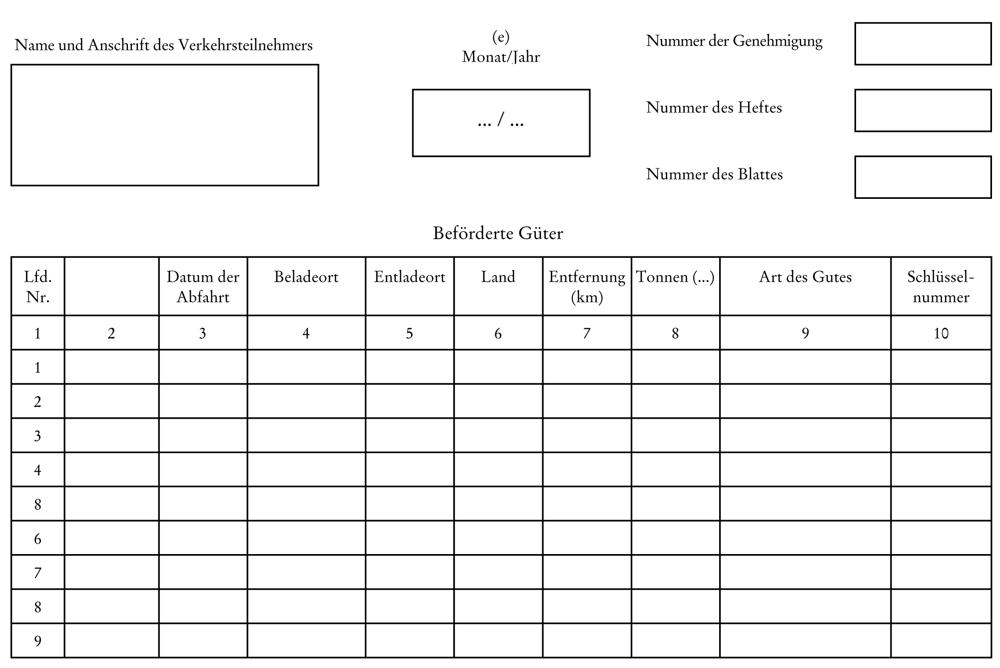

0.110 Anhang XIII Verkehr Verzeichnis nach Art. 47 Einleitung Falls die Rechtsakte, auf die in diesem Anhang Bezug genommen wird, Begriffe enthalten oder sich auf Verfahren beziehen, die für die Rechtsordnung der Gemeinschaft charakteristisch sind, wie - Präambeln - Adressaten der gemeinschaftlichen Rechtsakte - Bezugnahmen auf Gebiete oder Sprachen der EG - Bezugnahmen auf Rechte und Pflichten der EG-Mitgliedstaaten, deren Körperschaften des öffentlichen Rechts, Unternehmen oder Einzelpersonen in ihren Beziehungen zueinander und - Bezugnahmen auf Informations- und Notifizierungsverfahren, so findet das Protokoll 1 über horizontale Anpassungen Anwendung, soweit in diesem Anhang nichts anderes bestimmt ist. Sektorale Anpassungen I. Wird in den Rechtsakten, auf die in diesem Anhang Bezug genommen wird, auf den EWG-Vertrag Bezug genommen, so gelten für die Zwecke dieses Abkommens a) die nachstehenden Bezugnahmen als wie folgt geändert: - Art. 55 EWG = Art. 32 EWR - Art. 56 EWG = Art. 33 EWR - Art. 57 EWG = Art. 30 EWR - Art. 58 EWG = Art. 34 EWR - Art. 77 EWG = Art. 49 EWR - Art. 79 EWG = Art. 50 EWR - Art. 85 EWG = Art. 53 EWR - Art. 86 EWG = Art. 54 EWR - Art. 92 EWG = Art. 61 EWR - Art. 93 EWG = Art. 62 EWR - Art. 214 EWG = Art. 122 EWR b) die nachstehenden Bezugnahmen als nicht relevant: - Art. 75 EWG - Art. 83 EWG - Art. 94 EWG - Art. 95 EWG - Art. 99 EWG - Art. 172 EWG - Art. 192 EWG - Art. 207 EWG - Art. 209 EWG II. Für die Zwecke dieses Abkommens sind die Verzeichnisse in Anhang II, Abschnitt A.1 der Verordnung (EWG) Nr. 1108/70 und in Art. 19 der Verordnung (EWG) Nr. 1191/69 wie folgt zu ergänzen: "- Norges Statsbaner" III. Sieht ein Rechtsakt, auf den in diesem Anhang Bezug genommen wird, Verfahren zur Streitbeilegung zwischen Mitgliedstaaten der EG vor, so legen im Falle einer Streitigkeit zwischen EFTA-Staaten diese den Streitfall dem zuständigen EFTA-Organ vor, das ihn nach entsprechenden Verfahren beilegt. Im Falle einer Streitigkeit zwischen einem EG-Mitgliedstaat und einem EFTA-Staat legen die betroffenen Vertragsparteien den Streitfall dem Gemeinsamen EWR-Ausschuss vor, der ihn nach entsprechenden Verfahren beilegt. Rechtsakte, auf die Bezug genommen wird I. Landverkehr i) Allgemeines 1. 370 R 1108: Verordnung (EWG) Nr. 1108/70 des Rates vom 4. Juni 1970 zur Einführung einer Buchführung über die Ausgaben für die Verkehrswege des Eisenbahn-, Strassen- und Binnenschiffsverkehrs (ABl. Nr. L 130 vom 15.6.1970, S. 4) , geändert durch: - 1 72 B: Akte über die Beitrittsbedingungen und die Anpassungen der Verträge - Beitritt des Königreichs Dänemark, Irlands und des Vereinigten Königreichs Grossbritannien und Nordirland zu den Europäischen Gemeinschaften (ABl. Nr. L 73 vom 27.3.1972, S. 90) ; - 373 D 0101(01): Beschluss des Rates vom 1. Januar 1973 zur Anpassung der Dokumente betreffend den Beitritt neuer Mitgliedstaaten zu den Europäischen Gemeinschaften (ABl. Nr. L 2 vom 1.1.1973, S. 19) ; - 379 R 1384: Verordnung (EWG) Nr. 1384/79 des Rates vom 25. Juni 1979 (ABl. Nr. L 167 vom 5.7.1979, S. 1) ; - 1 79 H: Akte über die Beitrittsbedingungen und die Anpassungen der Verträge - Beitritt der Republik Griechenland zu den Europäischen Gemeinschaften (ABl. Nr. L 291 vom 19.11.1979, S. 92) ; - 381 R 3021: Verordnung (EWG) Nr. 3021/81 des Rates vom 19. Oktober 1981 (ABl. Nr. L 302 vom 23.10.1981, S. 8) ; - 1 85 I: Akte über die Beitrittsbedingungen und die Anpassungen der Verträge - Beitritt des Königreichs Spanien und der Portugiesischen Republik zu den Europäischen Gemeinschaften (ABl. Nr. L 302 vom 15.11.1985, S. 161) ; - 390 R 3572: Verordnung (EWG) Nr. 3572/90 des Rates vom 4. Dezember 1990 zur Änderung bestimmter Richtlinien, Entscheidungen und Verordnungen auf dem Gebiet des Strassen-, Eisenbahn- und Binnenschiffsverkehrs auf Grund der Herstellung der deutschen Einheit (ABl. Nr. L 353 vom 17.12.1990, S. 12) ; - 1 94 N: Akte über die Bedingungen des Beitritts der Republik Österreich, der Republik Finnland und des Königreichs Schweden und die Anpassungen der die Europäische Union begründenden Verträge (ABl. C 241 vom 29.8.1994, S. 21 , geändert durch ABl. L 1 vom 1.1.1995, S. 1) ; - 1 03 T: Akte über die Bedingungen des Beitritts der Tschechischen Republik, der Republik Estland, der Republik Zypern, der Republik Lettland, der Republik Litauen, der Republik Ungarn, der Republik Malta, der Republik Polen, der Republik Slowenien und der Slowakischen Republik und die Anpassungen der Verträge, auf denen die Europäische Union beruht, angenommen am 16. April 2003 (Abl. L 236 vom 23. September 2003, S. 33); - 32006 R 1791: Verordnung (EG) Nr. 1791/2006 des Rates vom 20. November 2006 (ABl. L 363 vom 20.12.2006, S. 1) ; - 32013 R 0517 : Verordnung (EU) Nr. 517/2013 des Rates vom 13. Mai 2013 (ABl. L 158 vom 10.6.2013, S. 1) . Die Verordnung gilt für die Zwecke dieses Abkommens mit folgenden Anpassungen: Anhang II wird wie folgt ergänzt: A.1. Eisenbahnen - Hauptnetze Siehe sektorale Anpassung II. A.2. Eisenbahnen - Eisenbahnen des öffentlichen Verkehrs, die an das Hauptnetz angeschlossen sind (ausgenommen Stadtbahnen) "Norwegen Norges Statsbaner" B. Strasse "Island 1. Pjóðvegir 2. Sýsluvegir 3. Pjóðvegir í péttbyýli 4. Götur sveitarfélaga Liechtenstein 1. Landesstrassen 2. Gemeindestrassen Norwegen 1. Riksveger 2. Fylkesveger 3. Kommunale veger" 2. Aufgehoben 2a. 32006 R 0851: Verordnung (EG) Nr. 851/2006 der Kommission vom 9. Juni 2006 zur Festlegung des Inhalts der verschiedenen Positionen der Verbuchungsschemata des Anhangs I der Verordnung (EWG) Nr. 1108/70 des Rates (ABl. L 158 vom 10.6.2006, S. 3) . 3. Aufgehoben 3a. 32004 R 0013: Verordnung (EG) Nr. 13/2004 der Kommission vom 8. Dezember 2003 zur Festlegung des in Art. 3 Bst. d der Verordnung (EWG) Nr. 1108/70 des Rates genannten Verzeichnisses der Seeschifffahrtsstrassen (ABl. L 3 vom 7.1.2004, S. 3) . 4. 369 R 1191: Verordnung (EWG) Nr. 1191/69 des Rates vom 26. Juni 1969 über das Vorgehen der Mitgliedstaaten bei mit dem Begriff des öffentlichen Dienstes verbundenen Verpflichtungen auf dem Gebiet des Eisenbahn-, Strassen- und Binnenschiffsverkehrs (ABl. Nr. L 156 vom 28.6.1969, S. 1) , geändert durch: - 1 72 B: Akte über die Beitrittsbedingungen und die Anpassungen der Verträge - Beitritt des Königreichs Dänemark, Irlands und des Vereinigten Königreichs Grossbritannien und Nordirland (ABl. Nr. L 73 vom 27.3.1972, S. 90) ; - 373 D 0101(01): Beschluss des Rates vom 1. Januar 1973 zur Anpassung der Dokumente betreffend den Beitritt neuer Mitgliedstaaten zu den Europäischen Gemeinschaften (ABl. Nr. L 2 vom 1.1.1973, S. 19) ; - 1 79 H: Akte über die Beitrittsbedingungen und die Anpassungen der Verträge - Beitritt der Republik Griechenland (ABl. Nr. L 291 vom 19.11.1979, S. 92) ; - 1 85 I: Akte über die Beitrittsbedingungen und die Anpassungen der Verträge - Beitritt des Königreichs Spanien und der Portugiesischen Republik (ABl. Nr. L 302 vom 15.11.1985, S. 161) ; - 390 R 3572: Verordnung (EWG) Nr. 3572/90 des Rates vom 4. Dezember 1990 zur Änderung bestimmter Richtlinien, Entscheidungen und Verordnungen auf dem Gebiet des Strassen-, Eisenbahn- und Binnenschiffsverkehrs auf Grund der Herstellung der deutschen Einheit (ABl. Nr. L 353 vom 17.12.1990, S. 12) ; - 391 R 1893: Verordnung (EWG) Nr. 1893/91 des Rates vom 20. Juni 1991 zur Änderung der Verordnung (EWG) Nr. 1191/69 (ABl. Nr. L 169 vom 29.6.1991, S. 1) . Die Verordnung gilt für die Zwecke dieses Abkommens mit folgender Anpassung: Gemäss Art. 10 Abs. 1 der Verordnung (EG) Nr. 1370/2007 wird diese Verordnung aufgehoben; sie gilt jedoch während eines Zeitraums von drei Jahren nach Inkrafttreten der Verordnung (EG) Nr. 1370/2007 weiterhin für Güterbeförderungsdienste. 4a. 32007 R 1370: Verordnung (EG) Nr. 1370/2007 des Europäischen Parlaments und des Rates vom 23. Oktober 2007 über öffentliche Personenverkehrsdienste auf Schiene und Strasse und zur Aufhebung der Verordnungen (EWG) Nr. 1191/69 und (EWG) Nr. 1107/70 des Rates (ABl. L 315 vom 3.12.2007, S. 1) , geändert durch: - 32016 R 2338 : Verordnung (EU) 2016/2338 des Europäischen Parlaments und des Rates vom 14. Dezember 2016 (ABl. L 354 vom 23.12.2016, S. 22) . 4b. 32020 R 0698 : Verordnung (EU) 2020/698 des Europäischen Parlaments und des Rates vom 25. Mai 2020 zur Festlegung besonderer und vorübergehender Massnahmen im Hinblick auf den COVID-19-Ausbruch hinsichtlich der Erneuerung oder Verlängerung bestimmter Bescheinigungen, Lizenzen und Genehmigungen und der Verschiebung bestimmter regelmässiger Kontrollen und Weiterbildungen in bestimmten Bereichen des Verkehrsrechts (ABl. L 165 vom 27.5.2020, S. 10) 4c. 32021 R 0267 : Verordnung (EU) 2021/267 des Europäischen Parlaments und des Rates vom 16. Februar 2021 zur Festlegung besonderer und vorübergehender Massnahmen im Hinblick auf die anhaltende COVID-19-Krise hinsichtlich der Erneuerung oder Verlängerung bestimmter Bescheinigungen, Lizenzen und Genehmigungen, der Verschiebung bestimmter regelmässiger Kontrollen und Weiterbildungen in bestimmten Bereichen des Verkehrsrechts und für die Verlängerung bestimmter in der Verordnung (EU) 2020/698 vorgesehenen Zeiträume (ABl. L 60 vom 22.2.2021, S. 1 .) ii) Infrastruktur 5. Aufgehoben 5a. 32014 L 0094 : Richtlinie 2014/94/EU des Europäischen Parlaments und des Rates vom 22. Oktober 2014 über den Aufbau der Infrastruktur für alternative Kraftstoffe (ABl. L 307 vom 28.10.2014, S. 1) , geändert durch: - 32018 R 0674 : Delegierte Verordnung (EU) 2018/674 der Kommission vom 17. November 2017 (ABl. L 114 vom 4.5.2018, S. 1) - 32019 R 1745 : Delegierte Verordnung (EU) 2019/1745 der Kommission vom 13. August 2019 (ABl. L 268 vom 22.10.2019, S. 1) Die Richtlinie gilt für die Zwecke dieses Abkommens mit folgenden Anpassungen: a) Für die EFTA-Staaten wird in Art. 3 Abs. 5 die Angabe "des AEUV" durch die Angabe "des EWR-Abkommens" ersetzt. b) Art. 6 gilt nicht für Island. c) Diese Richtlinie gilt nicht für Liechtenstein. 5b. 32019 R 1745 : Delegierte Verordnung (EU) 2019/1745 der Kommission vom 13. August 2019 zur Ergänzung und Änderung der Richtlinie 2014/94/EU des Europäischen Parlaments und des Rates im Hinblick auf Ladepunkte für Kraftfahrzeuge der Klasse L, die landseitige Stromversorgung für Binnenschiffe, die Wasserstoffversorgung für den Strassenverkehr und die Erdgasversorgung für den Strassen- und Schiffsverkehr sowie zur Aufhebung der Delegierten Verordnung (EU) 2018/674 der Kommission (ABl. L 268 vom 22.10.2019, S. 1) . 5c. 32018 R 0732 : Durchführungsverordnung (EU) 2018/732 der Kommission vom 17. Mai 2018 über eine gemeinsame Methode für den auf eine Masseinheit bezogenen Preisvergleich für alternative Kraftstoffe gemäss der Richtlinie 2014/94/EU des Europäischen Parlaments und des Rates (ABl. L 123 vom 18.5.2018, S. 85) , geändert durch: - 32020 R 0858 : Durchführungsverordnung (EU) 2020/858 der Kommission vom 18. Juni 2020 (ABl. L 195 vom 19.6.2020, S. 57) iii) Wettbewerbsregeln 6. 360 R 0011: Verordnung Nr. 11 über die Beseitigung von Diskriminierungen auf dem Gebiet der Frachten und Beförderungsbedingungen gemäss Art. 79 Abs. 3 des Vertrages zur Gründung der Europäischen Wirtschaftsgemeinschaft (ABl. Nr. 52 vom 16.8.1960, S. 1121 /60), geändert und ergänzt durch: - 1 72 B: Akte über die Beitrittsbedingungen und die Anpassungen der Verträge - Beitritt des Königreichs Dänemark, Irlands und des Vereinigten Königreichs Grossbritannien und Nordirland (ABl. Nr. L 73 vom 27.3.1972, S. 148) ; - 384 R 3626: Verordnung (EWG) Nr. 3626/84 des Rates vom 19. Dezember 1984 (ABl. Nr. L 335 vom 22.12.1984, S. 4) ; - 32008 R 0569 : Verordnung (EG) Nr. 569/2008 des Rates vom 12. Juni 2008 (ABl. L 161 vom 20.6.2008, S. 1) . Die Verordnung gilt für die Zwecke dieses Abkommens mit folgender Anpassung: Zur Anwendung der Art. 11 bis 26 siehe Protokoll Nr. 21. 7. 32009 R 0169 : Verordnung (EG) Nr. 169/2009 des Rates vom 26. Februar 2009 über die Anwendung von Wettbewerbsregeln auf dem Gebiet des Eisenbahn-, Strassen- und Binnenschiffsverkehrs (kodifizierte Fassung) (ABl. L 61 vom 5.3.2009, S. 1) (1) . (1) Hier nur zu Informationszwecken aufgeführt, zur Durchführung siehe Anhang Wettbewerb).XIV ( 8. Aufgehoben 9. Aufgehoben 10. 374 R 2988: Verordnung (EWG) Nr. 2988/74 des Rates vom 26. November 1974 über die Verfolgungs- und Vollstreckungsverjährung im Verkehrs- und Wettbewerbsrecht der Europäischen Wirtschaftsgemeinschaft (ABl. Nr. L 319 vom 29.11.1974, S. 1) . 10a. 32009 R 0906: Verordnung (EG) Nr. 906/2009 der Kommission vom 28. September 2009 über die Anwendung von Art. 81 Abs. 3 EG-Vertrag auf bestimmte Gruppen von Vereinbarungen, Beschlüssen und aufeinander abgestimmten Verhaltensweisen zwischen Seeschifffahrtsunternehmen (Konsortien) (ABl. L 256 vom 29.9.2009, S. 31) , geändert durch: - 32014 R 0697 : Verordnung (EU) Nr. 697/2014 der Kommission vom 24. Juni 2014 (ABl. L 184 vom 25.6.2014, S. 3) . iv) Staatliche Beihilfen 11. Aufgehoben v) Erleichterung des Grenzübertritts 12. 32008 R 1100: Verordnung (EG) Nr. 1100/2008 des Europäischen Parlaments und des Rates vom 22. Oktober 2008 über den Abbau von Grenzkontrollen der Mitgliedstaaten im Strassen- und Binnenschiffsverkehr (kodifizierte Fassung) (ABl. L 304 vom 14.11.2008, S. 63) . 12a. 392 R 3912: Verordnung (EWG) Nr. 3912/92 des Rates vom 17. Dezember 1992 über innerhalb der Gemeinschaft durchgeführte Kontrollen im Strassen- und Binnenschiffsverkehr von in einem Drittland registrierten oder zum Verkehr zugelassenen Verkehrsmitteln (ABl. Nr. L 395 vom 31.12.1992, S. 6) Die Verordnung gilt für die Zwecke dieses Abkommens mit folgenden Anpassungen: a) Aufgehoben b) Art. 4 Satz 1 erhält folgende Fassung: "Zum Zwecke der Durchführung dieser Verordnung und gemäss Art. 13 des Protokolls 10 zum EWR-Abkommen finden die Bestimmungen des Protokolls 11 zum Abkommen entsprechende Anwendung. vi) Kombinierter Verkehr 13. 392 L 0106: Richtlinie 92/106/EWG des Rates vom 7. Dezember 1992 über die Festlegung gemeinsamer Regeln für bestimmte Beförderungen im kombinierten Güterverkehr zwischen Mitgliedstaaten (ABl. Nr. L 368 vom 17.12.1992, S. 38) , geändert durch: - 1 94 N: Akte über die Bedingungen des Beitritts der Republik Österreich, der Republik Finnland und des Königreichs Schweden und die Anpassungen der die Europäische Union begründenden Verträge (ABl. C 241 vom 29.8.1994, S. 21 , geändert durch ABl. L 1 vom 1.1.1995, S. 1) ; - 1 03 T: Akte über die Bedingungen des Beitritts der Tschechischen Republik, der Republik Estland, der Republik Zypern, der Republik Lettland, der Republik Litauen, der Republik Ungarn, der Republik Malta, der Republik Polen, der Republik Slowenien und der Slowakischen Republik und die Anpassungen der Verträge, auf denen die Europäische Union beruht, angenommen am 16. April 2003 (Abl. L 236 vom 23. September 2003, S. 33); - 32006 L 0103: Richtlinie 2006/103/EG des Rates vom 20. November 2006 (ABl. L 363 vom 20.12.2006, S. 344) ; - 32013 L 0022 : Richtlinie 2013/22/EU des Rates vom 13. Mai 2013 (ABl. L 158 vom 10.6.2013, S. 356) . Die Richtlinie gilt für die Zwecke dieses Abkommens mit folgender Anpassung: Art. 6 Abs. 3 wird wie folgt ergänzt: "- Island: Pungaskattur; - Liechtenstein: Motorfahrzeugsteuer; - Norwegen: Vektårsavgift;" vii) Technische Harmonisierung und Sicherheit 13a. Aufgehoben 13b. Aufgehoben 13c. 32008 L 0068: Richtlinie 2008/68/EG des Europäischen Parlaments und des Rates vom 24. September 2008 über die Beförderung gefährlicher Güter im Binnenland (ABl. L 260 vom 30.9.2008, S. 13) , geändert durch: - 32009 D 0240: Entscheidung 2009/240/EG der Kommission vom 4. März 2009 (ABl. L 71 vom 17.3.2009, S. 23) ; - 32010 L 0061 : Richtlinie 2010/61/EU der Kommission vom 2. September 2010 (ABl. L 233 vom 3.9.2010, S. 27) ; - 3 2010 D 0187: Beschluss 2010/187/EU der Kommission vom 25. März 2010 (ABl. L 83 vom 30.3.2010, S. 24) ; - 32011 D 0026: Beschluss 2011/26/EU der Kommission vom 14. Januar 2011 (ABl. L 13 vom 18.1.2011, S. 64) ; - 32012 L 0045 : Richtlinie 2012/45/EU der Kommission vom 3. Dezember 2012 (ABl. L 332 vom 4.12.2012, S. 18) ; - 32014 L 0103 : Richtlinie 2014/103/EU der Kommission vom 21. November 2014 (ABl. L 335 vom 22.11.2014, S. 15) ; - 32015 D 0217 : Durchführungsbeschluss (EU) 2015/217 der Kommission vom 10. April 2014 (ABl. L 44 vom 18.2.2015, S. 1) ; - 32015 D 0974 : Durchführungsbeschluss (EU) 2015/974 der Kommission vom 17. Juni 2015 (ABl. L 157 vom 23.6.2015, S. 53) ; - 32016 D 0629 : Durchführungsbeschluss (EU) 2016/629 der Kommission vom 20. April 2016 (ABl. L 106 vom 22.4.2016, S. 26) ; - 32016 L 2309 : Richtlinie (EU) 2016/2309 der Kommission vom 16. Dezember 2016 (ABl. L 345 vom 20.12.2016, S. 48) ; - 32017 D 0695 : Durchführungsbeschluss (EU) 2017/695 der Kommission vom 7. April 2017 (ABl. L 101 vom 13.4.2017, S. 37) ; - 32018 L 0217 : Richtlinie (EU) 2018/217 der Kommission vom 31. Januar 2018 (ABl. L 42 vom 15.2.2018, S. 52) ; - 32018 D 0936 : Durchführungsbeschluss (EU) 2018/936 der Kommission vom 29. Juni 2018 (ABl. L 165 vom 2.7.2018, S. 42) ; - 32018 L 1846 : Richtlinie (EU) 2018/1846 der Kommission vom 23. November 2018 (ABl. L 299 vom 26.11.2018, S. 58) ; - 32019 D 1094 : Durchführungsbeschluss (EU) 2019/1094 der Kommission vom 17. Juni 2019 (ABl. L 173 vom 27.6.2019, S. 52) ; - 32020 D 1241 : Durchführungsbeschluss (EU) 2020/1241 der Kommission vom 28. August 2020 (ABl. L 284 vom 1.9.2020, S. 9) ; - 32020 L 1833 : Delegierte Richtlinie (EU) 2020/1833 der Kommission vom 2. Oktober 2020 (ABl. L 408 vom 4.12.2020, S. 1) ; - 32021 D 1436 : Durchführungsbeschluss (EU) 2021/1436 der Kommission vom 31. August 2021 (ABl. L 312 vom 3.9.2021, S. 3) ; - 32022 D 1095 : Durchführungsbeschluss (EU) 2022/1095 der Kommission vom 29. Juni 2022 (ABl. L 176 vom 1.7.2022, S. 33) ; - 32022 L 2407 : Delegierte Richtlinie (EU) 2022/2407 der Kommission vom 20. September 2022 (ABl. L 317 vom 9.12.2022, S. 64) ; - 32023 D 1198 : Durchführungsbeschluss (EU) 2023/1198 der Kommission vom 21. Juni 2023 (ABl. L 158 vom 21.6.2023, S. 73) ; - 32024 D 1762 : Durchführungsbeschluss (EU) 2024/1762 der Kommission vom 5. Juni 2024 (ABl. L, 2024/1762, 28.6.2024); - 32025 L 0149 : Delegierte Richtlinie (EU) 2025/149 der Kommission vom 15. November 2024 (ABl. L, 2025/149, 24.1.2025). II. Strassenverkehr i) Technische Harmonisierung und Sicherheit 14. Aufgehoben 15. Aufgehoben 15a. 396 L 0053: Richtlinie 96/53/EG des Rates vom 25. Juli 1996 zur Festlegung der höchstzulässigen Abmessungen für bestimmte Strassenfahrzeuge im innerstaatlichen und grenzüberschreitenden Verkehr in der Gemeinschaft sowie zur Festlegung der höchstzulässigen Gewichte im grenzüberschreitenden Verkehr (ABl. L 235 vom 17.9.1996, S. 59) , geändert durch: - 32002 L 0007: Richtlinie 2002/7/EG des Europäischen Parlaments und des Rates vom 18. Februar 2002 (ABl. L 67 vom 9.3.2002, S. 47) ; - 32015 L 0719 : Richtlinie (EU) 2015/719 des Europäischen Parlaments und des Rates vom 29. April 2015 (ABl. L 115 vom 6.5.2015, S. 1) ; - 32019 D 0984 : Beschluss (EU) 2019/984 des Europäischen Parlaments und des Rates vom 5. Juni 2019 (ABl. L 164 vom 20.6.2019, S. 30) . Es gelten die Übergangsbestimmungen, die in den Anhängen der Beitrittsakte vom 16. April 2003 für Ungarn (Anhang X, Kapitel 6, Nr. 4) und Polen (Anhang XII, Kapitel 8, Nr. 3) aufgestellt wurden. Die Übergangsregelungen nach den Anhängen der Beitrittsakte vom 25. April 2005 für Bulgarien (Anhang VI Kapitel 5 Nummer 3) und Rumänien (Anhang VII Kapitel 6 Nummer 2) finden Anwendung. 15b. 32019 R 1213 : Durchführungsverordnung (EU) 2019/1213 der Kommission vom 12. Juli 2019 zur näheren Regelung der Sicherstellung einheitlicher Bedingungen für die Verwirklichung der Interoperabilität und Kompatibilität bordeigener Wiegesysteme nach der Richtlinie 96/53/EG des Rates (ABl. L 192 vom 18.7.2019, S. 1) 15c. 32019 R 1916 : Durchführungsverordnung (EU) 2019/1916 der Kommission vom 15. November 2019 mit Durchführungsbestimmungen für die Verwendung von aerodynamischen Luftleiteinrichtungen am hinteren Teil von Fahrzeugen gemäss der Richtlinie 96/53/EG des Rates (ABl. L 297 vom 18.11.2019, S. 3) , geändert durch: - 32020 R 0349 : Durchführungsverordnung (EU) 2020/349 der Kommission vom 2. März 2020 (ABl. L 63 vom 3.3.2020, S. 1) 16. Aufgehoben 16a. Aufgehoben 16b. 32014 L 004 5: Richtlinie 2014/45/EU des Europäischen Parlaments und des Rates vom 3. April 2014 über die regelmässige technische Überwachung von Kraftfahrzeugen und Kraftfahrzeuganhägern und zur Aufhebung der Richtlinie 2009/40/EG (ABl. L 127 vom 29.4.2014, S. 51) , geändert durch: - 32021 L 1717 : Delegierte Richtlinie (EU) 2021/1717 der Kommission vom 9. Juli 2021 (ABl. L 342 vom 27.9.2021, S. 48) . 16c. 32019 R 0621 : Durchführungsverordnung (EU) 2019/621 der Kommission vom 17. April 2019 über die für die technische Überwachung in Bezug auf die zu prüfenden Positionen erforderlichen technischen Angaben sowie zur Anwendung der empfohlenen Prüfmethoden und zur Festlegung detaillierter Regelungen hinsichtlich des Datenformats und der Verfahren für den Zugang zu den einschlägigen technischen Angaben (ABl. L 108 vom 23.4.2019, S. 5) . 17. 389 L 0459: Richtlinie 89/459/EWG des Rates vom 18. Juli 1989 zur Angleichung der Rechtsvorschriften der Mitgliedstaaten über die Profiltiefe der Reifen an bestimmten Klassen von Kraftfahrzeugen und deren Anhängern (ABl. Nr. L 226 vom 3.8.1989, S. 4) . 17a. 391 L 0671: Richtlinie 91/671/EWG des Rates vom 16. Dezember 1991 zur Angleichung der Rechtsvorschriften der Mitgliedstaaten über die Gurtanlegepflicht in Kraftfahrzeugen mit einem Gewicht von weniger als 3,5 Tonnen (ABl. Nr. L 373 vom 31.12.1991, S. 26) , geändert durch: - 32003 L 0020: Richtlinie 2003/20/EG des Europäischen Parlaments und des Rates vom 8. April 2003 (ABl. L 115 vom 9.5.2003, S. 63) ; - 32014 L 0037 : Durchführungsrichtlinie 2014/37/EU der Kommission vom 27. Februar 2014 (ABl. L 59 vom 28.2.2014, S. 32) . 17b. 392 L 0006: Richtlinie 92/6/EWG des Rates vom 10. Februar 1992 über Einbau und Benutzung von Geschwindigkeitsbegrenzern für bestimmte Kraftfahrzeugklassen in der Gemeinschaft (ABl. Nr. L 57 vom 2.3.1992, S. 27 , berichtigt in ABl. Nr. L 244 vom 30.9.1993, S. 34) , geändert durch: - 32002 L 0085: Richtlinie 2002/85/EG des Europäischen Parlaments und des Rates vom 5. November 2002 (ABl. L 327 vom 4.12.2002, S. 8) . Es gelten die Übergangsbestimmungen, die in den Anhängen der Beitrittsakte vom 16. April 2003 für Malta (Anhang XI, Kapitel 6, Nr. 1) aufgestellt wurden. 17c. 393 D 0704: Entscheidung 93/704/EG des Rates vom 30. November 1993 über die Einrichtung einer gemeinschaftlichen Datenbank über Strassenverkehrsunfälle (ABl. Nr. L 329 vom 30.12.1993, S. 63) . 17d. 32022 L 1999 : Richtlinie (EU) 2022/1999 des Europäischen Parlaments und des Rates vom 19. Oktober 2022 über einheitliche Verfahren für die Kontrolle von Gefahrguttransporten auf der Strasse (kodifizierter Text) (ABl. L 274 vom 24.10.2022, S. 1) 17e. Aufgehoben 17f. Aufgehoben 17g. 32003 D 0525: Entscheidung 2003/525/EG der Kommission vom 18. Juli 2003 zur Verschiebung des Anwendungsdatums der Richtlinie 1999/36/EG des Rates über ortsbewegliche Druckgeräte hinsichtlich bestimmter Geräte (ABl. L 183 vom 22.7.2003, S. 45) . 17h. Aufgehoben 17ha. 32014 L 0047 : Richtlinie 2014/47/EU des Europäischen Parlaments und des Rates vom 3. April 2014 über die technische Unterwegskontrolle der Verkehrs- und Betriebssicherheit von Nutzfahrzeugen, die in der Union am Strassenverkehr teilnehmen, und zur Aufhebung der Richtlinie 2000/30/EG (ABl. L 127 vom 29.4.2014, S. 134) , berichtigt in ABl. L 197 vom 4.7.2014, S. 87 , geändert durch: - 32021 L 1716 : Delegierte Richtlinie (EU) 2021/1716 der Kommission vom 29. Juni 2021 (ABl. L 342 vom 27.9.2021, S. 45) . 17hb. 32017 R 2205 : Durchführungsverordnung (EU) 2017/2205 der Kommission vom 29. November 2017 mit Durchführungsbestimmungen für das Verfahren zur Meldung von Nutzfahrzeugen mit erheblichen oder gefährlichen Mängeln, die bei einer technischen Unterwegskontrolle festgestellt wurden (ABl. L 314 vom 30.11.2017, S. 3) . 17i. 32004 L 0054: Richtlinie 2004/54/EG des Europäischen Parlaments und des Rates vom 29. April 2004 über Mindestanforderungen an die Sicherheit von Tunneln im transeuropäischen Strassennetz (ABl. L 167 vom 30.4.2004, S. 39) , berichtigt in ABL. L 201 vom 7.6.2004, S. 56 . Die Richtlinie gilt für die Zwecke dieses Abkommens mit der folgenden Anpassung: In Anhang I der Richtlinie wird Nummer 2.3.6 folgender Wortlaut angefügt: "Bei Tunneln mit weniger als 10 km Länge und mit einem Verkehrsaufkommen von weniger als 4.000 Fahrzeugen je Fahrstreifen kann eine Ausnahme gemacht werden, wenn eine Risikoanalyse zeigt, dass sich mit alternativen Sicherheitsmassnahmen ein gleichwertiges oder höheres Sicherheitsniveau erreichen lässt." 17j. 32008 L 0096: Richtlinie 2008/96/EG des Europäischen Parlaments und des Rates vom 19. November 2008 über ein Sicherheitsmanagement für die Strassenverkehrsinfrastruktur (ABl. L 319 vom 29.11.2008, S. 59) , geändert durch: - 32019 L 1936 : Richtlinie (EU) 2019/1936 des Europäischen Parlaments und des Rates vom 23. Oktober 2019 (ABl. L 305 vom 26.11.2019, S. 1) 17k. 32010 L 0040 : Richtlinie 2010/40/EU des Europäischen Parlaments und des Rates vom 7. Juli 2010 zum Rahmen für die Einführung intelligenter Verkehrssysteme im Strassenverkehr und für deren Schnittstellen zu anderen Verkehrsträgern (ABl. L 207 vom 6.8.2010, S. 1) . 17ka. 32011 D 0505(01): Beschluss 2011/C 135/03 der Kommission vom 4. Mai 2011 zur Einsetzung der Europäischen Beratergruppe für intelligente Verkehrssysteme (IVS) (ABl. C 135 vom 5.5.2011, S. 3) . 17kb. 32011 D 0453 : Durchführungsbeschluss 2011/453/EU der Kommission vom 13. Juli 2011 zur Annahme von Leitlinien für die Berichterstattung durch die Mitgliedstaaten nach Richtlinie 2010/40/EU des Europäischen Parlaments und des Rates (ABl. L 193 vom 23.7.2011, S. 48) . 17kc. 32013 R 0885 : Delegierte Verordnung (EU) Nr. 885/2013 der Kommission vom 15. Mai 2013 zur Ergänzung der Richtlinie 2010/40/EU des Europäischen Parlaments und des Rates in Bezug auf die Bereitstellung von Informationsdiensten für sichere Parkplätze für Lastkraftwagen und andere gewerbliche Fahrzeuge (ABl. L 247 vom 18.9.2013, S. 1) 17kd. 32013 R 0886 : Delegierte Verordnung (EU) Nr. 886/2013 der Kommission vom 15. Mai 2013 zur Ergänzung der Richtlinie 2010/40/EU des Europäischen Parlaments und des Rates in Bezug auf Daten und Verfahren für die möglichst unentgeltliche Bereitstellung eines Mindestniveaus allgemeiner für die Strassenverkehrssicherheit relevanter Verkehrsinformationen für die Nutzer (ABl. L 247 vom 18.9.2013, S. 6) . 17ke. 32013 R 0305 : Delegierte Verordnung (EU) Nr. 305/2013 der Kommission vom 26. November 2012 zur Ergänzung der Richtlinie 2010/40/EU des Europäischen Parlaments und des Rates in Bezug auf die harmonisierte Bereitstellung eines interoperablen EU-weiten eCall-Dienstes (ABl. L 91 vom 3.4.2013, S. 1) . 17kf. 32014 D 0585 : Beschluss Nr. 585/2014/EU des Europäischen Parlaments und des Rates vom 15. Mai 2014 über die Einführung des interoperablen EU-weiten eCall-Dienstes (ABl. L 164 vom 3.6.2014, S. 6) . 17kg. Aufgehoben 17kh. 32017 R 1926 : Delegierte Verordnung (EU) 2017/1926 der Kommission vom 31. Mai 2017 zur Ergänzung der Richtlinie 2010/40/EU des Europäischen Parlaments und des Rates hinsichtlich der Bereitstellung EU-weiter multimodaler Reiseinformationsdienste (ABl. L 272 vom 21.10.2017, S. 1) 17ki. 32022 R 0670 : Delegierte Verordnung (EU) 2022/670 der Kommission vom 2. Februar 2022 zur Ergänzung der Richtlinie 2010/40/EU des Europäischen Parlaments und des Rates hinsichtlich der Bereitstellung EU-weiter Echtzeit-Verkehrsinformationsdienste (ABl. L 122 vom 25.4.2022, S. 1) . 17l. 32015 L 0413 : Richtlinie (EU) 2015/413 des Europäischen Parlaments und des Rates vom 11. März 2015 zur Erleichterung des grenzüberschreitenden Austauschs von Informationen über die Strassenverkehrssicherheit gefährdende Verkehrsdelikte (ABl. L 68 vom 13.3.2015, S. 9) Die Richtlinie gilt für die Zwecke dieses Abkommens mit folgenden Anpassungen: a) In Bezug auf Island und Norwegen sind die Verweise auf die Verfahren für den Informationsaustausch in Art. 4 des Anhangs des Beschlusses 2008/616/JI des Rates so zu verstehen, dass sie sich auf die Verfahren beziehen, die gemäss Art. 1 des Übereinkommens zwischen der Europäischen Union sowie Island und Norwegen über die Anwendung einiger Bestimmungen des Beschlusses 2008/615/JI des Rates zur Vertiefung der grenzüberschreitenden Zusammenarbeit, insbesondere zur Bekämpfung des Terrorismus und der grenzüberschreitenden Kriminalität, und des Beschlusses 2008/616/JI des Rates zur Durchführung des Beschlusses 2008/615/JI zur Vertiefung der grenzüberschreitenden Zusammenarbeit, insbesondere zur Bekämpfung des Terrorismus und der grenzüberschreitenden Kriminalität, anzuwenden sind. In Bezug auf Liechtenstein sind die Verweise auf die Verfahren für den Informationsaustausch in Art. 4 des Anhangs des Beschlusses 2008/616/JI des Rates so zu verstehen, dass sie sich auf die Verfahren beziehen, die gemäss Art. 1 des Übereinkommens zwischen der Europäischen Union und dem Fürstentum Liechtenstein über die Anwendung einiger Bestimmungen des Beschlusses 2008/615/JI des Rates zur Vertiefung der grenzüberschreitenden Zusammenarbeit, insbesondere zur Bekämpfung des Terrorismus und der grenzüberschreitenden Kriminalität, und des Beschlusses 2008/616/JI des Rates zur Durchführung des Beschlusses 2008/615/JI zur Vertiefung der grenzüberschreitenden Zusammenarbeit, insbesondere zur Bekämpfung des Terrorismus und der grenzüberschreitenden Kriminalität, und seines Anhangs und des Rahmenbeschlusses 2009/905/JI des Rates über die Akkreditierung von Anbietern kriminaltechnischer Dienste, die Labortätigkeiten durchführen, anzuwenden sind. b) In Art. 12 wird folgender Unterabsatz angefügt: ‚Abweichend von Unterabs. 1 können die EFTA-Staaten die Umsetzungsfrist bis sechs Monate nach dem Inkrafttreten des Beschlusses des Gemeinsamen EWR-Ausschusses Nr. 30/2025 vom 7. Februar 2025 verlängern.‘ ii) Steuerwesen 18. 368 L 0297: Richtlinie 68/297/EWG des Rates vom 19. Juli 1968 zur Vereinheitlichung der Vorschriften über die abgabenfreie Einfuhr des in den Treibstoffbehältern der Nutzkraftfahrzeuge enthaltenen Treibstoffs (ABl. Nr. L 175 vom 23.7.1968, S. 15) , geändert durch: - 1 72 B: Akte über die Beitrittsbedingungen und die Anpassungen der Verträge - Beitritt des Königreichs Dänemark, Irlands und des Vereinigten Königreichs Grossbritannien und Nordirland (ABl. Nr.L 73 vom 27.3.1972, S. 92); - 385 L 0347: Richtlinie 85/347/EWG des Rates vom 8. Juli 1985 (ABl. Nr. L 183 vom 16.7.1985, S. 22) . 18a. 399 L 0062: Richtlinie 1999/62/EG des Europäischen Parlaments und des Rates vom 17. Juni 1999 über die Erhebung von Gebühren für die Benutzung bestimmter Verkehrswege durch schwere Nutzfahrzeuge (ABl. L 187 vom 20.7.1999, S. 42) , geändert durch: - 1 03 T: Akte über die Bedingungen des Beitritts der Tschechischen Republik, der Republik Estland, der Republik Zypern, der Republik Lettland, der Republik Litauen, der Republik Ungarn, der Republik Malta, der Republik Polen, der Republik Slowenien und der Slowakischen Republik und die Anpassungen der Verträge, auf denen die Europäische Union beruht, angenommen am 16. April 2003 (Abl. L 236 vom 23. September 2003, S. 33); - 32006 L 0103: Richtlinie 2006/103/EG des Rates vom 20. November 2006 (ABl. L 363 vom 20.12.2006, S. 344) ; - 32006 L 0038 : Richtlinie 2006/38/EG des Europäischen Parlaments und des Rates vom 17. Mai 2006 (ABl. L 157 vom 9.6.2006, S. 8) ; - 32013 L 0022 : Richtlinie 2013/22/EU des Rates vom 13. Mai 2013 (ABl. L 158 vom 10.6.2013, S. 356) ; - 32011 L 0076 : Richtlinie 2011/76/EU des Europäischen Parlaments und des Rates vom 27. September 2011 (ABl. L 269 vom 14.10.2011, S. 1) . Es gelten die Übergangsbestimmungen, die in den Anhängen der Beitrittsakte vom 16. April 2003 für Malta (Anhang XI, Kapitel 6, Nr. 3) aufgestellt wurden. Die Übergangsregelungen nach den Anhängen der Beitrittsakte vom 25. April 2005 für Rumänien (Anhang VII Kapitel 6 Nummer 3) finden Anwendung. Die Richtlinie gilt für die Zwecke dieses Abkommens mit den folgenden Anpassungen: a) Dem Art. 3 Abs. 1 wird Folgendes angefügt: "- Island: Þungaskattur, - Liechtenstein: Motorfahrzeugsteuer, - Norwegen: Vektårsavgift." b) Für die EFTA-Staaten gelten in Fällen nach Art. 8 Abs. 1 Bezugnahmen auf die "Kommission" als Bezugnahmen auf die "EFTA-Überwachungsbehörde". c) Für die EFTA-Staaten erhält Art. 6 folgende Fassung: "Die EFTA-Staaten wenden ihre in Art. 3 Abs. 1 genannten Bestimmungen weiterhin so an, dass der Wettbewerb nicht verzerrt wird, das heisst, dass die Steuersätze für alle in Anhang I der Richtlinie genannten Fahrzeugklassen oder -unterklassen nicht unter den Mindestsätzen liegen, die in jenem Anhang aufgeführt sind. Unbeschadet des Art. 6 der Richtlinie 92/106/EWG des Rates vom 7. Dezember 1992 dürfen die EFTA-Staaten bei den in Art. 3 genannten Steuern keine Befreiung oder Ermässigung gewähren, die zu einer Verzerrung des Wettbewerbs führen würde, d.h. die zur Folge hätte, dass der zu entrichtende Steuerbetrag unter den im vorausgehenden Absatz genannten Mindestsätzen liegt." d) Dem Art. 7 Abs. 1 wird Folgendes angefügt: "Ab dem 1. Januar 2001 darf Liechtenstein nach dem gleichen System wie in der Schweiz eine Mautgebühr (Schwerverkehrsabgabe) erheben, die für die einzelnen Fahrzeugkategorien jeweils genauso hoch ist wie in der Schweiz. Ab dem Inkrafttreten dieses Beschlusses wird die Gesamtzahl der gefahrenen Kilometer, die bei der Berechnung der zu erhebenden Mautgebühr zugrunde gelegt wird, beim Grenzübertritt zwischen Liechtenstein und Österreich in Schaanwald/Tisis jeweils um 3 Kilometer gekürzt. Sollte das Verkehrsaufkommen in Schaanwald/Tisis durch Umwegverkehr im Vergleich zu anderen Grenzübergangsstellen in der Region unverhältnismässig stark zunehmen, so darf Liechtenstein nach Anhörung des Gemeinsamen Ausschusses und mit dessen Zustimmung am Grenzübergang Schaanwald/Tisis weniger als drei Kilometer abziehen." e) In Art. 7i Abs. 2 werden folgende Unterabsätze angefügt: "Was Mautregelungen im transeuropäischen Strassennetz in anderen Landesteilen als im Südosten Norwegens betrifft, kann die derzeitige Höhe der Ermässigungen der Mautgebühren für häufige Nutzung weiter im Rahmen von Mautregelungen angewandt werden, die zum Datum des Inkrafttretens des Beschlusses des EWR-Ausschusses Nr. 129/2012 vom 13. Juli 2012 1 bereits bestehen, sofern der Anteil des internationalen Schwerlastverkehrs in dem betreffenden Infrastrukturnetz weniger als 30 % beträgt. Bei Mautregelungen, die nach dem Datum des Inkrafttretens des Beschlusses des EWR-Ausschusses Nr. 129/2012 eingeführt werden, können Ermässigungen der Mautgebühren für häufige Nutzung die in Art. 7i Abs. 2 Bst. c dieser Richtlinie festgelegte Höhe überschreiten, sofern: - der Anteil des internationalen Schwerlastverkehrs in dem betreffenden Infrastrukturnetz höchstens 5 % beträgt, - die Höhe dieser Ermässigungen durch besondere Umstände gerechtfertigt ist, insbesondere dadurch, dass das betreffende Infrastrukturnetz aus Brücken oder Tunneln besteht, die Fähren ersetzen. 1. ABl. L 309 vom 8.11.2012, S. 8 ." 18b. 32019 L 0520 : Richtlinie (EU) 2019/520 des Europäischen Parlaments und des Rates vom 19. März 2019 über die Interoperabilität elektronischer Mautsysteme und die Erleichterung des grenzüberschreitenden Informationsaustauschs über die Nichtzahlung von Strassenbenutzungsgebühren in der Union (ABl. L 91 vom 29.3.2019, S. 45) Die Richtlinie gilt für die Zwecke dieses Abkommens mit folgenden Anpassungen: a) Verweise auf Unionsvorschriften über den Schutz personenbezogener Daten sind als Verweise auf das EWR-Abkommen und die darin enthaltenen Datenschutzbestimmungen zu verstehen. b) In Bezug auf Island und Norwegen sind die Verweise auf die Verfahren für den Informationsaustausch in Art. 23 des Anhangs des Beschlusses 2008/616/JI des Rates so zu verstehen, dass sie sich auf die Verfahren beziehen, die gemäss Art. 1 des Übereinkommens zwischen der Europäischen Union sowie Island und Norwegen über die Anwendung einiger Bestimmungen des Beschlusses 2008/615/JI des Rates zur Vertiefung der grenzüberschreitenden Zusammenarbeit, insbesondere zur Bekämpfung des Terrorismus und der grenzüberschreitenden Kriminalität, und des Beschlusses 2008/616/JI des Rates zur Durchführung des Beschlusses 2008/615/JI zur Vertiefung der grenzüberschreitenden Zusammenarbeit, insbesondere zur Bekämpfung des Terrorismus und der grenzüberschreitenden Kriminalität, anzuwenden sind. In Bezug auf Liechtenstein sind die Verweise auf die Verfahren für den Informationsaustausch in Art. 23 des Anhangs des Beschlusses 2008/616/JI des Rates so zu verstehen, dass sie sich auf die Verfahren beziehen, die gemäss Art. 1 des Übereinkommens zwischen der Europäischen Union und dem Fürstentum Liechtenstein über die Anwendung einiger Bestimmungen des Beschlusses 2008/615/JI des Rates zur Vertiefung der grenzüberschreitenden Zusammenarbeit, insbesondere zur Bekämpfung des Terrorismus und der grenzüberschreitenden Kriminalität, und des Beschlusses 2008/616/JI des Rates zur Durchführung des Beschlusses 2008/615/JI zur Vertiefung der grenzüberschreitenden Zusammenarbeit, insbesondere zur Bekämpfung des Terrorismus und der grenzüberschreitenden Kriminalität, und seines Anhangs und des Rahmenbeschlusses 2009/905/JI des Rates über die Akkreditierung von Anbietern kriminaltechnischer Dienste, die Labortätigkeiten durchführen, anzuwenden sind. 18ba. 32020 R 0203 : Delegierte Verordnung (EU) 2020/203 der Kommission vom 28. November 2019 über die Klassifizierung von Fahrzeugen, Pflichten der Nutzer des europäischen elektronischen Mautdienstes, Anforderungen an Interoperabilitätskomponenten und Mindesteignungskriterien für benannte Stellen (ABl. L 43 vom 17.2.2020, S. 41) 18bb. 32020 R 0204 : Durchführungsverordnung (EU) 2020/204 der Kommission vom 28. November 2019 über detaillierte Pflichten der Anbieter des europäischen elektronischen Mautdienstes, den Mindestinhalt der Vorgabe für das EETS-Gebiet, elektronische Schnittstellen und Anforderungen an Interoperabilitätskomponenten sowie zur Aufhebung der Entscheidung 2009/750/EG (ABl. L 43 vom 17.2.2020, S. 49) " iii) Harmonisierung der Sozialvorschriften 19. Aufgehoben 19a. 32009 R 1071 : Verordnung (EG) Nr. 1071/2009 des Europäischen Parlaments und des Rates vom 21. Oktober 2009 zur Festlegung gemeinsamer Regeln für die Zulassung zum Beruf des Kraftverkehrsunternehmers und zur Aufhebung der Richtlinie 96/26/EG des Rates (ABl. L 300 vom 14.11.2009, S. 51) , geändert durch: - 32012 R 0613: Verordnung (EU) Nr. 613/2012 der Kommission vom 9. Juli 2012 (ABl. L 178 vom 10.7.2012, S. 6) ; - 32013 R 0517 : Verordnung (EU) Nr. 517/2013 des Rates vom 13. Mai 2013 (ABl. L 158 vom 10.6.2013, S. 1) ; - 32020 R 1055 : Verordnung (EU) 2020/1055 des Europäischen Parlaments und des Rates vom 15. Juli 2020 (ABl. L 249 vom 31.7.2020, S. 17) . Die Verordnung gilt für die Zwecke dieses Abkommens mit folgenden Anpassungen: a) In Art. 7 Abs. 1 werden in Bezug auf die EFTA-Staaten die Wörter ,in den Landeswährungen der nicht an der dritten Stufe der Wirtschafts- und Währungsunion teilnehmenden Mitgliedstaaten" durch die Wörter ,in den Landeswährungen der EFTA-Staaten" und die Wörter "im Amtsblatt der Europäischen Union veröffentlichten" durch die Wörter "in den einzelnen EFTA-Staaten amtlich veröffentlichten" ersetzt. b) Die EFTA-Staaten erkennen die von den EU-Mitgliedstaaten im Einklang mit Art. 21 der Verordnung ausgestellten Bescheinigungen an. Für die Zwecke dieser Anerkennung werden in den Bestimmungen der Bescheinigung in Anhang III der Verordnung die Bezugnahmen auf ,Mitgliedstaat(en) " durch Bezugnahmen auf "EU-Mitgliedstaat(en), Island, Liechtenstein und Norwegen" ersetzt. c) Die Gemeinschaft und die EG-Mitgliedstaaten erkennen die von Island, Liechtenstein und Norwegen im Einklang mit der Verordnung in der nach Anlage 7 zu diesem Anhang angepassten Fassung ausgestellten Bescheinigungen an. d) Die von Island, Liechtenstein und Norwegen ausgestellten Bescheinigungen müssen dem Muster in Anlage 7 zu diesem Anhang entsprechen. e) In Anhang I wird die Bezugnahme auf die Entscheidung 85/368/EWG des Rates durch die Bezugnahme auf die Empfehlung 2008/C 111/01 vom 23. April 2008 zur Einrichtung des Europäischen Qualifikationsrahmens für lebenslanges Lernen ersetzt. 19aa. 32009 D 0992 : Beschluss 2009/992/EU der Kommission vom 17. Dezember 2009 über Mindestanforderungen an die Daten, die in die einzelstaatlichen elektronischen Register der Kraftverkehrsunternehmen einzugeben sind (ABl. L 339 vom 22.12.2009, S. 36) . 19ab. Aufgehoben 19ac. 32016 R 0403 : Verordnung (EU) 2016/403 der Kommission vom 18. März 2016 zur Ergänzung der Verordnung (EG) Nr. 1071/2009 des Europäischen Parlaments und des Rates in Bezug auf die Einstufung schwerwiegender Verstösse gegen die Unionsvorschriften, die zur Aberkennung der Zuverlässigkeit der Kraftverkehrsunternehmer führen können, sowie zur Änderung von Anhang III der Richtlinie 2006/22/EG des Europäischen Parlaments und des Rates (ABl. L 74 vom 19.3.2016, S. 8) , geändert durch: - 32022 R 0694 : Durchführungsverordnung (EU) 2022/694 der Kommission vom 2. Mai 2022 (ABl. L 129 vom 3.5.2022, S. 22) . 19ad. 32016 R 0480 : Durchführungsverordnung (EU) 2016/480 der Kommission vom 1. April 2016 zur Festlegung gemeinsamer Regeln für die Vernetzung der nationalen elektronischen Register der Kraftverkehrsunternehmen und zur Aufhebung der Verordnung (EU) Nr. 1213/2010 (ABl. L 87 vom 2.4.2016, S. 4) , geändert durch - 32017 R 1440 : Durchführungsverordnung (EU) 2017/1440 der Kommission vom 8. August 2017 (ABl. L 206 vom 9.8.2017, S. 3) ; - 32023 R 2381 : Durchführungsverordnung (EU) 2023/2381 der Kommission vom 29. September 2023 (ABl. L, 2023/2381, 5.10.2023). 20. Aufgehoben 20a. Aufgehoben 21. 385 R 3821: Verordnung (EWG) Nr. 3821/85 vom 20. Dezember 1985 über das Kontrollgerät im Strassenverkehr (ABl. Nr. 370 vom 31.12.1985, S. 8), geändert durch: - 390 R 3314: Verordnung (EWG) Nr. 3314/90 der Kommission vom 16. November 1990 (ABl. Nr. L 318 vom 17.11.1990, S. 20) ; - 390 R 3572: Verordnung (EWG) Nr. 3572/90 des Rates vom 4. Dezember 1990 zur Änderung bestimmter Richtlinien, Entscheidungen und Verordnungen auf dem Gebiet des Strassen-, Eisenbahn- und Binnenschiffsverkehrs auf Grund der Herstellung der deutschen Einheit (ABl. Nr. L 353 vom 17.12.1990, S. 12) ; - 392 R 3688: Verordnung (EWG) Nr. 3688/92 der Kommission vom 21. Dezember 1992 (ABl. Nr. L 374 vom 22.12.1992, S.12); - 1 94 N: Akte über die Bedingungen des Beitritts der Republik Österreich, der Republik Finnland und des Königreichs Schweden und die Anpassungen der die Europäische Union begründenden Verträge (ABl. C 241 vom 29.8.1994, S. 21 , angepasst durch ABl. L 1 vom 1.1.1995, S. 1) ; - 395 R 2479: Verordnung (EG) Nr. 2479/95 der Kommission vom 25. Oktober 1995 (ABL. Nr. L 256 vom 26.10.1995, S. 8) ; - 397 R 1056: Verordnung (EG) Nr. 1056/97 der Kommission vom 11. Juni 1997 (ABl. Nr. L 154 vom 12.6.1997, S. 21) ; - 398 R 2135: Verordnung (EG) Nr. 2135/98 des Rates vom 24. September 1998 (ABl. L 274 vom 9.10.1998, S. 1 , berichtigt in ABl. L 49 vom 25.2.1999, S. 46) ; - 32006 R 0561: Verordnung (EG) Nr. 561/2006 des Europäischen Parlaments und des Rates vom 15. März 2006 (ABl. L 102 vom 11.4.2006, S. 1) . - 32002 R 1360: Verordnung (EG) Nr. 1360/2002 der Kommission vom 13. Juni 2002 (ABl. L 207 vom 5.8.2002, S. 1) ; - 32004 R 0432: Verordnung (EG) Nr. 432/2004 der Kommission vom 5. März 2004 (ABl. L 71 vom 10.3.2004, S. 3) ; - 1 03 T: Akte über die Bedingungen des Beitritts der Tschechischen Republik, der Republik Estland, der Republik Zypern, der Republik Lettland, der Republik Litauen, der Republik Ungarn, der Republik Malta, der Republik Polen, der Republik Slowenien und der Slowakischen Republik und die Anpassungen der Verträge, auf denen die Europäische Union beruht, angenommen am 16. April 2003 (Abl. L 236 vom 23. September 2003, S. 33); - 32006 R 0561: Verordnung (EG) Nr. 561/2006 des Europäischen Parlaments und des Rates vom 15. März 2006 (ABl. L 102 vom 11.4.2006, S. 1) ; - 32009 R 0068: Verordnung (EG) Nr. 68/2009 der Kommission vom 23. Januar 2009 (ABl. L 21 vom 24.1.2009, S. 3) ; - 32009 R 1266: Verordnung (EU) Nr. 1266/2009 der Kommission vom 16. Dezember 2009 (ABl. L 339 vom 22.12.2009, S. 3) ; - 32006 R 1791: Verordnung (EG) Nr. 1791/2006 des Rates vom 20. November 2006 (ABl. L 363 vom 20.12.2006, S. 1) ; - 32013 R 0517 : Verordnung (EU) Nr. 517/2013 des Rates vom 13. Mai 2013 (ABl. L 158 vom 10.6.2013, S. 1) ; - 32014 R 1161 : Verordnung (EU) Nr. 1161/2014 der Kommission vom 30. Oktober 2014 (ABl. L 311 vom 31.10.2014, S. 19) ; - 32016 R 0130 : Verordnung (EU) 2016/130 der Kommission vom 1. Februar 2016 (ABl. L 25 vom 2.2.2016, S. 46) . Es gelten die Übergangsbestimmungen, die in den Anhängen der Beitrittsakte vom 16. April 2003 für Zypern (Anhang VII, Kapitel 6), Lettland (Anhang VIII, Kapitel 6, Nr. 1) und Litauen (Anhang IX, Kapitel 7, Nr. 1) festgelegt sind. Die Verordnung gilt für die Zwecke dieses Abkommens mit folgenden Anpassungen: a) In Art. 2 Nummer 1 wird folgender Gedankenstrich angefügt: "- das Symbol "16" wird für Norwegen hinzugefügt." b) In Anhang IV wird unter Nummer 172 Folgendes angefügt: IS Ökumannskort Eftirlitskort Verkstæðiskort Fyrirtækiskort NO sjåførkort kontrollkort verkstedkort verkstadkort bedriftkort c) In Anhang IV wird nach der Liste in Nummer 174 folgender Abschnitt angefügt: "das Unterscheidungszeichen des ausstellenden EFTA-Staates, schwarz gedruckt und umgeben von einer schwarzen Ellipse. Die Unterscheidungszeichen sind: FL Liechtenstein IS Island N Norwegen." 21a. 32006 L 0022: Richtlinie 2006/22/EG des Europäischen Parlaments und des Rates vom 15. März 2006 über Mindestbedingungen für die Durchführung der Verordnungen (EWG) Nr. 3820/85 und (EWG) Nr. 3821/85 des Rates über Sozialvorschriften für Tätigkeiten im Kraftverkehr sowie zur Aufhebung der Richtlinie 88/599/EWG des Rates (ABl. L 102 vom 11.4.2006, S. 35) , geändert durch: - 32009 L 0004: Richtlinie 2009/4/EG der Kommission vom 23. Januar 2009 (ABl. L 21 vom 24.1.2009, S. 39) ; - 32009 L 0005: Richtlinie 2009/5/EG der Kommission vom 30. Januar 2009 (ABl. L 29 vom 31.1.2009, S. 45) , berichtigt in ABl. L 215 vom 20.8.2009, S. 7 , und ABl. L 256 vom 29.9.2009, S. 38 ; - 32016 R 0403 : Verordnung (EU) 2016/403 der Kommission vom 18. März 2016 (ABl. L 74 vom 19.3.2016, S. 8) ; - 32020 L 1057 : Richtlinie (EU) 2020/1057 des Europäischen Parlaments und des Rates vom 15. Juli 2020 (ABl. L 249 vom 31.7.2020, S. 49) . 21aa. 32007 D 0230: Entscheidung 2007/230/EG der Kommission vom 12. April 2007 über ein Formblatt betreffend die Sozialvorschriften für Tätigkeiten im Kraftverkehr (ABl. L 99 vom 14.4.2007, S. 14) , geändert durch: - 32009 D 0959: Beschluss 2009/959/EU der Kommission vom 14. Dezember 2009 (ABl. L 330 vom 16.12.2009, S. 80) . 21ab. 32022 R 0695 : Durchführungsverordnung (EU) 2022/695 der Kommission vom 2. Mai 2022 zur Festlegung von Regeln für die Anwendung der Richtlinie 2006/22/EG des Europäischen Parlaments und des Rates hinsichtlich der gemeinsamen Formel für die Berechnung der Risikoeinstufung von Verkehrsunternehmen (ABl. L 129 vom 3.5.2022, S. 33) 21b. 32014 R 0165 : Verordnung (EU) Nr. 165/2014 des Europäischen Parlaments und des Rates vom 4. Februar 2014 über Fahrtenschreiber im Strassenverkehr, zur Aufhebung der Verordnung (EWG) Nr. 3821/85 des Rates über das Kontrollgerät im Strassenverkehr und zur Änderung der Verordnung (EG) Nr. 561/2006 des Europäischen Parlaments und des Rates zur Harmonisierung bestimmter Sozialvorschriften im Strassenverkehr (ABl. L 60 vom 28.2.2014, S. 1) , geändert durch: - 32020 R 1054 : Verordnung (EU) 2020/1054 des Europäischen Parlaments und des Rates vom 15. Juli 2020 (ABl. L 249 vom 31.7.2020, S. 1) . Die Verordnung gilt für die Zwecke dieses Abkommens mit folgender Anpassung: In Anhang II Kapitel 1 Ziff. 1 Bst. a wird Folgendes angefügt: "Norwegen 16". 21ba. 32016 R 0068 : Durchführungsverordnung (EU) 2016/68 der Kommission vom 21. Januar 2016 über die für die Vernetzung der elektronischen Register von Fahrerkarten notwendigen gemeinsamen Verfahren und Spezifikationen (ABl. L 15 vom 22.1.2016, S. 51) , geändert durch: - 32017 R 1503 : Durchführungsverordnung (EU) 2017/1503 der Kommission vom 25. August 2017 (ABl. L 221 vom 26.8.2017, S. 10) . 21bb. 32016 R 0799 : Durchführungsverordnung (EU) 2016/799 der Kommission vom 18. März 2016 zur Durchführung der Verordnung (EU) Nr. 165/2014 des Europäischen Parlaments und des Rates zur Festlegung der Vorschriften über Bauart, Prüfung, Einbau, Betrieb und Reparatur von Fahrtenschreibern und ihren Komponenten (ABl. L 139 vom 26.5.2016, S. 1) , berichtigt in ABl. L 146 vom 3.6.2016, S. 31 , geändert durch: - 32018 R 0502 : Durchführungsverordnung (EU) 2018/502 der Kommission vom 28. Februar 2018 (ABl. L 85 vom 28.3.2018, S. 1) ; - 32021 R 1228 : Durchführungsverordnung (EU) 2021/1228 der Kommission vom 16. Juli 2021 (ABl. L 273 vom 30.7.2021, S. 1) , geändert durch: - 32023 R 0980 : Durchführungsverordnung (EU) 2023/980 der Kommission vom 16. Mai 2023 (ABl. L 134 vom 22.5.2023, S. 28) . - 32020 R 0158 : Durchführungsverordnung (EU) 2020/158 der Kommission vom 5. Februar 2020 (ABl. L 34 vom 6.2.2020, S. 20) ; - 32023 R 0980 : Durchführungsverordnung (EU) 2023/980 der Kommission vom 16. Mai 2023 (ABl. L 134 vom 22.5.2023, S. 28) . 21bc. 32017 R 0548 : Durchführungsverordnung (EU) 2017/548 der Kommission vom 23. März 2017 zur Festlegung eines Musterformulars für die schriftliche Erklärung zu der Entfernung oder dem Aufbrechen der Plombierung eines Fahrtenschreibers (ABl. L 79 vom 24.3.2017, S. 1) . 22. Aufgehoben 23. Aufgehoben 23a. 393 D 0172: Entscheidung 93/172/EWG der Kommission vom 22. Februar 1993 zur Festlegung des in Art. 6 der Richtlinie 88/599/EWG des Rates auf dem Gebiet des Strassenverkehrs vorgesehenen Einheitsformulars (ABl. Nr. L 72 vom 25.3.1993, S. 30) . 24. Aufgehoben 24a. Aufgehoben 24b. 398 R 2411: Verordnung (EG) Nr. 2411/98 des Rates vom 3. November 1998 über die Anerkennung des Unterscheidungszeichens des Zulassungsmitgliedstaats von Kraftfahrzeugen und Kraftfahrzeuganhängern im innergemeinschaftlichen Verkehr (ABl. L 299 vom 10.11.1998, S. 1) . Erklärung der Regierungen der EWR/EFTA-Staaten zur Aufnahme in das Protokoll der Sitzung des Gemeinsamen EWR-Ausschusses vom 25. Juni 1999 betreffend die Unterscheidungszeichen von Kraftfahrzeugen und Kraftfahrzeuganhängern (LGBl. 1999 Nr. 178): Unter Bezugnahme auf die Verordnung (EG) Nr. 2411/98 des Rates vom 3. November 1998 betreffend die Anerkennung des Unterscheidungszeichens des Zulassungsmitgliedstaates von Kraftfahrzeugen und Kraftfahrzeuganhängern im innergemeinschaftlichen Verkehr betonen die EWR/EFTA-Staaten, dass jeder EWR/EFTA-Staat das Recht hat, seine eigenen Unterscheidungszeichen einzuführen. Gemäss den notwendigen Anpassungen der Verordnung (EG) Nr. 2411/98 des Rates für die Zwecke des EWR-Abkommens werden die Unterscheidungszeichen jedes einzelnen EWR/EFTA-Staates von allen anderen Vertragspartnern des EWR-Abkommens in Übereinstimmung mit Art. 3 der Verordnung (EG) Nr. 2411/98 des Rates anerkannt. 24c. 399 L 0037: Richtlinie 1999/37/EG des Rates vom 29. April 1999 über Zulassungsdokumente für Fahrzeuge (ABl. L 138 vom 1.6.1999, S. 57) , geändert durch: - 32003 L 0127: Richtlinie 2003/127/EG der Kommission vom 23. Dezember 2003 (ABl. L 10 vom 16.1.2004, S. 29) ; - 1 03 T: Akte über die Bedingungen des Beitritts der Tschechischen Republik, der Republik Estland, der Republik Zypern, der Republik Lettland, der Republik Litauen, der Republik Ungarn, der Republik Malta, der Republik Polen, der Republik Slowenien und der Slowakischen Republik und die Anpassungen der Verträge, auf denen die Europäische Union beruht, angenommen am 16. April 2003 (Abl. L 236 vom 23. September 2003, S. 33); - 32006 L 0103: Richtlinie 2006/103/EG des Rates vom 20. November 2006 (ABl. L 363 vom 20.12.2006, S. 344) ; - 32013 L 0022 : Richtlinie 2013/22/EU des Rates vom 13. Mai 2013 (ABl. L 158 vom 10.6.2013, S. 356) ; - 32014 L 0046 : Richtlinie 2014/46/EU des Europäischen Parlaments und des Rates vom 3. April 2014 (ABl. L 127 vom 29.4.2014, S. 129) . Die Richtlinie gilt für die Zwecke dieses Abkommens mit den folgenden Anpassungen: Die EFTA-Staaten stellen Zulassungsbescheinigungen nach dem Modell in Anhang I der Richtlinie oder nach dem Modell in den Anhängen I und II der Richtlinie mit den folgenden Anpassungen aus: a) In Anhang I Nummer IV wird unter dem zweiten Gedankenstrich Folgendes angefügt: "IS Island FL Liechtenstein N Norwegen". b) In Anhang I Nummer IV vierter Gedankenstrich werden die Worte "übrigen Sprachen der Europäischen Gemeinschaften" durch "Sprachen der Europäischen Gemeinschaften und der übrigen EFTA-Staaten" ersetzt. c) In Anhang I Nummer IV fünfter Gedankenstrich werden die Worte "Europäische Gemeinschaft" durch "Europäischer Wirtschaftsraum" ersetzt. d) In Anhang II Nummer IV wird unter dem zweiten Gedankenstrich Folgendes angefügt: "IS Island FL Liechtenstein N Norwegen". e) In Anhang II Nummer IV vierter Gedankenstrich werden die Worte "übrigen Sprachen der Europäischen Gemeinschaften" durch "Sprachen der Europäischen Gemeinschaften und der übrigen EFTA-Staaten" ersetzt. f) In Anhang II Nummer IV fünfter Gedankenstrich werden die Worte "Europäische Gemeinschaft" durch "Europäischer Wirtschaftsraum" ersetzt. 24d. 32002 L 0015: Richtlinie 2002/15/EG des Europäischen Parlaments und des Rates vom 11. März 2002 zur Regelung der Arbeitszeit von Personen, die Fahrtätigkeiten im Bereich des Strassentransports ausüben (ABl. L 80 vom 23.2.2002, S. 35) . 24e. 32006 R 0561: Verordnung (EG) Nr. 561/2006 des Europäischen Parlaments und des Rates vom 15. März 2006 zur Harmonisierung bestimmter Sozialvorschriften im Strassenverkehr und zur Änderung der Verordnungen (EWG) Nr. 3821/85 und (EG) Nr. 2135/98 des Rates sowie zur Aufhebung der Verordnung (EWG) Nr. 3820/85 des Rates (ABl. L 102 vom 11.4.2006, S. 1) , geändert durch: - 32009 R 1073: Verordnung (EG) Nr. 1073/2009 des Europäischen Parlaments und des Rates vom 21. Oktober 2009 (ABl. L 300 vom 14.11.2009, S. 88) ; - 32014 R 0165 : Verordnung (EU) Nr. 165/2014 des Europäischen Parlaments und des Rates vom 4. Februar 2014 (ABl. L 60 vom 28.2.2014, S. 1) ; - 32020 R 1054 : Verordnung (EU) 2020/1054 des Europäischen Parlaments und des Rates vom 15. Juli 2020 (ABl. L 249 vom 31.7.2020, S. 1) . 24ea. 32017 D 1013 : Durchführungsbeschluss (EU) 2017/1013 der Kommission vom 30. März 2017 über das in Art. 17 der Verordnung (EG) Nr. 561/2006 des Europäischen Parlaments und des Rates genannte Berichtsmuster (ABl. L 153 vom 16.6.2017, S. 28) . 24eb. 32010 R 0581 : Verordnung (EU) Nr. 581/2010 der Kommission vom 1. Juli 2010 zur Festlegung der Höchstzeiträume für das Herunterladen relevanter Daten von Fahrzeugeinheiten und Fahrerkarten (ABl. 168 vom 2.7.2010, S. 16). 24ec. 32022 R 1012 : Delegierte Verordnung (EU) 2022/1012 der Kommission vom 7. April 2022 zur Ergänzung der Verordnung (EG) Nr. 561/2006 des Europäischen Parlaments und des Rates hinsichtlich der Festlegung von Normen für das Dienstleistungsniveau und das Sicherheitsniveau von sicheren und gesicherten Parkflächen sowie der Verfahren für deren Zertifizierung (ABl. L 170 vom 28.6.2022, S. 27) . 24f. 32006 L 0126: Richtlinie 2006/126/EG des Europäischen Parlaments und des Rates vom 20. Dezember 2006 über den Führerschein (Neufassung) (ABl. L 403 vom 30.12.2006, S. 18) , geändert durch: - 32009 L 0113: Richtlinie 2009/113/EG der Kommission vom 25. August 2009 (ABl. L 223 vom 26.8.2009, S. 31) ; - 32011 L 0094 : Richtlinie 2011/94/EU der Kommission vom 28. November 2011 (ABl. L 314 vom 29.11.2011, S. 31) ; - 32012 L 0036 : Richtlinie 2012/36/EU der Kommission vom 19. November 2012 (ABl. L 321 vom 20.11.2012, S. 54) ; - 32013 L 0047 : Richtlinie 2013/47/EU der Kommission vom 2. Oktober 2013 (ABl. L 261 vom 3.10.2013, S. 29) ; - 32013 L 0022 : Richtlinie 2013/22/EU des Rates vom 13. Mai 2013 (ABl. L 158 vom 10.6.2013, S. 356) ; - 32014 L 0085: Richtlinie 2014/85/EU der Kommission vom 1. Juli 2014 (ABl. L 194 vom 2.7.2014, S. 10) ; - 32015 L 0653 : Richtlinie (EU) 2015/653 der Kommission vom 24. April 2015 (ABl. L 107 vom 25.4.2015, S. 68) ; - 32016 L 1106 : Richtlinie (EU) 2016/1106 der Kommission vom 7. Juli 2016 (ABl. L 183 vom 8.7.2016, S. 59) ; - 32018 L 0933 : Richtlinie (EU) 2018/933 der Kommission vom 29. Juni 2018 (ABl. L 165 vom 2.7.2018, S. 35 ; - 32018 L 0645 : Richtlinie (EU) 2018/645 des Europäischen Parlaments und des Rates vom 18. April 2018 (ABl. L 112 vom 2.5.2018, S. 29) . Die Richtlinie gilt für die Zwecke dieses Abkommens mit folgenden Anpassungen: a) Art. 1 Abs. 1 Satz 2 erhält folgende Fassung: "Die Führerscheine der EFTA-Staaten enthalten das Unterscheidungszeichen des ausstellenden Staates. Die Unterscheidungszeichen sind: IS (Island), FL (Liechtenstein), N (Norwegen)." b) In Art. 15 Abs. 2 werden die Wörter ‚Rechtsakten der Union‘ durch die Wörter ‚Bestimmungen des EWR-Abkommens‘ ersetzt. c) Liechtenstein wird im Falle des Beitritts neuer Mitgliedstaaten zum EWR eine Übergangszeit von 5 Jahren gewährt, bevor die Verpflichtungen nach Art. 1 Abs. 1 in Verbindung mit Anhang I Nummer 3 Bst. e Anwendung finden. d) In Anhang I Nummer 3 erhält der einleitende Satz unter Bst. c betreffend Seite 1 des Führerscheins folgende Fassung: "das Unterscheidungszeichen des EFTA-Staates, der den Führerschein ausstellt, in einer Ellipse gemäss Art. 37 des UN-Übereinkommens über den Strassenverkehr vom 8. November 1968 (mit demselben Hintergrund wie der Führerschein); die Unterscheidungszeichen sind wie folgt:" e) In Anhang I Nummer 3 wird unter Bst. c betreffend Seite 1 des Führerscheins Folgendes angefügt: "IS: Island FL: Liechtenstein N: Norwegen;" f) In Anhang I Nummer 3 werden unter Bst. e betreffend Seite 1 des Führerscheins die Worte "Modell der Europäischen Union" durch die Worte "EWR-Modell" ersetzt. g) In Anhang I Nummer 3 wird unter Bst. e betreffend Seite 1 des Führerscheins Folgendes angefügt: "Ökuskírteini Førerkort/Førarkort;" h) Anhang I Nummer 3 Bst. f betreffend Seite 1 des Führerscheins findet keine Anwendung. i) In Anhang I Nummer 3 werden unter Bst. b betreffend Seite 2 des Führerscheins die Worte ‚und Ungarisch" durch die Worte ‚Ungarisch, Isländisch oder Norwegisch" ersetzt. 24fa. 32012 R 0383 : Verordnung (EU) Nr. 383/2012 der Kommission vom 4. Mai 2012 zur Festlegung technischer Anforderungen in Bezug auf Führerscheine, die ein Speichermedium (einen Mikrochip) enthalten (ABl. L 120 vom 5.5.2012, S. 1) ), geändert durch: - 32014 R 0575 : Verordnung (EU) Nr. 575/2014 der Kommission vom 27. Mai 2014 (ABl. L 159 vom 28.5.2014, S. 47) . Die Verordnung gilt für die Zwecke dieses Abkommens mit den folgenden Anpassungen: In Anhang III Nummer III.4.2 wird unter Bst. a bei den Kennziffern Folgendes angefügt: "- 14 für Island - 15 für Liechtenstein - 16 für Norwegen" 24fb. 32016 D 1945 : Beschluss (EU) 2016/1945 der Kommission vom 14. Oktober 2016 über Äquivalenzen zwischen Führerscheinklassen (ABl. L 302 vom 9.11.2016, S. 62) . 24g. 32020 L 1057 : Richtlinie (EU) 2020/1057 des Europäischen Parlaments und des Rates vom 15. Juli 2020 zur Festlegung besonderer Regeln im Zusammenhang mit der Richtlinie 96/71/EG und der Richtlinie 2014/67/EU für die Entsendung von Kraftfahrern im Strassenverkehrssektor und zur Änderung der Richtlinie 2006/22/EG bezüglich der Durchsetzungsanforderungen und der Verordnung (EU) Nr. 1024/2012 (ABl. L 249 vom 31.7.2020, S. 49) . 24ga. 32021 R 2179 : Durchführungsverordnung (EU) 2021/2179 der Kommission vom 9. Dezember 2021 zu den Funktionen der öffentlichen Schnittstelle des Binnenmarktinformationssystems für die Entsendung von Kraftfahrern im Strassenverkehrssektor (ABl. L 443 vom 10.12.2021, S. 68) . iv) Zugang zum Markt (Güter) 25. Aufgehoben 25a. 32009 R 1072 : Verordnung (EG) Nr. 1072/2009 des Europäischen Parlaments und des Rates vom 21. Oktober 2009 über gemeinsame Regeln für den Zugang zum Markt des grenzüberschreitenden Güterkraftverkehrs (Neufassung) (ABl. L 300 vom 14.11.2009, S. 72) , geändert durch: - 32012 R 0612 : Verordnung (EU) Nr. 612/2012 der Kommission vom 9. Juli 2012 (ABl. L 178 vom 10.7.2012, S. 5) ; - 32013 R 0517 : Verordnung (EU) Nr. 517/2013 des Rates vom 13. Mai 2013 (ABl. L 158 vom 10.6.2013, S. 1) ; - 32020 R 1055 : Verordnung (EU) 2020/1055 des Europäischen Parlaments und des Rates vom 15. Juli 2020 (ABl. L 249 vom 31.7.2020, S. 17) . Es gelten die in den Anhängen der Beitrittsakte vom 9. Dezember 2011 festgelegten Übergangsregelungen für Kroatien (Anhang V Kapitel 7 Nummer 2). Die Verordnung gilt für die Zwecke dieses Abkommens mit folgenden Anpassungen: a) Art. 1 Abs. 2 erhält folgende Fassung: "Bei Beförderungen aus einer Vertragspartei nach einem Drittland und umgekehrt gilt diese Verordnung nicht für die im Gebiet der Vertragspartei der Be- oder Entladung zurückgelegte Wegstrecke, sofern von den Vertragsparteien nichts anderes vereinbart wird." b) Art. 1 Abs. 3 erhält folgende Fassung: "Diese Verordnung berührt nicht die in bilateralen Abkommen zwischen einem EFTA-Staat und einem Drittland enthaltenen Vorschriften über die in Abs. 2 genannten Beförderungen aus einem EFTA-Staat nach einem Drittland, die es aufgrund bilateraler Genehmigungen oder einer freizügigen Regelung gestatten, dass Be- oder Entladungen in einer Vertragspartei auch von Verkehrsunternehmen durchgeführt werden, die in einer anderen Vertragspartei niedergelassen sind, sofern das Verbot der Diskriminierung zwischen Verkehrsunternehmen aus der Gemeinschaft und Verkehrsunternehmen aus einem EFTA-Staat beachtet wird." c) Die EFTA-Staaten erkennen die von den EU-Mitgliedstaaten im Einklang mit der Verordnung ausgestellten Gemeinschaftslizenzen und Fahrerbescheinigungen an. Für die Zwecke dieser Anerkennung werden in den Allgemeinen Bestimmungen für die Gemeinschaftslizenz in Anhang II dieser Verordnung und in den Allgemeinen Bestimmungen für die Fahrerbescheinigung in Anhang III dieser Verordnung die Bezugnahmen auf die "Gemeinschaft" durch Bezugnahmen auf die "Gemeinschaft sowie Island, Liechtenstein und Norwegen" und die Bezugnahmen auf "Mitgliedstaat(en)" durch Bezugnahmen auf "EU-Mitgliedstaat(en) sowie (oder) Island, Liechtenstein und Norwegen" ersetzt. d) Die Gemeinschaft und die EG-Mitgliedstaaten erkennen die von einem EFTA-Staat im Einklang mit dieser Verordnung in der nach Teil b der Anhänge II und III in Anlage 2 zu diesem Anhang angepassten Fassung ausgestellten Lizenzen und Fahrerbescheinigungen an. e) Die von einem EFTA-Staat ausgestellten Lizenzen und Fahrerbescheinigungen müssen den Mustern in Anlage 2 zu diesem Anhang entsprechen. f) In Art. 5 Abs. 1 Bst. b und Abs. 2 gelten die Wörter "im Sinne der Richtlinie 2003/109/EG des Rates vom 25. November 2003 betreffend die Rechtsstellung der langfristig aufenthaltsberechtigten Drittstaatsangehörigen" und "im Sinne der genannten Richtlinie" nicht. g) Der Text von Art. 9 Abs. 1 Bst. e erhält folgende Fassung: "MwSt. (Mehrwertsteuer) oder Umsatzsteuer auf die Beförderungsdienstleistungen." h) In den in Art. 10 genannten Fällen - wird in Bezug auf die EFTA-Staaten "Kommission" durch "EFTA-Überwachungsbehörde" und "Rat" durch "Ständiger Ausschuss der EFTA-Staaten" ersetzt; - wird der Gemeinsame EWR-Ausschuss unter Übermittlung aller zweckdienlichen Informationen unverzüglich unterrichtet, wenn bei der Kommission ein Antrag eines EU-Mitgliedstaats oder bei der EFTA-Überwachungsbehörde ein Antrag Islands, Liechtensteins oder Norwegens auf Anordnung von Schutzmassnahmen eingeht. Auf Antrag einer Vertragspartei finden Konsultationen im Gemeinsamen EWR-Ausschuss statt. Diese Konsultationen können auch im Falle der Verlängerung der Schutzmassnahmen beantragt werden. Sobald die Europäische Kommission oder die EFTA-Überwachungsbehörde einen Beschluss gefasst hat, unterrichtet sie unverzüglich den Gemeinsamen EWR-Ausschuss über die getroffenen Massnahmen. Ist eine der betroffenen Vertragsparteien der Auffassung, dass durch die Schutzmassnahmen ein Ungleichgewicht zwischen den Rechten und Pflichten der Vertragsparteien entsteht, so gilt Art. 114 des Abkommens sinngemäss. 26. Aufgehoben 26a. Aufgehoben 26aa. 1 94 N: Protokoll Nr. 9 zur Akte über die Bedingungen des Beitritts der Republik Österreich, der Republik Finnland und des Königreichs Schweden und die Anpassungen der die Europäische Union begründenden Verträge (ABl. C 241 vom 29.8.1994, S. 21 , angepasst durch ABl. L 1 vom 1.1.1995, S. 1) , geändert und ergänzt durch: - 394 R 3298: Verordnung (EG) Nr. 3298/94 der Kommission vom 21. Dezember 1994 über verfahrenstechnische Einzelheiten im Zusammenhang mit dem System von Transitrechten (Ökopunkten) für Lastkraftwagen im Transit durch Österreich, begründet durch Art. 11 des Protokolls Nr. 9 zur Akte über den Beitritt Österreichs, Finnlands und Schwedens (ABl. L 341 vom 30.12.1994, S. 20) ; - 396 R 1524: Verordnung (EG) Nr. 1524/96 der Kommission vom 30. Juli 1996 zur Änderung der Verordnung (EG) Nr. 3298/94 über ein System von Ökopunkten für Lastkraftwagen im Transit durch Österreich (ABl. L 190 vom 31.7.1996, S. 13) ; - 32000 R 0609: Verordnung (EG) Nr. 609/2000 der Kommission vom 21. März 2000 zur Änderung der Verordnung (EG) Nr. 3298/94 über verfahrenstechnische Einzelheiten im Zusammenhang mit dem System von Ökopunkten für Lastkraftwagen im Transit durch Österreich (ABl. L 73 vom 22.3.2000, S. 9) ; - 32000 R 2012: Verordnung (EG) Nr. 2012/2000 des Rates vom 21. September 2000 zur Änderung des Anhangs 4 des Protokolls Nr. 9 zur Beitrittsakte von 1994 und der Verordnung (EG) Nr. 3298/94 über ein System von Ökopunkten für Lastkraftwagen im Transit durch Österreich (ABl. L 241 vom 26.9.2000, S. 18) . Die Verordnung gilt für die Zwecke dieses Abkommens mit folgenden Anpassungen: a) Nach der Addition der auf der Grundlage des Referenzjahres 1991 berechneten Ökopunkte für insgesamt 25 700 Transitfahrten jährlich (Island: 100; Liechtenstein: 21 000; Norwegen: 4 600) erhält die Tabelle in Art. 9 der Verordnung folgende Fassung: Jahr Prozentsatz der Ökopunkte Ökopunkte für die Fahrzeuge der Vertragsparteien (1) (2) (3) 1991 100.0 % 23.962.280 2001 47.2 % 11.318.836 2002 43.5 % 10.432.232 2003 39.6 % 9.483.955 b) Die Tabelle in Anhang D der Verordnung erhält folgende Fassung: Land 2001 2002 2003 I 3 688 365 3 401 686 3 076 080 D 3 453 294 3 182 073 2 898 150 A 1 476 911 1 355 533 1 274 152 NL 909 981 840 560 750 500 GR 443 800 409 792 366 994 DK 298 415 275 649 246 115 B 234 349 216 080 195 793 FL 155 548 143 682 128 287 UK 62 630 57 852 51 654 S 55 553 51 315 45 817 F 36 841 34 031 30 385 LUX 36 841 34 031 30 385 SF 34 072 31 473 28 101 N 34 072 31 473 28 101 E 8 842 8 167 7 292 IRL 7 368 6 806 6 077 P 2 947 2 722 2 431 ISL 741 684 611 EWR Reserve 378 266 348 623 317 030 Insgesamt 11 318 836 10 432 232 483 955 26b. 390 R 3916: Verordnung (EWG) Nr. 3916/90 des Rates vom 21. Dezember 1990 über Massnahmen bei Krisen auf dem Güterkraftverkehrsmarkt (ABl. Nr. L 375 vom 31.12.1990, S. 10) . Die Verordnung gilt für die Zwecke dieses Abkommens mit folgenden Anpassungen: a) Aufgehoben b) In Art. 3 tritt für die EFTA-Staaten an die Stelle der "Kommission" die "EFTA-Überwachungsbehörde". c) In Art. 4 - tritt für die EFTA-Staaten an die Stelle der "Kommission" die "EFTA-Überwachungsbehörde" und an die Stelle des "Rates" der "Ständige Ausschuss der EFTA-Staaten". - Geht bei der EG-Kommission ein Antrag eines EG-Mitgliedstaates bzw. bei der EFTA-Überwachungsbehörde ein Antrag eines EFTA-Staates auf Erlass von Schutzmassnahmen ein, so wird der Gemeinsame EWR-Ausschuss hiervon unverzüglich in Kenntnis gesetzt und mit allen erforderlichen Informationen versehen. Auf Antrag einer Vertragspartei finden Konsultationen im Gemeinsamen EWR-Ausschuss statt. Derartige Konsultationen können auch im Falle der Verlängerung der Schutzmassnahmen beantragt werden. Hat die EG-Kommission bzw. die EFTA-Überwachungsbehörde einen Beschluss gefasst, so teilt sie die Massnahmen unverzüglich dem Gemeinsamen EWR-Ausschuss mit. Ist eine Vertragspartei der Ansicht, dass die Schutzmassnahmen ein Ungleichgewicht zwischen den Rechten und Pflichten der Vertragsparteien schaffen, so findet Art. 114 des Abkommens entsprechend Anwendung. d) Im Rahmen des Art. 5 werden die EFTA-Staaten an den Arbeiten des Beratenden Ausschusses zur Beobachtung der Lage auf dem Verkehrsmarkt und zur Beratung bei der Erfassung der Angaben beteiligt, die erforderlich sind, um die Entwicklung des Marktes zu verfolgen und gegebenenfalls eine Krise erkennen zu können. 26c. Aufgehoben 26d. Aufgehoben 26e. Aufgehoben 26f. 32019 R 0501 : Verordnung (EU) 2019/501 des Europäischen Parlaments und des Rates vom 25. März 2019 über gemeinsame Regeln zur Gewährleistung der grundlegenden Konnektivität im Güter- und Personenkraftverkehr im Hinblick auf den Austritt des Vereinigten Königreichs Grossbritannien und Nordirland aus der Union (ABl. L 85I vom 27.3.2019, S. 39), geändert durch: - 32019 R 1795 : Verordnung (EU) 2019/1795 des Europäischen Parlaments und des Rates vom 24. Oktober 2019 (ABl. L 279 vom 31.10.2019, S. 1) . Die Bestimmungen der Verordnung gelten für die Zwecke dieses Abkommens mit folgenden Anpassungen: a) Art. 5 gilt nicht für die EFTA-Staaten. b) In Art. 11 werden nach dem Wort "Mitgliedstaaten" die Wörter "und EFTA-Staaten" eingefügt. 26g. 32020 R 2224 : Verordnung (EU) 2020/2224 des Europäischen Parlaments und des Rates vom 23. Dezember 2020 über gemeinsame Regeln zur Gewährleistung der grundlegenden Konnektivität im Güter- und Personenkraftverkehr nach dem Ende des im Abkommen über den Austritt des Vereinigten Königreichs Grossbritannien und Nordirland aus der Europäischen Union und der Europäischen Atomgemeinschaft vorgesehenen Übergangszeitraums (ABl. L 437 vom 28.12.2020, S. 74) Die Verordnung gilt für die Zwecke dieses Abkommens mit folgender Anpassung: Art. 5 gilt nicht für die EFTA-Staaten. v) Beförderungsentgelte (Güter) 27. 389 R 4058: Verordnung (EWG) Nr. 4058/89 des Rates vom 19. Dezember 1989 über die Preisbildung im Güterkraftverkehr zwischen den Mitgliedstaaten (ABl. Nr. L 390 vom 30.12.1989, S. 1) . vi) Aufgehoben 28. Aufgehoben vii) Mietfahrzeuge (Güter) 29. Aufgehoben 29a. 32006 L 0001: Richtlinie 2006/1/EG des Europäischen Parlaments und des Rates vom 18. Januar 2006 über die Verwendung von ohne Fahrer gemieteten Fahrzeugen im Güterkraftverkehr (ABl. L 33 vom 4.2.2006, S. 82) . viii) Marktzugang (Personen) 30. Aufgehoben 31. Aufgehoben 32. Aufgehoben 32a. 32009 R 1073 : Verordnung (EG) Nr. 1073/2009 des Europäischen Parlaments und des Rates vom 21. Oktober 2009 über gemeinsame Regeln für den Zugang zum grenzüberschreitenden Personenkraftverkehrsmarkt und zur Änderung der Verordnung (EG) Nr. 561/2006 (ABl. L 300 vom 14.11.2009, S. 88) , geändert durch: - 32012 R 0611: Verordnung (EU) Nr. 611/2012 der Kommission vom 9. Juli 2012 (ABl. L 178 vom 10.7.2012, S. 4) ; - 32013 R 0517 : Verordnung (EU) Nr. 517/2013 des Rates vom 13. Mai 2013 (ABl. L 158 vom 10.6.2013, S. 1) . Die Verordnung gilt für die Zwecke dieses Abkommens mit folgenden Anpassungen: a) Art. 1 Abs. 2 erhält folgende Fassung: "Bei Beförderungen aus einer Vertragspartei nach einem Drittland und umgekehrt gilt diese Verordnung nicht für die im Gebiet der Vertragspartei der Aufnahme oder des Absetzens zurückgelegte Wegstrecke, sofern von den Vertragsparteien nichts anderes vereinbart wird." b) Art. 1 Abs. 3 findet keine Anwendung. c) Die EFTA-Staaten erkennen die von den EU-Mitgliedstaaten im Einklang mit der Verordnung ausgestellte Gemeinschaftslizenz an. Für die Zwecke dieser Anerkennung werden in den Bestimmungen der Gemeinschaftslizenz in Anhang II der Verordnung die Bezugnahmen auf ,Mitgliedstaat(en) " durch Bezugnahmen auf "EU-Mitgliedstaat(en), Island, Liechtenstein und/oder Norwegen" ersetzt. d) Die Gemeinschaft und die EG-Mitgliedstaaten erkennen die von Island, Liechtenstein und Norwegen im Einklang mit der Verordnung in der nach Anlage 4 zu diesem Anhang angepassten Fassung ausgestellten Lizenzen an. e) Die von Island, Liechtenstein und Norwegen ausgestellten Lizenzen müssen dem Muster in Anlage 4 zu diesem Anhang entsprechen. f) Der Text von Art. 16 Abs. 1 Bst. e erhält folgende Fassung: "MwSt. (Mehrwertsteuer) oder Umsatzsteuer auf die Beförderungsdienstleistungen." 32aa. 32014 R 0361 : Verordnung (EU) Nr. 361/2014 der Kommission vom 9. April 2014 mit Durchführungsvorschriften zur Verordnung (EG) Nr. 1073/2009 hinsichtlich der Beförderungsdokumente für den grenzüberschreitenden Personenverkehr mit Kraftomnibussen und zur Aufhebung der Verordnung (EG) Nr. 2121/98 der Kommission (ABl. L 107 vom 10.4.2014, S. 39) Die Verordnung gilt für die Zwecke dieses Abkommens mit folgenden Anpassungen: a) Die EFTA-Staaten erkennen die von den EU-Mitgliedstaaten ausgestellten EU-Dokumente an und die EU und die EU-Mitgliedstaaten erkennen die von den EFTA-Staaten ausgestellten Dokumente an. b) In Art. 7 werden die Worte "Rechtsvorschriften der Union" durch die Worte "nach dem EWR-Abkommen anzuwendenden Rechtsvorschriften" ersetzt. c) In den Dokumenten in den Anhängen II bis VI wird das Wort "Mitgliedstaat(en)" durch die Worte "EU-Mitgliedstaat(en) oder EWR-/EFTA-Staat(en)", die Worte "Rechtsvorschriften der Union","massgeblichen Rechtsvorschriften der Union" und das Wort "Gemeinschaftsvorschriften" durch die Worte "nach dem EWR-Abkommen anzuwendenden Rechtsvorschriften" und das Wort "Gemeinschaftslizenz" durch das Wort "Lizenz" ersetzt. d) In Teil C des Dokuments in Anhang II wird der Text von Nummer 1 v) durch "Mehrwertsteuer (MwSt) oder Umsatzsteuer auf Beförderungsdienstleistungen" ersetzt. e) In den Dokumenten in den Anhängen II, III, IV, V und VI werden den Listen mit Nationalitätszeichen die Worte "Island (IS), Liechtenstein (FL) und Norwegen (N)" angefügt und nach den Worten "Verordnung (EG) Nr. 1073/2009" und "Verordnung (EG) Nr. 1073/2009 vom 21. Oktober 2009 über gemeinsame Regeln für den Zugang zum grenzüberschreitenden Personenkraftverkehrsmarkt und zur Änderung der Verordnung (EG) Nr. 651/2006" werden die Worte "in der für die Zwecke des Abkommens über den Europäischen Wirtschaftsraum angepassten Fassung" angefügt. f) In der Tabelle des Dokuments in Anhang VI werden die Abkürzungen "IS", "FL" und "N" eingefügt. 33. Aufgehoben 33a. Aufgehoben 33b. Aufgehoben 33c. Aufgehoben 34. Aufgehoben ix) Aufgehoben 35. Aufgehoben 36. Aufgehoben 36a. 32003 L 0059: Richtlinie 2003/59/EG des Europäischen Parlaments und des Rates über die Grundqualifikation und Weiterbildung der Fahrer bestimmter Kraftfahrzeuge für den Güter- oder Personenkraftverkehr und zur Änderung der Verordnung (EWG) Nr. 3820/85 des Rates und der Richtlinie 91/439/EWG des Rates sowie zur Aufhebung der Richtlinie 76/914/EWG des Rates (ABl. L 226 vom 10.9.2003, S. 4) , geändert durch: - 32006 L 0103: Richtlinie 2006/103/EG des Rates vom 20. November 2006 (ABl. L 363 vom 20.12.2006, S. 344) ; - 32013 L 0022 : Richtlinie 2013/22/EU des Rates vom 13. Mai 2013 (ABl. L 158 vom 10.6.2013, S. 356) ; - 32018 L 0645 : Richtlinie (EU) 2018/645 des Europäischen Parlaments und des Rates vom 18. April 2018 (ABl. L 112 vom 2.5.2018, S. 29) . Die Richtlinie gilt für die Zwecke dieses Abkommens mit folgenden Anpassungen: a) In Art. 9 wird folgender Absatz angefügt: "Fahrer nach Art. 1, die ihren regulären Wohnsitz in Liechtenstein haben und in Liechtenstein arbeiten, sind berechtigt, eine Weiterbildung nach Art. 7 in der Schweiz, in Österreich oder in Deutschland zu absolvieren, sofern die in diesen Staaten angebotenen Weiterbildungen der Richtlinie vollständig entsprechen." b) In Anhang I i) wird das Wort ,Unionsrechtsvorschriften‘ durch die Wörter ‚Bestimmungen des EWR-Abkommens‘ ersetzt; ii) die Wörter ‚Die Weiterbildung darf höchstens zwölf Stunden in Form von E-Learning erteilt werden‘ in Abschnitt 4 gelten nicht für Island. c) Die EFTA-Staaten sind berechtigt, einen Fahrerqualifizierungsnachweis entsprechend den Bestimmungen dieser Richtlinie und mit den folgenden Anpassungen auszustellen: i) In Anhang II wird unter Nummer 2 Bst. c betreffend Seite 1 des Nachweises nach dem Eintrag für das Vereinigte Königreich Folgendes angefügt: "das Unterscheidungszeichen des EFTA-Staates, der den Nachweis ausstellt, in einem elliptischen Kreis gemäss Art. 37 des UN-Übereinkommens über den Strassenverkehr vom 8. November 1968 (mit demselben Hintergrund wie der Nachweis). Die Unterscheidungszeichen sind wie folgt: IS: Island FL: Liechtenstein N: Norwegen" ii) In Anhang II wird unter Nummer 2 Bst. e betreffend Seite 1 des Nachweises ‚Modell der Europäischen Union‘ durch ‚EWR-Modell‘ ersetzt. iii) In Anhang II wird unter Nummer 2 Bst. e betreffend Seite 1 des Nachweises Folgendes angefügt: "atvinnuskírteini ökumanns yrkessjåførbevis/yrkessjåførprov" iv) Nummer 2 Bst. f des Anhangs II betreffend Seite 1 des Nachweises ist nicht auf die EFTA-Staaten anwendbar. v) In Anhang II werden unter Nummer 2 Bst. b betreffend Seite 2 des Nachweises die Wörter "oder Spanisch" durch "Spanisch, Isländisch oder Norwegisch" ersetzt. vi) In Anhang II wird unter Nummer 2 Bst. b betreffend Seite 2 des Nachweises folgender Absatz angefügt: "Eine Bezugnahme auf die norwegische Sprachfassung ist als Bezugnahme sowohl auf die schriftsprachliche norwegische Sprachfassung ("yrkessjåførbevis") als auch die neunorwegische Sprachfassung ("yrkessjåførprov") zu verstehen." 36aa. 32011 R 0181 : Verordnung (EU) Nr. 181/2011 des Europäischen Parlaments und des Rates vom 16. Februar 2011 über die Fahrgastrechte im Kraftomnibusverkehr und zur Änderung der Verordnung (EG) Nr. 2006/2004 (ABl. L 55 vom 28.2.2011, S. 1) . 36ab. 32022 R 1280 : Verordnung (EU) 2022/1280 des Europäischen Parlaments und des Rates vom 18. Juli 2022 zur Festlegung besonderer und vorübergehender Massnahmen, in Anbetracht der Invasion der Ukraine durch Russland, in Bezug auf von der Ukraine gemäss ihren Rechtsvorschriften ausgestellte Fahrerdokumente (ABl. L 195 vom 22.7.2022, S. 13) Die Verordnung gilt für die Zwecke dieses Abkommens mit folgenden Anpassungen: a) Bezugnahmen auf den vorübergehenden Schutz oder den angemessenen Schutz nach nationalem Recht gemäss der Richtlinie 2001/55/EG und dem Durchführungsbeschluss (EU) 2022/382 sind im Fall der EFTA-Staaten als Bezugnahmen auf den entsprechenden vorübergehenden Schutz oder den angemessenen Schutz nach dem nationalen Recht der EFTA-Staaten zu verstehen b) In Art. 5 wird folgender Satz angefügt: ‚Die Kommission leitet die von der Ukraine erhaltenen Informationen an die EFTA-Überwachungsbehörde weiter.‘ Rechtsakte, die die Vertragsparteien zur Kenntnis nehmen Die Vertragsparteien nehmen den Inhalt des folgenden Rechtsakts zur Kenntnis: 36b. 32010 H 0019: Empfehlung der Kommission 2010/19/EU vom 13. Januar 2010 für den sicheren elektronischen Datenaustausch zwischen den Mitgliedstaaten zur Überprüfung der Einzigkeit der von ihnen ausgestellten Fahrerkarten (ABl. L 9 vom 14.1.2010, S. 10) . 36c. 32010 H 0379 : Empfehlung 2010/379/EU der Kommission vom 5. Juli 2010 zur Risikobewertung der bei technischen Unterwegskontrollen (von Nutzfahrzeugen) gemäss der Richtlinie 2000/30/EG des Europäischen Parlaments und des Rates festgestellten Mängel (ABl. L 173 vom 8.7.2010, S. 97) . 36d. 32010 H 0378 : Empfehlung 2010/378/EU der Kommission vom 5. Juli 2010 zur Mängelbewertung bei der technischen Überwachung gemäss der Richtlinie 2009/40/EG des Europäischen Parlaments und des Rates über die technische Überwachung der Kraftfahrzeuge und Kraftfahrzeuganhänger (ABl. L 173 vom 8.7.2010, S. 74) . III. Eisenbahnverkehr i) Strukturpolitik 37. 32012 L 0034 : Richtlinie 2012/34/EU des Europäischen Parlaments und des Rates vom 21. November 2012 zur Schaffung eines einheitlichen europäischen Eisenbahnraums (ABl. L 343 vom 14.12.2012, S. 32) , berichtigt in ABl. L 67 vom 12.3.2015, S. 32 , geändert durch: - 32016 L 2370 : Richtlinie (EU) 2016/2370 des Europäischen Parlaments und des Rates vom 14. Dezember 2016 (ABl. L 352 vom 23.12.2016, S. 1) Die Richtlinie gilt für die Zwecke dieses Abkommens mit folgenden Anpassungen: a) Die Bezugnahmen auf die Art. 93, 101, 102, 106, 107 und 108 AEUV sind als Bezugnahmen auf die Art. 49, 53, 54, 59, 61 und 62 des EWR-Abkommens zu verstehen. b) Art. 14 Abs. 3 bis 5 gilt nicht für die EFTA-Staaten, soweit er Abkommen zwischen diesen Staaten und Drittländern betrifft. c) In Art. 40 Abs. 2 werden die Worte ‚Die Kommission wird‘ durch die Worte ‚Die Kommission und die EFTA-Überwachungsbehörde werden‘ ersetzt. d) In Art. 15 wird folgender Absatz angefügt: ‚7) Die Verpflichtung nach Abs. 5 gilt nicht für Liechtenstein, sofern ein EU-Mitgliedstaat der Kommission für ein bestimmtes Jahr Daten bereitgestellt hat, die das Hoheitsgebiet Liechtensteins einschliessen. Dies gilt für alle sonstigen von Abs. 5 erfassten Daten.‘ e) In Art. 27 Abs. 1 werden nach den Worten 'in mindestens zwei Amtssprachen der Union' die Worte 'bzw. für Norwegen mindestens in norwegischer Sprache und einer Amtssprache der Union' eingefügt. 37a. Aufgehoben 37aa. Aufgehoben 37aaa. 32015 R 0010 : Durchführungsverordnung (EU) 2015/10 der Kommission vom 6. Januar 2015 über Kriterien für Antragsteller hinsichtlich der Zuweisung von Eisenbahn-Fahrwegkapazität und zur Aufhebung der Durchführungsverordnung (EU) Nr. 870/2014 (ABl. L 3 vom 7.1.2015, S. 34) . 37ab. Aufgehoben 37ac. 32008 D 0217: Entscheidung 2008/217/EG der Kommission vom 20. Dezember 2007 über die technische Spezifikation für die Interoperabilität des Teilsystems Infrastruktur des transeuropäischen Hochgeschwindigkeitsbahnsystems (ABl. L 77 vom 19.3.2008, S. 1) , geändert durch: - 32012 D 0464 : Beschluss 2012/464/EU der Kommission vom 23. Juli 2012 (ABl. L 217 vom 14.8.2012, S. 20) ; - 32014 R 1299 : Verordnung (EU) Nr. 1299/2014 der Kommission vom 18. November 2014 (ABl. L 356 vom 12.12.2014, S. 1) . 37aca. 32012 D 0462 : Beschluss 2012/462/EU der Kommission vom 23. Juli 2012 zur Änderung der Entscheidungen 2002/731/EG, 2002/732/EG, 2002/733/EG, 2002/735/EG und 2006/66/EG sowie zur Aufhebung der Entscheidung 2002/730/EG über technische Spezifikationen für die Interoperabilität (ABl. L 217 vom 14.8.2012, S. 1) . 37ad. Aufgehoben 37ae. Aufgehoben 37af. 32002 D 0735: Entscheidung 2002/735/EG der Kommission vom 30. Mai 2002 über die technische Spezifikation für die Interoperabilität des Teilsystems "Fahrzeuge" des transeuropäischen Hochgeschwindigkeitsbahnsystems gemäss Art. 6 Abs. 1 der Richtlinie 96/48/EG (ABL. L 245 vom 12.9.2002, S. 402) , geändert durch: - 32008 D 0232: Entscheidung 2008/232/EG der Kommission vom 21. Februar 2008 (ABl. L 84 vom 26.3.2008, S. 132) ; - 32012 D 0462 : Beschluss 2012/462/EU der Kommission vom 23. Juli 2012 (ABl. L 217 vom 14.8.2012, S. 1) . 37ag. 32008 D 0284: Entscheidung 2008/284/EG der Kommission vom 6. März 2008 über die technische Spezifikation für die Interoperabilität des Teilsystems Energie des transeuropäischen Hochgeschwindigkeitsbahnsystems (ABl. L 104 vom 14.4.2008, S. 1) , geändert durch: - 32012 D 0464 : Beschluss 2012/464/EU der Kommission vom 23. Juli 2012 (ABl. L 217 vom 14.8.2012, S. 20) ; - 32014 R 1301 : Verordnung (EU) Nr. 1301/2014 der Kommission vom 18. November 2014 (ABl. L 356 vom 12.12.2014, S. 179) , berichtigt in ABl. L 13 vom 20.1.2015, S. 13 . 37ah. 32008 D 0232: Entscheidung 2008/232/EG der Kommission vom 21. Februar 2008 über die technische Spezifikation für die Interoperabilität des Teilsystems Fahrzeuge des transeuropäischen Hochgeschwindigkeitsbahnsystems (ABl. L 84 vom 26.3.2008, S. 132) , geändert durch: - 32012 D 0464 : Beschluss 2012/464/EU der Kommission vom 23. Juli 2012 (ABl. L 217 vom 14.8.2012, S. 20) ; - 32014 R 1302 : Verordnung (EU) Nr. 1302/2014 der Kommission vom 18. November 2014 (ABl. L 356 vom 12.12.2014, S. 228) , berichtigt in ABl. L 10 vom 16.1.2015, S. 45 ; - 32014 R 1304 : Verordnung (EU) Nr. 1304/2014 der Kommission vom 26. November 2014 (ABl. L 356 vom 12.12.2014, S. 421) . 37ai. 32014 R 1304 : Verordnung (EU) Nr. 1304/2014 der Kommission vom 26. November 2014 über die technische Spezifikation für die Interoperabilität des Teilsystems "Fahrzeuge - Lärm" sowie zur Änderung der Entscheidung 2008/232/EG und Aufhebung des Beschlusses 2011/229/EU (ABl. L 356 vom 12.12.2014, S. 421) , geändert durch: - 32019 R 0774 : Durchführungsverordnung (EU) 2019/774 der Kommission vom 16. Mai 2019 (ABl. L 139I vom 27.5.2019, S. 89); - 32023 R 1694 : Durchführungsverordnung (EU) 2023/1694 der Kommission vom 10. August 2023 (ABl. L 222 vom 8.9.2023, S. 88) . Die Verordnung gilt für die Zwecke dieses Abkommens mit folgenden Anpassungen: a) In Abschnitt 7.3.2.3 Bst. a des Anhangs werden vor dem Wort "Schweden" die Worte "Norwegen und" eingefügt. b) In Abschnitt 7.3.2.4 Bst. b des Anhangs werden vor dem Wort "Schweden" die Worte "Norwegen und" eingefügt. c) In Abschnitt 7.4.1 Bst. b des Anhangs wird vor den Worten "und Schweden" das Wort "Norwegen" und vor den Worten "und schwedische" das Wort "norwegische" eingefügt. 37aj. 32015 R 0171 : Durchführungsverordnung (EU) 2015/171 der Kommission vom 4. Februar 2015 über bestimmte Aspekte des Verfahrens der Genehmigung von Eisenbahnunternehmen (ABl. L 29 vom 5.2.2015, S. 3) 37ak. Aufgehoben 37al. 32015 R 0909 : Durchführungsverordnung (EU) 2015/909 der Kommission vom 12. Juni 2015 über die Modalitäten für die Berechnung der Kosten, die unmittelbar aufgrund des Zugbetriebs anfallen (ABl. L 148 vom 13.6.2015, S. 17) 37am. 32015 R 1100 : Durchführungsverordnung (EU) 2015/1100 der Kommission vom 7. Juli 2015 über die Berichtspflichten der Mitgliedstaaten im Rahmen der Überwachung des Schienenverkehrsmarkts (ABl. L 181 vom 9.7.2015, S. 1) 37an. 32016 R 0545 : Durchführungsverordnung (EU) 2016/545 der Kommission vom 7. April 2016 über Verfahren und Kriterien in Bezug auf Rahmenverträge für die Zuweisung von Fahrwegkapazität (ABl. L 94 vom 8.4.2016, S. 1) 37ao. 32017 D 2075 : Delegierter Beschluss (EU) 2017/2075 der Kommission vom 4. September 2017 zur Ersetzung des Anhangs VII der Richtlinie 2012/34/EU des Europäischen Parlaments und des Rates zur Schaffung eines einheitlichen europäischen Eisenbahnraums (ABl. L 295 vom 14.11.2017, S. 69) 37ap. 32017 R 2177 : Durchführungsverordnung (EU) 2017/2177 der Kommission vom 22. November 2017 über den Zugang zu Serviceeinrichtungen und schienenverkehrsbezogenen Leistungen (ABl. L 307 vom 23.11.2017, S. 1) 37aq. 32018 R 1795 : Durchführungsverordnung (EU) 2018/1795 der Kommission vom 20. November 2018 zur Festlegung des Verfahrens und der Kriterien für die Durchführung der Prüfung des wirtschaftlichen Gleichgewichts gemäss Art. 11 der Richtlinie 2012/34/EU des Europäischen Parlaments und des Rates (ABl. L 294 vom 21.11.2018, S. 5) . 37ar. 32020 R 1429 : Verordnung (EU) 2020/1429 des Europäischen Parlaments und des Rates vom 7. Oktober 2020 zur Festlegung von Massnahmen für einen nachhaltigen Eisenbahnmarkt in Anbetracht des COVID-19-Ausbruchs (ABl. L 333 vom 12.10.2020, S. 1) , geändert durch: - 32020 R 2180 : Delegierte Verordnung (EU) 2020/2180 der Kommission vom 18. Dezember 2020 (ABl. L 433 vom 22.12.2020, S. 37) ; - 32021 R 1061 : Delegierte Verordnung (EU) 2021/1061 der Kommission vom 28. Juni 2021 (ABl. L 229 vom 29.6.2021, S. 1) ; - 32022 R 0312: Verordnung (EU) 2022/312 des Europäischen Parlaments und des Rates vom 24. Februar 2022 (ABl. L 55 vom 28.2.2022, S. 1) ; - 32022 R 1036: Delegierte Verordnung (EU) 2022/1036 der Kommission vom 29. Juni 2022 (ABl. L 173 vom 30.6.2022, S. 50) . 37b. Aufgehoben 37c. Aufgehoben 37ca. Aufgehoben 37d. Aufgehoben 37da. Aufgehoben 37db. 32008 D 0163: Entscheidung 2008/163/EG der Kommission vom 20. Dezember 2007 über die technische Spezifikation für die Interoperabilität bezüglich Sicherheit in Eisenbahntunneln im konventionellen transeuropäischen Eisenbahnsystem und im transeuropäischen Hochgeschwindigkeitsbahnsystem (ABl. L 64 vom 7.3.2008, S. 1) , geändert durch: - 32011 D 0291 : Beschluss 2011/291/EU der Kommission vom 26. April 2011 (ABl. L 139 vom 26.5.2011, S. 1) ; - 32012 D 0464 : Beschluss 2012/464/EU der Kommission vom 23. Juli 2012 (ABl. L 217 vom 14.8.2012, S. 20) ; - 32014 R 1303 : Verordnung (EU) Nr. 1303/2014 der Kommission vom 18. November 2014 (ABl. L 356 vom 12.12.2014, S. 394) . 37dba. 32014 R 1303 : Verordnung (EU) Nr. 1303/2014 der Kommission vom 18. November 2014 über die technische Spezifikation für die Interoperabilität bezüglich der "Sicherheit in Eisenbahntunneln" im Eisenbahnsystem der Europäischen Union (ABl. L 356 vom 12.12.2014, S. 394) , geändert durch: - 32016 R 0912 : Verordnung (EU) 2016/912 der Kommission vom 9. Juni 2016 (ABl. L 153 vom 10.6.2016, S. 28) ; - 32019 R 0776 : Durchführungsverordnung (EU) 2019/776 der Kommission vom 16. Mai 2019 (ABl. L 139I vom 27.5.2019, S. 108); - 32024 R 0191 :Durchführungsverordnung (EU) 2024/191 der Kommission vom 8. Januar 2024 (ABl. L, 2024/191, 9.1.2024). 37dc. 32009 D 0965: Entscheidung 2009/965/EG der Kommission vom 30. November 2009 über das Referenzdokument gemäss Art. 27 Abs. 4 der Richtlinie 2008/57/EG des Europäischen Parlaments und des Rates über die Interoperabilität des Eisenbahnsystems in der Gemeinschaft (ABl. L 341 vom 22.12.2009, S. 1) , geändert durch: - 32015 D 2299 : Durchführungsbeschluss (EU) 2015/2299 der Kommission vom 17. November 2015 (ABl. L 324 vom 10.12.2015, S. 15) . 37dd. 32010 D 0713 : Beschluss 2010/713/EU der Kommission vom 9. November 2010 über Module für die Verfahren der Konformitäts- und Gebrauchstauglichkeitsbewertung sowie der EG-Prüfung, die in den gemäss Richtlinie 2008/57/EG des Europäischen Parlaments und des Rates angenommenen technischen Spezifikationen für die Interoperabilität zu verwenden sind (ABl. L 319 vom 4. 12. 2010, S. 1) . 37de. 32011 D 0155 : Beschluss 2011/155/EU der Kommission vom 9. März 2011 über die Veröffentlichung und Verwaltung des Referenzdokuments gemäss Art. 27 Abs. 4 der Richtlinie 2008/57/EG des Europäischen Parlaments und des Rates über die Interoperabilität des Eisenbahnsystems in der Gemeinschaft (ABl. L 63 vom 10.3.2011, S. 22) . 37df. Aufgehoben 37dg. 32011 D 0275 : Beschluss 2011/275/EU der Kommission vom 26. April 2011 über die technische Spezifikation für die Interoperabilität des Teilsystems "Infrastruktur" des konventionellen transeuropäischen Eisenbahnsystems (ABl. L 126 vom 14.5.2011, S. 53) , geändert durch: - 32012 D 0464 : Beschluss 2012/464/EU der Kommission vom 23. Juli 2012 (ABl. L 217 vom 14.8.2012, S. 20) ; - 32014 R 1299 : Verordnung (EU) Nr. 1299/2014 der Kommission vom 18. November 2014 (ABl. L 356 vom 12.12.2014, S. 1) . 37dh. 32011 D 0274 : Beschluss 2011/274/EU der Kommission vom 26. April 2011 über die technische Spezifikation für die Interoperabilität des Teilsystems "Energie" des konventionellen transeuropäischen Eisenbahnsystems (ABl. L 126 vom 14.5.2011, S. 1) , geändert durch: - 32012 D 0464 : Beschluss 2012/464/EU der Kommission vom 23. Juli 2012 (ABl. L 217 vom 14.8.2012, S. 20) ; - 32014 R 1301 : Verordnung (EU) Nr. 1301/2014 der Kommission vom 18. November 2014 (ABl. L 356 vom 12.12.2014, S. 179) , berichtigt in ABl. L 13 vom 20.1.2015, S. 13 . 37di. 32011 D 0291 : Beschluss 2011/291/EU der Kommission vom 26. April 2011 über eine technische Spezifikation für die Interoperabilität des Fahrzeug-Teilsystems "Lokomotiven und Personenwagen" des konventionellen transeuropäischen Eisenbahnsystems (ABl. L 139 vom 26.5.2011, S. 1) , geändert durch: - 32012 D 0088 : Beschluss 2012/88/EU der Kommission vom 25. Januar 2012 (ABl. L 51 vom 23.2.2012, S. 1) ; - 32012 D 0464 : Beschluss 2012/464/EU der Kommission vom 23. Juli 2012 (ABl. L 217 vom 14.8.2012, S. 20) ; - 32014 R 1302 : Verordnung (EU) Nr. 1302/2014 der Kommission vom 18. November 2014 (ABl. L 356 vom 12.12.2014, S. 228) , berichtigt in ABl. L 10 vom 16.1.2015, S. 45 . Der Beschluss gilt für die Zwecke dieses Abkommens mit den folgenden Anpassungen: a) Unter Abschnitt 7.3.2.3 des Anhangs zu dem Beschluss wird Folgendes angefügt: "Sonderfall für Norwegen ("P") Für einen uneingeschränkten Zugang zum norwegischen Netz müssen Einheiten die kinematische Begrenzungslinie NO1 einhalten. Strecken, auf denen grössere Begrenzungslinien möglich sind, sind in den Schienennetz-Nutzungsbedingungen ausgewiesen. Der Zugang TSI-konformer Fahrzeuge zum nationalen Netz wird dadurch nicht verhindert." b) Nach Abschnitt 7.3.2.13 des Anhangs zu dem Beschluss wird folgender Abschnitt eingefügt: "7.3.2.13a Leistungsfaktor (4.2.8.2.6) Sonderfall für Norwegen ("P") Für einen uneingeschränkten Betrieb im norwegischen Netz gilt für elektrische Triebfahrzeuge Folgendes: - Der kapazitive Leistungsfaktor darf bei Fahrleitungsspannungen von mehr als 16,5 kV nicht kleiner als 0,95 sein, wenn das Triebfahrzeug aktiv Energie verbraucht. - Die kapazitive Blindleistung darf 60 kVAr nicht überschreiten, wenn das Triebfahrzeug Energie rückführt. - Der induktive Leistungsfaktor darf bei Fahrleitungsspannungen von weniger als 16,5 kV nicht kleiner als 0,95 sein, wenn das Triebfahrzeug Energie rückführt." c) Unter Abschnitt 7.3.2.16 des Anhangs zu dem Beschluss wird Folgendes angefügt: "Sonderfall für Norwegen ("T") Dieser Sonderfall betrifft Einheiten, die auf Strecken mit nicht umgerüsteten Fahrleitungssystemen betrieben werden. Strecken mit TSI-konformen Fahrleitungssystemen sind in den Schienennetz-Nutzungsbedingungen ausgewiesen. Die Geometrie der Stromabnehmerwippe muss der Norm EN 50367:2011, Abbildung B.6 (1800 mm) entsprechen." d) Nach Abschnitt 7.3.2.16 des Anhangs zu dem Beschluss wird folgender Abschnitt eingefügt: "7.3.2.16a Statische Kontaktkraft der Stromabnehmer (4.2.8.2.9.5) Sonderfall für Norwegen ("P") Dieser Sonderfall betrifft Einheiten, die auf Strecken mit nicht umgerüsteten Fahrleitungssystemen betrieben werden. Strecken mit TSI-konformen Fahrleitungssystemen sind in den Schienennetz-Nutzungsbedingungen ausgewiesen. Bei Stillstand sollten Stromabnehmer eine statische Kontaktkraft von 55 N haben." e) Unter Abschnitt 7.3.2.17 des Anhangs zu dem Beschluss wird Folgendes angefügt: "Sonderfall für Norwegen ("P") Dieser Sonderfall betrifft Einheiten, die auf Strecken mit nicht umgerüsteten Fahrleitungssystemen betrieben werden. Strecken mit TSI-konformen Fahrleitungssystemen sind in den Schienennetz-Nutzungsbedingungen ausgewiesen. Zusätzlich zu den TSI-Anforderungen müssen Stromabnehmer eine Kurve gemäss folgender Formel aufweisen: Fm = 0,00097v² + 55 (Toleranzbereich ± 10 %)." f) Unter Abschnitt 7.4 des Anhangs zu dem Beschluss wird Folgendes angefügt: "Besondere Bedingungen für Norwegen ("P") Für einen uneingeschränkten Zugang von Fahrzeugen zum norwegischen Schienennetz unter winterlichen Bedingungen muss nachgewiesen werden, dass das Fahrzeug die folgenden Anforderungen erfüllt: - Es muss die Temperaturzone T2 gemäss Abschnitt 4.2.6.1.2 ausgewählt werden. - Es müssen schwerwiegende Bedingungen bei Schnee, Eis und Hagel gemäss Abschnitt 4.2.6.1.5 ausgewählt werden." 37dj. 32011 R 0454 : Verordnung (EU) Nr. 454/2011 der Kommission vom 5. Mai 2011 über die Technische Spezifikation für die Interoperabilität (TSI) zum Teilsystem "Telematikanwendungen für den Personenverkehr" des transeuropäischen Eisenbahnsystems (ABl. L 123 vom 12.5.2011, S. 11) , geändert durch: - 32012 R 0665 : Verordnung (EU) Nr. 665/2012 der Kommission vom 20. Juli 2012 (ABl. L 194 vom 21.7.2012, S. 1) ; - 32013 R 1273 : Verordnung (EU) Nr. 1273/2013 der Kommission vom 6. Dezember 2013 (ABl. L 328 vom 7.12.2013, S. 72) ; - 32015 R 0302 : Verordnung (EU) 2015/302 der Kommission vom 25. Februar 2015 (ABl. L 55 vom 26.2.2010, S. 2) ; - 32016 R 0527 : Verordnung (EU) 2016/527 der Kommission vom 4. April 2016 (ABl. L 88 vom 5.4.2016, S. 26) ; - 32019 R 0775 : Durchführungsverordnung (EU) 2019/775 der Kommission vom 16. Mai 2019 (ABl. L 139I vom 27.5.2019, S. 103). 37dk. 32011 D 0665 : Durchführungsbeschluss 2011/665/EU der Kommission vom 4. Oktober 2011 über das Europäische Register genehmigter Schienenfahrzeugtypen (ABl. L 264 vom 8.10.2011, S. 32) , geändert durch: - 32019 R 0776 : Durchführungsverordnung (EU) 2019/776 der Kommission vom 16. Mai 2019 (ABl. L 139I vom 27.5.2019, S. 108); - 32021 D 0701 : Durchführungsbeschluss (EU) 2021/701 der Kommission vom 27. April 2021 (ABl. L 145 vom 28.4.2021, S. 37) ; - 32023 D 1696 : Durchführungsbeschluss (EU) 2023/1696 der Kommission vom 10. August 2023 (ABl. L 222 vom 8.9.2023, S. 561) ; - 32025 R 0675 : Durchführungsverordnung (EU) 2025/675 der Kommission vom 4. April 2025 (ABl. L, 2025/675, 7.4.2025). 37dl. Aufgehoben 37dm. Aufgehoben 37dn. 32014 R 1301 : Verordnung (EU) Nr. 1301/2014 der Kommission vom 18. November 2014 über die technische Spezifikation für die Interoperabilität des Teilsystems "Energie" des Eisenbahnsystems in der Europäischen Union (ABl. L 356 vom 12.12.2014, S. 179) , berichtigt in ABl. L 13 vom 20.1.2015, S. 13 , geändert durch: - 32018 R 0868 : Durchführungsverordnung (EU) 2018/868 der Kommission vom 13. Juni 2018 (ABl. L 149 vom 14.6.2018, S. 16) - 32019 R 0776 : Durchführungsverordnung (EU) 2019/776 der Kommission vom 16. Mai 2019 (ABl. L 139I vom 27.5.2019, S. 108); - 32023 R 1694 : Durchführungsverordnung (EU) 2023/1694 der Kommission vom 10. August 2023 (ABl. L 222 vom 8.9.2023, S. 88) . Die Verordnung gilt für die Zwecke dieses Abkommens mit folgenden Anpassungen: Im Anhang wird nach Abschnitt 7.4.2.11.1. Folgendes eingefügt: 7.4.2.12 Besonderheiten des norwegischen Netzes 7.4.2.12.1 Bewertung der mittleren nutzbaren Spannung (6.2.4.1) P-Fall Statt anhand der mittleren nutzbaren Spannung gemäss EN 50388:2012 Abschnitt 15.4 kann die Leistungsfähigkeit der Bahnenergieversorgung auch wie folgt bewertet werden: - Durch Vergleich mit einem Referenzfall, in dem die Energieversorgungslösung für einen Zugbetrieb mit ähnlichem oder noch höherem Leistungsbedarf verwendet wird. In dem Referenzfall müssen folgende Werte vergleichbar gross oder grösser sein: - der Abstand zur spannungsüberwachten Sammelschiene (Umformerwerk) und - die Impedanz der Oberleitung; - Durch grobe Schätzung von U mittel/nutzbar in einfachen Fällen, die höhere zusätzliche Kapazitäten für einen künftigen Verkehrsbedarf ermöglicht". 37do. 32014 R 1302 : Verordnung (EU) Nr. 1302/2014 der Kommission vom 18. November 2014 ber eine technische Spezifikation für die Interoperabilität des Teilsystems ‚Fahrzeuge - Lokomotiven und Personenwagen“ des Eisenbahnsystems in der Europäischen Union (ABl. L 356 vom 12.12.2014, S. 228) , berichtigt in ABl. L 10 vom 16.1.2015, S. 45 , geändert durch: - 32018 R 0868 : Durchführungsverordnung (EU) 2018/868 der Kommission vom 13. Juni 2018 (ABl. L 149 vom 14.6.2018, S. 16) - 32019 R 0776 : Durchführungsverordnung (EU) 2019/776 der Kommission vom 16. Mai 2019 (ABl. L 139I vom 27.5.2019, S. 108); - 32020 R 0387 : Durchführungsverordnung (EU) 2020/387 der Kommission vom 9. März 2020 (ABl. L 73 vom 10.3.2020, S. 6) ; - 32023 R 1694 : Durchführungsverordnung (EU) 2023/1694 der Kommission vom 10. August 2023 (ABl. L 222 vom 8.9.2023, S. 88) ; - 32025 R 0675 : Durchführungsverordnung (EU) 2025/675 der Kommission vom 4. April 2025 (ABl. L, 2025/675, 7.4.2025). Die Verordnung gilt für die Zwecke dieses Abkommens mit folgenden Anpassungen: a) Unter Abschnitt 7.3.2.14 des Anhangs wird Folgendes angefügt: "Sonderfall Norwegen (‚T0‘) Dieser Sonderfall gilt für Einheiten, die auf Strecken mit nicht umgerüstetem Fahrleitungssystem betrieben werden. Strecken mit TSI-konformen Fahrleitungssystemen sind in den Schienennetz-Nutzungsbedingungen ausgewiesen. Die Geometrie der Stromabnehmerwippe muss der Norm EN 50367:2020+A1:2022 Anhang B.3 Abbildung B.5 (1800 mm) entsprechen." b) Nach Abschnitt 7.3.2.15 des Anhangs wird folgender Abschnitt eingefügt: "7.3.2.15bis Statische Kontaktkraft der Stromabnehmer (Ebene der Interoperabilitätskomponente) (4.2.8.2.9.5) Sonderfall für Norwegen ("T2") Dieser Sonderfall gilt für Einheiten, die auf Strecken mit nicht umgerüstetem Fahrleitungssystem betrieben werden. Strecken mit TSI-konformen Fahrleitungssystemen sind in den Schienennetz-Nutzungsbedingungen ausgewiesen. Bei Stillstand sollten Stromabnehmer eine statische Kontaktkraft von 55 N haben. " c) Unter Abschnitt 7.3.2.16 des Anhangs wird Folgendes angefügt: ‚Sonderfall für Norwegen ("T2") Dieser Sonderfall gilt für Einheiten, die auf Strecken mit nicht umgerüstetem Fahrleitungssystem betrieben werden. Strecken mit TSI-konformen Fahrleitungssystemen sind in den Schienennetz-Nutzungsbedingungen ausgewiesen. Zusätzlich zu den TSI-Anforderungen müssen Stromabnehmer eine Kurve gemäss folgender Formel aufweisen: = 0,00097 + 55 (Toleranzbereich 10 %)" d) Unter Abschnitt 7.4 des Anhangs wird Folgendes angefügt: ‚Besondere Bedingungen für Norwegen Für einen uneingeschränkten Zugang von Fahrzeugen zum norwegischen Schienennetz unter winterlichen Bedingungen muss nachgewiesen werden, dass das Fahrzeug die folgenden Anforderungen erfüllt: - Es muss die Temperaturzone T2 gemäss Abschnitt 4.2.6.1.1 ausgewählt werden. - Es müssen schwierige Bedingungen bei Schnee, Eis und Hagel gemäss Abschnitt 4.2.6.1.2 ausgewählt werden. " 37e. Aufgehoben 37f. 32004 D 0447: Entscheidung 2004/447/EG der Kommission vom 29. April 2004 zur Änderung von Anhang A der Entscheidung 2002/731/EG und zur Festlegung der Hauptmerkmale der Klasse-A-Systeme (ERTMS) des Teilsystems Zugsteuerung, Zugsicherung und Signalgebung des konventionellen transeuropäischen Eisenbahnsystems gemäss der Richtlinie 2001/16/EG des Europäischen Parlaments und des Rates (ABl. L 155 vom 30.4.2004, S. 56) , berichtigt in ABl. L 193 vom 1.6.2004, S. 53 , geändert durch: - 32006 D 0679: Entscheidung 2006/679/EG der Kommission vom 28. März 2006 (ABl. L 284 vom 16.10.2006, S. 1) . 37g. 32011 D 0229: Beschluss 2011/229/EU der Kommission vom 4. April 2011 über die über die Technische Spezifikation für die Interoperabilität (TSI) zum Teilsystem "Fahrzeuge - Lärm" des konventionellen transeuropäischen Bahnsystems (ABl. L 99 vom 13.4.2011, S. 1) , geändert durch: - 32012 D 0464 : Beschluss 2012/464/EU der Kommission vom 23. Juli 2012 (ABl. L 217 vom 14.8.2012, S. 20) . Der Beschluss gilt für die Zwecke dieses Abkommens mit der folgenden Anpassung: Unter Nummer 7.7.2.4. des Anhangs des Beschlusses werden nach dem Wort "Litauen" die Wörter "und Norwegen" angefügt. 37ga. 32012 D 0462: Beschluss 2012/462/EU der Kommission vom 23. Juli 2012 zur Änderung der Entscheidungen 2002/731/EG, 2002/732/EG, 2002/733/EG, 2002/735/EG und 2006/66/EG sowie zur Aufhebung der Entscheidung 2002/730/EG über technische Spezifikationen für die Interoperabilität (ABl. L 217 vom 14.8.2012, S. 1) . 37h. 32014 R 1305 : Verordnung (EU) Nr. 1305/2014 der Kommission vom 11. Dezember 2014 über die technische Spezifikation für die Interoperabilität zum Teilsystem "Telematikanwendungen für den Güterverkehr" des Eisenbahnsystems in der Europäischen Union und zur Aufhebung der Verordnung (EU) Nr. 62/2006 (ABl. L 356 vom 12.12.2014, S. 438) , geändert durch: - 32018 R 0278 : Durchführungsverordnung (EU) 2018/278 der Kommission vom 23. Februar 2018 (ABl. L 54 vom 24.2.2018, S. 11) ; - 32019 R 0778 : Durchführungsverordnung (EU) 2019/778 der Kommission vom 16. Mai 2019 (ABl. L 139I vom 27.5.2019, S. 356); - 32021 R 0541 : Durchführungsverordnung (EU) 2021/541 der Kommission vom 26. März 2021 (ABl. L 108 vom 29.3.2021, S. 19) . Die Verordnung gilt für die Zwecke dieses Abkommens mit folgender Anpassung: Nach Abschnitt 7.1 Unterabs. 3 Bst. a des Anhangs wird folgender Unterabsatz angefügt: ,Die EFTA-Überwachungsbehörde hat im Lenkungsausschuss Beobachterstatus.‘ 37i. 32016 R 0919 : Verordnung (EU) 2016/919 der Kommission vom 27. Mai 2016 über die technische Spezifikation für die Interoperabilität der Teilsysteme "Zugsteuerung, Zugsicherung und Signalgebung" des Eisenbahnsystems in der Europäischen Union (ABl. L 158 vom 15.6.2016, S. 1) , berichtigt in ABl. L 279 vom 15.10.2016, S. 94 , geändert durch: - 32019 R 0776 : Durchführungsverordnung (EU) 2019/776 der Kommission vom 16. Mai 2019 (ABl. L 139I vom 27.5.2019, S. 108); - 32020 R 0387 : Durchführungsverordnung (EU) 2020/387 der Kommission vom 9. März 2020 (ABl. L 73 vom 10.3.2020, S. 6) ; - 32020 R 0420 : Durchführungsverordnung (EU) 2020/420 der Kommission vom 16. März 2020 (ABl. L 84 vom 20.3.2020, S. 5) . 37ia. 32012 D 0463: Beschluss 2012/463/EU der Kommission vom 23. Juli 2012 zur Änderung der Entscheidungen 2006/679/EG und 2006/860/EG über technische Spezifikationen für die Interoperabilität (ABl. L 217 vom 14.8.2012, S. 11) . 37ib. 32017 R 0006 : Durchführungsverordnung (EU) 2017/6 der Kommission vom 5. Januar 2017 über den europäischen Bereitstellungsplan für das Europäische Eisenbahnverkehrsleitsystem (ABl. L 3 vom 6.1.2017, S. 6) . 37ic. 32023 R 1695 : Durchführungsverordnung (EU) 2023/1695 der Kommission vom 10. August 2023 über die technische Spezifikation für die Interoperabilität der Teilsysteme "Zugsteuerung, Zugsicherung und Signalgebung" des Eisenbahnsystems in der Europäischen Union und zur Aufhebung der Verordnung (EU) 2016/919 (ABl. L 222 vom 8.9.2023, S. 380) . 37j. Aufgehoben 37k. Aufgehoben 37l. Aufgehoben 37m. 32008 D 0164: Entscheidung 2008/164/EG der Kommission vom 21. Dezember 2007 über die technische Spezifikation für die Interoperabilität bezüglich eingeschränkt mobiler Personen im konventionellen transeuropäischen Eisenbahnsystem und im transeuropäischen Hochgeschwindigkeitsbahnsystem (ABl. L 64 vom 7.3.2008, S. 72) , geändert durch: - 32012 D 0464 : Beschluss 2012/464/EU der Kommission vom 23. Juli 2012 (ABl. L 217 vom 14.8.2012, S. 20) ; - 32014 R 1300 : Verordnung (EU) Nr. 1300/2014 der Kommission vom 18. November 2014 (ABl. L 356 vom 12.12.2014, S. 110) . Die Entscheidung gilt für die Zwecke dieses Abkommens mit der folgenden Anpassung: Im Anhang wird in Abschnitt 7.4.1.2 (Abstand des Bahnsteigs) am Ende Folgendes angefügt: Norwegen "P" 

 

 37ma. 32014 R 1300 : Verordnung (EU) Nr. 1300/2014 der Kommission vom 18. November 2014 über die technischen Spezifikationen für die Interoperabilität bezüglich der Zugänglichkeit des Eisenbahnsystems der Union für Menschen mit Behinderungen und Menschen mit eingeschränkter Mobilität (ABl. L 356 vom 12.12.2014, S. 110) , geändert durch: - 32019 R 0772 : Durchführungsverordnung (EU) 2019/772 der Kommission vom 16. Mai 2019 (ABl. L 139I vom 27.5.2019, S. 1); - 32022 R 0721 : Durchführungsverordnung (EU) 2022/721 der Kommission vom 10. Mai 2022 (ABl. L 134 vom 11.5.2022, S. 14) ; - 32023 R 0062 : Durchführungsverordnung (EU) 2023/62 der Kommission vom 5. Januar 2023 (ABl. L 5 vom 6.1.2023, S. 31) ; - 32023 R 1694 : Durchführungsverordnung (EU) 2023/1694 der Kommission vom 10. August 2023 (ABl. L 222 vom 8.9.2023, S. 88) . 37n. 32013 R 0321: Verordnung (EU) Nr. 321/2013 der Kommission vom 13. März 2013 über die technische Spezifikation für die Interoperabilität des Teilsystems "Fahrzeuge - Güterwagen" des Eisenbahnsystems in der Europäischen Union und zur Aufhebung der Entscheidung 2006/861/EG der Kommission (ABl. L 104 vom 12.4.2013, S. 1) , geändert durch: - 32013 R 1236 : Verordnung (EU) Nr. 1236/2013 der Kommission vom 2. Dezember 2013 (ABl. L 322 vom 3.12.2013, S. 23) ; - 32015 R 0924 : Verordnung (EU) 2015/924 der Kommission vom 8. Juni 2015 (ABl. L 150 vom 17.6.2015, S. 10) ; - 32019 R 0776 : Durchführungsverordnung (EU) 2019/776 der Kommission vom 16. Mai 2019 (ABl. L 139I vom 27.5.2019, S. 108); - 32020 R 0387 : Durchführungsverordnung (EU) 2020/387 der Kommission vom 9. März 2020 (ABl. L 73 vom 10.3.2020, S. 6) ; - 32023 R 1694 : Durchführungsverordnung (EU) 2023/1694 der Kommission vom 10. August 2023 (ABl. L 222 vom 8.9.2023, S. 88) . Die Verordnung gilt für die Zwecke dieses Abkommens mit folgender Anpassung: In Abschnitt 7.4 des Anhangs der Verordnung werden nach dem Wort "Schweden" die Worte "und Norwegen" und nach dem Wort "schwedischen" die Worte "und norwegischen" eingefügt. 37o. 32014 R 1299 : Verordnung (EU) Nr. 1299/2014 der Kommission vom 18. November 2014 über die technische Spezifikation für die Interoperabilität des Teilsystems "Infrastruktur" des Eisenbahnsystems in der Europäischen Union (ABl. L 356 vom 12.12.2014, S. 1) , geändert durch: - 32019 R 0776 : Durchführungsverordnung (EU) 2019/776 der Kommission vom 16. Mai 2019 (ABl. L 139I vom 27.5.2019, S. 108); - 32023 R 1694 : Durchführungsverordnung (EU) 2023/1694 der Kommission vom 10. August 2023 (ABl. L 222 vom 8.9.2023, S. 88) . Die Verordnung gilt für die Zwecke dieses Abkommens mit folgenden Anpassungen: Im Anhang wird nach Abschnitt 7.7.19.11 Folgendes eingefügt: 7.7.20 Besonderheiten des norwegischen Netzes 7.7.20.1. Bahnsteigabstand (4.2.9.3) P-Fälle Wie in Abschnitt 4.2.9.3(1) ausgeführt, ist der Abstand zwischen Gleismitte und Bahnsteigkante parallel zur Schienenoberkante (bq) wie in Kapitel 13 der Norm EN 15273-3:2013 definiert mit den folgenden Werten für die zulässige zusätzliche Ausladung (Skin) zu berechnen: a) auf der Bogeninnenseite: Skin = 40,5/R b) auf der Bogenaussenseite: Skin = 31,5/R 37p. 32016 L 0797 : Richtlinie (EU) 2016/797 des Europäischen Parlaments und des Rates vom 11. Mai 2016 über die Interoperabilität des Eisenbahnsystems in der Europäischen Union (Neufassung) (ABl. L 138 vom 26.5.2016, S. 44) , geändert durch: - 32020 L 0700 : Richtlinie (EU) 2020/700 des Europäischen Parlaments und des Rates vom 25. Mai 2020 (ABl. L 165 vom 27.5.2020, S. 27) Die Richtlinie gilt für die Zwecke dieses Abkommens mit folgenden Anpassungen: a) In Art. 11 Abs. 2 werden nach den Worten ‚der Kommission‘ die Worte ,bzw. für die EFTA-Staaten von der EFTA-Überwachungsbehörde‘ und nach den Worten ‚die Kommission‘ die Worte ,bzw. für die EFTA-Staaten die EFTA-Überwachungsbehörde‘ eingefügt. b) In Art. 51 werden die folgenden Absätze angefügt: ,4) Die EFTA-Staaten beteiligen sich uneingeschränkt am Ausschuss, mit Ausnahme des Stimmrechts. 5) Der Vorsitzende des Ausschusses kann die EFTA-Überwachungsbehörde einladen, als Beobachter ohne Stimmrecht teilzunehmen.‘ 37pa. 32018 R 0545 : Durchführungsverordnung (EU) 2018/545 der Kommission vom 4. April 2018 über die praktischen Modalitäten für die Genehmigung für das Inverkehrbringen von Schienenfahrzeugen und die Genehmigung von Schienenfahrzeugtypen gemäss der Richtlinie (EU) 2016/797 des Europäischen Parlaments und des Rates (ABl. L 90 vom 6.4.2018, S. 66) , geändert durch: - 32020 R 0781 : Durchführungsverordnung (EU) 2020/781 der Kommission vom 12. Juni 2020 (ABl. L 188 vom 15.6.2020, S. 11) . Die Verordnung gilt für die Zwecke dieses Abkommens mit folgender Anpassung: In Art. 8 Abs. 1 und Art. 10 Abs. 1 werden nach den Worten ,Amtssprachen der Union‘ die Worte ,und in isländischer und norwegischer Sprache‘ angefügt. 37pb. 32018 D 1614 : Durchführungsbeschluss (EU) 2018/1614 der Kommission vom 25. Oktober 2018 zur Festlegung der Spezifikationen für die Fahrzeugeinstellungsregister nach Art. 47 der Richtlinie (EU) 2016/797 des Europäischen Parlaments und des Rates sowie zur Änderung und Aufhebung der Entscheidung 2007/756/EG der Kommission (ABl. L 268 vom 26.10.2018, S. 53) 37pc. 32019 R 0250 : Durchführungsverordnung (EU) 2019/250 der Kommission vom 12. Februar 2019 über die Muster der EG-Erklärungen und -Bescheinigungen für Eisenbahn-Interoperabilitätskomponenten und -Teilsysteme, das Muster der Typenkonformitätserklärung für Schienenfahrzeuge und über die EG-Prüfverfahren für Teilsysteme gemäss der Richtlinie (EU) 2016/797 des Europäischen Parlaments und des Rates sowie zur Aufhebung der Verordnung (EU) Nr. 201/2011 der Kommission (ABl. L 42 vom 13.2.2019, S. 9 .), geändert durch: - 32020 R 0779 : Durchführungsverordnung (EU) 2020/779 der Kommission vom 12. Juni 2020 (ABl. L 188 vom 15.6.2020, S. 6) 37pd. 32019 R 0773 : Durchführungsverordnung (EU) 2019/773 der Kommission vom 16. Mai 2019 über die technische Spezifikation für die Interoperabilität des Teilsystems "Verkehrsbetrieb und Verkehrssteuerung" des Eisenbahnsystems in der Europäischen Union und zur Aufhebung des Beschlusses 2012/757/EU (ABl. L 139I vom 27.5.2019, S. 5), geändert durch: - 32020 R 0778 : Durchführungsverordnung (EU) 2020/778 der Kommission vom 12. Juni 2020 (ABl. L 188 vom 15.6.2020, S. 4) ; - 32021 R 2238 : Durchführungsverordnung (EU) 2021/2238 der Kommission vom 15. Dezember 2021 (ABl. L 450 vom 16.12.2021, S. 57) ; - 32023 R 1693 : Durchführungsverordnung (EU) 2023/1693 der Kommission vom 10. August 2023 (ABl. L 222 vom 8.9.2023, S. 1) ; - 32025 R 0458 : Durchführungsverordnung (EU) 2025/458 der Kommission vom 10. März 2025 (ABl. L, 2025/458, 11.3.2025). 37pe. 32019 R 0777 : Durchführungsverordnung (EU) 2019/777 der Kommission vom 16. Mai 2019 zu gemeinsamen Spezifikationen für das Eisenbahn-Infrastrukturregister und zur Aufhebung des Durchführungsbeschlusses 2014/880/EU (ABl. L 139I vom 27.5.2019, S. 312), geändert durch: - 32023 R 1694 : Durchführungsverordnung (EU) 2023/1694 der Kommission vom 10. August 2023 (ABl. L 222 vom 8.9.2023, S. 88) . 37pf. 32020 R 0424 : Durchführungsverordnung (EU) 2020/424 der Kommission vom 19. März 2020 über die Übermittlung von Informationen an die Kommission betreffend die Nichtanwendung technischer Spezifikationen für die Interoperabilität gemäss der Richtlinie (EU) 2016/797 (ABl. L 84 vom 20.3.2020, S. 20) . 38. Aufgehoben 39. Aufgehoben 39a. Aufgehoben 40. Aufgehoben 41. Aufgehoben 41a. Aufgehoben 41b. Aufgehoben 41c. 32010 R 0913: Verordnung (EU) Nr. 913/2010 des Europäischen Parlaments und des Rates vom 22. September 2010 zur Schaffung eines europäischen Schienennetzes für einen wettbewerbsfähigen Güterverkehr (ABl. L 276 vom 20.10.2010, S. 22) , geändert durch: - 32013 R 1316 : Verordnung (EU) Nr. 1316/2013 des Europäischen Parlaments und des Rates vom 11. Dezember 2013 (ABl. L 348 vom 20.12.2013, S. 129) ; - 32024 R 1679 : Verordnung (EU) 2024/1679 des Europäischen Parlaments und des Rates vom 13. Juni 2024 (ABl. L, 2024/1679, 28.6.2024). ii) Beförderungsentgelte 42. 382 D 529: Entscheidung 82/529/EWG des Rates vom 19. Juli 1982 über die Preisbildung im grenzüberschreitenden Eisenbahngüterverkehr (ABl. Nr. L 234 vom 9.8.1982, S. 5) , geändert durch: - 1 85 I: Akte über die Beitrittsbedingungen und die Anpassungen der Verträge - Beitritt des Königreichs Spanien und der Portugiesischen Republik (ABl. Nr. L 302 vom 15.11.1985, S. 164) ; - 390 R 3572: Verordnung (EWG) Nr. 3572/90 des Rates vom 4. Dezember 1990 zur Änderung bestimmter Richtlinien, Entscheidungen und Verordnungen auf dem Gebiet des Strassen-, Eisenbahn- und Binnenschiffsverkehrs auf Grund der Herstellung der deutschen Einheit (ABl. Nr. L 353 vom 17.12.1990, S. 12) . iii) Marktzugang 42a. 395 L 0018: Richtlinie 95/18/EG des Rates vom 19. Juni 1995 über die Erteilung von Genehmigungen an Eisenbahnunternehmen (ABl. Nr. L 143 vom 27.6.1995, S. 70) , geändert durch: - 32001 L 0013: Richtlinie 2001/13/EG des Europäischen Parlaments und des Rates vom 26. Februar 2001 (ABl. L 75 vom 15.3.2001, S. 26) ; - 32004 L 0049: Richtlinie 2004/49/EG des Europäischen Parlaments und des Rates vom 29. April 2004 (ABl. L 164 vom 30.4.2004, S. 44) , berichtigt in ABl. L 220 vom 21.6.2004, S. 16 . 42aa. Aufgehoben iv) Technische Harmonisierung und Sicherheit 42b. Aufgehoben 42c. Aufgehoben 42d. 32003 D 0525: Entscheidung 2003/525/EG der Kommission vom 18. Juli 2003 zur Verschiebung des Anwendungsdatums der Richtlinie 1999/36/EG des Rates über ortsbewegliche Druckgeräte hinsichtlich bestimmter Geräte (ABl. L 183 vom 22.7.2003, S. 45) . 42e. Aufgehoben 42ea. Aufgehoben 42eb. 32009 D 0460 : Entscheidung 2009/460/EG der Kommission vom 5. Juni 2009 über den Erlass einer gemeinsamen Sicherheitsmethode zur Bewertung der Erreichung gemeinsamer Sicherheitsziele gemäss Art. 6 der Richtlinie 2004/49/EG des Europäischen Parlaments und des Rates (ABl. L 150 vom 13.6.2009, S. 11) . 42ec. Aufgehoben 42ed. 32012 D 0226 : Beschluss 2012/226/EU der Kommission vom 23. April 2012 über die zweite Reihe gemeinsamer Sicherheitsziele für das Eisenbahnsystem (ABl. L 115 vom 27.4.2012. S. 27), geändert durch: - 32013 D 0753 : Durchführungsbeschluss 2013/753/EU der Kommission vom 11. Dezember 2013 (ABl. L 334 vom 13.12.2013, S. 37) Der Beschluss gilt für die Zwecke dieses Abkommens mit den folgenden Anpassungen: a) Die im Anhang des Beschlusses enthaltenen Tabellen werden wie folgt ergänzt: In der Tabelle unter Punkt 1.1 wird Folgendes angefügt: Land NRV 1.1 (× 10 - 9 ) (*) NRV 1,2 (× 10 - 9 ) (*) Norwegen (NO) 2,84 0,033 In der Tabelle wird unter Punkt 1.2 Folgendes angefügt: Land NRV 2 (× 10 - 9 ) (*) Norwegen (NO) 2,82 In der Tabelle unter Punkt 1.3 wird Folgendes angefügt: Land NRV 3,1 (× 10 - 9 ) (*) NRV 3.2 (**) Norwegen (NO) 21,7 entfällt In der Tabelle unter Punkt 1.4 wird Folgendes angefügt: Land NRV 4 (× 10 - 9 ) (*) Norwegen (NO) 14,20 In der Tabelle unter Punkt 1.5 wird Folgendes angefügt: Land NRV 5 (× 10 - 9 ) (*) Norwegen (NO) 91,8 In der Tabelle unter Punkt 1.6 wird Folgendes angefügt: Land NRV 6 (× 10 - 9 ) (*) Norwegen (NO) 50,9 b) Die in diesem Beschluss festgelegten Massnahmen gelten nicht für die derzeitige Schienenverkehrs-Infrastruktur im Hoheitsgebiet Liechtensteins. 42ee. Aufgehoben 42ef. Aufgehoben 42eg. Aufgehoben 42eh. Aufgehoben 42ei. 32012 R 1078 : Verordnung (EU) Nr. 1078/2012 der Kommission vom 16. November 2012 über eine gemeinsame Sicherheitsmethode für die Kontrolle, die von Eisenbahnunternehmen und Fahrwegbetreibern, denen eine Sicherheitsbescheinigung beziehungsweise Sicherheitsgenehmigung erteilt wurde, sowie von den für die Instandhaltung zuständigen Stellen anzuwenden ist (ABl. L 320 vom 17.11.2012, S. 8) . 42ej. 32013 R 0402 : Durchführungsverordnung (EU) Nr. 402/2013 der Kommission vom 30. April 2013 über die gemeinsame Sicherheitsmethode für die Evaluierung und Bewertung von Risiken und zur Aufhebung der Verordnung (EG) Nr. 352/2009 (ABl. L 121 vom 3.5.2013, S. 8) , geändert durch: - 32015 R 1136 : Durchführungsverordnung (EU) 2015/1136 der Kommission vom 13. Juli 2015 (ABl. L 185 vom 14.7.2015, S. 6) . 42f. 32016 R 0796 : Verordnung (EU) 2016/796 des Europäischen Parlaments und des Rates vom 11. Mai 2016 über die Eisenbahnagentur der Europäischen Union und zur Aufhebung der Verordnung (EG) Nr. 881/2004 (ABl. L 138 vom 26.5.2016, S. 1) Die Verordnung gilt für die Zwecke dieses Abkommens mit folgenden Anpassungen: a) Ungeachtet der Bestimmungen von Protokoll 1 zum Abkommen bezeichnen der Ausdruck ‚Mitgliedstaat(en)‘ und sonstige Ausdrücke, die sich auf ihre in der Verordnung genannten öffentlichen Stellen beziehen, neben ihrer Bedeutung in der Verordnung auch die EFTA-Staaten und deren öffentliche Stellen. b) Im Falle der EFTA-Staaten kann die EFTA-Überwachungsbehörde beziehungsweise der Ständige Ausschuss der EFTA-Staaten gegebenenfalls - soweit und sobald das sachdienlich ist - um Unterstützung der Agentur bei der Erfüllung ihrer jeweiligen Aufgaben ersuchen. c) Die EFTA-Staaten beteiligen sich in vollem Umfang an den von der Agentur eingerichteten Arbeitsgruppen und Gruppen und verfügen dort mit Ausnahme des Stimmrechts über dieselben Rechte und Pflichten wie die EU-Mitgliedstaaten. d) In Art. 11 Abs. 4 wird Folgendes angefügt: ,Wenn der Besuch in einem EFTA-Staat erfolgt ist, übermittelt die Agentur den Bericht auch der EFTA-Überwachungsbehörde.‘ e) In Art. 25 Abs. 2, Art. 25 Abs. 3, Art. 26 Abs. 2, Art. 26 Abs. 3, Art. 26 Abs. 5, Art. 27 Abs. 2, Art. 33 Abs. 3, Art. 33 Abs. 5, Art. 33 Abs. 7, Art. 34 Abs. 4, Art. 34 Abs. 5 und Art. 34 Abs. 6 werden nach dem Wort ,Kommission‘ die Worte ,bzw. für die EFTA-Staaten die EFTA-Überwachungsbehörde‘ in der jeweils grammatikalisch korrekten Form eingefügt. f) In Art. 29 Abs. 2, Art. 29 Abs. 3, Art. 30 Abs. 3 und Art. 32 Abs. 2 werden nach den Worten ‚der Kommission‘ die Worte ‚und der EFTA-Überwachungsbehörde‘ eingefügt. g) In Art. 35 Abs. 5 wird Folgendes angefügt: ,Die Agentur erstellt auf Ersuchen der EFTA-Überwachungsbehörde Berichte über den Stand der Umsetzung und Anwendung der Bestimmungen des EWR-Abkommens über Sicherheit und Interoperabilität im Eisenbahnverkehr in einem bestimmten EFTA-Staat.‘ h) In Art. 38 Abs. 7 werden nach dem Wort ‚Kommission‘ die Worte ‚und die EFTA-Überwachungsbehörde‘ eingefügt. i) In Art. 47 werden folgende Absätze hinzugefügt: ,6) Die EFTA-Staaten beteiligen sich in vollem Umfang am Verwaltungsrat und verfügen dort mit Ausnahme des Stimmrechts über dieselben Rechte und Pflichten wie EU-Mitgliedstaaten. 7) Die EFTA-Überwachungsbehörde hat im Verwaltungsrat einen Vertreter ohne Stimmrecht. Die EFTA-Überwachungsbehörde ernennt ein Mitglied im Verwaltungsrat sowie einen Stellvertreter, der das Mitglied in dessen Abwesenheit vertritt.‘ j) In Art. 51 Abs. 1 Bst. a werden nach dem Wort ‚Kommission‘ die Worte ,der EFTA-Überwachungsbehörde‘ eingefügt. k) In Art. 55 wird folgender Absatz angefügt: ,7) Angehörige der EFTA-Staaten kommen als Mitglieder und auch als Vorsitzende der Beschwerdekammern in Betracht. Wenn die Kommission die in Abs. 3 Bst. a genannte Liste von Personen aufstellt, berücksichtigt sie auch geeignete Angehörige der EFTA-Staaten.‘ l) In Art. 64 wird folgender Absatz angefügt: ,11) Die EFTA-Staaten beteiligen sich an dem in Abs. 2 Bst. a genannten finanziellen Beitrag der Union. Für diesen Zweck gelten die Verfahren des Art. 82 Abs. 1 Bst. a des EWR-Abkommens und des Protokolls 32 zum Abkommen sinngemäss.‘ m) In Art. 67 wird folgender Absatz angefügt: ,4) Abweichend von Art. 12 Abs. 2 Bst. a und Art. 82 Abs. 3 Bst. a der Beschäftigungsbedingungen für die sonstigen Bediensteten können Staatsangehörige der EFTA-Staaten, die die staatsbürgerlichen Rechte uneingeschränkt besitzen, vom Exekutivdirektor der Agentur auf Vertragsbasis eingestellt werden. Abweichend von Art. 12 Abs. 2 Bst. e, Art. 82 Abs. 3 Bst. e und Art. 85 Abs. 3 der Beschäftigungsbedingungen für die sonstigen Bediensteten betrachtet die Agentur im Hinblick auf das eigene Personal die Sprachen nach Art. 129 Abs. 1 des EWR-Abkommens als Sprachen der Union nach Art. 55 Abs. 1 des Vertrags über die Europäische Union.‘ n) In Art. 70 wird Folgendes angefügt: ‚Die EFTA-Staaten räumen der Agentur Vorrechte und Befreiungen ein, die den im Protokoll über die Vorrechte und Befreiungen der Europäischen Union aufgeführten entsprechen.‘ o) In Art. 74 wird Folgendes angefügt: ‚Schriftstücke, die ein EFTA-Staat oder eine der Hoheitsgewalt eines EFTA-Staates unterstehende Person an die Agentur richtet, können nach Wahl des Absenders in einer der in Art. 129 Abs. 1 des EWR-Abkommens genannten Sprachen abgefasst werden. Die Antwort ist in derselben Sprache zu erteilen. p) Dem Art. 77 Abs. 1 wird Folgendes angefügt: ‚Die Verordnung (EG) Nr. 1049/2001 des Europäischen Parlaments und des Rates vom 30. Mai 2001 über den Zugang der Öffentlichkeit zu Dokumenten des Europäischen Parlaments, des Rates und der Kommission gilt für die Zwecke der Anwendung der vorliegenden Verordnung auch für Dokumente der Agentur, die die EFTA-Staaten betreffen.‘ q) In Art. 78 wird Folgendes angefügt: ‚Für die Anwendung dieser Verordnung wendet die Agentur die Grundsätze gemäss den Sicherheitsvorschriften der Kommission für den Schutz von EU-Verschlusssachen (EUCI) und von als nicht Verschlusssachen eingestuften, aber vertraulichen Informationen, die im Beschluss (EU, Euratom) 2015/444 der Kommission festgelegt sind, auch auf solche Informationen an, die die EFTA-Staaten betreffen.‘ 42fa. 32018 R 0764 : Durchführungsverordnung (EU) 2018/764 der Kommission vom 2. Mai 2018 über die an die Eisenbahnagentur der Europäischen Union zu entrichtenden Gebühren und Entgelte und die Zahlungsbedingungen (ABl. L 129 vom 25.5.2018, S. 68) , geändert durch: - 32021 R 1903 : Durchführungsverordnung (EU) 2021/1903 der Kommission vom 29. Oktober 2021 (ABl. L 387 vom 3.11.2021, S. 126) ; - 32024 R 2018 : Durchführungsverordnung (EU) 2024/2018 der Kommission vom 26. Juli 2024 (ABl. L, 2024/2018, 29.7.2024). 42fb. 32018 R 0867 : Durchführungsverordnung (EU) 2018/867 der Kommission vom 13. Juni 2018 zur Festlegung der Geschäftsordnung der Beschwerdekammer(n) der Eisenbahnagentur der Europäischen Union (ABl. L 149 vom 14.6.2018, S. 3) Die Verordnung gilt für die Zwecke dieses Abkommens mit folgender Anpassung: In Art. 23 werden nach den Worten ‚der Union‘ die Worte ‚, Isländisch und Norwegisch‘ eingefügt. 42g. 32007 L 0059: Richtlinie 2007/59/EG des Europäischen Parlaments und des Rates vom 23. Oktober 2007 über die Zertifizierung von Triebfahrzeugführern, die Lokomotiven und Züge im Eisenbahnsystem in der Gemeinschaft führen (ABl. L 315 vom 3.12.2007, S. 51) , geändert durch: - 32014 L 0082 : Richtlinie 2014/82/EU der Kommission vom 24. Juni 2014 (ABl. L 184 vom 25.6.2014, S. 11) ; - 32016 L 0882: Richtlinie (EU) 2016/882 der Kommission vom 1. Juni 2016 (ABl. L 146 vom 3.6.2016, S. 22) ; - 32019 R 0554 : Verordnung (EU) 2019/554 der Kommission vom 5. April 2019 (ABl. L 97 vom 8.4.2019, S. 1) . Die Richtlinie gilt für die Zwecke dieses Abkommens mit folgenden Anpassungen: a) Art. 22 Abs. 6 findet keine Anwendung. b) Anhang I Nummer 2 Bst. c erhält folgende Fassung: "das Unterscheidungszeichen der EFTA-Staaten, die die Fahrerlaubnis ausstellen, in Schwarz von einer schwarzen Ellipse umrahmt. Die Unterscheidungszeichen sind wie folgt: IS: Island FL: Liechtenstein N: Norwegen" c) In Anhang I Nummer 2 Bst. e werden die Worte "Modell der Europäischen Gemeinschaften" durch "EWR-Modell" ersetzt." 42ga. 32010 D 0017 : Entscheidung der Kommission 2010/17/EG vom 29. Oktober 2009 zur Festlegung der Eckdaten der Register der Fahrerlaubnisse und Zusatzbescheinigungen für Triebfahrzeugführer gemäss Richtlinie 2007/59/EG des Europäischen Parlaments und des Rates (ABl. L 8 vom 13.1.2010, S. 17) 42gb. 32010 R 0036 : Verordnung (EU) Nr. 36/2010 der Kommission vom 3. Dezember 2009 über Gemeinschaftsmodelle für die Fahrerlaubnis der Triebfahrzeugführer, Zusatzbescheinigungen, beglaubigte Kopien von Zusatzbescheinigungen und Formulare für den Antrag auf Erteilung einer Fahrerlaubnis für Triebfahrzeugführer gemäss der Richtlinie 2007/59/EG des Europäischen Parlaments und des Rates (ABl. L 13 vom 19.1.2010, S. 1) , berichtigt in ABl. L 286 vom 4.11.2010, S. 22 , geändert durch: - 32013 R 0519 : Verordnung (EU) Nr. 519/2013 der Kommission vom 21. Februar 2013 (ABl. L 158 vom 10.6.2013, S. 74) . Die Verordnung gilt für die Zwecke dieses Abkommens mit den folgenden Anpassungen: a) "Gemeinschaftsmodell" und "Modell der Europäischen Gemeinschaften" werden in der Verordnung und ihren Anhängen durch "EWR-Modell" ersetzt, wenn eine Fahrerlaubnis, eine Zusatzbescheinigung, eine beglaubigte Kopie einer Zusatzbescheinigung oder ein Formular für den Antrag auf Erteilung einer Fahrerlaubnis für Triebfahrzeugführer von einem EFTA-Staat ausgestellt wird. b) In Anhang I Abschnitt 3 Bst. c erhält der Einleitungssatz im Hinblick auf die EFTA-Staaten folgende Fassung: "das Unterscheidungszeichen des EFTA-Staates, der die Fahrerlaubnis erteilt, in Schwarz von einer schwarzen Ellipse umrahmt." c) In Anhang I Abschnitt 3 Bst. c wird Folgendes angefügt: "N: Norwegen" d) In Anhang I Abschnitt 3 Bst. d wird Folgendes angefügt: "Norwegisch: FØRERBEVIS" e) In Anhang I Abschnitt 6 wird im Hinblick auf die EFTA-Staaten Folgendes angefügt: "Das Unterscheidungszeichen des EFTA-Staates, der die Fahrerlaubnis erteilt, wird gemäss Abschnitt 3 Bst. c dieses Anhangs gedruckt." f) Das Rechteck mit den zwölf Sternen auf der Zusatzbescheinigung, der Kopie einer Zusatzbescheinigung und dem Formular für den Antrag auf Erteilung einer Fahrerlaubnis für Triebfahrzeugführer gemäss Anhang II Abschnitt 4, Anhang III Abschnitt 4 und Anhang IV Abschnitt 2 wird im Hinblick auf die EFTA-Staaten durch das Unterscheidungszeichen des ausstellenden EFTA-Staates in Schwarz von einer schwarzen Ellipse umrahmt ersetzt. 42gc. 32011 D 0765: Beschluss 2011/765/EU der Kommission vom 22. November 2011 zu den Kriterien der Anerkennung von Ausbildungseinrichtungen, die an der Ausbildung von Triebfahrzeugführern beteiligt sind, den Kriterien der Anerkennung von Triebfahrzeugführer-Prüfern und den Kriterien für die Organisation von Prüfungen gemäss der Richtlinie 2007/59/EG des Europäischen Parlaments und des Rates (ABl. L 314 vom 29.11.2011, S. 36) . 42h. 32021 R 0782 : Verordnung (EU) 2021/782 des Europäischen Parlaments und des Rates vom 29. April 2021 über die Rechte und Pflichten der Fahrgäste im Eisenbahnverkehr (ABl. L 172 vom 17.5.2021, S. 1) Die Verordnung gilt für die Zwecke dieses Abkommens mit folgender Anpassung: "Für die EFTA-Staaten gelten Bezugnahmen auf die Richtlinie (EU) 2019/882 im Einklang mit dem Beschluss des Gemeinsamen EWR-Ausschusses, mit dem diese Richtlinie in das EWR-Abkommen aufgenommen wird, ab dem Datum seines Inkrafttretens." 42ha. 32024 R 0949 : Durchführungsverordnung (EU) 2024/949 der Kommission vom 27. März 2024 zur Festlegung eines einheitlichen Formulars für Erstattungs- und Entschädigungsanträge von Fahrgästen im Eisenbahnverkehr bei Verspätungen, verpassten Anschlüssen und Ausfällen von Schienenverkehrsdiensten gemäss der Verordnung (EU) 2021/782 des Europäischen Parlaments und des Rates (ABl. L, 2024/949, 2.4.2024) 42i. 32016 L 0798 : Richtlinie (EU) 2016/798 des Europäischen Parlaments und des Rates vom 11. Mai 2016 über Eisenbahnsicherheit (Neufassung) (ABL. L 138 vom 26.5.2016, S. 102) , berichtigt in ABl. L 59 vom 7.3.2017, S. 41 und ABl. L 317 vom 9.12.2019, S. 114 , geändert durch: - 32020 L 0700 : Richtlinie (EU) 2020/700 des Europäischen Parlaments und des Rates vom 25. Mai 2020 (ABl. L 165 vom 27.5.2020, S. 27) Die Richtlinie gilt für die Zwecke dieses Abkommens mit der folgenden Anpassung: In Art. 15 Abs. 3 Satz 2 werden nach den Worten ‚Die Kommission‘ die Worte ,bzw. für die EFTA-Staaten von der EFTA-Überwachungsbehörde‘ eingefügt. 42ia. 32018 R 0761 : Delegierte Verordnung (EU) 2018/761 der Kommission vom 16. Februar 2018 zur Festlegung gemeinsamer Sicherheitsmethoden für die Aufsicht durch die nationalen Sicherheitsbehörden nach Ausstellung einer einheitlichen Sicherheitsbescheinigung oder Erteilung einer Sicherheitsgenehmigung gemäss der Richtlinie (EU) 2016/798 des Europäischen Parlaments und des Rates und zur Aufhebung der Verordnung (EU) Nr. 1077/2012 der Kommission (ABl. L 129 vom 25.5.2018, S. 16) , geändert durch: - 32020 R 0782 : Delegierte Verordnung (EU) 2020/782 der Kommission vom 12. Juni 2020 (ABl. L 188 vom 15.6.2020, S. 14) . 42ib. 32018 R 0762 : Delegierte Verordnung (EU) 2018/762 der Kommission vom 8. März 2018 über gemeinsame Sicherheitsmethoden bezüglich der Anforderungen an Sicherheitsmanagementsysteme gemäss der Richtlinie (EU) 2016/798 des Europäischen Parlaments und des Rates und zur Aufhebung der Verordnungen (EU) Nr. 1158/2010 und (EU) Nr. 1169/2010 der Kommission (ABl. L 129 vom 25.5.2018, S. 26) , geändert durch: - 32020 R 0782 : Delegierte Verordnung (EU) 2020/782 der Kommission vom 12. Juni 2020 (ABl. L 188 vom 15.6.2020, S. 14) . 42ic. 32018 R 0763 : Durchführungsverordnung (EU) 2018/763 der Kommission vom 9. April 2018 über die praktischen Festlegungen für die Erteilung von einheitlichen Sicherheitsbescheinigungen an Eisenbahnunternehmen gemäss der Richtlinie (EU) 2016/798 des Europäischen Parlaments und des Rates und zur Aufhebung der Verordnung (EG) Nr. 653/2007 der Kommission (ABl. L 129 vom 25.5.2018, S. 49) , geändert durch: - 32020 R 0777 : Durchführungsverordnung (EU) 2020/777 der Kommission vom 12. Juni 2020 (ABl. L 188 vom 15.6.2020, S. 1) . Die Verordnung gilt für die Zwecke dieses Abkommens mit folgender Anpassung: In Art. 5 Abs. 1 werden nach den Worten ,der Amtssprachen der Union‘ die Worte ,auf Isländisch oder Norwegisch‘ eingefügt." 42id. 32019 R 0779 : Durchführungsverordnung (EU) 2019/779 der Kommission vom 16. Mai 2019 mit Durchführungsbestimmungen für ein System zur Zertifizierung von für die Instandhaltung von Fahrzeugen zuständigen Stellen gemäss der Richtlinie (EU) 2016/798 des Europäischen Parlaments und des Rates und zur Aufhebung der Verordnung (EU) Nr. 445/2011 der Kommission (ABl. L 139I vom 27.5.2019, S. 360), geändert durch: - 32020 R 0780 : Durchführungsverordnung (EU) 2020/780 der Kommission vom 12. Juni 2020 (ABl. L 188 vom 15.6.2020, S. 8) . 42ie. 32020 R 0572 : Durchführungsverordnung (EU) 2020/572 der Kommission vom 24. April 2020 über die zu befolgende Berichterstattungsstruktur für Berichte über die Untersuchung von Eisenbahnunfällen und -störungen (ABl. L 132 vom 27.4.2020, S. 10) IV. Binnenschiffsverkehr i) Zugang zum Markt 43. 385 R 2919: Verordnung (EWG) Nr. 2919/85 des Rates vom 17. Oktober 1985 zur Festlegung der Bedingungen für die Inanspruchnahme der Regelung, die auf Grund der Revidierten Rheinschiffahrtsakte den Schiffen der Rheinschiffahrt vorbehalten ist (ABl. Nr. L 280 vom 22.10.1985, S. 4) . Die Verordnung gilt für die Zwecke dieses Abkommens mit folgenden Anpassungen: a) Die EFTA-Staaten setzen die Kommission gemäss Art. 2 über alle dort angeführten Informationen in Kenntnis, die sie der ZKR übermitteln. b) Art. 3 findet keine Anwendung. 43a. 391 R 3921: Verordnung (EWG) Nr. 3921/91 des Rates vom 16. Dezember 1991 über die Bedingungen für die Zulassung von Verkehrsunternehmen zum Binnenschiffsgüter- und -personenverkehr innerhalb eines Mitgliedstaats, in dem sie nicht ansässig sind (ABl. Nr. L 373 vom 31.12.1991, S. 1) . 43b. 396 R 1356: Verordnung (EG) Nr. 1356/96 des Rates vom 8. Juli 1996 über gemeinsame Regeln zur Verwirklichung der Dienstleistungsfreiheit im Binnenschiffsgüter- und -personenverkehr zwischen Mitgliedstaaten (ABl. Nr. L 175 vom 13.7.1996, S. 7) . ii) Strukturpolitik 44. Aufgehoben 44a. Aufgehoben 45. Aufgehoben 45a. 399 R 0718: Verordnung (EG) Nr. 718/1999 des Rates vom 29. März 1999 über kapazitätsbezogene Massnahmen für die Binnenschifffahrtsflotten der Gemeinschaft zur Förderung des Binnenschiffsverkehrs (ABl. L 90 vom 2.4.1999, S. 1) , geändert durch: - 32014 R 0546: Verordnung (EU) Nr. 546/2014 des Europäischen Parlaments und des Rates vom 15. Mai 2014 (ABl. L 163 vom 29.5.2014, S. 15) . 45b. 32008 R 0181: Verordnung (EG) Nr. 181/2008 der Kommission vom 28. Februar 2008 zur Festlegung der Durchführungsbestimmungen zur Verordnung (EG) Nr. 718/1999 des Rates über kapazitätsbezogene Massnahmen für die Binnenschifffahrtsflotten der Gemeinschaft zur Förderung des Binnenschiffsverkehrs (kodifizierte Fassung) (ABl. L 56 vom 29.2.2008, S. 8) . 45c. 396 L 0075: Richtlinie 96/75/EG des Rates vom 19. November 1996 über die Einzelheiten der Befrachtung und der Frachtratenbildung im innerstaatlichen und grenzüberschreitenden Binnenschiffsgüterverkehr in der Gemeinschaft (ABl. Nr. L 304 vom 27.11.1996, S. 12) . iii) Zugang zum Beruf 46. 387 L 0540: Richtlinie 87/540/EWG des Rates vom 9. November 1987 über den Zugang zum Beruf des Unternehmers im innerstaatlichen und grenzüberschreitenden Binnenschiffsgüterverkehr und über die gegenseitige Anerkennung der Diplome, Prüfungszeugnisse und sonstigen Befähigungsnachweise für diesen Beruf (ABl. Nr. L 322 vom 12.11.1987, S. 20) . 46a. Aufgehoben 46b. Aufgehoben 46c. 32017 L 2397 : Richtlinie (EU) 2017/2397 des Europäischen Parlaments und des Rates vom 12. Dezember 2017 über die Anerkennung von Berufsqualifikationen in der Binnenschifffahrt und zur Aufhebung der Richtlinien 91/672/EWG und 96/50/EG des Rates (ABl. L 345 vom 27.12.2017, S. 53) , geändert durch: - 32021 L 1233 : Richtlinie (EU) 2021/1233 des Europäischen Parlaments und des Rates vom 14. Juli 2021 (ABl. L 274 vom 30.7.2021, S. 52) ; - 32022 R 0184 : Delegierte Verordnung (EU) 2022/184 der Kommission vom 22. November 2021 (ABl. L 30 vom 11.2.2022, S. 3) . 46ca. 32020 R 0182 : Durchführungsverordnung (EU) 2020/182 der Kommission vom 14. Januar 2020 über Muster im Bereich der Berufsqualifikationen in der Binnenschifffahrt (ABl. L 38 vom 11.2.2020, S. 1) 46d. 32020 L 0012 : Delegierte Richtlinie (EU) 2020/12 der Kommission vom 2. August 2019 zur Ergänzung der Richtlinie (EU) 2017/2397 des Europäischen Parlaments und des Rates in Bezug auf die Standards für Befähigungen und entsprechende Kenntnisse und Fertigkeiten, für praktische Prüfungen, für die Zulassung von Simulatoren und für die medizinische Tauglichkeit (ABl. L 6 vom 10.1.2020, S. 15) 46e. 32020 R 0473 : Delegierte Verordnung (EU) 2020/473 der Kommission vom 20. Januar 2020 zur Ergänzung der Richtlinie (EU) 2017/2397 des Europäischen Parlaments und des Rates in Bezug auf die Standards der Datenbanken für Unionsbefähigungszeugnisse, Schifferdienstbücher und Bordbücher (ABl. L 100 vom 1.4.2020, S. 1) iv) Technische Harmonisierung 47. Aufgehoben 47a. Aufgehoben 47aa. 32013 L 0049 : Richtlinie 2013/49/EU der Kommission vom 11. Oktober 2013 zur Änderung des Anhangs II der Richtlinie 2006/87/EG des Europäischen Parlaments und des Rates über die technischen Vorschriften für Binnenschiffe (ABl. L 272 vom 12.10.2013, S. 41) . 47b. 32016 L 1629 : Richtlinie (EU) 2016/1629 des Europäischen Parlaments und des Rates vom 14. September 2016 zur Festlegung technischer Vorschriften für Binnenschiffe, zur Änderung der Richtlinie 2009/100/EG und zur Aufhebung der Richtlinie 2006/87/EG (ABl. L 252 vom 16.9.2016, S. 118) , geändert durch: - 32018 L 0970 : Delegierte Richtlinie (EU) 2018/970 der Kommission vom 18. April 2018 (ABl. L 174 vom 10.7.2018, S. 15) ; - 32019 R 1668 : Delegierte Verordnung (EU) 2019/1668 der Kommission vom 26. Juni 2019 (ABl. L 256 vom 7.10.2019, S. 1) ; - 32021 R 1308 : Delegierte Verordnung (EU) 2021/1308 der Kommission vom 28. April 2021 (ABl. L 284 vom 9.8.2021, S. 1) ; - 32023 R 2477 : Delegierte Verordnung (EU) 2023/2477 der Kommission vom 30. August 2023 (ABl. L, 2023/2477, 7.11.2023). 47c. 32020 R 0474 : Delegierte Verordnung (EU) 2020/474 der Kommission vom 20. Januar 2020 über die Europäische Schiffsdatenbank (ABl. L 100 vom 1.4.2020, S. 12) 48. 32009 L 0100: Richtlinie 2009/100/EG des Europäischen Parlaments und des Rates vom 16. September 2009 über die gegenseitige Anerkennung von Schiffsattesten für Binnenschiffe (ABl. L 259 vom 2.10.2009, S. 8) , geändert durch: - 32016 L 1629 : Richtlinie (EU) 2016/1629 des Europäischen Parlaments und des Rates vom 14. September 2016 (ABl. L 252 vom 16.9.2016, S. 118) . 49. 377 D 0527: Entscheidung 77/527/EWG der Kommission vom 29. Juli 1977 zur Aufstellung der Liste der Seeschiffahrtsstrassen im Sinne der Richtlinie 76/135/EWG des Rates (ABl. Nr. L 209 vom 17.8.1977, S. 29) , geändert durch: - 1 85 I: Akte über die Beitrittsbedingungen und die Anpassungen der Verträge - Beitritt des Königreichs Spanien und der Portugiesischen Republik (ABl. Nr. L 302 vom 15.11.1985, S. 164) ; - 1 03 T: Akte über die Bedingungen des Beitritts der Tschechischen Republik, der Republik Estland, der Republik Zypern, der Republik Lettland, der Republik Litauen, der Republik Ungarn, der Republik Malta, der Republik Polen, der Republik Slowenien und der Slowakischen Republik und die Anpassungen der Verträge, auf denen die Europäische Union beruht, angenommen am 16. April 2003 (Abl. L 236 vom 23. September 2003, S. 33); - 32006 R 1792: Verordnung (EG) Nr. 1792/2006 der Kommission vom 23. Oktober 2006 (ABl. L 362 vom 20.12.2006, S. 1) . 49a. 32005 L 0044: (2) Richtlinie 2005/44/EG des Europäischen Parlaments und des Rates vom 7. September 2005 über harmonisierte Binnenschifffahrtsinformationsdienste (RIS) auf den Binnenwasserstrassen der Gemeinschaft (ABl. L 255 vom 30.9.2005, S. 152) . 49aa. 32007 R 0414: Verordnung (EG) Nr. 414/2007 der Kommission vom 13. März 2007 über die technischen Leitlinien für die Planung, die Einführung und den Betrieb der Binnenschifffahrtsinformationsdienste gemäss Art. 5 der Richtlinie 2005/44/EG des Europäischen Parlaments und des Rates über harmonisierte Binnenschifffahrtsinformationsdienste (RIS) auf den Binnenwasserstrassen der Gemeinschaft (ABl. L 105 vom 23.4.2007, S. 1) . 49ab. Aufgehoben 49ac. 32007 R 0416: Verordnung (EG) Nr. 416/2007 der Kommission vom 22. März 2007 zu den technischen Spezifikationen für Nachrichten für die Binnenschifffahrt gemäss Art. 5 der Richtlinie 2005/44/EG des Europäischen Parlaments und des Rates über harmonisierte Binnenschifffahrtsinformationsdienste (RIS) auf den Binnenwasserstrassen der Gemeinschaft (ABl. L 105 vom 23.4.2007, S. 88) , geändert durch: - 32018 R 2032 : Durchführungsverordnung (EU) 2018/2032 der Kommission vom 20. November 2018 (ABl. L 332 vom 28.12.2018, S. 1) 49ad. 32019 R 1744 : Durchführungsverordnung (EU) 2019/1744 der Kommission vom 17. September 2019 über technische Spezifikationen für elektronische Meldungen in der Binnenschifffahrt und zur Aufhebung der Verordnung (EU) Nr. 164/2010 (ABl. L 273 vom 25.10.2019, S. 1) . 49ae. 32013 R 0909 : Durchführungsverordnung (EU) Nr. 909/2013 der Kommission vom 10. September 2013 zu den technischen Spezifikationen für das System zur elektronischen Darstellung von Binnenschifffahrtskarten und von damit verbundenen Informationen (Inland ECDIS) gemäss der Richtlinie 2005/44/EG des Europäischen Parlaments und des Rates (ABl. L 258 vom 9.2013, S 1), geändert durch: - 32018 R 1973 : Durchführungsverordnung (EU) 2018/1973 der Kommission vom 7. Dezember 2018 (ABl. L 324 vom 19.12.2018, S. 1) . 49af. 32019 R 0838 : Durchführungsverordnung (EU) 2019/838 der Kommission vom 20. Februar 2019 über die technischen Spezifikationen für Schiffsverfolgungs- und -aufspürungssysteme und zur Aufhebung der Verordnung (EG) Nr. 415/2007 (ABl. L 138 vom 24.5.2019, S. 31) . V. Seeverkehr Für Beziehungen zu Drittländern im Seeverkehr gilt Protokoll Nr. 19. 50. Aufgehoben 50a. Aufgehoben 51. Aufgehoben 52. Aufgehoben 53. 386 R 4055: Verordnung (EWG) Nr. 4055/86 des Rates vom 22. Dezember 1986 zur Anwendung des Grundsatzes des freien Dienstleistungsverkehrs auf die Seeschiffahrt zwischen Mitgliedstaaten sowie zwischen Mitgliedstaaten und Drittländern (ABl. Nr. L 378 vom 31.12.1986, S. 1) , berichtigt in ABl. Nr. L 117 vom 5.5.1988, S. 33 und geändert durch: - 390 R 3573: Verordnung (EWG) Nr. 3573/90 des Rates vom 4. Dezember 1990 zur Änderung der Verordnung (EWG) Nr. 4055/86 zur Anwendung des Grundsatzes des freien Dienstleistungsverkehrs auf die Seeschiffahrt zwischen Mitgliedstaaten sowie zwischen Mitgliedstaaten und Drittländern auf Grund der Herstellung der deutschen Einheit (ABl. Nr. L 353 vom 17.12.1990, S. 16) . Die Verordnung gilt für die Zwecke dieses Abkommens mit folgenden Anpassungen: a) Art. 2 erhält folgende Fassung: "Es gibt keine einseitigen nationalen Beschränkungen, durch die die Beförderung bestimmter Güter ganz oder teilweise Schiffen der eigenen Flagge vorbehalten wird." b) Aus Art. 5 Abs. 1 ergibt sich, dass bei künftigen Abkommen mit Drittländern Ladungsaufteilung im Massengutverkehr untersagt ist. c) Für die Durchführung der Art. 5, 6 und 7 gilt das Protokoll 19 zum EWR-Abkommen. 53a. 392 R 3577: Verordnung (EWG) Nr. 3577/92 des Rates vom 7. Dezember 1992 zur Anwendung des Grundsatzes des freien Dienstleistungsverkehrs auf den Seeverkehr in den Mitgliedstaaten (Seekabotage) (ABl. Nr. L 364 vom 12.12.1992, S. 7) . Es gelten die in den Anhängen der Beitrittsakte vom 9. Dezember 2011 festgelegten Übergangsregelungen für Kroatien (Anhang V Kapitel 7 Nummer 1). Das Protokoll 44 über die Schutzmechanismen infolge der Erweiterungen des Europäischen Wirtschaftsraums findet auf die Schutzmechanismen nach den in den vorstehenden Absätzen genannten Übergangsregelungen Anwendung. Die Verordnung gilt für die Zwecke dieses Abkommens mit folgenden Anpassungen: a) In den Fällen, auf die in Art. 5 Bezug genommen wird, gilt folgendes: - Für die EFTA-Staaten wird der Ausdruck "Kommission" durch den Ausdruck "EFTA-Überwachungsbehörde" ersetzt; - beantragt ein EG-Mitgliedstaat oder die EFTA-Überwachungsbehörde eines EFTA-Staates bei der EG-Kommission das Ergreifen von Schutzmassnahmen, so ist der Gemeinsame EWR-Ausschuss unverzüglich davon in Kenntnis zu setzen und mit allen sachdienlichen Informationen auszustatten. Auf Antrag einer Vertragspartei werden im Gemeinsamen EWR-Ausschuss Konsultationen abgehalten. Diese Konsultationen können auch in den Fällen beantragt werden, in denen die EG-Kommission oder die EFTA-Überwachungsbehörde von sich aus Schutzmassnahmen ergreift. Sobald die EG-Kommission oder die EFTA-Überwachungsbehörde einen Beschluss gefasst hat, notifiziert sie dem Gemeinsamen EWR-Ausschuss unverzüglich die getroffenen Massnahmen. b) Art. 7 erhält folgende Fassung: "Soweit in diesem Abkommen nichts anderes bestimmt ist, führen die Vertragsparteien keine neuen Beschränkungen für die zum Zeitpunkt des Beschlusses des Gemeinsamen EWR-Ausschusses über die Einbeziehung dieser Verordnung in das Abkommen tatsächlich geltende Dienstleistungsfreiheit ein." Gemeinsame Erklärung (LGBl. 1998 Nr. 140): Die Vertragsparteien erklären, dass Art. 1 der Verordnung Nr. 3577/92 nicht so auszulegen ist, als würde er vom freien Dienstleistungsverkehr im Seeverkehr innerhalb einer Vertragspartei diejenigen Reeder ausschliessen, deren Schiffe in einer Vertragspartei registriert sind und unter der Flagge einer Vertragspartei fahren, die keinen Zugang zum Meer hat und folglich auch keine Kabotage betreiben kann. 54. 379 L 0115: Richtlinie 79/115/EWG des Rates vom 21. Dezember 1978 über die Beratung von Schiffen durch Überseelotsen in der Nordsee und im Englischen Kanal (ABl. Nr. L 33 vom 8.2.1979, S. 32) . 54a. Aufgehoben 55. Aufgehoben 55a. 32002 L 0059: Richtlinie 2002/59/EG des Europäischen Parlaments und des Rates vom 27. Juni 2002 über die Einrichtung eines gemeinschaftlichen Überwachungs- und Informationssystems für den Schiffsverkehr und zur Aufhebung der Richtlinie 93/75/EWG des Rates (ABl. L 208 vom 5.8.2002, S. 10) , geändert durch: - 32002 L 0084: Richtlinie 2002/84/EG des Europäischen Parlaments und des Rates vom 5. November 2002 (ABl. L 324 vom 29.11.2002, S. 53) ; - 32009 L 0017 : Richtlinie 2009/17/EG des Europäischen Parlaments und des Rates vom 23. April 2009 (ABl. L 131 vom 28.5.2009, S. 101) ; - 32011 L 0015 : Richtlinie 2011/15/EU der Kommission vom 23. Februar 2011 (ABl. L 49 vom 24.2.2011, S. 33) ; - 32009 L 0018 : Richtlinie 2009/18/EG des Europäischen Parlaments und des Rates vom 23. April 2009 (ABl. L 131 vom 28.5.2009, S. 114) ; - 32014 L 0100 : Richtlinie 2014/100/EU der Kommission vom 28. Oktober 2014 (ABl. L 308 vom 29.10.2014, S. 82) ; - 32025 L 0811 : Delegierte Richtlinie (EU) 2025/811 der Kommission vom 19. Februar 2025 (ABl. L, 2025/811, 28.4.2025). 55aa. Aufgehoben 55ab. 32016 D 0566 : Beschluss (EU) 2016/566 der Kommission vom 11. April 2016 zur Einsetzung der hochrangigen Lenkungsgruppe zur Steuerung des digitalen Seeverkehrssystems und der digitalen Seeverkehrsdienstleistungen sowie zur Aufhebung des Beschlusses 2009/584/EG (ABl. L 96 vom 12.4.2016, S. 46) Modalitäten für die Beteiligung der EFTA-Staaten gemäss Art. 101 des Abkommens: Jeder EFTA-Staat kann gemäss Art. 4 des Beschlusses (EU) 2016/566 der Kommission einen Vertreter benennen, der als Beobachter an den Sitzungen der hochrangigen Lenkungsgruppe zur Steuerung des digitalen Seeverkehrssystems und der digitalen Seeverkehrsdienstleistungen teilnimmt. 55b. 32009 L 0015 : Richtlinie 2009/15/EG des Europäischen Parlaments und des Rates vom 23. April 2009 über gemeinsame Vorschriften und Normen für Schiffsüberprüfungs- und -besichtigungsorganisationen und die einschlägigen Massnahmen der Seebehörden (Neufassung) (ABl. L 131 vom 28.5.2009, S. 47) , geändert durch: - 32014 L 0111 : Durchführungsrichtlinie 2014/111/EU der Kommission vom 17. Dezember 2014 (ABl. L 366 vom 20.12.2014, S. 83) . 55ba. 32009 D 0491: Entscheidung 2009/491/EG der Kommission vom 16. Juni 2009 über die Kriterien, anhand derer entschieden wird, wann die Leistungsfähigkeit einer Organisation, die für einen Flaggenstaat tätig ist, eine unannehmbare Bedrohung für die Sicherheit und die Umwelt bedeutet (ABl. L 162 vom 25.6.2009. S. 6). 55c. 32009 L 0018 : Richtlinie 2009/18/EG des Europäischen Parlaments und des Rates vom 23. April 2009 zur Festlegung der Grundsätze für die Untersuchung von Unfällen im Seeverkehr und zur Änderung der Richtlinie 1999/35/EG des Rates und der Richtlinie 2002/59/EG des Europäischen Parlaments und des Rates 55ca. 32011 R 0651 : Durchführungsverordnung (EU) Nr. 651/2011 der Kommission vom 5. Juli 2011 zur Annahme der Verfahrensordnung für den von den Mitgliedstaaten im Einvernehmen mit der Kommission festgelegten Rahmen für die ständige Zusammenarbeit gemäss Art. 10 der Richtlinie 2009/18/EG des Europäischen Parlaments und des Rates (ABl. L 177 vom 6. 7. 2011, S. 18) . 55cb. 32011 R 1286 : Verordnung (EU) Nr. 1286/2011 der Kommission vom 9. Dezember 2011 über die Festlegung einer gemeinsamen Methodik zur Untersuchung von Unfällen und Vorkommnissen auf See gemäss Art. 5 Abs. 4 der Richtlinie 2009/18/EG des Europäischen Parlaments und des Rates (ABl. L 328 vom 10.12.2011, S. 36) . 55d. 32009 L 0021 : Richtlinie 2009/21/EG des Europäischen Parlaments und des Rates vom 23. April 2009 über die Erfüllung der Flaggenstaatpflichten (ABl. L 131 vom 28.5.2009, S. 132) . 55e. 32009 R 0391 : Verordnung (EG) Nr. 391/2009 des Europäischen Parlaments und des Rates vom 23. April 2009 über gemeinsame Vorschriften und Normen für Schiffsüberprüfungs- und -besichtigungsorganisationen (Neufassung) (ABl. L 131 vom 28.5.2009, S. 11) , berichtigt in ABl. L 74 vom 22.3.2010, S. 1 , geändert durch: - 32014 R 1355 : Durchführungsverordnung (EU) 1355/2014 der Kommission vom 17. Dezember 2014 (ABl. L 365 vom 19.12.2014, S. 82) - 32019 R 0492 : Verordnung (EU) 2019/492 des Europäischen Parlaments und des Rates vom 25. März 2019 (ABl. L 85I vom 27.3.2019, S. 5) Die Verordnung gilt für die Zwecke dieses Abkommens mit folgenden Anpassungen: a) Art. 3 wird wie folgt angepasst: i) In Abs. 1 wird folgender Unterabsatz angefügt: ‚EFTA-Staaten, die einer noch nicht anerkannten Organisation eine Zulassung erteilen wollen, stellen bei der EFTA-Überwachungsbehörde einen Antrag auf Anerkennung und übermitteln vollständige Informationen und Nachweise darüber, dass die Organisation die in Anhang I aufgeführten Mindestkriterien erfüllt und dass sie sich verpflichtet, die Bestimmungen von Art. 8 Abs. 4, Art. 9, Art. 10 und Art. 11 einzuhalten. Anschliessend übermittelt die EFTA-Überwachungsbehörde den Antrag der Kommission.‘ ii) In Abs. 2 wird folgender Unterabsatz angefügt: ‚Wurde der Antrag von einem EFTA-Staat gestellt, so führt die Kommission zusammen mit dem betreffenden EFTA-Staat und in enger Zusammenarbeit mit der EFTA-Überwachungsbehörde Bewertungen der Organisationen durch, für die ein Antrag auf Anerkennung gestellt wurde, um zu überprüfen, ob die Organisationen die in Abs. 1 genannten Anforderungen erfüllen und sich dazu verpflichten, diese zu erfüllen.‘ b) In Art. 5 wird folgender Unterabsatz angefügt: ‚Im Falle von Organisationen, die ihre Hauptniederlassung in einem EFTA-Staat haben und auf Antrag eines EFTA-Staates anerkannt wurden, werden die oben genannten Aufgaben der Kommission in enger Zusammenarbeit mit der EFTA-Überwachungsbehörde wahrgenommen. Alle Verhütungs- und Behebungsmassnahmen im Zusammenhang mit Organisationen, die ihre Hauptniederlassung in einem EFTA-Staat haben und auf Antrag eines EFTA-Staates anerkannt wurden, werden von der EFTA-Überwachungsbehörde ergriffen. Die Kommission legt der EFTA-Überwachungsbehörde ihre Bewertung und einen Massnahmenvorschlag vor.‘ c) Art. 6 wird wie folgt angepasst: i) In den Abs. 1 und 2 wird folgender Unterabsatz angefügt: ‚Im Falle von Organisationen, die ihre Hauptniederlassung in einem EFTA-Staat haben und auf Antrag eines EFTA-Staates anerkannt wurden, werden die oben genannten Aufgaben der Kommission von der EFTA-Überwachungsbehörde wahrgenommen. Die Kommission legt der EFTA-Überwachungsbehörde ihre Bewertung und einen Massnahmenvorschlag vor.‘ ii) In Abs. 4 werden nach den Wörtern ‚Gerichtshof der Europäischen Gemeinschaften‘ die Wörter ‚oder, was Entscheidungen der EFTA-Überwachungsbehörde betrifft, der EFTA-Gerichtshof‘ eingefügt. d) Art. 7 wird wie folgt angepasst: i) In Abs. 1 Bst. c werden nach dem Wort ‚Kommission‘ die Wörter ‚und im Falle von Organisationen, die ihre Hauptniederlassung in einem EFTA-Staat haben und auf Antrag eines EFTA-Staates anerkannt wurden, die Bewertung durch die EFTA-Überwachungsbehörde‘ eingefügt. ii) In Abs. 2 Bst. a werden nach den Wörtern ‚ihrer Bewertung‘ die Wörter ‚und im Falle von Organisationen, die ihre Hauptniederlassung in einem EFTA-Staat haben und auf Antrag eines EFTA-Staates anerkannt wurden, der Bewertung der EFTA-Überwachungsbehörde‘ eingefügt. iii) In Abs. 3 werden nach dem Wort ‚von sich aus‘ die Wörter ‚auf Antrag der EFTA-Überwachungsbehörde im Falle von Organisationen, die ihre Hauptniederlassung in einem EFTA-Staat haben und auf Antrag eines EFTA-Staates anerkannt wurden‘ eingefügt. e) Art. 8 wird wie folgt angepasst: i) In den Abs. 1 und 2 wird folgender Unterabsatz angefügt: ‚Im Falle von Organisationen, die ihre Hauptniederlassung in einem EFTA-Staat haben und auf Antrag eines EFTA-Staates anerkannt wurden, werden die Bewertungen von der EFTA-Überwachungsbehörde zusammen mit dem jeweiligen EFTA-Staat und in enger Zusammenarbeit mit der Kommission durchgeführt.‘ ii) In Abs. 3 wird folgender Unterabsatz angefügt: ‚Im Falle von Organisationen, die ihre Hauptniederlassung in einem EFTA-Staat haben und auf Antrag eines EFTA-Staates anerkannt wurden, werden die oben genannten Aufgaben der Kommission von der EFTA-Überwachungsbehörde in enger Zusammenarbeit mit der Kommission wahrgenommen.‘ f) Art. 10 wird wie folgt angepasst: i) In Abs. 1 werden nach dem Wort ‚Kommission‘ die Wörter ‚oder im Falle von Organisationen, die auf Antrag eines EFTA-Staates anerkannt wurden, der EFTA-Überwachungsbehörde‘ eingefügt. ii) In Abs. 4 werden nach den Wörtern ‚Mitgliedstaaten‘ die Wörter ‚und EFTA-Staaten‘ und nach dem Wort ‚Kommission‘ die Worte ‚und gegebenenfalls der EFTA-Überwachungsbehörde‘ eingefügt. g) Art. 11 wird wie folgt angepasst: i) In Abs. 5 werden nach dem Wort ‚Flaggenstaaten‘ die Wörter ‚die EFTA-Überwachungsbehörde‘ eingefügt. ii) In Abs. 7 Bst. a werden nach den Wörtern ‚diesen Mitgliedstaaten‘ die Wörter ‚und den EFTA-Staaten‘ eingefügt. h) In Art. 16 werden nach dem Wort ‚Mitgliedstaaten‘ die Wörter ‚und die EFTA-Staaten‘ eingefügt. 55ea. 32009 D 0728 : Beschluss der Kommission 2009/728/EG vom 30. September 2009 über die unbeschränkte Verlängerung der gemeinschaftlichen Anerkennung des Polish Register of Shipping (ABl. L 258 vom 1.10.2009, S. 34) 55eb. 32013 D 0765 : Durchführungsbeschluss der Kommission 2013/765/EU vom 13. Dezember 2013 zur Änderung der Anerkennung von Det Norske Veritas gemäss der Verordnung (EG) Nr. 391/2009 des Europäischen Parlaments und des Rates über gemeinsame Vorschriften und Normen für Schiffsüberprüfungs- und -besichtigungsorganisationen (ABl. L 338 vom 17.12.2013, S. 107) , geändert durch: - Durchführungsbeschluss C(2017) 1881 der Kommission vom 24.3.2017 - Durchführungsbeschluss C(2020) 4226 der Kommission vom 29.6.2020 - 32021 D 1227 : Durchführungsbeschluss (EU) 2021/1227 der Kommission vom 27. Juli 2021 (ABl. L 269 vom 28.7.2021, S. 143) 55ec. 32014 D 0281 : Durchführungsbeschluss der Kommission 2014/281/EU vom 14. Mai 2014 über die Anerkennung von ‚Hrvatski registar brodova‘ (kroatisches Schiffsregister) durch die EU im Sinne der Verordnung (EG) Nr. 391/2009 des Europäischen Parlaments und des Rates über gemeinsame Vorschriften und Normen für Schiffsüberprüfungs- und -besichtigungsorganisationen (ABl. L 145 vom 16.5.2014, S. 43) 55ed. 32015 D 0668 : Durchführungsbeschluss (EU) 2015/668 der Kommission vom 24. April 2015 über die Änderung der Anerkennung bestimmter Organisationen gemäss Art. 16 der Verordnung (EG) Nr. 391/2009 des Europäischen Parlaments und des Rates (ABl. L 110 vom 29.4.2015, S. 22) 55ee. 32015 D 0669 : Beschluss (EU) 2015/669 der Kommission vom 24. April 2015 zur Aufhebung der Entscheidung 2007/421/EG über die Veröffentlichung des Verzeichnisses der von den Mitgliedstaaten gemäss der Richtlinie 94/57/EG des Rates als anerkannt gemeldeten Organisationen (ABl. L 110 vom 29.4.2015, S. 24) 55ef. 32016 D 1327 : Durchführungsbeschluss (EU) 2016/1327 der Kommission vom 1. August 2016 über die Anerkennung des indischen Schiffsregisters (Indian Register of Shipping) durch die EU gemäss der Verordnung (EG) Nr. 391/2009 des Europäischen Parlaments und des Rates über gemeinsame Vorschriften und Normen für Schiffsüberprüfungs- und -besichtigungsorganisationen (ABl. L 209 vom 3.8.2016, S. 15) 55eg. 52022XC1207(01) : Verzeichnis der anerkannten Organisationen gemäss der Verordnung (EG) Nr. 391/2009 des Europäischen Parlaments und des Rates vom 23. April 2009 über gemeinsame Vorschriften und Normen für Schiffsüberprüfungs- und -besichtigungsorganisationen 2022/C 466/07 (ABl. C 466 vom 7.12.2022, S. 24) 55f. 32014 R 0788 : Verordnung (EU) Nr. 788/2014 der Kommission vom 18. Juli 2014 mit Bestimmungen für die Verhängung von Geldbussen und Zwangsgeldern und den Entzug der Anerkennung von Schiffsüberprüfungs- und -besichtigungsorganisationen gemäss den Art. 6 und 7 der Verordnung (EG) Nr. 391/2009 des Europäischen Parlaments und des Rates (ABl. L 214 vom 19.7.2014, S. 12) , berichtigt in ABl. L 234 vom 7.8.2014, S. 15 . Die Verordnung gilt für die Zwecke dieses Abkommens mit folgenden Anpassungen: a) In den Durchführungsbestimmungen zu Art. 6 der Verordnung (EG) Nr. 391/2009 wird das Wort ‚Kommission‘ durch ‚EFTA-Überwachungsbehörde im Falle von Organisationen, die ihre Hauptniederlassung in einem EFTA-Staat haben und auf Antrag eines EFTA-Staates anerkannt wurden‘ ersetzt. b) In Art. 10 Abs. 1 werden nach den Wörtern ‚auf eigene Initiative‘ die Wörter ‚auf Antrag der EFTA-Überwachungsbehörde im Falle von Organisationen, die ihre Hauptniederlassung in einem EFTA-Staat haben und auf Antrag eines EFTA-Staates anerkannt wurden,‘ eingefügt. c) Art. 11 wird wie folgt angepasst: i) In Abs. 1 wird folgender Unterabsatz wird angefügt: ‚Für die EFTA-Staaten ist der Antrag zusammen mit den in Abs. 3 genannten erforderlichen Nachweisen an die EFTA-Überwachungsbehörde zu richten Die Anträge und die erforderlichen Nachweise werden von der EFTA-Überwachungsbehörde an die Kommission weitergeleitet.‘ ii) In Abs. 7 wird folgender Unterabsatz wird angefügt: ‚Wurde der Antrag von einem EU-Mitgliedstaat gestellt und betrifft er Organisationen, die ihre Hauptniederlassung in einem EFTA-Staat haben und auf der Grundlage eines Antrags eines EFTA-Staates anerkannt wurden, so leitet die Kommission den Antrag und die beigefügten Nachweise auch an die EFTA-Überwachungsbehörde weiter.‘ d) In Art. 16 wird folgender Absatz angefügt: ‚6) Der Zugang zu Dokumenten und anderen von der EFTA-Überwachungsbehörde zusammengestellten Belegen unterliegt den geltenden Vorschriften der EFTA-Überwachungsbehörde.‘ e) In Art. 22 Abs. 4 werden nach den Wörtern ‚Gerichtshof der Europäischen Union‘ die Wörter ‚oder, was Entscheidungen der EFTA-Überwachungsbehörde betrifft, der EFTA-Gerichtshof‘ eingefügt. f) In Art. 23 Abs. 4 Bst. b werden nach den Wörtern ‚Gerichtshof der Europäischen Union‘ die Wörter ‚oder, was Entscheidungen der EFTA-Überwachungsbehörde betrifft, der EFTA-Gerichtshof‘ eingefügt. 56. Aufgehoben 56a. 393 R 2158: Verordnung (EWG) Nr. 2158/93 der Kommission vom 28. Juli 1993 über die Anwendung von Änderungen des Internationalen Übereinkommens von 1974 zum Schutz des menschlichen Lebens auf See sowie des Internationalen Übereinkommens von 1973 zur Verhütung der Meeresverschmutzung durch Schiffe für die Zwecke der Verordnung (EWG) Nr. 613/91 (ABl. Nr. L 194 vom 3.8.1993, S. 5) . 56aa. Aufgehoben 56b. 32009 L 0016 : Richtlinie 2009/16/EG des Europäischen Parlaments und des Rates vom 23. April 2009 über die Hafenstaatkontrolle (Neufassung) (ABl. L 131 vom 28.5.2009, S. 57) , geändert durch: - 32013 L 0038 : Richtlinie 2013/38/EU des Europäischen Parlaments und des Rates vom 12. August 2013 (ABl. L 218 vom 14.8.2013, S. 1) ; - 32013 R 1257 : Verordnung (EU) Nr. 1257/2013 des Europäischen Parlaments und des Rates vom 20. November 2013 (ABl. L 330 vom 10.12.2013, S. 1) ; - 32015 R 0757 : Verordnung (EU) 2015/757 des Europäischen Parlaments und des Rates vom 29. April 2015 (ABl. L 123 vom 19.5.2015, S. 55) ; - 32017 L 2110 : Richtlinie (EU) 2017/2110 des Europäischen Parlaments und des Rates vom 15. November 2017 (ABl. L 315 vom 30.11.2017, S. 61) Die Richtlinie gilt für die Zwecke dieses Abkommens mit folgender Anpassung: In Art. 24 Abs. 4 Unterabs. 2 werden nach dem Wort ‚Mitgliedstaaten‘ die Wörter ‚und die EFTA-Überwachungsbehörde‘ eingefügt. 56ba. 396 L 0040: Richtlinie 96/40/EG der Kommission vom 25. Juni 1996 zur Erstellung eines einheitlichen Musters für die Ausweise der Besichtiger der Hafenstaatkontrolle (ABl. Nr. L 196 vom 7.8.1996, S. 8) . 56bb. 32004 R 0725: Verordnung (EG) Nr. 725/2004 des Europäischen Parlaments und des Rates vom 31. März 2004 zur Erhöhung der Gefahrenabwehr auf Schiffen und in Hafenanlagen (ABl. L 129 vom 29.4.2004, S. 6) , geändert durch: - 32009 D 0083: Entscheidung 2009/83/EG der Kommission vom 23. Januar 2009 (ABl. L 29 vom 31.1.2009, S. 53) . 56bc. 32010 R 0428 : Verordnung (EU) Nr. 428/2010 der Kommission vom 20. Mai 2010 zur Durchführung des Art. 14 der Richtlinie 2009/16/EG des Europäischen Parlaments und des Rates in Bezug auf erweiterte Überprüfungen von Schiffen (ABl. L 125 vom 21.5.2010, S. 2) . 56bd. 32010 R 0801 : Verordnung (EU) Nr. 801/2010 der Kommission vom 13. September 2010 zur Durchführung von Art. 10 Abs. 3 der Richtlinie 2009/16/EG des Europäischen Parlaments und des Rates im Hinblick auf die Flaggenstaat-Kriterien (ABl. L 241 vom 14.9.2010, S. 1) . 56be. 32010 R 0802 : Verordnung (EU) Nr. 802/2010 der Kommission vom 13. September 2010 zur Durchführung von Art. 10 Abs. 3 und Art. 27 der Richtlinie 2009/16/EG des Europäischen Parlaments und des Rates im Hinblick auf die Leistung von Unternehmen (ABl. L 241 vom 14.9.2010, S. 4) , geändert durch: - 32012 R 1205 : Durchführungsverordnung (EU) Nr. 1205/2012 der Kommission vom 14. Dezember 2012 (ABl. L 347 vom 15.12.2012, S. 10) . 56c. Aufgehoben 56ca. 32017 L 2110 : Richtlinie (EU) 2017/2110 des Europäischen Parlaments und des Rates vom 15. November 2017 über ein System von Überprüfungen im Hinblick auf den sicheren Betrieb von Ro-Ro-Fahrgastschiffen und Fahrgast-Hochgeschwindigkeitsfahrzeugen im Linienverkehr und zur Änderung der Richtlinie 2009/16/EG sowie zur Aufhebung der Richtlinie 1999/35/EG des Rates (ABl. L 315 vom 30.11.2017, S. 61) Die Richtlinie gilt für die Zwecke dieses Abkommens mit folgender Anpassung: In Art. 10 Abs. 5 werden nach dem Wort ‚Mitgliedstaaten‘ die Wörter ‚und die EFTA-Überwachungsbehörde‘ eingefügt. 56cb. 32003 L 0025: Richtlinie 2003/25/EG des Europäischen Parlaments und des Rates vom 14. April 2003 über besondere Stabilitätsanforderungen für Ro-Ro-Fahrgastschiffe (ABl. L 123 vom 17.5.2003, S. 22) , geändert durch: - 32005 L 0012: Richtlinie 2005/12/EG der Kommission vom 18. Februar 2005 (ABl. L 48 vom 19.2.2005, S. 19) ; - 32023 L 0946 : Richtlinie (EU) 2023/946 des Europäischen Parlaments und des Rates vom 10. Mai 2023 (ABl. L 128 vom 15.5.2023, S. 1) . 56d. Aufgehoben 56e. 398 L 0041: Richtlinie 98/41/EG des Rates vom 18. Juni 1998 über die Registrierung der an Bord von Fahrgastschiffen im Verkehr nach oder von einem Hafen eines Mitgliedstaates der Gemeinschaft befindlichen Personen (ABl. L 188 vom 2.7.1998, S. 35) , geändert durch: - 32002 L 0084: Richtlinie 2002/84/EG des Europäischen Parlaments und des Rates vom 5. November 2002 (ABl. L 324 vom 29.11.2002, S. 53) ; - 32017 L 2109 : Richtlinie (EU) 2017/2109 des Europäischen Parlaments und des Rates vom 15. November 2017 (ABl. L 315 vom 30.11.2017, S. 52) Die Richtlinie gilt für die Zwecke dieses Abkommens mit folgenden Anpassungen: a) In Bezug auf die EFTA-Staaten werden in Art. 5 Abs. 4 Satz 1 die Wörter ,nach den Datenschutzvorschriften der Union und den nationalen Datenschutzvorschriften‘ durch die Wörter ,nach dem EWR-Abkommen und den nationalen Datenschutzvorschriften‘ und in Art. 5 Abs. 4 Satz 2 die Wörter ,im Einklang mit dem Datenschutzrecht der Union und den Rechtsvorschriften der Union über den Schutz der Privatsphäre‘ durch die Wörter ,im Einklang mit den Bestimmungen des EWR-Abkommens über Datenschutz und den Schutz der Privatsphäre‘ ersetzt. b) In Art. 8 Abs. 2 und Art. 10 Abs. 4 werden in Bezug auf die EFTA-Staaten die Wörter ,nach dem Unionsrecht oder dem nationalen Recht‘ durch die Wörter ,nach dem EWR-Abkommen oder dem nationalen Recht‘ ersetzt. c) In Art. 9 Abs. 3 Bst. a werden vor den Wörtern ‚und die Mitgliedstaaten‘ die Wörter ‚, die EFTA-Überwachungsbehörde‘ eingefügt. 56f. 32009 L 0045: Richtlinie 2009/45/EG des Europäischen Parlaments und des Rates vom 6. Mai 2009 über Sicherheitsvorschriften und -normen für Fahrgastschiffe (ABl. L 163 vom 25.6.2009, S. 1) , geändert durch: - 32010 L 0036: Richtlinie 2010/36/EU der Kommission vom 1. Juni 2010 (ABl. L 162 vom 29.6.2010, S. 1) ; - 32016 L 0844 : Richtlinie (EU) 2016/844 der Kommission vom 27. Mai 2016 (ABl. L 141 vom 28.5.2016, S. 51) , berichtigt in ABl. L 193 vom 19.7.2016, S. 117 ; - 32022 R 1180 : Delegierte Verordnung (EU) 2022/1180 der Kommission vom 11. Januar 2022 (ABl. L 184 vom 11.7.2022, S. 1) ; - 32017 L 2108 : Richtlinie (EU) 2017/2108 des Europäischen Parlaments und des Rates vom 15. November 2017 (ABl. L 315 vom 30.11.2017, S. 40) ; - 32020 R 0411 : Delegierte Verordnung (EU) 2020/411 der Kommission vom 19. November 2019 (ABl. L 83 vom 19.3.2020, S. 1) . Die Richtlinie gilt für die Zwecke dieses Abkommens mit folgender Anpassung: In Art. 9 Abs. 4 Unterabs. 7 werden vor den Wörtern ‚und die Mitgliedstaaten‘ die Wörter ‚die EFTA-Überwachungsbehörde‘ eingefügt. 56g. 397 L 0070: Richtlinie 97/70/EG des Rates vom 11. Dezember 1997 über eine harmonisierte Sicherheitsregelung für Fischereifahrzeuge von 24 Meter Länge und mehr (ABl. L 34 vom 9.2.1998, S. 1) , geändert durch: - 399 L 0019: Richtlinie 1999/19/EG der Kommission vom 18. März 1999 (ABl. L 83 vom 27.3.1999, S. 48) ; - 32002 L 0035: Richtlinie 2002/35/EG der Kommission vom 25. April 2002 (ABl. L 112 vom 27.4.2002, S. 21) ; - 32002 L 0084: Richtlinie 2002/84/EG des Europäischen Parlaments und des Rates vom 5. November 2002 (ABl. L 324 vom 29.11.2002, S. 53) . 56h. 399 L 0095: Richtlinie 1999/95/EG des Europäischen Parlaments und des Rates vom 13. Dezember 1999 zur Durchsetzung der Arbeitszeitregelung für Seeleute an Bord von Schiffen, die Gemeinschaftshäfen anlaufen (ABl. L 14 vom 20.1.2000, S. 29) . 56i. 32019 L 0883 : Richtlinie (EU) 2019/883 des Europäischen Parlaments und des Rates vom 17. April 2019 über Hafenauffangeinrichtungen für die Entladung von Abfällen von Schiffen, zur Änderung der Richtlinie 2010/65/EU und zur Aufhebung der Richtlinie 2000/59/EG (ABl. L 151 vom 7.6.2019, S. 116) 56ia. 32022 R 0089 : Durchführungsverordnung (EU) 2022/89 der Kommission vom 21. Januar 2022 mit Durchführungsbestimmungen zur Richtlinie (EU) 2019/883 des Europäischen Parlaments und des Rates in Bezug auf die Methode zur Berechnung der ausreichenden spezifischen Lagerkapazität (ABl. L 15 vom 24.1.2022, S. 1) 56ib. 32022 R 0090 : Durchführungsverordnung (EU) 2022/90 der Kommission vom 21. Januar 2022 mit Durchführungsbestimmungen zur Richtlinie (EU) 2019/883 des Europäischen Parlaments und des Rates in Bezug auf die Einzelheiten des risikobasierten Auswahlmechanismus der Union für zu überprüfende Schiffe (ABl. L 15 vom 24.1.2022, S. 7) 56ic. 32022 R 0091 : Durchführungsverordnung (EU) 2022/91 der Kommission vom 21. Januar 2022 mit Kriterien für die Feststellung gemäss der Richtlinie (EU) 2019/883 des Europäischen Parlaments und des Rates, dass ein Schiff geringere Abfallmengen erzeugt und seine Abfälle nachhaltig und umweltverträglich bewirtschaftet (ABl. L 15 vom 24.1.2022, S. 12) 56id. 32022 R 0092 : Durchführungsverordnung (EU) 2022/92 der Kommission vom 21. Januar 2022 mit Durchführungsbestimmungen zur Richtlinie (EU) 2019/883 des Europäischen Parlaments und des Rates in Bezug auf die Methodik für Überwachungsdaten und das Format für die Berichterstattung über passiv gefischte Abfälle (ABl. L 15 vom 24.1.2022, S. 16) , geändert durch: - 32024 R 0917 : Durchführungsverordnung (EU) 2024/917 der Kommission vom 22. März 2024 (ABl. L, 2024/917, 25.3.2024). 56j. 32022 L 0993 : Richtlinie (EU) 2022/993 des Europäischen Parlaments und des Rates vom 8. Juni 2022 über Mindestanforderungen für die Ausbildung von Seeleuten (ABl. L 169 vom 27.6.2022, S. 45) Die Richtlinie gilt für die Zwecke dieses Abkommens mit folgender Anpassung: Diese Richtlinie gilt nicht für Liechtenstein. 56ja. 52002XC0629(02): Liste der entsprechenden Befähigungszeugnisse, die nach dem Verfahren nach Art. 18, Abs. 3, Richtlinie 2001/25/EG über Mindestanforderungen für die Ausbildung von Seeleuten anerkannt sind (Stand vom 22. Mai 2002) (2002/C 155/03) (ABl. C 155 vom 29.6.2002, S. 11) . 56jb. 52003XC1107(01): Liste der entsprechenden Befähigungszeugnisse, die nach dem Verfahren des Art. 18 Abs. 3 der Richtlinie 2001/25/EG über Mindestanforderungen für die Ausbildung von Seeleuten anerkannt sind (Stand 17. Februar 2003) (2003/C 268/04) (ABl. C 268 vom 7.11.2003, S. 7) . 56jc. 52005XC0407(01): Liste der entsprechenden Befähigungszeugnisse, die nach dem Verfahren des Art. 18 Abs. 3 der Richtlinie 2001/25/EG über Mindestanforderungen für die Ausbildung von Seeleuten anerkannt wurden (Stand 31. Dezember 2004) (2005/C 85/04) (ABl. C 85 vom 7.4.2005, S. 8) . 56jd. 32010 D 0361: Beschluss 2010/361/EU der Kommission vom 28. Juni 2010 über die Anerkennung Israels in Bezug auf die Aus- und Fortbildung von Seeleuten und die Erteilung von Befähigungszeugnissen, im Hinblick auf die Anerkennung von Befähigungszeugnissen (ABl. L 161 vom 29.6.2010, S. 9) . 56je. 32010 D 0363: Beschluss 2010/363/EU der Kommission vom 28. Juni 2010 über die Anerkennung Algeriens in Bezug auf die Aus- und Fortbildung von Seeleuten und die Erteilung von Befähigungszeugnissen, im Hinblick auf die Anerkennung von Befähigungszeugnissen (ABl. L 163 vom 30.6.2010, S. 42) . 56jf. 32010 D 0704: Beschluss 2010/704/EU der Kommission vom 22. November über die Anerkennung Sri Lankas in Bezug auf die Aus- und Fortbildung von Seeleuten und die Erteilung von Befähigungszeugnissen für die Zwecke der Anerkennung von Befähigungszeugnissen (ABl. L 306 vom 23.11.2010, S. 77) . 56jg. 32010 D 0705: Beschluss 2010/705/EU der Kommission vom 22. November 2010 über den Entzug der Anerkennung Georgiens in Bezug auf die Aus- und Fortbildung von Seeleuten und die Erteilung von Befähigungszeugnissen für die Zwecke der Anerkennung von Befähigungszeugnissen (ABl. L 306 vom 23.11.2010, S. 78) . 56jh. 32011 D 0259: Beschluss 2011/259/EU der Kommission vom 27. April 2011 über die Anerkennung Tunesiens in Bezug auf die Aus- und Fortbildung von Seeleuten und die Erteilung von Befähigungszeugnissen im Hinblick auf die Anerkennung von Befähigungszeugnissen (ABl. L 110 vom 29.4.2011, S. 34) . 56ji. 32011 D 0385: Beschluss 2011/385/EU der Kommission vom 28. Juni 2011 zur Anerkennung Ecuadors gemäss Richtlinie 2008/106/EG des Europäischen Parlaments und des Rates in Bezug auf die Systeme für die Aus- und Fortbildung von Seeleuten (ABl. L 170 vom 30.6.2011, S. 38) . 56jj. 32011 D 0517: Durchführungsbeschluss 2011/517/EU der Kommission vom 25. August 2011 über die Anerkennung Aserbaidschans in Bezug auf die Ausbildung von Seeleuten und die Erteilung von Befähigungszeugnissen gemäss der Richtlinie 2008/106/EG des Europäischen Parlaments und des Rates (ABl. L 220 vom 26.8.2011, S. 22) . 56jk. 32011 D 0520 : Durchführungsbeschluss 2011/520/EU der Kommission vom 31. August 2011 über die Anerkennung Marokkos in Bezug auf die seeverkehrsspezifischen Ausbildungssysteme und Verfahren der Zeugniserteilung gemäss der Richtlinie 2008/106/EG des Europäischen Parlaments und des Rates (ABl. L 226 vom 1.9.2011, S. 10) . 56jl. 32011 D 0821 : Durchführungsbeschluss 2011/821/EU der Kommission vom 7. Dezember 2011 über die Anerkennung von Kap Verde gemäss der Richtlinie 2008/106/EG des Europäischen Parlaments und des Rates in Bezug auf die Systeme für die Ausbildung von Seeleuten und die Verfahren der Zeugniserteilung (ABl. L 327 vom 9.12.2011, S. 67) . 56jm. 32011 D 0822 : Durchführungsbeschluss 2011/822/EU der Kommission vom 7. Dezember 2011 über die Anerkennung von Bangladesch gemäss der Richtlinie 2008/106/EG des Europäischen Parlaments und des Rates in Bezug auf die Systeme für die Ausbildung von Seeleuten und die Verfahren der Zeugniserteilung (ABl. L 327 vom 9.12.2011, S. 68) . 56jn. 32012 D 0075 : Durchführungsbeschluss 2012/75/EU der Kommission vom 9. Februar 2012 über die Anerkennung Ghanas in Bezug auf die seeverkehrsspezifischen Ausbildungssysteme und Verfahren der Zeugniserteilung gemäss der Richtlinie 2008/106/EG des Europäischen Parlaments und des Rates (ABl. L 38 vom 11.2.2012, S. 45) . 56jo. 32012 D 0076 : Durchführungsbeschluss 2012/76/EU der Kommission vom 9. Februar 2012 über die Anerkennung Uruguays in Bezug auf die seeverkehrsspezifischen Ausbildungssysteme und Verfahren der Zeugniserteilung gemäss der Richtlinie 2008/106/EG des Europäischen Parlaments und des Rates (ABl. L 38 vom 11.2.2012, S. 46) . 56jp. 32012 D 0505 : Durchführungsbeschluss 2012/505/EU der Kommission vom 17. September 2012 über die Anerkennung Ägyptens in Bezug auf die seeverkehrsspezifischen Ausbildungssysteme und Verfahren der Zeugniserteilung gemäss der Richtlinie 2008/106/EG des Europäischen Parlaments und des Rates (ABl. L 252 vom 19.9.2012, S. 57) . 56jq. 32012 D 0783 : Durchführungsbeschluss 2012/783/EU der Kommission vom 13. Dezember 2012 über die Anerkennung des Haschemitischen Königreichs Jordanien gemäss der Richtlinie 2008/106/EG des Europäischen Parlaments und des Rates in Bezug auf die Systeme für die Ausbildung von Seeleuten und die Verfahren der Zeugniserteilung (ABl. L 347 vom 15.12.2012, S. 28) . 56jr. 32013 D 0794 : Durchführungsbeschluss 2013/794/EU der Kommission vom 19. Dezember 2013 über die Anerkennung Georgiens gemäss der Richtlinie 2008/106/EG des Europäischen Parlaments und des Rates hinsichtlich der Ausbildungssysteme und Erteilung von Befähigungszeugnissen für Seeleute (ABl. L 349 vom 21.12.2013, S. 105) . 56js. 32014 D 0935 : Durchführungsbeschluss 2014/935/EU der Kommission vom 17. Dezember 2014 über die Anerkennung Japans gemäss der Richtlinie 2008/106/EG des Europäischen Parlaments und des Rates in Bezug auf die Systeme für die Ausbildung von Seeleuten und die Verfahren der Zeugniserteilung (ABl. L 365 vom 19.12.2014, S. 158) . 56jt. 52015XC0808(02) : Liste der anerkannten Drittländer in Bezug auf die Systeme für die Ausbildung von Seeleuten und die Verfahren der Zeugniserteilung für die Zwecke der Richtlinie 2008/106/EG (Stand: 1. August 2015) (2015/C 261/04) (ABl. C 261 vom 8.8.2016, S. 25) . 56ju. 32017 D 0727 : Durchführungsbeschluss (EU) 2017/727 der Kommission vom 23. März 2017 über die Anerkennung Montenegros gemäss der Richtlinie 2008/106/EG des Europäischen Parlaments und des Rates in Bezug auf die Ausbildungs- und Zeugniserteilungssysteme für Seeleute (ABl. L 107 vom 25.4.2017, S. 31) . 56jv. 32017 D 1412 : Durchführungsbeschluss (EU) 2017/1412 der Kommission vom 1. August 2017 über die Anerkennung Fidschis gemäss der Richtlinie 2008/106/EG des Europäischen Parlaments und des Rates in Bezug auf die Ausbildungs- und Zeugniserteilungssysteme für Seeleute (ABl. L 202 vom 3.8.2017, S. 6) . 56jw. 32017 D 1239 : Durchführungsbeschluss (EU) 2017/1239 der Kommission vom 6. Juli 2017 über die Anerkennung Äthiopiens gemäss der Richtlinie 2008/106/EG des Europäischen Parlaments und des Rates in Bezug auf die Ausbildungs- und Zeugniserteilungssysteme für Seeleute (ABl. L 177 vom 8.7.2017, S. 43) . 56jx. 32018 D 0501 : Durchführungsbeschluss (EU) 2018/501 der Kommission vom 22. März 2018 über die Anerkennung des Sultanats Oman gemäss der Richtlinie 2008/106/EG des Europäischen Parlaments und des Rates in Bezug auf die Ausbildungs- und Zeugniserteilungssysteme für Seeleute (ABl. L 82 vom 26.3.2018, S. 15) . 56jy. 32022 D 1973 : Durchführungsbeschluss (EU) 2022/1973 der Kommission vom 11. Oktober 2022 über die Anerkennung des Vereinigten Königreichs gemäss der Richtlinie (EU) 2022/993 in Bezug auf das Ausbildungs- und Zeugniserteilungssystem für Seeleute (ABl. L 270 vom 18.10.2022, S. 99) . 56k. 32001 L 0096: Richtlinie 2001/96/EG des Europäischen Parlaments und des Rates vom 4. Dezember 2001 zur Festlegung von harmonisierten Vorschriften und Verfahrensregeln für das sichere Be- und Entladen von Massengutschiffen (ABl. L 13 vom 16.1.2002, S. 9) , geändert durch: - 32002 L 0084: Richtlinie 2002/84/EG des Europäischen Parlaments und des Rates vom 5. November 2002 (ABl. L 324 vom 29.11.2002, S. 53) . 56l. Aufgehoben 56la. 32019 R 1239 : Verordnung (EU) 2019/1239 des Europäischen Parlaments und des Rates vom 20. Juni 2019 zur Einrichtung eines europäischen Umfelds zentraler Meldeportale für den Seeverkehr und zur Aufhebung der Richtlinie 2010/65/EU (ABl. L 198 vom 25.7.2019, S. 64) , geändert durch: - 32023 R 0205 : Delegierte Verordnung (EU) 2023/205 der Kommission vom 7. November 2022 (ABl. L 33 vom 3.2.2023, S. 24) Der Wortlaut der Verordnung gilt für die Zwecke dieses Abkommens mit folgenden Anpassungen: Art. 11 Abs. 2 sowie die in Teil A Nummer 7 des Anhangs genannten Zollmeldepflichten gelten nicht für die EFTA-Staaten. 56laa. 32023 R 0205 : Delegierte Verordnung (EU) 2023/205 der Kommission vom 7. November 2022 zur Ergänzung der Verordnung (EU) 2019/1239 des Europäischen Parlaments und des Rates hinsichtlich der Festlegung des Datensatzes für das europäische Umfeld zentraler Meldeportale für den Seeverkehr und zur Änderung ihres Anhangs (ABl. L 33 vom 3.2.2023, S. 24) Die Verordnung gilt für die Zwecke dieses Abkommens mit folgenden Anpassungen: a) Die Spalte ‚Anhang B UZK‘ in Anhang II Abschnitt 2 ist für die EFTA-Staaten fakultativ. b) Die Angaben in einem Datenelement zur UZK-Codeliste und zur GEONOM-Codeliste in Anhang II Abschnitt 2 gelten nicht für die EFTA-Staaten. 56lab. 32023 R 0204 : Durchführungsverordnung (EU) 2023/204 der Kommission vom 28. Oktober 2022 zur Festlegung von technischen Spezifikationen, Normen und Verfahren für das europäische Umfeld zentraler Meldeportale für den Seeverkehr gemäss der Verordnung (EU) 2019/1239 des Europäischen Parlaments und des Rates (ABl. L 33 vom 3.2.2023, S. 1) Die Verordnung gilt für die Zwecke dieses Abkommens mit folgender Anpassung: Art. 5 Abs. 2 gilt nicht für die EFTA-Staaten. 56lac. 32023 R 2790 : Durchführungsverordnung (EU) 2023/2790 der Kommission vom 14. Dezember 2023 zur Festlegung funktionaler und technischer Spezifikationen für das Meldeschnittstellenmodul der nationalen zentralen Meldeportale für den Seeverkehr (ABl. L, 2023/2790, 18.12.2023) 56m. 32012 R 0530 : Verordnung (EU) Nr. 530/2012 des Europäischen Parlaments und des Rates vom 13. Juni 2012 zur beschleunigten Einführung von Doppelhüllen oder gleichwertigen Konstruktionsanforderungen für Einhüllen-Öltankschiffe (Neufassung) (ABl. L 172 vom 30.6.2012, S. 3) 56n. 32002 R 2099: Verordnung (EG) Nr. 2099/2002 des Europäischen Parlaments und des Rates vom 5. November 2002 zur Einsetzung eines Ausschusses für die Sicherheit im Seeverkehr und die Vermeidung von Umweltverschmutzung durch Schiffe (COSS) sowie zur Änderung der Verordnungen über die Sicherheit im Seeverkehr und die Vermeidung von Umweltverschmutzung durch Schiffe (ABl. L 324 vom 29.11.2002, S. 1) , geändert durch: - 32004 R 0415: Verordnung (EG) Nr. 415/2004 der Kommission vom 5. März 2004 (ABl. L 68 vom 6.3.2004, S. 10) ; - 32007 R 0093: Verordnung (EG) Nr. 93/2007 der Kommission vom 30. Januar 2007 (ABl. L 22 vom 31.1.2007, S. 12) ; - 32016 R 0103 : Verordnung (EU) 2016/103 der Kommission vom 27. Januar 2016 (ABl. L 21 vom 28.1.2016, S. 67) . 56o. 32002 R 1406: Verordnung (EG) Nr. 1406/2002 des Europäischen Parlaments und des Rates vom 27. Juni 2002 zur Errichtung einer Europäischen Agentur für die Sicherheit des Seeverkehrs (ABl. L 208 vom 5.8.2002, S. 1) , geändert durch: - 32003 R 1644: Verordnung (EG) Nr. 1644/2003 des Europäischen Parlaments und des Rates vom 22. Juli 2003 (ABl. L 245 vom 29.9.2003, S. 10) ; - 32004 R 0724: Verordnung (EG) Nr. 724/2004 des Europäischen Parlaments und des Rates vom 31. März 2004 (ABl. L 129 vom 29.4.2004, S. 1) ; - 32006 R 1891: Verordnung (EG) Nr. 1891/2006 des Europäischen Parlaments und des Rates vom 18. Dezember 2006 (ABl. L 394 vom 30.12.2006, S. 1) , berichtigt in ABl. L 30 vom 3.2.2007, S. 12 ; - 32013 R 0100 : Verordnung (EU) 100/2013 des Europäischen Parlaments und des Rates vom 15. Januar 2013 (ABl. L 39 vom 9.2.2013, S. 30) ; - 32016 R 1625 : Verordnung (EU) 2016/1625 des Europäischen Parlaments und des Rates vom 14. September 2016 (ABl. L 251 vom 16.9.2016, S. 77) . Die Verordnung gilt für die Zwecke dieses Abkommens mit folgenden Anpassungen: a) Soweit unten nicht anders angegeben und unbeschadet der Bestimmungen des Protokolls 1 des Abkommens bezeichnet der Begriff "Mitgliedstaat(en)" in der Verordnung zusätzlich zu seiner Bedeutung in der Verordnung auch die EFTA-Staaten. Es gilt Abschnitt 11 des Protokolls 1. b) In Art. 1 Abs. 1 gelten die Wörter ‚und der Bekämpfung der Meeresverschmutzung durch Öl- und Gasanlagen‘ nicht für die EFTA-Staaten, insoweit die Öl- und Gasanlagen nicht in den räumlichen Geltungsbereich des EWR-Abkommens fallen. c) Dem Art. 2 und Art. 2a wird folgender Absatz angefügt: "In Bezug auf die EFTA-Staaten wird die Agentur gegebenenfalls die EFTA-Überwachungsbehörde bzw. den Ständigen Ausschuss bei der Durchführung ihrer jeweiligen Aufgaben unterstützen." d) In Art. 2 Abs. 3 Bst. d bzw. Art. 2 Abs. 5 gelten die Wörter ‚sowie im Falle von Meeresverschmutzung durch Öl- und Gasanlagen‘ bzw. ‚sowie einer Meeresverschmutzung durch Öl- und Gasanlagen‘ nicht für die EFTA-Staaten, insoweit die Öl- und Gasanlagen nicht in den räumlichen Geltungsbereich des EWR-Abkommens fallen. e) Art. 2 Abs. 4 Bst. g und Art. 2a Abs. 2 Bst. e gelten nicht für die EFTA-Staaten, insoweit die Öl- und Gasanlagen nicht in den räumlichen Geltungsbereich des EWR-Abkommens fallen. f) Art. 3 wird wie folgt geändert: i) In Abs. 3 wird Folgendes angefügt: ‚Die Agentur unterstützt erforderlichenfalls die EFTA-Überwachungsbehörde oder den Ständigen Ausschuss bei der Erfüllung von deren bzw. dessen Aufgaben im Zusammenhang mit anerkannten Organisationen sowie der Ausbildung und beruflichen Qualifikation von Seeleuten in Drittländern im Einklang mit dem EWR-Abkommen.‘ ii) In Abs. 4 wird Folgendes angefügt: ‚Wurde der Kontrollbesuch oder die Inspektion in einem EFTA-Staat im Namen der EFTA-Überwachungsbehörde durchgeführt, so übermittelt die Agentur den Bericht der EFTA-Überwachungsbehörde und dem betreffenden EFTA-Staat.‘ iii) In Abs. 5 wird Folgendes angefügt: ‚Der EFTA-Überwachungsbehörde wird die Analyse der Agentur ebenfalls vorgelegt.‘ g) Dem Art. 4 Abs. 1 wird Folgendes angefügt: "Die Verordnung (EG) Nr. 1049/2001 des Europäischen Parlaments und des Rates vom 30. Mai 2001 über den Zugang der Öffentlichkeit zu Dokumenten des Europäischen Parlaments, des Rates und der Kommission gilt im Anwendungsbereich der vorliegenden Verordnung auch für alle die EFTA-Staaten betreffenden Dokumente der Agentur." h) In Art. 6 wird folgender Absatz angefügt: ‚4) Abweichend von Art. 12 Abs. 2 Bst. a und Art. 82 Abs. 3 Bst. a der Beschäftigungsbedingungen für die sonstigen Bediensteten können Staatsangehörige der EFTA-Staaten, die die bürgerlichen Ehrenrechte uneingeschränkt besitzen, vom Exekutivdirektor der Agentur auf Vertragsbasis eingestellt werden. Abweichend von Art. 12 Abs. 2 Bst. e, Art. 82 Abs. 3 Bst. e und Art. 85 Abs. 3 der Beschäftigungsbedingungen für die sonstigen Bediensteten betrachtet die Agentur im Hinblick auf das eigene Personal die Sprachen nach Art. 129 Abs. 1 des EWR-Abkommens als Sprachen der Union nach Art. 55 Abs. 1 des Vertrags über die Europäische Union.‘ i) In Art. 7 wird folgender Absatz angefügt: ‚Die EFTA-Staaten räumen der Agentur und ihrem Personal Vorrechte und Befreiungen ein, die den im Protokoll über die Vorrechte und Befreiungen der Europäischen Union aufgeführten entsprechen.‘ j) In Art. 10 Abs. 2 Bst. b werden nach den Wörtern ‚der Kommission,‘ die Wörter ‚der EFTA-Überwachungsbehörde,‘ eingefügt. k) Art. 11 wird wie folgt geändert: i) In Abs. 1 wird Folgendes angefügt: ‚Die EFTA-Überwachungsbehörde hat im Verwaltungsrat einen Vertreter ohne Stimmrecht.‘ ii) In Abs. 2 wird Folgendes angefügt: ‚Die EFTA-Überwachungsbehörde ernennt ein Mitglied im Verwaltungsrat sowie einen Stellvertreter für den Fall der Abwesenheit des Mitglieds.‘ iii) Folgender Absatz wird angefügt: ‚5) Die EFTA-Staaten beteiligen sich uneingeschränkt an den Arbeiten des Verwaltungsrats und haben innerhalb des Verwaltungsrats die gleichen Rechte und Pflichten wie die EU-Mitgliedstaaten mit Ausnahme des Stimmrechts.‘" l) Dem Art. 18 wird folgender Absatz angefügt: "12) Die EFTA-Staaten beteiligen sich an dem in Abs. 1 Bst. a genannten finanziellen Beitrag der Gemeinschaft. Zu diesem Zweck finden die Bestimmungen des Art. 82 Abs. 1 Bst. a und des Protokolls 32 des Abkommens entsprechend Anwendung." m) Dem Art. 22 Abs. 3 wird folgender Satz angefügt: "Die Kommission übermittelt die Bewertungsergebnisse und Empfehlungen ebenfalls an den Ständigen Ausschuss zwecks Verteilung an die EFTA-Staaten." n) In Art. 10 Abs. 2 Bst. c werden nach dem Wort ‚Kommission‘ die Wörter ‚und der EFTA-Überwachungsbehörde‘ eingefügt. o) Diese Verordnung gilt nicht für Liechtenstein. Folglich wird sich Liechtenstein nicht an der Europäischen Agentur für die Sicherheit des Seeverkehrs beteiligen oder finanziell zu ihrer Tätigkeit beitragen. 56oa. 32006 R 1891: Verordnung (EG) Nr. 1891/2006 des Europäischen Parlaments und des Rates vom 18. Dezember 2006 über die mehrjährige Finanzierung der Massnahmen der Europäischen Agentur für die Sicherheit des Seeverkehrs im Bereich der Meeresverschmutzung durch Schiffe und zur Änderung der Verordnung (EG) Nr. 1406/2002 (ABl. L 394 vom 30.12.2006, S. 1) , berichtigt in ABl. L 30 vom 3.2.2007, S. 12 . 56p. 32003 R 0782: Verordnung (EG) Nr. 782/2003 des Europäischen Parlaments und des Rates vom 14. April 2003 über das Verbot zinnorganischer Verbindungen auf Schiffen (ABl. L 115 vom 9.5.2003, S. 1) , geändert durch: - 32008 R 0536: Verordnung (EG) Nr. 536/2008 der Kommission vom 13. Juni 2008 (ABl. L 156 vom 14.6.2008, S. 10) . 56pa. 32008 R 0536: Verordnung (EG) Nr. 536/2008 der Kommission vom 13. Juni 2008 mit Durchführungsvorschriften für Art. 6 Abs. 3 und Art. 7 der Verordnung (EG) Nr. 782/2003 des Europäischen Parlaments und des Rates über das Verbot zinnorganischer Verbindungen auf Schiffen und zur Änderung dieser Verordnung (ABl. L 156 vom 14.6.2008, S. 10) . 56q. 32004 R 0789: Verordnung (EG) Nr. 789/2004 des Europäischen Parlaments und des Rates vom 21. April 2004 zur Umregistrierung von Fracht- und Fahrgastschiffen innerhalb der Gemeinschaft und zur Aufhebung der Verordnung (EWG) Nr. 613/91 des Rates (ABl. L 138 vom 30.4.2004, S. 19) . 56r. 32008 R 0324: Verordnung (EG) Nr. 324/2008 der Kommission vom 9. April 2008 zur Festlegung geänderter Verfahren für die Durchführung von Kommissionsinspektionen zur Gefahrenabwehr in der Schifffahrt (ABl. L 98 vom 10.4.2008, S. 5) , geändert durch: - 32016 R 0462 : Durchführungsverordnung (EU) 2016/462 der Kommission vom 30. März 2016 (ABl. L 80 vom 31.3.2016, S. 28) . Die Verordnung gilt für die Zwecke dieses Abkommens mit folgender Anpassung: In Art. 5 Abs. 3 werden folgende Unterabsätze angefügt: "Die Kommission kann nationale Inspektoren von den Listen der EFTA-Staaten und die EFTA-Überwachungsbehörde kann nationale Inspektoren von den Listen der EG-Mitgliedstaaten in ihre Inspektionen einbeziehen. Die Kommission und die EFTA-Überwachungsbehörde können einander einladen, an ihren Inspektionen als Beobachter teilzunehmen." 56s. Aufgehoben 56t. 32005 L 0065: Richtlinie 2005/65/EG des Europäischen Parlaments und des Rates vom 26. Oktober 2005 zur Erhöhung der Gefahrenabwehr in Häfen (ABl. L 310 vom 25.11.2005, S. 28) . 56u. 32006 R 0336: Verordnung (EG) Nr. 336/2006 des Europäischen Parlaments und des Rates vom 15. Februar 2006 zur Umsetzung des Internationalen Codes für Massnahmen zur Organisation eines sicheren Schiffsbetriebs innerhalb der Gemeinschaft und zur Aufhebung der Verordnung (EG) Nr. 3051/95 des Rates (ABl. L 64 vom 4.3.2006, S. 1) , geändert durch: - 32008 R 0540: Verordnung (EG) Nr. 540/2008 der Kommission vom 16. Juni 2008 (ABl. L 157 vom 17.6.2008, S. 15) . Die Verordnung gilt für die Zwecke dieses Abkommens mit folgender Anpassung: In Bezug auf Norwegen erhält Art. 3 Abs. 2 Bst. e folgende Fassung: "Fahrgastschiffe ausser: i) Ro-Ro-Fahrgastfährschiffen und ii) Fahrgastschiffen unter der norwegischen Flagge mit mehr als 100 Fahrgästen in Seegebieten der Klassen C und D im Sinne von Art. 4 der Richtlinie 98/18/EG." 56v. 32005 L 0035: Richtlinie 2005/35/EG des Europäischen Parlaments und des Rates vom 7. September 2005 über die Meeresverschmutzung durch Schiffe und die Einführung von Sanktionen für Verstösse (ABl. L 255 vom 30.9.2005, S. 11) , berichtigt in ABl. L 33 vom 4.2.2006, S. 87 , und in ABl. L 105 vom 13.4.2006, S. 65 , geändert durch: - 32009 L 0123 : Richtlinie 2009/123/EG des Europäischen Parlaments und des Rates vom 21. Oktober 2009 (ABl. L 280 vom 27.10.2009, S. 52) 56w. 32009 L 0020: Richtlinie 2009/20/EG des Europäischen Parlaments und des Rates vom 23. April 2009 über die Versicherung von Schiffseigentümern für Seeforderungen (ABl. L 131 vom 28.5.2009, S. 128) . 56x. 32009 R 0392: Verordnung (EG) Nr. 392/2009 des Europäischen Parlaments und des Rates vom 23. April 2009 über die Unfallhaftung von Beförderern von Reisenden auf See (ABl. L 131 vom 28.5.2009, S. 24) . 56y. 32010 R 1177 : Verordnung (EU) Nr. 1177/2010 des Europäischen Parlaments und des Rates vom 24. November 2010 über die Fahrgastrechte im See- und Binnenschiffsverkehr und zur Änderung der Verordnung (EG) Nr. 2006/2004 (ABl. L 334 vom 17.12.2010, S. 1) . 56z. 32017 R 0352 : Verordnung (EU) 2017/352 des Europäischen Parlaments und des Rates vom 15. Februar 2017 zur Schaffung eines Rahmens für die Erbringung von Hafendiensten und zur Festlegung von gemeinsamen Bestimmungen für die finanzielle Transparenz der Häfen (ABl. L 57 vom 3.3.2017, S. 1) , geändert durch: - 32020 R 0697 : Verordnung (EU) 2020/697 des Europäischen Parlaments und des Rates vom 25. Mai 2020 (ABl. L 165 vom 27.5.2020, S. 7) Die Verordnung gilt für die Zwecke dieses Abkommens mit folgender Anpassung: In Art. 1 Abs. 4 wird Folgendes angefügt: "In Bezug auf die EFTA-Staaten gilt diese Verordnung - wie in der Delegierten Verordnung (EU) 2016/758 der Kommission zur Änderung der Verordnung (EU) Nr. 1315/2013 des Europäischen Parlaments und des Rates hinsichtlich der Anpassung des Anhangs III dargelegt - für die folgenden Seehäfen des transeuropäischen Verkehrsnetzes: ISLAND Faxaflóahafnir/Sundahöfn Höfnin á Seyðisfirði Hafnir Fjarðabyggðar/Mjóeyrarhöfn Reyðarfirði Höfnin í Vestmannaeyjum Landeyjahöfn NORWEGEN Bergen Grenland Hammerfest Karmsund Kirkenes Kristiansand Kristiansund Larvik Mo i Rana Molde Moss Narvik Oslo Stavanger Trondheim Tønsberg. Rechtsakte, die die Vertragsparteien zur Kenntnis nehmen Die Vertragsparteien nehmen den Inhalt folgender Rechtsakte zur Kenntnis: 57. 386 R 4057: Verordnung (EWG) Nr. 4057/86 des Rates vom 22. Dezember 1986 über unlautere Preisbildungspraktiken in der Seeschifffahrt (ABl. Nr. L 378 vom 31.12.1986, S. 14) . 58. 386 R 4058: Verordnung (EWG) Nr. 4058/86 des Rates vom 22. Dezember 1986 für ein koordiniertes Vorgehen zum Schutz des freien Zugangs zu Ladungen in der Seeschiffahrt (ABl. Nr. L 378 vom 31.12.1986, S. 21) . 59. 383 D 0573: Entscheidung 83/573/EWG des Rates vom 26. Oktober 1983 über Gegenmassnahmen im Bereich der internationalen Handelsschiffahrt (ABl. Nr. L 332 vom 28.11.1983, S. 37) . 59a. 392 D 0143: Entscheidung 92/143/EWG des Rates vom 25. Februar 1992 über Funknavigationssysteme für Europa (ABl. Nr. L 59 vom 4.3.1992, S. 17) . 59b. 394 Y 1231(08): Entschliessung 94/C 379/05 des Rates vom 22. Dezember 1994 zur Sicherheit von "Roll-on/Roll-off"-Fahrgastfährschiffen (ABl. Nr. C 379 vom 31. Dezember 1994, S. 8). Rechtsakte, auf die Bezug genommen wird VI. Zivilluftfahrt Liechtenstein kommt vorbehaltlich einer Überprüfung durch den Gemeinsamen EWR-Ausschuss im Jahr 2001 den Rechtsakten, auf die in den Untertiteln ii) bis vi) Bezug genommen wird, ab 1. Januar 2002 nach. i) Wettbewerbsregeln 60. 387 R 3975: Verordnung (EWG) Nr. 3975/87 des Rates vom 14. Dezember 1987 über die Einzelheiten der Anwendung der Wettbewerbsregeln auf Luftfahrtunternehmen (ABl. Nr. L 374 vom 31.12.1987, S. 1) , geändert durch: - 32004 R 0411: Verordnung (EG) Nr. 411/2004 des Rates vom 26. Februar 2004 (ABl. L 68 vom 6.3.2004, S. 1) . 61. Aufgehoben ii) Zugang zum Markt 62. 390 R 2343: Verordnung (EWG) Nr. 2343/90 des Rates vom 24. Juli 1990 über den Zugang von Luftverkehrsunternehmen zu Strecken des innergemeinschaftlichen Linienflugverkehrs und über die Aufteilung der Kapazitäten für die Personenbeförderung zwischen Luftverkehrsunternehmen im Linienflugverkehr zwischen Mitgliedstaaten (ABl. Nr. L 217 vom 11.8.1990, S. 8) . Die Verordnung gilt für die Zwecke dieses Abkommens mit folgenden Anpassungen: Das Verzeichnis in Anhang II der Verordnung wird wie folgt ergänzt: Island: Keflavik Norwegen: Oslo-Fornebu Oslo-Gardemoen 63. 32009 R 0080 : Verordnung (EG) Nr. 80/2009 des Europäischen Parlaments und des Rates vom 14. Januar 2009 über einen Verhaltenskodex in Bezug auf Computerreservierungssysteme und zur Aufhebung der Verordnung (EWG) Nr. 2299/89 des Rates (ABl. L 35 vom 4.2.2009, S. 47) . Die Verordnung gilt für die Zwecke dieses Abkommens mit folgenden Anpassungen: a) In Bezug auf die EFTA-Staaten werden in Art. 8 Abs. 1 die Worte ,Gemeinschaft“ und ,Kommission“ durch das Wort ,EFTA-Staaten“ ersetzt. b) Art. 8 Abs. 2 gilt nicht für die EFTA-Staaten. Die EFTA-Staaten überwachen, ob Luftfahrtunternehmen der EFTA-Staaten eine diskriminierende oder nicht gleichwertige Behandlung durch einen Systemverkäufer in einem Drittstaat erfahren. c) In Art. 11 Abs. 8 werden in Bezug auf die EFTA-Staaten die Worte ,die in der Richtlinie 95/46/EG, den gemäss dieser Richtlinie verabschiedeten einzelstaatlichen Rechtsvorschriften und den Bestimmungen internationaler Vereinbarungen, denen die Gemeinschaft beigetreten ist“ durch die Worte ,die in der Richtlinie 95/46/EG und den gemäss dieser Richtlinie verabschiedeten einzelstaatlichen Rechtsvorschriften“ ersetzt. In Art. 11 Abs. 9 werden in Bezug auf die EFTA-Staaten die Worte ,die Bestimmungen der genannten Richtlinie, die danach verabschiedeten einzelstaatlichen Rechtsvorschriften und die Bestimmungen internationaler Vereinbarungen, denen die Gemeinschaft beigetreten ist“ durch die Worte ,die Bestimmungen der genannten Richtlinie und die danach verabschiedeten einzelstaatlichen Rechtsvorschriften“ ersetzt. d) In den Art. 13, 14, 15 und 16 werden in Bezug auf die EFTA-Staaten das Wort ,Kommission“ durch das Wort ,EFTA-Überwachungsbehörde“, das Wort ,Gerichtshof der Europäischen Gemeinschaften“ durch das Wort "EFTA-Gerichtshof" und die Worte "Art. 81 und 82 des Vertrags" durch die Worte "Art. 53 und 54 des EWR-Abkommens" ersetzt. 64. 391 R 0294: Verordnung (EWG) Nr. 294/91 des Rates vom 4. Februar 1991 über den Betrieb von Luftfrachtdiensten zwischen Mitgliedstaaten (ABl. Nr. L 36 vom 8.2.1991, S. 1) . 64a. 32008 R 1008: Verordnung (EG) Nr. 1008/2008 des Europäischen Parlaments und des Rates vom 24. September 2008 über gemeinsame Vorschriften für die Durchführung von Luftverkehrsdiensten in der Gemeinschaft (Neufassung) (ABl. L 293 vom 31.10.2008, S. 3) , geändert durch: - 32018 R 1139 : Verordnung (EU) 2018/1139 des Europäischen Parlaments und des Rates vom 4. Juli 2018 (ABl. L 212 vom 22.8.2018, S. 1) . - 32019 R 0002 : Verordnung (EU) 2019/2 des Europäischen Parlaments und des Rates vom 11. Dezember 2018 (ABl. L 11 vom 14.1.2019, S. 1) ; - 32020 R 0696 : Verordnung (EU) 2020/696 des Europäischen Parlaments und des Rates vom 25. Mai 2020 (ABl. L 165 vom 27.5.2020, S. 1) ; - 32020 R 2114 : Delegierte Verordnung (EU) 2020/2114 der Kommission vom 16. Dezember 2020 (ABl. L 426 vom 17.12.2020, S. 1) - 32020 R 2115 : Delegierte Verordnung (EU) 2020/2115 der Kommission vom 16. Dezember 2020 (ABl. L 426 vom 17.12.2020, S. 4) Die Verordnung gilt für die Zwecke dieses Abkommens mit den folgenden Anpassungen: a) In Art. 4 Bst. f werden die Wörter ", sofern nicht ein Abkommen mit einem Drittstaat, dem die Gemeinschaft als Vertragspartei angehört, etwas anderes bestimmt;" durch Folgendes ersetzt: ". Betriebsgenehmigungen mit Rechtswirkung auf den gesamten EWR können jedoch auf der Grundlage von Ausnahmen bezüglich dieses Erfordernisses erteilt werden, die in Übereinkünften mit Drittstaaten vorgesehen sind, denen die Gemeinschaft oder ein oder mehrere EFTA-Staaten als Vertragspartei angehören, sofern der Gemeinsame EWR-Ausschuss einen entsprechenden Beschluss fasst." b) In Art. 16 Abs. 9 Unterabs. 2 wird Folgendes angefügt: "sowie Regionalflughäfen in Island und in den vier nördlichsten Bezirken Norwegens." d) In Art. 25 wird folgender Absatz angefügt: ‚3) Die EFTA-Staaten beteiligen sich in vollem Umfang an dem nach Abs. 1 eingesetzten Ausschuss und verfügen dort mit Ausnahme des Stimmrechts über dieselben Rechte und Pflichten wie EU-Mitgliedstaaten. Die EFTA-Überwachungsbehörde hat in dem Ausschuss Beobachterstatus.‘ 64aa. 32008 R 0875: Verordnung (EG) Nr. 875/2008 der Kommission vom 8. September 2008 zur Aufhebung der Verordnung (EG) Nr. 1962/2006 (ABl. L 240 vom 9.9.2008, S. 3) . 64b. 393 R 0095: Verordnung (EWG) Nr. 95/93 des Rates vom 18. Januar 1993 über gemeinsame Regeln für die Zuweisung von Zeitnischen auf Flughäfen in der Gemeinschaft (ABl. Nr. L 14 vom 22.1.1993, S. 1) , geändert durch: - 32004 R 0793: Verordnung (EG) Nr. 793/2004 des Europäischen Parlaments und des Rates vom 21. April 2004 (ABl. L 138 vom 30.4.2004, S. 50) ; - 32020 R 0459 : Verordnung (EU) 2020/459 des Europäischen Parlaments und des Rates vom 30. März 2020 (ABl. L 99 vom 31.3.2020, S. 1) ; - 32020 R 1477 : Delegierte Verordnung (EU) 2020/1477 der Kommission vom 14. Oktober 2020 (ABl. L 338 vom 15.10.2020, S. 4) ; - 32021 R 0250 : Verordnung (EU) 2021/250 des Europäischen Parlaments und des Rates vom 16. Februar 2021 (ABl. L 58 vom 19.2.2021, S. 1) ; - 32021 R 1889 : Delegierte Verordnung (EU) 2021/1889 der Kommission vom 23. Juli 2021 (ABl. L 384 vom 29.10.2021, S. 20) ; - 32022 R 0255 : Delegierte Verordnung (EU) 2022/255 der Kommission vom 15. Dezember 2021 (ABl. L 42 vom 23.2.2022, S. 1) ; - 32022 R 2038 : Verordnung (EU) 2022/2038 des Europäischen Parlaments und des Rates vom 19. Oktober 2022 (ABl. L 275 vom 25.10.2022, S. 14) . Die Verordnung gilt für die Zwecke dieses Abkommens mit folgenden Anpassungen: In den Fällen des Art. 12 unterrichten die Vertragsparteien einander und finden auf Antrag Konsultationen im Gemeinsamen EWR-Ausschuss statt. 64c. 396 L 0067: Richtlinie 96/67/EG des Rates vom 15. Oktober 1996 über den Zugang zum Markt der Bodenabfertigungsdienste auf den Flughäfen der Gemeinschaft (ABl. L 272 vom 25.10.1996, S. 36) . Diese Richtlinie gilt für die Zwecke dieses Abkommens mit den folgenden Anpassungen: a) In den Art. 6, 9, 11 und 12 wird das Wort "Kommission" in Bezug auf die EFTA-Staaten durch "EFTA-Überwachungsbehörde" ersetzt; b) Art. 20 Abs. 2 findet keine Anwendung. 64d. 32019 R 0502 : Verordnung (EU) 2019/502 des Europäischen Parlaments und des Rates vom 25. März 2019 über gemeinsame Vorschriften zur Gewährleistung der grundlegenden Konnektivität im Luftverkehr im Hinblick auf den Austritt des Vereinigten Königreichs Grossbritannien und Nordirland aus der Union (ABl. L 85I vom 27.3.2019, S. 49), geändert durch: - 32019 R 1795 : Verordnung (EU) 2019/1795 des Europäischen Parlaments und des Rates vom 24. Oktober 2019 (ABl. L 279 vom 31.10.2019, S. 1) Die Bestimmungen der Verordnung gelten für die Zwecke dieses Abkommens mit folgenden Anpassungen: a) Art. 4 Abs. 3 gilt nicht für die EFTA-Staaten. b) In Art. 15 wird folgender Absatz angefügt: "4) Die EFTA-Staaten beteiligen sich in vollem Umfang an dem nach Abs. 1 eingesetzten Ausschuss und verfügen dort mit Ausnahme des Stimmrechts über dieselben Rechte und Pflichten wie die EU-Mitgliedstaaten." iii) Flugpreise 65. Aufgehoben 65a. 32009 L 0012 : Richtlinie 2009/12/EG des Europäischen Parlaments und des Rates vom 11. März 2009 über Flughafenentgelte (ABl. L 70 vom 14.3.2009, S. 11) Die Richtlinie gilt für die Zwecke dieses Abkommens mit der folgenden Anpassung: Diese Richtlinie gilt nicht für Liechtenstein. iv) Technische Harmonisierung und Sicherheit 66. Aufgehoben 66a. 391 R 3922: Verordnung (EWG) Nr. 3922/91 des Rates vom 16. Dezember 1991 zur Harmonisierung der technischen Vorschriften und der Verwaltungsverfahren in der Zivilluftfahrt (ABl. Nr. L 373 vom 31.12.1991, S. 4) , geändert durch: - 396 R 2176: Verordnung (EG) Nr. 2176/96 der Kommission vom 13. November 1996 (ABl. Nr. L 291 vom 14.11.1996, S. 15) ; - 399 R 1069: Verordnung (EG) Nr. 1069/1999 der Kommission vom 25. Mai 1999 (ABl. L 130 vom 26.5.1999, S. 16) ; - 32000 R 2871: Verordnung (EG) Nr. 2871/2000 der Kommission vom 28. Dezember 2000 (ABl. L 333 vom 29.12.2000, S. 47) ; - 32006 R 1899: Verordnung (EG) Nr. 1899/2006 des Europäischen Parlaments und des Rates vom 12. Dezember 2006 (ABl. L 377 vom 27.12.2006, S. 1) ; - 32006 R 1900: Verordnung (EG) Nr. 1900/2006 des Europäischen Parlaments und des Rates vom 20. Dezember 2006 (ABl. L 377 vom 27.12.2006, S. 176) ; - 32008 R 0808: Verordnung (EG) Nr. 8/2008 der Kommission vom 11. Dezember 2007 (ABl. L 10 vom 12.1.2008, S. 1) ; - 32002 R 1592: Verordnung (EG) Nr. 1592/2002 des Europäischen Parlaments und des Rates vom 15. Juli 2002 (ABl. L 240 vom 7.9.2002, S. 1) ; - 32008 R 0859: Verordnung (EG) Nr. 859/2008 der Kommission vom 20. August 2008 (ABl. L 254 vom 20.9.2008, S. 1) ; - 32008 R 0216 : Verordnung (EG) Nr. 216/2008 des Europäischen Parlaments und des Rates vom 20. Februar 2008 (ABl. L 79 vom 19.3.2008, S. 1) ; - 32018 R 1139 : Verordnung (EU) 2018/1139 des Europäischen Parlaments und des Rates vom 4. Juli 2018 (ABl. L 212 vom 22.8.2018, S. 1) . Die Verordnung gilt für die Zwecke dieses Abkommens mit folgender Anpassung: Art. 9 findet keine Anwendung. 66b. Aufgehoben 66c. Aufgehoben 66d. 32010 R 0996 : Verordnung (EU) Nr. 996/2010 des Europäischen Parlaments und des Rates vom 20. Oktober 2010 über die Untersuchung und Verhütung von Unfällen und Störungen in der Zivilluftfahrt und zur Aufhebung der Richtlinie 94/56/EG (ABl. L 295 vom 12.11.2010, S. 35) , geändert durch: - 32014 R 0376 : Verordnung (EU) Nr. 376/2014 des Europäischen Parlaments und des Rates vom 3. April 2014 (ABl. L 122 vom 24.4.2014, S. 18) ; - 32018 R 1139 : Verordnung (EU) 2018/1139 des Europäischen Parlaments und des Rates vom 4. Juli 2018 (ABl. L 212 vom 22.8.2018, S. 1) . Die Verordnung gilt für die Zwecke dieses Abkommens mit folgender Anpassung: In Art. 18 Abs. 5 wird folgender Unterabsatz angefügt: "Liechtenstein und die Schweiz nutzen eine gemeinsame nationale Datenbank für die Speicherung von Ereignissen in der Zivilluftfahrt, Daher werden einschlägige Daten aus Liechtenstein und der Schweiz gemeinsam in dem Zentralspeicher erfasst." 66da. 32019 D 1128 : Durchführungsbeschluss (EU) 2019/1128 der Kommission vom 1. Juli 2019 über Zugangsrechte hinsichtlich der im Europäischen Zentralspeicher enthaltenen Sicherheitsempfehlungen und Antworten darauf sowie zur Aufhebung des Beschlusses 2012/780/EU (ABl. L 177 vom 2.7.2019, S. 112) . 66e. 32006 L 0093: Richtlinie 2006/93/EG des Europäischen Parlaments und des Rates vom 12. Dezember 2006 zur Regelung des Betriebs von Flugzeugen des Teils II Kapitel 3 Band 1 des Anhangs 16 zum Abkommen über die Internationale Zivilluftfahrt, 2. Ausgabe (1988) (kodifizierte Fassung) (ABl. L 374 vom 27.12.2006, S. 1) . 66f. 32014 R 0598 : Verordnung (EU) Nr. 598/2014 des Europäischen Parlaments und des Rates vom 16. April 2014 über Regeln und Verfahren für lärmbedingte Betriebsbeschränkungen auf Flughäfen der Union im Rahmen eines ausgewogenen Ansatzes sowie zur Aufhebung der Richtlinie 2002/30/EG (ABl. L 173 vom 12.6.2014, S. 65) . 66g. 32003 L 0042: Richtlinie 2003/42/EG des Europäischen Parlaments und des Rates vom 13. Juni 2003 über die Meldung von Ereignissen in der Zivilluftfahrt (ABl. L 167 vom 4.7.2003, S. 23) . 66ga. 32007 R 1321: Verordnung (EG) Nr. 1321/2007 der Kommission vom 12. November 2007 zur Festlegung von Durchführungsbestimmungen für die Zusammenführung der gemäss der Richtlinie 2003/42/EG des Europäischen Parlaments und des Rates ausgetauschten Informationen über Ereignisse in der Zivilluftfahrt in einem Zentralspeicher (ABl. L 294 vom 13.11.2007, S. 3) . Die Verordnung gilt für die Zwecke dieses Abkommens mit folgender Anpassung: In Art. 2 Abs. 2 wird folgender Unterabsatz angefügt: "Da Liechtenstein und die Schweiz eine gemeinsame nationale Datenbank für die Zwecke der Richtlinie 2003/42/EG nutzen, werden einschlägige Daten aus Liechtenstein und der Schweiz gemeinsam in dem Zentralspeicher erfasst." 66gb. 32007 R 1330: Verordnung (EG) Nr. 1330/2007 der Kommission vom 24. September 2007 zur Festlegung von Durchführungsbestimmungen für die Weitergabe von Informationen über Ereignisse in der Zivilluftfahrt an interessierte Kreise nach Art. 7 Abs. 2 der Richtlinie 2003/42/EG des Europäischen Parlaments und des Rates (ABl. L 295 vom 14.11.2007, S. 7) . 66gc. 32014 R 0376 : Verordnung (EU) Nr. 376/2014 des Europäischen Parlaments und des Rates vom 3. April 2014 über die Meldung, Analyse und Weiterverfolgung von Ereignissen in der Zivilluftfahrt, zur Änderung der Verordnung (EU) Nr. 996/2010 des Europäischen Parlaments und des Rates und zur Aufhebung der Richtlinie 2003/42/EG des Europäischen Parlaments und des Rates und der Verordnungen (EG) Nr. 1321/2007 und (EG) Nr. 1330/2007 der Kommission (ABl. L 122 vom 24.4.2014, S. 18) , geändert durch: - 32018 R 1139 : Verordnung (EU) 2018/1139 des Europäischen Parlaments und des Rates vom 4. Juli 2018 (ABl. L 212 vom 22.8.2018, S. 1) . Die Verordnung gilt für die Zwecke dieses Abkommens mit folgender Anpassung: "Liechtenstein und die Schweiz nutzen eine gemeinsame nationale Datenbank für die Speicherung von Ereignissen in der Zivilluftfahrt, Daher werden einschlägige Daten aus Liechtenstein und der Schweiz gemeinsam in dem Zentralspeicher erfasst." Aufgrund der bilateralen Kooperation mit der Schweiz in Bezug auf Ereignisse in der Zivilluftfahrt in Liechtenstein wird Liechtenstein Informationsanfragen gemäss der Verordnung (EG) Nr. 1330/2007 in enger Zusammenarbeit mit der Schweiz bearbeiten." 66gd. 32015 R 1018 : Durchführungsverordnung (EU) 2015/1018 der Kommission vom 29. Juni 2015 zur Festlegung einer Liste zur Einstufung von Ereignissen in der Zivilluftfahrt, die gemäss der Verordnung (EU) Nr. 376/2014 des Europäischen Parlaments und des Rates meldepflichtig sind (ABl. L 163 vom 30.6.2015, S. 1) , geändert durch: - 32022 R 0003 : Durchführungsverordnung (EU) 2022/3 der Kommission vom 4. Januar 2022 (ABl. L 1 vom 5.1.2022, S. 3) . 66ge. 32020 R 203 4: Delegierte Verordnung (EU) 2020/2034 der Kommission vom 6. Oktober 2020 zur Ergänzung der Verordnung (EU) Nr. 376/2014 des Europäischen Parlaments und des Rates in Bezug auf das gemeinsame europäische Risikoklassifizierungssystem (ABl. L 416 vom 11.12.2020, S. 1) 66gf. 32021 R 2082 : Durchführungsverordnung (EU) 2021/2082 der Kommission vom 26. November 2021 zur Festlegung der Durchführungsbestimmungen für die Verordnung (EU) Nr. 376/2014 des Europäischen Parlaments und des Rates im Hinblick auf das gemeinsame europäische Risikoklassifizierungssystem (ABl. L 426 vom 29.11.2021, S. 32) 66h. " 32008 R 0300 : Verordnung (EG) Nr. 300/2008 des Europäischen Parlaments und des Rates vom 11. März 2008 über gemeinsame Vorschriften für die Sicherheit in der Zivilluftfahrt und zur Aufhebung der Verordnung (EG) Nr. 2320/2002 (ABl. L 97 vom 9.4.2008, S. 72) ., geändert durch: - 32010 R 0018 : Verordnung (EU) Nr. 18/2010 der Kommission vom 8. Januar 2010 (ABl. L 7 vom 12.1.2010, S. 3) . Die Verordnung gilt für die Zwecke dieses Abkommens mit folgenden Anpassungen: a) Art. 7 gilt nicht für die EFTA-Staaten. b) Führt die Gemeinschaft mit einem Drittland Verhandlungen auf der Grundlage von Art. 20, um ein Abkommen zur Förderung des Ziels einer einmaligen Sicherheitskontrolle ("one-stop security") zu schliessen, so ist sie bestrebt, für die EFTA-Staaten ein ähnliches Abkommen mit dem betreffenden Drittland zu erlangen. Die EFTA-Staaten werden ihrerseits versuchen, mit Drittländern Abkommen zu schliessen, die den von der Gemeinschaft mit diesen Ländern geschlossenen Abkommen entsprechen. c) Die in dieser Verordnung festgelegten Massnahmen gelten nicht für inländische Luftverkehrsdienste an Flughäfen im Hoheitsgebiet Islands. d) Die in dieser Verordnung festgelegten Massnahmen gelten nicht für die derzeitige Zivilluftfahrt-Infrastruktur im Hoheitsgebiet Liechtensteins. 66ha. 32009 R 0272 : Verordnung (EG) Nr. 272/2009 der Kommission vom 2. April 2009 zur Ergänzung der im Anhang der Verordnung (EG) Nr. 300/2008 des Europäischen Parlaments und des Rates festgelegten gemeinsamen Grundstandards für die Sicherheit der Zivilluftfahrt (ABl. L 91 vom 3.4.2009, S. 71) , geändert durch: - 32010 R 0297 : Verordnung (EU) Nr. 297/2010 der Kommission vom 9. April 2010 (ABl. L 90 vom 10.4.2010, S. 1) ; - 32011 R 0720 : Verordnung (EU) Nr. 720/2011 der Kommission vom 22. Juli 2011 (ABl. L 193 vom 23.7.2011, S. 19) ; - 32011 R 1141 : Verordnung (EU) Nr. 1141/2011 der Kommission vom 10. November 2011 (ABl. L 293 vom 11.11.2011, S. 22) ; - 32013 R 0245 : Verordnung (EU) Nr. 245/2013 der Kommission vom 19. März 2013 (ABl. L 77 vom 20.3.2013, S. 5) . Die Verordnung gilt für die Zwecke dieses Abkommens mit folgender Anpassung: Die Verordnung gilt ab Inkrafttreten des letzten der Beschlüsse des Gemeinsamen EWR-Ausschusses über die Aufnahme der für die Anwendung der Verordnung (EG) Nr. 300/2008 erforderlichen Massnahmen in das Abkommen. 66hc. 32010 R 0072 : Verordnung (EU) Nr. 72/2010 der Kommission vom 26. Januar 2010 zur Festlegung von Verfahren für die Durchführung von Luftsicherheitsinspektionen der Kommission (ABl. L 23 vom 27.1.2010, S. 1) , geändert durch: - 32016 R 0472 : Durchführungsverordnung (EU) 2016/472 der Kommission vom 31. März 2016 (ABl. L 85 vom 1.4.2016, S. 28) a) Die Verordnung gilt für die Zwecke dieses Abkommens mit der folgenden Anpassung: Die Verordnung gilt ab Inkrafttreten des letzten der Beschlüsse des Gemeinsamen EWR-Ausschusses über die Aufnahme der für die Anwendung der Verordnung (EG) Nr. 300/2008 erforderlichen Massnahmen in das Abkommen. b) In Art. 6 Abs. 2 wird Folgendes angefügt: ,Die Kommission kann einzelstaatliche Abschlussprüfer von den Listen der EFTA-Staaten und die EFTA-Überwachungsbehörde kann einzelstaatliche Abschlussprüfer von den Listen der EU-Mitgliedstaaten in ihre Inspektionen einbeziehen. Die Kommission und die EFTA-Überwachungsbehörde können einander einladen, an ihren Inspektionen als Beobachter teilzunehmen.‘ 66hd. 32009 R 1254 : Verordnung (EU) Nr. 1254/2009 der Kommission vom 18. Dezember 2009 zur Festlegung der Bedingungen, unter denen die Mitgliedstaaten von den gemeinsamen Grundnormen für die Luftsicherheit in der Zivilluftfahrt abweichen und alternative Sicherheitsmassnahmen treffen können (ABl. L 338 vom 19.12.2009, S. 17) , geändert durch: - 32016 R 2096 : Verordnung (EU) 2016/2096 der Kommission vom 30. November 2016 (ABl. L 326 vom 1.12.2016, S. 7) Die Verordnung gilt für die Zwecke dieses Abkommens mit der folgenden Anpassung: Die Verordnung gilt ab Inkrafttreten des letzten der Beschlüsse des Gemeinsamen EWR-Ausschusses über die Aufnahme der für die Anwendung der Verordnung (EG) Nr. 300/2008 erforderlichen Massnahmen in das Abkommen. 66he. 32015 R 1998 : Durchführungsverordnung (EU) 2015/1998 der Kommission vom 5. November 2015 zur Festlegung detaillierter Massnahmen für die Durchführung der gemeinsamen Grundstandards für die Luftsicherheit (ABl. L 299 vom 14.11.2015, S. 1) , geändert durch: - 32015 R 2426 : Durchführungsverordnung (EU) 2015/2426 der Kommission vom 18. Dezember 2015 (ABl. L 334 vom 22.12.2015, S. 5) ; - 32017 R 0815 : Durchführungsverordnung (EU) 2017/815 der Kommission vom 12. Mai 2017 (ABl. L 122 vom 13.5.2017, S. 1) ; - 32017 R 0837 : Durchführungsverordnung (EU) 2017/837 der Kommission vom 17. Mai 2017 (ABl. L 125 vom 18.5.2017, S. 3) ; - 32018 R 0055 : Durchführungsverordnung (EU) 2018/55 der Kommission vom 9. Januar 2018 (ABl. L 10 vom 13.1.2018, S. 5) ; - 32019 R 0103 : Durchführungsverordnung (EU) 2019/103 der Kommission vom 23. Januar 2019 (ABl. L 21 vom 24.1.2019, S. 13) ; - 32019 R 0413 : Durchführungsverordnung (EU) 2019/413 der Kommission vom 14. März 2019 (ABl. L 73 vom 31.1.2019, S. 98) ; - 32019 R 1583 : Durchführungsverordnung (EU) 2019/1583 der Kommission vom 25. September 2019 (ABl. L 246 vom 26.9.2019, S. 15) ; - 32022 R 0421 : Durchführungsverordnung (EU) 2022/421 der Kommission vom 14. März 2022 (ABl. L 87 vom 15.3.2022, S. 1) ; - 32022 R 0463 : Durchführungsverordnung (EU) 2022/463 der Kommission vom 22. März 2022 (ABl. L 94 vom 23.3.2022, S. 3) ; - 32022 R 1174 : Durchführungsverordnung (EU) 2022/1174 der Kommission vom 7. Juli 2022 (ABl. L 183 vom 8.7.2022, S. 35) ; - 32020 R 0111 : Durchführungsverordnung (EU) 2020/111 der Kommission vom 13. Januar 2020 (ABl. L 21 vom 27.1.2020, S. 1) ; - 32020 R 0910 : Durchführungsverordnung (EU) 2020/910 der Kommission vom 30. Juni 2020 (ABl. L 208 vom 1.7.2020, S. 43) ; - 32021 R 0255 : Durchführungsverordnung (EU) 2021/255 der Kommission vom 18. Februar 2021 (ABl. L 58 vom 19.2.2021, S. 23) ; - 32023 R 0566 : Durchführungsverordnung (EU) 2023/566 der Kommission vom 10. März 2023 (ABl. L 74 vom 13.3.2023, S. 47) ; - 32024 R 1255 : Durchführungsverordnung (EU) 2024/1255 der Kommission vom 3. Mai 2024 (ABl. L, 2024/1255, 6.5.2024); - 32024 R 2108 : Durchführungsverordnung (EU) 2024/2108 der Kommission vom 29. Juli 2024 (ABl. L, 2024/2108, 31.7.2024); - 32025 R 0920 : Durchführungsverordnung (EU) 2025/920 der Kommission vom 19. Mai 2025 (ABl. L, 2025/920, 20.5.2025). 66hf. C(2015)8005 : Durchführungsbeschluss C(2015) 8005 der Kommission vom 16.11.2015 zur Festlegung von detaillierten Massnahmen für die Durchführung der gemeinsamen Grundstandards für die Luftsicherheit mit Informationen nach Art. 18 Bst. a der Verordnung (EG) Nr. 300/2008, geändert durch: - 32017 D 3030 : Durchführungsbeschluss der Kommission C(2017)3030 vom 15.5.2017; - 32018 D 4857 : Durchführungsbeschluss C(2018) 4857 der Kommission vom 27.7.2018; - 32019 D 0132 : Durchführungsbeschluss C(2019) 0132 der Kommission vom 23.1.2019; - 32020 D 4241 : Durchführungsbeschluss C(2020) 4241 der Kommission vom 30.6.2020; - 32021 D 0996 : Durchführungsbeschluss C(2021) 0996 der Kommission vom 19.2.2021; - 32022 D 4638 : Durchführungsbeschluss C(2022) 4638 der Kommission vom 7.7.2022; - 32023 D 1569 : Durchführungsbeschluss C(2023) 1569 der Kommission vom 10.3.2023; - 32024 D 2826 : Durchführungsbeschluss C(2024) 2826 der Kommission vom 3.5.2024; - 32025 D 3014 : Durchführungsbeschluss C(2025) 3014 der Kommission vom 19.5.2025. 66hg. 32021 D 2147 : Beschluss (EU) 2021/2147 der Kommission vom 3. Dezember 2021 über die Zulassung von Ausrüstungen für die Sicherheit in der Zivilluftfahrt mit "EU-Stempel"-Kennzeichnung (ABl. L 433 vom 6.12.2021, S. 25) 66i. Aufgehoben 66j. Aufgehoben 66k. Aufgehoben 66l. 32004 R 0785: Verordnung (EG) Nr. 785/2004 des Europäischen Parlaments und des Rates vom 21. April 2004 über Versicherungsanforderungen an Luftfahrtunternehmen und Luftfahrzeugbetreiber (ABl. L 138 vom 30.4.2004, S. 1) , geändert durch: - 32010 R 0285: Verordnung (EU) Nr. 285/2010 der Kommission vom 6. April 2010 (ABl. L 87 vom 7.4.2010, S. 19) - 32020 R 1118 : Delegierte Verordnung (EU) 2020/1118 der Kommission vom 27. April 2020 (ABl. L 243 vom 29.7.2020, S. 1) 66m. Aufgehoben 66n. 32008 R 0216 : Verordnung (EG) Nr. 216/2008 des Europäischen Parlaments und des Rates vom 20. Februar 2008 zur Festlegung gemeinsamer Vorschriften für die Zivilluftfahrt und zur Errichtung einer Europäischen Agentur für Flugsicherheit, zur Aufhebung der Richtlinie 91/670/EWG des Rates, der Verordnung (EG) Nr. 1592/2002 und der Richtlinie 2004/36/EG (ABl. L 79 vom 19.3.2008, S. 1) , geändert durch: - 32009 R 0690 : Verordnung (EG) Nr. 690/2009 der Kommission vom 30. Juli 2009 (ABl. L 199 vom 31.7.2009, S. 6) ; - 32009 R 1108 : Verordnung (EG) Nr. 1108/2009 des Europäischen Parlaments und des Rates vom 21. Oktober 2009 (ABl. L 309 vom 24.11.2009, S. 51) ; - 32013 R 0006 : Verordnung (EU) Nr. 6/2013 der Kommission vom 8. Januar 2013 (ABl. L 4 vom 9.1.2013, S. 34) ; - 32016 R 0004 : Verordnung (EU) 2016/4 der Kommission vom 5. Januar 2016 (ABl. L 3 vom 6.1.2016, S. 1) ; - 32018 R 1139 : Verordnung (EU) 2018/1139 des Europäischen Parlaments und des Rates vom 4. Juli 2018 (ABl. L 212 vom 22.8.2018, S. 1) . Die Verordnung gilt für die Zwecke dieses Abkommens mit den folgenden Anpassungen: a) Ungeachtet der Bestimmungen von Protokoll 1 zum Abkommen bezeichnet der Ausdruck "Mitgliedstaat(en)" in der Verordnung neben seiner Bedeutung in der Verordnung auch die EFTA-Staaten, sofern unten nichts anderes bestimmt ist. Protokoll 1 Abschnitt 11 findet Anwendung. b) Hinsichtlich der EFTA-Staaten unterstützt die Agentur gegebenenfalls die EFTA-Überwachungsbehörde bzw. den Ständigen Ausschuss bei der Erfüllung ihrer jeweiligen Aufgaben. Die Agentur und die EFTA-Überwachungsbehörde bzw. der Ständige Ausschuss arbeiten gegebenenfalls zusammen und tauschen Informationen aus. c) Diese Verordnung ist nicht so auszulegen, als werde der Agentur die Befugnis übertragen, im Namen der EFTA-Staaten nach internationalen Übereinkünften für andere Zwecke als zur Unterstützung bei der Erfüllung ihrer Pflichten aus diesen Übereinkünften zu handeln. d) Art. 12 wird wie folgt geändert: i) In Abs. 1 werden nach den Worten "der Gemeinschaft" die Worte "oder einem EFTA-Staat" eingefügt. ii) Abs. 2 erhält folgende Fassung: "Verhandelt die Union mit einem Drittland über den Abschluss eines Abkommens, in dem bestimmt wird, dass ein Mitgliedstaat oder die Agentur Zeugnisse auf der Grundlage der von der Luftfahrtbehörde dieses Drittlands ausgestellten Zeugnisse ausstellen kann, so ist sie bestrebt, für die EFTA-Staaten ein Angebot für ein ähnliches Abkommen mit dem betreffenden Drittland zu erreichen. Die EFTA-Staaten sind ihrerseits bestrebt, mit Drittländern Abkommen zu schliessen, die denen der Union entsprechen." e) In Art. 14 Abs. 7 wird folgender Unterabsatz angefügt: "Unbeschadet des Abschnitts 4 Bst. d des Protokolls 1 zum EWR-Abkommen übermittelt die Kommission, wenn die Kommission und die EFTA-Überwachungsbehörde Informationen über eine nach diesem Absatz getroffene Entscheidung austauschen, die von der EFTA-Überwachungsbehörde erhaltenen Informationen den EU-Mitgliedstaaten und die EFTA-Überwachungsbehörde die von der Kommission erhaltenen Informationen den EFTA-Staaten." f) In Art. 15 wird folgender Absatz angefügt: "5) Die Verordnung (EG) Nr. 1049/2001 des Europäischen Parlaments und des Rates vom 30. Mai 2001 über den Zugang der Öffentlichkeit zu Dokumenten des Europäischen Parlaments, des Rates und der Kommission gilt für die Zwecke der Anwendung der Verordnung für Dokumente der Agentur, die auch die EFTA-Staaten betreffen." g) In Art. 17 Abs. 2 Bst. b wird Folgendes angefügt: "Die Agentur unterstützt auch die EFTA-Überwachungsbehörde und leistet ihr die gleiche Hilfe, wenn die betreffenden Massnahmen und Aufgaben nach dem Abkommen unter die Zuständigkeit der EFTA-Überwachungsbehörde fallen." h) Art. 17 Abs. 2 Bst. e erhält folgende Fassung: "Sie nimmt in ihrem Zuständigkeitsbereich Funktionen und Aufgaben wahr, die den Vertragsparteien durch geltende internationale Übereinkünfte, insbesondere durch das Abkommen von Chicago, zugewiesen werden. Die nationalen Luftfahrtbehörden der EFTA-Staaten nehmen nur die Funktionen und Aufgaben wahr, die in dieser Verordnung vorgesehen sind." i) Art. 20 Abs. 1 Satz 1 erhält folgende Fassung: "In Bezug auf die in Art. 4 Abs. 1 Buchstaben a und b genannten Erzeugnisse, Teile und Ausrüstungen nimmt die Agentur gegebenenfalls und nach den Vorgaben des Abkommens von Chicago oder seiner Anhänge die Funktionen und Aufgaben des Entwurfs-, Herstellungs- oder Eintragungsstaats wahr, soweit diese die Entwurfsgenehmigung betreffen. Die nationalen Luftfahrtbehörden der EFTA-Staaten nehmen nur die Funktionen und Aufgaben wahr, die ihnen mit diesem Artikel zugewiesen werden." j) Art. 24 wird wie folgt geändert: i) In Abs. 1 wird Folgendes angefügt: "Über die in einem EFTA-Staat durchgeführten Inspektionen zur Kontrolle der Normung erstattet die Agentur der EFTA-Überwachungsbehörde Bericht." ii) In Abs. 4 wird Folgendes angefügt: "Hinsichtlich der EFTA-Staaten wird die Agentur von der EFTA-Überwachungsbehörde gehört." k) In Art. 25 Abs. 1 wird Folgendes angefügt: "Die Befugnis, Geldbussen und Zwangsgelder gegen die Personen und Unternehmen zu verhängen, denen die Agentur ein Zeugnis ausgestellt hat, wird in Bezug auf Personen und Unternehmen, die in einem EFTA-Staat ansässig sind, der EFTA-Überwachungsbehörde übertragen." l) In Art. 25 Abs. 4 werden hinsichtlich der EFTA-Staaten das Wort "Kommission" durch "EFTA-Überwachungsbehörde" und die Worte "der Gerichtshof der Europäischen Gemeinschaften" durch "EFTA-Gerichtshof" ersetzt. m) In Art. 29 wird folgender Absatz angefügt: "4) Abweichend von Art. 12 Abs. 2 Bst. a der Beschäftigungsbedingungen für die sonstigen Bediensteten der Europäischen Union können Staatsangehörige der EFTA-Staaten, die die bürgerlichen Ehrenrechte besitzen, vom Exekutivdirektor der Agentur auf Vertragsbasis eingestellt werden." n) In Art. 30 wird Folgendes angefügt: "Die EFTA-Staaten wenden auf die Agentur und ihr Personal das Protokoll über die Vorrechte und Befreiungen der Europäischen Union sowie die auf der Grundlage dieses Protokolls erlassenen Vorschriften an." o) In Art. 32 Abs. 1 werden nach dem Wort "Gemeinschaft" die folgenden Worte eingefügt: "sowie in isländischer und norwegischer Sprache" p) In Art. 33 wird nach Abs. 2 Bst. c Folgendes eingefügt: "ca) Der Jahresbericht und das Arbeitsprogramm der Agentur nach Bst. b bzw. c wird der EFTA-Überwachungsbehörde übermittelt." q) In Art. 34 wird folgender Absatz angefügt: "4) Die EFTA-Staaten beteiligen sich in vollem Umfang am Verwaltungsrat und verfügen dort mit Ausnahme des Stimmrechts über dieselben Rechte und Pflichten wie EU-Mitgliedstaaten." r) In Art. 41 wird folgender Absatz angefügt: "6) Angehörige der EFTA-Staaten kommen als Mitglieder und auch als Vorsitzende der Widerspruchskammern in Betracht. Wenn die Kommission die in Abs. 3 genannte Liste von Personen aufstellt, berücksichtigt sie auch geeignete Angehörige der EFTA-Staaten." s) In Art. 54 Abs. 1 wird am Ende Folgendes eingefügt: "Hinsichtlich der EFTA-Staaten unterstützt die EFTA-Überwachungsbehörde die Agentur bei der Erfüllung der genannten Aufgaben." t) Im ersten Satz des Artikels 58 Abs. 3 werden nach dem Wort "Sprachen3 die folgenden Worte eingefügt: "oder in isländischer oder norwegischer Sprache" u) In Art. 59 wird folgender Absatz angefügt: "12) Die EFTA-Staaten beteiligen sich an dem in Abs. 1 Bst. a genannten finanziellen Beitrag der Gemeinschaft. Für diesen Zweck gelten die Verfahren des Artikels 82 Abs. 1 Bst. a des Abkommens und des Protokolls 32 zum Abkommen sinngemäss." v) In Art. 65 werden die folgenden Absätze angefügt: "8) Die EFTA-Staaten beteiligen sich in vollem Umfang an dem nach Abs. 1 eingesetzten Ausschuss und verfügen dort mit Ausnahme des Stimmrechts über dieselben Rechte und Pflichten wie EU-Mitgliedstaaten. 9) Kann mangels Einigung zwischen der Kommission und dem Ausschuss der Rat in der betreffenden Frage entscheiden, so können die EFTA-Staaten das Anliegen nach Art. 5 des Abkommens im Gemeinsamen EWR-Ausschuss zur Sprache bringen." w) Sofern nichts anderes bestimmt ist, gelten die genannten Anpassungen gegebenenfalls sinngemäss für andere in das Abkommen aufgenommene Unionsrechtsakte, mit denen der Agentur Befugnisse übertragen werden. 66na. 32007 R 0103: Verordnung (EG) Nr. 103/2007 der Kommission vom 2. Februar 2007 zur Verlängerung der in Art. 53 Abs. 4 der Verordnung (EG) Nr. 1592/2002 des Europäischen Parlaments und des Rates vorgesehenen Übergangszeit (ABl. L 28 vom 3.2.2007, S. 8) . 66nb. 32012 R 0646 : Durchführungsverordnung (EU) Nr. 646/2012 der Kommission vom 16. Juli 2012 mit Bestimmungen über Geldbussen und Zwangsgelder gemäss der Verordnung (EG) Nr. 216/2008 des Europäischen Parlaments und des Rates (ABl. L 187 vom 17.7.2012, S. 29) Die Verordnung gilt für die Zwecke dieses Abkommens mit den folgenden Anpassungen: a) Sofern es um Personen oder Unternehmen geht, die in einem EFTA-Staat ansässig sind, werden das Wort "Kommission" durch "EFTA-Überwachungsbehörde" und die Worte "Gerichtshof der Europäischen Union" durch "EFTA-Gerichtshof" ersetzt. b) In Art. 19 gelten die Worte "im Einklang mit der Verordnung (EG, Euratom) Nr. 1605/2002 des Rates und der Verordnung (EG, Euratom) Nr. 2342/2002 der Kommission" nicht für die EFTA-Staaten. 66nc. 32013 R 0006 : Verordnung (EU) Nr. 6/2013 der Kommission vom 8. Januar 2013 zur Änderung der Verordnung (EG) Nr. 216/2008 des Europäischen Parlaments und des Rates zur Festlegung gemeinsamer Vorschriften für die Zivilluftfahrt und zur Errichtung einer Europäischen Agentur für Flugsicherheit, zur Aufhebung der Richtlinie 91/670/EWG des Rates, der Verordnung (EG) Nr. 1592/2002 und der Richtlinie 2004/36/EG (ABl. L 4 vom 9.1.2013, S. 34) . 66nd. Aufgehoben 66ne. 32011 R 1178 : Verordnung (EU) Nr. 1178/2011 der Kommission vom 3. November 2011 zur Festlegung technischer Vorschriften und von Verwaltungsverfahren in Bezug auf das fliegende Personal in der Zivilluftfahrt gemäss der Verordnung (EG) Nr. 216/2008 des Europäischen Parlaments und des Rates (ABl. L 311 vom 25.11.2011, S. 1) , geändert durch: - 32012 R 0290 : Verordnung (EU) Nr. 290/2012 der Kommission vom 30. März 2012 (ABl. L 100 vom 5.4.2012, S. 1) , geändert durch: - 32015 R 0445 : Verordnung (EU) 2015/445 der Kommission vom 17. März 2015 (ABl. L 74 vom 18.3.2015, S. 1) ; - 32014 R 0070 : Verordnung (EU) Nr. 70/2014 der Kommission vom 27. Januar 2014 (ABl. L 23 vom 28.1.2014, S. 25) ; - 32014 R 0245 : Verordnung (EU) Nr. 245/2014 der Kommission vom 13. März 2014 (ABl. L 74 vom 14.3.2014, S. 33) ; - 32015 R 0445 : Verordnung (EU) 2015/445 der Kommission vom 17. März 2015 (ABl. L 74 vom 18.3.2015, S. 1) ; - 32016 R 0539 : Verordnung (EU) 2016/539 der Kommission vom 6. April 2016 (ABl. L 91 vom 7.4.2016, S. 1) ; - 32018 R 1065 : Verordnung (EU) 2018/1065 der Kommission vom 27. Juli 2018 (ABl. L 192 vom 30.7.2018, S. 31 ; - 32018 R 1119 : Verordnung (EU) 2018/1119 der Kommission vom 31. Juli 2018 (ABl. L 204 vom 13.8.2018, S. 13) ; - 32020 R 2193 : Durchführungsverordnung (EU) 2020/2193 der Kommission vom 16. Dezember 2020 (ABl. L 434 vom 23.12.2020, S. 13) ; - 32021 R 1310 : Durchführungsverordnung (EU) 2021/1310 der Kommission vom 6. August 2021 (ABl. L 284 vom 9.8.2021, S. 15) ; - 32021 R 2227 : Durchführungsverordnung (EU) 2021/2227 der Kommission vom 14. Dezember 2021 (ABl. L 448 vom 15.12.2021, S. 39) ; - 32018 R 1974 : Durchführungsverordnung (EU) 2018/1974 der Kommission vom 14. Dezember 2018 (ABl. L 326 vom 20.12.2018, S. 1) - 32019 R 0027 : Durchführungsverordnung (EU) 2019/27 der Kommission vom 19. Dezember 2018 (ABl. L 8 vom 10.1.2019, S. 1) - 32019 R 0430 : Durchführungsverordnung (EU) 2019/430 der Kommission vom 18. März 2019 (ABl. L 75 vom 19.3.2019, S. 66) - 32019 R 1747 : Durchführungsverordnung (EU) 2019/1747 der Kommission vom 15. Oktober 2019 (ABl. L 268 vom 22.10.2019, S. 23) - 32020 R 0359 : Durchführungsverordnung (EU) 2020/359 der Kommission vom 4. März 2020 (ABl. L 67 vom 5.3.2020, S. 82) - 32020 R 0723 : Delegierte Verordnung (EU) 2020/723 der Kommission vom 4. März 2020 (ABl. L 170 vom 2.6.2020, S. 1) ; - 32022 R 0844 : Durchführungsverordnung (EU) 2022/844 der Kommission vom 30. Mai 2022 (ABl. L 148 vom 31.5.2022, S. 24) ; - 32023 R 0203 : Durchführungsverordnung (EU) 2023/203 der Kommission vom 27. Oktober 2022 (ABl. L 31 vom 2.2.2023, S. 1) ; - 32024 R 1111 : Durchführungsverordnung (EU) 2024/1111 der Kommission vom 10. April 2024 (ABl. L, 2024/1111, 23.5.2024); - 32024 R 2076 : Durchführungsverordnung (EU) 2024/2076 der Kommission vom 24. Juli 2024 (ABl. L, 2024/2076, 25.7.2024); - 32024 R 2857 : Durchführungsverordnung (EU) 2024/2857 der Kommission vom 11. November 2024 (ABl. L, 2024/2857, 12.11.2024); - 32025 R 0134 : Durchführungsverordnung (EU) 2025/134 der Kommission vom 28. Januar 2025 (ABl. L, 2025/134, 29.1.2025); - 32025 R 1345 : Durchführungsverordnung (EU) 2025/1345 der Kommission vom 14. Juli 2025 (ABl. L, 2025/1345, 15.7.2025). Die Verordnung gilt für die Zwecke dieses Abkommens mit der folgenden Anpassung: In Art. 8 Abs. 1 werden nach den Worten "der Union" die Worte "oder einem EFTA-Staat" eingefügt. 66nf. 32012 R 0965 : Verordnung (EU) Nr. 965/2012 der Kommission vom 5. Oktober 2012 zur Festlegung technischer Vorschriften und von Verwaltungsverfahren in Bezug auf den Flugbetrieb gemäss der Verordnung (EG) Nr. 216/2008 des Europäischen Parlaments und des Rates (ABl. L 296 vom 25.10.2012, S. 1) , geändert durch: - 32013 R 0800 : Verordnung (EU) Nr. 800/2013 der Kommission vom 14. August 2013 (ABl. L 227 vom 24.8.2013, S. 1) ; - 32014 R 0083 : Verordnung (EU) Nr. 83/2014 der Kommission vom 29. Januar 2014 (ABl. L 28 vom 31.1.2014, S. 17) ; - 32014 R 0071 : Verordnung (EU) Nr. 71/2014 der Kommission vom 27. Januar 2014 (ABl. L 23 vom 28.1.2014, S. 27) ; - 32014 R 0379: Verordnung (EU) Nr. 379/2014 der Kommission vom 7. April 2014 (ABl. L 123 vom 24.4.2014, S. 1) ; - 32015 R 0140 : Verordnung (EU) Nr. 2015/140 der Kommission vom 29. Januar 2015 (ABl. L 24 vom 30.1.2015, S. 5) ; - 32015 R 1329 : Verordnung (EU) 2015/1329 der Kommission vom 31. Juli 2015 (ABl. L 206 vom 1.8.2015, S. 21) ; - 32015 R 0640 : Verordnung (EU) 2015/640 der Kommission vom 23. April 2015 (ABl. L 106 vom 24.4.2015, S. 18) , geändert durch: - 32022 R 1254 : Durchführungsverordnung (EU) 2022/1254 der Kommission vom 19. Juli 2022 (ABl. L 191 vom 20.7.2022, S. 47) ; - 32015 R 2338 : Verordnung (EU) 2015/2338 der Kommission vom 11. Dezember 2015 (ABl. L 330 vom 16.12.2015, S. 1) ; - 32017 R 0363 : Verordnung (EU) 2017/363 der Kommission vom 1. März 2017 (ABl. L 55 vom 2.3.2017, S. 1) ; - 32018 R 0394 : Verordnung (EU) 2018/394 der Kommission vom 13. März 2018 (ABl. L 71 vom 14.3.2018, S. 1) ; - 32018 R 1042 : Verordnung (EU) 2018/1042 der Kommission vom 23. Juli 2018 (ABl. L 188 vom 25.7.2018, S. 3) , geändert durch: - 32020 R 0745 : Durchführungsverordnung (EU) 2020/745 der Kommission vom 4. Juni 2020 (ABl. L 176 vom 5.6.2020, S. 11) . - 32020 R 2036 : Durchführungsverordnung (EU) 2020/2036 der Kommission vom 9. Dezember 2020 (ABl. L 416 vom 11.12.2020, S. 24) ; - 32021 R 1062 : Durchführungsverordnung (EU) 2021/1062 der Kommission vom 28. Juni 2021 (ABl. L 229 vom 29.6.2021, S. 3) ; - 32022 R 0790 : Durchführungsverordnung (EU) 2022/790 der Kommission vom 19. Mai 2022 (ABl. L 141 vom 20.5.2022, S. 13) ; - 32022 R 0414 : Durchführungsverordnung (EU) 2022/414 der Kommission vom 11. März 2022 (ABl. L 85 vom 14.3.2022, S. 4) ; - 32022 R 2203 : Durchführungsverordnung (EU) 2022/2203 der Kommission vom 11. November 2022 (ABl. L 293 vom 14.11.2022, S. 3) ; - 32022 R 2502 : Durchführungsverordnung (EU) 2022/2502 der Kommission vom 19. Dezember 2022 (ABl. L 325 vom 20.12.2022, S. 56) ; - 32023 R 0217 : Durchführungsverordnung (EU) 2023/217 der Kommission vom 1. Februar 2023 (ABl. L 30 vom 2.2.2023, S. 11) ; - 32018 R 1975 : Durchführungsverordnung (EU) 2018/1975 der Kommission vom 14. Dezember 2018 (ABl. L 326 vom 20.12.2018, S. 53) - 32019 R 1384 : Durchführungsverordnung (EU) 2019/1384 der Kommission vom 24. Juli 2019 (ABl. L 228 vom 4.9.2019, S. 106) , berichtigt in ABl. L 230 vom 6.9.2019, S. 10 - 32019 R 1387 : Durchführungsverordnung (EU) 2019/1387 der Kommission vom 1. August 2019 (ABl. L 229 vom 5.9.2019, S. 1) , geändert durch: - 32020 R 1176 : Durchführungsverordnung (EU) 2020/1176 der Kommission vom 7. August 2020 (ABl. L 259 vom 10.8.2020, S. 10) ; - 32021 R 1296 : Durchführungsverordnung (EU) 2021/1296 der Kommission vom 4. August 2021 (ABl. L 282 vom 5.8.2021, S. 5) ; - 32021 R 2237 : Durchführungsverordnung (EU) 2021/2237 der Kommission vom 15. Dezember 2021 (ABl. L 450 vom 16.12.2021, S. 21) ; - 32023 R 0203 : Durchführungsverordnung (EU) 2023/203 der Kommission vom 27. Oktober 2022 (ABl. L 31 vom 2.2.2023, S. 1) ; - 32023 R 1020 : Durchführungsverordnung (EU) 2023/1020 der Kommission vom 24. Mai 2023 (ABl. L 137 vom 25.5.2023, S. 1) ; - 32023 R 1754 : Durchführungsverordnung (EU) 2023/1754 der Kommission vom 11. September 2023 (ABl. L 224 vom 12.9.2023, S. 16) ; - 32024 R 1111 : Durchführungsverordnung (EU) 2024/1111 der Kommission vom 10. April 2024 (ABl. L, 2024/1111, 23.5.2024); - 32024 R 2076 : Durchführungsverordnung (EU) 2024/2076 der Kommission vom 24. Juli 2024 (ABl. L, 2024/2076, 25.7.2024); - 32025 R 0133 : Durchführungsverordnung (EU) 2025/133 der Kommission vom 28. Januar 2025 (ABl. L, 2025/133, 29.1.2025). 66ng. 32014 R 0452 : Verordnung (EU) Nr. 452/2014 der Kommission vom 29. April 2014 zur Festlegung von technischen Vorschriften und Verwaltungsverfahren für den Flugbetrieb von Drittlandsbetreibern gemäss der Verordnung (EG) Nr. 216/2008 des Europäischen Parlaments und des Rates (ABl. L 133 vom 6.5.2014, S. 12) , geändert durch: - 32016 R 1158: Verordnung (EU) 2016/1158 der Kommission vom 15. Juli 2016 (ABl. L 192 vom 16.7.2016, S. 21) ; - 32023 R 0659 : Delegierte Verordnung (EU) 2023/659 der Kommission vom 2. Dezember 2022 (ABl. L 83 vom 22.3.2023, S. 38) . Die Verordnung gilt für die Zwecke dieses Abkommens mit folgender Anpassung: In Anhang 2 Art. 110 Bst. a werden nach dem Wort ‚Kommission“ die Worte ‚die EFTA-Überwachungsbehörde“ eingefügt. 66nh. 32014 R 0139 : Verordnung (EU) Nr. 139/2014 der Kommission vom 12. Februar 2014 zur Festlegung von Anforderungen und Verwaltungsverfahren in Bezug auf Flugplätze gemäss der Verordnung (EG) Nr. 216/2008 des Europäischen Parlaments und des Rates (ABl. L 44 vom 14.2.2014, S. 1) , geändert durch: - 32018 R 0401 : Verordnung (EU) 2018/401 der Kommission vom 14. März 2018 (ABl. L 72 vom 15.3.2018, S. 17) ; - 32022 R 0697 : Delegierte Verordnung (EU) 2022/697 der Kommission vom 10. Februar 2022 (ABl. L 130 vom 4.5.2022, S. 1) ; - 32020 R 2148 : Delegierte Verordnung (EU) 2020/2148 der Kommission vom 8. Oktober 2020 (ABl. L 428 vom 18.12.2020, S. 10) , berichtigt in ABl. L 92 vom 21.3.2022, S. 98 ; - 32022 R 0208 : Delegierte Verordnung (EU) 2022/208 der Kommission vom 14. Dezember 2021 (ABl. L 35 vom 17.2.2022, S. 1) ; - 32022 R 2074 : Delegierte Verordnung (EU) 2022/2074 der Kommission vom 20. Juli 2022 (ABl. L 280 vom 28.10.2022, S. 4) ; - 32023 R 0369 : Delegierte Verordnung (EU) 2023/369 der Kommission vom 29. November 2022 (ABl. L 51 vom 20.2.2023, S. 23) ; - 32020 R 1234 : Delegierte Verordnung (EU) 2020/1234 der Kommission vom 9. Juni 2020 (ABl. L 282 vom 31.8.2020, S. 1) ; - 32020 R 0469 : Durchführungsverordnung (EU) 2020/469 der Kommission vom 14. Februar 2020 (ABl. L 104 vom 3.4.2020, S. 1) , berichtigt in ABl. L 106 vom 6.4.2020, S. 14 , und in ABl. L 108 vom 7.4.2022, S. 70 , geändert durch: - 32020 R 1177 : Durchführungsverordnung (EU) 2020/1177 der Kommission vom 7. August 2020 (ABl. L 259 vom 10.8.2020, S. 12) - 32022 R 1645 : Delegierte Verordnung (EU) 2022/1645 der Kommission vom 14. Juli 2022 (ABl. L 248 vom 26.9.2022, S. 18) ; - 32023 R 0203 : Durchführungsverordnung (EU) 2023/203 der Kommission vom 27. Oktober 2022 (ABl. L 31 vom 2.2.2023, S. 1) ; - 32024 R 0405 : Delegierte Verordnung (EU) 2024/405 der Kommission vom 30. Januar 2024 (ABl. L, 2024/405, 11.4.2024); - 32024 R 0894 : Durchführungsverordnung (EU) 2024/894 der Kommission vom 13. März 2024 (ABl. L, 2024/894, 20.3.2024); - 32024 R 1400 : Delegierte Verordnung (EU) 2024/1400 der Kommission vom 13. März 2024 (ABl. L, 2024/1400, 24.5.2024. 66ni. 32015 R 0640 : Verordnung (EU) 2015/640 der Kommission vom 23. April 2015 über zusätzliche Anforderungen an die Lufttüchtigkeit für bestimmte Betriebsarten und zur Änderung der Verordnung (EU) Nr. 965/2012 (ABl. L 106 vom 24.4.2015, S. 18) , geändert durch: - 32019 R 0133 : Durchführungsverordnung (EU) 2019/133 der Kommission vom 28. Januar 2019 (ABl. L 25 vom 29.1.2019, S. 14) ; - 32020 R 1159 : Durchführungsverordnung (EU) 2020/1159 der Kommission vom 5. August 2020 (ABl. L 257 vom 6.8.2020, S. 14) ; - 32021 R 0097 : Durchführungsverordnung (EU) 2021/97 der Kommission vom 28. Januar 2021 (ABl. L 31 vom 29.1.2021, S. 208) ; - 32024 R 2954 : Durchführungsverordnung (EU) 2024/2954 der Kommission vom 29. November 2024 (ABl. L, 2024/2954, 2.12.2024). 66nj. 32015 R 0340 : Verordnung (EU) 2015/340 der Kommission vom 20. Februar 2015 zur Festlegung technischer Vorschriften und von Verwaltungsverfahren in Bezug auf Lizenzen und Bescheinigungen von Fluglotsen gemäss der Verordnung (EG) Nr. 216/2008 des Europäischen Parlaments und des Rates, zur Änderung der Durchführungsverordnung (EU) Nr. 923/2012 der Kommission und zur Aufhebung der Verordnung (EU) Nr. 805/2011 der Kommission (ABl. L 63 vom 6.3.2015, S. 1) , geändert durch: - 32023 R 0203 : Durchführungsverordnung (EU) 2023/203 der Kommission vom 27. Oktober 2022 (ABl. L 31 vom 2.2.2023, S. 1) ; - 32023 R 0893 : Durchführungsverordnung (EU) 2023/893 der Kommission vom 21. April 2023 (ABl. L 118 vom 4.5.2023, S. 1) ; - 32023 R 2163 : Durchführungsverordnung (EU) 2023/2163 der Kommission vom 17. Oktober 2023 (ABl. L, 2023/2163, 18.10.2023). 66nk. 32018 R 0395 : Verordnung (EU) 2018/395 der Kommission vom 13. März 2018 zur Festlegung detaillierter Vorschriften für den Flugbetrieb mit Ballonen gemäss der Verordnung (EG) Nr. 216/2008 des Europäischen Parlaments und des Rates (ABl. L 71 vom 14.3.2018, S. 10) , geändert durch: - 32020 R 0357 : Durchführungsverordnung (EU) 2020/357 der Kommission vom 4. März 2020 (ABl. L 67 vom 5.3.2020, S. 34) ; - 32021 R 1874 : Durchführungsverordnung (EU) 2021/1874 der Kommission vom 25. Oktober 2021 (ABl. L 378 vom 26.10.2021, S. 4) . 66nl. 32019 R 0494 : Verordnung (EU) 2019/494 des Europäischen Parlaments und des Rates vom 25. März 2019 über bestimmte Aspekte der Flugsicherheit im Hinblick auf den Austritt des Vereinigten Königreichs Grossbritannien und Nordirland aus der Union (ABl. L 85I vom 27.3.2019, S. 11). 66nm. 32020 R 2226 : Verordnung (EU) 2020/2226 des Europäischen Parlaments und des Rates vom 23. Dezember 2020 über bestimmte Aspekte der Flugsicherheit im Hinblick auf das Ende des im Abkommen über den Austritt des Vereinigten Königreichs Grossbritannien und Nordirland aus der Europäischen Union und der Europäischen Atomgemeinschaft festgelegten Übergangszeitraums (ABl. L 437 vom 28.12.2020, S. 97) . 66o. 32004 R 0104: Verordnung (EG) Nr. 104/2004 der Kommission vom 22. Januar 2004 zur Festlegung von Vorschriften für die Organisation und Besetzung der Beschwerdekammer der Europäischen Agentur für Flugsicherheit (ABl. L 16 vom 23.1.2004, S. 20) . 66p. 32012 R 0748 : Verordnung (EU) Nr. 748/2012 der Kommission vom 3. August 2012 zur Festlegung der Durchführungsbestimmungen für die Erteilung von Lufttüchtigkeits- und Umweltzeugnissen für Luftfahrzeuge und zugehörige Produkte, Bau- und Ausrüstungsteile sowie für die Zulassung von Entwicklungs- und Herstellungsbetrieben (Neufassung) (ABl. L 224 vom 21.8.2012, S. 1) , geändert durch: - 32013 R 0007 : Verordnung (EU) Nr. 7/2013 der Kommission vom 8. Januar 2013 (ABl. L 4 vom 9.1.2013, S. 36) ; - 32014 R 0069 : Verordnung (EU) Nr. 69/2014 der Kommission vom 27. Januar 2014 (ABl. L 23 vom 28.1.2014, S. 12) ; - 32015 R 1039 : Verordnung (EU) 2015/1039 der Kommission vom 30. Juni 2015 (ABl. L 167 vom 1.7.2015, S. 1) ; - 32016 R 0005 : Verordnung (EU) 2016/5 der Kommission vom 5. Januar 2016 (ABl. L 3 vom 6.1.2016, S. 3) ; - 32021 R 0699 : Delegierte Verordnung (EU) 2021/699 der Kommission vom 21. Dezember 2020 (ABl. L 145 vom 28.4.2021, S. 1) ; - 32021 R 1088 : Delegierte Verordnung (EU) 2021/1088 der Kommission vom 7. April 2021 (ABl. L 236 vom 5.7.2021, S. 3) ; - 32022 R 1361 : Durchführungsverordnung (EU) 2022/1361 der Kommission vom 28. Juli 2022 (ABl. L 205 vom 5.8.2022, S. 127) ; - 32019 R 0897 : Delegierte Verordnung (EU) 2019/897 der Kommission vom 12. März 2019 (ABl. L 144 vom 3.6.2019, S. 1) ; - 32020 R 0570: Delegierte Verordnung (EU) 2020/570 der Kommission vom 28. Januar 2020 (ABl. L 132 vom 27.4.2020, S. 1) ; - 32022 R 0201 : Delegierte Verordnung (EU) 2022/201 der Kommission vom 10. Dezember 2021 (ABl. L 33 vom 15.2.2022, S. 7) ; - 32022 R 0203 : Durchführungsverordnung (EU) 2022/203 der Kommission vom 14. Februar 2022 (ABl. L 33 vom 15.2.2022, S. 46) ; - 32022 R 1253 : Durchführungsverordnung (EU) 2022/1253 der Kommission vom 19. Juli 2022 (ABl. L 191 vom 20.7.2022, S. 45) ; - 32022 R 1358 : Delegierte Verordnung (EU) 2022/1358 der Kommission vom 2. Juni 2022 (ABl. L 205 vom 5.8.2022, S. 7) ; - 32022 R 1645 : Delegierte Verordnung (EU) 2022/1645 der Kommission vom 14. Juli 2022 (ABl. L 248 vom 26.9.2022, S. 18) ; - 32023 R 0203 : Durchführungsverordnung (EU) 2023/203 der Kommission vom 27. Oktober 2022 (ABl. L 31 vom 2.2.2023, S. 1) ; - 32023 R 1028 : Delegierte Verordnung (EU) 2023/1028 der Kommission vom 20. März 2023 (ABl. L 139 vom 26.5.2023, S. 10) ; - 32024 R 1108 : Delegierte Verordnung (EU) 2024/1108 der Kommission vom 13. März 2024 (ABl. L, 2024/1108, 23.5.2024); - 32024 R 1110 : Durchführungsverordnung (EU) 2024/1110 der Kommission vom 10. April 2024 (ABl. L, 2024/1110, 23.5.2024). 66pa. Aufgehoben 66q. 32014 R 1321 : Verordnung (EU) Nr. 1321/2014 der Kommission vom 26. November 2014 über die Aufrechterhaltung der Lufttüchtigkeit von Luftfahrzeugen und luftfahrttechnischen Erzeugnissen, Teilen und Ausrüstungen und die Erteilung von Genehmigungen für Organisationen und Personen, die diese Tätigkeiten ausführen (ABl. L 362 vom 17.12.2014, S. 1) , geändert durch: - 32015 R 1088 : Verordnung (EU) 2015/1088 der Kommission vom 3. Juli 2015 (ABl. L 176 vom 7.7.2015, S. 4) ; - 32015 R 1536 : Verordnung (EU) 2015/1536 der Kommission vom 16. September 2015 (ABl. L 241 vom 17.9.2015, S. 16) ; - 32017 R 0334 : Verordnung (EU) 2017/334 der Kommission vom 27. Februar 2017 (ABl. L 50 vom 28.2.2017, S. 13) ; - 32018 R 0750 : Verordnung (EU) 2018/750 der Kommission vom 22. Mai 2018 (ABl. L 126 vom 23.5.2018, S. 1) ; - 32018 R 1142 : Verordnung (EU) 2018/1142 der Kommission vom 14. August 2018 (ABl. L 207 vom 16.8.2018, S. 2) ; - 32019 R 1383 : Durchführungsverordnung (EU) 2019/1383 der Kommission vom 8. Juli 2019 (ABl. L 228 vom 4.9.2019, S. 1) ; - 32019 R 1384 : Durchführungsverordnung (EU) 2019/1384 der Kommission vom 24. Juli 2019 (ABl. L 228 vom 4.9.2019, S. 106) , berichtigt in ABl. L 230 vom 6.9.2019, S. 10 ; - 32020 R 0270 : Durchführungsverordnung (EU) 2020/270 der Kommission vom 25. Februar 2020 (ABl. L 56 vom 27.2.2020, S. 20) ; - 32020 R 1159 : Durchführungsverordnung (EU) 2020/1159 der Kommission vom 5. August 2020 (ABl. L 257 vom 6.8.2020, S. 14) ; - 32021 R 0685 : Durchführungsverordnung (EU) 2021/685 der Kommission vom 22. April 2021 (ABl. L 143 vom 27.4.2021, S. 6) ; - 32021 R 0700 : Durchführungsverordnung (EU) 2021/700 der Kommission vom 26. März 2021 (ABl. L 145 vom 28.4.2021, S. 20) ; - 32021 R 1963 : Durchführungsverordnung (EU) 2021/1963 der Kommission vom 8. November 2021 (ABl. L 400 vom 12.11.2021, S. 18) ; - 32022 R 1360 : Durchführungsverordnung (EU) 2022/1360 der Kommission vom 28. Juli 2022 (ABl. L 205 vom 5.8.2022, S. 115) ; - 32023 R 0203 : Durchführungsverordnung (EU) 2023/203 der Kommission vom 27. Oktober 2022 (ABl. L 31 vom 2.2.2023, S. 1) ; - 32023 R 0989 : Durchführungsverordnung (EU) 2023/989 der Kommission vom 22. Mai 2023 (ABl. L 135 vom 23.5.2023, S. 53) ; - 32023 R 1152 : Durchführungsverordnung (EU) 2023/1152 der Kommission vom 12. Juni 2023 (ABl. L 152 vom 13.6.2023, S. 5) ; - 32025 R 0111 : Durchführungsverordnung (EU) 2025/111 der Kommission vom 23. Januar 2025 (ABl. L, 2025/111, 24.1.2025). 66qa. 32013 R 0628: Durchführungsverordnung (EU) Nr. 628/2013 der Kommission vom 28. Juni 2013 über die Arbeitsweise der Europäischen Agentur für Flugsicherheit bei Inspektionen zur Kontrolle der Normung und für die Überwachung der Anwendung der Bestimmungen der Verordnung (EG) Nr. 216/2008 des Europäischen Parlaments und des Rates und zur Aufhebung der Verordnung (EG) Nr. 736/2006 (ABl. L 179 vom 29.6.2013, S. 46) . Die Verordnung gilt für die Zwecke dieses Abkommens mit folgender Anpassung: a) In Art. 8 Abs. 1 und 4, Art. 9 Abs. 1, Art. 10 Abs. 1 Bst. c, Art. 16 Abs. 6 und 7, Art. 17 Abs. 4 Bst. e und Abs. 6, Art. 19 Abs. 3, Art. 22 Abs. 3 Bst. b und Abs. 4 und in Art. 23 wird das Wort "Kommission" in Bezug auf die EFTA-Staaten durch das Wort "EFTA-Überwachungsbehörde" ersetzt. b) In Art. 21 Abs. 1 werden nach den Worten "eines Abkommens der Union" die Worte "oder eines Abkommens zwischen den EFTA-Staaten und dem Drittland" sowie nach den Worten "Verordnung (EG) Nr. 216/2008" die Worte "in der für die Zwecke des EWR-Abkommens angepassten Fassung" angefügt. c) In Art. 21 Abs. 2 werden nach den Worten "zwischen der EU und der Internationalen Zivilluftfahrt-Organisation (ICAO)" die Worte "oder einer möglichen künftigen Vereinbarung über die Zusammenarbeit zwischen einem EFTA-Staat und der ICAO" angefügt. 66r. Aufgehoben 66ra. Aufgehoben 66rb. Aufgehoben 66s. 32019 R 2153 : Durchführungsverordnung (EU) 2019/2153 der Kommission vom 16. Dezember 2019 über die von der Agentur der Europäischen Union für Flugsicherheit erhobenen Gebühren und Entgelte und zur Aufhebung der Verordnung (EU) Nr. 319/2014 (ABl. L 327 vom 17.12.2019, S. 36) Die Verordnung gilt für die Zwecke dieses Abkommens mit folgender Anpassung: In Art. 3 Abs. 6 wird folgender Absatz angefügt: ‚Solche besonderen Bestimmungen über die Gebühren für Zertifizierungsleistungen, die im Rahmen eines bilateralen Abkommens zwischen der Union und einem Drittland erbracht werden, werden in die bilateralen Abkommen übernommen, die ein EFTA-Staat mit denselben Ländern schliessen kann, mit denen die Union bereits ein Abkommen geschlossen hat.‘ 66sa. 32011 R 1332 : Verordnung (EU) Nr. 1332/2011 der Kommission vom 16. Dezember 2011 zur Festlegung gemeinsamer Anforderungen für die Nutzung des Luftraums und gemeinsamer Betriebsverfahren für bordseitige Kollisionswarnsysteme (ABl L 336 vom 20.12.2011, S. 20), geändert durch: - 32016 R 0583 : Verordnung (EU) 2016/583 der Kommission vom 15. April 2016 (ABl. L 101 vom 16.4.2016, S. 7) . 66ua. 32011 R 0176 : Verordnung (EU) Nr. 176/2011 der Kommission vom 24. Februar 2011 über die vor Einrichtung und Änderung eines funktionalen Luftraumblocks bereitzustellenden Informationen (ABl. L 51 vom 25.2.2011, S.2) 66ub. 32013 R 0409 : Durchführungsverordnung (EU) Nr. 409/2013 der Kommission vom 3. Mai 2013 zur Festlegung gemeinsamer Vorhaben, zum Aufbau von Entscheidungsstrukturen und zur Schaffung von Anreizen für die Unterstützung der Durchführung des europäischen Masterplans für das Flugverkehrsmanagement (ABl. L 123 vom 4.5.2013, S. 1) , geändert durch: - 32021 R 0116 : Durchführungsverordnung (EU) 2021/116 der Kommission vom 1. Februar 2021 (ABl. L 36 vom 2.2.2021, S. 10) 66uc. 32021 R 0116 : Durchführungsverordnung (EU) 2021/116 der Kommission vom 1. Februar 2021 über die Festlegung des ersten gemeinsamen Vorhabens zur Unterstützung der Durchführung des europäischen Masterplans für das Flugverkehrsmanagement gemäss der Verordnung (EG) Nr. 550/2004 des Europäischen Parlaments und des Rates, zur Änderung der Durchführungsverordnung (EU) Nr. 409/2013 der Kommission und zur Aufhebung der Durchführungsverordnung (EU) Nr. 716/2014 der Kommission (ABl. L 36 vom 2.2.2021, S. 10) Die Verordnung gilt für die Zwecke dieses Abkommens mit folgender Anpassung: Im Anhang wird den Listen der Flughäfen unter den Nummern 1.2.1., 1.2.2., 2.2.1. und 2.2.3. der Flughafen ,Oslo Gardermoen‘ hinzugefügt. 66uca. 32024 D 1663 : Durchführungsbeschluss (EU) 2024/1663 der Kommission vom 12. Juni 2024 über den anfänglichen Austausch von Informationen über den Flugweg im Zuge des mit der Durchführungsverordnung (EU) 2021/116 festgelegten ersten gemeinsamen Vorhabens (ABl. L, 2024/1663, 14.6.2024). 66wb. Aufgehoben 66wba. Aufgehoben 66wc. Aufgehoben 66we. Aufgehoben 66wf. Aufgehoben 66wg. Aufgehoben 66wh. Aufgehoben 66wj. Aufgehoben 66wk. 32012 R 0923 : Durchführungsverordnung (EU) Nr. 923/2012 der Kommission vom 26. September 2012 zur Festlegung gemeinsamer Luftverkehrsregeln und Betriebsvorschriften für Dienste und Verfahren der Flugsicherung und zur Änderung der Durchführungsverordnung (EU) Nr. 1035/2011 sowie der Verordnungen (EG) Nr. 1265/2007, (EG) Nr. 1794/2006, (EG) Nr. 730/2006, (EG) Nr. 1033/2006 und (EU) Nr. 255/2010 (ABl. L 281 vom 13.10.2012, S. 1) , geändert durch: - 32016 R 1185 : Durchführungsverordnung (EU) 2016/1185 der Kommission vom 20. Juli 2016 (ABl. L 196 vom 21.7.2016, S. 3) ; - 32017 R 0835: Durchführungsverordnung (EU) 2017/835 der Kommission vom 12. Mai 2017 (ABl. L 124 vom 17.5.2017, S. 35) ; - 32021 R 0666 : Durchführungsverordnung (EU) 2021/666 der Kommission vom 22. April 2021 (ABl. L 139 vom 23.4.2021, S. 187) ; - 32020 R 0469 : Durchführungsverordnung (EU) 2020/469 der Kommission vom 14. Februar 2020 (ABl. L 104 vom 3.4.2020, S. 1) , berichtigt in ABl. L 106 vom 6.4.2020, S. 14 , und in ABl. L 108 vom 7.4.2022, S. 70 , geändert durch: - 32020 R 1177 : Durchführungsverordnung (EU) 2020/1177 der Kommission vom 7. August 2020 (ABl. L 259 vom 10.8.2020, S. 12) ; - 32020 R 0886 : Durchführungsverordnung (EU) 2020/886 der Kommission vom 26. Juni 2020 (ABl. L 205 vom 29.6.2020, S. 14) - 32023 R 1772 : Durchführungsverordnung (EU) 2023/1772 der Kommission vom 12. September 2023 (ABl. L 228 vom 15.9.2023, S. 73) ; - 32024 R 0379 : Durchführungsverordnung (EU) 2024/379 der Kommission vom 25. Januar 2024 (ABl. L, 2024/379, 26.1.2024); - 32024 R 0404 : Durchführungsverordnung (EU) 2024/404 der Kommission vom 30. Januar 2024 (ABl. L, 2024/404, 11.4.2024); - 32024 R 1111 : Durchführungsverordnung (EU) 2024/1111 der Kommission vom 10. April 2024 (ABl. L, 2024/1111, 23.5.2024). 66wl. Aufgehoben 66wm. Aufgehoben 66wo. Aufgehoben 66wp. 32023 R 1770 : Durchführungsverordnung (EU) 2023/1770 der Kommission vom 12. September 2023 zur Festlegung von Bestimmungen über die für die Nutzung des einheitlichen europäischen Luftraums erforderliche Luftfahrzeugausrüstung und von Betriebsvorschriften für die Nutzung des einheitlichen europäischen Luftraums sowie zur Aufhebung der Verordnung (EG) Nr. 29/2009 und der Durchführungsverordnungen (EU) Nr. 1206/2011, (EU) Nr. 1207/2011 und (EU) Nr. 1079/2012 (ABl. L 228 vom 15.9.2023, S. 39) Die Durchführungsverordnung gilt für die Zwecke dieses Abkommens mit folgender Anpassung: In Anhang 1 Titel 1 werden im Abschnitt AUR.COM.2001 nach den Wörtern "von Finnlands oberem Fluginformationsgebiet (UIR) nördlich von 61°30′" die Wörter ", des Fluginformationsgebiets (FIR) Polaris nördlich von 61°30′" eingefügt. 66x. Aufgehoben 66xb. Aufgehoben 66xc. Aufgehoben 66xd. 32011 D 0121 : Beschluss 2011/121/EU der Kommission vom 21. Februar 2011 zur Festlegung der für die gesamte Europäische Union geltenden Leistungsziele und Warnschwellen für die Erbringung von Flugsicherungsdiensten in den Jahren 2012 bis 2014 (ABl. L 48 vom 23.2.2011, S. 16) 66xe. 32014 D 0132 : Durchführungsbeschluss 2014/132/EU der Kommission vom 11. März 2014 zur Festlegung unionsweiter Leistungsziele für das Luftverkehrsmanagementnetz und Warnschwellen für den zweiten Bezugszeitraum 2015-2019 (ABl. L 71 vom 12.3.2014, S. 20) . 66xf. Aufgehoben 66xg. 32017 R 0373 : Durchführungsverordnung (EU) 2017/373 der Kommission vom 1. März 2017 zur Festlegung gemeinsamer Anforderungen an Flugverkehrsmanagementanbieter und Anbieter von Flugsicherungsdiensten sowie sonstiger Funktionen des Flugverkehrsmanagementnetzes und die Aufsicht hierüber sowie zur Aufhebung der Verordnung (EG) Nr. 482/2008, der Durchführungsverordnungen (EU) Nr. 1034/2011, (EU) Nr. 1035/2011 und (EU) 2016/1377 und zur Änderung der Verordnung (EU) Nr. 677/2011 (ABl. L 62 vom 8.3.2017, S. 1) , geändert durch: - 32022 R 2345 : Durchführungsverordnung (EU) 2022/2345 der Kommission vom 1. Dezember 2022 (ABl. L 311 vom 2.12.2022, S. 58) ; - 32021 R 0665 : Durchführungsverordnung (EU) 2021/665 der Kommission vom 22. April 2021 (ABl. L 139 vom 23.4.2021, S. 184) ; - 32020 R 0469 : Durchführungsverordnung (EU) 2020/469 der Kommission vom 14. Februar 2020 (ABl. L 104 vom 3.4.2020, S. 1) , berichtigt in ABl. L 106 vom 6.4.2020, S. 14 , und in ABl. L 108 vom 7.4.2022, S. 70 , geändert durch: - 32020 R 1177 : Durchführungsverordnung (EU) 2020/1177 der Kommission vom 7. August 2020 (ABl. L 259 vom 10.8.2020, S. 12) - 32021 R 1338 : Durchführungsverordnung (EU) 2021/1338 der Kommission vom 11. August 2021 (ABl. L 289 vom 12.8.2021, S. 12) ; - 32022 R 0938 : Durchführungsverordnung (EU) 2022/938 der Kommission vom 26. Juli 2022 (ABl. L 209 vom 10.8.2022, S. 1) ; - 32023 R 0203 : Durchführungsverordnung (EU) 2023/203 der Kommission vom 27. Oktober 2022 (ABl. L 31 vom 2.2.2023, S. 1) ; - 32023 R 1771 : Durchführungsverordnung (EU) 2023/1771 der Kommission vom 12. September 2023 (ABl. L 228 vom 15.9.2023, S. 49) . - 32024 R 0403 : Durchführungsverordnung (EU) 2024/403 der Kommission vom 30. Januar 2024 (ABl. L, 2024/403, 11.4.2024); - 32024 R 1111 : Durchführungsverordnung (EU) 2024/1111 der Kommission vom 10. April 2024 (ABl. L, 2024/1111, 23.5.2024). Die Verordnung gilt für die Zwecke dieses Abkommens mit folgenden Anpassungen: a) Wird in der Verordnung und ihren annehmbaren Nachweisverfahren (AMC) bzw. ihrem Anleitungsmaterial (GM) auf ICAO-Bestimmungen Bezug genommen, die für die ICAO-Region EUR gelten, so ist dies als für Island nicht erforderlich zu verstehen, sofern Island die regionalen Ergänzungsverfahren für die ICAO-Region NAT einhält. Die Bestimmungen für die ICAO-Region NAT können als AMC und GM für Island betrachtet werden. b) Wird in der Verordnung auf europäische Vorschriften Bezug genommen, deren Anwendungsbereich sich auf die ICAO-Regionen EUR und AFI beschränkt, so ist dies als für Island nicht erforderlich zu verstehen, es sei denn, Island hat ausdrücklich erklärt, dass diese Vorschriften in Island anwendbar sind. Alternativ werden nationale Vorschriften oder geltende ICAO-Bestimmungen angewandt. c) Alternative Nachweisverfahren (AltMOC) dürften in Fällen, in denen Island die regionalen Ergänzungsverfahren für die ICAO-Region NAT einhält, nicht notwendig sein. d) In Anhang II Punkt ATM/ANS.AR.A.025 Bst. b werden nach dem Wort ‚Mitgliedstaaten‘ die Wörter ‚die EFTA-Überwachungsbehörde‘ eingefügt. e) In Anhang II Punkt ATM/ANS.AR.C.050 Bst. e Unterabs. 1 werden nach den Wörtern ‚die Kommission‘ die Wörter ‚und die EFTA-Überwachungsbehörde‘ eingefügt. f) In Anhang III Punkt ATM/ANS.OR.D.005 Bst. c Unterabs. 1 werden nach den Wörtern ‚der Kommission‘ die Wörter ‚und der EFTA-Überwachungsbehörde‘ eingefügt. g) In Anhang III Punkt ATM/ANS.OR.D.025 werden i) in Bst. c nach den Wörtern ‚der Kommission‘ die Wörter ‚dem Ständigen Ausschuss der EFTA-Staaten, der EFTA-Überwachungsbehörde‘ eingefügt und ii) in Bst. e nach den Wörtern ‚der Kommission‘ die Wörter ‚gegebenenfalls der EFTA-Überwachungsbehörde‘ eingefügt. 66xh. 32018 R 1048 : Durchführungsverordnung (EU) 2018/1048 der Kommission vom 18. Juli 2018 zur Festlegung von Anforderungen an die Luftraumnutzung und von Betriebsverfahren in Bezug auf die leistungsbasierte Navigation (ABl. L 189 vom 26.7.2018, S. 3) , geändert durch: - 32025 R 0520 : Durchführungsverordnung (EU) 2025/520 der Kommission vom 20. März 2025 (ABl. L, 2025/520, 21.3.2025). 66xi. 32021 D 0891 : Durchführungsbeschluss (EU) 2021/891 der Kommission vom 2. Juni 2021 zur Festlegung unionsweit geltender Leistungsziele für das Luftverkehrsmanagementnetz für den dritten Bezugszeitraum (2020-2024) und zur Aufhebung des Durchführungsbeschlusses (EU) 2019/903 (ABl. L 195 vom 3.6.2021, S. 3) 66xj. 32019 R 0123 : Durchführungsverordnung (EU) 2019/123 der Kommission vom 24. Januar 2019 zur Festlegung detaillierter Durchführungsbestimmungen für die Netzfunktionen des Flugverkehrsmanagements und zur Aufhebung der Verordnung (EU) Nr. 677/2011 der Kommission (ABl. L 28 vom 31.1.2019, S. 1) Die Durchführungsverordnung gilt für die Zwecke dieses Abkommens mit folgenden Anpassungen: a) Ungeachtet der Bestimmungen von Protokoll 1 zum Abkommen bezeichnet der Ausdruck ‚Mitgliedstaat‘ bzw. ‚Mitgliedstaaten‘ neben seiner Bedeutung in der Durchführungsverordnung auch die EFTA-Staaten. b) Für die EFTA-Staaten bezieht sich der Ausdruck ‚Netzmanager‘ auf den vom Ständigen Ausschuss der EFTA-Staaten benannten Netzmanager. c) Für die EFTA-Staaten bezieht sich der Ausdruck ‚Leistungsüberprüfungsgremium‘ auf das vom Ständigen Ausschuss der EFTA-Staaten benannte Leistungsüberprüfungsgremium. d) In Art. 4 Abs. 1 werden für die EFTA-Staaten die Wörter ‚Beschluss der Kommission, der nach Art. 5 Abs. 2 der Verordnung (EG) Nr. 549/2004 gefasst wird‘ durch die Wörter ‚Beschluss des Ständigen Ausschusses der EFTA-Staaten‘ ersetzt. e) In Art. 5 werden für die EFTA-Staaten die Wörter ‚Die Kommission‘ durch die Wörter ‚Der Ständige Ausschuss der EFTA-Staaten‘ ersetzt. f) In Art. 6 werden für die EFTA-Staaten die Wörter ‚die Kommission‘ durch die jeweils grammatisch korrekte Form der Wörter ‚der Ständige Ausschuss der EFTA-Staaten‘ ersetzt. g) In Art. 7 Abs. 3 Bst. k werden nach den Wörtern ‚der Kommission‘ die Wörter ‚, dem Ständigen Ausschusses der EFTA-Staaten, der EFTA-Überwachungsbehörde‘ eingefügt. h) In Art. 7 Abs. 4 werden nach den Wörtern ‚der Kommission‘ die Wörter ‚, des Ständigen Ausschusses der EFTA-Staaten, der EFTA-Überwachungsbehörde‘ eingefügt. i) In Art. 18 Abs. 4 Bst. b werden nach dem Wort ‚Kommission‘ die Wörter ‚und einen Vertreter der EFTA-Überwachungsbehörde‘ eingefügt. j) In Art. 19 Abs. 2 Unterabs. 1 wird folgender Bst. angefügt: "j) des EFTA-Staats, der den Vorsitz des Ständigen Ausschusses der EFTA-Staaten innehat." k) In Art. 22 Abs. 3 Satz 1 werden nach den Wörtern ‚der Kommission‘ die Wörter ‚, dem Ständigen Ausschuss der EFTA-Staaten, der EFTA-Überwachungsbehörde‘ eingefügt. l) In Art. 23 Satz 1 werden für die EFTA-Staaten die Wörter ‚Die Kommission‘ durch die Wörter ‚Die EFTA-Überwachungsbehörde‘ ersetzt. 66xk. 32019 R 0317 : Durchführungsverordnung (EU) 2019/317 der Kommission vom 11. Februar 2019 zur Festlegung eines Leistungssystems und einer Gebührenregelung für den einheitlichen europäischen Luftraum und zur Aufhebung der Durchführungsverordnungen (EU) Nr. 390/2013 und (EU) Nr. 391/2013 (ABl. L 56 vom 25.2.2019, S. 1) , geändert durch: - 32021 R 1880 : Durchführungsverordnung (EU) 2021/1880 der Kommission vom 26. Oktober 2021 (ABl. L 380 vom 27.10.2021, S. 1) . Die Durchführungsverordnung gilt für die Zwecke dieses Abkommens mit folgenden Anpassungen: a) Ungeachtet der Bestimmungen von Protokoll 1 zum Abkommen bezeichnet der Ausdruck ‚Mitgliedstaat‘ bzw. ‚Mitgliedstaaten‘ neben seiner Bedeutung in der Durchführungsverordnung auch die EFTA-Staaten. b) Für die EFTA-Staaten bezieht sich der Ausdruck ‚Netzmanager‘ auf den vom Ständigen Ausschuss der EFTA-Staaten benannten Netzmanager. c) Für die EFTA-Staaten bezieht sich der Ausdruck ‚Leistungsüberprüfungsgremium‘ auf das vom Ständigen Ausschuss der EFTA-Staaten benannte Leistungsüberprüfungsgremium. d) In Art. 14 Abs. 1 wird folgender Unterabsatz angefügt: ‚Wenn die Bewertung Leistungspläne und -ziele betrifft, die sich auf einen oder mehrere EU-Mitgliedstaaten und auf einen oder mehrere EFTA-Staaten beziehen, wird die Bewertung für den oder die EFTA-Staaten von der EFTA-Überwachungsbehörde und für den oder die EU-Mitgliedstaaten von der Kommission durchgeführt. Die Kommission und die EFTA-Überwachungsbehörde arbeiten in dieser Hinsicht zusammen, damit sie während des gesamten Verfahrens nach diesem Artikel die gleichen Standpunkte vertreten.‘ e) In Art. 15 Abs. 1 wird folgender Unterabsatz angefügt: ‚Wenn die Bewertung und die Überprüfung Leistungspläne und -ziele betreffen, die sich auf einen oder mehrere EU-Mitgliedstaaten und auf einen oder mehrere EFTA-Staaten beziehen, wird die Bewertung für den oder die EFTA-Staaten von der EFTA-Überwachungsbehörde und für den oder die EU-Mitgliedstaaten von der Kommission durchgeführt. Die Kommission und die EFTA-Überwachungsbehörde arbeiten in dieser Hinsicht zusammen, damit sie während des gesamten Verfahrens nach diesem Artikel die gleichen Standpunkte vertreten.‘ f) In Art. 18 Abs. 1 wird folgender Unterabsatz angefügt: ‚Wenn der begründete Antrag Leistungsziele betrifft, die sich auf einen oder mehrere EU-Mitgliedstaaten und auf einen oder mehrere EFTA-Staaten beziehen, wird die Bewertung für den oder die EFTA-Staaten von der EFTA-Überwachungsbehörde und für den oder die EU-Mitgliedstaaten von der Kommission durchgeführt. Die Kommission und die EFTA-Überwachungsbehörde arbeiten in dieser Hinsicht zusammen, damit sie während des gesamten Verfahrens nach diesem Artikel die gleichen Standpunkte vertreten.‘ g) In Art. 19 Abs. 2 wird folgender Unterabsatz angefügt: ‚Sofern sich der Netzleistungsplan auf den von der Kommission benannten Netzmanager und den vom Ständigen Ausschuss der EFTA-Staaten benannten Netzmanager bezieht, arbeiten die Kommission und die EFTA-Überwachungsbehörde zusammen, damit sie die gleichen Standpunkte vertreten.‘ h) In Art. 19 Abs. 1, 3 und 4 wird für die EFTA-Staaten das Wort ‚Kommission‘ durch das Wort ‚EFTA-Überwachungsbehörde‘ ersetzt. 66xka. 32024 D 1688 : Durchführungsbeschluss (EU) 2024/1688 der Kommission vom 12. Juni 2024 zur Festlegung unionsweit geltender Leistungsziele für das Luftverkehrsmanagementnetz für den vierten Bezugszeitraum (vom 1. Januar 2025 bis zum 31. Dezember 2029) (ABl. L, 2024/1688, 17.6.2024). 66xl. 32020 R 1627 : Durchführungsverordnung (EU) 2020/1627 der Kommission vom 3. November 2020 über Sondermassnahmen für den dritten Bezugszeitraum (2020-2024) des Leistungssystems und der Gebührenregelung für den einheitlichen europäischen Luftraum aufgrund der COVID-19-Pandemie (ABl. L 366 vom 4.11.2020, S. 7) 66xm. 32023 D 2481 : Beschluss (EU) 2023/2481 der Kommission vom 10. November 2023 zur Festlegung indikativer Zielbereiche für die unionsweit geltenden Leistungsziele für das Flugverkehrsmanagementnetz im vierten Bezugszeitraum (2025-2029) (ABl. L, 2023/2481, 14.11.2023). 66y. 32005 R 2150 : Verordnung (EG) Nr. 2150/2005 der Kommission vom 23. Dezember 2005 über gemeinsame Regeln für die flexible Luftraumnutzung (ABl. L 342 vom 24.12.2005, S. 20) . 66za. 32005 R 2111: Verordnung (EG) Nr. 2111/2005 des Europäischen Parlaments und des Rates vom 14. Dezember 2005 über die Erstellung einer gemeinschaftlichen Liste der Luftfahrtunternehmen, gegen die in der Gemeinschaft eine Betriebsuntersagung ergangen ist, sowie über die Unterrichtung von Fluggästen über die Identität des ausführenden Luftfahrtunternehmens und zur Aufhebung des Art. 9 der Richtlinie 2004/36/EG (ABl. L 344 vom 27.12.2005, S. 15) , geändert durch: - 32018 R 1139 : Verordnung (EU) 2018/1139 des Europäischen Parlaments und des Rates vom 4. Juli 2018 (ABl. L 212 vom 22.8.2018, S. 1) ; - 32023 R 0661 : Delegierte Verordnung (EU) 2023/661 der Kommission vom 2. Dezember 2022 (ABl. L 83 vom 22.3.2023, S. 54) . Die Verordnung gilt für die Zwecke dieses Abkommens mit den folgenden Anpassungen: a) Bis zur Annahme eines förmlichen Beschlusses des Gemeinsamen EWR-Ausschusses zur Aufnahme der Anpassungen der gemeinschaftlichen Liste nach den im Abkommen festgelegten Verfahren treffen die EFTA-Staaten gleichzeitig mit den EG-Mitgliedstaaten Massnahmen, die den Massnahmen entsprechen, die letztere aufgrund der gemeinschaftlichen Liste der Luftfahrtunternehmen treffen, gegen die in der Gemeinschaft eine Betriebsuntersagung ergangen ist. b) Werfen diese Massnahmen für einen oder mehrere EFTA-Staaten ernsthafte Bedenken auf, so befassen die betreffenden EFTA-Staaten den EWR-Ausschuss unverzüglich mit der Angelegenheit. c) In Art. 15 wird folgender Absatz angefügt: ‚6) Die EFTA-Staaten beteiligen sich in vollem Umfang an dem nach Abs. 1 eingesetzten Ausschuss und verfügen dort mit Ausnahme des Stimmrechts über dieselben Rechte und Pflichten wie EU-Mitgliedstaaten. Die EFTA-Überwachungsbehörde hat in dem Ausschuss Beobachterstatus.‘ 66zaa. 32023 R 0660 : Delegierte Verordnung (EU) 2023/660 der Kommission vom 2. Dezember 2022 über detaillierte Vorschriften für die gemäss Kapitel II der Verordnung (EG) Nr. 2111/2005 des Europäischen Parlaments und des Rates erstellte Liste über die Luftfahrtunternehmen, die in der Union einer Betriebsuntersagung oder Betriebsbeschränkungen unterliegen, und zur Aufhebung der Verordnung (EG) Nr. 473/2006 der Kommission zur Festlegung der Durchführungsbestimmungen bezüglich der in Kapitel II der Verordnung (EG) Nr. 2111/2005 des Europäischen Parlaments und des Rates genannten gemeinschaftlichen Liste der Luftfahrtunternehmen, gegen die in der Gemeinschaft eine Betriebsuntersagung ergangen ist (ABl. L 83 vom 22.3.2023, S. 47) . 66zab. 32006 R 0474: Verordnung (EG) Nr. 474/2006 der Kommission vom 22. März 2006 zur Erstellung der in Kapitel II der Verordnung (EG) Nr. 2111/2005 des Europäischen Parlaments und des Rates genannten gemeinschaftlichen Liste der Luftfahrtunternehmen, gegen die in der Gemeinschaft eine Betriebsuntersagung ergangen ist (ABl. L 84 vom 23.3.2006, S. 14) , geändert durch: - 32006 R 0910: Verordnung (EG) Nr. 910/2006 der Kommission vom 20. Juni 2006 (ABl. L 168 vom 21.6.2006, S. 16) ; - 32006 R 1543: Verordnung (EG) Nr. 1543/2006 der Kommission vom 12. Oktober 2006 (ABl. L 283 vom 14.10.2006, S. 27) ; - 32007 R 0235: Verordnung (EG) Nr. 235/2007 der Kommission vom 5. März 2007 (ABl. L 66 vom 6.3.2007, S. 3) ; - 32007 R 0787: Verordnung (EG) Nr. 787/2007 der Kommission vom 4. Juli 2007 (ABl. L 175 vom 5.7.2007, S. 10) ; - 32007 R 1043: Verordnung (EG) Nr. 1043/2007 der Kommission vom 11. September 2007 (ABl. L 239 vom 12. 9.2007, S. 50) ; - 32007 R 1400: Verordnung (EG) Nr. 1400/2007 der Kommission vom 28. November 2007 (ABl. L 311 vom 29.11.2007, S. 12) ; - 32008 R 0331: Verordnung (EG) Nr. 331/2008 der Kommission vom 11. April 2008 (ABl. L 102 vom 12.4.2008, S. 3) ; - 32008 R 0715: Verordnung (EG) Nr. 715/2008 der Kommission vom 24. Juli 2008 (ABl. L 197 vom 25.7.2008, S. 36) ; - 32008 R 1131: Verordnung (EG) Nr. 1131/2008 der Kommission vom 14. November 2008 (ABl. L 306 vom 15.11.2008, S. 47) ; - 32009 R 0298: Verordnung (EG) Nr. 298/2009 der Kommission vom 8. April 2009 (ABl. L 95 vom 9.4.2009, S. 16) ; - 32009 R 0619: Verordnung (EG) Nr. 619/2009 der Kommission vom 13. Juli 2009 (ABl. L 182 vom 15.7.2009, S. 4) ; - 32009 R 1144 : Verordnung (EG) Nr. 1144/2009 der Kommission vom 26. November 2009 (ABl. L 312 vom 27.11.2009, S. 16) ; - 32010 R 0273: Verordnung (EU) Nr. 273/2010 der Kommission vom 30. März 2010 (ABl. L 84 vom 31.3.2010, S. 25) ; - 32010 R 0791 : Verordnung (EU) Nr. 791/2010 der Kommission vom 6. September 2010 (ABl. L 237 vom 8.9.2010, S. 10) ; - 32010 R 1071 : Verordnung (EU) Nr. 1071/2010 der Kommission vom 22. November 2010 (ABl. L 306 vom 23.11.2010, S. 44) ; - 32010 R 0590: Verordnung (EU) Nr. 590/2010 der Kommission vom 5. Juli 2010 (ABl. L 170 vom 6.7.2010, S. 9) ; - 32011 R 0390: Durchführungsverordnung (EU) Nr. 390/2011 der Kommission vom 19. April 2011 (ABl. L 104 vom 20.4.2011, S. 10) ; - 32011 R 1197 : Durchführungsverordnung (EU) Nr. 1197/2011 der Kommission vom 21. November 2011 (ABl. L 303 vom 22.11.2011, S. 14) ; - 32012 R 0252 : Durchführungsverordnung (EU) Nr. 295/2012 der Kommission vom 3. April 2012 (ABl. L 98 vom 4.4.2012, S. 13) ; - 32012 R 1146 : Durchführungsverordnung (EU) Nr. 1146/2012 der Kommission vom 3. Dezember 2012 (ABl. L 333 vom 5.12.2012, S. 7) ; - 32013 R 0659 : Durchführungsverordnung (EU) Nr. 659/2013 der Kommission vom 10. Juli 2013 (ABl. L 190 vom 11.7.2013, S. 54) ; - 32013 R 1264 : Durchführungsverordnung (EU) Nr. 1264/2013 der Kommission vom 3. Dezember 2013 (ABl. L 326 vom 6.12.2013, S. 7) ; - 32014 R 0368 : Durchführungsverordnung (EU) Nr. 368/2014 der Kommission vom 10. April 2014 (ABl. L 108 vom 11.4.2014, S. 16) ; - 32014 R 1318 : Durchführungsverordnung (EU) Nr. 1318/2014 der Kommission vom 11. Dezember 2014 (ABl. L 355 vom 12.12.2014, S. 8) ; - 32015 R 1014 : Durchführungsverordnung (EU) 2015/1014 der Kommission vom 27. Juli 2015 (ABl. L 162 vom 27.6.2015, S. 65) ; - 32015 R 2322 : Durchführungsverordnung (EU) 2015/2322 der Kommission vom 10. Dezember 2015 (ABl. L 328 vom 12.12.2015, S. 67) ; - 32016 R 0963 : Durchführungsverordnung (EU) 2016/963 der Kommission vom 16. Juni 2016 (ABl. L 160 vom 17.6.2016, S. 50) ; - 32016 R 2214 : Durchführungsverordnung (EU) 2016/2214 der Kommission vom 8. Dezember 2016 (ABl. L 334 vom 9.12.2016, S. 6) ; - 32017 R 0830 : Durchführungsverordnung (EU) 2017/830 der Kommission vom 15. Mai 2017 (ABl. L 124 vom 17.5.2017, S. 3) ; - 32018 R 1866 : Durchführungsverordnung (EU) 2018/1866 der Kommission vom 28. November 2018 (ABl. L 304 vom 29.11.2018, S. 10) ; - 32017 R 2215 : Durchführungsverordnung (EU) 2017/2215 der Kommission vom 30. November 2017 (ABl. L 318 vom 2.12.2017, S. 1) ; - 32018 R 0871 : Durchführungsverordnung (EU) 2018/871 der Kommission vom 14. Juni 2018 (ABl. L 152 vom 15.6.2018, S. 5) ; - 32019 R 0618 : Durchführungsverordnung (EU) 2019/618 der Kommission vom 15. April 2019 (ABl. L 106 vom 17.4.2019, S. 1) ; - 32020 R 1992 : Durchführungsverordnung (EU) 2020/1992 der Kommission vom 2. Dezember 2020 (ABl. L 410 vom 7.12.2020, S. 49) ; - 32021 R 0883 : Durchführungsverordnung (EU) 2021/883 der Kommission vom 1. Juni 2021 (ABl. L 194 vom 2.6.2021, S. 22) ; - 32021 R 2070 : Durchführungsverordnung (EU) 2021/2070 der Kommission vom 25. November 2021 (ABl. L 421 vom 26.11.2021, S. 31) ; - 32022 R 0594 : Durchführungsverordnung (EU) 2022/594 der Kommission vom 8. April 2022 (ABl. L 114 vom 12.4.2022, S. 49) ; - 32022 R 0862 : Durchführungsverordnung (EU) 2022/862 der Kommission vom 1. Juni 2022 (ABl. L 151 vom 2.6.2022, S. 45) ; - 32022 R 2295 : Durchführungsverordnung (EU) 2022/2295 der Kommission vom 23. November 2022 (ABl. L 304 vom 24.11.2022, S. 53) ; - 32019 R 2105 : Durchführungsverordnung (EU) 2019/2105 der Kommission vom 9. Dezember 2019 (ABl. L 318 vom 10.12.2019, S. 79) ; - 32020 R 0736 : Durchführungsverordnung (EU) 2020/736 der Kommission vom 2. Juni 2020 (ABl. L 172 vom 3.6.2020, S. 7) ; - 32023 R 1111 : Durchführungsverordnung (EU) 2023/1111 der Kommission vom 6. Juni 2023 (ABl. L 147 vom 7.6.2023, S. 142) ; - 32023 R 2691 : Durchführungsverordnung (EU) 2023/2691 der Kommission vom 29. November 2023 (ABl. L, 2023/2691, 30.11.2023); - 32024 R 1601 : Durchführungsverordnung (EU) 2024/1601 der Kommission vom 30. Mai 2024 (ABl. L, 2024/1601, 31.5.2024), berichtigt in ABl. L, 2024/90342, 10.6.2024; - 32024 R 3137 : Durchführungsverordnung (EU) 2024/3137 der Kommission vom 13. Dezember 2024 (ABl. L, 2024/3137, 16.12.2024); - 32025 R 1144 : Durchführungsverordnung (EU) 2025/1144 der Kommission vom 3. Juni 2025 (ABl. L, 2025/1144, 4.6.2025). Die Verordnung gilt für die Zwecke dieses Abkommens mit folgender Anpassung: Die Bestimmungen in den Anhängen der Verordnung gelten, solange sie in der Europäischen Union in Kraft sind. 66zb. 32018 R 1139 : Verordnung (EU) 2018/1139 des Europäischen Parlaments und des Rates vom 4. Juli 2018 zur Festlegung gemeinsamer Vorschriften für die Zivilluftfahrt und zur Errichtung einer Agentur der Europäischen Union für Flugsicherheit sowie zur Änderung der Verordnungen (EG) Nr. 2111/2005, (EG) Nr. 1008/2008, (EU) Nr. 996/2010, (EU) Nr. 376/2014 und der Richtlinien 2014/30/EU und 2014/53/EU des Europäischen Parlaments und des Rates, und zur Aufhebung der Verordnungen (EG) Nr. 552/2004 und (EG) Nr. 216/2008 des Europäischen Parlaments und des Rates und der Verordnung (EWG) Nr. 3922/91 des Rates (ABl. L 212 vom 22.8.2018, S. 1) , geändert durch: - 32021 R 1087 : Delegierte Verordnung (EU) 2021/1087 der Kommission vom 7. April 2021 (ABl. L 236 vom 5.7.2021, S. 1) ; - 32025 R 0870 : Delegierte Verordnung (EU) 2025/870 der Kommission vom 28. Februar 2025 (ABl. L, 2025/870, 5.5.2025) Die Verordnung gilt für die Zwecke dieses Abkommens mit folgenden Anpassungen: a) Ungeachtet der Bestimmungen von Protokoll 1 zum Abkommen bezeichnen in der Verordnung der Ausdruck ‚Mitgliedstaat(en)‘ und sonstige Ausdrücke, die sich auf ihre in der Verordnung genannten öffentlichen Stellen beziehen, neben ihrer Bedeutung in der Verordnung auch die EFTA-Staaten und deren öffentliche Stellen, sofern unten nichts anderes bestimmt ist. Protokoll 1 Abschnitt 11 findet Anwendung. b) Hinsichtlich der EFTA-Staaten unterstützt die Agentur gegebenenfalls die EFTA-Überwachungsbehörde bzw. den Ständigen Ausschuss der EFTA-Staaten bei der Erfüllung ihrer jeweiligen Aufgaben. Die Agentur und die EFTA-Überwachungsbehörde bzw. der Ständige Ausschuss der EFTA-Staaten arbeiten gegebenenfalls zusammen und tauschen Informationen aus. c) Diese Verordnung ist nicht so auszulegen, als werde der Agentur die Befugnis übertragen, im Namen der EFTA-Staaten nach internationalen Übereinkünften für andere Zwecke als zur Unterstützung bei der Erfüllung ihrer Pflichten aus diesen Übereinkünften zu handeln. d) Die in der Verordnung, ihren Durchführungsrechtsakten und delegierten Rechtsakten aufgeführten Anforderungen an das Flugverkehrsmanagement/die Flugsicherungsdienste, die aus den Bestimmungen für die ICAO-Region Europa (EUR) und/oder die ICAO-Region Afrika-Indischer Ozean (AFI) hervorgehen, sind nicht als Anforderungen für Island zu verstehen, wenn Island die regionalen Ergänzungsverfahren der ICAO-Region Nordatlantik (NAT) einhält. Letztere können als geeignete annehmbare Nachweisverfahren (Acceptable Means of Compliance, AMC) und geeignetes Anleitungsmaterial (Guidance Material, GM) für Island betrachtet werden. In der Verordnung, ihren Durchführungsrechtsakten und delegierten Rechtsakten aufgeführte Anforderungen an das Flugverkehrsmanagement/die Flugsicherungsdienste, deren geografischer Anwendungsbereich auf die ICAO-Region EUR und/oder die ICAO-Region AFI begrenzt ist, sind für Island nicht verbindlich, sofern Island nicht ausdrücklich festgestellt hat, dass die entsprechenden Regelungen in Island gelten. e) Hält Island die regionalen Ergänzungsverfahren und/oder das spezifische Anleitungsmaterial der Region NAT ein, so ist die Verwendung alternativer Nachweisverfahren und deren anschliessende Mitteilung nicht erforderlich. f) Die EFTA-Staaten beteiligen sich an dem von der Agentur in Zusammenarbeit mit der Kommission, der EFTA-Überwachungsbehörde und den in Art. 74 genannten zuständigen nationalen Behörden eingerichteten Informationsspeicher. g) Art. 62 wird wie folgt angepasst: i) In Abs. 1 werden nach den Wörtern ‚Die Kommission‘ die Wörter ,‚ die EFTA-Überwachungsbehörde,‘ eingefügt. ii) In Abs. 5 Bst. a werden nach den Wörtern ‚diesen Mitgliedstaaten‘ die Wörter ‚und einem EFTA-Staat‘ eingefügt. iii) Für die EFTA-Staaten erhält Abs. 5 Unterabs. 2 folgende Fassung: ‚Die betroffenen EFTA-Staaten teilen der Kommission, der Agentur und der EFTA-Überwachungsbehörde spätestens sechs Monate nach dem Inkrafttreten des Beschlusses Nr. 114/2023 des Gemeinsamen EWR-Ausschuss vom 28. April 2023 ihren im Rahmen der gemeinsamen Zuständigkeit getroffenen Beschluss mit und übermitteln ihnen alle sachdienlichen Informationen, insbesondere die in Bst. a genannte Vereinbarung und die Massnahmen, die sie getroffen haben, um sicherzustellen, dass diese Aufgaben gemäss Bst. b effektiv wahrgenommen werden. Die Kommission und die EFTA-Überwachungsbehörde arbeiten bei der Bewertung der Mitteilung zusammen.‘ iv) In Abs. 5 Unterabs. 3 werden nach den Wörtern ‚der Kommission‘ die Wörter ‚oder im Fall der EFTA-Staaten der EFTA-Überwachungsbehörde‘ und nach den Wörtern ‚unterrichten die Kommission‘ die Wörter ‚‚ die EFTA-Überwachungsbehörde‘ eingefügt. v) In Abs. 9 werden nach den Wörtern ‚die Kommission‘ die Wörter ‚, die EFTA-Überwachungsbehörde‘ eingefügt. h) Art. 66 wird wie folgt angepasst: i) In Abs. 1 werden nach den Wörtern ‚die Kommission‘ die Wörter ,oder im Fall der EFTA-Staaten die EFTA-Überwachungsbehörde‘ eingefügt. ii) In Abs. 3 werden nach den Wörtern ‚die Kommission‘ die Wörter ‚, die EFTA-Überwachungsbehörde‘ eingefügt. iii) In Abs. 4 werden nach den Wörtern ‚die Kommission‘ die Wörter ‚oder gegebenenfalls die EFTA-Überwachungsbehörde‘ eingefügt. i) Art. 68 wird wie folgt angepasst: i) In Abs. 1 Bst. a werden nach den Wörtern ‚der Union‘ die Wörter ‚, einem EFTA-Staat oder EFTA-Staaten‘ eingefügt. ii) In Abs. 1 Bst. c werden nach den Wörtern ‚einem Mitgliedstaat‘ die Wörter ‚, einem EFTA-Staat oder EFTA-Staaten‘ eingefügt. iii) In Abs. 3 wird folgender Unterabsatz angefügt: ‚Wenn die Union Konsultationen mit einem Drittland über den Abschluss von Abkommen über die Anerkennung von Zulassungen/Zeugnissen aufnimmt oder solche Abkommen schliesst, werden die EFTA-Staaten ordnungsgemäss unterrichtet, und die Union und ihre Mitgliedstaaten bemühen sich, den EFTA-Staaten die Möglichkeit zu eröffnen, diesem Abkommen beizutreten, oder für die EFTA-Staaten das Angebot eines ähnlichen Abkommens mit diesem Drittland zu erreichen. Die EFTA-Staaten sind ihrerseits bestrebt, mit Drittländern Abkommen zu schliessen, die denen der Union entsprechen.‘ j) Art. 72 wird wie folgt angepasst: i) In den Abs. 1 und 6 werden nach den Wörtern ‚Die Kommission‘ die Wörter ‚, die EFTA-Überwachungsbehörde‘ eingefügt. ii) In Abs. 4 werden nach den Wörtern ‚der Kommission‘ die Wörter ,oder im Fall der EFTA-Staaten der EFTA-Überwachungsbehörde‘ eingefügt. iii) Folgender Absatz wird angefügt: ‚8) Informationen oder Daten, die von den EFTA-Staaten und der EFTA-Überwachungsbehörde stammen, ist jederzeit ein Schutz zu gewähren, der dem Schutz von Informationen oder Daten, die von den EU-Mitgliedstaaten, der Agentur und der Kommission stammen, gleichwertig ist.‘ k) In Art. 74 Abs. 1 bis 7 werden nach dem Wort ‚Kommission‘ die Wörter ‚oder im Fall der EFTA-Staaten die EFTA-Überwachungsbehörde‘ in der jeweils grammatikalisch korrekten Form eingefügt. l) In Art. 75 wird folgender Absatz angefügt: ‚3) Die Agentur unterstützt auch die EFTA-Überwachungsbehörde in Bezug auf Massnahmen und Aufgaben gemäss diesem Artikel.‘ m) Art. 76 wird wie folgt angepasst: i) In Abs. 2 werden nach den Wörtern ‚die Kommission‘ die Wörter ,oder im Fall der EFTA-Staaten die EFTA-Überwachungsbehörde‘ eingefügt. ii) In Abs. 4 Unterabs. 3 werden nach den Wörtern ‚der Kommission‘ die Wörter ,, der EFTA-Überwachungsbehörde‘ eingefügt. n) Art. 84 wird wie folgt angepasst: i) In Abs. 1 wird folgender Unterabsatz angefügt: ‚Die Befugnis, Geldbussen und Zwangsgelder gemäss dieser Verordnung gegen eine natürliche oder juristische Person, der die Agentur eine Zulassung/ein Zeugnis erteilt hat oder die der Agentur gegenüber eine Erklärung abgegeben hat, zu verhängen, liegt bei der EFTA-Überwachungsbehörde, wenn die betreffende natürliche oder juristische Person ihren Hauptgeschäftssitz oder in Ermangelung eines Hauptgeschäftssitzes ihren Wohnsitz oder den Ort ihrer Niederlassung in einem EFTA-Staat hat.‘ ii) In Abs. 3 werden nach den Wörtern ‚Die Kommission‘ die Wörter ,oder im Fall der EFTA-Staaten die EFTA-Überwachungsbehörde‘ eingefügt. iii) In Abs. 5 werden nach den Wörtern ‚Der Gerichtshof‘ die Wörter ‚oder im Fall der EFTA-Staaten der EFTA-Gerichtshof‘ und nach den Wörtern ‚der Kommission‘ die Wörter ‚und im Fall der EFTA-Staaten der EFTA-Überwachungsbehörde‘ eingefügt. iv) In Abs. 6 werden nach den Wörtern ‚der Kommission‘ die Wörter ,oder im Fall der EFTA-Staaten der EFTA-Überwachungsbehörde‘ eingefügt. o) In Art. 85 Abs. 1 wird folgender Unterabsatz angefügt: ‚Die Agentur unterstützt auch die EFTA-Überwachungsbehörde und leistet ihr die gleiche Hilfe, wenn die betreffenden Massnahmen und Aufgaben nach dem EWR-Abkommen unter die Zuständigkeit der EFTA-Überwachungsbehörde fallen. Die Agentur legt der EFTA-Überwachungsbehörde Berichte über die in einem EFTA-Staat durchgeführten Inspektionen und sonstigen Überwachungstätigkeiten vor.‘ p) Art. 88 wird wie folgt angepasst: i) In Abs. 1 werden nach den Wörtern ‚Die Kommission‘ die Wörter ,‚ die EFTA-Überwachungsbehörde‘ eingefügt. ii) In Abs. 2 werden nach den Wörtern ,der Kommission‘ die Wörter ,und der EFTA-Überwachungsbehörde‘ eingefügt. iii) In Abs. 3 werden nach den Wörtern ‚der Kommission‘ die Wörter ,oder im Fall der EFTA-Staaten der EFTA-Überwachungsbehörde‘ eingefügt. q) In Art. 89 Abs. 1 werden nach den Wörtern ‚Die Kommission‘ die Wörter ,‚ die EFTA-Überwachungsbehörde‘ eingefügt. r) In Art. 90 Abs. 4 werden nach den Wörtern ‚der Kommission‘ die Wörter ,‚ der EFTA-Überwachungsbehörde‘ eingefügt. s) In Art. 93 werden nach den Wörtern ‚der Kommission‘ die Wörter ‚und der EFTA-Überwachungsbehörde‘ eingefügt. t) In Art. 95 wird folgender Absatz angefügt: ‚3) Abweichend von Art. 12 Abs. 2 Bst. a und Art. 82 Abs. 3 Bst. a der Beschäftigungsbedingungen für die sonstigen Bediensteten können Staatsangehörige der EFTA-Staaten, die die bürgerlichen Ehrenrechte uneingeschränkt besitzen, vom Exekutivdirektor der Agentur auf Vertragsbasis eingestellt werden. Abweichend von Art. 12 Abs. 2 Bst. e, Art. 82 Abs. 3 Bst. e und Art. 85 Abs. 3 der Beschäftigungsbedingungen für die sonstigen Bediensteten der Europäische Union betrachtet die Agentur im Hinblick auf das eigene Personal die Sprachen nach Art. 129 Abs. 1 des EWR-Abkommens als Sprachen der Union nach Art. 55 Abs. 1 des Vertrags über die Europäische Union.‘ u) In Art. 96 wird Folgendes angefügt: ‚Die EFTA-Staaten räumen der Agentur und deren Bediensteten Vorrechte und Befreiungen ein, die denen im Protokoll Nr. 7 über die Vorrechte und Befreiungen der Europäischen Union, das dem EUV und dem AEUV beigefügt ist, entsprechen.‘ v) In Art. 99 wird folgender Absatz angefügt: ‚6) Die EFTA-Staaten beteiligen sich in vollem Umfang am Verwaltungsrat und verfügen dort mit Ausnahme des Stimmrechts über dieselben Rechte und Pflichten wie EU-Mitgliedstaaten. Die EFTA-Überwachungsbehörde ernennt als Beobachterin einen Vertreter und einen Stellvertreter.‘ w) In Art. 106 wird folgender Absatz angefügt: ‚7) Angehörige der EFTA-Staaten kommen als Mitglieder und auch als Vorsitzende der Beschwerdekammern in Betracht. Bei der Aufstellung der in Abs. 1 genannten Liste qualifizierter Bewerber berücksichtigt die Kommission auch geeignete Staatsangehörige der EFTA-Staaten.‘ x) In Art. 114 Abs. 3 werden nach den Wörtern ‚die Mitgliedstaaten‘ die Wörter ‚sowie die EFTA-Überwachungsbehörde und die EFTA-Staaten‘ eingefügt. y) Art. 119 wird wie folgt angepasst: i) In Abs. 1 wird nach den Wörtern ‚der Agentur Anwendung.‘ folgender Satz eingefügt: ‚Die Verordnung (EG) Nr. 1049/2001 gilt für die Zwecke der Anwendung dieser Verordnung für Dokumente der Agentur, die die EFTA-Staaten betreffen.‘ ii) In Art. 3 werden nach den Wörtern ‚der Union‘ die Wörter ‚, die isländische Sprache und die norwegische Sprache‘ eingefügt. iii) In Art. 5 werden nach den Wörtern ‚der Union‘ die Wörter ‚, der isländischen Sprache und der norwegischen Sprache‘ eingefügt. z) In Art. 120 wird folgender Absatz angefügt: ‚13) Die EFTA-Staaten beteiligen sich an dem in Abs. 1 Bst. a genannten finanziellen Beitrag der Union. Für diesen Zweck gelten die Verfahren des Art. 82 Abs. 1 Bst. a des Abkommens und des Protokolls 32 zum Abkommen sinngemäss.‘ za) In Art. 127 wird folgender Absatz angefügt: ‚5) Die EFTA-Staaten beteiligen sich in vollem Umfang an dem nach Abs. 1 eingesetzten Ausschuss und verfügen dort mit Ausnahme des Stimmrechts über dieselben Rechte und Pflichten wie EU-Mitgliedstaaten. Die EFTA-Überwachungsbehörde hat in dem Ausschuss Beobachterstatus.‘ zb) In Art. 128 Abs. 4 werden nach den Wörtern ‚den einzelnen Mitgliedstaaten‘ die Wörter ‚und EFTA-Staaten‘ eingefügt. zc) Art. 140 Abs. 6 gilt nicht für die EFTA-Staaten. zd) Sofern nichts anderes bestimmt ist, gelten die genannten Anpassungen gegebenenfalls sinngemäss für andere in das Abkommen aufgenommene Unionsrechtsakte, mit denen der Agentur Befugnisse übertragen werden. 66zba. 32018 R 1976 : Durchführungsverordnung (EU) 2018/1976 der Kommission vom 14. Dezember 2018 zur Festlegung detaillierter Vorschriften für den Flugbetrieb mit Segelflugzeugen gemäss der Verordnung (EU) 2018/1139 des Europäischen Parlaments und des Rates (ABl. L 326 vom 20.12.2018, S. 64) , geändert durch: - 32020 R 0358 : Durchführungsverordnung (EU) 2020/358 der Kommission vom 4. März 2020 (ABl. L 67 vom 5.3.2020, S. 57) ; - 32021 R 1874 : Durchführungsverordnung (EU) 2021/1874 der Kommission vom 25. Oktober 2021 (ABl. L 378 vom 26.10.2021, S. 4) . 66zbb. 32019 R 0945 : Delegierte Verordnung (EU) 2019/945 der Kommission vom 12. März 2019 über unbemannte Luftfahrzeugsysteme und Drittlandbetreiber unbemannter Luftfahrzeugsysteme (ABl. L 152 vom 11.6.2019, S. 1) , geändert durch: - 32020 R 1058 : Delegierte Verordnung (EU) 2020/1058 der Kommission vom 27. April 2020 (ABl. L 232 vom 20.7.2020, S. 1) ; - 32022 R 0851 : Delegierte Verordnung (EU) 2022/851 der Kommission vom 22. März 2022 (ABl. L 150 vom 1.6.2022, S. 21) ; - 32024 R 1108 : Delegierte Verordnung (EU) 2024/1108 der Kommission vom 13. März 2024 (ABl. L, 2024/1108, 23.5.2024); - 32025 R 1130 : Delegierte Verordnung (EU) 2025/1130 der Kommission vom 18. März 2025 (ABl. L, 2025/1130, 4.6.2025). 66zbc. 32019 R 0947 : Durchführungsverordnung (EU) 2019/947 der Kommission vom 24. Mai 2019 über die Vorschriften und Verfahren für den Betrieb unbemannter Luftfahrzeuge (ABl. L 152 vom 11.6.2019, S. 45) , geändert durch: - 32020 R 0639 : Durchführungsverordnung (EU) 2020/639 der Kommission vom 12. Mai 2020 (ABl. L 150 vom 13.5.2020, S. 1) ; - 32020 R 0746 : Durchführungsverordnung (EU) 2020/746 der Kommission vom 4. Juni 2020 (ABl. L 176 vom 5.6.2020, S. 13) ; - 32021 R 1166 : Durchführungsverordnung (EU) 2021/1166 der Kommission vom 15. Juli 2021 (ABl. L 253 vom 16.7.2021, S. 49) ; - 32022 R 0425 : Durchführungsverordnung (EU) 2022/425 der Kommission vom 14. März 2022 (ABl. L 87 vom 15.3.2022, S. 20) ; - 32022 R 0525 : Durchführungsverordnung (EU) 2022/525 der Kommission vom 1. April 2022 (ABl. L 105 vom 4.4.2022, S. 3) ; - 32024 R 1110 : Durchführungsverordnung (EU) 2024/1110 der Kommission vom 10. April 2024 (ABl. L, 2024/1110, 23.5.2024). 66zbd. 32020 R 0723 : Delegierte Verordnung (EU) 2020/723 der Kommission vom 4. März 2020 zur Festlegung detaillierter Vorschriften für die Anerkennung von Drittlandzertifizierungen von Piloten und zur Änderung der Verordnung (EU) Nr. 1178/2011 (ABl. L 170 vom 2.6.2020, S. 1) 66zbe. 32021 R 0664 : Durchführungsverordnung (EU) 2021/664 der Kommission vom 22. April 2021 über einen Rechtsrahmen für den U-Space (ABl. L 139 vom 23.4.2021, S. 161) , geändert durch: - 32023 R 0203 : Durchführungsverordnung (EU) 2023/203 der Kommission vom 27. Oktober 2022 (ABl. L 31 vom 2.2.2023, S. 1) . 66zbf. 32024 R 1403 : Delegierte Verordnung (EU) 2024/1403 der Kommission vom 12. März 2024 zur Ergänzung der Verordnung (EU) 2018/1139 des Europäischen Parlaments und des Rates durch Festlegung der Bedingungen und Verfahren für die Akkreditierung qualifizierter Stellen durch die Agentur der Europäischen Union für Flugsicherheit (ABl. L, 2024/1403, 24.5.2024) 66zbg. 32022 R 1645 : Delegierte Verordnung (EU) 2022/1645 der Kommission vom 14. Juli 2022 zur Festlegung von Vorschriften für die Anwendung der Verordnung (EU) 2018/1139 des Europäischen Parlaments und des Rates im Hinblick auf die Anforderungen an das Management von Informationssicherheitsrisiken mit potenziellen Auswirkungen auf die Flugsicherheit für Organisationen, die unter die Verordnungen (EU) Nr. 748/2012 und (EU) Nr. 139/2014 der Kommission fallen, und zur Änderung der Verordnungen (EU) Nr. 748/2012 und (EU) Nr. 139/2014 der Kommission (ABl. L 248 vom 26.9.2022, S. 18) 66zbh. 32023 R 0203 : Durchführungsverordnung (EU) 2023/203 der Kommission vom 27. Oktober 2022 zur Festlegung von Vorschriften für die Anwendung der Verordnung (EU) 2018/1139 des Europäischen Parlaments und des Rates hinsichtlich der Anforderungen an das Management von Informationssicherheitsrisiken mit potenziellen Auswirkungen auf die Flugsicherheit für Organisationen, die unter die Verordnungen (EU) Nr. 1321/2014, (EU) Nr. 965/2012, (EU) Nr. 1178/2011, (EU) 2015/340 der Kommission, die Durchführungsverordnungen (EU) 2017/373 und (EU) 2021/664 der Kommission fallen, sowie für zuständige Behörden, die unter die Verordnungen (EU) Nr. 748/2012, (EU) Nr. 1321/2014, (EU) Nr. 965/2012, (EU) Nr. 1178/2011, (EU) 2015/340 und (EU) Nr. 139/2014 der Kommission und die Durchführungsverordnungen (EU) 2017/373 und (EU) 2021/664 der Kommission fallen, sowie zur Änderung der Verordnungen (EU) Nr. 1178/2011, (EU) Nr. 748/2012, (EU) Nr. 965/2012, (EU) Nr. 139/2014, (EU) Nr. 1321/2014, (EU) 2015/340 der Kommission und der Durchführungsverordnungen (EU) 2017/373 und (EU) 2021/664 der Kommission (ABl. L 31 vom 2.2.2023, S. 1) , geändert durch: - 32023 R 17 69: Durchführungsverordnung (EU) 2023/1769 der Kommission vom 12. September 2023 (ABl. L 228 vom 15.9.2023, S. 19) ; - 32024 R 1109 : Durchführungsverordnung (EU) 2024/1109 der Kommission vom 10. April 2024 (ABl. L, 2024/1109, 23.5.2024). 66zbi. 32023 R 1768 : Delegierte Verordnung (EU) 2023/1768 der Kommission vom 14. Juli 2023 zur Festlegung detaillierter Vorschriften für die Zertifizierung von Flugverkehrsmanagement-/Flugsicherungssystemen und deren Komponenten sowie die Abgabe entsprechender Erklärungen (ABl. L 228 vom 15.9.2023, S. 1) , geändert durch: - 32024 R 1473 : Delegierte Verordnung (EU) 2024/1473 der Kommission vom 20. Februar 2024 (ABl. L, 2024/1473, 24.5.2024). 66zbj. 32023 R 1769 : Durchführungsverordnung (EU) 2023/1769 der Kommission vom 12. September 2023 zur Festlegung der technischen Anforderungen und Verwaltungsverfahren für die Genehmigung von Organisationen, die an der Entwicklung oder Herstellung von Systemen und Komponenten für Flugverkehrsmanagement und Flugsicherungsdienste beteiligt sind, und zur Änderung der Durchführungsverordnung (EU) 2023/203 (ABl. L 228 vom 15.9.2023, S. 19) 66zbk. 32024 R 1107 : Delegierte Verordnung (EU) 2024/1107 der Kommission vom 13. März 2024 zur Ergänzung der Verordnung (EU) 2018/1139 des Europäischen Parlaments und des Rates durch Festlegung detaillierter Vorschriften in Bezug auf die Aufrechterhaltung der Lufttüchtigkeit zulassungspflichtiger unbemannter Luftfahrzeugsysteme und deren Komponenten und die Erteilung von Genehmigungen für Organisationen und Personen, die diese Tätigkeiten ausführen (ABl. L, 2024/1107, 23.5.2024) 66zbl. 32024 R 1109 : Durchführungsverordnung (EU) 2024/1109 der Kommission vom 10. April 2024 mit Durchführungsbestimmungen zur Verordnung (EU) 2018/1139 des Europäischen Parlaments und des Rates hinsichtlich der Anforderungen an die zuständige Behörde und der Verwaltungsverfahren für die Zulassung, Beaufsichtigung und Durchsetzung der Aufrechterhaltung der Lufttüchtigkeit zulassungspflichtiger unbemannter Luftfahrzeugsysteme und zur Änderung der Durchführungsverordnung (EU) 2023/203 (ABl. L, 2024/1109, 23.5.2024) v) Konsulationsverfahren 67. 380 D 0050: Entscheidung 80/50/EWG des Rates vom 20. Dezember 1979 zur Einführung eines Konsultationsverfahrens betreffend die Beziehungen zwischen den Mitgliedstaaten und dritten Ländern auf dem Gebiet des Luftverkehrs sowie die diesbezüglichen Aktionen in den internationalen Organisationen (ABl. Nr. L 18 vom 24.1.1980, S. 24) . vi) Harmonisierung der Sozialvorschriften 68. Aufgehoben 68a. Aufgehoben 68aa. 397 R 2027: Verordnung (EG) Nr. 2027/97 des Rates vom 9. Oktober 1997 über die Haftung von Luftfahrtunternehmen bei Unfällen (ABl. L 285 vom 17.10.1997, S. 1) , geändert durch: - 32002 R 0889: Verordnung (EG) Nr. 889/2002 des Europäischen Parlaments und des Rates vom 13. Mai 2002 (ABl. L 140 vom 30.5.2002, S. 2) . 68ab. 32004 R 0261: Verordnung (EG) Nr. 261/2004 des Europäischen Parlaments und des Rates vom 11. Februar 2004 über eine gemeinsame Regelung für Ausgleichs und Unterstützungsleistungen für Fluggäste im Fall der Nichtbeförderung und bei Annullierung oder grosser Verspätung von Flügen und zur Aufhebung der Verordnung (EWG) Nr. 295/91 (ABl. L 46 vom 17.2.2004, S. 1) . 68ac. 32006 R 1107 : Verordnung (EG) Nr. 1107/2006 des Europäischen Parlaments und des Rates vom 5. Juli 2006 über die Rechte von behinderten Flugreisenden und Flugreisenden mit eingeschränkter Mobilität (ABl. L 204 vom 26.7.2006, S. 1) . Die Verordnung gilt für die Zwecke dieses Abkommens mit der folgenden Anpassung: Die in dieser Verordnung festgelegten Massnahmen gelten nicht für die derzeitige Zivilluftfahrt-Infrastruktur im Hoheitsgebiet Liechtensteins. VII. Sonstige 68b. Aufgehoben 68c. 32000 L 0084: Richtlinie 2000/84/EG des Europäischen Parlaments und des Rates vom 19. Januar 2001 zur Regelung der Sommerzeit (ABl. L 31 vom 2.2.2001, S. 21) . Die Richtlinie gilt für die Zwecke dieses Abkommens mit der folgenden Anpassung: Diese Richtlinie gilt nicht für Island. Rechtsakte, die die Vertragsparteien zur Kenntnis nehmen Die Vertragsparteien nehmen den Inhalt folgender Rechtsakte zur Kenntnis: 69. C/257/88/S. 6: Vermerk der Kommission betreffend Verfahren zur Vorlage von Mitteilungen an die Kommission gemäss den Art. 4 und 5 der Verordnung (EWG) Nr. 2671/88 der Kommission vom 26. Juli 1988 zur Anwendung von Art. 85 Abs. 3 des Vertrages auf Gruppen von Vereinbarungen zwischen Unternehmen, Beschlüssen von Unternehmensvereinigungen oder aufeinander abgestimmten Verhaltensweisen zur gemeinsamen Planung und Koordinierung der Kapazität, der Aufteilung der Einnahmen, der Tarifkonsultationen im Fluglinienverkehr sowie der Zuweisung von Zeitnischen auf Flughäfen (ABl. Nr. C 257 vom 4.10.1988, S. 6) . 70. C/119/89/S. 6: Mitteilung der Kommission über die Anwendung von Art. 4 Abs. 1 Bst. a der Verordnung (EWG) Nr. 2671/88 der Kommission vom 26. Juli 1988 zur Anwendung von Art. 85 Abs. 3 des Vertrages auf Gruppen von Vereinbarungen zwischen Unternehmen, Beschlüssen von Unternehmensvereinigungen oder aufeinander abgestimmten Verhaltensweisen zur gemeinsamen Planung und Koordinierung der Kapazität, der Aufteilung der Einnahmen, der Tarifkonsultationen im Fluglinienverkehr sowie der Zuweisung von Zeitnischen auf Flughäfen (ABl. Nr. C 119 vom 13.5.1989, S. 6) . 71. 361 Y 0722(01): Empfehlung der Kommission vom 14. Juni 1961 an die Mitgliedstaaten zur Durchführung der Verordnung Nr. 11 über die Beseitigung von Diskriminierungen auf dem Gebiet der Frachten und Beförderungsbedingungen gemäss Art. 79 Abs. 3 des Vertrages (ABl. Nr. L 50 vom 22.7.1961, S. 975 /61). 72. 485 Y 1231(01): Entschliessung Nr. 85/C348/01 des Rates und der im Rat vereinigten Vertreter der Regierungen der Mitgliedstaaten vom 20. Dezember 1985 zur Verbesserung der Anwendung der Sozialverordnungen im Strassenverkehr (ABl. Nr. C 348 vom 31.12.1985, S. 1) . 73. 384 X 0646: Empfehlung 84/646/EWG des Rates vom 19. Dezember 1984 an die nationalen Eisenbahnunternehmen der Mitgliedstaaten über die Verstärkung ihrer Zusammenarbeit beim grenzüberschreitenden Personen- und Güterverkehr (ABl. Nr. L 333 vom 21.12.1984, S. 63) . 74. 382 X 0922: Empfehlung 82/922/EWG der Kommission vom 17. Dezember 1982 an die nationalen Eisenbahnunternehmen über die Festlegung eines Systems für die qualitativ hochwertige Bedienung im grenzüberschreitenden Personenverkehr (ABl. Nr. L 381 vom 31.12.1982, S. 38) . 75. 371 Y 0119(01): Entschliessung des Rates vom 7. Dezember 1970 über die Zusammenarbeit zwischen den Eisenbahnunternehmen (ABl. Nr. C 5 vom 19.1.1971, S. 1) . 76. 391 Y 0208(01): Entschliessung des Rates vom 17. Dezember 1990 über die Entwicklung eines europäischen Hochgeschwindigkeitsbahnnetzes (ABl. Nr. C 33 vom 8.2.1991, S. 1) . 77. 392 Y 0407(04): Entschliessung des Rates vom 26. März 1992 zur Verlängerung des Marktbeobachtungssystems auf dem Gebiet des Eisenbahn-, Strassen- und Binnenschiffsgüterverkehrs (ABl. Nr. C 86 vom 7.4.1992, S. 4) . 78. 394 Y 1231(02): Entschliessung 94/C 379/02 des Rates vom 19. Dezember 1994 zum europäischen Beitrag zur Entwicklung eines globalen Navigationssatellitensystems (GNSS) (ABl. Nr. C 379 vom 31.12.1994, S. 2) . 79. 394 Y 1105(01): Entschliessung des Rates vom 24. Oktober 1994 zur Telematik im Verkehr (ABl. Nr. C 309 vom 5.11.1994, S. 1) . 80. 394 Y 1105(02): Entschliessung des Rates vom 24. Oktober 1994 über die Lage der europäischen Zivilluftfahrt (ABl. Nr. C 309 vom 5.11.1994, S. 2) . 81. 394 Y 1105(03): Entschliessung des Rates vom 24. Oktober 1994 zum Straßengüterverkehr im Binnenmarkt (ABl. Nr. C 309 vom 5.11.1994, S. 4) . 82. 394 Y 0511(04): Entschliessung des Rates vom 24. Oktober 1994 zur Strukturbereinigung in der Binnenschiffahrt (ABl. Nr. C 309 vom 5.11.1994, S. 5) . 83. 395 Y 0705(01): Entschliessung des Rates 95/C 169/01 vom 19. Juni 1995 über den Ausbau des Schienenverkehrs und des kombinierten Verkehrs (ABl. Nr. C 169 vom 5.7.1995, S. 1) . 84. 395 Y 0705(03): Entschliessung des Rates 95/C 169/02 vom 19. Juni 1995 zur Frage der Standortverlagerungen im Luftverkehr (ABl. Nr. C 169 vom 5.7.1995, S. 3) . 85. 395 Y 0705(04): Entschliessung des Rates 95/C 169/03 vom 19. Juni 1995 zur Harmonisierung der Sozialvorschriften für den Strassengüterverkehr im Binnenmarkt (ABl. Nr. C 169 vom 5.7.1995, S. 4) . 86. 395 Y 1011(01): Entschliessung des Rates 95/C 264/01 vom 28. September 1995 zum Einsatz der Telematik im Straßenverkehr (ABl. Nr. C 264 vom 11.10.1995, S. 1) . 87. 397 Y 0625(01): Entschliessung des Rates vom 17. Juni 1997 zum Ausbau der Telematik im Strassenverkehr, insbesondere zur elektronischen Gebührenerfassung (ABl. Nr. C 194 vom 25.6.1997, S. 5) . 88. 397 Y 0408(01): Entschliessung 97/C 109/01 des Rates vom 24. März 1997 über eine Strategie zur Verbesserung der Wettbewerbsfähigkeit der Schiffahrt der Gemeinschaft (ABl. C 109 vom 8.4.1997, S. 1) . 89. 396 Y 0402(01): Entschliessung 96/C 99/01 des Rates vom 11. März 1996 über den Kurzstreckenseeverkehr (ABl. C 99 vom 2.4.1996, S. 1) . 90. 398 X 0376: Empfehlung 98/376/EG des Rates vom 4. Juni 1998 betreffend einen Parkausweis für Behinderte (ABl. L 167 vom 12.6.1998, S. 25) . 91. 399 Y 0804(01): Entschliessung 1999/C 222/01 des Rates vom 19. Juli 1999 zur Lage in Bezug auf Verspätungen im Flugverkehr in Europa (ABl. C 222 vom 4.8.1999, S. 1) . 92. 32000 Y 0229(01): Entschliessung 2000/C 56/01 des Rates vom 14. Februar 2000 über die Förderung der Intermodalität und des intermodalen Güterverkehrs in der Europäischen Union (ABl. C 56 vom 29.2.2000, S. 1) . 93. 32000 Y 0229(02): Entschliessung 2000/C 56/02 des Rates vom 14. Februar 2000 zur Förderung des Kurzstreckenseeverkehrs (ABl. C 56 vom 29.2.2000, S. 3) . 94. 32001 H 0290: Empfehlung 2001/290/EG der Kommission vom 21. März 2001 zu den Parametern für das transeuropäische Hochgeschwindigkeitsbahnsystem gemäss Art. 5 Abs. 3 Bst. b der Richtlinie 96/48/EG (ABl. L 100 vom 11.4.2001, S. 17) . 95. 32004 H 0358: Empfehlung 2004/358/EG der Kommission vom 7. April 2004 über die Verwendung eines einheitlichen europäischen Formats für Genehmigungsdokumente gemäss der Richtlinie 95/18/EG des Rates über die Erteilung von Genehmigungen an Eisenbahnunternehmen (ABl. L 113 vom 20.4.2004, S. 37) . 96. 32009 H 0060: Empfehlung 2009/60/EG der Kommission vom 23. Januar 2009: Leitlinien zur optimalen Vorgehensweise bei der Prüfung von Kontrollgeräten im Rahmen von Fahrzeugkontrollen auf der Strasse und durch zugelassene Werkstätten (ABl. L 21 vom 24.1.2009, S. 87) . Gemeinsame Erklärung der Vertragsparteien zu Beschluss Nr. 52/2007 zur Aufnahme der Verordnung (EG) Nr. 1891/2006 des Europäischen Parlaments und des Rates in das Abkommen Die Aufnahme der Verordnung (EG) Nr. 1891/2006 des Europäischen Parlaments und des Rates erfolgt unbeschadet der darin enthaltenen Bezugnahme auf Rechtsakte, die nicht in das EWR-Abkommen aufgenommen wurden. Anlage 1 Anlage 2 Dokumente im Anhang der Verordnung (EG) Nr. 1072/2009 des Europäischen Parlaments und des Rates in der für die Zwecke des EWR-Abkommens angepassten Fassung (siehe Anpassung f unter Nummer 25 von Anhang XIII des Abkommens) Anhang II Europäischer Wirtschaftsraum (a) (Farbe: Pantone hellblau, Format DIN A4, Zellulosepapier 100 g/m² oder mehr) (Erste Seite der Lizenz) (Der Text ist in der (den) Amtssprache(n) oder einer der Amtssprachen des EFTA-Staats abgefasst, der die Lizenz ausstellt) Nationalitätskennzeichen des Staates , der die Lizenz ausstellt Bezeichnung der zuständigen Behörde oder Stelle Lizenz Nr. … (oder) Beglaubigte Kopie Nr. … für den grenzüberschreitenden gewerblichen Güterkraftverkehr Diese Lizenz berechtigt auf allen Verkehrsverbindungen für die Wegstrecken im Gebiet der Gemeinschaft sowie Islands, Liechtensteins und Norwegens zum grenzüberschreitenden gewerblichen Güterkraftverkehr im Sinne der Verordnung (EG) Nr. 1072/2009 des Europäischen Parlaments und des Rates vom 21. Oktober 2009 über gemeinsame Regeln für den Zugang zum Markt des grenzüberschreitenden Güterkraftverkehrs in der für die Zwecke des Abkommens über den Europäischen Wirtschaftsraum (EWR-Abkommen) angepassten Fassung und nach Massgabe der allgemeinen Bestimmungen dieser Lizenz. Besondere Bemerkungen: Diese Lizenz gilt vom bis zum Ausgestellt in , am (b) (Zweite Seite der Lizenz) (Der Text ist in der (den) Amtssprache(n) oder einer der Amtssprachen des EFTA-Staats abgefasst, der die Lizenz ausstellt) Allgemeine Bestimmungen Diese Lizenz wird gemäss der Verordnung (EG) Nr. 1072/2009 in der für die Zwecke des EWR-Abkommens angepassten Fassung erteilt. Sie berechtigt auf allen Verkehrsverbindungen für die Wegstrecken im Gebiet der Gemeinschaft und der EFTA-Staaten, gegebenenfalls unter den in der Lizenz festgelegten Bedingungen, zum grenzüberschreitenden gewerblichen Güterkraftverkehr für Beförderungen - bei denen sich Ausgangspunkt und Bestimmungsort in zwei verschiedenen Staaten, bei denen es sich um EU-Mitgliedstaaten oder EFTA-Staaten handelt, befinden, mit oder ohne Transit durch einen oder mehrere EU-Mitgliedstaaten oder EFTA-Staaten oder ein oder mehrere Drittländer; - von einem EU-Mitgliedstaat oder einem EFTA-Staat in ein Drittland oder umgekehrt, mit oder ohne Transit durch einen oder mehrere EU-Mitgliedstaaten oder EFTA-Staaten oder ein oder mehrere Drittländer; - zwischen Drittländern mit Transit durch einen oder mehrere EU-Mitgliedstaaten oder EFTA-Staaten sowie zu Leerfahrten in Verbindung mit diesen Beförderungen. Bei Beförderungen von einem EU-Mitgliedstaat oder EFTA-Staat nach einem Drittland und umgekehrt gilt diese Lizenz nicht für die Wegstrecke im EU-Mitgliedstaat oder EFTA-Staat, in dem die Be- oder Entladung stattfindet. Die Lizenz ist persönlich und nicht übertragbar. Sie kann von der zuständigen Behörde des EFTA-Staats, der sie erteilt hat, insbesondere dann entzogen werden, wenn der Lizenzinhaber - nicht alle Bedingungen für die Verwendung der Lizenz erfüllt hat; - zu Tatsachen, die für die Erteilung bzw. Erneuerung der Lizenz erheblich waren, unrichtige Angaben gemacht hat. Das Original der Lizenz ist vom Verkehrsunternehmer aufzubewahren. Eine beglaubigte Kopie der Lizenz ist im Fahrzeug mitzuführen . Bei Fahrzeugkombinationen ist sie im Kraftfahrzeug mitzuführen. Sie gilt für die gesamte Fahrzeugkombination auch dann, wenn der Anhänger oder Sattelanhänger nicht auf den Namen des Lizenzinhabers amtlich zugelassen oder zum Verkehr zugelassen ist oder wenn er in einem EU-Mitgliedstaat oder einem anderen EFTA-Staat amtlich zugelassen oder zum Verkehr zugelassen ist. Die Lizenz ist jedem Kontrollberechtigten auf Verlangen vorzuzeigen. Der Lizenzinhaber ist verpflichtet, im Hoheitsgebiet jedes EU-Mitgliedstaats und EFTA-Staats die im jeweiligen Staat geltenden Rechts- und Verwaltungsvorschriften, insbesondere für Beförderungen und für den Strassenverkehr, einzuhalten. Anhang III Europäischer Wirtschaftsraum (a) (Farbe: Pantone rosa, Format DIN A4, Zellulosepapier 100 g/m² oder mehr) (Erste Seite der Bescheinigung) (Der Text ist in der (den) Amtssprache(n) oder einer der Amtssprachen des EFTA-Staats abgefasst, der die Bescheinigung ausstellt) Nationalitätskennzeichen des Staates , der die Bescheinigung ausstellt Bezeichnung der zuständigen Behörde oder Stelle Fahrerbescheinigung Nr. … für den gewerblichen Güterkraftverkehr im Rahmen der Gemeinschaftslizenz oder der von Island, Liechtenstein oder Norwegen ausgestellten Lizenz (Verordnung (EG) Nr. 1072/2009 des Europäischen Parlaments und des Rates vom 21. Oktober 2009 über gemeinsame Regeln für den Zugang zum Markt des grenzüberschreitenden Güterkraftverkehrs) Hiermit wird bescheinigt, dass angesichts der Unterlagen, die von vorgelegt worden sind, der folgende Fahrer: Name und Vorname: Geburtsdatum und Geburtsort: Staatsangehörigkeit: Art und Nummer des Ausweises: ausgestellt am in Nummer der Fahrerlaubnis: ausgestellt am in Nummer der Sozialversicherung: gemäss den Rechts- und Verwaltungsvorschriften und gegebenenfalls, je nach den Vorschriften des nachstehend genannten EFTA-Staats, gemäss den Tarifverträgen über die in diesem EFTA-Staat geltenden Bedingungen für die Beschäftigung und Berufsausbildung von Fahrern beschäftigt wird, um dort Beförderungen im Güterkraftverkehr vorzunehmen: Besondere Bemerkungen: Diese Bescheinigung gilt vom bis zum Ausgestellt in am (b) (Zweite Seite der Bescheinigung) (Der Text ist in der (den) Amtssprache(n) oder einer der Amtssprachen des EFTA-Staats abgefasst, der die Bescheinigung ausstellt) Allgemeine Bestimmungen Diese Bescheinigung wird gemäss der Verordnung (EG) Nr. 1072/2009 in der für die Zwecke des EWR-Abkommens angepassten Fassung erteilt. Es wird bescheinigt, dass der Fahrer, dessen Name auf der Bescheinigung angegeben ist, gemäss den Rechts- und Verwaltungsvorschriften und gegebenenfalls, je nach den Vorschriften des auf der Bescheinigung genannten EFTA-Staats, gemäss den Tarifverträgen über die in diesem EFTA-Staat geltenden Bedingungen für die Beschäftigung und Berufsausbildung von Fahrern beschäftigt wird, um dort Beförderungen im Güterkraftverkehr vorzunehmen. Die Fahrerbescheinigung ist Eigentum des Verkehrsunternehmers, der sie dem hier genannten Fahrer zur Verfügung stellt, wenn dieser Fahrer ein Fahrzeug mit einer dem Verkehrsunternehmer erteilten Gemeinschaftslizenz oder von einem EFTA-Staat ausgestellten Lizenz führt. Die Fahrerbescheinigung ist nicht übertragbar. Die Fahrerbescheinigung gilt nur, solange die Bedingungen, unter denen sie ausgestellt wurde, weiterhin erfüllt sind; sie ist unverzüglich vom Verkehrsunternehmer an die ausstellende Behörde zurückzugeben, wenn die Bedingungen nicht mehr erfüllt sind. Sie kann von der zuständigen Behörde des EFTA-Staats, der sie ausgestellt hat, insbesondere dann entzogen werden, wenn der Lizenzinhaber - nicht alle Bedingungen für die Verwendung der Bescheinigung erfüllt hat; - zu Tatsachen, die für die Ausstellung bzw. Erneuerung der Bescheinigung erheblich waren, unrichtige Angaben gemacht hat. Eine beglaubigte Kopie der Bescheinigung ist vom Verkehrsunternehmer aufzubewahren. Ein Original der Bescheinigung ist im Fahrzeug mitzuführen und jedem Kontrollberechtigten vom Fahrer auf Verlangen vorzuzeigen. Anlage 3 Dokumente in den Anhängen zu der Verordnung (EWG) Nr. 3118/93 des Rates in der für die Zwecke des EWR-Abkommens angepassten Fassung (Siehe Anhang XIII des Abkommens, Nr. 26c, Anpassung unter Bst. i) Anhang I (a) (Starkes grünes Papier - Abmessungen DIN A4) (Erste Seite der Kabotagegenehmigung) (Angabe des Beginns und des Endes der Gültigkeitsdauer) [Wortlaut in der Amtssprache bzw. den oder einer der Amtssprachen des Referenzstaates, der die Genehmigung erteilt] KOMMISSION DER EUROPÄISCHEN GEMEINSCHAFTEN (Prägestempel der Kommission der Europäischen Gemeinschaften Staat, der die Genehmigung erteilt/ Nationalitätszeichen Zuständige Behörde oder Stelle KABOTAGEGENEHMIGUNG Nr. ... für die Beförderung von Gütern im Güterkraftverkehr innerhalb eines Mitgliedstaats der Europäischen Gemeinschaft oder in Island, Liechtenstein oder Norwegen durch einen in diesem Staat nicht ansässigen Verkehrsunternehmer (Kabotage) Die Genehmigung berechtigt zur Beförderung von Gütern im Güterkraftverkehr innerhalb eines Mitgliedstaats der Europäischen Gemeinschaft oder in Island, Liechtenstein oder Norwegen (im folgenden "Referenzstaaten" genannt), in denen der Inhaber dieser Genehmigung nicht ansässig ist, mit einem Kraftfahrzeug oder einer Fahrzeugkombination sowie zu Leerfahrten mit diesen Fahrzeugen im gesamten Gebiet der Gemeinschaft oder der Referenzstaaten gemäss der Verordnung (EWG) Nr. 3118/93 vom 25. Oktober 1993 in der für die Zwecke des Abkommens über den Europäischen Wirtschaftsraum (EWR-Abkommen) angepassten Fassung und vorbehaltlich der allgemeinen Bestimmungen dieser Genehmigung. Diese Genehmigung gilt für zwei Monate, und zwar vom bis zum erteilt in am (b) (Zweite Seite der Kabotagegenehmigung) [Wortlaut in der Amtssprache bzw. den oder einer der Amtssprachen des Referenzstaates, der die Genehmigung erteilt] Allgemeine Bestimmungen Diese Genehmigung berechtigt zum Güterkraftverkehr im Inlandsverkehr der EG-Mitgliedstaaten oder der Referenzstaaten, in denen der Inhaber dieser Genehmigung nicht ansässig ist (Kabotage). Die Genehmigung ist persönlich und nicht übertragbar. Sie kann von der zuständigen Behörde des Referenzstaats, der sie erteilt hat, entzogen werden. Im Fall der Fälschung der Genehmigung kann sie auch von dem EG-Mitgliedstaat oder dem Referenzstaat, in dem die Kabotagebeförderung durchgeführt wird, entzogen werden. Sie darf jeweils nur für ein einziges Fahrzeug verwendet werden. Unter Fahrzeug ist ein im Referenzstaat der Niederlassung amtlich zugelassenes, ausschliesslich für die Güterbeförderung bestimmtes Kraftfahrzeug oder eine ausschliesslich für die Güterbeförderung bestimmte Fahrzeugkombination zu verstehen, bei der zumindest das Kraftfahrzeug im Referenzstaat der Niederlassung amtlich zugelassen ist. Sie ist bei Einsatz von Fahrzeugkombinationen in der Zugmaschine mitzuführen. Sie ist zusammen mit dem Fahrtenberichtsheft für Kabotagebeförderungen im Inlandsverkehr, die im Rahmen dieser Genehmigung ausgeführt werden, im Fahrzeug mitzuführen. Die Kabotagegenehmigung und das Fahrtenberichtsheft müssen vor Beginn der Kabotagebeförderung ausgefüllt werden. Die Genehmigung und das Fahrtenberichtsheft für Kabotagebeförderungen im Inlandsverkehr sind den zuständigen Kontrollbeamten auf Verlangen auszuhändigen. Vorbehaltlich der Anwendung der Gemeinschaftsregelung in der für die Zwecke des Abkommens über den Europäischen Wirtschaftsraum angepassten Fassung unterliegt die Durchführung der Kabotageverfahren den Rechts- und Verwaltungsvorschriften des Aufnahme-EG-Mitgliedstaats oder -referenzstaats in folgenden Bereichen: a) für den Beförderungsvertrag geltende Preise und Bedingungen; b) Fahrzeuggewichte und -abmessungen; diese Gewichte und Abmessungen dürfen gegebenenfalls die im Niederlassungsreferenzstaat des Verkehrsunternehmers geltenden, keinesfalls aber die technischen Normen überschreiten, die in der Übereinstimmungsbescheinigung vermerkt sind; c) Vorschriften für die Beförderung bestimmter Kategorien von Beförderungsgut, insbesondere gefährlicher Güter, verderblicher Lebensmittel und lebender Tiere; d) Lenk- und Ruhezeiten; e) MwSt. oder Umsatzsteuer auf die Beförderungsdienstleistungen. Für die im Kabotagebetrieb eingesetzten Fahrzeuge gelten dieselben technischen Bau- und Ausrüstungsnormen wie für die im internationalen Güterverkehr zum Betrieb freigegebenen Fahrzeuge. Diese Genehmigung ist binnen acht Tagen nach Ablauf ihrer Gültigkeitsdauer an die zuständige Behörde oder Stelle, die sie erteilt hat, zurückzusenden. Anhang II (a) (Starkes grünes Papier - Abmessungen DIN A4) (Erste Seite der kürzerfristigen Kabotagegenehmigung) (Angabe des Beginns und des Endes der Gültigkeitsdauer) [Wortlaut in der Amtssprache bzw. den oder einer der Amtssprachen des Referenzstaates, der die Genehmigung erteilt] KOMMISSION DER EUROPÄISCHEN GEMEINSCHAFTEN (Prägestempel der Kommission der Europäischen Gemeinschaften Staat, der die Genehmigung erteilt/ Nationalitätszeichen Zuständige Behörde oder Stelle KABOTAGEGENEHMIGUNG Nr. ... für die Beförderung von Gütern im Güterkraftverkehr innerhalb eines Mitgliedstaats der Europäischen Gemeinschaft oder in Island, Liechtenstein oder Norwegen durch einen in diesem Staat nicht ansässigen Verkehrsunternehmer (Kabotage) Die Genehmigung berechtigt zur Beförderung von Gütern im Güterkraftverkehr innerhalb eines Mitgliedstaats der Europäischen Gemeinschaft oder in Island, Liechtenstein oder Norwegen (im folgenden "Referenzstaaten" genannt), in denen der Inhaber dieser Genehmigung nicht ansässig ist, mit einem Kraftfahrzeug oder einer Fahrzeugkombination sowie zu Leerfahrten mit diesen Fahrzeugen im gesamten Gebiet der Gemeinschaft oder der Referenzstaaten gemäss der Verordnung (EWG) Nr. 3118/93 vom 25. Oktober 1993 in der für die Zwecke des Abkommens über den Europäischen Wirtschaftsraum (EWR-Abkommen) angepassten Fassung und vorbehaltlich der allgemeinen Bestimmungen dieser Genehmigung. Diese Genehmigung gilt für einen Monat, und zwar vom bis zum erteilt in am (b) (Zweite Seite der kürzerfristigen Kabotagegenehmigung) [Wortlaut in der Amtssprache bzw. den oder einer der Amtssprachen des Referenzstaates, der die Genehmigung erteilt] Allgemeine Bestimmungen Diese Genehmigung berechtigt zum Güterkraftverkehr im Inlandsverkehr der EG-Mitgliedstaaten oder der Referenzstaaten, in denen der Inhaber dieser Genehmigung nicht ansässig ist (Kabotage). Die Genehmigung ist persönlich und nicht übertragbar. Sie kann von der zuständigen Behörde des Referenzstaats, der sie erteilt hat, entzogen werden. Im Fall der Fälschung der Genehmigung kann sie auch von dem EG-Mitgliedstaat oder dem Referenzstaat, in dem die Kabotagebeförderung durchgeführt wird, entzogen werden. Sie darf jeweils nur für ein einziges Fahrzeug verwendet werden. Unter Fahrzeug ist ein im Referenzstaat der Niederlassung amtlich zugelassenes, ausschliesslich für die Güterbeförderung bestimmtes Kraftfahrzeug oder eine ausschliesslich für die Güterbeförderung bestimmte Fahrzeugkombination zu verstehen, bei der zumindest das Kraftfahrzeug im Referenzstaat der Niederlassung amtlich zugelassen ist. Sie ist bei Einsatz von Fahrzeugkombinationen in der Zugmaschine mitzuführen. Sie ist zusammen mit dem Fahrtenberichtsheft für Kabotagebeförderungen im Inlandsverkehr, die im Rahmen dieser Genehmigung ausgeführt werden, im Fahrzeug mitzuführen. Die Kabotagegenehmigung und das Fahrtenberichtsheft müssen vor Beginn der Kabotagebeförderung ausgefüllt werden. Die Genehmigung und das Fahrtenberichtsheft für Kabotagebeförderungen im Inlandsverkehr sind den zuständigen Kontrollbeamten auf Verlangen auszuhändigen. Vorbehaltlich der Anwendung der Gemeinschaftsregelung in der für die Zwecke des Abkommens über den Europäischen Wirtschaftsraum angepaßten Fassung unterliegt die Durchführung der Kabotageverfahren den Rechts- und Verwaltungsvorschriften des Aufnahme-EG-Mitgliedstaats oder -referenzstaats in folgenden Bereichen: a) für den Beförderungsvertrag geltende Preise und Bedingungen; b) Fahrzeuggewichte und -abmessungen; diese Gewichte und Abmessungen dürfen gegebenenfalls die im Niederlassungsreferenzstaat des Verkehrsunternehmers geltenden, keinesfalls aber die technischen Normen überschreiten, die in der Übereinstimmungsbescheinigung vermerkt sind; c) Vorschriften für die Beförderung bestimmter Kategorien von Beförderungsgut, insbesondere gefährlicher Güter, verderblicher Lebensmittel und lebender Tiere; d) Lenk- und Ruhezeiten; e) MwSt. oder Umsatzsteuer auf die Beförderungsdienstleistungen. Für die im Kabotagebetrieb eingesetzten Fahrzeuge gelten dieselben technischen Bau- und Ausrüstungsnormen wie für die im internationalen Güterverkehr zum Betrieb freigegebenen Fahrzeuge. Diese Genehmigung ist binnen acht Tagen nach Ablauf ihrer Gültigkeitsdauer an die zuständige Behörde oder Stelle, die sie erteilt hat, zurückzusenden. Anhang III (a) (Abmessungen DIN A4) (Erste Umschlagseite des Fahrtenberichtshefts - Vorderseite) [Wortlaut in der Amtssprache bzw. den oder einer der Amtssprachen des Referenzstaats, der das Heft ausgibt] Staat, der das Fahrtenberichtsheft ausgibt Bezeichnung der zuständigen Behörde oder Stelle Nationalitätszeichen Heft Nr. ... FAHRTENBERICHTSHEFT FÜR KABOTAGEBEFÖRDERUNGEN IM INLANDSVERKEHR IM RAHMEN DER KABOTAGEGENEHMIGUNG Nr. ... Dieses Heft gilt bis zum . ausgegeben in am (b) (Erste Umschlagseite des Fahrtenberichtshefts - Rückseite) (Wortlaut in der Amtssprache bzw. den oder einer der Amtssprachen des Referenzstaats, der das Heft ausgibt) Allgemeine Bestimmungen 1. Dieses Heft enthält 25 heraustrennbare Seiten von 1 bis 25 durchnumeriert, auf denen bei der Beladung der Fahrzeuge alle im Rahmen der zugehörigen Kabotagegenehmigung beförderten Güter einzutragen sind. Jedes Heft trägt eine Nummer, die auf den einzelnen Seiten erscheint. 2. Der Verkehrsunternehmer ist für die ordnungsgemässe Führung der Fahrtenberichte für Kabotagebeförderungen im Inlandsverkehr verantwortlich. 3. Das Fahrtenheft ist gemeinsam mit der zugehörigen Kabotagegenehmigung an Bord des Fahrzeuges mitzuführen, dessen leer oder beladen zurückgelegte Fahrten im Rahmen dieser Genehmigung erfolgen. Es ist den zuständigen Kontrollbeamten auf Verlangen vorzulegen. 4. Die Fahrtenberichte müssen unter Beachtung ihrer Numerierung verwendet werden; die Eintragungen müssen den zeitlichen Ablauf der aufeinanderfolgenden Ladungen wiedergeben. 5. Jede Spalte des Fahrtenberichts ist genau und gut leserlich in nicht auslöschbarer Druckschrift auszufüllen. 6. Die ausgefüllten Fahrtenberichte sind der zuständigen Behörde oder Stelle des Referenzstaats, die dieses Fahrtenheft ausgegeben hat, spätestens acht Tage nach Ablauf des Berichtsmonats zurückzusenden. Erstreckt sich eine Beförderung über zwei Berichtszeiträume, so bestimmt der Zeitpunkt der Ladung den Berichtsmonat, zu dem der Fahrtenbericht gehört (Beispiel: die Beförderung eines Ende Januar geladenen und Anfang Februar entladenen Gutes gehört zu den Fahrtenberichten des Monats Januar). (c) (Vorderseite des Zwischenblatts vor den 25 heraustrennbaren Seiten) (Wortlaut in der, den bzw. einer der Amtssprachen des Referenzstaats, der das Fahrtenberichtheft ausgibt) Erläuterungen Auf den folgenden Seiten sind alle Angaben über alle Güter einzutragen, die im Rahmen der Kabotagegenehmigung, für die das Heft gilt, befördert worden sind. Für jede geladene Gütersendung ist eine Zeile des Heftes auszufüllen. Spalte 2: Gegebenenfalls Angaben, die von dem Referenzstaat, der das Fahrtenberichtsheft ausgibt, verlangt werden. Spalte 3: Tag (01, 02, ... 31) des am Kopf der Seite angegebenen Monats, in dem die Fahrt mit Ladung angetreten wurde. Spalte 4 und 5: Name des Ortes sowie gegebenenfalls Departements, der Provinz, des Landes usw. angeben, so daß der Ort auffindbar ist. Spalte 6: Folgende Kennzeichen verwenden: - Belgien: B - Dänemark: DK - Deutschland: D - Griechenland: GR - Frankreich: F - Irland: IRL - Spanien: E - Italien: I - Luxemburg: L - Niederlande: NL - Portugal: P - Finnland: FIN - Schweden: S - Vereinigtes Königreich: GB - Island: IS - Liechtenstein: FL - Norwegen: N und ab 1. Januar 1997: - Österreich: A Spalte 7: Die zurückgelegte Entfernung zwischen Beladeort und Entladeort der Gütersendung angeben. Spalte 8: Das Gewicht der Gütersendung in Tonnen bis zur ersten Dezimalstelle angeben (z.B. 10,0 t) und die gleichen Gewichtsangaben wie in der Zollerklärung verwenden; Container- und Palettengewichte bleiben dabei unberücksichtigt. Spalte 9: Art der Güter einer Sendung möglichst genau angeben. Spalte 10: Der Verwaltung vorbehaltene Spalte. (d) (Rückseite des Zwischenblatts vor den 25 heraustrennbaren Seiten) (Übersetzung des auf Seite a) abgedruckten Wortlauts in die Amtssprachen der EG-Mitgliedstaaten) 

 Anhang IV BEFÖRDERUNGSLEISTUNGEN IM LAUFE DES .... (VIERTELJAHRES) .... ... (JAHR) IM RAHMEN DER VON ........... (NATIONALITÄTSZEICHEN) ERTEILTEN KABOTAGEGENEHMIGUNGEN Staat der Beladung und Entladung Zahl der beförderten Tonnen geleisteten Tonnenkilomerer (in Tausend) D F I NL B L GB IRL DK GR E P FIN S A IS FL N Kabotage insgesamt Anlage 4 Dokumente im Anhang der Verordnung (EG) Nr. 1073/2009 des Europäischen Parlaments und des Rates in der für die Zwecke des EWR-Abkommens angepassten Fassung (siehe Anpassung e unter Nummer 32 von Anhang XIII des Abkommens) Anhang II Europäischer Wirtschaftsraum (a) (Farbe: Pantone hellblau, Format DIN A4, Zellulosepapier 100 g/m² oder mehr) (Erste Seite der Lizenz) (Der Text ist in der (den) Amtssprache(n) oder einer der Amtssprachen des EFTA-Staats abgefasst, der die Lizenz ausstellt) Nationalitätskennzeichen des Staates , der die Lizenz ausstellt Bezeichnung der zuständigen Behörde oder Stelle Lizenz Nr. … (oder) Beglaubigte Kopie Nr. … für den gewerblichen grenzüberschreitenden Personenverkehr mit Kraftomnibussen Der Inhaber dieser Lizenz ist zu den in der Verordnung (EG) Nr. 1073/2009 des Europäischen Parlaments und des Rates vom 21. Oktober 2009 über gemeinsame Regeln für den Zugang zum grenzüberschreitenden Personenkraftverkehrsmarkt in der für die Zwecke des Abkommens über den Europäischen Wirtschaftsraum (EWR-Abkommen) angepassten Fassung festgelegten Bedingungen sowie nach Massgabe der allgemeinen Bestimmungen dieser Lizenz im Gebiet der Gemeinschaft sowie Islands, Liechtensteins und Norwegens zum gewerblichen grenzüberschreitenden Personenkraftverkehr zugelassen. Bemerkungen: Diese Lizenz gilt vom bis zum Ausgestellt in , am (b) (Zweite Seite der Lizenz) (Der Text ist in der (den) Amtssprache(n) oder einer der Amtssprachen des EFTA-Staats abgefasst, der die Lizenz ausstellt) Allgemeine Bestimmungen 1. Diese Lizenz wird aufgrund der Verordnung (EG) Nr. 1073/2009 in der für die Zwecke des EWR-Abkommens angepassten Fassung erteilt. 2. Diese Lizenz wird von den zuständigen Behörden des EFTA-Staats erteilt, in dem der gewerbliche Verkehrsunternehmer niedergelassen ist, der a) im EFTA-Staat, in dem er niedergelassen ist, die Genehmigung für Personenbeförderungen mit Kraftomnibussen im Linienverkehr, einschliesslich der Sonderformen des Linienverkehrs, oder im Gelegenheitsverkehr erhalten hat, b) die Voraussetzungen der gemeinschaftlichen Rechtsvorschriften in der für die Zwecke des EWR-Abkommens angepassten Fassung über den Zugang zum Beruf des Personenkraftverkehrsunternehmers im innerstaatlichen und grenzüberschreitenden Verkehr erfüllt und c) die Rechtsvorschriften hinsichtlich Fahrern und Fahrzeugen erfüllt. 3. Diese Lizenz berechtigt zur Durchführung gewerblicher grenzüberschreitender Personenbeförderungen mit Kraftomnibussen auf allen Verkehrsverbindungen im Gebiet der Gemeinschaft und der EFTA-Staaten, a) bei denen sich Ausgangspunkt und Bestimmungsort in zwei verschiedenen Staaten, bei denen es sich um EU-Mitgliedstaaten oder EFTA-Staaten handelt, befinden, mit oder ohne Transit durch einen oder mehrere EU-Mitgliedstaaten oder EFTA-Staaten oder ein oder mehrere Drittländer, b) bei denen sich Ausgangspunkt und Bestimmungsort in demselben EU-Mitgliedstaat oder EFTA-Staat befinden, das Aufnehmen und Absetzen von Fahrgästen in einem anderen EU-Mitgliedstaat oder EFTA-Staat oder in einem Drittland stattfindet, c) von einem EU-Mitgliedstaat oder einem EFTA-Staat in ein Drittland und umgekehrt, mit oder ohne Transit durch einen oder mehrere EU-Mitgliedstaaten oder EFTA-Staaten oder ein oder mehrere Drittländer, d) zwischen Drittländern mit Transit durch einen oder mehrere EU-Mitgliedstaaten oder EFTA-Staaten, sowie zu Leerfahrten im Zusammenhang mit diesen Beförderungen gemäss den Bestimmungen der Verordnung (EG) Nr. 1073/2009 in der für die Zwecke des EWR-Abkommens angepassten Fassung. Bei Beförderungen von einem EU-Mitgliedstaat oder EFTA-Staat nach einem Drittland und umgekehrt gilt diese Lizenz nicht für die im EU-Mitgliedstaat oder EFTA-Staat der Aufnahme oder des Absetzens zurückgelegte Wegstrecke. 4. Diese Lizenz ist persönlich und nicht übertragbar. 5. Diese Lizenz kann von der zuständigen Behörde des ausstellenden EFTA-Staats insbesondere dann entzogen werden, wenn a) der Verkehrsunternehmer die Bedingungen des Art. 3 Abs. 1 der Verordnung (EG) Nr. 1073/2009 nicht mehr erfüllt; b) die für die Erteilung oder Verlängerung der Lizenz wesentlichen Angaben des Verkehrsunternehmers unrichtig waren; c) der Verkehrsunternehmer in einem EU-Mitgliedstaat oder EFTA-Staat einen schwerwiegenden Verstoss oder Verstösse gegen die Gemeinschaftsvorschriften im Bereich des Strassenverkehrs in der für die Zwecke des EWR-Abkommens angepassten Fassung begangen hat, insbesondere gegen die Bestimmungen betreffend die Fahrzeuge, die Lenk- und Ruhezeiten der Fahrer und die Genehmigungspflicht für die Durchführung von parallelen oder zeitlich befristeten Verkehrsdiensten nach Art. 5 Abs. 1 Unterabs. 5 der Verordnung (EG) Nr. 1073/2009. Die zuständigen Behörden des EFTA-Staats, in dem der Verkehrsunternehmer, der die Verstösse begangen hat, ansässig ist, können insbesondere den Entzug der Lizenz oder einen befristeten oder dauerhaften Entzug von beglaubigten Kopien der Lizenz verfügen. Die entsprechenden Sanktionen bestimmen sich nach der Schwere des vom Inhaber der Lizenz begangenen Verstosses und nach der Gesamtzahl der beglaubigten Kopien, über die dieser für seine grenzüberschreitenden Verkehrsdienste verfügt. 6. Das Original der Lizenz ist vom Verkehrsunternehmer aufzubewahren. Eine beglaubigte Kopie der Lizenz ist im Fahrzeug, das im grenzüberschreitenden Verkehr eingesetzt wird, mitzuführen. 7. Diese Lizenz ist jedem Kontrollberechtigten auf Verlangen vorzuzeigen. 8. Der Lizenzinhaber hat im Hoheitsgebiet eines jeden EU-Mitgliedstaats oder EFTA-Staats die im jeweiligen Staat geltenden Rechts- und Verwaltungsvorschriften, insbesondere für Beförderungen und für den Strassenverkehr, zu beachten. 9. Linienverkehr ist die regelmässige Beförderung von Fahrgästen auf einer bestimmten Verkehrsstrecke, wobei Fahrgäste an vorher festgelegten Haltestellen aufgenommen oder abgesetzt werden können; Linienverkehr ist ungeachtet einer etwaigen Verpflichtung zur Buchung für jedermann zugänglich. Eine Anpassung der Beförderungsbedingungen eines solchen Verkehrsdienstes beeinträchtigt nicht seine Eigenschaft als Linienverkehr. Linienverkehr ist genehmigungspflichtig. Sonderformen des Linienverkehrs sind Dienste im Linienverkehr unabhängig davon, wer Veranstalter der Fahrten ist, zur Beförderung bestimmter Gruppen von Fahrgästen unter Ausschluss anderer Fahrgäste auf einer bestimmten Verkehrsstrecke, wobei Fahrgäste an vorher festgelegten Haltestellen aufgenommen oder abgesetzt werden können. Zu den Sonderformen des Linienverkehrs zählen insbesondere a) die Beförderung von Arbeitnehmern zwischen Wohnort und Arbeitsstätte, b) die Beförderung von Schülern und Studenten zwischen Wohnort und Lehranstalt. Die Regelmässigkeit der Sonderformen des Linienverkehrs wird nicht dadurch berührt, dass der Ablauf wechselnden Bedürfnissen der Nutzer angepasst wird. Sonderformen des Linienverkehrs sind nicht genehmigungspflichtig, sofern sie zwischen dem Veranstalter und dem Verkehrsunternehmer vertraglich geregelt sind. Die Durchführung von parallelen oder zeitlich befristeten Verkehrsdiensten, die auf die Benutzer der bestehenden Liniendienste ausgerichtet sind, ist genehmigungspflichtig. Gelegenheitsverkehr ist der Verkehrsdienst, der nicht der Begriffsbestimmung des Linienverkehrs, einschliesslich der Sonderformen des Linienverkehrs, entspricht und dessen Hauptmerkmal die Beförderung vorab gebildeter Fahrgastgruppen auf Initiative eines Auftraggebers oder des Verkehrsunternehmers selbst ist. Die Durchführung von parallelen oder zeitlich befristeten Verkehrsdiensten, die bestehenden Liniendiensten vergleichbar und auf deren Benutzer ausgerichtet sind, unterliegt der Pflicht zur Genehmigung nach dem in Kapitel III der Verordnung (EG) Nr. 1073/2009 festgelegten Verfahren. Diese Dienste verlieren die Eigenschaft des Gelegenheitsverkehrs auch dann nicht, wenn sie mit einer gewissen Häufigkeit durchgeführt werden. Gelegenheitsverkehr ist nicht genehmigungspflichtig. Anlage 5 Lizenz des Anhangs der Verordnung (EG) Nr. 11/98 des Rates in der für die Zwecke des EWR-Abkommens angepassten Fassung (siehe Anhang XIII des Abkommens, Nummer 32, Anpassung e) Anhang Europäischer Wirtschaftsraum (a) (Kräftiges blaues Papier - Format DIN A 4) (Erste Seite der Lizenz) (Wortlaut in der (den) Amtssprache(n) des EFTA-Staates, der die Lizenz erteilt) Nationalitätszeichen des EFTA-Staates , der die Lizenz ausstellt Bezeichnung der zuständigen Behörde oder Stelle Lizenz Nr. für den gewerblichen grenzüberschreitenden Personenverkehr mit Kraftomnibussen Der Inhaber dieser Lizenz ist zu den in der Verordnung (EWG) Nr. 684/92 des Rates vom 16. März 1992, geändert durch die Verordnung (EG) Nr. 11/98 und für die Zwecke des Abkommens über den Europäischen Wirtschaftsraum angepasst, festgelegten Bedingungen sowie nach Massgabe der allgemeinen Bestimmungen dieser Lizenz auf dem Hoheitsgebiet der Europäischen Gemeinschaft, Islands, Liechtensteins und Norwegens zum gewerblichen grenzüberschreitenden Personenkraftverkehr zugelassen. Besondere Bemerkungen: Diese Lizenz gilt von bis Ausgestellt in , am Allgemeine Bestimmungen 1. Diese Lizenz wird erteilt gemäss der Verordnung (EWG) Nr. 684/92 des Rates vom 16. März 1992 zur Einführung gemeinsamer Regeln für den grenzüberschreitenden Personenverkehr mit Kraftomnibussen, geändert durch die Verordnung (EG) Nr. 11/98 und für die Zwecke des Abkommens über den Europäischen Wirtschaftsraum angepasst. 2. Diese Lizenz wird von den zuständigen Behörden des EFTA-Staates erteilt, in dem der gewerbliche Verkehrsunternehmer niedergelassen ist, der - im Niederlassungsstaat der EG oder der EFTA die Genehmigung für Personenbeförderungen im Linienverkehr, im Rahmen von Sonderformen des Linienverkehrs und im Gelegenheitsverkehr erhalten hat, - die Voraussetzungen der EWR-Rechtsvorschriften über den Zugang zum Beruf des Personenkraftverkehrsunternehmers im innerstaatlichen und grenzüberschreitenden Verkehr erfüllt und - die Rechtsvorschriften über die Sicherheit im Strassenverkehr für Fahrer und Fahrzeuge erfüllt. 3. Diese Lizenz berechtigt zur Durchführung gewerblicher grenzüberschreitender Personenbeförderungen mit Kraftomnibussen auf allen Verkehrsverbindungen auf dem Hoheitsgebiet des Europäischen Wirtschaftsraums, - wobei Ausgangs- und Bestimmungsort sich in zwei verschiedenen Staaten der EG oder der EFTA befinden, mit oder ohne Transit durch einen oder mehrere EG-Mitgliedstaaten oder EFTA-Staaten oder Drittstaaten; - von einem Mitgliedstaat oder EFTA-Staat in einen Drittstaat und umgekehrt, mit oder ohne Transit durch einen oder mehrere EG-Mitgliedstaaten oder EFTA-Staaten oder Drittstaaten; - zwischen Drittstaaten, mit Transit durch einen oder mehrere EG-Mitgliedstaaten oder EFTA-Staaten; sowie zu Leerfahrten im Zusammenhang mit dem Verkehr gemäss der Verordnung (EWG) Nr. 684/92. Bei Beförderungen von einem EG-Mitgliedstaat oder EFTA-Staat in einen Drittstaat und umgekehrt findet für die Fahrstrecke in dem Hoheitsgebiet des Mitgliedstaats oder EFTA-Staats, in dem die Fahrgäste aufgenommen oder abgesetzt werden, die Verordnung (EWG) Nr. 684/92 keine Anwendung. 4. Die Lizenz wird auf den Inhaber ausgestellt und ist nicht übertragbar. 5. Diese Lizenz kann von der zuständigen Behörde des ausstellenden Mitgliedstaats insbesondere dann eingezogen werden, wenn - der Verkehrsunternehmer die Bedingungen des Art. 3 Abs. 1 der Verordnung (EWG) Nr. 684/92 nicht mehr erfüllt; - die für die Erteilung oder Verlängerung der Gemeinschaftslizenz wesentlichen Angaben des Verkehrsunternehmers unrichtig waren; - der Verkehrsunternehmer einen schwerwiegenden Verstoss oder wiederholt geringfügige Verstösse gegen die Vorschriften über die Sicherheit im Strassenverkehr, insbesondere die Bestimmungen betreffend die Fahrzeuge, die Lenk- und Ruhezeiten der Fahrer begangen und parallele oder zeitlich befristete Verkehrsdienste nach Art. 2 Nummer 1.3 der Verordnung (EWG) Nr. 684/92 ohne entsprechende Genehmigung durchgeführt hat. Die zuständigen Behörden des Mitgliedstaats oder EFTA-Staats, in dem der Verkehrsunternehmer, der die Verstösse begangen hat, ansässig ist, können insbesondere den Entzug der EWR-Lizenz oder einen befristeten und/oder teilweisen Entzug von beglaubigten Kopien der EWR-Lizenz verfügen. Die entsprechenden Sanktionen bestimmen sich nach der Schwere des vom Inhaber der Gemeinschaftslizenz begangenen Verstosses und nach der Gesamtzahl der beglaubigten Kopien, über die dieser für seine grenzüberschreitenden Verkehrsdienste verfügt. 6. Das Original der Lizenz ist vom Verkehrsunternehmen aufzubewahren. Eine beglaubigte Kopie der Lizenz ist im Fahrzeug, das im grenzüberschreitenden Verkehr eingesetzt wird, mitzuführen. 7. Die Lizenz ist den Kontrollberechtigten auf Verlangen vorzuzeigen. 8. Der Inhaber hat die auf dem Hoheitsgebiet eines jeden Mitgliedstaats oder EFTA-Staats geltenden Rechts- und Verwaltungsvorschriften, insbesondere zum Strassenverkehr, zu beachten. 9. Linienverkehr ist die regelmässige Beförderung von Fahrgästen auf einer bestimmten Verkehrsstrecke, wobei Fahrgäste an vorher festgelegten Haltestellen aufgenommen oder abgesetzt werden können. Linienverkehr ist ungeachtet einer etwaigen Verpflichtung zur Buchung für jedermann zugänglich. Eine Anpassung der Beförderungsbedingungen eines solchen Verkehrsdienstes beeinträchtigt nicht seinen Charakter als Linienverkehr. Linienverkehr ist genehmigungspflichtig. Sonderformen des Linienverkehrs sind die regelmässige Beförderung bestimmter Gruppen von Fahrgästen unter Ausschluss anderer Fahrgäste auf einer bestimmten Verkehrsstrecke, wobei Fahrgäste an vorher festgelegten Haltestellen aufgenommen oder abgesetzt werden können. Zu den Sonderformen des Linienverkehrs zählen insbesondere: a) die Beförderung von Arbeitnehmern zwischen Wohnort und Arbeitsstätte; b) die Beförderung von Schülern und Studenten zwischen Wohnort und Lehranstalt; c) die Beförderung von Angehörigen der Streitkräfte und ihren Familien zwischen Wohnort und Stationierungsort. Die Regelmässigkeit der Sonderformen des Linienverkehrs wird nicht dadurch berührt, dass der Ablauf wechselnden Bedürfnissen der Nutzer angepasst wird. Sonderformen des Linienverkehrs sind nicht genehmigungspflichtig, sofern sie durch einen Vertrag zwischen Veranstalter und Verkehrsunternehmen abgedeckt sind. Die Durchführung von parallelen oder zeitlich befristeten Verkehrsdiensten, die auf die Benutzer der bestehenden Liniendienste ausgerichtet sind, ist genehmigungspflichtig. Gelegenheitsverkehr ist der Verkehrsdienst, der nicht der Begriffsbestimmung des Linienverkehrs, einschliesslich der Sonderformen des Linienverkehrs, entspricht und für den insbesondere kennzeichnend ist, dass auf Initiative eines Auftraggebers oder des Verkehrsunternehmers selbst vorabgebildete Fahrgastgruppen befördert werden. Die Durchführung von parallelen oder zeitlich befristeten Verkehrsdiensten, die bestehenden Liniendiensten vergleichbar und auf deren Benutzer ausgerichtet sind, unterliegt der Pflicht zur Genehmigung nach dem in Abschnitt II der Verordnung (EWG) Nr. 684/92 festgelegten Verfahren. Diese Dienste verlieren die Eigenschaft des Gelegenheitsverkehrs auch dann nicht, wenn sie mit einer gewissen Häufigkeit durchgeführt werden. Gelegenheitsverkehr ist nicht genehmigungspflichtig. Anlage 6 Anlage 7 Bescheinigung nach Anhang III der Verordnung (EG) Nr. 1071/2009 des Europäischen Parlaments und des Rates in der für die Zwecke des EWR-Abkommens angepassten Fassung (siehe Anpassung d unter Nummer 19 von Anhang XIII des Abkommens) Anhang III Europäischer Wirtschaftsraum (Farbe: Pantone kräftig beigefarben ("stout fawn"), Format DIN A4, Zellulosepapier 100 g/m² oder mehr) (Der Text ist in der (den) Amtssprache(n) oder einer der Amtssprachen des EFTA-Staats abgefasst, der die Bescheinigung ausstellt) Nationalitätskennzeichen des EFTA-Staats Bezeichnung der ermächtigten Behörde oder Stelle Bescheinigung der fachlichen Eignung für den Güterkraftverkehr/Personenkraftverkehr Nr. Hiermit wird durch bescheinigt, dass geboren am in mit Erfolg die erforderliche Prüfung (Jahr: …..; Prüfungstermin: …..) zur Erlangung der Bescheinigung der fachlichen Eignung für den Güterkraftverkehr/Personenkraftverkehr(3) gemäss der Verordnung (EG) Nr. 1071/2009 des Europäischen Parlaments und des Rates vom 21. Oktober 2009 zur Festlegung gemeinsamer Regeln für die Zulassung zum Beruf des Kraftverkehrsunternehmers in der für die Zwecke des EWR-Abkommens angepassten Fassung bestanden hat. Durch diese Bescheinigung wird der ausreichende Nachweis der fachlichen Eignung gemäss Art. 21 der Verordnung (EG) Nr. 1071/2009 erbracht. Ort: Datum: Anlage 8 Aufgehoben
