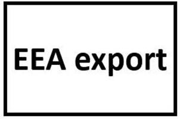

0.110 Anhang XVII Geistiges Eigentum Verzeichnis nach Art. 65 Abs. 2 Einleitung Falls die Rechtsakte, auf die in diesem Anhang Bezug genommen wird, Begriffe enthalten oder sich auf Verfahren beziehen, die für die Rechtsordnung der Gemeinschaft charakteristisch sind, wie - Präambeln - die Adressaten der gemeinschaftlichen Rechtsakte, - Bezugnahmen auf Gebiete oder Sprachen der EG, - Bezugnahmen auf Rechte und Pflichten der EG-Mitgliedstaaten, deren Körperschaften des öffentlichen Rechts, Unternehmen oder Einzelpersonen in ihren Beziehungen zueinander und - Bezugnahmen auf Informations- und Notifizierungsverfahren, so findet das Protokoll 1 über horizontale Anpassungen Anwendung, soweit in diesem Anhang nichts anderes bestimmt ist. Sektorale Anpassungen Zwischen den Vertragsparteien gilt der besondere Mechanismus, der in Kapitel 2 (Gesellschaftsrecht) des Anhangs IV der Beitrittsakte vom 16. April 2003 festgelegt ist. Zwischen den Vertragsparteien finden die besonderen Mechanismen nach Kapitel 1 (Gesellschaftsrecht) des Anhangs V der Beitrittsakte vom 25. April 2005 Anwendung. Zwischen den Vertragsparteien finden die besonderen Mechanismen nach Kapitel 1 (Rechte des geistigen Eigentums) des Anhangs IV der Beitrittsakte vom 9. Dezember 2011 Anwendung. Rechtsakte, auf die Bezug genommen wird 1. 387 L 0054: Richtlinie 87/54/EWG des Rates über den Rechtsschutz der Topographien von Halbleitererzeugnissen (ABl. Nr. L 24 vom 27.1.1987, S. 36) . Die Richtlinie gilt für die Zwecke dieses Abkommens mit folgenden Anpassungen: a) In Art. 1 Abs. 1 Bst. c wird der Verweis auf Art. 223 Abs. 1 Bst. b EWG-Vertrag durch den Verweis auf Art. 123 des EWR Abkommens ersetzt. b) Art. 3 Abs. 6 bis 8 finden keine Anwendung. c) Art. 5 Abs. 5 erhält folgende Fassung: "Das ausschliessliche Recht zur Zustimmung oder zum Verbot der in Abs. 1 Bst. b genannten Handlungen erstreckt sich nicht auf Handlungen, welche vorgenommen werden, wenn die Topographie oder das Halbleitererzeugnis von dem zur Erteilung der Zustimmung für das Inverkehrbringen Berechtigten selbst der mit seiner Zustimmung in einem Vertragsstaat in Verkehr gebracht worden ist". 2. 390 D 0510: Erste Entscheidung 90/510/EWG des Rates zur Ausdehnung des Rechtsschutzes der Topographien von Halbleitererzeugnissen auf Personen aus bestimmten Ländern oder Gebieten (ABl. Nr. L 285 vom 17.10.1990, S. 29) , geändert durch: - 393 D 0017: Entscheidung 93/17/EWG der Kommission vom 21. Dezember 1992 (ABl. Nr. L 11 vom 19.1.1993, S. 22) ; - 1 94 N: Akte über die Bedingungen des Beitritts der Republik Österreich, der Republik Finnland und des Königreichs Schweden und die Anpassungen der die Europäische Union begründenden Verträge (ABl. C 241 vom 29.8.1994, S. 21 , geändert durch ABl. L 1 vom 1.1.1995, S. 1) . Die Entscheidung gilt für die Zwecke dieses Abkommens mit folgenden Anpassungen: a) Im Anhang werden die Verweise auf Island und Norwegen gestrichen. b) Zusätzlich gilt folgende Bestimmung: Gewährt ein im Anhang aufgeführtes Land oder Gebiet den Angehörigen eines Vertragsstaates nicht den in der Entscheidung vorgesehenen gleichen Schutz, so bemühen sich die Vertragsparteien nach Kräften darum sicherzustellen, dass das fragliche Land oder Gebiet der betreffenden Vertragspartei diesen Schutz spätestens ein Jahr nach Inkrafttreten des Abkommens gewährt. 3a. 390 D 0511: Zweite Entscheidung 90/511/EWG des Rates zur Ausdehnung des Rechtsschutzes der Topographien von Halbleitererzeugnissen auf Personen aus bestimmten Ländern oder Gebieten (ABl. Nr. L 285 vom 17.10.1990, S. 31) . 3b. 390 D 0541: Entscheidung 90/541/EWG der Kommission gemäss Entscheidung 90/511/EWG des Rates zur Bestimmung der Länder, auf deren Unternehmen oder sonstige juristische Personen der Rechtsschutz für Topographien von Halbleitererzeugnissen ausgedehnt wird (ABl. Nr. L 307 vom 7.11.1990, S. 21) . 3c. 393 D 0016: Entscheidung 93/16/EWG des Rates vom 21. Dezember 1992 zur Ausdehnung des Rechtsschutzes der Topographien von Halbleitererzeugnissen auf Personen aus den Vereinigten Staaten von Amerika und aus bestimmten Gebieten (ABl. Nr. L 11 vom 19.1.1993, S. 20) , geändert durch: - 393 D 0520: Entscheidung 93/520/EWG des Rates vom 27. September 1993 (ABl. Nr. L 246 vom 2.10.1993, S. 31) . 3d. 393 D 0217: Entscheidung 93/217/EWG der Kommission vom 19. März 1993 gemäss der Entscheidung 93/16/EWG des Rates zur Bestimmung der Vereinigten Staaten von Amerika als Land, auf deren Unternehmen oder sonstige juristische Personen der Rechtsschutz für Topographien von Halbleitererzeugnissen ausgedehnt wird (ABl. Nr. L 94 vom 20.4.1993, S. 30) . 3e. 394 D 0004: Entscheidung 94/4/EG des Rates vom 20. Dezember 1993 zur Ausdehnung des Rechtsschutzes der Topographien von Halbleitererzeugnissen auf Personen aus den Vereinigten Staaten von Amerika (ABl. Nr. L 6 vom 8.1.1994, S. 23) . 3f. 394 D 0373: Entscheidung 94/373/EG des Rates vom 27. Juni 1994 zur Ausdehnung des Rechtsschutzes der Topographien von Halbleitererzeugnissen auf Personen aus den Vereinigten Staaten von Amerika (ABl. Nr. L 170 vom 5.7.1994, S. 34) . 3g. 394 D 0700: Entscheidung 94/700/EG des Rates vom 24. Oktober 1994 zur Ausdehnung des Rechtsschutzes der Topographien von Halbleitererzeugnissen auf Personen aus Kanada (ABl. Nr. L 284 vom 1.11.1994, S. 61) . 3h. 394 D 0828: Entscheidung 94/828/EG des Rates vom 19. Dezember 1994 zur Ausdehnung des Rechtsschutzes der Topographien von Halbleitererzeugnissen auf Personen aus bestimmten Gebieten (ABl. Nr. L 351 vom 31.12.1994, S. 12) . 3i. 394 D 0824: Entscheidung 94/824/EG des Rates vom 22. Dezember 1994 über die Ausdehnung des Rechtsschutzes der Topographien von Halbleitererzeugnissen auf Personen aus einem Mitgliedstaat der Welthandelsorganisation (ABl. Nr. L 349 vom 31.12.1994, S. 201) . 3j. 395 D 0237: Entscheidung 95/237/EG des Rates vom 29. Juni 1995 zur Ausdehnung des Rechtsschutzes der Topographien von Halbleitererzeugnissen auf Personen aus den Vereinigten Staaten von Amerika (ABl. Nr. L 158 vom 8.7.1995, S. 38) . Zusätzlich zu diesen Entscheidungen gilt Folgendes: Die EFTA-Staaten verpflichten sich, zur Anwendung dieses Abkommens die Entscheidung 90/511/EWG des Rates und die nach Massgabe dieser Entscheidung ergangenen Entscheidungen der Kommission zu übernehmen, wenn deren Geltungsdauer über den 31. Dezember 1992 hinaus verlängert wird. Im Anschluss hieran vorgenommene Änderungen oder Ersetzungen müssen vor Inkrafttreten des Abkommens angenommen werden. 4. Aufgehoben 5. 32009 L 0024 : Richtlinie 2009/24/EG des Europäischen Parlaments und des Rates vom 23. April 2009 über den Rechtsschutz von Computerprogrammen (kodifizierte Fassung) (ABl. L 111 vom 5.5.2009, S. 16) . 6. 32009 R 0469 : Verordnung (EG) Nr. 469/2009 des Europäischen Parlaments und des Rates vom 6. Mai 2009 über das ergänzende Schutzzertifikat für Arzneimittel (kodifizierte Fassung) (ABl. L 152 vom 16.6.2009, S. 1) , geändert durch: - 32019 R 0933 : Verordnung (EU) 2019/933 des Europäischen Parlaments und des Rates vom 20. Mai 2019 (ABl. L 153 vom 11.6.2019, S. 1) Die Verordnung gilt für die Zwecke dieses Abkommens mit folgenden Anpassungen: a) In Art. 5 Abs. 10 wird für die EFTA-Staaten die Angabe ‚bis zum 1. Juli 2019‘ durch die Angabe ‚bis zum Tag des Inkrafttretens des Beschlusses des Gemeinsamen EWR-Ausschusses Nr. 197/2022 vom 10. Juni 2022‘ ersetzt. b) Dem Art. 7 werden folgende Absätze angefügt: "6) Abs. 5 gilt nicht für die EFTA-Staaten. 7) Unbeschadet des Abs. 4 ist für die Dauer von fünf Jahren nach Inkrafttreten der Verordnung (EG) Nr. 1901/2006 in dem betreffenden EFTA-Staat der Antrag auf Verlängerung der Laufzeit eines bereits erteilten Zertifikats spätestens sechs Monate vor Ablauf des Zertifikats zu stellen." c) Dem Art. 21 werden folgende Absätze angefügt: "3) Einem Antrag auf Verlängerung der Laufzeit eines Zertifikats kann nur in einem EFTA-Staat entsprochen werden, in dem die Laufzeit des Zertifikats in weniger als sechs Monaten vor Inkrafttreten der Verordnung (EG) Nr. 1901/2006 erlischt. In den Fällen, in denen das Zertifikat vor Inkrafttreten der Verordnung (EG) Nr. 1901/2006 in dem betreffenden EFTA-Staat in Kraft tritt, wird die Verlängerung nur in Bezug auf die Zeit von dessen Inkrafttreten in dem betreffenden EFTA-Staat und dem Zeitpunkt der Veröffentlichung des Antrags auf Verlängerung wirksam. Für die Berechnung der Laufzeit der Verlängerung gilt jedoch Art. 13 Abs. 3. 4) Erlischt die Laufzeit eines Zertifikats früher als sieben Monate nach Inkrafttreten der Verordnung (EG) Nr. 1901/2006 in dem betreffenden EFTA-Staat, so wird der Antrag auf Verlängerung unbeschadet Art. 7 Abs. 7 spätestens einen Monat nach Inkrafttreten der Verordnung in dem betreffenden EFTA-Staat gestellt. In diesen Fällen wird die Verlängerung nur in Bezug auf die Zeit nach dem Zeitpunkt der Veröffentlichung des Antrags auf Verlängerung wirksam. Für die Berechnung der Laufzeit der Verlängerung gilt jedoch Art. 13 Abs. 3. 5) Ein Antrag auf Verlängerung der Laufzeit eines Zertifikats, der gemäss den Abs. 3 und 4 eingereicht wurde, berührt nicht die Rechte Dritter, die zwischen dem Erlöschen der Laufzeit eines Zertifikats und der Veröffentlichung eines Antrags auf dessen Verlängerung in gutem Glauben die Erfindung gewerbsmässig genutzt oder ernsthafte Vorbereitungen für diese Nutzung oder die Fortsetzung dieser Nutzung getroffen haben. d) In Anbetracht der Patentunion zwischen Liechtenstein und der Schweiz erteilt Liechtenstein keine ergänzenden Schutzzertifikate für Arzneimittel gemäss dieser Verordnung. e) Für die EFTA-Staaten erhält Anhang -I folgende Fassung: ‚Logo Dieses Logo ist in schwarz und so gross anzubringen, dass es hinreichend erkennbar ist. 

 ‚." 6a. 396 R 1610: Verordnung (EG) Nr. 1610/96 des Europäischen Parlaments und des Rates vom 23. Juli 1996 über die Schaffung eines ergänzenden Schutzzertifikats für Pflanzenschutzmittel (ABl. Nr. L 198 vom 8.8.1996, S. 30) , geändert durch: - 1 03 T: Akte über die Bedingungen des Beitritts der Tschechischen Republik, der Republik Estland, der Republik Zypern, der Republik Lettland, der Republik Litauen, der Republik Ungarn, der Republik Malta, der Republik Polen, der Republik Slowenien und der Slowakischen Republik und die Anpassungen der Verträge, auf denen die Europäische Union beruht, angenommen am 16. April 2003 (Abl. L 236 vom 23. September 2003, S. 33); - 1 2005 SA: Akte über die Bedingungen des Beitritts der Bulgarischen Republik und Rumäniens und die Anpassungen der die Europäische Union begründenden Verträge, angenommen am 25. April 2005 (ABl. L 157 vom 21.6.2005, S. 203) ; - 1 2012 J003 : Akte über die Bedingungen des Beitritts der Republik Kroatien und die Anpassungen des Vertrags über die Europäische Union, des Vertrags über die Arbeitsweise der Europäischen Union und des Vertrags zur Gründung der Europäischen Atomgemeinschaft vom 9. Dezember 2011 (ABl. L 112 vom 24.4.2012, S. 21) . Die Verordnung gilt für die Zwecke dieses Abkommens mit folgenden Anpassungen: a) Dem Art. 3 Abs. 1 Bst. b wird folgendes angefügt: "; für die Zwecke des Bst. b und der sich darauf beziehenden Artikel gilt eine Genehmigung für das Inverkehrbringen des Erzeugnisses gemäss der einzelstaatlichen Rechtsvorschrift des EFTA-Staates als Genehmigung gemäss der Richtlinie 91/414/EWG oder gemäss einer gleichwertigen einzelstaatlichen Rechtsvorschrift eines EG-Mitgliedstaates." b) Art. 20 findet keine Anwendung. c) Für Island und Norwegen gilt diese Verordnung ab dem 2. Januar 1998. d) Dem Art. 19 werden folgende Absätze angefügt: "3) Erlischt in einem EFTA-Staat ein Grundpatent nach Ablauf seiner gesetzlichen Laufzeit zwischen dem 8. Februar 1997 und dem 2. Januar 1998, so gilt das Zertifikat erst ab dem Zeitpunkt der Bekanntmachung seiner Anmeldung. Für die Berechnung der Laufzeit des Zertifikats ist jedoch Art. 13 ausschlaggebend. 4) In dem in Abs. 3 genannten Fall ist die Anmeldung eines Zertifikats innerhalb von 2 Monaten nach dem 2. Januar 1998 einzureichen. 5) Die Anmeldung eines Zertifikats gemäss Abs. 3 schliesst nicht aus, dass Dritte, die die Erfindung zwischen dem Erlöschen des Grundpatents und der Bekanntmachung der Anmeldung eines Zertifikats in gutem Glauben gewerblich genutzt oder eine solche Nutzung ernsthaft vorbereitet haben, diese Erfindung weiterhin nutzen." e) Zusätzlich gilt für Liechtenstein folgendes: "Angesichts der Patentunion zwischen Liechtenstein und der Schweiz erteilt Liechtenstein keine ergänzenden Schutzzertifikate für Pflanzenschutzmittel gemäss dieser Verordnung. Die von der Schweiz erteilten Zertifikate für Pflanzenschutzmittel werden jedoch in Liechtenstein wirksam, sobald die einschlägige Rechtsvorschrift in der Schweiz in Kraft tritt." 7. Aufgehoben 8. 393 L 0083: Richtlinie 93/83/EWG des Rates vom 27. September 1993 zur Koordinierung bestimmter urheber- und leistungsschutzrechtlicher Vorschriften betreffend Satellitenrundfunk und Kabelweiterverbreitung (ABl. Nr. L 248 vom 6.10.1993, S. 15) . 9. Aufgehoben 9a. 396 L 0009: Richtlinie 96/9/EG des Europäischen Parlaments und des Rates vom 11. März 1996 über den rechtlichen Schutz von Datenbanken (ABl. Nr. L 77 vom 27.3.1996, S. 20) . Die Richtlinie gilt für die Zwecke dieses Abkommens mit folgenden Anpassungen: a) In Art. 2 wird der Ausdruck "gemeinschaftlichen Bestimmungen" durch "EWR-Bestimmungen" ersetzt. b) Art. 11 Abs. 3 erhält folgende Fassung: "Die Dauer des Schutzes, der durch Vereinbarungen einer Vertragspartei über die Ausdehnung des in Art. 7 vorgesehenen Rechts auf in Drittländern hergestellte Datenbanken, auf die die Bestimmungen der Abs. 1 und 2 keine Anwendung finden, auf Datenbanken ausgedehnt wird, übersteigt nicht die Schutzdauer nach Art. 10." 9b. 398 L 0071: Richtlinie 98/71/EG des Europäischen Parlaments und des Rates vom 13. Oktober 1998 über den rechtlichen Schutz von Mustern und Modellen (ABl. L 289 vom 28.10.1998, S. 28) ." Die Richtlinie gilt für die Zwecke dieses Abkommens mit der folgenden Anpassung: Art. 15 erhält folgende Fassung: "Die Rechte aus einem Muster nach seiner Eintragung erstrecken sich nicht auf Handlungen, die ein Erzeugnis betreffen, in das ein unter den Schutzumfang des Rechts an einem Muster fallendes Muster eingefügt oder bei dem es verwendet wird, wenn das Erzeugnis vom Inhaber des Rechts an einem Muster oder mit seiner Zustimmung im Gebiet einer Vertragspartei in den Verkehr gebracht worden ist." 9c. 32001 L 0084: Richtlinie 2001/84/EG des Europäischen Parlaments und des Rates vom 27. September 2001 über das Folgerecht des Urhebers des Originals eines Kunstwerks (ABl. L 272 vom 13.10.2001, S. 32) . Die Richtlinie gilt für die Zwecke dieses Abkommens mit der folgenden Anpassung: Die EFTA-Staaten werden aufgefordert, Vertreter zu den Sitzungen des Kontaktausschusses zu entsenden. 9d. 398 L 0044: Richtlinie 98/44/EG des Europäischen Parlaments und des Rates vom 6. Juli 1998 über den rechtlichen Schutz biotechnologischer Erfindungen (ABl. L 213 vom 30.7.1998, S. 13) . Die Richtlinie gilt für die Zwecke dieses Abkommens mit der folgenden Anpassung: Angesichts der Patentunion zwischen Liechtenstein und der Schweiz wird Liechtenstein keine Patente im Sinne dieser Richtlinie erteilen. 9e. 32001 L 0029: Richtlinie 2001/29/EG des Europäischen Parlaments und des Rates vom 22. Mai 2001 (ABl. L 167 vom 22.6.2001, S. 10) , berichtigt in ABl. L 6 vom 10.1.2002, S. 70 , geändert durch: - 32017 L 1564 : Richtlinie (EU) 2017/1564 des Europäischen Parlaments und des Rates vom 13. September 2017 (ABl. L 242 vom 20.9.2017, S. 6) . Die Richtlinie gilt für die Zwecke dieses Abkommens mit der folgenden Anpassung: Die EFTA-Staaten werden aufgefordert, Vertreter zu den Sitzungen des Kontaktausschusses zu entsenden. 9f. 32006 L 0116: Richtlinie 2006/116/EG des Europäischen Parlaments und des Rates vom 12. Dezember 2006 über die Schutzdauer des Urheberrechts und bestimmter verwandter Schutzrechte (kodifizierte Fassung) (ABl. L 372 vom 27.12.2006, S. 12) , geändert durch: - 32011 L 0077: Richtlinie 2011/77/EU des Europäischen Parlaments und des Rates vom 27. September 2011 (ABl. L 265 vom 11.10.2011, S. 1) . 9g. 32006 L 0115: Richtlinie 2006/115/EG des Europäischen Parlaments und des Rates vom 12. Dezember 2006 zum Vermietrecht und Verleihrecht sowie zu bestimmten dem Urheberrecht verwandten Schutzrechten im Bereich des geistigen Eigentums (kodifizierte Fassung) (ABl. L 376 vom 27.12.2006, S. 28) . 9h. Aufgehoben 10. 32012 L 0028: Richtlinie 2012/28/EU des Europäischen Parlaments und des Rates vom 25. Oktober 2012 über bestimmte zulässige Formen der Nutzung verwaister Werke (ABl. L 299 vom 27.10.2012, S. 5) . Die Richtlinie gilt für die Zwecke dieses Abkommens mit folgenden Anpassungen: a) Die EFTA-Staaten beteiligen sich an der einzigen öffentlich zugänglichen Online-Datenbank, die vom Harmonisierungsamt für den Binnenmarkt eingerichtet wird, auf die in Art. 3 Abs. 6 Bezug genommen wird. Die EFTA-Staaten tragen die Kosten für die Übersetzung in die isländische und norwegische Sprache, wenn eine solche notwendig ist. b) Für die EFTA-Staaten ist der Stichtag für die Anwendbarkeit, auf den in Art. 8 Bezug genommen wird, der Tag, an dem der Beschluss Nr. 29/2015 des Gemeinsamen EWR-Ausschusses vom 25. Februar 2015 in Kraft tritt. 11. 32014 L 0026 : Richtlinie 2014/26/EU des Europäischen Parlaments und des Rates vom 26. Februar 2014 über die kollektive Wahrnehmung von Urheber- und verwandten Schutzrechten und die Vergabe von Mehrgebietslizenzen für Rechte an Musikwerken für die Online-Nutzung im Binnenmarkt (ABl. L 84 vom 20.3.2014, S. 72) Die Richtlinie gilt für die Zwecke dieses Abkommens mit folgender Anpassung: a) In Art. 32 der Richtlinie wird die Angabe "Art. 101 und 102 AEUV" durch die Angabe "Art. 53 und 54 des EWR-Abkommens" ersetzt. b) Die EFTA-Staaten sind berechtigt, sich an der Arbeit der nach Art. 41 der Richtlinie eingesetzten Sachverständigengruppe uneingeschränkt zu beteiligen, und verfügen dort mit Ausnahme des Stimmrechts über dieselben Rechte und Pflichten wie EU-Mitgliedstaaten. c) In Art. 5 Abs. 8 wird für die EFTA-Staaten die Angabe "bis zum 10. Oktober 2016" durch die Angabe "innerhalb von sechs Monaten ab dem Tag des Inkrafttretens des Beschlusses des Gemeinsamen EWR-Ausschusses Nr. 186/2017 vom 22. September 2017" ersetzt. d) In Art. 31 wird für die EFTA-Staaten die Angabe "bis zum 10. April 2017" durch die Angabe "innerhalb eines Jahres ab dem Tag des Inkrafttretens des Beschlusses des Gemeinsamen EWR-Ausschusses Nr. 186/2017 vom 22. September 2017" ersetzt. e) In Art. 36 Abs. 3 wird für die EFTA-Staaten die Angabe "bis zum 10. April 2016" durch die Angabe "bis zum Tag des Inkrafttretens des Beschlusses des Gemeinsamen EWR-Ausschusses Nr. 186/2017 vom 22. September 2017" ersetzt. f) In Art. 38 Abs. 3 wird für die EFTA-Staaten die Angabe "bis zum 10. Oktober 2017" durch die Angabe "innerhalb von 18 Monaten ab dem Tag des Inkrafttretens des Beschlusses des Gemeinsamen EWR-Ausschusses Nr. 186/2017 vom 22. September 2017" ersetzt. g) In Art. 39 wird für die EFTA-Staaten die Angabe "bis zum 10. April 2016" durch die Angabe "bis zum Tag des Inkrafttretens des Beschlusses des Gemeinsamen EWR-Ausschusses Nr. 186/2017 vom 22. September 2017" ersetzt. h) In Art. 43 wird für die EFTA-Staaten die Angabe "bis zum 10. April 2016" durch die Angabe "bis zum Tag des Inkrafttretens des Beschlusses des Gemeinsamen EWR-Ausschusses Nr. 186/2017 vom 22. September 2017" ersetzt. 12. 32017 R 1128 : Verordnung (EU) 2017/1128 des Europäischen Parlaments und des Rates vom 14. Juni 2017 zur grenzüberschreitenden Portabilität von Online-Inhaltediensten im Binnenmarkt (ABl. L 168 vom 30.6.2017, S. 1) , berichtigt in ABl. L 198 vom 28.7.2017, S. 42 Die Verordnung gilt für die Zwecke dieses Abkommens mit den folgenden Anpassungen: a) In Art. 2 Abs. 5 der Verordnung wird die Angabe ‚Art. 56 und 57 AEUV‘ durch die Angabe ‚Art. 36 und 37 des EWR-Abkommens‘ ersetzt. b) In Art. 9 Abs. 2 der Verordnung wird für die EFTA-Staaten die Angabe ‚zum 2. Juni 2018‘ durch die Angabe ‚zwei Monate und einen Tag nach Inkrafttreten des Beschlusses des Gemeinsamen EWR-Ausschusses Nr. 158/2018 vom 6. Juli 2018‘ ersetzt. 13. 32016 L 0943 : Richtlinie (EU) 2016/943 des Europäischen Parlaments und des Rates vom 8. Juni 2016 über den Schutz vertraulichen Know-hows und vertraulicher Geschäftsinformationen (Geschäftsgeheimnisse) vor rechtswidrigem Erwerb sowie rechtswidriger Nutzung und Offenlegung (ABl. L 157 vom 15.6.2016, S. 1) Die Richtlinie gilt für die Zwecke dieses Abkommens mit folgenden Anpassungen: a) In Art. 1 Abs. 1 wird für die EFTA-Staaten die Angabe ‚des AEUV‘ durch die Angabe ‚des EWR-Abkommens‘ ersetzt. b) In Art. 1 Abs. 2 Bst. a und Art. 5 Bst. a werden für die EFTA-Staaten die Wörter ‚Rechts der freien Meinungsäusserung und der Informationsfreiheit gemäss der Charta‘ durch die Wörter ‚Grundrechts auf freie Meinungsäusserung und Informationsfreiheit‘ ersetzt. c) In Art. 1 Abs. 2 Bst. b und c werden für die EFTA-Staaten die Wörter ‚Vorschriften der Union oder der Mitgliedstaaten‘ durch die Wörter ‚EWR-Vorschriften oder nationalen Vorschriften‘ ersetzt. d) In Art. 1 Abs. 2 Bst. c schliessen für die EFTA-Staaten die Wörter ‚Organen und Einrichtungen der Union‘ auch ‚Organe und Einrichtungen des EWR bzw. der EFTA‘ ein. e) In Art. 1 Abs. 2 Bst. c und Abs. 3 Bst. c, Art. 3 Abs. 2 und Art. 5 Bst. c und d wird für die EFTA-Staaten die Bezugnahme auf ‚Unionsrecht oder nationales Recht‘ durch die Bezugnahme auf ‚EWR-Vorschriften oder nationale Vorschriften‘ ersetzt. f) In Art. 1 Abs. 2 Bst. d und Art. 3 Abs. 1 Bst. c werden für die EFTA-Staaten die Wörter ‚gemäss dem Unionsrecht sowie gemäss den Rechtsvorschriften und den Gepflogenheiten der Mitgliedstaaten‘ durch die Wörter ‚gemäss dem EWR-Recht sowie gemäss den nationalen Rechtsvorschriften und Gepflogenheiten‘ ersetzt. 14. 32015 L 2436 : Richtlinie (EU) 2015/2436 des Europäischen Parlaments und des Rates vom 16. Dezember 2015 zur Angleichung der Rechtsvorschriften der Mitgliedstaaten über die Marken (ABl. L 336 vom 23.12.2015, S. 1) , berichtigt in ABl. L 110 vom 26.4.2016, S. 5 . Die Richtlinie gilt für die Zwecke dieses Abkommens mit folgenden Anpassungen: a) Für die EFTA-Staaten werden in Art. 4 Abs. 1 Bst. i und Art. 4 Abs. 1 Bst. l die Worte ‚Unionsvorschriften oder von nationalem Recht des betreffenden Mitgliedstaats‘ durch die Worte ‚EWR-Rechtsvorschriften oder von nationalem Recht des betreffenden EFTA-Staates‘ ersetzt. Die Worte ‚internationale Übereinkünfte, denen die Union oder der betreffende Mitgliedstaat angehört‘ werden durch die Worte ‚internationale Übereinkünfte, denen der betreffende EFTA-Staat angehört‘ ersetzt. b) Für die EFTA-Staaten werden in Art. 4 Abs. 1 Bst. j und Art. 4 Abs. 1 Bst. k die Worte ‚Unionsvorschriften oder internationale Übereinkünfte, denen die Union angehört‘ durch die Worte ‚EWR-Rechtsvorschriften oder internationale Übereinkünfte, denen der betreffende EFTA-Staat angehört‘ ersetzt. c) Für die EFTA-Staaten werden in Art. 4 Abs. 3 Bst. a die Worte ‚andere Rechtsvorschriften als das Markenrecht des jeweiligen Mitgliedstaates oder der Union‘ durch die Worte ‚andere Rechtsvorschriften als das Markenrecht, das im jeweiligen EFTA-Staat anwendbar ist oder des EWR-Abkommens‘ ersetzt. d) Die Bestimmungen betreffend der Unionsmarke in Art. 5 Abs. 2 Bst. a Unterbst. i, Abs. 2 Bst. b und Abs. 3 Bst. a, Art. 6, Art. 18 Abs. 2, Art. 44 Abs. 3 und Art. 46 Abs. 5 gelten nicht für die EFTA-Staaten sofern sich die Unionsmarke nicht auf sie erstreckt. e) Für die EFTA-Staaten werden in Art. 5 Abs. 3 Bst. c die Worte ‚Unionsvorschriften oder von nationalem Recht des betreffenden Mitgliedstaates‘ durch die Worte ‚EWR-Rechtsvorschriften oder Recht des betreffenden EFTA-Staates‘ ersetzt. f) Art. 10 Abs. 4 gilt nicht für die EFTA-Staaten. 15. 32017 L 1564 : Richtlinie (EU) 2017/1564 des Europäischen Parlaments und des Rates vom 13. September 2017 über bestimmte zulässige Formen der Nutzung bestimmter urheberrechtlich oder durch verwandte Schutzrechte geschützter Werke und sonstiger Schutzgegenstände zugunsten blinder, sehbehinderter oder anderweitig lesebehinderter Personen und zur Änderung der Richtlinie 2001/29/EG zur Harmonisierung bestimmter Aspekte des Urheberrechts und der verwandten Schutzrechte in der Informationsgesellschaft (ABl. L 242 vom 20.9.2017, S. 6) . Rechtsakte, die die Vertragsparteien zur Kenntnis nehmen Die Vertragsparteien nehmen den Inhalt der nachstehenden Rechtsakte zur Kenntnis: 1. 392 Y 0528(01): Entschliessung 92/C/138/01 des Rates vom 14. Mai 1992 im Hinblick auf einen verstärkten Schutz des Urheberrechts und der Leistungsschutzrechte (ABl. Nr. C 138 vom 28.5.1992, S. 1) . 2. KOM (92) 445 endg.: Mitteilung der Kommission vom 27. Oktober 1992 Gewerbliche Schutzrechte und Normen iKOM (92) 445 endg.K.
