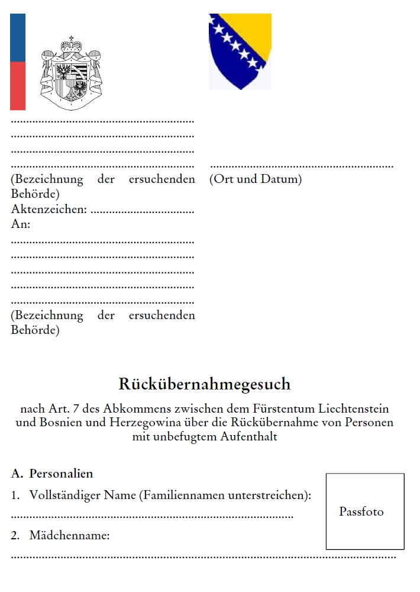
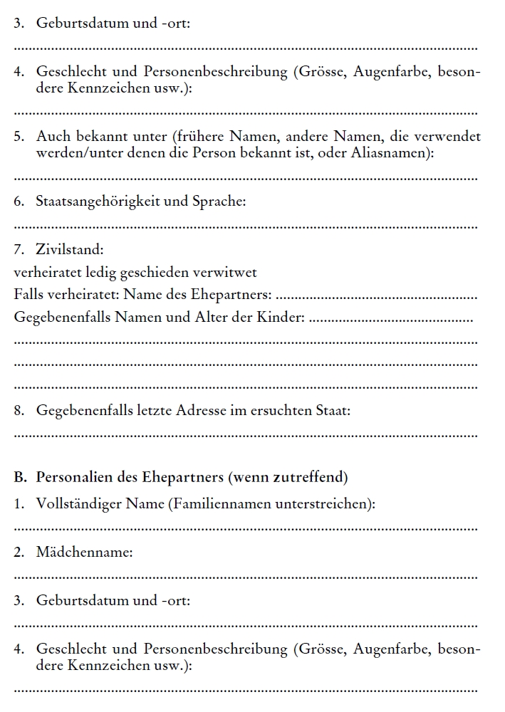
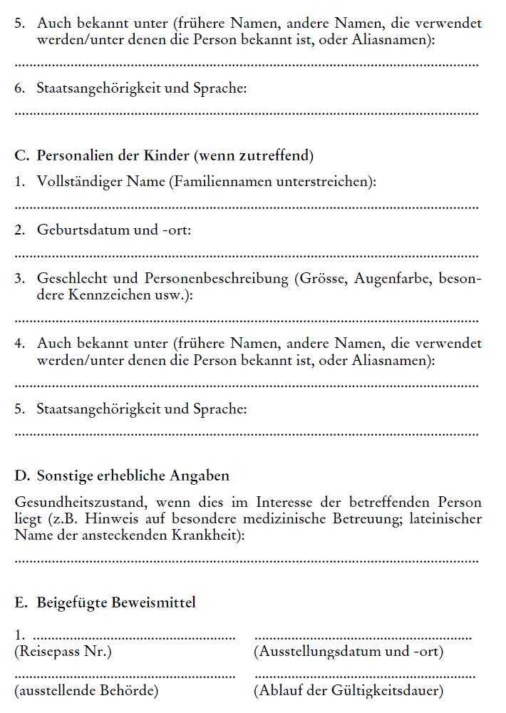
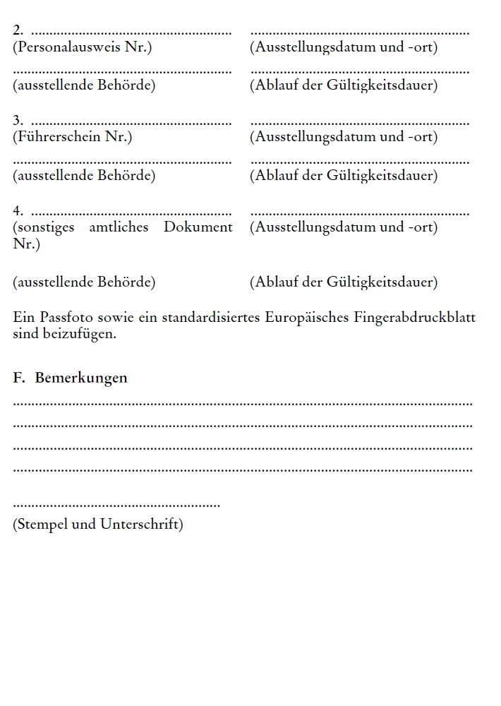

Abkommen zwischen dem Fürstentum Liechtenstein und Bosnien und Herzegowina über die Rückübernahme von Personen mit unbefugtem Aufenthalt Abgeschlossen in Vaduz am 9. September 2013 Inkrafttreten: 1. Mai 2014 Die Vertragsparteien, das Fürstentum Liechtenstein und Bosnien und Herzegowina, entschlossen, ihre Zusammenarbeit zu intensivieren, um die illegale Einwanderung wirksamer zu bekämpfen, im Bestreben, mit diesem Abkommen auf der Grundlage der Gegenseitigkeit schnelle und effiziente Verfahren für die Identifizierung und sichere und ordnungsgemässe Rückkehr von Personen einzuführen, die die Voraussetzungen für die Einreise in das Hoheitsgebiet des Fürstentums Liechtenstein oder Bosnien und Herzegowinas oder für die Anwesenheit oder den Aufenthalt in dem betreffenden Hoheitsgebiet nicht oder nicht mehr erfüllen, und die Durchbeförderung dieser Personen im Geiste der Zusammenarbeit zu erleichtern, unter nachdrücklichem Hinweis darauf, dass dieses Abkommen die Rechte, Pflichten und Zuständigkeiten des Fürstentums Liechtenstein und Bosnien und Herzegowinas unberührt lässt, die sich aus dem Völkerrecht ergeben, insbesondere aus der Europäischen Konvention vom 4. November 1950 zum Schutze der Menschenrechte und der Grundfreiheiten und dem Übereinkommen vom 28. Juli 1951 über die Rechtsstellung der Flüchtlinge, unter Berücksichtigung des Protokolls zwischen dem Fürstentum Liechtenstein, der Europäischen Union, der Europäischen Gemeinschaft und der Schweizerischen Eidgenossenschaft über die Assoziierung des Fürstentums Liechtenstein bei der Umsetzung, Anwendung und Entwicklung des Schengen-Besitzstands vom 28. Februar 2008 sowie des Rahmenvertrags vom 3. Dezember 2008 zwischen dem Fürstentum Liechtenstein und der Schweizerischen Eidgenossenschaft über die Zusammenarbeit im Bereich des Visumverfahrens, der Einreise und des Aufenthalts sowie über die polizeiliche Zusammenarbeit im Grenzraum, unter Berücksichtigung des Abkommens zwischen der Europäischen Gemeinschaft und Bosnien und Herzegowina über die Rückübernahme von Personen mit unbefugtem Aufenthalt, unterzeichnet am 18. September 2007, sind wie folgt übereingekommen: Art. 1 Definitionen Für die Zwecke dieses Abkommens gelten folgende Definitionen: a) "Vertragsparteien" bezeichnet das Fürstentum Liechtenstein und Bosnien und Herzegowina. b) "Staatsangehöriger des Fürstentums Liechtenstein" bezeichnet jede Person, die die Staatsangehörigkeit des Fürstentums Liechtenstein gemäss dessen innerstaatlicher Gesetzgebung besitzt. c) "Staatsangehöriger Bosnien und Herzegowinas" bezeichnet jede Person, die die Staatsangehörigkeit Bosnien und Herzegowinas gemäss dessen innerstaatlicher Gesetzgebung besitzt. d) "Drittstaatsangehöriger" bezeichnet jede Person, die eine andere Staatsangehörigkeit als diejenige des Fürstentums Liechtenstein oder Bosnien und Herzegowinas besitzt. e) "Staatenloser" bezeichnet jede Person, die keine Staatsangehörigkeit besitzt. f) "Aufenthaltsbewilligung" bezeichnet eine beliebige vom Fürstentum Liechtenstein oder Bosnien und Herzegowina erteilte Bewilligung, die eine Person zum Aufenthalt in ihrem Hoheitsgebiet berechtigt. Nicht inbegriffen ist dabei das vorübergehende Aufenthaltsrecht im Hoheitsgebiet der genannten Staaten in Zusammenhang mit einem Asyl- oder Aufenthaltsbewilligungsverfahren. g) "Visum" bezeichnet eine Bewilligung oder eine Entscheidung des Fürstentums Liechtenstein oder Bosnien und Herzegowinas, die für die Einreise in oder die Durchreise durch ihr Hoheitsgebiet erforderlich ist. Flughafentransitvisa sind dabei nicht inbegriffen. h) "Ersuchender Staat" bezeichnet denjenigen Staat (das Fürstentum Liechtenstein oder Bosnien und Herzegowina), der ein Rückübernahmegesuch gemäss Art. 7 oder ein Durchbeförderungsgesuch gemäss Art. 14 dieses Abkommens stellt. i) "Ersuchter Staat" bezeichnet den Staat (das Fürstentum Liechtenstein oder Bosnien und Herzegowina), an den ein Rückübernahmegesuch gemäss Art. 7 oder ein Durchbeförderungsgesuch gemäss Art. 14 dieses Abkommens gerichtet wird. j) "Zuständige Behörde" bezeichnet jede nationale Behörde des Fürstentums Liechtenstein oder Bosnien und Herzegowinas, die sich mit der Anwendung dieses Abkommens gemäss Art. 19 Bst. a) desselben befasst. k) "Durchbeförderung" bezeichnet die Durchreise eines Drittstaatsangehörigen oder eines Staatenlosen durch das Hoheitsgebiet des ersuchten Staates auf dem Weg vom ersuchenden Staat zum Zielstaat. Abschnitt I Rückübernahmeverpflichtungen von Bosnien und Herzegowina Art. 2 Rückübernahme eigener Staatsangehöriger 1) Bosnien und Herzegowina rückübernimmt auf Ersuchen des Fürstentums Liechtenstein und ohne andere als die in diesem Abkommen vorgesehenen Förmlichkeiten jede Person, die im Hoheitsgebiet des Fürstentums Liechtenstein die geltenden Voraussetzungen für Einreise, Anwesenheit oder Aufenthalt nicht oder nicht mehr erfüllt, sofern nachgewiesen oder glaubhaft gemacht wird, dass diese Person Staatsangehörige Bosnien und Herzegowinas ist. 2) Bosnien und Herzegowina rückübernimmt ferner minderjährige unverheiratete Kinder bosnisch-herzegowinischer Staatsangehörigkeit der in Abs. 1 dieses Artikels genannten Personen unabhängig von ihrem Geburtsort, es sei denn, sie besitzen ein eigenständiges Aufenthaltsrecht im Fürstentum Liechtenstein. 3) Bosnien und Herzegowina rückübernimmt ferner Personen, die nach der Einreise in das Hoheitsgebiet des Fürstentums Liechtenstein die Staatsangehörigkeit Bosnien und Herzegowinas verloren oder aufgegeben haben, es sei denn, dass diese Personen durch das Fürstentum Liechtenstein eingebürgert wurden. 4) Nach schriftlicher Annahme des Rückübernahmegesuchs durch Bosnien und Herzegowina stellt die zuständige diplomatische Mission oder konsularische Vertretung Bosnien und Herzegowinas unverzüglich und spätestens innerhalb von drei Arbeitstagen das für die Rückkehr der rückzuübernehmenden Person erforderliche Reisedokument mit einer Gültigkeitsdauer von 30 Tagen aus. Kann die betreffende Person aus rechtlichen oder tatsächlichen Gründen nicht innerhalb der Gültigkeitsdauer des ursprünglich ausgestellten Reisedokuments rückgeführt werden, so stellt die zuständige diplomatische Mission oder konsularische Vertretung Bosnien und Herzegowinas innerhalb von 14 Kalendertagen ein neues Reisedokument mit gleicher Gültigkeitsdauer aus. 5) Besitzt die rückzuübernehmende Person neben der Staatsangehörigkeit Bosnien und Herzegowinas die eines Drittstaats, so berücksichtigt das Fürstentum Liechtenstein den Willen dieser Person, vom Staat ihrer Wahl rückübernommen zu werden. Eventuelle Mehrkosten für die Rückkehr in den Drittstaat werden von der rückzuübernehmenden Person getragen. Art. 3 Rückübernahme Drittstaatsangehöriger und Staatenloser 1) Bosnien und Herzegowina rückübernimmt auf Ersuchen des Fürstentums Liechtenstein und ohne andere als die in diesem Abkommen vorgesehenen Förmlichkeiten alle Drittstaatsangehörigen oder Staatenlosen, die im Hoheitsgebiet des Fürstentums Liechtenstein die geltenden Voraussetzungen für Einreise, Anwesenheit oder Aufenthalt nicht oder nicht mehr erfüllen, sofern nachgewiesen oder glaubhaft gemacht wird, dass diese Personen: a) im Besitz eines gültigen Visums oder einer gültigen Aufenthaltsbewilligung Bosnien und Herzegowinas sind oder zum Zeitpunkt der Einreise waren; oder b) nach einem Aufenthalt im Hoheitsgebiet Bosnien und Herzegowinas oder einer Durchreise durch sein Hoheitsgebiet auf dem Luftweg oder auf dem Landweg über einen Drittstaat illegal und direkt in das Hoheitsgebiet des Fürstentum Liechtenstein eingereist sind; oder c) Ehepartner der in Art. 2 Abs. 1 genannten Personen sind und eine andere Staatsangehörigkeit besitzen, vorausgesetzt, dass sie das Recht, in das Hoheitsgebiet Bosnien und Herzegowinas einzureisen oder sich dort aufzuhalten besitzen oder von der zuständigen Behörde Bosnien und Herzegowinas erhalten; oder d) unverheiratete minderjährige Kinder der in Art. 2 Abs. 1 genannten Personen sind und eine andere Staatsangehörigkeit besitzen. 2) Die Rückübernahmeverpflichtung nach Abs. 1 dieses Artikels gilt nicht, sofern: a) der Drittstaatsangehörige oder der Staatenlose nur im Transit über einen internationalen Flughafen Bosnien und Herzegowinas gereist ist; oder b) das Fürstentum Liechtenstein dem Drittstaatsangehörigen oder dem Staatenlosen vor oder nach der Einreise in ihr Hoheitsgebiet ein Visum oder eine Aufenthaltsbewilligung ausgestellt hat, es sei denn: - die betreffende Person ist im Besitz eines Visums oder einer Aufenthaltsbewilligung Bosnien und Herzegowinas mit einer längeren Gültigkeitsdauer; oder - das Visum oder die Aufenthaltsbewilligung des Fürstentums Liechtenstein wurde mithilfe falscher oder gefälschter Dokumente oder durch falsche Aussagen erlangt; oder - die betreffende Person erfüllt nicht die an das Visum geknüpften Bedingungen. 3) Bosnien und Herzegowina rückübernimmt ferner auf Ersuchen des Fürstentums Liechtenstein ehemalige Staatsangehörige der Sozialistischen Föderativen Republik Jugoslawien, die keine andere Staatsangehörigkeit erworben haben und deren Geburtsort und ständiger Aufenthaltsort am 6. April 1992 sich im Gebiet Bosnien und Herzegowinas befanden. 4) Nach schriftlicher Annahme des Rückübernahmegesuchs durch Bosnien und Herzegowina stellt das Fürstentum Liechtenstein der Person, deren Rückübernahme angenommen wurde, das für die Rückkehr erforderliche Reisedokument aus. Abschnitt II Rückübernahmeverpflichtungen des Fürstentums Liechtenstein Art. 4 Rückübernahme eigener Staatsangehöriger 1) Das Fürstentum Liechtenstein rückübernimmt auf Ersuchen Bosnien und Herzegowinas und ohne andere als die in diesem Abkommen vorgesehenen Förmlichkeiten jede Person, die im Hoheitsgebiet Bosnien und Herzegowinas die geltenden Voraussetzungen für Einreise, Anwesenheit oder Aufenthalt nicht oder nicht mehr erfüllt, sofern nachgewiesen oder glaubhaft gemacht wird, dass diese Person Staatsangehörige des Fürstentums Liechtenstein ist. 2) Das Fürstentum Liechtenstein rückübernimmt ferner minderjährige unverheiratete Kinder liechtensteinischer Staatsangehörigkeit der in Abs. 1 dieses Artikels genannten Personen unabhängig von ihrem Geburtsort, es sei denn, sie besitzen ein eigenständiges Aufenthaltsrecht in Bosnien und Herzegowina. 3) Das Fürstentum Liechtenstein rückübernimmt ferner Personen, die nach der Einreise in das Hoheitsgebiet Bosnien und Herzegowinas die Staatsangehörigkeit des Fürstentums Liechtenstein aufgegeben haben, es sei denn, dass diese Personen durch Bosnien und Herzegowina eingebürgert wurden. 4) Nach schriftlicher Annahme des Rückübernahmegesuchs durch das Fürstentum Liechtenstein stellt die zuständige diplomatische Mission oder konsularische Vertretung des Fürstentums Liechtenstein unverzüglich und spätestens innerhalb von drei Arbeitstagen das für die Rückkehr der rückzuübernehmenden Person erforderliche Reisedokument mit einer Gültigkeitsdauer von 30 Tagen aus. Kann die betreffende Person aus rechtlichen oder tatsächlichen Gründen nicht innerhalb der Gültigkeitsdauer des ursprünglich ausgestellten Reisedokuments rückgeführt werden, so stellt die zuständige diplomatische Mission oder konsularische Vertretung des Fürstentums Liechtenstein innerhalb von 14 Kalendertagen ein neues Reisedokument mit gleicher Gültigkeitsdauer aus. 5) Besitzt die rückzuübernehmende Person neben der Staatsangehörigkeit des Fürstentums Liechtenstein die eines Drittstaats, so berücksichtigt Bosnien und Herzegowina den Willen dieser Person, von dem Staat ihrer Wahl rückübernommen zu werden. Eventuelle Mehrkosten für die Rückkehr in den Drittstaat werden von der rückzuübernehmenden Person getragen. Art. 5 Rückübernahme Drittstaatsangehöriger und Staatenloser 1) Das Fürstentum Liechtenstein rückübernimmt auf Ersuchen Bosnien und Herzegowinas und ohne andere als die in diesem Abkommen vorgesehenen Förmlichkeiten alle Drittstaatsangehörigen oder Staatenlosen, die im Hoheitsgebiet Bosnien und Herzegowinas die geltenden Voraussetzungen für Einreise, Anwesenheit oder Aufenthalt nicht oder nicht mehr erfüllen, sofern nachgewiesen oder glaubhaft gemacht wird, dass diese Personen: a) im Besitz eines gültigen Visums oder einer gültigen Aufenthaltsbewilligung des Fürstentums Liechtenstein sind oder zum Zeitpunkt der Einreise waren; oder b) nach einem Aufenthalt im Hoheitsgebiet des Fürstentums Liechtenstein oder einer Durchreise durch ihr Hoheitsgebiet auf dem Luftweg oder auf dem Landweg über einen Drittstaat illegal und direkt in das Hoheitsgebiet Bosnien und Herzegowinas eingereist sind; oder c) Ehepartner der in Art. 4 Abs. 1 genannten Person sind und eine andere Staatsangehörigkeit besitzen, vorausgesetzt, dass sie das Recht, in das Hoheitsgebiet des Fürstentums Liechtenstein einzureisen oder sich dort aufzuhalten besitzen oder von der zuständigen Behörde des Fürstentums Liechtenstein erhalten; oder d) unverheiratete minderjährige Kinder der in Art. 4 Abs. 1 genannten Person sind und eine andere Staatsangehörigkeit besitzen. 2) Die Rückübernahmeverpflichtung nach Abs. 1 dieses Artikels gilt nicht, sofern Bosnien und Herzegowina dem Drittstaatsangehörigen oder dem Staatenlosen vor oder nach der Einreise in sein Hoheitsgebiet ein Visum oder eine Aufenthaltsbewilligung ausgestellt hat, es sei denn: - die betreffende Person ist im Besitz eines Visums oder einer Aufenthaltsbewilligung des Fürstentums Liechtenstein mit einer längeren Gültigkeitsdauer; oder - das Visum oder die Aufenthaltsbewilligung Bosnien und Herzegowinas wurde mithilfe falscher oder gefälschter Dokumente oder durch falsche Aussagen erlangt; oder - die betreffende Person erfüllt nicht die an das Visum geknüpften Bedingungen. 3) Nach schriftlicher Annahme des Rückübernahmegesuchs durch das Fürstentum Liechtenstein stellt Bosnien und Herzegowina der Person, deren Rückübernahme angenommen wurde, das für die Rückkehr erforderliche Reisedokument aus. Abschnitt III Rückübernahmeverfahren Art. 6 Grundsätze 1) Unter Vorbehalt von Abs. 2 dieses Artikels ist für die Rückkehr einer betreffenden Person aufgrund einer Verpflichtung nach den Art. 2 bis 5 bei der zuständigen Behörde des ersuchten Staates ein Rückübernahmegesuch zu stellen. 2) Es bedarf keines Rückübernahmegesuchs, wenn die rückzuübernehmende Person einen gültigen nationalen Reisepass oder Personalausweis und gegebenenfalls ein gültiges Visum oder eine gültige Aufenthaltsbewilligung des ersuchten Staates besitzt. Art. 7 Rückübernahmegesuch 1) Das Rückübernahmegesuch muss nach Möglichkeit Folgendes enthalten: a) Personalien der rückzuübernehmenden Person (z.B. Vornamen, Familiennamen, Geburtsdatum und - nach Möglichkeit - Geburtsort und letzter Aufenthaltsort) und gegebenenfalls Personalien der minderjährigen unverheirateten Kinder und/oder der Ehepartner; b) Angabe der Mittel, mit denen die Staatsangehörigkeit, die Durchreise, die Erfüllung der Voraussetzungen für die Rückübernahme des Drittstaatsangehörigen oder des Staatenlosen und die Illegalität der Einreise und des Aufenthalts nachgewiesen oder glaubhaft gemacht werden; c) Passfoto der rückzuübernehmenden Person; d) ein standardisiertes Europäisches Fingerabdruckblatt; e) sonstige erhebliche Angaben, insbesondere zum Gesundheitszustand der rückzuführenden Person, sofern dies im Interesse der betreffenden Person liegt. 2) Ein gemeinsames Formblatt für Rückübernahmegesuche ist dem Durchführungsprotokoll als Anhang 6 beigefügt. Art. 8 Beweismittel für die Staatsangehörigkeit 1) Die Staatsangehörigkeit nach Art. 2 Abs. 1 und Art. 4 Abs. 1 kann insbesondere mit einem der in Anhang 1 zum Durchführungsprotokoll aufgeführten Dokumente nachgewiesen werden. Werden solche Dokumente vorgelegt, so anerkennen sowohl das Fürstentum Liechtenstein als auch Bosnien und Herzegowina die Staatsangehörigkeit, ohne dass es einer weiteren Überprüfung bedarf. Die Staatsangehörigkeit kann nicht mit gefälschten Dokumenten nachgewiesen werden. 2) Die Staatsangehörigkeit nach Art. 2 Abs. 1 und Art. 4 Abs. 1 kann insbesondere mit den in Anhang 2 zum Durchführungsprotokoll aufgeführten Dokumenten glaubhaft gemacht werden, selbst wenn deren Gültigkeitsdauer abgelaufen ist. Werden solche Dokumente vorgelegt, so sehen die Vertragsparteien die Staatsangehörigkeit als festgestellt an, sofern sie nichts anderes nachweisen können. Die Staatsangehörigkeit kann nicht mit gefälschten Dokumenten glaubhaft gemacht werden. 3) Kann keines der in Anhang 1 oder 2 des Durchführungsprotokolls aufgeführten Dokumente vorgelegt werden, so gestattet die zuständige diplomatische Mission und die konsularische Vertretung des ersuchten Staates auf Ersuchen, dass Vorkehrungen getroffen werden, um die rückzuübernehmende Person zur Feststellung ihrer Staatsangehörigkeit unverzüglich und spätestens innerhalb von zehn Arbeitstagen nach dem Tag des Ersuchens zu befragen. 4) Bei Bedarf können zur Überprüfung der Staatsangehörigkeit Experten beigezogen werden. Art. 9 Beweismittel bei Drittstaatsangehörigen und Staatenlosen 1) Die Erfüllung der in Art. 3 Abs. 1 und Art. 5 Abs. 1 genannten Voraussetzungen für die Rückübernahme von Drittstaatsangehörigen und Staatenlosen kann insbesondere mit einem der in Anhang 3 des Durchführungsprotokolls aufgeführten Beweismittel nachgewiesen werden; sie kann nicht mit gefälschten Dokumenten nachgewiesen werden. Ein solcher Nachweis wird von beiden Vertragsparteien anerkannt, ohne dass es einer weiteren Überprüfung bedarf. 2) Die Erfüllung der in Art. 3 Abs. 1 und Art. 5 Abs. 1 genannten Voraussetzungen für die Rückübernahme von Drittstaatsangehörigen und Staatenlosen kann insbesondere mit den in Anhang 4 zum Durchführungsprotokoll aufgeführten Beweismitteln glaubhaft gemacht werden; sie kann nicht mit gefälschten Dokumenten glaubhaft gemacht werden. Wird ein solcher Anscheinsbeweis vorgelegt, so sehen die Vertragsparteien die Voraussetzungen als erfüllt an, sofern sie nichts anderes nachweisen können. 3) Die Illegalität der Einreise, der Anwesenheit oder des Aufenthalts wird festgestellt, wenn in den Reisedokumenten der betreffenden Person das erforderliche Visum oder die erforderliche Aufenthaltsbewilligung für das Hoheitsgebiet des ersuchenden Staates fehlt. Die begründete Erklärung des ersuchenden Staates, dass die betreffende Person nicht im Besitz der erforderlichen Reisedokumente, Visa oder Aufenthaltsbewilligungen ist, stellt ebenfalls einen Anscheinsbeweis für die Illegalität der Einreise, der Anwesenheit oder des Aufenthalts dar. 4) Die Erfüllung der in Art. 3 Abs. 3 genannten Voraussetzungen für die Rückübernahme von ehemaligen Staatsangehörigen der Sozialistischen Föderativen Republik Jugoslawien kann insbesondere mit den in Anhang 5a zum Durchführungsprotokoll aufgeführten Beweismitteln nachgewiesen werden; sie kann nicht mit gefälschten Dokumenten nachgewiesen werden. Ein solcher Nachweis wird von Bosnien und Herzegowina anerkannt, ohne dass es einer weiteren Überprüfung bedarf. 5) Die Erfüllung der in Art. 3 Abs. 3 genannten Voraussetzungen für die Rückübernahme von ehemaligen Staatsangehörigen der Sozialistischen Föderativen Republik Jugoslawien kann insbesondere mit den in Anhang 5b zum Durchführungsprotokoll aufgeführten Beweismitteln glaubhaft gemacht werden; sie kann nicht mit gefälschten Dokumenten glaubhaft gemacht werden. Wird ein solcher Anscheinsbeweis vorgelegt, so sieht Bosnien und Herzegowina die Voraussetzungen als erfüllt an, sofern es nichts anderes nachweisen kann. Art. 10 Fristen 1) Das Rückübernahmegesuch ist der zuständigen Behörde des ersuchten Staates innerhalb eines Jahres zu übermitteln, gerechnet ab dem Zeitpunkt, an dem die zuständige Behörde des ersuchenden Staates Kenntnis davon erlangt hat, dass der Drittstaatsangehörige oder der Staatenlose die geltenden Voraussetzungen für Einreise, Anwesenheit oder Aufenthalt nicht oder nicht mehr erfüllt. Bestehen rechtliche oder tatsächliche Hindernisse für die rechtzeitige Übermittlung des Gesuchs, so wird die Frist auf Ersuchen des ersuchenden Staates verlängert, jedoch nur so lange, bis die Hindernisse nicht mehr bestehen. 2) Das Rückübernahmegesuch ist in allen Fällen innerhalb von 20 Kalendertagen schriftlich zu beantworten. Diese Frist beginnt mit dem Tag des Eingangs des Rückübernahmegesuchs. Ist innerhalb dieser Frist keine Antwort eingegangen, so gilt die Zustimmung zur Rückkehr der betreffenden Person als erteilt. 3) Stehen rechtliche oder tatsächliche Hindernisse der Beantwortung des Gesuchs innerhalb von 20 Kalendertagen entgegen, so kann die Frist auf einen entsprechend begründeten Antrag auf insgesamt bis zu höchstens 30 Kalendertage verlängert werden. Ist innerhalb der verlängerten Frist keine Antwort eingegangen, so gilt die Genehmigung der Rückkehr als erteilt. 4) Wird das Rückübernahmegesuch abgelehnt, so ist dies zu begründen. 5) Nach Erteilung der Genehmigung oder gegebenenfalls nach Ablauf der in Abs. 2 oder 3 dieses Artikels festgelegten Frist wird die betreffende Person innerhalb von sechs Monaten rückgeführt. Auf Ersuchen des ersuchenden Staates kann diese Frist um die Zeit verlängert werden, die für die Beseitigung rechtlicher oder praktischer Hindernisse benötigt wird. Art. 11 Rückkehrmodalitäten und Art der Beförderung 1) Vor der Rückkehr einer Person vereinbaren die zuständigen Behörden der Vertragsparteien im Voraus schriftlich den Tag der Rückkehr, die Grenzübergangsstelle, allfälliges Begleitpersonal und sonstige Informationen, die für die Rückkehr von Belang sind. 2) Soweit möglich und falls erforderlich sollte die schriftliche Vereinbarung nach Abs. 1 dieses Artikels zusätzlich folgende Angaben enthalten: a) Hinweis darauf, dass die rückzuführende Person auf Hilfe oder Pflege angewiesen ist, sofern dies im Interesse der betreffenden Person liegt; b) Hinweis auf weitere Schutz- oder Sicherheitsmassnahmen, die im Einzelfall erforderlich sind, oder Angaben zum Gesundheitszustand der Person, sofern dies im Interesse der betreffenden Person liegt. 3) Die Beförderung erfolgt auf dem Luft- oder Landweg. Die Rückkehr auf dem Luftweg ist nicht auf die Inanspruchnahme bestimmter Fluggesellschaften beschränkt und kann mit Linien- oder Charterflügen erfolgen. Im Fall einer begleiteten Rückkehr wird das Begleitpersonal vom ersuchenden Staat bevollmächtigt. Art. 12 Irrtümliche Rückübernahme 1) Wird innerhalb von sechs Monaten nach der Rückkehr der betreffenden Person festgestellt, dass die Voraussetzungen der Art. 2 bis 5 dieses Abkommens nicht erfüllt sind, so nimmt der ersuchende Staat die vom ersuchten Staat rückübernommene Person zurück. 2) In einem solchen Fall gelten die Verfahrensbestimmungen dieses Abkommens entsprechend, und der ersuchte Staat übermittelt auch alle verfügbaren Informationen über die tatsächliche Identität und Staatsangehörigkeit der zurückzunehmenden Person. Abschnitt IV Durchbeförderung Art. 13 Grundsätze 1) Die Vertragsparteien beschränken die Durchbeförderung von Drittstaatsangehörigen oder Staatenlosen auf die Fälle, in denen die Rückkehr in den Zielstaat nicht auf direktem Weg möglich ist. 2) Bosnien und Herzegowina genehmigt auf Ersuchen des Fürstentums Liechtenstein die Durchbeförderung Drittstaatsangehöriger oder Staatenloser, und das Fürstentum Liechtenstein genehmigt auf Ersuchen Bosnien und Herzegowinas die Durchbeförderung Drittstaatsangehöriger oder Staatenloser, wenn die Weiterreise durch andere Durchgangsstaaten und die Rückübernahme durch den Zielstaat gewährleistet sind. 3) Die Durchbeförderung kann von den Vertragsparteien abgelehnt werden: a) wenn dem Drittstaatsangehörigen oder dem Staatenlosen im Zielstaat oder in einem anderen Durchgangsstaat Folter oder eine unmenschliche oder erniedrigende Behandlung oder Strafe oder die Todesstrafe oder Verfolgung wegen seiner Rasse, Religion, Staatsangehörigkeit, Zugehörigkeit zu einer bestimmten sozialen Gruppe oder wegen seiner politischen Überzeugung droht; oder b) wenn der Drittstaatsangehörige oder der Staatenlose im ersuchten Staat oder in einem anderen Durchgangsstaat strafrechtlichen Sanktionen unterworfen ist; oder c) aus Gründen der öffentlichen Gesundheit, der inneren Sicherheit, der öffentlichen Ordnung oder sonstiger nationaler Interessen des ersuchten Staates. 4) Die Vertragsparteien können ihre Genehmigung widerrufen, falls nachträglich Umstände nach Abs. 3 dieses Artikels auftreten oder zum Vorschein kommen, die der Durchbeförderung entgegenstehen, oder wenn die Weiterreise in allfällige Durchgangsstaaten oder die Rückübernahme durch den Zielstaat nicht mehr gewährleistet ist. In diesem Fall nimmt der ersuchende Staat den Drittstaatsangehörigen oder den Staatenlosen gegebenenfalls unverzüglich zurück. Art. 14 Durchbeförderungsverfahren 1) Der zuständigen Behörde des ersuchten Staates ist ein schriftliches Durchbeförderungsgesuch zu übermitteln, das folgende Angaben enthält: a) Art der Durchbeförderung (auf dem Luft- oder Landweg), allfällige weitere Durchgangsstaaten und vorgesehener Zielstaat; b) Personalien der betreffenden Person (z.B. Vorname, Familienname, Mädchenname, andere Namen, die verwendet werden/unter denen die Person bekannt ist, oder Aliasnamen, Geburtsdatum, Geschlecht und - falls möglich - Geburtsort, Staatsangehörigkeit, Sprache, Art und Nummer des Reisedokuments); c) vorgesehene Grenzübergangsstelle, Zeitpunkt der Durchbeförderung und allfälliges Begleitpersonal. Die Musterformblätter für Durchbeförderungsgesuche werden zwischen den Vertragsparteien ausgetauscht. 2) Der ersuchte Staat unterrichtet den ersuchenden Staat innerhalb von zwei Arbeitstagen schriftlich über die Durchbeförderung unter Bestätigung der Grenzübergangsstelle und des vorgesehenen Zeitpunkts bzw. über die Ablehnung der Durchbeförderung und die diesbezüglichen Gründe. 3) Erfolgt die Durchbeförderung auf dem Luftweg, so sind die rückzuübernehmende Person und allfälliges Begleitpersonal von der Verpflichtung befreit, ein Flughafentransitvisum zu beantragen. 4) Vorbehaltlich gegenseitiger Rücksprache helfen die zuständigen Behörden des ersuchten Staates bei der Durchbeförderung, insbesondere durch Bewachung der betreffenden Personen und Bereitstellung geeigneter Unterbringungsmöglichkeiten. Abschnitt V Kosten Art. 15 Beförderungs- und Durchbeförderungskosten Unbeschadet des Rechts der zuständigen Behörden, von der rückzuübernehmenden Person oder Dritten die Erstattung der mit der Rückübernahme verbundenen Kosten zu verlangen, werden alle im Zusammenhang mit der Rückübernahme und der Durchbeförderung nach diesem Abkommen entstehenden Kosten für die Beförderung bis zur Grenze des Zielstaats vom ersuchenden Staat getragen. Abschnitt VI Datenschutz und Unberührtheitsklausel Art. 16 Datenschutz Personendaten werden nur übermittelt, sofern dies für die Durchführung dieses Abkommens durch die zuständigen Behörden der Vertragsparteien erforderlich ist. Die Verarbeitung oder Behandlung von Personendaten im Einzelfall unterliegt der innerstaatlichen Gesetzgebung des Fürstentums Liechtenstein und Bosnien und Herzegowinas. Ferner gelten folgende Grundsätze: a) Personendaten müssen nach Treu und Glauben und auf rechtmässige Weise verarbeitet werden. b) Personendaten müssen für den festgelegten, eindeutigen und rechtmässigen Zweck der Durchführung dieses Abkommens erhoben werden und dürfen weder von der übermittelnden Behörde noch von der empfangenden Behörde in einer mit dieser Zweckbestimmung nicht zu vereinbarenden Weise weiterverarbeitet werden. c) Personendaten müssen für den Zweck, für den sie erhoben und/oder weiterverarbeitet werden, angemessen, erheblich und verhältnismässig sein; insbesondere dürfen übermittelte Personendaten ausschliesslich Folgendes betreffen: - Personalien der rückzuführenden Person (z.B. Vornamen, Familiennamen, gegebenenfalls frühere Namen, andere Namen, die verwendet werden/unter denen die Person bekannt ist, oder Aliasnamen, Geschlecht, Zivilstand, Geburtsdatum und -ort, derzeitige und allfällige frühere Staatsangehörigkeit); - Reisepass, Personalausweis oder Führerschein (Nummer, Gültigkeitsdauer, Ausstellungsdatum, ausstellende Behörde, Ausstellungsort); - Zwischenstopps und Reiserouten; - sonstige Informationen, die zur Identifizierung der rückzuführenden Person oder zur Prüfung der Rückübernahmevoraussetzungen nach diesem Abkommen erforderlich sind. d) Personendaten müssen sachlich richtig sein und bei Bedarf auf den neuesten Stand gebracht werden. e) Personendaten sind in einer Form aufzubewahren, die die Identifizierung der betreffenden Personen ermöglicht, und dürfen nicht länger aufbewahrt werden, als es der Zweck, für den sie erhoben wurden oder weiterverarbeitet werden, erfordert. f) Die übermittelnde Behörde und die empfangende Behörde treffen alle zumutbaren Massnahmen, um gegebenenfalls die Berichtigung, Löschung oder Sperrung von Personendaten zu gewährleisten, falls die Verarbeitung nicht mit diesem Artikel in Einklang steht, insbesondere weil die Daten nicht dem Verarbeitungszweck entsprechen, dafür nicht erheblich oder sachlich nicht richtig sind oder darüber hinausgehen. Dies schliesst die Benachrichtigung der anderen Vertragspartei über die Berichtigung, Löschung oder Sperrung ein. g) Auf Ersuchen teilt die empfangende Behörde der übermittelnden Behörde mit, welchen Gebrauch sie von den übermittelten Daten gemacht hat und welche Ergebnisse sie damit erzielt hat. h) Personendaten dürfen nur an die zuständigen Behörden übermittelt werden. Für die Weitergabe an andere Stellen ist die vorherige Zustimmung der übermittelnden Behörde erforderlich. i) Die übermittelnde Behörde und die empfangende Behörde sind verpflichtet, schriftliche Aufzeichnungen über die Übermittlung und den Empfang von Personendaten zu führen. Art. 17 Unberührtheitsklausel 1) Dieses Abkommen lässt die Rechte, Verpflichtungen und Zuständigkeiten der Vertragsparteien unberührt, die sich aus dem Völkerrecht ergeben, insbesondere aus: - dem Übereinkommen vom 28. Juli 1951 über die Rechtsstellung der Flüchtlinge, geändert durch das Protokoll vom 31. Januar 1967 über die Rechtsstellung der Flüchtlinge; - den internationalen Übereinkommen, nach denen der für die Prüfung von Asylanträgen zuständige Staat bestimmt wird; - der Europäischen Konvention vom 4. November 1950 zum Schutze der Menschenrechte und Grundfreiheiten; - dem Übereinkommen vom 10. Dezember 1984 gegen Folter und andere grausame, unmenschliche oder erniedrigende Behandlung oder Strafe; - internationalen Übereinkommen über die Auslieferung und Durchbeförderung; - multilateralen internationalen Übereinkommen und Abkommen über die Rückübernahme ausländischer Staatsangehöriger. 2) Dieses Abkommen steht der Rückkehr einer Person aufgrund anderer formeller Vereinbarungen nicht entgegen. Abschnitt VII Durchführung und Anwendung Art. 18 Expertentreffen Die Vertragsparteien führen bei Bedarf auf Verlangen einer der beiden Vertragsparteien Expertentreffen über die Anwendung dieses Abkommens durch. Art. 19 Durchführungsprotokoll Die Vertragsparteien schliessen ein Durchführungsprotokoll ab mit Bestimmungen über: a) die Benennung der zuständigen Behörden, die Grenzübergangsstellen und die Mitteilung der Kontaktstellen; b) die Voraussetzungen für die begleitete Rückkehr, einschliesslich der begleiteten Durchbeförderung Drittstaatsangehöriger und Staatenloser; c) zusätzliche Beweismittel und Dokumente, die nicht in den Anhängen 1 bis 5 des Durchführungsprotokolls aufgeführt sind; d) das Verfahren für Befragungen oder zentralisierte Anhörungen gemäss Art. 8 dieses Abkommens. Abschnitt VIII Schlussbestimmungen Art. 20 Inkrafttreten, Dauer, Suspendierung und Kündigung 1) Dieses Abkommen wird von den Vertragsparteien gemäss ihrem jeweiligen Verfahren ratifiziert oder genehmigt. 2) Dieses Abkommen tritt am ersten Tag des zweiten Monats nach dem Tag in Kraft, an dem die Vertragsparteien einander den Abschluss der in Abs. 1 dieses Artikels genannten Verfahren notifiziert haben. 3) Dieses Abkommen wird auf unbestimmte Zeit abgeschlossen. 4) Jede Vertragspartei kann die Durchführung dieses Abkommens durch amtliche Notifikation an die andere Vertragspartei aus Gründen der Sicherheit, zum Schutz der öffentlichen Ordnung und der öffentlichen Gesundheit vorübergehend ganz oder teilweise suspendieren. Die Suspendierung wird am zweiten Tag nach dem Tag der Notifikation wirksam. 5) Jede Vertragspartei kann dieses Abkommen durch amtliche Notifikation an die andere Vertragspartei kündigen. Dieses Abkommen tritt sechs Monate nach dem Tag dieser Notifikation ausser Kraft. Geschehen zu Vaduz am 9. September 2013 in je zwei Urschriften in englischer und deutscher Sprache sowie in den offiziellen Sprachen Bosnien und Herzegowinas (Bosnisch, Kroatisch und Serbisch). Bei Meinungsverschiedenheiten über die Auslegung des vorliegenden Abkommens ist der englische Text massgebend. Für das Fürstentum Liechtenstein: Für Bosnien und Herzegowina: gez. Dr. Thomas Zwiefelhofer gez. Fahrudin Radoncic Durchführungsprotokoll zum Abkommen zwischen dem Fürstentum Liechtenstein und Bosnien und Herzegowina über die Rückübernahme von Personen mit unbefugtem Aufenthalt Die Regierung des Fürstentums Liechtenstein und der Ministerrat von Bosnien-Herzegowina (im Folgenden "die Vertragsparteien"), haben aufgrund von Art. 19 des Abkommens zwischen dem Fürstentum Liechtenstein und Bosnien und Herzegowina über die Rückübernahme von Personen mit unbefugtem Aufenthalt (im Folgenden "das Abkommen") Folgendes vereinbart: Art. 1 Zuständige Behörden 1) Die mit der Anwendung dieses Abkommens betrauten zuständigen Behörden sind: a) für das Fürstentum Liechtenstein: Für Rückübernahmeangelegenheiten: Ausländer- und Passamt Städtle 38 FL-9490 Vaduz Telefon: +423 236 61 41 Fax: +423 236 61 65 E-Mail: asyl@llv.li Für den Transport: Liechtensteinische Landespolizei Kommissariat Sonderdelikte Gewerbeweg 4 FL-9490 Vaduz Tel: +423 236 71 11 Fax: +423 236 77 22 E-Mail: sd@llv.li b) für Bosnien und Herzegowina: Für Bürger von Bosnien und Herzegowina: Ministerium für Sicherheit Abteilung Immigration Trg BiH 1 Sarajevo 71 000 Telefon: +387 33 492 477 Fax: +387 33 492 794 E-Mail: readmisija@msb.gov.ba Für Bürger des Fürstentums Liechtenstein, Drittstaatsangehörige, Staatenlose und den Transit durch Bosnien und Herzegowina: Ministerium für Sicherheit Abteilung für Ausländerangelegenheiten Pijacna 6 Sarajevo 71 000 Telefon: +387 33 772 952 Fax: +387 33 772 958 E-Mail: readmisija@sps.gov.ba 2) Die detaillierten Angaben zu den zuständigen Behörden und allfällige Änderungen in Bezug auf die zuständigen Behörden oder deren detaillierte Angaben werden der zuständigen Behörde der anderen Vertragspartei unverzüglich mitgeteilt. Art. 2 Rückübernahmegesuch 1) Das Rückübernahmegesuch ist der zuständigen Behörde des ersuchten Staates direkt durch die zuständige Behörde des ersuchenden Staates per E-Mail oder Fax, schriftlich zuzustellen. 2) Die Beantwortung des Rückübernahmegesuchs durch die zuständige Behörde des ersuchten Staates hat per E-Mail oder Fax schriftlich direkt an die zuständige Behörde des ersuchenden Staates zu erfolgen. Art. 3 Weitere Dokumente 1) Erachtet der ersuchende Staat andere, nicht in den Anhängen 1 bis 5 des Durchführungsprotokolls aufgeführte Dokumente zur Feststellung der Staatsangehörigkeit der rückzuübernehmenden Person für nützlich, so können diese dem ersuchten Staat zusammen mit dem Rückübernahmegesuch zugestellt werden. 2) Der ersuchte Staat entscheidet, ob er die in Abs. 1 dieses Artikels genannten Dokumente bei der Bearbeitung des Rückübernahmegesuchs in Betracht ziehen will. Art. 4 Befragung Kann die Staatsangehörigkeit der rückzuübernehmenden Person nach Art. 8 Abs. 3 des Abkommens nicht anhand der in den Anhängen 1 oder 2 dieses Durchführungsprotokolls aufgeführten Dokumente festgestellt werden, kommen folgende Verfahren zur Anwendung: a) Die zuständigen Behörden jeder Vertragspartei können zur Feststellung der Staatsangehörigkeit der Person um eine Befragung in einer diplomatischen Mission oder konsularischen Vertretung des ersuchten Staates ersuchen. Wird die Staatsangehörigkeit der rückzuübernehmenden Person nachgewiesen oder glaubhaft gemacht, wird unverzüglich ein Reisedokument ausgestellt. b) Kann die Staatsangehörigkeit der rückzuübernehmenden Person nach der Befragung in einer diplomatischen Mission oder konsularischen Vertretung nicht nachgewiesen oder glaubhaft gemacht werden, ersucht der ersuchende Staat um Befragungen durch Experten des ersuchten Staates auf seinem Hoheitsgebiet. Wird die Staatsangehörigkeit der rückzuübernehmenden Person nach einer Befragung durch die Experten nachgewiesen oder glaubhaft gemacht, wird unverzüglich ein Reisedokument ausgestellt. Art. 5 Rückübernahme- und Durchbeförderungsverfahren 1) Für die Rückübernahme und die Durchbeförderung bestimmen die Vertragsparteien folgende Grenzübergangsstellen: a) für das Fürstentum Liechtenstein: der internationale Flughafen von Zürich-Kloten in der Schweizerischen Eidgenossenschaft; b) für Bosnien und Herzegowina: der internationale Flughafen von Sarajevo; Sicherheitsministerium von Bosnien und Herzegowina Border Police von Bosnien und Herzegowina Operations Centre Tel: +387 33 755 300, 755 301 Fax: +387 33 755 305, 755 306 E-mail: granpol@granpol.gov.ba Internationaler Flughafen Sarajevo Tel: +387 33 755 359 Fax: +387 33 755 360 2) Die zuständigen Behörden können sich von Fall zu Fall für Rückübernahmen auf die Benutzung anderer Grenzübergangsstellen einigen. Geschieht dies, verständigen sich die zuständigen Behörden in jedem Einzelfall über Datum, Zeit, Ort und Transfermodalitäten bzw. über die Modalitäten des Transits. 3) Jede Vertragspartei unterrichtet die andere auf diplomatischen Weg unverzüglich über allfällige Änderungen in der Liste der Grenzübergangsstellen in Abs. 1 dieses Artikels. Art. 6 Durchbeförderungsgesuch 1) Das Durchbeförderungsgesuch ist der zuständigen Behörde des ersuchten Staates direkt durch die zuständige Behörde des ersuchenden Staates zehn Tage vor dem beabsichtigten Transfer schriftlich per E-Mail oder Fax zuzustellen. 2) Die Beantwortung des Durchbeförderungsgesuchs durch die zuständige Behörde des ersuchten Staates hat direkt an die zuständige Behörde des ersuchenden Staates innerhalb von drei Arbeitstagen ab Erhalt der Transitanfrage schriftlich per E-Mail oder per Fax zu erfolgen. Art. 7 Begleitung einer rückzuübernehmenden oder durchzubefördernden Person 1) Erfolgt die Rückübernahme oder die Durchbeförderung einer Person unter Einsatz von Begleitpersonal, so hat der ersuchende Staat folgende Angaben zu liefern: Vornamen, Nachnamen, Dienstgrad und Stellung des Begleitpersonals, Art, Nummer und Ausstellungsdatum ihrer Pässe und Dienstausweise sowie Auftragsinhalt. 2) Das Begleitpersonal hat sich an die Gesetze des ersuchten Staates zu halten. 3) Das Begleitpersonal trägt weder Waffen noch andere Objekte, die im Hoheitsgebiet des ersuchten Staates Einschränkungen unterworfen sind. 4) Das Begleitpersonal tritt in Zivil auf, trägt gültige Pässe und Dienstausweise mit sich und kann Aufträge der zuständigen Behörde des ersuchenden Staates vorweisen. 5) Die Vollmacht des Begleitpersonals beschränkt sich auf Handlungen zur Selbstverteidigung; es kann auf plötzliche und ernsthafte Bedrohungen in angemessener Weise reagieren, um die rückzuübernehmende oder durchzubefördernde Person an einer Flucht zu hindern oder daran, das Begleitpersonal bzw. Drittpersonen zu verletzten oder Eigentum zu beschädigen. 6) Die Zahl des Begleitpersonals wird von Fall zu Fall im Voraus von den zuständigen Behörden vereinbart. 7) Die zuständigen Behörden arbeiten in sämtlichen Fragen zum Aufenthalt von Begleitpersonal im Hoheitsgebiet des ersuchten Staates zusammen. Erforderlichenfalls gewähren die zuständigen Behörden des ersuchten Staates dem Begleitpersonal Unterstützung. Art. 8 Kosten Die Kosten, die dem ersuchten Staat in Zusammenhang mit der Rückübernahme und der Durchbeförderung entstanden sind und die gemäss Art. 15 des Abkommens der ersuchende Staat zu tragen hat, werden von diesem innert 30 Tagen nach Erhalt der Rechnung in Euro zurückerstattet. Art. 9 Sprache Sofern die Vertragsparteien nichts anderes beschliessen, verständigen sich die zuständigen Behörden der Vertragsparteien bei der Anwendung dieses Durchführungsprotokolls mündlich und schriftlich in englischer Sprache. Art. 10 Änderung und Ergänzung Dieses Durchführungsprotokoll kann in gegenseitigem Einvernehmen der Vertragsparteien geändert und ergänzt werden. Art. 11 Anhänge Die Anhänge 1 bis 6 sind fester Bestandteil dieses Durchführungsprotokolls. Art. 12 Inkrafttreten, Kündigung und Suspendierung 1) Dieses Durchführungsprotokoll tritt gleichzeitig mit dem Abkommen in Kraft. 2) Dieses Durchführungsprotokoll wird gleichzeitig mit dem Abkommen beendet. 3) Dieses Durchführungsprotokoll wird während der Suspendierung des Abkommens nicht angewandt. Geschehen zu Vaduz am 9. September 2013 in je zwei Urschriften in englischer und deutscher Sprache sowie in den offiziellen Sprachen Bosnien und Herzegowinas (Bosnisch, Kroatisch und Serbisch). Bei Meinungsverschiedenheiten über die Auslegung des vorliegenden Abkommens ist der englische Text massgebend. Für die Regierung des Fürstentums Liechtenstein: Für den Ministerrat von Bosnien und Herzegowina: gez. Dr. Thomas Zwiefelhofer gez. Fahrudin Radoncic Anhang 1 Gemeinsame Liste der Dokumente, deren Vorlage als Nachweis der Staatsangehörigkeit gilt (Art. 2 Abs. 1, Art. 4 Abs. 1 und Art. 8 Abs. 1 des Abkommens) - Gültige Reisepässe oder Reisedokumente jeder Art (nationale Pässe, Diplomatenpässe, Dienstpässe, Sammelpässe und Ersatzpässe einschliesslich Kinderpässen); - für Bosnien und Herzegowina gültige CIPS-Personalausweise; - für das Fürstentum Liechtenstein gültige Personalausweise jeder Art (einschliesslich vorläufiger und provisorischer Personalausweise); - gültige Seefahrtsbücher und Kapitänsausweise. Anhang 2 Gemeinsame Liste der Dokumente, deren Vorlage als Anscheinsbeweis für die Staatsangehörigkeit dient (Art. 2 Abs. 1, Art. 4 Abs. 1 und Art. 8 Abs. 2 des Abkommens) - In Anhang 1 aufgeführte, abgelaufene Dokumente oder Fotokopien davon; - Führerscheine oder Fotokopien davon; - gültige oder abgelaufene Staatsangehörigkeitsbescheinigungen und sonstige amtliche Dokumente - oder Fotokopien davon -, die durch ein weiteres amtliches Dokument mit Passfoto gestützt werden, in dem die Staatsangehörigkeit erwähnt wird oder aus dem sie klar hervorgeht; - Geburtsurkunden oder Fotokopien davon; - Firmenausweise oder Fotokopien davon; - Zeugenaussagen; - schriftliche Erklärungen der betreffenden Person; - die von der Person gesprochene Sprache, einschliesslich des Ergebnisses einer amtlichen Prüfung; - Fingerabdruckblatt; - Ergebnis eines DNA-Tests; - jedes sonstige Dokument, das dazu beitragen kann, die Staatsangehörigkeit der betreffenden Person festzustellen. Anhang 3 Gemeinsame Liste der Dokumente, die als Nachweis für die Erfüllung der Voraussetzungen für die Rückübernahme Drittstaatsangehöriger und Staatenloser gelten (Art. 3 Abs. 1, Art. 5 Abs. 1 und Art. 9 Abs. 1 des Abkommens) - Einreise-/Ausreisestempel und ähnliche Vermerke im Reisedokument der betreffenden Person sowie sonstige Beweise für die Einreise/Ausreise (z.B. Videoaufnahmen); - Dokumente, Bescheinigungen und Rechnungen jeder Art (z.B. Hotelrechnungen, Terminkarten für Arzt-/Zahnarztbesuche, Eintrittskarten für öffentliche/private Einrichtungen, Mietwagenverträge, Kreditkartenbelege usw.), aus denen eindeutig hervorgeht, dass sich die betreffende Person im Hoheitsgebiet des ersuchten Staates aufgehalten hat; - mit Namen versehene Tickets und/oder Passagierlisten für Flug-, Bahn-, Bus- oder Schiffsreisen, aus denen die Anwesenheit und die Reiseroute der betreffenden Person im Hoheitsgebiet des ersuchten Staates hervorgeht; - Angaben, aus denen hervorgeht, dass die betreffende Person einen Reisebegleiter oder ein Reisebüro in Anspruch genommen hat; - förmliche Erklärungen, insbesondere von Grenzbeamten und anderen Zeugen, die den Grenzübertritt der betreffenden Person bezeugen können; - förmliche Erklärungen der betreffenden Person in Gerichts- oder Verwaltungsverfahren; - Freundschaft. Anhang 4 Gemeinsame Liste der Dokumente, die als Anscheinsbeweis für die Erfüllung der Voraussetzungen für die Rückübernahme Drittstaatsangehöriger oder Staatenloser gelten (Art. 3 Abs. 1, Art. 5 Abs. 1 und Art. 9 Abs. 2 des Abkommens) - Von den zuständigen Behörden des ersuchenden Staates erstellte Beschreibung des Ortes und der Umstände, an dem bzw. unter denen die betreffende Person nach der Einreise in das Hoheitsgebiet des ersuchenden Staates abgefangen wurde; - Angaben über die Identität und/oder den Aufenthalt einer Person, die von einer internationalen oder nichtstaatlichen Organisation zur Verfügung gestellt wurden; - Berichte/Bestätigung von Angaben durch Familienangehörige, Mitreisende usw.; - Erklärungen der betreffenden Person. Die Erklärung muss eindeutig und beweisbar sein. Anhang 5 Liste der Dokumente, die als Nachweis oder Anscheinsbeweis für die Erfüllung der Voraussetzungen für die Rückübernahme von ehemaligen Staatsangehörigen der Sozialistischen Föderativen Republik Jugoslawien gelten (Art. 3 Abs. 3, Art. 9 Abs. 4 und 5 des Abkommens) Anhang 5a (Dokumente, die als Nachweis gelten) - Von der ehemaligen Sozialistischen Föderativen Republik Jugoslawien ausgestellte Geburtsurkunden oder Fotokopien davon; - von Bosnien und Herzegowina oder der ehemaligen Sozialistischen Föderativen Republik Jugoslawien ausgestellte amtliche Dokumente oder Fotokopien; - davon mit Angabe des Geburtsorts und/oder des ständigen Aufenthaltsorts gemäss Art. 3 Abs. 3. Anhang 5b (Dokumente, die als Anscheinsbeweis gelten) - Sonstige Dokumente oder Bescheinigungen - oder Fotokopien davon - mit Angabe des Geburtsorts im Hoheitsgebiet Bosnien und Herzegowinas; - förmliche Erklärung der betreffenden Person in Gerichts- oder Verwaltungsverfahren. Anhang 6 

 

 

 

