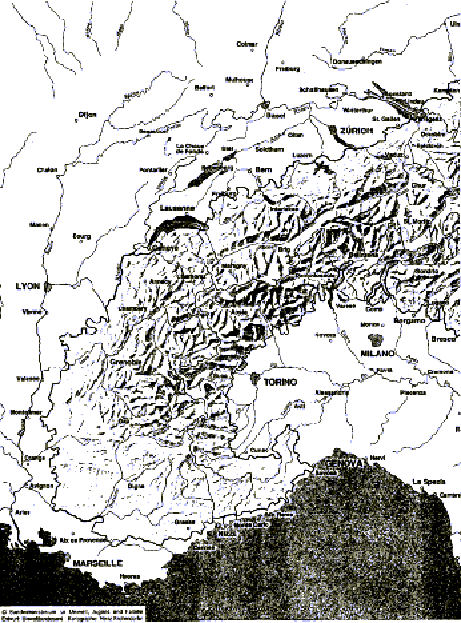
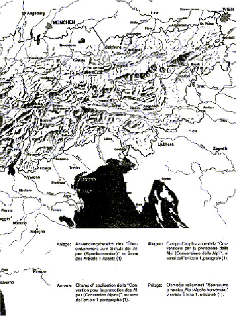

Übereinkommen zum Schutz der Alpen (Alpenkonvention) Abgeschlossen in Salzburg am 7. November 1991 Zustimmung des Landtags: 21. April 1994 Inkrafttreten für das Fürstentum Liechtenstein: 6. März 1995 Die Bundesrepublik Deutschland, die Französische Republik, die Italienische Republik, die Republik Slowenien, das Fürstentum Liechtenstein, die Republik Österreich, die Schweizerische Eidgenossenschaft sowie die Europäische Wirtschaftsgemeinschaft - im Bewusstsein, dass die Alpen einer der grössten zusammenhängenden Naturräume Europas und ein durch seine spezifische und vielfältige Natur, Kultur und Geschichte ausgezeichneter Lebens-, Wirtschafts-, Kultur- und Erholungsraum im Herzen Europas sind, an dem zahlreiche Völker und Länder teilhaben, in der Erkenntnis, dass die Alpen Lebens- und Wirtschaftsraum für die einheimische Bevölkerung sind und auch grösste Bedeutung für ausseralpine Gebiete haben, unter anderem als Träger bedeutender Verkehrswege, in Anerkennung der Tatsache, dass die Alpen unverzichtbarer Rückzugs- und Lebensraum vieler gefährdeter Pflanzen- und Tierarten sind, im Bewusstsein der grossen Unterschiede in den einzelnen Rechtsordnungen, den naturräumlichen Gegebenheiten, der Besiedlung, der Land- und Forstwirtschaft, dem Stand und der Entwicklung der Wirtschaft, der Verkehrsbelastung sowie der Art und Intensität der touristischen Nutzung, in Kenntnis der Tatsache, dass die ständig wachsende Beanspruchung durch den Menschen den Alpenraum und seine ökologischen Funktionen in zunehmendem Masse gefährdet und dass Schäden nicht oder nur mit hohem Aufwand, beträchtlichen Kosten und in der Regel nur in grossen Zeiträumen behoben werden können, in der Überzeugung, dass wirtschaftliche Interessen mit den ökologischen Erfordernissen in Einklang gebracht werden müssen, - sind im Gefolge der Ergebnisse der ersten Alpenkonferenz der Umweltminister vom 9. bis 11. Oktober 1989 in Berchtesgaden wie folgt übereingekommen: Art. 1 Anwendungsbereich 1) Gegenstand dieses Übereinkommens ist das Gebiet der Alpen, wie es in der Anlage beschrieben und dargestellt ist. 2) Jede Vertragspartei kann bei der Hinterlegung ihrer Ratifikations-, Annahme- oder Genehmigungsurkunde oder jederzeit danach durch eine an die Republik Österreich als Verwahrer gerichtete Erklärung die Anwendung dieses Übereinkommens auf weitere Teile ihres Hoheitsgebiets erstrecken, sofern dies für die Vollziehung der Bestimmungen dieses Übereinkommens als erforderlich angesehen wird. 3) Jede nach Abs. 2 abgegebene Erklärung kann in Bezug auf jedes darin genannte Hoheitsgebiet durch eine an den Verwahrer gerichtete Notifikation zurückgenommen werden. Die Zurücknahme wird am ersten Tag des Monats wirksam, der auf einen Zeitabschnitt von sechs Monaten nach Eingang der Notifikation beim Verwahrer folgt. Art. 2 Allgemeine Verpflichtungen 1) Die Vertragsparteien stellen unter Beachtung des Vorsorge-, des Verursacher- und des Kooperationsprinzips eine ganzheitliche Politik zur Erhaltung und zum Schutz der Alpen unter ausgewogener Berücksichtigung der Interessen aller Alpenstaaten, ihrer alpinen Regionen sowie der Europäischen Wirtschaftsgemeinschaft unter umsichtiger und nachhaltiger Nutzung der Ressourcen sicher. Die grenzüberschreitende Zusammenarbeit für den Alpenraum wird verstärkt sowie räumlich und fachlich erweitert. 2) Zur Erreichung des in Abs. 1 genannten Zieles werden die Vertragsparteien geeignete Massnahmen insbesondere auf folgenden Gebieten ergreifen: a) Bevölkerung und Kultur - mit dem Ziel der Achtung, Erhaltung und Förderung der kulturellen und gesellschaftlichen Eigenständigkeit der ansässigen Bevölkerung und der Sicherstellung ihrer Lebensgrundlagen, namentlich der umweltverträglichen Besiedlung und wirtschaftlichen Entwicklung sowie der Förderung des gegenseitigen Verständnisses und partnerschaftlichen Verhaltens zwischen alpiner und ausseralpiner Bevölkerung, b) Raumplanung - mit dem Ziel der Sicherung einer sparsamen und rationellen Nutzung und einer gesunden, harmonischen Entwicklung des Gesamtraumes unter besonderer Beachtung der Naturgefahren, der Vermeidung von Über- und Unternutzungen sowie der Erhaltung oder Wiederherstellung von natürlichen Lebensräumen durch umfassende Klärung und Abwägung der Nutzungsansprüche, vorausschauende integrale Planung und Abstimmung der daraus resultierenden Massnahmen, c) Luftreinhaltung - mit dem Ziel der drastischen Verminderung von Schadstoffemissionen und Schadstoffbelastungen im Alpenraum und der Schadstoffverfrachtung von aussen, auf ein Mass, das für Menschen, Tiere und Pflanzen nicht schädlich ist, d) Bodenschutz - mit dem Ziel der Verminderung der quantitativen und qualitativen Bodenbeeinträchtigungen, insbesondere durch Anwendung bodenschonender land- und forstwirtschaftlicher Produktionsverfahren, sparsamen Umgang mit Grund und Boden, Eindämmung von Erosion sowie durch Beschränkung der Versiegelung von Böden, e) Wasserhaushalt - mit dem Ziel, gesunde Wassersysteme zu erhalten oder wiederherzustellen, insbesondere durch die Reinhaltung der Gewässer, durch naturnahen Wasserbau und durch eine Nutzung der Wasserkraft, die die Interessen der ansässigen Bevölkerung und das Interesse an der Erhaltung der Umwelt gleichermassen berücksichtigt, f) Naturschutz und Landschaftspflege - mit dem Ziel, Natur und Landschaft so zu schützen, zu pflegen und, soweit erforderlich, wiederherzustellen, dass die Funktionsfähigkeit der Ökosysteme, die Erhaltung der Tier- und Pflanzenwelt einschliesslich ihrer Lebensräume, die Regenerationsfähigkeit und nachhaltige Leistungsfähigkeit der Naturgüter sowie die Vielfalt, Eigenart und Schönheit der Natur und Landschaft in ihrer Gesamtheit dauerhaft gesichert werden, g) Berglandwirtschaft - mit dem Ziel, im Interesse der Allgemeinheit die Bewirtschaftung der traditionellen Kulturlandschaften und eine standortgerechte, umweltverträgliche Landwirtschaft zu erhalten und unter Berücksichtigung der erschwerten Wirtschaftsbedingungen zu fördern, h) Bergwald - mit dem Ziel Erhaltung, Stärkung und Wiederherstellung der Waldfunktionen, insbesondere der Schutzfunktion durch Verbesserung der Widerstandskraft der Waldökosysteme, namentlich mittels einer naturnahen Waldbewirtschaftung und durch die Verhinderung waldschädigender Nutzungen unter Berücksichtigung der erschwerten Wirtschaftsbedingungen im Alpenraum, i) Tourismus und Freizeit - mit dem Ziel, unter der Einschränkung umweltschädigender Aktivitäten, die touristischen und Freizeitaktivitäten mit den ökologischen und sozialen Erfordernissen in Einklang zu bringen, insbesondere durch Festlegung von Ruhezonen, j) Verkehr - mit dem Ziel, Belastungen und Risiken im Bereich des inneralpinen und alpenquerenden Verkehrs auf ein Mass zu senken, das für Menschen, Tiere und Pflanzen sowie deren Lebensräume erträglich ist, unter anderem durch eine verstärkte Verlagerung des Verkehrs, insbesondere des Güterverkehrs, auf die Schiene, vor allem durch Schaffung geeigneter Infrastrukturen und marktkonformer Anreize, ohne Diskriminierung aus Gründen der Nationalität, k) Energie - mit dem Ziel, eine natur- und landschaftsschonende sowie umweltverträgliche Erzeugung, Verteilung und Nutzung der Energie durchzusetzen und energiesparende Massnahmen zu fördern, l) Abfallwirtschaft - mit dem Ziel, unter besonderer Berücksichtigung der Abfallvermeidung eine den besonderen topographischen, geologischen und klimatischen Bedürfnissen des Alpenraumes angepasste Abfallerfassung, Abfallverwertung und Abfallentsorgung sicherzustellen. 3) Die Vertragsparteien vereinbaren Protokolle, in denen Einzelheiten zur Durchführung dieses Übereinkommens festgelegt werden. Art. 3 Forschung und systematische Beobachtung Die Vertragsparteien vereinbaren, auf den in Art. 2 genannten Gebieten, a) Forschungsarbeiten und wissenschaftliche Bewertungen durchzuführen und dabei zusammenzuarbeiten, b) gemeinsame oder einander ergänzende Programme zur systematischen Beobachtung zu entwickeln, c) Forschung und Beobachtung sowie die dazugehörige Datenerfassung zu harmonisieren. Art. 4 Zusammenarbeit im rechtlichen, wissenschaftlichen, wirtschaftlichen und technischen Bereich 1) Die Vertragsparteien erleichtern und fördern den Austausch rechtlicher, wissenschaftlicher, wirtschaftlicher und technischer Informationen, die für dieses Übereinkommen erheblich sind. 2) Die Vertragsparteien informieren einander zur grösstmöglichen Berücksichtigung grenzüberschreitender und regionaler Erfordernisse über geplante, juristische oder wirtschaftliche Massnahmen, von denen besondere Auswirkungen auf den Alpenraum oder Teile desselben zu erwarten sind. 3) Die Vertragsparteien arbeiten mit internationalen staatlichen und nichtstaatlichen Organisationen soweit erforderlich zusammen, um das Übereinkommen und die Protokolle, deren Vertragspartei sie sind, wirksam durchzuführen. 4) Die Vertragsparteien sorgen in geeigneter Weise für eine regelmässige Information der Öffentlichkeit über die Ergebnisse von Forschungen, Beobachtungen und getroffene Massnahmen. 5) Die Verpflichtungen der Vertragsparteien aus diesem Übereinkommen im Informationsbereich gelten vorbehaltlich der nationalen Gesetze über die Vertraulichkeit. Vertraulich bezeichnete Informationen müssen als solche behandelt werden. Art. 5 Konferenz der Vertragsparteien (Alpenkonferenz) 1) Die gemeinsamen Anliegen der Vertragsparteien und ihre Zusammenarbeit sind Gegenstand regelmässig stattfindender Tagungen der Konferenz der Vertragsparteien (Alpenkonferenz). Die erste Tagung der Alpenkonferenz wird spätestens ein Jahr nach Inkrafttreten dieses Übereinkommens durch eine einvernehmlich zu bestimmende Vertragspartei einberufen. 2) Danach finden in der Regel alle zwei Jahre ordentliche Tagungen der Alpenkonferenz bei der Vertragspartei statt, die den Vorsitz führt. Vorsitz und Sitz wechseln nach jeder ordentlichen Tagung der Alpenkonferenz. Beides wird von der Alpenkonferenz festgelegt. 3) Die vorsitzführende Vertragspartei schlägt jeweils die Tagesordnung für die Tagung der Alpenkonferenz vor. Jede Vertragspartei hat das Recht, weitere Punkte auf die Tagesordnung setzen zu lassen. 4) Die Vertragsparteien übermitteln der Alpenkonferenz Informationen über die von ihnen zur Durchführung dieses Übereinkommens und der Protokolle, deren Vertragspartei sie sind, getroffenen Massnahmen, vorbehaltlich der nationalen Gesetze über die Vertraulichkeit. 5) Die Vereinten Nationen, ihre Sonderorganisationen, der Europarat sowie jeder europäische Staat können auf den Tagungen der Alpenkonferenz als Beobachter teilnehmen. Das gleiche gilt für grenzüberschreitende Zusammenschlüsse alpiner Gebietskörperschaften. Die Alpenkonferenz kann ausserdem einschlägig tätige internationale nichtstaatliche Organisationen als Beobachter zulassen. 6) Eine ausserordentliche Tagung der Alpenkonferenz findet statt, wenn sie von ihr beschlossen oder wenn es zwischen zwei Tagungen von einem Drittel der Vertragsparteien bei der vorsitzführenden Vertragspartei schriftlich beantragt wird. Art. 6 Aufgaben der Alpenkonferenz Die Alpenkonferenz prüft auf ihren Tagungen die Durchführung des Übereinkommens sowie der Protokolle samt Anlagen und nimmt auf ihren Tagungen insbesondere folgende Aufgaben wahr: a) sie beschliesst Änderungen des Übereinkommens im Rahmen des Verfahrens des Art. 10; b) sie beschliesst Protokolle und deren Anlagen sowie deren Änderungen im Rahmen des Verfahrens des Art. 11; c) sie beschliesst ihre Geschäftsordnung; d) sie trifft die notwendigen finanziellen Entscheidungen; e) sie beschliesst die Einrichtung von zur Durchführung des Übereinkommens für notwendig erachteten Arbeitsgruppen; f) sie nimmt die Auswertung wissenschaftlicher Informationen zur Kenntnis; g) sie beschliesst oder empfiehlt Massnahmen zur Verwirklichung der in Art. 3 und Art. 4 vorgesehenen Ziele, legt Form, Gegenstand und Zeitabstände für die Übermittlung der nach Art. 5 Abs. 4 vorzulegenden Informationen fest und nimmt diese Informationen sowie die von den Arbeitsgruppen vorgelegten Berichte zur Kenntnis; h) sie stellt die Durchführung der notwendigen Sekretariatsarbeiten sicher. Art. 7 Beschlussfassung in der Alpenkonferenz 1) Soweit im folgenden nichts anderes bestimmt ist, fasst die Alpenkonferenz ihre Beschlüsse mit Einstimmigkeit. Sind hinsichtlich der in Art. 6 Bst. c, f und g genannten Aufgaben alle Bemühungen um eine Einstimmigkeit erschöpft und stellt der Vorsitzende dies ausdrücklich fest, so wird der Beschluss mit Dreiviertelmehrheit der auf der Sitzung anwesenden und abstimmenden Vertragsparteien gefasst. 2) In der Alpenkonferenz hat jede Vertragspartei eine Stimme. In ihrem Zuständigkeitsbereich übt die Europäische Wirtschaftsgemeinschaft ihr Stimmrecht mit einer Stimmenzahl aus, die der Anzahl ihrer Mitgliedstaaten entspricht, die Vertragsparteien dieses Übereinkommens sind; die Europäische Wirtschaftsgemeinschaft übt ihr Stimmrecht nicht aus, wenn die betreffenden Mitgliedstaaten ihr Stimmrecht ausüben. Art. 8 Ständiger Ausschuss 1) Ein Ständiger Ausschuss der Alpenkonferenz, der aus den Delegierten der Vertragsparteien besteht, wird als ausführendes Organ eingerichtet. 2) Unterzeichnerstaaten, welche die Konvention noch nicht ratifiziert haben, haben in den Sitzungen des Ständigen Ausschusses Beobachterstatus. Dieser kann darüberhinaus jedem Alpenstaat, der diese Konvention noch nicht unterzeichnet hat, auf Antrag gewährt werden. 3) Der Ständige Ausschuss beschliesst seine Geschäftsordnung. 4) Der Ständige Ausschuss bestimmt ausserdem über die Modalitäten der allfälligen Teilnahme von Vertretern staatlicher und nichtstaatlicher Organisationen an seinen Sitzungen. 5) Die in der Alpenkonferenz vorsitzführende Vertragspartei stellt den Vorsitz im Ständigen Ausschuss. 6) Der Ständige Ausschuss nimmt insbesondere folgende Aufgaben wahr: a) er sichtet die von den Vertragsparteien übermittelten Informationen gemäss Art. 5 Abs. 4 zur Berichterstattung an die Alpenkonferenz; b) er sammelt und bewertet Unterlagen im Hinblick auf die Durchführung des Übereinkommens sowie der Protokolle samt Anlagen und legt sie der Alpenkonferenz gemäss Art. 6 zur Überprüfung vor; c) er unterrichtet die Alpenkonferenz über die Durchführung ihrer Beschlüsse; d) er bereitet inhaltlich die Tagungen der Alpenkonferenz vor und kann Tagesordnungspunkte sowie sonstige Massnahmen betreffend die Durchführung des Übereinkommens und seiner Protokolle vorschlagen; e) er setzt entsprechend Art. 6 Bst. e Arbeitsgruppen für die Erarbeitung von Protokollen und Empfehlungen ein und koordiniert deren Tätigkeit; f) er überprüft und harmonisiert Inhalte von Protokollentwürfen unter ganzheitlichen Aspekten und schlägt sie der Alpenkonferenz vor; g) er schlägt Massnahmen und Empfehlungen zur Verwirklichung der in dem Übereinkommen und den Protokollen enthaltenen Ziele der Alpenkonferenz vor. 7) Die Beschlussfassung im Ständigen Ausschuss erfolgt entsprechend den Bestimmungen des Art. 7. Art. 9 Sekretariat Die Alpenkonferenz kann die Errichtung eines ständigen Sekretariates mit Einstimmigkeit beschliessen. Art. 10 Änderungen des Übereinkommens Jede Vertragspartei kann der in der Alpenkonferenz vorsitzführenden Vertragspartei Vorschläge für Änderungen dieses Übereinkommens unterbreiten. Solche Vorschläge werden von der in der Alpenkonferenz vorsitzführenden Vertragspartei mindestens sechs Monate vor Beginn der Tagung der Alpenkonferenz, die sich mit ihnen befassen wird, den Vertragsparteien und Unterzeichnerstaaten übermittelt. Die Änderungen des Übereinkommens treten gemäss Abs. 2, 3 und 4 des Art. 12 in Kraft. Art. 11 Protokolle und ihre Änderung 1) Protokollentwürfe im Sinne des Art. 2 Abs. 3 werden von der in der Alpenkonferenz vorsitzführenden Vertragspartei mindestens sechs Monate vor Beginn der Tagung der Alpenkonferenz, die sich mit ihnen befassen wird, den Vertragsparteien und Unterzeichnerstaaten übermittelt. 2) Die von der Alpenkonferenz beschlossenen Protokolle werden anlässlich ihrer Tagungen oder danach beim Verwahrer unterzeichnet. Sie treten für diejenigen Vertragsparteien in Kraft, die sie ratifiziert, angenommen oder genehmigt haben. Für das Inkrafttreten eines Protokolls sind mindestens drei Ratifikationen, Annahmen oder Genehmigungen erforderlich. Die betreffenden Urkunden werden bei der Republik Österreich als Verwahrer hinterlegt. 3) Soweit im Protokoll nichts anderes vorgesehen ist, gelten für das Inkrafttreten und die Kündigung eines Protokolls die Art. 10, 13 und 14 sinngemäss. 4) Für Änderungen der Protokolle gelten entsprechend die Abs. 1 bis 3. Art. 12 Unterzeichnung und Ratifizierung 1) Dieses Übereinkommen liegt ab dem 7. November 1991 bei der Republik Österreich als Verwahrer zur Unterzeichnung auf. 2) Das Übereinkommen bedarf der Ratifikation, Annahme oder Genehmigung. Die Ratifikations-, Annahme- oder Genehmigungsurkunden werden beim Verwahrer hinterlegt. 3) Das Übereinkommen tritt drei Monate nach dem Tag in Kraft, nachdem drei Staaten ihre Zustimmung gemäss Abs. 2 ausgedrückt haben, durch das Übereinkommen gebunden zu sein. 4) Für jeden Unterzeichnerstaat, der später seine Zustimmung gemäss Abs. 2 ausdrückt, durch das Übereinkommen gebunden zu sein, tritt es drei Monate nach Hinterlegung der Ratifikations-, Annahme- oder Genehmigungsurkunde in Kraft. Art. 13 Kündigung 1) Jede Vertragspartei kann dieses Übereinkommen jederzeit durch eine an den Verwahrer gerichtete Notifikation kündigen. 2) Die Kündigung wird am ersten Tag des Monats wirksam, der auf einen Zeitabschnitt von sechs Monaten nach Eingang der Notifikation beim Verwahrer folgt. Art. 14 Notifikationen Der Verwahrer notifiziert den Vertragsparteien und Unterzeichnerstaaten: a) jede Unterzeichnung; b) jede Hinterlegung einer Ratifikations-, Annahme- oder Genehmigungsurkunde; c) jeden Zeitpunkt des Inkrafttretens dieses Übereinkommens nach Art. 12; d) jede nach Art. 1 Abs. 2 und 3 abgegebene Erklärung; e) jede nach Art. 13 vorgenommene Notifikation und den Zeitpunkt, zu dem die Kündigung wirksam wird. Zu Urkund dessen haben die hiezu gehörig befugten Unterzeichneten dieses Übereinkommen unterschrieben. Geschehen zu Salzburg, am 7. November 1991, in deutscher, französischer, italienischer und slowenischer Sprache, wobei jeder Wortlaut gleichermassen verbindlich ist, in einer Urschrift, die im Staatsarchiv der Republik Österreich hinterlegt wird. Der Verwahrer übermittelt den Unterzeichnerstaaten beglaubigte Abschriften. (Es folgen die Unterschriften) Anlage Gebiet der Alpen (Anwendungsbereich gemäss Art. 1 Abs. 1) 

 

