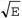

Abkommen zwischen dem Fürstentum Liechtenstein und der Internationalen Atomenergie-Organisation über die Anwendung von Sicherungsmassnahmen im Rahmen des Vertrages über die Nichtverbreitung von Kernwaffen Abgeschlossen in Wien am 6. September 1978 Zustimmung des Landtags: 26. September 1979 Inkrafttreten für das Fürstentum Liechtenstein: 4. Oktober 1979 Im Hinblick darauf, dass das Fürstentum Liechtenstein (im folgenden Liechtenstein genannt) Vertragspartei des Vertrages über die Nichtverbreitung von Kernwaffen (im folgenden "Vertrag" genannt) ist, der am 1. Juli 1968 in London, Moskau und Washington zur Unterzeichnung aufgelegt wurde und am 5. März 1970 in Kraft getreten ist; im Hinblick darauf, dass Abs. 1 des Art. III des erwähnten Vertrages wie folgt lautet: "Jeder Nichtkernwaffenstaat, der Vertragspartei ist, verpflichtet sich, Sicherungsmassnahmen anzunehmen, wie sie in einer mit der Internationalen Atomenergie-Organisation nach Massgabe ihrer Satzung und ihres Sicherungssystems auszuhandelnden und zu schliessenden Übereinkunft festgelegt werden, wobei diese Sicherungsmassnahmen ausschliesslich dazu dienen, die Erfüllung seiner Verpflichtungen aus diesem Vertrag nachzuprüfen, damit verhindert wird, dass Kernenergie von der friedlichen Nutzung abgezweigt und für Kernwaffen oder sonstige Kernsprengkörper verwendet wird. Die Verfahren für die nach diesem Artikel erforderlichen Sicherungsmassnahmen werden in bezug auf Ausgangs- oder besonders spaltbares Material durchgeführt, gleichviel ob es in einer Hauptkernanlage hergestellt, verarbeitet oder verwendet wird oder sich ausserhalb einer solchen Anlage befindet. Die nach diesem Artikel erforderlichen Sicherungsmassnahmen finden Anwendung auf alles Ausgangs- und besondere spaltbare Material, bei allen friedlichen nuklearen Tätigkeiten, die im Hoheitsgebiet dieses Staates, unter seiner Hoheitsgewalt oder unter seiner Kontrolle an irgendeinem Ort durchgeführt werden." im Hinblick darauf, dass die Internationale Atomenergie-Organisation (im folgenden "Organisation" genannt) nach Artikel III ihrer Statuten zum Abschluss solcher Abkommen berechtigt ist; kommen Liechtenstein und die Organisation wie folgt überein: Teil I Grundlegende Verpflichtung Art. 1 Liechtenstein verpflichtet sich im Sinne von Art. III Abs. 1 des Vertrages zur Annahme von Sicherungsmassnahmen, die den Bestimmungen des vorliegenden Abkommens entsprechen, in bezug auf sämtliches Ausgangs- oder besondere spaltbare Material im Rahmen aller friedlichen nuklearen Tätigkeiten, die innerhalb seines Hoheitsgebietes, unter seiner Hoheitsgewalt oder unter seiner Kontrolle an irgendeinem Ort durchgeführt werden, wobei ausschliesslich der Zweck verfolgt wird nachzuprüfen, dass solche Materialien nicht für Kernwaffen oder sonstige Kernsprengkörper abgezweigt werden. Anwendung der Sicherungsmassnahmen Art. 2 Die Organisation hat das Recht und die Pflicht, sicherzustellen, dass gemäss den Bestimmungen des vorliegenden Abkommens Sicherungsmassnahmen in bezug auf sämtliches Ausgangs- oder besondere spaltbare Material im Rahmen aller friedlichen nuklearen Tätigkeiten angewendet werden, die innerhalb des Hoheitsgebietes Liechtensteins, in seiner Hoheitsgewalt oder unter seiner Kontrolle an irgendeinem Ort durchgeführt werden, wobei ausschliesslich der Zweck verfolgt wird, sich zu vergewissern, dass solches Material nicht für Kernwaffen oder sonstige Kernsprengkörper abgezweigt wird. Zusammenarbeit zwischen Liechtenstein und der Organisation Art. 3 Liechtenstein und die Organisation werden zur Erleichterung der Durchführung der in diesem Abkommen vorgesehenen Sicherungsmassnahmen zusammenarbeiten. Durchführung der Sicherungsmassnahmen Art. 4 Die in diesem Abkommen vorgesehenen Sicherungsmassnahmen sind derart durchzuführen, dass a) eine Beeinträchtigung der wirtschaftlichen und technologischen Entwicklung Liechtensteins oder der internationalen Zusammenarbeit auf dem Gebiete der friedlichen Verwendung der Kernenergie, einschliesslich des internationalen Austausches von Kernmaterial, vermieden wird; b) eine ungebührliche Einmischung in die friedlichen nuklearen Tätigkeiten Liechtensteins und insbesondere in den Betrieb von Anlagen vermieden wird und c) sie mit der für die wirtschaftliche und betriebssichere Ausübung nuklearer Tätigkeiten erforderlichen umsichtigen Betriebsführung vereinbar sind. Art. 5 a) Die Organisation hat jede Vorsichtsmassnahme zu ergreifen, um Geschäfts- und Industriegeheimnisse sowie andere vertrauliche Informationen, die ihr bei der Durchführung dieses Abkommens zur Kenntnis gelangen, zu schützen. b) i) Die Organisation darf keine Informationen, die sie im Zusammenhang mit der Durchführung dieses Abkommens erhält, veröffentlichen oder an irgendeinen Staat, eine Organisation oder Person weitergeben. Ausgenommen sind spezifische Informationen betreffend die Durchführung des Abkommens, welche dem Gouverneursrat der Organisation (im folgenden "Rat" genannt) sowie jenen Mitarbeitern der Organisation mitgeteilt werden dürfen, die aufgrund ihrer mit den Sicherungsmassnahmen zusammenhängenden amtlichen Aufgaben solche Kenntnisse benötigen. Doch darf dies nur in dem Masse geschehen, als es für die Organisation zur Wahrnehmung ihrer Verpflichtungen bezüglich der Durchführung dieses Abkommens nötig ist. ii) Zusammengefasste Informationen über Kernmaterial, das gemäss diesem Abkommen den Sicherungsmassnahmen unterstellt ist, können auf Beschluss des Rates veröffentlicht werden, wenn der direkt betroffene Staat seine Zustimmung erteilt. Art. 6 a) Bei der Anwendung der Sicherungsmassnahmen gemäss diesem Abkommen hat die Organisation die technologischen Fortschritte auf dem Gebiet der Sicherungsmassnahmen voll zu berücksichtigen und alles zu unternehmen, um optimale Kostenwirtschaftlichkeit zu erreichen, und die Anwendung des Grundsatzes der wirksamen Kontrolle des Flusses des nach diesem Abkommen den Sicherungsmassnahmen unterstellten Kernmaterials durch Verwendung von Instrumenten und anderen technischen Verfahren an bestimmten strategischen Punkten, soweit dies die gegenwärtigen oder künftigen technologischen Möglichkeiten zulassen, sicherzustellen. b) Um optimale Kostenwirtschaftlichkeit zu gewährleisten, sind Mittel, wie beispielsweise die folgenden, einzusetzen: i) Räumliche Begrenzung als Mittel der Festlegung von Materialbilanzzonen zu Buchungszwecken, ii) statistische Verfahren und Entnahme von Stichproben bei der Auswertung des Flusses von Kernmaterial und iii) Konzentration der Nachprüfungsverfahren auf jene Stadien des Kernbrennstoffkreislaufes, die die Erzeugung, Verarbeitung, Verwendung oder Lagerung von Kernmaterial zum Inhalt haben, und von welchem ausgehend Kernwaffen oder sonstige Kernsprengkörper leicht hergestellt werden könnten; ferner Verminderung der Nachprüfungsverfahren für anderes Kernmaterial auf ein Mindestmass, vorausgesetzt, dass dadurch die Organisation bei der Anwendung der Sicherungsmassnahmen gemäss diesem Abkommen nicht behindert wird. Nationales Materialkontrollsystem Art. 7 a) Liechtenstein hat ein System für die buchmässige Erfassung und Kontrolle sämtlicher nach diesem Abkommen den Sicherungsmassnahmen unterstellten Kernmaterialien zu errichten und aufrechtzuerhalten. b) Die Organisation hat die Sicherungsmassnahmen so anzuwenden, dass sie bei ihrer Aufgabe sich zu vergewissern, dass keine Abzweigung von Kernmaterial von friedlicher Verwendung zu Kernwaffen oder sonstigen Kernsprengkörpern stattgefunden hat, in der Lage ist, Befunde des liechtensteinischen Systems nachzuprüfen. Die Nachprüfung durch die Organisation hat u.a. unabhängige Messungen und Beobachtungen zu umfassen, die von der Organisation nach den in Teil II dieses Abkommens festgelegten Verfahren durchzuführen sind. Bei der Nachprüfung hat die Organisation die technische Leistungsfähigkeit des liechtensteinischen Systems gebührend zu berücksichtigen. Auskünfte zuhanden der Organisation Art. 8 a) Um die wirksame Durchführung von Sicherungsmassnahmen gemäss diesem Abkommen sicherzustellen, hat Liechtenstein, im Einklang mit den in Teil II dieses Abkommens enthaltenen Bestimmungen, der Organisation Informationen über Kernmaterial, das gemäss diesem Abkommen den Sicherungsmassnahmen unterstellt ist, sowie über die für die Kontrolle solcher Materialien wesentlichen Merkmale von Anlagen zur Verfügung zu stellen. b) i) Die Organisation darf nur jenes Mindestmass an Informationen und Daten verlangen, das mit der Erfüllung ihrer Verpflichtungen gemäss diesem Abkommen in Einklang steht. ii) Informationen über Anlagen sind auf das Mindestmass zu beschränken, das zur Kontrolle von Kernmaterial, welches gemäss diesem Abkommen den Sicherungsmassnahmen untersteht, notwendig ist. c) Auf Verlangen Liechtensteins hat die Organisation bereit zu sein, darstellende Informationen, welche Liechtenstein als besonders geheimhaltungswürdig betrachtet, an Ort und Stelle in Liechtenstein zu prüfen. Solche Informationen brauchen der Organisation nicht in physischer Form übermittelt zu werden, vorausgesetzt, dass sie an Ort und Stelle in Liechtenstein für weitere Überprüfungen durch die Organisation jederzeit zugänglich bleiben. Inspektoren der Organisation Art. 9 a) i) Für die Bestellung von Inspektoren der Organisation für Liechtenstein hat die Organisation die Zustimmung Liechtensteins einzuholen. ii) Erhebt Liechtenstein, sei es anlässlich des Bestellungsvorschlages oder zu irgendeinem Zeitpunkt nach erfolgter Bestellung, gegen die Bestellung einen Einwand, so hat die Organisation Liechtenstein eine oder mehrere Alternativbestellungen vorzuschlagen. iii) Falls infolge der wiederholten Weigerung Liechtensteins, der Bestellung von Inspektoren der Organisation zuzustimmen, die gemäss diesem Abkommen durchzuführenden Inspektionen behindert würden, so ist eine solche Weigerung auf Antrag des Generaldirektors der Organisation (im folgenden "Generaldirektor" genannt) vom Rat zwecks Ergreifung geeigneter Massnahmen zu erörtern. b) Liechtenstein hat die nötigen Schritte zu unternehmen, um sicherzustellen, dass die Inspektoren der Organisation die ihnen durch dieses Abkommen übertragenen Aufgaben in wirksamer Weise erfüllen können. c) Die Besuche und Tätigkeiten der Inspektoren der Organisation sind so einzurichten, dass i) die möglichen Ungelegenheiten und Störungen für Liechtenstein und für die inspizierten friedlichen nuklearen Tätigkeiten auf ein Mindestmass herabgesetzt werden und ii) der Schutz von Industriegeheimnissen und anderen den Inspektoren zur Kenntnis gelangenden vertraulichen Informationen gesichert ist. Privilegien und Immunitäten Art. 10 Liechtenstein wendet auf die Organisation (namentlich ihre Vermögenswerte, Geldmittel und Guthaben) und auf ihre Inspektoren und sonstigen Beamten, die Aufgaben aufgrund dieses Abkommens erfüllen, die einschlägigen Bestimmungen der Vereinbarung über Privilegien und Immunitäten der Internationalen Atomenergie-Organisation an. Beendigung der Sicherungsmassnahmen Art. 11 Verbrauch oder Verdünnung von Kernmaterial Die Sicherungsmassnahmen in bezug auf Kernmaterial enden, sobald die Organisation festgestellt hat, dass das Material verbraucht oder in solcher Weise verdünnt wurde, die es vom Standpunkt der Sicherungsmassnahmen für jede nukleare Tätigkeit unbrauchbar macht, oder dass es praktisch nicht rückgewinnbar geworden ist. Art. 12 Transfer von Kernmaterial aus Liechtenstein Liechtenstein hat der Organisation im Einklang mit den in Teil II dieses Abkommens enthaltenen Bestimmungen Transfers von gemäss diesem Abkommen den Sicherungsmassnahmen unterliegendem Kernmaterial aus Liechtenstein im voraus anzukündigen. Die Organisation hat die aufgrund dieses Abkommens durchgeführten Sicherungsmassnahmen in bezug auf Kernmaterial zu beenden, sobald der Empfängerstaat, wie in Teil II dieses Abkommens vorgesehen, die Verantwortung für das Material übernommen hat. Die Organisation hat Aufzeichnungen zu führen, aus denen jeder Transfer sowie gegebenenfalls die Wiederanwendung der Sicherungsmassnahmen auf das transferierte Kernmaterial hervorgeht. Art. 13 Bestimmungen über Kernmaterial, das zur Verwendung bei nichtnuklearen Tätigkeiten vorgesehen ist Soll Kernmaterial, das gemäss diesem Abkommen den Sicherungsmassnahmen unterstellt ist, bei nichtnuklearen Tätigkeiten, wie der Erzeugung von Legierungen oder keramischen Stoffen, verwendet werden, so hat Liechtenstein vor einer solchen Verwendung des Materials mit der Organisation die Umstände zu vereinbaren, unter denen die Sicherungsmassnahmen in bezug auf solches Material beendet werden können. Nichtanwendung der Sicherungsmassnahmen auf Kernmaterial, das zur Verwendung bei nichtnuklearen Tätigkeiten vorgesehen ist Art. 14 Beabsichtigt Liechtenstein, von seinem Recht Gebrauch zu machen und Kernmaterial, das aufgrund dieses Abkommens den Sicherungsmassnahmen unterstellt werden muss, bei einer nuklearen Tätigkeit zu verwenden, die eine Anwendung der Sicherungsmassnahmen nach diesem Abkommen nicht erfordert, so sind folgende Verfahren einzuhalten: a) Liechtenstein hat der Organisation von der Tätigkeit Mitteilung zu machen, wobei klarzustellen ist, i) dass die Verwendung des Kernmaterials bei einer nichtverbotenen militärischen Tätigkeit mit keiner von Liechtenstein abgegebenen und in die Sicherungsmassnahmen der Organisation einbezogenen Verpflichtung, das Material nur für friedliche nukleare Tätigkeiten zu verwenden, im Widerspruch stehen wird und ii) dass das Kernmaterial während der Zeit der Nichtanwendung der Sicherungsmassnahmen nicht zur Herstellung von Kernwaffen oder sonstigen Kernsprengkörpern verwendet wird. b) Liechtenstein und die Organisation haben eine Vereinbarung in dem Sinne zu treffen, dass die in diesem Abkommen vorgesehenen Sicherungsmassnahmen nur während der Zeit, in der das Kernmaterial bei einer solchen Tätigkeit in Verwendung steht, nicht angewendet werden. In der Vereinbarung sind nach Möglichkeit die Zeit bzw. die Umstände, während deren die Sicherungsmassnahmen nicht angewendet werden, anzugeben. In jedem Falle treten die in diesem Abkommen vorgesehenen Sicherungsmassnahmen wieder in Kraft, sobald das Kernmaterial erneut einer friedlichen nuklearen Tätigkeit zugeführt wird. Der Organisation sind die Gesamtmenge und die Zusammensetzung solchen in Liechtenstein befindlichen, nicht den Sicherungsmassnahmen unterstellten Materials sowie eine allfällige Ausfuhr desselben bekanntzugeben und c) Jede solche Vereinbarung ist mit der Zustimmung der Organisation zu treffen. Eine solche Zustimmung ist möglichst rasch zu erteilen, hat sich nur auf Angelegenheiten wie u. a. zeitliche und verfahrensmässige Bestimmungen und Vorkehrungen für die Berichterstattung zu beziehen, darf aber keine Genehmigung der militärischen Tätigkeit bzw. vertrauliche Kenntnisse über dieselbe beinhalten und sich nicht auf die Verwendung des Kernmaterials bei der betreffenden Tätigkeit beziehen. Finanzielle Fragen Art. 15 Liechtenstein und die Organisation werden die Kosten tragen, die ihnen bei der Erfüllung ihrer jeweiligen Verpflichtungen im Rahmen dieses Abkommens erwachsen. Wenn jedoch Liechtenstein oder Personen, die seiner Hoheitsgewalt unterstehen, aufgrund eines ausdrücklichen Ersuchens der Organisation ausserordentliche Kosten erwachsen, dann hat die Organisation diese Kosten zu ersetzen, vorausgesetzt, dass sie sich im voraus dazu bereit erklärt hat. In jedem Falle hat die Organisation die Kosten aller von Inspektoren verlangten zusätzlichen Messungen oder Probeentnahmen zu tragen. Haftung gegenüber Dritten bei nuklearen Schäden Art. 16 Liechtenstein hat sicherzustellen, dass jeder Schutz vor der Haftung gegenüber Dritten für nukleare Schäden, einschliesslich allfälliger Versicherungen oder sonstiger finanzieller Sicherstellungen, der nach seinen Gesetzen und Vorschriften gegeben ist, der Organisation und ihren Beamten im Rahmen der Durchführung dieses Abkommens in gleicher Weise zukommt wie liechtensteinischen Staatsangehörigen. Internationale Haftung Art. 17 Jeder Anspruch Liechtensteins gegenüber der Organisation bzw. der Organisation gegenüber Liechtenstein aus einem Schaden, der bei der Durchführung der Sicherungsmassnahmen gemäss diesem Abkommen - jedoch nicht aus einem nuklearen Betriebsunfall - entstanden ist, ist nach den Bestimmungen des Völkerrechts zu regeln. Massnahmen zur Feststellung der Nichtabzweigung Art. 18 Wenn der Rat aufgrund der Berichterstattung durch den Generaldirektor beschliesst, dass eine Massnahme seitens Liechtensteins wesentlich und dringlich ist, um eine Überprüfung zu ermöglichen, dass Kernmaterial, welches gemäss diesem Abkommen den Sicherungsmassnahmen unterstellt ist, nicht für Kernwaffen oder sonstige Kernsprengkörper abgezweigt wurde, kann der Rat Liechtenstein auffordern, die erforderliche Massnahme unverzüglich und ohne Rücksicht darauf zu ergreifen, ob ein Verfahren nach Art. 22 dieses Abkommens zur Beilegung von Streitfällen eingeleitet worden ist. Art. 19 Hat der Rat nach Prüfung der ihm vom Generaldirektor vorgelegten diesbezüglichen Informationen festgestellt, dass die Organisation nicht in der Lage ist zu beglaubigen, dass keine Abzweigung von Kernmaterial, welches nach diesem Abkommen zu kontrollieren ist, für Kernwaffen oder sonstige Kernsprengkörper stattgefunden hat, kann er die in Abs. C des Art. XII der Statuten der Organisation (im folgenden "Statuten" genannt) vorgesehenen Berichte erstatten und, sofern anwendbar, auch die andern in diesem Artikel vorgesehenen Massnahmen ergreifen. Bei diesen Schritten hat der Rat den Grad an Gewissheit zu berücksichtigen, den die angewendeten Sicherungsmassnahmen ergeben haben, und er hat Liechtenstein jede mögliche Gelegenheit zu bieten, dem Rat alle nötigen zusätzlichen Garantien zu verschaffen. Auslegung und Anwendung des Abkommens und Beilegung von Streitigkeiten Art. 20 Liechtenstein und die Organisation werden sich auf Verlangen der jeweils anderen Partei über alle aus der Auslegung oder Anwendung dieses Abkommens entstehenden Fragen konsultieren. Art. 21 Liechtenstein ist berechtigt zu verlangen, dass jede aus der Auslegung oder Anwendung dieses Abkommens entstehende Frage vom Rat behandelt wird. Der Rat lädt Liechtenstein ein, an seiner Erörterung jeder derartigen Frage teilzunehmen. Art. 22 Mit Ausnahme von Meinungsverschiedenheiten bezüglich eines Beschlusses des Rates nach Art. 19 oder einer vom Rat aufgrund eines solchen Beschlusses getroffenen Massnahme, ist jede aus der Auslegung oder Anwendung dieses Abkommens entstehende Streitigkeit, die nicht im Verhandlungswege oder durch ein sonstiges von Liechtenstein und der Organisation vereinbartes Verfahren beigelegt wird, auf Antrag einer der beiden Parteien einem folgendermassen zusammengesetzten Schiedsgericht zu unterbreiten: Liechtenstein und die Organisation bestellen je einen Schiedsrichter, und die zwei so bestellten Schiedsrichter wählen einen dritten, der den Vorsitz führt. Hat innerhalb von 30 Tagen nach dem Antrag auf ein Schiedsverfahren Liechtenstein oder die Organisation keinen Schiedsrichter bestellt, so kann entweder Liechtenstein oder die Organisation den Präsidenten des Internationalen Gerichtshofes ersuchen, einen Schiedsrichter zu ernennen. Das gleiche Verfahren ist anzuwenden, wenn innerhalb von 30 Tagen nach Bestellung oder Ernennung des zweiten Schiedsrichters der dritte Schiedsrichter nicht gewählt worden ist. Bei Anwesenheit der Mehrheit der Mitglieder ist das Schiedsgericht beschlussfähig, und alle Entscheidungen erfordern die Übereinstimmung zweier Schiedsrichter. Das Schiedsverfahren ist vom Schiedsgericht festzulegen. Die Entscheidungen des Schiedsgerichtes sind für Liechtenstein und die Organisation bindend. Änderung des Abkommens Art. 23 a) Liechtenstein und die Organisation haben auf Verlangen der einen oder anderen Vertragspartei Konsultationen über Änderungen dieses Abkommens aufzunehmen. b) Sämtliche Änderungen bedürfen der Zustimmung Liechtensteins und der Organisation. c) Die Änderungen dieses Abkommens treten zu den gleichen Bedingungen in Kraft wie das Abkommen selbst. d) Der Generaldirektor gibt sämtlichen Mitgliedstaaten der Organisation über jede Änderung dieses Abkommens unverzüglich Kenntnis. Inkrafttreten und Dauer Art. 24 Dieses Abkommen tritt zu dem Zeitpunkt in Kraft, zu dem die Organisation von Liechtenstein die schriftliche Mitteilung erhält, dass die in Liechtenstein bestehenden verfassungsmässigen und gesetzlichen Erfordernisse für das Inkrafttreten erfüllt worden sind. Der Generaldirektor hat alle Mitgliedstaaten der Organisation vom Inkrafttreten dieses Abkommens unverzüglich in Kenntnis zu setzen. Art. 25 Dieses Abkommen bleibt in Kraft, solange Liechtenstein Partei des Vertrages ist. Teil II Einleitung Art. 26 Zweck dieses Teils des Abkommens ist es, die bei der Durchführung der Bestimmungen von Teil I anzuwendenden Verfahren näher zu beschreiben. Zweck der Sicherungsmassnahmen Art. 27 Zweck der in diesem Teil des Abkommens behandelten Anwendungsverfahren für die Sicherungsmassnahmen ist die rechtzeitige Entdeckung einer Abzweigung bedeutsamer Mengen von Kernmaterial aus friedlichen nuklearen Tätigkeiten für die Erzeugung von Kernwaffen oder sonstige Kernsprengkörper oder für unbekannte Zwecke, sowie die Abschreckung vor einer solchen Abzweigung durch das Risiko einer frühzeitigen Entdeckung. Art. 28 Zur Erreichung der in Art. 27 angeführten Zwecke ist die Materialbuchhaltung als Sicherungsmassnahme von grundlegender Bedeutung heranzuziehen, verbunden mit der räumlichen Begrenzung und der Überwachung als wichtigen ergänzenden Massnahmen. Art. 29 Den technischen Abschluss der Nachprüfung durch die Organisation bildet eine auf jede Materialbilanzzone bezogene Feststellung der Inventardifferenzen während eines bestimmten Zeitraumes, wobei die Genauigkeitsgrenzen dieser Differenzen anzugeben sind. Nationales System für die buchmässige Erfassung und die Kontrolle von Kernmaterial Art. 30 Im Sinne des obigen Art. 7 hat die Organisation bei der Durchführung ihrer Nachprüfungen das liechtensteinische System für die buchmässige Erfassung und die Kontrolle aller nach diesem Abkommen den Sicherungsmassnahmen unterstellten Kernmaterialien in vollem Masse zu benützen und unnötige Wiederholungen der Buchführungs- und Kontrolltätigkeiten Liechtensteins zu vermeiden. Art. 31 Das liechtensteinische System zur buchmässigen Erfassung und zur Kontrolle aller nach diesem Abkommen den Sicherungsmassnahmen unterstellten Kernmaterialien hat auf einer Gliederung in Materialbilanzzonen zu beruhen und hat gegebenenfalls, gemäss den Bestimmungen der Zusatzvereinbarungen, die Durchführung von Massnahmen der folgenden Art vorzusehen: a) Ein Messsystem für die Bestimmung der Mengen von Kernmaterial, welche erhalten, erzeugt, versandt, verloren oder auf sonstige Weise aus dem Materialbestand entfernt wurden, sowie der im Materialbestand befindlichen Mengen; b) die Bewertung der Genauigkeit und Zuverlässigkeit der Messungen sowie die Schätzung der Messunsicherheit; c) Verfahren zum Erkennen, Überprüfen und Bewerten von Mengendifferenzen zwischen den Messungen des Versenders und des Empfängers; d) Verfahren zur Aufnahme des Materialbestandes; e) Verfahren zur Bewertung von Anhäufungen messmässig nicht erfasster Materialbestände und Verluste; f) ein System von Aufzeichnungen und Berichten, das für jede Materialbilanzzone den Bestand an Kernmaterial und die Veränderungen dieses Bestandes, einschliesslich der Zugänge zur und Transfers aus der Materialbilanzzone nachweist; g) Vorkehrungen, um sicherzustellen, dass die Buchungsverfahren und Buchungseinrichtungen richtig gehandhabt werden, und h) Verfahren zur Übermittlung von Berichten an die Organisation gemäss den Art. 58 bis 68. Ausgangspunkt für die Anwendung der Sicherungsmassnahmen Art. 32 Die Sicherungsmassnahmen im Sinne dieses Abkommens erstrecken sich nicht auf Material im Bergbau oder in der Erzaufarbeitung. Art. 33 a) Wird uran- oder thoriumhaltiges Material, welches noch nicht die in Bst. c unten beschriebene Stufe des Kernbrennstoffzyklus erreicht hat, direkt oder indirekt nach einem Nichtkernwaffenstaat ausgeführt, so hat Liechtenstein die Organisation von dessen Menge, Zusammensetzung und Bestimmungsziel in Kenntnis zu setzen, ausser wenn das Material für spezifisch nichtnukleare Zwecke ausgeführt wird; b) wird uran- oder thoriumhaltiges Material, welches noch nicht die in Bst. c unten beschriebene Stufe des Brennstoffzyklus erreicht hat, eingeführt, so hat Liechtenstein die Organisation von dessen Menge und Zusammensetzung in Kenntnis zu setzen, ausser wenn das Material für spezifisch nichtnukleare Zwecke eingeführt wird, und c) verlässt Kernmaterial von solcher Zusammensetzung und Reinheit, dass es für die Brennstofferzeugung oder die Isotopenanreicherung geeignet ist, die Anlage oder die Prozessstufe, in der es erzeugt wurde, oder wird solches Kernmaterial oder irgendwelches andere Kernmaterial, das in einem späteren Stadium des Brennstoffzyklus erzeugt wurde, in Liechtenstein eingeführt, so fällt das Kernmaterial unter die in diesem Abkommen angeführten anderen Sicherungsverfahren. Beendigung der Sicherungsmassnahmen Art. 34 a) Die Sicherungsmassnahmen sind für Kernmaterial, das gemäss diesem Abkommen den Sicherungsmassnahmen unterstellt ist, unter den in Art. 11 angeführten Bedingungen zu beenden. Wo die Bedingungen dieses Artikels nicht erfüllt sind, Liechtenstein aber der Auffassung ist, dass die Wiedergewinnung bei einem den Sicherungsmassnahmen unterliegenden Kernmaterial aus Rückständen vorläufig nicht durchführbar oder erwünscht ist, so haben sich Liechtenstein und die Organisation über die zur Durchführung zu bringenden geeigneten Sicherungsmassnahmen zu konsultieren. b) Die Sicherungsmassnahmen in bezug auf Kernmaterial, das gemäss diesem Abkommen den Sicherungsmassnahmen unterstellt ist, sind unter den in Art. 13 angeführten Bedingungen zu beenden, vorausgesetzt, dass Liechtenstein und die Organisation einvernehmlich feststellen, dass das betreffende Kernmaterial praktisch nicht wiedergewinnbar ist. Ausnahme von den Sicherungsmassnahmen Art. 35 Auf Antrag Liechtensteins hat die Organisation folgende Kernmaterialien von den Sicherungsmassnahmen auszunehmen: a) Besonderes spaltbares Material, wenn es in Gramm- oder geringeren Mengen als Detektorkomponente in Instrumenten verwendet wird; b) Kernmaterial, wenn es gemäss Art. 13 bei nichtnuklearen Tätigkeiten verwendet wird, falls solches Kernmaterial rückgewinnbar ist, und c) Plutonium mit einer Isotopenkonzentration von Plutonium-238 über 80 %. Art. 36 Auf Antrag Liechtensteins hat die Organisation Kernmaterial, das sonst den Sicherungsmassnahmen unterstellt wäre, von diesen auszunehmen, sofern die Gesamtmenge des Kernmaterials, das in Liechtenstein aufgrund dieses Artikels ausgenommen wurde, zu keinem Zeitpunkt die folgenden Werte überschreitet: a) Insgesamt ein Kilogramm besonderes spaltbares Material, das sich aus einem oder mehreren der folgenden Materialien zusammensetzen kann: i) Plutonium; ii) Uran mit einer Anreicherung von 0.2 (20 %) und darüber, wobei das Produkt der Multiplikation seines Gewichtes mit seiner Anreicherung in Rechnung zu setzen ist; iii) Uran mit einer Anreicherung unter 0.2 (20 %) jedoch über der des Natururans, wobei das Produkt der Multiplikation seines Gewichtes mit dem fünffachen Wert des Quadrates seiner Anreicherung in Rechnung zu setzen ist. b) Insgesamt 10 Tonnen Natururan und abgereichertes Uran mit einer Anreicherung über 0.005 (0.5 %); c) 20 Tonnen abgereichertes Uran mit einer Anreicherung von 0.005 (0.5 %) oder darunter und d) 20 Tonnen Thorium; oder jene grösseren Mengen, die allenfalls vom Rat zwecks einheitlicher Anwendung angegeben werden. Art. 37 Soll Kernmaterial, das von den Sicherungsmassnahmen ausgenommen ist, zusammen mit Kernmaterial, das gemäss diesem Abkommen den Sicherungsmassnahmen unterstellt ist, verarbeitet oder gelagert werden, so sind Vorkehrungen zur Wiederanwendung der Sicherungsmassnahmen auf dieses Material zu unternehmen. Zusatzvereinbarungen Art. 38 Liechtenstein und die Organisation haben Zusatzvereinbarungen abzuschliessen, die im einzelnen festlegen, wie die in diesem Abkommen vorgesehenen Verfahren anzuwenden sind, und zwar in dem Ausmass als es nötig ist, um der Organisation zu erlauben, ihren Verantwortungen aufgrund dieses Abkommens wirksam nachzukommen. Liechtenstein und die Organisation können einvernehmlich die Zusatzvereinbarungen ergänzen oder ändern, ohne Änderung des vorliegenden Abkommens. Art. 39 Die Zusatzvereinbarungen haben gleichzeitig mit oder möglichst bald nach dem Inkrafttreten dieses Abkommens in Kraft zu treten. Liechtenstein und die Organisation werden alle Anstrengungen unternehmen, um ihr Inkrafttreten innerhalb von 90 Tagen nach dem Inkrafttreten dieses Abkommens zu erreichen; diese Frist kann nur im gegenseitigen Einverständnis zwischen Liechtenstein und der Organisation verlängert werden. Liechtenstein erteilt der Organisation unverzüglich die zur Ausarbeitung dieser Zusatzvereinbarungen notwendigen Auskünfte. Sobald das vorliegende Abkommen in Kraft getreten ist, hat die Organisation das Recht, auf dasjenige Kernmaterial, welches in dem in Art. 40 vorgesehenen Inventar geführt wird, die in diesem Abkommen festgelegten Verfahren auch dann anzuwenden, wenn die Zusatzvereinbarungen noch nicht in Kraft getreten sind. Inventar Art. 40 Aufgrund des in Art. 61 dieses Abkommens erwähnten Eröffnungsberichtes hat die Organisation ein zusammengefasstes Inventar über sämtliches in Liechtenstein befindliche Kernmaterial, das gemäss diesem Abkommen den Sicherungsmassnahmen unterstellt ist, ohne Rücksicht auf seine Herkunft zu errichten und es aufgrund weiterer Berichte und der Ergebnisse ihrer Nachprüfungen auf dem letzten Stand zu halten. Abschriften dieses Inventars sind Liechtenstein in noch zu vereinbarenden Zeitabständen zur Verfügung zu stellen. Auslegungsinformationen Allgemeine Bestimmungen Art. 41 Gemäss Art. 8 sind der Organisation während der Erörterung der Zusatzvereinbarungen Informationen über die Auslegung bestehender Anlagen zur Verfügung zu stellen. Die Fristen für die Beistellung von Auslegungsinformationen über neue Anlagen sind in den Zusatzvereinbarungen festzulegen, und solche Informationen sind so früh wie möglich vor der Einbringung von Kernmaterial in eine neue Anlage zur Verfügung zu stellen. Art. 42 Die der Organisation zur Verfügung zu stellenden Auslegungsinformationen haben für jede einzelne Anlage gegebenenfalls u. a. zu enthalten: a) Die Bezeichnung der Anlage unter Angabe ihres allgemeinen Charakters, ihres Zweckes, ihrer nominellen Kapazität und geographischen Lage sowie des Namens und der Anschrift, die für den laufenden Geschäftsverkehr zu verwenden sind; b) eine Beschreibung des allgemeinen Aufbaues der Anlage, soweit möglich unter Bezugnahme auf die Form, die Lage und den Durchfluss von Kernmaterial und auf die allgemeine Anordnung wichtiger Ausrüstungselemente, in denen Kernmaterial verwendet, erzeugt oder verarbeitet wird; c) eine Beschreibung der Merkmale der Anlage, soweit diese sich auf die Materialbuchhaltung, räumliche Begrenzung und Überwachung beziehen, und d) eine Beschreibung der in der Anlage angewendeten und geplanten Verfahren für die buchmässige Erfassung und Kontrolle von Kernmaterial mit besonderer Berücksichtigung der von der Betriebsleitung festgelegten Materialbilanzzonen, der Messungen des Durchflusses und der Verfahren für die Erfassung des Materialbestandes. Art. 43 Andere für die Anwendung der Sicherungsmassnahmen bedeutsame Informationen sind der Organisation ebenfalls für jede Anlage zur Verfügung zu stellen, insbesondere solche über die organisatorische Verantwortlichkeit für die buchmässige Erfassung und Kontrolle von Material. Liechtenstein hat der Organisation zusätzlich Informationen über die Gesundheits- und Sicherheitsvorkehren zur Verfügung zu stellen, welche die Organisation zu beachten hat und an die sich die Inspektoren in der Anlage zu halten haben. Art. 44 Der Organisation sind Informationen über die Auslegung von Anlagen bezüglich einer für die Sicherungsmassnahmen erheblichen Änderung zur Prüfung zu übermitteln. Alle Veränderungen an den ihr nach Art. 43 zur Verfügung gestellten Informationen sind ihr früh genug mitzuteilen, um nötigenfalls eine Anpassung der Verfahren zur Anwendung der Sicherungsmassnahmen zu ermöglichen. Art. 45 Zweck der Prüfung der Auslegungsinformationen 1) Die der Organisation zur Verfügung gestellten Auslegungsinformationen sind für folgende Zwecke zu verwenden: a) Um jene Merkmale der Anlagen und des Kernmaterials, die für die Anwendung der Sicherungsmassnahmen auf Kernmaterial von Belang sind, genügend detailliert festzulegen, damit die Nachprüfung erleichtert wird; b) um die für die Buchungszwecke der Organisation zu verwendenden Materialbilanzzonen zu bestimmen und jene strategischen Punkte auszuwählen, welche Schlüsselmessstellen darstellen und zur Bestimmung des Durchflusses und des Bestandes an Kernmaterial benützt werden sollen; bei der Bestimmung solcher Materialbilanzzonen hat die Organisation u. a. folgende Kriterien anzuwenden: i) Die Grösse der Materialbilanzzone muss in Beziehung zu der Genauigkeit gesetzt werden, mit der die Materialbilanz erstellt werden kann; ii) bei der Festsetzung der Materialbilanzzone ist jede Gelegenheit zu nützen, um durch räumliche Begrenzung und Überwachung zur Vollständigkeit der Durchflussmessungen beizutragen, dadurch die Anwendung der Sicherungsmassnahmen zu vereinfachen und die Messungen auf Schlüsselmessstellen zu konzentrieren; iii) mehrere Materialbilanzzonen in einer Anlage oder an getrennten Standorten können für Buchungszwecke der Organisation zu einer einzigen Materialbilanzzone zusammengelegt werden, wenn die Organisation feststellt, dass dies den Erfordernissen ihrer Nachprüfungen entspricht, und iv) auf Verlangen Liechtensteins kann um einen Prozess-Schritt, der kommerziell geheimhaltungswürdige Informationen enthält, eine besondere Materialbilanzzone errichtet werden; c) um den nominellen Zeitplan und die Verfahren für die Aufnahme des Materialbestandes für Buchungszwecke der Organisation zu erstellen; d) um die Erfordernisse für die Aufzeichnungen und Berichte und die Auswertungsverfahren für diese Aufzeichnungen festzulegen; e) um die Erfordernisse und Verfahren für die Nachprüfung von Menge und Lage des Kernmaterials festzulegen und f) um die geeigneten Kombinationen von räumlichen Begrenzungs- und Überwachungsmethoden und -verfahren sowie die strategischen Punkte auszuwählen, an denen diese anzuwenden sind. 2) Die Ergebnisse der Prüfung der Auslegungsinformationen sind in die Zusatzvereinbarungen aufzunehmen. Art. 46 Überprüfung der Auslegungsinformationen Die Auslegungsinformationen sind im Lichte der Veränderungen der Betriebsbedingungen, der Entwicklung der Techniken der Sicherungsmassnahmen oder der bei der Anwendung der Nachprüfungsverfahren gewonnenen Erkenntnisse hinsichtlich einer Abänderung der von der Organisation gemäss Art. 45 getroffenen Massnahmen ständig zu überprüfen. Art. 47 Nachprüfung der Auslegungsinformationen In Zusammenwirken mit Liechtenstein kann die Organisation Inspektoren in Anlagen entsenden, um die Auslegungsinformationen nachzuprüfen, die der Organisation gemäss den Art. 41 bis 44 für die in Art. 45 angegebenen Zwecke zur Verfügung gestellt wurden. Informationen über das sich ausserhalb der Anlagen befindliche Kernmaterial Art. 48 1) Falls Kernmaterial gewöhnlich ausserhalb von Anlagen Verwendung findet, so sind der Organisation je nach Sachlage folgende Informationen zur Verfügung zu stellen: a) Eine allgemeine Beschreibung der Verwendung des Kernmaterials, seines Standortes sowie der Name und die Geschäftsanschrift des Benützers und b) eine allgemeine Beschreibung der bestehenden und vorgesehenen Verfahren für die buchmässige Erfassung und Kontrolle des Kernmaterials einschliesslich der organisatorischen Verantwortlichkeit für die Materialbuchhaltung und -kontrolle. 2) Die Organisation ist von allen Änderungen an den ihr gemäss diesem Artikel zur Verfügung gestellten Informationen rechtzeitig in Kenntnis zu setzen. Art. 49 Die der Organisation gemäss Art. 48 zur Verfügung gestellten Informationen können, soweit sinnvoll, auch für die in Art. 45 b bis f angeführten Zwecke verwendet werden. Buchführung Allgemeine Bestimmungen Art. 50 Bei der Errichtung seines Material-Kontrollsystems gemäss Art. 7 hat Liechtenstein dafür zu sorgen, dass über jede Materialbilanzzone Buch geführt wird. Die zu führende Buchhaltung ist in den Zusatzvereinbarungen zu beschreiben. Art. 51 Liechtenstein hat Vorkehrungen zu treffen, um die Prüfung der Buchhaltung durch Inspektoren zu erleichtern, insbesondere wenn die Buchhaltung nicht in englischer, französischer, russischer oder spanischer Sprache geführt wird. Art. 52 Die Bücher sind mindestens fünf Jahre lang aufzubewahren. Art. 53 Die Buchhaltung hat, soweit erforderlich, zu bestehen aus: a) Bestandskonten über sämtliche Kernmaterialien, die gemäss diesem Abkommen den Sicherungsmassnahmen unterstellt sind, und b) Betriebsprotokollen für Anlagen, die solches Kernmaterial enthalten. Art. 54 Das System der Messungen, auf welchem die zur Abfassung von Berichten verwendete Buchhaltung basiert, hat dem neuesten internationalen Standard entweder zu entsprechen oder ihm qualitativ gleichwertig zu sein. Bestandskonten Art. 55 Die Bestandskonten haben für jede einzelne Materialbilanzzone folgende Angaben auszuweisen: a) Sämtliche Bestandsänderungen, um jederzeit eine Feststellung des Buchbestandes zu ermöglichen; b) sämtliche Messergebnisse, die zur Feststellung des Materialbestandes verwendet werden, und c) sämtliche Angleichungen und Korrekturen, die in bezug auf Bestandsänderungen, Buch- und Materialbestände durchgeführt wurden. Art. 56 Für alle Bestandsänderungen und Materialbestände haben die Aufzeichnungen in bezug auf jede einzelne Kernmaterialcharge folgendes auszuweisen: die Materialkennzeichnung, die Chargendaten und die Ausgangsdaten. Die Aufzeichnungen haben in jeder Kernmaterialcharge Uran, Thorium und Plutonium getrennt auszuweisen. Bei jeder Bestandsänderung sind der Zeitpunkt der Bestandsänderung sowie gegebenenfalls die abgebende und die empfangende Materialbilanzzone bzw. der Empfänger anzugeben. Art. 57 Betriebsprotokolle Die Betriebsprotokolle haben für jede einzelne Materialbilanzzone, soweit erforderlich, folgende Angaben auszuweisen: a) Jene Betriebsdaten, die zur Feststellung von Änderungen der Mengen und Zusammensetzung des Kernmaterials verwendet werden; b) Daten, die bei der Eichung von Behältern und Instrumenten sowie bei der Probennahme und den Analysen gewonnen wurden, die Verfahren zur Kontrolle der Güte von Messungen und die abgeleiteten Schätzungen zufälliger und systematischer Fehler; c) eine Beschreibung des Ablaufes der Vorbereitung und der Aufnahme eines Materialbestandes, zur Feststellung seiner Richtigkeit und Vollständigkeit, und d) eine Beschreibung der Schritte, die unternommen werden, um die Ursache und Grössenordnung eines durch einen Vorfall entstandenen oder durch Messung nicht erfassten allfälligen Verlustes festzustellen. Berichte Allgemeine Bestimmungen Art. 58 Liechtenstein hat der Organisation Berichte über Kernmaterial, das gemäss diesem Abkommen den Sicherungsmassnahmen unterstellt ist, in der in den Art. 59 bis 68 angeführten Form zu übermitteln. Art. 59 Die Berichte sind in englischer, französischer, russischer oder spanischer Sprache zu erstatten, falls nicht in den Zusatzvereinbarungen etwas anderes vorgesehen ist. Art. 60 Die Berichte sind aufgrund der gemäss Art. 50 bis 57 geführten Buchhaltung zu erstellen und haben gegebenenfalls aus Buchführungsberichten und Sonderberichten zu bestehen. Buchführungsberichte Art. 61 Der Organisation ist ein Eröffnungsbericht über sämtliche gemäss diesem Abkommen den Sicherungsmassnahmen unterstellten Kernmaterialien zu übermitteln. Dieser Bericht ist der Organisation von Liechtenstein innerhalb von 30 Tagen nach dem letzten Tage jenes Kalendermonats zuzustellen, in dem dieses Abkommen in Kraft tritt, und hat den Stand zum letzten Tag dieses Monats wiederzugeben. Art. 62 1) Liechtenstein hat der Organisation für jede Materialbilanzzone folgende Buchführungsberichte zu übermitteln: a) Bestandsänderungsberichte, die alle Änderungen des Bestandes an Kernmaterial nachweisen. Die Berichte sind sobald wie möglich, jedenfalls aber innerhalb von 30 Tagen nach dem Ende jenes Monats abzusenden, in dem die Materialbestandsänderungen erfolgten oder festgestellt wurden. b) Und Materialbilanzberichte, welche die Materialbilanz aufgrund des Materialbestandes des in der Materialbilanzzone tatsächlich vorhandenen Kernmaterials ausweisen. Die Berichte sind sobald wie möglich, jedenfalls aber innerhalb von 30 Tagen nach der Bestandsaufnahme abzusenden. 2) Die Berichte haben sich auf die zum Zeitpunkt der Berichterstattung vorhandenen Daten zu stützen und können bei Bedarf später berichtigt werden. Art. 63 Bestandsänderungsberichte haben für jede Kernmaterialcharge die Kennzeichnungs- und Chargendaten, den Zeitpunkt der Bestandsänderung und gegebenenfalls die abgebende und die empfangende Materialbilanzzone bzw. den Empfänger anzugeben. Diesen Berichten sind kurze Bemerkungen anzufügen: a) Erläuterungen der Bestandsänderungen anhand der Betriebsdaten, die in den gemäss Art. 57 Bst. a vorgesehenen Betriebsprotokollen enthalten sind; b) Beschreibung des vorgesehenen Betriebsprogrammes, insbesondere des Vorganges der Materialbestandsaufnahme, wie dies in den Zusatzvereinbarungen festgelegt ist. Art. 64 Liechtenstein hat jede Bestandsänderung, Angleichung und Korrektur entweder periodisch in einer zusammenfassenden Liste oder einzeln zu melden. Bestandsänderungen sind nach Chargen zu melden. Entsprechend den Bestimmungen der Zusatzvereinbarungen können kleine Änderungen des Kernmaterialbestandes, wie etwa Transfers kleiner analytischer Proben, zu einer Charge vereinigt und als eine einzige Bestandsänderung gemeldet werden. Art. 65 Die Organisation hat Liechtenstein für jede Materialbilanzzone Halbjahresausweise des Buchbestandes von Kernmaterial, das gemäss diesem Abkommen den Sicherungsmassnahmen unterstellt ist, zur Verfügung zu stellen, wobei sich diese auf die Bestandsänderungsberichte des Berichtzeitraumes stützen. Art. 66 1) Falls zwischen Liechtenstein und der Organisation nichts anderes vereinbart wird, haben die Materialbilanzberichte folgende Eintragungen zu enthalten: a) den Ausgangs-Materialbestand; b) Bestandsänderungen (zuerst Zuwachs, dann Abgang); c) den End-Buchbestand; d) Mengendifferenzen zwischen Versender und Empfänger; e) den berichtigten End-Buchbestand; f) End-Materialbestand und g) Inventardifferenzen. 2) Jedem Materialbilanzbericht ist ein Ausweis über den Materialbestand mit einer getrennten Aufzählung sämtlicher Chargen und der Angabe der Materialkennzeichnungs- und Chargendaten für jede Charge beizufügen. Art. 67 Sonderberichte Liechtenstein hat unverzüglich Sonderberichte zu erstatten: a) wenn ein aussergewöhnliches Ereignis oder aussergewöhnliche Umstände Liechtenstein zur Annahme veranlassen, dass ein Verlust an Kernmaterial eingetreten ist oder sein könnte, welcher die dafür in den Zusatzvereinbarungen festgelegten Grenzwerte überschreitet, oder b) wenn sich die räumliche Begrenzung unerwartet gegenüber der in den Zusatzvereinbarungen festgelegten soweit geändert hat, dass eine unerlaubte Entnahme von Kernmaterial möglich geworden ist. Art. 68 Ergänzungen und Klarstellungen Auf Verlangen der Organisation hat Liechtenstein ihr zu jedem Bericht Ergänzungen und Klarstellungen zu übermitteln, soweit dies für die Zwecke der Sicherungsmassnahmen bedeutsam ist. Inspektionen Art. 69 Allgemeine Bestimmungen Der Organisation steht nach den Bestimmungen der Art. 70 bis 81 das Recht zu, Inspektionen durchzuführen. Ziele der Inspektionen Art. 70 Die Organisation kann Ad-hoc-Inspektionen durchführen: a) um jene Informationen nachzuprüfen, welche im Eröffnungsbericht über das gemäss diesem Abkommen den Sicherungsmassnahmen unterstellte Kernmaterial enthalten sind; b) um jene Veränderungen der Sachlage festzustellen und nachzuprüfen, die seit dem Zeitpunkt des Eröffnungsberichtes eingetreten sind, und c) um gemäss Art. 92 und 95 die Menge und Zusammensetzung von Kernmaterial vor seinem Transfer aus oder bei seinem Transfer nach Liechtenstein festzustellen und womöglich nachzuprüfen. Art. 71 Die Organisation kann Routineinspektionen durchführen: a) um nachzuprüfen, dass die Berichte mit den Aufzeichnungen übereinstimmen; b) um die Lage, Identität, Menge und Zusammensetzung sämtlicher gemäss diesem Abkommen den Sicherungsmassnahmen unterstellten Kernmaterialien nachzuprüfen und c) um Informationen über die möglichen Ursachen für Inventardifferenzen, Mengendifferenzen zwischen Versender und Empfänger sowie Unklarheiten im Buchbestand nachzuprüfen. Art. 72 1) Vorbehaltlich der Bestimmungen von Art. 76 kann die Organisation Sonderinspektionen durchführen: a) um die in Sonderberichten enthaltenen Informationen nachzuprüfen oder b) wenn die Organisation der Auffassung ist, dass die von Liechtenstein zur Verfügung gestellten Informationen, einschliesslich der von Liechtenstein gegebenen Erläuterungen, sowie die aus Routineinspektionen gewonnenen Informationen nicht ausreichen, um der Organisation die Erfüllung ihrer Verpflichtungen im Rahmen dieses Abkommens zu ermöglichen. 2) Eine Inspektion gilt als Sonderinspektion, wenn sie entweder zusätzlich zu den in Art. 77 bis 81 vorgesehenen Routineinspektionen hinzukommt oder über das in Art. 75 für Ad-hoc- und Routineinspektionen vorgesehene Ausmass hinaus Zugang zu Informationen oder Stellen mit sich bringt. Ausmass der Inspektionen Art. 73 Zu den in Art. 70 bis 72 angegebenen Zwecken kann die Organisation: a) in die nach Art. 50 bis 57 geführte Buchhaltung Einsicht nehmen; b) unabhängige Messungen sämtlicher gemäss diesem Abkommen den Sicherungsmassnahmen unterstellten Kernmaterialien vornehmen; c) die Funktionstüchtigkeit und die Eichung von Instrumenten und anderen Mess- und Kontrollgeräten nachprüfen; d) Überwachungs- und räumliche Begrenzungsmassnahmen anwenden und benützen und e) andere objektive Methoden anwenden, die sich als technisch durchführbar erwiesen haben. Art. 74 Im Rahmen des Art. 73 ist die Organisation befugt: a) sich zu vergewissern, dass die für die Materialbilanzbuchführung an Schlüsselmessstellen entnommenen Proben mit Hilfe von Verfahren entnommen werden, welche repräsentative Proben liefern; die Behandlung und Analyse der Proben zu überwachen und Duplikate solcher Proben zu erhalten; b) sich zu vergewissern, dass die für die Materialbilanzbuchführung an Schlüsselmessstellen durchgeführten Messungen von Kernmaterial repräsentativ sind, und die Eichung der verwendeten Instrumente und Geräte zu überwachen; c) nötigenfalls mit Liechtenstein zu vereinbaren: i) dass für die Organisation zusätzliche Messungen durchgeführt und zusätzliche Proben entnommen werden; ii) dass die analytischen Standardproben der Organisation analysiert werden; iii) dass entsprechende absolute Standards zur Eichung von Instrumenten und anderen Geräten verwendet werden und iv) dass weitere Eichungen durchgeführt werden; d) Vorkehrungen zur Verwendung ihrer eigenen Geräte für unabhängige Messungen und Überwachungen zu treffen und, falls dies in den Zusatzvereinbarungen einverständlich näher festgelegt wurde, auch Vorkehrungen zur Installation solcher Geräte zu treffen; e) auf räumlichen Begrenzungen ihre Siegel und sonstige kennzeichnende und unerlaubte Eingriffe anzeigende Vorrichtungen anzubringen, falls dies in den Zusatzvereinbarungen einverständlich näher festgelegt wurde, und f) mit Liechtenstein Vereinbarungen über die Versendung der für die Organisation entnommenen Proben zu treffen. Zugangsrecht zwecks Inspektionen Art. 75 a) Zu den in Art. 70 Bst. a und b angeführten Zwecken und bis zur Festsetzung der strategischen Punkte in den Zusatzvereinbarungen haben die Inspektoren der Organisation Zugang zu jeder Stelle, an der sich laut Eröffnungsbericht oder laut Inspektionen, die im Zusammenhang mit diesem durchgeführt wurden, Kernmaterial befindet. b) Zu den in Art. 70 Bst. c angegebenen Zwecken haben die Inspektoren zu jeder Stelle Zugang, von der die Organisation gemäss Art. 91 Bst. d) iii) oder 94 Bst. d iii in Kenntnis gesetzt wurde. c) Zu den in Art. 71 angegebenen Zwecken haben die Inspektoren nur zu den in den Zusatzvereinbarungen angeführten strategischen Punkten und zu der gemäss Art. 50 bis 57 geführten Buchhaltung Zugang. d) Falls Liechtenstein zu der Auffassung gelangt, dass ungewöhnliche Umstände irgendwelcher Art eine Ausweitung der Zugangsbeschränkungen für die Organisation erforderlich machen, haben Liechtenstein und die Organisation unverzüglich Vereinbarungen zu treffen, um die Organisation in die Lage zu versetzen, im Rahmen dieser Beschränkungen ihren Verantwortungen bezüglich der Sicherungsmassnahmen nachzukommen. Der Generaldirektor hat jede solche Vereinbarung dem Rat zu melden. Art. 76 Bei Vorliegen von Umständen, die zu den in Art. 72 angegebenen Zwecken zu Sonderinspektionen führen können, haben sich Liechtenstein und die Organisation unverzüglich zu konsultieren. In der Folge solcher Konsultationen kann die Organisation: a) zusätzlich zu den in den Art. 77 bis 81 vorgesehenen Routineinspektionen Inspektionen durchführen und b) im Einvernehmen mit Liechtenstein über das in Art. 75 festgelegte Mass hinaus Zugang zu Informationen oder Stellen erhalten. Allfällige Meinungsverschiedenheiten bezüglich der Notwendigkeit zusätzlicher Zugangsmöglichkeiten sind nach Art. 21 und 22 beizulegen; falls Massnahmen seitens Liechtensteins wesentlich und dringend sind, ist Art. 18 anzuwenden. Frequenz und Intensität der Routineinspektionen Art. 77 Unter Anwendung einer optimalen Zeiteinteilung hat die Organisation die Anzahl, Intensität und Dauer der Routineinspektionen auf jenes Mindestmass zu beschränken, das mit der wirksamen Durchführung der in diesem Abkommen vorgesehenen Sicherungsverfahren vereinbar ist, und die ihr zur Verfügung stehenden Mittel für Inspektionen auf bestmögliche und wirtschaftlichste Weise auszunützen. Art. 78 Die Organisation kann pro Jahr eine Routineinspektion bei Anlagen und Materialbilanzzonen ausserhalb von Anlagen durchführen, wenn deren Bestand an Kernmaterial oder deren Jahresdurchsatz - je nachdem, welcher grösser ist - fünf effektive Kilogramm nicht überschreitet. Art. 79 1) Die Anzahl, Intensität, Dauer, Zeiteinteilung und Art der Routineinspektionen für Anlagen mit einem Bestand oder Jahresdurchsatz an Kernmaterial von mehr als fünf effektiven Kilogramm ist nach dem Grundsatz zu bestimmen, dass im Maximal- oder Grenzfall die Inspektionstätigkeit nicht intensiver sein darf, als es notwendig und hinreichend ist, um die Kontinuität des Wissens bezüglich des Flusses und des Bestandes an Kernmaterial aufrechtzuerhalten. Der maximale Routineinspektionsaufwand für solche Anlagen ist wie folgt zu bestimmen: a) für Reaktoren und versiegelte Lagerungseinrichtungen ist der maximale Gesamtaufwand an Routineinspektionen pro Jahr so festzulegen, dass für jede solche Anlage ein Sechstel eines Mannjahres an Inspektionsarbeit zugebilligt wird; b) für andere Anlagen als Reaktoren oder versiegelte Lagerungseinrichtungen, in denen Plutonium oder auf mehr als 5 % angereichertes Uran zur Verwendung gelangt, ist der maximale Gesamtaufwand an Routineinspektionen pro Jahr dadurch zu bestimmen, dass für jede solche Anlage 30 × 

 Manntage gerechnet werden, wobei E den Bestand an Kernmaterial oder den Jahresdurchsatz - je nachdem, welcher grösser ist - ausgedrückt in effektiven Kilogramm darstellt. Das für eine solche Anlage festgelegte Maximum darf jedoch 1.5 Mannjahre Inspektionsarbeit nicht unterschreiten, und c) für nicht unter Bst. a oder b fallende Anlagen ist der maximale Gesamtaufwand an Routineinspektionen pro Jahr dadurch zu bestimmen, dass für jede solche Anlage pro Jahr ein Drittel eines Mannjahres an Inspektionsarbeit plus 0.4 × E Manntage gerechnet werden, wobei E den Bestand an Kernmaterial oder den Jahresdurchsatz - je nachdem, welcher grösser ist - ausgedrückt in effektiven Kilogramm darstellt. 2) Liechtenstein und die Organisation können eine Änderung der Zahlen des in diesem Artikel festgelegten maximalen Inspektionsaufwandes vereinbaren, sobald der Rat festgestellt hat, dass eine solche Änderung angemessen ist. Art. 80 Vorbehaltlich der Art. 77 bis 79 haben die bei der Bestimmung der tatsächlichen Zahl, Intensität, Dauer, Zeiteinteilung und Art der Routineinspektionen in irgendeiner Anlage anzuwendenden Kriterien unter anderem zu umfassen: a) die Form des Kernmaterials, insbesondere, ob das Kernmaterial unverarbeitet vorliegt oder in einer Anzahl von Posten enthalten ist, seine chemische Zusammensetzung, und bei Uran, ob es einen niedrigen oder einen hohen Anreicherungsgrad aufweist und seine Zugänglichkeit; b) die Wirksamkeit des Buchungs- und Kontrollsystems Liechtensteins, einschliesslich des Ausmasses, in dem die Stellen, die die Anlagen betreiben, funktionell vom Buchungs- und Kontrollsystem Liechtensteins unabhängig sind; das Ausmass, in dem die in Art. 31 angeführten Massnahmen von Liechtenstein durchgeführt worden sind; die Schnelligkeit der Berichterstattung an die Organisation, die Übereinstimmung der Berichte mit den unabhängigen Nachprüfungen seitens der Organisation und die von der Organisation nachgeprüfte Menge und Zuverlässigkeit des buchungsmässig nicht erfassten Materials; c) Merkmale des Kernbrennstoffkreislaufes in Liechtenstein, insbesondere die Anzahl und die Arten der Anlagen, die den Sicherungsmassnahmen unterstelltes Kernmaterial enthalten; die für die Sicherungsmassnahmen bedeutsamen Merkmale solcher Anlagen, vor allem der Grad der räumlichen Begrenzung; das Ausmass, in dem die Auslegung solcher Anlagen eine Nachprüfung des Flusses und des Bestandes an Kernmaterial erleichtert, und das Ausmass, in welchem Informationen aus verschiedenen Materialbilanzzonen zueinander in Beziehung gesetzt werden können; d) internationale Wechselbeziehungen, insbesondere das Ausmass, in dem Kernmaterial zum Gebrauch oder zur Verarbeitung aus anderen Staaten bezogen oder in andere Staaten versendet wird; allfällige Nachprüfungstätigkeiten der Organisation im Zusammenhang damit und das Ausmass, in dem die nuklearen Tätigkeiten Liechtensteins mit jenen anderer Staaten zusammenhängen, und e) technische Entwicklungen auf dem Gebiet der Sicherungsmassnahmen, einschliesslich der Verwendung statistischer Methoden und der Stichprobenentnahme bei der Bewertung des Kernmaterialflusses. Art. 81 Liechtenstein und die Organisation haben sich zu konsultieren, wenn Liechtenstein der Auffassung ist, dass der Inspektionsaufwand sich mit ungebührlicher Konzentration auf bestimmte Anlagen richtet. Inspektionsankündigungen Art. 82 1) Die Organisation hat Liechtenstein im voraus das Eintreffen von Inspektoren in Anlagen oder in Materialbilanzzonen ausserhalb von Anlagen mitzuteilen: a) für Ad-hoc-Inspektionen nach Art. 70 Bst. c mindestens 24 Stunden vorher; für Inspektionen nach Art. 70 Bst. a und b sowie für die in Art. 47 vorgesehenen Tätigkeiten mindestens eine Woche vorher; b) für Sonderinspektionen nach Art. 72 sobald wie möglich, nachdem sich Liechtenstein und die Organisation gemäss Art. 76 konsultiert haben, wobei sich versteht, dass die Vorankündigung in der Regel Bestandteil der Konsultation ist, und c) für Routineinspektionen nach Art. 71 bezüglich der in Art. 79 Bst. b erwähnten Anlagen und der versiegelten Lagerungseinrichtungen, die Plutonium oder auf mehr als 5 % angereichertes Uran enthalten, mindestens 24 Stunden vorher und in allen anderen Fällen eine Woche vorher. 2) Solche Ankündigungen von Inspektionen haben die Namen der Inspektoren und die zu besuchenden Anlagen und Materialbilanzzonen ausserhalb von Anlagen einschliesslich der Besuchszeiten zu enthalten. Falls die Inspektoren aus dem Ausland eintreffen, hat die Organisation auch Ort und Zeit ihrer Ankunft in Liechtenstein anzugeben. Art. 83 Ungeachtet der Bestimmungen des Art. 82 kann die Organisation als zusätzliche Massnahme entsprechend der Methode der Stichprobennahme einen Teil der in Art. 79 vorgesehenen Routineinspektionen ohne Vorankündigung durchführen. Bei der Durchführung von unangemeldeten Inspektionen hat die Organisation jegliches Betriebsprogramm, das von Liechtenstein gemäss Art. 63 Bst. b mitgeteilt wurde, in vollem Masse zu berücksichtigen. Darüber hinausgehend hat sie, wann immer möglich und auf der Grundlage des Betriebsprogrammes, Liechtenstein regelmässig von ihrem Generalprogramm angemeldeter und unangemeldeter Inspektionen in Kenntnis zu setzen und dabei in grossen Zügen die Zeiträume anzugeben, in denen Inspektionen vorgesehen sind. Bei der Durchführung unangemeldeter Inspektionen hat die Organisation alles in ihrer Macht Stehende zu tun, um die praktischen Schwierigkeiten für Liechtenstein und für die Betreiber von Anlagen auf ein Mindestmass zu verringern. Dabei ist auf die diesbezüglichen Bestimmungen der Art. 43 und 88 Rücksicht zu nehmen. Ebenso hat Liechtenstein alles in seiner Macht Stehende zu unternehmen, um den Inspektoren die Erfüllung ihrer Aufgabe zu erleichtern. Bestellung von Inspektoren Art. 84 1) Für die Bestellung von Inspektoren gelten folgende Verfahren: a) Der Generaldirektor hat Liechtenstein schriftlich den Namen, die Qualifikation, die Nationalität, den Rang und alle anderen zweckdienlichen Daten jedes Beamten der Organisation mitzuteilen, den er als Inspektor für Liechtenstein vorschlägt; b) Liechtenstein hat dem Generaldirektor innerhalb von 30 Tagen nach Erhalt eines solchen Vorschlages bekanntzugeben, ob es den Vorschlag annimmt; c) der Generaldirektor kann jeden von Liechtenstein angenommenen Beamten zu einem der Inspektoren für Liechtenstein bestellen und hat Liechtenstein jede solche Bestellung bekanntzugeben, und d) einen auf Ersuchen Liechtensteins oder aus eigenem Antrieb erfolgten Widerruf der Bestellung eines Beamten zum Inspektor für Liechtenstein hat der Generaldirektor Liechtenstein sofort bekanntzugeben. 2) Für Inspektoren, die für die in Art. 47 vorgesehenen Tätigkeiten und zur Durchführung von Ad-hoc-Inspektionen gemäss Art. 70 Bst. a und b benötigt werden, sind die Bestellungsverfahren jedoch möglichst innerhalb von 30 Tagen nach dem Inkrafttreten dieses Abkommens abzuschliessen. Ist eine solche Bestellung innerhalb dieser Frist unmöglich, so sind Inspektoren für diese Aufgabe zeitlich befristet zu bestellen. Art. 85 Liechtenstein hat bei Bedarf für jeden für Liechtenstein bestellten Inspektor die erforderlichen Visa so rasch wie möglich zu erteilen oder zu erneuern. Vorgehensweise und Aufenthalt von Inspektoren Art. 86 Bei der Ausübung ihrer Funktionen gemäss den Art. 47 und 70 bis 74 haben Inspektoren ihre Tätigkeiten so durchzuführen, dass eine Behinderung oder Verzögerung des Baues, der Inbetriebnahme oder des Betriebs von Anlagen oder eine Beeinträchtigung ihrer Betriebssicherheit vermieden wird. Insbesondere dürfen Inspektoren selbst weder eine Anlage bedienen noch dem Personal einer Anlage Weisungen zu einer betrieblichen Tätigkeit erteilen. Sind Inspektoren der Auffassung, dass im Sinne der Art. 73 und 74 in einer Anlage von der betreibenden Stelle bestimmte Tätigkeiten durchgeführt werden sollen, so haben sie ein entsprechendes Ersuchen zu stellen. Art. 87 Benötigen Inspektoren im Zusammenhang mit der Durchführung von Inspektionen Dienstleistungen, die in Liechtenstein verfügbar sind, einschliesslich der Benützung von Geräten, so hat Liechtenstein die Beschaffung der betreffenden Dienstleistungen und die Benützung der Geräte seitens der Inspektoren zu erleichtern. Art. 88 Liechtenstein hat das Recht, die Inspektoren bei ihren Inspektionen von liechtensteinischen Vertretern begleiten zu lassen, sofern nicht die Inspektoren dadurch bei der Ausübung ihrer Funktionen aufgehalten oder sonstwie behindert werden. Mitteilungen bezüglich der Nachprüfungstätigkeit der Organisation Art. 89 Die Organisation hat Liechtenstein bekanntzugeben: a) die Ergebnisse der Inspektionen, und zwar in Zeitabständen, die in den Zusatzvereinbarungen festzulegen sind, und b) die Schlussfolgerungen, die sie aus ihrer Nachprüfungstätigkeit in Liechtenstein gezogen hat, insbesondere als Mitteilungen für jede Materialbilanzzone, die möglichst bald nach der Bestandesaufnahme und Nachprüfung durch die Organisation und nach der Aufstellung einer Materialbilanz zu erstellen sind. Internationale Transfers Art. 90 Allgemeine Bestimmungen 1) Kernmaterial, das gemäss diesem Abkommen den Sicherungsmassnahmen unterstellt ist oder unterstellt sein soll und das international transferiert wird, ist für die Zwecke dieses Abkommens als unter liechtensteinischer Verantwortung stehend zu betrachten: a) im Falle der Einfuhr nach Liechtenstein von dem Zeitpunkt an, von welchem diese Verantwortung nicht mehr beim ausführenden Staat liegt, spätestens aber zum Zeitpunkt des Eintreffens des Materials an seinem Bestimmungsort, und b) im Falle der Ausfuhr aus Liechtenstein bis zu dem Zeitpunkt, zu welchem der Empfängerstaat die Verantwortung übernimmt, spätestens aber zum Zeitpunkt des Eintreffens des Materials an seinem Bestimmungsort. 2) Der Punkt, an dem die Übertragung der Verantwortung stattfindet, ist im Einklang mit den von den betroffenen Staaten vereinbarten geeigneten Vorkehrungen zu bestimmen. Weder Liechtenstein noch ein anderer Staat gilt aufgrund der blossen Tatsache, dass sich das Kernmaterial auf oder über seinem Staatsgebiet im Transit befindet oder es auf einem seine Flagge führenden Schiff oder in einem seiner Flugzeuge befördert wird, als für das Kernmaterial verantwortlich. Transfers aus Liechtenstein Art. 91 a) Liechtenstein hat die Organisation von jedem beabsichtigten Transfer aus Liechtenstein von Kernmaterial, das gemäss diesem Abkommen den Sicherungsmassnahmen unterstellt ist, zu benachrichtigen, falls die Sendung ein effektives Kilogramm übersteigt oder falls innerhalb von drei Monaten an den gleichen Staat mehrere Einzelsendungen abgehen sollen, von denen jede weniger als ein effektives Kilogramm wiegt, deren Gesamtheit aber ein effektives Kilogramm übersteigt. Für nach der Schweiz bestimmte Transfers ist keinerlei Vorausbenachrichtigung erforderlich. b) Die Benachrichtigung an die Organisation hat nach Abschluss der vertraglichen Vereinbarungen über den Transfer zu erfolgen, und zwar in der Regel mindestens zwei Wochen vor dem Zeitpunkt, zu dem das Kernmaterial für den Versand vorbereitet werden soll. c) Liechtenstein und die Organisation können auch andere Verfahren für die vorhergehende Benachrichtigung vereinbaren. d) Die Benachrichtigung hat zu enthalten: i) die Kennzeichnung und möglichst auch die vorgesehene Menge und Zusammensetzung des zu transferierenden Kernmaterials sowie die Materialbilanzzone, aus der es kommen soll; ii) den Staat, für den das Kernmaterial bestimmt ist; iii) die Zeitpunkte, zu denen das Kernmaterial für den Versand vorbereitet werden soll, und die Orte, an denen dies erfolgt; iv) das ungefähre Datum des Versandes und der Ankunft des Kernmaterials und v) eine Angabe darüber, an welchem Punkt des Transfers der Empfängerstaat die Verantwortung für das Kernmaterial im Sinne dieses Abkommens übernehmen wird und wann dieser Punkt vermutlich erreicht werden wird. Art. 92 Die in Art. 91 erwähnte Benachrichtigung hat solcher Art zu sein, dass sie es der Organisation ermöglicht, nötigenfalls eine Ad-hoc-Inspektion zur Feststellung der Identität und wenn möglich zur Nachprüfung der Menge und Zusammensetzung des Kernmaterials durchzuführen, bevor dieses aus Liechtenstein transferiert wird, und, falls die Organisation es wünscht oder Liechtenstein es verlangt, am Kernmaterial nach dessen Vorbereitung für den Versand Siegel anzubringen. Der Transfer des Kernmaterials darf jedoch in keiner Weise durch eine von der Organisation infolge einer solchen Benachrichtigung getroffene oder erwogene Massnahme verzögert werden. Art. 93 Falls das Kernmaterial im Empfängerstaat keinen Sicherungsmassnahmen durch die Organisation unterliegen wird, hat Liechtenstein dafür zu sorgen, dass die Organisation innerhalb von drei Monaten nach dem Zeitpunkt, an welchem der Empfängerstaat die Verantwortung für das Kernmaterial anstelle Liechtensteins übernimmt, vom Empfängerstaat eine Bestätigung über den Transfer erhält. Transfers nach Liechtenstein Art. 94 a) Liechtenstein hat die Organisation von jedem beabsichtigten Transfer von Kernmaterial nach Liechtenstein, das gemäss diesem Abkommen den Sicherungsmassnahmen zu unterstellen ist, zu benachrichtigen, falls die Sendung ein effektives Kilogramm übersteigt oder falls innerhalb eines Zeitraumes von drei Monaten aus dem gleichen Staat mehrere Einzelsendungen eintreffen sollen, von denen jede weniger als ein effektives Kilogramm wiegt, deren Gesamtheit aber ein effektives Kilogramm übersteigt. Für Transfers mit Herkunft aus der Schweiz ist keinerlei Vorausbenachrichtigung erforderlich. b) Die Organisation ist möglichst früh vor dem vorgesehenen Eintreffen von Kernmaterial zu benachrichtigen, jedenfalls aber spätestens zum Zeitpunkt, von welchem an Liechtenstein die Verantwortung für das Kernmaterial übernimmt. c) Liechtenstein und die Organisation können auch andere Verfahren für die vorherige Benachrichtigung vereinbaren. d) Die Benachrichtigung hat zu enthalten: i) die Kennzeichnung und möglichst auch die vorgesehene Menge und Zusammensetzung des Kernmaterials; ii) Angaben darüber, an welchem Punkt des Transfers Liechtenstein die Verantwortung für das Kernmaterial im Sinne dieses Abkommens übernehmen wird und wann dieser Punkt vermutlich erreicht sein wird, und iii) den voraussichtlichen Zeitpunkt der Ankunft des Kernmaterials sowie die Angabe darüber, wann und wo die Sendung geöffnet werden soll. Art. 95 Die in Art. 94 erwähnte Benachrichtigung hat solcher Art zu sein, dass sie es der Organisation ermöglicht, nötigenfalls eine Ad-hoc-Inspektion zur Feststellung der Identität und wenn möglich zur Nachprüfung der Menge und Zusammensetzung des Kernmaterials zum Zeitpunkt des Öffnens der Sendung durchzuführen. Das Öffnen darf jedoch durch keine von der Organisation infolge einer solchen Benachrichtigung getroffene oder erwogene Massnahme verzögert werden. Art. 96 Sonderberichte Liechtenstein hat, wie in Art. 67 vorgesehen, einen Sonderbericht zu erstatten, wenn es durch ein ungewöhnliches Ereignis oder ungewöhnliche Umstände zur Auffassung veranlasst wird, dass während eines internationalen Transfers ein Verlust an Kernmaterial eingetreten ist oder eingetreten sein könnte; dies gilt auch bei Eintritt einer beträchtlichen Verspätung. Begriffsbestimmungen Art. 97 Für die Zwecke dieses Abkommens gilt: A. Angleichung bedeutet eine Eintragung in die Bestandskonten oder in die Materialkontenauszüge, die eine Mengendifferenz zwischen Versender und Empfänger oder eine Inventardifferenz aufzeigt. B. Jahresdurchsatz bedeutet für die Zwecke der Art. 78 und 79 die Menge des Kernmaterials, die jährlich aus einer mit nomineller Kapazität arbeitenden Anlage gebracht wird. C. Charge bedeutet eine Teilmenge von Kernmaterial, die für Buchungszwecke an einer Schlüsselmessstelle als Buchungseinheit behandelt wird und für welche die Zusammensetzung und die Menge durch einen einzigen Satz von Spezifikationen oder Messungen definiert sind. Das Kernmaterial kann als Masse vorliegen oder in einer Anzahl von Einzelposten enthalten sein. D. Chargendaten bedeuten das Gesamtgewicht jedes Kernmaterialelements und, soweit erforderlich, bei Plutonium und Uran die Isotopenzusammensetzung. Die Buchungseinheiten sind folgende: a) Gramm enthaltenes Plutonium, b) Gramm Gesamturan und Gramm enthaltenes Uran-235 plus Uran-233 für in diesen Isotopen angereichertes Uran und c) Kilogramm enthaltenes Thorium, Natururan oder abgereichertes Uran. Für Berichtszwecke sind die Gewichte der einzelnen Posten der Charge vor Ab- bzw. Aufrundung zusammenzuzählen. E. Buchbestand einer Materialbilanzzone bedeutet die algebraische Summe des Ergebnisses der letzten Bestandsaufnahme in der betreffenden Materialbilanzzone und aller Bestandsänderungen, die seit dieser Bestandsaufnahme erfolgt sind. F. Korrektur bedeutet eine Eintragung in ein Materialbestandskonto oder in einem Kontoauszug zur Richtigstellung eines erkannten Fehlers oder zur Berücksichtigung eines verbesserten Messergebnisses für eine früher in das Konto oder in den Kontoauszug eingetragene Menge. Jede Korrektur muss einen Hinweis auf die Eintragung enthalten, auf die sie sich bezieht. G. Effektives Kilogramm bedeutet eine besondere Einheit, die bei der Anwendung von Sicherungsmassnahmen auf Kernmaterial verwendet wird. Den Betrag in effektiven Kilogramm erhält man: a) bei Plutonium aus seinem Gewicht in Kilogramm; b) bei Uran mit einer Anreicherung von 0.01 (1 %) und darüber aus seinem Gewicht in Kilogramm multipliziert mit dem Quadrat seiner Anreicherung; c) bei Uran mit einer Anreicherung von weniger als 0.01 (1 %) und mehr als 0.005 (0.5 %) aus einem Gewicht in Kilogramm multipliziert mit 0.0001 und d) bei abgereichertem Uran mit einer Anreicherung von 0.005 (0.5 %) oder darunter und bei Thorium aus ihrem Gewicht in Kilogramm multipliziert mit 0.00005. H. Anreicherung bedeutet das Verhältnis des Gewichtes der Isotope Uran-233 plus Uran-235 zum Gewicht des gesamten in Frage stehenden Urans. I. Anlage bedeutet: a) einen Reaktor, eine kritische Anlage, eine Umwandlungsanlage, eine Erzeugungsanlage, eine Aufbereitungsanlage, eine Isotopentrennanlage oder eine gesonderte Lagereinrichtung oder b) jede Stelle, wo üblicherweise Kernmaterial in Mengen, die ein effektives Kilogramm überschreiten, verwendet wird. J. Bestandsänderung bedeutet eine chargenmässige Zu- oder Abnahme des in einer Materialbilanzzone befindlichen Kernmaterials; eine solche Veränderung ergibt sich aus einem der folgenden Vorgänge: a) Zunahmen: i) Einfuhr; ii) inländischer Zugang: Zugänge aus anderen Materialbilanzzonen, Zugänge aus einer nicht kontrollierten (nicht friedlichen) Tätigkeit oder Zugänge am Ausgangspunkt der Sicherungsmassnahmen; iii) nukleare Produktion: Herstellung von besonderem spaltbarem Material in einem Reaktor, und iv) Aufhebung der Ausnahme: Wiederanwendung der Sicherungsmassnahmen auf Kernmaterial, das früher aufgrund seiner Verwendung oder Menge von ihnen ausgenommen war. b) Abnahmen: i) Ausfuhr; ii) inländischer Versand: Sendungen in andere Materialbilanzzonen oder Sendungen zum Zweck einer nicht unter Sicherungsmassnahmen stehenden (nicht friedlichen) Tätigkeit; iii) nuklearer Verlust: Verlust von Kernmaterial durch seine Umwandlung in ein anderes Element (andere Elemente) oder Isotop (Isotope) aufgrund von Kernreaktionen; iv) gemessener Abfall: Kernmaterial, das gemessen oder aufgrund von Messungen geschätzt und so beseitigt wurde, dass es für eine weitere nukleare Verwendung nicht mehr tauglich ist; v) zurückbehaltener Abfall: Kernmaterial, das bei der Aufbereitung oder durch einen Betriebsunfall angefallen ist und vorläufig als nicht wiedergewinnbar erachtet, aber trotzdem gelagert wird; vi) Ausnahme: Ausnahme von Kernmaterial von den Sicherungsmassnahmen aufgrund seiner Verwendung oder Menge; vii) sonstige Verluste: z.B. unvorhergesehene Verluste (d.h. unwiderbringliche und unbemerkte Verluste von Kernmaterial als Folge eines Betriebsunfalles) oder Diebstähle. K. Schlüsselmessstelle bedeutet eine Stelle, wo Kernmaterial in solcher Form erscheint, dass es zur Bestimmung des Materialflusses oder des Bestandes gemessen werden kann. Zu den Schlüsselmessstellen gehören daher u. a. Ein- und Ausgänge (einschliesslich der gemessenen Abfälle) und die Lagerhaltungen in Materialbilanzzonen; diese Aufzählung ist nicht abschliessend. L. Inspektionsarbeit in Mannjahren bedeutet im Sinne des Art. 79 Inspektionsarbeit von 300 Manntagen, wobei ein Manntag einen Tag bedeutet, währenddessen ein Inspektor für insgesamt höchstens acht Stunden jederzeit Zugang zu einer Anlage hat. M. Materialbilanzzone bedeutet einen Bereich innerhalb oder ausserhalb einer Anlage, der folgende Eigenschaften hat: a) die Menge des Kernmaterials kann bei jedem Transfer in jede Materialbilanzzone oder aus dieser bestimmt werden und b) der Bestand an Kernmaterial kann, wenn nötig, nach festgelegten Verfahren in jeder dieser Materialbilanzzonen bestimmt werden, so dass die Materialbilanz für die Zwecke der durch die Organisation durchzuführenden Sicherungsmassnahmen aufgestellt werden kann. N. Inventardifferenz bedeutet die Differenz zwischen dem Buchbestand und dem Ergebnis der Bestandsaufnahme. O. Kernmaterial bedeutet jedes Ausgangs- oder besondere spaltbare Material gemäss der in Art. XX der Statuten enthaltenen Definition. Der Begriff "Ausgangsmaterial" ist nicht so zu verstehen, als würde er sich auf Erz oder Erzrückstände beziehen. Ein nach dem Inkrafttreten dieses Abkommens aufgrund des Art. XX der Statuten gefasster Ratsbeschluss, durch den die Zahl der als Ausgangs- oder besonderes spaltbares Material geltenden Materialien vermehrt wird, ist im Rahmen dieses Abkommens nur dann wirksam, wenn Liechtenstein ihn anerkennt. P. Ergebnis der Bestandsaufnahme bedeutet die Summe aller nach festgelegten Verfahren erhaltenen Messungen oder abgeleiteten Schätzungen der Chargenmengen von Kernmaterial, die zu einem bestimmten Zeitpunkt innerhalb einer Materialbilanzzone vorhanden sind. Q. Mengendifferenzen zwischen Versender und Empfänger bedeutet den Unterschied zwischen der Kernmaterialmenge einer Charge, wie sie von der versendenden Materialbilanzzone angegeben und wie sie in der empfangenden Materialbilanzzone gemessen wird. R. Ausgangsdaten bedeuten jene im Zuge der Messung oder Eichung aufgezeichneten oder zur Ableitung empirischer Beziehungen verwendeten Daten, die Kernmaterial identifizieren und Chargendaten liefern. Die Ausgangsdaten können z.B. umfassen: Gewicht der Verbindungen, Umrechnungsfaktoren zur Bestimmung des Elementgewichtes, spezifisches Gewicht, Elementkonzentration, Isotopenverhältnisse, Zusammenhang zwischen Volumina und Manometerablesungen und Zusammenhang zwischen produziertem Plutonium und erzeugter Energie. S. Strategischer Punkt bedeutet eine im Zuge der Prüfung der Auslegungsdaten ausgewählte Stelle, wo unter normalen Bedingungen und bei Kombination mit den Informationen aus der Gesamtheit aller strategischen Punkte die für die Durchführung von Massnahmen der Sicherung notwendigen und hinreichenden Informationen gewonnen und nachgeprüft werden. Als strategischer Punkt kann u.a. jede Stelle gelten, an der Schlüsselpunktmessungen im Zusammenhang mit der Materialbilanzbuchhaltung angestellt und räumliche Begrenzungs- und Überwachungsmassnahmen durchgeführt werden. Geschehen in Wien, am 6. September 1978, in doppelter Ausfertigung, deren englischer und französischer Wortlaut gleichermassen verbindlich ist. Für das Fürstentum Liechtenstein: gez. Graf A. F. Gerliczy-Burian Für die Internationale Atomenergie-Organisation gez. Sigvard Eklund Inhaltsübersicht Teil I Art. 1 Grundlegende Verpflichtung Art. 2 Anwendung der Sicherungsmassnahmen Art. 3 Zusammenarbeit zwischen Liechtenstein und der Organisation Art. 4-6 Durchführung der Sicherungsmassnahmen Art. 7 Nationales Materialkontrollsystem Art. 8 Auskünfte zuhanden der Organisation Art. 9 Inspektoren der Organisation Art. 10 Privilegien und Immunitäten Art. 11-13 Beendigung der Sicherungsmassnahmen Art. 14 Nichtanwendung der Sicherungsmassnahmen auf Kernmaterial, das zur Verwendung bei nichtnuklearen Tätigkeiten vorgesehen ist Art. 15 Finanzielle Fragen Art. 16 Haftung gegenüber Dritten bei nuklearen Schäden Art. 17 Internationale Haftung Art. 18 und 19 Massnahmen zur Feststellung der Nichtabzweigung Art. 20-22 Auslegung und Anwendung des Abkommens und Beilegung von Streitigkeiten Art. 23 Änderung des Abkommens Art. 24 und 25 Inkrafttreten und Dauer Teil II Art. 26 Einleitung Art. 27-29 Zweck der Sicherungsmassnahmen Art. 30 und 31 Nationales System für die buchmässige Erfassung und die Kontrolle von Kernmaterial Art. 32 und 33 Ausgangspunkt für die Anwendung der Sicherungsmassnahmen Art. 34 Beendigung der Sicherungsmassnahmen Art. 35-37 Ausnahme von den Sicherungsmassnahmen Art. 38 und 39 Zusatzvereinbarungen Art. 40 Inventar Art. 41-47 Auslegungsinformationen - Allgemeine Bestimmungen Art. 48 und 49 Informationen über das sich ausserhalb der Anlagen befindliche Kernmaterial Art. 50-54 Buchführung - Allgemeine Bestimmungen Art. 55-57 Bestandskonten Art. 58-60 Berichte - Allgemeine Bestimmungen Art. 61-68 Buchführungsberichte Art. 69 Inspektionen Art. 70-72 Ziele der Inspektionen Art. 73 und 74 Ausmass der Inspektionen Art. 75 und 76 Zugangsrecht zwecks Inspektionen Art. 77-81 Frequenz und Intensität der Routineinspektionen Art. 82 und 83 Inspektionsankündigungen Art. 84 und 85 Bestellung von Inspektoren Art. 86-88 Vorgehensweise und Aufenthalt von Inspektoren Art. 89 Mitteilungen bezüglich der Nachprüfungstätigkeit -der Organisation Art. 90 Internationale Transfers Art. 91-93 Transfers aus Liechtenstein Art. 94-96 Transfers nach Liechtenstein Art. 97 Begriffsbestimmungen
