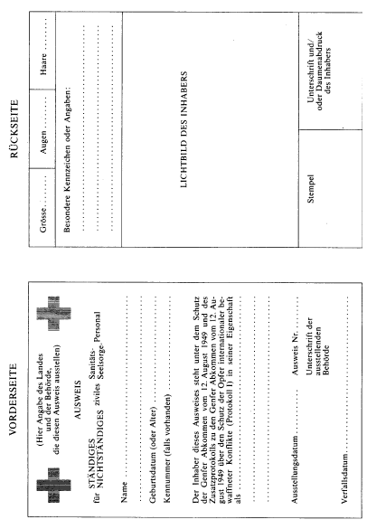
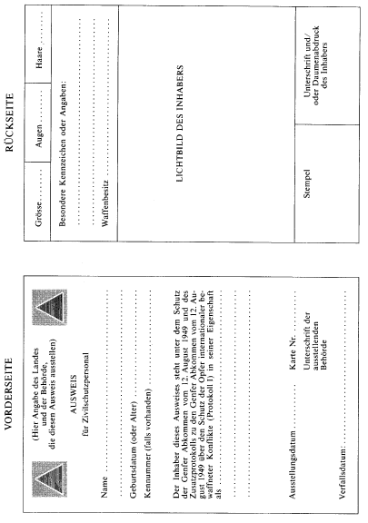
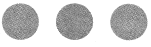

Zusatzprotokoll zu den Genfer Abkommen vom 12. August 1949 über den Schutz der Opfer internationaler bewaffneter Konflikte (Protokoll I) Angenommen in Genf am 8. Juni 1977 Zustimmung des Landtags: 22. Juni 1989 Inkrafttreten für das Fürstentum Liechtenstein: 10. Februar 1990 Präambel Die Hohen Vertragsparteien, den ernsthaften Wunsch bekundend, dass unter den Völkern Friede herrschen möge, eingedenk dessen, dass jeder Staat im Einklang mit der Charta der Ver-einten Nationen die Pflicht hat, in seinen internationalen Beziehungen jede gegen die Souveränität, die territoriale Unversehrtheit oder die poli-tische Unabhängigkeit eines Staates gerichtete oder sonst mit den Zielen der Vereinten Nationen unvereinbare Androhung oder Anwendung von Gewalt zu unterlassen, jedoch im Bewusstsein der Notwendigkeit, die Bestimmungen zum Schutz der Opfer bewaffneter Konflikte neu zu bestätigen und weiterzu-entwickeln und die Massnahmen zu ergänzen, die ihre Anwendung stärken sollen, ihrer Überzeugung Ausdruck verleihend, dass weder dieses Protokoll noch die Genfer Abkommen vom 12. August 1949 so auszulegen sind, als rechtfertigten oder erlaubten sie eine Angriffshandlung oder sonstige mit der Charta der Vereinten Nationen unvereinbare Anwendung von Gewalt, und erneut bekräftigend, dass die Bestimmungen der Genfer Abkommen vom 12. August 1949 und dieses Protokolls unter allen Umständen un-eingeschränkt auf alle durch diese Übereinkünfte geschützten Personen anzuwenden sind, und zwar ohne jede nachteilige Unterscheidung, die auf Art oder Ursprung des bewaffneten Konflikts oder auf Beweggründen beruht, die von den am Konflikt beteiligten Parteien vertreten oder ihnen zugeschrieben werden, sind wie folgt übereingekommen: Teil I Allgemeine Bestimmungen Art. 1 Allgemeine Grundsätze und Anwendungsbereich 1) Die Hohen Vertragsparteien verpflichten sich, dieses Protokoll unter allen Umständen einzuhalten und seine Einhaltung durchzusetzen. 2) In Fällen, die von diesem Protokoll oder anderen internationalen Übereinkünften nicht erfasst sind, verbleiben Zivilpersonen und Kombattanten unter dem Schutz und der Herrschaft der Grundsätze des Völkerrechts, wie sie sich aus feststehenden Gebräuchen, aus den Grundsätzen der Menschlichkeit und aus den Forderungen des öffentlichen Gewissens ergeben. 3) Dieses Protokoll, das die Genfer Abkommen vom 12. August 1949 zum Schutz der Kriegsopfer ergänzt, findet in den Situationen Anwendung, die in dem diesen Abkommen gemeinsamen Art. 2 bezeichnet sind. 4) Zu den in Abs. 3 genannten Situationen gehören auch bewaffnete Konflikte, in denen Völker gegen Kolonialherrschaft und fremde Besetzung sowie gegen rassistische Regimes in Ausübung ihres Rechts auf Selbstbestimmung kämpfen, wie es in der Charta der Vereinten Nationen und in der Erklärung über Grundsätze des Völkerrechts betreffend freundschaftliche Beziehungen und Zusammenarbeit zwischen den Staaten im Einklang mit der Charta der Vereinten Nationen niedergelegt ist. Art. 2 Begriffsbestimmungen Im Sinne dieses Protokolls a) bedeutet "I. Abkommen", "II. Abkommen", "III. Abkommen" und "IV. Abkommen" jeweils das Genfer Abkommen vom 12. August 1949 zur Verbesserung des Loses der Verwundeten und Kranken der bewaffneten Kräfte im Felde, das Genfer Abkommen vom 12. August 1949 zur Verbesserung des Loses der Verwundeten, Kranken und Schiffbrüchigen der bewaffneten Kräfte zur See, das Genfer Abkommen vom 12. August 1949 über die Behandlung der Kriegsgefangenen und das Genfer Abkommen vom 12. August 1949 über den Schutz der Zivilpersonen in Kriegszeiten; "die Abkommen" bedeutet die vier Genfer Abkommen vom 12. August 1949 zum Schutz der Kriegsopfer; b) bedeutet "Regeln des in bewaffneten Konflikten anwendbaren Völkerrechts" die in bewaffneten Konflikten anwendbaren Regeln, die in internationalen Übereinkünften verankert sind, denen die am Konflikt beteiligten Parteien als Vertragsparteien angehören, sowie die allgemein anerkannten Grundsätze und Regeln des Völkerrechts, die auf bewaffnete Konflikte anwendbar sind; c) bedeutet "Schutzmacht" einen neutralen oder anderen nicht am Konflikt beteiligten Staat, der von einer am Konflikt beteiligten Partei benannt, von der gegnerischen Partei anerkannt und bereit ist, die in den Abkommen und diesem Protokoll einer Schutzmacht übertragenen Aufgaben wahrzunehmen; d) bedeutet "Ersatzschutzmacht" eine Organisation, die anstelle einer Schutzmacht nach Art. 5 tätig wird. Art. 3 Beginn und Ende der Anwendung Unbeschadet der Bestimmungen, die jederzeit anwendbar sind, a) werden die Abkommen und dieses Protokoll angewendet, sobald eine in Art. 1 dieses Protokolls genannte Situation eintritt; b) endet die Anwendung der Abkommen und dieses Protokolls im Hoheitsgebiet der am Konflikt beteiligten Parteien mit der allgemeinen Beendigung der Kriegshandlungen und im Fall besetzter Gebiete mit der Beendigung der Besetzung; in beiden Fällen gilt dies jedoch nicht für Personen, deren endgültige Freilassung, deren Heimschaffung oder Niederlassung zu einem späteren Zeitpunkt erfolgt. Diese Personen geniessen bis zu ihrer endgültigen Freilassung, ihrer Heimschaffung oder Niederlassung weiterhin den Schutz der einschlägigen Bestimmungen der Abkommen und dieses Protokolls. Art. 4 Rechtsstellung der am Konflikt beteiligten Parteien Die Anwendung der Abkommen und dieses Protokolls sowie der Abschluss der darin vorgesehenen Übereinkünfte berühren nicht die Rechtsstellung der am Konflikt beteiligten Parteien. Die Besetzung eines Gebiets und die Anwendung der Abkommen und dieses Protokolls berühren nicht die Rechtsstellung des betreffenden Gebiets. Art. 5 Benennung von Schutzmächten und von Ersatzschutzmächten 1) Die an einem Konflikt beteiligten Parteien sind verpflichtet, vom Beginn des Konflikts an die Einhaltung der Abkommen und dieses Protokolls und deren Überwachung durch Anwendung des Schutzmächtesystems sicherzustellen; dazu gehören insbesondere die Benennung und Anerkennung dieser Mächte nach Massgabe der folgenden Absätze. Die Schutzmächte haben die Aufgabe, die Interessen der am Konflikt beteiligten Parteien wahrzunehmen. 2) Tritt eine in Art. 1 genannte Situation ein, so benennt jede am Konflikt beteiligte Partei unverzüglich eine Schutzmacht zu dem Zweck, die Abkommen und dieses Protokoll anzuwenden; sie lässt ebenfalls unverzüglich und zu demselben Zweck die Tätigkeit einer Schutzmacht zu, die sie selbst nach Benennung durch die gegnerische Partei als solche anerkannt hat. 3) Ist beim Eintritt einer Situation nach Art. 1 keine Schutzmacht benannt oder anerkannt worden, so bietet das Internationale Komitee vom Roten Kreuz, unbeschadet des Rechts jeder anderen unparteiischen humanitären Organisation, das gleiche zu tun, den am Konflikt beteiligten Parteien seine guten Dienste mit dem Ziel an, unverzüglich eine Schutzmacht zu benennen, mit der die am Konflikt beteiligten Parteien einverstanden sind. Zu diesem Zweck kann das Komitee insbesondere jede Partei auffordern, ihm eine Liste von mindestens fünf Staaten vorzulegen, die sie für annehmbar hält, um für sie als Schutzmacht gegenüber einer gegnerischen Partei tätig zu werden, und jede gegnerische Partei auffordern, eine Liste von mindestens fünf Staaten vorzulegen, die sie als Schutzmacht der anderen Partei anerkennen würde; diese Listen sind dem Komitee binnen zwei Wochen nach Eingang der Aufforderung zu übermitteln; das Komitee vergleicht sie und ersucht einen auf beiden Listen aufgeführten Staat um Zustimmung. 4) Ist trotz der vorstehenden Bestimmungen keine Schutzmacht vorhanden, so haben die am Konflikt beteiligten Parteien unverzüglich ein gegebenenfalls vom Internationalen Komitee vom Roten Kreuz oder von einer anderen alle Garantien für Unparteilichkeit und Wirksamkeit bietenden Organisation nach angemessener Konsultierung der betroffenen Parteien und unter Berücksichtigung der Konsultationsergebnisse unterbreitetes Angebot anzunehmen, als Ersatzschutzmacht tätig zu werden. Zur Durchführung ihrer Aufgaben bedarf die Ersatzschutzmacht der Zustimmung der am Konflikt beteiligten Parteien; diese sind in jeder Weise bemüht, der Ersatzschutzmacht die Wahrnehmung ihrer Aufgaben im Rahmen der Abkommen und dieses Protokolls zu erleichtern. 5) In Übereinstimmung mit Art. 4 berühren die Benennung und die Anerkennung von Schutzmächten zum Zweck der Anwendung der Abkommen und dieses Protokolls nicht die Rechtsstellung der am Konflikt beteiligten Parteien oder irgendeines Hoheitsgebiets, einschliesslich eines besetzten Gebiets. 6) Die Aufrechterhaltung diplomatischer Beziehungen zwischen den am Konflikt beteiligten Parteien oder die Übertragung des Schutzes der Interessen einer Partei oder ihrer Staatsangehörigen auf einen dritten Staat im Einklang mit den Regeln des Völkerrechts über diplomatische Beziehungen steht der Benennung von Schutzmächten zum Zweck der Anwendung der Abkommen und dieses Protokolls nicht entgegen. 7) Jede spätere Erwähnung einer Schutzmacht in diesem Protokoll bezieht sich auch auf eine Ersatzschutzmacht. Art. 6 Fachpersonal 1) Die Hohen Vertragsparteien bemühen sich bereits in Friedenszeiten mit Unterstützung der nationalen Gesellschaften des Roten Kreuzes (Roten Halbmonds, Roten Löwen mit Roter Sonne), Fachpersonal auszubilden, um die Anwendung der Abkommen und dieses Protokolls und insbesondere die Tätigkeit der Schutzmächte zu erleichtern. 2) Für die Einstellung und Ausbildung dieses Personals sind die einzelnen Staaten zuständig. 3) Das Internationale Komitee vom Roten Kreuz hält für die Hohen Vertragsparteien Listen der so ausgebildeten Personen bereit, soweit sie von den Hohen Vertragsparteien aufgestellt und ihm zu diesem Zweck übermittelt worden sind. 4) Die Bedingungen für den Einsatz dieses Personals ausserhalb des eigenen Hoheitsgebiets sind in jedem Fall Gegenstand besonderer Vereinbarungen zwischen den betroffenen Parteien. Art. 7 Tagungen Der Depositar dieses Protokolls beruft eine Tagung der Hohen Vertragsparteien zur Erörterung allgemeiner die Anwendung der Abkommen und des Protokolls betreffender Fragen ein, wenn eine oder mehrere Hohe Vertragsparteien darum ersuchen und die Mehrheit dieser Parteien damit einverstanden ist. Teil II Verwundete, Kranke und Schiffbrüchige Abschnitt I Allgemeiner Schutz Art. 8 Terminologie Im Sinne dieses Protokolls a) bedeutet "Verwundete" und "Kranke" Militär- oder Zivilpersonen, die wegen Verwundung, Erkrankung oder anderer körperlicher oder geistiger Störungen oder Gebrechen medizinischer Hilfe oder Pflege bedürfen und die jede feindselige Handlung unterlassen. Als solche gelten auch Wöchnerinnen, Neugeborene und andere Personen, die sofortiger medizinischer Hilfe oder Pflege bedürfen, wie beispielsweise Gebrechliche und Schwangere, und die jede feindselige Handlung unterlassen; b) bedeutet "Schiffbrüchige" Militär- oder Zivilpersonen, die sich auf See oder in einem anderen Gewässer infolge eines Unglücks, das sie selbst oder das sie befördernde Wasser- oder Luftfahrzeug betroffen hat, in Gefahr befinden und die jede feindselige Handlung unterlassen. Diese Personen gelten während ihrer Rettung, falls sie auch weiterhin jede feindselige Handlung unterlassen, so lange als Schiffbrüchige, bis sie auf Grund der Abkommen oder dieses Protokolls einen anderen Status erlangen; c) bedeutet "Sanitätspersonal" Personen, die von einer am Konflikt beteiligten Partei ausschliesslich den unter Bst. e genannten sanitätsdienstlichen Zwecken, der Verwaltung von Sanitätseinheiten oder dem Betrieb oder der Verwaltung von Sanitätstransportmitteln zugewiesen sind. Ihre Zuweisung kann ständig oder nichtständig sein. Der Begriff umfasst i) das militärische oder zivile Sanitätspersonal einer am Konflikt beteiligten Partei, darunter das im I. und II. Abkommen erwähnte sowie das den Zivilschutzorganisationen zugewiesene Sanitätspersonal; ii) das Sanitätspersonal der nationalen Gesellschaften des Roten Kreuzes (Roten Halbmonds, Roten Löwen mit Roter Sonne) und anderer freiwilliger nationaler Hilfsgesellschaften, die von einer am Konflikt beteiligten Partei ordnungsgemäss anerkannt und ermächtigt sind; iii) das Sanitätspersonal der in Art. 9 Abs. 2 genannten Sanitätseinheiten oder Sanitätstransportmittel; d) bedeutet "Seelsorgepersonal" Militär- oder Zivilpersonen, wie beispielsweise Feldgeistliche, die ausschliesslich ihr geistliches Amt ausüben und i) den Streitkräften einer am Konflikt beteiligten Partei, ii) Sanitätseinheiten oder Sanitätstransportmitteln einer am Konflikt beteiligten Partei, iii) Sanitätseinheiten oder Sanitätstransportmitteln nach Art. 9 Abs. 2 oder iv) Zivilschutzorganisationen einer am Konflikt beteiligten Partei zugeteilt sind. Die Zuweisung des Seelsorgepersonals kann ständig oder nichtständig sein; die einschlägigen Bestimmungen des Bst. k finden auf dieses Personal Anwendung; e) bedeutet "Sanitätseinheiten" militärische oder zivile Einrichtungen und sonstige Einheiten, die zu sanitätsdienstlichen Zwecken gebildet worden sind, nämlich zum Aufsuchen, zur Bergung, Beförderung, Untersuchung oder Behandlung - einschliesslich erster Hilfe - der Verwundeten, Kranken und Schiffbrüchigen sowie zur Verhütung von Krankheiten. Der Begriff umfasst unter anderem Lazarette und ähnliche Einheiten, Blutspendedienste, medizinische Vorsorgezentren und -institute, medizinische Depots sowie medizinische und pharmazeutische Vorratslager dieser Einheiten. Die Sanitätseinheiten können ortsfest oder beweglich, ständig oder nichtständig sein; f) bedeutet "Sanitätstransport" die Beförderung zu Land, zu Wasser oder in der Luft von Verwundeten, Kranken und Schiffbrüchigen, von Sanitäts- und Seelsorgepersonal sowie von Sanitätsmaterial, welche durch die Abkommen und dieses Protokoll geschützt sind; g) bedeutet "Sanitätstransportmittel" jedes militärische oder zivile, ständige oder nichtständige Transportmittel, das ausschliesslich dem Sanitätstransport zugewiesen ist und einer zuständigen Dienststelle einer am Konflikt beteiligten Partei untersteht; h) bedeutet "Sanitätsfahrzeug" ein Sanitätstransportmittel zu Land; i) bedeutet "Sanitätsschiffe und sonstige Sanitätswasserfahrzeuge" Sanitätstransportmittel zu Wasser; j) bedeutet "Sanitätsluftfahrzeug" ein Sanitätstransportmittel in der Luft; k) gelten Sanitätspersonal, Sanitätseinheiten und Sanitätstransportmittel als "ständig", wenn sie auf unbestimmte Zeit ausschliesslich sanitätsdienstlichen Zwecken zugewiesen sind. Sanitätspersonal, Sanitätseinheiten und Sanitätstransportmittel gelten als "nichtständig", wenn sie für begrenzte Zeit während der gesamten Dauer derselben ausschliesslich zu sanitätsdienstlichen Zwecken eingesetzt werden. Sofern nichts anderes bestimmt ist, umfassen die Begriffe "Sanitätspersonal", "Sanitätseinheiten" und "Sanitätstransportmittel" sowohl die ständigen als auch die nichtständigen; l) bedeutet "Schutzzeichen" das Schutzzeichen des Roten Kreuzes, des Roten Halbmonds oder des Roten Löwen mit Roter Sonne auf weissem Grund, das zum Schutz von Sanitätseinheiten und -transportmitteln oder von Sanitäts- und Seelsorgepersonal oder Sanitätsmaterial verwendet wird; m) bedeutet "Erkennungssignal" jedes Mittel, das in Kapitel III des Anhangs I dieses Protokolls ausschliesslich zur Kennzeichnung von Sanitätseinheiten oder -transportmitteln bestimmt ist. Art. 9 Anwendungsbereich 1) Dieser Teil, dessen Bestimmungen das Los der Verwundeten, Kranken und Schiffbrüchigen verbessern sollen, findet auf alle von einer in Art. 1 genannten Situation Betroffenen Anwendung, ohne jede auf Rasse, Hautfarbe, Geschlecht, Sprache, Religion oder Glauben, politischen oder sonstigen Anschauungen, nationaler oder sozialer Herkunft, Vermögen, Geburt oder sonstiger Stellung oder auf irgendeinem anderen ähnlichen Unterscheidungsmerkmal beruhende nachteilige Unterscheidung. 2) Die einschlägigen Bestimmungen der Art. 27 und 32 des I. Abkommens finden auf ständige Sanitätseinheiten und -transportmittel (ausgenommen Lazarettschiffe, für die Art. 25 des II. Abkommens gilt) und ihr Personal Anwendung, die einer am Konflikt beteiligten Partei zu humanitären Zwecken a) von einem neutralen oder einem anderen nicht am Konflikt beteiligten Staat, b) von einer anerkannten und ermächtigten Hilfsgesellschaft eines solchen Staates, c) von einer unparteiischen internationalen humanitären Organisation zur Verfügung gestellt wurden. Art. 10 Schutz und Pflege 1) Alle Verwundeten, Kranken und Schiffbrüchigen, gleichviel welcher Partei sie angehören, werden geschont und geschützt. 2) Sie werden unter allen Umständen mit Menschlichkeit behandelt und erhalten so umfassend und so schnell wie möglich die für ihren Zustand erforderliche medizinische Pflege und Betreuung. Aus anderen als medizinischen Gründen darf kein Unterschied zwischen ihnen gemacht werden. Art. 11 Schutz von Personen 1) Die körperliche oder geistige Gesundheit und Unversehrtheit von Personen, die sich in der Gewalt der gegnerischen Partei befinden, die infolge einer in Art. 1 genannten Situation interniert oder in Haft gehalten sind oder denen anderweitig die Freiheit entzogen ist, dürfen nicht durch ungerechtfertigte Handlungen oder Unterlassungen gefährdet werden. Es ist daher verboten, die in diesem Artikel genannten Personen einem medizinischen Verfahren zu unterziehen, das nicht durch ihren Gesundheitszustand geboten ist und das nicht mit den allgemein anerkannten medizinischen Grundsätzen im Einklang steht, die unter entsprechenden medizinischen Umständen auf Staatsangehörige der das Verfahren durchführenden Partei angewandt würden, denen die Freiheit nicht entzogen ist. 2) Es ist insbesondere verboten, an diesen Personen, selbst mit ihrer Zustimmung, a) körperliche Verstümmelungen vorzunehmen, b) medizinische oder wissenschaftliche Versuche vorzunehmen, c) Gewebe oder Organe für Übertragungen zu entfernen, soweit diese Massnahmen nicht gemäss den Voraussetzungen nach Abs. 1 gerechtfertigt sind. 3) Ausnahmen von dem in Abs. 2 Bst. c bezeichneten Verbot sind nur bei der Entnahme von Blut oder Haut für Übertragungen zulässig, sofern die Einwilligung freiwillig und ohne Zwang oder Überredung und der Eingriff nur zu therapeutischen Zwecken und unter Bedingungen erfolgt, die mit den allgemein anerkannten medizinischen Grundsätzen im Einklang stehen und Kontrollen unterliegen, die dem Wohl sowohl des Spenders als auch des Empfängers dienen. 4) Eine vorsätzliche Handlung oder Unterlassung, welche die körperliche oder geistige Gesundheit oder Unversehrtheit einer Person erheblich gefährdet, die sich in der Gewalt einer anderen Partei als derjenigen befindet, zu der sie gehört, und die entweder gegen eines der Verbote der Abs. 1 und 2 verstösst oder nicht den Bedingungen des Abs. 3 entspricht, stellt eine schwere Verletzung dieses Protokolls dar. 5) Die in Abs. 1 bezeichneten Personen haben das Recht, jeden chirurgischen Eingriff abzulehnen. Im Fall einer Ablehnung hat sich das Sanitätspersonal um eine entsprechende schriftliche, vom Patienten unterzeichnete oder anerkannte Erklärung zu bemühen. 6) Jede am Konflikt beteiligte Partei führt medizinische Unterlagen über die einzelnen Entnahmen von Blut und Haut für Übertragungen, die von den in Abs. 1 genannten Personen stammen, sofern die Entnahmen unter der Verantwortung dieser Partei erfolgen. Ferner ist jede am Konflikt beteiligte Partei bemüht, Unterlagen über alle medizinischen Verfahren betreffend Personen zu führen, die infolge einer in Art. 1 genannten Situation interniert oder in Haft gehalten sind oder denen anderweitig die Freiheit entzogen ist. Diese Unterlagen müssen der Schutzmacht jederzeit zur Einsicht zur Verfügung stehen. Art. 12 Schutz von Sanitätseinheiten 1) Sanitätseinheiten werden jederzeit geschont und geschützt und dürfen nicht angegriffen werden. 2) Abs. 1 findet auf zivile Sanitätseinheiten Anwendung, sofern sie a) zu einer am Konflikt beteiligten Partei gehören, b) von der zuständigen Behörde einer am Konflikt beteiligten Partei anerkannt und ermächtigt sind oder c) nach Massgabe des Art. 9 Abs. 2 dieses Protokolls oder des Art. 27 des I. Abkommens ermächtigt sind. 3) Die am Konflikt beteiligten Parteien sind aufgefordert, einander mitzuteilen, wo sich ihre ortsfesten Sanitätseinheiten befinden. Unterbleibt eine solche Mitteilung, so enthebt dies keine der Parteien der Verpflichtung, die Bestimmungen des Abs. 1 zu beachten. 4) Sanitätseinheiten dürfen unter keinen Umständen für den Versuch benutzt werden, militärische Ziele vor Angriffen abzuschirmen. Die am Konflikt beteiligten Parteien sorgen wann immer möglich dafür, dass die Sanitätseinheiten so gelegt werden, dass sie durch Angriffe auf militärische Ziele nicht gefährdet werden können. Art. 13 Ende des Schutzes ziviler Sanitätseinheiten 1) Der den zivilen Sanitätseinheiten gebührende Schutz darf nur dann enden, wenn diese ausserhalb ihrer humanitären Bestimmung zu Handlungen verwendet werden, die den Feind schädigen. Jedoch endet der Schutz erst, nachdem eine Warnung, die möglichst eine angemessene Frist setzt, unbeachtet geblieben ist. 2) Als Handlung, die den Feind schädigt, gilt nicht a) die Tatsache, dass das Personal der Einheit zu seiner eigenen Verteidigung oder zur Verteidigung der ihm anvertrauten Verwundeten und Kranken mit leichten Handfeuerwaffen ausgerüstet ist; b) die Tatsache, dass die Einheit von einer Wache, durch Posten oder von einem Geleittrupp geschützt wird; c) die Tatsache, dass in der Einheit Handwaffen und Munition vorgefunden werden, die den Verwundeten und Kranken abgenommen, der zuständigen Dienststelle aber noch nicht abgeliefert worden sind; d) die Tatsache, dass sich Mitglieder der Streitkräfte oder andere Kombattanten aus medizinischen Gründen bei der Einheit befinden. Art. 14 Beschränkung der Requisition ziviler Sanitätseinheiten 1) Die Besetzungsmacht hat dafür zu sorgen, dass die medizinische Versorgung der Zivilbevölkerung in den besetzten Gebieten gesichert bleibt. 2) Die Besetzungsmacht darf deshalb zivile Sanitätseinheiten, ihre Ausrüstung, ihr Material oder ihr Personal so lange nicht requirieren, wie diese Mittel zur angemessenen medizinischen Versorgung der Zivilbevölkerung und zur weiteren Pflege der bereits betreuten Verwundeten und Kranken benötigt werden. 3) Sofern die allgemeine Vorschrift des Abs. 2 weiterhin beachtet wird, kann die Besetzungsmacht die genannten Mittel unter den folgenden besonderen Bedingungen requirieren: a) dass die Mittel zur sofortigen angemessenen medizinischen Behandlung der verwundeten und kranken Angehörigen der Streitkräfte der Besetzungsmacht oder von Kriegsgefangenen benötigt werden; b) dass die Mittel nur so lange requiriert werden, wie dies notwendig ist; c) dass sofortige Vorkehrungen getroffen werden, um die medizinische Versorgung der Zivilbevölkerung sowie der bereits betreuten Verwundeten und Kranken, die von der Requisition betroffen sind, weiterhin gesichert bleibt. Art. 15 Schutz des zivilen Sanitäts- und Seelsorgepersonals 1) Das zivile Sanitätspersonal wird geschont und geschützt. 2) Soweit erforderlich, wird dem zivilen Sanitätspersonal in einem Gebiet, in dem die zivilen Sanitätsdienste infolge der Kampftätigkeit erheblich eingeschränkt sind, jede mögliche Hilfe gewährt. 3) Die Besetzungsmacht gewährt dem zivilen Sanitätspersonal in besetzten Gebieten jede Hilfe, um es ihm zu ermöglichen, seine humanitären Aufgaben nach besten Kräften wahrzunehmen. Die Besetzungsmacht darf nicht verlangen, dass das Personal in Wahrnehmung seiner Aufgaben bestimmte Personen bevorzugt behandelt, es sei denn aus medizinischen Gründen. Das Personal darf nicht gezwungen werden, Aufgaben zu übernehmen, die mit seinem humanitären Auftrag unvereinbar sind. 4) Das zivile Sanitätspersonal hat Zugang zu allen Orten, an denen seine Dienste unerlässlich sind, vorbehaltlich der Kontroll- und Sicherheitsmassnahmen, welche die betreffende am Konflikt beteiligte Partei für notwendig hält. 5) Das zivile Seelsorgepersonal wird geschont und geschützt. Die Bestimmungen der Abkommen und dieses Protokolls über den Schutz und die Kennzeichnung des Sanitätspersonals finden auch auf diese Personen Anwendung. Art. 16 Allgemeiner Schutz der ärztlichen Aufgabe 1) Niemand darf bestraft werden, weil er eine ärztliche Tätigkeit ausgeübt hat, die mit dem ärztlichen Ehrenkodex im Einklang steht, gleichviel unter welchen Umständen und zu wessen Nutzen sie ausgeübt worden ist. 2) Wer eine ärztliche Tätigkeit ausübt, darf nicht gezwungen werden, Handlungen vorzunehmen oder Arbeiten zu verrichten, die mit den Regeln des ärztlichen Ehrenkodexes, mit sonstigen dem Wohl der Verwundeten und Kranken dienenden medizinischen Regeln oder mit den Bestimmungen der Abkommen oder dieses Protokolls unvereinbar sind, oder Handlungen oder Arbeiten zu unterlassen, die auf Grund dieser Regeln und Bestimmungen geboten sind. 3) Wer eine ärztliche Tätigkeit ausübt, darf nicht gezwungen werden, Angehörigen einer gegnerischen Partei oder der eigenen Partei - es sei denn in den nach dem Recht der letztgenannten Partei vorgesehenen Fällen - Auskünfte über die jetzt oder früher von ihm betreuten Verwundeten und Kranken zu erteilen, sofern diese Auskünfte nach seiner Auffassung den betreffenden Patienten oder ihren Familien schaden würden. Die Vorschriften über die Meldepflicht bei ansteckenden Krankheiten sind jedoch einzuhalten. Art. 17 Rolle der Zivilbevölkerung und der Hilfsgesellschaften 1) Die Zivilbevölkerung hat die Verwundeten, Kranken und Schiffbrüchigen, auch wenn sie der gegnerischen Partei angehören, zu schonen und darf keine Gewalttaten gegen sie verüben. Der Zivilbevölkerung und den Hilfsgesellschaften, wie beispielsweise den nationalen Gesellschaften des Roten Kreuzes (Roten Halbmonds, Roten Löwen mit Roter Sonne) ist es gestattet, auch von sich aus und auch in Invasions- oder besetzten Gebieten die Verwundeten, Kranken und Schiffbrüchigen zu bergen und zu pflegen. Niemand darf wegen solcher humanitärer Handlungen behelligt, verfolgt, verurteilt oder bestraft werden. 2) Die am Konflikt beteiligten Parteien können die Zivilbevölkerung und die in Abs. 1 bezeichneten Hilfsgesellschaften auffordern, die Verwundeten, Kranken und Schiffbrüchigen zu bergen und zu pflegen sowie nach Toten zu suchen und den Ort zu melden, an dem sie gefunden wurden; sie gewähren denjenigen, die diesem Aufruf Folge leisten, sowohl Schutz als auch die erforderlichen Erleichterungen. Bringt die gegnerische Partei das Gebiet erstmalig oder erneut unter ihre Kontrolle, so gewährt sie den gleichen Schutz und die gleichen Erleichterungen, solange dies erforderlich ist. Art. 18 Kennzeichnung 1) Jede am Konflikt beteiligte Partei ist bemüht sicherzustellen, dass das Sanitäts- und Seelsorgepersonal sowie die Sanitätseinheiten und -transportmittel als solche erkennbar sind. 2) Jede am Konflikt beteiligte Partei ist ferner bemüht, Methoden und Verfahren einzuführen und anzuwenden, die es ermöglichen, Sanitätseinheiten und -transportmittel zu erkennen, welche das Schutzzeichen führen und die Erkennungssignale verwenden. 3) In besetzten Gebieten und in Gebieten, in denen tatsächlich oder voraussichtlich Kampfhandlungen stattfinden, sollen das zivile Sanitätspersonal und das zivile Seelsorgepersonal durch das Schutzzeichen und einen Ausweis, der ihren Status bescheinigt, erkennbar sein. 4) Mit Zustimmung der zuständigen Dienststelle werden Sanitätseinheiten und -transportmittel mit dem Schutzzeichen gekennzeichnet. Die in Art. 22 dieses Protokolls bezeichneten Schiffe und sonstigen Wasserfahrzeuge werden nach Massgabe des II. Abkommens gekennzeichnet. 5) Eine am Konflikt beteiligte Partei kann im Einklang mit Kapitel III des Anhangs I dieses Protokolls gestatten, dass neben dem Schutzzeichen auch Erkennungssignale zur Kennzeichnung von Sanitätseinheiten und -transportmitteln verwendet werden. In den in jenem Kapitel vorgesehenen besonderen Fällen können Sanitätstransportmittel ausnahmsweise Erkennungssignale verwenden, ohne das Schutzzeichen zu führen. 6) Die Anwendung der Abs. 1 bis 5 wird durch die Kapitel I bis III des Anhangs I dieses Protokolls geregelt. Soweit in Kapitel III dieses Anhangs nichts anderes bestimmt ist, dürfen die dort zur ausschliesslichen Verwendung durch Sanitätseinheiten und -transportmittel bestimmten Signale nur zur Kennzeichnung der in jenem Kapitel genannten Sanitätseinheiten und -transportmittel verwendet werden. 7) Dieser Artikel ermächtigt nicht zu einer weiteren Verwendung des Schutzzeichens in Friedenszeiten als in Art. 44 des I. Abkommens vorgesehen. 8) Die Bestimmungen der Abkommen und dieses Protokolls betreffend die Überwachung der Verwendung des Schutzzeichens sowie die Verhinderung und Ahndung seines Missbrauchs finden auch auf die Erkennungssignale Anwendung. Art. 19 Neutrale und andere nicht am Konflikt beteiligte Staaten Neutrale und andere nicht am Konflikt beteiligte Staaten wenden die einschlägigen Bestimmungen dieses Protokolls auf die durch diesen Teil geschützten Personen an, die in ihr Hoheitsgebiet aufgenommen oder dort interniert werden, sowie auf die von ihnen geborgenen Toten der am Konflikt beteiligten Parteien. Art. 20 Verbot von Repressalien Repressalien gegen die durch diesen Teil geschützten Personen und Objekte sind verboten. Abschnitt II Sanitätstransporte Art. 21 Sanitätsfahrzeuge Sanitätsfahrzeuge werden in gleicher Weise wie bewegliche Sanitätseinheiten nach Massgabe der Abkommen und dieses Protokolls geschont und geschützt. Art. 22 Lazarettschiffe und Küstenrettungsfahrzeuge 1) Die Bestimmungen der Abkommen über a) die in den Art. 22, 24, 25 und 27 des II. Abkommens beschriebenen Schiffe, b) ihre Rettungsboote und kleinen Wasserfahrzeuge, c) ihr Personal und ihre Besatzung sowie d) die an Bord befindlichen Verwundeten, Kranken und Schiffbrüchigen finden auch dann Anwendung, wenn diese Wasserfahrzeuge verwundete, kranke und schiffbrüchige Zivilpersonen befördern, die zu keiner der in Art. 13 des II. Abkommens genannten Kategorien gehören. Diese Zivilpersonen dürfen jedoch nicht dem Gewahrsam einer anderen Partei als ihrer eigenen übergeben oder auf See gefangen genommen werden. Befinden sie sich in der Gewalt einer am Konflikt beteiligten Partei, die nicht ihre eigene ist, so finden das IV. Abkommen und dieses Protokoll auf sie Anwendung. 2) Der Schutz, der den in Art. 25 des II. Abkommens beschriebenen Schiffen gewährt wird, erstreckt sich auch auf Lazarettschiffe, die einer am Konflikt beteiligten Partei zu humanitären Zwecken a) von einem neutralen oder einem anderen nicht am Konflikt beteiligten Staat oder b) von einer unparteiischen internationalen humanitären Organisation zur Verfügung gestellt werden, sofern in beiden Fällen die in jenem Artikel genannten Voraussetzungen erfüllt sind. 3) Die in Art. 27 des II. Abkommens beschriebenen kleinen Wasserfahrzeuge werden auch dann geschützt, wenn die in jenem Artikel vorgesehene Mitteilung nicht erfolgt ist. Die am Konflikt beteiligten Parteien sind jedoch aufgefordert, einander Einzelheiten über diese Fahrzeuge mitzuteilen, die deren Kennzeichnung und Erkennung erleichtern. Art. 23 Andere Sanitätsschiffe und sonstige Sanitätswasserfahrzeuge 1) Andere als die in Art. 22 dieses Protokolls und in Art. 38 des II. Abkommens genannten Sanitätsschiffe und sonstigen Sanitätswasserfahrzeuge werden auf See oder in anderen Gewässern ebenso geschont und geschützt wie bewegliche Sanitätseinheiten nach den Abkommen und diesem Protokoll. Da dieser Schutz nur wirksam sein kann, wenn die Sanitätsschiffe oder sonstigen Sanitätswasserfahrzeuge als solche gekennzeichnet und erkennbar sind, sollen sie mit dem Schutzzeichen kenntlich gemacht werden und nach Möglichkeit die Bestimmungen des Art. 43 Abs. 2 des II. Abkommens befolgen. 2) Die in Abs. 1 bezeichneten Schiffe und sonstigen Wasserfahrzeuge unterliegen weiterhin dem Kriegsrecht. Ein über Wasser fahrendes Kriegsschiff, das in der Lage ist, seine Weisungen sofort durchzusetzen, kann sie anweisen, anzuhalten, abzudrehen oder einen bestimmten Kurs einzuhalten; einer solchen Weisung muss Folge geleistet werden. Im übrigen dürfen sie ihrem sanitätsdienstlichen Auftrag nicht entzogen werden, solange sie für die an Bord befindlichen Verwundeten, Kranken und Schiffbrüchigen benötigt werden. 3) Der in Abs. 1 vorgesehene Schutz endet nur unter den in den Art. 34 und 35 des II. Abkommens genannten Voraussetzungen. Eine eindeutige Weigerung, einer Weisung nach Abs. 2 Folge zu leisten, stellt eine den Feind schädigende Handlung im Sinne des Art. 34 des II. Abkommens dar. 4) Eine am Konflikt beteiligte Partei kann einer gegnerischen Partei so früh wie möglich vor dem Auslaufen den Namen, die Merkmale, die voraussichtliche Abfahrtszeit, den Kurs und die geschätzte Geschwindigkeit der Sanitätsschiffe oder sonstigen Sanitätswasserfahrzeuge mitteilen, insbesondere bei Schiffen mit einem Bruttoraumgehalt von mehr als 2000 Registertonnen; sie kann auch weitere Angaben machen, welche die Kennzeichnung und Erkennung erleichtern würden. Die gegnerische Partei bestätigt den Empfang dieser Angaben. 5) Art. 37 des II. Abkommens findet auf das Sanitäts- und Seelsorgepersonal an Bord solcher Schiffe und sonstigen Wasserfahrzeuge Anwendung. 6) Das II. Abkommen findet auf die Verwundeten, Kranken und Schiffbrüchigen Anwendung, die zu den in Art. 13 des II. Abkommens und in Art. 44 dieses Protokolls genannten Kategorien gehören und sich an Bord solcher Sanitätsschiffe und sonstigen Sanitätswasserfahrzeuge befinden. Verwundete, Kranke und schiffbrüchige Zivilpersonen, die nicht zu einer der in Art. 13 des II. Abkommens genannten Kategorien gehören, dürfen auf See weder einer Partei, der sie nicht angehören, übergeben noch zum Verlassen des Schiffes oder sonstigen Wasserfahrzeugs gezwungen werden; befinden sie sich jedoch in der Gewalt einer anderen am Konflikt beteiligten Partei als ihrer eigenen, so finden das IV. Abkommen und dieses Protokoll auf sie Anwendung. Art. 24 Schutz von Sanitätsluftfahrzeugen Sanitätsluftfahrzeuge werden nach Massgabe dieses Teiles geschont und geschützt. Art. 25 Sanitätsluftfahrzeuge in Gebieten, die nicht von einer gegnerischen Partei beherrscht werden In oder über Landgebieten, die von eigenen oder befreundeten Streitkräften tatsächlich beherrscht werden, oder in oder über Seegebieten, die nicht tatsächlich von einer gegnerischen Partei beherrscht werden, bedarf es zur Schonung und zum Schutz von Sanitätsluftfahrzeugen einer am Konflikt beteiligten Partei keiner Vereinbarung mit einer gegnerischen Partei. Eine am Konflikt beteiligte Partei, die ihre Sanitätsluftfahrzeuge in diesen Gebieten einsetzt, kann jedoch zwecks grösserer Sicherheit der gegnerischen Partei entsprechend Art. 29 Mitteilung machen, insbesondere, wenn diese Luftfahrzeuge Flüge durchführen, die sie in die Reichweite von Boden-Luft-Waffensystemen der gegnerischen Partei bringen. Art. 26 Sanitätsluftfahrzeuge in Kontakt- oder ähnlichen Zonen 1) In oder über den tatsächlich von eigenen oder befreundeten Streitkräften beherrschten Teilen der Kontaktzone und in oder über Gebieten, bei denen nicht eindeutig feststeht, wer sie tatsächlich beherrscht, kann der Schutz der Sanitätsluftfahrzeuge nur dann voll wirksam sein, wenn vorher zwischen den zuständigen militärischen Dienststellen der am Konflikt beteiligten Parteien eine Vereinbarung entsprechend Art. 29 getroffen worden ist. In Ermangelung einer solchen Vereinbarung operieren die Sanitätsluftfahrzeuge auf eigene Gefahr; sie werden aber dennoch geschont, sobald sie als solche erkannt worden sind. 2) Der Ausdruck "Kontaktzone" bezeichnet jedes Landgebiet, in dem die vorderen Teile gegnerischer Kräfte miteinander in Berührung kommen; dies ist insbesondere dort der Fall, wo sie einem direkten Beschuss vom Boden aus ausgesetzt sind. Art. 27 Sanitätsluftfahrzeuge in Gebieten, die von einer gegnerischen Partei beherrscht werden 1) Die Sanitätsluftfahrzeuge einer am Konflikt beteiligten Partei bleiben auch dann geschützt, wenn sie von einer gegnerischen Partei tatsächlich beherrschte Land- oder Seegebiete überfliegen, sofern die zuständige Dienststelle der gegnerischen Partei zuvor ihr Einverständnis zu diesen Flügen erteilt hat. 2) Überfliegt ein Sanitätsluftfahrzeug infolge eines Navigationsfehlers oder infolge einer Notlage, welche die Sicherheit des Fluges beeinträchtigt, ohne das in Abs. 1 vorgesehene Einverständnis oder in Abweichung von den dabei festgelegten Bedingungen ein von einer gegnerischen Partei tatsächlich beherrschtes Gebiet, so unternimmt es alle Anstrengungen, um sich zu erkennen zu geben und die gegnerische Partei von den Umständen in Kenntnis zu setzen. Sobald die gegnerische Partei das Sanitätsluftfahrzeug erkannt hat, unternimmt sie alle zumutbaren Anstrengungen, um die Weisung zum Landen oder Wassern nach Art. 30 Abs. 1 zu erteilen oder um andere Massnahmen zur Wahrung ihrer eigenen Interessen zu treffen und um in beiden Fällen dem Luftfahrzeug Zeit zur Befolgung der Weisung zu lassen, bevor es angegriffen werden kann. Art. 28 Beschränkungen für den Einsatz von Sanitätsluftfahrzeugen 1) Den am Konflikt beteiligten Parteien ist es verboten, ihre Sanitätsluftfahrzeuge zu dem Versuch zu benutzen, militärische Vorteile gegenüber der gegnerischen Partei zu erlangen. Die Anwesenheit von Sanitätsluftfahrzeugen darf nicht zu dem Versuch benutzt werden, Angriffe von militärischen Zielen fernzuhalten. 2) Sanitätsluftfahrzeuge dürfen nicht zur Gewinnung oder Übermittlung nachrichtendienstlicher militärischer Erkenntnisse benutzt werden, und sie dürfen keine Ausrüstung mitführen, die solchen Zwecken dient. Es ist ihnen verboten, Personen oder Ladung zu befördern, die nicht unter die Begriffsbestimmung des Art. 8 Bst. f fallen. Das Mitführen persönlicher Habe der Insassen oder von Ausrüstung, die allein dazu dient, die Navigation, den Nachrichtenverkehr oder die Kennzeichnung zu erleichtern, gilt nicht als verboten. 3) Sanitätsluftfahrzeuge dürfen keine Waffen befördern, mit Ausnahme von Handwaffen und Munition, die den an Bord befindlichen Verwundeten, Kranken und Schiffbrüchigen abgenommen und der zuständigen Stelle noch nicht abgeliefert worden sind, sowie von leichten Handfeuerwaffen, die das an Bord befindliche Sanitätspersonal zur eigenen Verteidigung oder zur Verteidigung der ihm anvertrauten Verwundeten, Kranken und Schiffbrüchigen benötigt. 4) Auf den in den Art. 26 und 27 bezeichneten Flügen dürfen Sanitätsluftfahrzeuge nur nach vorherigem Einverständnis der gegnerischen Partei zur Suche nach Verwundeten, Kranken und Schiffbrüchigen verwendet werden. Art. 29 Mitteilungen und Vereinbarungen betreffend Sanitätsluftfahrzeuge 1) Mitteilungen nach Art. 25 oder Ersuchen um vorheriges Einverständnis nach den Art. 26, 27, 28 Abs. 4 oder Art. 31 müssen die voraussichtliche Anzahl der Sanitätsluftfahrzeuge, ihre Flugpläne und ihre Kennzeichnung angeben; sie sind dahin zu verstehen, dass jeder Flug im Einklang mit Art. 28 durchgeführt wird. 2) Die Partei, die eine Mitteilung nach Art. 25 erhält, bestätigt sofort deren Eingang. 3) Die Partei, die ein Ersuchen um vorheriges Einverständnis nach den Art. 26, 27, 28 Abs. 4 oder Art. 31 erhält, wird der ersuchenden Partei so bald wie möglich a) mitteilen, dass dem Ersuchen zugestimmt wird, b) mitteilen, dass das Ersuchen abgelehnt wird, oder c) angemessene Gegenvorschläge übermitteln. Sie kann auch vorschlagen, während der betreffenden Zeit andere Flüge in dem Gebiet zu verbieten oder einzuschränken. Nimmt die Partei, die das Ersuchen gestellt hat, die Gegenvorschläge an, so teilt sie dies der anderen Partei mit. 4) Die Parteien treffen die notwendigen Massnahmen, damit die Mitteilungen schnell erfolgen und die Vereinbarungen schnell getroffen werden können. 5) Die Parteien treffen ferner die notwendigen Massnahmen, damit der Inhalt der Mitteilungen und Vereinbarungen den betreffenden militärischen Einheiten schnell bekanntgegeben wird und damit diesen Einheiten schnell mitgeteilt wird, welche Mittel der Kenntlichmachung von den in Betracht kommenden Sanitätsluftfahrzeugen verwendet werden. Art. 30 Landung und Untersuchung von Sanitätsluftfahrzeugen 1) Beim Überfliegen von Gebieten, die von der gegnerischen Partei tatsächlich beherrscht werden, oder von Gebieten, bei denen nicht eindeutig feststeht, wer sie tatsächlich beherrscht, können Sanitätsluftfahrzeuge angewiesen werden, zu landen beziehungsweise zu wassern, damit sie nach Massgabe der folgenden Absätze untersucht werden können. Die Sanitätsluftfahrzeuge haben eine solche Anweisung zu befolgen. 2) Landet oder wassert ein solches Luftfahrzeug auf Grund einer derartigen Anweisung oder aus anderen Gründen, so darf es nur zur Klärung der in den Abs. 3 und 4 aufgeführten Fragen untersucht werden. Die Untersuchung hat unverzüglich zu beginnen und ist zügig durchzuführen. Die untersuchende Partei darf nicht verlangen, dass die Verwundeten und Kranken von Bord gebracht werden, sofern dies nicht für die Untersuchung unerlässlich ist. Die Partei trägt auf jeden Fall dafür Sorge, dass sich der Zustand der Verwundeten und Kranken durch die Untersuchung oder dadurch, dass sie von Bord gebracht werden, nicht verschlechtert. 3) Ergibt die Untersuchung, dass das Luftfahrzeug a) ein Sanitätsluftfahrzeug im Sinne des Art. 8 Bst. j ist, b) nicht gegen die in Art. 28 vorgeschriebenen Bedingungen verstösst und c) den Flug nicht ohne eine etwa erforderliche vorherige Vereinbarung oder unter Verletzung einer solchen Vereinbarung durchgeführt hat, so wird dem Luftfahrzeug und denjenigen seiner Insassen, die einer gegnerischen Partei, einem neutralen oder einem anderen nicht am Konflikt beteiligten Staat angehören, gestattet, den Flug unverzüglich fortzusetzen. 4) Ergibt die Untersuchung, dass das Luftfahrzeug a) kein Sanitätsluftfahrzeug im Sinne des Art. 8 Bst. j ist, b) gegen die in Art. 28 vorgeschriebenen Bedingungen verstösst oder c) den Flug ohne eine etwa erforderliche vorherige Vereinbarung oder unter Verletzung einer solchen Vereinbarung durchgeführt hat, so kann das Luftfahrzeug beschlagnahmt werden. Seine Insassen werden nach den einschlägigen Bestimmungen der Abkommen und dieses Protokolls behandelt. Ein Luftfahrzeug, das zum ständigen Sanitätsluftfahrzeug bestimmt war, darf nach seiner Beschlagnahme nur als Sanitätsluftfahrzeug verwendet werden. Art. 31 Neutrale oder andere nicht am Konflikt beteiligte Staaten 1) Sanitätsluftfahrzeuge dürfen das Hoheitsgebiet eines neutralen oder eines anderen nicht am Konflikt beteiligten Staates nur auf Grund einer vorherigen Vereinbarung überfliegen oder dort landen oder wassern. Besteht eine solche Vereinbarung, so werden sie während des gesamten Fluges sowie für die Dauer einer etwaigen Zwischenlandung oder -wasserung geschont. Sie haben indessen jeder Weisung, zu landen beziehungsweise zu wassern, Folge zu leisten. 2) Überfliegt ein Sanitätsluftfahrzeug infolge eines Navigationsfehlers oder infolge einer Notlage, welche die Sicherheit des Fluges beeinträchtigt, ohne Einverständnis oder in Abweichung von den dabei festgelegten Bedingungen das Hoheitsgebiet eines neutralen oder eines anderen nicht am Konflikt beteiligten Staates, so unternimmt er alle Anstrengungen, um seinen Flug bekanntzugeben und um sich zu erkennen zu geben. Sobald dieser Staat das Sanitätsluftfahrzeug erkannt hat, unternimmt er alle zumutbaren Anstrengungen, um die Weisung zum Landen oder Wassern nach Art. 30 Abs. 1 zu erteilen oder um andere Massnahmen zur Wahrung seiner eigenen Interessen zu treffen und um in beiden Fällen dem Luftfahrzeug Zeit zur Befolgung der Weisung zu lassen, bevor es angegriffen werden kann. 3) Landet oder wassert ein Sanitätsluftfahrzeug nach Vereinbarung oder unter den in Abs. 2 genannten Umständen auf Grund einer Weisung oder aus anderen Gründen im Hoheitsgebiet eines neutralen oder eines anderen nicht am Konflikt beteiligten Staates, so darf es untersucht werden, damit festgestellt wird, ob es sich tatsächlich um ein Sanitätsluftfahrzeug handelt. Die Untersuchung hat unverzüglich zu beginnen und ist zügig durchzuführen. Die untersuchende Partei darf nicht verlangen, dass die Verwundeten und Kranken der das Luftfahrzeug betreffenden Partei von Bord gebracht werden, sofern dies nicht für die Untersuchung unerlässlich ist. Die untersuchende Partei trägt auf jeden Fall dafür Sorge, dass sich der Zustand der Verwundeten und Kranken durch die Untersuchung oder dadurch, dass sie von Bord gebracht werden, nicht verschlechtert. Ergibt die Untersuchung, dass es sich tatsächlich um ein Sanitätsluftfahrzeug handelt, so wird dem Luftfahrzeug und seinen Insassen mit Ausnahme derjenigen, die nach den Regeln des in bewaffneten Konflikten anwendbaren Völkerrechts in Gewahrsam gehalten werden müssen, gestattet, seinen Flug fortzusetzen, wobei ihm angemessene Erleichterungen gewährt werden. Ergibt die Untersuchung, dass es sich nicht um ein Sanitätsluftfahrzeug handelt, so wird es beschlagnahmt, und seine Insassen werden entsprechend Abs. 4 behandelt. 4) Die mit Zustimmung der örtlichen Behörden im Hoheitsgebiet eines neutralen oder eines anderen nicht am Konflikt beteiligten Staates nicht nur vorübergehend von einem Sanitätsluftfahrzeug abgesetzten Verwundeten, Kranken und Schiffbrüchigen werden in Ermangelung einer anders lautenden Abmachung zwischen diesem Staat und den am Konflikt beteiligten Parteien, wenn die Regeln des in bewaffneten Konflikten anwendbaren Völkerrechts es erfordern, so in Gewahrsam gehalten, dass sie nicht mehr an Feindseligkeiten teilnehmen können. Die Krankenhaus- und Internierungskosten gehen zu Lasten des Staates, dem diese Personen angehören. 5) Neutrale oder andere nicht am Konflikt beteiligte Staaten wenden etwaige Bedingungen und Beschränkungen für das Überfliegen ihres Hoheitsgebiets durch Sanitätsluftfahrzeuge oder für deren Landung oder Wasserung in ihrem Hoheitsgebiet auf alle am Konflikt beteiligten Parteien in gleicher Weise an. Abschnitt III Vermisste und Tote Art. 32 Allgemeiner Grundsatz Bei der Anwendung dieses Abschnitts wird die Tätigkeit der Hohen Vertragsparteien, der am Konflikt beteiligten Parteien und der in den Abkommen und in diesem Protokoll erwähnten internationalen humanitären Organisationen in erster Linie durch das Recht der Familien bestimmt, das Schicksal ihrer Angehörigen zu erfahren. Art. 33 Vermisste 1) Sobald die Umstände es zulassen, spätestens jedoch nach Beendigung der aktiven Feindseligkeiten, forscht jede am Konflikt beteiligte Partei nach dem Verbleib der Personen, die von einer gegnerischen Partei als vermisst gemeldet worden sind. Die gegnerische Partei erteilt alle zweckdienlichen Auskünfte über diese Personen, um die Suche zu erleichtern. 2) Um die Beschaffung der Auskünfte nach Abs. 1 zu erleichtern, hat jede am Konflikt beteiligte Partei für Personen, die nicht auf Grund der Abkommen und dieses Protokolls eine günstigere Behandlung erfahren würden, a) die in Art. 138 des IV. Abkommens genannten Auskünfte über Personen zu registrieren, die infolge von Feindseligkeiten oder Besetzung festgenommen, in Haft gehalten oder anderweitig mehr als zwei Wochen gefangengehalten worden sind oder die während eines Freiheitsentzugs verstorben sind; b) soweit irgend möglich die Beschaffung und Registrierung von Auskünften über solche Personen zu erleichtern und erforderlichenfalls selbst durchzuführen, wenn sie unter anderen Umständen infolge von Feindseligkeiten oder Besetzung verstorben sind. 3) Auskünfte über die nach Abs. 1 als vermisst gemeldeten Personen sowie Ersuchen um Erteilung solcher Auskünfte werden entweder unmittelbar oder über die Schutzmacht oder den Zentralen Suchdienst des Internationalen Komitees vom Roten Kreuz oder die nationalen Gesellschaften des Roten Kreuzes (Roten Halbmonds, Roten Löwen mit Roter Sonne) geleitet. Werden die Auskünfte nicht über das Internationale Komitee vom Roten Kreuz und seinen Zentralen Suchdienst geleitet, so trägt jede am Konflikt beteiligte Partei dafür Sorge, dass die Auskünfte auch dem Zentralen Suchdienst übermittelt werden. 4) Die am Konflikt beteiligten Parteien bemühen sich, Regelungen zu vereinbaren, die es Gruppen ermöglichen, im Kampfgebiet nach Toten zu suchen, sie zu identifizieren und zu bergen; diese Regelungen können vorsehen, dass diese Gruppen von Personal der gegnerischen Partei begleitet werden, wenn sie ihren Auftrag in den von dieser Partei kontrollierten Gebieten ausführen. Die Mitglieder dieser Gruppen werden geschont und geschützt, solange sie sich ausschliesslich diesem Auftrag widmen. Art. 34 Sterbliche Überreste 1) Sterbliche Überreste von Personen, die im Zusammenhang mit einer Besetzung oder während eines durch Besetzung oder Feindseligkeiten verursachten Freiheitsentzugs verstorben sind, und von Personen, die keine Angehörigen des Staates waren, in dem sie infolge von Feindseligkeiten verstorben sind, werden geachtet; auch die Grabstätten aller dieser Personen werden nach Art. 130 des IV. Abkommens geachtet, instandgehalten und gekennzeichnet, soweit die Überreste oder Grabstätten nicht auf Grund der Abkommen und dieses Protokolls eine günstigere Behandlung erfahren würden. 2) Sobald die Umstände und die Beziehungen zwischen den gegnerischen Parteien es gestatten, treffen die Hohen Vertragsparteien, in deren Hoheitsgebiet Gräber beziehungsweise andere Stätten gelegen sind, in denen sich die sterblichen Überreste der infolge von Feindseligkeiten oder während einer Besetzung oder eines Freiheitsentzugs Verstorbenen befinden, Vereinbarungen, a) um den Hinterbliebenen und den Vertretern amtlicher Gräberregistrierungsdienste den Zugang zu den Grabstätten zu erleichtern und Vorschriften über die praktische Durchführung betreffend diesen Zugang zu erlassen; b) um die dauernde Achtung und Instandhaltung der Grabstätten sicherzustellen; c) um die Überführung der sterblichen Überreste und der persönlichen Habe des Verstorbenen in sein Heimatland auf dessen Antrag oder, sofern dieses Land keinen Einwand erhebt, auf Antrag der Hinterbliebenen zu erleichtern. 3) Sind keine Vereinbarungen nach Abs. 2 Bst. b oder c getroffen und ist das Heimatland des Verstorbenen nicht bereit, auf eigene Kosten für die Instandhaltung der Grabstätten zu sorgen, so kann die Hohe Vertragspartei, in deren Hoheitsgebiet die Grabstätten gelegen sind, anbieten, die Überführung der sterblichen Überreste in das Heimatland zu erleichtern. Wird ein solches Angebot innerhalb von fünf Jahren nicht angenommen, so kann die Hohe Vertragspartei nach gebührender Unterrichtung des Heimatlands ihre eigenen Rechtsvorschriften betreffend Friedhöfe und Grabstätten anwenden. 4) Die Hohe Vertragspartei, in deren Hoheitsgebiet die in diesem Artikel bezeichneten Grabstätten gelegen sind, ist zur Exhumierung der sterblichen Überreste nur berechtigt, a) wenn die Exhumierung nach Massgabe der Abs. 2 Bst. c und 3 erfolgt oder b) wenn die Exhumierung im zwingenden öffentlichen Interesse geboten ist, unter anderem aus Gründen der Gesundheitsvorsorge und zum Zweck der Nachforschung; in diesem Fall behandelt die Hohe Vertragspartei die Überreste jederzeit mit Achtung; sie setzt das Heimatland von der beabsichtigten Exhumierung in Kenntnis und teilt ihm Einzelheiten über den für die Wiederbestattung vorgesehenen Ort mit. Teil III Methoden und Mittel der Kriegführung Kombattanten- und Kriegsgefangenenstatus Abschnitt I Methoden und Mittel der Kriegführung Art. 35 Grundregeln 1) In einem bewaffneten Konflikt haben die am Konflikt beteiligten Parteien kein unbeschränktes Recht in der Wahl der Methoden und Mittel der Kriegführung. 2) Es ist verboten, Waffen, Geschosse und Material sowie Methoden der Kriegsführung zu verwenden, die geeignet sind, überflüssige Verletzungen oder unnötige Leiden zu verursachen. 3) Es ist verboten, Methoden oder Mittel der Kriegführung zu verwenden, die dazu bestimmt sind oder von denen erwartet werden kann, dass sie ausgedehnte, langanhaltende und schwere Schäden der natürlichen Umwelt verursachen. Art. 36 Neue Waffen Jede Hohe Vertragspartei ist verpflichtet, bei der Prüfung, Entwicklung, Beschaffung oder Einführung neuer Waffen oder neuer Mittel oder Methoden der Kriegführung festzustellen, ob ihre Verwendung stets oder unter bestimmten Umständen durch dieses Protokoll oder durch eine andere auf die Hohe Vertragspartei anwendbare Regel des Völkerrechts verboten wäre. Art. 37 Verbot der Heimtücke 1) Es ist verboten, einen Gegner unter Anwendung von Heimtücke zu töten, zu verwunden oder gefangenzunehmen. Als Heimtücke gelten Handlungen, durch die ein Gegner in der Absicht, sein Vertrauen zu missbrauchen, verleitet wird, darauf zu vertrauen, dass er nach den Regeln des in bewaffneten Konflikten anwendbaren Völkerrechts Anspruch auf Schutz hat oder verpflichtet ist, Schutz zu gewähren. Folgende Handlungen sind Beispiele für Heimtücke: a) das Vortäuschen der Absicht, unter einer Parlamentärflagge zu verhandeln oder sich zu ergeben; b) das Vortäuschen von Kampfunfähigkeit infolge Verwundung oder Krankheit; c) das Vortäuschen eines zivilen oder Nichtkombattantenstatus; d) das Vortäuschen eines geschützten Status durch Benutzung von Abzeichen, Emblemen oder Uniformen der Vereinten Nationen oder neutraler oder anderer nicht am Konflikt beteiligter Staaten. 2) Kriegslisten sind nicht verboten. Kriegslisten sind Handlungen, die einen Gegner irreführen oder ihn zu unvorsichtigem Handeln veranlassen sollen, die aber keine Regel des in bewaffneten Konflikten anwendbaren Völkerrechts verletzen und nicht heimtückisch sind, weil sie den Gegner nicht verleiten sollen, auf den sich aus diesem Recht ergebenden Schutz zu vertrauen. Folgende Handlungen sind Beispiele für Kriegslisten: Tarnung, Scheinstellungen, Scheinoperationen und irreführende Informationen. Art. 38 Anerkannte Kennzeichen 1) Es ist verboten, das Schutzzeichen des Roten Kreuzes, des Roten Halbmonds oder des Roten Löwen mit Roter Sonne oder andere in den Abkommen oder in diesem Protokoll vorgesehene Zeichen, Kennzeichen oder Signale zu missbrauchen. Es ist ferner verboten, in einem bewaffneten Konflikt andere Schutz verleihende international anerkannte Kennzeichen, Abzeichen oder Signale, einschliesslich der Parlamentärflagge und des Schutzzeichens für Kulturgut, absichtlich zu missbrauchen. 2) Es ist verboten, das Emblem der Vereinten Nationen zu verwenden, sofern die Organisation dies nicht gestattet hat. Art. 39 Nationalitätszeichen 1) Es ist verboten, in einem bewaffneten Konflikt Flaggen oder militärische Kennzeichen, Abzeichen oder Uniformen neutraler oder anderer nicht am Konflikt beteiligter Staaten zu verwenden. 2) Es ist verboten, Flaggen oder militärische Kennzeichen, Abzeichen oder Uniformen gegnerischer Parteien während eines Angriffs oder zu dem Zweck zu verwenden, Kriegshandlungen zu decken, zu erleichtern, zu schützen oder zu behindern. 3) Dieser Artikel oder Art. 37 Abs. 1 Bst. d berührt nicht die bestehenden allgemein anerkannten Regeln des Völkerrechts, die auf Spionage oder auf den Gebrauch von Flaggen in der Seekriegsführung anzuwenden sind. Art. 40 Pardon Es ist verboten, den Befehl zu erteilen, niemanden am Leben zu lassen, dies dem Gegner anzudrohen oder die Feindseligkeiten in diesem Sinne zu führen. Art. 41 Schutz eines ausser Gefecht befindlichen Gegners 1) Wer als ausser Gefecht befindlich erkannt wird oder unter den gegebenen Umständen als solcher erkannt werden sollte, darf nicht angegriffen werden. 2) Ausser Gefecht befindlich ist, a) wer sich in der Gewalt einer gegnerischen Partei befindet, b) wer unmissverständlich seine Absicht bekundet, sich zu ergeben, oder c) wer bewusstlos oder anderweitig durch Verwundung oder Krankheit kampfunfähig und daher nicht in der Lage ist, sich zu verteidigen, sofern er in allen diesen Fällen jede feindselige Handlung unterlässt und nicht zu entkommen versucht. 3) Sind Personen, die Anspruch auf Schutz als Kriegsgefangene haben, unter ungewöhnlichen Kampfbedingungen, die ihre Wegschaffung nach Teil III Abschnitt I des III. Abkommens nicht zulassen, in die Gewalt einer gegnerischen Partei geraten, so werden sie freigelassen, und es werden alle praktisch möglichen Vorkehrungen für ihre Sicherheit getroffen. Art. 42 Insassen von Luftfahrzeugen 1) Wer mit dem Fallschirm aus einem Luftfahrzeug abspringt, das sich in Not befindet, darf während des Absprungs nicht angegriffen werden. 2) Wer mit dem Fallschirm aus einem Luftfahrzeug abgesprungen ist, das sich in Not befand, erhält, sobald er den Boden eines von einer gegnerischen Partei kontrollierten Gebiets berührt, Gelegenheit, sich zu ergeben, bevor er angegriffen wird, es sei denn, er begeht offensichtlich eine feindselige Handlung. 3) Luftlandetruppen werden durch diesen Artikel nicht geschützt. Abschnitt II Kombattanten- und Kriegsgefangenenstatus Art. 43 Streitkräfte 1) Die Streitkräfte einer am Konflikt beteiligten Partei bestehen aus der Gesamtheit der organisierten bewaffneten Verbände, Gruppen und Einheiten, die einer Führung unterstehen, welche dieser Partei für das Verhalten ihrer Untergebenen verantwortlich ist; dies gilt auch dann, wenn diese Partei durch eine Regierung oder ein Organ vertreten ist, die von einer gegnerischen Partei nicht anerkannt werden. Diese Streitkräfte unterliegen einem internen Disziplinarsystem, das unter anderem die Einhaltung der Regeln des in bewaffneten Konflikten anwendbaren Völkerrechts gewährleistet. 2) Die Angehörigen der Streitkräfte einer am Konflikt beteiligten Partei (mit Ausnahme des in Art. 33 des III. Abkommens bezeichneten Sanitäts- und Seelsorgepersonals) sind Kombattanten, das heisst, sie sind berechtigt, unmittelbar an Feindseligkeiten teilzunehmen. 3) Nimmt eine am Konflikt beteiligte Partei paramilitärische oder bewaffnete Vollzugsorgane in ihre Streitkräfte auf, so teilt sie dies den anderen am Konflikt beteiligten Parteien mit. Art. 44 Kombattanten und Kriegsgefangene 1) Ein Kombattant im Sinne des Art. 43, der in die Gewalt einer gegnerischen Partei gerät, ist Kriegsgefangener. 2) Obwohl alle Kombattanten verpflichtet sind, die Regeln des in bewaffneten Konflikten anwendbaren Völkerrechts einzuhalten, verwirkt ein Kombattant bei Verletzung dieser Regeln nicht das Recht, als Kombattant oder, wenn er in die Gewalt einer gegnerischen Partei gerät, als Kriegsgefangener zu gelten, ausgenommen in den in den Abs. 3 und 4 bezeichneten Fällen. 3) Um den Schutz der Zivilbevölkerung vor den Auswirkungen von Feindseligkeiten zu verstärken, sind die Kombattanten verpflichtet, sich von der Zivilbevölkerung zu unterscheiden, solange sie an einem Angriff oder an einer Kriegshandlung zur Vorbereitung eines Angriffs beteiligt sind. Da es jedoch in bewaffneten Konflikten Situationen gibt, in denen sich ein bewaffneter Kombattant wegen der Art der Feindseligkeiten nicht von der Zivilbevölkerung unterscheiden kann, behält der den Kombattantenstatus, vorausgesetzt, dass er in solchen Fällen a) während jedes militärischen Einsatzes seine Waffen offen trägt und b) während eines militärischen Aufmarsches vor Beginn eines Angriffs, an dem er teilnehmen soll, seine Waffen so lange offen trägt, wie er für den Gegner sichtbar ist. Handlungen, die den in diesem Absatz genannten Voraussetzungen entsprechen, gelten nicht als heimtückisch im Sinne des Art. 37 Abs. 1 Bst. c. 4) Ein Kombattant, der in die Gewalt einer gegnerischen Partei gerät und die in Abs. 3 Satz 2 genannten Voraussetzungen nicht erfüllt, verwirkt sein Recht, als Kriegsgefangener zu gelten; er geniesst jedoch in jeder Hinsicht den Schutz, der dem den Kriegsgefangenen durch das III. Abkommen und dieses Protokoll gewährten Schutz entspricht. Hierzu gehört auch der Schutz, der dem den Kriegsgefangenen durch das III. Abkommen gewährten Schutz entspricht, wenn eine solche Person wegen einer von ihr begangenen Straftat vor Gericht gestellt und bestraft wird. 5) Ein Kombattant, der in die Gewalt einer gegnerischen Partei gerät, während er nicht an einem Angriff oder an einer Kriegshandlung zur Vorbereitung eines Angriffs beteiligt ist, verwirkt wegen seiner früheren Tätigkeit nicht sein Recht, als Kombattant und Kriegsgefangener zu gelten. 6) Dieser Artikel berührt nicht das Recht einer Person, nach Art. 4 des III. Abkommens als Kriegsgefangener zu gelten. 7) Dieser Artikel bezweckt nicht, die allgemein anerkannte Staatenpraxis in bezug auf das Tragen von Uniformen durch Kombattanten zu ändern, die den regulären, uniformierten bewaffneten Einheiten einer am Konflikt beteiligten Partei angehören. 8) Ausser den in Art. 13 des I. und II. Abkommens genannten Kategorien von Personen haben alle in Art. 43 dieses Protokolls bezeichneten Mitglieder der Streitkräfte einer am Konflikt beteiligten Partei Anspruch auf Schutz nach den genannten Abkommen, wenn sie verwundet oder krank oder - im Fall des II. Abkommens - auf See oder in anderen Gewässern schiffbrüchig sind. Art. 45 Schutz von Personen, die an Feindseligkeiten teilgenommen haben 1) Es wird vermutet, dass derjenige, der an Feindseligkeiten teilnimmt und in die Gewalt einer gegnerischen Partei gerät, Kriegsgefangener und daher durch das III. Abkommen geschützt ist, wenn er den Kriegsgefangenenstatus beansprucht, wenn er Anspruch darauf zu haben scheint oder wenn die Partei, der er angehört, in einer Mitteilung an die Gewahrsamsmacht oder die Schutzmacht diesen Status für ihn beansprucht. Bestehen Zweifel, ob eine solche Person Anspruch auf den Kriegsgefangenenstatus hat, so geniesst sie weiterhin so lange diesen Status und damit den Schutz des III. Abkommens und dieses Protokolls, bis ein zuständiges Gericht über ihren Status entschieden hat. 2) Wer in die Gewalt einer gegnerischen Partei geraten ist, nicht als Kriegsgefangener in Gewahrsam gehalten wird und von dieser Partei wegen einer im Zusammenhang mit den Feindseligkeiten begangenen Straftat gerichtlich verfolgt werden soll, ist berechtigt, sich vor einem Gericht auf seinen Status als Kriegsgefangener zu berufen und eine diesbezügliche Entscheidung des Gerichts herbeizuführen. Sofern das anwendbare Verfahren es zulässt, ist diese Entscheidung zu fällen, bevor über die Straftat verhandelt wird. Die Vertreter der Schutzmacht sind berechtigt, den Verhandlungen über die Entscheidung dieser Frage beizuwohnen, sofern nicht im Interesse der Staatssicherheit ausnahmsweise unter Ausschluss der Öffentlichkeit verhandelt wird. In diesem Fall hat die Gewahrsamsmacht die Schutzmacht entsprechend zu benachrichtigen. 3) Wer an Feindseligkeiten teilgenommen hat, keinen Anspruch auf den Status eines Kriegsgefangenen hat und keine günstigere Behandlung nach dem IV. Abkommen geniesst, hat jederzeit Anspruch auf den Schutz nach Art. 75 dieses Protokolls. In besetztem Gebiet hat eine solche Person, sofern sie nicht als Spion in Gewahrsam gehalten wird, ungeachtet des Art. 5 des IV. Abkommens ausserdem die in dem Abkommen vorgesehenen Rechte auf Verbindung mit der Aussenwelt. Art. 46 Spione 1) Ungeachtet anderslautender Bestimmungen der Abkommen oder dieses Protokolls hat ein Angehöriger der Streitkräfte einer am Konflikt beteiligten Partei, der bei Ausübung von Spionage in die Gewalt einer gegnerischen Partei gerät, keinen Anspruch auf den Status eines Kriegsgefangenen und kann als Spion behandelt werden. 2) Wenn sich ein Angehöriger der Streitkräfte einer am Konflikt beteiligten Partei für diese Partei in einem von einer gegnerischen Partei kontrollierten Gebiet Informationen beschafft oder zu beschaffen versucht, so gilt dies nicht als Spionage, wenn er dabei die Uniform seiner Streitkräfte trägt. 3) Wenn sich ein Angehöriger der Streitkräfte einer am Konflikt beteiligten Partei, der in einem von einer gegnerischen Partei besetzten Gebiet ansässig ist und für die Partei, der er angehört, in diesem Gebiet Informationen von militärischem Wert beschafft oder zu beschaffen versucht, so gilt dies nicht als Spionage, sofern er nicht unter Vorspiegelung falscher Tatsachen oder bewusst heimlich tätig wird. Ferner verliert eine solche Person nur dann ihren Anspruch auf den Status eines Kriegsgefangenen und darf nur dann als Spion behandelt werden, wenn sie bei einer Spionagetätigkeit gefangengenommen wird. 4) Ein Angehöriger der Streitkräfte einer am Konflikt beteiligten Partei, der in einem von einer gegnerischen Partei besetzten Gebiet nicht ansässig ist und dort Spionage betrieben hat, verliert nur dann seinen Anspruch auf den Status eines Kriegsgefangenen und darf nur dann als Spion behandelt werden, wenn er gefangengenommen wird, bevor er zu den Streitkräften, zu denen er gehört, zurückgekehrt ist. Art. 47 Söldner 1) Ein Söldner hat keinen Anspruch auf den Status eines Kombattanten oder eines Kriegsgefangenen. 2) Als Söldner gilt, a) wer im Inland oder Ausland zu dem besonderen Zweck angeworben ist, in einem bewaffneten Konflikt zu kämpfen, b) wer tatsächlich unmittelbar an Feindseligkeiten teilnimmt, c) wer an Feindseligkeiten vor allem aus Streben nach persönlichem Gewinn teilnimmt und wer von oder im Namen einer am Konflikt beteiligten Partei tatsächlich die Zusage einer materiellen Vergütung erhalten hat, die wesentlich höher ist als die den Kombattanten der Streitkräfte dieser Partei in vergleichbarem Rang und mit ähnlichen Aufgaben zugesagte oder gezahlte Vergütung, d) wer weder Staatsangehöriger einer am Konflikt beteiligten Partei ist noch in einem von einer am Konflikt beteiligten Partei kontrollierten Gebiet ansässig ist, e) wer nicht Angehöriger der Streitkräfte einer am Konflikt beteiligten Partei ist und f) wer nicht von einem nicht am Konflikt beteiligten Staat in amtlichem Auftrag als Angehöriger seiner Streitkräfte entsandt worden ist. Teil IV Zivilbevölkerung Abschnitt I Allgemeiner Schutz vor den Auswirkungen von Feindseligkeiten Kapitel I Grundregel und Anwendungsbereich Art. 48 Grundregel Um Schonung und Schutz der Zivilbevölkerung und ziviler Objekte zu gewährleisten, unterscheiden die am Konflikt beteiligten Parteien jederzeit zwischen der Zivilbevölkerung und Kombattanten sowie zwischen zivilen Objekten und militärischen Zielen; sie dürfen daher ihre Kriegshandlungen nur gegen militärische Ziele richten. Art. 49 Bestimmung des Begriffs "Angriffe" und Anwendungsbereich 1) Der Begriff "Angriffe" bezeichnet sowohl eine offensive als auch eine defensive Gewaltanwendung gegen den Gegner. 2) Die Bestimmungen dieses Protokolls, die Angriffe betreffen, finden auf jeden Angriff Anwendung, gleichviel in welchem Gebiet er stattfindet, einschliesslich des Hoheitsgebiets einer am Konflikt beteiligten Partei, das der Kontrolle einer gegnerischen Partei unterliegt. 3) Dieser Abschnitt findet auf jede Kriegführung zu Land, in der Luft oder auf See Anwendung, welche die Zivilbevölkerung, Zivilpersonen oder zivile Objekte auf dem Land in Mitleidenschaft ziehen kann. Er findet ferner auf jeden von See oder aus der Luft gegen Ziele auf dem Land geführten Angriff Anwendung, lässt aber im übrigen die Regeln des in bewaffneten Konflikten auf See oder in der Luft anwendbaren Völkerrechts unberührt. 4) Dieser Abschnitt ergänzt die im IV. Abkommen, insbesondere in dessen Teil II, und in anderen die Hohen Vertragsparteien bindenden internationalen Übereinkünften enthaltenen Vorschriften über humanitären Schutz sowie sonstige Regeln des Völkerrechts, die den Schutz von Zivilpersonen und zivilen Objekten zu Land, auf See oder in der Luft vor den Auswirkungen von Feindseligkeiten betreffen. Kapitel II Zivilpersonen und Zivilbevölkerung Art. 50 Bestimmung der Begriffe Zivilpersonen und Zivilbevölkerung 1) Zivilperson ist jede Person, die keiner der in Art. 4 Bst. A Abs. 1, 2, 3 und 6 des III. Abkommens und in Art. 43 dieses Protokolls bezeichneten Kategorien angehört. Im Zweifelsfall gilt die betreffende Person als Zivilperson. 2) Die Zivilbevölkerung umfasst alle Zivilpersonen. 3) Die Zivilbevölkerung bleibt auch dann Zivilbevölkerung, wenn sich unter ihr einzelne Personen befinden, die nicht Zivilpersonen im Sinne dieser Begriffsbestimmung sind. Art. 51 Schutz der Zivilbevölkerung 1) Die Zivilbevölkerung und einzelne Zivilpersonen geniessen allgemeinen Schutz vor den von Kriegshandlungen ausgehenden Gefahren. Um diesem Schutz Wirksamkeit zu verleihen, sind neben den sonstigen Regeln des anwendbaren Völkerrechts folgende Vorschriften unter allen Umständen zu beachten. 2) Weder die Zivilbevölkerung als solche noch einzelne Zivilpersonen dürfen das Ziel von Angriffen sein. Die Anwendung oder Androhung von Gewalt mit dem hauptsächlichen Ziel, Schrecken unter der Zivilbevölkerung zu verbreiten, ist verboten. 3) Zivilpersonen geniessen den durch diesen Abschnitt gewährten Schutz, sofern und solange sie nicht unmittelbar an Feindseligkeiten teilnehmen. 4) Unterschiedslose Angriffe sind verboten. Unterschiedslose Angriffe sind a) Angriffe, die nicht gegen ein bestimmtes militärisches Ziel gerichtet werden, b) Angriffe, bei denen Kampfmethoden oder -mittel angewendet werden, die nicht gegen ein bestimmtes militärisches Ziel gerichtet werden können, oder c) Angriffe, bei denen Kampfmethoden oder -mittel angewendet werden, deren Wirkungen nicht entsprechend den Vorschriften dieses Protokolls begrenzt werden können und die daher in jedem dieser Fälle militärische Ziele und Zivilpersonen oder zivile Objekte unterschiedslos treffen können. 5) Unter anderem sind folgende Angriffsarten als unterschiedslos anzusehen: a) ein Angriff durch Bombardierung - gleichviel mit welchen Methoden oder Mitteln - bei dem mehrere deutlich voneinander getrennte militärische Einzelziele in einer Stadt, einem Dorf oder einem sonstigen Gebiet, in dem Zivilpersonen oder zivile Objekte ähnlich stark konzentriert sind, wie ein einziges militärisches Ziel behandelt werden, und b) ein Angriff, bei dem damit zu rechnen ist, dass er auch Verluste an Menschenleben unter der Zivilbevölkerung, die Verwundung von Zivilpersonen, die Beschädigung ziviler Objekte oder mehrere derartige Folgen zusammen verursacht, die in keinem Verhältnis zum erwarteten konkreten und unmittelbaren militärischen Vorteil stehen. 6) Angriffe gegen die Zivilbevölkerung oder gegen Zivilpersonen als Repressalie sind verboten. 7) Die Anwesenheit oder Bewegungen der Zivilbevölkerung oder einzelner Zivilpersonen dürfen nicht dazu benutzt werden, Kriegshandlungen von bestimmten Punkten oder Gebieten fernzuhalten, insbesondere durch Versuche, militärische Ziele vor Angriffen abzuschirmen oder Kriegshandlungen zu decken, zu begünstigen oder zu behindern. Die am Konflikt beteiligten Parteien dürfen Bewegungen der Zivilbevölkerung oder einzelner Zivilpersonen nicht zu dem Zweck lenken, militärische Ziele vor Angriffen abzuschirmen oder Kriegshandlungen zu decken. 8) Eine Verletzung dieser Verbote enthebt die am Konflikt beteiligten Parteien nicht ihrer rechtlichen Verpflichtungen gegenüber der Zivilbevölkerung und Zivilpersonen, einschliesslich der Verpflichtung, die in Art. 57 vorgesehenen vorsorglichen Massnahmen zu treffen. Kapitel III Zivile Objekte Art. 52 Allgemeiner Schutz ziviler Objekte 1) Zivile Objekte dürfen weder angegriffen noch zum Gegenstand von Repressalien gemacht werden. Zivile Objekte sind alle Objekte, die nicht militärische Ziele im Sinne des Abs. 2 sind. 2) Angriffe sind streng auf militärische Ziele zu beschränken. Soweit es sich um Objekte handelt, gelten als militärische Ziele nur solche Objekte, die auf Grund ihrer Beschaffenheit, ihres Standorts, ihrer Zweckbestimmung oder ihrer Verwendung wirksam zu militärischen Handlungen beitragen und deren gänzliche oder teilweise Zerstörung, deren Inbesitznahme oder Neutralisierung unter den in dem betreffenden Zeitpunkt gegebenen Umständen einen eindeutigen militärischen Vorteil darstellt. 3) Im Zweifelsfall wird vermutet, dass ein in der Regel für zivile Zwecke bestimmtes Objekt, wie beispielsweise eine Kultstätte, ein Haus, eine sonstige Wohnstätte oder eine Schule, nicht dazu verwendet wird, wirksam zu militärischen Handlungen beizutragen. Art. 53 Schutz von Kulturgut und Kultstätten Unbeschadet der Bestimmungen des Haager Abkommens vom 14. Mai 1954 für den Schutz von Kulturgut bei bewaffneten Konflikten und anderer einschlägiger internationaler Übereinkünfte ist es verboten, a) feindselige Handlungen gegen geschichtliche Denkmäler, Kunstwerke oder Kultstätten zu begehen, die zum kulturellen oder geistigen Erbe der Völker gehören, b) solche Objekte zur Unterstützung des militärischen Einsatzes zu verwenden oder c) solche Objekte zum Gegenstand von Repressalien zu machen. Art. 54 Schutz der für die Zivilbevölkerung lebensnotwendigen Objekte 1) Das Aushungern von Zivilpersonen als Mittel der Kriegführung ist verboten. 2) Es ist verboten, für die Zivilbevölkerung lebensnotwendige Objekte wie Nahrungsmittel, zur Erzeugung von Nahrungsmitteln genutzte landwirtschaftliche Gebiete, Ernte- und Viehbestände, Trinkwasserversorgungsanlagen und -vorräte sowie Bewässerungsanlagen anzugreifen, zu zerstören, zu entfernen oder unbrauchbar zu machen, um sie wegen ihrer Bedeutung für den Lebensunterhalt der Zivilbevölkerung oder der gegnerischen Partei vorzuenthalten, gleichviel ob Zivilpersonen ausgehungert oder zum Fortziehen veranlasst werden sollen oder ob andere Gründe massgebend sind. 3) Die in Abs. 2 vorgesehenen Verbote finden keine Anwendung, wenn die aufgeführten Objekte von einer gegnerischen Partei a) ausschliesslich zur Versorgung der Angehörigen ihrer Streitkräfte benutzt werden, b) zwar nicht zur Versorgung, aber zur unmittelbaren Unterstützung einer militärischen Handlung benutzt werden; jedoch darf gegen diese Objekte keinesfalls so vorgegangen werden, dass eine unzureichende Versorgung der Zivilbevölkerung mit Lebensmitteln oder Wasser zu erwarten wäre, durch die sie einer Hungersnot ausgesetzt oder zum Weggang gezwungen würde. 4) Diese Objekte dürfen nicht zum Gegenstand von Repressalien gemacht werden. 5) In Anbetracht der lebenswichtigen Erfordernisse jeder am Konflikt beteiligten Partei bei der Verteidigung ihres Hoheitsgebiets gegen eine Invasion sind einer am Konflikt beteiligten Partei in diesem Gebiet, soweit es ihrer Kontrolle unterliegt, Abweichungen von den Verboten des Abs. 2 gestattet, wenn eine zwingende militärische Notwendigkeit dies erfordert. Art. 55 Schutz der natürlichen Umwelt 1) Bei der Kriegführung ist darauf zu achten, dass die natürliche Umwelt vor ausgedehnten, lang anhaltenden und schweren Schäden geschützt wird. Dieser Schutz schliesst das Verbot der Anwendung von Methoden oder Mitteln der Kriegführung ein, die dazu bestimmt sind oder von denen erwartet werden kann, dass sie derartige Schäden der natürlichen Umwelt verursachen und dadurch Gesundheit oder Überleben der Bevölkerung gefährden. 2) Angriffe gegen die natürliche Umwelt als Repressalie sind verboten. Art. 56 Schutz von Anlagen und Einrichtungen, die gefährliche Kräfte enthalten 1) Anlagen oder Einrichtungen, die gefährliche Kräfte enthalten, nämlich Staudämme, Deiche und Kernkraftwerke, dürfen auch dann nicht angegriffen werden, wenn sie militärische Ziele darstellen, sofern ein solcher Angriff gefährliche Kräfte freisetzen und dadurch schwere Verluste unter der Zivilbevölkerung verursachen kann. Andere militärische Ziele, die sich an diesen Anlagen oder Einrichtungen oder in deren Nähe befinden, dürfen nicht angegriffen werden, wenn ein solcher Angriff gefährliche Kräfte freisetzen und dadurch schwere Verluste unter der Zivilbevölkerung verursachen kann. 2) Der in Abs. 1 vorgesehene besondere Schutz vor Angriffen endet a) bei Staudämmen oder Deichen nur dann, wenn sie zu anderen als ihren gewöhnlichen Zwecken und zur regelmässigen, bedeutenden und unmittelbaren Unterstützung von Kriegshandlungen benutzt werden und wenn ein solcher Angriff das einzige praktisch mögliche Mittel ist, um diese Unterstützung zu beenden; b) bei Kernkraftwerken nur dann, wenn sie elektrischen Strom zur regelmässigen, bedeutenden und unmittelbaren Unterstützung von Kriegshandlungen liefern und wenn ein solcher Angriff das einzige praktisch mögliche Mittel ist, um diese Unterstützung zu beenden; c) bei anderen militärischen Zielen, die sich an Anlagen oder Einrichtungen oder in deren Nähe befinden, nur dann, wenn sie zur regelmässigen, bedeutenden und unmittelbaren Unterstützung von Kriegshandlungen benutzt werden und wenn ein solcher Angriff das einzige praktisch mögliche Mittel ist, um diese Unterstützung zu beenden. 3) In allen Fällen haben die Zivilbevölkerung und die einzelnen Zivilpersonen weiterhin Anspruch auf jeden ihnen durch das Völkerrecht gewährten Schutz, einschliesslich der in Art. 57 vorgesehenen vorsorglichen Massnahmen. Endet der Schutz und werden Anlagen, Einrichtungen oder militärische Ziele der in Abs. 1 genannten Art angegriffen, so sind alle praktisch möglichen Vorsichtsmassnahmen zu treffen, um das Freisetzen gefährlicher Kräfte zu verhindern. 4) Es ist verboten, Anlagen, Einrichtungen oder militärische Ziele der in Abs. 1 genannten Art zum Gegenstand von Repressalien zu machen. 5) Die am Konflikt beteiligten Parteien bemühen sich, in der Nähe der in Abs. 1 genannten Anlagen oder Einrichtungen keine militärischen Ziele anzulegen. Einrichtungen, die nur zu dem Zweck erstellt wurden, geschützte Anlagen oder Einrichtungen gegen Angriffe zu verteidigen, sind jedoch erlaubt und dürfen selbst nicht angegriffen werden, sofern sie bei Feindseligkeiten nur für Verteidigungsmassnahmen benutzt werden, die zur Erwiderung von Angriffen auf die geschützten Anlagen und Einrichtungen erforderlich sind, und sofern die Waffen, mit denen sie ausgerüstet sind, lediglich zur Abwehr einer feindlichen Handlung gegen die geschützten Anlagen oder Einrichtungen dienen können. 6) Die Hohen Vertragsparteien und die am Konflikt beteiligten Parteien werden dringend aufgefordert, untereinander weitere Übereinkünfte für den zusätzlichen Schutz von Objekten zu schliessen, die gefährliche Kräfte enthalten. 7) Um das Erkennen der durch diesen Artikel geschützten Objekte zu erleichtern, können die am Konflikt beteiligten Parteien sie mit einem besonderen Kennzeichen versehen, das entsprechend Art. 16 des Anhangs I dieses Protokolls aus einer Gruppe von drei in einer Linie angeordneten, leuchtend orangefarbenen Kreisen besteht. Das Fehlen einer solchen Kennzeichnung enthebt die am Konflikt beteiligten Parteien in keiner Weise ihrer Verpflichtungen aus dem vorliegenden Artikel. Kapitel IV Vorsorgliche Massnahmen Art. 57 Vorsichtsmassnahmen beim Angriff 1) Bei Kriegshandlungen ist stets darauf zu achten, dass die Zivilbevölkerung, Zivilpersonen und zivile Objekte verschont bleiben. 2) Im Zusammenhang mit Angriffen sind folgende Vorsichtsmassnahmen zu treffen: a) Wer einen Angriff plant oder beschliesst, i) hat alles praktisch Mögliche zu tun, um sicherzugehen, dass die Angriffsziele weder Zivilpersonen noch zivile Objekte sind und nicht unter besonderem Schutz stehen, sondern militärische Ziele im Sinne des Art. 52 Abs. 2 sind, und dass der Angriff nicht nach diesem Protokoll verboten ist; ii) hat bei der Wahl der Angriffsmittel und -methoden alle praktisch möglichen Vorsichtsmassnahmen zu treffen, um Verluste unter der Zivilbevölkerung, die Verwundung von Zivilpersonen und die Beschädigung ziviler Objekte, die dadurch mit verursacht werden könnten, zu vermeiden und in jedem Fall auf ein Mindestmass zu beschränken; iii) hat von jedem Angriff Abstand zu nehmen, bei dem damit zu rechnen ist, dass er auch Verluste unter der Zivilbevölkerung, die Verwundung von Zivilpersonen, die Beschädigung ziviler Objekte oder mehrere derartige Folgen zusammen verursacht, die in keinem Verhältnis zum erwarteten konkreten und unmittelbaren militärischen Vorteil stehen; b) ein Angriff ist endgültig oder vorläufig einzustellen, wenn sich erweist, dass sein Ziel nicht militärischer Art ist, dass es unter besonderem Schutz steht oder dass damit zu rechnen ist, dass der Angriff auch Verluste unter der Zivilbevölkerung, die Verwundung von Zivilpersonen, die Beschädigung ziviler Objekte oder mehrere derartige Folgen zusammen verursacht, die in keinem Verhältnis zum erwarteten konkreten und unmittelbaren militärischen Vorteil stehen; c) Angriffen, durch welche die Zivilbevölkerung in Mitleidenschaft gezogen werden kann, muss eine wirksame Warnung vorausgehen, es sei denn, die gegebenen Umstände erlaubten dies nicht. 3) Ist eine Wahl zwischen mehreren militärischen Zielen möglich, um einen vergleichbaren militärischen Vorteil zu erringen, so ist dasjenige Ziel zu wählen, dessen Bekämpfung Zivilpersonen und zivile Objekte voraussichtlich am wenigsten gefährden wird. 4) Bei Kriegshandlungen auf See oder in der Luft hat jede am Konflikt beteiligte Partei im Einklang mit den Rechten und Pflichten, die sich aus den Regeln des in bewaffneten Konflikten anwendbaren Völkerrechts für sie ergeben, alle angemessenen Vorsichtsmassnahmen zu treffen, um Verluste unter der Zivilbevölkerung und die Beschädigung ziviler Objekte zu vermeiden. 5) Die Bestimmungen dieses Artikels sind nicht so auszulegen, als erlaubten sie Angriffe auf die Zivilbevölkerung, Zivilpersonen oder zivile Objekte. Art. 58 Vorsichtsmassnahmen gegen die Wirkungen von Angriffen Soweit dies praktisch irgend möglich ist, werden die am Konflikt beteiligten Parteien a) sich unbeschadet des Art. 49 des IV. Abkommens bemühen, die Zivilbevölkerung, einzelne Zivilpersonen und zivile Objekte, die ihrer Herrschaft unterstehen, aus der Umgebung militärischer Ziele zu entfernen; b) es vermeiden, innerhalb oder in der Nähe dicht bevölkerter Gebiete militärische Ziele anzulegen; c) weitere notwendige Vorsichtsmassnahmen treffen, um die Zivilbevölkerung, einzelne Zivilpersonen und zivile Objekte, die ihrer Herrschaft unterstehen, vor den mit Kriegshandlungen verbundenen Gefahren zu schützen. Kapitel V Orte und Zonen unter besonderem Schutz Art. 59 Unverteidigte Orte 1) Unverteidigte Orte dürfen - gleichviel mit welchen Mitteln - von den am Konflikt beteiligten Parteien nicht angegriffen werden. 2) Die zuständigen Behörden einer am Konflikt beteiligten Partei können jeden der gegnerischen Partei zur Besetzung offenstehenden bewohnten Ort in der Nähe oder innerhalb einer Zone, in der Streitkräfte miteinander in Berührung gekommen sind, zum unverteidigten Ort erklären. Ein solcher Ort muss folgende Voraussetzungen erfüllen: a) Alle Kombattanten sowie die beweglichen Waffen und die bewegliche militärische Ausrüstung müssen verlegt worden sein, b) ortsfeste militärische Anlagen oder Einrichtungen dürfen nicht zu feindseligen Handlungen benutzt werden, c) Behörden und Bevölkerung dürfen keine feindseligen Handlungen begehen und d) es darf nichts zur Unterstützung von Kriegshandlungen unternommen werden. 3) Die Voraussetzungen des Abs. 2 sind auch dann erfüllt, wenn sich an diesem Ort Personen befinden, die durch die Abkommen und dieses Protokoll besonders geschützt sind, oder wenn dort Polizeikräfte zu dem alleinigen Zweck verblieben sind, die öffentliche Ordnung aufrechtzuerhalten. 4) Die Erklärung nach Abs. 2 wird an die gegnerische Partei gerichtet; darin sind die Grenzen des unverteidigten Ortes so genau wie möglich festzulegen und zu beschreiben. Die am Konflikt beteiligte Partei, an welche die Erklärung gerichtet ist, bestätigt den Empfang und behandelt den Ort als unverteidigten Ort, es sei denn, dass die Voraussetzungen des Abs. 2 nicht tatsächlich erfüllt sind; in diesem Fall hat sie die Partei, welche die Erklärung abgegeben hat, unverzüglich davon zu unterrichten. Selbst wenn die Voraussetzungen des Abs. 2 nicht erfüllt sind, steht der Ort weiterhin unter dem Schutz der anderen Bestimmungen dieses Protokolls und der sonstigen Regeln des in bewaffneten Konflikten anwendbaren Völkerrechts. 5) Die am Konflikt beteiligten Parteien können die Schaffung unverteidigter Orte vereinbaren, selbst wenn diese Orte nicht die Voraussetzungen des Abs. 2 erfüllen. In der Vereinbarung sollen die Grenzen des unverteidigten Ortes so genau wie möglich festgelegt und beschrieben werden; falls erforderlich, können darin Überwachungsmethoden vorgesehen werden. 6) Die Partei, in deren Gewalt sich ein von einer solchen Vereinbarung erfasster Ort befindet, macht diesen nach Möglichkeit durch mit der anderen Partei zu vereinbarende Zeichen kenntlich; sie sind an Stellen anzubringen, wo sie deutlich sichtbar sind, insbesondere an den Ortsenden und Aussengrenzen und an den Hauptstrassen. 7) Ein Ort verliert seinen Status als unverteidigter Ort, wenn er die Voraussetzungen des Abs. 2 oder der Vereinbarung nach Abs. 5 nicht mehr erfüllt. In einem solchen Fall steht der Ort weiterhin unter dem Schutz der anderen Bestimmungen dieses Protokolls und der sonstigen Regeln des in bewaffneten Konflikten anwendbaren Völkerrechts. Art. 60 Entmilitarisierte Zonen 1) Den am Konflikt beteiligten Parteien ist es verboten, ihre Kriegshandlungen auf Zonen auszudehnen, denen sie durch eine Vereinbarung den Status einer entmilitarisierten Zone zuerkannt haben, wenn diese Ausdehnung den Bestimmungen der betreffenden Vereinbarung zuwiderläuft. 2) Es bedarf einer ausdrücklichen Vereinbarung; sie kann mündlich oder schriftlich, unmittelbar oder durch Vermittlung einer Schutzmacht oder einer unparteiischen humanitären Organisation getroffen werden und aus gegenseitigen übereinstimmenden Erklärungen bestehen. Die Vereinbarung kann sowohl in Friedenszeiten als auch nach Beginn der Feindseligkeiten getroffen werden; darin sollen die Grenzen der entmilitarisierten Zone so genau wie möglich festgelegt und beschrieben werden; falls erforderlich, werden darin Überwachungsmethoden vorgesehen. 3) Gegenstand einer solchen Vereinbarung ist in der Regel eine Zone, die folgende Voraussetzungen erfüllt: a) Alle Kombattanten sowie die beweglichen Waffen und die bewegliche militärische Ausrüstung müssen verlegt worden sein, b) ortsfeste militärische Anlagen oder Einrichtungen dürfen nicht zu feindseligen Handlungen benutzt werden, c) Behörden und Bevölkerung dürfen keine feindseligen Handlungen begehen und d) jede mit militärischen Anstrengungen im Zusammenhang stehende Tätigkeit muss eingestellt worden sein. Die am Konflikt beteiligten Parteien verständigen sich darüber, wie Bst. d auszulegen ist und welche Personen sich, ausser den in Abs. 4 genannten, in der entmilitarisierten Zone aufhalten dürfen. 4) Die Voraussetzungen des Abs. 3 sind auch dann erfüllt, wenn sich in dieser Zone Personen befinden, die durch die Abkommen und dieses Protokoll besonders geschützt sind, oder wenn dort Polizeikräfte zu dem alleinigen Zweck verblieben sind, die öffentliche Ordnung aufrechtzuerhalten. 5) Die Partei, in deren Gewalt sich eine solche Zone befindet, macht diese nach Möglichkeit durch mit der anderen Partei zu vereinbarende Zeichen kenntlich; sie sind an Stellen anzubringen, wo sie deutlich sichtbar sind, insbesondere an den Ortsenden, den Grenzen der Zone und an den Hauptstrassen. 6) Nähern sich die Kämpfe einer entmilitarisierten Zone und haben die am Konflikt beteiligten Parteien eine entsprechende Vereinbarung getroffen, so darf keine von ihnen diese Zone für Zwecke benutzen, die mit Kriegshandlungen im Zusammenhang stehen, oder den Status der Zone einseitig aufheben. 7) Verletzt eine am Konflikt beteiligte Partei erheblich die Bestimmungen des Abs. 3 oder 6, so ist die andere Partei ihrer Verpflichtungen aus der Vereinbarung enthoben, die der Zone den Status einer entmilitarisierten Zone zuerkennt. In einem solchen Fall verliert die Zone zwar ihren Status, steht aber weiterhin unter dem Schutz der anderen Bestimmungen dieses Protokolls und der sonstigen Regeln des in bewaffneten Konflikten anwendbaren Völkerrechts. Kapitel VI Zivilschutz Art. 61 Begriffsbestimmungen und Anwendungsbereich Im Sinne dieses Protokolls a) bedeutet "Zivilschutz" die Erfüllung aller oder einzelner der nachstehend genannten humanitären Aufgaben zum Schutz der Zivilbevölkerung vor den Gefahren und zur Überwindung der unmittelbaren Auswirkungen von Feindseligkeiten oder Katastrophen sowie zur Schaffung der für ihr Überleben notwendigen Voraussetzungen. Diese Aufgaben sind i) Warndienst; ii) Evakuierung; iii) Bereitstellung und Verwaltung von Schutzräumen; iv) Durchführung von Verdunkelungsmassnahmen; v) Bergung; vi) medizinische Versorgung einschliesslich erster Hilfe und geistlichen Beistands; vii) Brandbekämpfung; viii) Aufspüren und Kennzeichnung von Gefahrenzonen; ix) Dekontaminierung und ähnliche Schutzmassnahmen; x) Bereitstellung von Notunterkünften und -verpflegungsgütern; xi) Notdienst zur Wiederherstellung und Aufrechterhaltung der Ordnung in notleidenden Gebieten; xii) Notinstandsetzung unentbehrlicher öffentlicher Versorgungseinrichtungen; xiii) Bestattungsnotdienst; xiv) Hilfsdienste bei der Erhaltung lebensnotwendiger Objekte; xv) zur Wahrnehmung jeder dieser Aufgaben erforderliche zusätzliche Tätigkeiten, zu denen auch Planung und Organisation gehören; b) bedeutet "Zivilschutzorganisationen" die von den zuständigen Behörden einer am Konflikt beteiligten Partei zur Wahrnehmung einer der unter Bst. a genannten Aufgaben geschaffenen oder zugelassenen Einrichtungen und anderen Einheiten, die ausschliesslich diesen Aufgaben zugewiesen und ausschliesslich dafür eingesetzt werden; c) bedeutet "Personal" der Zivilschutzorganisationen die Personen, die eine am Konflikt beteiligte Partei ausschliesslich der Wahrnehmung der unter Bst. a genannten Aufgaben zuweist, darunter das Personal, das von der zuständigen Behörde dieser Partei ausschliesslich der Verwaltung dieser Organisationen zugewiesen wird; d) bedeutet "Material" der Zivilschutzorganisationen die Ausrüstung, Vorräte und Transportmittel, welche diese Organisationen zur Wahrnehmung der unter Bst. a genannten Aufgaben verwenden. Art. 62 Allgemeiner Schutz 1) Die zivilen Zivilschutzorganisationen und ihr Personal werden nach Massgabe der Bestimmungen dieses Protokolls und insbesondere dieses Abschnitts geschont und geschützt. Ausser im Fall zwingender militärischer Notwendigkeit sind sie berechtigt, ihre Zivilschutzaufgaben wahrzunehmen. 2) Abs. 1 findet auch auf Zivilpersonen Anwendung, die den zivilen Zivilschutzorganisationen nicht angehören, aber einem Aufruf der zuständigen Behörden Folge leisten und unter deren Leitung Zivilschutzaufgaben wahrnehmen. 3) Gebäude und Material, die zu Zivilschutzzwecken benutzt werden, sowie Schutzbauten für die Zivilbevölkerung fallen unter Art. 52. Zu Zivilschutzzwecken benutzte Objekte dürfen nur von der Partei, der sie gehören, zerstört oder zweckentfremdet werden. Art. 63 Zivilschutz in besetzten Gebieten 1) In besetzten Gebieten werden den zivilen Zivilschutzorganisationen von den Behörden die zur Wahrnehmung ihrer Aufgaben erforderlichen Erleichterungen gewährt. Ihr Personal darf unter keinen Umständen zu Tätigkeiten gezwungen werden, welche die ordnungsgemässe Wahrnehmung dieser Aufgaben behindern würden. Die Besetzungsmacht darf die Struktur oder die personelle Besetzung dieser Organisationen nicht in einer Weise ändern, welche die wirksame Erfüllung ihres Auftrags beeinträchtigen könnte. Von diesen Organisationen darf nicht verlangt werden, den Staatsangehörigen oder Interessen dieser Macht Vorrang einzuräumen. 2) Die Besetzungsmacht darf die zivilen Zivilschutzorganisationen nicht verpflichten, zwingen oder anhalten, ihre Aufgaben in irgendeiner für die Zivilbevölkerung abträglichen Weise wahrzunehmen. 3) Die Besetzungsmacht kann aus Sicherheitsgründen das Zivilschutzpersonal entwaffnen. 4) Die Besetzungsmacht darf Gebäude oder Material, die Zivilschutzorganisationen gehören oder von diesen benutzt werden, nicht zweckentfremden oder requirieren, wenn diese Zweckentfremdung oder Requisition der Zivilbevölkerung zum Nachteil gereicht. 5) Sofern die allgemeine Vorschrift des Abs. 4 weiterhin beachtet wird, kann die Besetzungsmacht diese Mittel unter folgenden besonderen Bedingungen requirieren oder zweckentfremden: a) Die Gebäude oder das Material werden für andere Bedürfnisse der Zivilbevölkerung benötigt und b) die Requisition oder Zweckentfremdung dauert nur so lange, wie diese Notwendigkeit besteht. 6) Die Besetzungsmacht darf Schutzbauten, die der Zivilbevölkerung zur Verfügung stehen oder von ihr benötigt werden, nicht zweckentfremden oder requirieren. Art. 64 Zivile Zivilschutzorganisationen neutraler oder anderer nicht am Konflikt beteiligter Staaten und internationale Koordinierungsorganisationen 1) Die Art. 62, 63, 65 und 66 finden auch auf Personal und Material ziviler Zivilschutzorganisationen neutraler oder anderer nicht am Konflikt beteiligter Staaten Anwendung, die im Hoheitsgebiet einer am Konflikt beteiligten Partei mit Zustimmung und unter der Leitung dieser Partei Zivilschutzaufgaben nach Art. 61 wahrnehmen. Einer betroffenen gegnerischen Partei wird so bald wie möglich von dieser Hilfe Mitteilung gemacht. Diese Tätigkeit darf unter keinen Umständen als Einmischung in den Konflikt angesehen werden. Sie soll jedoch unter gebührender Berücksichtigung der Sicherheitsinteressen der betroffenen am Konflikt beteiligten Parteien ausgeübt werden. 2) Am Konflikt beteiligte Parteien, welche die in Abs. 1 genannte Hilfe erhalten, und die Hohen Vertragsparteien, die sie gewähren, sollen gegebenenfalls die internationale Koordinierung dieser Zivilschutzmassnahmen erleichtern. In diesem Fall findet dieses Kapitel auf die zuständigen internationalen Organisationen Anwendung. 3) In besetzten Gebieten darf die Besetzungsmacht die Tätigkeit ziviler Zivilschutzorganisationen neutraler oder anderer nicht am Konflikt beteiligter Staaten sowie internationaler Koordinierungsorganisationen nur dann ausschliessen oder einschränken, wenn sie die angemessene Wahrnehmung der Zivilschutzaufgaben mit eigenen Mitteln oder den Mitteln des besetzten Gebiets sicherstellen kann. Art. 65 Ende des Schutzes 1) Der Schutz, auf den zivile Zivilschutzorganisationen, ihr Personal, ihre Gebäude, ihre Schutzbauten und ihr Material Anspruch haben, darf nur dann enden, wenn sie ausser ihren eigentlichen Aufgaben den Feind schädigende Handlungen begehen oder dazu verwendet werden. Jedoch endet der Schutz erst, nachdem eine Warnung, die möglichst eine angemessene Frist setzt, unbeachtet geblieben ist. 2) Es gilt nicht als eine den Feind schädigende Handlung, a) wenn Zivilschutzaufgaben unter der Weisung oder Aufsicht militärischer Dienststellen durchgeführt werden; b) wenn ziviles Zivilschutzpersonal mit Militärpersonal bei der Wahrnehmung von Zivilschutzaufgaben zusammenarbeitet oder wenn einige Militärpersonen zivilen Zivilschutzorganisationen zugeteilt sind; c) wenn die Wahrnehmung von Zivilschutzaufgaben auch militärischen Konfliktsopfern, insbesondere den ausser Gefecht befindlichen, zugute kommt. 3) Es gilt auch nicht als eine den Feind schädigende Handlung, wenn das zivile Zivilschutzpersonal leichte Handfeuerwaffen trägt, um die Ordnung aufrechtzuerhalten oder sich selbst zu verteidigen. In Gebieten, in denen Kämpfe zu Land stattfinden oder wahrscheinlich stattfinden werden, treffen die am Konflikt beteiligten Parteien jedoch geeignete Vorkehrungen, um diese Waffen auf Faustfeuerwaffen wie Pistolen oder Revolver zu beschränken, damit zwischen Zivilschutzpersonal und Kombattanten leichter unterschieden werden kann. Auch wenn das Zivilschutzpersonal in diesen Gebieten andere leichte Handfeuerwaffen trägt, wird es geschont und geschützt, sobald es als solches erkannt ist. 4) Sind zivile Zivilschutzorganisationen in militärischer Weise organisiert oder ist ihr Personal dienstverpflichtet, so verlieren sie auch dadurch nicht den in diesem Kapitel gewährten Schutz. Art. 66 Kennzeichnung 1) Jede am Konflikt beteiligte Partei ist bemüht, sicherzustellen, dass ihre Zivilschutzorganisationen, deren Personal, Gebäude und Material erkennbar sind, solange sie ausschliesslich zur Wahrnehmung von Zivilschutzaufgaben eingesetzt sind. Schutzbauten, die der Zivilbevölkerung zur Verfügung stehen, sollen in ähnlicher Weise erkennbar sein. 2) Jede am Konflikt beteiligte Partei ist ferner bemüht, Methoden und Verfahren einzuführen und anzuwenden, die das Erkennen ziviler Schutzbauten sowie des Personals, der Gebäude und des Materials des Zivilschutzes ermöglichen, welche das internationale Schutzzeichen des Zivilschutzes tragen. 3) In besetzten Gebieten und in Gebieten, in denen tatsächlich oder voraussichtlich Kampfhandlungen stattfinden, soll das Zivilpersonal des Zivilschutzes durch das internationale Schutzzeichen des Zivilschutzes und durch einen Ausweis, der seinen Status bescheinigt, erkennbar sein. 4) Das internationale Schutzzeichen des Zivilschutzes besteht aus einem gleichseitigen blauen Dreieck auf orangefarbenem Grund, das zum Schutz von Zivilschutzorganisationen, ihres Personals, ihrer Gebäude und ihres Materials oder zum Schutz ziviler Schutzbauten verwendet wird. 5) Neben dem Schutzzeichen können die am Konflikt beteiligten Parteien Erkennungssignale zur Kennzeichnung der Zivilschutzdienste vereinbaren. 6) Die Anwendung der Abs. 1 bis 4 wird in Kapitel V des Anhangs I dieses Protokolls geregelt. 7) In Friedenszeiten kann das in Abs. 4 beschriebene Zeichen mit Zustimmung der zuständigen nationalen Behörden zur Kennzeichnung der Zivilschutzdienste verwendet werden. 8) Die Hohen Vertragsparteien und die am Konflikt beteiligten Parteien treffen die erforderlichen Massnahmen, um die Verwendung des internationalen Schutzzeichens des Zivilschutzes zu überwachen und um seinen Missbrauch zu verhüten und zu ahnden. 9) Für die Kennzeichnung des Sanitäts- und Seelsorgepersonals sowie der Sanitätseinheiten und -transportmittel des Zivilschutzes gilt Art. 18 ebenfalls. Art. 67 Den Zivilschutzorganisationen zugeteilte Angehörige der Streitkräfte und militärische Einheiten 1) Angehörige der Streitkräfte und militärische Einheiten, die den Zivilschutzorganisationen zugeteilt sind, werden geschont und geschützt, a) wenn dieses Personal und diese Einheiten ständig für die Wahrnehmung einer der in Art. 61 bezeichneten Aufgaben zugewiesen und ausschliesslich dafür eingesetzt sind; b) wenn das diesen Aufgaben zugewiesene Personal für die Dauer des Konflikts keine anderen militärischen Aufgaben wahrnimmt; c) wenn dieses Personal sich deutlich von anderen Angehörigen der Streitkräfte durch auffälliges Tragen des ausreichend grossen internationalen Schutzzeichens des Zivilschutzes unterscheidet und wenn es den in Kapitel V des Anhangs I dieses Protokolls bezeichneten Ausweis besitzt, der seinen Status bescheinigt; d) wenn dieses Personal und diese Einheiten nur mit leichten Handfeuerwaffen ausgerüstet sind, um die Ordnung aufrechtzuerhalten oder sich selbst zu verteidigen. Art. 65 Abs. 3 findet auch auf diesen Fall Anwendung; e) wenn dieses Personal nicht unmittelbar an den Feindseligkeiten teilnimmt und neben seinen Zivilschutzaufgaben keine die gegnerische Partei schädigenden Handlungen begeht oder nicht für solche eingesetzt wird; f) wenn dieses Personal und diese Einheiten ihre Zivilschutzaufgaben nur im Hoheitsgebiet ihrer Partei wahrnehmen. Die Nichtbeachtung der Vorschriften des Bst. e durch einen Angehörigen der Streitkräfte, der durch die Vorschriften der Bst. a und b gebunden ist, ist verboten. 2) Angehörige des in Zivilschutzorganisationen diensttuenden Militärpersonals, die in die Gewalt einer gegnerischen Partei geraten, werden Kriegsgefangene. In besetztem Gebiet können sie, jedoch nur im Interesse der Zivilbevölkerung dieses Gebiets, zu Zivilschutzaufgaben herangezogen werden, soweit dies erforderlich ist; wenn diese Arbeit gefährlich ist, müssen sie sich jedoch freiwillig gemeldet haben. 3) Die Gebäude und grösseren Ausrüstungsgegenstände und Transportmittel der militärischen Einheiten, die Zivilschutzorganisationen zugeteilt sind, müssen deutlich mit dem internationalen Schutzzeichen des Zivilschutzes gekennzeichnet sein. Dieses Zeichen muss eine angemessene Grösse besitzen. 4) Die Gebäude und das Material der militärischen Einheiten, die Zivilschutzorganisationen ständig zugeteilt sind und ausschliesslich für die Wahrnehmung von Zivilschutzaufgaben eingesetzt werden, unterliegen, wenn sie in die Gewalt einer gegnerischen Partei geraten, weiterhin dem Kriegsrecht. Ausser im Fall zwingender militärischer Notwendigkeit dürfen sie jedoch ihrer Bestimmung nicht entzogen werden, solange sie zur Wahrnehmung von Zivilschutzaufgaben benötigt werden, sofern nicht vorher Massnahmen getroffen wurden, um den Bedürfnissen der Zivilbevölkerung in angemessener Weise zu genügen. Abschnitt II Hilfsmassnahmen zugunsten der Zivilbevölkerung Art. 68 Anwendungsbereich Dieser Abschnitt findet auf die Zivilbevölkerung im Sinne dieses Protokolls Anwendung und ergänzt die Art. 23, 55, 59, 60, 61 und 62 sowie die anderen einschlägigen Bestimmungen des IV. Abkommens. Art. 69 Wesentliche Bedürfnisse in besetzten Gebieten 1) Über die in Art. 55 des IV. Abkommens bezeichneten Verpflichtungen betreffend die Versorgung mit Lebens- und Arzneimitteln hinaus sorgt die Besetzungsmacht im Rahmen aller ihr zur Verfügung stehenden Mittel und ohne jede nachteilige Unterscheidung auch für die Bereitstellung von Kleidung, Material für die Übernachtung, Notunterkünften, anderen für das Überleben der Zivilbevölkerung des besetzten Gebiets wesentlichen Versorgungsgütern und Kultgegenständen. 2) Hilfsaktionen zugunsten der Zivilbevölkerung besetzter Gebiete werden durch die Art. 59, 60, 61, 62, 108, 109, 110 und 111 des IV. Abkommens sowie durch Art. 71 dieses Protokolls geregelt; sie werden unverzüglich durchgeführt. Art. 70 Hilfsaktionen 1) Ist die Zivilbevölkerung eines der Kontrolle einer am Konflikt beteiligten Partei unterliegenden Gebiets, das kein besetztes Gebiet ist, nicht ausreichend mit den in Art. 69 genannten Versorgungsgütern versehen, so sind ohne jede nachteilige Unterscheidung unparteiische humanitäre Hilfsaktionen durchzuführen, sofern die davon betroffenen Parteien zustimmen. Hilfsangebote, welche die genannten Bedingungen erfüllen, gelten weder als Einmischung in den bewaffneten Konflikt noch als unfreundlicher Akt. Bei der Verteilung der Hilfssendungen werden zuerst Personen berücksichtigt, denen nach dem IV. Abkommen oder nach diesem Protokoll Vorzugsbehandlung oder besonderer Schutz zu gewähren ist, wie beispielsweise Kinder, schwangere Frauen, Wöchnerinnen und stillende Mütter. 2) Die am Konflikt beteiligten Parteien und jede Hohe Vertragspartei genehmigen und erleichtern den schnellen und ungehinderten Durchlass von Hilfssendungen, -ausrüstungen und -personal, die nach diesem Abschnitt bereitgestellt werden, auch wenn die Hilfe für die Zivilbevölkerung der gegnerischen Partei bestimmt ist. 3) Die am Konflikt beteiligten Parteien und jede Hohe Vertragspartei, die den Durchlass von Hilfssendungen, -ausrüstung und -personal nach Abs. 2 genehmigen, a) haben das Recht, die technischen Einzelheiten für einen solchen Durchlass, einschliesslich einer Durchsuchung, festzulegen; b) können ihre Genehmigung davon abhängig machen, dass die Verteilung der Hilfsgüter unter der örtlichen Aufsicht einer Schutzmacht erfolgt; c) dürfen Hilfssendungen keiner anderen als ihrer ursprünglichen Bestimmung zuführen noch ihre Beförderung verzögern, ausgenommen in Fällen dringender Notwendigkeit im Interesse der betroffenen Zivilbevölkerung. 4) Die am Konflikt beteiligten Parteien gewährleisten den Schutz der Hilfssendungen und erleichtern ihre schnelle Verteilung. 5) Die am Konflikt beteiligten Parteien und jede betroffene Hohe Vertragspartei fördern und erleichtern eine wirksame internationale Koordinierung der in Abs. 1 genannten Hilfsaktionen. Art. 71 An Hilfsaktionen beteiligtes Personal 1) Im Bedarfsfall kann die bei einer Hilfsaktion geleistete Hilfe auch Hilfspersonal umfassen, namentlich für die Beförderung und Verteilung von Hilfssendungen; die Beteiligung dieses Personals bedarf der Zustimmung der Partei, in deren Hoheitsgebiet es seine Tätigkeit ausüben soll. 2) Dieses Personal wird geschont und geschützt. 3) Jede Partei, die Hilfssendungen empfängt, unterstützt soweit irgend möglich das in Abs. 1 genannte Personal bei der Erfüllung seines Hilfsauftrags. Nur im Fall zwingender militärischer Notwendigkeit darf die Tätigkeit des Hilfspersonals begrenzt oder seine Bewegungsfreiheit vorübergehend eingeschränkt werden. 4) Das Hilfspersonal darf seinen Auftrag im Sinne dieses Protokolls unter keinen Umständen überschreiten. Es hat insbesondere die Sicherheitsbedürfnisse der Partei zu berücksichtigen, in deren Hoheitsgebiet es seine Aufgaben durchführt. Der Auftrag jedes Mitglieds des Hilfspersonals, das diese Bedingungen nicht beachtet, kann beendet werden. Abschnitt III Behandlung von Personen, die sich in der Gewalt einer am Konflikt beteiligten Partei befinden Kapitel I Anwendungsbereich und Schutz von Personen und Objekten Art. 72 Anwendungsbereich Die Bestimmungen dieses Abschnitts ergänzen die im IV. Abkommen, insbesondere in dessen Teilen I und III, enthaltenen Vorschriften über den humanitären Schutz von Zivilpersonen und zivilen Objekten, die sich in der Gewalt einer am Konflikt beteiligten Partei befinden, sowie die sonstigen anwendbaren Regeln des Völkerrechts über den Schutz grundlegender Menschenrechte in einem internationalen bewaffneten Konflikt. Art. 73 Flüchtlinge und Staatenlose Personen, die vor Beginn der Feindseligkeiten als Staatenlose oder Flüchtlinge im Sinne der einschlägigen, von den beteiligten Parteien angenommenen internationalen Übereinkünfte oder der innerstaatlichen Rechtsvorschriften des Aufnahme- oder Aufenthaltsstaats angesehen werden, sind unter allen Umständen und ohne jede nachteilige Unterscheidung geschützte Personen im Sinne der Teile I und III des IV. Abkommens. Art. 74 Familienzusammenführung Die Hohen Vertragsparteien und die am Konflikt beteiligten Parteien erleichtern in jeder möglichen Weise die Zusammenführung von Familien, die infolge bewaffneter Konflikte getrennt worden sind; sie fördern insbesondere im Einklang mit den Abkommen und diesem Protokoll und in Übereinstimmung mit ihren jeweiligen Sicherheitsbestimmungen die Tätigkeit humanitärer Organisationen, die sich dieser Aufgabe widmen. Art. 75 Grundlegende Garantien 1) Soweit Personen von einer in Art. 1 genannten Situation betroffen sind, werden sie, wenn sie sich in der Gewalt einer am Konflikt beteiligten Partei befinden und nicht auf Grund der Abkommen oder dieses Protokolls eine günstigere Behandlung geniessen, unter allen Umständen mit Menschlichkeit behandelt und geniessen zumindest den in diesem Artikel vorgesehenen Schutz, ohne jede nachteilige Unterscheidung auf Grund von Rasse, Hautfarbe, Geschlecht, Sprache, Religion oder Glauben, politischer oder sonstiger Anschauung, nationaler oder sozialer Herkunft, Vermögen, Geburt oder einer sonstigen Stellung oder anderer ähnlicher Unterscheidungsmerkmale. Jede Partei achtet die Person, die Ehre, die Überzeugungen und die religiösen Gepflogenheiten aller dieser Personen. 2) Folgende Handlungen sind und bleiben jederzeit und überall verboten, gleichviel ob sie durch zivile Bedienstete oder durch Militärpersonen begangen werden: a) Angriffe auf das Leben, die Gesundheit oder das körperliche oder geistige Wohlbefinden von Personen, insbesondere i) vorsätzliche Tötung, ii) Folter jeder Art, gleichviel ob körperlich oder seelisch, iii) körperliche Züchtigung und iv) Verstümmelung; b) Beeinträchtigung der persönlichen Würde, insbesondere entwürdigende und erniedrigende Behandlung, Nötigung zur Prostitution und unzüchtige Handlungen jeder Art; c) Geiselnahme; d) Kollektivstrafen und e) die Androhung einer dieser Handlungen. 3) Jede wegen Handlungen im Zusammenhang mit dem bewaffneten Konflikt festgenommene, in Haft gehaltene oder internierte Person wird unverzüglich in einer ihr verständlichen Sprache über die Gründe dieser Massnahmen unterrichtet. Ausser bei Festnahme oder Haft wegen einer Straftat wird eine solche Person so schnell wie irgend möglich, auf jeden Fall aber dann freigelassen, sobald die Umstände, welche die Festnahme, Haft oder Internierung rechtfertigen, nicht mehr gegeben sind. 4) Gegen eine Person, die für schuldig befunden wurde, im Zusammenhang mit dem bewaffneten Konflikt eine Straftat begangen zu haben, darf eine Verurteilung nur in einem Urteil ausgesprochen und nur auf Grund eines Urteils eine Strafe vollstreckt werden; dieses Urteil muss von einem unparteiischen, ordnungsgemäss zusammengesetzten Gericht gefällt werden, welches die allgemein anerkannten Grundsätze eines ordentlichen Gerichtsverfahrens beachtet; dazu gehören folgende Garantien: a) Das Verfahren sieht vor, dass der Beschuldigte unverzüglich über die Einzelheiten der ihm zur Last gelegten Straftat unterrichtet werden muss, und gewährt ihm während der Hauptverhandlung und davor alle zu seiner Verteidigung erforderlichen Rechte und Mittel; b) niemand darf wegen einer Straftat verurteilt werden, für die er nicht selbst strafrechtlich verantwortlich ist; c) niemand darf wegen einer Handlung oder Unterlassung angeklagt oder verurteilt werden, die nach dem zur Zeit ihrer Begehung für ihn geltenden innerstaatlichen oder internationalen Recht nicht strafbar war; ebenso darf keine schwerere Strafe als die im Zeitpunkt der Begehung der Straftat angedrohte verhängt werden; wird nach Begehung der Straftat durch Gesetz eine mildere Strafe eingeführt, so kommt dies dem Täter zugute; d) bis zum gesetzlichen Nachweis seiner Schuld wird vermutet, dass der wegen einer Straftat Angeklagte unschuldig ist; e) jeder wegen einer Straftat Angeklagte hat das Recht, bei der Hauptverhandlung anwesend zu sein; f) niemand darf gezwungen werden, gegen sich selbst als Zeuge auszusagen oder sich schuldig zu bekennen; g) jeder wegen einer Straftat Angeklagte hat das Recht, Fragen an die Belastungszeugen zu stellen oder stellen zu lassen und das Erscheinen und die Vernehmung von Entlastungszeugen unter den für die Belastungszeugen geltenden Bedingungen zu erwirken; h) niemand darf wegen einer Straftat, derentwegen er bereits nach demselben Recht und demselben Verfahren rechtskräftig freigesprochen oder verurteilt worden ist, erneut von derselben Partei verfolgt oder bestraft werden; i) jeder wegen einer Straftat Angeklagte hat das Recht auf öffentliche Urteilsverkündung; j) jeder Verurteilte wird bei seiner Verurteilung über sein Recht, gerichtliche und andere Rechtsmittel oder Rechtsbehelfe einzulegen, sowie über die hierfür festgesetzten Fristen unterrichtet. 5) Frauen, denen aus Gründen im Zusammenhang mit dem bewaffneten Konflikt die Freiheit entzogen ist, werden in Räumlichkeiten untergebracht, die von denen der Männer getrennt sind. Sie unterstehen der unmittelbaren Überwachung durch Frauen. Werden jedoch Familien festgenommen, in Haft gehalten oder interniert, so bleibt die Einheit der Familien bei ihrer Unterbringung nach Möglichkeit erhalten. 6) Personen, die aus Gründen im Zusammenhang mit dem bewaffneten Konflikt festgenommen, in Haft gehalten oder interniert werden, wird auch nach Beendigung des Konflikts bis zu ihrer endgültigen Freilassung, ihrer Heimschaffung oder Niederlassung der in diesem Artikel vorgesehene Schutz gewährt. 7) Zur Ausschaltung jedes Zweifels hinsichtlich der Verfolgung und des Gerichtsverfahrens in bezug auf Personen, die der Begehung von Kriegsverbrechen oder von Verbrechen gegen die Menschlichkeit beschuldigt werden, sind folgende Grundsätze anzuwenden: a) Personen, die solcher Verbrechen beschuldigt werden, sollen in Übereinstimmung mit den anwendbaren Regeln des Völkerrechts verfolgt und vor Gericht gestellt werden, und b) allen Personen, die nicht auf Grund der Abkommen oder dieses Protokolls eine günstigere Behandlung geniessen, wird die in diesem Artikel vorgesehene Behandlung zuteil, gleichviel ob die Verbrechen, deren sie beschuldigt werden, schwere Verletzungen der Abkommen oder dieses Protokolls darstellen oder nicht. 8) Die Bestimmungen dieses Artikels sind nicht so auszulegen, als beschränkten oder beeinträchtigten sie eine andere günstigere Bestimmung, die auf Grund der Regeln des anwendbaren Völkerrechts den unter Abs. 1 fallenden Personen grösseren Schutz gewährt. Kapitel II Massnahmen zugunsten von Frauen und Kindern Art. 76 Schutz von Frauen 1) Frauen werden besonders geschont; sie werden namentlich vor Vergewaltigung, Nötigung zur Prostitution und jeder anderen unzüchtigen Handlung geschützt. 2) Fälle von schwangeren Frauen und Müttern kleiner von ihnen abhängiger Kinder, die aus Gründen im Zusammenhang mit dem bewaffneten Konflikt festgenommen, in Haft gehalten oder interniert sind, werden vor allen anderen Fällen behandelt. 3) Die am Konflikt beteiligten Parteien bemühen sich soweit irgend möglich, zu vermeiden, dass gegen schwangere Frauen oder Mütter kleiner von ihnen abhängiger Kinder für eine im Zusammenhang mit dem bewaffneten Konflikt begangene Straftat die Todesstrafe verhängt wird. Ein wegen einer solchen Straftat gegen diese Frauen verhängtes Todesurteil darf nicht vollstreckt werden. Art. 77 Schutz von Kindern 1) Kinder werden besonders geschont; sie werden vor jeder unzüchtigen Handlung geschützt. Die am Konflikt beteiligten Parteien lassen ihnen jede Pflege und Hilfe zuteil werden, deren sie wegen ihres Alters oder aus einem anderen Grund bedürfen. 2) Die am Konflikt beteiligten Parteien treffen alle praktisch durchführbaren Massnahmen, damit Kinder unter fünfzehn Jahren nicht unmittelbar an Feindseligkeiten teilnehmen; sie sehen insbesondere davon ab, sie in ihre Streitkräfte einzugliedern. Wenn die am Konflikt beteiligten Parteien Personen einziehen, die bereits das fünfzehnte, aber noch nicht das achtzehnte Lebensjahr vollendet haben, bemühen sie sich, zuerst die Ältesten heranzuziehen. 3) Wenn in Ausnahmefällen trotz der Bestimmungen des Abs. 2 Kinder, die noch nicht das fünfzehnte Lebensjahr vollendet haben, unmittelbar an Feindseligkeiten teilnehmen und in die Gewalt einer gegnerischen Partei geraten, wird ihnen weiterhin der besondere in diesem Artikel vorgesehene Schutz gewährt, gleichviel ob sie Kriegsgefangene sind oder nicht. 4) Werden Kinder aus Gründen im Zusammenhang mit dem bewaffneten Konflikt festgenommen, in Haft gehalten oder interniert, so werden sie in Räumlichkeiten untergebracht, die von denen der Erwachsenen getrennt sind, ausgenommen Fälle, in denen nach Art. 75 Abs. 5 Familien so untergebracht werden, dass ihre Einheit erhalten bleibt. 5) Ein Todesurteil, das wegen einer im Zusammenhang mit dem bewaffneten Konflikt begangenen Straftat verhängt wurde, darf an Personen, die zum Zeitpunkt der Straftat noch nicht das achtzehnte Lebensjahr vollendet hatten, nicht vollstreckt werden. Art. 78 Evakuierung von Kindern 1) Eine am Konflikt beteiligte Partei darf Kinder, die nicht ihre eigenen Staatsangehörigen sind, nicht in ein fremdes Land evakuieren, es sei denn, es handle sich um eine vorübergehende Evakuierung, die durch zwingende Gründe der Gesundheit, der medizinischen Behandlung oder - ausser in besetztem Gebiet - der Sicherheit der Kinder erforderlich wird. Sind Eltern oder andere Sorgeberechtigte erreichbar, so ist deren schriftliches Einverständnis mit der Evakuierung erforderlich. Sind sie nicht erreichbar, so darf die Evakuierung nur mit schriftlicher Zustimmung der Personen vorgenommen werden, die nach Gesetz oder Brauch in erster Linie für die Kinder zu sorgen haben. Die Schutzmacht überwacht jede derartige Evakuierung im Einvernehmen mit den betreffenden Parteien, das heisst der die Evakuierung vornehmenden Partei, der die Kinder aufnehmenden Partei und jeder Partei, deren Staatsangehörige evakuieren werden. In jedem Fall treffen alle am Konflikt beteiligten Parteien alle praktisch durchführbaren Vorsichtsmassnahmen, um eine Gefährdung der Evakuierung zu vermeiden. 2) Wird eine Evakuierung nach Abs. 1 vorgenommen, so wird für die Erziehung jedes evakuierten Kindes, einschliesslich seiner dem Wunsch der Eltern entsprechenden religiösen und sittlichen Erziehung, unter Wahrung grösstmöglicher Kontinuität gesorgt. 3) Um die Rückkehr der nach diesem Artikel evakuierten Kinder zu ihren Familien und in ihr Land zu erleichtern, stellen die Behörden der Partei, welche die Evakuierung vornimmt, und gegebenenfalls die Behörden des Aufnahmelands für jedes Kind eine mit Lichtbildern versehene Karte aus und übermitteln sie dem Zentralen Suchdienst des Internationalen Komitees vom Roten Kreuz. Jede Karte enthält, soweit möglich und soweit dem Kind dadurch kein Schaden entstehen kann, folgende Angaben: a) Name(n) des Kindes; b) Vorname(n) des Kindes; c) Geschlecht des Kindes; d) Geburtsort und -datum (oder ungefähres Alter, wenn das Datum nicht bekannt ist); e) Name und Vorname des Vaters; f) Name, Vorname und gegebenenfalls Mädchenname der Mutter; g) nächste Angehörige des Kindes; h) Staatsangehörigkeit des Kindes; i) Muttersprache des Kindes sowie alle weiteren Sprachen, die es spricht; j) Anschrift der Familie des Kindes; k) eine etwaige Kennummer des Kindes; l) Gesundheitszustand des Kindes; m) Blutgruppe des Kindes; n) etwaige besondere Kennzeichen; o) Datum und Ort der Auffindung des Kindes; p) das Datum, an dem, und der Ort, von dem aus das Kind sein Land verlassen hat; q) gegebenenfalls Religion des Kindes; r) gegenwärtige Anschrift des Kindes im Aufnahmeland; s) falls das Kind vor seiner Rückkehr stirbt, Datum, Ort und Umstände des Todes sowie Bestattungsort. Kapitel III Journalisten Art. 79 Massnahmen zum Schutz von Journalisten 1) Journalisten, die in Gebieten eines bewaffneten Konflikts gefährliche berufliche Aufträge ausführen, gelten als Zivilpersonen im Sinne des Art. 50 Abs. 1. 2) Sie sind als solche nach den Abkommen und diesem Protokoll geschützt, sofern sie nichts unternehmen, was ihren Status als Zivilpersonen beeinträchtigt; sind sie aber bei den Streitkräften als Kriegsberichterstatter akkreditiert, so bleibt der Anspruch auf den nach Art. 4 Bst. A Abs. 4 des III. Abkommens vorgesehenen Status unberührt. 3) Sie können einen dem Muster in Anhang II dieses Protokolls entsprechenden Ausweis erhalten. Dieser Ausweis, der von der Regierung des Staates ausgestellt wird, dessen Angehörige sie sind, in dem sie ansässig sind oder in dem sich das Nachrichtenorgan befindet, bei dem sie beschäftigt sind, bestätigt den Status des Inhabers als Journalist. Teil V Durchführung der Abkommen und dieses Protokolls Abschnitt I Allgemeine Bestimmungen Art. 80 Durchführungsmassnahmen 1) Die Hohen Vertragsparteien und die am Konflikt beteiligten Parteien treffen unverzüglich alle notwendigen Massnahmen, um ihre Verpflichtungen aus den Abkommen und diesem Protokoll zu erfüllen. 2) Die Hohen Vertragsparteien und die am Konflikt beteiligten Parteien erteilen Weisungen und Anordnungen, um die Einhaltung der Abkommen und dieses Protokolls zu gewährleisten, und überwachen deren Durchführung. Art. 81 Tätigkeit des Roten Kreuzes und anderer humanitärer Organisationen 1) Die am Konflikt beteiligten Parteien gewähren dem Internationalen Komitee vom Roten Kreuz alle ihnen zu Gebote stehenden Erleichterungen, damit es die humanitären Aufgaben wahrnehmen kann, die ihm durch die Abkommen und dieses Protokoll übertragen sind, um für den Schutz und die Unterstützung der Opfer von Konflikten zu sorgen; das Internationale Komitee vom Roten Kreuz kann auch vorbehaltlich der Zustimmung der betroffenen am Konflikt beteiligten Parteien alle anderen humanitären Tätigkeiten zugunsten dieser Opfer ausüben. 2) Die am Konflikt beteiligten Parteien gewähren ihren jeweiligen Organisationen des Roten Kreuzes (Roten Halbmonds, Roten Löwen mit Roter Sonne) die Erleichterungen, die sie benötigen, um ihre humanitäre Tätigkeit zugunsten der Opfer des Konflikts im Einklang mit den Abkommen und diesem Protokoll und mit den von den Internationalen Rotkreuzkonferenzen formulierten Grundprinzipien des Roten Kreuzes auszuüben. 3) Die Hohen Vertragsparteien und die am Konflikt beteiligten Parteien erleichtern in jeder möglichen Weise die Hilfe, die Organisationen des Roten Kreuzes (Roten Halbmonds, Roten Löwen mit Roter Sonne) und die Liga der Rotkreuzgesellschaften den Opfern von Konflikten im Einklang mit den Abkommen und diesem Protokoll und den von den Internationalen Rotkreuzkonferenzen formulierten Grundprinzipien des Roten Kreuzes zuteil werden lassen. 4) Die Hohen Vertragsparteien und die am Konflikt beteiligten Parteien räumen soweit möglich ähnliche Erleichterungen wie die in den Abs. 2 und 3 genannten auch den anderen in den Abkommen und diesem Protokoll bezeichneten humanitären Organisationen ein, die von den jeweiligen am Konflikt beteiligten Parteien ordnungsgemäss ermächtigt sind und ihre humanitäre Tätigkeit im Einklang mit den Abkommen und diesem Protokoll ausüben. Art. 82 Rechtsberater in den Streitkräften Die Hohen Vertragsparteien werden jederzeit und die am Konflikt beteiligten Parteien werden in Zeiten eines bewaffneten Konflikts dafür Sorge tragen, dass Rechtsberater bei Bedarf verfügbar sind, um die militärischen Kommandanten der zuständigen Befehlsebenen hinsichtlich der Anwendung der Abkommen und dieses Protokolls sowie der geeigneten Unterweisungen zu beraten, die den Streitkräften auf diesem Gebiet zu erteilen sind. Art. 83 Verbreitung 1) Die Hohen Vertragsparteien verpflichten sich, in Friedenszeiten wie in Zeiten eines bewaffneten Konflikts die Abkommen und dieses Protokoll in ihren Ländern so weit wie möglich zu verbreiten, insbesondere ihr Studium in die militärischen Ausbildungsprogramme aufzunehmen und die Zivilbevölkerung zu ihrem Studium anzuregen, so dass diese Übereinkünfte den Streitkräften und der Zivilbevölkerung bekannt werden. 2) Die militärischen oder zivilen Dienststellen, die in Zeiten eines bewaffneten Konflikts Verantwortlichkeiten bei der Anwendung der Abkommen und dieses Protokolls zu übernehmen haben, müssen mit ihrem Wortlaut voll und ganz vertraut sein. Art. 84 Anwendungsvorschriften Die Hohen Vertragsparteien übermitteln einander so bald wie möglich durch den Depositar und gegebenenfalls durch die Schutzmächte ihre amtlichen Übersetzungen dieses Protokolls sowie die Gesetze und sonstigen Vorschriften, die sie erlassen, um seine Anwendung zu gewährleisten. Abschnitt II Ahndung von Verletzungen der Abkommen und dieses Protokolls Art. 85 Ahndung von Verletzungen dieses Protokolls 1) Die Bestimmungen der Abkommen über die Ahndung von Verletzungen und schweren Verletzungen, ergänzt durch die Bestimmungen dieses Abschnitts, finden auch auf die Ahndung von Verletzungen und schweren Verletzungen dieses Protokolls Anwendung. 2) Die in den Abkommen als schwere Verletzungen bezeichneten Handlungen stellen schwere Verletzungen dieses Protokolls dar, wenn sie gegen Personen, die sich in der Gewalt einer gegnerischen Partei befinden und durch die Art. 44, 45 und 73 des Protokolls geschützt sind, oder gegen Verwundete, Kranke und Schiffbrüchige der gegnerischen Partei, die durch dieses Protokoll geschützt sind, oder gegen dasjenige Sanitäts- oder Seelsorgepersonal oder die Sanitätseinheiten oder Sanitätstransportmittel begangen werden, die der gegnerischen Partei unterstehen und durch dieses Protokoll geschützt sind. 3) Als schwere Verletzungen dieses Protokolls gelten ausser den in Art. 11 bezeichneten schweren Verletzungen folgende Handlungen, wenn sie vorsätzlich unter Verletzung der einschlägigen Bestimmungen des Protokolls begangen werden und den Tod oder eine schwere Beeinträchtigung der körperlichen Unversehrtheit oder der Gesundheit zur Folge haben: a) gegen die Zivilbevölkerung oder einzelne Zivilpersonen gerichtete Angriffe; b) Führen eines unterschiedslos wirkenden, die Zivilbevölkerung oder zivile Objekte in Mitleidenschaft ziehenden Angriffs in Kenntnis davon, dass der Angriff Verluste an Menschenleben, die Verwundung von Zivilpersonen oder die Beschädigung ziviler Objekte zur Folge haben wird, die im Sinne des Art. 57 Abs. 2 Bst. a Ziff. iii unverhältnismässig sind; c) Führen eines Angriffs gegen gefährliche Kräfte enthaltende Anlagen oder Einrichtungen in Kenntnis davon, dass der Angriff Verluste an Menschenleben, die Verwundung von Zivilpersonen oder die Beschädigung ziviler Objekte zur Folge haben wird, die im Sinne des Art. 57 Abs. 2 Bst. a Ziff. iii unverhältnismässig sind; d) gegen unverteidigte Orte und entmilitarisierte Zonen gerichtete Angriffe; e) gegen eine Person gerichtete Angriffe in Kenntnis davon, dass die Person ausser Gefecht befindlich ist; f) heimtückische gegen Art. 37 verstossende Benutzung des Schutzzeichens des Roten Kreuzes, des Roten Halbmonds oder des Roten Löwen mit Roter Sonne oder anderer durch die Abkommen oder dieses Protokoll anerkannter Schutzzeichen. 4) Als schwere Verletzungen dieses Protokolls gelten ausser den in den vorstehenden Absätzen und in den Abkommen bezeichneten schweren Verletzungen folgende Handlungen, wenn sie vorsätzlich und unter Verletzung der Abkommen oder des Protokolls begangen werden: a) die von der Besatzungsmacht durchgeführte Überführung eines Teiles ihrer eigenen Zivilbevölkerung in das von ihr besetzte Gebiet oder die Verschleppung oder Überführung der Gesamtheit oder eines Teiles der Bevölkerung des besetzten Gebiets innerhalb desselben oder aus demselben unter Verletzung des Art. 49 des IV. Abkommens; b) ungerechtfertigte Verzögerung bei der Heimschaffung von Kriegsgefangenen oder Zivilpersonen; c) Praktiken der Apartheid und andere auf Rassendiskriminierung beruhende unmenschliche und erniedrigende Praktiken, die eine grobe Verletzung der persönlichen Würde einschliessen; d) weitgehende Zerstörungen verursachende Angriffe, die gegen eindeutig erkannte geschichtliche Denkmäler, Kunstwerke oder Kultstätten gerichtet sind, welche zum kulturellen oder geistigen Erbe der Völker gehören und denen auf Grund einer besonderen Vereinbarung, zum Beispiel im Rahmen einer zuständigen internationalen Organisation, besonderer Schutz gewährt wurde, wenn keine Anzeichen dafür vorliegen, dass die gegnerische Partei Art. 53 Bst. b verletzt hat und wenn die betreffenden geschichtlichen Denkmäler, Kunstwerke und Kultstätten nicht in unmittelbarer Nähe militärischer Ziele gelegen sind; e) Massnahmen, durch die einer durch die Abkommen geschützten oder in Abs. 2 genannten Person ihr Recht auf ein unparteiisches ordentliches Gerichtsverfahren entzogen wird. 5) Unbeschadet der Anwendung der Abkommen und dieses Protokolls gelten schwere Verletzungen dieser Übereinkünfte als Kriegsverbrechen. Art. 86 Unterlassungen 1) Die Hohen Vertragsparteien und die am Konflikt beteiligten Parteien ahnden schwere Verletzungen und treffen die erforderlichen Massnahmen, um alle sonstigen Verletzungen der Abkommen oder dieses Protokolls zu unterbinden, die sich aus einer Unterlassung ergeben, wenn eine Rechtspflicht zum Handeln besteht. 2) Wurde eine Verletzung der Abkommen oder dieses Protokolls von einem Untergebenen begangen, so enthebt dies seine Vorgesetzten nicht ihrer strafrechtlichen beziehungsweise disziplinarrechtlichen Verantwortlichkeit, wenn sie wussten oder unter den gegebenen Umständen auf Grund der ihnen vorliegenden Informationen darauf schliessen konnten, dass der Untergebene eine solche Verletzung beging oder begehen würde, und wenn sie nicht alle in ihrer Macht stehenden, praktisch möglichen Massnahmen getroffen haben, um die Verletzung zu verhindern oder zu ahnden. Art. 87 Pflichten der militärischen Kommandanten 1) Die Hohen Vertragsparteien und die am Konflikt beteiligten Parteien verlangen von den militärischen Kommandanten im Hinblick auf die ihrem Befehl unterstellten Angehörigen der Streitkräfte und die übrigen Personen in ihrem Befehlsbereich, Verletzungen der Abkommen und dieses Protokolls zu verhindern, sie erforderlichenfalls zu unterbinden und den zuständigen Behörden anzuzeigen. 2) Um Verletzungen zu verhindern und zu unterbinden, verlangen die Hohen Vertragsparteien und die am Konflikt beteiligten Parteien von den militärischen Kommandanten, in ihrem jeweiligen Verantwortungsbereich sicherzustellen, dass die ihrem Befehl unterstellten Angehörigen der Streitkräfte ihre Verpflichtungen aus den Abkommen und diesem Protokoll kennen. 3) Die Hohen Vertragsparteien und die am Konflikt beteiligten Parteien verlangen von jedem militärischen Kommandanten, der erfahren hat, dass Untergebene oder andere ihm unterstellte Personen eine Verletzung der Abkommen oder dieses Protokolls begehen werden oder begangen haben, dass er die erforderlichen Massnahmen zur Verhinderung derartiger Verletzungen anordnet und gegebenenfalls ein Disziplinar- oder Strafverfahren gegen die Täter einleitet. Art. 88 Rechtshilfe in Strafsachen 1) Die Hohen Vertragsparteien gewähren einander die weitestgehende Hilfe im Zusammenhang mit Verfahren, die in bezug auf schwere Verletzungen der Abkommen oder dieses Protokolls eingeleitet werden. 2) Vorbehaltlich der durch die Abkommen und durch Art. 85 Abs. 1 dieses Protokolls festgelegten Rechte und Pflichten arbeiten die Hohen Vertragsparteien, sofern die Umstände dies erlauben, auf dem Gebiet der Auslieferung zusammen. Das Ersuchen des Staates, in dessen Hoheitsgebiet die behauptete Verletzung stattgefunden hat, wird von ihnen gebührend geprüft. 3) In allen Fällen findet das Recht der ersuchten Hohen Vertragspartei Anwendung. Die vorstehenden Absätze berühren jedoch nicht die Verpflichtungen aus anderen zwei - oder mehrseitigen Verträgen, die das Gebiet der Rechtshilfe in Strafsachen ganz oder teilweise regeln oder regeln werden. Art. 89 Zusammenarbeit Bei erheblichen Verstössen gegen die Abkommen oder dieses Protokoll verpflichten sich die Hohen Vertragsparteien, sowohl gemeinsam als auch einzeln in Zusammenarbeit mit den Vereinten Nationen und im Einklang mit der Charta der Vereinten Nationen tätig zu werden. Art. 90 Internationale Ermittlungskommission 1) a) Es wird eine internationale Ermittlungskommission (im folgenden als "Kommission" bezeichnet) gebildet; sie besteht aus fünfzehn Mitgliedern von hohem sittlichem Ansehen und anerkannter Unparteilichkeit. b) Sind mindestens zwanzig Hohe Vertragsparteien übereingekommen, die Zuständigkeit der Kommission nach Abs. 2 anzuerkennen, so beruft der Depositar zu diesem Zeitpunkt und danach in Abständen von fünf Jahren eine Sitzung von Vertretern dieser Hohen Vertragsparteien ein, um die Mitglieder der Kommission zu wählen. Auf der Sitzung werden die Mitglieder der Kommission in geheimer Wahl aus einer Liste von Personen gewählt, für die jede Hohe Vertragspartei einen Namen vorschlagen kann. c) Die Mitglieder der Kommission sind in persönlicher Eigenschaft tätig und üben ihr Amt bis zur Wahl der neuen Mitglieder auf der darauffolgenden Sitzung aus. d) Bei der Wahl vergewissern sich die Hohen Vertragsparteien, dass jede der in die Kommission zu wählenden Personen die erforderliche Eignung besitzt, und tragen dafür Sorge, dass eine gerechte geographische Vertretung in der Kommission insgesamt sichergestellt ist. e) Wird ein Sitz vorzeitig frei, so wird er von der Kommission unter gebührender Berücksichtigung der Bst. a bis d besetzt. f) Der Depositar stellt der Kommission die zur Wahrnehmung ihrer Aufgaben erforderlichen Verwaltungsdienste zur Verfügung. 2) a) Die Hohen Vertragsparteien können bei der Unterzeichnung oder der Ratifikation des Protokolls oder bei ihrem Beitritt oder jederzeit danach erklären, dass sie gegenüber jeder anderen Hohen Vertragspartei, welche dieselbe Verpflichtung übernimmt, die Zuständigkeit der Kommission zur Untersuchung der Behauptungen einer solchen anderen Partei, wie in diesem Art. vorgesehen, von Rechts wegen und ohne besondere Übereinkunft anerkennen. b) Die obengenannten Erklärungen werden beim Depositar hinterlegt; dieser leitet Abschriften an die Hohen Vertragsparteien weiter. c) Die Kommission ist zuständig, i) alle Tatsachen zu untersuchen, von denen behauptet wird, dass sie eine schwere Verletzung im Sinne der Abkommen und dieses Protokolls oder einen anderen erheblichen Verstoss gegen die Abkommen oder das Protokoll darstellen; ii) dazu beizutragen, dass die Abkommen und dieses Protokoll wieder eingehalten werden, indem sie ihre guten Dienste zur Verfügung stellt. d) In anderen Fällen nimmt die Kommission Ermittlungen auf Antrag einer am Konflikt beteiligten Partei nur mit Zustimmung der anderen beteiligten Partei oder Parteien auf. e) Vorbehaltlich der obigen Bestimmungen werden Art. 52 des I. Abkommens, Art. 53 des II. Abkommens, Art. 132 des III. Abkommens und Art. 149 des IV. Abkommens weiterhin auf jeden behaupteten Verstoss gegen die Abkommen angewandt und finden auch auf jeden behaupteten Verstoss gegen dieses Protokoll Anwendung. 3) a) Sofern die beteiligten Parteien nichts anderes vereinbaren, werden alle Ermittlungen von einer Kammer durchgeführt, die aus sieben wie folgt ernannten Mitgliedern besteht: i) fünf Mitglieder der Kommission, die nicht Staatsangehörige einer am Konflikt beteiligten Partei sein dürfen, werden nach Konsultierung der am Konflikt beteiligten Parteien vom Vorsitzenden der Kommission auf der Grundlage einer gerechten Vertretung der geographischen Gebiete ernannt; ii) zwei Ad-hoc-Mitglieder, die nicht Staatsangehörige einer am Konflikt beteiligten Partei sein dürfen, werden jeweils von einer von ihnen ernannt. b) Bei Eingang eines Ermittlungsantrags setzt der Vorsitzende der Kommission eine angemessene Frist zur Bildung einer Kammer fest. Wird ein Ad-hoc-Mitglied nicht innerhalb der festgesetzten Frist ernannt, so nimmt der Vorsitzende alsbald jede weitere Ernennung vor, die zur Vervollständigung der Mitgliederzahl der Kammer erforderlich ist. 4) a) Die nach Abs. 3 zur Durchführung von Ermittlungen gebildete Kammer fordert die am Konflikt beteiligten Parteien auf, sie zu unterstützen und Beweise vorzulegen. Sie kann auch andere Beweise einholen, die sie für zweckdienlich hält, und eine Untersuchung an Ort und Stelle durchführen. b) Alle Beweismittel werden den beteiligten Parteien vollständig zur Kenntnis gebracht; diese sind berechtigt, sich gegenüber der Kommission dazu zu äussern. c) Jede Partei ist berechtigt, diese Beweise in Zweifel zu ziehen. 5) a) Die Kommission legt den Parteien einen Bericht über die Ergebnisse der Ermittlungen der Kammer mit den Empfehlungen vor, die sie für angebracht hält. b) Ist es der Kammer nicht möglich, ausreichende Beweise für eine sachliche und unparteiische Tatsachenfeststellung zu beschaffen, so gibt die Kommission die Gründe für dieses Unvermögen bekannt. c) Die Kommission teilt ihre Tatsachenfeststellung nicht öffentlich mit, es sei denn, alle am Konflikt beteiligten Parteien hätten sie dazu aufgefordert. 6) Die Kommission gibt sich eine Geschäftsordnung einschliesslich der Vorschriften über den Vorsitz der Kommission und der Kammer. Diese Geschäftsordnung sieht vor, dass das Amt des Vorsitzenden der Kommission jederzeit ausgeübt wird und dass es im Fall von Ermittlungen von einer Person ausgeübt wird, die nicht Staatsangehörige einer am Konflikt beteiligten Partei ist. 7) Die Verwaltungsausgaben der Kommission werden durch Beiträge der Hohen Vertragsparteien, die Erklärungen nach Abs. 2 abgegeben haben, und durch freiwillige Beiträge gedeckt. Am Konflikt beteiligte Parteien, die Ermittlungen beantragen, strecken die nötigen Mittel zur Deckung der einer Kammer entstehenden Kosten vor und erhalten von der Partei oder den Parteien, gegen die sich die Behauptungen richten, einen Betrag in Höhe von 50 vom Hundert der Kosten der Kammer zurück. Werden der Kammer Gegendarstellungen vorgetragen, so streckt jede Partei 50 vom Hundert der erforderlichen Mittel vor. Art. 91 Haftung Eine am Konflikt beteiligte Partei, welche die Abkommen oder dieses Protokoll verletzt, ist gegebenenfalls zum Schadenersatz verpflichtet. Sie ist für alle Handlungen verantwortlich, die von den zu ihren Streitkräften gehörenden Personen begangen werden. Teil Vl Schlussbestimmungen Art. 92 Unterzeichnung Dieses Protokoll wird für die Vertragsparteien der Abkommen sechs Monate nach Unterzeichnung der Schlussakte zur Unterzeichnung aufgelegt; es liegt für einen Zeitabschnitt von zwölf Monaten zur Unterzeichnung auf. Art. 93 Ratifikation Dieses Protokoll wird so bald wie möglich ratifiziert. Die Ratifikationsurkunden werden beim Schweizerischen Bundesrat, dem Depositar der Abkommen, hinterlegt. Art. 94 Beitritt Dieses Protokoll steht für jede Vertragspartei der Abkommen, die es nicht unterzeichnet hat, zum Beitritt offen. Die Beitrittsurkunden werden beim Depositar hinterlegt. Art. 95 Inkrafttreten 1) Dieses Protokoll tritt sechs Monate nach der Hinterlegung von zwei Ratifikations- oder Beitrittsurkunden in Kraft. 2) Für jede Vertragspartei der Abkommen, die zu einem späteren Zeitpunkt dieses Protokoll ratifiziert oder ihm beitritt, tritt es sechs Monate nach Hinterlegung ihrer eigenen Ratifikations- oder Beitrittsurkunde in Kraft. Art. 96 Vertragsbeziehungen beim Inkrafttreten dieses Protokolls 1) Sind die Vertragsparteien der Abkommen auch Vertragsparteien dieses Protokolls, so finden die Abkommen so Anwendung, wie sie durch das Protokoll ergänzt sind. 2) Ist eine der am Konflikt beteiligten Parteien nicht durch dieses Protokoll gebunden, so bleiben dessen Vertragsparteien in ihren gegenseitigen Beziehungen durch das Protokoll gebunden. Sie sind durch das Protokoll auch gegenüber jeder nicht durch das Protokoll gebundenen Partei gebunden, wenn diese dessen Bestimmungen annimmt und anwendet. 3) Das Organ, das ein Volk vertritt, welches in einen gegen eine Hohe Vertragspartei gerichteten bewaffneten Konflikt der in Art. 1 Abs. 4 erwähnten Art verwickelt ist, kann sich verpflichten, die Abkommen und dieses Protokoll in bezug auf diesen Konflikt anzuwenden, indem es eine einseitige Erklärung an den Depositar richtet. Nach Eingang beim Depositar hat diese Erklärung im Zusammenhang mit dem Konflikt folgende Wirkungen: a) Die Abkommen und dieses Protokoll werden für das genannte Organ in seiner Eigenschaft als am Konflikt beteiligte Partei unmittelbar wirksam, b) das genannte Organ übernimmt die gleichen Rechte und Pflichten wie eine Hohe Vertragspartei der Abkommen und dieses Protokolls und c) die Abkommen und dieses Protokoll binden alle am Konflikt beteiligten Parteien in gleicher Weise. Art. 97 Änderung 1) Jede Hohe Vertragspartei kann Änderungen dieses Protokolls vorschlagen. Der Wortlaut jedes Änderungsvorschlags wird dem Depositar mitgeteilt; dieser beschliesst nach Konsultierung aller Hohen Vertragsparteien und des Internationalen Komitees vom Roten Kreuz, ob eine Konferenz zur Prüfung des Änderungsvorschlags einberufen werden soll. 2) Der Depositar lädt zu dieser Konferenz alle Hohen Vertragsparteien sowie die Vertragsparteien der Abkommen ein, gleichviel ob sie dieses Protokoll unterzeichnet haben oder nicht. Art. 98 Revision des Anhangs I 1) Spätestens vier Jahre nach Inkrafttreten dieses Protokolls und danach in Abständen von mindestens vier Jahren konsultiert das Internationale Komitee vom Roten Kreuz die Hohen Vertragsparteien in bezug auf den Anhang I des Protokolls und kann, wenn es dies für erforderlich hält, eine Tagung von Sachverständigen zur Überprüfung des Anhangs I und zur Unterbreitung der wünschenswert erscheinenden Änderungen vorschlagen. Sofern nicht innerhalb von sechs Monaten nach Übermittlung eines diesbezüglichen Vorschlags an die Hohen Vertragsparteien ein Drittel derselben dagegen Einspruch erhebt, beruft das Internationale Komitee vom Roten Kreuz die Tagung ein, zu der es auch Beobachter der in Betracht kommenden internationalen Organisationen einlädt. Eine solche Tagung wird vom Internationalen Komitee vom Roten Kreuz auch jederzeit auf Antrag eines Drittels der Hohen Vertragsparteien einberufen. 2) Der Depositar beruft eine Konferenz der Hohen Vertragsparteien und der Vertragsparteien der Abkommen ein, um die von der Tagung der Sachverständigen vorgeschlagenen Änderungen zu prüfen, sofern nach dieser Tagung das Internationale Komitee vom Roten Kreuz oder ein Drittel der Hohen Vertragsparteien darum ersucht. 3) Änderungen des Anhangs I können von dieser Konferenz mit einer Mehrheit von zwei Dritteln der anwesenden und abstimmenden Hohen Vertragsparteien beschlossen werden. 4) Der Depositar teilt den Hohen Vertragsparteien und den Vertragsparteien der Abkommen jede auf diese Weise beschlossene Änderung mit. Die Änderung gilt nach Ablauf eines Jahres nach dem Zeitpunkt der Mitteilung als angenommen, sofern nicht mindestens ein Drittel der Hohen Vertragsparteien dem Depositar innerhalb dieses Zeitabschnitts eine Erklärung über die Nichtannahme der Änderung übermittelt. 5) Eine nach Abs. 4 als angenommen geltende Änderung tritt drei Monate nach ihrer Annahme für alle Hohen Vertragsparteien mit Ausnahme derjenigen in Kraft, die nach jenem Absatz eine Erklärung über die Nichtannahme abgegeben haben. Jede Vertragspartei, die eine solche Erklärung abgibt, kann sie jederzeit zurücknehmen; in diesem Fall tritt die Änderung für diese Vertragspartei drei Monate nach der Rücknahme in Kraft. 6) Der Depositar notifiziert den Hohen Vertragsparteien und den Vertragsparteien der Abkommen das Inkrafttreten jeder Änderung sowie die durch die Änderung gebundenen Vertragsparteien, den Zeitpunkt ihres Inkrafttretens für jede Vertragspartei und die nach Abs. 4 abgegebenen Erklärungen über die Nichtannahme und die Rücknahme solcher Erklärungen. Art. 99 Kündigung 1) Kündigt eine Hohe Vertragspartei dieses Protokoll, so wird die Kündigung erst ein Jahr nach Eingang der Kündigungsurkunde wirksam. Ist jedoch bei Ablauf dieses Jahres für die kündigende Partei eine in Art. 1 genannte Situation eingetreten, so bleibt die Kündigung bis zum Ende des bewaffneten Konflikts oder der Besetzung, in jedem Fall aber so lange unwirksam, bis die mit der endgültigen Freilassung, der Heimschaffung oder der Niederlassung der durch die Abkommen oder dieses Protokoll geschützten Personen im Zusammenhang stehenden Massnahmen abgeschlossen sind. 2) Die Kündigung wird dem Depositar schriftlich notifiziert; dieser übermittelt sie allen Hohen Vertragsparteien. 3) Die Kündigung wird nur in bezug auf die kündigende Vertragspartei wirksam. 4) Eine Kündigung nach Abs. 1 berührt nicht die wegen des bewaffneten Konflikts von der kündigenden Vertragspartei nach diesem Protokoll bereits eingegangenen Verpflichtungen in bezug auf eine vor dem Wirksamwerden der Kündigung begangene Handlung. Art. 100 Notifikationen Der Depositar unterrichtet die Hohen Vertragsparteien sowie die Vertragsparteien der Abkommen, gleichviel ob sie dieses Protokoll unterzeichnet haben oder nicht, a) von den Unterzeichnungen dieses Protokolls und der Hinterlegung von Ratifikations- und Beitrittsurkunden nach den Art. 93 und 94, b) vom Zeitpunkt des Inkrafttretens dieses Protokolls nach Art. 95, c) von den nach den Art. 84, 90 und 97 eingegangenen Mitteilungen und Erklärungen, d) von den nach Art. 96 Abs. 3 eingegangenen Erklärungen, die auf schnellstem Weg übermittelt werden, und e) von den Kündigungen nach Art. 99. Art. 101 Registrierung 1) Nach seinem Inkrafttreten wird dieses Protokoll vom Depositar dem Sekretariat der Vereinten Nationen zur Registrierung und Veröffentlichung gemäss Art. 102 der Charta der Vereinten Nationen übermittelt. 2) Der Depositar setzt das Sekretariat der Vereinten Nationen auch von allen Ratifikationen, Beitritten und Kündigungen in Kenntnis, die er in bezug auf dieses Protokoll erhält. Art. 102 Authentische Texte Die Urschrift dieses Protokolls, dessen arabischer, chinesischer, englischer, französischer, russischer und spanischer Wortlaut gleichermassen verbindlich ist, wird beim Depositar hinterlegt; dieser übermittelt allen Vertragsparteien der Abkommen beglaubigte Abschriften. (Es folgen die Unterschriften) Vorbehalt und Erklärung Liechtensteins Vorbehalt zu Art. 75 Art. 75 des Protokolls I wird mit der Massgabe angewendet, dass a) Abs. 4 Bst. e gesetzlichen Regelungen nicht entgegensteht, die es gestatten, einen Angeklagten von der Teilnahme an der Verhandlung auszuschliessen, der die Ordnung der Verhandlung stört oder dessen Anwesenheit die Vernehmung eines anderen Angeklagten, eines Zeugen oder Sachverständigen erschweren würde; b) Abs. 4 Bst. h gesetzlichen Regelungen nicht entgegensteht, die die Wiederaufnahme eines Strafverfahrens gestatten, in dem jemand wegen einer strafbaren Handlung rechtskräftig verurteilt oder freigesprochen worden ist; c) Abs. 4 Bst. i gesetzlichen Regelungen bezüglich der Öffentlichkeit des Verfahrens und der Urteilsverkündung nicht entgegensteht. Erklärung zu Art. 90 Abs. 2 Bst. a Gemäss Art. 90 Abs. 2 Bst. a des Protokolls I erklärt das Fürstentum Liechtenstein, dass es gegenüber jeder anderen Hohen Vertragspartei, welche dieselbe Verpflichtung übernimmt, von Rechts wegen und ohne besondere Übereinkunft die Zuständigkeit der Internationalen Ermittlungskommission anerkennt. Anhang I Vorschriften über die Kennzeichnung Art. 1 Allgemeine Bestimmungen 1) Die in diesem Anhang enthaltenen Vorschriften über die Kennzeichnung stützen sich auf die einschlägigen Bestimmungen der Genfer Abkommen und des Protokolls; sie haben zum Zweck, die Identifizierung des Personals, des Materials, der Einheiten, der Transportmittel und der Einrichtungen, die von den Genfer Abkommen und dem Protokoll geschützt sind, zu erleichtern. 2) Diese Vorschriften gewähren nicht an sich das Recht auf Schutz. Dieses Recht wird von den einschlägigen Artikeln der Abkommen und des Protokolls festgelegt. 3) Die zuständigen Behörden können unter Vorbehalt der einschlägigen Bestimmungen der Genfer Abkommen und des Protokolls jederzeit die Verwendung, das Entfalten und die Beleuchtung der Schutzzeichen und Erkennungssignale sowie die Möglichkeit, diese zu erkennen, regeln. 4) Die Vertragsparteien, insbesondere die am Konflikt beteiligten Parteien, sind jederzeit eingeladen, sich über zusätzliche oder andersgeartete Signale, Mittel und Systeme zu verständigen, welche die Möglichkeit der Identifizierung verbessern und die technische Entwicklung auf diesem Gebiet voll ausnützen. Kapitel I Ausweise Art. 2 Ausweis für das ständige zivile Sanitäts- und Seelsorgepersonal 1) Der in Art. 18 Abs. 3 des Protokolls vorgesehene Ausweis für das ständige zivile Sanitäts- und Seelsorgepersonal soll: a) mit dem Schutzzeichen versehen sein und Taschenformat haben; b) so haltbar wie möglich sein; c) in der Landes- oder Amtssprache und ausserdem, falls dies angebracht erscheint, in der Lokalsprache der betroffenen Gegend abgefasst sein; d) Namen und Geburtsdatum des Inhabers (oder, falls dieses nicht bekannt ist, sein Alter im Zeitpunkt der Ausstellung) sowie gegebenenfalls seine Kennummer angeben; e) angeben, in welcher Eigenschaft der Inhaber Anspruch auf den Schutz der Abkommen und des Protokolls hat; f) mit dem Lichtbild des Inhabers sowie mit seiner Unterschrift oder seinem Daumenabdruck oder mit beidem versehen sein; g) den Stempel und die Unterschrift der zuständigen Behörde tragen; h) sein Ausstellungs- und Verfallsdatum angeben; i) auf der Rückseite des Ausweises nach Möglichkeit die Blutgruppe des Inhabers angeben. 2) Der Ausweis ist im gesamten Hoheitsgebiet jeder Vertragspartei einheitlich und für alle am Konflikt beteiligten Parteien soweit wie möglich gleichartig. Die am Konflikt beteiligten Parteien können sich an das einsprachige Muster in Abbildung 1 halten. Bei Beginn der Feindseligkeiten übermitteln sie einander ein Exemplar des von ihnen verwendeten Ausweises, wenn dieser von dem Muster in Abbildung 1 abweicht. Der Ausweis wird nach Möglichkeit in zwei Exemplaren ausgefertigt, von denen eines von der ausstellenden Behörde aufbewahrt wird; diese soll für die Kontrolle der von ihr ausgestellten Ausweise sorgen. 3) Die Ausweise dürfen dem ständigen zivilen Sanitäts- und Seelsorgepersonal in keinem Fall abgenommen werden. Bei Verlust eines Ausweises hat der Inhaber Anspruch auf die Ausfertigung eines neuen Ausweises. Art. 3 Ausweis für das nichtständige zivile Sanitäts- und Seelsorgepersonal 1) Der Ausweis für das nichtständige zivile Sanitäts- und Seelsorgepersonal soll dem in Art. 2 dieser Vorschriften vorgesehenen Ausweis nach Möglichkeit entsprechen. Die am Konflikt beteiligten Parteien können sich an das Muster in Abbildung 1 halten. 2) Verhindern die Umstände, dass dem nichtständigen zivilen Sanitäts- und Seelsorgepersonal Ausweise ausgestellt werden, die dem in Art. 2 dieser Vorschriften beschriebenen Ausweis entsprechen, so kann dieses Personal eine von der zuständigen Behörde unterzeichnete Bescheinigung erhalten, die bestätigt, dass der Inhaber dem nichtständigen Personal zugewiesen wurde; nach Möglichkeit ist die Dauer der Zuteilung und die Berechtigung des Inhabers zum Tragen des Schutzzeichens anzugeben. Die Bescheinigung soll Name und Geburtsdatum des Inhabers (oder, falls dieses nicht bekannt ist, sein Alter im Zeitpunkt der Ausstellung der Bescheinigung), seine Dienststellung sowie gegebenenfalls seine Kennummer angeben. Sie muss mit seiner Unterschrift oder seinem Daumenabdruck oder mit beidem versehen sein. Muster eines Ausweises Abbildung 1 (Format: 74 x 105 mm) 

 Kapitel II Das Schutzzeichen Art. 4 Form Das Schutzzeichen (rot auf weissem Grund) muss eine den Umständen angemessene Grösse besitzen. Bezüglich der Form des Kreuzes, des Halbmonds oder des Löwen mit Sonne , können sich die Hohen Vertragsparteien an die Muster in Abbildung 2 halten. Schutzzeichen in Rot auf weissem Grund Abbildung 2 

 Art. 5 Verwendung 1) Das Schutzzeichen wird nach Möglichkeit auf Fahnen oder auf einer glatten oder auf jegliche andere Art und Weise der Beschaffenheit des Geländes angepassten Fläche angebracht, um möglichst nach allen Seiten und möglichst weithin, namentlich in die Luft, sichtbar zu sein. 2) Bei Nacht oder bei beschränkter Sicht kann das Schutzzeichen erleuchtet sein oder angestrahlt werden. 3) Das Schutzzeichen kann aus Material bestehen, das seine Erkennung durch technische Hilfsmittel ermöglicht. Der rote Teil sollte auf eine schwarze Glanzschicht aufgemalt sein, um die Erkennung des Schutzzeichens, namentlich mit Infrarotgeräten, zu erleichtern. 4) Das im Kampfgebiet tätige Sanitäts- und Seelsorgepersonal hat nach Möglichkeit eine mit dem Schutzzeichen versehene Kopfbedeckung und Kleidung zu tragen. Kapitel III Erkennungssignale Art. 6 Verwendung 1) Alle in diesem Kapitel erwähnten Erkennungssignale können von den Sanitätseinheiten und -transportmitteln verwendet werden. 2) Diese Signale, die ausschliesslich den Sanitätseinheiten und -transportmitteln zur Verfügung stehen, dürfen nicht zu anderen Zwecken, unter Vorbehalt des Lichtsignals, verwendet werden (siehe Abs. 3 unten). 3) Wurde zwischen den am Konflikt beteiligten Parteien keine besondere Vereinbarung getroffen, wonach blaue Blinklichter nur zur Kennzeichnung von Sanitätsfahrzeugen, Sanitätsschiffen und sonstigen Sanitätswasserfahrzeugen verwendet werden dürfen, so ist die Verwendung dieser Signale durch andere Fahrzeuge, Schiffe und sonstige Wasserfahrzeuge nicht verboten. 4) Nichtständige Sanitätsluftfahrzeuge, die aus Zeitmangel oder wegen ihrer Beschaffenheit nicht mit dem Schutzzeichen versehen werden können, dürfen die in diesem Kapitel zugelassenen Erkennungssignale verwenden. Art. 7 Lichtsignal 1) Das im Technischen Flugtüchtigkeits-Handbuch der ICAO, Doc. 9051, definierte Lichtsignal besteht aus einem blauen Blinklicht und dient zur Kenntlichmachung von Sanitätsluftfahrzeugen. Dieses Signal darf von keinem anderen Luftfahrzeug verwendet werden. Das blaue Licht sollte von einer Stelle der Sanitätsluftfahrzeuge, die es verwenden, aus blinken, wo dieses Lichtsignal nach möglichst vielen Seiten sichtbar ist. 2) Gemäss den Bestimmungen von Kapitel XIV Abs. 4 des Internationalen Signalbuchs der IMO sollten die von den Genfer Abkommen von 1949 und vom Protokoll geschützten Wasserfahrzeuge ein oder mehrere am ganzen Horizont sichtbare blaue Lichter blinken lassen. 3) Die Sanitätsfahrzeuge sollten ein oder mehrere möglichst weithin sichtbare blaue Lichter blinken lassen. Die Vertragsparteien, insbesondere die am Konflikt beteiligten Parteien, die Lichter anderer Farben verwenden, sollten dies notifizieren. 4) Die empfohlene blaue Farbe wird erzielt, wenn sich ihre Färbung innerhalb der Grenzen des von folgenden Gleichungen festgelegten Farbdiagramms der CIE befindet: Grenze der grünen Farbe y = 0,065 + 0,805x; Grenze der weissen Farbe y = 0,400 - x; Grenze der purpurroten Farbe x = 0,133 + 0,600y. Das blaue Blinklicht soll 60 bis 100 Lichtblitze in der Minute ausstrahlen. Art. 8 Funksignal 1) Das Funksignal besteht aus einem Notsignal und einem Erkennungssignal, so wie sie in den Vollzugsordnungen für den Funkdienst der UIT (RR Art. 40 und N 40) beschrieben sind. 2) Der Funkspruch, dem die in Abs. 1 erwähnten Not- und Erkennungssignale vorangehen, ist in englischer Sprache in angemessenen Zeitabständen auf einer oder mehreren der zu diesem Zweck in den Vollzugsordnungen für den Funkdienst vorgesehenen Frequenzen durchzugeben und umfasst folgende Angaben zu den Sanitätstransporten: a) Rufzeichen oder andere anerkannte Kennzeichnungsmittel; b) Standort; c) Anzahl und Art; d) vorgesehener Weg; e) voraussichtliche Fahr- oder Flugzeit bzw. Abfahrts- oder Abflugs- und Ankunftszeit; f) jegliche sonstige Angabe wie Flughöhe, Funkwachfrequenz, verwendete Sprachen sowie Modus und Codes der Rundsicht-Sekundärradarsysteme. 3) Um den nach den Abs. 1 und 2 sowie den in den Art. 22, 23 und 25 bis 31 des Protokolls erwähnten Nachrichtenverkehr zu erleichtern, können die Hohen Vertragsparteien oder einzelne oder alle an einem Konflikt beteiligten Parteien gemeinsam oder einzeln die inländischen Frequenzen, die sie für diesen Nachrichtenverkehr wählen, nach dem Frequenzbereichsplan, der in den Vollzugsordnungen für den Funkdienst in der Anlage zum Internationalen Fernmeldevertrag enthalten ist, festlegen und veröffentlichen. Diese Frequenzen werden der Internationalen Fernmeldeunion nach dem von einer weltweiten Funkverwaltungskonferenz gebilligten Verfahren notifiziert. Art. 9 Elektronische Kennzeichnung 1) Das Rundsicht-Sekundärradarsystem (SSR), das in der jeweils gültigen Anlage 10 des am 7. Dezember 1944 in Chicago geschlossenen Abkommens über die Internationale Zivilluftfahrt im einzelnen angegeben ist, kann verwendet werden, um den Kurs eines Sanitätsluftfahrzeugs festzustellen und zu verfolgen. Modus und Code des zur alleinigen Benutzung durch Sanitätsluftfahrzeuge bestimmten SSR-Systems werden von den Hohen Vertragsparteien oder einzelnen oder allen an einem Konflikt beteiligten Parteien gemeinsam oder einzeln in Übereinstimmung mit den von der Internationalen Zivilluftfahrt-Organisation zu empfehlenden Verfahren festgelegt. 2) Zum Zweck der Identifizierung und Lokalisierung können die geschützten Sanitätstransportmittel genormte aeronautische Radar-Anrufbeantworter und/oder maritime SAR (search and rescue)-Anrufbeantworter verwenden. Die geschützten Sanitätstransporte sollten von den andern mit dem Rundsicht-Radarsystem (SSR) ausgerüsteten Schiffen oder Luftfahrzeugen dank dem von einem an Bord der erwähnten Sanitätstransporte installierten Radar-Anrufbeantworter z. B. im Modus 3/A gesendeten Code festgestellt werden können. Der vom Radar-Anrufbeantworter des Sanitätstransports gesendete Code sollte von den zuständigen Behörden zugewiesen und den am Konflikt beteiligten Parteien notifiziert werden. 3) Die Sanitätstransporte können von den Unterseebooten dank dem Senden angemessener akustischer Unterwassersignale festgestellt werden. Das akustische Unterwassersignal muss vom Rufzeichen des Schiffs (oder jedem andern anerkannten Mittel zur Feststellung der Sanitätstransporte) gebildet sein, dem die im Morse-Code auf einer angemessenen akustischen Frequenz, z. B. 5 kHz, gesendete Gruppenkennung YYY vorangeht. Die am Konflikt beteiligten Parteien, die das oben beschriebene akustische Unterwasser-Kennzeichnungssignal verwenden wollen, geben dieses so bald als möglich den betroffenen Parteien bekannt und bestätigen die verwendete Frequenz, wenn sie den Einsatz ihrer Lazarettschiffe notifizieren. 4) Die an einem Konflikt beteiligten Parteien können durch besondere Vereinbarung ein von ihnen anzuwendendes ähnliches elektronisches System zur Kennzeichnung von Sanitätsfahrzeugen, Sanitätsschiffen und sonstigen Sanitätswasserfahrzeugen festlegen. Kapitel IV Nachrichtenverkehr Art. 10 Funkverkehr 1) Das Not- und das Erkennungssignal nach Art. 8 können bei Anwendung der nach den Art. 22, 23 und 25 bis 31 des Protokolls durchgeführten Verfahren vor dem entsprechenden Funkverkehr der Sanitätseinheiten und -transportmittel gesendet werden. 2) Die Sanitätstransporte, auf welche sich die Art. 40 (Sektion II, Nr. 3209) und N 40 (Sektion III, Nr. 3214) der Vollzugsordnungen für den Funkdienst der UIT beziehen, können für ihren Funkverkehr gemäss den Bestimmungen der Art. 37, N 37 und 59 der Vollzugsordnungen betreffend den mobilen Dienst via Satellit ebenfalls die Satellitenfunksysteme verwenden. Art. 11 Benutzung internationaler Codes Sanitätseinheiten und -transportmittel können auch die von der Internationalen Fernmeldeunion, der Internationalen Zivilluftfahrt-Organisation und der Internationalen Seeschiffahrts-Organisation festgelegten Codes und Signale benutzen. Diese Codes und Signale sind nach Massgabe der von diesen Organisationen festgelegten Normen, Praktiken und Verfahren zu benutzen. Art. 12 Andere Nachrichtenmittel Ist kein zweiseitiger Funkverkehr möglich, so können die Signale verwendet werden, die in dem von der Internationalen Seeschiffahrts-Organisation angenommenen Internationalen Signalbuch oder in der jeweils gültigen einschlägigen Anlage des am 7. Dezember 1944 in Chicago geschlossenen Abkommens über die Internationale Zivilluftfahrt vorgesehen sind. Art. 13 Flugpläne Die Vereinbarungen und Mitteilungen über Flugpläne nach Art. 29 des Protokolls sind soweit wie möglich in Übereinstimmung mit den von der Internationalen Zivilluftfahrt-Organisation festgelegten Verfahren abzufassen. Art. 14 Signale und Verfahren zur Ansteuerung von Sanitätsluftfahrzeugen Wird ein Luftfahrzeug eingesetzt, um ein im Flug befindliches Sanitätsluftfahrzeug zu identifizieren oder in Anwendung der Art. 30 und 31 des Protokolls zur Landung aufzufordern, so sollen die in der jeweils gültigen Anlage 2 des am 7. Dezember 1944 in Chicago geschlossenen Abkommens über die Internationale Zivilluftfahrt vorgeschriebenen Standardverfahren über die Ansteuerung nach Sicht und Funkanweisungen von dem ansteuernden Luftfahrzeug und dem Sanitätsluftfahrzeug benutzt werden. Kapitel V Zivilschutz Art. 15 Ausweis 1) Der Ausweis des in Art. 66 Abs. 3 des Protokolls bezeichneten Zivilschutzpersonals richtet sich nach den einschlägigen Bestimmungen des Art. 2 dieser Vorschriften. 2) Der Ausweis des Zivilschutzpersonals kann dem Muster in Abbildung 3 entsprechen. 3) Ist das Zivilschutzpersonal befugt, leichte Handfeuerwaffen zu tragen, so soll dies auf dem Ausweis vermerkt werden Muster eines Ausweises für das Zivilschutzpersonal Abbildung 3 (Format: 74 x 105 mm) 

 Art. 16 Internationales Schutzzeichen 1) Das in Art. 66 Abs. 4 des Protokolls vorgesehene internationale Schutzzeichen des Zivilschutzes ist ein gleichseitiges blaues Dreieck auf orangefarbenem Grund. Es entspricht dem Muster in Abbildung 4: Blaues Dreieck auf orangefarbenem Grund Abbildung 4 

 2) Es wird empfohlen, a) dass, wenn sich das blaue Dreieck auf einer Fahne, einer Armbinde oder einer Brust- bzw. Rückenmarkierung befindet, diese den orangefarbenen Grund bilden, b) dass eine Spitze des Dreiecks senkrecht nach oben zeigt, c) dass keine Spitze des Dreiecks bis zum Rand des orangefarbenen Grundes reicht. 3) Das internationale Schutzzeichen muss eine den Umständen angemessene Grösse besitzen. Das Zeichen wird nach Möglichkeit auf einer glatten Fläche oder auf Fahnen angebracht, die nach möglichst allen Seiten und möglichst weithin sichtbar sind. Vorbehaltlich der Anweisungen der zuständigen Behörde hat das Zivilschutzpersonal nach Möglichkeit eine mit dem internationalen Schutzzeichen versehene Kopfbedeckung und Kleidung zu tragen. Bei Nacht oder bei beschränkter Sicht kann das Zeichen erleuchtet sein oder angestrahlt werden; es kann auch aus Material bestehen, das seine Erkennung durch technische Hilfsmittel ermöglicht. Kapitel VI Anlagen und Einrichtungen, die gefährliche Kräfte enthalten Art. 17 Internationales besonderes Kennzeichen 1) Das in Art. 56 Abs. 7 des Protokolls vorgesehene internationale besondere Kennzeichen für Anlagen und Einrichtungen, die gefährliche Kräfte enthalten, besteht aus einer Gruppe von drei gleich grossen, in einer Linie angeordneten, leuchtend orangefarbenen Kreisen, wobei gemäss Abbildung 5 der Abstand zwischen den Kreisen dem Radius entspricht. 2) Das Kennzeichen muss eine den Umständen angemessene Grösse besitzen. Wird das Kennzeichen auf einer grossen Fläche angebracht, so kann es so oft wiederholt werden, wie es den Umständen angemessen ist. Es wird nach Möglichkeit auf einer glatten Fläche oder auf Fahnen angebracht, um nach möglichst allen Seiten und möglichst weithin sichtbar zu sein. 3) Auf einer Fahne entspricht der Abstand zwischen dem äusseren Rand des Zeichens und den angrenzenden Rändern der Fahne dem Radius eines Kreises. Die Fahne ist rechteckig und hat einen weissen Grund. 4) Bei Nacht oder bei beschränkter Sicht kann das Kennzeichen erleuchtet sein oder angestrahlt werden. Es kann auch aus Material bestehen, das seine Erkennung durch technische Hilfsmittel ermöglicht. Internationales besonderes Kennzeichen für Abbildung 5 Anlagen und Einrichtungen, die gefährliche Kräfte enthalten 

 Anhang II Ausweis für Journalisten in gefährlichem Auftrag Aussenseite des Ausweises ZUR BEACHTUNG Dieser Ausweis wird für Journalisten in gefährlichem beruflichem Auftrag in Gebieten eines bewaffneten Konflikts ausgestellt. Der Inhaber hat Anspruch darauf, als Zivilperson im Sinne der Genfer Abkommen vom 12. August 1949 und ihres Zusatzprotokolls I behandelt zu werden. Er hat jederzeit den Ausweis mitzuführen. Wird er festgenommen, so übergibt er den Ausweis sofort den ihn festnehmenden Behörden, damit sie seine Identität feststellen können. (Name des diesen Ausweis ausstellenden Landes) AUSWEIS FÜR JOURNALISTEN IN GEFÄHRLICHEM BERUFLICHEM AUFTRAG Innenseite des Ausweises Ausgestellt von (zuständige Behörde) Lichtbild Ort des Inhabers Datum (Stempel der den Ausweis ausstellenden Behörde) Unterschrift des Inhabers Name Vornamen Geburtsort und -datum Berichterstatter für Berufsgruppe gültig bis Grösse Augen Gewicht Haare Blutgruppe Rhesusfaktor Religion (freigestellt) Fingerabdrücke (freigestellt) (linker (rechter Zeigefinger) Zeigefinger) Besondere Kennzeichen
