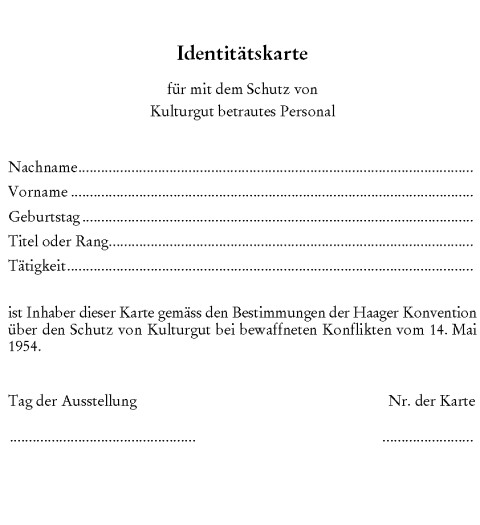
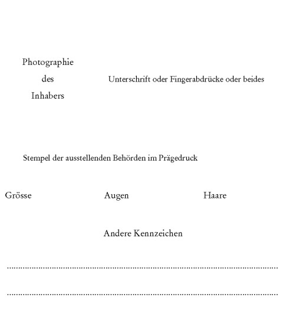

Ausführungsbestimmungen zur Konvention zum Schutz von Kulturgut bei bewaffneten Konflikten Abgeschlossen in Den Haag am 14. Mai 1954 Inkrafttreten für das Fürstentum Liechtenstein: 28. Juli 1960 Kapitel I Überwachung Art. 1 Internationales Personenverzeichnis Nach dem Inkrafttreten der Konvention stellt der Generaldirektor der Organisation der Vereinten Nationen für Erziehung, Wissenschaft und Kultur ein internationales Verzeichnis aller Personen auf, die von den Hohen Vertragsparteien als für das Amt eines Generalkommissars für Kulturgut geeignet benannt worden sind. Auf Veranlassung des Generaldirektors der Organisation der Vereinten Nationen für Erziehung, Wissenschaft und Kultur wird dieses Verzeichnis in gewissen Zeitabständen auf Grund der von den Hohen Vertragsparteien gestellten Anträge berichtigt. Art. 2 Organisation der Überwachung Sobald eine Hohe Vertragspartei in einen bewaffneten Konflikt, auf den Art. 18 der Konvention Anwendung findet, verwickelt wird, a) ernennt sie einen Vertreter für das auf ihrem Gebiet befindliche Kulturgut und, falls sie ein anderes Gebiet besetzt hält, einen besonderen Vertreter für das dort befindliche Kulturgut; b) ernennt die Schutzmacht jeder Partei, die sich mit dieser Hohen Vertragspartei im Konflikt befindet, bei letzterer gemäss Art. 3 dieser Ausführungsbestimmungen einen Delegierten; c) wird bei dieser Hohen Vertragspartei gemäss Art. 4 dieser Ausführungsbestimmungen ein Generalkommissar für Kulturgut ernannt. Art. 3 Ernennung von Delegierten der Schutzmächte Die Schutzmacht ernennt ihre Delegierten aus dem Kreis der Angehörigen ihres diplomatischen oder konsularischen Dienstes oder, mit Zustimmung der Partei, bei der sie tätig sein sollen, aus einem anderen Personenkreis. Art. 4 Ernennung des Generalkommissars 1) Der Generalkommissar für Kulturgut wird von der Partei, bei der er tätig sein soll, und den Schutzmächten der gegnerischen Parteien aus dem internationalen Personenverzeichnis im gegenseitigen Einvernehmen ausgewählt. 2) Gelingt es den Parteien nicht, sich innerhalb von drei Wochen nach Beginn ihrer Erörterungen über diese Frage zu einigen, so ersuchen sie den Präsidenten des Internationalen Gerichtshofes, den Generalkommissar zu ernennen, der jedoch seine Tätigkeit erst dann aufnimmt, wenn die Partei, bei der er tätig sein soll, seine Ernennung gebilligt hat. Art. 5 Aufgaben der Delegierten Die Delegierten der Schutzmächte stellen Verletzungen des Abkommens fest, untersuchen mit Genehmigung der Partei, bei der sie tätig sind, die Umstände, unter denen Verletzungen erfolgt sind, erheben an Ort und Stelle Vorstellungen zu ihrer Beseitigung und machen dem Generalkommissar davon erforderlichenfalls Mitteilung. Sie halten ihn über ihre Tätigkeit auf dem Laufenden. Art. 6 Aufgaben des Generalkommissars 1) Der Generalkommissar für Kulturgut behandelt zusammen mit dem Vertreter der Partei, bei der er tätig ist, und mit den beteiligten Delegierten alle Angelegenheiten, mit denen er hinsichtlich der Anwendung der Konvention befasst ist. 2) Er ist befugt, in den in diesen Ausführungsbestimmungen angegebenen Fällen Entscheidungen zu treffen und Ernennungen vorzunehmen. 3) Mit Zustimmung der Partei, bei der er tätig ist, ist er berechtigt, eine Untersuchung anzuordnen oder selbst durchzuführen. 4) Er erhebt bei den Konfliktsparteien oder ihren Schutzmächten die Vorstellungen, die er zur Anwendung der Konvention für zweckmässig erachtet. 5) Er verfasst die etwa erforderlichen Berichte über die Anwendung der Konvention und übermittelt sie den beteiligten Parteien und ihren Schutzmächten. Er übersendet Abschriften an den Generaldirektor der Organisation der Vereinten Nationen für Erziehung, Wissenschaft und Kultur, der nur von den darin enthaltenen technischen Angaben Gebrauch machen darf. 6) Ist keine Schutzmacht vorhanden, so übernimmt der Generalkommissar die durch die Art. 21 und 22 der Konvention der Schutzmacht übertragenen Aufgaben. Art. 7 Inspektoren und Sachverständige 1) Wenn der Generalkommissar für das Kulturgut auf Ersuchen der beteiligten Delegierten oder nach Beratung mit ihnen dies für erforderlich hält, schlägt er der Partei, bei der er tätig ist, zur Durchführung eines Sonderauftrages einen Inspektor für das Kulturgut zur Genehmigung vor. Der Inspektor ist nur dem Generalkommissar verantwortlich. 2) Der Generalkommissar, die Delegierten und die Inspektoren können Sachverständige hinzuziehen, die ebenfalls der im vorstehenden Absatz erwähnten Partei zur Genehmigung vorzuschlagen sind. Art. 8 Erfüllung der Überwachungsaufgaben Der Generalkommissar für Kulturgut, die Delegierten der Schutzmächte, die Inspektoren und Sachverständigen dürfen keinesfalls die Grenzen ihres Auftrages überschreiten. Sie haben insbesondere den Sicherheitsbedürfnissen der Hohen Vertragspartei, bei der sie tätig sind, Rechnung zu tragen und unter allen Umständen auf die Erfordernisse der militärischen Lage, wie sie ihnen von der betreffenden Hohen Vertragspartei zur Kenntnis gebracht wird, Rücksicht zu nehmen. Art. 9 Fehlen der Schutzmacht Stehen einer der Konfliktsparteien die Dienste einer Schutzmacht nicht oder nicht mehr zur Verfügung, so kann ein neutraler Staat ersucht werden, diejenigen Aufgaben einer Schutzmacht zu übernehmen, die die Ernennung eines Generalkommissars für Kulturgut nach dem im vorstehenden Art. 4 festgelegten Verfahren betreffen. Der auf diese Weise ernannte Generalkommissar betraut erforderlichenfalls Inspektoren mit den in diesen Ausführungsbestimmungen festgelegten Aufgaben der Delegierten der Schutzmächte. Art. 10 Kosten Besoldung und Ausgaben des Generalkommissars für Kulturgut, der Inspektoren und Sachverständigen sind von der Partei zu tragen, bei der sie tätig sind. Besoldung und Ausgaben der Delegierten der Schutzmächte werden durch eine Vereinbarung zwischen diesen Mächten und den Staaten, deren Interessen sie wahrnehmen, geregelt. Kapitel II Sonderschutz Art. 11 Improvisierte Bergungsorte 1) Sieht sich eine Hohe Vertragspartei während eines bewaffneten Konfliktes durch unvorhergesehene Umstände veranlasst, einen improvisierten Bergungsort einzurichten, und möchte sie ihn unter Sonderschutz stellen, so hat sie den bei ihr tätigen Generalkommissar für Kulturgut unverzüglich davon in Kenntnis zu setzen. 2) Ist der Generalkommissar der Auffassung, dass eine solche Massnahme durch die Umstände und durch die Bedeutung des in diesem improvisierten Bergungsort untergebrachten Kulturguts gerechtfertigt ist, so kann er die Hohe Vertragspartei ermächtigen, den Bergungsort mit dem in Art. 16 der Konvention vorgesehenen Kennzeichen zu versehen. Er hat seine Entscheidung unverzüglich den beteiligten Delegierten der Schutzmächte mitzuteilen, von denen jeder innerhalb von 30 Tagen die sofortige Zurückziehung des Kennzeichens anordnen kann. 3) Sobald diese Delegierten ihre Zustimmung ausgedrückt haben oder wenn innerhalb der Frist von 30 Tagen keiner der beteiligten Delegierten Einspruch erhoben hat und wenn nach Auffassung des Generalkommissars der Bergungsort den in Art. 8 der Konvention aufgeführten Bedingungen entspricht, ersucht der Generalkommissar den Generaldirektor der Organisation der Vereinten Nationen für Erziehung, Wissenschaft und Kultur, den Bergungsort in das Internationale Register des Kulturguts unter Sonderschutz einzutragen. Art. 12 Internationales Register für Kulturgut unter Sonderschutz 1) Es ist ein "Internationales Register für Kulturgut unter Sonderschutz" einzurichten. 2) Das Register wird vom Generaldirektor der Organisation der Vereinten Nationen für Erziehung, Wissenschaft und Kultur geführt. Er übersendet Abschriften an den Generalsekretär der Vereinten Nationen und an die Hohen Vertragsparteien. 3) Das Register ist in Abteilungen zu gliedern, und zwar ist für jede der Hohen Vertragsparteien eine Abteilung vorzusehen. Jede Abteilung ist in drei Unterabteilungen zu gliedern mit den Überschriften: Bergungsorte, Denkmalsorte, sonstiges unbewegliches Kulturgut. Der Generaldirektor bestimmt die Einzelheiten innerhalb jeder Abteilung. Art. 13 Anträge auf Eintragung 1) Jede Hohe Vertragspartei kann beim Generaldirektor der Organisation der Vereinten Nationen für Erziehung, Wissenschaft und Kultur beantragen, bestimmte auf ihrem Gebiet gelegene Bergungsorte, Denkmalsorte oder sonstige unbewegliche Kulturgüter in das Internationale Register einzutragen. Der Antrag muss eine Beschreibung der Lage des betreffenden Kulturguts enthalten und bescheinigen, dass es die Bedingungen des Art. 8 der Konvention erfüllt. 2) Im Falle der Besetzung eines Gebietes ist die Besatzungsmacht für die Stellung dieses Antrags zuständig. 3) Der Generaldirektor der Organisation der Vereinten Nationen für Erziehung, Wissenschaft und Kultur hat unverzüglich jeder der Hohen Vertragsparteien Abschriften der Anträge auf Eintragung zu übersenden. Art. 14 Einsprüche 1) Jede Hohe Vertragspartei kann mit einem an den Generaldirektor der Organisation der Vereinten Nationen für Erziehung, Wissenschaft und Kultur gerichteten Schreiben gegen die Eintragung von Kulturgut Einspruch erheben. Dieses Schreiben muss innerhalb von vier Monaten nach dem Tage, an dem der Generaldirektor eine Abschrift des Antrages auf Eintragung abgesandt hat, bei ihm eingegangen sein. 2) Der Einspruch muss begründet sein; er kann nur darauf gestützt werden, dass a) das Gut kein Kulturgut ist, b) die in Art. 8 der Konvention angeführten Bedingungen nicht erfüllt sind. 3) Der Generaldirektor hat den Hohen Vertragsparteien unverzüglich eine Abschrift des Einspruchs zu übermitteln. Er hat erforderlichenfalls die Stellungnahme des "Internationalen Ausschusses für Denkmale, künstlerische und geschichtliche Stätten und archäologische Ausgrabungen" sowie, wenn er es für angebracht hält, sonstiger geeigneter Organisationen oder Persönlichkeiten einzuholen. 4) Der Generaldirektor oder die die Eintragung beantragende Hohe Vertragspartei kann bei der Hohen Vertragspartei, die den Einspruch erhoben hat, alle für notwendig erachteten Schritte unternehmen, um die Rücknahme des Einspruchs zu erwirken. 5) Wird eine Hohe Vertragspartei, die in Friedenszeiten einen Antrag auf Eintragung gestellt hat, in einen bewaffneten Konflikt verwickelt, bevor die Eintragung erfolgt ist, so hat der Generaldirektor das betreffende Kulturgut sofort vorläufig in das Register einzutragen, vorbehaltlich der Bestätigung, Zurückziehung oder Streichung noch zu erhebender oder bereits erhobener Einsprüche. 6) Hat der Generaldirektor nicht binnen sechs Monaten nach Eingang des Einspruchs von der Hohen Vertragspartei, die Einspruch erhoben hat, eine Mitteilung dahingehend erhalten, dass der Einspruch zurückgezogen ist, so kann die Hohe Vertragspartei, die die Eintragung beantragt hat, ein Schiedsverfahren gemäss dem im folgenden Absatz geregelten Verfahren beantragen. 7) Der Antrag auf ein Schiedsverfahren ist innerhalb eines Jahres nach Eingang des Einspruchs beim Generaldirektor zu stellen. Jede der beiden am Streitfall beteiligten Parteien ernennt einen Schiedsrichter. Ist mehr als ein Einspruch gegen einen Antrag auf Eintragung erhoben worden, so ernennen die hohen Vertragsparteien, die die Einsprüche erhoben haben, in gegenseitigem Einvernehmen einen einzigen Schiedsrichter. Die beiden Schiedsrichter wählen einen Oberschiedsrichter aus dem in Art. 1 dieser Ausführungsbestimmungen erwähnten internationalen Verzeichnis. Einigen sich die Schiedsrichter bei der Wahl nicht, so ersuchen sie den Präsidenten des Internationalen Gerichtshofes, einen Oberschiedsrichter zu bestimmen, der nicht notwendigerweise aus dem internationalen Verzeichnis ausgewählt zu werden braucht. Das auf diese Weise gebildete Schiedsgericht bestimmt selbst sein Verfahren. Gegen seine Entscheidungen kann kein Rechtsmittel eingelegt werden. 8) Jede der Hohen Vertragsparteien kann bei Entstehung eines Streitfalles, in dem sie Partei ist, erklären, dass sie die Anwendung des in Abs. 6 und 7 dieses Artikels vorgesehenen Schiedsverfahrens nicht wünscht. In diesem Falle hat der Generaldirektor den Einspruch gegen einen Antrag auf Eintragung den Hohen Vertragsparteien vorzulegen. Der Einspruch kann nur dann bestätigt werden, wenn die Hohen Vertragsparteien dies mit einer Zweidrittelmehrheit der sich an der Abstimmung beteiligenden Hohen Vertragsparteien beschliessen. Die Abstimmung erfolgt schriftlich, sofern nicht der Generaldirektor der Organisation der Vereinten Nationen für Erziehung, Wissenschaft und Kultur es für unerlässlich erachtet, auf Grund der ihm gemäss Art. 27 der Konvention zustehenden Befugnisse eine Tagung einzuberufen. Entscheidet der Generaldirektor, dass die Abstimmung auf schriftlichem Weg durchgeführt werden soll, so fordert er die Hohen Vertragsparteien auf, ihre Stimme innerhalb von 6 Monaten, vom Tage der Aufforderung an gerechnet, in einem versiegelten Schreiben abzugeben. Art. 15 Eintragung 1) Der Generaldirektor der Organisation der Vereinten Nationen für Erziehung, Wissenschaft und Kultur veranlasst, dass jedes Kulturgut, für das ein Antrag auf Eintragung gestellt worden ist, unter einer Ordnungsnummer in das Register eingetragen wird, sofern nicht innerhalb der in Art. 14 Abs. 1 dieser Ausführungsbestimmungen vorgesehenen Frist ein Einspruch erhoben worden ist. 2) Ist ein Einspruch erhoben worden und unbeschadet der Bestimmung des Art. 14 Abs. 5, darf der Generaldirektor Kulturgut nur dann in das Register eintragen, wenn der Einspruch zurückgezogen oder nach dem in Abs. 7 oder Abs. 8 des Art. 14 dieser Ausführungsbestimmungen vorgesehenen Verfahren nicht bestätigt worden ist. 3) In dem in Art. 11 Abs. 3 vorgesehenen Fall nimmt der Generaldirektor die Eintragung auf Ersuchen des Generalsekretärs für Kulturgut vor. 4) Der Generaldirektor übersendet eine beglaubigte Abschrift jeder Eintragung in das Register unverzüglich an den Generalsekretär der Vereinten Nationen, an die Hohen Vertragsparteien und, auf Ersuchen der die Eintragung beantragenden Partei, an alle anderen in Art. 30 und 32 der Konvention bezeichneten Staaten. Die Eintragung wird 30 Tage nach Absendung dieser Abschrift wirksam. Art. 16 Streichung 1) Der Generaldirektor der Organisation der Vereinten Nationen für Erziehung, Wissenschaft und Kultur veranlasst die Streichung der Eintragung von Kulturgut a) auf Antrag der Hohen Vertragspartei, auf deren Gebiet sich das Kulturgut befindet, b) im Falle der Kündigung der Konvention durch die Hohe Vertragspartei, die die Eintragung beantragt hatte, sobald die Kündigung wirksam geworden ist; c) in dem in Art. 14 Abs. 5 dieser Ausführungsbestimmungen vorgesehenen Sonderfalle, wenn ein Einspruch nach dem in Art. 14 Abs. 7 oder 8 vorgesehenen Verfahren bestätigt worden ist. 2) Der Generaldirektor übersendet dem Generalsekretär der Vereinten Nationen sowie allen Staaten, die eine Abschrift der Eintragung ins Register erhalten haben, unverzüglich eine beglaubigte Abschrift der Streichungsverfügung. Die Streichung wird 30 Tage nach Absendung dieser Abschriften wirksam. Kapitel III Transporte von Kulturgut Art. 17 Verfahren zur Erlangung der Unverletzlichkeit 1) Der Antrag gemäss Art. 12 Abs. 1 der Konvention ist an den Generalkommissar für Kulturgut zu richten. Der Antrag muss begründet sein und die ungefähre Zahl und die Bedeutung der zu verlagernden Kulturgüter, ihre derzeitige Unterbringung, die in Aussicht genommene Unterbringung, die vorgesehenen Transportmittel, den beabsichtigten Reiseweg und den für die Verlagerung vorgeschlagenen Tag sowie alle sonstigen einschlägigen Angaben anführen. 2) Ist der Generalkommissar nach Einholung der von ihm als zweckmässig erachteten Stellungnahmen der Auffassung, dass diese Verlagerung gerechtfertigt ist, so hat er sich mit den beteiligten Delegierten der Schutzmächte wegen der für die Durchführung in Aussicht genommenen Massnahmen ins Benehmen zu setzen. Danach hat er den in Frage kommenden Konfliktsparteien die Verlagerung mitzuteilen, wobei die Mitteilung alle zweckmässigen Angaben enthalten muss. 3) Der Generalkommissar ernennt einen oder mehrere Inspektoren, die sich zu vergewissern haben, dass nur das in dem Antrag angeführte Kulturgut verlagert wird und dass der Transport auf die genehmigte Art und Weise erfolgt und das Kennzeichen führt. Der Inspektor oder die Inspektoren begleiten das Kulturgut bis an den Bestimmungsort. Art. 18 Transporte ins Ausland Erfolgt die unter Sonderschutz stehende Verlagerung in das Gebiet eines anderen Landes, so finden nicht nur Art. 12 der Konvention und Art. 17 dieser Ausführungsbestimmungen Anwendung, sondern auch die nachstehenden weiteren Bestimmungen: a) Solange sich das Kulturgut auf dem Gebiet eines anderen Staates befindet, ist dieser Staat Verwahrer des Kulturguts und er hat darauf dieselbe Sorgfalt zu verwenden wie auf eigenes Kulturgut von vergleichbarer Bedeutung. b) Der Verwahrerstaat gibt das Kulturgut erst nach Beendigung des Konflikts zurück; die Rückgabe hat innerhalb von sechs Monaten nach dem Tage, an dem ein entsprechendes Ersuchen gestellt worden ist, zu erfolgen. c) Während der verschiedenen Phasen der Verlagerung und solange sich das Kulturgut im Gebiet eines anderen Staates befindet, ist es beschlagnahmefrei und es kann darüber weder vom Hinterleger noch vom Verwahrer verfügt werden. Jedoch kann der Verwahrer das Kulturgut, wenn es dessen Sicherheit erfordert, mit Zustimmung des Hinterlegers in das Gebiet eines dritten Landes unter den in diesem Artikel bezeichneten Voraussetzungen transportieren lassen. d) In dem Antrag auf Sonderschutz ist anzugeben, dass der Staat, in dessen Gebiet das Kulturgut verlagert werden soll, die Bestimmungen dieses Artikels annimmt. Art. 19 Besetztes Gebiet In allen Fällen, in denen eine Hohe Vertragspartei, die das Gebiet einer anderen Hohen Vertragspartei besetzt hält, Kulturgut in einen an anderer Stelle innerhalb dieses Gebiets gelegenen Bergungsort verlagert, ohne in der Lage zu sein, das in Art. 17 dieser Ausführungsbestimmungen geregelte Verfahren zu befolgen, gilt die in Betracht kommende Verlagerung nicht als unrechtmässige Aneignung im Sinne des Art. 4 der Konvention, sofern der Generalkommissar für Kulturgut nach Befragung des ordentlichen Verwaltungspersonals schriftlich bestätigt, dass diese Verlagerung durch die Umstände geboten war. Kapitel IV Das Kennzeichen Art. 20 Anbringung des Kennzeichens 1) Die Anbringung des Kennzeichens und der Grad seiner Sichtbarkeit liegen im Ermessen der zuständigen Behörden jeder Hohen Vertragspartei. Es kann auf Flaggen oder Armbinden gezeigt werden, es kann auf einen Gegenstand aufgemalt oder in jeder anderen geeigneten Form dargestellt werden. 2) Unbeschadet einer etwa möglichen deutlicheren Kennzeichnung ist das Kennzeichen im Fall eines bewaffneten Konflikts und in den in den Art. 12 und 13 der Konvention erwähnten Fällen auf den Transportfahrzeugen so anzubringen, dass es bei Tageslicht aus der Luft ebenso wie vom Boden aus deutlich erkennbar ist. 3) Das Kennzeichen muss vom Boden aus sichtbar sein a) in regelmässigen Abständen, die ausreichend klar den Umkreis des unter Sonderschutz stehenden Denkmalorts erkennen lassen, b) am Zugang zu sonstigem unter Sonderschutz stehendem unbeweglichem Kulturgut. Art. 21 Kennzeichnung von Personen 1) Die in Art. 17 Abs. 2 b und c der Konvention bezeichneten Personen können eine von den zuständigen Behörden ausgegebene und abgestempelte Armbinde mit dem Erkennungszeichen tragen. 2) Diese Personen haben eine besondere mit dem Erkennungszeichen versehene Identitätskarte bei sich zu führen. Diese Karte muss mindestens den Familien- und Vornamen, das Geburtsdatum, den Titel oder Rang und die Funktion des Inhabers angeben. Die Karte muss ein Lichtbild des Inhabers und dessen Unterschrift oder Fingerabdrücke oder beides enthalten. Sie muss den Stempel der zuständigen Behörden in Prägedruck tragen. 3) Jede Hohe Vertragspartei stellt ihre eigenen Identitätskarten aus, wobei sie sich nach dem diesen Ausführungsbestimmungen beispielsweise angefügten Muster richtet. Die Hohen Vertragsparteien tauschen jeweils einen Vordruck des von ihnen verwendeten Musters aus. Die Identitätskarten sind möglichst jeweils in mindestens zwei Ausfertigungen auszustellen, wovon die eine von der ausstellenden Macht aufbewahrt wird. 4) Den erwähnten Personen darf die Identitätskarte oder das Recht zum Tragen der Armbinde nicht ohne berechtigten Grund entzogen werden. 

 

