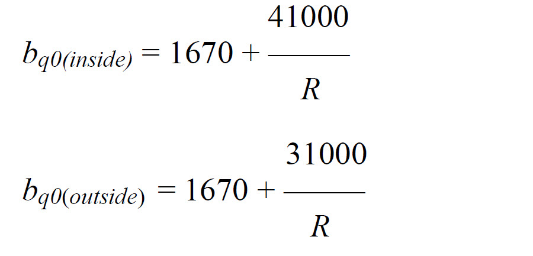

Übereinkommen vom 4. Januar 1960 zur Errichtung der Europäischen Freihandelsassoziation (EFTA) Abgeschlossen in Stockholm am 4. Januar 1960 Konsolidierte Fassung des Vaduzer Abkommens vom 21. Juni 2001 Zustimmung des Landtags: 14. März 2002 Inkrafttreten: 1. Juni 2002 Die Republik Island, das Fürstentum Liechtenstein, das Königreich Norwegen und die Schweizerische Eidgenossenschaft (im Folgenden "Mitgliedstaaten" genannt); eingedenk des Abschlusses des Übereinkommens zur Errichtung der Europäischen Freihandelsassoziation vom 4. Januar 1960 (im Folgenden "Übereinkommen" genannt) zwischen der Republik Österreich, dem Königreich Dänemark, dem Königreich Norwegen, der portugiesischen Republik, dem Königreich Schweden, der Schweizerischen Eidgenossenschaft und dem Vereinigten Königreich von Grossbritannien und Nordirland; eingedenk der Assoziation der Republik Finnland und deren Beitritt am 1. Januar 1986, sowie der Beitritte der Republik Island am 1. März 1970 und des Fürstentums Liechtenstein am 1. September 1991; eingedenk der sukzessiven Übereinkommensaustritte seitens des Königreichs Dänemark und des Vereinigten Königreichs am 1. Januar 1973; der Republik Portugal am 1. Januar 1986; der Republik Österreich, der Republik Finnland und des Königreichs Schweden am 1. Januar 1995; eingedenk der Freihandelsabkommen zwischen den Mitgliedstaaten einerseits und Drittparteien andererseits; in Bestätigung der hohen Priorität, welche den besonderen Beziehungen zwischen den EFTA-Staaten und der Erleichterung der Weiterführung ihrer guten Handelsbeziehungen mit der Europäischen Union, welche auf Annäherung, altbewährte gemeinsame Werte und europäische Identität gründen, beigemessen wird; entschlossen, - unter Beachtung der Grundsätze des lauteren Wettbewerbs - die im Rahmen der Europäischen Freihandelsassoziation begründete Zusammenarbeit zu vertiefen, den freien Warenverkehr weiter zu erleichtern, schrittweise den freien Personenverkehr und die Liberalisierung von Dienstleistungen und Investitionen zu erreichen, die öffentlichen Beschaffungsmärkte in den EFTA-Staaten weiter zu öffnen und für einen angemessenen Schutz der Geistigen Eigentumsrechte zu sorgen; aufbauend auf den jeweiligen Rechten und Pflichten, welche sich aus dem Abkommen zur Einrichtung der Welthandelsorganisation und anderen multinationalen und bilateralen Instrumenten der Zusammenarbeit ergeben; in Anerkennung der Notwendigkeit der gegenseitigen Unterstützung der Handels- und Umweltpolitiken zum Zwecke der Erreichung des Ziels einer nachhaltigen Entwicklung; in Bestätigung ihrer Verpflichtung, anerkannte Arbeitsmindeststandards zu befolgen, sowie ihrer Bestrebungen, solche Standards in den geeigneten multilateralen Gremien zu fördern und ihrer Überzeugung Ausdruck verleihend, dass Wirtschaftswachstum und Wirtschaftsentwicklung durch gesteigerten Handel und durch weitere Handelsliberalisierung zur Entwicklung dieser Standards das Ihre beizutragen vermögen; haben das Folgende vereinbart: Kapitel I Zielsetzung Art. 1 Die Assoziation Durch dieses Übereinkommen wird eine internationale Organisation mit dem Namen Europäische Freihandelsassoziation, im Folgenden "die Assoziation" genannt, errichtet. Art. 2 Zielsetzung Die Assoziation hat zum Ziel: a) eine kontinuierliche und ausgewogene Verstärkung des Handels und der Wirtschaftsbeziehungen unter lauteren Wettbewerbsbedingungen und in Anerkennung gleichwertiger Regeln innerhalb der Assoziation zu fördern; b) den freien Warenverkehr zu verwirklichen; c) den freien Personenverkehr schrittweise zu liberalisieren; d) den Dienstleistungs- und Kapitalverkehr schrittweise zu liberalisieren; e) lautere Wettbewerbsbedingungen vorzusehen, die den Handel zwischen den Parteien fördern; f) die öffentlichen Beschaffungsmärkte der Mitgliedstaaten zu öffnen; g) in Übereinstimmung mit den höchsten internationalen Standards einen angemessenen Schutz der Geistigen Eigentumsrechte sicherzustellen. Kapitel II Freier Warenverkehr Art. 3 Ein- und Ausfuhrzölle und Abgaben gleicher Wirkung Ein- und Ausfuhrzölle sowie alle Abgaben mit gleicher Wirkung zwischen den Mitgliedstaaten sind verboten. Dies gilt auch für Fiskalzölle. Art. 4 Interne Steuern 1) Kein Mitgliedstaat erhebt für Erzeugnisse anderer Mitgliedstaaten, direkt oder indirekt, interne Steuern irgendeiner Art, zusätzlich zu denjenigen, die direkt oder indirekt auf gleichartige einheimische Produkte erhoben werden. 2) Darüber hinaus erhebt kein Mitgliedstaat für Erzeugnisse anderer Mitgliedstaaten interne Steuern irgendeiner Art, die indirekt geeignet sind, andere Produkte zu schützen. 3) Für Erzeugnisse, die in das Gebiet eines Mitgliedstaats ausgeführt werden, darf die Erstattung für inländische Abgaben nicht höher sein als die auf diesen Erzeugnissen direkt oder indirekt erhobenen Steuern. Art. 5 Ursprungsregeln und administrative Zusammenarbeit Die Bestimmungen zu den Ursprungsregeln und den Methoden der administrativen Zusammenarbeit sind in Anhang A aufgeführt. Art. 6 Gegenseitige Amtshilfe im Zollbereich 1) Die Mitgliedstaaten leisten einander in Übereinstimmung mit den Vorschriften des Anhangs B Amtshilfe im Zollbereich, um die ordnungsgemässe Anwendung ihres Zollrechts sicherzustellen. 2) Anhang B findet auf alle Erzeugnisse Anwendung, unabhängig davon, ob sie unter die Bestimmungen des Übereinkommens fallen. Art. 7 Mengenmässige Ein- und Ausfuhrbeschränkungen und Massnahmen gleicher Wirkung Mengenmässige Ein- und Ausfuhrbeschränkungen sowie Massnahmen mit gleicher Wirkung zwischen den Mitgliedstaaten sind verboten. Art. 8 Landwirtschaftliche Erzeugnisse Im Hinblick auf die besonderen für die Landwirtschaft massgebenden Erwägungen finden die Art. 2, 3, 4 und 7 sowie Kapitel IV über staatliche Beihilfen, Kapitel VI über Wettbewerbsregeln und Kapitel XII über das öffentliche Beschaffungswesen keine Anwendung auf landwirtschaftliche Erzeugnisse nach den Kapiteln 1-24 des Internationalen Übereinkommens vom 14. Juni 1983 über das Harmonisierte System zur Bezeichnung und Codierung der Waren (HS) oder nach Anhang X, vorbehältlich der Bestimmungen in: a) Anhang V über Basisagrarprodukte; oder b) Anhang W über verarbeitete Landwirtschaftsprodukte. Art. 9 Aufgehoben Art. 10 Fisch und andere Meeresprodukte Die Bestimmungen dieses Übereinkommens sind auf Fische und andere Meeresprodukte anwendbar. Art. 11 Saatgut und biologische Landwirtschaft 1) Spezielle Bestimmungen über Saatgut sind in Anhang E aufgeführt. 2) Spezielle Bestimmungen über die biologische Landwirtschaft sind in Anhang F aufgeführt. Art. 12 Gesundheitspolizeiliche und pflanzenschutzrechtliche Massnahmen Die Rechte und Pflichten der Mitgliedstaaten bezüglich gesundheitspolizeilicher und pflanzenschutzrechtlicher Massnahmen werden im Anhang G geregelt. Art. 13 Ausnahmen Die Bestimmungen von Art. 7 schliessen weder Verbote noch Beschränkungen bezüglich der Ein-, Aus- oder Durchfuhr von Waren aus, sofern sie aus Gründen der öffentlichen Sittlichkeit; der öffentlichen Ordnung oder öffentlichen Sicherheit; zum Schutz des Lebens und der Gesundheit von Menschen, Tieren oder Pflanzen und der Umwelt; zum Schutz des nationalen Kulturgutes mit künstlerischem, historischem oder archäologischem Wert; oder zum Schutz des Eigentums gerechtfertigt sind. Solche Verbote oder Beschränkungen dürfen weder ein Mittel zur willkürlichen Diskriminierung noch eine versteckte Beschränkung des Handels zwischen Mitgliedstaaten darstellen. Kapitel III Technische Handelshemmnisse Art. 14 Notifikation der Entwürfe von technischen Vorschriften 1) Die Mitgliedstaaten notifizieren dem Rat so frühzeitig wie möglich im Vorbereitungsstadium alle Entwürfe von technischen Vorschriften und Änderungen solcher Vorschriften. 2) Die Einzelheiten des Notifikationsverfahrens sind im Anhang H festgelegt. Art. 15 Gegenseitige Anerkennung von Konformitätsbewertungen Unbeschadet des Art. 7 anerkennen die Schweiz, einerseits, und Island, Liechtenstein sowie Norwegen, andererseits, gegenseitig Berichte, Bescheinigungen, Zulassungen, Konformitätskennzeichen und Konformitätserklärungen der Hersteller gemäss den Bestimmungen des Anhangs I. Kapitel IV Staatliche Beihilfen Art. 16 Staatliche Beihilfen 1) Die Rechte und Pflichten der Mitgliedstaaten in Bezug auf staatliche Beihilfen richten sich nach Art. XVI des GATT 1994 und nach dem WTO-Übereinkommen über Subventionen und Ausgleichsmassnahmen, welche einen integralen Bestandteil dieser Übereinkommen bilden, soweit im Anhang Q nichts anderes vorgesehen ist. 2) Die Mitgliedstaaten enthalten sich in Übereinstimmung mit Art. 36 dieses Übereinkommens im Verhältnis untereinander der Anwendung von Ausgleichsmassnahmen nach Teil V des WTO-Übereinkommens über Subventionen und Ausgleichsmassnahmen. 3) Die Mitgliedstaaten überprüfen den Geltungsbereich dieses Kapitels im Hinblick auf eine Ausdehnung des Regimes staatlicher Beihilfen entsprechend der internationalen Entwicklung auf den Dienstleistungsbereich. Zu diesem Zweck wird dieses Kapitel einer jährlichen Prüfung unterzogen. Kapitel V Öffentliche Unternehmen und Monopolrechte Art. 17 Öffentliche Unternehmen und Monopolrechte 1) Die Mitgliedstaaten sorgen dafür, dass sich öffentliche Unternehmen der folgenden Praktiken enthalten: a) Massnahmen, die für die einheimische Produktion einen Schutz bewirken, der mit diesem Übereinkommen unvereinbar wäre, wenn er durch Zölle oder Abgaben gleicher Wirkung, durch mengenmässige Beschränkungen oder staatliche Beihilfen erzielt würde, oder b) Diskriminierungen im Handel aus Gründen der Nationalität, soweit dadurch die vom Abbau oder Fehlen der Zölle und mengenmässigen Beschränkungen im Handel zwischen den Mitgliedstaaten erwarteten Vorteile vereitelt werden. 2) Im Sinne dieses Artikels sind unter "öffentlichen Unternehmen" zentrale, regionale oder lokale Behörden, öffentliche Betriebe und jede sonstige Organisation zu verstehen, durch die ein Mitgliedstaat rechtlich oder tatsächlich die Einfuhr aus oder die Ausfuhr nach dem Gebiet eines anderen Mitgliedstaates kontrolliert oder merklich beeinflusst. 3) Die Bestimmungen von Abs. 1 des Art. 18 sind auch auf die Tätigkeit öffentlicher oder vom Staat mit besonderen oder ausschliesslichen Rechten ausgestatteter Unternehmen anwendbar, soweit dadurch nicht die Erfüllung bestimmter zugewiesener öffentlicher Aufgaben rechtlich oder tatsächlich behindert wird. 4) Abs. 3 dieses Artikels ist auch auf Anhang Q anwendbar. Die Mitgliedstaaten überprüfen den Geltungsbereich dieses Kapitels im Hinblick auf eine Ausdehnung des Subventionsregimes entsprechend der internationalen Entwicklung auf den Dienstleistungsbereich. Zu diesem Zweck wird dieses Kapitel einer jährlichen Prüfung unterzogen. 5) Die Mitgliedstaaten sorgen dafür, dass keine neuen Praktiken der in Abs. 1 dieses Artikels beschriebenen Art eingeführt werden. 6) Wo die Mitgliedstaaten nicht die erforderlichen gesetzlichen Befugnisse haben, auf die Tätigkeit der regionalen oder lokalen Behörden oder der von diesen abhängigen Unternehmen bestimmenden Einfluss zu nehmen, trachten sie dennoch zu erreichen, dass diese Behörden oder Unternehmen den Bestimmungen dieses Artikels nachkommen. Kapitel VI Wettbewerbsregeln Art. 18 Wettbewerb 1) Die Mitgliedstaaten anerkennen, dass die folgenden Praktiken mit diesem Übereinkommen insoweit unvereinbar sind, als sie die vom Übereinkommen zu erwartenden Vorteile vereiteln: a) alle Vereinbarungen zwischen Unternehmen, Beschlüsse von Unternehmensvereinigungen und aufeinander abgestimmte Verhaltensweisen von Unternehmen, welche eine Verhinderung, Einschränkung oder Verfälschung des Wettbewerbs bezwecken oder bewirken; b) die missbräuchliche Ausnutzung einer beherrschenden Stellung auf dem gesamten Gebiet der Vertragsparteien oder auf einem wesentlichen Teil desselben durch ein oder mehrere Unternehmen. 2) Ist eine Vertragspartei der Auffassung, dass eine Praktik mit diesem Artikel unvereinbar ist, so kann sie gemäss dem in Art. 47 festgelegten Verfahren Beratungen verlangen und unter den Voraussetzungen von Abs. 2 von Art. 40 geeignete Massnahmen treffen im Hinblick auf Schwierigkeiten, die sich auf Grund der fraglichen Praktik ergeben. Kapitel VII Schutz des Geistigen Eigentums Art. 19 1) Die Mitgliedstaaten erteilen und gewährleisten einen angemessenen und wirksamen Schutz der Rechte an Geistigem Eigentum. Sie treffen Massnahmen zum Schutze dieser Rechte vor Verletzung, Fälschung und Nachahmung in Übereinstimmung mit den Vorschriften dieses Artikels des Anhangs J und den darin erwähnten internationalen Übereinkommen. 2) Die Mitgliedstaaten gewähren den Staatsangehörigen der anderen Mitgliedstaaten eine Behandlung, welche nicht ungünstiger ist als die ihren eigenen Staatsangehörigen gewährte Behandlung. Ausnahmen von dieser Verpflichtung müssen in Übereinstimmung stehen mit den materiellen Bestimmungen von Art. 3 des Abkommens über handelsbezogene Aspekte der Rechte an Geistigem Eigentum (nachstehend "TRIPS-Abkommen" genannt). 3) Die Mitgliedstaaten gewähren den Staatsangehörigen der anderen Mitgliedstaaten eine Behandlung, welche nicht ungünstiger ist als die den Angehörigen eines jeden anderen Staates gewährte Behandlung. Ausnahmen von dieser Verpflichtung müssen in Übereinstimmung stehen mit den materiellen Bestimmungen des TRIPS-Abkommens, insbesondere dessen Art. 4 und 5. 4) Die Mitgliedstaaten vereinbaren, auf Antrag eines Mitgliedstaates die in diesem Artikel und im Anhang J enthaltenen Bestimmungen über den Schutz des Geistigen Eigentums zu überprüfen mit dem Ziel, das Schutzniveau weiter zu verbessern und Handelsverzerrungen, welche durch den gegenwärtigen Umfang des Schutzes des Geistigen Eigentums verursacht werden, zu vermeiden oder zu beseitigen. Kapitel VIII Freier Personenverkehr Art. 20 Personenverkehr 1) Der freie Personenverkehr soll unter den Mitgliedstaaten sichergestellt werden gemäss den Bestimmungen in Anhang K und im Protokoll zu Anhang K über die Freizügigkeit zwischen der Schweiz und Liechtenstein. 2) Ziel dieses Artikels zu Gunsten der Staatsangehörigen der Mitgliedstaaten ist Folgendes: a) Einräumung eines Rechts auf Einreise, Aufenthalt, Zugang zu einer unselbstständigen Erwerbstätigkeit und Niederlassung als Selbstständiger sowie des Rechts auf Verbleib im Hoheitsgebiet der Mitgliedstaaten; b) Erleichterung der Erbringung von Dienstleistungen im Hoheitsgebiet der Mitgliedstaaten; insbesondere die Liberalisierung kurzfristiger Dienstleistungen; c) Einräumung eines Rechts auf Einreise und Aufenthalt im Hoheitsgebiet der Mitgliedstaaten für Personen, die im Aufnahmestaat keine Erwerbstätigkeit ausüben; d) Einräumung der gleichen Lebens, Beschäftigungs- und Arbeitsbedingungen wie für Inländer. Art. 21 Koordinierung der Systeme der sozialen Sicherheit Zur Herstellung der Freizügigkeit regeln die Mitgliedstaaten die Koordinierung der Systeme der sozialen Sicherheit gemäss Anlage 2 zu Anhang K und durch das Protokoll zu Anhang K über die Freizügigkeit zwischen Liechtenstein und der Schweiz, um insbesondere Folgendes zu garantieren: a) Gleichbehandlung; b) Bestimmung der anzuwendenden Rechtsvorschriften; c) Zusammenrechnung aller nach den verschiedenen nationalen Rechtsvorschriften berücksichtigten Versicherungszeiten für den Erwerb und die Aufrechterhaltung des Leistungsanspruchs sowie für die Berechnung der Leistungen; d) Zahlung der Leistungen an Personen, die ihren Wohnsitz im Hoheitsgebiet der Mitgliedstaaten haben; e) Amtshilfe und Zusammenarbeit der Behörden und Einrichtungen. Art. 22 Gegenseitige Anerkennung von Berufsabschlüssen Um den Staatsangehörigen der Mitgliedstaaten die Aufnahme und Fortführung von beruflichen Aktivitäten als Angestellte oder Selbstständigerwerbende zu erleichtern, ergreifen die Mitgliedstaaten die nötigen Massnahmen, wie festgelegt in Anlage 3 und im Protokoll zu Anhang K über die Personenfreizügigkeit zwischen Liechtenstein und der Schweiz betreffend die gegenseitige Anerkennung von Diplomen, Zeugnissen und anderen formalen Fähigkeitsnachweisen, sowie die Koordination von Gesetzen, Verordnungen oder Verwaltungsmassnahmen betreffend die Aufnahme und Fortführung von Aktivitäten durch angestellte und selbstständigerwerbende Personen. Kapitel IX Investitionen Teil 1 Niederlassung Art. 23 Grundsätze und Anwendungsbereich 1) Im Rahmen und unter Vorbehalt dieses Abkommens unterliegt das Niederlassungsrecht von Gesellschaften, die nach den Rechtsvorschriften eines Mitgliedstaates gegründet wurden und ihren satzungsmässigen Sitz, ihre Hauptverwaltung oder ihre Hauptniederlassung im Hoheitsgebiet der Mitgliedstaaten haben, keinen Beschränkungen. Dies gilt gleichermassen für die Gründung von Agenturen, Zweigniederlassungen oder Tochtergesellschaften durch Gesellschaften eines Mitgliedstaates, die im Hoheitsgebiet eines anderen Mitgliedstaates errichtet wurden. Das Niederlassungsrecht beinhaltet das Recht zur Gründung, zum Erwerb und zur Leitung von Unternehmen, insbesondere von Gesellschaften im Sinne von Abs. 2, unter den gleichen Voraussetzungen, die das Recht des Mitgliedstaates, in dem die Niederlassung errichtet wurde, für seine eigenen Unternehmen vorsieht, aber vorbehaltlich der nachstehenden Bestimmungen. 2) Im Sinne dieses Kapitels bedeuten: a) Tochtergesellschaft einer Gesellschaft: eine Gesellschaft, die tatsächlich von der ersten Gesellschaft kontrolliert ist; b) Gesellschaften: die Gesellschaften des Zivil- oder Handelsrechts, einschliesslich der Genossenschaften, und die sonstigen juristischen Personen öffentlichen und privaten Rechts mit Ausnahme derjenigen, die keinen Erwerbszweck verfolgen; um als Unternehmen eines Mitgliedstaates anerkannt zu werden, muss es zu dessen Wirtschaft einen tatsächlichen und dauernden Bezug haben. 3) Die Anhänge L bis O enthalten spezifische Bestimmungen und Ausnahmen in Bezug auf das Niederlassungsrecht. Die Mitgliedstaaten trachten schrittweise danach, die aus dem Vorbehalt in den Anhängen L bis O resultierenden und noch verbleibenden Diskriminierungen zu beseitigen. Sie vereinbaren zudem, die vorliegende Bestimmung, einschliesslich der Anhänge, innerhalb zweier Jahre nach Inkrafttreten dieses Abkommens, welches das EFTA-Übereinkommen vom 21. Juni 2001 ergänzt, im Hinblick auf Reduktion und vollständige Beseitigung der noch verbleibenden Einschränkungen zu überprüfen. 4) Ab dem Inkrafttreten dieses Abkommens, welches das EFTA-Übereinkommen vom 21. Juni 2001 ergänzt, darf kein Mitgliedstaat, verglichen zur Behandlung der eigenen Gesellschaften neue oder weitere diskriminierende Massnahmen bezüglich Niederlassung und Geschäftstätigkeit der Gesellschaften eines anderen Mitgliedstaates einführen. 5) Abgesehen von den Bereichen, welche in den Anhängen L bis O enthalten sind, gewährt jeder Mitgliedstaat den Gesellschaften eines anderen Mitgliedstaates eine nicht weniger günstige Behandlung, als er Drittländern ausserhalb der Europäischen Gemeinschaft gewährt. Vorbehaltlich einer Entscheidung durch den Rat verpflichten sich die Mitgliedstaaten ferner gegenseitig, die Vorteile aus Abkommen, welche ein Mitgliedstaat neu mit der Europäischen Gemeinschaft geschlossen hat, auf den anderen Mitgliedstaat auszudehnen. 6) Vorbehaltlich der besonderen Bestimmungen und Ausnahmen in den Anhängen L und M wird das Niederlassungsrecht in den Bereichen Strassen-, Eisenbahn- und Luftverkehr durch die Bestimmungen des Art. 35 und der Anhänge P und Q geregelt. 7) Das Niederlassungsrecht der natürlichen Personen bestimmt sich nach den Bestimmungen des Art. 20, Anhang K und des Protokolls zum Anhang K über den Personenverkehr zwischen Liechtenstein und der Schweiz. Art. 24 Inländerbehandlung 1) Im Rahmen des Anwendungsbereiches dieses Kapitels und unbeschadet der nachstehenden besonderen Bestimmungen: a) gewähren die Mitgliedstaaten einander eine Behandlung, die nicht weniger günstig ist als diejenige, welche sie ihren eigenen Gesellschaften zukommen lassen; b) kann jeder Mitgliedstaat auf seinem Hoheitsgebiet Vorschriften betreffend Zulassung und Geschäftstätigkeit von Gesellschaften erlassen, solange diese Vorschriften die Gesellschaften der anderen Mitgliedstaaten gegenüber den eigenen Gesellschaften nicht benachteiligen. 2) Die Bestimmungen dieses Artikels schliessen nicht aus, dass ein Mitgliedstaat für die Niederlassung und Geschäftstätigkeit von Zweigniederlassungen und Agenturen von Gesellschaften auf seinem Hoheitsgebiet, die im Hoheitsgebiet des ersten Mitgliedstaates nicht registriert sind, eine Sonderregelung anwendet, die wegen rechtlicher und technischer Unterschiede zwischen derartigen Zweigniederlassungen und Agenturen und den vergleichbaren Zweigniederlassungen und Agenturen der in seinem Hoheitsgebiet registrierten Gesellschaften gerechtfertigt ist. Diese unterschiedliche Behandlung geht nicht über das unbedingt Notwendige hinaus, soweit es sich aus derartigen rechtlichen oder technischen Gründen ergibt. Art. 25 Regulierung des Finanzmarktes 1) Hinsichtlich der Finanzdienstleistungen schliesst dieses Kapitel das Recht der Mitgliedstaaten nicht aus, Massnahmen zu ergreifen, die aus aufsichtsrechtlichen Gründen erforderlich sind, um den Schutz von Investoren, Kontoinhabern, Versicherungsnehmern oder von Personen, gegenüber denen eine Verbindlichkeit auf Grund eines Treuhandgeschäfts besteht, oder die Integrität und Stabilität des Finanzsystems sicherzustellen. Diese Massnahmen dürfen Gesellschaften der anderen Mitgliedstaaten gegenüber den eigenen Gesellschaften nicht benachteiligen. 2) Dieses Kapitel ist nicht so auszulegen, als verpflichte es einen Mitgliedstaat zur Offenlegung von Angaben über die Geschäfte und Rechnungsunterlagen einzelner Kunden oder sonstiger vertraulicher oder geschützter Informationen, die sich im Besitz öffentlicher Stellen befinden. Art. 26 Anerkennung 1) Ein Mitgliedstaat, der einem bestehenden Vertrag oder einer Übereinkunft mit einem bestimmten Land zwecks Erfüllung der Anerkennung von Normen oder Kriterien für Zulassung, Genehmigung oder Bescheinigung von Dienstleistungserbringern beitritt, gibt einem anderen Mitgliedstaat angemessene Gelegenheit, über den Beitritt zu einer solchen Übereinkunft oder Vereinbarung zu verhandeln oder ähnliche mit ihm auszuhandeln. 2) Sofern ein Mitgliedstaat einseitig eine Anerkennung nach Abs. 1 gewährt, gibt er jedem anderen Mitgliedstaat angemessene Gelegenheit nachzuweisen, dass die Berufserfahrung, Zulassungen oder Bescheinungen im Hoheitsgebiet des anderen Mitgliedstaates erworben oder erfüllt sind. Diese sind anzuerkennen. 3) Ein Mitgliedstaat darf die Anerkennung nicht in einer Weise gewähren, die bei der Anwendung von Normen oder Kriterien für die Zulassung, Genehmigung oder Bescheinigung von Dienstleistungserbringern ein Mittel zur Diskriminierung zwischen verschiedenen Ländern oder eine verdeckte Beschränkung der Zulassung im Dienstleistungssektor darstellen würde. Art. 27 Ausnahmen 1) Auf Tätigkeiten, die im Hoheitsgebiet eines Mitgliedstaates dauernd oder zeitweise mit der Ausübung öffentlicher Gewalt verbunden sind, findet dieses Kapitel im Hoheitsgebiet des betreffenden Mitgliedstaates keine Anwendung. 2) Dieses Kapitel und die auf Grund desselben getroffenen Massnahmen beeinträchtigen nicht die Anwendbarkeit der Rechts- und Verwaltungsvorschriften, die eine besondere Regelung für ausländische Gesellschaften vorsehen und aus Gründen der öffentlichen Ordnung, Sicherheit, Gesundheit oder des Umweltschutzes gerechtfertigt sind. 3) Unter der Voraussetzung, dass Massnahmen nicht in einer Weise angewendet werden, die ein Mittel zu willkürlicher oder ungerechtfertigter Diskriminierung unter Ländern, in denen gleiche Bedingungen herrschen, order eine verdeckte Beschränkung für den Dienstleistungsverkehr darstellen würde, hindert dieses Übereinkommen nicht die Annahme oder Durchsetzung von Massnahmen eines Mitgliedstaates: a) die mit Art. 24 unvereinbar sind, sofern die unterschiedliche Behandlung hinsichtlich der Dienstleistungen oder Dienstleistungserbringer der anderen Mitgliedstaaten zur Sicherung von gerechter oder effizienter Festsetzung oder Erhebung von direkten Steuern dient; b) die mit Art. 23 Abs. 5 unvereinbar sind, sofern die unterschiedliche Behandlung aus einem Doppelbesteuerungsabkommen oder aus Bestimmungen zur Vermeidung der Doppelbesteuerung in einer anderen internationalen Übereinkunft, durch die das Mitglied gebunden ist, resultiert. Teil 2 Kapitalverkehr Art. 28 1) Im Rahmen dieses Kapitels bestehen für den Kapitalverkehr zwischen den Mitgliedstaaten bezüglich Niederlassung auf dem Hoheitsgebiet eines anderen Mitgliedstaates keine Beschränkungen für eine Gesellschaft dieses Mitgliedstaates. 2) Der Kapitalverkehr zwischen den Mitgliedstaaten, welcher sich nicht auf die Niederlassung bezieht, wird in Übereinstimmung mit den internationalen Abkommen, zu deren Mitgliedern sie zählen, gewährleistet. 3) Die Mitgliedstaaten vereinbaren, die vorliegende Bestimmung binnen zweier Jahre nach dem Inkrafttreten dieses Abkommens, welches das EFTA-Übereinkommen vom 21. Juni 2001 ergänzt, zu überprüfen mit dem Ziel, den Anwendungsbereich für den Kapitalverkehr auszudehnen und schliesslich die noch verbleibenden Beschränkungen des Kapitalverkehrs zu beseitigen. Kapitel X Dienstleistungshandel Art. 29 Grundsätze und Anwendungsbereich 1) Im Rahmen und unter Vorbehalt dieses Abkommens unterliegt das Recht für die Erbringung von Dienstleistungen im Hoheitsgebiet der Mitgliedstaaten für natürliche Personen und Gesellschaften der Mitgliedstaaten, die in einem anderen Mitgliedstaat als demjenigen des Dienstleistungserbringers ansässig sind, keinen Beschränkungen. 2) Im Sinne dieses Kapitels bedeutet der Ausdruck Dienstleistungen "Dienstleistungen" im Rahmen dieses Übereinkommens, die normalerweise gegen Entgelt erbracht werden: a) aus dem Hoheitsgebiet eines Mitgliedstaates in das Hoheitsgebiet eines anderen Mitgliedstaates; b) im Hoheitsgebiet eines Mitgliedstaates an den Dienstleistungsnutzer eines anderen Mitgliedstaates in Übereinstimmung mit Abs. 7 dieses Artikels; c) durch einen Dienstleistungserbringer eines Mitgliedstaates durch natürliche Personen dieses Mitgliedstaates im Hoheitsgebiet eines anderen Mitgliedstaates in Übereinstimmung mit Abs. 7 dieses Artikels. 3) Die Anhänge L bis O enthalten spezifische Bestimmungen und Ausnahmen in Bezug auf das Dienstleistungsrecht. Die Mitgliedstaaten werden schrittweise die aus dem Vorbehalt in den Anhängen L bis O resultierenden und noch verbleibenden Diskriminierungen beseitigen. Sie vereinbaren zudem, die vorliegende Bestimmung, einschliesslich der Anhänge, innerhalb zweier Jahre nach Inkrafttreten dieses Abkommens, welches das EFTA-Übereinkommen vom 21. Juni 2001 ergänzt, im Hinblick auf Reduktion und vollständige Beseitigung der noch verbleibenden Einschränkungen zu überprüfen. 4) Mit Inkrafttreten dieses Abkommens, welches das EFTA-Übereinkommen vom 21. Juni 2001 ergänzt, darf kein Mitgliedstaat, verglichen zur Behandlung der eigenen Dienstleistungen und Dienstleistungserbringer, neue oder weitere diskriminierende Massnahmen für Dienstleistungen und Dienstleistungserbringer eines anderen Mitgliedstaates einführen. 5) Abgesehen von den Bereichen, welche in den Anhängen L bis O enthalten sind, gewährt jeder Mitgliedstaat den Dienstleistungen und Dienstleistungserbringern eines anderen Mitgliedstaates eine nicht weniger günstige Behandlung, als er unter gleichen Umständen Dienstleistungen und Dienstleistungserbringern von Drittländern ausserhalb der Europäischen Gemeinschaft gewährt. Vorbehaltlich einer Entscheidung durch den Rat verpflichten sich die Mitgliedstaaten ferner gegenseitig, die Vorteile aus Abkommen, welche ein Mitgliedstaat neu mit der Europäischen Gemeinschaft geschlossen hat, auf die anderen Mitgliedstaaten auszudehnen. 6) Vorbehaltlich der besonderen Bestimmungen und Ausnahmen in Anhang M, wird das Recht zur Erbringung von Dienstleistungen in den Bereichen Strassen, Eisenbahn- und Luftverkehr durch die Bestimmungen des Art. 35 und der Anhänge P und Q geregelt. 7) Die Erbringung und der Konsum von Dienstleistungen von natürlichen Personen nach Abs. 2 b) und c) werden durch die relevanten Bestimmungen von Art. 20, Anhang K und das Protokoll zum Anhang K über den Personenverkehr zwischen Liechtenstein und der Schweiz in Übereinstimmung mit den hiermit aufgestellten Prinzipien geregelt. Art. 30 Inländerbehandlung Im Rahmen des Anwendungsbereiches dieses Kapitels und unbeschadet der nachstehenden besonderen Bestimmungen: a) gewähren die Mitgliedstaaten einander eine Behandlung, die nicht weniger günstig ist als diejenige, welche sie ihren eigenen natürlichen Personen und Gesellschaften für die Erbringung von Dienstleistungen zukommen lassen; b) kann jeder Mitgliedstaat in seinem Hoheitsgebiet Vorschriften betreffend Dienstleistungstätigkeiten erlassen, solange diese Vorschriften die natürlichen Personen und Gesellschaften der anderen Mitgliedstaaten gegenüber den eigenen natürlichen Personen und Gesellschaften nicht benachteiligen. Art. 31 Regulierung des Finanzmarktes 1) Hinsichtlich der Finanzdienstleistungen schliesst dieses Kapitel das Recht der Mitgliedstaaten nicht aus, Massnahmen zu ergreifen, die aus aufsichtsrechtlichen Gründen erforderlich sind, um den Schutz von Investoren, Kontoinhabern, Versicherungsnehmern oder von Personen, gegenüber denen eine Verbindlichkeit auf Grund eines Treuhandgeschäfts besteht, oder die Integrität und Stabilität des Finanzsystems sicherzustellen. Diese Massnahmen dürfen natürliche Personen und Gesellschaften der anderen Mitgliedstaaten gegenüber den eigenen natürlichen Personen und Gesellschaften nicht benachteiligen. 2) Dieses Kapitel ist nicht so auszulegen, als verpflichte es einen Mitgliedstaat zur Offenlegung von Angaben über die Geschäfte und Rechnungsunterlagen einzelner Kunden oder sonstiger vertraulicher oder geschützter Informationen, die sich im Besitz öffentlicher Stellen befinden. Art. 32 Anerkennung 1) Die gegenseitige Anerkennung zwischen den Mitgliedstaaten von Diplomen, Bescheinigungen und anderen Nachweisen von formalen Qualifikationen und die Koordination von Bestimmungen über die Aufnahme und Ausübung von Tätigkeiten durch natürliche Personen, welche durch Gesetz, Verordnung oder Verwaltungsakt in den Mitgliedstaaten festgelegt sind, bestimmt sich nach den relevanten Bestimmungen von Art. 22, dessen Anhang K, dessen Anlage 3 und des Protokolls über den Personenverkehr zwischen Liechtenstein und der Schweiz. 2) Ein Mitgliedstaat, der einem bestehenden Vertrag oder einer Übereinkunft mit einem bestimmten Land zwecks Erfüllung der Anerkennung von Normen oder Kriterien für Zulassung, Genehmigung oder Bescheinigung von Dienstleistungserbringern beitritt, gibt einem anderen Mitgliedstaat angemessene Gelegenheit, über den Beitritt zu einer solchen Übereinkunft oder Vereinbarung zu verhandeln oder ähnliche mit ihm auszuhandeln. 3) Sofern ein Mitgliedstaat einseitig eine Anerkennung nach Abs. 2 gewährt, gibt er jedem anderen Mitgliedstaat angemessene Gelegenheit nachzuweisen, dass die Berufserfahrung, Zulassungen oder Bescheinungen im Hoheitsgebiet des anderen Mitgliedstaates erworben oder erfüllt sind. Diese sind anzuerkennen. 4) Ein Mitgliedstaat darf die Anerkennung nicht in einer Weise gewähren, die bei der Anwendung von Normen oder Kriterien für die Zulassung, Genehmigung oder Bescheinigung von Dienstleistungserbringern ein Mittel zur Diskriminierung zwischen verschiedenen Ländern oder eine versteckte Beschränkung des Dienstleistungshandels darstellen würde. Art. 33 Ausnahmen 1) Auf Tätigkeiten, die im Hoheitsgebiet eines Mitgliedstaates dauernd oder zeitweise mit der Ausübung öffentlicher Gewalt verbunden sind, findet dieses Kapitel im Hoheitsgebiet des betreffenden Mitgliedstaates keine Anwendung. 2) Dieses Kapitel und die auf Grund desselben getroffenen Massnahmen beeinträchtigen nicht die Anwendbarkeit der Rechts- und Verwaltungsvorschriften, die eine besondere Regelung für ausländische Dienstleistungserbringer vorsehen und aus Gründen der öffentlichen Ordnung, Sicherheit, Gesundheit oder des Umweltschutzes gerechtfertigt sind. 3) Sofern diese Massnahmen nicht so angewendet werden, dass sie zu einer willkürlichen oder ungerechtfertigten Diskriminierung, soweit gleiche Umstände gegeben sind, oder zu einer versteckten Beschränkung des Dienstleistungsverkehrs zwischen den Mitgliedstaaten führen, steht das Übereinkommen der Einführung oder Beibehaltung von Massnahmen durch einen Mitgliedstaat nicht entgegen: a) die mit Art. 30 unvereinbar sind, sofern die unterschiedliche Behandlung hinsichtlich der Dienstleistungen oder Dienstleistungserbringer der anderen Mitgliedstaaten zur Sicherung von gerechter oder effizienter Festsetzung oder Erhebung von direkten Steuern dient oder b) die mit Art. 29 Abs. 5 unvereinbar sind, sofern die unterschiedliche Behandlung aus einem Doppelbesteuerungsabkommen oder aus Bestimmungen zur Vermeidung der Doppelbesteuerung in einer anderen internationalen Übereinkunft, durch die das Mitgliedstaat gebunden ist, resultiert. Art. 34 Öffentliches Beschaffungswesen Dieses Kapitel ist nicht so auszulegen, als auferlege es den Mitgliedstaaten Verpflichtungen in Bezug auf das öffentliche Beschaffungswesen. Art. 35 Verkehr Die Mitgliedstaaten liberalisieren den gegenseitigen Zugang zu ihren Verkehrsmärkten für die Beförderung von Passagieren und Gütern auf der Strasse, der Schiene und mit der Zivilluftfahrt entsprechend den Bestimmungen der Anhänge P und Q. Kapitel XI Dumping Art. 36 Antidumpingmassnahmen, Ausgleichsmassnahmen und Massnahmen, die sich gegen unzulässige Handelspraktiken von Drittstaaten richten, werden in Bezug auf die Mitgliedstaaten nicht angewendet. Kapitel XII Öffentliches Beschaffungswesen Art. 37 1) Die Mitgliedstaaten bestätigen ihre Rechte und Pflichten gemäss dem WTO-Übereinkommen über das öffentliche Beschaffungswesen (GPA). Im Rahmen dieser Übereinkommen erweitern die Mitgliedstaaten den Geltungsbereich ihrer Verpflichtungen gemäss dem WTO-Übereinkommen über das öffentliche Beschaffungswesen mit dem Ziel, die Liberalisierung der öffentlichen Beschaffungsmärkte gemäss Anhang R fortzusetzen. 2) Zu diesem Zweck sichern die Mitgliedstaaten einen nicht diskriminierenden, transparenten und gegenseitigen Zutritt zu den eigenen Beschaffungsmärkten zu sowie einen auf dem Grundsatz der Gleichbehandlung gestützten offenen und effektiven Wettbewerb. Kapitel XIII Laufende Zahlungen Art. 38 Laufende Zahlungen im Zusammenhang mit dem Waren-, Personen-, Dienstleistungs- oder Kapitalverkehr gemäss der Definition in Art. 28 zwischen Mitgliedstaaten im Rahmen der Bestimmungen dieses Übereinkommens sind von allen Beschränkungen befreit. Kapitel XIV Ausnahmen und Schutzmassnahmen Art. 39 Ausnahmen aus Gründen der Sicherheit Keine Bestimmung dieses Übereinkommens hindert einen Mitgliedstaat daran, Massnahmen zu treffen: a) die erforderlich sind, um die Preisgabe von Informationen zu verhindern, die seinen wesentlichen Sicherheitsinteressen zuwiderlaufen; b) betreffend die Erzeugung oder den Handel mit Waffen, Munition oder Kriegsmaterial sowie mit anderen Waren und Materialien, die unmittelbar oder mittelbar für eine militärische Einrichtung bestimmt sind, oder betreffend die für Verteidigungszwecke unerlässliche Forschung, Entwicklung oder Erzeugung, vorausgesetzt, dass solche Massnahmen nicht zu einem eingeschränkten Wettbewerb in Bezug auf Waren und Materialien führen, die nicht speziell für militärische Einrichtungen bestimmt sind; c) die er als notwendig erachtet, um die eigene Sicherheit in Fällen der Gefährdung von Recht und Ordnung durch ernsthafte interne Spannungen zu gewährleisten, oder die in Kriegszeiten oder bei schweren Spannungen in den internationalen Beziehungen getroffen werden, oder die zur Erfüllung seiner Verpflichtungen zur Aufrechterhaltung des internationalen Friedens und der Sicherheit nötig sind. Art. 40 Schutzmassnahmen 1) Im Fall andauernder ernsthafter wirtschaftlicher, sozialer und umweltpolitischer Schwierigkeiten einer bestimmten Gegend oder eines Wirtschaftszweigs kann ein Mitgliedstaat im Einklang mit den Bestimmungen in Art. 41 einseitig geeignete Massnahmen treffen. 2) Die Schutzmassnahmen sollen bezüglich Zweck und Dauer nicht über das zur Behebung der aufgetretenen Schwierigkeiten erforderliche Mass hinausgehen. Bei der Wahl der Schutzmassnahmen ist solchen Massnahmen Vorrang einzuräumen, welche die Bestimmungen dieses Übereinkommens am wenigsten beeinträchtigen. 3) Die Schutzmassnahmen sind gegen alle Mitgliedstaaten zu richten. 4) Dieser Artikel beeinträchtigt nicht die Anwendung besonderer Schutzklauseln gemäss Anhänge dieses Übereinkommens oder spezifischer Schutzklauseln nach Art. 5 des WTO-Übereinkommens über die Landwirtschaft. Art. 41 1) Ein Mitgliedstaat, der nach Art. 40 Schutzmassnahmen ergreifen will, unterrichtet umgehend die anderen Mitgliedstaaten durch den Rat und übermittelt alle zweckdienlichen Informationen. 2) Der Mitgliedstaat führt unverzüglich mit dem Rat Verhandlungen, um eine für alle annehmbare Lösung zu finden. 3) Der betroffene Mitgliedstaat wendet die Schutzmassnahmen erst nach Ablauf eines Monats nach der erfolgten Unterrichtung nach Abs. 1 an, ausser die Konsultationen nach Abs. 2 sind vor dieser Frist abgeschlossen worden. Schliessen aussergewöhnliche Umstände, die ein sofortiges Eingreifen erfordern, eine vorherige Prüfung aus, so kann der betroffene Mitgliedstaat unverzüglich die notwendigen Vorsichtsmassnahmen treffen. 4) Der betroffene Mitgliedstaat unterrichtet den Rat unverzüglich über die getroffenen Massnahmen und übermittelt alle zweckdienlichen Informationen. 5) Alle auf Grund dieses Artikels getroffenen Schutzmassnahmen sind alle drei Monate Gegenstand von Konsultationen im Rat ab dem Zeitpunkt derer Anwendung, insbesondere im Hinblick auf ihre möglichst baldige Aufhebung vor Ablauf der bestimmten Frist oder auf Einschränkung ihres Anwendungsbereichs. Jeder Mitgliedstaat kann jederzeit den Rat ersuchen, solche Massnahmen zu überprüfen. Kapitel XV Zusammenarbeit im Rahmen der Wirtschafts- und Geldpolitik Art. 42 Die Mitgliedstaaten tauschen Meinungen und Informationen bezüglich der Implementierung dieses Übereinkommens und dem Einfluss der Integration auf das wirtschaftliche Geschehen in den Staaten sowie auf deren Wirtschafts- und Geldpolitiken aus. Zudem können sie makro-ökonomische Zustände, Politiken und Ansichten besprechen. Der Meinungs- und Informationsaustausch findet auf nicht verbindlicher Basis statt. Kapitel XVI Institutionelle Bestimmungen Art. 43 Der Rat 1) Dem Rat obliegt es, a) jene Befugnisse und Tätigkeiten auszuüben, die ihm durch dieses Übereinkommen übertragen werden; b) über Änderungen dieses Übereinkommens im Einklang mit ihren Bestimmungen zu entscheiden; c) die Anwendung dieses Übereinkommens zu überwachen und dessen Durchführung laufend zu beaufsichtigen; d) zu prüfen, ob die Mitgliedstaaten weitere Massnahmen treffen sollten, um die Verwirklichung der Ziele der Assoziation zu fördern; e) die Herstellung engerer Beziehungen mit anderen Staaten oder Staatenverbänden zu erleichtern; f) solche Beziehungen ebenfalls mit anderen internationalen Organisationen herzustellen suchen, welche die Zielsetzung der Assoziation zu erreichen erleichtern; g) Handels- und Zusammenarbeitsabkommen zwischen den Mitgliedstaaten und anderen Staaten, Staatenverbänden oder internationalen Organisationen auszuhandeln; h) sich um die Beilegung von Streitigkeiten im Zusammenhang mit der Auslegung und der Anwendbarkeit dieses Übereinkommens zu bemühen, und i) jeden weiteren Gegenstand zu berücksichtigen, der die Durchführung dieses Übereinkommens beeinträchtigen könnte. 2) Jeder Mitgliedstaat ist im Rat vertreten und verfügt über eine Stimme. 3) Der Rat kann beschliessen, jene Organe, Komitees und andere Ausschüsse zu schaffen, die er für erforderlich erachtet, um ihn bei der Erfüllung seiner Aufgaben zu unterstützen. Diese Organe, Komitees und anderen Ausschüsse sind in Anhang S aufgezählt. 4) In Ausübung seiner Obliegenheiten gemäss Abs. 1 dieses Artikels kann der Rat Beschlüsse fassen, die für alle Mitgliedstaaten verbindlich sind, und Empfehlungen an die Mitgliedstaaten richten. 5) Für Beschlüsse und Empfehlungen des Rates ist Einstimmigkeit erforderlich, sofern dieses Übereinkommen nichts anderes vorsieht. Beschlüsse oder Empfehlungen gelten als einstimmig, wenn kein Mitgliedstaat eine ablehnende Stimme abgibt. Beschlüsse und Empfehlungen, für die Stimmenmehrheit vorgesehen ist, erfordern die bejahende Stimme von drei Mitgliedstaaten. 6) Ändert sich die Zahl der Mitgliedstaaten, so kann der Rat beschliessen, die Zahl der erforderlichen Stimmen für Beschlüsse und Empfehlungen, für welche Stimmenmehrheit vorgesehen ist, neu festzusetzen. Art. 44 Administrative Vorkehrungen der Assoziation Der Rat fasst Beschlüsse, um a) die Verfahrensregeln des Rates und aller anderen Organe der Assoziation festzulegen, wobei für Verfahrensfragen Mehrheitsbeschlüsse vorgesehen werden können; b) die Vorkehrungen für Sekretariatsdienste, welche für die Assoziation erforderlich sind, zu treffen; c) die erforderlichen finanziellen Vorkehrungen für die Verwaltungsausgaben der Assoziation, das Verfahren für die Aufstellung des Budgets sowie die Aufteilung dieser Ausgaben auf die Mitgliedstaaten zu treffen. Art. 45 Rechtsfähigkeit, Privilegien und Immunitäten 1) Die Rechtsfähigkeit sowie Privilegien und Immunitäten, die im Zusammenhang mit der Assoziation von den Mitgliedstaaten anerkannt und gewährt werden, sind in einem Protokoll zu diesem Übereinkommen festzulegen. 2) Der Rat kann im Namen der Assoziation mit der Regierung jenes Staates, auf dessen Gebiet sich der Sitz der Assoziation befinden wird, ein Abkommen über die Rechtsfähigkeit sowie die Privilegien und Immunitäten abschliessen, die im Zusammenhang mit der Assoziation anerkannt und gewährt werden. Kapitel XVII Konsultationen und Streitbeilegung Art. 46 Anwendungs- und Geltungsbereich Sofern nicht an anderer Stelle in diesem Übereinkommen Bestimmungen über den Anwendungs- und Geltungsbereich bestehen, gilt dieses Kapitel für alle Fragen, die sich im Zusammenhang mit diesem Übereinkommen ergeben. Art. 47 Konsultationen 1) Die Mitgliedstaaten bemühen sich stets um eine einvernehmliche Auslegung und Anwendung dieses Abkommens und unternehmen mittels Zusammenarbeit und Konsultation alle Anstrengungen, um eine für beide Seiten zufrieden stellende Lösung für jede Angelegenheit zu finden, welche die Durchführung dieses Übereinkommens beeinträchtigen könnte. 2) Jeder Mitgliedstaat kann alle Fragen im Zusammenhang mit der Anwendung und Auslegung dieses Übereinkommens vor den Rat bringen. Im Hinblick auf eine einvernehmliche Lösung wird der Rat mit allen Informationen versorgt, welche für eine vertiefte Überprüfung der Angelegenheit Hinbliche auf eine zufrieden stellende Lösung nötig sind. Zu diesem Zweck überprüft der Rat alle Möglichkeiten für das gute Funktionieren dieses Übereinkommens. 3) Ein Treffen des Rates wird innerhalb von 30 Tagen ab Erhalt des Konsultationsantrags stattfinden. Art. 48 Schiedsgerichtsbarkeit 1) Ist ein Mitgliedstaat der Auffassung, dass eine von einem anderen Mitgliedstaat angewandte Massnahme das Übereinkommen verletze, und wurde die Streitigkeit nicht innerhalb von 45 Tagen nach Abschluss der Konsultationen gemäss Art. 47 beigelegt, so kann die Streitigkeit von einem oder mehreren Vertragsstaaten, welche an ihr beteiligt sind, durch schriftliche Notifikation an die fehlbare Partei zum Gegenstand eines Schiedsgerichtsverfahrens gemacht werden. Eine Kopie dieser Notifikation wird allen Mitgliedstaaten zugestellt, damit diese entscheiden können, ob die Angelegenheit ihre Interessen erheblich berühre. Wird die Unterbreitung von Streitigkeiten über die gleiche Frage mit demselben Vertragsstaat von mehr als einem Mitgliedstaat beantragt, so entscheidet, sofern dies machbar ist, ein einziges Schiedsgericht über alle Streitigkeiten. 2) Einem an der Streitsache unbeteiligten Mitgliedstaat ist es durch Zustellung einer schriftlichen Notifikation an die streitenden Mitgliedstaaten gestattet, dem Schiedsgericht schriftliche Eingaben zu unterbreiten, schriftliche Eingaben der an der Streitsache beteiligten Mitgliedstaaten zu erhalten, allen Verhandlungen beizuwohnen und mündliche Eingaben zu machen. 3) Der Schiedsspruch ist endgültig und für die an der Streitsache beteiligten Mitgliedstaatsparteien verbindlich. Diese leben dem Schiedsspruch unverzüglich nach. 4) Die Bestimmungen des Anhang T regeln die Errichtung und das Funktionieren des Schiedsgerichts sowie die Implementierung der Schiedssprüche. Kapitel XVIII Allgemeine Bestimmungen Art. 49 Verpflichtungen aus anderen internationalen Übereinkommen 1) Keine Bestimmung dieses Übereinkommens darf dahingehend ausgelegt werden, dass ein Mitgliedstaat von den Verpflichtungen, die er auf Grund von Abkommen mit Drittstaaten oder auf Grund von multilateralen Abkommen, in welchen er Partei ist, übernommen hat, befreit wäre. 2) Dieses Übereinkommen beeinträchtigt die auf die Mitgliedstaaten angewandten Regeln des Abkommens über den europäischen Wirtschaftsraum, die nordische Zusammenarbeit und die Zollunion zwischen der Schweiz und Liechtenstein in keiner Weise. Art. 50 Rechte und Pflichten der Mitgliedstaaten Die Mitgliedstaaten treffen alle geeigneten Massnahmen allgemeiner oder besonderer Art zur Sicherstellung der Erfüllung derjenigen Verpflichtungen, die sich aus diesem Übereinkommen ergeben. Sie enthalten sich aller Massnahmen, welche die Verwirklichung der Ziele dieses Abkommens gefährden könnten. Art. 51 Transparenz 1) Die Mitgliedstaaten veröffentlichen ihre Rechtsvorschriften oder machen ihre Rechts-, Verwaltungs- und Verfahrensvorschriften sowie ihre gerichtlichen Urteile allgemeiner Anwendung auf andere Weise öffentlich zugänglich. Das Gleiche gilt auch für die internationalen Abkommen, welche das Funktionieren dieses Übereinkommens beeinflussen könnten. 2) Die Mitgliedstaaten beantworten spezifische Fragen unverzüglich und informieren einander auf Wunsch über Angelegenheiten, auf die im Abs. 1 Bezug genommen wird. Art. 52 Geheimhaltung Die Vertreter, Delegierten und Sachverständigen der Mitgliedstaaten sowie die Beamten und anderen Bediensteten, welche im Rahmen dieses Übereinkommens handeln, sind verpflichtet, auch nach Beendigung ihrer Amtstätigkeit, Informationen, welche dem Berufsgeheimnis unterliegen, insbesondere Informationen über Unternehmen, deren Geschäftsbeziehungen oder deren Finanzstrukturen, nicht preiszugeben. Art. 53 Anhänge 1) Die Anhänge, Anlagen und Protokolle zu diesem Übereinkommen bilden einen integrierenden Bestandteil dieses Übereinkommens. 2) Die Anhänge zu diesem Übereinkommen sind die Folgenden Anhang A Ursprungsregeln und administrative Zusammenarbeit Anhang B Gegenseitige Amtshilfe im Zollbereich Anhang E Saatgut Anhang F Ökologischer Landbau Anhang G Gesundheitspolizeiliche und pflanzenschutzrechtliche Massnahmen Anhang H Notifikationsverfahren für Entwürfe von technischen Vorschriften und Vorschriften betreffend Dienste der Informationsgesellschaft Anhang I Gegenseitige Anerkennung von Konformitätsbewertungen Anhang J Schutz des geistigen Eigentums Anhang K Freizügigkeit Anhang L Vorbehalte von Island betreffend Investitionen und Dienstleistungen Anhang M Vorbehalte von Liechtenstein betreffend Investitionen und Dienstleistungen Anhang N Vorbehalte von Norwegen betreffend Investitionen und Dienstleistungen Anhang O Vorbehalte der Schweiz betreffend Investitionen und Dienstleistungen Anhang P Landverkehr Anhang Q Luftverkehr Anhang R Öffentliches Beschaffungswesen Anhang S Organe, Ausschüsse und andere Gremien, die den Rat unterstützen Anhang T Schiedsgerichtsbarkeit Anhang U Territoriale Anwendung Anhang V Basisagrarprodukte Anhang W Verarbeitete Landwirtschaftsprodukte Anhang X Landwirtschaftliche Erzeugnisse, welche nicht in die Kapitel 1 bis 24 des Harmonisierten Systems (HS) fallen 3) Der Rat ist befugt, die Bestimmungen von Abs. 2 zu ändern. 4) Der Rat ist befugt, die Anhänge A, H, S, T, V, W und X sowie die Anlagen zu den Anhängen E, F, K, P, Q und R zu ändern, sofern in den Anhängen nichts anderes bestimmt wurde. Art. 54 Ratifikation 1) Dieses Übereinkommen bedarf der Ratifikation durch die Signatarstaaten. Die Ratifikationsurkunden werden bei der Regierung Schwedens hinterlegt, die allen anderen Signatarstaaten eine entsprechende Notifikation übermittelt. 2) Die Regierung Norwegens handelt ab 17. November 1995 als Depositar. 3) Der Rat ist befugt, die Bestimmungen dieses Artikels zu ändern. Art. 55 Inkrafttreten Dieses Übereinkommen tritt in Kraft, sobald alle Signatarstaaten ihre Ratifikationsurkunde hinterlegt haben. Art. 56 Beitritt und Assoziierung 1) Jeder Staat kann diesem Übereinkommen beitreten, vorausgesetzt, dass der Rat seinem Beitritt durch Beschluss zustimmt und unter den Bestimmungen und Bedingungen, die in diesem Beschluss festgelegt sind. Die Beitrittsurkunde wird beim Depositar hinterlegt, welcher allen anderen Mitgliedstaaten eine entsprechende Notifikation übermittelt. Hinsichtlich eines beitretenden Staates tritt dieses Übereinkommen zu jenem Zeitpunkt in Kraft, der im Beschluss des Rates angegeben ist. 2) Der Rat kann über ein Übereinkommen zwischen den Mitgliedstaaten und einem anderen Staat, einem Staatenverband oder einer internationalen Organisation verhandeln, das eine Assoziierung mit jenen gegenseitigen Rechten und Pflichten, jenem gemeinsamen Vorgehen und jenen besonderen Verfahren herstellt, die für angemessen erachtet werden. Solche Übereinkommen werden den Mitgliedstaaten zur Annahme unterbreitet und treten in Kraft, sofern sie von allen Mitgliedstaaten angenommen werden. Die Annahmeurkunden werden beim Depositar hinterlegt, der allen andern Mitgliedstaaten eine entsprechende Notifikation übermittelt. 3) Jeder diesem Übereinkommen beitretende Staat bemüht sich darum, Vertragspartei der zwischen den Mitgliedstaaten mit Drittstaaten, Staatenverbänden oder internationalen Organisationen abgeschlossenen Freihandelsabkommen zu werden. Art. 57 Rücktritt 1) Jeder Mitgliedstaat kann von diesem Übereinkommen zurücktreten, vorausgesetzt, dass er seinen Rücktritt zwölf Monate vorher schriftlich dem Hinterlegungsstaat mitteilt. Dieser hat die anderen Mitgliedstaaten davon zu unterrichten. 2) Bevor der Rücktritt in Kraft tritt, einigen sich die Mitgliedstaaten über geeignete Vorkehrungen und eine gerechte Aufteilung der mit dem Rücktritt in Verbindung stehenden Kosten. Art. 58 Räumlicher Geltungsbereich Dieses Übereinkommen gilt für das Staatsgebiet der Mitgliedstaaten, mit Ausnahme der in Anhang U aufgeführten Gebiete. Art. 59 Änderungen des Übereinkommens Sofern in diesem Übereinkommen nicht anders festgehalten, hat der Rat zur Änderung der Bestimmungen dieses Übereinkommens einen Beschluss zu fassen, welcher den Mitgliedstaaten in Übereinstimmung mit ihren internen Rechtsverfahren zur Genehmigung unterbreitet wird. Sofern nicht anders bestimmt, tritt die Änderung am ersten Tag des zweiten Monats nach Hinterlegung der Genehmigungsurkunden durch die Mitgliedstaaten beim Hinterlegungsstaat in Kraft. Der Hinterlegungsstaat setzt die anderen Mitgliedstaaten davon in Kenntnis. Zu Urkund dessen haben die Unterzeichnenden, die hierzu gebührend bevollmächtigt sind, das vorliegende Übereinkommen unterzeichnet. Geschehen zu Stockholm am 4. Januar 1960, in englischer und französischer Sprache, wobei jeder Wortlaut in gleicher Weise massgebend ist, in einer einzigen Ausfertigung, die bei der Regierung Schwedens hinterlegt wird, die allen anderen Signatarstaaten und allen beitretenden Staaten eine beglaubigte Abschrift übermittelt. Revidiert in Vaduz am 21. Juni 2001, in einer einzigen authentischen Fassung in englischer Sprache, welche bei der Regierung von Norwegen hinterlegt wird. Anhang A Ursprungsregeln und administrative Zusammenarbeit (Art. 5) Art. 1 Geltende Ursprungsregeln 1) Für die Rechte und Pflichten der Mitgliedstaaten in Bezug auf die Ursprungsregeln und die administrative Zusammenarbeit zwischen den Zollbehörden der Mitgliedstaaten kommen Anlage I und die einschlägigen Bestimmungen von Anlage II des Regionalen Übereinkommens über Pan-Europa-Mittelmeer-Präferenzursprungsregeln (das "PEM-Übereinkommen") mit allfälligen nachfolgenden Änderungen zur Anwendung und werden unbeschadet von Art. 15 des EFTA-Übereinkommens mutatis mutandis zu Bestandteilen des EFTA-Übereinkommens erklärt. 2) Sämtliche Verweise auf das "einschlägige Abkommen" in Anlage I und in den einschlägigen Bestimmungen von Anlage II des PEM-Übereinkommens sind als Verweise auf das EFTA-Übereinkommen auszulegen. Art. 2 Alternativ geltende Ursprungsregeln 1) Unbeschadet von Art. 1 gelten für die Zwecke des EFTA-Übereinkommens Erzeugnisse, die im Einklang mit den Bestimmungen von Anlage A dieses Anhangs (die "alternativen Regeln") die Präferenzursprungseigenschaft erlangen, ebenfalls als Erzeugnisse mit Ursprung in einem Mitgliedstaat. 2) Die alternativen Regeln gelten bis die Änderung des PEM-Übereinkommens in Kraft tritt. Art. 3 Streitbeilegung Kapitel XVII des EFTA-Übereinkommens gilt für die Beilegung jeglicher Streitigkeiten im Zusammenhang mit der Auslegung und Anwendung von Anlage I und der einschlägigen Bestimmungen von Anlage II des PEM-Übereinkommens. Art. 4 Rücktritt vom PEM-Übereinkommen 1) Tritt ein Mitgliedstaat vom PEM-Übereinkommen zurück, notifiziert er dies umgehend den anderen Mitgliedstaaten und nimmt Verhandlungen über neue Ursprungsregeln für die Zwecke des EFTA-Übereinkommens auf. 2) Bis entsprechende neu verhandelte Ursprungsregeln in Kraft treten, bleiben die Ursprungsregeln in Anlage I und gegebenenfalls die einschlägigen Bestimmungen von Anlage II des PEM-Übereinkommens, die zum Zeitpunkt des Rücktritts gelten, anwendbar und die alternativen Regeln können für das EFTA-Übereinkommen weiterhin angewendet werden. Ab dem Zeitpunkt des Rücktritts sind die Ursprungsregeln in Anlage I und gegebenenfalls die einschlägigen Bestimmungen von Anlage II des PEM-Übereinkommens und in den alternativen Regeln jedoch so auszulegen, dass die bilaterale Kumulierung ausschliesslich zwischen den Mitgliedstaaten zulässig ist. Art. 5 Übergangsbestimmungen Bis zur Anwendung der revidierten Regeln des PEM-Übereinkommens und unbeschadet von Art. 16 Abs. 5 und Art. 21 Abs. 3 von Anlage I des PEM-Übereinkommens kann für die Kumulierung ausschliesslich zwischen EFTA-Staaten, den Färöer-Inseln, der Europäischen Union, der Türkei, den Teilnehmern des Stabilisierungs- und Assoziierungsprozesses, Moldau, Georgien und der Ukraine eine Warenverkehrsbescheinigung EUR.1 oder eine Ursprungserklärung verwendet werden. Art. 6 Elektronisch ausgestellte Warenverkehrsbescheinigungen EUR.1 1) Als Alternative zu den Bestimmungen über die Ausstellung von Warenverkehrsbescheinigungen anerkennen die Mitgliedstaaten elektronisch ausgestellte Warenverkehrsbescheinigungen EUR.1. Mit Blick auf das digitalisierte System zur Ausstellung von Warenverkehrsbescheinigungen EUR.1 sind die formalen Anforderungen für elektronisch ausgestellte Warenverkehrsbescheinigungen EUR.1 in Abs. 3 festgelegt. Die Zollbehörden des ausführenden und des einführenden Mitgliedstaates können weitere formale Anforderungen für elektronisch ausgestellte Warenverkehrsbescheinigungen EUR.1 vereinbaren. 2) Jeder ausführende Mitgliedstaat informiert das EFTA-Sekretariat über die Bereitschaft zur Ausstellung elektronischer Warenverkehrsbescheinigungen EUR.1 und über sämtliche technischen Probleme im Zusammenhang mit deren Einführung (Ausstellung, Vorlage und Prüfung elektronischer Bescheinigungen). 3) Falls die Zollbehörden des ausführenden und des einführenden Mitgliedstaates dies vereinbaren, sind Anhang IIIa Abs. 1 und 2 des PEM-Übereinkommens nicht anwendbar, wenn die Warenverkehrsbescheinigung elektronisch ausgestellt und bestätigt wird; die folgenden Bestimmungen gelten: a) Tintenstempel, die von den Zoll- oder den zuständigen Regierungsbehörden zur Bestätigung der Warenverkehrsbescheinigungen EUR.1 (Rubrik 11) verwendet werden, können durch ein Bild oder elektronische Stempel ersetzt werden; b) die Rubriken 11 und 12 können Faksimile- oder elektronische Unterschriften anstelle von Originalunterschriften enthalten; c) die Informationen in Rubrik 11 zum Formular und zur Nummer des Ausfuhrpapiers sind nur anzugeben, wenn dies nach den Rechtsvorschriften des ausführenden Mitgliedstaates erforderlich ist; d) sie trägt zur Identifizierung eine Seriennummer oder einen Code; und e) sie kann in einer der Amtssprachen der Mitgliedstaaten oder in Englisch ausgestellt werden. Anlage A Alternativ geltende Ursprungsregeln Anhang B Anhang über die gegenseitige Amtshilfe im Zollbereich Art. 1 Begriffsbestimmungen Im Sinne dieses Anhangs bezeichnet der Ausdruck: a) "Waren" die Waren der Kapitel 1 bis 97 des Harmonisierten Systems, unabhängig vom Anwendungsbereich der EFTA-Konvention; b) "Zollrecht" jede von den Mitgliedstaaten erlassene Rechts- oder Verwaltungsvorschrift über die Einfuhr, Ausfuhr und Durchfuhr von Waren und deren Überführung in ein Zollverfahren, einschliesslich der Verbote, Beschränkungen und Kontrollen; c) "ersuchende Behörde" die von einem Mitgliedstaat zu diesem Zweck bezeichnete zuständige Verwaltungsbehörde, die ein Amtshilfeersuchen im Zollbereich stellt; d) "ersuchte Behörde" die von einem Mitgliedstaat zu diesem Zweck bezeichnete zuständige Verwaltungsbehörde, an die ein Amtshilfeersuchen im Zollbereich gerichtet wird; e) "Zuwiderhandlungen gegen das Zollrecht" jede Verletzung des Zollrechts oder jeder Versuch einer solchen Verletzung. Art. 2 Sachlicher Geltungsbereich 1) Die Mitgliedstaaten leisten einander in den unter ihre Zuständigkeit fallenden Bereichen in der Form und unter den Voraussetzungen, die in diesem Anhang vorgesehen sind, Amtshilfe bei der Sicherstellung der ordnungsgemässen Anwendung des Zollrechts, insbesondere bei der Verhütung und der Aufdeckung von Zuwiderhandlungen gegen das Zollrecht und bei Ermittlungen im Zollbereich. 2) Die Amtshilfe im Zollbereich im Sinne dieses Anhangs betrifft alle Verwaltungsbehörden der Mitgliedstaaten, die für die Anwendung dieses Anhangs zuständig sind. Sie berührt nicht die Vorschriften über die gegenseitige Amtshilfe in Strafsachen. Sie betrifft ferner nicht Informationen, die bei der Ausübung von Befugnissen auf Antrag der Justizbehörden erlangt werden, es sei denn, dass Letztere der Weitergabe dieser Informationen zustimmen. Art. 3 Amtshilfe auf Ersuchen 1) Auf Antrag erteilt die ersuchte Behörde der ersuchenden Behörde alle sachdienlichen Auskünfte, die es dieser ermöglichen, die Einhaltung des Zollrechts sicherzustellen, insbesondere Auskünfte über festgestellte oder beabsichtigte Handlungen, die gegen das Zollrecht verstossen oder verstossen könnten. 2) Auf Antrag teilt die ersuchte Behörde der ersuchenden Behörde mit, ob die aus dem Gebiet eines Mitgliedstaats ausgeführten Waren ordnungsgemäss in ihr Gebiet eingeführt worden sind, gegebenenfalls unter Angabe des für die Waren geltenden Zollverfahrens. 3) Auf Antrag der ersuchenden Behörde veranlasst die ersuchte Behörde im Rahmen ihrer Rechtsvorschriften die Überwachung von a) natürlichen oder juristischen Personen, bei denen Grund zu der Annahme besteht, dass sie Zuwiderhandlungen gegen das Zollrecht begehen oder begangen haben; b) Örtlichkeiten, an denen Warenlager in einer Weise errichtet werden, dass Grund zu der Annahme besteht, dass sie Zuwiderhandlungen gegen das Zollrecht begünstigen sollen; c) Warenbewegungen, die den vorliegenden Angaben zufolge möglicherweise Gegenstand von schweren Zuwiderhandlungen gegen das Zollrecht sind; d) Beförderungsmitteln, bei denen Grund zu der Annahme besteht, dass sie bei Zuwiderhandlungen gegen das Zollrecht benutzt worden sind, benutzt werden oder benutzt werden könnten. Art. 4 Amtshilfe ohne vorhergehendes Ersuchen Die Mitgliedstaaten leisten einander von sich aus im Einklang mit ihren Rechts und Verwaltungsvorschriften Amtshilfe, sofern dies ihres Erachtens zur ordnungsgemässen Anwendung des Zollrechts notwendig ist, insbesondere wenn sie über Erkenntnisse verfügen über: - Handlungen, die gegen das Zollrecht verstossen oder ihres Erachtens gegen das Zollrecht verstossen und die für andere Mitgliedstaaten von Interesse sein können; - neue Mittel oder Methoden zur Begehung solcher Handlungen; - Waren, die bekanntermassen Gegenstand von Zuwiderhandlungen gegen das Zollrecht sind; - natürliche oder juristische Personen, bei denen Grund zu der Annahme besteht, dass sie Zuwiderhandlungen gegen das Zollrecht begehen oder begangen haben; - Beförderungsmittel, bei denen Grund zu der Annahme besteht, dass sie für Zuwiderhandlungen gegen das Zollrecht benutzt worden sind, benutzt werden oder benutzt werden könnten. Art. 5 Zustellung/Bekanntgabe Auf Antrag der ersuchenden Behörde veranlasst die ersuchte Behörde im Einklang mit den für sie geltenden Vorschriften: - die Zustellung aller Schriftstücke; - die Bekanntgabe aller Entscheidungen sowie aller anderen für das anhängige Verfahren rechtserheblichen Schriftstücke, die in den sachlichen Geltungsbereich dieses Anhangs fallen, an einen Adressaten mit Sitz oder Wohnsitz in ihrem Gebiet. Art. 6 Abs. 3 findet auf den Antrag auf Zustellung oder Bekanntgabe Anwendung. Art. 6 Form und Inhalt der Amtshilfeersuchen 1) Amtshilfeersuchen nach diesem Anhang sind schriftlich zu stellen. Dem Ersuchen sind alle Unterlagen beizufügen, die für seine Erledigung erforderlich sind. In dringenden Fällen können mündliche Ersuchen zulässig sein, die jedoch der unverzüglichen schriftlichen Bestätigung bedürfen. 2) Amtshilfeersuchen nach Abs. 1 müssen folgende Angaben enthalten: a) Bezeichnung der ersuchenden Behörde; b) Massnahme, um die ersucht wird; c) Gegenstand und Grund des Ersuchens; d) betroffene Rechts- und Verwaltungsvorschriften; e) möglichst genaue und umfassende Angaben über die natürlichen und juristischen Personen, gegen die sich die Ermittlungen richten; f) Zusammenfassung des Sachverhalts und der bereits durchgeführten Ermittlungen, ausser in den Fällen des Art. 5. 3) Amtshilfeersuchen werden in einer Amtssprache der ersuchten Behörde oder in einer von dieser zugelassenen Sprache gestellt. 4) Entspricht ein Amtshilfeersuchen nicht den Formvorschriften, so kann seine Berichtigung oder Ergänzung beantragt werden; die Anordnung vorsorglicher Massnahmen wird dadurch nicht berührt. Art. 7 Erledigung von Amtshilfeersuchen 1) Bei der Erledigung von Amtshilfeersuchen verfährt die ersuchte Behörde im Rahmen ihrer Zuständigkeit und Mittel so, als ob sie in Erfüllung eigener Aufgaben oder auf Ersuchen anderer Behörden des eigenen Mitgliedstaats handelte; zu diesem Zweck hat sie bei ihr bereits verfügbare Angaben zu liefern oder zweckdienliche Ermittlungen anzustellen beziehungsweise zu veranlassen. Gleiches gilt für die Behörde, die von der ersuchten Behörde mit dem Ersuchen befasst wird, wenn diese nicht alleine tätig werden kann. 2) Die Erledigung von Amtshilfeersuchen erfolgt im Einklang mit den Rechts- und Verwaltungsvorschriften des ersuchten Mitgliedstaats. 3) Ordnungsgemäss bevollmächtigte Beamte des einen Mitgliedstaats können im Einvernehmen mit dem betroffenen Mitgliedstaat und unter den von diesem festgelegten Voraussetzungen bei der ersuchten Behörde oder einer dieser nachgeordneten Behörde Auskünfte über Handlungen einholen, die gegen das Zollrecht verstossen oder verstossen könnten, welche die ersuchende Behörde zu den in diesem Anhang niedergelegten Zwecken benötigt. 4) Beamte des einen Mitgliedstaats können im Einvernehmen mit dem betroffenen Mitgliedstaat und unter den von diesem festgelegten Voraussetzungen bei auf dessen Gebiet durchgeführten Ermittlungen zugegen sein. Art. 8 Form der Auskunftserteilung 1) Die ersuchte Behörde teilt der ersuchenden Behörde das Ergebnis ihrer Ermittlungen in Form von Schriftstücken, beglaubigten Kopien, Berichten oder dergleichen mit. 2) Die in Abs. 1 genannten Schriftstücke können durch Angaben ersetzt werden, die mittels Datenverarbeitung in beliebiger Form zum gleichen Zweck erstellt werden. Art. 9 Ausnahmen von der Verpflichtung zur Amtshilfe 1) Die Mitgliedstaaten können Amtshilfe nach Massgabe dieses Anhangs ablehnen, sofern diese a) ihre Souveränität, die öffentliche Ordnung, ihre Sicherheit oder andere wesentliche Interessen beeinträchtigen könnte oder b) Steuer- oder Währungsvorschriften ausserhalb des Zollrechts betrifft oder c) ein Betriebs-, Geschäfts- oder Berufsgeheimnis verletzen würde. 2) Ersucht eine Behörde um Amtshilfe, die sie selbst im Fall eines Ersuchens nicht leisten könnte, so weist sie in ihrem Ersuchen auf diesen Umstand hin. Die Erledigung eines derartigen Ersuchens steht im Ermessen der ersuchten Behörde. 3) Wird die Amtshilfe abgelehnt, so ist diese Entscheidung der ersuchenden Behörde unter Angabe der Gründe unverzüglich mitzuteilen. Art. 10 Datenschutz 1) Sämtliche Auskünfte nach Massgabe dieses Anhangs sind vertraulich oder nur für den Dienstgebrauch bestimmt, gleichgültig, in welcher Form sie erteilt werden. Sie unterliegen dem Dienstgeheimnis und geniessen den Schutz der für derartige Auskünfte geltenden Rechtsvorschriften des Mitgliedstaats, der sie erhalten hat. 2) Personenbezogene Daten, d.h. alle Auskünfte, die sich auf eine identifizierte oder identifizierbare Person beziehen, dürfen nur ausgetauscht werden, wenn der empfangende Mitgliedstaat sich verpflichtet, für einen Schutz dieser Daten zu sorgen, der dem in diesem Fall im übermittelnden Mitgliedstaat geltenden Schutz mindestens gleichwertig ist. Art. 11 Verwendung der Auskünfte 1) Die erhaltenen Auskünfte dürfen nur für die Zwecke dieses Anhangs verwendet werden. Ersucht ein Mitgliedstaat darum, solche Auskünfte zu anderen Zwecken zu verwenden, so holt er vorher die schriftliche Zustimmung der Behörde ein, die die Auskünfte erteilt hat. Die Verwendung unterliegt dann den von dieser Behörde auferlegten Beschränkungen. In derartigen Fällen können Auskünfte an die für die Bekämpfung des unerlaubten Drogenhandels unmittelbar zuständigen Stellen weitergegeben werden. 2) Abs. 1 steht der Verwendung von Auskünften bei Gerichts- oder Verwaltungsverfahren wegen Zuwiderhandlungen gegen das Zollrecht nicht entgegen. Die zuständige Behörde, welche diese Auskünfte erteilt hat, wird von einer derartigen Verwendung unverzüglich unterrichtet. 3) Die Mitgliedstaaten können die nach Massgabe dieses Anhangs erhaltenen Auskünfte und eingesehenen Schriftstücke als Beweismittel in Protokollen, Berichten und für Zeugenvernehmungen sowie in gerichtlichen Verfahren und Ermittlungen verwenden. Art. 12 Sachverständige und Zeugen Beamten der ersuchten Behörde kann es gestattet werden, nach Massgabe der erteilten Genehmigung in Gerichts- oder Verwaltungsverfahren, die unter diesen Anhang fallende Angelegenheiten betreffen, im Gebiet eines anderen Mitgliedstaats als Sachverständige oder Zeugen aufzutreten und Gegenstände und Schriftstücke oder beglaubigte Kopien davon vorzulegen, sofern dies für das Verfahren erforderlich ist. In der Ladung ist genau anzugeben, in welcher Angelegenheit und in welcher Eigenschaft oder mit welcher Berechtigung die Beamten befragt werden sollen. Art. 13 Kosten der Amtshilfe Die Mitgliedstaaten verzichten auf alle gegenseitigen Ansprüche auf Erstattung der bei der Durchführung dieses Anhangs angefallenen Kosten; hiervon ausgenommen sind gegebenenfalls Vergütungen für Zeugen und Sachverständige sowie für Dolmetscher und Übersetzer, die nicht dem öffentlichen Dienst angehören. Art. 14 Durchführung 1) Die Durchführung dieses Anhangs wird den Zolldienststellen der Mitgliedstaaten übertragen. Sie beschliessen alle zu seiner Durchführung notwendigen praktischen Massnahmen und Vereinbarungen und tragen dabei den geltenden Datenschutzbestimmungen Rechnung. 2) Die Mitgliedstaaten konsultieren und unterrichten einander über die Einzelheiten der Durchführungsbestimmungen, die sie nach diesem Anhang erlassen. Sie tauschen durch das EFTA-Sekretariat insbesondere die Liste der zuständigen Behörden aus, die ermächtigt sind, im Sinne dieses Anhangs tätig zu werden. Art. 15 Ergänzungscharakter Dieser Anhang steht der Durchführung etwaiger Amtshilfeabkommen, die zwischen den Mitgliedstaaten und Drittländern oder zwischen den EG-Mitgliedstaaten und den EFTA-Mitgliedstaaten und/oder Drittländern geschlossen worden sind oder geschlossen werden, nicht entgegen, sondern bildet eine Ergänzung dazu. Auch schliesst er eine im Rahmen solcher Abkommen vereinbarte weiterreichende Amtshilfe nicht aus. Anhang C Liste der landwirtschaftlichen Erzeugnisse und der aus landwirtschaftlichen Rohstoffen verarbeiteten Erzeugnisse, auf die sich Art. 8 Abs. 1 bezieht Anhang D Liste der Zollkonzessionen für landwirtschaftliche Produkte Anhang E Saatgut (Art. 11 des Übereinkommens) Art. 1 Geltungsbereich Dieser Anhang gilt für Saatgut landwirtschaftlicher Arten, die Gegenstand der in der Anlage 1 aufgeführten Rechtserlasse sind. Art. 2 Anerkennung der Gleichwertigkeit der Gesetze und Regelungen 1) Die Mitgliedstaaten anerkennen, dass die Anforderungen der in Anlage 1 Teil 1 aufgeführten Rechtserlasse zu den gleichen Ergebnissen führen. 2) Saatgut der in den Rechtserlassen gemäss Abs. 1 genannten Kulturarten darf unbeschadet der Bestimmungen der Art. 6 und 7 zwischen den Mitgliedstaaten gehandelt und auf deren Gebiet in den freien Verkehr gebracht werden, wobei als Dokument zur Bescheinigung der Konformität mit den jeweiligen Gesetzen und Regelungen der Mitgliedstaaten das Etikett oder ein anderes in den genannten Gesetzen und Regelungen für das Inverkehrbringen vorgeschriebenes Dokument ausreicht. 3) Die Konformitätskontrollstellen sind in Anlage 2 aufgeführt. Art. 3 Gegenseitige Anerkennung der Bescheinigungen 1) Die Mitgliedstaaten anerkennen für Saatgut der in den Rechtserlassen gemäss Anlage 1 Teil 2 genannten Kulturarten die in Abs. 2 genannten Bescheinigungen an, die von den in Anlage 2 genannten Stellen gemäss den Gesetzen und Regelungen der anderen Mitgliedstaaten ausgestellt wurden. 2) Unter Bescheinigung im Sinne von Abs. 1 sind die Dokumente zu verstehen, die in den jeweiligen Gesetzen und Regelungen der Mitgliedstaaten für die Einfuhr von Saatgut gemäss Anlage 1 Teil 2 vorgeschrieben sind. Art. 4 Angleichung der Gesetze 1) Die Mitgliedstaaten sorgen für die Angleichung ihrer Gesetze und Regelungen für den Verkehr mit Saatgut der in den Rechtserlassen gemäss Anlage 1 Teil 2 genannten und der in den Rechtserlassen gemäss Anlage 1 Teile 1 und 2 nicht genannten Kulturarten. 2) Die Mitgliedstaaten verpflichten sich, bei Erlass einer neuen Rechtsvorschrift die Möglichkeit zu prüfen, diesen neuen Bereich in den vorliegenden Anhang einzubeziehen. 3) Die Mitgliedstaaten verpflichten sich, bei Änderung einer Rechtsvorschrift für einen den Bestimmungen dieses Anhangs unterliegenden Bereich deren Auswirkungen zu prüfen. Art. 5 Saatgutausschuss 1) Der Rat setzt einen Saatgutausschuss (im Folgenden Ausschuss) ein, der mit allen Angelegenheiten im Zusammenhang mit dem vorliegenden Anhang betraut ist. 2) Der Ausschuss überprüft periodisch den Stand der Gesetze und Regelungen der Mitgliedstaaten in den vom vorliegenden Anhang betroffenen Bereichen. 3) Er unterbreitet dem Rat insbesondere Vorschläge zur Anpassung und Aktualisierung der Anlagen. Art. 6 Sorten 1) Die Mitgliedstaaten gestatten auf ihrem Gebiet den Verkehr mit Saatgut der im Gemeinsamen Sortenkatalog der Gemeinschaft genannten Sorten, sofern sie unter die Rechtserlasse gemäss Anlage 1 Teil 1 fallen. 2) Der Abs. 1 gilt nicht für genetisch veränderte Sorten. 3) Die Mitgliedstaaten melden einander die gestellten und die zurückgezogenen Anträge auf Zulassung und die Eintragung neuer Sorten in einen nationalen Sortenkatalog sowie deren Änderung. Sie übermitteln einander auf Antrag eine Kurzbeschreibung der wichtigsten Merkmale hinsichtlich der Verwendung neuer Sorten sowie der Merkmale, durch die sich die betreffende Sorte von anderen bekannten Sorten unterscheidet. Sie halten den anderen Mitgliedstaaten die Unterlagen zur Einsicht offen, die für jede zugelassene Sorte eine Sortenbeschreibung enthält sowie eine klare Zusammenfassung der Tatbestände, auf die sich die Zulassung stützt. Bezüglich genetisch veränderter Sorten übermitteln die Mitgliedstaaten einander die Ergebnisse der Risikobewertung bei einer Freisetzung in die Umwelt. 4) Die Mitgliedstaaten können technische Beratungen miteinander führen, um die Kriterien zu bewerten, anhand derer eine Sorte bei einem der Mitgliedstaaten zugelassen ist. Gegebenenfalls wird der Ausschuss über die Ergebnisse dieser Beratungen unterrichtet. 5) Zur Vereinfachung des Austauschs der in Abs. 3 genannten Informationen nutzen die Mitgliedstaaten die bestehenden oder im Aufbau stehenden Systeme der elektronischen Datenübermittlung. Art. 7 Ausnahmeregelungen 1) Die Mitgliedstaaten unterrichten einander über alle Ausnahmeregelungen für den Saatgutverkehr, die sie auf ihrem Gebiet oder einem Teil ihres Gebiets zu treffen gedenken. Bei kurzzeitigen oder unverzüglich zu treffenden Ausnahmeregelungen genügt eine nachträgliche Unterrichtung. 2) Abweichend von den Bestimmungen des Art. 6 Abs. 1 kann ein Mitgliedstaat beschliessen, den Verkehr mit Saatgut einer im Gemeinsamen Sortenkatalog der Europäischen Gemeinschaft geführten Sorte auf seinem Gebiet zu verbieten. 3) Die Bestimmungen von Abs. 2 gelten für die in den Rechtserlassen gemäss Anlage 1 Teil 1 vorgesehenen Fälle. 4) Jeder Mitgliedstaat kann die Bestimmungen von Abs. 2 geltend machen: a) innerhalb einer Frist von drei Jahren nach Inkrafttreten dieses Anhangs für Sorten, die bereits vor seinem Inkrafttreten im Gemeinsamen Sortenkatalog der Europäischen Gemeinschaft geführt wurden; b) innerhalb einer Frist von drei Jahren nach Eingang der in Art. 6 Abs. 3 genannten Informationen für Sorten, die nach dem Inkrafttreten dieses Anhangs in den Gemeinsamen Sortenkatalog der Gemeinschaft eingetragen wurden. 5) Abs. 4 gilt entsprechend für Sorten von Kulturarten, die unter Rechtserlasse fallen, welche gemäss Art. 4 nach Inkrafttreten dieses Anhangs in Anlage 1 Teil 1 aufgeführt werden. 6) Die Mitgliedstaaten können technische Beratungen zur Bewertung der Auswirkungen der in den Abs. 1 bis 3 genannten Ausnahmeregelungen auf diesen Anhang führen. Art. 8 Drittstaaten 1) Unbeschadet des Art. 10 gelten die Bestimmungen dieses Anhangs auch für auf dem Gebiet eines Mitgliedstaats in Verkehr gebrachtes Saatgut aus einem anderen Land als einem Mitgliedstaat, wenn es von allen Mitgliedstaaten anerkannt wurde. 2) Die Liste der Drittstaaten gemäss Abs. 1, die Kulturarten und der Geltungsbereich dieser Anerkennung sind in Anlage 3 enthalten. Art. 9 Vergleichsversuche 1) Zur nachträglichen Kontrolle von Saatgutproben aus auf den Gebieten der Mitgliedstaaten vermarkteten Partien können Vergleichsversuche durchgeführt werden. 2) Die Durchführung der Vergleichsversuche auf den Gebieten der Mitgliedstaaten steht im Ermessen des Ausschusses. Art. 10 Abkommen mit Drittstaaten Die Mitgliedstaaten vereinbaren, dass die von einem Mitgliedstaat mit einem Drittstaat geschlossenen Gleichstellungsabkommen für die anderen keinerlei Verpflichtung zur Anerkennung der Berichte, Bescheinigungen, Bewilligungen und Kennzeichen einer Konformitätsbewertungsstelle dieses Drittstaates mit sich bringen, ausgenommen in den Fällen, in denen zwischen den Mitgliedstaaten eine entsprechende Vereinbarung getroffen wurde. Anhang E - Anlage 1 Rechtsvorschriften Teil 1 (Gleichstellung der Rechtserlasse) A. Auf die EWR-EFTA-Staaten anwendbare Rechtserlasse: Nationale Regelungen zu den folgenden, im EWR-Abkommen integrierten Erlassen: 1. Grundlegende Bestimmungen - Richtlinie 66/402/EWG des Rates vom 14. Juni 1966 über den Verkehr mit Getreidesaatgut (ABl. P 125 vom 11.7.1966, S. 2309 /66), zuletzt geändert durch die Richtlinie 09/74/EG (ABl. L 166 vom 27.6.2009, S. 40 -70 berichtigt in ABl. L 154, 19.6.2010, S. 31). - Richtlinie 2002/53/EG des Rates vom 13. Juni 2002 über einen gemeinsamen Sortenkatalog für landwirtschaftliche Pflanzenarten (ABl. L 193, 20.7.2002, S. 1-11), zuletzt geändert durch die Entscheidung 2007/329/EG (ABl. 122, 11.5.2007, S. 59). - Richtlinie 2002/54/EG des Rates vom 13. Juni 2002 über den Verkehr mit Betarübensaatgut (ABl. L 193 vom 20.7.2002, S. 12 -32), zuletzt geändert durch die Richtlinie 2004/117/EG (ABl. L 14 vom 18.1.2005, S. 18 -33). - Richtlinie 2002/55/EG des Rates vom 13. Juni 2002 über den Verkehr mit Gemüsesaatgut (ABl. L 193 vom 20.7.2002, S. 33 -59), zuletzt geändert durch die Richtlinie 2009/74/EG (ABl. L 166 vom 27.6.2009, S. 40 -70 berichtigt in ABl. L 154, 19.6.2010, S. 31). - Richtlinie 2002/57/EG des Rates vom 13. Juni 2002 über den Verkehr mit Saatgut von Öl- und Faserpflanzen (ABl. L 193 vom 20.7.2002, S. 74 -97), geändert durch die Richtlinie 2009/74/EG (ABl. L 166 vom 27.6.2009, S. 40 -70 berichtigt in ABl. L 154, 19.6.2010, S. 31). - Richtlinie 2003/90/EG der Kommission vom 6. Oktober 2003 mit Durchführungsbestimmungen zu Art. 7 der Richtlinie 2002/53/EG des Rates hinsichtlich der Merkmale, auf welche sich die Prüfungen mindestens zu erstrecken haben, und der Mindestanforderungen für die Prüfung bestimmter Sorten landwirtschaftlicher Pflanzenarten (ABl. L 254 vom 8.10.2003, S. 7 -10), zuletzt geändert durch die Richtlinie 2010/46/EU (ABl. L 169 vom 3.7.2010, S. 7 -12). - Richtlinie 2003/91/EG der Kommission vom 6. Oktober 2003 mit Durchführungsbestimmungen zu Art. 7 der Richtlinie 2002/55/EG des Rates hinsichtlich der Merkmale, auf welche sich die Prüfungen mindestens zu erstrecken haben, und der Mindestanforderungen für die Prüfung bestimmter Sorten von Gemüsearten (ABl. L 254 vom 8.10.2003, S. 11 -13), zuletzt geändert durch die Richtlinie 2010/46/EU (ABl. L 169 vom 3.7.2010, S. 7 -12). 2. Durchführungsbestimmungen - Entscheidung 80/755/EWG der Kommission vom 17. Juli 1980 zur Genehmigung der vorschriftsgemässen Kennzeichnung der Verpackungen von Getreidesaatgut (ABl. L 207 vom 9.8.1980, S. 37) , zuletzt geändert durch die Entscheidung 81/109/EWG (ABl. L 64 vom 11.3.1981, S. 13) . - Entscheidung 81/675/EWG der Kommission vom 28. Juli 1981 zur Feststellung, dass bestimmte Verschlusssysteme nicht wiederverwendbare Verschlusssysteme im Sinne der Richtlinien 66/400/EWG, 66/401/EWG, 66/402/EWG, 69/208/EWG und 70/458/EWG des Rates sind (ABl. L 246 vom 29.8.1981, S. 26) , zuletzt geändert durch die Entscheidung 86/563/EWG (ABl. L 327 vom 22.11.1986, S. 50) . - Richtlinie 89/14/EWG der Kommission vom 15. Dezember 1988 zur Festlegung der in den Bestandsisolierungsbedingungen der Anlage I der Richtlinie 70/458/EWG des Rates über den Verkehr mit Gemüsesaatgut genannten Sortengruppen von Mangold und roten Rüben (ABl. L 8 vom 11.1.1989, S. 9 -10). - Entscheidung 89/374/EWG der Kommission vom 2. Juni 1989 über die Durchführung eines zeitlich befristeten Versuchs im Rahmen der Richtlinie 66/402/EWG über den Verkehr mit Getreidesaatgut zur Festlegung der Voraussetzungen, denen der Feldbestand und das Saatgut von Roggenhybriden genügen müssen (ABl. L 166 vom 16.6.1989, S. 66 -67), zuletzt geändert durch die Entscheidung 92/520/EWG (ABl. L 325 vom 11.11.1992, S. 25) . - Entscheidung 89/540/EWG der Kommission vom 22. September 1989 über die Durchführung eines zeitlich befristeten Versuchs über den Verkehr mit Saat- und Pflanzgut (ABl. L 286 vom 4.10.1989, S. 24 -26). - Entscheidung 90/639/EWG der Kommission vom 12. November 1990 zur Festlegung der Bezeichnungen von Sorten, die aus den in der Entscheidung 89/7/EWG aufgeführten Gemüsesorten entwickelt worden sind (ABl. L 348 vom 12.12.1990, S. 1 -59). - Entscheidung 2000/165/EG der Kommission vom 15. Februar 2000 zur Regelung der Durchführung gemeinschaftlicher Vergleichsprüfungen und -tests mit Saatgut und Vermehrungsmaterial bestimmter Pflanzen gemäss den Richtlinien 66/401/EWG, 66/402/EWG, 66/403/EWG und 69/208/EWG des Rates (ABl. L 52 vom 25.2.2000, S. 41 -43). - Entscheidung 2002/98/EG der Kommission vom 28. Januar 2002 über das vorübergehende Inverkehrbringen von bestimmtem, den Anforderungen der Richtlinie 69/208/EWG des Rates nicht entsprechendem Saatgut (ABl. L 37 vom 7.2.2002, S. 14 -15). - Verordnung (EG) Nr. 637/2009 der Kommission vom 22. Juli 2009 mit Durchführungsbestimmungen über die Eignung von Sortenbezeichnungen für landwirtschaftliche Pflanzenarten und für Gemüsearten (ABl. L 191 vom 23.7.2009, S. 10 -14). - Entscheidung 2001/897/EG der Kommission vom 12. Dezember 2001 mit Verfahrensvorschriften für gemeinschaftliche Vergleichsprüfungen und -tests mit Saat- und Pflanzgut von bestimmten Pflanzen gemäss den Richtlinien 66/400/EWG, 66/401/EWG, 66/402/EWG, 66/403/EWG, 68/193/EWG, 69/208/EWG, 70/458/EWG und 92/33/EWG des Rates (ABl. L 331 vom 15.12.2001, S. 97 -100). - Entscheidung 2002/756/EG der Kommission vom 16. September 2002 mit Verfahrensvorschriften für gemeinschaftliche Vergleichsprüfungen und -tests mit Saat- und Pflanzgut von bestimmten Pflanzen gemäss den Richtlinien 66/401/EWG, 66/402/EWG, 68/193/EWG, 92/33/EWG, 2002/54/EG, 2002/55/EG, 2002/56/EG und 2002/57/EG des Rates (ABl. L 252 vom 20.9.2002, S. 33 -36). - Beschluss 2002/984/EG der Kommission vom 16. Dezember 2002 zur Fortführung der gemeinschaftlichen Vergleichsprüfungen und -tests mit Saat und Pflanzgut von Gramineae, Triticum aestivum, Vitis vinifera, Brassica napus und Allium ascalonicum gemäss den Richtlinien 66/401/EWG, 66/402/EWG, 68/193/EWG, 92/33/EWG, 2002/54/EG, 2002/55/EG, 2002/56/EG und 2002/57/EG des Rates (ABl. L 341 vom 17.12.2002, S. 70) . - Entscheidung 2003/210/EG der Kommission vom 25. März 2003 über das vorübergehende Inverkehrbringen von bestimmtem, den Anforderungen der Richtlinie 66/401/EWG des Rates nicht entsprechendem Saatgut (ABl. L 80 vom 27.3.2003, S. 25 -26). - Entscheidung 2003/244/EG der Kommission vom 4. April 2003 über das vorübergehende Inverkehrbringen von bestimmtem, den Anforderungen der Richtlinie 66/402/EWG des Rates nicht entsprechendem Saatgut der Art Triticum aestivum (ABl. L 89 vom 5.4.2003, S. 39 -40). - Entscheidung 2003/307/EG der Kommission vom 2. Mai 2003 über das vorübergehende Inverkehrbringen von bestimmtem, den Anforderungen der Richtlinien 66/401/EWG bzw. 2002/57/EG des Rates nicht entsprechendem Saatgut der Arten Lupinus angustifolius und Linum usitatissimum (ABl. L 113 vom 7.5.2003, S. 5 -7). - Entscheidung 2003/765/EG der Kommission vom 23. Oktober 2003 über das vorübergehende Inverkehrbringen von bestimmtem, den Anforderungen der Richtlinie 66/402/EWG des Rates nicht entsprechendem Saatgut der Arten Secale cereale und Triticum durum (ABl. L 275 vom 25.10.2003, S. 47 -48). - Entscheidung 2003/795/EG der Kommission vom 10. November 2003 über das vorübergehende Inverkehrbringen von bestimmtem, den Anforderungen der Richtlinie 66/401/EWG des Rates nicht entsprechendem Saatgut der Art Vicia faba L. (ABl. L 296 vom 14.11.2003, S. 32 -33). - Entscheidung 2004/11/EG der Kommission vom 18. Dezember 2003 mit Verfahrensvorschriften für gemeinschaftliche Vergleichsprüfungen und -tests mit Saatgut und Vermehrungsmaterial bestimmter landwirtschaftlicher Kulturpflanzen, Gemüsesorten und Reben im Rahmen der Richtlinien 66/401/EWG, 66/402/EWG, 68/193/EWG, 92/33/EWG, 2002/54/EG, 2002/55/EG, 2002/56/EG und 2002/57/EG des Rates für die Jahre 2004 und 2005 (ABl. L 3 vom 7.1.2004, S. 38 -42). - Entscheidung 2004/57/EG der Kommission vom 23. Dezember 2003 zur Fortführung im Jahr 2004 der im Jahr 2003 begonnenen gemeinschaftlichen Vergleichsprüfungen und -tests mit Saat- und Pflanzgut von Gramineae, Triticum aestivum, Brassica napus und Allium ascalonicum gemäss den Richtlinien 66/401/EWG, 66/402/EWG, 68/193/EWG, 92/33/EWG, 2002/54/EG, 2002/55/EG, 2002/56/EG und 2002/57/EG des Rates (ABl. L 12 vom 17.1.2004, S. 49) . - Entscheidung 2004/287/EG der Kommission vom 24. März 2004 über das vorübergehende Inverkehrbringen von bestimmtem, den Anforderungen der Richtlinien 66/401/EWG bzw. 2002/57/EG des Rates nicht entsprechendem Saatgut der Arten Vicia faba und Glycine max (ABl. L 91 vom 30.3.2004, S. 56 -57). - Entscheidung 2004/329/EG der Kommission vom 6. April 2004 über das vorübergehende Inverkehrbringen von bestimmtem, den Anforderungen der Richtlinie 2002/57/EG des Rates nicht entsprechendem Saatgut der Art Glycine max (ABl. L 104 vom 8.4.2004, S. 133 -134). - Entscheidung 2004/130/EG der Kommission vom 30. Januar 2004 über das vorübergehende Inverkehrbringen von bestimmtem, den Anforderungen der Richtlinie 66/401/EWG des Rates nicht entsprechendem Saatgut der Art Vicia faba L. (ABl. L 37 vom 10.2.2004, S. 32 -33), zuletzt geändert durch die Entscheidung 2004/164/EG (ABl. L 52 vom 21.2.2004, S. 77) . - Entscheidung 2004/297/EG der Kommission vom 29. März 2004 zur Ermächtigung der Tschechischen Republik, Estlands, Litauens, Ungarns, Polens und der Slowakei, die Anwendung bestimmter Vorschriften der Richtlinien 2002/53/EG und 2002/55/EG des Rates hinsichtlich des Inverkehrbringens von Saatgut bestimmter Sorten aufzuschieben (ABl. L 97 vom 1.4.2004, S. 66 -67). - Entscheidung 2004/371/EG der Kommission vom 20. April 2004 über die Bedingungen für das Inverkehrbringen von Saatgutmischungen für Futterpflanzen (ABl. L 116 vom 22.4.2004, S. 39) . - Entscheidung 2004/842/EG der Kommission vom 1. Dezember 2004 über Durchführungsbestimmungen, nach denen die Mitgliedstaaten das Inverkehrbringen von Saatgut der Sorten genehmigen können, für die die Aufnahme in den einzelstaatlichen Sortenkatalog für landwirtschaftliche Pflanzenarten oder für Gemüsearten beantragt wurde (ABl. L 362 vom 9.12.2004, S. 21 -27). - Entscheidung 2004/893/EG der Kommission vom 20. Dezember 2004 über das vorübergehende Inverkehrbringen von bestimmtem, den Anforderungen der Richtlinie 66/402/EWG des Rates nicht entsprechendem Saatgut der Art Secale cereale (ABl. L 375 vom 23.12.2004, S. 31 -32). - Entscheidung 2004/894/EG der Kommission vom 20. Dezember 2004 über das vorübergehende Inverkehrbringen von bestimmtem, den Anforderungen der Richtlinie 66/402/EWG des Rates nicht entsprechendem Saatgut der Art Triticum aestivum (ABl. L 375 vom 23.12.04, S. 33-34). - Entscheidung 2005/5/EG der Kommission vom 27. Dezember 2004 mit Verfahrensvorschriften für gemeinschaftliche Vergleichsprüfungen und -tests mit Saatgut und Vermehrungsmaterial bestimmter landwirtschaftlicher Kulturpflanzen, Gemüsesorten und Reben im Rahmen der Richtlinien 66/401/EWG, 66/402/EWG, 68/193/EWG, 92/33/EWG, 2002/54/EG, 2002/55/EG, 2002/56/EG und 2002/57/EG des Rates für die Jahre 2005 bis 2009 (ABl. L 2 vom 5.1.2005, S. 12 -16), zuletzt geändert durch die Entscheidung 2007/852/EG (ABl. L 335 vom 20.12.2007, S. 57 -58). - Beschluss 2005/114/EG der Kommission vom 7. Februar 2005 zur Fortführung der im Jahr 2004 begonnenen gemeinschaftlichen Vergleichsprüfungen und -tests mit Saat- und Pflanzgut von Gramineae, Medicago sativa L. und Beta, gemäss den Richtlinien 66/401/EWG und 2002/54/EG des Rates im Jahr 2005 (ABl. L 36 vom 9.2.2005, S. 8) . - Entscheidung 2005/310/EG der Kommission vom 15. April 2005 über das vorübergehende Inverkehrbringen von bestimmtem, den Anforderungen der Richtlinie 2002/57/EG des Rates nicht entsprechendem Saatgut der Art Glycine max (ABl. L 99 vom 19.4.05, S. 13-14). - Entscheidung 2005/435/EG der Kommission vom 9. Juni 2005 über das vorübergehende Inverkehrbringen von bestimmtem, den Anforderungen der Richtlinien 66/401/EWG bzw. 2002/57/EG des Rates nicht entsprechendem Saatgut der Arten Pisum sativum, Vicia faba und Linum usitatissimum (ABl. L 151 vom 14.6.2005, S. 23 -25). - Entscheidung 2005/841/EG der Kommission vom 28. November 2005 über das vorübergehende Inverkehrbringen von bestimmtem, den Anforderungen der Richtlinie 66/402/EWG des Rates nicht entsprechendem Saatgut der Art Triticum durum (ABl. L 312 vom 29.11.2005, S. 65 -66). - Beschluss 2005/947/EG der Kommission vom 23. Dezember 2005 zur Fortführung der 2005 begonnenen gemeinschaftlichen Vergleichsprüfungen und -tests mit Saatgut und Vermehrungsmaterial von Agrostis spp., D. glomerata L., Festuca spp., Lolium spp., Phleum spp., Poa spp. einschliesslich Mischungen und Asparagus officinalis gemäss den Richtlinien 66/401/EWG und 2002/55/EG des Rates im Jahr 2006 (ABl. L 342 vom 24.12.2005, S. 103) . - Richtlinie 2006/47/EG der Kommission vom 23. Mai 2006 zur Festlegung besonderer Voraussetzungen im Hinblick auf das Vorhandensein von Avena fatua in Getreidesaatgut (ABl. L 136 vom 24.5.2006, S. 18 -20). - Entscheidung 2006/335/EG der Kommission vom 8. Mai 2006 zur Ermächtigung der Republik Polen, in ihrem Hoheitsgebiet die Verwendung von sechzehn in den gemeinsamen Sortenkatalog für landwirtschaftliche Pflanzenarten gemäss der Richtlinie 2002/53/EG des Rates eingetragenen Mais orten mit der genetischen Veränderung MON 810 zu verbieten (ABl. L 124 vom 11.5.2006, S. 26 -28). - Entscheidung 2006/338/EG der Kommission vom 8. Mai 2006 zur Ermächtigung der Republik Polen, in ihrem Hoheitsgebiet die Verwendung bestimmter Maissorten zu verbieten, die im Gemeinsamen Sortenkatalog für landwirtschaftliche Pflanzenarten gemäss der Richtlinie 2002/53/EG des Rates aufgeführt sind (ABl. L 125 vom 12.5.2006, S. 31 -37). - Beschluss 2006/934/EG der Kommission vom 14. Dezember 2006 zur Fortführung der 2005 begonnenen gemeinschaftlichen Vergleichsprüfungen und -tests mit Saatgut und Vermehrungsmaterial von Asparagus officinalis L. gemäss der Richtlinie 2002/55/EG des Rates im Jahr 2007 (ABl. L 355 vom 15.12.2006, S. 104) . - Entscheidung der Kommission vom 18. Dezember 2006 über einen zeitlich begrenzten Versuch im Rahmen der Richtlinie 66/401/EWG des Rates über den Verkehr mit Futterpflanzensaatgut im Hinblick auf die Erhöhung des Höchstgewichts einer Partie (ABl. L 32 vom 6.2.2007, S. 161 -163), zuletzt geändert durch den Beschluss 2010/667/EU (ABl. L 288 vom 5.11.2010, S. 23) . - 2007/853/EG: Beschluss der Kommission vom 13. Dezember 2007 zur Fortführung der 2005 begonnenen gemeinschaftlichen Vergleichsprüfungen und -tests mit Saatgut und Vermehrungsmaterial von Asparagus officinalis gemäss der Richtlinie 2002/55/EG des Rates im Jahr 2008 (ABl. L 335 vom 20.12.2007, S. 59) . - Richtlinie 2008/124/EG der Kommission vom 18. Dezember 2008 zur Beschränkung des Verkehrs mit Saatgut bestimmter Arten von Futter-, Öl- und Faserpflanzen auf amtlich als Basissaatgut oder zertifiziertes Saatgut anerkanntes Saatgut (ABl. L 340 vom 19.12.2008, S. 73 -75). - Entscheidung 2009/109/EG der Kommission vom 9. Februar 2009 zur Durchführung eines zeitlich befristeten Versuchs mit bestimmten Ausnahmeregelungen für den Verkehr mit Saatgutmischungen, die zur Nutzung als Futterpflanzen gemäss der Richtlinie 66/401/EWG des Rates bestimmt sind, um festzustellen, ob bestimmte in den Richtlinien 66/401/EWG, 66/402/EWG, 2002/55/EG oder 2002/57/EG des Rates nicht aufgeführte Arten die Anforderungen für eine Aufnahme in Art. 2 Abs. 1 Abschnitt A der Richtlinie 66/401/EWG erfüllen (ABl. L 40 vom 11.2.2009, S. 26 -30). - Beschluss 2010/468/EU der Kommission vom 27. August 2010 über das vorübergehende Inverkehrbringen bestimmter Sorten von Avena strigosa Schreb., die nicht im Gemeinsamen Sortenkatalog für landwirtschaftliche Pflanzenarten oder in den einzelstaatlichen Sortenkatalogen der Mitgliedstaaten aufgeführt sind (ABl. L 226 vom 28.8.2010, S. 46 -47), zuletzt geändert durch den Beschluss 2011/43/EU (ABl. L 19 vom 22.1.2011, S. 19) . - Beschluss 2011/180/EU der Kommission vom 23. März 2011 zur Durchführung der Richtlinie 2002/55/EG des Rates in Bezug auf die Voraussetzungen, unter denen das Inverkehrbringen von Kleinpackungen mit Mischungen von Standardsaatgut verschiedener Gemüsesorten der gleichen Art gestattet werden darf (ABl. L 78 vom 24.3.2011, S. 55 -56). B. Auf die Schweiz anwendbare Rechtserlasse: - Bundesgesetz vom 29. April 1998 über die Landwirtschaft, zuletzt geändert am 9. November 2011 (AS 2011 5227). - Verordnung vom 7. Dezember 1998 über die Produktion und das Inverkehrbringen von pflanzlichem Vermehrungsmaterial, zuletzt geändert am 25. Mai 2011 (AS 2011 2399). - Verordnung des EVD vom 7. Dezember 1998 über Saat- und Pflanzgut von Acker- und Futterpflanzen sowie Gemüsearten, zuletzt geändert am 7. Juni 2010 (AS 2010 2763). - Verordnung des BLW vom 7. Dezember 1998 über den Sortenkatalog für Getreide, Kartoffeln, Futterpflanzen, Öl- und Faserpflanzen sowie Betarüben, zuletzt geändert am 14. Mai 2012 (AS 2012 2835). Teil 2 (gegenseitige Anerkennung der Bescheinigungen) A. Auf die EWR-EFTA-Staaten anwendbare Rechtserlasse: Nationale Regelungen zu den folgenden, im EWR-Abkommen integrierten Erlassen: 1. Grundlegende Bestimmungen - Richtlinie 66/401/EWG des Rates vom 14. Juni 1966 über den Verkehr mit Futterpflanzensaatgut (ABl. L 125 vom 11.7.1966, S. 2298 -2308), zuletzt geändert durch die Richtlinie 2009/74/EG (ABl. L 166 vom 27.6.2009, S. 40 -70 berichtigt in ABl. L 154, 19.6.2010, S. 31). 2. Durchführungsbestimmungen - Entscheidung 81/675/EWG der Kommission vom 28. Juli 1981 zur Feststellung, dass bestimmte Verschlusssysteme nicht wiederverwendbare Verschlusssysteme im Sinne der Richtlinien 66/400/EWG, 66/401/EWG, 66/402/EWG, 69/208/EWG und 70/458/EWG des Rates sind (ABl. L 246 vom 29.8.1981, S. 26 -27), zuletzt geändert durch die Entscheidung 86/563/EWG (ABl. L 327 vom 22.11.1986, S. 50) . - Richtlinie 86/109/EWG der Kommission vom 27. Februar 1986 zur Beschränkung des Verkehrs mit Saatgut bestimmter Arten von Futter-, Öl- und Faserpflanzen auf amtlich als "Basissaatgut" oder "Zertifiziertes Saatgut" anerkanntes Saatgut (ABl. L 93 vom 8.4.1986, S. 21 -22), zuletzt geändert durch die Richtlinie 91/376/EWG (ABl. L 203 vom 26.7.1991, S. 108 -110). - Entscheidung 87/309/EWG der Kommission vom 2. Juni 1987 zur Genehmigung der vorschriftsmässigen Kennzeichnung der Verpackungen von Saatgut bestimmter Futterpflanzen (ABl. L 155 vom 16.6.1987, S. 26) , zuletzt geändert durch die Entscheidung 97/125/EG (ABl. L 48 vom 19.2.1997, S. 35 -36). - Entscheidung 92/195/EWG der Kommission vom 17. März 1992 über die Durchführung eines zeitlich begrenzten Versuchs im Rahmen der Richtlinie 66/401/EWG über den Verkehr mit Futterpflanzensaatgut im Hinblick auf die Erhöhung des Höchstgewichts einer Partie (ABl. L 88 vom 3.4.1992, S. 59 -60), zuletzt geändert durch die Entscheidung 96/203/EG (ABl. L 65 vom 15.3.1996, S. 41) . - Entscheidung 93/213/EWG der Kommission vom 18. März 1993 über einen befristeten Versuch hinsichtlich des Höchstgehalts an unschädlichen Verunreinigungen in Sojabohnensaatgut (ABl. L 91 vom 15.4.1993, S. 27 -28). - Entscheidung 94/650/EG der Kommission vom 9. September 1994 über einen befristeten Versuch betreffend die Abgabe losen Saatguts an den Letztverbraucher (ABl. L 252 vom 28.9.1994, S. 15 -16), zuletzt geändert durch die Entscheidung 98/174/EG (ABl. L 63 vom 4.3.1998, S. 31) . - Entscheidung 95/232/EG der Kommission vom 27. Juni 1995 zur Durchführung eines befristeten Versuchs gemäss der Richtlinie 69/208/EWG des Rates zwecks Festlegung der Anforderungen an Saatgut von Raps- und Rübsen-Hybriden und Verbundsorten dieser Arten (ABl. L 154 vom 5.7.1995, S. 22 -25), zuletzt geändert durch die Entscheidung 2001/18/EG (ABl. L 4 vom 9.1.2001, S. 36) . - Entscheidung 97/125/EG der Kommission vom 24. Januar 1997 zur Genehmigung der vorschriftsmässigen Kennzeichnung der Verpackungen von Saatgut von Öl- und Faserpflanzen und zur Änderung der Entscheidung 87/309/EWG zur Genehmigung der vorschriftsmässigen Kennzeichnung der Verpackungen von Saatgut bestimmter Futterpflanzen (ABl. L 48 vom 19.2.1997, S. 35 -36). - Entscheidung 98/320/EG der Kommission vom 27. April 1998 über die Durchführung eines zeitlich befristeten Versuchs betreffend die Probenahme und Prüfung von Saatgut im Rahmen der Richtlinien 66/400/EWG, 66/401/EWG, 66/402/EWG und 69/208/EWG des Rates (ABl. L 140 vom 12.5.1998, S. 14 -16), zuletzt geändert durch den Beschluss 2004/626/EG (ABl. L 99 vom 3.4.2004, S. 3) . - Entscheidung 2002/454/EG der Kommission vom 12. Juni 2002 über einen zeitlich begrenzten Versuch im Rahmen der Richtlinie 66/401/EWG des Rates über den Verkehr mit Futterpflanzensaatgut im Hinblick auf die Erhöhung des Höchstgewichts einer Partie (ABl. L 155 vom 14.6.2002, S. 57 -58). - Entscheidung 2004/266/EG der Kommission vom 17. März 2004 zur Genehmigung des Aufdrucks der vorgeschriebenen Angaben in unverwischbarer Farbe auf den Verpackungen von Saatgut von Futterpflanzen (ABl. L 83 vom 20.3.2004, S. 23 -25). - Verordnung (EG) Nr. 217/2006 der Kommission vom 8. Februar 2006 mit Regeln für die Anwendung der Richtlinien 66/401/EWG, 66/402/EWG, 2002/54/EG, 2002/55/EG und 2002/57/EG des Rates hinsichtlich der Ermächtigung der Mitgliedstaaten, den Anforderungen in Bezug auf die Mindestkeimfähigkeit nicht entsprechendes Saatgut vorübergehend zum Verkehr zuzulassen (ABl. L 38 vom 9.2.2006, S. 17 -18). - Richtlinie 2008/62/EG der Kommission vom 20. Juni 2008 mit Ausnahmeregelungen für die Zulassung von Landsorten und anderen Sorten, die an die natürlichen örtlichen und regionalen Gegebenheiten angepasst und von genetischer Erosion bedroht sind, sowie für das Inverkehrbringen von Saatgut bzw. Pflanzkartoffeln dieser Sorten (ABl. L 162 vom 21.6.2008, S. 13 -19). - Richtlinie 2009/145/EG der Kommission vom 26. November 2009 mit Ausnahmeregelungen für die Zulassung von Gemüselandsorten und anderen Sorten, die traditionell an besonderen Orten und in besonderen Regionen angebaut werden und von genetischer Erosion bedroht sind, sowie von Gemüsesorten, die an sich ohne Wert für den Anbau zu kommerziellen Zwecken sind, aber für den Anbau unter besonderen Bedingungen gezüchtet werden, sowie für das Inverkehrbringen von Saatgut dieser Landsorten und anderen Sorten (ABl. L 312 vom 27.11.2009, S. 44 -54). B. Auf die Schweiz anwendbare Rechtserlasse: - Bundesgesetz vom 29. April 1998 über die Landwirtschaft, zuletzt geändert am 9. November 2011 (AS 2011 5227). - Verordnung vom 7. Dezember 1998 über die Produktion und das Inverkehrbringen von pflanzlichem Vermehrungsmaterial, zuletzt geändert am 25. Mai 2011 (AS 2011 2399). - Verordnung des EVD vom 7. Dezember 1998 über Saat- und Pflanzgut von Acker- und Futterpflanzen sowie Gemüsearten, zuletzt geändert am 7. Juni 2010 (AS 2010 2763). - Verordnung des BLW vom 7. Dezember 1998 über den Sortenkatalog für Getreide, Kartoffeln, Futterpflanzen, Öl- und Faserpflanzen sowie Betarüben, zuletzt geändert am 14. Mai 2012 (AS 2012 2835). C. Einfuhrbescheinigungen: Die amtlichen EG- oder OECD-Verpackungsetiketten, die von den in Anlage 2 dieses Anhangs genannten Stellen ausgestellt werden, sowie der Internationale Orange Bericht oder der Internationale Grüne Bericht der ISTA oder ein gleichwertiger Saatgutanalysebericht für jede Saatgutpartie. Anhang E - Anlage 2 Für die Durchführung der Rechtsvorschriften zuständige nationale Behörden Island Ministry of Fisheries and Agriculture Skulagata 4 IS-150 Reykjavík Tel.: +354 545 8300 Fax: +354 552 1160 Liechtenstein Bundesamt für Landwirtschaft Dienst für Saat- und Pflanzgut CH-3003 Bern Tel.: +41 31 322 25 50 Fax: +41 31 322 26 34 Norwegen Norwegian Food Safety Authority Felles postmottak Postboks 383 N-2381 Brumunddal Tel.: +47 23 21 68 00 Fax: +47 23 21 68 01 Schweiz Bundesamt für Landwirtschaft Dienst für Saat- und Pflanzgut CH-3003 Bern Tel.: +41 31 322 25 50 Fax: +41 31 322 26 34 Anhang E - Anlage 3 Liste der Drittstaaten Die Anerkennung basiert bezüglich der Feldbesichtigung der Samenträgerbestände und der Saatgutkontrollen auf der Entscheidung 95/514/EG des Rates (ABl. L 296 vom 9.12.1995, S. 34) , zuletzt geändert durch die Entscheidung 98/162/EG des Rates (ABl. L 53 vom 24.2.1998, S. 21) sowie bezüglich der Kontrolle der Sortenerhaltungszüchtung auf der Entscheidung 97/788/EG des Rates (ABl. L 322 vom 25.11.1997, S. 39) . Argentinien Australien Belgien Bulgarien Chile Dänemark Deutschland Estland Finnland Frankreich Griechenland Irland Israel Italien Kanada Kroatien Lettland Litauen Luxemburg Malta Marokko Neuseeland Niederlande Österreich Polen Portugal Rumänien Schweden Slowakei Slowenien Spanien Südafrika Tschechische Republik Türkei Ungarn Uruguay Vereinigtes Königreich Vereinigte Staaten von Amerika Zypern Anhang F Ökologischer Landbau (Art. 11 des Übereinkommens) Art. 1 Zielsetzung Unbeschadet ihrer Verpflichtungen in Bezug auf Erzeugnisse, die nicht aus den Ländern der Mitgliedstaaten stammen, sowie anderweitig geltender Rechtsvorschriften verpflichten sich die Parteien, auf der Grundlage der Nichtdiskriminierung und der Gegenseitigkeit den Handel mit landwirtschaftlichen Erzeugnissen und Lebensmitteln zu fördern, die in den Mitgliedstaaten nach ökologischem Landbaumethoden erzeugt worden sind und die den Rechtserlassen gemäss Anlage 1 entsprechen. Art. 2 Geltungsbereich 1) Die Bestimmungen dieses Anhangs gelten für pflanzliche Erzeugnisse und Lebensmittel, die nach ökologischem Landbaumethoden erzeugt worden sind und die den Rechtserlassen gemäss Anlage 1 entsprechen. 2) Die Mitgliedstaaten verpflichten sich, den Geltungsbereich dieses Anhangs auf Tiere, tierische Erzeugnisse und Lebensmittel tierischen Ursprungs auszudehnen, sobald sie die entsprechenden Rechtserlasse verabschiedet haben. Art. 3 Grundsatz der Gleichwertigkeit 1) Die Mitgliedstaaten erkennen an, dass die Rechtserlasse gemäss Anlage 1 dieses Anhangs gleichwertig sind. Die Mitgliedstaaten können vereinbaren, bestimmte Aspekte oder Erzeugnisse von der Gleichwertigkeitsregelung auszuschliessen. Sie legen dies in Anlage 1 fest. 2) Die Mitgliedstaaten tragen dafür Sorge, dass bei der Entwicklung der Rechtserlasse, die speziell die Erzeugnisse gemäss Art. 2 betreffen, Gleichwertigkeit gewährleistet ist. Art. 4 Freier Verkehr mit ökologischen Erzeugnissen 1) Die Mitgliedstaaten treffen nach ihren einschlägigen internen Verfahren die erforderlichen Massnahmen, damit die Erzeugnisse gemäss Art. 2, sofern sie den in Anlage 1 genannten Rechtserlassen des jeweils anderen Mitgliedstaates entsprechen, eingeführt und in den Verkehr gebracht werden können. 2) Dies umfasst den Zugang zu den jeweiligen für ökologische Erzeugnisse verwendeten Konformitätszeichen, offiziellen Logos oder nationalen Marken im Zusammenhang mit allen in Art. 2 genannten Produkten, die den Rechtserlassen gemäss Anlage 1 des jeweils anderen Mitgliedstaates entsprechen. Art. 5 Etikettierung 1) Im Interesse einer Regelung, mit der die Neuetikettierung der unter diesen Anhang fallenden ökologischen Erzeugnisse vermieden werden kann, tragen die Mitgliedstaaten in ihren jeweiligen Rechtserlassen dafür Sorge, dass a) dieselben Begriffe für die Bezeichnung von ökologischen Erzeugnissen in den verschiedenen Amtssprachen der Mitgliedstaaten geschützt sind; b) auf den Etiketten der als gleichwertig anerkannten Erzeugnisse dieselben obligatorischen Begriffe verwendet werden. 2) Die Mitgliedstaaten können vorschreiben, dass die aus dem Gebiet der jeweils anderen Partei eingeführten Erzeugnisse die in den Rechtserlassen gemäss Anlage 1 festgelegten Etikettierungsanforderungen erfüllen müssen. Art. 6 Drittländer 1) Die Mitgliedstaaten tragen dafür Sorge, dass die Einfuhrvorschriften, die sie auf ökologische Erzeugnisse aus Drittländern anwenden, gleichwertig sind. 2) Um zu gewährleisten, dass Drittländer nach gleichwertigen Kriterien anerkannt werden, konsultieren sich die Mitgliedstaaten, bevor sie ein Drittland anerkennen und in ein Verzeichnis, das zu diesem Zweck in ihren Rechtserlassen festgelegt wird, aufnehmen. Art. 7 Informationsaustausch Die Mitgliedstaaten teilen sich gegenseitig insbesondere Folgendes mit: a) das Verzeichnis der zuständigen Behörden, der Kontrollstellen und ihrer Kennziffern sowie die Kontrollberichte der zuständigen Behörden; b) das Verzeichnis der Verwaltungsbeschlüsse, mit denen die Einfuhr ökologischer Erzeugnisse aus Drittländern genehmigt wird; c) festgestellte Unregelmässigkeiten oder Verstösse im Zusammenhang mit den in Anlage 1 aufgeführten Rechtserlassen. Art. 8 Ausschuss für ökologische Erzeugnisse 1) Der Rat setzt einen Ausschuss für ökologische Erzeugnisse ein, nachfolgend "Ausschuss" genannt, der alle Fragen im Zusammenhang mit diesem Anhang und seiner Durchführung prüft. 2) Der Ausschuss prüft regelmässig die Entwicklung der unter diesen Anhang fallenden Rechtserlasse der Mitgliedstaaten. Er ist insbesondere dafür zuständig, a) die Gleichwertigkeit der Rechtserlasse der Mitgliedstaaten im Hinblick auf ihre Aufnahme in Anlage 1 zu prüfen; b) dem Rat erforderlichenfalls vorzuschlagen, dass Durchführungsvorschriften in Anlage 2 dieses Anhangs aufgenommen werden, wenn sie für die einheitliche Anwendung der in diesem Anhang vorgesehenen Rechtserlasse im jeweiligen Gebiet der Mitgliedstaaten erforderlich sind; c) dem Rat die Erweiterung des Geltungsbereichs dieses Anhangs auf andere als die in Art. 2 Abs. 1 genannten Erzeugnisse vorzuschlagen; d) dem Rat die Änderung der Vorschriften der Anlagen vorzuschlagen. Anhang F - Anlage 1 Geltende Rechtsvorschriften in den EWR und EFTA-Staaten Nationale Rechtsvorschriften erlassen in Durchführung der nachfolgenden EU-Erlasse, wie sie in das EWR-Abkommen aufgenommen worden sind: Verordnung (EWG) Nr. 2092/91 des Rates vom 24. Juni 1991 über den ökologischen Landbau und die entsprechende Kennzeichnung der landwirtschaftlichen Erzeugnisse und Lebensmittel (ABl. L 198 vom 22.7.1991, S. 1) , zuletzt geändert durch die Verordnung (EG) Nr. 1900/98 der Kommission vom 4. September 1998 (ABl. L 247 vom 5.9.1998, S. 6) ; Verordnung (EWG) Nr. 94/92 der Kommission vom 14. Januar 1992 mit Durchführungsbestimmungen zur Regelung der Einfuhren aus Drittländern gemäss der Verordnung (EWG) Nr. 2092/91 über den ökologischen Landbau und die entsprechende Kennzeichnung der landwirtschaftlichen Erzeugnisse und Lebensmittel (ABl. L 11 vom 17.1.1992, S. 14) ; Verordnung (EG) Nr. 3457/97 der Kommission vom 30. November 1992 mit Durchführungsbestimmungen betreffend die Kontrollbescheinigung für Einfuhren aus Drittländern in die Gemeinschaft gemäss der Verordnung (EWG) Nr. 2092/91 des Rates über den ökologischen Landbau und die entsprechende Kennzeichnung der landwirtschaftlichen Erzeugnisse und Lebensmittel (ABl. L 350 vom 1.12.1992, S. 34) ; Verordnung (EWG) Nr. 207/93 der Kommission vom 29. Januar 1993 zur Festlegung des Inhalts des Anhangs VI der Verordnung (EWG) Nr. 2092/91 des Rates über den ökologischen Landbau und die entsprechende Kennzeichnung der landwirtschaftlichen Erzeugnisse und Lebensmittel sowie der Durchführungsvorschriften zu deren Art. 5 Abs. 4 (ABl. L 25 vom 2.2.1993, S. 5) , zuletzt geändert durch die Verordnung (EG) Nr. 345/97 der Kommission (ABl. L 58 vom 27.2.1997, S. 38) . Geltende schweizerische Rechtsvorschriften Verordnung vom 22. September 1997 über die biologische Landwirtschaft und die entsprechende Kennzeichnung der pflanzlichen Erzeugnisse und Lebensmittel (Bio-Verordnung), zuletzt geändert am 23. August 2000 (RO 2000 2491); Verordnung des Eidgenössischen Volkswirtschaftsdepartements vom 22. September 1997 über die biologische Landwirtschaft, zuletzt geändert am 23. August 2000 (RO 2000 2508). Von der Gleichwertigkeitsregelung ausgeschlossen sind: Schweizerische Erzeugnisse, deren Bestandteile im Zuge der Umstellung auf den ökologischen Landbau gewonnen wurden. Anhang F - Anlage 2 Durchführungsvorschriften: - keine Anhang G Gesundheitspolizeiliche und pflanzenschutzrechtliche Massnahmen (Art. 12 des Übereinkommens) Die Rechte und Pflichten der Mitgliedstaaten bezüglich gesundheitspolizeilicher und pflanzenschutzrechtlicher Massnahmen werden durch das WTO-Übereinkommen über die Anwendung gesundheitspolizeilicher und pflanzenschutzrechtlicher Massnahmen geregelt. Anhang H Notifikationsverfahren für Entwürfe von technischen Vorschriften und Vorschriften betreffend Dienste der Informationsgesellschaft (Art. 14 des Übereinkommens) Art. 1 Für diesen Anhang gelten folgende Begriffsbestimmungen: 1. "Erzeugnis": Erzeugnisse, die gewerblich hergestellt werden, und landwirtschaftliche Erzeugnisse, einschliesslich Fischprodukte. 2. "Dienst": eine Dienstleistung der Informationsgesellschaft, d. h. jede in der Regel gegen Entgelt elektronisch im Fernabsatz und auf individuellen Abruf eines Empfängers erbrachte Dienstleistung. Im Sinne dieser Definition bezeichnet der Ausdruck: - "im Fernabsatz erbrachte Dienstleistung" eine Dienstleistung, die ohne gleichzeitige physische Anwesenheit der Vertragsparteien erbracht wird; - "elektronisch erbrachte Dienstleistung" eine Dienstleistung, die mittels Geräten für die elektronische Verarbeitung (einschliesslich digitaler Kompression) und Speicherung von Daten am Ausgangspunkt gesendet und am Endpunkt empfangen wird und die vollständig über Draht, über Funk, auf optischem oder anderem elektromagnetischem Wege gesendet, weitergeleitet und empfangen wird; - "auf individuellen Abruf eines Empfängers erbrachte Dienstleistung" eine Dienstleistung, die durch die Übertragung von Daten auf individuelle Anforderung erbracht wird. Dieser Anhang findet keine Anwendung auf: - Hörfunkdienste; - Fernsehdienste. 3. "Technische Spezifikation": Spezifikation, die in einem Schriftstück enthalten ist, das Merkmale für ein Erzeugnis vorschreibt, wie Qualitätsstufen, Gebrauchstauglichkeit, Sicherheit oder Abmessungen, einschliesslich der Vorschriften über Verkaufsbezeichnung, Terminologie, Symbole, Prüfungen und Prüfverfahren, Verpackung, Kennzeichnung und Beschriftung des Erzeugnisses sowie über Konformitätsbewertungsverfahren. Unter den Begriff "technische Spezifikation" fallen ferner die Herstellungsmethoden und -verfahren für die Erzeugnisse, die zur menschlichen und tierischen Ernährung bestimmt sind, für die Arzneimittel sowie die Herstellungsmethoden und verfahren für andere Erzeugnisse, sofern sie die Merkmale dieser Erzeugnisse beeinflussen. 4. "Sonstige Vorschrift": eine Vorschrift für ein Erzeugnis, die keine technische Spezifikation ist und insbesondere zum Schutz der Verbraucher oder der Umwelt erlassen wird und den Lebenszyklus des Erzeugnisses nach dem Inverkehrbringen betrifft, wie Vorschriften für Gebrauch, Wiederverwertung, Wiederverwendung oder Beseitigung, sofern diese Vorschriften die Zusammensetzung oder die Art des Erzeugnisses oder seine Vermarktung wesentlich beeinflussen können. 5. "Vorschrift betreffend Dienste": eine allgemein gehaltene Vorschrift über den Zugang zu den Aktivitäten der unter Ziff. 2 genannten Dienste und über deren Betreibung, insbesondere Bestimmungen über den Erbringer von Diensten, die Dienste und den Empfänger von Diensten, unter Ausschluss von Regelungen, die nicht speziell auf die unter dieser Ziffer definierten Dienste abzielen. Dieser Anhang gilt nicht für Vorschriften betreffend Telekommunikationsdienste. Als "Telekommunikationsdienst" im Sinne dieses Absatzes gelten Dienste, welche ganz oder teilweise aus der Übertragung und der Weiterleitung von Signalen in einem Telekommunikationsnetz durch Telekommunikationsprozesse bestehen, mit Ausnahme von Rundfunk und Fernsehen. Dieser Anhang gilt nicht für Vorschriften über Finanzdienstleistungen, wie Wertpapierdienstleistungen, Versicherungs- und Rückversicherungsgeschäfte, Bankdienstleistungen, Tätigkeiten im Zusammenhang mit Pensionsfonds und Dienstleistungen im Zusammenhang mit Termin- oder Optionsgeschäften. Dieser Anhang gilt nicht für Vorschriften, die von geregelten Märkten (Wertpapierdienstleistungen), anderen Märkten oder Stellen, die auf diesen Märkten Clearing- oder Abrechnungsaufgaben wahrnehmen, erlassen werden oder hierfür gelten; ausgenommen hiervon ist Art. 2 Ziff. 3 dieses Anhangs. Im Sinne dieser Definition: - gilt eine Vorschrift als speziell auf Dienste der Informationsgesellschaft abzielend, wenn sie nach ihrer Begründung und ihrem Wortlaut insgesamt oder in Form einzelner Bestimmungen ausdrücklich und gezielt auf die Regelung dieser Dienste abstellt; - ist eine Vorschrift nicht als speziell auf die Dienste der Informationsgesellschaft abzielend zu betrachten, wenn sie sich lediglich indirekt oder im Sinne eines Nebeneffekts auf diese Dienste auswirkt. 6. "Norm": technische Spezifikation, die von einem anerkannten Normungsgremium zur wiederholten oder ständigen Anwendung angenommen wurde, deren Einhaltung jedoch nicht zwingend vorgeschrieben ist und die unter eine der nachstehend genannten Kategorien fällt: - internationale Norm: Norm, die von einer internationalen Normungsorganisation angenommen wird und der Öffentlichkeit zugänglich ist; - europäische Norm: Norm, die von einem europäischen Normungsgremium angenommen wird und der Öffentlichkeit zugänglich ist; - nationale Norm: Norm, die von einem nationalen Normungsgremium angenommen wird und der Öffentlichkeit zugänglich ist. 7. "Technische Vorschrift": technische Spezifikationen oder sonstige Vorschriften oder Vorschriften betreffend Dienste, einschliesslich der einschlägigen Verwaltungsvorschriften, deren Beachtung rechtlich oder de facto für das Inverkehrbringen, die Erbringung des Dienstes, die Niederlassung eines Erbringers von Diensten oder die Verwendung in einem Mitgliedstaat oder in einem grossen Teil dieses Staates verbindlich ist, sowie - vorbehaltlich der in Art. 4 dieses Anhangs genannten Bestimmungen - die Rechts- und Verwaltungsvorschriften der Mitgliedstaaten, mit denen Herstellung, Einfuhr, Inverkehrbringen oder Verwendung eines Erzeugnisses oder Erbringung oder Nutzung eines Dienstes oder die Niederlassung als Erbringer von Diensten verboten werden. Technische De-facto-Vorschriften sind insbesondere: - die Rechts- oder Verwaltungsvorschriften eines Mitgliedstaats, in denen entweder auf technische Spezifikationen oder sonstige Vorschriften oder auf Vorschriften betreffend Dienste oder auf Berufskodizes oder Verhaltenskodizes, die ihrerseits einen Verweis auf technische Spezifikationen oder sonstige Vorschriften oder auf Vorschriften betreffend Dienste enthalten, verwiesen wird und deren Einhaltung eine Konformität mit den durch die genannten Rechts- oder Verwaltungsvorschriften festgelegten Bestimmungen vermuten lässt; - die freiwilligen Vereinbarungen, bei denen der Staat Vertragspartei ist und die im öffentlichen Interesse die Einhaltung von technischen Spezifikationen oder sonstigen Vorschriften oder von Vorschriften betreffend Dienste mit Ausnahme der Vergabevorschriften im öffentlichen Beschaffungswesen bezwecken; - die technischen Spezifikationen oder sonstigen Vorschriften oder die Vorschriften betreffend Dienste, die mit steuerlichen oder finanziellen Massnahmen verbunden sind, die auf den Verbrauch der Erzeugnisse oder die Inanspruchnahme der Dienste Einfluss haben, indem sie die Einhaltung dieser technischen Spezifikationen oder sonstigen Vorschriften oder Vorschriften betreffend Dienste fördern; dies gilt nicht für technische Spezifikationen oder sonstige Vorschriften oder Vorschriften betreffend Dienste, die die nationalen Systeme der sozialen Sicherheit betreffen. Dies betrifft die technischen Vorschriften, die von den durch die Mitgliedstaaten benannten Behörden festgelegt werden und in einer vom Rat vor dem Inkrafttreten dieses Anhang zu erstellenden Liste aufgeführt sind. Änderungen dieser Liste werden nach demselben Verfahren vorgenommen. 8. "Entwurf einer technischen Vorschrift": Wortlaut einer technischen Spezifikation oder einer sonstigen Vorschrift oder einer Vorschrift betreffend Dienste einschliesslich Verwaltungsvorschriften, der ausgearbeitet worden ist, um diese als technische Vorschrift festzuschreiben oder letztlich festschreiben zu lassen, und der sich im Stadium der Ausarbeitung befindet, in dem noch wesentliche Änderungen möglich sind. Dieser Anhang gilt nicht für Massnahmen, die die Mitgliedstaaten zum Schutz von Personen, insbesondere der Arbeitnehmer, bei der Verwendung von Erzeugnissen für erforderlich halten, sofern diese Massnahmen keine Auswirkungen auf die Erzeugnisse haben. Art. 2 1) Vorbehaltlich des Art. 4 übermitteln die Mitgliedstaaten dem Rat unverzüglich jeden Entwurf einer technischen Vorschrift, sofern es sich nicht um eine vollständige Übertragung einer internationalen oder europäischen Norm handelt; in diesem Fall reicht die Mitteilung aus, um welche Norm es sich handelt. Sie unterrichten den Rat gleichzeitig in einer Mitteilung über die Gründe, die die Festlegung einer derartigen technischen Vorschrift erforderlich machen, es sei denn, die Gründe gehen bereits aus dem Entwurf hervor: a) Die Notifikation hat den vollständigen Text des Entwurfes der technischen Vorschrift in der Originalsprache und in einer vollständigen Übersetzung oder einer Zusammenfassung auf Englisch zu enthalten. b) Gegebenenfalls - sofern dies noch nicht bei einer früheren Mitteilung geschehen ist - übermitteln die Mitgliedstaaten gleichzeitig den Wortlaut der hauptsächlich und unmittelbar betroffenen grundlegenden Rechts- und Verwaltungsvorschriften, wenn deren Wortlaut für die Beurteilung der Tragweite des Entwurfs einer technischen Vorschrift notwendig ist. c) Die Mitgliedstaaten machen eine weitere Mitteilung in der vorgenannten Art und Weise, wenn sie an dem Entwurf einer technischen Vorschrift wesentliche Änderungen vornehmen, die den Anwendungsbereich ändern, den ursprünglichen Zeitpunkt für die Anwendung vorverlegen, Spezifikationen oder Vorschriften hinzufügen oder verschärfen. d) Zielt der Entwurf einer technischen Vorschrift insbesondere darauf ab, das Inverkehrbringen oder die Verwendung eines Stoffes, einer Zubereitung oder eines chemischen Erzeugnisses aus Gründen des Gesundheits, Verbraucher- oder Umweltschutzes einzuschränken, so übermitteln die Mitgliedstaaten, sofern verfügbar, ebenfalls entweder eine Zusammenfassung aller zweckdienlichen Angaben über die betroffenen Stoffe, Zubereitungen oder Erzeugnisse sowie über bekannte und erhältliche Substitutionsprodukte oder die Fundstellen dieser Angaben, sowie Angaben über die zu erwartenden Auswirkungen dieser Massnahme auf Gesundheits, Verbraucher- und Umweltschutz, sofern zweckmässig mit einer Risikoanalyse, die nach den allgemeinen Grundsätzen für neue oder alte chemische Stoffe durchgeführt wird. e) Der Rat unterrichtet die anderen Mitgliedstaaten unverzüglich über den Entwurf einer technischen Vorschrift und alle ihm zugegangenen Dokumente. Er kann den Entwurf auch dem nach Art. 5 eingesetzten Ausschuss (nachstehend "Ausschuss") und gegebenenfalls dem jeweils in der Sache zuständigen Ausschuss zur Stellungnahme vorlegen. f) In Bezug auf die technischen Spezifikationen oder sonstigen Vorschriften oder Vorschriften betreffend Dienste nach Art. 1 Ziff. 7 Unterabs. 2 dritter Gedankenstrich können die Bemerkungen oder ausführlichen Stellungnahmen der Mitgliedstaaten sich nur auf den Aspekt der Massnahme, der möglicherweise ein Handelshemmnis oder - in Bezug auf Vorschriften betreffend Dienste - ein Hindernis für den freien Dienstleistungsverkehr oder die Niederlassungsfreiheit von Betreibern darstellt, nicht aber auf den steuerlichen oder finanziellen Aspekt der Massnahme beziehen. 2) Die Mitgliedstaaten können bei dem Mitgliedstaat, der einen Entwurf einer technischen Vorschrift unterbreitet hat, Bemerkungen vorbringen, die dieser Mitgliedstaat bei der weiteren Ausarbeitung der technischen Vorschrift so weit wie möglich berücksichtigt. 3) Die Mitgliedstaaten teilen dem Rat unverzüglich den endgültigen Wortlaut einer technischen Vorschrift mit. 4) Die auf Grund dieses Artikels übermittelten Informationen gelten nicht als vertraulich, es sei denn, dies wird von dem notifizierenden Mitgliedstaat ausdrücklich beantragt. Ein solcher Antrag ist zu begründen. Der Ausschuss und die nationalen Behörden können im Fall eines solchen Antrags die Sachverständigenmeinung natürlicher oder juristischer Personen einholen, die gegebenenfalls im privaten Sektor tätig sind; sie lassen dabei die nötige Vorsicht walten. Art. 3 1) Die Mitgliedstaaten nehmen den Entwurf einer technischen Vorschrift nicht vor Ablauf von drei Monaten nach Eingang der Mitteilung gemäss Art. 2 Abs. 1 beim Rat an. 2) Die Mitgliedstaaten nehmen - den Entwurf einer technischen Vorschrift in Form einer freiwilligen Vereinbarung im Sinne des Art. 1 Ziff. 7 Unterabs. 2 zweiter Gedankenstrich nicht vor Ablauf von vier Monaten, - den Entwurf einer Vorschrift betreffend Dienste nicht vor Ablauf von vier Monaten, - jeden anderen Entwurf einer technischen Vorschrift nicht vor Ablauf von sechs Monaten; nach Eingang der Mitteilung gemäss Art. 2 Abs. 1 beim Rat an, wenn ein anderer Mitgliedstaat innerhalb von drei Monaten nach Eingang eine ausführliche Stellungnahme abgibt, der zufolge die geplante Massnahme Elemente enthält, die den freien Warenverkehr oder den freien Verkehr von Dienstleistungen oder die Niederlassungsfreiheit der Betreiber im Rahmen des Gebiets der Mitgliedstaaten beeinträchtigen könnten. 3) Die ausführlichen Stellungnahmen der Mitgliedstaaten zu den Entwürfen von Vorschriften betreffend Dienste dürfen nicht die kulturpolitischen Massnahmen, insbesondere im Bereich der audiovisuellen Medien, berühren, die gegebenenfalls von den Mitgliedstaaten im Einklang mit den internationalen Verpflichtungen unter Berücksichtigung ihrer sprachlichen Vielfalt, der nationalen und regionalen Besonderheiten sowie ihres Kulturerbes getroffen werden. 4) Der betroffene Mitgliedstaat unterrichtet den Rat über die Massnahmen, die er auf Grund der ausführlichen Stellungnahmen zu ergreifen beabsichtigt. 5) Im Hinblick auf die Vorschriften betreffend Dienste nennt der betreffende Mitgliedstaat gegebenenfalls die Gründe, aus denen die ausführlichen Stellungnahmen nicht berücksichtigt werden können. 6) Die Abs. 1 und 2 gelten nicht, wenn ein Mitgliedstaat a) aus dringenden Gründen, die durch eine ernste und unvorhersehbare Situation entstanden sind und sich auf den Schutz der Gesundheit von Menschen und Tieren, die Erhaltung von Pflanzen oder die Sicherheit und im Falle von Vorschriften betreffend Dienste auch auf die öffentliche Ordnung, insbesondere auf den Jugendschutz beziehen, gezwungen ist, ohne die Möglichkeit einer vorherigen Konsultation in kürzester Frist technische Vorschriften auszuarbeiten, um sie unverzüglich zu erlassen und in Kraft zu setzen, oder b) aus dringenden Gründen, die durch eine ernste Situation entstanden sind und sich auf den Schutz der Sicherheit und der Integrität des Finanzsystems, insbesondere auf den Schutz der Einleger, der Anleger und der Versicherten, beziehen, gezwungen ist, unverzüglich Vorschriften betreffend die Finanzdienstleistungen zu erlassen und in Kraft zu setzen. 7) Der Mitgliedstaat begründet in der in Art. 2 genannten Mitteilung die Dringlichkeit der betreffenden Massnahmen. Die Gründe für die dringenden Massnahmen sind im Einzelnen klar darzulegen; dabei ist besonders auf die Unvorhersehbarkeit und den Ernst der Gefahr einzugehen, der die zuständigen Behörden gegenüberstehen, sowie auf die unbedingte Notwendigkeit, unverzüglich Abhilfe zu schaffen. Der Ausschuss äussert sich binnen kürzester Frist zu dieser Mitteilung. Bei missbräuchlicher Anwendung dieses Verfahrens trifft er die erforderlichen Massnahmen. Art. 4 1) Die Art. 2 und 3 gelten nicht für Rechts- und Verwaltungsvorschriften der Mitgliedstaaten oder für freiwillige Vereinbarungen, durch die die Mitgliedstaaten die Verpflichtungen aus einem internationalen Übereinkommen erfüllen, wodurch gemeinsame technische Spezifikationen oder Vorschriften betreffend Dienste in Kraft gesetzt werden. 2) Art. 3 gilt nicht für Rechts- und Verwaltungsvorschriften, die die Mitgliedstaaten in Bezug auf ein Herstellungsverbot erlassen, sofern diese Bestimmungen den freien Warenverkehr nicht behindern. 3) Art. 3 gilt nicht für technische Spezifikationen oder sonstige Vorschriften oder für Vorschriften betreffend Dienste im Sinne des Art. 1 Ziff. 7 dritter Gedankenstrich. Art. 5 1) Der Rat bestimmt einen Ausschuss, welcher für die Durchführung und die korrekte Anwendung dieses Anhangs verantwortlich ist. 2) Zu diesem Zweck kann der Ausschuss dem Rat Empfehlungen unterbreiten. 3) Der Ausschuss kann dem Rat insbesondere die Anpassung der Bestimmungen dieses Anhangs empfehlen. 4) Zur Untersuchung von Fragen im Zusammenhang mit Diensten der Informationsgesellschaft trifft sich der Ausschuss in besonderer Zusammensetzung. Anhang I Gegenseitige Anerkennung von Konformitätsbewertungen (Art. 15) Inhaltsverzeichnis 1. Grundlegende Bestimmungen 2. Anlage 1: Benennende Behörden Art. 1 Ziel 1) Die Schweiz und die EWR-EFTA-Staaten anerkennen gegenseitig die von den gemäss Art. 6 anerkannten Konformitätsbewertungsstellen ausgestellten Berichte, Bescheinigungen, Zulassungen und Konformitätskennzeichen sowie die Konformitätserklärungen des Herstellers, mit denen die Übereinstimmung mit den Anforderungen des beziehungsweise der anderen Mitgliedstaaten in den in Art. 3 genannten Bereichen bescheinigt wird. 2) Zur Vermeidung doppelter Verfahren in den Fällen, in denen die schweizerischen Anforderungen mit denen des EWR als gleichwertig beurteilt werden, anerkennen die Schweiz und die EWR-EFTA-Staaten gegenseitig die von den gemäss Art. 6 anerkannten Konformitätsbewertungsstellen ausgestellten Berichte, Bescheinigungen und Zulassungen sowie die Konformitätserklärungen des Herstellers, mit denen die Übereinstimmung mit ihren jeweiligen Anforderungen in den in Art. 3 genannten Bereichen bescheinigt wird. In den Berichten, Bescheinigungen, Zulassungen und Konformitätserklärungen des Herstellers wird insbesondere angegeben, dass die betreffenden Produkte mit den im EWR geltenden Rechtsvorschriften übereinstimmen. Die in den Rechtsvorschriften eines Mitgliedstaats vorgeschriebenen Konformitätskennzeichen sind auf den Waren anzubringen, die im Gebiet dieses Mitgliedstaats in Verkehr gebracht werden. 3) Der unter Art. 10 eingesetzte Ausschuss legt fest, in welchen Fällen Abs. 2 Anwendung findet. Art. 2 Begriffsbestimmungen 1) Für die Zwecke dieses Anhangs bedeuten: - "EWR-EFTA-Staaten" jene Mitglieder der Europäischen Freihandelsassoziation, welche sich am Europäischen Wirtschaftsraum beteiligen, d.h. die Republik Island, das Fürstentum Liechtenstein und das Königreich Norwegen; - "Konformitätsbewertung" die systematische Prüfung zwecks Festlegung, inwieweit ein Produkt, ein Verfahren oder eine Dienstleistung den festgelegten Anforderungen genügt; - "Konformitätsbewertungsstelle" die öffentlich-rechtliche oder privatrechtliche Stelle, zu deren Tätigkeiten die Durchführung des gesamten Konformitätsbewertungsverfahrens oder einzelner Teile davon gehört; - "Benennende Behörde" die Stelle, welche die Befugnis zur Benennung oder zur Rücknahme der Benennung, zur Aussetzung oder zum Widerruf der Aussetzung der Benennung der ihrer Zuständigkeit unterstellten Konformitätsbewertungsstellen besitzt. 2) Zur Bestimmung der Bedeutung der in dieser Konvention verwendeten allgemeinen Begriffe der Konformitätsbewertung können die von der Internationalen Organisation für Normung (ISO) und der Internationalen Elektrotechnischen Kommission (IEC) festgelegten Begriffsbestimmungen herangezogen werden. Art. 3 Geltungsbereich und Inhalt 1) Der Geltungsbereich dieses Anhangs ist mit demjenigen des Abkommens zwischen der Europäischen Gemeinschaft und der Schweizerischen Eidgenossenschaft über die gegenseitige Anerkennung von Konformitätsbewertungen identisch, wie zuletzt geändert durch den Beschluss des Gemischten Ausschusses Nr. 1/2009 vom 21. Dezember 2009. 2) Wird der Inhalt des Abkommens zwischen der Europäischen Gemeinschaft und der Schweizerischen Eidgenossenschaft über die gegenseitige Anerkennung von Konformitätsbewertungen angepasst, erwägen die Parteien dieses Abkommens eine entsprechende Anpassung dieses Anhangs. Art. 4 Gesetzgebung 1) Für die Schweiz sind die relevanten Rechts- und Verwaltungsvorschriften unter diesem Anhang im Abkommen zwischen der Europäischen Gemeinschaft und der Schweizerischen Eidgenossenschaft über die gegenseitige Anerkennung von Konformitätsbewertungen aufgeführt. 2) Für die EWR-EFTA-Staaten sind die relevanten Rechts- und Verwaltungsvorschriften unter diesem Anhang im Abkommen über den Europäischen Wirtschaftsraum aufgeführt. 3) Wenn die Europäische Gemeinschaft und die Schweiz beide zum Schluss kommen, dass ihre jeweilige Gesetzgebung gleichwertig ist, dann wird die Schweizer Gesetzgebung auch als gleichwertig mit der EWR-Gesetzgebung beurteilt. Art. 5 Ursprung Die Bestimmungen des Anhangs gelten für Produkte, die von diesem Anhang erfasst sind, unabhängig von ihrem Ursprung. Art. 6 Anerkannte Konformitätsbewertungsstellen Die Konformitätsbewertungsstellen, die unter dem Abkommen zwischen der Europäischen Gemeinschaft und der Schweizerischen Eidgenossenschaft über die gegenseitige Anerkennung von Konformitätsbewertungen oder unter dem Abkommen über den Europäischen Wirtschaftsraum notifiziert oder akzeptiert wurden, werden unter diesem Anhang anerkannt. Informationen zu diesen Konformitätsbewertungsstellen werden auf der Website des EFTA-Sekretariats verfügbar gemacht. Art. 7 Benennende Behörden 1) Die Mitgliedstaaten tragen dafür Sorge, dass ihre benennenden Behörden über die erforderlichen Befugnisse und die erforderliche fachliche Kompetenz zur Benennung oder zur Rücknahme der Benennung, zur Aussetzung oder zum Widerruf der Aussetzung der Benennung der in Art. 6 definierten anerkannten Konformitätsbewertungsstellen verfügen. 2) Die benennenden Behörden für die verschiedenen vom Abkommen erfassten Produktbereiche sind in Anlage 1 zu diesem Anhang aufgeführt. Art. 8 Überprüfung der Konformitätsbewertungsstellen 1) Jeder Mitgliedstaat hat das Recht, in Ausnahmefällen die fachliche Kompetenz der in Art. 6 definierten Konformitätsbewertungsstellen anzufechten. Eine solche Anfechtung ist in einem an die anderen Mitgliedstaaten gerichteten Schreiben mit objektiven und sachdienlichen Argumenten zu begründen. 2) Sind die Mitgliedstaaten hierüber uneinig und wird diese Uneinigkeit durch den in Art. 10 erwähnten Ausschuss bestätigt, so nehmen die Mitgliedstaaten unter Beteiligung der betroffenen zuständigen Behörden eine gemeinsame Überprüfung der fachlichen Kompetenz der betreffenden Konformitätsbewertungsstelle auf Grund der vorgeschriebenen Anforderungen vor. Der Ausschuss berät über das Ergebnis der Überprüfung mit dem Ziel, so bald wie möglich zu einer Lösung zu gelangen. 3) Jeder Mitgliedstaat stellt wie verlangt sicher, dass die seiner Zuständigkeit unterstellten Konformitätsbewertungsstellen verfügbar sind, um ihre fachliche Kompetenz auf Grund der vorgeschriebenen Anforderungen überprüfen zu lassen. 4) Sofern der Ausschuss nichts anderes beschliesst, wird die Benennung der betreffenden Konformitätsbewertungsstelle von der zuständigen benennenden Behörde ab dem Zeitpunkt, zu dem die Uneinigkeit festgestellt wurde, bis zu einer Einigung im Ausschuss ausgesetzt. Art. 9 Durchführung des Anhangs 1) Die Mitgliedstaaten arbeiten mit dem Ziel zusammen, eine zufriedenstellende Anwendung dieses Anhangs sicherzustellen. 2) Die benennenden Behörden vergewissern sich mit geeigneten Mitteln, dass die ihrer Zuständigkeit unterstellten Konformitätsbewertungsstellen die allgemeinen Grundsätze für die Benennung gemäss den in Art. 4 erwähnten anwendbaren Bestimmungen beachten. 3) Die anerkannten Konformitätsbewertungsstellen werden von den benennenden Behörden dazu angehalten, in geeigneter Weise zusammen zu arbeiten, um sicherzustellen, dass die in Art. 4 enthaltenen Konformitätsbewertungsverfahren einheitlich und korrekt angewandt werden. Art. 10 Ausschuss 1) Für die Verwaltung des Anhangs und dessen ordnungsgemässes Funktionieren gibt der auf Grund von Art. 43 Abs. 3 der Konvention eingesetzte Ausschuss Empfehlungen ab und fasst in den in diesem Anhang vorgesehenen Fällen Beschlüsse. Er kann Experten, Berater oder sektorielle Arbeitsgruppen beiziehen. Er beschliesst einvernehmlich. 2) Der Ausschuss gibt sich eine Geschäftsordnung, die unter anderem die Modalitäten für die Einberufung der Sitzungen, die Ernennung des Vorsitzenden und die Festlegung seines Mandats enthält. 3) Der Ausschuss tritt bei Bedarf zusammen. Jeder Mitgliedstaat kann die Einberufung einer Sitzung verlangen. 4) Der Ausschuss kann Abs. 1 von Art. 3 dieses Anhangs sowie die entsprechende Anlage ändern. 5) Der Vorsitzende des Ausschusses informiert den Rat unverzüglich über alle gefassten Beschlüsse. Art. 11 Informationsaustausch 1) Die Mitgliedstaaten tauschen zweckdienliche Informationen über die Umsetzung und Anwendung dieses Anhangs aus. 2) Jeder Mitgliedstaat unterrichtet die anderen Mitgliedstaaten über beabsichtigte Änderungen der Rechts- und Verwaltungsvorschriften, die für diesen Anhang von Bedeutung sind, und notifiziert den anderen Mitgliedstaaten die neuen Bestimmungen schriftlich spätestens sechzig Tage vor deren Inkrafttreten. 3) Sofern die Rechtsvorschriften eines Mitgliedstaats vorsehen, dass bestimmte Informationen von einer in ihrem Gebiet ansässigen Person für die zuständige Behörde zur Verfügung gehalten werden müssen, kann die zuständige Behörde sich auch an die zuständige Behörde der anderen Mitgliedstaaten oder direkt an den Hersteller oder gegebenenfalls an seinen im Gebiet der anderen Mitgliedstaaten ansässigen Bevollmächtigten wenden, um diese Informationen zu erhalten. 4) Jeder Mitgliedstaat unterrichtet unverzüglich die anderen Mitgliedstaaten über die in seinem Gebiet getroffenen Schutzmassnahmen. Art. 12 Streitbeilegung Jeder Mitgliedstaat kann den Ausschuss nach Art. 10 mit Streitigkeiten über die Auslegung oder die Anwendung dieses Anhangs befassen. Dieser bemüht sich um die Beilegung der Streitigkeiten. Dem Ausschuss werden alle zweckdienlichen Informationen zur Verfügung gestellt, die für eine eingehende Prüfung der Angelegenheit im Hinblick auf eine annehmbare Lösung erforderlich sind. Zu diesem Zweck prüft der Ausschuss alle Möglichkeiten, die es erlauben, ein ordnungsgemässes Funktionieren dieses Anhangs aufrechtzuerhalten. Art. 13 Abkommen mit Drittländern Die Mitgliedstaaten vereinbaren, dass Abkommen über die gegenseitige Anerkennung, die von einem Mitgliedstaat mit einem Drittland geschlossen werden, für die anderen Mitgliedstaaten keinerlei Verpflichtung zur Anerkennung der Konformitätserklärungen des Herstellers sowie der Berichte, Bescheinigungen, Zulassungen und Kennzeichen einer Konformitätsbewertungsstelle dieses Drittlandes mit sich bringt, ausgenommen in den Fällen, in denen zwischen den Mitgliedstaaten eine ausdrückliche Vereinbarung hierüber getroffen wurde. Art. 14 Aussetzung Stellt ein Mitgliedstaat fest, dass ein anderer Mitgliedstaat entweder die Bestimmungen dieses Anhangs nicht einhält oder von einer Aussetzung der Anwendung paralleler Bestimmungen eines Abkommens mit der Europäischen Gemeinschaft betroffen ist, so kann er nach Konsultation im Ausschuss die Anwendung der Anlage I ganz oder teilweise aussetzen. Art. 15 Erworbene Rechte Die Mitgliedstaaten erkennen die gemäss den Bestimmungen des Anhangs ausgestellten Berichte, Bescheinigungen, Zulassungen, Konformitätskennzeichen und Konformitätserklärungen des Herstellers weiter an, sofern: a) der Auftrag zur Durchführung der Konformitätsbewertung vor der Notifikation der Aussetzung dieses Anhangs oder der Notifikation der Kündigung der Konvention erteilt wurde; und b) die Berichte, Bescheinigungen, Zulassungen, Konformitätskennzeichen und Konformitätserklärungen des Herstellers ausgestellt wurden, bevor die Aussetzung oder die Kündigung in Kraft trat. Anlage 1 Benennende Behörden In dieser Anlage sind die benennenden Behörden der Mitgliedstaaten für die folgenden Produktbereiche aufgeführt: 1. Maschinen 2. Persönliche Schutzausrüstungen 3. Spielzeug 4. Medizinprodukte 5. Gasverbrauchseinrichtungen und Heizkessel 6. Druckgeräte 7. Telekommunikationsendgeräte 8. Geräte und Schutzsysteme zur Verwendung in explosionsgefährdeten Bereichen 9. Elektrische Betriebsmittel und elektromagnetische Verträglichkeit 10. Baugeräte und Baumaschinen 11. Messgeräte und Fertigpackungen 12. Kraftfahrzeuge 13. Land- und forstwirtschaftliche Zugmaschinen 14. Gute Laborpraxis (GLP) 15. Inspektion der guten Herstellungspraxis für Arzneimittel und Zertifizierung der Chargen 16. Bauprodukte 17. Aufzüge 1. Maschinen EWR-EFTA-Staaten Island: Ministry of Social Affairs Liechtenstein: Die Regierung von Liechtenstein Norwegen: Ministry of Labour and Social Inclusion Schweiz: Staatssekretariat für Wirtschaft (SECO) 2. Persönliche Schutzausrüstung EWR-EFTA-Staaten Island: Ministry of Social Affairs Liechtenstein: Die Regierung von Liechtenstein Norwegen: Ministry of Justice and the Police Für persönliche Schutzausrüstung im Bereich der Seefahrt: Ministry of Trade and Industry Schweiz: Staatssekretariat für Wirtschaft (SECO) 3. Spielzeug EWR-EFTA-Staaten Island: Ministry of Business Affairs Liechtenstein: Die Regierung von Liechtenstein Norwegen: Ministry of Children and Equality Schweiz: Bundesamt für Gesundheit (BAG) 4. Medizinprodukte EWR-EFTA-Staaten Island: Ministry of Health and Social Security Liechtenstein: Die Regierung von Liechtenstein Norwegen: Ministry of Health and Care Services Schweiz: Swissmedic, Schweizerisches Heilmittelinstitut 5. Gasverbrauchseinrichtungen und Heizkessel Bestimmungen des Artikels 1 Abs. 1 (Warmwasserheizkessel) EWR-EFTA-Staaten Island: Ministry of Social Affairs Liechtenstein: Die Regierung von Liechtenstein Norwegen: Ministry of Local Government and Regional Development Schweiz: Bundesamt für Umwelt (BAFU) Bestimmungen des Artikels 1 Abs. 2 (Gasverbrauchseinrichtungen) EWR-EFTA-Staaten Island: Ministry of Social Affairs Liechtenstein: Die Regierung von Liechtenstein Norwegen: Ministry of Justice and the Police Schweiz: Staatssekretariat für Wirtschaft (SECO) 6. Druckgeräte Bestimmungen des Artikels 1 Abs. 1 (transportierbare Druckgeräte) EWR-EFTA-Staaten Island: Ministry of Social Affairs Liechtenstein: Die Regierung von Liechtenstein Norwegen: Ministry of Justice and the Police Schweiz: Bundesamt für Strassen (ASTRA) und Bundesamt für Verkehr (BAV) Bestimmungen des Artikels 1 Abs. 2 (Druckgeräte und einfache Druckbehälter) EWR-EFTA-Staaten Island: Ministry of Social Affairs Liechtenstein: Die Regierung von Liechtenstein Norwegen: Ministry of Justice and the Police Schweiz: Staatssekretariat für Wirtschaft (SECO) 7. Radiogeräte und Telekommunikationsendgeräte EWR-EFTA-Staaten Island: Ministry of Communications Liechtenstein: Die Regierung von Liechtenstein Norwegen: Ministry of Transport and Communications Schweiz: Bundesamt für Kommunikation (BAKOM) 8. Geräte und Schutzsysteme zur Verwendung in explosionsgefährdeten Bereichen EWR-EFTA-Staaten Island: Ministry of Social Affairs Liechtenstein: Die Regierung von Liechtenstein Norwegen: Ministry of Justice and the Police Schweiz: Bundesamt für Energie (BFE) 9. Elektrische Betriebsmittel und elektromagnetische Verträglichkeit EWR-EFTA-Staaten Island: Ministry of Business Affairs Ministry of Transport and Communication Liechtenstein: Die Regierung von Liechtenstein Norwegen: Ministry of Justice and the Police Ministry of Transport and Communications (für Fragen der elektromagnetischen Verträglichkeit von Radiogeräten und Telekommunikationsendgeräten) Schweiz: Bundesamt für Energie (BFE) Bundesamt für Kommunikation (BAKOM) (für Fragen der elektromagnetischen Verträglichkeit von Radiogeräten und Telekommunikationsendgeräten) 10. Baugeräte und Baumaschinen EWR-EFTA-Staaten Island: Ministry of Industry Liechtenstein: Die Regierung von Liechtenstein Norwegen: Ministry of Local Government and Regional Development Schweiz: Bundesamt für Umwelt (BAFU) 11. Messgeräte und Fertigpackungen Bestimmungen des Artikels 1 Abs. 1 EWR-EFTA-Staaten Island: Ministry of Commerce Liechtenstein: Die Regierung von Liechtenstein Norwegen: Ministry of Trade and Industry Schweiz: Bundesamt für Metrologie (METAS) Bestimmungen des Artikels 1 Abs. 2 EWR-EFTA-Staaten Island: Ministry of Business Affairs Liechtenstein: Die Regierung von Liechtenstein Norwegen: Ministry of Trade and Industry Schweiz: Bundesamt für Metrologie (METAS) 12. Kraftfahrzeuge EWR-EFTA-Staaten Island: Ministry of Communications Liechtenstein: Die Regierung von Liechtenstein Norwegen: Ministry of Transport and Communications Schweiz: Bundesamt für Strassen (ASTRA) 13. Land- und forstwirtschaftliche Zugmaschinen EWR-EFTA-Staaten Island: Ministry of Communications Liechtenstein: Die Regierung von Liechtenstein Norwegen: Ministry of Transport and Communications Schweiz: Bundesamt für Strassen (ASTRA) 14. Gute Laborpraxis (GLP) Für die Zwecke dieses sektoralen Kapitels bedeutet der Begriff "Benennende Behörden" die für die amtliche Überwachung der GLP zuständigen Behörden der Mitgliedstaaten. EWR-EFTA-Staaten Island: Ministry of Business Affairs Liechtenstein: Die Regierung von Liechtenstein Norwegen: Norwegian Accreditation Schweiz: Umweltprüfung aller Produkte: Bundesamt für Umwelt (BAFU) Gesundheitsprüfung aller Arzneimittel: Swissmedic, Schweizerisches Heilmittelinstitut Gesundheitsprüfung aller Produkte mit Ausnahme von Arzneimitteln: Bundesamt für Gesundheit (BAG) 15. Inspektion der guten Herstellungspraxis für Arzneimittel und Zertifizierung der Chargen Für die Zwecke dieses Kapitels bedeutet der Begriff "Konformitätsbewertungsstellen" die amtlichen GMP-Inspektorate der Mitgliedstaaten. EWR-EFTA-Staaten Island: Icelandic Medicines Control Agency Liechtenstein: Amt für Gesundheit Norwegen: Norwegian Medicines Agency Schweiz: Swissmedic, Schweizerisches Heilmittelinstitut, (für alle Human- und Tierarzneimittel mit der Ausnahme von immunbiologischen Tierarzneimitteln) Institut für Viruskrankheiten und Immunprophylaxe (für immunbiologische Tierarzneimittel) 16. Bauprodukte EWR-EFTA-Staaten Island: Ministry of Business Affairs Liechtenstein: Die Regierung von Liechtenstein Norwegen: National Office of Building Technology and Administration Schweiz: Bundesamt für Bauten und Logistik (BBL) 17. Aufzüge EWR-EFTA-Staaten Island: Ministry of Welfare Liechtenstein: Amt für Handel und Transport Norwegen: National Office of Building Technology and Administration Schweiz: Staatssekretariat für Wirtschaft (SECO) Anhang J Schutz des geistigen Eigentums (Art. 19 des Übereinkommens) Art. 1 Geistiges Eigentum Der Begriff "Geistiges Eigentum" umfasst insbesondere die Urheberrechte, einschliesslich der Rechte an Computerprogrammen und Datenbanken sowie der verwandten Schutzrechte, die Marken für Güter und Dienstleistungen, die geografischen Herkunftsangaben, einschliesslich der Ursprungsbezeichnungen, für Güter und Dienstleistungen, die Designs, die Patente, die Pflanzensorten, die Topografien integrierter Schaltkreise sowie die vertraulichen Informationen. Art. 2 Internationale Übereinkommen 1) Die Mitgliedstaaten bestätigen ihre Verpflichtungen aus den internationalen Abkommen, deren Partei sie sind, namentlich aber aus folgenden multilateralen Abkommen: - WTO-Abkommen vom 15. April 1994 über handelsbezogene Aspekte der Rechte des geistigen Eigentums (TRIPS-Abkommen); - Pariser Verbandsübereinkunft vom 20. März 1883 zum Schutz des gewerblichen Eigentums (Stockholmer Fassung, 1967); - Berner Übereinkunft vom 9. September 1886 zum Schutz von Werken der Literatur und Kunst (Pariser Fassung, 1971); und - Internationales Abkommen vom 26. Oktober 1961 über den Schutz der ausübenden Künstler, der Hersteller von Tonträgern und der Sendeunternehmen (Rom-Abkommen). 2) Die Mitgliedstaaten, welche nicht Partei eines oder mehrerer der nachfolgend aufgeführten multilateralen Abkommen sind, verpflichten sich, diesen Abkommen vor dem 1. Januar 2005 beizutreten: - Genfer Akte (1999) des Haager Abkommens über die internationale Eintragung gewerblicher Muster und Modelle; - WIPO Copyright Treaty (Genf 1996); und - WIPO Performance and Phonograms Treaty (Genf 1996). 3) Die Mitgliedstaaten vereinbaren, auf Ersuchen eines jeden Mitgliedstaates umgehend Konsultationen auf Expertenebene über Aktivitäten in Zusammenhang mit bezeichneten oder künftigen internationalen Abkommen über Harmonisierung, Verwaltung und Durchsetzung von Rechten des geistigen Eigentums sowie über Aktivitäten internationaler Organisationen wie der WTO und der Weltorganisation für Geistiges Eigentum (WIPO), ebenso wie über Beziehungen von Mitgliedstaaten zu Drittländern in Angelegenheiten betreffend geistiges Eigentum zu führen. Art. 3 Erfindungspatente Die Mitgliedstaaten gewährleisten in ihrer nationalen Gesetzgebung mindestens Folgendes: a) einen angemessenen und wirkungsvollen Patentschutz für Erfindungen auf allen Gebieten der Technik. Für Liechtenstein und die Schweiz bedeutet dies einen Schutz auf dem Niveau, der dem Europäischen Patentübereinkommen vom 5. Oktober 1973 entspricht, wie es in der nationalen Gesetzgebung umgesetzt ist. Für Island und Norwegen bedeutet dies einen Schutz auf dem Niveau, der dem Abkommen vom 2. Mai 1992 über den Europäischen Wirtschaftsraum entspricht, wie es in der nationalen Gesetzgebung umgesetzt ist; b) eine ergänzende Schutzdauer für Arzneimittel und Pflanzenschutzmittel, welche ab Ablauf der maximalen Schutzdauer des Patents von zwanzig Jahren berechnet wird und dem Zeitraum zwischen dem Datum der Einreichung der Patentanmeldung und dem Zeitpunkt der erstmaligen Marktzulassung für das Produkt entspricht, abzüglich eines Zeitraums von fünf Jahren. Der ergänzende Schutz soll höchstens fünf Jahre betragen und unter folgenden Bedingungen gewährt werden: - das Produkt wird von einem gültigen Patent geschützt; - ein amtliches Marktzulassungsverfahren ist für das Arzneimittel oder Pflanzenschutzmittel durchgeführt worden; - das Inverkehrbringen des patentgeschützten Produkts ist wegen behördlicher Verfahren für die Marktzulassung hinausgeschoben worden, so dass die effektive Nutzung des Patents weniger als fünfzehn Jahre beträgt; - der effektive Schutz aus dem Patent und der ergänzende Schutz sollen zusammen fünfzehn Jahren nicht übersteigen. Art. 4 Designs Die Mitgliedstaaten gewährleisten in ihrer nationalen Gesetzgebung einen angemessenen und wirkungsvollen Schutz von Designs, indem sie namentlich eine Schutzdauer von fünf Jahren ab dem Datum der Hinterlegung mit der Möglichkeit einer Verlängerung um mindestens vier weitere Schutzperioden von je fünf Jahren vorsehen. Die Mitgliedstaaten können eine kürzere Schutzdauer für Designs von Bestandteilen zur Reparatur eines Erzeugnisses vorsehen. Art. 5 Geografische Herkunftsangaben Die Mitgliedstaaten gewährleisten in ihrer nationalen Gesetzgebung angemessene und wirkungsvolle Mittel zum Schutz geografischer Herkunftsangaben, einschliesslich von Ursprungsbezeichnungen, für sämtliche Waren und Dienstleistungen. Art. 6 Erwerb und Aufrechterhaltung von Rechten des geistigen Eigentums Unterliegt der Erwerb eines Rechts des geistigen Eigentums der Erteilung oder der Eintragung des Rechts, so stellen die Mitgliedstaaten sicher, dass die Verfahren für die Erteilung oder Eintragung dem Standard des TRIPS-Abkommens, namentlich dessen Art. 62, entsprechen. Art. 7 Durchsetzung von Rechten des geistigen Eigentums Die Mitgliedstaaten sehen in ihrer nationalen Gesetzgebung Bestimmungen über die Durchsetzung der Rechte des geistigen Eigentums vor, welche dem Standard des TRIPS-Abkommens, namentlich dessen Art. 41 bis 61 entsprechen. Anhang K Freizügigkeit (Freier Personenverkehr) (Kapitel VIII des Übereinkommens) I. Grundbestimmungen Art. 1 Ziel Ziel dieses Anhangs zu Gunsten der Staatsangehörigen der Mitgliedstaaten ist Folgendes: a) Einräumung eines Rechts auf Einreise, Aufenthalt, Zugang zu einer unselbstständigen Erwerbstätigkeit und Niederlassung als Selbstständiger sowie des Rechts auf Verbleib im Hoheitsgebiet der Mitgliedstaaten; b) Erleichterung der Erbringung von Dienstleistungen im Hoheitsgebiet der Mitgliedstaaten, insbesondere Liberalisierung kurzzeitiger Dienstleistungen; c) Einräumung eines Rechts auf Einreise und Aufenthalt im Hoheitsgebiet der Mitgliedstaaten für Personen, die im Aufnahmestaat keine Erwerbstätigkeit ausüben; d) Einräumung der gleichen Lebens-, Beschäftigungs- und Arbeitsbedingungen wie für Inländer. Art. 2 Nichtdiskriminierung Die Staatsangehörigen eines Mitgliedstaates, die sich rechtmässig im Hoheitsgebiet eines anderen Mitgliedstaates aufhalten, werden bei der Anwendung dieses Abkommens gemäss den Anlagen 1, 2 und 3 nicht auf Grund ihrer Staatsangehörigkeit diskriminiert. Art. 3 Einreiserecht Den Staatsangehörigen eines Mitgliedstaates wird das Recht auf Einreise in das Hoheitsgebiet des anderen Mitgliedstaates gemäss den in Anlage 1 festgelegten Bestimmungen eingeräumt. Art. 4 Recht auf Aufenthalt und Zugang zu einer Erwerbstätigkeit Das Recht auf Aufenthalt und Zugang zu einer Erwerbstätigkeit wird vorbehaltlich des Art. 10 nach Massgabe der Anlage 1 eingeräumt. Art. 5 Dienstleistungserbringer 1) Unbeschadet besonderer Abkommen über die Erbringung von Dienstleistungen zwischen den Mitgliedstaaten (einschliesslich des Abkommens über das öffentliche Beschaffungswesen, sofern es die Erbringung von Dienstleistungen umfasst) wird einem Dienstleistungserbringer einschliesslich Gesellschaften gemäss Anlage 1 das Recht eingeräumt, Dienstleistungen im Hoheitsgebiet des anderen Mitgliedstaates zu erbringen, deren tatsächliche Dauer 90 Arbeitstage pro Kalenderjahr nicht überschreitet. 2) Einem Dienstleistungserbringer wird das Einreise- und Aufenthaltsrecht im Hoheitsgebiet des anderen Mitgliedstaates eingeräumt, sofern a) er gemäss Abs. 1 oder auf Grund eines in Abs. 1 genannten Abkommens zur Erbringung einer Dienstleistung berechtigt ist, oder b) falls die Voraussetzungen unter Bst. a nicht erfüllt sind, ihm von den zuständigen Behörden des betreffenden Mitgliedstaates eine Erlaubnis zur Erbringung einer Dienstleistung erteilt wurde. 3) Natürlichen Personen, die Staatsangehörige eines Mitgliedstaates sind und sich nur als Empfänger einer Dienstleistung in einen anderen Mitgliedstaat begeben, wird das Einreise- und Aufenthaltsrecht eingeräumt. 4) Die in diesem Artikel genannten Rechte werden gemäss den Bestimmungen der Anlagen 1, 2 und 3 eingeräumt. Die Höchstzahlen des Art. 10 können gegenüber den in diesem Artikel genannten Personen nicht geltend gemacht werden. Art. 6 Aufenthaltsrecht für Personen, die keine Erwerbstätigkeit ausüben Das Aufenthaltsrecht im Hoheitsgebiet eines Mitgliedstaates wird den Personen, die keine Erwerbstätigkeit ausüben, gemäss den Bestimmungen der Anlage 1 über Nichterwerbstätige eingeräumt. Art. 7 Sonstige Rechte Die Mitgliedstaaten regeln insbesondere die folgenden mit der Freizügigkeit zusammenhängenden Rechte gemäss Anlage 1: a) Recht auf Gleichbehandlung mit den Inländern in Bezug auf den Zugang zu einer Erwerbstätigkeit und deren Ausübung sowie auf die Lebens-, Beschäftigungs- und Arbeitsbedingungen; b) Recht auf berufliche und geografische Mobilität, das es den Staatsangehörigen der Mitgliedstaaten gestattet, sich im Hoheitsgebiet des Aufnahmestaates frei zu bewegen und den Beruf ihrer Wahl auszuüben; c) Recht auf Verbleib im Hoheitsgebiet eines Mitgliedstaates nach Beendigung einer Erwerbstätigkeit; d) Aufenthaltsrecht der Familienangehörigen, ungeachtet ihrer Staatsangehörigkeit; e) Recht der Familienangehörigen auf Ausübung einer Erwerbstätigkeit, ungeachtet ihrer Staatsangehörigkeit; f) Recht auf Erwerb von Immobilien im Zusammenhang mit der Ausübung der im Rahmen dieses Abkommens eingeräumten Rechte; g) während der Übergangszeit: Recht auf Rückkehr in das Hoheitsgebiet eines Mitgliedstaates nach Beendigung einer Erwerbstätigkeit oder eines Aufenthalts in diesem Gebiet zwecks Ausübung einer Erwerbstätigkeit sowie Recht auf Umwandlung einer befristeten in eine ständige Aufenthaltserlaubnis. Art. 8 Koordinierung der Systeme der sozialen Sicherheit Die Mitgliedstaaten regeln die Koordinierung der Systeme der sozialen Sicherheit gemäss Anlage 2, um insbesondere Folgendes zu gewährleisten: a) Gleichbehandlung; b) Bestimmung der anzuwendenden Rechtsvorschriften; c) Zusammenrechnung aller nach den verschiedenen nationalen Rechtsvorschriften berücksichtigten Versicherungszeiten für den Erwerb und die Aufrechterhaltung des Leistungsanspruchs sowie für die Berechnung der Leistungen; d) Zahlung der Leistungen an Personen, die ihren Wohnsitz im Hoheitsgebiet der Mitgliedstaaten haben; e) Amtshilfe und Zusammenarbeit der Behörden und Einrichtungen. Art. 9 Gegenseitige Anerkennung beruflicher Befähigungsnachweise Um den Staatsangehörigen der Mitgliedstaaten den Zugang zur unselbstständigen und selbstständigen Erwerbstätigkeiten und deren Ausübung sowie die Erbringung von Dienstleistungen zu erleichtern, treffen die Mitgliedstaaten gemäss Anlage 3 die erforderlichen Massnahmen zur gegenseitigen Anerkennung der Diplome, Zeugnisse und sonstigen Befähigungsnachweise und zur Koordinierung ihrer Rechts- und Verwaltungsvorschriften über den Zugang zur unselbstständigen und selbstständigen Erwerbstätigkeiten und deren Ausübung sowie die Erbringung von Dienstleistungen. II. Allgemeine und Schlussbestimmungen Art. 10 Übergangsbestimmungen und Weiterentwicklung dieses Anhangs 1) Während eines Zeitraums von fünf Jahren nach Inkrafttreten des Abkommens zwischen der Europäischen Gemeinschaft und ihren Mitgliedstaaten einerseits und der Schweiz andererseits über den freien Personenverkehr (nachfolgend Freizügigkeitsabkommen genannt) kann die Schweiz für die beiden Kategorien der Aufenthalte von mehr als vier Monaten und weniger als einem Jahr und der Aufenthalte von einem Jahr oder mehr, Höchstzahlen für den Zugang zu einer Erwerbstätigkeit aufrechterhalten werden. Die Aufenthalte von weniger als vier Monaten unterliegen keiner Beschränkung. Ab dem sechsten Jahr werden die Höchstzahlen für die Staatsangehörigen der Mitgliedstaaten aufgehoben. 2) Die Mitgliedstaaten können die Kontrolle der Einhaltung des Vorrangs der in den regulären Arbeitsmarkt integrierten Arbeitnehmer und die Kontrolle der Entlohnungs- und Arbeitsbedingungen für die Staatsangehörigen der anderen Mitgliedstaaten einschliesslich der in Art. 5 genannten Dienstleistungserbringer höchstens zwei Jahre lang nach Inkrafttreten des Freizügigkeitsabkommens Schweiz-EG beibehalten. Vor Ablauf des ersten Jahres prüft der Ausschuss, der in Art. 14 genannt wird (nachfolgend als Komitee bezeichnet) inwieweit diese Beschränkungen noch notwendig sind. Der Rat kann die Höchstdauer von zwei Jahren verkürzen. Dienstleistungserbringer, die Dienstleistungen im Rahmen der Anhänge P, Q und R erbringen, soweit diese sich auf die Erbringung von Dienstleistungen beziehen, unterliegen nicht der Kontrolle der Einhaltung des Vorrangs der in den regulären Arbeitsmarkt integrierten Arbeitnehmer. 3) Ab Inkrafttreten des Freizügigkeitsabkommens und bis zum Ende des fünften Jahres behält die Schweiz innerhalb ihrer Gesamtkontingente mindestens folgende Anzahl neuer Aufenthaltserlaubnisse für Arbeitnehmer und Selbstständige der Mitgliedstaaten vor: 300 neue Aufenthaltserlaubnisse pro Jahr mit einer Gültigkeitsdauer von einem Jahr oder mehr, 200 Aufenthaltserlaubnisse pro Jahr mit einer Gültigkeitsdauer von mehr als vier Monaten und weniger als einem Jahr. Falls diese Höchstzahlen nicht ausreichen, wird der Rat Massnahmen treffen. 4) Die Zahl der neuen Aufenthaltserlaubnisse, die die Schweiz an Staatsangehörige der Mitgliedstaaten für Aufenthalte als Arbeitnehmer oder selbstständig Erwerbstätige mit einer Gültigkeitsdauer von einem Jahr oder mehr ausstellt, darf nicht auf weniger als 300 pro Jahr, bzw. die Zahl der Aufenthaltserlaubnisse mit einer Gültigkeitsdauer von mehr als vier Monaten und weniger als einem Jahr für Arbeitnehmer und Selbstständige darf nicht auf weniger als 200 pro Jahr begrenzt werden. 5) Die Übergangsbestimmungen der Abs. 1 bis 4, insbesondere die des Abs. 2 über den Vorrang der in den regulären Arbeitsmarkt integrierten Arbeitnehmer und die Kontrolle der Entlohnungs- und Arbeitsbedingungen, gelten nicht für Arbeitnehmer und Selbstständige, die zum Zeitpunkt des Inkrafttretens des Freizügigkeitsabkommens Schweiz-EG zur Ausübung einer Erwerbstätigkeit im Gebiet der Mitgliedstaaten berechtigt sind. Sie haben insbesondere ein Recht auf geografische und berufliche Mobilität. Inhaber einer Aufenthaltserlaubnis mit einer Gültigkeitsdauer von weniger als einem Jahr haben ein Recht auf Erneuerung ihrer Aufenthaltserlaubnis; die Ausschöpfung der Höchstzahlen kann ihnen gegenüber nicht geltend gemacht werden. Inhaber einer Aufenthaltserlaubnis mit einer Gültigkeitsdauer von einem Jahr oder mehr haben automatisch ein Recht auf Verlängerung ihrer Aufenthaltserlaubnis; diesen Arbeitnehmern und Selbstständigen werden folglich die mit der Freizügigkeit verbundenen Rechte, die in den Grundbestimmungen dieses Anhangs, insbesondere in Art. 7, festgelegt sind, ab Inkrafttreten dieses Übereinkommens eingeräumt. 6) Die Schweiz teilt dem Rat die erforderlichen Statistiken und Angaben einschliesslich der zur Durchführung des Abs. 2 getroffenen Massnahmen regelmässig und umgehend mit. Jeder Mitgliedstaat kann eine Prüfung der Lage beantragen. 7) Grenzgänger unterliegen keiner zahlenmässigen Beschränkung. 8) Die Übergangsbestimmungen über die soziale Sicherheit und die Rückerstattung der Beiträge zur Arbeitslosenversicherung sind in den Protokollen 1, 2 und 3 zu Anlage 2 festgelegt. Art. 11 Behandlung von Beschwerden 1) Die unter diesen Anhang fallenden Personen haben das Recht, hinsichtlich der Anwendung der Bestimmungen dieses Anhangs bei den zuständigen Behörden der Mitgliedstaaten Beschwerde einzulegen. 2) Die Beschwerden müssen innerhalb einer angemessenen Frist behandelt werden. 3) Die unter diesen Anhang fallenden Personen erhalten die Möglichkeit, gegen die Entscheidungen über Beschwerden oder das Nichtergehen einer Entscheidung innerhalb einer angemessenen Frist bei dem zuständigen nationalen Gericht Berufung einzulegen. Art. 12 Günstigere Bestimmungen Dieser Anhang steht günstigeren innerstaatlichen Bestimmungen, die den Staatsangehörigen der Mitgliedstaaten bzw. ihren Familienangehörigen eingeräumt werden, nicht entgegen. Art. 13 Stand still Die Mitgliedstaaten verpflichten sich, in den unter diesen Anhang fallenden Bereichen keine neuen Beschränkungen für Staatsangehörige der anderen Mitgliedstaaten einzuführen. Art. 14 Ausschuss für den freien Personenverkehr 1) Der Rat soll einen Ausschuss für den freien Personenverkehr einrichten, der für die Verwaltung und die ordnungsgemässe Anwendung dieses Anhangs verantwortlich ist. Zu diesem Zweck soll er Empfehlungen abgeben. Er kann Arbeitsgruppen einsetzen im Bereich der Koordination der Sozialversicherungssysteme und der Anerkennung der beruflichen Qualifikationen. 2) Zur Gewährleistung der ordnungsgemässen Durchführung dieses Anhangs tauschen die Mitgliedstaaten regelmässig Informationen aus und führen auf Verlangen eines Mitgliedstaates Konsultationen im Komitee durch. 3) Der Rat kann beschliessen, die Anlagen 2 und 3 dieses Anhangs zu ändern. Art. 15 Schutzklausel Im Falle schwerwiegender wirtschaftlicher oder sozialer Probleme soll der Ausschuss auf Begehren eines Mitgliedstaates zusammenkommen, um angemessene Massnahmen zu prüfen und Abhilfe zu schaffen. Der Rat soll innerhalb eines Zeitraumes von 60 Tagen seit dem Begehren entscheiden, welche Massnahmen zu ergreifen sind. Der Rat kann diesen Zeitraum verlängern. Ausmass und Dauer solcher Massnahmen sollen nicht weiter gehen als unbedingt erforderlich ist, um das Problem zu lösen. Es soll denjenigen Massnahmen der Vorzug gegeben werden, die das Funktionieren dieses Anhangs am wenigsten beeinträchtigen. Art. 16 Bezugnahme auf das Gemeinschaftsrecht 1) Zur Erreichung der Ziele dieses Anhangs treffen die Mitgliedstaaten alle erforderlichen Massnahmen, damit in ihren Beziehungen gleichwertige Rechte und Pflichten wie in den Rechtsakten der Europäischen Gemeinschaft, auf die Bezug genommen wird, Anwendung finden, so wie sie in den EWR und in das Freizügigkeitsabkommen Schweiz-EG aufgenommen wurden. 2) Soweit für die Anwendung dieses Anhangs Begriffe des Gemeinschaftsrechts herangezogen werden, wird hierfür die einschlägige Rechtsprechung vor dem 21. Juni 1999 berücksichtigt. Um das ordnungsgemässe Funktionieren dieses Anhangs sicherzustellen, stellt der Rat auf Antrag eines Mitgliedstaates die Auswirkungen der nach dem 21. Juni 1999 ergangenen Rechtsprechung fest. Art. 17 Entwicklung des Rechts 1) Sobald ein Mitgliedstaat das Verfahren zur Annahme eines Entwurfs zur Änderung seiner innerstaatlichen Rechtsvorschriften einleitet oder eine Änderung in der Rechtsprechung der Instanzen, deren Entscheidungen nicht mehr mit Rechtsmitteln des innerstaatlichen Rechts angefochten werden können, in einem unter diesen Anhang fallenden Bereich eintritt, unterrichtet der betroffene Mitgliedstaat die anderen Mitgliedstaaten im Rahmen des Ausschusses hiervon. 2) Der Ausschuss führt einen Meinungsaustausch über die Auswirkungen einer solchen Änderung auf das ordnungsgemässe Funktionieren dieses Anhangs. Art. 18 Beziehung zu bilateralen Abkommen über die soziale Sicherheit Sofern in Anlage 2 nichts Gegenteiliges bestimmt ist, werden die bilateralen Abkommen über die soziale Sicherheit zwischen den Mitgliedstaaten mit Inkrafttreten dieses Anhanges insoweit ausgesetzt, als in diesem Anhang derselbe Sachbereich geregelt wird. Art. 19 Beziehung zu den bilateralen Doppelbesteuerungsabkommen 1) Die Bestimmungen der bilateralen Doppelbesteuerungsabkommen zwischen den Mitgliedstaaten bleiben von den Bestimmungen dieses Anhangs unberührt. Insbesondere lassen die Bestimmungen dieses Anhangs die in den Doppelbesteuerungsabkommen festgelegte Definition des Grenzgängers unberührt. 2) Keine Bestimmung dieses Anhangs ist so auszulegen, dass sie die Mitgliedstaaten daran hindert, bei der Anwendung ihrer Steuervorschriften eine Unterscheidung zwischen Steuerpflichtigen zu machen, die sich - insbesondere hinsichtlich ihres Wohnsitzes - nicht in vergleichbaren Situationen befinden. 3) Keine Bestimmung dieses Anhangs hindert die Mitgliedstaaten daran, Massnahmen zu beschliessen oder anzuwenden, um nach Massgabe der Bestimmungen der nationalen Steuergesetzgebung oder sonstiger steuerrechtlicher Vereinbarungen, oder zwischen den Mitgliedstaaten geschlossenen Doppelbesteuerungsabkommen die Besteuerung sowie die Zahlung und die tatsächliche Erhebung der Steuern zu gewährleisten oder die Steuerflucht zu verhindern. Art. 20 Beziehung zu bilateralen Abkommen in anderen Bereichen als der sozialen Sicherheit und der Doppelbesteuerung 1) Ungeachtet der Art. 18 und 19 lässt dieser Anhang die Abkommen zwischen den Mitgliedstaaten, beispielsweise betreffend Privatpersonen, Wirtschaftsbeteiligte, die grenzüberschreitende Zusammenarbeit oder den kleinen Grenzverkehr, insoweit unberührt, als sie mit diesem Anhang vereinbar sind. 2) Sind die betreffenden Abkommen nicht mit diesem Anhang vereinbar, so ist letzterer massgebend. Art. 21 Erworbene Ansprüche Im Falle der Kündigung oder der Nichtverlängerung bleiben die erworbenen Ansprüche von Einzelnen unberührt. Die Mitgliedstaaten treffen im gegenseitigen Einvernehmen eine Regelung für die Anwartschaften. Anhang K - Anlage 1 Freizügigkeit (Art. 20 des Übereinkommens) I. Allgemeine Bestimmungen Art. 1 Einreise und Ausreise 1) Die Mitgliedstaaten gestatten den Staatsangehörigen der anderen Mitgliedstaaten, deren Familienangehörigen im Sinne des Art. 3 dieser Anlage und den entsandten Arbeitnehmern im Sinne des Art. 16 dieser Anlage die Einreise in ihr Hoheitsgebiet gegen Vorlage eines gültigen Personalausweises oder Reisepasses. Ein Einreisevisum oder ein gleichwertiger Nachweis darf nicht verlangt werden, ausser im Fall von Familienangehörigen und entsandten Arbeitnehmern im Sinne des Art. 16 dieser Anlage, die nicht die Staatsangehörigkeit eines Mitgliedstaates besitzen. Der betreffende Mitgliedstaat gewährt diesen Personen alle Erleichterungen für die Beschaffung der gegebenenfalls benötigten Visa. 2) Die Mitgliedstaaten erkennen den Staatsangehörigen der Mitgliedstaaten, ihren Familienangehörigen im Sinne des Art. 3 dieser Anlage und den entsandten Arbeitnehmern im Sinne des Art. 16 dieser Anlage das Recht zu, ihr Hoheitsgebiet gegen Vorlage eines gültigen Personalausweises oder Reisepasses zu verlassen. Sie dürfen von den Staatsangehörigen der anderen Mitgliedstaaten kein Ausreisevisum und keinen gleichwertigen Nachweis verlangen. Die Mitgliedstaaten stellen ihren Staatsangehörigen gemäss ihren Rechtsvorschriften einen Personalausweis oder einen Reisepass aus, der insbesondere ihre Staatsangehörigkeit angibt, oder verlängern diese Dokumente. Der Reisepass muss zumindest für alle Mitgliedstaaten und für die unmittelbar zwischen den Mitgliedstaaten liegenden Durchreiseländer gültig sein. Ist die Ausreise nur mit dem Reisepass statthaft, so muss dieser mindestens fünf Jahre gültig sein. Art. 2 Aufenthalt und Erwerbstätigkeit 1) Unbeschadet der für die Übergangszeit gemäss Art. 10 dieses Anhangs und Kapitel VII dieser Anlage geltenden Bestimmungen haben die Staatsangehörigen eines Mitgliedstaates das Recht, sich nach Massgabe der Kapitel II bis IV im Hoheitsgebiet eines anderen Mitgliedstaates aufzuhalten und dort eine Erwerbstätigkeit auszuüben. Zum Nachweis dieses Rechts wird eine Aufenthaltserlaubnis erteilt oder eine Sonderbescheinigung für Grenzgänger ausgestellt. Die Staatsangehörigen der Mitgliedstaaten haben ferner das Recht, sich in das Hoheitsgebiet eines anderen Mitgliedstaates zu begeben oder nach Beendigung eines Arbeitsverhältnisses mit einer Dauer von weniger als einem Jahr dort zu bleiben, um sich eine Beschäftigung zu suchen, und sich während eines angemessenen Zeitraums von bis zu sechs Monaten dort aufzuhalten, sofern dies erforderlich ist, um von den ihrer beruflichen Befähigung entsprechenden Stellenangeboten Kenntnis zu nehmen und gegebenenfalls die erforderlichen Massnahmen im Hinblick auf ihre Einstellung zu treffen. Die Arbeitsuchenden haben im Hoheitsgebiet des betreffenden Mitgliedstaates Anspruch auf die gleiche Hilfe, wie sie die Arbeitsämter dieses Staates eigenen Staatsangehörigen leisten. Sie können während der Dauer dieses Aufenthalts von der Sozialhilfe ausgeschlossen werden. 2) Den Staatsangehörigen der Mitgliedstaaten, die im Aufnahmestaat keine Erwerbstätigkeit ausüben und kein Aufenthaltsrecht auf Grund anderer Bestimmungen dieses Anhangs haben, wird das Aufenthaltsrecht eingeräumt, sofern sie die Voraussetzungen des Kapitels V erfüllen. Zum Nachweis dieses Rechts wird eine Aufenthaltserlaubnis erteilt. 3) Die Erteilung und Verlängerung der Aufenthaltserlaubnis oder Sonderbescheinigung für die Staatsangehörigen der Mitgliedstaaten erfolgen kostenlos oder gegen Entrichtung eines Betrags, der die Ausstellungsgebühr für Personalausweise von Inländern nicht übersteigen darf. Die Mitgliedstaaten treffen alle erforderlichen Massnahmen, um die Formalitäten und Verfahren für die Beschaffung dieser Dokumente so weit wie möglich zu vereinfachen. 4) Die Mitgliedstaaten können von den Staatsangehörigen der anderen Mitgliedstaaten verlangen, dass sie ihre Anwesenheit in ihrem Hoheitsgebiet anzeigen. Art. 3 Familienangehörige 1) Die Familienangehörigen einer Person, die Staatsangehörige eines Mitgliedstaates ist und ein Aufenthaltsrecht hat, haben das Recht, bei ihr Wohnung zu nehmen. Der Arbeitnehmer muss für seine Familie über eine Wohnung verfügen, die in dem Gebiet, in dem er beschäftigt ist, den für die inländischen Arbeitnehmer geltenden normalen Anforderungen entspricht; diese Bestimmung darf jedoch nicht zu Diskriminierungen zwischen inländischen Arbeitnehmern und Arbeitnehmern aus dem anderen Mitgliedstaat führen. 2) Als Familienangehörige gelten ungeachtet ihrer Staatsangehörigkeit: a) der Ehegatte und die Verwandten in absteigender Linie, die noch nicht 21 Jahre alt sind oder denen Unterhalt gewährt wird; b) die Verwandten und die Verwandten des Ehegatten in aufsteigender Linie, denen Unterhalt gewährt wird; c) im Fall von Studierenden der Ehegatte und die unterhaltsberechtigten Kinder. Die Mitgliedstaaten begünstigen die Aufnahme aller nicht unter den Bst. a, b und c genannten Familienangehörigen, denen der Staatsangehörige eines Mitgliedstaates Unterhalt gewährt oder mit denen er im Herkunftsland in einer häuslichen Gemeinschaft lebt. 3) Für die Erteilung der Aufenthaltserlaubnis für Familienangehörige eines Staatsangehörigen eines Mitgliedstaates dürfen die Mitgliedstaaten nur folgende Unterlagen verlangen: a) die Ausweise, mit denen sie in ihr Hoheitsgebiet eingereist sind; b) eine von der zuständigen Behörde des Heimat- oder Herkunftsstaats ausgestellte Bescheinigung, in der das Verwandtschaftsverhältnis bestätigt wird; c) für Personen, denen Unterhalt gewährt wird, eine von der zuständigen Behörde des Heimat- oder Herkunftsstaats ausgestellte Bescheinigung, in der bestätigt wird, dass die in Abs. 1 genannte Person ihnen Unterhalt gewährt oder sie in diesem Staat mit ihr in einer häuslichen Gemeinschaft leben. 4) Die einem Familienangehörigen erteilte Aufenthaltserlaubnis hat die gleiche Gültigkeit wie die der Person, von der das Recht hergeleitet ist. 5) Der Ehegatte und die Kinder einer Person mit Aufenthaltsrecht, die noch nicht 21 Jahre alt oder unterhaltsberechtigt sind, haben ungeachtet ihrer Staatsangehörigkeit das Recht auf Zugang zu einer Erwerbstätigkeit. 6) Die Kinder eines Staatsangehörigen eines Mitgliedstaates dürfen ungeachtet dessen, ob er im Hoheitsgebiet des anderen Mitgliedstaates eine Erwerbstätigkeit ausübt oder keine Erwerbstätigkeit ausübt oder eine Erwerbstätigkeit ausgeübt hat, unter den gleichen Bedingungen wie die Staatsangehörigen des Aufnahmestaates, sofern sie in dessen Hoheitsgebiet wohnen, am allgemeinen Unterricht sowie an der Lehrlings- und Berufsausbildung teilnehmen. Die Mitgliedstaaten unterstützen alle Bemühungen, durch die diesen Kindern ermöglicht werden soll, unter den besten Voraussetzungen an diesem Unterricht bzw. dieser Ausbildung teilzunehmen. Art. 4 Verbleiberecht 1) Die Staatsangehörigen eines Mitgliedstaates und ihre Familienangehörigen haben nach Beendigung ihrer Erwerbstätigkeit ein Recht auf Verbleib im Hoheitsgebiet des anderen Mitgliedstaates. 2) Gemäss Art. 16 dieses Anhangs wird auf die Verordnung (EWG) Nr. 1251/70 (ABl. Nr. L 142, 1970, S. 24) und auf die Richtlinie 75/34/EWG (ABl. Nr. L 14, 1975, S. 10) Bezug genommen, so wie sie in das EWR-Abkommen und in das Freizügigkeitsabkommen Schweiz-EG aufgenommen wurden und am 21. Juni 1999 gültig waren. Art. 5 Öffentliche Ordnung 1) Die auf Grund dieses Abkommens eingeräumten Rechte dürfen nur durch Massnahmen, die aus Gründen der öffentlichen Ordnung, Sicherheit und Gesundheit gerechtfertigt sind, eingeschränkt werden. 2) Gemäss Art. 16 des Anhangs wird auf die Richtlinien 64/221/EWG (ABl. Nr. 56, 1964, S. 850) 72/194/EWG (ABI. Nr. L 121, 1972, S. 32) und 75/35/EWG (ABl. Nr. L 14, 1975, S. 10) Bezug genommen, so wie sie in das EWR-Abkommen und in das Freizügigkeitsabkommen Schweiz-EG aufgenommen wurden und am 21. Juni 1999 gültig waren. II. Arbeitnehmer Art. 6 Aufenthaltsregelung 1) Ein Arbeitnehmer, der Staatsangehöriger eines Mitgliedstaates ist (im Folgenden "Arbeitnehmer" genannt) und mit einem Arbeitgeber des Aufnahmestaates ein Arbeitsverhältnis mit einer Dauer von mindestens einem Jahr eingegangen ist, erhält eine Aufenthaltserlaubnis mit einer Gültigkeitsdauer von mindestens fünf Jahren, gerechnet ab dem Zeitpunkt der Erteilung der Erlaubnis. Diese wird automatisch um mindestens fünf Jahre verlängert. Bei der ersten Verlängerung kann die Gültigkeitsdauer beschränkt werden, wenn der Inhaber seit mehr als zwölf aufeinander folgenden Monaten unfreiwillig arbeitslos ist; sie darf jedoch ein Jahr nicht unterschreiten. 2) Ein Arbeitnehmer, der mit einem Arbeitgeber des Aufnahmestaates ein Arbeitsverhältnis mit einer Dauer von mehr als drei Monaten und weniger als einem Jahr eingegangen ist, erhält eine Aufenthaltserlaubnis mit einer Gültigkeitsdauer, die der Dauer des Arbeitsvertrags entspricht. Ein Arbeitnehmer, der ein Arbeitsverhältnis mit einer Dauer von höchstens drei Monaten hat, benötigt keine Aufenthaltserlaubnis. 3) Für die Erteilung der Aufenthaltserlaubnis dürfen die Mitgliedstaaten vom Arbeitnehmer nur die Vorlage folgender Unterlagen verlangen: a) den Ausweis, mit dem er in ihr Hoheitsgebiet eingereist ist; b) eine Einstellungserklärung des Arbeitgebers oder eine Arbeitsbescheinigung. 4) Die Aufenthaltserlaubnis gilt für das gesamte Hoheitsgebiet des Staates, der sie erteilt hat. 5) Aufenthaltsunterbrechungen, die sechs aufeinander folgende Monate nicht überschreiten, sowie eine durch Militärdienst gerechtfertigte Abwesenheit berühren nicht die Gültigkeit der Aufenthaltserlaubnis. 6) Eine gültige Aufenthaltserlaubnis darf dem Arbeitnehmer nicht allein deshalb entzogen werden, weil er keine Beschäftigung mehr hat, entweder weil er infolge von Krankheit oder Unfall vorübergehend arbeitsunfähig ist oder weil er unfreiwillig arbeitslos geworden ist, sofern Letzteres vom zuständigen Arbeitsamt ordnungsgemäss bestätigt wird. 7) Die Erledigung der Formalitäten für die Erteilung der Aufenthaltserlaubnis darf die fristgerechte Erfüllung der von den Antragstellern geschlossenen Arbeitsverträge nicht behindern. Art. 7 Abhängig beschäftigte Grenzgänger 1) Ein abhängig beschäftigter Grenzgänger ist ein Staatsangehöriger eines Mitgliedstaates mit Wohnsitz im Hoheitsgebiet eines Mitgliedstaates, der eine Erwerbstätigkeit als Arbeitnehmer im Hoheitsgebiet des anderen Mitgliedstaates ausübt und in der Regel täglich oder mindestens einmal in der Woche an seinen Wohnort zurückkehrt. 2) Die Grenzgänger benötigen keine Aufenthaltserlaubnis. Die zuständige Behörde des beschäftigenden Staates kann dem abhängig beschäftigten Grenzgänger jedoch eine Sonderbescheinigung mit einer Gültigkeitsdauer von mindestens fünf Jahren oder mit einer der Dauer der Beschäftigung entsprechenden Gültigkeitsdauer ausstellen, wenn diese mehr als drei Monate und weniger als ein Jahr beträgt. Diese Bescheinigung wird um mindestens fünf Jahre verlängert, sofern der Grenzgänger nachweist, dass er eine Erwerbstätigkeit ausübt. 3) Die Sonderbescheinigung gilt für das gesamte Hoheitsgebiet des Staates, der sie ausgestellt hat. Art. 8 Berufliche und geografische Mobilität 1) Die Arbeitnehmer haben das Recht auf berufliche und geografische Mobilität im gesamten Hoheitsgebiet des Aufnahmestaates. 2) Die berufliche Mobilität umfasst den Wechsel des Arbeitgebers, der Arbeitsstelle, des Berufs und den Übergang von einer unselbstständigen zu einer selbstständigen Erwerbstätigkeit. Die geografische Mobilität umfasst den Wechsel des Arbeits- und des Aufenthaltsortes. Art. 9 Gleichbehandlung 1) Ein Arbeitnehmer, der Staatsangehöriger eines Mitgliedstaates ist, darf auf Grund seiner Staatsangehörigkeit im Hoheitsgebiet des anderen Mitgliedstaates hinsichtlich der Beschäftigungs- und Arbeitsbedingungen, insbesondere im Hinblick auf Entlohnung, Kündigung und, falls er arbeitslos geworden ist, im Hinblick auf berufliche Wiedereingliederung oder Wiedereinstellung nicht anders behandelt werden als die inländischen Arbeitnehmer. 2) Ein Arbeitnehmer und seine in Art. 3 dieser Anlage genannten Familienangehörigen geniessen die gleichen steuerlichen und sozialen Vergünstigungen wie die inländischen Arbeitnehmer und ihre Familienangehörigen. 3) Er kann mit dem gleichen Recht und unter den gleichen Bedingungen wie die inländischen Arbeitnehmer am Unterricht der Berufsschulen und der Umschulungszentren teilnehmen. 4) Alle Bestimmungen in Tarif- oder Einzelarbeitsverträgen oder sonstigen Kollektivvereinbarungen betreffend den Zugang zur Beschäftigung, die Beschäftigung, die Entlohnung und alle übrigen Arbeits- und Kündigungsbedingungen sind von Rechts wegen insoweit nichtig, als sie für ausländische Arbeitnehmer, die Staatsangehörige der Mitgliedstaaten sind, diskriminierende Bedingungen vorsehen oder zulassen. 5) Ein Arbeitnehmer, der die Staatsangehörigkeit eines Mitgliedstaates besitzt und im Hoheitsgebiet des anderen Mitgliedstaates beschäftigt ist, hat Anspruch auf gleiche Behandlung hinsichtlich der Zugehörigkeit zu Gewerkschaften und der Ausübung gewerkschaftlicher Rechte, einschliesslich des Wahlrechts und des Zugangs zu Verwaltungs- oder Führungsämtern in einer Gewerkschaft; er kann von der Teilnahme an der Verwaltung von Körperschaften des öffentlichen Rechts und der Ausübung eines öffentlich-rechtlichen Amtes ausgeschlossen werden. Er hat ferner das Recht auf Wählbarkeit zu den Arbeitnehmervertretungen in den Betrieben. Diese Bestimmungen berühren nicht die Rechts- oder Verwaltungsvorschriften, durch die den Arbeitnehmern des anderen Mitgliedstaates im Aufnahmestaat weitergehende Rechte eingeräumt werden. 6) Unbeschadet des Art. 25 dieser Anlage geniesst ein Arbeitnehmer, der die Staatsangehörigkeit eines Mitgliedstaates besitzt und im Hoheitsgebiet des anderen Mitgliedstaates beschäftigt ist, hinsichtlich einer Wohnung, einschliesslich der Erlangung des Eigentums an der von ihm benötigten Wohnung, die gleichen Rechte und Vergünstigungen wie die inländischen Arbeitnehmer. Dieser Arbeitnehmer kann sich mit dem gleichen Recht wie inländische Arbeitnehmer in dem Gebiet, in dem er beschäftigt ist, in die Listen der Wohnungssuchenden der Orte, wo solche Listen geführt werden, einschreiben und geniesst die damit verbundenen Vergünstigungen und Rangstellungen. Seine im Herkunftsstaat verbliebene Familie wird zu diesem Zweck als in diesem Gebiet wohnend betrachtet, soweit auch für inländische Arbeitnehmer eine entsprechende Vermutung gilt. Art. 10 Beschäftigung in der öffentlichen Verwaltung Einem Staatsangehörigen eines Mitgliedstaats, der eine unselbstständige Erwerbstätigkeit ausübt, kann das Recht auf eine Beschäftigung in der öffentlichen Verwaltung verweigert werden, sofern diese die Ausübung hoheitlicher Befugnisse umfasst und der Wahrung der allgemeinen Interessen des Staates oder anderer öffentlicher Körperschaften dient. III. Selbstständige Art. 11 Aufenthaltsregelung 1) Ein Staatsangehöriger eines Mitgliedstaats, der sich zwecks Ausübung einer selbstständigen Erwerbstätigkeit im Hoheitsgebiet eines anderen Mitgliedstaates niederlassen will (im Folgenden "Selbstständiger" genannt), erhält eine Aufenthaltserlaubnis mit einer Gültigkeitsdauer von mindestens fünf Jahren, gerechnet ab dem Zeitpunkt der Erteilung, sofern er den zuständigen nationalen Behörden nachweist, dass er zu diesem Zweck niedergelassen ist oder sich niederlassen will. 2) Die Aufenthaltserlaubnis wird automatisch um mindestens fünf Jahre verlängert, sofern der Selbstständige den zuständigen nationalen Behörden nachweist, dass er eine selbstständige Erwerbstätigkeit ausübt. 3) Für die Erteilung der Aufenthaltserlaubnisse dürfen die Mitgliedstaaten vom Selbstständigen nur folgende Unterlagen verlangen: a) den Ausweis, mit dem er in ihr Hoheitsgebiet eingereist ist; b) den in den Abs. 1 und 2 genannten Nachweis. 4) Die Aufenthaltserlaubnis gilt für das gesamte Hoheitsgebiet des Staates, der sie erteilt hat. 5) Aufenthaltsunterbrechungen, die sechs aufeinander folgende Monate nicht überschreiten, sowie eine durch Militärdienst gerechtfertigte Abwesenheit berühren nicht die Gültigkeit der Aufenthaltserlaubnis. 6) Eine gültige Aufenthaltserlaubnis darf den in Abs. 1 genannten Personen nicht allein deshalb entzogen werden, weil sie auf Grund einer vorübergehenden Arbeitsunfähigkeit infolge von Krankheit oder Unfall keine Erwerbstätigkeit mehr ausüben. Art. 12 Selbstständige Grenzgänger 1) Ein selbstständiger Grenzgänger ist ein Staatsangehöriger eines Mitgliedstaates mit Wohnsitz im Hoheitsgebiet eines Mitgliedstaates, der eine selbstständige Erwerbstätigkeit im Hoheitsgebiet des anderen Mitgliedstaates ausübt und in der Regel täglich oder mindestens einmal in der Woche an seinen Wohnort zurückkehrt. 2) Die selbstständigen Grenzgänger benötigen keine Aufenthaltserlaubnis. Die zuständige Behörde des betreffenden Staates kann dem selbstständigen Grenzgänger jedoch eine Sonderbescheinigung mit einer Gültigkeitsdauer von mindestens fünf Jahren ausstellen, sofern er den zuständigen nationalen Behörden nachweist, dass er eine selbstständige Erwerbstätigkeit ausübt oder ausüben will. Diese Bescheinigung wird um mindestens fünf Jahre verlängert, sofern der Grenzgänger nachweist, dass er eine selbstständige Erwerbstätigkeit ausübt. 3) Die Sonderbescheinigung gilt für das gesamte Hoheitsgebiet des Staates, der sie ausgestellt hat. Art. 13 Berufliche und geografische Mobilität 1) Der Selbstständige hat das Recht auf berufliche und geografische Mobilität im gesamten Hoheitsgebiet des Aufnahmestaates. 2) Die berufliche Mobilität umfasst den Wechsel des Berufs und den Übergang von einer selbstständigen zu einer unselbstständigen Erwerbstätigkeit. Die geografische Mobilität umfasst den Wechsel des Arbeits- und des Aufenthaltsortes. Art. 14 Gleichbehandlung 1) Dem Selbstständigen wird im Aufnahmestaat hinsichtlich des Zugangs zu einer selbstständigen Erwerbstätigkeit und deren Ausübung eine Behandlung gewährt, die nicht weniger günstig ist als die den eigenen Staatsangehörigen gewährte Behandlung. 2) Art. 9 dieser Anlage gilt sinngemäss für die in diesem Kapitel genannten Selbstständigen. Art. 15 Ausübung hoheitlicher Befugnisse Dem Selbstständigen kann das Recht auf Ausübung einer Erwerbstätigkeit verweigert werden, die dauernd oder zeitweise mit der Ausübung öffentlicher Gewalt verbunden ist. IV. Erbringung von Dienstleistungen Dienstleistungserbringer Art. 16 Hinsichtlich der Erbringung von Dienstleistungen gemäss Art. 5 dieses Anhangs ist Folgendes untersagt: a) Beschränkung grenzüberschreitender Dienstleistungen im Hoheitsgebiet eines Mitgliedstaates, deren Dauer 90 tatsächliche Arbeitstage pro Kalenderjahr nicht überschreitet; b) Beschränkung der Einreise und des Aufenthalts in den Fällen nach Art. 5 Abs. 2 dieses Anhangs für folgende Personen: i) Staatsangehörige der Mitgliedstaaten, die Dienstleistungserbringer sind und im Hoheitsgebiet eines anderen Mitgliedstaates als demjenigen des Dienstleistungsempfängers niedergelassen sind; ii) Arbeitnehmer eines Dienstleistungserbringers - unabhängig von ihrer Staatsangehörigkeit -, die in den regulären Arbeitsmarkt eines Mitgliedstaates integriert sind und zwecks Erbringung einer Dienstleistung in das Gebiet eines anderen Mitgliedstaates entsandt werden, unbeschadet des Art. 1. Art. 17 Art. 16 dieser Anlage gilt für die Gesellschaften, die nach dem Recht eines Mitgliedstaats gegründet wurden und ihren satzungsmässigen Sitz, ihre Hauptverwaltung oder ihre Hauptniederlassung im Gebiet eines Mitgliedstaates haben. Art. 18 Der Dienstleistungserbringer, der zur Erbringung von Dienstleistungen berechtigt ist oder dem eine entsprechende Erlaubnis erteilt wurde, kann seine Tätigkeit vorübergehend im Staat der Erbringung der Dienstleistung nach Massgabe dieser Anlage und der Anlagen 2 und 3 unter den gleichen Bedingungen ausüben, wie dieser Staat sie für seine eigenen Staatsangehörigen vorschreibt. Art. 19 1) Die Personen nach Art. 16 Bst. b dieser Anlage, die zur Erbringung von Dienstleistungen berechtigt sind, benötigen für Aufenthalte von höchstens 90 Tagen keine Aufenthaltserlaubnis. Der Ausweis nach Art. 1, mit dem sie eingereist sind, ist auch für ihren Aufenthalt gültig. 2) Die Personen nach Art. 16 Bst. b dieser Anlage, die zur Erbringung von Dienstleistungen mit einer Dauer von mehr als 90 Tagen berechtigt sind oder denen eine Erlaubnis zur Erbringung einer Dienstleistung erteilt wurde, erhalten zur Feststellung dieses Rechts eine Aufenthaltserlaubnis, deren Gültigkeitsdauer der Dauer der Dienstleistung entspricht. 3) Das Aufenthaltsrecht erstreckt sich auf das gesamte Hoheitsgebiet des betreffenden Mitgliedstaates. 4) Für die Erteilung der Aufenthaltserlaubnisse dürfen die Mitgliedstaaten von den Personen nach Art. 16 Bst. b dieser Anlage nur Folgendes verlangen: a) den Ausweis, mit dem sie in ihr Hoheitsgebiet eingereist sind; b) den Nachweis dafür, dass sie eine Dienstleistung erbringen oder erbringen wollen. Art. 20 1) Die Gesamtdauer einer Dienstleistung nach Art. 16 Bst. a dieser Anlage, unabhängig davon, ob es sich um eine ununterbrochene Dienstleistung oder um aufeinander folgende Dienstleistungen handelt, darf 90 tatsächliche Arbeitstage pro Kalenderjahr nicht überschreiten. 2) Abs. 1 lässt die Erfüllung der gesetzlichen Verpflichtungen des Dienstleistungserbringers hinsichtlich der Gewährleistungspflicht gegenüber dem Empfänger der Dienstleistung unberührt und gilt nicht im Falle höherer Gewalt. Art. 21 1) Von der Anwendung der Bestimmungen der Art. 16 und 18 dieser Anlage ausgenommen sind die Tätigkeiten, die auch nur gelegentlich die Ausübung hoheitlicher Befugnisse im Gebiet des betroffenen Mitgliedstaates umfassen. 2) Die Art. 16 und 18 dieser Anlage sowie die auf Grund dieser Artikel getroffenen Massnahmen lassen die Rechts- und Verwaltungsvorschriften über die Arbeits- und Beschäftigungsbedingungen für die im Rahmen der Erbringung von Dienstleistungen entsandten Arbeitnehmer unberührt. Gemäss Art. 16 dieses Anhangs wird auf die Richtlinie 96/71/EG vom 16. Dezember 1996 (ABl. Nr. L 18, 1997, S. 1) über die Entsendung von Arbeitnehmern im Rahmen der Erbringung von Dienstleistungen Bezug genommen, so wie sie in das EWR-Abkommen und in das Freizügigkeitsabkommen Schweiz-EG aufgenommen wurden und am 21. Juni 1999 gültig war. 3) Art. 16 Bst. a und Art. 18 dieser Anlage lassen die zum Zeitpunkt des Inkrafttretens des Anhangs bestehenden Rechts- und Verwaltungsvorschriften jedes Mitgliedstaates in folgenden Bereichen unberührt: a) Tätigkeiten der Arbeitsvermittlungs- und verleihunternehmen; b) Finanzdienstleistungen, für die im Hoheitsgebiet eines Mitgliedstaates eine vorherige Genehmigung erforderlich ist und deren Erbringer der Aufsicht der Behörden dieses Mitgliedstaates unterliegen. 4) Art. 16 Bst. a und Art. 18 dieser Anlage lassen die Rechts- und Verwaltungsvorschriften jedes Mitgliedstaates betreffend die Erbringung von Dienstleistungen mit einer Dauer von höchstens 90 tatsächlichen Arbeitstagen unberührt, sofern diese aus zwingenden Gründen des Allgemeininteresses gerechtfertigt sind. Art. 22 Dienstleistungsempfänger 1) Für Aufenthalte von höchstens drei Monaten benötigt der Dienstleistungsempfänger nach Art. 5 Abs. 3 des Anhangs keine Aufenthaltserlaubnis. Für Aufenthalte von mehr als drei Monaten erhält er eine Aufenthaltserlaubnis, deren Gültigkeitsdauer der Dauer der Dienstleistung entspricht. Der Dienstleistungsempfänger kann während der Dauer seines Aufenthalts von der Sozialhilfe ausgeschlossen werden. 2) Die Aufenthaltserlaubnis gilt für das gesamte Hoheitsgebiet des Staates, der sie erteilt hat. V. Personen, die keine Erwerbstätigkeit ausüben Art. 23 Aufenthaltsregelung 1) Eine Person, die die Staatsangehörigkeit eines Mitgliedstaates besitzt und keine Erwerbstätigkeit im Aufenthaltsstaat ausübt und dort kein Aufenthaltsrecht auf Grund anderer Bestimmungen dieses Anhangs hat, erhält eine Aufenthaltserlaubnis mit einer Gültigkeitsdauer von mindestens fünf Jahren, sofern sie den zuständigen nationalen Behörden den Nachweis dafür erbringt, dass sie für sich selbst und ihre Familienangehörigen über a) ausreichende finanzielle Mittel verfügt, sodass sie während ihres Aufenthalts keine Sozialhilfe in Anspruch nehmen müssen; b) einen Krankenversicherungsschutz verfügt, der sämtliche Risiken abdeckt . Die Mitgliedstaaten können, wenn sie dies für erforderlich erachten, nach Ablauf der beiden ersten Jahre des Aufenthalts eine Erneuerung der Aufenthaltserlaubnis verlangen. 2) Die finanziellen Mittel gelten als ausreichend, wenn sie den Betrag übersteigen, unterhalb dessen die eigenen Staatsangehörigen auf Grund ihrer persönlichen Situation und gegebenenfalls derjenigen ihrer Familienangehörigen Anspruch auf Fürsorgeleistungen haben. Ist diese Bedingung nicht anwendbar, so gelten die finanziellen Mittel des Antragstellers als ausreichend, wenn sie die von der Sozialversicherung des Aufnahmestaates gezahlte Mindestrente übersteigen. 3) Die Personen, die ein Arbeitsverhältnis mit einer Dauer von weniger als einem Jahr im Hoheitsgebiet eines Mitgliedstaates innehatten, dürfen sich dort aufhalten, sofern sie die Voraussetzungen des Abs. 1 erfüllen. Das ihnen gemäss den innerstaatlichen Rechtsvorschriften, gegebenenfalls ergänzt durch die Bestimmungen der Anlage 2 des Anhangs, zustehende Arbeitslosengeld ist als finanzielle Mittel im Sinne des Abs. 1 Bst. a und des Abs. 2 dieses Artikels anzusehen. 4) Eine Aufenthaltserlaubnis, deren Gültigkeit auf die Dauer der Ausbildung oder, wenn die Dauer der Ausbildung ein Jahr übersteigt, auf ein Jahr beschränkt ist, wird dem Studierenden erteilt, der nicht auf Grund einer anderen Bestimmung dieses Anhangs über ein Aufenthaltsrecht im Hoheitsgebiet des anderen Mitgliedstaates verfügt, sofern er durch eine Erklärung oder durch andere, zumindest gleichwertige Mittel seiner Wahl den betreffenden nationalen Behörden gegenüber glaubhaft macht, dass er über finanzielle Mittel verfügt, sodass er selber, sein Ehegatte und ihre unterhaltsberechtigten Kinder während ihres Aufenthalts keine Sozialhilfe des Aufnahmestaates in Anspruch nehmen müssen; dies gilt unter der Bedingung, dass er in einer anerkannten Lehranstalt zur Hauptsache zum Erwerb einer beruflichen Bildung eingeschrieben ist und dass er über einen Krankenversicherungsschutz verfügt, der sämtliche Risiken abdeckt. Der Anhang regelt weder den Zugang zur Ausbildung noch die Unterhaltsbeihilfen für die unter diesen Artikel fallenden Studierenden. 5) Die Aufenthaltserlaubnis wird automatisch um mindestens fünf Jahre verlängert, solange die Aufnahmebedingungen erfüllt werden. Die Aufenthaltserlaubnis des Studierenden wird jährlich um einen der Restdauer der Ausbildung entsprechenden Zeitraum verlängert. 6) Aufenthaltsunterbrechungen, die sechs aufeinander folgende Monate nicht überschreiten, sowie eine durch Militärdienst gerechtfertigte Abwesenheit berühren nicht die Gültigkeit der Aufenthaltserlaubnis. 7) Die Aufenthaltserlaubnis gilt für das gesamte Hoheitsgebiet des Staates, der sie erteilt hat. 8) Das Aufenthaltsrecht besteht so lange, wie die Berechtigten die Bedingungen des Abs. 1 erfüllen. VI. Erwerb von Immobilien Art. 24 1) Der Staatsangehörige eines Mitgliedstaates, der ein Aufenthaltsrecht hat und seinen Hauptwohnsitz im Aufnahmestaat nimmt, hat hinsichtlich des Erwerbs von Immobilien die gleichen Rechte wie die Inländer. Er kann unabhängig von der Dauer seiner Beschäftigung jederzeit nach den geltenden innerstaatlichen Regeln seinen Hauptwohnsitz im Aufnahmestaat nehmen. Das Verlassen des Aufnahmestaates bedingt keine Veräusserungspflicht. 2) Der Staatsangehörige eines Mitgliedstaates, der ein Aufenthaltsrecht hat und seinen Hauptwohnsitz nicht im Aufnahmestaat nimmt, hat hinsichtlich des Erwerbs der für die Ausübung einer Erwerbstätigkeit dienenden Immobilien die gleichen Rechte wie die Inländer; diese Rechte bedingen keine Veräusserungspflicht beim Verlassen des Aufnahmestaates. Ferner kann ihm der Erwerb einer Zweitwohnung oder einer Ferienwohnung bewilligt werden. Für diese Kategorie von Staatsangehörigen lässt dieses Abkommen die geltenden Regeln für die blosse Kapitalanlage und den Handel mit unbebauten Grundstücken und Wohnungen unberührt. 3) Ein Grenzgänger hat hinsichtlich des Erwerbs einer für die Ausübung einer Erwerbstätigkeit dienenden Immobilie und einer Zweitwohnung die gleichen Rechte wie die Inländer; diese Rechte bedingen keine Veräusserungspflicht beim Verlassen des Aufnahmestaates. Ferner kann ihm der Erwerb einer Ferienwohnung gestattet werden. Für diese Kategorie von Staatsangehörigen lässt dieser Anhang die geltenden Regeln des Aufnahmestaates für die blosse Kapitalanlage und den Handel mit unbebauten Grundstücken und Wohnungen unberührt. VII. Übergangsbestimmungen und Weiterentwicklung des Abkommens Art. 25 Allgemeines 1) Werden die Beschränkungen des Art. 10 dieses Anhangs angewandt, so ergänzen bzw. ersetzen die Bestimmungen dieses Kapitels die übrigen Bestimmungen dieser Anlage. 2) Werden die quantitativen Beschränkungen des Art. 10 dieses Anhangs angewandt, so ist für die Ausübung einer Erwerbstätigkeit eine Aufenthaltserlaubnis und/oder Arbeitserlaubnis erforderlich. Art. 26 Aufenthaltsregelung für Arbeitnehmer 1) Die Aufenthaltserlaubnis eines Arbeitnehmers, der einen Arbeitsvertrag mit einer Laufzeit von weniger als einem Jahr hat, wird bis zu einer Gesamtdauer von weniger als 12 Monaten verlängert, sofern der Arbeitnehmer den zuständigen nationalen Behörden nachweist, dass er eine Erwerbstätigkeit ausüben kann. Eine neue Aufenthaltserlaubnis wird erteilt, sofern der Arbeitnehmer nachweist, dass er eine Erwerbstätigkeit ausüben kann und die Höchstzahlen nach Art. 10 dieses Anhangs nicht erreicht sind. Es besteht keine Verpflichtung gemäss Art. 23 dieser Anlage, das Land zwischen zwei Arbeitsverhältnissen zu verlassen. 2) Während des in Art. 10 Abs. 2 dieses Anhangs genannten Zeitraums kann ein Mitgliedstaat für die Erteilung einer Aufenthaltserlaubnis die Vorlage eines schriftlichen Arbeitsvertrags oder einer Einstellungszusage verlangen. 3) a) Die Personen, die zuvor im Hoheitsgebiet des Aufnahmestaates befristete Arbeitsverhältnisse während mindestens 30 Monaten innehatten, haben automatisch das Recht, ein unbefristetes Arbeitsverhältnis einzugehen. Eine etwaige Ausschöpfung der garantierten Anzahl Aufenthaltserlaubnisse kann ihnen gegenüber nicht geltend gemacht werden. b) Die Personen, die zuvor im Hoheitsgebiet des Aufnahmestaates saisonale Arbeitsverhältnisse während einer Gesamtdauer von mindestens 50 Monaten in den letzten 15 Jahren innehatten und die Voraussetzungen für die Erteilung einer Aufenthaltserlaubnis gemäss Bst. a nicht erfüllen, haben automatisch das Recht, ein unbefristetes Arbeitsverhältnis einzugehen. Art. 27 Abhängig beschäftigte Grenzgänger 1) Ein abhängig beschäftigter Grenzgänger ist ein Staatsangehöriger eines Mitgliedstaates mit rechtmässigem Wohnsitz im Grenzgebiet der Schweiz oder ihrer Nachbarstaaten, der im Grenzgebiet der Schweiz oder ihrer Nachbarstaaten eine unselbstständige Erwerbstätigkeit ausübt und in der Regel täglich oder mindestens einmal in der Woche an seinen Hauptwohnsitz zurückkehrt. Als Grenzgebiete im Sinne des Anhangs gelten die Gebiete, die in den Abkommen zwischen der Schweiz und ihren Nachbarstaaten über den kleinen Grenzverkehr festgelegt sind. 2) Die Sonderbescheinigung gilt für das gesamte Grenzgebiet des Staates, der sie ausgestellt hat. Art. 28 Rückkehrrecht der Arbeitnehmer 1) Ein Arbeitnehmer, der zum Zeitpunkt des Inkrafttretens dieses Anhangs eine Aufenthaltserlaubnis mit einer Gültigkeitsdauer von mindestens einem Jahr innehatte und das Aufnahmeland verlassen hat, hat innerhalb von sechs Jahren nach seiner Ausreise ein Anrecht auf bevorrechtigten Zugang innerhalb der für seine Aufenthaltserlaubnis geltenden Quote, sofern er nachweist, dass er eine Erwerbstätigkeit ausüben kann. 2) Ein Grenzgänger hat innerhalb von sechs Jahren nach Beendigung seiner vorherigen ununterbrochenen Erwerbstätigkeit von drei Jahren ein Anrecht auf eine neue Sonderbescheinigung vorbehaltlich einer Kontrolle der Entlohnungs- und Arbeitsbedingungen, wenn es sich um einen Arbeitnehmer handelt, während der ersten beiden Jahre nach Inkrafttreten dieses Abkommens, sofern er den zuständigen nationalen Behörden nachweist, dass er eine Erwerbstätigkeit ausüben kann. 3) Jugendliche, die das Hoheitsgebiet eines Mitgliedstaates nach einem Aufenthalt von mindestens fünf Jahren vor Vollendung ihres 21. Lebensjahres verlassen, haben innerhalb einer Frist von vier Jahren ein Anrecht auf Rückkehr und Ausübung einer Erwerbstätigkeit. Art. 29 Geografische und berufliche Mobilität der Arbeitnehmer 1) Der Arbeitnehmer, der eine Aufenthaltserlaubnis mit einer Gültigkeitsdauer von weniger als einem Jahr besitzt, hat während 12 Monaten nach Beginn seiner Beschäftigung ein Anrecht auf berufliche und geografische Mobilität. Der Übergang von einer unselbstständigen zu einer selbstständigen Erwerbstätigkeit ist unter Berücksichtigung der Bestimmungen des Art. 10 dieses Anhangs möglich. 2) Die den abhängig beschäftigten Grenzgängern erteilten Sonderbescheinigungen berechtigen zur beruflichen und geografischen Mobilität innerhalb der gesamten Grenzgebiete der Schweiz und ihrer Nachbarstaaten. Art. 30 Aufenthaltsregelung für Selbstständige Ein Staatsangehöriger eines Mitgliedstaates, der sich zwecks Ausübung einer selbstständigen Erwerbstätigkeit (im Folgenden "Selbstständiger" genannt) im Hoheitsgebiet des anderen Mitgliedstaates niederlassen will, erhält eine Aufenthaltserlaubnis mit einer Gültigkeitsdauer von sechs Monaten. Er erhält eine Aufenthaltserlaubnis mit einer Gültigkeitsdauer von mindestens fünf Jahren, sofern er den zuständigen nationalen Behörden vor Ablauf des Sechsmonatszeitraums nachweist, dass er eine selbstständige Erwerbstätigkeit ausübt. Dieser Sechsmonatszeitraum kann bei Bedarf um höchstens zwei Monate verlängert werden, wenn echte Aussichten auf Erbringung dieses Nachweises bestehen. Art. 31 Selbstständige Grenzgänger 1) Ein selbstständiger Grenzgänger ist ein Staatsangehöriger eines Mitgliedstaates mit rechtmässigem Wohnsitz im Grenzgebiet der Schweiz oder ihrer Nachbarstaaten, der im Grenzgebiet der Schweiz oder der Nachbarstaaten eine selbstständige Erwerbstätigkeit ausübt und in der Regel täglich oder mindestens einmal in der Woche an seinen Hauptwohnsitz zurückkehrt. Als Grenzgebiete im Sinne dieses Abkommens gelten die in den Abkommen zwischen der Schweiz und ihren Nachbarstaaten über den kleinen Grenzverkehr festgelegten Gebiete. 2) Ein Staatsangehöriger eines Mitgliedstaates, der als selbstständiger Grenzgänger eine Erwerbstätigkeit im Grenzgebiet der Schweiz oder ihrer Nachbarstaaten ausüben will, erhält im Voraus eine Sonderbescheinigung mit einer Gültigkeitsdauer von sechs Monaten. Er erhält eine Sonderbescheinigung mit einer Gültigkeitsdauer von mindestens fünf Jahren, sofern er vor Ablauf des Sechsmonatszeitraums den zuständigen nationalen Behörden nachweist, dass er eine selbstständige Erwerbstätigkeit ausübt. Dieser Sechsmonatszeitraum kann bei Bedarf um höchstens zwei Monate verlängert werden, wenn echte Aussichten auf die Erbringung dieses Nachweises bestehen. 3) Die Sonderbescheinigung gilt für das gesamte Grenzgebiet des Staates, der sie ausgestellt hat. Art. 32 Rückkehrrecht der Selbstständigen 1) Ein Selbstständiger, der eine Aufenthaltserlaubnis mit einer Gültigkeitsdauer von mindestens fünf Jahren innehatte und den Aufnahmestaat verlassen hat, erhält innerhalb von sechs Jahren nach seiner Ausreise ohne Weiteres eine neue Aufenthaltserlaubnis, sofern er bereits während eines ununterbrochenen Zeitraums von drei Jahren im Aufnahmeland gearbeitet hat und den zuständigen nationalen Behörden nachweist, dass er eine Erwerbstätigkeit ausüben kann. 2) Ein selbstständiger Grenzgänger erhält innerhalb von sechs Jahren nach Beendigung seiner vorherigen ununterbrochenen Erwerbstätigkeit von vier Jahren ohne Weiteres eine neue Sonderbescheinigung, sofern er den zuständigen nationalen Behörden nachweist, dass er eine Erwerbstätigkeit ausüben kann. 3) Die Jugendlichen, die das Hoheitsgebiet einer Vertragspartei nach mindestens fünfjährigem Aufenthalt vor Vollendung ihres 21. Lebensjahres verlassen, haben innerhalb einer Frist von vier Jahren das Recht auf Rückkehr und Ausübung einer Erwerbstätigkeit. Art. 33 Geografische und berufliche Mobilität der Selbstständigen Die den selbstständigen Grenzgängern ausgestellten Sonderbescheinigungen berechtigen zur beruflichen und geografischen Mobilität innerhalb des Grenzgebiets der Schweiz und ihrer Nachbarstaaten. Die im Voraus erteilte Aufenthaltserlaubnis (bzw. Sonderbescheinigung für Grenzgänger) mit einer Gültigkeitsdauer von sechs Monaten berechtigt nur zur geografischen Mobilität. Anhang K - Anlage 2 Koordinierung der Systeme der sozialen Sicherheit (Art. 21 des Übereinkommens) Art. 1 1) Die Mitgliedstaaten kommen überein, im Bereich der Koordinierung der Systeme der sozialen Sicherheit untereinander die Rechtsakte der Europäischen Union, auf welche in Abschnitt A dieser Anlage Bezug genommen wird oder welche geändert werden, oder gleichwertige Vorschriften anzuwenden. 2) Der Begriff "Mitgliedstaat(en)" in den Rechtsakten, auf die in Abschnitt A dieser Anlage Bezug genommen wird, bezieht sich auf die Mitgliedstaaten dieses Abkommens. Art. 2 1) Bei der Anwendung der Bestimmungen dieser Anlage werden die Mitgliedstaaten die Rechtsakte der Europäischen Union berücksichtigen, auf welche in Abschnitt B dieser Anlage Bezug genommen wird oder welche geändert werden. 2) Bei der Anwendung der Bestimmungen dieser Anlage werden die Mitgliedstaaten die Rechtsakte der Europäischen Union berücksichtigen, auf welche in Abschnitt C dieser Anlage Bezug genommen wird oder welche geändert werden. Art. 3 1) Die Bestimmungen zu den Schweizer und liechtensteinischen Hilflosenentschädigungen und zur schweizerischen beruflichen Vorsorge finden sich in Protokoll 1 zu dieser Anlage. 2) Die Abschnitte A und B sind in den Beziehungen zwischen Liechtenstein und der Schweiz unter den in Protokoll 2 zu dieser Anlage dargelegten Voraussetzungen anwendbar. 3) Die Abschnitte A und B sind in den Beziehungen zwischen Norwegen und der Schweiz unter den in Protokoll 3 zu dieser Anlage dargelegten Voraussetzungen anwendbar. Abschnitt A: Rechtsakte, auf die Bezug genommen wird 1. 32004 R 0883 : Verordnung (EG) Nr. 883/2004 des Europäischen Parlaments und des Rates vom 29. April 2004 zur Koordinierung der Systeme der sozialen Sicherheit (ABl. L 166 vom 30.4.2004, S. 1) , berichtigt durch ABl. L 200 vom 7.6.2004, S. 1 und durch ABl. L 204 vom 4.8.2007, S. 30 ., geändert durch: - 32009 R 0988 : Verordnung (EG) Nr. 988/2009 des Europäischen Parlaments und des Rates vom 16. September 2009 zur Änderung der Verordnung (EG) Nr. 883/2004 zur Koordinierung der Systeme der sozialen Sicherheit und zur Festlegung des Inhalts ihrer Anhänge (ABl. L 284 vom 30.10.2009, S. 43) . - 32010 R 1244 : Verordnung (EU) Nr. 1244/2010 der Kommission vom 9. Dezember 2010 zur Änderung der Verordnung (EG) Nr. 883/2004 des Europäischen Parlaments und des Rates zur Koordinierung der Systeme der sozialen Sicherheit und der Verordnung (EG) Nr. 987/2009 des Europäischen Parlaments und des Rates zur Festlegung der Modalitäten für die Durchführung der Verordnung (EG) Nr. 883/2004 (ABl. L 338 vom 22.12.2010, S. 35) . - 32012 R 0465 : Verordnung (EU) Nr. 465/2012 des Europäischen Parlaments und des Rates vom 22. Mai 2012 zur Änderung der Verordnung (EG) Nr. 883/2004 zur Koordinierung der Systeme der sozialen Sicherheit und der Verordnung (EG) Nr. 987/2009 zur Festlegung der Modalitäten für die Durchführung der Verordnung (EG) Nr. 883/2004 (ABl. L 149 vom 8.6.2012, S. 4) . - 32012 R 1224 : Verordnung (EU) Nr. 1224/2012 der Kommission vom 18. Dezember 2012 zur Änderung der Verordnung (EG) Nr. 883/2004 des Europäischen Parlaments und des Rates zur Koordinierung der Systeme der sozialen Sicherheit und der Verordnung (EG) Nr. 987/2009 des Europäischen Parlaments und des Rates zur Festlegung der Modalitäten für die Durchführung der Verordnung (EG) Nr. 883/2004 (ABl. L 349 vom 19.12.2012, S. 45) . Die Verordnung gilt für die Zwecke dieses Abkommens mit folgenden Anpassungen: 1. Für die Anwendung von Art. 87a Abs. 1 gilt die genannte zehnjährige Übergangsfrist ab dem Zeitpunkt des Inkrafttretens der Verordnung (EU) Nr. 465/2012 des Europäischen Parlaments und des Rats vom 22. Mai 2012 in den Beziehungen zwischen den EFTA-Mitgliedstaaten. Die in Art. 87a Abs. 1 genannten Daten sind entsprechend anzupassen. 2. Anhang I Ziff. I wird wie folgt ergänzt: Island Unterhaltsvorschüsse nach dem Gesetz über die soziale Sicherheit Nr. 100/2007. Liechtenstein Unterhaltsvorschüsse nach dem Unterhaltsvorschussgesetz vom 21. Juni 1989 in seiner geänderten Fassung. Norwegen Vorschüsse für den Unterhalt von Kindern nach dem Gesetz über Vorschüsse für den Unterhalt von Kindern vom 17. Februar 1989 Nr. 2. Schweiz Kantonale Rechtsvorschriften über Unterhaltsvorschüsse auf der Grundlage von Art. 131 Abs. 2 und Art. 293 Abs. 2 des Schweizerischen Zivilgesetzbuchs. 3. Anhang I Ziff. II wird wie folgt ergänzt: Island Pauschale zur Deckung der bei einer internationalen Adoption anfallenden Kosten nach dem Gesetz über Adoptionsbeihilfen Nr. 152/2006. Norwegen Pauschale, zahlbar bei Geburt eines Kindes nach dem norwegischen Versicherungsschutzgesetz. Pauschale, zahlbar bei der Adoption, nach dem norwegischen Versicherungsschutzgesetz. Schweiz Geburts- und Adoptionszulagen nach den einschlägigen kantonalen Rechtsvorschriften auf der Grundlage von Art. 3 Abs. 2 des Bundesgesetzes über Familienzulagen. 4. Anhang II wird wie folgt ergänzt: Island-Norwegen Art. 7 des Nordischen Übereinkommens vom 12. Juni 2012 über soziale Sicherheit (betreffend die Deckung zusätzlicher Reisekosten im Falle von Krankheit während eines Aufenthalts in einem anderen nordischen Land, die die Kosten für die Rückreise in den Wohnstaat erhöht). Liechtenstein-Schweiz a) Art. 14 Abs. 1 des Abkommens vom 8. März 1989 über soziale Sicherheit, geändert durch die Zusatzabkommen Nr. 1 vom 9. Februar 1996 und Nr. 2 vom 29. November 2000 mit der Massgabe, dass die Eingliederungsmassnahmen nach der Gesetzgebung des letzten Beschäftigungslandes längstens für die Dauer von drei Jahren gewährt werden; hernach führt die Versicherung des zweiten Vertragsstaates die Massnahmen so weiter, als wäre der Anspruch auf die Massnahmen nach seiner Gesetzgebung entstanden; Art. 14 Abs. 3 und 4 des genannten Abkommens; Art. 20 bis 22 des genannten Abkommens; Ziff. 20 des Schlussprotokolls zum genannten Abkommen und Art. 3 Abs. 3 des genannten Zusatzabkommens Nr. 2. b) Art. 6 des Abkommens über die Arbeitslosenversicherung vom 15. Januar 1979. Norwegen-Schweiz Art. 6 Abs. 2 des Abkommens vom 21. Februar 1979 über soziale Sicherheit. 5. Anhang III wird wie folgt ergänzt: Island Norwegen 6. Anhang IV wird wie folgt ergänzt: Island Liechtenstein Schweiz 7. Anhang VIII Teil 1 wird wie folgt ergänzt: Island Alle Anträge auf Altersrente nach dem Grundsystem und dem System der festgelegten Leistungen für Staatsbedienstete. Liechtenstein Alle Anträge auf Alters-, Hinterbliebenen- und Invalidenrente nach dem gesetzlichen Rentensystem und alle Anträge auf Alters-, Hinterbliebenen- und Invalidenrente nach betrieblichen Systemen, sofern die Regelungen der jeweiligen Rentenkasse keine Bestimmungen über Kürzungen enthalten. Norwegen Alle Anträge auf Altersrenten, mit Ausnahme der in Anhang IX genannten Renten. Schweiz Alle Anträge auf Alters-, Hinterlassenen- und Invalidenrenten des Grundsystems (Bundesgesetz über die Alters- und Hinterlassenenversicherung und Bundesgesetz über die Invalidenversicherung) sowie auf gesetzliche Altersrenten des gesetzlichen Systems der beruflichen Vorsorge (Bundesgesetz über die berufliche Alters-, Hinterlassenen- und Invalidenvorsorge). 8. Anhang VIII Teil 2 wird wie folgt ergänzt: Island Betriebliche Altersrenten. Liechtenstein Alters-, Hinterbliebenen- und Invalidenrenten nach betrieblichen Rentensystemen. Norwegen Altersrente nach dem norwegischen Versicherungsschutzgesetz (Kapitel 20) und beitragsorientierte Vorsorgesysteme gemäss dem Gesetz über die obligatorische berufliche Vorsorge. Schweiz Alters-, Hinterlassenen- und Invalidenrenten des gesetzlichen Systems der beruflichen Vorsorge (Bundesgesetz über die berufliche Alters-, Hinterlassenen- und Invalidenvorsorge). 9. Anhang IX Ziff. I wird wie folgt ergänzt: Island Waisenrente nach dem Gesetz über die soziale Sicherheit Nr. 100/2007 und Waisenrente nach dem Gesetz über die gesetzliche Rentenversicherung und die Tätigkeiten der Rentenkassen Nr. 129/1997. 10. Anhang IX Ziff. II wird wie folgt ergänzt: Island Invalidenrente in Form von Grundrente, Rentenergänzung und altersbezogener Rentenergänzung nach dem Gesetz über die soziale Sicherheit Nr. 100/2007. Invalidenrente nach dem Gesetz über die gesetzliche Rentenversicherung und die Tätigkeiten der Rentenkassen Nr. 129/1997. Norwegen Norwegische Leistungen für Menschen mit Behinderung, auch bei Umwandlung in eine Altersrente bei Erreichen des Renteneintrittsalters, und alle Renten (Hinterbliebenen- und Altersrenten), die auf den Renteneinkünften der verstorbenen Person gründen. Schweiz Hinterlassenen- und Invalidenrenten des gesetzlichen Systems der beruflichen Vorsorge (Bundesgesetz über die berufliche Alters-, Hinterlassenen- und Invalidenvorsorge). 11. Anhang X wird wie folgt ergänzt: Liechtenstein a) Blindenbeihilfen (Gesetz vom 17. Dezember 1970 über die Gewährung von Blindenbeihilfen in der geänderten Fassung); b) Mutterschaftszulagen (Gesetz vom 25. November 1981 betreffend Ausrichtung einer Mutterschaftszulage in der geänderten Fassung); c) Ergänzungsleistungen zur Alters-, Hinterlassenen- und Invalidenversicherung (Gesetz vom 10. Dezember 1965 über Ergänzungsleistungen zur Alters-, Hinterlassenen- und Invalidenversicherung in der geänderten Fassung). Norwegen a) Garantierte Mindestleistungen für Personen, die seit ihrer Geburt oder seit ihrer frühen Kindheit behindert sind, nach dem nationalen Versicherungsgesetz; b) Sonderleistungen nach dem Gesetz Nr. 21 vom 29. April 2005 über zusätzliche Leistungen für Personen, die sich für kurze Zeit in Norwegen aufhalten. Schweiz a) Ergänzungsleistungen (Bundesgesetz vom 6. Oktober 2006 über Ergänzungsleistungen) und gleichartige in kantonalen Rechtsvorschriften vorgesehene Leistungen; b) Härtefallrenten der Invalidenversicherung (Art. 28 Abs. 1bis des Bundesgesetzes vom 19. Juni 1959 über die Invalidenversicherung in seiner geänderten Fassung vom 7. Oktober 1994); c) Beitragsunabhängige Mischleistungen bei Arbeitslosigkeit nach kantonalen Rechtsvorschriften; d) Beitragsunabhängige ausserordentliche Invalidenrenten für Menschen mit Behinderungen (Art. 39 des Bundesgesetzes vom 19. Juni 1959 über die Invalidenversicherung), die vor Eintritt ihrer Arbeitsunfähigkeit nicht aufgrund einer arbeitnehmenden oder selbstständigerwerbenden Tätigkeit unter schweizerisches Recht gefallen sind. 12. Anhang XI wird wie folgt ergänzt: Island 1. a) Ungeachtet von Art. 6 sind Personen, die nicht in einem oder mehreren EG-Mitgliedstaaten oder EFTA-Staaten erwerbstätig waren, nur berechtigt, eine isländische Sozialrente zu beziehen, wenn sie mindestens drei Jahre lang dauerhaft in Island wohnen oder gewohnt haben, unter Vorbehalt der gesetzlich vorgeschriebenen isländischen Altersgrenzen. b) Die oben erwähnten Bestimmungen gelten nicht für den Anspruch auf eine isländische Sozialrente von Familienangehörigen von Personen, die in Island erwerbstätig sind oder waren, oder für Studenten und deren Familienangehörige. 2. Ist die Beschäftigung oder selbstständige Erwerbstätigkeit in Island beendet und tritt der Versicherungsfall während einer Beschäftigung oder selbstständigen Erwerbstätigkeit in einem anderen Staat, für den diese Verordnung gilt, ein und schliesst die Erwerbsunfähigkeitsrente der Sozialversicherung wie auch der ergänzenden Rentensysteme (Rentenkassen) in Island den Zeitraum zwischen dem Eintritt des Versicherungsfalls und dem Rentenalter (künftiger Zeitraum) nicht mehr ein, so werden die nach den Rechtsvorschriften eines anderen Staates, für den diese Verordnung gilt, zurückgelegten Versicherungszeiten für die Forderung des künftigen Zeitraums so berücksichtigt, als handele es sich um in Island zurückgelegte Versicherungszeiten. Norwegen 1. Die Übergangsbestimmungen der norwegischen Rechtsvorschriften, die eine Minderung der Versicherungszeit, die bei Personen, die vor 1937 geboren sind, für eine volle Zusatzrente erforderlich ist, beinhalten, sind auf alle dieser Verordnung unterliegenden Personen anwendbar, sofern sie für die erforderliche Anzahl von Jahren nach ihrem sechzehnten Geburtstag und vor dem 1. Januar 1967 einen Wohnsitz in Norwegen hatten oder dort als Beschäftigte oder Selbstständige einer Erwerbstätigkeit nachgingen. Die erforderliche Anzahl beträgt jeweils ein Jahr für jedes vor 1937 liegende Lebensjahr der betreffenden Person. 2. Eine aufgrund des norwegischen Versicherungsgesetzes versicherte Person, die versicherte und pflegebedürftige alte Menschen, Behinderte oder Kranke betreut, erhält unter bestimmten Voraussetzungen für diese Zeiten Rentenpunkte. Unbeschadet Art. 44 der Verordnung (EG) Nr. 987/2009 erhält in gleicher Weise eine Person, die in einem anderen Staat, für den diese Verordnung gilt, Kinder betreut, Rentenpunkte, wenn diese Person sich im Elternurlaub nach dem norwegischen Arbeitsrecht befindet. 3. a) Ungeachtet des Art. 6 sind Personen, die nicht in einem oder mehreren EG-Mitgliedstaaten oder EFTA-Staaten erwerbstätig waren, nur berechtigt, eine norwegische Sozialrente zu beziehen, wenn sie mindestens drei Jahre lang dauerhaft in Norwegen wohnen oder gewohnt haben, unter Vorbehalt der gesetzlich vorgeschriebenen norwegischen Altersgrenzen. b) Die oben erwähnten Bestimmungen gelten nicht für den Anspruch auf eine norwegische Sozialrente von Familienangehörigen von Personen, die in Norwegen erwerbstätig sind oder waren, oder für Studenten und deren Familienangehörige. Schweiz 1. Art. 2 des Bundesgesetzes über die Alters- und Hinterlassenenversicherung sowie Art. 1 des Bundesgesetzes über die Invalidenversicherung, die die freiwillige Versicherung in diesen Versicherungszweigen regeln, sind anwendbar auf Angehörige anderer Mitgliedstaaten, die nicht in der Schweiz, im anderen Mitgliedstaat sowie in Mitgliedstaaten der Europäischen Union wohnhaft sind, sofern diese Personen spätestens ein Jahr nach dem Tag, ab dem sie nach einer ununterbrochenen Versicherungszeit von mindestens fünf Jahren nicht mehr in der schweizerischen Alters-, Hinterlassenen- und Invalidenversicherung versichert sind, ihren Beitritt zur freiwilligen Versicherung erklären. 2. Ist eine Person nach einer ununterbrochenen Versicherungszeit von mindestens fünf Jahren nicht mehr in der Alters-, Hinterlassenen- und Invalidenversicherung versichert, ist sie berechtigt, die Versicherung mit Zustimmung des Arbeitgebers weiterzuführen, wenn sie in einem Staat, für den dieses Abkommen nicht gilt, für einen Arbeitgeber in der Schweiz tätig ist und den Antrag innerhalb von sechs Monaten nach Beendigung des Versicherungsverhältnisses stellt. 3. Versicherungspflicht in der schweizerischen Krankenversicherung und mögliche Befreiungen Den schweizerischen Rechtsvorschriften über die Krankenversicherungspflicht unterliegen die nachstehend genannten Personen, die nicht in der Schweiz wohnen: i) die Personen, die nach Titel II der Verordnung den schweizerischen Rechtsvorschriften unterliegen; ii) die Personen, für die nach den Art. 24, 25 und 26 der Verordnung die Schweiz die Kosten für Leistungen trägt; iii) die Personen, die Leistungen der schweizerischen Arbeitslosenversicherung erhalten; iv) die Familienangehörigen der unter den Ziff. i, ii und iii genannten Personen oder einer arbeitnehmenden oder selbstständigerwerbenden Person, die in der Schweiz wohnt und in der schweizerischen Krankenversicherung versichert ist. Als Familienangehörige gelten dabei diejenigen Personen, die nach den Rechtsvorschriften des Wohnstaates als Familienangehörige anzusehen sind. 4. Für die Anwendung der Art. 18, 19, 20 und 27 der Verordnung in der Schweiz übernimmt der zuständige schweizerische Versicherer den Gesamtbetrag der in Rechnung gestellten Kosten. 5. Die bei der Versicherung eines anderen Staates, für den dieses Abkommen gilt, zurückgelegten Krankengeldversicherungszeiten werden berücksichtigt, um einen etwaigen Vorbehalt in der Krankengeldversicherung bei Mutterschaft oder Krankheit zu verringern oder aufzuheben, wenn sich die betreffende Person innerhalb von drei Monaten nach Beendigung des ausländischen Versicherungsverhältnisses bei einem schweizerischen Versicherer versichert. 6. Eine arbeitnehmende oder selbstständigerwerbende Person, die den schweizerischen Rechtsvorschriften über die Invalidenversicherung nicht mehr unterliegt, weil sie ihre existenzsichernde Erwerbstätigkeit in der Schweiz infolge Unfalls oder Krankheit aufgeben musste, gilt als in dieser Versicherung versichert für den Erwerb des Anspruchs auf Eingliederungsmassnahmen bis zur Zahlung einer Invalidenrente und während der Durchführung dieser Massnahmen, sofern sie keine anderweitige Erwerbstätigkeit ausserhalb der Schweiz aufnimmt. 7. a) Bleibt eine Person nach Art. 12 und Art. 16 den Rechtsvorschriften eines Mitgliedstaates unterstellt, während sie im Gebiet eines anderen Mitgliedstaates eine Erwerbstätigkeit ausübt, so gilt dies auch für ihren Ehegatten und ihre Kinder, welche sich mit der genannten Person im Gebiet des ersten Mitgliedstaates aufhalten, sofern sie dort nicht selbst eine Erwerbstätigkeit ausüben. b) Gelten nach Bst. a für den Ehegatten und die Kinder die schweizerischen Rechtsvorschriften, so sind sie in der Alters-, Hinterlassenen- und Invalidenversicherung versichert. 2. 32009 R 0987 : Verordnung (EG) Nr. 987/2009 des Europäischen Parlaments und des Rates vom 16. September 2009 zur Festlegung der Modalitäten für die Durchführung der Verordnung (EG) Nr. 883/2004 über die Koordinierung der Systeme der sozialen Sicherheit (ABl. L 284 vom 30.10.2009, S. 1) , geändert durch: - 32010 R 1244 : Verordnung (EU) Nr. 1244/2010 der Kommission vom 9. Dezember 2010 zur Änderung der Verordnung (EG) Nr. 883/2004 des Europäischen Parlaments und des Rates zur Koordinierung der Systeme der sozialen Sicherheit und der Verordnung (EG) Nr. 987/2009 des Europäischen Parlaments und des Rates zur Festlegung der Modalitäten für die Durchführung der Verordnung (EG) Nr. 883/2004 (ABl. L 338 vom 22.12.2010, S. 35) . - 32012 R 0465 : Verordnung (EU) Nr. 465/2012 des Europäischen Parlaments und des Rates vom 22. Mai 2012 zur Änderung der Verordnung (EG) Nr. 883/2004 zur Koordinierung der Systeme der sozialen Sicherheit und der Verordnung (EG) Nr. 987/2009 zur Festlegung der Modalitäten für die Durchführung der Verordnung (EG) Nr. 883/2004 (ABl. L 149 vom 8.6.2012, S. 4) . - 32012 R 1224 : Verordnung (EU) Nr. 1224/2012 der Kommission vom 18. Dezember 2012 zur Änderung der Verordnung (EG) Nr. 883/2004 des Europäischen Parlaments und des Rates zur Koordinierung der Systeme der sozialen Sicherheit und der Verordnung (EG) Nr. 987/2009 des Europäischen Parlaments und des Rates zur Festlegung der Modalitäten für die Durchführung der Verordnung (EG) Nr. 883/2004 (ABl. L 349 vom 19.12.2012, S. 45) . Die Verordnung gilt für die Zwecke dieses Abkommens mit folgenden Anpassungen: 1. Anhang I wird wie folgt ergänzt: Island-Norwegen Art. 15 des Nordischen Abkommens vom 12. Juni 2012 über soziale Sicherheit: Vereinbarung über den gegenseitigen Verzicht auf Erstattungen nach den Art. 36, 41 und 65 der Verordnung (EG) Nr. 883/2004 (Aufwendungen für Sachleistungen bei Krankheit und Mutterschaft, Arbeitsunfällen und Berufskrankheiten sowie Leistungen bei Arbeitslosigkeit) und Art. 87 der Verordnung (EG) Nr. 987/2009 (Kosten der verwaltungsmässigen und ärztlichen Kontrollen). 2. Anhang 3 wird wie folgt ergänzt: Norwegen 3. Anhang 5 wird wie folgt ergänzt: Liechtenstein Norwegen 3. 31971 R 1408 : Verordnung (EWG) Nr. 1408/71 des Rates vom 14. Juni 1971 zur Anwendung der Systeme der sozialen Sicherheit auf Arbeitnehmer und deren Familien, die innerhalb der Gemeinschaft zu- und abwandern (ABl. L 149 vom 5.7.1971, S. 2) , zuletzt geändert durch die Verordnung (EG) Nr. 592/2008 des Europäischen Parlaments und des Rates vom 17. Juni 2008 (ABl. L 177 vom 4.7.2008), soweit darauf in den Verordnungen (EG) Nr. 883/2004 oder (EG) Nr. 987/2009 Bezug genommen wird oder Fälle aus der Vergangenheit betroffen sind. 4. 31972 R 0574 : Verordnung (EWG) Nr. 574/72 des Rates vom 21. März 1972 über die Durchführung der Verordnung (EWG) Nr. 1408/71 über die Anwendung der Systeme der sozialen Sicherheit auf Arbeitnehmer und Selbstständige sowie deren Familienangehörige, die innerhalb der Gemeinschaft zu- und abwandern (ABl. L 74 vom 27.3.1972, S. 1) , zuletzt geändert durch die Verordnung (EG) Nr. 120/2009 des Europäischen Parlaments und des Rats vom 9. Februar 2009 (ABl. L 39 vom 4.7.2008, S. 29) , soweit darauf in den Verordnungen (EG) Nr. 883/2004 oder (EG) Nr. 987/2009 Bezug genommen wird oder Fälle aus der Vergangenheit betroffen sind. 5. 31998 L 0049 : Richtlinie 98/49/EG des Rates vom 29. Juni 1998 zur Wahrung ergänzender Rentenansprüche von Arbeitnehmenden und Selbstständigen, die innerhalb der Europäischen Gemeinschaft zu- und abwandern (ABl. L 209 vom 25.7.1998, S. 46) . Abschnitt B: Beschlüsse, die die Mitgliedstaaten berücksichtigen 4.1 373 Y 0919(02) : Beschluss Nr. 74 vom 22. Februar 1973 über die Gewährung von Sachleistungen bei vorübergehendem Aufenthalt nach Art. 22 Abs. 1 Bst. a Ziff. i der Verordnung (EWG) Nr. 1408/71 und Art. 21 der Verordnung (EWG) Nr. 574/72 (ABl. C 75 vom 19.9.1973, S. 4) . 4.2 373 Y 0919(03) : Beschluss Nr. 75 vom 22. Februar 1973 über die Bearbeitung der Anträge auf Neufeststellung, die gemäss Art. 94 Abs. 5 der Verordnung (EWG) Nr. 1408/71 von Personen eingereicht werden, die zum Bezug von Invaliditätsrenten berechtigt sind (ABl. C 75 vom 19.9.1973, S. 5) . 4.3 373 Y 0919(06) : Beschluss Nr. 78 vom 22. Februar 1973 zur Auslegung des Art. 7 Abs. 1 Bst. a der Verordnung (EWG) Nr. 574/72 über die Anwendung der Bestimmungen über die Kürzung und das Ruhen von Leistungen (ABl. C 75 vom 19.9.1973, S. 8) . 4.4 373 Y 0919(07) : Beschluss Nr. 79 vom 22. Februar 1973 zur Auslegung des Art. 48 Abs. 2 der Verordnung (EWG) Nr. 1408/71 über die Zusammenrechnung der Versicherungszeiten und gleichgestellten Zeiten in der Versicherung für den Fall der Invalidität, des Alters und des Todes (ABl. C 75 vom 19.9.1973, S. 9) . 4.5 373 Y 0919(09) : Beschluss Nr. 81 vom 22. Februar 1973 über die Zusammenrechnung der in einer bestimmten Beschäftigung zurückgelegten Versicherungszeiten gemäss Art. 45 Abs. 2 der Verordnung (EWG) Nr. 1408/71 (ABl. C 75 vom 19.9.1973, S. 11) . 4.6 373 Y 0919(11) : Beschluss Nr. 83 vom 22. Februar 1973 zur Auslegung des Art. 68 Abs. 2 der Verordnung (EWG) Nr. 1408/71 und des Art. 82 der Verordnung (EWG) Nr. 574/72 bezüglich der Familienzuschläge zu den Leistungen bei Arbeitslosigkeit (ABl. C 75 vom 19.9.1973, S. 14) . 4.7 373 Y 0919(13) : Beschluss Nr. 85 vom 22. Februar 1973 zur Auslegung des Art. 57 Abs. 1 der Verordnung (EWG) Nr. 1408/71 und des Art. 67 Abs. 3 der Verordnung (EWG) Nr. 574/72 über die Bestimmung der geltenden Rechtsvorschriften und des zuständigen Trägers für die Gewährung der Leistungen bei Berufskrankheiten (ABl. C 75 vom 19.9.1973, S. 17) . 4.8 373 Y 1113(02) : Beschluss Nr. 86 vom 24. September 1973 über die Arbeitsweise und die Zusammensetzung des Rechnungsausschusses bei der Verwaltungskommission der Europäischen Gemeinschaften für die soziale Sicherheit der Wanderarbeitnehmer (ABl. C 96 vom 13.11.1973, S. 2) , geändert durch: 395 D 0512 : Beschluss Nr. 159 vom 3. Oktober 1995 (ABl. L 294 vom 8.12.95, S. 38). 4.9 374 Y 0720(06) : Beschluss Nr. 89 vom 20. März 1973 zur Auslegung des Art. 16 Abs. 1 und 2 der Verordnung (EWG) Nr. 1408/71 des Rates bezüglich der Mitglieder des Geschäftspersonals der diplomatischen Vertretungen oder konsularischen Dienststellen (ABl. C 86 vom 20.7.1974, S. 7) . 4.10 374 Y 0720(07) : Beschluss Nr. 91 vom 12. Juli 1973 zur Auslegung des Art. 46 Abs. 3 der Verordnung (EWG) Nr. 1408/71 des Rates über die Feststellung der nach Abs. 1 dieses Artikels geschuldeten Leistungen (ABl. C 86 vom 20.7.1974, S. 8) . 4.11 374 Y 0823(04) : Beschluss Nr. 95 vom 24. Januar 1974 zur Auslegung des Art. 46 Abs. 2 der Verordnung (EWG) Nr. 1408/71 über die Berechnung der Renten nach dem "Zeitenverhältnis" (ABl. C 99 vom 23.8.1974, S. 5) . 4.12 374 Y 1017(03) : Beschluss Nr. 96 vom 15. März 1974 über die Neufeststellung der Leistungsansprüche nach Art. 49 Abs. 2 der Verordnung (EWG) Nr. 1408/71 des Rates (ABl. C 126 vom 17.10.1974, S. 23) . 4.13 375 Y 0705(02) : Beschluss Nr. 99 vom 13. März 1975 über die Auslegung des Art. 107 Abs. 1 der Verordnung (EWG) Nr. 574/72 bezüglich der Verpflichtung zur Neuberechnung laufender Leistungen (ABl. C 150 vom 5.7.1975, S. 2) . 4.14 375 Y 0705(03) : Beschluss Nr. 100 vom 23. Januar 1975 über die Erstattung der vom Träger des Aufenthalts- oder Wohnorts für Rechnung des zuständigen Trägers gewährten Geldleistungen sowie über die Art und Weise der Erstattung dieser Leistungen (ABl. C 150 vom 5.7.1975, S. 3) . 4.15 376 Y 0526(03) : Beschluss Nr. 105 vom 19. Dezember 1975 zur Anwendung des Art. 50 der Verordnung (EWG) Nr. 1408/71 (ABl. C 117 vom 26.5.1976, S. 3) . 4.16 Aufgehoben 4.17 383 Y 0115 : Beschluss Nr. 115 vom 15. Dezember 1982 über die Gewährung von Körperersatzstücken, grösseren Hilfsmitteln und anderen Sachleistungen von erheblicher Bedeutung, die unter Art. 24 Abs. 2 der Verordnung (EWG) Nr. 1408/71 des Rates fallen (ABl. C 193 vom 20.7.1983, S. 7) . 4.18 383 Y 0117 : Beschluss Nr. 117 vom 7. Juli 1982 über die Durchführung des Art. 50 Abs. 1 Bst. a der Verordnung (EWG) Nr. 574/72 des Rates vom 21. März 1972 (ABl. C 238 vom 7.9.1983, S. 3) . Der Beschluss gilt für die Zwecke dieses Abkommens mit folgender Anpassung: Art. 2 Abs. 2 wird wie folgt ergänzt: " Island Tryggingastofnun ríkisins (staatliche Sozialversicherungsanstalt), Reykjavík. Liechtenstein Liechtensteinische Alters-, Hinterlassenen- und Invalidenversicherung, Vaduz. Norwegen Rikstrygdeverket (staatliche Versicherungsverwaltung), Oslo. Schweiz Schweizerische Ausgleichskasse, Genf - Caisse suisse de compensation, Genève - Cassa svizzera di compensazione, Ginevra." 4.19 Aufgehoben 4.20 383 Y 1102(03) : Beschluss Nr. 119 vom 24. Februar 1983 zur Auslegung des Art. 76 und des Art. 79 Abs. 3 der Verordnung (EWG) Nr. 1408/71 sowie des Art. 10 Abs. 1 der Verordnung (EWG) Nr. 574/72 bezüglich des Zusammentreffens von Familienleistungen oder -beihilfen (ABl. C 295 vom 2.11.1983, S. 3) . 4.21 383 Y 0121 : Beschluss Nr. 121 vom 21. April 1983 zur Auslegung des Art. 17 Abs. 7 der Verordnung (EWG) Nr. 574/72 für die Gewährung von Körperersatzstücken, grösseren Hilfsmitteln und anderen Sachleistungen von erheblicher Bedeutung (ABl. C 193 vom 20.7.1983, S. 10) . 4.22 386 Y 0126 : Beschluss Nr. 126 vom 17. Oktober 1985 zur Anwendung des Art. 14 Abs. 1 Bst. a, des Art. 14a Abs. 1 Bst. a), des Art. 14b Abs. 1 und 2 der Verordnung (EWG) Nr. 1408/71 (ABl. C 141 vom 7.6.1986, S.3). 4.23 387 Y 1009(01) : Beschluss Nr. 132 vom 23. April 1987 zur Auslegung von Art. 40 Abs. 3 Bst. a Unterabs. ii der Verordnung (EWG) Nr. 1408/71 des Rates vom 14. Juni 1971 (ABl. C 271 vom 9.10.1987, S. 3) . 4.24 387 Y 1022(01) : Beschluss Nr. 133 vom 2. Juli 1987 über die Anwendung des Art. 17 Abs. 7 und des Art. 60 Abs. 6 der Verordnung (EWG) Nr. 574/72 des Rates (ABl. C 284 vom 22.10.1987, S. 3 und ABl. C 64 vom 9.3.1988, S. 13) . 4.25 388 Y 0309(01) : Beschluss Nr. 134 vom 1. Juli 1987 zur Auslegung des Art. 45 Abs. 2 der Verordnung (EWG) Nr. 1408/71 über die Zusammenrechnung der Versicherungszeiten, die in einem oder mehreren Mitgliedstaaten in einem Beruf zurückgelegt worden sind, für den ein Sondersystem gilt (ABl. C 64 vom 9.3.1988, S. 4) . 4.26 388 Y 0309 (03): Beschluss Nr. 135 vom 1. Juli 1987 über die Gewährung von Sachleistungen nach Art. 17 Abs. 7 und Art. 60 Abs. 6 der Verordnung (EWG) Nr. 574/72 des Rates und den Begriff der Dringlichkeit im Sinne des Art. 20 der Verordnung (EWG) Nr. 1408/71 des Rates und der äussersten Dringlichkeit im Sinne des Art. 17 Abs. 7 und des Art. 60 Abs. 6 der Verordnung (EWG) Nr. 574/72 des Rates (ABl. C 281 vom 9.3.1988, S. 7) , geändert durch: - 399 D 0370: Beschluss Nr. 171 vom 9. Dezember 1998 zur Änderung des Beschlusses Nr. 135 vom 1. Juli 1987 über die Gewährung von Sachleistungen nach Art. 17 Abs. 7 und Art. 60 Abs. 6 der Verordnung (EWG) Nr. 574/72 und den Begriff der Dringlichkeit im Sinne des Art. 20 der Verordnung (EWG) Nr. 1408/71 und der äussersten Dringlichkeit im Sinne des Art. 17 Abs. 7 und des Art. 60 Abs. 6 der Verordnung (EWG) Nr. 574/72 (ABl. L 143 vom 8.6.1999, S. 11) . Der Beschluss gilt für die Zwecke dieses Abkommens mit folgender Anpassung: Art. 2 Abs. 2 wird wie folgt ergänzt: "800 Schweizer Franken für den Träger des schweizerischen Wohnortes;" 4.27 388 Y 0309(01) : Beschluss Nr. 136 vom 1. Juli 1987 zur Auslegung des Art.45 Abs. 1 bis 3 der Verordnung (EWG) Nr. 1408/71 des Rates bezüglich der Berücksichtigung von Versicherungszeiten, die nach den Rechtsvorschriften anderer Mitgliedstaaten zurückgelegt worden sind, im Hinblick auf den Erwerb, die Aufrechterhaltung oder das Wiederaufleben des Leistungsanspruchs (ABl. C 64 vom 9.3.1988, S. 7) . Der Beschluss gilt für die Zwecke dieses Abkommens mit folgender Anpassung: Der Anhang wird wie folgt ergänzt: " ZA. Island Keine. ZB. Liechtenstein Keine. ZC. Norwegen Keine. ZD. Schweiz Keine." 4.28 389 Y 0606(01) : Beschluss Nr. 137 vom 15. Dezember 1988 über die Durchführung des Art. 15 Abs. 3 der Verordnung (EWG) Nr. 574/72 des Rates (ABl. C 140 vom 6.6.1989, S. 3) . 4.29 389 Y 1115(01) : Beschluss Nr. 138 vom 17. Februar 1989 zur Auslegung des Art. 22 Abs. 1 Bst. c Ziff. i der Verordnung (EWG) Nr. 1408/71 des Rates bei Organtransplantationen oder sonstigen operativen Massnahmen, bei denen Untersuchungen von Proben biologischen Materials erforderlich sind, wobei sich die betreffende Person nicht in dem Mitgliedstaat befindet, in dem die Untersuchungen durchgeführt werden (ABl. C 287 vom 15.11.1989, S. 3) . 4.30 390 Y 0412(01) : Beschluss Nr. 139 vom 30. Juni 1989 über den Zeitpunkt, der bei der Berechnung einzelner Leistungen und Beiträge für die Bestimmung der in Art. 107 der Verordnung (EWG) Nr. 574/72 des Rates vorgesehenen Umrechnungskurse massgebend ist (ABl. C 94 vom 12.4.1990, S. 3) . 4.31 390 Y 0412(02) : Beschluss Nr. 140 vom 17. Oktober 1989 zu dem Umrechnungskurs, der von dem Träger des Wohnorts eines voll arbeitslosen Grenzgängers auf das letzte von diesem Arbeitnehmer in dem zuständigen Staat bezogene Entgelt anzuwenden ist (ABl. C 94 vom 12.4.1990, S. 4) . 4.32 Aufgehoben 4.33 390 Y 0330(01) : Beschluss Nr. 142 vom 13. Februar 1990 zur Durchführung der Art. 73, 74 und 75 der Verordnung (EWG) Nr. 1408/71 des Rates (ABl. C 80 vom 30.3.1990, S. 7) . Der Beschluss gilt für die Zwecke dieses Abkommens mit folgenden Anpassungen: a) Nummer 1 findet keine Anwendung. b) Nummer 3 findet keine Anwendung. 4.34 391 D 0140 : Beschluss Nr. 144 vom 9. April 1990 über die zur Durchführung der Verordnungen (EWG) Nr. 1408/71 und (EWG) Nr. 574/72 des Rates erforderlichen Vordrucke (E 401-E 410 F) (ABl. L 71 vom 18.3.1991, S. 1) . 4.35 391 D 0425 : Beschluss Nr. 147 vom 11. Oktober 1990 zur Durchführung des Art. 76 der Verordnung (EWG) Nr. 1408/71 (ABl. L 235 vom 23.8.1991, S. 21) , geändert durch: 395 D 2353 : Beschluss Nr. 155 vom 6. Juli 1994 (E 401 bis E 411) (ABl. L 209 vom 5.9.1995, S. 1) . 4.36 393 D 0068 : Beschluss Nr. 148 vom 25. Juni 1992 über die Verwendung der Bescheinigung über die geltenden Rechtsvorschriften (E 101) bei Entsendung bis zu drei Monaten (ABl. L 22 vom 30.1.1993, S. 124) . 4.37 393 D 0825 : Beschluss Nr. 150 vom 26. Juni 1992 zur Anwendung des Art. 77, des Art. 78 und des Art. 79 Abs. 3 der Verordnung (EWG) Nr. 1408/71 und des Art. 10 Abs. 1 Bst. b) Ziff. ii) der Verordnung (EWG) Nr. 574/72 (ABl. C 229 vom 25.8.1993, S. 5) . Der Beschluss gilt für die Zwecke dieses Abkommens mit folgender Anpassung: Der Anhang wird wie folgt ergänzt: "ZA. Island Tryggingastofnun ríkisins (staatliche Sozialversicherungsanstalt), Laugavegur 114, 150 Reykjavík. ZB. Liechtenstein 1. Familienleistungen: Liechtensteinische Familienausgleichskasse. 2. Waisenrenten: Liechtensteinische Alters- und Hinterlassenenversicherung. ZC. Norwegen Folketrygdkontoret for Utenlandssaker (staatliche Versicherungsanstalt für Sozialversicherungen im Ausland), Oslo. ZD. Schweiz Schweizerische Ausgleichskasse, Genf - Caisse suisse de compensation, Genève - Cassa svizzera di compensazione, Ginevra." 4.38 394 D 0602 : Beschluss Nr. 151 vom 22. April 1993 zur Anwendung des Art. 10a der Verordnung (EWG) Nr. 1408/71 und des Art. 2 der Verordnung (EWG) Nr. 1247/92 (ABl. L 244 vom 19.9.1994, S. 1) . Der Beschluss gilt für die Zwecke dieses Abkommens mit folgender Anpassung: Der Anhang wird wie folgt ergänzt: " 13. Island: Tryggingastofnun ríkisins (staatliche Sozialversicherungsanstalt), Laugavegur 114, 150 Reykjavík. 14. Norwegen: Folketrygdkontoret for Utenlandssaker (staatliche Versicherungsanstalt für Sozialversicherungen im Ausland), Oslo. 15. Liechtenstein: - Amt für Gesundheit (Mutterschaftszulagen), - Liechtensteinische Alters- und Hinterlassenenversicherung (Witwerbeihilfen, Ergänzungsleistungen zur Alters-, Hinterlassenen- und Invalidenversicherung, Hilflosenentschädigung), - Liechtensteinische Invalidenversicherung (Blindenbeihilfen). 16. Schweiz: 1. Invalidität, Alter und Tod: a) Alters-, Hinterlassenen- und Invalidenversicherung Schweizerische Ausgleichskasse, Genf - Caisse suisse de compensation, Genève - Cassa svizzera di compensazione, Ginevra. b) Berufliche Vorsorge Sicherheitsfonds - Fonds de garantie - Fondo di garanzia LPP. 2. Arbeitslosigkeit: Staatssekretariat für Wirtschaft, Direktion für Arbeit, Bern - Secrétariat d’Etat à l’économie, Direction du travail, Berne - Segretariato di Stato dell’economia, Direzione del lavoro, Berna. 3. Familienleistungen: Bundesamt für Sozialversicherung, Bern - Office fédéral des assurances sociales, Berne - Ufficio federale delle assicurazioni sociali, Berna." 4.39 394 D 0604 : Beschluss Nr. 153 vom 7. Oktober 1993 über die zur Durchführung der Verordnungen (EWG) Nr. 1408/71 und (EWG) Nr. 574/72 des Rates erforderlichen Vordrucke (E 001, E 103-E 127) (ABl. L 244 vom 19.9.1994, S. 22) . 4.40 394 D 0605 : Beschluss Nr. 154 vom 8. Februar 1994 über die zur Durchführung der Verordnungen (EWG) Nr. 1408/71 und (EWG) Nr. 574/72 des Rates erforderlichen Vordrucke (E 301, E 302, E 303) (ABl. L 244 vom 19.9.1994, S. 123) . 4.41 395 D 0353 : Beschluss Nr. 155 vom 6. Juli 1994 über die zur Durchführung der Verordnungen (EWG) Nr. 1408/71 und (EWG) Nr. 574/72 des Rates erforderlichen Vordrucke (E 401-E 411) (ABl. L 244 vom 5.9.1995, S. 1) . 4.42 395 D 0419 : Beschluss Nr. 156 vom 7. April 1995 über die Prioritätsregeln im Zusammenhang mit dem Anspruch auf Kranken- und Mutterschaftsversicherung (ABl. L 249 vom 17.10.1995, S. 41) . 4.43 396 D 0732 : Beschluss Nr. 158 vom 27. November 1995 über die Muster der zur Durchführung der Verordnungen (EWG) Nr. 1408/71 und (EWG) Nr. 574/72 des Rates erforderlichen Vordrucke (E 201-E 215) (ABl. L 336 vom 27.12.1996, S. 1) . 4.44 395 D 0512 : Beschluss Nr. 159 vom 3. Oktober 1995 zur Änderung des Beschlusses Nr. 86 vom 24. September 1973 über die Arbeitsweise und die Zusammensetzung des Rechnungsausschusses bei der Verwaltungskommission der Europäischen Gemeinschaften für die soziale Sicherheit der Wanderarbeitnehmer (ABl. L 294 vom 8.12.1995, S. 38) . 4.45 396 D 0172 : Beschluss Nr. 160 vom 28. November 1995 zum Geltungsbereich des Art. 71 Abs. 1 Bst. b) Ziff. ii) der Verordnung (EWG) Nr. 1408/71 des Rates im Zusammenhang mit dem Anspruch auf Leistungen wegen Arbeitslosigkeit bei anderen Arbeitnehmern als Grenzgängern, die während ihrer letzten Beschäftigung im Gebiet eines anderen als des zuständigen Mitgliedstaats gewohnt haben (ABl. C 49 vom 28.2.1996, S. 31) . 4.46 Aufgehoben 4.47 Aufgehoben 4.48 Aufgehoben 4.49 397 D 0533 : Beschluss Nr. 164 vom 27. November 1996 über die Muster der zur Durchführung der Verordnungen (EWG) Nr. 1408/71 und (EWG) Nr. 574/72 des Rates erforderlichen Vordrucke (E 101 und E 102) (ABl. L 216 vom 8.8.1997, S. 85) . 4.50 397 D 0823 : Beschluss Nr. 165 vom 30. Juni 1997 über die Muster der zur Durchführung der Verordnungen (EWG) Nr. 1408/71 und (EWG) Nr. 574/72 des Rates erforderlichen Vordrucke (E 128 und E 128B) (ABl. L 341 vom 12.12.1997, S. 61) . 4.51 398 D 0441 : Beschluss Nr. 166 vom 2. Oktober 1997 zur Änderung der Vordrucke E 106 und E 109 (ABl. L 195 vom 11.7.1998, S. 25) . 4.52 398 D 0442 : Beschluss Nr. 167 vom 2. Dezember 1997 der Verwaltungskommission der Europäischen Gemeinschaften für die soziale Sicherheit der Wanderarbeitnehmer zur Änderung des Beschlusses Nr. 146 vom 10. Oktober 1990 zur Auslegung des Art. 94 Abs. 9 der Verordnung (EWG) Nr. 1408/71 (ABl. L 195 vom 11.7.1998, S. 35) . 4.53 398 D 0443 : Beschluss Nr. 168 vom 11. Juni 1998 der Verwaltungskommission der Europäischen Gemeinschaften für die soziale Sicherheit der Wanderarbeitnehmer zur Änderung der Vordrucke E 121 et E 127 und die Aufhebung des Vordrucks E 122 (ABl. L 195 vom 11.7.1998, S. 37) . 4.54 398 D 0444 : Beschluss Nr. 169 vom 11. Juni 1998 über die Arbeitsweise und Zusammensetzung des bei der Verwaltungskommission für die soziale Sicherheit der Wanderarbeitnehmer eingesetzten Fachausschusses für Datenverarbeitung (ABl. L 195 vom 11.7.1998, S. 46) . 4.55 398 D 0565 : Beschluss Nr. 170 vom 11. Juni 1998 zur Änderung des Beschlusses Nr. 141 vom 17. Oktober 1989 über die Aufstellung der in Art. 94 Abs. 4 und Art. 95 Abs. 4 der Verordnung (EWG) Nr. 574/72 des Rates vom 21. März 1972 vorgesehenen Verzeichnisse (ABl. L 275 vom 10.10.1998, S. 40) . 4.56 399 D 0370: Beschluss Nr. 171 vom 9. Dezember 1998 zur Änderung des Beschlusses Nr. 135 vom 1. Juli 1987 über die Gewährung von Sachleistungen nach Art. 17 Abs. 7 und Art. 60 Abs. 6 der Verordnung (EWG) Nr. 574/72 und den Begriff der Dringlichkeit im Sinne des Art. 20 der Verordnung (EWG) Nr. 1408/71 und der äussersten Dringlichkeit im Sinne des Art. 17 Abs. 7 und des Art. 60 Abs. 6 der Verordnung (EWG) Nr. 574/72 (ABl. L 143 vom 8.6.1999, S. 11) . 4.57 399 D 0371: Beschluss Nr. 172 vom 9. Dezember 1998 über die Muster der zur Durchführung der Verordnungen (EWG) Nr. 1408/71 und (EWG) Nr. 574/72 des Rates erforderlichen Vordrucke (E 101) (ABl. L 143 vom 8.6.1999, S. 13) , berichtigt im ABl. L 159 vom 25.6.1999, S. 67 . 4.58 32000 D 0129(01): Beschluss Nr. 173 vom 9. Dezember 1998 über die nach Einführung des Euro von den Mitgliedstaaten für die Erstattungen zwischen Trägern angenommenen gemeinsamen Verfahren (ABl. C 27 vom 29.1.2000, S. 1) . 4.59 32000 D 0141: Beschluss Nr. 174 vom 20. April 1999 über die Auslegung des Art. 22 der Verordnung (EWG) Nr. 1408/71 (ABl. L 47 vom 19.2.2000, S. 30) . 4.60 32000 D 0142: Beschluss Nr. 175 vom 23. Juni 1999 zur Auslegung des Begriffs ‹Sachleistungen› bei Krankheit und Mutterschaft nach Art. 19 Abs. 1 und 2, Art. 22, 22a, Art. 22b, Art. 25 Abs. 1, 3 und 4, Art. 26, Art. 28 Abs. 1, Art. 28a, Art. 29, Art. 31, Art. 34a und Art. 34b der Verordnung (EWG) Nr. 1408/71 des Rates und zur Ermittlung der Erstattungsbeträge nach Art. 93, 94 und 95 der Verordnung (EWG) Nr. 574/72 sowie die nach Art. 102 Abs. 4 dieser Verordnung zu zahlenden Vorschüsse (ABl. L 47 vom 19.2.2000, S. 32) . 4.61 32000 D 0582: Beschluss Nr. 176 vom 24. Juni 1999 betreffend die Erstattung der bei Aufenthalt in einem anderen Mitgliedstaat verauslagten Kosten durch den zuständigen Träger eines Mitgliedstaats nach dem in Art. 34 Abs. 4 der Verordnung (EWG) Nr. 574/72 angegebenen Verfahren 96/249/EG (ABl. L 243 vom 28.9.2000, S. 42) . 4.62 32000 D 0748: Beschluss Nr. 177 vom 5. Oktober 1999 über die Muster der zur Durchführung der Verordnungen (EWG) Nr. 1408/71 und (EWG) Nr. 574/72 des Rates erforderlichen Vordrucke (E 128 und E 128 B) (ABl. L 302 vom 1.12.2000, S. 65) . 4.63 32000 D 0749: Beschluss Nr. 178 vom 9. Dezember 1999 über die Auslegung von Art. 111 Abs. 1 und 2 der Verordnung (EWG) Nr. 574/72 (ABl. L 302 vom 1.12.2000, S. 71) . 4.64 32002 D 0154: Beschluss Nr. 179 vom 18. April 2000 über die Muster der zur Durchführung der Verordnungen (EWG) Nr. 1408/71 und (EWG) Nr. 574/72 des Rates erforderlichen Vordrucke (E 111, E 111 B, E 113-E 118, E 125-E 127) (ABl. L 54 vom 25.2.2002, S. 1) . 4.65 32001 D 0070: Beschluss Nr. 180 vom 15. Februar 2000 über die Muster der zur Durchführung der Verordnungen (EWG) Nr. 1408/71 und (EWG) Nr. 574/72 des Rates erforderlichen Vordrucke (E 211-E 212) (ABl. L 23 vom 25.1.2001, S. 33) . 4.66 32001 D 0891: Beschluss Nr. 181 vom 13. Dezember 2000 zur Auslegung des Art. 14 Abs. 1, des Art. 14a Abs. 1 und des Art. 14b Abs. 1 und 2 der Verordnung (EWG) Nr. 1408/71 des Rates hinsichtlich der auf entsandte Arbeitnehmer sowie auf Selbstständige, die vorübergehend eine Tätigkeit in einem anderen als dem zuständigen Mitgliedstaat ausüben, anzuwendenden Rechtsvorschriften (ABl. L 329 vom 14.12.2001, S. 73) . 4.67 32001 D 0655: Beschluss Nr. 182 vom 13. Dezember 2000 über die Festlegung eines gemeinsamen Rahmens für die Erfassung von Daten über die Bearbeitung von Rentenanträgen (ABl. L 230 vom 28.8.2001, S. 20) . 4.68 Aufgehoben 4.69 32002 D 0864: Beschluss Nr. 184 vom 10. Dezember 2001 über die Muster der zur Durchführung der Verordnungen (EWG) Nr. 1408/71 und (EWG) Nr. 574/72 des Rates erforderlichen Vordrucke (E 201 bis E 207, E 210, E 213 und E 215) (ABl. L 304 vom 6.11.2002, S.1), berichtigt im ABl L 315 vom 19.11.2002, S. 22. 4.70 32003 D 0148: Beschluss Nr. 185 vom 27. Juni 2002 (ABl. L 55 vom 1.3.2003, S.74), berichtigt im ABl L 173 vom 11.7.2003, S. 44. 4.71 32003 D 0149: Beschluss Nr. 186 vom 27. Juni 2002 über die Muster der zur Durchführung der Verordnungen (EWG) Nr. 1408/71 und (EWG) Nr. 574/72 des Rates erforderlichen Vordrucke (E 101) (ABl. L 55, 1.3.2003, S.80). 4.72 32003 D 0251: Beschluss Nr. 187 vom 27. Juni 2002 über die Muster der zur Durchführung der Verordnungen (EWG) Nr. 1408/71 und (EWG) Nr. 574/72 des Rates erforderlichen Vordrucke (E 111 und E 111B) (ABl. L 93 vom 10.4.2003, S. 40) . 4.73 32003 D 0306: Beschluss Nr. 188 vom 10. Dezember 2002 über die Muster der zur Durchführung der Verordnungen (EWG) Nr. 574/72 des Rates erforderlichen Vordrucke (E 210 und E 211) (ABl. L 112 vom 6.5.2003, S. 12) . 4.74 32003 D 0751: Beschluss Nr. 189 vom 18. Juni 2003 zur Ersetzung der zur Durchführung der Verordnungen (EWG) Nr. 1408/71 und (EWG) Nr. 574/72 des Rates erforderlichen Vordrucke für den Zugang zu Sachleistungen bei einem vorübergehenden Aufenthalt in einem anderen Mitgliedstaat als dem zuständigen Staat oder Wohnstaat durch die Europäische Krankenversicherungskarte (ABl. L 276 vom 27.10.2003, S. 1) . 4.75 32003 D 0752: Beschluss Nr. 190 vom 18. Juni 2003 betreffend die technischen Merkmale der Europäischen Krankenversicherungskarte (ABl. L 276 vom 27.10.2003, S. 4) . Der Beschluss gilt für die Zwecke dieses Abkommens mit folgenden Anpassungen: Gemäss Punkt 3.3.2 des Anhangs zu dem Beschluss werden die in den EWR- und EFTA-Mitgliedstaaten ausgestellten europäischen Krankenversicherungskarten nicht mit den europäischen Sternen versehen sein. Ein EWR- oder EFTA-Mitgliedstaat sollte jedoch die Möglichkeit haben, gegebenenfalls zu einem späteren Zeitpunkt die Sterne hinzuzufügen. 4.76 32003 D 0753: Beschluss Nr. 191 vom 18. Juni 2003 betreffend die Ersetzung der Vordrucke E 111 und E 111B durch die Europäische Krankenversicherungskarte (ABl. L 276 vom 27.10.2003, S. 19) . 4.77 32004 D 0324: Beschluss Nr. 192 vom 29. Oktober 2003 über die Durchführung des Art. 50 Abs. 1 Bst. b der Verordnung (EWG) Nr. 574/72 des Rates (ABl. L 104 vom 8.4.2004, S. 114) . Der Beschluss gilt für die Zwecke dieses Abkommens mit folgenden Anpassungen: Ziff. 2.4 wird wie folgt ergänzt: "Island: Tryggingastofnun ríkisins (Sozialversicherungsverwaltung), Reykjavik. Liechtenstein: Liechtensteinische Alters-, Hinterlassenen- und Invalidenversicherung, Vaduz. Norwegen: Arbeids- og velferdsdirektoratet (Direktion für Arbeit und Wohlfahrt), Oslo. Schweiz: Schweizerische Ausgleichskasse, Genf - Caisse suisse de compensation, Genève - Cassa svizzera di compensazione, Ginevra.". 4.78 32004 D 0325: Beschluss Nr. 193 vom 29. Oktober 2003 über die Bearbeitung von Rentenanträgen (ABl. L 104 vom 8.4.2004, S. 123) . 4.79 32004 D 0327: Beschluss Nr. 194 vom 17. Dezember 2003 zur einheitlichen Anwendung von Art. 22 Abs. 1 Bst. a Ziff. i der Verordnung (EWG) Nr. 1408/71 im Aufenthaltsmitgliedstaat (ABl. L 104 vom 8.4.2004, S.127). 4.80 32004 D 0481: Beschluss Nr. 195 vom 23. März 2004 über die einheitliche Anwendung von Art. 22 Abs. 1 Bst. a Ziff. i der Verordnung (EWG) Nr. 1408/71 im Zusammenhang mit Sachleistungen bei Schwangerschaft und Entbindung (ABl. L 160 vom 30.4.2004, S. 134) , berichtigt im ABl L 212 vom 12.6.2004, S. 82. 4.81 32004 D 0482: Beschluss Nr. 196 vom 23. März 2004 in Anwendung von Art. 22 Abs. 1a der Verordnung (EWG) Nr. 1408/71 (ABl. L 160 vom 30.4.2004, S.136), berichtigt im ABl L 212 vom 12.6.2004, S. 83. 4.82 32004 D 0777: Beschluss Nr. 197 vom 23. März 2004 zu den Übergangszeiten für die Einführung der Europäischen Krankenversicherungskarte gemäss Art. 5 des Beschlusses Nr. 191 (ABl. L 343 vom 19.11.2004, S. 28) . 4.83 32004 D 0562: Beschluss Nr. 198 vom 23. März 2004 über den Ersatz und die Aufhebung der Muster der zur Durchführung der Verordnungen (EWG) Nr. 1408/71 und (EWG) Nr. 574/72 des Rates erforderlichen Vordrucke (E 110, E 111, E 111B, E 113, E 114, E 119, E 128 und E 128B) (ABl. L 259 vom 5.8.2004, S. 1) . 6.1 32010 D 0424(01) : Beschluss Nr. A1 vom 12. Juni 2009 über die Einrichtung eines Dialog- und Vermittlungsverfahrens zu Fragen der Gültigkeit von Dokumenten, der Bestimmung der anzuwendenden Rechtsvorschriften und der Leistungserbringung gemäss der Verordnung (EG) Nr. 883/2004 des Europäischen Parlaments und des Rates (ABl. C 106 vom 24.4.2010, S. 1) . 6.2 32010 D 0424(02) : Beschluss Nr. A2 vom 12. Juni 2009 zur Auslegung des Art. 12 der Verordnung (EG) Nr. 883/2004 des Europäischen Parlaments und des Rates hinsichtlich der auf entsandte Arbeitnehmende sowie Selbstständige, die vorübergehend eine Tätigkeit in einem anderen als dem zuständigen Mitgliedstaat ausüben, anzuwendenden Rechtsvorschriften (ABl. C 106 vom 24.4.2010, S. 5) . 6.3 32010 D 0608(01) : Beschluss Nr. A3 vom 17. Dezember 2009 über die Zusammenrechnung ununterbrochener Entsendezeiten, die gemäss den Verordnungen (EWG) Nr. 1408/71 des Rates und (EG) Nr. 883/2004 des Europäischen Parlaments und des Rates zurückgelegt wurden (ABl. C 149 vom 8.6.2010, S. 3) . 7.1 32010 D 0424(03) : Beschluss Nr. E1 vom 12. Juni 2009 über die praktischen Verfahren für die Zeit des Übergangs zum elektronischen Datenaustausch gemäss Art. 4 der Verordnung (EG) Nr. 987/2009 des Europäischen Parlamentes und des Rates (ABl. C 106 vom 24.4.2010, S. 9) . 7.2 32010 D 0710(01) : Beschluss Nr. E2 vom 3. März 2010 über die Einführung eines Verfahrens für die Vornahme von Änderungen an den Angaben zu den in Art. 1 der Verordnung (EG) Nr. 883/2004 des Europäischen Parlaments und des Rates genannten Stellen, die in dem elektronischen Verzeichnis, das Bestandteil von EESSI ist, aufgeführt sind (ABl. C 187 vom 10.7.2010, S. 5) . 7.3 32012 D 0114(01) : Beschluss Nr. E3 vom 19. Oktober 2011 über die Übergangszeit gemäss Art. 95 der Verordnung (EG) Nr. 987/2009 des Europäischen Parlaments und des Rates (ABl. C 12 vom 14.1.2012, S. 6) . 8.1 32010 D 0424(04) : Beschluss Nr. F1 vom 12. Juni 2009 zur Auslegung des Art. 68 der Verordnung (EG)Nr. 883/2004 des Europäischen Parlaments und des Rates hinsichtlich der Prioritätsregeln beim Zusammentreffen von Familienleistungen (ABl. C 106 vom 24.4.2010, S. 11) . 9.1 32010 D 0424(05) : Beschluss Nr. H1 vom 12. Juni 2009 über die Rahmenbedingungen für den Übergang von den Verordnungen (EWG) Nr. 1408/71 und (EWG) Nr. 574/72 des Rates zu denVerordnungen (EG) Nr. 883/2004 und (EG) Nr. 987/2009 des Europäischen Parlaments und des Rates sowie über die Anwendung der Beschlüsse und Empfehlungen der Verwaltungskommission für die Koordinierung der Systeme der sozialen Sicherheit (ABl. C 106 vom 24.4.2010, S. 13) . 9.2 32010 D 0424(06) : Beschluss Nr. H2 vom 12. Juni 2009 über die Arbeitsweise und Zusammensetzung des Fachausschusses für Datenverarbeitung der Verwaltungskommission für die Koordinierung der Systeme der sozialen Sicherheit (ABl. C 106 vom 24.4.2010, S. 17) . 9.3 32010 D 0424(16) : Beschluss Nr. H3 vom 15. Oktober 2009 über den Bezugszeitpunkt für die Festlegung der Umrechnungskurse gemäss Art. 90 der Verordnung (EG) Nr. 987/2009 des Europäischen Parlaments und des Rates (ABl. C 106 vom 24.4.2010, S. 56) . Der Beschluss gilt für die Zwecke dieses Abkommens mit der folgenden Anpassung: Da die Europäische Zentralbank keinen Tageskurs für die Isländische Krone (ISK) veröffentlicht, ist der in Nr. 1 des Beschlusses Nr. H3 genannte Umrechnungskurs als Tageskurs zu verstehen, der von der Zentralbank Islands für den Bezugsmonat veröffentlicht wird. 9.4 32010 D 0427(01) : Beschluss Nr. H4 vom 22. Dezember 2009 über die Zusammensetzung und die Arbeitsweise des Rechnungsausschusses der Verwaltungskommission für die Koordinierung der Systeme der sozialen Sicherheit (ABl. C 107 vom 27.4.2010, S. 3) . 9.5 32010 D 0608(02) : Beschluss Nr. H5 vom 18. März 2010 über die Zusammenarbeit zur Bekämpfung von Betrug und Fehlern im Rahmen der Verordnung (EG) Nr. 883/2004 und der Verordnung (EG) Nr. 987/2009 des Europäischen Parlaments und des Rates zur Koordinierung der Systeme der sozialen Sicherheit (ABl. C 149 vom 8.6.2010, S. 5) . 9.6 32011 D 0212(01) : Beschluss Nr. H6 vom 16. Dezember 2010 über die Anwendung bestimmter Grundsätze für die Zusammenrechnung der Zeiten gemäss Art. 6 der Verordnung (EG) Nr. 883/2004 zur Koordinierung der Systeme der sozialen Sicherheit (ABl. C 45 vom 12.2.2011, S. 5) . 10.1 32010 D 0424(07) : Beschluss Nr. P1 vom 12. Juni 2009 zur Auslegung der Art. 50 Abs. 4, 58 und 87 Abs. 5 der Verordnung (EG) Nr. 883/2004 des Europäischen Parlaments und des Rates hinsichtlich der Feststellung von Leistungen bei Invalidität und Alter sowie Leistungen an Hinterbliebene (ABl. C 106 vom 24.4.2010, S. 21) . 11.1 32010 D 0424(08) : Beschluss Nr. S1 vom 12. Juni 2009 betreffend die europäische Krankenversicherungskarte (ABl. C 106 vom 24.4.2010, S. 23) . 11.2 32010 D 0424(09) : Beschluss Nr. S2 vom 12. Juni 2009 betreffend die technischen Merkmale der europäischen Krankenversicherungskarte (ABl. C 106 vom 24.4.2010, S. 26) . Der Beschluss gilt für die Zwecke dieses Abkommens mit folgenden Anpassungen: Ungeachtet von Punkt 3.3.2 des Anhangs zum Beschluss haben EWR/EFTA-Mitgliedstaaten die Möglichkeit, die Sterne auf die auszustellende europäische Krankenversicherungskarte zu übertragen. 11.3 32010 D 0424(10) : Beschluss Nr. S3 vom 12. Juni 2009 zur Bestimmung der durch Art. 19 Abs. 1 und Art. 27 Abs. 1 der Verordnung (EG) Nr. 883/2004 des Europäischen Parlaments und des Rates sowie Art. 25 Bst. A Abs. 3 der Verordnung (EG) Nr. 987/2009 des Europäischen Parlaments und des Rates abgedeckten Leistungen (ABl. C 106 vom 24.4.2010, S. 40) . 11.4 32010 D 0424(14) : Beschluss Nr. S4 vom 2. Oktober 2009 über Erstattungsverfahren zur Durchführung der Art. 35 und 41 der Verordnung (EG) Nr. 883/2004 des Europäischen Parlaments und des Rates (ABl. C 106 vom 24.4.2010, S. 52) . 11.5 32010 D 0424(15) : Beschluss Nr. S5 vom 2. Oktober 2009 zur Auslegung des in Art. 1 Bst. va der Verordnung (EG) Nr. 883/2004 des Europäischen Parlaments und des Rates definierten Begriffs "Sachleistungen" bei Krankheit und Mutterschaft gemäss den Art. 17, 19, 20, 22, 24 Abs. 1, 25, 26, 27 Abs. 1, 3, 4 und 5, 28, 34 und 36 Abs. 1 und 2 der Verordnung (EG) Nr. 883/2004 sowie zur Berechnung der Erstattungsbeträge nach den Art. 62, 63 und 64 der Verordnung (EG) Nr. 987/2009 des Europäischen Parlaments und des Rates (ABl. C 106 vom 24.4.2010, S. 54) . 11.6 32010 D 0427(02 ): Beschluss Nr. S6 vom 22. Dezember 2009 über die Eintragung im Wohnmitgliedstaat gemäss Art. 24 der Verordnung (EG) Nr. 987/2009 und die Erstellung der in Art. 64 Abs. 4 der Verordnung (EG) Nr. 987/2009 vorgesehenen Verzeichnisse (ABl. C 107 vom 27.4.2010, S. 6) . 11.7 32010 D 0427(03) : Beschluss Nr. S7 vom 22. Dezember 2009 betreffend den Übergang von den Verordnungen (EWG) Nr. 1408/71 und (EWG) Nr. 574/72 zu den Verordnungen (EG) Nr. 883/2004 und (EG) Nr. 987/2009 sowie die Anwendung der Erstattungsverfahren (ABl. C 107 vom 27.4.2010, S. 8) . 11.8 32011 D 0906(01) : Beschluss Nr. S8 vom 15. Juni 2011 über die Zuerkennung des Anspruchs auf Körperersatzstücke, grössere Hilfsmittel oder andere Sachleistungen von erheblicher Bedeutung gemäss Art. 33 der Verordnung (EG) Nr. 883/2004 zur Koordinierung der Systeme der sozialen Sicherheit (ABl. C 262 vom 6.9.2011, S. 6) . 12.1 32010 D 0424(11) : Beschluss Nr. U1 vom 12. Juni 2009 zu Art. 54 Abs. 3 der Verordnung (EG) Nr. 987/2009 des Europäischen Parlaments und des Rates hinsichtlich der Familienzuschläge zu Leistungen bei Arbeitslosigkeit (ABl. C 106 vom 24.4.2010, S. 42) . 12.2 32010 D 0424(12) : Beschluss Nr. U2 vom 12. Juni 2009 zum Geltungsbereich des Art. 65 Abs. 2 der Verordnung (EG) Nr. 883/2004 des Europäischen Parlaments und des Rates über den Anspruch auf Leistungen wegen Arbeitslosigkeit bei anderen Vollarbeitslosen als Grenzgängern, die während ihrer letzten Beschäftigung oder selbstständigen Erwerbstätigkeit im Gebiet eines anderen als des zuständigen Mitgliedstaats gewohnt haben (ABl. C 106 vom 24.4.2010, S. 43) . 12.3 32010 D 0424(13) : Beschluss Nr. U3 vom 12. Juni 2009 zur Bedeutung des Begriffs "Kurzarbeit" im Hinblick auf die in Art. 65 Abs. 1 der Verordnung (EG) Nr. 883/2004 des Europäischen Parlaments und des Rates genannten Personen (ABl. C 106 vom 24.4.2010, S. 45) . 12.4 32012 D 0225(01) : Beschluss Nr. U4 vom 13. Dezember 2011 über die Erstattungsverfahren gemäss Art. 65 Abs. 6 und 7 der Verordnung (EG) Nr. 883/2004 und Art. 70 der Verordnung (EG) Nr. 987/2009 (ABl. C 57 vom 25.2.2012, S. 4) . Abschnitt C: Rechtsakte, welche die Mitgliedstaaten zur Kenntnis nehmen Die Vertragsparteien nehmen den Inhalt der folgenden Rechtsakte zur Kenntnis: 5.1 Empfehlung Nr. 14 vom 23. Januar 1975 über die Ausgabe des Formblatts E 111 an entsandte Arbeitnehmer (angenommen von der Verwaltungskommission auf ihrer 139. Tagung am 23. Januar 1975). 5.2 Empfehlung Nr. 15 vom 19. Dezember 1980 über die Festlegung der Ausgabesprache der Formblätter für die Anwendung der Verordnungen (EWG) Nr. 1408/71 und (EWG) Nr. 574/72 des Rates (angenommen von der Verwaltungskommission auf ihrer 176. Tagung am 19. Dezember 1980). 5.3 385 Y 0016 : Empfehlung Nr. 16 vom 12. Dezember 1984 zum Abschluss von Vereinbarungen auf Grund des Art. 17 der Verordnung (EWG) Nr. 1408/71 des Rates (ABl. C 273 vom 24.10.1985, S. 3) . 5.4 385 Y 0017 : Empfehlung Nr. 17 vom 12. Dezember 1984 bezüglich der statistischen Angaben, die alljährlich für die Berichte der Verwaltungskommission zur Verfügung gestellt werden sollen (ABl. C 273 vom 24.10.1985, S. 3) . 5.5 386 Y 0018 : Empfehlung Nr. 18 vom 28. Februar 1986 über die Rechtsvorschriften für Arbeitslose, die in einem anderen Mitgliedstaat als dem Wohnland eine Teilzeitbeschäftigung ausüben (ABl. C 284 vom 11.11.1986, S. 4) . 5.6 392 Y 0019 : Empfehlung Nr. 19 vom 24. November 1992 über die Verbesserung der Zusammenarbeit zwischen den Mitgliedstaaten bei der Durchführung der Gemeinschaftsregelung (ABl. C 199 vom 23.7.1993, S. 11) . 5.7 396 X 0592 : Empfehlung Nr. 20 vom 31. Mai 1996 zur Verbesserung bei der Einreichung und Bereinigung gegenseitiger Forderungen (ABl. L 259 vom 12.10.1996, S. 19) . 5.8 397 Y 0304(01) : Empfehlung Nr. 21 vom 28. November 1996 zur Anwendung von Art. 69 Abs. 1 Bst. a der Verordnung (EWG) Nr. 1408/71 auf Arbeitslose, die ihren in einem anderen Mitgliedstaat als dem zuständigen Staat beschäftigten Ehepartner begleiten (ABl. C 67 vom 4.3.1997, S. 3) . 5.9 380 Y 0609(03) : Aktualisierung der Erklärungen der Mitgliedstaaten zu Art. 5 der Verordnung (EWG) Nr. 1408/71 des Rates vom 14. Juni 1971 zur Anwendung der Systeme der sozialen Sicherheit auf Arbeitnehmer und deren Familien, die innerhalb der Gemeinschaft zu- und abwandern (ABl. C 139 vom 9.6.1980, S. 1) . 6.0 381 Y 0613(01) : Erklärungen Griechenlands zu Art. 5 der Verordnung (EWG) Nr. 1408/71 des Rates vom 14. Juni 1971 zur Anwendung der Systeme der sozialen Sicherheit auf Arbeitnehmer und deren Familien, die innerhalb der Gemeinschaft zu- und abwandern (ABl. C 143 vom 13.6.1981, S. 1) . 6.1 380 Y 0609(01) : Aktualisierung der Erklärungen der Mitgliedstaaten zu Art. 5 der Verordnung (EWG) Nr. 1408/71 des Rates vom 14. Juni 1971 zur Anwendung der Systeme der sozialen Sicherheit auf Arbeitnehmer und deren Familien, die innerhalb der Gemeinschaft zu- und abwandern (ABl. C 338 vom 31.12.1986, S. 1) . 6.2 C/107/87/S. 1 : Erklärungen der Mitgliedstaaten zu Art. 5 der Verordnung (EWG) Nr. 1408/71 des Rates vom 14. Juni 1971 zur Anwendung der Systeme der sozialen Sicherheit auf Arbeitnehmer und Selbstständige sowie deren Familienangehörige, die innerhalb der Gemeinschaft zu- und abwandern (ABl. C 107 vom 22.4.1987, S. 1) . 6.3 C/323/80/S. 1 : Notifizierungen seitens der Regierungen der Bundesrepublik Deutschland und des Grossherzogtums Luxemburg an den Rat betreffend den Abschluss eines Abkommens zwischen diesen beiden Regierungen über verschiedene Fragen der sozialen Sicherheit gemäss Art. 8 Abs. 2 und Art. 96 der Verordnung (EWG) Nr. 1408/71 des Rates vom 14. Juni 1971 zur Anwendung der Systeme der sozialen Sicherheit auf Arbeitnehmer und deren Familien, die innerhalb der Gemeinschaft zu- und abwandern (ABl. C 323 vom 11.12.1980, S. 1) . 6.4 L/90/87/S. 39 : Erklärung der Französischen Republik nach Art. 1 Bst. j der Verordnung (EWG) Nr. 1408/71 des Rates vom 14. Juni 1971 über die Anwendung der Systeme der sozialen Sicherheit auf Arbeitnehmer und Selbstständige sowie deren Familienangehörige, die innerhalb der Gemeinschaft zu- und abwandern (ABl. L 90 vom 2.4.1987, S. 39) . 6.5 32003 H 0023: Empfehlung Nr. 23 vom 29. Oktober 2003 über die Bearbeitung von Rentenanträgen (ABl. L 104 vom 8.4.2004, S. 125) . 13.1 32010 H 0424(02) : Empfehlung Nr. U1 vom 12. Juni 2009 über die Rechtsvorschriften, die auf Arbeitslose anzuwenden sind, die in einem anderen Mitgliedstaat als dem Wohnstaat eine Teilzeittätigkeit ausüben (ABl. C 106 vom 24.4.2010, S. 49) . 13.2 32010 H 0424(03) : Empfehlung Nr. U2 vom 12. Juni 2009 zur Anwendung des Art. 64 Abs. 1 Bst. a der Verordnung (EG) Nr. 883/2004 des Europäischen Parlaments und des Rates auf Arbeitslose, die ihre Ehepartner oder Partner begleiten, die bzw. der in einem anderen Mitgliedstaat als dem zuständigen Staat eine Erwerbstätigkeit ausübt (ABl. C 106 vom 24.4.2010, S. 51) . 14.1 32012 H 0810(01) : Empfehlung Nr. S1 vom 15. März 2012 über die finanziellen Aspekte grenzübergreifender Lebendorganspenden (ABl. C 240 vom 10.8.2012, S. 3) . Protokoll 1 zu Anlage 2 SCHWEIZERISCHE HILFLOSENENTSCHÄDIGUNG Die Hilflosenentschädigungen im Rahmen des Bundesgesetzes vom 19. Juni 1959 über die Invalidenversicherung und des Bundesgesetzes vom 20. Dezember 1946 über die Alters- und Hinterlassenenversicherung in der geänderten Fassung vom 8. Oktober 1999 werden nur dann gewährt, wenn die betreffende Person in der Schweiz wohnt. LIECHTENSTEINISCHE HILFLOSENENTSCHÄDIGUNG Hilflosenentschädigungen im Rahmen des Gesetzes über Ergänzungsleistungen zur Alters-, Hinterlassenen- und Invalidenversicherung vom 10. Dezember 1965 in seiner geänderten Fassung werden ausschliesslich den betreffenden Personen gewährt, die in Island, Liechtenstein oder Norwegen wohnen. SCHWEIZERISCHE BERUFLICHE ALTERS-, HINTERLASSENEN- UND INVALIDENVORSORGE Ungeachtet des Art. 10 Abs. 2 der Verordnung (EWG) Nr. 1408/71 wird die Austrittsleistung nach dem schweizerischen Bundesgesetz vom 17. Dezember 1993 über die Freizügigkeit in der beruflichen Alters-, Hinterlassenen- und Invalidenvorsorge auf Antrag einer arbeitnehmenden oder selbstständigerwerbenden Person, die beabsichtigt, die Schweiz endgültig zu verlassen, und die den schweizerischen Rechtsvorschriften nach den Bestimmungen des Titels II der Verordnung nicht mehr unterworfen ist, ausgezahlt, sofern diese Person die Schweiz innerhalb von fünf Jahren nach Inkrafttreten von Anhang K verlässt. Protokoll 2 zu Anlage 2 Im Verhältnis zwischen Liechtenstein und der Schweiz gelten die Abschnitte A und B der Anlage 2 mit folgenden Abweichungen: 1. Versicherungspflicht in der Krankenversicherung 1.1 Personen, die im Gebiet eines der beiden Staaten wohnen, unterliegen in Bezug auf die Versicherungspflicht in der Krankenversicherung den Rechtsvorschriften dieses Staates, wenn a) sie in Bezug auf die anderen Zweige der sozialen Sicherheit auf Grund einer Erwerbstätigkeit den Rechtsvorschriften eines der beiden Staaten unterliegen, b) sie eine Rente beziehen oder einen Rentenantrag gestellt haben und wenn nach Titel III Kapitel 1 der Verordnung einer der beiden Staaten zuständiger Staat ist, c) sie Leistungen der Arbeitslosenversicherung eines der beiden Staaten erhalten, d) sie Familienangehörige einer Person sind, die nach den Bst. a bis c den Rechtsvorschriften über die Versicherungspflicht in der Krankenversicherung eines der beiden Staaten unterliegt. 1.2 Die Versicherungspflicht in der Krankengeldversicherung richtet sich nach den Rechtsvorschriften, denen die Person auf Grund ihrer Erwerbstätigkeit unterliegt. 1.3 Arbeitnehmer, die nach Ziff. 1.1 Bst. a den schweizerischen und in Bezug auf Ziff. 1.2 den liechtensteinischen Rechtsvorschriften unterliegen, haben gegenüber ihrem liechtensteinischen Arbeitgeber Anspruch auf einen Zuschuss in Höhe des Arbeitgeberbeitrages für die in der liechtensteinischen Krankenpflegeversicherung obligatorisch versicherten Arbeitnehmer. 1.4 Analog zu Art. 17 der Verordnung erhalten Grenzgängerinnen und Grenzgänger sowie ihre Familienangehörigen, die nach Ziff. 1.1. Bst. a und d der obligatorischen Krankenversicherung in ihrem Wohnstaat unterliegen, im Staat, in dem sie arbeiten, dieselben Leistungen als wären sie dort versichert. 2. Arbeitslosenversicherung Eine voll arbeitslose arbeitnehmende oder selbstständigerwerbende Person, die im Sinne von Art. 64 Abs. 1 der Verordnung die Voraussetzungen für einen Leistungsanspruch nach den Rechtsvorschriften des einen Staates erfüllt und sich in den anderen Staat begibt, um dort eine Beschäftigung zu suchen, erhält Leistungen vom ersten Staat und muss sich dessen Kontrollvorschriften unterwerfen. Anhang K - Anlage 3 Gegenseitige Anerkennung beruflicher Qualifikationen (Diplome, Prüfungszeugnisse und sonstige Befähigungsnachweise) (Art. 22 des Übereinkommens) 1. Die Mitgliedstaaten kommen überein, im Bereich der gegenseitigen Anerkennung beruflicher Qualifikationen untereinander die gemeinschaftlichen Rechtsakte, auf die Bezug genommen wird, so wie sie in das Abkommen über den EWR und in das Abkommen über die Freizügigkeit Schweiz-EG aufgenommen sind, und so wie sie am 21. Juni 1999 in Kraft standen, einschliesslich der in Abschnitt A dieses Anhangs genannten Änderungen, oder gleichwertige Vorschriften anzuwenden. 2. Zwecks Anwendung der Vorschriften dieser Anlage berücksichtigen die Mitgliedstaaten die gemeinschaftlichen Rechtsakte, auf die in Abschnitt B dieser Anlage Bezug genommen wird, so wie sie im Abkommen über den EWR und im Abkommen über die Freizügigkeit Schweiz-EG enthalten sind, und so wie sie am 21. Juni 1999 in Kraft standen. 3. Unter dem Begriff "Mitgliedstaat(en)" in den Rechtsakten, auf die in Abschnitt A dieser Anlage Bezug genommen wird, sind die Mitgliedstaaten des vorliegenden Übereinkommens zu verstehen. Abschnitt A: Rechtsakte, auf die Bezug genommen wird A. Generelles Anerkennungssystem, Anerkennung der Berufserfahrung, automatische Anerkennung 1. 32005 L 0036 : Richtlinie 2005/36/EG des Europäischen Parlaments und des Rates vom 7. September 2005 über die Anerkennung von Berufsqualifikationen (ABl. L 255 vom 30.9.2005, S. 22) , Berichtigung ABl. L 271 vom 16.10.2007, S. 18 und ABl. L 93 vom 4.4.2008, S. 28 , geändert durch: - 32006 L 0100 : Richtlinie 2006/100/EG des Rates vom 20. November 2006 zur Anpassung bestimmter Richtlinien im Bereich Freizügigkeit anlässlich des Beitritts Bulgariens und Rumäniens (ABl. L 363 vom 20.12.2006, S. 141) , - 32007 R 1430 : Verordnung (EG) Nr. 1430/2007 der Kommission vom 5. Dezember 2007 zur Änderung der Anhänge II und III der Richtlinie 2005/36/EG des Europäischen Parlaments und des Rates über die Anerkennung von Berufsqualifikationen (ABl. L 320 vom 6.12.2007, S. 3) , - 32008 R 0755 : Verordnung (EG) Nr. 755/2008 der Kommission vom 31. Juli 2008 zur Änderung des Anhangs II der Richtlinie 2005/36/EG des Europäischen Parlaments und des Rates über die Anerkennung von Berufsqualifikationen (ABl. L 205 vom 1.8.2008, S. 10) , - 32009 R 0279 : Verordnung (EG) Nr. 279/2009 der Kommission vom 6. April 2009 zur Änderung des Anhangs II der Richtlinie 2005/36/EG des Europäischen Parlaments und des Rates über die Anerkennung von Berufsqualifikationen (ABl. L 93 vom 7.4.2009, S. 11) , - 32011 R 0213 : Verordnung (EU) Nr. 213/2011 der Kommission vom 3. März 2011 zur Änderung der Anhänge II und V der Richtlinie 2005/36/EG des Europäischen Parlaments und des Rates über die Anerkennung von Berufsqualifikationen (ABl. L 59 vom 4.3.2011, S. 4) . Die Richtlinie gilt für die Zwecke dieses Übereinkommens mit folgenden Anpassungen: A) Art. 9(e) findet keine Anwendung. B) In Art. 49 Abs. 2 wird Folgendes eingefügt: "d) 1. Januar 1994 für Island und Norwegen; e) 1. Mai 1995 für Liechtenstein; f) 1. Juni 2002 für die Schweiz." C) Im Anhang II "Verzeichnis der besonders strukturierten Ausbildungsgänge gemäss Art. 11 Bst. c Ziffer ii" wird Folgendes eingefügt: a) Unter der Überschrift "1. Fachberufe im Gesundheitswesen sowie im sozialpädagogischen Bereich": "In der Schweiz: - diplomierter Augenoptiker, Opticien diplômé, ottico diplomato Erforderlich ist eine Schul- und Ausbildungszeit von insgesamt mindestens 17 Jahren, einschliesslich einer mindestens neunjährigen allgemeinen Schulbildung, einer vierjährigen beruflichen Ausbildung, die zum Teil im Unternehmen und zum Teil in einer berufsbildenden Einrichtung absolviert wird, vier Jahren Lehrausbildung oder Berufspraktikum, von denen zwei im Anschluss an eine Privatausbildung auf Vollzeitbasis absolviert werden können, sowie einer höheren Fachprüfung. Das Bestehen dieser Prüfung berechtigt den Inhaber des Diploms, als Selbständiger oder abhängig Beschäftigter Kontaktlinsenanpassungen und Sehtests durchzuführen. - Hörgeräte-Akustiker mit eidg. Fachausweis, Audioprothésiste avec brevet fédéral, audioprotesista con attestato professionale federale Erforderlich ist eine Schul- und Ausbildungszeit von insgesamt mindestens 15 Jahren, einschliesslich einer mindestens neunjährigen allgemeinen Schulbildung und einer dreijährigen beruflichen Ausbildung, die zum Teil im Unternehmen und zum Teil in einer berufsbildenden Einrichtung absolviert wird, sowie drei Jahren Lehrausbildung oder Berufspraktikum, einschliesslich Privatausbildung, sowie einer Berufsprüfung. Das Bestehen dieser Prüfung berechtigt den Inhaber des Fachausweises, diesen Beruf als Selbständiger oder abhängig Beschäftigter auszuüben. - diplomierter Orthopädie-Schuhmachermeister, Bottier-orthopédiste diplômé, calzolaio ortopedico diplomato Erforderlich ist eine Schul- und Ausbildungszeit von insgesamt mindestens 17 Jahren, einschliesslich einer mindestens neunjährigen allgemeinen Schulbildung und einer vierjährigen beruflichen Ausbildung, die zum Teil im Unternehmen und zum Teil in einer berufsbildenden Einrichtung absolviert wird, sowie vier Jahren Lehrausbildung oder Berufspraktikum, einschliesslich Privatausbildung, sowie einer höheren Fachprüfung. Das Bestehen dieser Prüfung berechtigt den Inhaber des Diploms, diesen Beruf als Selbständiger oder abhängig Beschäftigter auszuüben. - diplomierter Zahntechnikermeister, Technicien dentiste, maître, odontotecnico, maestro Erforderlich ist eine Schul- und Ausbildungszeit von insgesamt mindestens 18 Jahren, einschliesslich einer mindestens neunjährigen allgemeinen Schulbildung und einer vierjährigen beruflichen Ausbildung, die zum Teil im Unternehmen und zum Teil in einer berufsbildenden Einrichtung absolviert wird, sowie fünf Jahren Lehrausbildung oder Berufspraktikum, einschliesslich Privatausbildung, sowie einer höheren Fachprüfung. Das Bestehen dieser Prüfung berechtigt den Inhaber des Diploms, diesen Beruf als Selbständiger oder abhängig Beschäftigter auszuüben. - diplomierter Orthopädist, Orthopédiste diplômé, ortopedista diplomato Erforderlich ist eine Schul- und Ausbildungszeit von insgesamt mindestens 18 Jahren, einschliesslich einer mindestens neunjährigen allgemeinen Schulbildung und einer vierjährigen beruflichen Ausbildung, die zum Teil im Unternehmen und zum Teil in einer berufsbildenden Einrichtung absolviert wird, sowie fünf Jahren Lehrausbildung oder Berufspraktikum, einschliesslich Privatausbildung, sowie einer höheren Fachprüfung. Das Bestehen dieser Prüfung berechtigt den Inhaber des Diploms, diesen Beruf als Selbständiger oder abhängig Beschäftigter auszuüben." b) Unter der Überschrift "2. Mester/Meister/Maître (schulische und berufliche Bildung, die zum ‹Meister› für die nicht unter Titel III Kapitel II dieser Richtlinien fallenden handwerklichen Tätigkeiten führt): "In Norwegen: - Berufsfachlehrer (yrkesfaglærer), Erforderlich ist eine Schul- und Ausbildungszeit von insgesamt 18 bis 20 Jahren, die Folgendes umfasst: neun bis zehn Jahre Primarstufe und Sekundarstufe I, mindestens drei bis vier Jahre Lehre - alternativ dazu zwei Jahre berufsbildende Sekundarstufe II und zwei Jahre Lehre -, die mit einem Facharbeiter- oder Gesellenbrief abgeschlossen wird, sowie eine mindestens vierjährige entsprechende Berufserfahrung, mindestens ein Jahr weitere fachtheoretische Ausbildung und einen einjährigen Ausbildungsgang in theoretischer und praktischer Erziehungswissenschaft." c) Unter der Überschrift "3. Schifffahrt": i) Unter der Überschrift "a) Schiffsführung": "In Norwegen: - Schiffskoch (skipskokk), Erforderlich ist eine neunjährige Primarschulzeit, an die sich ein Grundausbildungsgang und eine mindestens dreijährige berufliche Fachausbildung einschliesslich einer mindestens dreimonatigen Seefahrtszeit anschliesst." ii) Unter der Überschrift "b) Hochseefischerei": "In Island: - Kapitän der Handelsmarine (skipstjóri), - Erster Offizier (stýrimaður), - Wachoffizier (undirstýrimaður), Erforderlich ist eine neun- oder zehnjährige Primarschulzeit, an die sich ein zweijähriger Dienst auf See anschliesst, ergänzt durch eine zweijährige berufliche Fachausbildung, die durch eine Prüfung abgeschlossen wird; diese Ausbildungsgänge müssen im Rahmen des Übereinkommens von Torremolinos (Internationales Übereinkommen von 1977 über die Sicherheit von Fischereifahrzeugen) anerkannt sein." iii) Unter der neuen Überschrift "c) Personal mobiler Bohrinseln": "In Norwegen: - Plattformleiter (plattformsjef), - Bereichsleiter Stabilität (stabilitetssjef), - Kontrollraumbediener (kontrollromoperatør), - technischer Leiter (teknisk sjef), - technischer Assistent (teknisk assistent), Erforderlich ist eine neunjährige Primarschulzeit, an die sich ein zweijähriger Grundausbildungsgang anschliesst, ergänzt durch einen mindestens einjährigen Dienst auf einer Bohrinsel und - im Falle des Kontrollraumbedieners durch eine einjährige berufliche Fachausbildung, - im Falle der anderen Berufe durch eine zweieinhalbjährige berufliche Fachausbildung." d) Unter der Überschrift "4. Technischer Bereich": "In Liechtenstein: - Treuhänder Dauer, Niveau und Anforderungen: Die Ausbildung erfolgt auf der Grundlage einer neunjährigen Pflichtschulzeit und - sofern nicht ein Reifezeugnis erworben wird - einer dreijährigen kaufmännischen Lehre mit Erwerb praktischer Fähigkeiten in einem Unternehmen, während der gleichzeitig das fachtheoretische Grundwissen und die Allgemeinbildung durch eine Berufsschule vermittelt werden; die zwei miteinander kombinierten Ausbildungsbereiche werden durch eine staatliche Prüfung abgeschlossen (Staatliches Zeugnis über die Befähigung zum kaufmännischen Angestellten). Nach dreijähriger praktischer Erfahrung in einem Unternehmen in Verbindung mit einer zusätzlichen theoretischen Ausbildung von vier Jahren, die gleichzeitig erfolgen kann, kann das staatliche Diplom erworben werden, das zur Führung der obengenannten Berufsbezeichnung berechtigt. Die Gesamtdauer dieser Ausbildung liegt in der Regel zwischen 16 und 19 Jahren. Regelungen: Der Beruf ist durch staatliche Rechtsvorschriften reglementiert. Jeder Anwärter kann frei wählen, wie er sich auf die Prüfung vorbereiten will (Berufsschulen, Privatschulen, Fernunterricht). - Wirtschaftsprüfer Dauer, Niveau und Anforderungen: Die Ausbildung erfolgt auf der Grundlage einer neunjährigen Pflichtschulzeit, gefolgt von einer dreijährigen kaufmännischen Lehre mit dem Erwerb praktischer Fähigkeiten in einem Unternehmen, während der gleichzeitig das fachtheoretische Grundwissen und die Allgemeinbildung durch eine Berufsschule vermittelt werden. Nach weiterer dreijähriger praktischer Erfahrung in einem Unternehmen und einer zusätzlichen theoretischen Ausbildung von fünf Jahren, die gleichzeitig im Wege des Fernunterrichts erfolgen kann, kann das staatliche Diplom erworben werden, das zur Führung der obengenannten Berufsbezeichnung berechtigt. Die Gesamtdauer dieser Ausbildung liegt zwischen 17 und 18 Jahren. Anwärter, die ihre praktische Erfahrung im Ausland erworben haben, müssen in Liechtenstein nur noch ein weiteres Jahr beruflicher Tätigkeit nachweisen. Regelungen: Der Beruf ist durch staatliche Rechtsvorschriften reglementiert. In der Schweiz: - Bergführer mit eidg. Fachausweis, Guide de montagne avec brevet fédéral, guida alpina con attestato professionale federale Erforderlich ist eine Schul- und Ausbildungszeit von insgesamt mindestens 13 Jahren, einschliesslich einer mindestens neunjährigen allgemeinen Schulbildung und einer vierjährigen beruflichen Ausbildung unter Aufsicht eines qualifizierten Bergführers, einschliesslich Privatausbildung, sowie einer Berufsprüfung. Das Bestehen dieser Prüfung berechtigt den Inhaber des Fachausweises zur unabhängigen Ausübung dieses Berufes. - Schneesportlehrer mit eidg. Fachausweis, Professeur de sports de neige avec brevet fédéral, Maestro di sport sulla neve con attestato professionale federale Erforderlich ist eine Schul- und Ausbildungszeit von insgesamt mindestens 15 Jahren, einschliesslich einer mindestens neunjährigen allgemeinen Schulbildung und einer vierjährigen beruflichen Ausbildung, die zum Teil im Unternehmen und zum Teil an einer berufsbildenden Einrichtung absolviert wird, bzw. eine vierjährige Berufserfahrung sowie eine zweijährige Lehrausbildung und eine Berufsprüfung. Das Bestehen dieser Prüfung berechtigt den Inhaber des Fachausweises zur unabhängigen Ausübung dieses Berufes." D) In Anhang V "Anerkennung auf der Grundlage der Koordinierung der Mindestanforderungen an die Ausbildung" wird Folgendes eingefügt: a) Unter der Überschrift "V.1. ARZT": i) Unter der Überschrift "5.1.1. Ausbildungsnachweise für die ärztliche Grundausbildung": Land Ausbildungsnachweis Ausstellende Stelle Zusätzliche Bescheinigung Stichtag Island Embættispróf í læknisfræði, candidatus medicinae (cand. med.) Háskóli Íslands Vottorð um viðbótarnám (kandidatsár) útgefið af Landlækni 1. Januar 1994 Liechtenstein Diplome, Prüfungszeugnisse und sonstige Befähigungsnachweise, die in einem anderen Staat ausgestellt wurden, für den diese Richtlinie gilt, und die in diesem Anhang aufgeführt sind Zuständige Behörden Bescheinigung über eine abgeschlossene praktische Ausbildung, ausgestellt von den zuständigen Behörden 1. Mai 1995 Norwegen Vitnemål for fullført grad candidata/candidatus medicinae, verkürzte Form: cand.med. Medisinsk universitetsfakultet Bekreftelse på praktisk tjeneste som lege utstedt av kompetent offentlig myndighet 1. Januar 1994 Schweiz Diplôme fédéral de médecin Département fédéral de l’intérieur 1. Juni 2002 Eidgenössisches Arztdiplom Eidgenössisches Departement des Innern Diploma federale di medico Dipartimento federale dell’interno ii) Unter der Überschrift "5.1.2. Ausbildungsnachweise für den Facharzt": Land Ausbildungsnachweis Ausstellende Stelle Stichtag Island Sérfræðileyfi Landlæknir 1. Januar 1994 Liechtenstein Diplome, Prüfungszeugnisse und sonstige Befähigungsnachweise, die in einem anderen Staat ausgestellt wurden, für den diese Richtlinie gilt, und die in diesem Anhang aufgeführt sind Zuständige Behörden 1. Mai 1995 Norwegen Spesialistgodkjenning Den norske lægeforening 1. Januar 1994 Schweiz Diplom als Facharzt Eidgenössisches Departement des Innern und Verbindung der Schweizer Ärztinnen und Ärzte 1. Juni 2002 Diplôme de médecin spécialiste Département fédéral de l’intérieur et Fédération des médecins suisses Diploma di medico specialista Dipartimento federale dell’interno e Federazione dei medici svizzeri iii) Unter der Überschrift "5.1.3. Bezeichnungen der fachärztlichen Weiterbildungen": Land Anästhesiologie Chirurgie Mindestdauer der fachärztlichen Weiterbildung: Mindestdauer der fachärztlichen Weiterbildung: 3 Jahre 5 Jahre Bezeichnung Bezeichnung Island Svæfinga-og gjörgæslulæknisfræði Skurðlækningar Liechtenstein Anästhesiologie Chirurgie Norwegen Anestesiologi Generell kirurgi Schweiz Anästhesiologie Anesthésiologie Anestesiologia Chirurgie Chirurgie Chirurgia Land Neurochirurgie Geburtshilfe und Frauenheilkunde Mindestdauer der fachärztlichen Weiterbildung: Mindestdauer der fachärztlichen Weiterbildung: 5 Jahre 4 Jahre Bezeichnung Bezeichnung Island Taugaskurðlækningar Fæðingar- og kvenlækningar Liechtenstein Neurochirurgie Gynäkologie und Geburtshilfe Norwegen Nevrokirurgi Fødselshjelp og kvinnesykdommer Schweiz Neurochirurgie Neurochirurgie Neurochirurgia Gynäkologie und Geburtshilfe Gynécologie et obstétrique Ginecologia e ostetricia Land Allgemeine (innere) Medizin Augenheilkunde Mindestdauer der fachärztlichen Weiterbildung: Mindestdauer der fachärztlichen Weiterbildung: 5 Jahre 3 Jahre Bezeichnung Bezeichnung Island Lyflækningar Augnlækningar Liechtenstein Innere Medizin Augenheilkunde Norwegen Indremedisin Øyesykdommer Schweiz Innere Medizin Médecine interne Medicina interna Ophthalmologie Ophtalmologie Oftalmologia Land Hals-Nasen-Ohren-Heilkunde Kinderheilkunde Mindestdauer der fachärztlichen Weiterbildung: Mindestdauer der fachärztlichen Weiterbildung: 3 Jahre 4 Jahre Bezeichnung Bezeichnung Island Háls-, nef- og eyrnalækningar Barnalækningar Liechtenstein Hals-, Nasen-und Ohrenkrankheiten Kinderheilkunde Norwegen Øre-nese-halssykdommer Barnesykdommer Schweiz Oto-Rhino-Laryngologie Oto-rhino-laryngologie Otorinolaringoiatria Kinder- und Jugendmedizin Pédiatrie Pediatria Land Lungen- und Bronchialheilkunde Urologie Mindestdauer der fachärztlichen Weiterbildung: Mindestdauer der fachärztlichen Weiterbildung: 4 Jahre 5 Jahre Bezeichnung Bezeichnung Island Lungnalækningar Þvagfæraskurðlækningar Liechtenstein Pneumologie Urologie Norwegen Lungesykdommer Urologi Schweiz Pneumologie Pneumologie Pneumologia Urologie Urologie Urologia Land Orthopädie Pathologie Mindestdauer der fachärztlichen Weiterbildung: Mindestdauer der fachärztlichen Weiterbildung: 5 Jahre 4 Jahre Bezeichnung Bezeichnung Island Bæklunarskurðlækningar Vefjameinafræði Liechtenstein Orthopädische Chirurgie Pathologie Norwegen Ortopedisk kirurgi Patologi Schweiz Orthopädische Chirurgie und Traumatologie des Bewegungsapparates Pathologie Chirurgie orthopédique et traumatologie de l’appareil locomoteur Pathologie Chirurgia ortopedica e traumatologia del sistema motorio Patologia Land Neurologie Psychiatrie Mindestdauer der fachärztlichen Weiterbildung: Mindestdauer der fachärztlichen Weiterbildung: 4 Jahre 4 Jahre Bezeichnung Bezeichnung Island Taugalækningar Geðlækningar Liechtenstein Neurologie Psychiatrie und Psychotherapie Norwegen Nevrologi Psykiatri Schweiz Neurologie Neurologie Neurologia Psychiatrie und Psychotherapie Psychiatrie et psychothérapie Psichiatria e psicoterapia Land Diagnostische Radiologie Strahlentherapie Mindestdauer der fachärztlichen Weiterbildung: Mindestdauer der fachärztlichen Weiterbildung: 4 Jahre 4 Jahre Bezeichnung Bezeichnung Island Geislagreining Liechtenstein Medizinische Radiologie/ Radiodiagnostik Medizinische Radiologie/ Radio-Onkologie Norwegen Radiologi Schweiz Radiologie Radio-Onkologie/Strahlentherapie Radiologie Radio-oncologie/radiothérapie Radiologia Radio-oncologia/radioterapia Land Plastische Chirurgie Klinische Biologie Mindestdauer der fachärztlichen Weiterbildung: Mindestdauer der fachärztlichen Weiterbildung: 5 Jahre 4 Jahre Bezeichnung Bezeichnung Island Lýtalækningar Húð- og kynsjúkdómalækningar Liechtenstein Plastische- und Wiederherstellungschirurgie Dermatologie und Venereologie Norwegen Plastikkirurgi Hud- og veneriske sykdommer Schweiz Plastische, Rekonstruktive und Ästhetische Chirurgie Dermatologie und Venerologie Chirurgie plastique, reconstructive et esthétique Dermatologie et vénéréologie Chirurgia plastica, ricostruttiva ed estetica Dermatologia e venerologia Land Mikrobiologie und Infektionsepidemiologie Medizinische und chemische Labordiagnostik Mindestdauer der fachärztlichen Weiterbildung: Mindestdauer der fachärztlichen Weiterbildung: 4 Jahre 4 Jahre Bezeichnung Bezeichnung Island Sýklafræði Klínísk lífefnafræði Liechtenstein Norwegen Medisinsk mikrobiologi Klinisk kjemi Schweiz Land Immunologie Thoraxchirurgie Mindestdauer der fachärztlichen Weiterbildung: Mindestdauer der fachärztlichen Weiterbildung: 4 Jahre 5 Jahre Bezeichnung Bezeichnung Island Ónæmisfræði Brjóstholsskurðlækningar Liechtenstein Allergologie und klinische Immunologie Herz- und thorakale Gefässchirurgie Norwegen Immunologi og transfusjonsmedisin Thoraxkirurgi Schweiz Herz- und thorakale Gefässchirurgie Chirurgie cardiaque et vasculaire thoracique Chirurgia del cuore e dei vasi toracici Land Kinderchirurgie Gefässchirurgie Mindestdauer der fachärztlichen Weiterbildung: Mindestdauer der fachärztlichen Weiterbildung: 4 Jahre 5 Jahre Bezeichnung Bezeichnung Island Barnaskurðlækningar Æðaskurðlækningar Liechtenstein Kinderchirurgie Norwegen Barnekirurgi Karkirurgi Schweiz Kinderchirurgie Chirurgie pédiatrique Chirurgia pediatrica Land Kardiologie Gastroenterologie Mindestdauer der fachärztlichen Weiterbildung: Mindestdauer der fachärztlichen Weiterbildung: 4 Jahre 4 Jahre Bezeichnung Bezeichnung Island Hjartalækningar Meltingarlækningar Liechtenstein Kardiologie Gastroenterologie Norwegen Hjertesykdommer Fordøyelsessykdommer Schweiz Kardiologie Cardiologie Cardiologia Gastroenterologie Gastroentérologie Gastroenterologia Land Rheumatologie Allgemeine Hämatologie Mindestdauer der fachärztlichen Weiterbildung: Mindestdauer der fachärztlichen Weiterbildung: 4 Jahre 3 Jahre Bezeichnung Bezeichnung Island Gigtarlækningar Blóðmeinafræði Liechtenstein Rheumatologie Hämatologie Norwegen Revmatologi Blodsykdommer Schweiz Rheumatologie Rhumatologie Reumatologia Hämatologie Hématologie Ematologia Land Endokrinologie Physiotherapie Mindestdauer der fachärztlichen Weiterbildung: Mindestdauer der fachärztlichen Weiterbildung: 3 Jahre 3 Jahre Bezeichnung Bezeichnung Island Efnaskipta- og innkirtlalækningar Orku- og endurhæfingarlækningar Liechtenstein Endokrinologie-Diabetologie Physikalische Medizin und Rehabilitation Norwegen Endokrinologi Fysikalsk medisin og rehabilitering Schweiz Endokrinologie-Diabetologie Physikalische Medizin und Rehabilitation Endocrinologie-diabétologie Médecine physique et réadaptation Endocrinologia-diabetologia Medicina fisica e riabilitazione Land Tropenmedizin Kinder- und Jugendpsychiatrie Mindestdauer der fachärztlichen Weiterbildung: Mindestdauer der fachärztlichen Weiterbildung: 4 Jahre 4 Jahre Bezeichnung Bezeichnung Island Barna- og unglingageðlækningar Liechtenstein Tropenmedizin Kinder- und Jugendpsychiatrie und -psychotherapie Norwegen Barne- og ungdomspsykiatri Schweiz Tropen- und Reisemedizin Kinder- und Jugendpsychiatrie und -psychotherapie Médecine tropicale et médecine des voyages Psychiatrie et psychothérapie d’enfants et d’adolescents Medicina tropicale e medicina di viaggio Psichiatria e psicoterapia infantile e dell’adolescenza Land Geriatrie Nierenkrankheiten Mindestdauer der fachärztlichen Weiterbildung: Mindestdauer der fachärztlichen Weiterbildung: 4 Jahre 4 Jahre Bezeichnung Bezeichnung Island Öldrunarlækningar Nýrnalækningar Liechtenstein Geriatrie Nephrologie Norwegen Geriatri Nyresykdommer Schweiz Nephrologie Néphrologie Nefralogia Land Ansteckende Krankheiten Öffentliches Gesundheitswesen und Sozialmedizin Mindestdauer der fachärztlichen Weiterbildung: Mindestdauer der fachärztlichen Weiterbildung: 4 Jahre 4 Jahre Bezeichnung Bezeichnung Island Smitsjúkdómar Félagslækningar Liechtenstein Infektiologie Prävention und Gesundheitswesen Norwegen Infeksjonssykdommer Samfunnsmedisin Schweiz Infektiologie Prävention und Gesundheitswesen Infectiologie Prévention et santé publique Malattie infettive Prevenzione e salute pubblica Land Pharmakologie Arbeitsmedizin Mindestdauer der fachärztlichen Weiterbildung: Mindestdauer der fachärztlichen Weiterbildung: 4 Jahre 4 Jahre Bezeichnung Bezeichnung Island Lyfjafræði Atvinnulækningar Liechtenstein Klinische Pharmakologie und Toxikologie Arbeitsmedizin Norwegen Klinisk farmakologi Arbeidsmedisin Schweiz Klinische Pharmakologie und Toxikologie Arbeitsmedizin Pharmacologie et toxicologie cliniques Médecine du travail Farmacologia e tossicologia cliniche Medicina del lavoro Land Allergologie Nuklearmedizin Mindestdauer der fachärztlichen Weiterbildung: Mindestdauer der fachärztlichen Weiterbildung: 3 Jahre 4 Jahre Bezeichnung Bezeichnung Island Ofnæmislækningar Ísótópagreining Liechtenstein Allergologie und klinische Immunologie Nuklearmedizin Norwegen Nukleærmedisin Schweiz Allergologie und klinische Immunologie Nuklearmedizin Allergologie et immunologie clinique Médecine nucléaire Allergologia e immunologia clinica Medicina nucleare Land Klinische Neurophysiologie Zahn-, Mund-, Kiefer- und Gesichtschirurgie (Grundausbildung des Arztes und des Zahnarztes) Mindestdauer der fachärztlichen Weiterbildung: Mindestdauer der fachärztlichen Weiterbildung: 4 Jahre 4 Jahre Bezeichnung Bezeichnung Island Klínísk taugalífeðlisfræði Liechtenstein Kiefer- und Gesichtschirurgie Norwegen Klinisk nevrofysiologi Kjevekirurgi og munnhulesykdommer Schweiz Mund-, Kiefer- und Gesichtschirurgie Chirurgie orale et maxillo-faciale Chirurgia oro-maxillo-facciale iv) Unter der Überschrift "5.1.4. Ausbildungsnachweise für den Allgemeinmediziner": Land Ausbildungsnachweis Berufsbezeichnung Stichtag Island Almennt heimilislækningaleyfi (Evrópulækningaleyfi) Almennur heimilislæknir (Evrópulæknir) 31. Dezember 1994 Liechtenstein Norwegen Bevis for kompetanse som allmennpraktiserende lege Allmennpraktiserende lege 31. Dezember 1994 Schweiz Diplom als praktischer Arzt/praktische Ärztin Diplôme de médecin praticien Diploma di medico generico Praktischer Arzt Médecin praticien Medico generico 1. Juni 2002 b) Unter der Überschrift "5.2.2. Ausbildungsnachweise für die Krankenschwester und den Krankenpfleger, die für die allgemeine Pflege verantwortlich sind", unter der Überschrift "V.2. Krankenschwester und Krankenpfleger, die für die allgemeine Pflege verantwortlich sind": Land Ausbildungsnachweis Ausstellende Stelle Berufsbezeichnung Stichtag Island 1. B.Sc. í hjúkrunarfræði 2. B.Sc. í hjúkrunarfræði 3. Hjúkrunarpróf 1. Háskóli Íslands 2. Háskólinn á Akureyri 3. Hjúkrunarskóli Íslands Hjúkrunarfræðingur 1. Januar 1994 Liechtenstein Diplome, Prüfungszeugnisse und sonstige Befähigungsnachweise, die in einem anderen Staat ausgestellt wurden, für den diese Richtlinie gilt, und die in diesem Anhang aufgeführt sind Zuständige Behörden Krankenschwester - Krankenpfleger 1. Mai 1995 Norwegen Vitnemål for bestått sykepleier-utdanning Høgskole Sykepleier 1. Januar 1994 Schweiz 1. Diplomierte Pflegefachfrau, diplomierter Pflegefachmann Schulen, die staatlich anerkannte Bildungsgänge durchführen Pflegefachfrau, Pflegefachmann 1. Juni 2002 Infirmière diplômée et infirmier diplômé Ecoles qui proposent des filières de formation reconnues par l’État Infirmière, infirmier Infermiera diplomata e infermiere diplomato Scuole che propongono dei cicli di formazione riconosciuti dallo Stato Infermiera, infermiere 2. Bachelor of Science in Pflege Schulen, die staatlich anerkannte Bildungsgänge durchführen Pflegefachfrau, Pflegefachmann 30. September 2011 Ecoles qui proposent des filières de formation reconnues par l’Etat Infirmière, infirmier Scuole che propongono dei cicli di formazione riconosciuti dallo Stato Infermiera, infermiere c) Unter der Überschrift "V.3. Zahnarzt": i) Unter der Überschrift "5.3.2. Ausbildungsnachweise des Zahnarztes (Grundausbildung)" Land Ausbildungsnachweis Ausstellende Stelle Zusätzliche Bescheinigung Berufsbezeichnung Stichtag Island Próf frá tannlæknadeild Háskóla Ísland Tannlæknadeild Háskóla Íslands Tannlæknir 1. Januar 1994 Liechtenstein Diplome, Prüfungszeugnisse und sonstige Befähigungsnachweise, die in einem anderen Staat ausgestellt wurden, für den diese Richtlinie gilt, und die in diesem Anhang aufgeführt sind Zuständige Behörden Bescheinigung über eine abgeschlossene praktische Ausbildung, ausgestellt von den zuständigen Behörden Zahnarzt 1. Mai 1995 Norwegen Vitnemål for fullført grad candidata/candidatus odontologiae, Kurzform: cand.odont. Odontologisk universitetsfakultet Tannlege 1. Januar 1994 Schweiz Eidgenössisches Zahnarztdiplom Eidgenössisches Departement des Innern Zahnarzt 1. Juni 2002 Diplôme fédéral de médecindentiste Département fédéral de l’intérieur Médecindentiste Diploma federale di medicodentista Dipartimento federale dell’interno Medicodentista ii) Unter der Überschrift "5.3.3. Ausbildungsnachweise der Fachzahnärzte": Kieferorthopädie Land Ausbildungsnachweis Ausstellende Stelle Stichtag Island Liechtenstein Norwegen Bevis for gjennomgått spesialistutdanning i kjeveortopedi Odontologisk universitetsfakultet 1. Januar 1994 Schweiz Diplom für Kieferorthopädie Eidgenössisches Departement des Innern und Schweizerische Zahnärzte-Gesellschaft 1. Juni 2002 Diplôme fédéral d’orthodontiste Département fédéral de l’intérieur et Société Suisse d’Odontostomatologie Diploma di ortodontista Dipartimento federale dell’interno e Società Svizzera di Odontologia e Stomatologia Oralchirurgie/Mundchirurgie Land Ausbildungsnachweis Ausstellende Stelle Stichtag Island Liechtenstein Norwegen Bevis for gjennomgått spesialistutdanning i oralkirurgi Odontologisk universitetsfakultet 1. Januar 1994 Schweiz Diplom für Oralchirurgie Eidgenössisches Departement des Innern und Schweizerische Zahnärzte-Gesellschaft 30. April 2004 Diplôme fédéral de chirurgie orale Département fédéral de l’intérieur et Société Suisse d’Odonto-stomatologie Diploma di chirurgia orale Dipartimento federale dell’interno e Società Svizzera di Odontologia e Stomatologia d) Unter der Überschrift "5.4.2. Ausbildungsnachweise für den Tierarzt", unter der Überschrift "V.4. Tierarzt": Land Ausbildungsnachweis Ausstellende Stelle Zusätzliche Bescheinigung Stichtag Island Diplome, Prüfungszeugnisse und sonstige Befähigungsnachweise, die in einem anderen Staat ausgestellt wurden, für den diese Richtlinie gilt, und die in diesem Anhang aufgeführt sind Zuständige Behörden Bescheinigung über eine abgeschlossene praktische Ausbildung, ausgestellt von den zuständigen Behörden 1. Januar 1994 Liechtenstein Diplome, Prüfungszeugnisse und sonstige Befähigungsnachweise, die in einem anderen Staat ausgestellt wurden, für den diese Richtlinie gilt, und die in diesem Anhang aufgeführt sind Zuständige Behörden Bescheinigung über eine abgeschlossene praktische Ausbildung, ausgestellt von den zuständigen Behörden 1. Mai 1995 Norwegen Vitnemål for fullført grad candidata/candidatus medicinae veterinariae, verkürzte Form: cand. med. vet. Norges veterinærhøgskole 1. Januar 1994 Schweiz Eidgenössisches Tierarztdiplom Eidgenössisches Departement des Innern 1. Juni 2002 Diplôme fédéral de vétérinaire Département fédéral de l’intérieur Diploma federale di veterinario Dipartimento federale dell’interno e) Unter der Überschrift "5.5.2. Ausbildungsnachweise für die Hebamme", unter der Überschrift "V.5. Hebamme": Land Ausbildungsnachweis Ausstellende Stelle Berufsbezeichnung Stichtag Island 1. Embættispróf í ljósmóðurfræði 1. Háskóli Íslands Ljósmóðir 1. Januar 1994 2. Próf í ljósmæðrafræðum 2. Ljósmæðraskóli Íslands Liechtenstein Diplome, Prüfungszeugnisse und sonstige Befähigungsnachweise, die in einem anderen Staat ausgestellt wurden, für den diese Richtlinie gilt, und die in diesem Anhang aufgeführt sind Zuständige Behörden Hebamme 1. Mai 1995 Norwegen Vitnemål for bestått jordmorutdanning Høgskole Jordmor 1. Januar 1994 Schweiz Diplomierte Hebamme Schulen, die staatlich anerkannte Bildungsgänge durchführen Hebamme 1. Juni 2002 Sage-femme diplômée Ecoles qui proposent des filières de formation reconnues par l’État Sage-femme Levatrice diplomata Scuole che propongono dei cicli di formazione riconosciuti dallo Stato Levatrice f) Unter der Überschrift "5.6.2. Ausbildungsnachweise für den Apotheker", unter der Überschrift "V.6. Apotheker": Land Ausbildungsnachweis Ausstellende Stelle Zusätzliche Bescheinigung Stichtag Island Próf í lyfjafræði Háskóli Íslands 1. Januar 1994 Liechtenstein Diplome, Prüfungszeugnisse und sonstige Befähigungsnachweise, die in einem anderen Staat ausgestellt wurden, für den diese Richtlinie gilt, und die in diesem Anhang aufgeführt sind Zuständige Behörden Bescheinigung über eine abgeschlossene praktische Ausbildung, ausgestellt von den zuständigen Behörden 1. Mai 1995 Norwegen Vitnemål for fullført grad candidata/candidatus pharmaciae, Kurzform: cand.pharm. Universitetsfakultet 1. Januar 1994 Schweiz Eidgenössisches Apothekerdiplom Eidgenössisches Departement des Innern 1. Juni 2002 Diplôme fédéral de pharmacien Département fédéral de l’intérieur Diploma federale di farmacista Dipartimento federale dell’interno g) Unter der Überschrift "5.7.1. Nach Art. 46 anerkannte Ausbildungsnachweise für den Architekten", unter der Überschrift "V.7. Architekt": Land Ausbildungsnachweis Ausstellende Stelle Zusätzliche Bescheinigung Stichtag Island Diplome, Prüfungszeugnisse und sonstige Befähigungsnachweise, die in einem anderen Staat ausgestellt wurden, für den diese Richtlinie gilt, und die in diesem Anhang aufgeführt sind Zuständige Behörden Bescheinigung über eine abgeschlossene praktische Ausbildung, ausgestellt von den zuständigen Behörden Liechtenstein - Dipl.-Arch. FH Für Architekturstudienkurse, die im akademischen Jahr 1999/2000 aufgenommen wurden, einschliesslich für Studenten, die das Studienprogramm Model B bis zum akademischen Jahr 2000/2001 belegten, vorausgesetzt dass sie sich im akademischen Jahr 2001/2002 einer zusätzlichen und kompensatorischen Ausbildung unterzogen. Fachhochschule Liechtenstein 1999/ 2000 - Master of Science in Architecture (MScArch) Hochschule Liechtenstein 2002/ 2003 Norwegen - Sivilarkitekt 1. Norges teknisknaturvitenskaplige universitet (NTNU); 1997/ 1998 2. Arkitektur- og designhøgskolen i Oslo (AHO) (avant le 29 octobre 2004 Arkitekthøgskolen i Oslo); 3. Bergen Arkitekt Skole (BAS) - Master i arkitektur 1. Norges teknisknaturvitenskaplige universitet (NTNU); 1999/ 2000 2. Arkitektur- og designhøgskolen i Oslo (AHO) (avant le 29 octobre 2004 Arkitekthøgskolen i Oslo); 1998/ 1999 3. Bergen ArkitektSkole (BAS) 2001/ 2002 Schweiz Diploma di architettura (Arch. Dipl. USI) Accademia di Architettura dell’Università della Svizzera Italiana 1996-1997 Master of Arts BFH/HES-SO en architecture, Master of Arts BFH/HES-SO in Architecture Haute école spécialisée de Suisse occidentale (HES-SO), en collaboration avec la Haute école spécialisée bernoise (Berner Fachhochschule BFH) - 2007-2008 Master of Arts BFH/HES-SO in Architektur, Master of Arts BFH/HES-SO in Architecture Haute école spécialisée de Suisse occidentale (HES-SO) en collaboration avec la Haute école spécialisée bernoise (Berner Fachhochschule BFH) 2007-2008 Master of Arts FHNW in Architektur Fachhochschule Nordwestschweiz FHNW - 2007-2008 Master of Arts FHZ in Architektur Fachhochschule Zentralschweiz (FHZ) - 2007-2008 Master of Arts ZFH in Architektur Zürcher Fachhochschule (ZFH), Zürcher Hochschule für Angewandte Wissenschaften (ZHAW), Departement Architektur, Gestaltung und Bauingenieurwesen - 2007-2008 Master of Science MSc in Architecture, Architecte (arch. dipl. EPF) Ecole Polytechnique Fédérale de Lausanne 2007-2008 Master of Science ETH in Architektur, "MSc ETH Arch" Eidgenössische Technische Hochschule Zürich 2007-2008 E) In Anhang VI "Erworbene Rechte von Angehörigen der Berufe, die auf der Grundlage der Koordinierung der Mindestanforderungen an die Ausbildung anerkannt werden" wird Folgendes angefügt: Land Ausbildungsnachweis Akademisches Bezugsjahr Island Diplome, Prüfungszeugnisse und sonstige Befähigungsnachweise, die in einem anderen Staat ausgestellt wurden, für den diese Richtlinie gilt, und die in diesem Anhang aufgeführt sind, zusammen mit einer Bescheinigung über eine abgeschlossene praktische Ausbildung, ausgestellt von den zuständigen Behörden Liechtenstein die von der Fachhochschule ausgestellten Diplome [Dipl.-Arch. (FH)] 1997/1998 Norwegen - die von der "Norges tekniske høgskole (NTH)" und seit 1. Januar 1996 von der "Norges teknisk-naturvitenskaplige universitet (NTNU)", der "Arkitekt-høgskolen i Oslo" und der "Bergen Arkitekt Skole (BAS)" ausgestellten Diplome (sivilarkitekt), 1996/1997 - die Mitgliedsbescheinigungen des "Norske Arkitekters Landsforbund (NAL)", sofern die betreffenden Personen ihre Ausbildung in einem Staat absolviert haben, für den diese Richtlinie gilt Schweiz 1. Dipl. Arch. ETH, arch. dipl. EPF, arch. dipl. PF 2004/2005 2. Architecte diplômé EAUG 2004/2005 3. Architekt REG A Architecte REG A Architetto REG A 2004/2005 B. Rechtsberufe 2. 377 L 0249 : Richtlinie 77/249/EWG des Rates vom 22. März 1977 zur Erleichterung der tatsächlichen Ausübung des freien Dienstleistungsverkehrs der Rechtsanwälte (ABl. L 78 vom 26.3.1977, S. 17) , geändert durch: - 1 79 H : Akte über die Bedingungen des Beitritts der Republik Griechenland und die Anpassungen der Verträge (ABl. L 291 vom 19.11.1979, S. 91) , - 1 85 I : Akte über die Bedingungen des Beitritts des Königreichs Spanien und der Portugiesischen Republik und die Anpassungen der Verträge (ABl. L 302 vom 15.11.1985, S. 160) , - 395 D 0001: Euratom, EGKS: Beschluss des Rates der Europäischen Union vom 1. Januar 1995 zur Anpassung der Dokumente betreffend den Beitritt neuer Mitgliedstaaten zur Europäischen Union, - 1 03 T : Akte über die Bedingungen des Beitritts der Tschechischen Republik, der Republik Estland, der Republik Zypern, der Republik Lettland, der Republik Litauen, der Republik Ungarn, der Republik Malta, der Republik Polen, der Republik Slowenien und der Slowakischen Republik und die Anpassungen der Verträge auf denen die Europäische Union beruht (ABl. L 236 vom 23.9.2003, S. 33) , - 32206 L 0100 : Richtlinie 2006/100/EG des Rates vom 20. November 2006 zur Anpassung bestimmter Richtlinien im Bereich Freizügigkeit anlässlich des Beitritts Bulgariens und Rumäniens (ABl. L 363 vom 20.12.2006, S. 141) . Die Richtlinie gilt für die Zwecke dieses Übereinkommens mit folgenden Anpassungen: In Art. 1 Abs. 2 wird folgender Wortlaut angefügt: "In Island: Lögmaður In Liechtenstein: Rechtsanwalt In Norwegen: Advokat In der Schweiz: Advokat, Rechtsanwalt, Anwalt, Fürsprecher, Fürsprech Avocat Avvocato" 3. 398 L 0005: Richtlinie 98/5/EG des Europäischen Parlaments und des Rates vom 16. Februar 1998 zur Erleichterung der ständigen Ausübung des Rechtsanwaltsberufs in einem anderen Mitgliedstaat als dem, in dem die Qualifikation erworben wurde (ABl. L 77 vom 14.3.1998, S. 36) , geändert durch: - 1 03 T : Akte über die Bedingungen des Beitritts der Tschechischen Republik, der Republik Estland, der Republik Zypern, der Republik Lettland, der Republik Litauen, der Republik Ungarn, der Republik Malta, der Republik Polen, der Republik Slowenien und der Slowakischen Republik und die Anpassungen der Verträge auf denen die Europäische Union beruht (ABl. L 236 vom 23.09.2003, S. 33) , - 32006 L 0100 : Richtlinie 2006/100/EG des Rates vom 20. November 2006 zur Anpassung bestimmter Richtlinien im Bereich Freizügigkeit anlässlich des Beitritts Bulgariens und Rumäniens (ABl. L 363 vom 20.12.2006, S. 141) . Die Richtlinie gilt für die Zwecke dieses Übereinkommens mit folgenden Anpassungen: In Art. 1 Abs. 2 wird folgender Wortlaut angefügt: "In Island: Lögmaður In Liechtenstein: Rechtsanwalt In Norwegen: Advokat In der Schweiz: Advokat, Rechtsanwalt, Anwalt, Fürsprecher, Fürsprech Avocat Avvocato" C. Handels- und Vermittlungstätigkeiten Handel mit und Verteilung von Giftstoffen 4. 374 L 0556 : Richtlinie 74/556/EWG des Rates vom 4. Juni 1974 über die Einzelheiten der Übergangsmassnahmen auf dem Gebiet der Tätigkeiten des Handels mit und der Verteilung von Giftstoffen und der Tätigkeiten, die die berufliche Verwendung dieser Stoffe umfassen, einschliesslich der Vermittlertätigkeiten (ABl. L 307 vom 18.11.1974, S. 1) . 5. 374 L 0557 : Richtlinie 74/557/EWG des Rates vom 4. Juni 1974 über die Verwirklichung der Niederlassungsfreiheit und des freien Dienstleistungsverkehrs für die selbständigen Tätigkeiten und die Vermittlertätigkeiten des Handels mit und der Verteilung von Giftstoffen (ABl. L 307 vom 18.11.1974, S. 5) , geändert durch: - 395 D 001 : Euratom, EGKS: Beschluss des Rates der Europäischen Union vom 1. Januar 1995 zur Anpassung der Dokumente betreffend den Beitritt neuer Mitgliedstaaten zur Europäischen Union, - 1 03 T : Akte über die Bedingungen des Beitritts der Tschechischen Republik, der Republik Estland, der Republik Zypern, der Republik Lettland, der Republik Litauen, der Republik Ungarn, der Republik Malta, der Republik Polen, der Republik Slowenien und der Slowakischen Republik und die Anpassungen der Verträge auf denen die Europäische Union beruht (ABl. L 236 vom 23.09.2003, S. 33) , - 32006 L 0101 : Richtlinie 2006/101/EG des Rates vom 20. November 2006 zur Anpassung bestimmter Richtlinien im Bereich Freizügigkeit anlässlich des Beitritts Bulgariens und Rumäniens (ABl. L 363 vom 20.12.2006, S. 141) . Die Richtlinie gilt für die Zwecke dieses Übereinkommens mit folgenden Anpassungen: Der Anhang wird wie folgt ergänzt: "In Liechtenstein: 1. Benzol und Tetrachlorkohlenstoff (Verordnung Nr. 23 vom 1. Juni 1964); 2. Alle Giftstoffe und Produkte gemäss Art. 2 des Giftstoffgesetzes (SR 814.80), insbesondere diejenigen, die in dem Verzeichnis der Giftstoffe oder Produkte der Klassen 1, 2 und 3 gemäss Art. 3 der Verordnung über Giftstoffe (SR 814.801) (anzuwenden gemäss Zollvertrag, Mitteilung Nr. 47 vom 28. August 1979) aufgeführt sind. In Norwegen: 1. Schädlingsbekämpfungsmittel, die dem Gesetz über Schädlingsbekämpfungsmittel vom 5. April 1963 und den entsprechenden Verordnungen unterliegen; 2. Chemikalien nach Massgabe der Verordnung vom 1. Juni 1990 über die Kennzeichnung von und den Handel mit Chemikalien, die für den Menschen gesundheitsschädlich sein können, sowie der entsprechenden Verordnung über das Verzeichnis der Chemikalien. In der Schweiz: Alle Giftstoffe und Produkte, die im Chemikaliengesetz aufgeführt sind (systematische Sammlung des Bundesrechts [SR 813.1]), insbesondere diejenigen, die in den betreffenden Verordnungen (SR 813) und in den Verordnungen über umweltgefährdende Stoffe (SR 814.812.31, 814.812.32 und 814.812.33) aufgeführt sind. Selbstständige Handelsvertreter 6. 386 L 0653 : Richtlinie 86/653/EWG des Rates vom 18. Dezember 1986 zur Koordinierung der Rechtsvorschriften der Mitgliedstaaten betreffend die selbständigen Handelsvertreter (ABl. L 382 vom 31.12.1986, S. 17) . Abschnitt B: Rechtsakte, die die Vertragsparteien zur Kenntnis nehmen Die vertragsschliessenden Parteien nehmen folgende Rechtsakte zur Kenntnis: 7. 389 X 0601 : 89/601/EWG: Empfehlung der Kommission vom 8. November 1989 über die Ausbildung des Gesundheitspersonals in Krebsfragen (ABl. L 346 vom 27.11.1989, S. 1) . Protokoll betreffend den freien Personenverkehr zwischen der Schweiz und Liechtenstein Die Schweiz und Liechtenstein, nachstehend "die Parteien" genannt, - in Anbetracht dessen, dass im Rahmen des Abkommens zur Änderung des Übereinkommens zur Errichtung der Europäischen Freihandelsassoziation die Schweiz sowie Island und Norwegen, auf der Grundlage des Abkommens zwischen der Europäischen Gemeinschaft und ihren Mitgliedstaaten einerseits und der Schweizerischen Eidgenossenschaft andererseits über die Freizügigkeit, ein Abkommen zum Personenverkehr abgeschlossen haben; - im Hinblick darauf, dass die Schweiz und Liechtenstein sich zum Ziel gesetzt haben, ebenfalls ein solches Abkommen abzuschliessen; - unter Berücksichtigung der besonderen Situation Liechtensteins, auf Grund derer Liechtenstein als Mitgliedstaat des Europäischen Wirtschaftsraums (EWR) im Bereich der Freizügigkeit eine Sonderlösung ausgehandelt hat, die auf der Erklärung des EWR-Rates über die Freizügigkeit beruht, welche ihrerseits Bestandteil der Schlussfolgerungen der zweiten Tagung des EWR-Rates vom 20. Dezember 1994 ist und wonach der EWR-Rat anerkennt, dass Liechtenstein ein sehr kleines bewohnbares Gebiet ländlichen Charakters mit einem ungewöhnlich hohen Prozentsatz an ausländischen Gebietsansässigen und Beschäftigten ist und überdies ein vitales Interesse an der Wahrung seiner nationalen Identität hat sowie unter Berücksichtigung des Beschlusses Nr. 191/1999 des Gemeinsamen EWR-Ausschusses vom 17. Dezember 1999; - im Hinblick auf die Gemeinsame Erklärung zu Gleichbehandlungsfragen zwischen der Schweiz und Liechtenstein vom 2. November 1994; - in Umsetzung der am 6. April 2001 in Genf im Rahmen der Verhandlungen zur Änderung des EFTA-Übereinkommens unterzeichneten Erklärung der Delegationen Liechtensteins und der Schweiz über den freien Personenverkehr; sind wie folgt übereingekommen: A) Betreffend Punkt 29 (Personenverkehr) und Anhang VIII des Abkommens zur Änderung des Übereinkommens zur Errichtung der Europäischen Freihandelsassoziation (Art. 20 und Anhang K konsolidierte Fassung des EFTA-Übereinkommens): 1. Grundsätze 1.1. Liechtenstein und die Schweiz vereinbaren, dass Liechtenstein auf die schweizerischen Staatsangehörigen die Gleichbehandlung mit den EWR-Staatsangehörigen gemäss der Sonderlösung, die Liechtenstein im EWR zugestanden wird, zur Anwendung bringen wird. 1.2. Liechtenstein und die Schweiz vereinbaren, dass die Schweiz auf Liechtenstein den Anhang VIII des Abkommens zur Änderung des Übereinkommens zur Errichtung der Europäischen Freihandelsassoziation (Anhang K konsolidierte Fassung des EFTA-Übereinkommens) zur Anwendung bringen wird. 1.3. Liechtenstein und die Schweiz stimmen die jeweiligen Regelungen im Hinblick auf äquivalente Lösungen ab. 1.4. Treten ernstliche wirtschaftliche, gesellschaftliche oder ökologische Schwierigkeiten sektoraler oder regionaler Natur auf und ist damit zu rechnen, dass sie anhalten, so können Liechtenstein und die Schweiz einseitig geeignete Massnahmen treffen. Diese Schutzmassnahmen sind in ihrem Anwendungsbereich und ihrer Dauer auf das für die Behebung der Schwierigkeiten unbedingt erforderliche Mass zu beschränken. Es sind vorzugsweise Massnahmen zu wählen, die das Funktionieren dieses Abkommens so wenig wie möglich stören. Werden von einer Partei Schutzmassnahmen in Erwägung gezogen, teilt sie dies der anderen Partei unverzüglich mit und stellt alle sachdienlichen Informationen zur Verfügung. Liechtenstein und die Schweiz nehmen unverzüglich Konsultationen auf, um eine beiderseits annehmbare Lösung zu finden, und unterrichten den EFTA-Rat darüber. Die Schutzmassnahmen dürfen erst nach Ablauf eines Monats nach dem Zeitpunkt der Mitteilung an die andere Partei getroffen werden, es sei denn, die Konsultationen würden vor Ablauf dieser Frist abgeschlossen. Schliessen aussergewöhnliche Umstände, die ein sofortiges Eingreifen erfordern, eine vorgängige Prüfung aus, so dürfen die für die Behebung der Schwierigkeiten unbedingt erforderlichen Massnahmen unverzüglich getroffen werden. Mindestens alle drei Monate finden bilaterale Konsultationen mit dem Ziel statt, Schutzmassnahmen vor dem vorgesehenen Ablauf ihrer Geltungsdauer aufzuheben oder ihren Anwendungsbereich zu beschränken. Entsteht durch eine von einer Partei getroffene Schutzmassnahme ein Ungleichgewicht zwischen den Rechten und Pflichten aus diesem Protokoll, so kann jede Partei gegenüber der anderen angemessene Ausgleichsmassnahmen treffen, die für die Behebung des Ungleichgewichts unbedingt erforderlich sind. Es sind vorzugsweise Massnahmen zu wählen, die das Funktionieren dieses Abkommens so wenig wie möglich stören. 2. Umsetzung 2.1. Liechtenstein wird ein Jahr nach Inkrafttreten des Abkommens zur Änderung des Übereinkommens zur Errichtung der Europäischen Freihandelsassoziation die Gleichstellung der bereits in Liechtenstein wohnhaften Schweizer Staatsangehörigen mit den in Liechtenstein wohnhaften EWR-Staatsangehörigen zur Anwendung bringen. 2.2. Die Schweiz wird ab diesem Zeitpunkt gemäss Art. 10 Abs. 5 Anhang VIII des Abkommens zur Änderung des Übereinkommens zur Errichtung der Europäischen Freihandelsassoziation (Anhang K konsolidierte Fassung des EFTA-Übereinkommens) den bereits in der Schweiz wohnhaften liechtensteinischen Staatsangehörigen die Freizügigkeit gewähren. 2.3. Liechtenstein und die Schweiz regeln bis ein Jahr nach Inkrafttreten des Abkommens zur Änderung des Übereinkommens zur Errichtung der Europäischen Freihandelsassoziation die grenzüberschreitende Dienstleistungserbringung im Bereich des Gewerbes. 2.4. Liechtenstein und die Schweiz regeln bis 2, spätestens aber bis 3 Jahre nach Inkrafttreten des Abkommens zur Änderung des Übereinkommens zur Errichtung der Europäischen Freihandelsassoziation die Einführung der Gleichstellung von Schweizer Staatsangehörigen mit den EWR-Staatsangehörigen ohne Wohnsitz in Liechtenstein, resp. die Einführung der Gleichstellung von liechtensteinischen Staatsangehörigen mit den EU-/EFTA-Staatsangehörigen ohne Wohnsitz in der Schweiz. B) Betreffend Punkt 29 (Koordination der Systeme der Sozialen Sicherheit) sowie Anhang VIII und Anlage 2 zu Anhang VIII des Abkommens zur Änderung des Übereinkommens zur Errichtung der Europäischen Freihandelsassoziation (Art 21 und Anhang K konsolidierte Fassung des EFTA-Übereinkommens): In den Beziehungen zwischen der Schweiz und Liechtenstein finden die Bestimmungen von Anhang VIII (Anhang K konsolidierte Fassung des EFTA-Übereinkommens) und Anlage 2 zu Anhang VIII (Anhang K konsolidierte Fassung des EFTA-Übereinkommens) des Abkommens zur Änderung des Übereinkommens zur Errichtung der Europäischen Freihandelsassoziation Anwendung. C) Betreffend Punkt 29 (Diplomanerkennung) sowie Anhang VIII und Anlage 3 zu Anhang VIII des Abkommens zur Änderung des Übereinkommens zur Errichtung der Europäischen Freihandelsassoziation (Art. 22 und Anhang K konsolidierte Fassung des EFTA-Übereinkommens): Die Bestimmungen von Anhang VIII (Anhang K konsolidierte Fassung des EFTA-Übereinkommens) und Anlage 3 zu Anhang VIII (Anhang K konsolidierte Fassung des EFTA-Übereinkommens) des Abkommens zur Änderung des Übereinkommens zur Errichtung der Europäischen Freihandelsassoziation finden in den Beziehungen zwischen der Schweiz und Liechtenstein nach Massgabe der zwischen den Parteien vereinbarten Vorschriften über den Personenverkehr Anwendung. Dieses Protokoll bildet integrierenden Bestandteil des Abkommens zur Änderung des Übereinkommens zur Errichtung der Europäischen Freihandelsassoziation und tritt gleichzeitig in Kraft. Vaduz, den 21. Juni 2001 Für die Schweizerische Eidgenossenschaft: Für das Fürstentum Liechtenstein: gez. Pascal Couchepin gez. Ernst Walch Erklärung der Regierungen der Schweiz und Liechtensteins betreffend weitere Verhandlungen zwischen der Schweiz und Liechtenstein über die Gleichstellung der eigenen Staatsangehörigen im anderen Staat Im Hinblick auf die Regelungen der Ziff. 2.1. bis 2.3. dieses Protokolls (Personen mit Wohnsitz im jeweils anderen Staat) klären die Schweiz und Liechtenstein zusammen bis Ende 2001 die Rechtslage ab bezüglich des notwendigen Regelungsbedarfs und im Hinblick auf die Ausarbeitung einer entsprechenden Vereinbarung zwischen beiden Parteien. Anschliessend beginnen die Arbeiten zur Klärung der Rechtslage bezüglich Ziff. 2.4. dieses Protokolls (Personen ohne Wohnsitz im jeweils anderen Staat). Vaduz, den 21. Juni 2001 Für die Schweizerische Eidgenossenschaft: Für das Fürstentum Liechtenstein: gez. Pascal Couchepin gez. Ernst Walch Anhang L Vorbehalte von Island betreffend Investitionen und Dienstleistungen Anhang M Vorbehalte von Liechtenstein (Kapitel IX - Investitionen und Kapitel X - Dienstleistungen) Der Begriff "ungebunden" bedeutet, dass Liechtenstein sich in Bezug auf den genannten Punkt nicht verpflichtet. Sektor oder Untersektor Vorbehalte Kapitel, auf das sich die Vorbehalte beziehen I. Horizontale Vorbehalte Alle Sektoren Der Verpflichtungsgrad in einem bestimmten Dienstleistungssektor darf nicht so ausgelegt werden, dass er den Grad der akzeptierten Verpflichtungen in einem anderen Dienstleistungssektor, zu dem eine solche Dienstleistung eine Vorleistung darstellt oder mit dem die Dienstleistung anderweitig verbunden ist, überflüssig machen darf. Die in Klammern angegebenen CPC-Nummern verweisen auf die Zentrale Gütersystematik (CPC) der Vereinten Nationen (Statistical Papers Series M No. 77, Provisional Central Product Classification, Hauptabteilung für internationale wirtschaftliche und soziale Fragen, Statistisches Amt der Vereinten Nationen, New York, 1991). Ungeachtet Art. 23 Abs. 4 und Art. 29 Abs. 4 darf Liechtenstein neue Einschränkungen in Sektoren einführen, die Gegenstand eines "ungebundenen" Vorbehalts sind, soweit solche Einschränkungen das Gleichgewicht der Rechte und Pflichten nach diesem Übereinkommen nicht beeinträchtigen. Liechtenstein informiert den Rat im Voraus durch schriftliche Notifikation über eine beabsichtigte Einführung solcher neuen Einschränkungen. Nach Erhalt einer entsprechenden schriftlichen Notifikation kann jeder andere Mitgliedstaat Konsultationen verlangen. Liechtenstein und dieser Mitgliedstaat nehmen dann entsprechende Konsultationen auf. Diese Bestimmung wird innerhalb von zwei Jahren nach dem Inkrafttreten des Abkommens zur Änderung des Übereinkommens zur Errichtung der Europäischen Freihandelsassoziation in Hinblick auf deren Beseitigung überprüft. Ungebunden für Subventionen, Steueranreize und Steuergutschriften Dienstleistungen und Investitionen Die Behandlung von Tochtergesellschaften von Gesellschaften aus Drittstaaten, die nach dem Recht eines EWR-Vertragsstaates gegründet worden sind und ihren satzungsmässigen Sitz oder Hauptverwaltungs- oder Hauptgeschäftssitz in einem EWR-Vertragsstaat haben, wird nicht auf Zweigniederlassungen oder Vertretungen ausgedehnt, die in einem EWR-Vertragsstaat von einer Gesellschaft aus einem Drittland gegründet werden. Dienstleistungen und Investitionen Eine weniger günstige Behandlung kann Tochtergesellschaften von Drittstaaten gewährt werden, die nur ihren satzungsmässigen Sitz im Gebiet eines EWR-Vertragsstaates haben, sofern sie nicht nachweisen können, dass sie eine echte und kontinuierliche Verbindung mit der Wirtschaft eines EWR-Vertragsstaates haben. Dienstleistungen und Investitionen Die geschäftliche Niederlassung einer juristischen Person (inkl. Zweigniederlassungen) wird davon abhängig gemacht, dass aus volkswirtschaftlichen Gründen (ausgeglichenes inländisch-ausländisches kapitalmässiges Beteiligungsverhältnis; ausgeglichenes Verhältnis der Zahl der Ausländer im Verhältnis zur Zahl der gebietsansässigen Bevölkerung; ausgeglichenes Verhältnis der Gesamtzahl der Arbeitsplätze in der Wirtschaft im Vergleich zur Zahl der ansässigen Bevölkerung; ausgeglichene geographische Situation; ausgeglichene volkswirtschaftliche Situation innerhalb der und zwischen den Sektoren) kein Einwand zu erheben ist. Wenigstens ein zur Geschäftsführung und Vertretung befugtes Mitglied der Verwaltung einer juristischen Person muss liechtensteinischer Staatsangehöriger mit Wohnsitz in Liechtenstein sein und die berufliche Zulassung als Rechtsanwalt, Rechtsagent, Treuhänder oder Wirtschaftsprüfer oder eine von der Regierung anerkannte kaufmännische Befähigung besitzen. Von diesen Pflichten ausgenommen sind juristische Personen, die aufgrund des Gewerbegesetzes einen qualifizierten Geschäftsführer haben. Das Gewerbegesetz legt fest: Für die Errichtung einer geschäftlichen Niederlassung durch eine natürliche Person ist es erforderlich, dass die Person bereits eine bestimmte Zeitperiode ununterbrochenen Wohnsitz in Liechtenstein hat und diesen dauernd aufrecht erhält. Er/sie muss die der Art des Gewerbes entsprechende, von der Regierung anerkannte berufliche Eignung besitzen. Für die Errichtung einer geschäftlichen Niederlassung durch eine juristische Person (inkl. Zweigniederlassungen) ist die Erfüllung folgender Voraussetzungen notwendig: Wenigstens einer der Geschäftsführer muss während einer bestimmten Zeitperiode in Liechtenstein gewohnt haben sowie dauernd in Liechtenstein wohnen. Er muss die der Art des Gewerbes entsprechende, von der Regierung anerkannte berufliche Eignung besitzen. Die Mehrheit der mit der Verwaltung betrauten Personen (berechtigt zu Geschäftsführung und Vertretung der juristischen Person) muss in Liechtenstein wohnhaft sein und entweder die liechtensteinische Staatsbürgerschaft besitzen oder während einer bestimmten Zeitperiode in Liechtenstein gewohnt haben. Kollektiv- und Kommanditgesellschaften müssen die gleichen Voraussetzungen wie Gesellschaften mit beschränkter Haftung (juristische Personen) erfüllen. Zudem muss die Mehrheit der Gesellschafter die liechtensteinische Staatsbürgerschaft besitzen oder den Wohnsitz seit einer bestimmten Zeitperiode in Liechtenstein haben. Das liechtensteinische Gesellschaftsrecht verbietet Aktiengesellschaften nicht, in ihren Statuten den Ausschluss oder die Beschränkung der Übertragbarkeit von Namensaktien vorzusehen. Investitionen Der gesamte Grunderwerb ist bewilligungspflichtig. Eine Bewilligung wird nur erteilt, wenn ein tatsächlicher und nachgewiesener Bedarf für persönliche Wohn- oder Geschäftszwecke besteht und die Person seit einer bestimmten Zeitperiode in Liechtenstein gewohnt hat. Nicht in Liechtenstein Ansässige sind vom Immobilienerwerb ausgeschlossen. Investitionen II. Sektorspezifische Vorbehalte 1. UNTERNEHMENSDIENSTLEISTUNGEN a) Rechtsdienstleistungen Ungebunden, ausser für Beratung über das Recht des Herkunftslandes (nicht liechtensteinisches Recht) und internationales Recht. Dienstleistungen Ungebunden Investitionen b) Dienstleistungen von Wirtschaftsprüfern, Rechnungslegern und Buchhaltern - Rechnungslegungs- und Wirtschaftsprüfungsdienstleistungen, einschliesslich Bankenprüfungen (Teil von 8621) Ungebunden. Begrenzung der ausländischen Kapitalbeteiligung auf 49 %. Ausländische Stimmrechte dürfen 49 % nicht übersteigen. Wenigstens ein Mitglied des zur Geschäftsführung und Vertretung befugten Verwaltungsorgans muss liechtensteinischer Staatsangehöriger mit Wohnsitz in Liechtenstein sein, die berufliche Zulassung als Wirtschaftsprüfer besitzen und hauptberuflich für die juristische Person arbeiten. Die Mitglieder des Verwaltungsorgans müssen mehrheitlich die berufliche Zulassung als Wirtschaftsprüfer besitzen. Dienstleistungen und Investitionen - Bankenbezogene Wirtschaftsprüfungsdienstleistungen Ungebunden Dienstleistungen und Investitionen c) Steuerberatungsleistungen (CPC 863) Ungebunden. Begrenzung der ausländischen Kapitalbeteiligung auf 49 %. Ausländische Stimmrechte dürfen 49 % nicht übersteigen. Wenigstens ein Mitglied des zur Geschäftsführung und Vertretung befugten Verwaltungsorgans muss liechtensteinischer Staatsangehöriger mit Wohnsitz in Liechtenstein sein, die berufliche Zulassung als Wirtschaftsprüfer oder Treuhänder besitzen und hauptberuflich für die juristische Person arbeiten. Investitionen e) Ingenieurdienstleistungen (CPC 8672) Die liechtensteinische Staatsangehörigkeit ist für Vermessungsarbeiten für öffentliche amtliche Zwecke erforderlich (jedoch können ausländische Vermesser unter der Verantwortung eines zugelassenen liechtensteinischen Vermessers arbeiten). Dienstleistungen und Investitionen h) Dienstleistungen von Ärzten und Zahnärzten (CPC 9312) Ungebunden Dienstleistungen und Investitionen i) Tierärzte (CPC 932) Ungebunden Dienstleistungen und Investitionen j) Dienstleistungen von Hebammen, Krankenpflegepersonal, Physiotherapeuten und Sanitätern Ungebunden Dienstleistungen und Investitionen k) Sonstige Ungebunden Dienstleistungen und Investitionen C. Dienstleistungen im Bereich Forschung und Entwicklung Ungebunden für ganz oder teilweise von der öffentlichen Hand finanzierte Projekte. Dienstleistungen und Investitionen D. Dienstleistungen von Immobilienmaklern Ungebunden Dienstleistungen und Investitionen E. Miet-/Leasingdienstleistungen ohne Crew/Führer a) Für Schiffe Ungebunden Dienstleistungen und Investitionen e) Sonstige Ungebunden Dienstleistungen und Investitionen F. Sonstige Unternehmensdienstleistungen a) Dienstleistungen auf dem Gebiet der Werbung Ungebunden für Aussenwerbung, Werbung für Güter, die einer Einfuhrgenehmigung unterliegen, sowie Arzneimittelerzeugnisse, Alkohol, Tabak, giftige Stoffe, Sprengstoffe, Waffen und Munition. Dienstleistungen und Investitionen j) Dienstleistungen im Bereich Energieversorgung Ungebunden Dienstleistungen und Investitionen k) Vermittlung und Beschaffung von Personal Ungebunden Dienstleistungen und Investitionen l) Ermittlungs- und Sicherheitsdienstleistungen Ungebunden Dienstleistungen und Investitionen o) Gebäudereinigung Ungebunden für sonstige Reinigungsdienstleistungen (CPC 87409). Dienstleistungen und Investitionen 2. KOMMUNIKATIONSDIENSTLEISTUNGEN A. Postdienstleistungen Ungebunden Dienstleistungen und Investitionen B. Kurierdienstleistungen Ungebunden Dienstleistungen und Investitionen C. Telekommunikationsdienstleistungen Allgemeine Bedingung für alle Telekommunikationssektoren: staatliches Monopol auf Netzinfrastruktur, Dienstleistungen müssen über das öffentliche Netz oder über Mietleitungen erbracht werden; drahtlose Netzwerke bewilligungspflichtig, Preise von Mietleitungen nicht nutzungsabhängig, Anschluss ans öffentliche Netz möglich. Ungebunden ausser für elektronische Post, Sprachspeicherdienste, Online-Informations- und Datenbankabfrage, elektronischen Datenaustausch (EDI), erweiterte/Mehrwert-Telefaxdienste, Umschlüsselung und Protokollumsetzung, Online-Informations- und/oder Datenbankverarbeitung, Videotext, erweiterte/Mehrwert-Dienstleistungen auf der Grundlage von lizenzierten drahtlosen Netzwerken, einschliesslich erweiterte/Mehrwert-Funkrufdienstleistungen, ausser Sprachübermittlung. Dienstleistungen und Investitionen D. Audiovisuelle Dienstleistungen Ungebunden Dienstleistungen und Investitionen 3. BAU- UND VERWANDTE INGENIEURDIENSTLEISTUNGEN Ungebunden Dienstleistungen und Investitionen 4. VERTRIEBSDIENSTLEISTUNGEN - Dienstleistungen im Zusammenhang mit Gütern, die einer Einfuhrgenehmigung unterliegen, sowie Arzneimittelerzeugnissen, giftigen Stoffen, Sprengstoffen, Waffen, Munition und Edelmetallen Ungebunden Dienstleistungen und Investitionen - Einzelhandelsdienstleistungen durch mobile Vertriebseinheiten Ungebunden Dienstleistungen und Investitionen B. Grosshandel Einschränkungen in Bezug auf Absatzgebiet. Investitionen C. Einzelhandel Einschränkungen in Bezug auf Absatzgebiet. Investitionen 5. DIENSTLEISTUNGEN IM BEREICH BILDUNG - Dienstleistungen im Bereich Pflichtschulbildung (Primarstufe & Sekundarstufe I) Ungebunden Dienstleistungen und Investitionen - Dienstleistungen im Bereich freiwillige Sekundarschulbildung (Sekundarstufe II), Hochschulbildung, Erwachsenenbildung, sonstige Bildungsdienstleistungen Ausländische Personen dürfen eine gewerbliche Niederlassung nur gründen, wenn sie nach liechtensteinischem Recht als juristische Person organisiert sind. Investitionen 6. DIENSTLEISTUNGEN IM BEREICH UMWELT B. Abfallbeseitigungsleistungen (CPC 9402) Ungebunden für Abfalldeponie. Investitionen 7. FINANZDIENSTLEISTUNGEN Verpflichtungen im Bereich der Bank-, Wertschriften- und Versicherungsdienstleistungen unterliegen der "GATS-Vereinbarung über Verpflichtungen bei Finanzdienstleistungen" (nachfolgend "Vereinbarung" genannt) und den in Teil I (horizontale Verpflichtungen) sowie unten aufgeführten Einschränkungen und Bedingungen. Es wird davon ausgegangen, dass Abs. B.4 der Vereinbarung keine Pflicht auferlegt, gebietsfremden Finanzdienstleistern die Anwerbung von Geschäften zu erlauben. Versicherungsdienstleistungen und versicherungsbezogene Dienstleistungen Die Errichtung einer gewerblichen Niederlassung ist für die Erbringung von Versicherungsdienstleistungen in Liechtenstein erforderlich. In Liechtenstein wohnhafte Personen dürfen Versicherungsdienstleistungen nicht im Gebiet eines anderen Mitgliedstaats erwerben. Dienstleistungen Die Bewilligung für die Errichtung von Versicherungsgesellschaften aus Staaten ausser Liechtenstein wird nur Gesellschaften gewährt, die der schweizerischen Versicherungsaufsicht unterstehen; um für die Teilnahme an der Krankengrundversicherung anerkannt zu werden, müssen Krankenkassen als Genossenschaft, Stiftung oder Verein (Versicherungsverein auf Gegenseitigkeit oder Hilfskasse) organisiert sein; Sicherheitspflicht für Versicherungsdienstleistungen; wirtschaftliche Bedarfsprüfung für Unfallversicherungsdienstleistungen; gewerbliche Niederlassung umfasst nicht die Errichtung von Repräsentanzen; inländische juristische Personen und die Zweigniederlassungen oder Agenturen von ausländischen juristischen Personen, deren für die Geschäftsführung oder Vertretung befugte Organe, wie der Verwaltungsrat oder die Geschäftsleitung, mehrheitlich ausländische Staatsangehörige oder ausländische Unternehmen sind, müssen in Liechtenstein einen liechtensteinischen Staatsangehörigen mit Wohnsitz im Inland ernennen, der die juristische Person als gesetzlicher Vertreter gegenüber den Behörden vertritt oder als Zeichnungsberechtigter (Prokurist) die Vertretung ohne Mitwirkung anderer wahrnimmt. Bevor eine gewerbliche Niederlassung errichtet wird, um bestimmte Versicherungsdienstleistungszweige anzubieten, muss ein ausländischer Versicherer seit mindestens drei Jahren zur Betreibung der gleichen Versicherungszweige im Herkunftsstaat zugelassen worden sein. Investitionen Bank- und sonstige Finanzdienstleistungen (ausgenommen Versicherungsdienstleistungen) Die Teilnahme an Abwicklungs- und Clearingnetzwerken setzt eine gewerbliche Niederlassung in Liechtenstein voraus. Subventionen für den Wohnungsbau werden nur liechtensteinischen Staatsangehörigen gewährt, die bei einer inländischen Bank ein Darlehen für den Wohnungsbau aufnehmen müssen. Nach liechtensteinischer Praxis müssen Anlagefonds (kollektive Anlagen) durch Banken vertrieben werden, die in Liechtenstein eine gewerbliche Niederlassung haben. Für auf Schweizer Franken lautende Emissionen können nur Banken als Lead-Manager auftreten, die in Liechtenstein eine gewerbliche Niederlassung (Sitz oder Zweigniederlassung) haben. Dienstleistungen Bewilligungen an Banken und Finanzgesellschaften nach dem liechtensteinischen Gesetz über die Banken und Finanzgesellschaften müssen vom liechtensteinischen Landtag genehmigt werden. Mindestens ein Mitglied des Verwaltungsrates und der Geschäftsleitung müssen ihren Wohnsitz in Liechtenstein haben sowie mit ausreichender Vollmacht versehen sein, um die Bank oder Finanzgesellschaft zu vertreten. Banken und Finanzgesellschaften müssen als Aktiengesellschaften organisiert sein. Finanzinstitute, die nicht Banken oder Finanzgesellschaften nach dem liechtensteinischen Gesetz über die Banken und Finanzgesellschaften sind, unterliegen den folgenden Bewilligungsvoraussetzungen: Begrenzung der ausländischen Kapitalbeteiligung auf 49 %; ausländische Stimmrechte dürfen 49 % nicht übersteigen; wenigstens ein Mitglied des zur Geschäftsführung und Vertretung befugten Verwaltungsorgans muss liechtensteinischer Staatsangehöriger mit Wohnsitz in Liechtenstein sein, die berufliche Zulassung als Wirtschaftsprüfer oder Treuhänder besitzen und hauptberuflich für die juristische Person arbeiten. Die gewerbliche Niederlassung eines ausländischen Finanzinstituts unterliegt den Bewilligungsvoraussetzungen in Bezug auf den Firmennamen, die Pflichten gegenüber der Schweizerischen Nationalbank und die rechtlichen Bestimmungen über Finanzinstitute im Herkunftsland. Investitionen 8. DIENSTLEISTUNGEN IM BEREICH GESUNDHEIT UND SOZIALES Ungebunden Dienstleistungen und Investitionen 9. DIENSTLEISTUNGEN IN DEN BEREICHEN FREMDENVERKEHR UND REISEN A. Hotels und Restaurants (einschliesslich Catering) (CPC 641 - 643) Die Bewilligung wird nur erteilt, wenn es einen Bedarf für Restaurants gibt (die wirtschaftliche Bedarfsprüfung basiert auf Kriterien wie Einwohnerzahl, Überbauungsgrad, Art des Quartiers, touristische Interessen, Anzahl bestehender Restaurants). Die erfolgreiche Ablegung einer Prüfung kann verlangt werden. Investitionen - Catering Ungebunden Dienstleistungen 10. DIENSTLEISTUNGEN IN DEN BEREICHEN FREIZEIT, KULTUR UND SPORT (AUSGENOMMEN AUDIOVISUELLE DIENSTLEISTUNGEN) A. Unterhaltungsdienstleistungen Ungebunden Dienstleistungen und Investitionen C. Bibliotheken, Archive, Museen und sonstige kulturelle Dienstleistungen Ungebunden Dienstleistungen und Investitionen 11. Verkehrsdienstleistungen D. Raumtransport (CPC 733) Ungebunden Dienstleistungen und Investitionen G. Transport in Rohrleitungen Ungebunden Dienstleistungen und Investitionen 12. ENERGIEGEWINNUNG UND -VERSORGUNG; AUFBAU VON ANLAGEN IM ENERGIESEKTOR Ungebunden Dienstleistungen und Investitionen Anhang N Vorbehalte von Norwegen betreffend Investitionen und Dienstleistungen Anhang O Vorbehalte der Schweiz betreffend Investitionen und Dienstleistungen Anhang P Landverkehr (Art. 35 des Übereinkommens) Titel I Allgemeine Bestimmungen Art. 1 Allgemeine Grundsätze und Ziele 1) Ziel dieses Anhangs ist es, den gegenseitigen Zugang der Mitgliedstaaten zum Güter- und Personenverkehrsmarkt auf der Strasse und auf der Schiene zu liberalisieren, damit eine effizientere Verkehrsabwicklung auf jener Route gewährleistet ist, die technisch, geografisch und wirtschaftlich am besten auf die unter diesen Anhang fallenden Verkehrsträger abgestimmt ist. 2) Die Bestimmungen dieses Anhangs und ihre Anwendung beruhen auf den Grundsätzen der Gegenseitigkeit, der Territorialität, der Transparenz und der freien Wahl des Verkehrsträgers. 3) Die Mitgliedstaaten verpflichten sich, im Rahmen der Anwendung dieses Anhangs keine diskriminierenden Massnahmen zu ergreifen. 4) Die Anwendung dieses Anhangs beruht im Rahmen der Kompetenz der Mitgliedstaaten gleichzeitig auf den Grundsätzen und Zielen einer nachhaltigen Mobilität und einer koordinierten Verkehrspolitik in den Alpen, wie in Kapitel 4 des Landverkehrsabkommens vom 21. Juni 1999 zwischen der Schweiz und der EG (im Folgenden "Abkommen Schweiz-EG" genannt) vereinbart ist. Art. 2 Geltungsbereich 1) Dieser Anhang gilt für den bilateralen Güter- und Personenverkehr auf der Strasse zwischen den Mitgliedstaaten, für den Transit durch das Gebiet der Mitgliedstaaten vorbehaltlich Art. 7 Abs. 3 sowie für den Güter- und Personenverkehr im Dreiländerverkehr 2) Dieser Anhang gilt für den grenzüberschreitenden Eisenbahngüter- und -personenverkehr sowie den grenzüberschreitenden kombinierten Verkehr. Es gilt nicht für die Eisenbahnunternehmen, deren Betrieb auf den Stadt-, Vorort- oder Regionalverkehr beschränkt ist. 3) Dieser Anhang gilt für den Verkehr, der von Strassenverkehrsunternehmen oder Eisenbahnunternehmen durchgeführt wird, die in einem Mitgliedstaat niedergelassen sind. Art. 3 Begriffsbestimmungen 1) Strassenverkehr Im Sinne dieses Anhangs gilt als: - Beruf des Güterkraftverkehrsunternehmers: die Tätigkeit jedes Unternehmens, das im gewerblichen Verkehr die Güterbeförderung mit einem Kraftfahrzeug oder mit einer Fahrzeugkombination ausführt; - Beruf des Personenkraftverkehrsunternehmers: die Tätigkeit jedes Unternehmens, das im gewerblichen Verkehr die grenzüberschreitende Personenbeförderung mit Kraftomnibussen ausführt; - Unternehmen: jede natürliche Person, jede juristische Person mit oder ohne Erwerbszweck, jede Vereinigung oder jeder Zusammenschluss von Personen ohne Rechtspersönlichkeit und mit oder ohne Erwerbszweck sowie jedes staatliche Organ, unabhängig davon, ob dieses über eine eigene Rechtspersönlichkeit verfügt oder von einer Behörde mit Rechtspersönlichkeit abhängt; - Fahrzeug: ein im Gebiet eines Mitgliedstaates amtlich zugelassenes Kraftfahrzeug oder eine Fahrzeugkombination, bei der zumindest das Kraftfahrzeug im Gebiet eines Mitgliedstaates amtlich zugelassen ist, welche ausschliesslich für die Güterbeförderung bestimmt sind; oder jedes Kraftfahrzeug, das nach seiner Bauart und Ausstattung dazu bestimmt und geeignet ist, mehr als neun Personen, einschliesslich des Fahrers, zu befördern; - grenzüberschreitender Verkehr: Fahrten eines Fahrzeugs, bei denen sich der Ausgangspunkt im Gebiet eines Mitgliedstaates und der Bestimmungsort im Gebiet eines anderen Mitgliedstaates oder in einem Drittland oder umgekehrt befinden, sowie Leerfahrten in Verbindung mit den vorgenannten Strecken; befindet sich der Ausgangspunkt oder der Bestimmungsort in einem Drittland, ist die Beförderung mit einem Fahrzeug durchzuführen, das im Gebiet des Mitgliedstaates zugelassen ist, in dem sich der Ausgangspunkt oder der Bestimmungsort der Fahrt befindet; - Transit: die Beförderung von Gütern oder Personen (ohne Be- oder Entladung) sowie Leerfahrten durch das Gebiet eines Mitgliedstaates; - Dreiländerverkehr mit Drittländern: Beförderungen von Gütern oder Personen von einem Ausgangsort im Gebiet eines Mitgliedstaates zu einem Bestimmungsort im Gebiet eines Drittlandes und umgekehrt mit einem im Gebiet eines anderen Mitgliedstaates zugelassenen Fahrzeug, unabhängig davon, ob das Fahrzeug auf derselben Fahrt und auf der gewöhnlichen Route durch das Gebiet des Zulassungsstaates fährt oder nicht; - Genehmigung: eine Genehmigung, Lizenz oder Konzession, die nach den Rechtsvorschriften des Mitgliedstaates erforderlich ist. 2) Eisenbahnverkehr Im Sinne dieses Anhangs gilt als: - Eisenbahnunternehmen: jedes private oder öffentlich-rechtliche Unternehmen, dessen Haupttätigkeit im Erbringen von Eisenbahnverkehrsleistungen zur Beförderung von Gütern oder Personen besteht, wobei dieses Unternehmen auf jeden Fall die Traktion sicherstellen muss; - internationale Gruppierung: jede Verbindung von mindestens zwei Eisenbahnunternehmen, die Sitz in verschiedenen Mitgliedstaaten der Gemeinschaft haben oder von denen eines zum Zwecke der Erbringung grenzüberschreitender Verkehrsleistungen zwischen den Mitgliedstaaten seinen Sitz in der Schweiz hat; - Betreiber des Fahrwegs: jede öffentliche Einrichtung oder jedes Unternehmen, der bzw. dem insbesondere die Einrichtung und die Unterhaltung des Fahrwegs sowie die Führung der Betriebsleitungs- und Sicherheitssysteme übertragen sind; - Genehmigung: eine Genehmigung, die die zuständige Behörde eines Mitgliedstaates einem Unternehmen erteilt, dessen Eigenschaft als Eisenbahnunternehmen anerkannt wird. Diese Eigenschaft kann auf bestimmte Arten von Verkehrsleistungen begrenzt werden; - Genehmigungsbehörde: die Stelle, die von jedem Mitgliedstaat mit der Erteilung von Genehmigungen beauftragt ist; - Zugtrasse: die Fahrwegkapazität, die erforderlich ist, damit ein Zug zu einer bestimmten Zeit zwischen zwei Orten eingesetzt werden kann; - Zuweisung: die Zuteilung von Fahrwegkapazität durch eine Zuweisungsstelle; - Zuweisungsstelle: die Behörde und/oder der Fahrwegbetreiber, die bzw. der von einer der Vertragsparteien mit der Zuweisung von Fahrwegkapazität beauftragt ist; - Stadt- und Vorortverkehr: Verkehrsleistungen, die den Verkehrsbedarf eines Stadtgebietes oder eines Ballungsraumes sowie den Verkehrsbedarf zwischen einem Stadtgebiet oder Ballungsraum und dem Umland decken; - Regionalverkehr: Verkehrsleistungen, die den Verkehrsbedarf einer Region decken; - kombinierter Verkehr: die Beförderung von Waren mit Strassenfahrzeugen oder Ladeeinheiten, die einen Teil der Strecke auf der Schiene und die Zu- und/oder Ablaufstrecke auf der Strasse zurücklegen. Art. 4 Bestehende bilaterale Abkommen 1) Vorbehaltlich der in diesem Anhang enthaltenen Ausnahmen sind die Rechte und Verpflichtungen der Mitgliedstaaten, die aus den bilateralen Abkommen zwischen ihnen hervorgehen, von den Bestimmungen dieses Anhangs nicht betroffen. 2) Die zwischen Liechtenstein und der Schweiz bestehenden bilateralen Abkommen, die in der Anlage 9 aufgelistet sind, sind in den Bereichen des internationalen Transports, der Kabotage und des Dreiländerverkehrs vorrangig. 3) Die in Abs. 1 erwähnten Abkommen sind in der Anlage 9 dieses Anhangs aufgelistet. Titel II Grenzüberschreitender Strassenverkehr A. Gemeinsame Bestimmungen Art. 5 Zugang zum Beruf 1) Unternehmen, die den Beruf des Kraftverkehrsunternehmers ausüben wollen, müssen die nachstehenden drei Bedingungen erfüllen: a) Zuverlässigkeit, b) angemessene finanzielle Leistungsfähigkeit, c) fachliche Eignung. 2) Die in diesem Zusammenhang geltenden Vorschriften sind in Abschnitt 1 der Anlage 1 aufgeführt. Art. 6 Sozialvorschriften Die in diesem Zusammenhang geltenden Sozialvorschriften sind in Abschnitt 2 der Anlage 1 aufgeführt. Art. 7 Technische Normen 1) Die Bestimmungen über die technischen Normen, die in diesem Gebiet anwendbar sind, stehen in Abschnitt 3 der Anlage 1. 2) Die Mitgliedstaaten verpflichten sich, Fahrzeuge, denen eine Betriebserlaubnis im anderen Mitgliedstaat erteilt wurde, keinen strengeren als den in ihrem eigenen Gebiet geltenden Vorschriften zu unterwerfen. 3) Hinsichtlich der Grundsätze der Nichtdiskriminierung, der Verhältnismässigkeit der Territorialität und der Transparenz wenden die Mitgliedstaaten für die Fahrzeuge der anderen Mitgliedstaaten hinsichtlich Gewichtsgrenze, Strassenabgaben und gegebenenfalls Nacht- und Sonntagsfahrverbot die gleichen Regeln an, die für ihre eigenen Fahrzeuge gelten. 4) Die Ausnahmen bezüglich der Schweizer Bestimmungen über die Gewichtsbegrenzung und das Nacht- und Sonntagsfahrverbot sind in der Anlage 6 aufgelistet. Art. 8 Übergangsregelung für das Fahrzeuggewicht 1) Der Güterverkehr, der aus einem anderen Mitgliedstaat zu einem Ort ausserhalb der schweizerischen Grenzzone, wie sie in Beilage 10 definiert ist (und umgekehrt), oder im Transit durch die Schweiz mit Fahrzeugen erfolgt, deren tatsächliches Gesamtgewicht in beladenem Zustand (zwischen dem 1.1.2001 und dem 31.12.2004) 34 t überschreitet, jedoch nicht mehr als 40 t beträgt, wird gemäss den Bestimmungen der unten stehenden Abs. 2 und 3 einer Kontingentierung mit Erhebung einer Gebühr für die Benutzung der Infrastruktur unterworfen. 2) Island erhält sowohl für das Jahr 2001 wie für das Jahr 2002 ein Kontingent von 4 Genehmigungen, Liechtenstein ein Kontingent von 4 000 Genehmigungen und Norwegen ein Kontingent von 900 Genehmigungen. 3) Island erhält sowohl für das Jahr 2003 wie für das Jahr 2004 ein Kontingent von 7 Genehmigungen, Liechtenstein ein Kontingent von 5 000 Genehmigungen und Norwegen ein Kontingent von 1200 Genehmigungen. 4) Jeder Betreiber muss für die Verwendung der in den Abs. 2 und 3 vorgesehenen Genehmigungen eine Gebühr für die Nutzung der schweizerischen Infrastruktur entrichten, die gemäss den in Beilage 2 aufgeführten Modalitäten berechnet und erhoben wird. 5) Ab dem 1. Januar 2005 sind Fahrzeuge, die den technischen Normen gemäss der Schweizer Gesetzgebung über die zulässigen Höchstgewichtsgrenzen für Fahrzeuge im internationalen Verkehr entsprechen, von jeglicher Kontingentierung oder Genehmigungspflicht befreit. B. Grenzüberschreitender Strassengüterverkehr Art. 9 Güterverkehr zwischen den Gebieten der Mitgliedstaaten 1) Der grenzüberschreitende gewerbliche Strassengüterverkehr und die Leerfahrten zwischen den Gebieten der Mitgliedstaaten unterliegen der Genehmigung für die Verkehrsunternehmer gemäss der Verordnung (EWG) Nr. 881/92, wie im EWR-Abkommen und im Abkommen Schweiz-EG vereinbart ist und deren Muster sich in Anlage 3 befindet, und einer ähnlichen schweizerischen Genehmigung für die schweizerischen Verkehrsunternehmer. 2) Die in B Anlage 4 genannten Beförderungen sind von allen Lizenzregelungen und sonstigen Genehmigungspflichten im Verkehrsbereich befreit. 3) Die Verfahren für die Erteilung, Benutzung, Erneuerung und den Entzug der Genehmigungen sowie die Amtshilfeverfahren unterliegen den Bestimmungen der Verordnung (EWG) Nr. 881/92, wie im EWR-Abkommen und im Abkommen Schweiz-EG vereinbart ist, sowie gleichwertigen schweizerischen Bestimmungen. Art. 10 Güterverkehr im Transit durch das Gebiet der Mitgliedstaaten 1) Der grenzüberschreitende gewerbliche Strassengüterverkehr sowie die Leerfahrten im Transit durch das Gebiet der Mitgliedstaaten sind liberalisiert. Diese Beförderungen werden durch die Genehmigungen gemäss Art. 9 abgedeckt. 2) Es gelten die Bestimmungen des Art. 9 Abs. 2 und 3. Art. 11 Dreiländerverkehr mit Drittländern 1) Die Regelung für den Dreiländerverkehr mit Drittländern wird im gegenseitigen Einvernehmen nach dem Abschluss des jeweils erforderlichen Abkommens zwischen irgendeinem Mitgliedstaat einerseits und dem betreffenden Drittland andererseits festgelegt. Diese Abkommen sind dazu bestimmt, für diesen Dreiländerverkehr eine auf Gegenseitigkeit beruhende Behandlung zwischen den Betreibern der Mitgliedstaaten zu gewährleisten. 2) Bis zum Abschluss von Abkommen zwischen den Mitgliedstaaten und den betroffenen Drittländern bleiben die in den bilateralen Abkommen zwischen den Mitgliedstaaten enthaltenen Bestimmungen über den Dreiländerverkehr mit Drittländern von diesem Anhang unberührt. Anlage 5 dieses Anhangs enthält eine Aufstellung dieser Rechte. Art. 12 Beförderungen zwischen zwei Orten in einem Mitgliedstaat Die Beförderungen zwischen zwei Orten im Gebiet eines Mitgliedstaates mit einem in einem anderen Mitgliedstaat zugelassenen Fahrzeug sind nach diesem Anhang nicht zulässig. C. Grenzüberschreitender Personenverkehr mit Kraftomnibussen Art. 13 Für die Verkehrsunternehmer geltende Bedingungen 1) Jeder gewerbliche Verkehrsunternehmer ist ohne Diskriminierung auf Grund seiner Staatsangehörigkeit oder seines Niederlassungsortes zur Erbringung von Verkehrsdiensten gemäss Art. 1 der Anlage 7 unter der Voraussetzung zugelassen, dass er - in dem Mitgliedstaat, in dem er niedergelassen ist, eine Genehmigung für die Personenbeförderung mit Kraftomnibussen im Linienverkehr, einschliesslich der Sonderformen des Linienverkehrs, oder im Gelegenheitsverkehr erhalten hat und - die Rechtsvorschriften über die Sicherheit im Strassenverkehr für Fahrer und Fahrzeuge erfüllt. 2) Jeder im Werkverkehr tätige Verkehrsunternehmer ist ohne Diskriminierung auf Grund seiner Staatsangehörigkeit oder seines Niederlassungsortes zur Erbringung von Verkehrsdiensten gemäss Art. 1 Nr. 3 der Anlage 7 unter der Voraussetzung zugelassen, dass er - in dem Mitgliedstaat, in dem er niedergelassen ist, gemäss den in den einzelstaatlichen Rechtsvorschriften festgelegten Bedingungen für den Marktzugang eine Genehmigung für die Personenbeförderung mit Kraftomnibussen erhalten hat und - die Rechtsvorschriften über die Sicherheit im Strassenverkehr für Fahrer und Fahrzeuge erfüllt. 3) Zur Durchführung des grenzüberschreitenden Personenverkehrs mit Kraftomnibussen muss jeder Verkehrsunternehmer, der die Kriterien in Abs. 1 erfüllt, eine geeignete Genehmigung besitzen. Die Muster sowie die Verfahren zur Erteilung, Benutzung und Erneuerung der Genehmigung unterliegen den Bestimmungen der Verordnung (EWG) Nr. 684/92, geändert durch die Verordnung (EG) Nr. 11/98, wie im EWR-Abkommen und im Abkommen Schweiz-EG vereinbart ist, sowie den gleichwertigen schweizerischen Bestimmungen. Art. 14 Zugang zum Markt 1) Gelegenheitsverkehr gemäss Art. 1 Ziff. 2.1 der Anlage 7 ist nicht genehmigungspflichtig. 2) Sonderformen des Linienverkehrs gemäss Art. 1 Ziff. 1.2 der Anlage 7 sind nicht genehmigungspflichtig, sofern sie im Gebiet von Mitgliedstaaten, ausgenommen der Schweiz, zwischen dem Veranstalter und dem Verkehrsunternehmer vertraglich geregelt sind. 3) Leerfahrten im Zusammenhang mit dem in den Abs. 1 und 2 erwähnten Verkehr sind ebenfalls nicht genehmigungspflichtig. 4) Der Linienverkehr ist gemäss Art. 2 ff. der Anlage 7 genehmigungspflichtig. 5) Sonderformen des Linienverkehrs, für die keine vertragliche Regelung zwischen dem Veranstalter und dem Verkehrsunternehmer besteht, sind im Gebiet von Mitgliedstaaten, ausgenommen der Schweiz, gemäss Art. 2 ff. der Anlage 7 genehmigungspflichtig. In der Schweiz sind Sonderformen des Linienverkehrs nicht genehmigungspflichtig. 6) Beförderungen im Werkverkehr auf der Strasse gemäss Art. 1 Ziff. 3 der Anlage 7 sind nicht genehmigungspflichtig. Art. 15 Dreiländerverkehr mit Drittländern 1) Die Regelung für den Dreiländerverkehr mit Drittländern wird im gegenseitigen Einvernehmen nach dem Abschluss des jeweils erforderlichen Abkommens zwischen irgendeinem Mitgliedstaat einerseits und dem betreffenden Drittland andererseits festgelegt. Diese Abkommen sind dazu bestimmt, für diesen Dreiländerverkehr eine auf Gegenseitigkeit beruhende Behandlung zwischen den Betreibern der Mitgliedstaaten zu gewährleisten. 2) Bis zum Abschluss von Abkommen zwischen den Mitgliedstaaten und den betroffenen Drittländern bleiben die in den bilateralen Abkommen über den Verkehr mit Drittländern zwischen den Mitgliedstaaten enthaltenen Bestimmungen über die genannten Beförderungen von diesem Anhang unberührt. Anlage 8 dieses Anhangs enthält eine Aufstellung dieser Rechte. Art. 16 Beförderungen zwischen zwei im Gebiet eines Mitgliedstaates liegenden Orten 1) Beförderungen zwischen zwei Orten, die im Gebiet eines Mitgliedstaates liegen und von einem Verkehrsunternehmer durchgeführt werden, der im Gebiet eines anderen Mitgliedstaates niedergelassen ist, sind nach diesem Anhang nicht zulässig. 2) Allerdings können die nach geltenden bilateralen Abkommen zwischen den Mitgliedstaaten bestehenden Rechte weiterhin unter der Bedingung wahrgenommen werden, dass die Verkehrsunternehmer gleich behandelt werden und keine Wettbewerbsverzerrungen entstehen. Anlage 8 dieses Anhangs enthält eine Aufstellung dieser Rechte. Art. 17 Verfahren Die Verfahren für die Ausstellung, Benutzung, Erneuerung und das Erlöschen von Genehmigungen sowie die Amtshilfeverfahren unterliegen den Bestimmungen in Anlage 7 dieses Anhangs. Art. 18 Übergangsbestimmung Die zum Zeitpunkt des Inkrafttretens dieses Anhangs bestehenden Genehmigungen für Verkehrsdienste bleiben, soweit diese Dienste weiterhin genehmigungspflichtig sind, bis zu ihrem Erlöschen gültig. Titel III Grenzüberschreitender Eisenbahnverkehr Art. 19 Unabhängigkeit der Geschäftsführung Die Mitgliedstaaten verpflichten sich, - die Unabhängigkeit der Geschäftsführung der Eisenbahnunternehmen zu gewährleisten, insbesondere indem sie ihnen einen Unabhängigkeitsstatus verleihen, der es ihnen ermöglicht, ihre Tätigkeiten an den Markt anzupassen und ihre Geschäfte unter der Verantwortlichkeit ihrer leitenden Organe zu führen; - den Betrieb des Eisenbahnfahrwegs und die Erbringung von Verkehrsleistungen durch die Eisenbahnunternehmen zumindest im Bereich der Rechnungsführung voneinander zu trennen; die für einen dieser beiden Tätigkeitsbereiche gewährten Beihilfen können nicht auf den anderen Bereich übertragen werden. Art. 20 Zugangsrechte zum Eisenbahnfahrweg und Transitrechte 1) Eisenbahnunternehmen und internationale Gruppierungen haben die Zugangs- und Transitrechte, die in den in Anlage 1 Abschnitt 4 aufgeführten Rechtsvorschriften der Gemeinschaft festgelegt sind, wie dies im EWR-Abkommen und im Abkommen Schweiz-EG vereinbart ist. 2) Die im Gebiet eines Mitgliedstaates niedergelassenen Eisenbahnunternehmen erhalten für das Erbringen von Verkehrsleistungen im grenzüberschreitenden kombinierten Verkehr Zugangsrechte zum Fahrweg im Gebiet der anderen Mitgliedstaaten. 3) Eisenbahnunternehmen und internationale Gruppierungen, die ihre Zugangs- bzw. Transitrechte ausüben, treffen mit den Betreibern des benutzten Eisenbahnfahrwegs die erforderlichen administrativen, technischen und finanziellen Vereinbarungen, um die Fragen der Verkehrsregelung und der Verkehrssicherheit im grenzüberschreitenden Verkehr gemäss Abs. 1 und 2 zu regeln. Art. 21 Genehmigungen für Eisenbahnunternehmen 1) Die Erteilung der erforderlichen Genehmigung für die betreffende Art der Verkehrsleistung im Eisenbahnverkehr ist eine Voraussetzung für die Beantragung der Zugangsrechte zum Eisenbahnfahrweg oder der Transitrechte und damit des Rechts auf die Erbringung von Verkehrsleistungen. Diese Genehmigung allein berechtigt jedoch nicht zum Zugang zum Eisenbahnfahrweg. 2) Ein Eisenbahnunternehmen kann eine Genehmigung in dem Mitgliedstaat beantragen, in dem es niedergelassen ist. Die Mitgliedstaaten dürfen Genehmigungen nicht erteilen oder verlängern, wenn die Anforderungen dieses Anhangs nicht erfüllt werden. 3) Die Genehmigungen werden unter der Verantwortlichkeit der Mitgliedstaaten von der besonders bezeichneten Genehmigungsbehörde an schon bestehende und an neue Unternehmen erteilt. 4) Die Genehmigungen werden in den Mitgliedstaaten auf der Grundlage der Gegenseitigkeit anerkannt. 5) Sie unterliegen während ihrer gesamten Geltungsdauer den von den Mitgliedstaaten festgelegten Anforderungen an die Zuverlässigkeit, die finanzielle Leistungsfähigkeit und die fachliche Eignung sowie die Deckung der Haftpflicht. Die hierfür geltenden Vorschriften sind in Abschnitt 4 der Anlage 1 aufgeführt. 6) Die Genehmigungen gelten so lange, wie das Eisenbahnunternehmen die Verpflichtungen aus oben genannten Rechtsvorschriften erfüllt. Die Genehmigungsbehörde kann jedoch die Überprüfungen in regelmässigen Abständen vorschreiben. 7) Die Verfahren für die Überprüfung, Änderung, Aussetzung oder den Entzug einer Genehmigung unterliegen den oben erwähnten Rechtsvorschriften. Art. 22 Erteilung der Sicherheitsbescheinigung 1) Die Mitgliedstaaten schreiben den Eisenbahnunternehmen vor, ausserdem eine Sicherheitsbescheinigung vorzulegen, in der die Sicherheitsanforderungen an die Eisenbahnunternehmen zur Gewährleistung eines gefahrlosen Verkehrsdienstes auf den betroffenen Strecken festgelegt sind. 2) Das Eisenbahnunternehmen kann die Sicherheitsbescheinigung bei der Stelle beantragen, die vom Mitgliedstaat, in dessen Gebiet sich der benutzte Fahrweg befindet, hierfür benannt wurde. 3) Das Eisenbahnunternehmen muss zur Erlangung der Sicherheitsbescheinigung die einschlägigen Rechtsvorschriften des Mitgliedstaates für den benutzten Fahrweg im Gebiet dieses Mitgliedstaates einhalten. Art. 23 Zuweisung der Zugtrasse 1) Jeder Mitgliedstaat benennt die Stelle, die für die Zuweisung der Kapazitäten zuständig ist, wobei es sich hierbei um eine besondere Behörde oder den Fahrwegbetreiber handeln kann. Die Zuweisungsstelle, die Kenntnis aller verfügbaren Zugtrassen hat, stellt insbesondere sicher, dass - die Fahrwegkapazität der Eisenbahnen gerecht und in nicht diskriminierender Weise zugewiesen wird; - das Zuweisungsverfahren vorbehaltlich der Abs. 3 und 4 eine effiziente und optimale Nutzung des Fahrwegs erlaubt. 2) Das Eisenbahnunternehmen oder die internationale Gruppierung, das bzw. die die Zuweisung einer oder mehrerer Zugtrassen beantragt, wendet sich an die Zuweisungsstelle(n) des Mitgliedstaates, in dessen Gebiet sich der Anfangspunkt des betreffenden Verkehrsdienstes befindet. Die mit dem Antrag auf Fahrwegkapazität befasste Zuweisungsstelle unterrichtet unverzüglich die anderen betroffenen Zuweisungsstellen hiervon. Die letzteren nehmen spätestens binnen eines Monats nach Erhalt der erforderlichen Angaben Stellung, wobei jede Zuweisungsstelle einen Antrag ablehnen kann. Die Zuweisungsstelle, an die der Antrag gerichtet wurde, entscheidet über den Antrag in Abstimmung mit den anderen betroffenen Zuweisungsstellen spätestens binnen zwei Monaten nach Erhalt aller erforderlichen Angaben. Die Verfahren betreffend einen Antrag auf Zuweisung von Fahrwegkapazität unterliegen den in Abschnitt 4 der Anlage 1 enthaltenen Bestimmungen. 3) Die Mitgliedstaaten können die erforderlichen Massnahmen treffen, um sicherzustellen, dass bei der Zuweisung von Fahrwegkapazitäten folgenden Eisenbahnverkehrsdiensten Vorrang eingeräumt wird: a) gemeinwirtschaftlichen Verkehrsdiensten, b) Verkehrsdiensten, die ganz oder teilweise auf einem speziell für diese Verkehrsdienste gebauten oder ausgebauten Fahrweg (z.B. besondere Hochgeschwindigkeits- oder Güterverkehrsstrecken) betrieben werden. 4) Die Mitgliedstaaten können die Zuweisungsstelle beauftragen, den Eisenbahnunternehmen, die bestimmte Arten von Verkehrsdiensten erbringen oder diese in bestimmten Gebieten erbringen, bei der Zuweisung von Fahrwegkapazität auf der Grundlage der Nichtdiskriminierung besondere Rechte zu gewähren, wenn diese zur Sicherstellung eines angemessenen öffentlichen Verkehrsdienstes oder einer effizienten Nutzung der Fahrwegkapazität oder zur Finanzierung neuer Fahrwege unentbehrlich sind. 5) Die Mitgliedstaaten können die Möglichkeit vorsehen, dass bei Anträgen auf Fahrwegzugang eine Kaution zu hinterlegen oder eine vergleichbare Sicherheit zu leisten ist. 6) Die Mitgliedstaaten erlassen und veröffentlichen die Verfahren für die Zuweisung von Fahrwegkapazität. Sie unterrichten ausserdem den mit Art. 29 eingesetzten Ausschuss hiervon. Art. 24 Rechnungswesen und Wegeentgelt 1) Im Rechnungswesen des Fahrwegbetreibers muss über einen angemessenen Zeitraum hinweg zumindest ein ausgeglichener Saldo zwischen den Einnahmen aus Wegeentgelten und etwaigen staatlichen Beihilfen einerseits und den Fahrwegausgaben andererseits ausgewiesen werden. 2) Der Fahrwegbetreiber erhebt für den Betrieb seines Eisenbahnfahrwegs ein Wegeentgelt, das von den Eisenbahnunternehmen oder internationalen Gruppierungen, die diesen Fahrweg nutzen, zu entrichten ist. 3) Die Entgelte für die Benutzung des Fahrwegs werden insbesondere je nach Art und Zeit des Verkehrsdienstes, der Marktlage sowie Art und Abnutzung des Fahrwegs festgelegt. 4) Die Entgelte sind an den/die Fahrwegbetreiber zu zahlen. 5) Jeder Mitgliedstaat setzt die Modalitäten für die Festlegung der Entgelte nach Beratung mit dem Fahrwegbetreiber fest. Innerhalb des gleichen Marktes werden die für gleichwertige Dienste erhobenen Entgelte diskriminierungsfrei angewendet. 6) Der Fahrwegbetreiber teilt den Eisenbahnunternehmen oder internationalen Gruppierungen, die seinen Fahrweg für die in Art. 20 erwähnten Dienste nutzen, rechtzeitig alle wichtigen Veränderungen der Qualität oder Kapazität des betreffenden Fahrwegs mit. Art. 25 Beschwerderecht 1) Die Mitgliedstaaten treffen die erforderlichen Massnahmen, um sicherzustellen, dass gegen Entscheidungen über die Zuweisung von Fahrwegkapazität oder die Erhebung der Wegeentgelte bei einer unabhängigen Stelle Beschwerde eingelegt werden kann. Diese Stelle entscheidet binnen zwei Monaten nach Vorlage aller sachdienlichen Angaben. 2) Die Mitgliedstaaten treffen die erforderlichen Massnahmen, um sicherzustellen, dass die Entscheidungen nach oben stehendem Abs. 1 und nach Art. 21 Abs. 3 der richterlichen Überprüfung unterliegen. Titel IV Diverses Art. 26 Kontingente für leichte Fahrzeuge Island erhält ein jährliches Kontingent von 5 Genehmigungen, Liechtenstein ein jährliches Kontingent von 3000 und Norwegen ein jährliches Kontingent von 500 für die Periode vom 1. Januar 2001 bis zum 31. Dezember 2004 von einfachen Leerfahrten oder einfachen Fahrten zur Beförderung von leichten Waren im schweizerischen Alpentransit, sofern das tatsächliche Gesamtgewicht des Fahrzeuges im beladenen Zustand 28 t nicht überschreitet, gegen Entrichtung einer Gebühr für die Benutzung der Infrastruktur in Höhe von CHF 50.00 im Jahre 2001, CHF 60.00 im Jahre 2002, CHF 70.00 im Jahre 2003 und CHF 80.00 im Jahre 2004. Diese Fahrten unterliegen dem gewöhnlichen Kontrollverfahren. Art. 27 Erleichterung der Grenzkontrollen Die Mitgliedstaaten verpflichten sich, die den Verkehr betreffenden Formalitäten, insbesondere die Zollformalitäten, zu erleichtern und zu vereinfachen. Art. 28 Umweltnormen für Nutzfahrzeuge Ist die Emissionskategorie (EURO) der schweren Nutzfahrzeuge (wie sie in den Rechtsvorschriften der Gemeinschaft definiert und wie im EWR-Abkommen und im Abkommen Schweiz-EG vereinbart ist) nicht im Zulassungsschein des Fahrzeugs angegeben, wird sie anhand des darin angegebenen Datums der Erstzulassung oder gegebenenfalls anhand eines von den zuständigen Behörden des Zulassungsstaates zusätzlich ausgestellten besonderen Dokuments überprüft. Art. 29 Ausschuss 1) Der Rat errichtet einen Landverkehrsausschuss, der für die Verwaltung und ordnungsgemässe Anwendung dieses Anhangs verantwortlich ist. 2) Zu diesem Zweck gibt der Ausschuss Empfehlungen ab und trifft Entscheidungen in den in diesem Anhang vorgesehenen Fällen. 3) Er kann dem Rat insbesondere empfehlen, die Bestimmungen in den Anlagen 1 und 3 bis 9 dieses Anhangs zu ändern. Anhang P - Anlage 1 Anwendbare Bestimmungen Um die in diesem Anhang erwähnten Ziele zu erreichen, treffen die Mitgliedstaaten nach dem in diesem Anhang festgelegten Zeitplan die nötigen Massnahmen, um sicherzustellen, dass die Rechte und Pflichten, die denen der folgenden Regelungen der Europäischen Gemeinschaft gleichwertig sind, wie im EWR-Abkommen und im Abkommen Schweiz-EG vereinbart ist, in ihren Beziehungen angewandt werden: Abschnitt 1: - Richtlinie 96/26/EG des Rates vom 29. April 1996 über den Zugang zum Beruf des Güter- und Personenkraftverkehrsunternehmers im innerstaatlichen und grenzüberschreitenden Verkehr sowie über die gegenseitige Anerkennung der Diplome, Prüfungszeugnisse und sonstigen Befähigungsnachweise für die Beförderung von Gütern und die Beförderung von Personen im Strassenverkehr und über Massnahmen zur Förderung der tatsächlichen Inanspruchnahme der Niederlassungsfreiheit der betreffenden Verkehrsunternehmer (ABl. Nr. L 124 vom 23.5.1996, S. 1) , zuletzt geändert durch die Richtlinie 98/76/EG des Rates vom 1. Oktober 1998 (ABl. Nr. 277 vom 14.10.1998, S. 17). Die Bestimmungen der Richtlinie müssen mit den folgenden Anpassungen gelesen werden: In Art. 3(3)(c) betreffend die Mitgliedstaaten heisst "die nationalen Währungen, die nicht an der dritten Stufe der Währungsunion teilnehmen" jetzt "die nationalen Währungen der Mitgliedstaaten" und "im Amtsblatt der Europäischen Gemeinschaften veröffentlicht" heisst jetzt "in jedem Mitgliedstaat amtlich veröffentlicht". Die Mitgliedstaaten anerkennen die Bescheinigungen, welche die anderen Mitgliedstaaten nach Art. 3(4)(d) der Richtlinie erlassen, wie im EWR-Abkommen und im Abkommen Schweiz-EG vereinbart ist. Abschnitt 2: - Verordnung (EWG) Nr. 3821/85 des Rates vom 20. Dezember 1985 über das Kontrollgerät im Strassenverkehr (ABl. Nr. L 370 vom 31.12.1985, S. 8) ; zuletzt geändert durch Verordnung (EG) Nr. 68/2009 der Kommission vom 23. Januar 2009 (ABl. L 21 vom 24.1.2009, S. 3) . Die Bestimmungen der Verordnung sind mit den folgenden Anpassungen zu lesen: Anhang I B Kapitel IV Ziff. 1 (Sichtbare Daten) betreffend die Vorderseite der Fahrerkarte ist wie folgt zu lesen: i) Der Tabelle betreffend den Hintergrund der Karte werden die folgenden Zeilen hinzugefügt: "IS Ökumannskort Eftirlitskort Verkstæðiskort Fyrirtækiskort" "FL Fahrerkarte Kontrollkarte Werkstattkarte Unternehmenskarte" "NO Sjåførkort Kontrollkort Verkstedkort Verkstadkort Bedriftkort" ii) Der Einleitungssatz zu den Unterscheidungszeichen lautet wie folgt: "das Unterscheidungszeichen des Mitgliedstaates, der die Karte ausstellt, in der Ellipse nach Art. 37 des UN-Übereinkommens vom 8. November 1968 über den Strassenverkehr mit demselben Hintergrund wie die Fahrerkarte. Die Unterscheidungszeichen sind die folgenden:". iii) Der Liste mit den Unterscheidungszeichen werden die folgenden Zeilen hinzugefügt: "IS Island FL Liechtenstein N Norwegen CH Schweiz" - Verordnung (EG) Nr. 484/2002 des Europäischen Parlaments und des Rates vom 1. März 2002 zur Änderung der Verordnungen (EWG) Nr. 881/92 und (EG) Nr. 3118/93 des Rates hinsichtlich der Einführung einer Fahrerbescheinigung (ABl. L 76 vom 19.3.2002, S. 1) . Die Bestimmungen der Verordnung sind mit den folgenden Anpassungen zu lesen: a) Anwendbar ist ausschliesslich Art. 1. b) Die Mitgliedstaaten befreien die Staatsangehörigen der jeweils anderen Mitgliedstaaten von der Verpflichtung, eine Fahrerbescheinigung mit sich zu führen. - Richtlinie 2006/22/EG des Europäischen Parlaments und des Rates vom 15. März 2006 über Mindestbedingungen für die Durchführung der Verordnungen (EWG) Nr. 3820/85 und (EWG) Nr. 3821/85 des Rates über Sozialvorschriften für Tätigkeiten im Kraftverkehr sowie zur Aufhebung der Richtlinie 88/599/EWG des Rates (ABl. L 102 vom 11.4.2006, S. 35) . - Richtlinie 2003/59/EG des Europäischen Parlaments und des Rates vom 15. Juli 2003 über die Grundqualifikation und Weiterbildung der Fahrer bestimmter Kraftfahrzeuge für den Güter- oder Personenkraftverkehr und zur Änderung der Verordnung (EWG) Nr. 3820/85 des Rates und der Richtlinie 91/439/EWG des Rates sowie zur Aufhebung der Richtlinie 76/914/EWG des Rates (ABl. L 226 vom 10.9.2003, S. 4) . Die Bestimmungen der Richtlinie sind mit den folgenden Anpassungen zu lesen: a) Dem Art. 9 wird folgender Absatz hinzugefügt: "Fahrer nach Art. 1, die ihren ordentlichen Wohnsitz in Liechtenstein haben und in Liechtenstein arbeiten, können die Weiterbildung nach Art. 7 in der Schweiz, in Österreich oder in Deutschland absolvieren, sofern die in diesen Staaten angebotenen Weiterbildungen der Richtlinie vollständig entsprechen." b) Die Mitgliedstaaten sind berechtigt, einen Fahrerqualifizierungsnachweis nach den Bestimmungen dieser Richtlinie und mit den folgenden Anpassungen auszustellen: i) Dem Anhang II wird unter Ziff. 2 Bst. c betreffend Seite 1 der Karte nach dem Eintrag für das Vereinigte Königreich Folgendes hinzugefügt: "das Unterscheidungszeichen des Mitgliedstaates, der die Karte ausstellt, in der Ellipse nach Art. 37 des UN-Übereinkommens vom 8. November 1968 über den Strassenverkehr (mit demselben Hintergrund wie die Karte); die Unterscheidungszeichen sind die folgenden: IS Island FL Liechtenstein N Norwegen CH Schweiz" ii) In Anhang II wird unter Ziff. 2 Bst. e betreffend Seite 1 der Karte für diejenigen Mitgliedstaaten, die Vertragsstaaten des Abkommens über den Europäischen Wirtschaftsraum sind, der Ausdruck "Modell der Europäischen Gemeinschaften" durch den Ausdruck "EWR-Modell" ersetzt. iii) Dem Anhang II wird unter Ziff. 2 Bst. e betreffend Seite 1 der Karte Folgendes hinzugefügt: "atvinnuskírteini ökumanns yrkessjåførbevis/yrkessjåførprov" iv) Anhang II Ziff. 2 Bst. f betreffend Seite 1 der Karte ist nicht auf die Mitgliedstaaten, die Vertragsstaaten des Abkommens über den Europäischen Wirtschaftsraum sind, anwendbar. v) In Anhang II wird unter Ziff. 2 Bst. b betreffend Seite 2 der Karte das Wort "Schwedisch" durch die Wörter "Schwedisch, Isländisch, Norwegisch" ersetzt. vi) Dem Anhang II wird unter Ziff. 2 Bst. b betreffend Seite 2 der Karte folgender Absatz hinzugefügt: "Eine Bezugnahme auf die norwegische Sprachfassung ist als Bezugnahme sowohl auf die schriftsprachliche norwegische Sprachfassung (‹yrkessjåførbevis›) als auch auf die neunorwegische Sprachfassung (‹yrkessjåførprov›) zu verstehen." - Verordnung (EG) Nr. 561/2006 des Europäischen Parlaments und des Rates vom 15. März 2006 zur Harmonisierung bestimmter Sozialvorschriften im Strassenverkehr und zur Änderung der Verordnungen (EWG) Nr. 3821/85 und (EG) Nr. 2135/98 des Rates sowie zur Aufhebung der Verordnung (EWG) Nr. 3820/85 des Rates (ABl. L 102 vom 11.4.2006, S. 1) . - Richtlinie 2002/15/EG des Europäischen Parlaments und des Rates vom 11. März 2002 zur Regelung der Arbeitszeit von Personen, die Fahrtätigkeiten im Bereich des Strassentransports ausüben, ABl. L 80 vom 23.3.2002, S. 35 . - Verordnung (EU) Nr. 581/2010 der Kommission vom 1. Juli 2010 zur Festlegung der Höchstzeiträume für das Herunterladen relevanter Daten von Fahrzeugeinheiten und Fahrerkarten, ABl. L 168 vom 2.7.2010, S. 16 . Abschnitt 3: - Verordnung (EG) Nr. 2411/98 des Rates vom 3. November 1998 über die Anerkennung des Unterscheidungszeichens des Zulassungsmitgliedstaats von Kraftfahrzeugen und Kraftfahrzeuganhängern im innergemeinschaftlichen Verkehr (ABl. L 299 vom 10.11.1998, S. 1) . - Richtlinie 91/542/EWG des Rates vom 1. Oktober 1991 zur Änderung der Richtlinie 88/77/EWG zur Angleichung der Rechtsvorschriften der Mitgliedstaaten über Massnahmen gegen die Emission gasförmiger Schadstoffe aus Dieselmotoren zum Antrieb von Fahrzeugen (ABl. L 295 vom 25.10.1991, S. 1) . - Richtlinie 92/6/EWG des Rates vom 10. Februar 1992 über Einbau und Benutzung von Geschwindigkeitsbegrenzern für bestimmte Kraftfahrzeugklassen in der Gemeinschaft (ABl. L 57 vom 23.2.1992, S. 27) ; zuletzt geändert durch Richtlinie 2002/85/EG des Europäischen Parlaments und des Rates vom 5. November 2002 (ABl. L 327 vom 4.12.2002, S. 8) . - Richtlinie 92/24/EWG des Rates vom 31. März 1992 über Geschwindigkeitsbegrenzungseinrichtungen und vergleichbare Geschwindigkeitsbegrenzungssysteme für bestimmte Kraftfahrzeugklassen (ABl. L 129 vom 14.5.1992, S. 154) . - Richtlinie 92/97/EWG des Rates vom 10. November 1992 zur Änderung der Richtlinie 70/157/EWG zur Angleichung der Rechtsvorschriften der Mitgliedstaaten über den zulässigen Geräuschpegel und die Auspuffvorrichtung von Kraftfahrzeugen (ABl. L 371 vom 19.12.1992, S. 1) . - Richtlinie 96/53/EG des Rates vom 25. Juli 1996 zur Festlegung der höchstzulässigen Abmessungen für bestimmte Strassenfahrzeuge im innerstaatlichen und grenzüberschreitenden Verkehr in der Gemeinschaft sowie zur Festlegung der höchstzulässigen Gewichte im grenzüberschreitenden Verkehr (ABl. L 235 vom 17.9.1996, S. 59) ; zuletzt geändert durch Richtlinie 2002/7/EG des Europäischen Parlaments und des Rates vom 18. Februar 2002 (ABl. L 67 vom 9.3.2002, S. 47) . - Richtlinie 2000/30/EG des Europäischen Parlaments und des Rates vom 6. Juni 2000 über die technische Unterwegskontrolle von Nutzfahrzeugen, die in der Gemeinschaft am Strassenverkehr teilnehmen (ABl. L 203 vom 10.8.2000, S. 1) . - Richtlinie 2003/20/EG des Europäischen Parlaments und des Rates vom 8. April 2003 zur Änderung der Richtlinie 91/671/EWG des Rates zur Angleichung der Rechtsvorschriften der Mitgliedstaaten über die Gurtanlegepflicht in Kraftfahrzeugen mit einem Gewicht von weniger als 3,5 Tonnen (ABl. L 115 vom 9.5.2003, S. 63) . - Richtlinie 2003/26/EG der Kommission vom 3. April 2003 zur Anpassung der Richtlinie 2000/30/EG des Europäischen Parlaments und des Rates an den technischen Fortschritt in Bezug auf Geschwindigkeitsbegrenzer und Abgasemissionen (ABl. L 90 vom 8.4.2003, S. 37) . - Richtlinie 95/50/EG des Rates vom 6. Oktober 1995 über einheitliche Verfahren für die Kontrolle von Gefahrguttransporten auf der Strasse (ABl. L 249 vom 17.10.1995, S. 35) ; zuletzt geändert durch Richtlinie 2004/112/EG der Kommission vom 13. Dezember 2004 (ABl. L 367 vom 14.12. 2004, S. 23) . - Richtlinie 2009/40/EG des Europäischen Parlaments und des Rates vom 6. Mai 2009 über die technische Überwachung der Kraftfahrzeuge und Kraftfahrzeuganhänger (Neufassung) (ABl. L 141 vom 6.6.2009, S. 12) . - Richtlinie 2008/68/EG des Europäischen Parlaments und des Rates vom 24. September 2008 über die Beförderung gefährlicher Güter im Binnenland (ABl. L 260 vom 30.9.2008, S. 13) . Die Bestimmungen der Richtlinie sind mit den folgenden Anpassungen zu lesen: 1. Strassenverkehr Ausnahmeregelungen für die Schweiz auf der Grundlage von Art. 6 Abs. 2 Bst. a der Richtlinie 2008/68/EG vom 24. September 2008 über die Beförderung gefährlicher Güter im Binnenland RO-a-CH-1 Betrifft: Transport von Dieselkraftstoff und Heizöl mit der UN-Nummer 1202 in Tankcontainern. Bezugnahme auf Anhang I Abschnitt I.1 dieser Richtlinie: 1.1.3.6 und 6.8 Inhalt des Anhangs der Richtlinie: Ausnahmen bezüglich der je Beförderungseinheit transportierten Mengen, Bauvorschriften für Tanks. Inhalt der nationalen Rechtsvorschriften: Für Tankcontainer, die nicht gemäss Abschnitt 6.8, jedoch im Einklang mit den nationalen Rechtsvorschriften gebaut sind und über einen Fassungsraum von kleiner oder gleich 1210 l verfügen, mit denen Heizöl oder Dieselkraftstoff mit der UN-Nummer 1202 transportiert wird, können die Ausnahmeregelungen gemäss 1.1.3.6 ADR gelten. Ursprüngliche Bezugnahme auf die nationalen Rechtsvorschriften: Anhang 1 Abs. 1.1.3.6.3 (b) und 6.14 der Verordnung über die Beförderung gefährlicher Güter auf der Strasse (SDR; SR 741.621 ). Ablauf der Geltungsdauer: 1. Januar 2017. RO-a-CH-2 Betrifft: Ausnahme von der Vorschrift, nach der für bestimmte Mengen gefährlicher Güter im Sinne von 1.1.3.6 ADR ein Beförderungspapier mitzuführen ist. Bezugnahme auf Anhang I Abschnitt I.1 dieser Richtlinie: 1.1.3.6 und 5.4.1. Inhalt des Anhangs der Richtlinie: Vorschrift, ein Beförderungspapier mitzuführen. Inhalt der nationalen Rechtsvorschriften: Die Beförderung von ungereinigten leeren Containern der Beförderungsklasse 4 sowie gefüllter oder leerer Gasflaschen für Atemgeräte, die von Rettungsdiensten oder als Tauchausrüstung eingesetzt werden, in Mengen, welche die in 1.1.3.6 festgelegten Obergrenzen nicht übersteigen, unterliegt nicht der Verpflichtung, ein in 5.4.1 genanntes Beförderungspapier mitzuführen. Ursprüngliche Bezugnahme auf die nationalen Rechtsvorschriften: Anhang 1 Abs. 1.1.3.6.3 (c) der Verordnung über die Beförderung gefährlicher Güter auf der Strasse (SDR; SR 741.621 ). Ablauf der Geltungsdauer: 1. Januar 2017. RO-a-CH-3 Betrifft: Beförderung leerer ungereinigter Tanks durch Unternehmen, die Lagereinrichtungen für wassergefährdende Flüssigkeiten warten. Bezugnahme auf Anhang I Abschnitt I.1 dieser Richtlinie: 6.5, 6.8, 8.2 und 9. Inhalt des Anhangs der Richtlinie: Bau, Ausrüstung und Inspektion von Tanks und Fahrzeugen, Fahrerschulung. Inhalt der nationalen Rechtsvorschriften: Fahrzeuge und leere ungereinigte Tanks/Container, die von Unternehmen, die Lagereinrichtungen für wassergefährdende Flüssigkeiten warten, zur Aufnahme von Flüssigkeiten während der Wartung der ortfesten Tanks eingesetzt werden, unterliegen nicht den Bau-, Ausrüstungs- und Inspektionsvorschriften sowie den Kennzeichnungsvorschriften und den Vorschriften für die orangefarbene Kennzeichnung des ADR. Für sie gelten besondere Vorschriften für die Etikettierung und Identifizierung; ferner ist für den Fahrer/die Fahrerin eines solchen Fahrzeugs die Schulung nach 8.2 nicht vorgeschrieben. Ursprüngliche Bezugnahme auf die nationalen Rechtsvorschriften: Anhang 1 Abs. 1.1.3.6.3.10 der Verordnung über die Beförderung gefährlicher Güter auf der Strasse (SDR; SR 741.621 ). Ablauf der Geltungsdauer: 1. Januar 2017. Ausnahmeregelungen für die Schweiz auf der Grundlage von Art. 6 Abs. 2 Bst. b Ziff. i der Richtlinie 2008/68/EG vom 24. September 2008 über die Beförderung gefährlicher Güter im Binnenland. RO-bi-CH-1 Betrifft: Beförderung von Haushaltsabfällen, die gefährliche Güter enthalten, zu Abfallentsorgungsanlagen. Bezugnahme auf Anhang I Abschnitt I.1 der Richtlinie: 2, 4.1.10, 5.2 und 5.4. Inhalt des Anhangs der Richtlinie: Einstufung, Zusammenpackung, Kennzeichnung und Etikettierung, Begleitpapiere. Inhalt der nationalen Rechtsvorschriften: Die Rechtsvorschriften beinhalten u.a. Vorschriften für eine vereinfachte Einstufung von Haushaltsabfällen, die gefährliche (Haushalts-)Güter enthalten, durch eine/n von der zuständigen Behörde anerkannte/n Sachverständigen sowie für den Einsatz geeigneter Behälter und für die Schulung der Fahrer/der Fahrerin. Haushaltsabfälle, welche die/der Sachverständige nicht einstufen kann, können in kleinen Mengen in entsprechend gekennzeichneter Verpackung und in entsprechend gekennzeichneten Beförderungseinheiten zu einer Behandlungsanlage transportiert werden. Ursprüngliche Bezugnahme auf die nationalen Rechtsvorschriften: Anhang 1 Abs. 1.1.3.7 der Verordnung über die Beförderung gefährlicher Güter auf der Strasse (SDR; SR 741.621 ). Anmerkungen: Diese Vorschriften gelten nur für die Beförderung von Haushaltsabfällen, die gefährliche Güter enthalten, zwischen öffentlichen Behandlungsanlagen und Abfallentsorgungsanlagen. Ablauf der Geltungsdauer: 1. Januar 2017. RO-bi-CH-2 Betrifft: Rücktransport von Feuerwerkskörpern Bezugnahme auf Anhang I Abschnitt I.1 dieser Richtlinie: 2.1.2, 5.4. Inhalt des Anhangs der Richtlinie: Einstufung und Begleitpapiere. Inhalt der nationalen Rechtsvorschriften: Zur Erleichterung des Rücktransports von Feuerwerkskörpern mit den UN-Nummern 0335, 0336 und 0337 von Einzelhändlern zu Herstellern sind Ausnahmen in Bezug auf die Angaben der Nettomasse und der Produkteinstufung im Beförderungspapier vorgesehen. Ursprüngliche Bezugnahme auf die nationalen Rechtsvorschriften: Anhang 1 Abs. 1.1.3.8 der Verordnung über die Beförderung gefährlicher Güter auf der Strasse (SDR; SR 741.621 ). Anmerkungen: Die detaillierte Prüfung des genauen Inhalts jedes unverkauften Produkts in jeder einzelnen Verpackung ist bei für den Einzelhandel bestimmten Produkten praktisch unmöglich. Ablauf der Geltungsdauer: 1. Januar 2017. RO-bi-CH-3 Betrifft: ADR-Ausbildungsbescheinigung für Fahrten zum Transport liegengebliebener Fahrzeuge, im Zusammenhang mit Reparaturen und zum Sammeln von Erfahrung mit Tankfahrzeugen/Tanks sowie für Fahrten von Sachverständigen in Tankfahrzeugen, die sie überprüfen sollen. Bezugnahme auf Anhang I Abschnitt I.1 dieser Richtlinie: 8.2.1. Inhalt des Anhangs der Richtlinie: Die Fahrzeugführer/innen müssen an entsprechenden Schulungen teilnehmen. Inhalt der nationalen Rechtsvorschriften: ADR-Ausbildungen und entsprechende Bescheinigungen sind nicht erforderlich für Fahrten zum Transport liegengebliebener Fahrzeuge oder Testfahrten im Zusammenhang mit Reparaturen, für Fahrten in Tankfahrzeugen zum Sammeln von Erfahrung mit Tankfahrzeugen/Tanks sowie für Fahrten von Sachverständigen, die für die Prüfung von Tankfahrzeugen zuständig sind. Ursprüngliche Bezugnahme auf die nationalen Rechtsvorschriften: Anweisungen des Eidgenössischen Departement für Umwelt, Verkehr, Energie und Kommunikation (UVEK) vom 30. September 2008 betreffend die Beförderung gefährlicher Güter auf der Strasse. Anmerkungen: In einigen Fällen enthalten liegengebliebene oder in Reparatur befindliche Fahrzeuge oder Tankfahrzeuge bei der technischen Inspektion oder bei der Vorbereitung dafür noch gefährliche Güter. Die Vorschriften unter 1.3 und 8.2.3 finden weiter Anwendung. Ablauf der Geltungsdauer: 1. Januar 2017. - Richtlinie 2007/34/EG der Kommission vom 14. Juni 2007 zur Anpassung der Richtlinie 70/157/EWG des Rates über den zulässigen Geräuschpegel und die Auspuffvorrichtung von Kraftfahrzeugen an den technischen Fortschritt, ABl. L 155 vom 15.6.2007, S. 49 . Die Bestimmungen der Richtlinie sind mit den folgenden Anpassungen zu lesen: Dem Anhang II der Richtlinie wird unter Ziff. 4.2 Folgendes hinzugefügt: "IS für Island FL für Liechtenstein 16 für Norwegen" - Verordnung (EG) Nr. 595/2009 des Europäischen Parlaments und des Rates vom 18. Juni 2009 über die Typgenehmigung von Kraftfahrzeugen und Motoren hinsichtlich der Emissionen von schweren Nutzfahrzeugen (Euro VI) und über den Zugang zu Fahrzeugreparatur- und -wartungsinformationen, zur Änderung der Verordnung (EG) Nr. 715/2007 und der Richtlinie 2007/46/EG sowie zur Aufhebung der Richtlinien 80/1269/EWG, 2005/55/EG und 2005/78/EG, ABl. L 188 vom 18.7.2009, S. 1 . - Verordnung (EU) Nr. 582/2011 der Kommission vom 25. Mai 2011 zur Durchführung und Änderung der Verordnung (EG) Nr. 595/2009 des Europäischen Parlaments und des Rates hinsichtlich der Emissionen von schweren Nutzfahrzeugen (Euro VI) und zur Änderung der Anhänge I und III der Richtlinie 2007/46/EG des Europäischen Parlaments und des Rates, ABl. L 167 vom 25.6.2011, S. 1 . Die Bestimmungen der Verordnung sind mit der folgenden Anpassung zu lesen: Dem Anhang I der Verordnung wird unter Ziff. 3.2.1 und dem Anhang XI der Verordnung wird unter Ziff. 3.2 Folgendes hinzugefügt: "IS Island FL Liechtenstein 16 Norwegen" 2. Schienenverkehr Ausnahmeregelungen für die Schweiz auf der Grundlage von Art. 6 Abs. 2 Bst. a der Richtlinie 2008/68/EG vom 24. September 2008 über die Beförderung gefährlicher Güter im Binnenland RA-a-CH-1 Betrifft: Transport von Dieselkraftstoff und Heizöl mit der UN-Nummer 1202 in Tankcontainern. Bezugnahme auf Anhang II Abschnitt II.1 der Richtlinie: 6.8. Inhalt des Anhangs der Richtlinie: Vorschriften für den Bau von Tanks. Inhalt der nationalen Rechtsvorschriften: Tankcontainer, die nicht gemäss Abschnitt 6.8, jedoch im Einklang mit den nationalen Rechtsvorschriften gebaut sind und über einen Fassungsraum von kleiner oder gleich 1210 l verfügen, mit denen Heizöl oder Dieselkraftstoff mit der UN-Nummer 1202 transportiert wird, sind zugelassen. Ursprüngliche Bezugnahme auf die nationalen Rechtsvorschriften: Anhang der Verordnung des UVEK vom 3. Dezember 1996 über die Beförderung gefährlicher Güter mit der Eisenbahn und mit Seilbahnen (RSD, SR 742.401.6 ) und Anhang 1 Kapitel 6.14 der Verordnung über die Beförderung gefährlicher Güter auf der Strasse (SDR; SR 741.621 ). Ablauf der Geltungsdauer: 1. Januar 2017. RA-a-CH-2 Betrifft: Beförderungspapier Bezugnahme auf Anhang II Abschnitt II.1 dieser Richtlinie: 5.4.1.1.1. Inhalt des Anhangs der Richtlinie: Für das Beförderungspapier vorgeschriebene allgemeine Angaben. Inhalt der nationalen Rechtsvorschriften: Es darf eine Sammelbezeichnung im Beförderungspapier verwendet werden, wenn eine Liste mit den vorgeschriebenen Informationen (s. o) beigefügt wird. Ursprüngliche Bezugnahme auf die nationalen Rechtsvorschriften: Anhang der Verordnung des UVEK vom 3. Dezember 1996 über die Beförderung gefährlicher Güter mit der Eisenbahn und mit Seilbahnen (RSD, SR 742.401.6 ). Ablauf der Geltungsdauer: 1. Januar 2017. Abschnitt 4: - Richtlinie 95/18/EG des Rates vom 19. Juni 1995 über die Erteilung von Genehmigungen an Eisenbahnunternehmen (ABl. Nr. L 143 vom 27.6.1995, S. 70) . - Richtlinie 95/19/EG des Rates vom 19. Juni 1995 über die Zuweisung von Fahrwegkapazität der Eisenbahn und die Berechnung von Wegeentgelten (ABl. Nr. L 143 vom 27.6.1995, S. 75 .) - Richtlinie 91/440/EWG des Rates vom 29. Juli 1991 zur Entwicklung der Eisenbahnunternehmen der Gemeinschaft (ABl. Nr. L 237 vom 24.8.1991, S. 25) . - Richtlinie 2004/49/EG des Europäischen Parlaments und des Rates vom 29. April 2004 über Eisenbahnsicherheit in der Gemeinschaft und zur Änderung der Richtlinie 95/18/EG des Rates über die Erteilung von Genehmigungen an Eisenbahnunternehmen und der Richtlinie 2001/14/EG über die Zuweisung von Fahrwegkapazität der Eisenbahn, die Erhebung von Entgelten für die Nutzung von Eisenbahninfrastruktur und die Sicherheitsbescheinigung ("Richtlinie über die Eisenbahnsicherheit"), (ABl. L 164 vom 30.4.2004, S. 44) ; zuletzt geändert durch Richtlinie 2009/149/EG der Kommission vom 27. November 2009, ABl. L 313 vom 28.11.2009, S. 65 . - Verordnung (EG) Nr. 62/2006 der Kommission vom 23. Dezember 2005 über die technische Spezifikation für die Interoperabilität (TSI) zum Teilsystem "Telematikanwendungen für den Güterverkehr" des konventionellen transeuropäischen Eisenbahnsystems, ABl. L 13 vom 18.1.2006, S. 1 ; geändert durch Verordnung (EU) Nr. 328/2012 der Kommission vom 17. April 2012 zur Änderung der Verordnung (EG) Nr. 62/2006 über die technische Spezifikation für die Interoperabilität (TSI) zum Teilsystem "Telematikanwendungen für den Güterverkehr" des konventionellen transeuropäischen Eisenbahnsystems, ABl. L 106 vom 18.04.2012, S. 14 . - Verordnung (EG) Nr. 653/2007 der Kommission vom 13. Juni 2007 zur Verwendung eines einheitlichen europäischen Formats für Sicherheitsbescheinigungen und Antragsunterlagen gemäss Art. 10 der Richtlinie 2004/49/EG des Europäischen Parlaments und des Rates und zur Gültigkeit von gemäss der Richtlinie 2001/14/EG des Europäischen Parlaments und des Rates ausgestellten Sicherheitsbescheinigungen, ABl. L 153 vom 14.6.2007, S. 9 ; geändert durch Verordnung (EU) Nr. 445/2011 der Kommission vom 10. Mai 2011, ABl. L 122 vom 11.05.2011, S. 22 . - Entscheidung 2007/756/EG der Kommission vom 9. November 2007 zur Annahme einer gemeinsamen Spezifikation für das nationale Einstellungsregister nach Art. 14 Abs. 4 und 5 der Richtlinien 96/48/EG und 2001/16/EG, ABl. L 305 vom 23.11.2007, S. 30 ; geändert durch Beschluss 2011/107/EU vom 10. Februar 2011, ABl. L 43 vom 17.02.2011, S. 33 . - Richtlinie 2008/57/EG des Europäischen Parlaments und des Rates vom 17. Juni 2008 über die Interoperabilität des Eisenbahnsystems in der Gemeinschaft (Neufassung), ABl. L 191 vom 18.7.2008, S. 1 ; zuletzt geändert durch Richtlinie 2013/9/EU der Kommission vom 11. März 2013, ABl. L 68 vom 12.03.2013, S. 55 . - Entscheidung 2008/163/EG der Kommission vom 20. Dezember 2007 über die technische Spezifikation für die Interoperabilität bezüglich Sicherheit in Eisenbahntunneln im konventionellen transeuropäischen Eisenbahnsystem und im transeuropäischen Hochgeschwindigkeitsbahnsystem, ABl. L 64 vom 7.3.2008, S. 1 ; zuletzt geändert durch Beschluss 2012/464/EU der Kommission vom 23. Juli 2012, ABl. L 217 vom 14.08.2012, S. 20 . - Entscheidung 2008/164/EG der Kommission vom 21. Dezember 2007 über die technische Spezifikation für die Interoperabilität bezüglich "eingeschränkt mobiler Personen" im konventionellen transeuropäischen Eisenbahnsystem und im transeuropäischen Hochgeschwindigkeitsbahnsystem, ABl. L 64 vom 7.3.2008, S. 72 ; geändert durch Beschluss 2012/464/EU der Kommission vom 23. Juli 2012, ABl. L 217 vom 14.08.2012, S. 20 . Die Bestimmungen der Entscheidung sind mit der folgenden Anpassung zu lesen: Im Anhang der Entscheidung wird in Abschnitt 7.4.1.2 (Abstand des Bahnsteigs) am Ende Folgendes angefügt: Norwegen "P" 

 - Entscheidung 2008/232/EG der Kommission vom 21. Februar 2008 über die technische Spezifikation für die Interoperabilität des Teilsystems "Fahrzeuge" des transeuropäischen Hochgeschwindigkeitsbahnsystems, ABl. L 84 vom 26.3.2008, S. 132 ; geändert durch Beschluss 2012/464/EU der Kommission vom 23. Juli 2012, ABl. L 217 vom 14.08.2012, S. 20 . - Verordnung (EG) Nr. 352/2009 der Kommission vom 24. April 2009 über die Festlegung einer gemeinsamen Sicherheitsmethode für die Evaluierung und Bewertung von Risiken gemäss Art. 6 Abs. 3 Bst. a der Richtlinie 2004/49/EG des Europäischen Parlaments und des Rates, ABl. L 108 vom 29.04.2009, S. 4 . - Beschluss 2010/713/EU der Kommission vom 9. November 2010 über Module für die Verfahren der Konformitäts- und Gebrauchstauglichkeitsbewertung sowie der EG-Prüfung, die in den gemäss Richtlinie 2008/57/EG des Europäischen Parlaments und des Rates angenommenen technischen Spezifikationen für die Interoperabilität zu verwenden sind, ABl. L 319 vom 4.12.2010, S. 1 . - Verordnung (EU) Nr. 1158/2010 der Kommission vom 9. Dezember 2010 über eine gemeinsame Sicherheitsmethode für die Konformitätsbewertung in Bezug auf die Anforderungen an die Ausstellung von Eisenbahnsicherheitsbescheinigungen, ABl. L 326 vom 10.12.2010, S. 11 . - Verordnung (EU) Nr. 1169/2010 der Kommission vom 10. Dezember 2010 über eine gemeinsame Sicherheitsmethode für die Konformitätsbewertung in Bezug auf die Anforderungen an die Erteilung von Eisenbahnsicherheitsgenehmigungen, ABl. L 327 vom 11.12.2010, S. 13 . - Verordnung (EU) Nr. 201/2011 der Kommission vom 1. März 2011 über das Muster der Konformitätserklärung für genehmigte Schienenfahrzeugtypen, ABl. L 57 vom 2.03.2011, S. 8 . - Beschluss 2011/229/EU der Kommission vom 4. April 2011 über die Technische Spezifikation für die Interoperabilität (TSI) zum Teilsystem "Fahrzeuge - Lärm" des konventionellen transeuropäischen Bahnsystems, ABl. L 99 vom 13.04.2011, S. 1 ; geändert durch Beschluss 2012/464/EU der Kommission vom 23. Juli 2012, ABl. L 217 vom 14.08.2012, S. 20 . Die Bestimmungen des Beschlusses sind mit der folgenden Anpassung zu lesen: Im Anhang des Beschlusses werden in Abschnitt 7.7.2.4 nach dem Wort "Litauen" die Wörter "und Norwegen" angefügt. - Beschluss 2011/274/EU der Kommission vom 26. April 2011 über die technische Spezifikation für die Interoperabilität des Teilsystems "Energie" des konventionellen transeuropäischen Eisenbahnsystems, ABl. L 126 vom 14.05.2011, S. 1 ; geändert durch Beschluss 2012/464/EU der Kommission vom 23. Juli 2012, ABl. L 217 vom 14.08.2012, S. 20 . - Beschluss 2011/275/EU vom 26. April 2011 über die technische Spezifikation für die Interoperabilität des Teilsystems "Infrastruktur" des konventionellen transeuropäischen Eisenbahnsystems, ABl. L 126 vom 14.05.2011, S. 53 ; geändert durch Beschluss 2012/464/EU der Kommission vom 23. Juli 2012, ABl. L 217 vom 14.08.2012, S. 20 . - Beschluss 2011/291/EU der Kommission vom 26. April 2011 über eine technische Spezifikation für die Interoperabilität des Fahrzeug-Teilsystems "Lokomotiven und Personenwagen" des konventionellen transeuropäischen Eisenbahnsystems, ABl. L 139 vom 26.05.2011, S. 1 ; zuletzt geändert durch Beschluss 2012/464/EU der Kommission vom 23. Juli 2012, ABl. L 217 vom 14.08.2012, S. 20 . Die Bestimmungen des Beschlusses sind mit den folgenden Anpassungen zu lesen: a) Im Anhang des Beschlusses wird in Abschnitt 7.3.2.3 Folgendes angefügt: "Sonderfall für Norwegen ("P") Für einen uneingeschränkten Zugang zum norwegischen Schienennetz müssen die Einheiten die kinematische Begrenzungslinie NO1 einhalten. Strecken, auf denen grössere Begrenzungslinien möglich sind, sind in den Schienennetz-Nutzungsbedingungen ausgewiesen. Der Zugang TSI-konformer Fahrzeuge zum nationalen Netz wird durch diesen Sonderfall nicht verhindert." b) Dem Anhang des Beschlusses wird nach Abschnitt 7.3.2.13 folgender Abschnitt hinzugefügt: "7.3.2.13bis Leistungsfaktor (4.2.8.2.6) Sonderfall für Norwegen ("P") Für einen uneingeschränkten Zugang zum norwegischen Schienennetz müssen die elektrischen Triebzüge Folgendes erfüllen: - Der kapazitive Leistungsfaktor darf bei Fahrleitungsspannungen von mehr als 16,5 kV nicht kleiner als 0,95 sein, wenn das Triebfahrzeug aktiv Energie verbraucht. - Die kapazitive Blindleistung darf 60 kVAr nicht überschreiten, wenn das Triebfahrzeug Energie rückführt. - Der induktive Leistungsfaktor darf bei Fahrleitungsspannungen von weniger als 16,5 kV nicht kleiner als 0,95 sein, wenn das Triebfahrzeug Energie rückführt." c) Im Anhang des Beschlusses wird nach Abschnitt 7.3.2.16 Folgendes angefügt: "Sonderfall für Norwegen ("T") Dieser Sonderfall gilt für Einheiten, die auf Strecken mit nicht umgerüsteten Fahrleitungssystemen betrieben werden. Strecken mit TSI-konformen Fahrleitungssystemen sind in den Schienennetz-Nutzungsbedingungen ausgewiesen. Die Geometrie der Stromabnehmerwippe muss der Norm EN 50367:2011, Abbildung B.6 (1800 mm) entsprechen." d) Dem Anhang des Beschlusses wird nach Abschnitt 7.3.2.16 folgender Abschnitt hinzugefügt: "7.3.2.16bis Statische Kontaktkraft der Stromabnehmer (4.2.8.2.9.5) Sonderfall für Norwegen ("P") Dieser Sonderfall gilt für Einheiten, die auf Strecken mit nicht umgerüsteten Fahrleitungssystemen betrieben werden. Strecken mit TSI-konformen Fahrleitungssystemen sind in den Schienennetz-Nutzungsbedingungen ausgewiesen. Bei Stillstand sollten Stromabnehmer eine statische Kontaktkraft von 55 N haben." e) Im Anhang des Beschlusses wird in Abschnitt 7.3.2.17 Folgendes angefügt: "Sonderfall für Norwegen ("P") Dieser Sonderfall gilt für Einheiten, die auf Strecken mit nicht umgerüsteten Fahrleitungssystemen betrieben werden. Strecken mit TSI-konformen Fahrleitungssystemen sind in den Schienennetz-Nutzungsbedingungen ausgewiesen. Zusätzlich zu den TSI-Anforderungen müssen Stromabnehmer eine Kurve gemäss folgender Formel aufweisen: Fm = 0,00097v 2 + 55 (Toleranzbereich ± 10 %)." f) Dem Anhang des Beschlusses wird in Abschnitt 7.4 Folgendes angefügt: "Sonderfall für Norwegen ("P") Für einen uneingeschränkten Zugang von Fahrzeugen zum norwegischen Schienennetz unter winterlichen Bedingungen muss nachgewiesen werden, dass das Fahrzeug die folgenden Anforderungen erfüllt: - Es muss die Temperaturzone T2 gemäss Abschnitt 4.2.6.1.2 ausgewählt werden. - Es müssen schwerwiegende Bedingungen bei Schnee, Eis und Hagel gemäss Abschnitt 4.2.6.1.5 ausgewählt werden." - Verordnung (EU) Nr. 445/2011 der Kommission vom 10. Mai 2011 über ein System zur Zertifizierung von für die Instandhaltung von Güterwagen zuständigen Stellen und zur Änderung der Verordnung (EG) Nr. 653/2007, ABl. L 122 vom 11.05.2011, S. 22 . - Verordnung (EU) Nr. 454/2011 der Kommission vom 5. Mai 2011 über die Technische Spezifikation für die Interoperabilität (TSI) zum Teilsystem "Telematikanwendungen für den Personenverkehr" des transeuropäischen Eisenbahnsystems, ABl. L 123 vom 12.5.2011, S. 11 ; geändert durch Verordnung (EU) Nr. 665/2012 der Kommission vom 20. Juli 2012, ABl. L 194 vom 21.07.2012, S. 1 . - Durchführungsbeschluss 2011/633/EU der Kommission vom 15. September 2011 zu den gemeinsamen Spezifikationen des Eisenbahn-Infrastrukturregisters, ABl. L 256 vom 1.10.2011, S. 1 . - Durchführungsbeschluss 2011/665/EU vom 4. Oktober 2011 über das Europäische Register genehmigter Schienenfahrzeugtypen, ABl. L 264 vom 8.10.2011, S. 32 . - Beschluss 2012/88/EU der Kommission vom 25. Januar 2012 über die Technische Spezifikation für die Interoperabilität der Teilsysteme "Zugsteuerung, Zugsicherung und Signalgebung" des transeuropäischen Eisenbahnsystems, ABl. L 51 vom 23.02.2012, S. 1 . - Beschluss 2012/757/EU der Kommission vom 14. November 2012 über die technische Spezifikation für die Interoperabilität des Teilsystems "Verkehrsbetrieb und Verkehrssteuerung" des Eisenbahnsystems in der Europäischen Union und zur Änderung der Entscheidung 2007/756/EG, ABl. L 345 vom 15.12.2012, S. 1 . - Verordnung (EU) Nr. 1077/2012 der Kommission vom 16. November 2012 über eine gemeinsame Sicherheitsmethode für die Überwachung durch die nationalen Sicherheitsbehörden nach Erteilung einer Sicherheitsbescheinigung oder Sicherheitsgenehmigung, ABl. L 320 vom 17.11.2012, S. 3 . - Verordnung (EU) Nr. 1078/2012 der Kommission vom 16. November 2012 über eine gemeinsame Sicherheitsmethode für die Kontrolle, die von Eisenbahnunternehmen und Fahrwegbetreibern, denen eine Sicherheitsbescheinigung beziehungsweise Sicherheitsgenehmigung erteilt wurde, sowie von den für die Instandhaltung zuständigen Stellen anzuwenden ist, ABl. L 320 vom 17.11.2012, S. 8 . - Verordnung (EU) Nr. 321/2013 der Kommission vom 13. März 2013 über die technische Spezifikation für die Interoperabilität des Teilsystems "Fahrzeuge - Güterwagen" des Eisenbahnsystems in der Europäischen Union und zur Aufhebung der Entscheidung 2006/861/EG der Kommission, ABl. L 104 vom 12.04.2013, S. 1 . Die Bestimmungen der Verordnung sind mit der folgenden Anpassung zu lesen: Im Anhang der Verordnung werden unter Ziff. 7.4 nach dem Wort "Schweden" die Wörter "und Norwegen" angefügt und nach dem Wort "schwedischen" die Wörter "und norwegischen. Abschnitt 5: - Richtlinie 2004/54/EG des Europäischen Parlaments und des Rates vom 29. April 2004 über Mindestanforderungen an die Sicherheit von Tunneln im transeuropäischen Strassennetz (ABl. L 167 vom 30.4.2004, S. 39) . - Richtlinie 2008/96/EG des Europäischen Parlaments und des Rates vom 19. November 2008 über ein Sicherheitsmanagement für die Strassenverkehrsinfrastruktur, ABl. L 319 vom 29.11.2008, S. 59 . Anhang P - Anlage 2 Anwendungsmodalitäten für die Gebühren gemäss Art. 8 1. Die von der Schweiz erhobene Höchstgebühr für Fahrzeuge mit einem tatsächlichen Gesamtgewicht in beladenem Zustand von mehr als 34 t und nicht mehr als 40 t, die über eine Genehmigung gemäss Art. 8 Abs. 2 verfügen und eine alpenquerende Strecke von 300 km zurücklegen, beträgt CHF 252.00, wenn die Fahrzeuge den EURO-Normen nicht entsprechen, CHF 211.00, wenn die Fahrzeuge der EURO-Norm I entsprechen und CHF 178.00, wenn die Fahrzeuge der EURO-Norm II entsprechen. 2. Die von der Schweiz erhobene Höchstgebühr für Fahrzeuge mit einem tatsächlichen Gesamtgewicht in beladenem Zustand von mehr als 34 t und nicht mehr als 40 t, die über eine Genehmigung gemäss Art. 8 Abs. 3 verfügen und eine alpenquerende Strecke von 300 km zurücklegen, beträgt CHF 300.00, wenn die Fahrzeuge den EURO-Normen nicht entsprechen, CHF 240.00, wenn die Fahrzeuge der EURO-Norm I entsprechen und CHF 210.00, wenn die Fahrzeuge der EURO-Norm II entsprechen. Anhang P - Anlage 3 Genehmigungsmodell (blaues Kraftpapier im Format DIN A 4) (Erste Seite der Genehmigung) (Wortlaut in der [den] oder einer der Amtssprache[n] des EFTA-Mitgliedstaates, der die Genehmigung erteilt) Staat, der die Genehmigung erteilt Nationalitätszeichen Bezeichnung der zuständigen Behörde oder Stelle Genehmigung Nr. ......... für den grenzüberschreitenden gewerblichen Güterkraftverkehr Diese Genehmigung berechtigt ........................................................................................................................... ........................................................................................................................... ........................................................................................................................... auf allen Verkehrsverbindungen für die Wegstrecken oder Teile von Wegstrecken in der Europäischen Gemeinschaft, Island, Liechtenstein und Norwegen zum grenzüberschreitenden gewerblichen Güterkraftverkehr im Sinne der Verordnung (EWG) Nr. 881/92 des Rates vom 26. März 1992, gemäss dem Zweck des Abkommens über den Europäischen Wirtschaftsaum (EWR-Abkommen) und den allgemeinen Bestimmungen dieser Genehmigung. Besondere Bemerkungen: ........................................................................................................................... ........................................................................................................................... ........................................................................................................................... ........................................................................................................................... Diese Genehmigung gilt vom .............................. bis zum ........................... Erteilt in ......................................................., am............................................ (Zweite Seite der Genehmigung) Diese Genehmigung wird gemäss der Verordnung (EWG) Nr. 881/92 des Rates vom 26. März 1992, dem Zweck des EWR-Abkommens angepasst, erteilt. Sie berechtigt auf allen Verkehrsverbindungen für die Wegstrecken oder Teile von Wegstrecken in der europäischen Gemeinschaft und den EFTA-Staaten, gegebenenfalls unter den in der Lizenz festgelegten Bedingungen, zum grenzüberschreitenden gewerblichen Güterkraftverkehr für Beförderungen - mit oder ohne Durchfahrt durch einen oder mehrere EG- oder EFTA-Mitgliedstaaten oder eines oder mehrere Drittländer, bei denen sich der Ausgangspunkt und der Bestimmungsort in zwei verschiedenen Mitgliedstaaten entweder der EG- oder der EFTA sind, befinden, - mit oder ohne Durchfahrt durch einen oder mehrere EG- oder EFTA-Mitgliedstaaten oder eines oder mehrere Drittländer, bei denen sich der Ausgangspunkt in einem EG- oder EFTA-Mitgliedstaat und der Bestimmungsort in einem Drittland oder umgekehrt befindet, - zwischen Drittländern mit Durchfahrt durch einen oder mehrere EG- oder EFTA-Mitgliedstaaten sowie zu Leerfahrten im Zusammenhang mit diesen Beförderungen. Im Falle einer Beförderung aus einem EG-Mitgliedstaat oder aus einem EFTA-Staat nach einem Drittland und umgekehrt gilt diese Genehmigung nicht für die Wegstrecke im Gebiet des EG- oder EFTA-Mitgliedstaates, in dem die Be- oder Entladung stattfindet. Diese Genehmigung ist persönlich und nicht übertragbar. Sie kann von der zuständigen Behörde des EFTA-Mitgliedstaats, der sie erteilt hat, insbesondere dann entzogen werden, wenn der Transportunternehmer: - es unterlassen hat, alle Bedingungen für die Verwendung der Genehmigung zu erfüllen, - zu Tatsachen, die für die Erteilung bzw. Erneuerung der Genehmigung wesentlich waren, unrichtige Angaben gemacht hat. Das Original der Genehmigung ist vom Transportunternehmen aufzubewahren. Eine beglaubigte Abschrift der Genehmigung ist im Fahrzeug mitzuführen . Bei Fahrzeugkombinationen ist sie im Kraftfahrzeug mitzuführen. Sie gilt für die gesamte Fahrzeugkombination auch dann, wenn der Anhänger oder Sattelanhänger nicht auf den Namen des Genehmigungsinhabers amtlich zugelassen oder zum Verkehr zugelassen ist oder wenn er in einem EG- oder einem anderen EFTA-Mitgliedstaat amtlich zugelassen oder zum Verkehr zugelassen ist. Die Genehmigung ist den Kontrollberechtigten auf Verlangen vorzuzeigen. Der Genehmigungsinhaber ist verpflichtet, im Gebiet eines jeden EG- und EFTA-Mitgliedstaates dessen Rechts- und Verwaltungsvorschriften insbesondere für die Durchführung von Beförderungen und für den Strassenverkehr einzuhalten. Anhang P - Anlage 4 Liste der Beförderungen, die von allen die Genehmigung betreffenden Regelungen und sonstigen Genehmigungspflichten befreit sind 1. Die Beförderung von Postsendungen im Rahmen öffentlicher Versorgungsdienste. 2. Die Beförderung von beschädigten oder reparaturbedürftigen Fahrzeugen. 3. Die Beförderung von Gütern mit Kraftfahrzeugen, deren zulässiges Gesamtgewicht, einschliesslich des Gesamtgewichts der Anhänger, 6 t nicht übersteigt oder deren zulässige Nutzlast, einschliesslich der Nutzlast der Anhänger, 3.5 t nicht übersteigt. 4. Die Beförderung von Gütern mit Kraftfahrzeugen, sofern folgende Voraussetzungen erfüllt sind: a) die beförderten Güter müssen Eigentum des Unternehmens oder von ihm verkauft, gekauft, vermietet, gemietet, erzeugt, gewonnen, bearbeitet oder wieder instand gesetzt worden sein; b) die Beförderung muss der Anlieferung der Güter zum Unternehmen, ihrem Versand ab dem Unternehmen, ihrer Verbringung innerhalb oder - zum Eigengebrauch - ausserhalb des Unternehmens dienen; c) die für die Beförderung verwendeten Kraftfahrzeuge müssen vom eigenen Personal des Unternehmens geführt werden; d) die Güter befördernden Fahrzeuge müssen dem Unternehmen gehören oder von ihm auf Abzahlung gekauft oder gemietet sein, wobei sie in letzterem Fall die Voraussetzungen der Richtlinie 84/647/EWG des Rates vom 19. Dezember 1984 über die Verwendung von ohne Fahrer gemieteten Fahrzeugen im Güterkraftverkehr, wie im EWR-Abkommen und im Abkommen Schweiz-EG vereinbart ist, erfüllen müssen. Dies gilt nicht bei Einsatz eines Ersatzfahrzeugs für die Dauer eines kurzfristigen Ausfalls des sonst verwendeten Kraftfahrzeugs; e) die Beförderung darf nur eine Hilfstätigkeit im Rahmen der gesamten Tätigkeit des Unternehmens darstellen. 5. Die Beförderung von Medikamenten, medizinischen Geräten und Ausrüstungen sowie anderen zur Hilfsleistung in dringenden Notfällen (insbesondere bei Naturkatastrophen) bestimmten Gütern. Anhang P - Anlage 5 Verzeichnis der Bestimmungen in den bilateralen Strassenverkehrsabkommen zwischen den verschiedenen Mitgliedstaaten über die Güterbeförderung im Dreiländerverkehr Abkommen vom 26. Mai 1998 zwischen dem schweizerischen Bundesrat und der Regierung des Königreichs Norwegen über den internationalen Personen- und Güterverkehr auf der Strasse: Art. 4: Güterverkehr. Anhang P - Anlage 6 Ausnahmen von der Gewichtsbegrenzung und vom Nacht- und Sonntagsfahrverbot 1. Ausnahmen von der Gewichtsbegrenzung für den Zeitraum bis zum 31.12.2004 Bei Fahrten aus dem Ausland in das schweizerische Grenzgebiet, das in Beilage 10 festgelegt ist (und umgekehrt), werden für sämtliche Güter bis zu einem Gesamtgewicht von 40 Tonnen und für die Beförderung von 40 Fuss langen ISO-Containern im kombinierten Verkehr bis zu einem Gesamtgewicht von 44 Tonnen Ausnahmen gebührenfrei genehmigt. Aus strassenbautechnischen Gründen schreiben einige Zollämter niedrigere Gewichte vor. 2. Sonstige Ausnahmen von der Gewichtsbegrenzung Bei Fahrten aus dem Ausland zu einem Ort ausserhalb des schweizerischen Grenzgebiets (und umgekehrt) sowie für den Transit durch die Schweiz kann für die nicht unter Art. 8 dieses Anhangs fallenden Fahrten ein tatsächliches Gesamtgewicht in beladenem Zustand genehmigt werden, das über dem in der Schweiz zugelassenen Höchstgewicht liegt: a) für die Beförderung unteilbarer Güter, wenn die Vorschriften trotz der Verwendung eines geeigneten Fahrzeugs nicht eingehalten werden können; b) für die Überführung und Verwendung von Ausnahmefahrzeugen, namentlich Arbeitsfahrzeugen, die wegen ihrer Zweckbestimmung den Gewichtsvorschriften nicht entsprechen können; c) in dringenden Fällen für Beförderungen beschädigter oder reparaturbedürftiger Fahrzeuge; d) für Güterbeförderungen zur Versorgung von Flugzeugen (Catering); e) für den Strassenvor- und -nachlauf im kombinierten Verkehr, in der Regel im Umkreis von 30 km eines Terminals. 3. Ausnahmen vom Nacht- und Sonntagsfahrverbot Vom Sonntags- und Nachtfahrverbot sollen ausgenommen sein: a) ohne besondere Genehmigung: - die Fahrten zur Erste-Hilfe-Leistung bei Katastrophen, - die Fahrten zur Erste-Hilfe-Leistung bei Betriebsunfällen, insbesondere im öffentlichen Verkehr und im Luftverkehr; b) mit besonderer Genehmigung: die Beförderungen von Gütern, die auf Grund ihrer Beschaffenheit Nachtfahrten und aus wirklich triftigen Gründen Sonntagsfahrten rechtfertigen: - verderbliche landwirtschaftliche Erzeugnisse (z. B. Beeren, Obst und Gemüse, Pflanzen [einschliesslich Schnittblumen] und frisch gepresste Obstsäfte) während des gesamten Kalenderjahrs, - Schlachtschweine und Geflügel, - frische Milch und verderbliche Milcherzeugnisse, - Zirkusmaterial, die Musikinstrumente eines Orchesters, Bühnenausstattungen für Theater usw., - Tageszeitungen mit einem redaktionellen Teil und Postsendungen, die im Rahmen des gesetzlichen Dienstleistungsauftrags befördert werden. Zur Vereinfachung der Genehmigungsverfahren können für eine beliebige Zahl von Fahrten Genehmigungen mit einer Geltungsdauer von bis zu zwölf Monaten erteilt werden, sofern alle diese Fahrten gleichartig sind. 4. Ausnahmen beim Nachtfahrverbot werden in nicht diskriminierender Weise genehmigt und von einem einzigen Amt gewährt. Sie werden gegen Bezahlung einer Gebühr für Verwaltungskosten gewährt. Anhang P - Anlage 7 Grenzüberschreitender Personenverkehr mit Kraftomnibussen Art. 1 Begriffsbestimmungen Im Sinne dieses Anhangs gelten nachstehende Begriffsbestimmungen: 1. Linienverkehr 1.1 Linienverkehr ist die regelmässige Beförderung von Fahrgästen auf einer bestimmten Verkehrsverbindung, wobei Fahrgäste an vorher festgelegten Haltestellen aufgenommen oder abgesetzt werden können. Linienverkehr ist ungeachtet einer etwaigen Verpflichtung zur Buchung für jedermann zugänglich. Eine Anpassung der Beförderungsbedingungen eines solchen Verkehrsdienstes beeinträchtigt nicht seinen Charakter als Linienverkehr. 1.2 Als Linienverkehr gilt unabhängig davon, wer Veranstalter der Fahrten ist, auch die regelmässige Beförderung bestimmter Gruppen von Fahrgästen unter Ausschluss anderer Fahrgäste, soweit solche Verkehrsdienste entsprechend Ziff. 1.1 betrieben werden. Solche Verkehrsdienste werden im Folgenden als "Sonderformen des Linienverkehrs" bezeichnet. Zu den Sonderformen des Linienverkehrs zählen insbesondere: a) die Beförderung von Arbeitnehmern zwischen Wohnort und Arbeitsstätte; b) die Beförderung von Schülern und Studenten zwischen Wohnort und Lehranstalt; c) die Beförderung von Angehörigen der Streitkräfte und ihren Familien zwischen Herkunftsland und Stationierungsort. Die Regelmässigkeit der Sonderformen des Linienverkehrs wird nicht dadurch berührt, dass der Ablauf wechselnden Bedürfnissen der Nutzer angepasst wird. 1.3 Die Durchführung von parallelen oder zeitlich befristeten Verkehrsdiensten, die auf die Benutzer der bestehenden Liniendienste ausgerichtet sind, die Nichtbedienung bestimmter Haltestellen oder die Bedienung zusätzlicher Haltestellen durch bestehende Liniendienste unterliegen den gleichen Regeln wie die bestehenden Liniendienste. 2. Gelegenheitsverkehr 2.1 Gelegenheitsverkehr ist der Verkehrsdienst, der nicht der Begriffsbestimmung des Linienverkehrs, einschliesslich der Sonderformen des Linienverkehrs, entspricht und für den insbesondere kennzeichnend ist, dass auf Initiative eines Auftraggebers oder des Verkehrsunternehmers selbst vorab gebildete Fahrgastgruppen befördert werden. Die Durchführung von parallelen oder zeitlich befristeten Verkehrsdiensten, die mit bestehenden Liniendiensten vergleichbar und auf deren Benutzer ausgerichtet sind, unterliegt der Pflicht zur Genehmigung nach dem in Abschnitt I festlegten Verfahren. 2.2 Die in diesem Ziff. 2 genannten Fahrten verlieren die Eigenschaft des Gelegenheitsverkehrs auch dann nicht, wenn sie mit einer gewissen Häufigkeit ausgeführt werden. 2.3 Gelegenheitsverkehr kann von einer Gruppe von Beförderungsunternehmen betrieben werden, die für Rechnung desselben Auftraggebers tätig sind. Die Namen dieser Beförderungsunternehmen sowie die Anschlussverbindungen auf der Strecke werden den zuständigen Behörden der betreffenden Mitgliedstaaten nach Verfahren übermittelt, die vom Ausschuss festzulegen sind. 3. Werkverkehr Werkverkehr ist der nicht kommerzielle Verkehrsdienst ohne Erwerbszweck, den eine natürliche oder juristische Person unter folgenden Bedingungen durchführt: - bei der Beförderungstätigkeit handelt es sich lediglich um eine Nebentätigkeit der natürlichen oder juristischen Person; - die eingesetzten Fahrzeuge sind Eigentum der natürlichen oder juristischen Person oder wurden von ihr im Rahmen eines Abzahlungsgeschäfts gekauft oder sind Gegenstand eines Langzeitleasing-Vertrags und werden von einem Angehörigen des Personals der natürlichen oder juristischen Person oder von der natürlichen Person selbst geführt. Abschnitt I Genehmigungspflichtiger Linienverkehr Art. 2 Art der Genehmigung 1) Die Genehmigung wird auf den Namen des Verkehrsunternehmens ausgestellt; sie ist nicht übertragbar. Das Unternehmen, das die Genehmigung erhalten hat, kann den Verkehrsdienst jedoch mit Einverständnis der in Art. 3 Abs. 1 dieser Anlage genannten Behörde durch einen Unterauftragnehmer durchführen lassen. In diesem Fall müssen der Name dieses Unternehmens und seine Stellung als Unterauftragnehmer in der Genehmigung angegeben werden. Der Unterauftragnehmer muss den Anforderungen des Art. 13 des Anhangs genügen. Bei für den Betrieb von Linienverkehrsdiensten gebildeten Unternehmensvereinigungen wird die Genehmigung auf den Namen aller Unternehmen ausgestellt. Sie wird dem geschäftsführenden Unternehmen mit Durchschrift für die anderen Unternehmen erteilt. In der Genehmigung werden die Namen aller Betreiber angegeben. 2) Die maximale Gültigkeitsdauer der Genehmigungen beträgt fünf Jahre. 3) In der Genehmigung ist Folgendes festzulegen: a) die Art des Verkehrsdienstes; b) die Streckenführung, insbesondere der Ausgangs- und der Zielort; c) die Gültigkeitsdauer der Genehmigung; d) die Haltestellen und die Fahrpläne. 4) Die Genehmigung muss dem in der Verordnung (EG) Nr. 2121/98 enthaltenen Muster entsprechen Verordnung (EG) Nr. 2121/98 der Kommission vom 2. Oktober 1998 mit Durchführungsvorschriften zu den Verordnungen (EWG) Nr. 684/92 und (EG) Nr. 12/98 des Rates hinsichtlich der Beförderungsdokumente für den Personenverkehr mit Kraftomnibussen (ABl EG. L 268 vom 3.10.1998, S. 10), wie im EWR-Abkommen und im Abkommen Schweiz-EG vereinbart ist. 5) Die Genehmigung berechtigt den oder die Genehmigungsinhaber zu Beförderungen im Rahmen des Linienverkehrs im Hoheitsgebiet der Mitgliedstaaten. 6) Der Betreiber eines Linienverkehrsdienstes darf zusätzliche Fahrzeuge einsetzen, um einer vorübergehenden oder aussergewöhnlichen Situation zu begegnen. In diesem Fall hat der Verkehrsunternehmer dafür zu sorgen, dass folgende Dokumente in den Fahrzeugen mitgeführt werden: - eine Kopie der Genehmigung für den Linienverkehr; - eine Kopie des Vertrags zwischen dem Betreiber des Linienverkehrsdienstes und dem Unternehmen, das die zusätzlichen Fahrzeuge bereitstellt, oder ein gleichwertiges Dokument; - eine beglaubigte Kopie der Lizenz, die für den Betrieb des Liniendienstes erteilt wurde. Art. 3 Genehmigungsanträge 1) Die Einreichung der Genehmigungsanträge durch Verkehrsunternehmer der Mitgliedstaaten mit Ausnahme der Schweiz erfolgt gemäss den Bestimmungen des Art. 6 der Verordnung (EWG) 684/92, geändert durch die Verordnung (EG) Nr. 11/98, wie im EWR-Abkommen und im Landverkehrsabkommen Schweiz-EG vereinbart ist, und die Einreichung der Genehmigungsanträge durch schweizerische Verkehrsunternehmer erfolgt gemäss den Bestimmungen des Kapitels 5 der Verordnung vom 25. November 1998 über die Personenbeförderungskonzession (VPK). Für Verkehrsdienste, die in einem Mitgliedsstaat genehmigungsfrei, in einem andern jedoch genehmigungspflichtig sind, beantragen die Verkehrsunternehmer die Genehmigung bei den zuständigen Behörden des Staates, in dem sich der Ausgangspunkt befindet. 2) Die Genehmigung muss dem in der Verordnung (EG) Nr. 2121/98 enthaltenen Muster entsprechen. 3) Der Antragsteller legt zur Begründung seines Genehmigungsantrags alle zusätzlichen Informationen vor, die er für zweckdienlich hält oder um welche die Genehmigungsbehörde ersucht, insbesondere einen Fahrplan, anhand dessen die Einhaltung der Rechtsvorschriften über die Lenk- und Ruhezeiten überprüft werden kann. Verkehrsunternehmer von Mitgliedstaaten mit Ausnahme der Schweiz sollen eine Kopie der Gemeinschaftslizenz für die gewerbliche Personenbeförderung im grenzüberschreitenden Verkehr auf der Strasse, wie im EWR-Abkommen vereinbart ist, vorzeigen; Schweizer Verkehrsunternehmer sollen eine Kopie der vergleichbaren Schweizer Lizenz, die dem Betreiber des Liniendienstes erteilt wird, vorzeigen. Art. 4 Genehmigungsverfahren 1) Die Genehmigung wird im Einvernehmen mit den zuständigen Behörden der Mitgliedstaaten erteilt, in deren Hoheitsgebiet Fahrgäste aufgenommen oder abgesetzt werden. Die Genehmigungsbehörde übermittelt diesen Behörden sowie den zuständigen Behörden der Mitgliedstaaten, deren Hoheitsgebiet durchfahren wird, ohne dass Fahrgäste aufgenommen oder abgesetzt werden, zusammen mit ihrer Beurteilung eine Kopie des Antrags sowie aller sonstigen zweckdienlichen Unterlagen. 2) Die zuständigen Behörden der Mitgliedstaaten, um deren Zustimmung ersucht wurde, teilen der Genehmigungsbehörde binnen zwei Monaten ihre Entscheidung mit. Diese Frist berechnet sich ab dem Zeitpunkt des Eingangs des Ersuchens um Stellungnahme, der auf der Empfangsbestätigung angegeben ist. Hat die Genehmigungsbehörde innerhalb dieser Frist keine Antwort erhalten, so gilt dies als Zustimmung der ersuchten Behörden, und die Genehmigungsbehörde erteilt die Genehmigung. 3) Vorbehaltlich der Abs. 7 und 8 entscheidet die Genehmigungsbehörde binnen vier Monaten nach Einreichung des Antrags durch den Verkehrsunternehmer. 4) Die Genehmigung wird erteilt, es sei denn: a) der Antragsteller kann den Verkehr, für den der Antrag gestellt wurde, nicht mit ihm unmittelbar zur Verfügung stehenden Fahrzeugen durchführen; b) der Antragsteller hat früher die einzelstaatlichen oder internationalen Rechtsvorschriften über die Beförderungen im Strassenverkehr, insbesondere die Bedingungen und Anforderungen im Zusammenhang mit Genehmigungen für den grenzüberschreitenden Personenverkehr, nicht eingehalten oder er hat schwerwiegend gegen die Vorschriften über die Sicherheit im Strassenverkehr, insbesondere die Bestimmungen betreffend die Fahrzeuge und die Lenk- und Ruhezeiten der Fahrer, verstossen; c) im Fall eines Antrags auf Erneuerung einer Genehmigung wurden die Bedingungen für die Genehmigung nicht erfüllt; d) es wird nachgewiesen, dass der betreffende Verkehrsdienst das Bestehen der bereits genehmigten Liniendienste unmittelbar gefährden würde; dies gilt nicht für den Fall, dass die betreffenden Liniendienste nur von einem einzigen Verkehrsunternehmen oder einer einzigen Gruppe von Verkehrsunternehmen erbracht werden; e) es stellt sich heraus, dass der Betrieb der Verkehrsdienste, die Gegenstand des Antrags sind, nur auf die einträglichsten Dienste unter den vorhandenen Verkehrsdiensten auf den betreffenden Verbindungen abzielt; f) die zuständige Behörde eines Mitgliedstaates entscheidet auf Grund einer eingehenden Analyse, dass der genannte Verkehrsdienst die Funktionsfähigkeit eines vergleichbaren Eisenbahndienstes auf den betreffenden direkten Teilstrecken ernsthaft beeinträchtigen würde. Jede auf Grund dieser Bestimmung getroffene Entscheidung wird zusammen mit ihrer Begründung den betroffenen Verkehrsunternehmern mitgeteilt. Ab dem 1. Januar 2000 kann die zuständige Behörde eines Mitgliedstaates mit Zustimmung des Gemischten Ausschusses sechs Monate nach Unterrichtung des Verkehrsunternehmers die Genehmigung für den Betrieb eines grenzüberschreitenden Verkehrsdienstes mit Kraftomnibussen aussetzen oder entziehen, falls der grenzüberschreitende Verkehrsdienst mit Kraftomnibussen ernsthaft die Funktionsfähigkeit eines vergleichbaren Eisenbahndienstes auf den betreffenden direkten Teilstrecken beeinträchtigt. Bietet ein Verkehrsunternehmen niedrigere Preise als andere Kraftverkehrsunternehmen an oder wird die betreffende Verbindung bereits von anderen Kraftverkehrsunternehmen bedient, so rechtfertigt dies allein noch keine Ablehnung des Antrags. 5) Die Genehmigungsbehörde darf Anträge nur aus Gründen ablehnen, die mit diesem Anhang vereinbar sind. 6) Kommt das Einvernehmen gemäss Abs. 1 nicht zu Stande, so kann der Ausschuss befasst werden. 7) Der Ausschuss trifft so rasch wie möglich eine Entscheidung, die 30 Tage nach ihrer Bekanntgabe an die beteiligten Mitgliedstaaten in Kraft tritt. 8) Nach Abschluss des in diesem Artikel vorgesehenen Verfahrens teilt die Genehmigungsbehörde allen in Abs. 1 genannten Behörden ihre Entscheidung mit und übermittelt ihnen gegebenenfalls eine Kopie der Genehmigung. Art. 5 Erteilung und Erneuerung der Genehmigung 1) Gemäss dem in Art. 4 beschriebenen Verfahren erteilt die Genehmigungsbehörde die Genehmigung oder lehnt den Antrag offiziell ab. 2) Die Ablehnung eines Antrags ist zu begründen. Die Mitgliedstaaten gewährleisten den Verkehrsunternehmen die Möglichkeit, im Fall einer Ablehnung ihres Antrags ihre Rechte geltend zu machen. 3) Art. 4 dieser Anlage gilt sinngemäss für Anträge auf Erneuerung einer Genehmigung oder auf Änderung der Bedingungen für den Betrieb genehmigungspflichtiger Verkehrsdienste. Bei geringfügigen Änderungen der Beförderungsbedingungen, insbesondere bei Anpassungen der Fahrpreise und der Fahrpläne, genügt eine Unterrichtung der zuständigen Behörden des anderen Mitgliedstaates durch die Genehmigungsbehörde. Art. 6 Erlöschen einer Genehmigung Bei Erlöschen einer Genehmigung gilt das Verfahren gemäss den Bestimmungen des Art. 9 der Verordnung (EWG) Nr. 684/92, wie im EWR-Abkommen vereinbart ist, und des Art. 44 der VPK. Art. 7 Pflichten des Beförderungsunternehmens 1) Der Betreiber eines Linienverkehrsdienstes muss - ausser im Fall höherer Gewalt - während der Geltungsdauer der Genehmigung alle Massnahmen zur Sicherstellung einer Verkehrsbedienung treffen, die den Regeln der Regelmässigkeit, Pünktlichkeit und Beförderungskapazität sowie den übrigen von der zuständigen Behörde gemäss Art. 2 Abs. 3 dieser Anlage festgelegten Anforderungen entspricht. 2) Der Verkehrsunternehmer muss die Streckenführung, die Haltestellen, den Fahrplan, die Fahrpreise und die sonstigen Beförderungsbedingungen, soweit diese nicht gesetzlich festgelegt sind, für alle Benutzer leicht zugänglich anzeigen. 3) Die betreffenden Mitgliedstaaten haben die Möglichkeit, im gegenseitigen Einvernehmen und im Einvernehmen mit dem Genehmigungsinhaber die Bedingungen für den Betrieb eines Linienverkehrsdienstes zu ändern. Abschnitt II Gelegenheitsverkehr und andere nicht genehmigungspflichtige Verkehrsdienste Art. 8 Kontrollpapier 1) Bei der Durchführung der Verkehrsdienste gemäss Art. 14 Abs. 1 des Anhangs ist ein Kontrollpapier (Fahrtenblatt) mitzuführen. 2) Verkehrsunternehmer, die Beförderungen im Gelegenheitsverkehr durchführen, müssen vor Antritt jeder Fahrt das Fahrtenblatt ausfüllen. 3) Die Fahrtenblatthefte werden von den zuständigen Behörden der Mitgliedstaaten, in dem der Verkehrsunternehmer ansässig ist, oder von durch sie benannten Stellen ausgegeben. 4) Das Muster des Kontrollpapiers sowie die Einzelheiten seiner Anwendung sind in der Verordnung (EG) Nr. 2121/98 festgelegt. Art. 9 Bescheinigung Die in Art. 14 Abs. 6 des Anhangs vorgesehene Bescheinigung wird von der zuständigen Behörde des Mitgliedstaates ausgestellt, in dem das Fahrzeug zugelassen ist. Sie entspricht dem in der Verordnung (EG) Nr. 2121/98 festgelegten Muster. Abschnitt III Überwachungsverfahren und Ahndung von Verstössen Art. 10 Fahrausweise 1) Fahrgäste, die einen Linienverkehrsdienst - mit Ausnahme der Sonderformen des Linienverkehrs - benutzen, müssen während der ganzen Fahrt einen Einzel- oder Sammelfahrausweis mit sich führen, der folgende Angaben enthält: - den Abfahrts- und den Zielort sowie gegebenenfalls die Rückfahrt; - die Gültigkeitsdauer des Fahrausweises; - den Beförderungspreis. 2) Die Fahrausweise nach Abs. 1 sind den Kontrollberechtigten auf Verlangen vorzuzeigen. Art. 11 Kontrollen auf der Strasse und in den Unternehmen 1) Im gewerblichen Verkehr sind von den Verkehrsunternehmern die beglaubigte Kopie der Genehmigung des Mitgliedstaates und, je nach Art des Dienstes, die Genehmigung (oder eine beglaubigte Kopie davon) oder das Fahrtenblatt im Fahrzeug mitzuführen und den Kontrollberechtigten auf Verlangen vorzuzeigen. Im Werkverkehr ist die Bescheinigung (oder eine beglaubigte Kopie davon) im Fahrzeug mitzuführen und den Kontrollberechtigten auf Verlangen vorzuzeigen. Bei Verkehrsdiensten nach Art. 14 Abs. 2 des Anhangs tritt der Vertrag oder eine beglaubigte Kopie des Vertrags an die Stelle des Kontrollpapiers. 2) Verkehrsunternehmer, die Beförderungen im grenzüberschreitenden Personenverkehr mit Kraftomnibussen durchführen, lassen Kontrollen zur Feststellung der ordnungsgemässen Durchführung der Beförderungen, insbesondere der Lenk- und Ruhezeiten der Fahrer, zu. Art. 12 Gegenseitige Amtshilfe 1) Die zuständigen Behörden der Mitgliedstaaten unterrichten einander auf Ersuchen über: - Verstösse gegen diese Anlage und alle anderen Vorschriften über den grenzüberschreitenden Personenverkehr mit Kraftomnibussen, sofern diese Verstösse in ihrem eigenen Hoheitsgebiet von einem Verkehrsunternehmen aus dem Land eines anderen Mitgliedstaates begangen werden, sowie über die Ahndung dieser Verstösse; - die Ahndung von Verstössen, die ihre eigenen Verkehrsunternehmen im Hoheitsgebiet des anderen Mitgliedstaates begangen haben. 2) Die zuständigen Behörden des Mitgliedstaates, in dessen Land der Verkehrsunternehmer ansässig ist, widerrufen die durch einen Mitgliedstaat erteilte Lizenz, wenn der Lizenzinhaber: - die Voraussetzungen gemäss Art. 13 Abs. 1 des Anhangs nicht mehr erfüllt; - zu Tatsachen, die für die Erteilung der durch einen Mitgliedstaat erteilten Lizenz wesentlich waren, unrichtige Angaben gemacht hat. 3) Die Genehmigungsbehörde widerruft die Genehmigung, wenn der Inhaber die Voraussetzungen, die für deren Erteilung Ausschlag gebend waren, nicht mehr erfüllt, insbesondere auf Verlangen der zuständigen Behörden des Mitgliedstaates, in deren Land der Verkehrsunternehmer ansässig ist. Sie unterrichtet davon unverzüglich die zuständigen Behörden des anderen Mitgliedstaates. 4) Bei einem schwerwiegenden Verstoss oder wiederholten geringfügigen Verstössen gegen die Vorschriften über die Sicherheit im Strassenverkehr, insbesondere die Bestimmungen betreffend die Fahrzeuge, die Lenk- und Ruhezeiten der Fahrer sowie die Durchführung von parallelen oder zeitlich befristeten Verkehrsdiensten nach Art. 1 Ziff. 2.1 ohne entsprechende Genehmigung, können die zuständigen Behörden des Mitgliedstaates, in dessen Land der Verkehrsunternehmer, der gegen die betreffenden Vorschriften verstossen hat, ansässig ist, insbesondere den Entzug der durch einen Mitgliedstaat erteilten Genehmigung oder den zeitlich befristeten und/oder teilweisen Entzug von beglaubigten Kopien der durch einen Mitgliedstaat erteilten Genehmigung verfügen. Diese Sanktionen bestimmen sich nach der Schwere des vom Inhaber der Genehmigung begangenen Verstosses und nach der Gesamtzahl der beglaubigten Kopien, über die dieser für seine grenzüberschreitenden Verkehrsdienste verfügt. Anhang P - Anlage 8 Verzeichnis der Bestimmungen in den bilateralen Strassenverkehrsabkommen zwischen den Mitgliedstaaten über die Erteilung von Genehmigungen für die Personenbeförderung im Dreiländerverkehr - Abkommen vom 1. April 1999 zwischen dem Schweizerischen Bundesrat und der Regierung des Fürstentums Liechtenstein über den internationalen Strassenpersonenverkehr: Art. 3: Gelegenheitspersonenverkehr. Art. 4: Regelmässige Personenbeförderungen und Pendelfahrten. Art. 5: Landesinterne Beförderungen . - Abkommen vom 26. Mai 1998 zwischen dem Schweizerischen Bundesrat und der Regierung des Königreichs Norwegen über den grenzüberschreitenden Personen- und Güterverkehr auf der Strasse: Art. 3: Personenverkehr. Art. 6: Kabotageverbot. Anhang P - Anlage 9 Verzeichnis der bilateralen Abkommen zwischen den Mitgliedstaaten, die vollständig oder teilweise Aufgaben betreffen, die in den materiellen Geltungsbereich des Anhangs fallen - Abkommen vom 26. Mai 1998 zwischen dem Schweizerischen Bundesrat und der Regierung des Königreichs Norwegen über den grenzüberschreitenden Personen- und Güterverkehr auf der Strasse. - Zollunion mit Liechtenstein: Abkommen vom 29. März 1923 zwischen der Schweiz und der Regierung des Fürstentums Liechtenstein über den Anschluss des Fürstentums Liechtenstein an das schweizerische Zollgebiet. - Abkommen vom 1. April 1999 zwischen dem Schweizerischen Bundesrat und der Regierung des Fürstentums Liechtenstein über den grenzüberschreitenden Personenverkehr auf der Strasse. Anhang P - Anlage 10 Schweizer Grenzgebiet Das Grenzgebiet wird in Anhang 4 des Sitzungsberichts der 5. Sitzung des gemäss dem Abkommen von 1992 eingesetzten Gemischten Ausschusses definiert, die am 2. April 1998 in Brüssel stattgefunden hat. In der Regel handelt es sich um das Gebiet im Umkreis von 10 km einer Zollstelle . Anhang Q Luftverkehr (Art. 29 des Übereinkommens) Art. 1 Geltungsbereich Dieser Anhang legt für die Mitgliedstaaten Regeln im Bereich des Luftverkehrs fest und gilt in dem Umfang, in dem sie den Luftverkehr oder unmittelbar damit zusammenhängende Angelegenheiten wie in der Anlage zu diesem Anhang aufgeführt betreffen. Art. 2 Nichtdiskriminierung Im Anwendungsbereich dieses Anhangs ist unbeschadet besonderer Bestimmungen des Anhangs jegliche Diskriminierung auf Grund der Staatsangehörigkeit verboten. Art. 3 Niederlassungsfreiheit 1) Im Anwendungsbereich dieses Anhangs unterliegt die freie Niederlassung von Staatsangehörigen eines Mitgliedstaats im Hoheitsgebiet eines anderen Mitgliedstaats vorbehaltlich der Verordnung (EWG) Nr. 2407/92 des Rates, wie sie in der Anlage zu diesem Anhang angeführt ist, keinen Beschränkungen. Das gilt gleichermassen für die Gründung von Agenturen, Zweigniederlassungen oder Tochtergesellschaften durch Angehörige eines Mitgliedstaates, die im Hoheitsgebiet eines anderen Mitgliedstaats ansässig sind. Die Niederlassungsfreiheit umfasst das Recht zur Aufnahme und Ausübung selbstständiger Erwerbstätigkeiten sowie zur Gründung und Leitung von Unternehmungen, insbesondere von Gesellschaften im Sinne von Abs. 2 des Art. 4, nach den Bestimmungen des Aufnahmestaats für seine eigenen Angehörigen. 2) Die Bestimmungen dieses Artikels gelten vorbehaltlich der Beschränkungen gemäss der Anhänge L und M sowie des Protokolls zu Anhang K über den freien Personenverkehr zwischen Liechtenstein und der Schweiz. Art. 4 Gesellschaften 1) Im Anwendungsbereich dieses Anhangs stehen nach dem Recht eines Mitgliedstaats gegründete Gesellschaften, die ihren satzungsmässigen Sitz, ihre Hauptverwaltung oder ihre Hauptniederlassung im Hoheitsgebiet eines Mitgliedstaats haben, natürlichen Personen gleich, die Staatsangehörige eines Mitgliedstaats sind. 2) Als Gesellschaften gelten die Gesellschaften des bürgerlichen Rechts und des Handelsrechts einschliesslich der Genossenschaften und die sonstigen juristischen Personen des öffentlichen und privaten Rechts mit Ausnahme derjenigen, die keinen Erwerbszweck verfolgen. Art. 5 Ausnahmen 1) Auf Tätigkeiten, die im Hoheitsgebiet eines Mitgliedstaats dauernd oder zeitweise mit der Ausübung öffentlicher Gewalt verbunden sind, finden die Art. 3 und 4 im Hoheitsgebiet des betreffenden Mitgliedstaats keine Anwendung. 2) Die Art. 3 und 4 und die auf Grund derselben getroffenen Massnahmen beeinträchtigen nicht die Anwendbarkeit der Rechts- und Verwaltungsvorschriften, die eine besondere Regelung für Ausländer vorsehen und aus Gründen der öffentlichen Ordnung, Sicherheit oder Gesundheit gerechtfertigt sind. Art. 6 Staatliche Beihilfen 1) Soweit in diesem Anhang nicht etwas anderes bestimmt ist, sind staatliche oder aus staatlichen Mitteln eines oder mehrerer Mitgliedstaaten gewährte Beihilfen gleich welcher Art, die durch die Begünstigung bestimmter Unternehmen oder Produktionszweige den Wettbewerb verfälschen oder zu verfälschen drohen, mit diesem Anhang unvereinbar, soweit sie den Handel zwischen den Mitgliedstaaten beeinträchtigen. 2) Mit diesem Anhang vereinbar sind: a) Beihilfen sozialer Art an einzelne Verbraucher, wenn sie ohne Diskriminierung nach der Herkunft der Waren gewährt werden; b) Beihilfen zur Beseitigung von Schäden, die durch Naturkatastrophen oder sonstige aussergewöhnliche Ereignisse entstanden sind. 3) Als mit diesem Anhang vereinbar können angesehen werden: a) Beihilfen zur Förderung der wirtschaftlichen Entwicklung von Gebieten, in denen die Lebenshaltung aussergewöhnlich niedrig ist oder eine erhebliche Unterbeschäftigung herrscht; b) Beihilfen zur Förderung wichtiger Vorhaben von gemeinsamem europäischem Interesse oder zur Behebung einer beträchtlichen Störung im Wirtschaftsleben eines Mitgliedstaats; c) Beihilfen zur Förderung der Entwicklung gewisser Wirtschaftszweige oder Wirtschaftsgebiete, soweit sie die Handelsbedingungen nicht in einer Weise verändern, die dem gemeinsamen Interesse zuwiderläuft. Art. 7 Aufsicht Die zuständigen Behörden werden alle im betreffenden Mitgliedstaat bestehenden Beihilferegelungen fortlaufend prüfen. Jeder Mitgliedstaat trägt Sorge, dass die anderen Mitgliedstaaten über Verfahren in Kenntnis gesetzt werden, mit denen die Einhaltung der Regeln von Art. 6 sichergestellt werden soll, und sich gegebenenfalls vor einer endgültigen Entscheidung äussern können. Auf Verlangen eines Mitgliedstaats erörtert der Rat alle geeigneten Massnahmen, die im Hinblick auf den Zweck und das Funktionieren dieses Anhangs erforderlich sind. Art. 8 Geltende zweiseitige Vereinbarungen 1) Die Bestimmungen betreffend die Verkehrsrechte, auf die in der Anlage Bezug genommen wird, gehen den einschlägigen Bestimmungen der geltenden zweiseitigen Vereinbarungen zwischen Mitgliedstaaten vor. Bestehende Verkehrsrechte aus diesen zweiseitigen Vereinbarungen, die nicht unter diese Bestimmungen fallen, dürfen weiterhin ausgeübt werden, sofern keine Diskriminierung auf Grund der Staatsangehörigkeit erfolgt und der Wettbewerb nicht verfälscht wird. 2) Unbeschadet des Abs. 1 geht dieser Anhang den einschlägigen Bestimmungen geltender zweiseitiger Vereinbarungen zwischen Mitgliedstaaten über Angelegenheiten vor, die Gegenstand dieses Anhangs sind. Art. 9 Ausschuss 1) Der Rat setzt einen Luftverkehrsausschuss ein, der für die Handhabung und ordnungsgemässe Anwendung dieses Anhangs zuständig ist. 2) Zu diesem Zweck gibt der Ausschuss Empfehlungen ab. 3) Er kann dem Rat insbesondere die Änderung der Bestimmungen der Anlage empfehlen. 4) Die Mitgliedstaaten tauschen zur ordnungsgemässen Anwendung dieses Abkommens Informationen aus und führen auf Verlangen eines Mitgliedstaates Konsultationen im Ausschuss durch. Art. 10 Erworbene Rechte 1) Bei Ausserkrafttreten dieser Konvention oder beim Rücktritt eines Mitgliedstaats dürfen Flugdienste, die zum Zeitpunkt dieses Ausserkrafttretens der Konvention oder der Wirksamkeit dieses Rücktritts durchgeführt werden, bis zum Ende der Flugplanperiode, in die dieser Zeitpunkt fällt, fortgeführt werden. 2) Rechte und Pflichten, die von Unternehmen gemäss den Art. 3 und 4 dieses Anhangs und den Bestimmungen der Verordnung (EWG) Nr. 2407/92 des Rates, wie sie in der Anlage zu diesem Anhang angeführt ist, erworben wurden, bleiben vom Ausserkrafttreten dieses Abkommens oder vom Rücktritt eines Mitgliedstaats unberührt. Anhang Q - Anlage Im Sinne dieser Anlage gilt Folgendes: - In allen Fällen, in denen in dieser Anlage auf die Mitgliedstaaten der Europäischen Gemeinschaft oder das Erfordernis einer Bindung an diese Bezug genommen wird, ist diese Bezugnahme für die Zwecke dieses Anhangs so zu verstehen, dass sie auch auf die Mitgliedstaaten oder das Erfordernis einer gleichen Bindung an einen Mitgliedstaat verweist. - Unter dem Begriff "Luftfahrtunternehmen der Gemeinschaft" gemäss den folgenden Richtlinien und Verordnungen der Gemeinschaft ist ein Luftfahrtunternehmen zu verstehen, das in einem der Mitgliedstaaten über eine Betriebsbewilligung verfügt und dort seine Hauptniederlassung sowie gegebenenfalls seinen eingetragenen Sitz gemäss den Bestimmungen der Verordnung (EWG) Nr. 2407/92 des Rates hat. Soweit die Anwendung dieses Anhangs ein gemeinsames Begriffsverständnis rechtlicher Instrumente gemäss dieser Anlage voraussetzt, ist die einschlägige, vor dem 21. Juni 1999 ergangene Rechtsprechung zu berücksichtigen. Um das gute Funktionieren dieses Anhangs sicherzustellen, beschliesst der Rat auf Verlangen eines Mitgliedstaats die Berücksichtigung der nach dem 21. Juni 1999 ergangenen Rechtsprechung. 1. Liberalisierung und sonstige Regeln für die Zivilluftfahrt Nr. 2002/30 Richtlinie des Europäischen Parlaments und des Rates vom 26. März 2002 über Regeln und Verfahren für lärmbedingte Betriebsbeschränkungen auf Flughäfen der Gemeinschaft, geändert durch: - 1 03 T : Akte über die Bedingungen des Beitritts der Tschechischen Republik, der Republik Estland, der Republik Zypern, der Republik Lettland, der Republik Litauen, der Republik Ungarn, der Republik Malta, der Republik Polen, der Republik Slowenien und der Slowakischen Republik und die Anpassungen der die Europäische Union begründenden Verträge, geschehen am 16. April 2003 (Abl. L 236 vom 23.9.2006, S. 33) . (Art. 1-12, 14-18) Nr. 2000/79 Richtlinie des Rates vom 27. November 2000 über die Durchführung der von der Vereinigung Europäischer Fluggesellschaften (AEA), der Europäischen Transportarbeiter-Föderation (ETF), der European Cockpit Association (ECA), der European Regions Airline Association (ERA) und der International Air Carrier Association (IACA) geschlossenen Europäischen Vereinbarung über die Arbeitszeitorganisation für das fliegende Personal der Zivilluftfahrt. Nr. 93/104 Richtlinie des Rates vom 23. November 1993 über bestimmte Aspekte der Arbeitszeitgestaltung, geändert durch die Richtlinie 2000/34/EG vom 22. Juni 2000. Nr. 785/2004 Verordnung des Europäischen Parlaments und des Rates vom 21. April 2004 über Versicherungsanforderungen an Luftfahrtunternehmen und Luftfahrzeugbetreiber. Nr. 89/629 Richtlinie des Rates vom 4. Dezember 1989 zur Begrenzung der Schallemission von zivilen Unterschallstrahlflugzeugen (Art. 1-8) Nr. 91/670 Richtlinie des Rates vom 16. Dezember 1991 zur gegenseitigen Anerkennung von Erlaubnissen für Luftfahrtpersonal zur Ausübung von Tätigkeiten in der Zivilluftfahrt (Art. 1-8) Nr. 95/93 Verordnung des Rates vom 18. Januar 1993 über gemeinsame Regeln für die Zuweisung von Zeitnischen auf Flughäfen in der Gemeinschaft (Art. 1-12) Nr. 793/2004 Verordnung des Europäischen Parlaments und des Rates vom 21. April 2004 zur Änderung der Verordnung 95/93 über gemeinsame Regeln für die Zuweisung von Zeitnischen auf Flughäfen in der Gemeinschaft. (Art. 1-2) Nr. 96/67 Richtlinie des Rates vom 15. Oktober 1996 über den Zugang zum Markt der Bodenabfertigungsdienste auf den Flughäfen der Gemeinschaft (Art. 1-9, 11-23, 25) Nr. 2027/97 Verordnung des Rates vom 9. Oktober 1997 über die Haftung von Luftfahrtunternehmen bei Unfällen (Art. 1-8) Nr. 889/2002 Verordnung des Europäischen Parlaments und des Rates vom 13. Mai 2002 zur Änderung der Verordnung (EG) Nr. 2027/97 des Rates über die Haftung von Luftfahrtunternehmen bei Unfällen. (Art. 1-2) Nr. 285/2010 Verordnung der Kommission vom 6. April 2010 zur Änderung der Verordnung (EG) Nr. 785/2004 des Europäischen Parlaments und des Rates über Versicherungsanforderungen an Luftfahrtunternehmen und Luftfahrzeugbetreiber. Nr. 1008/2008 Verordnung des Europäischen Parlaments und des Rates vom 24. September 2008 über gemeinsame Vorschriften für die Durchführung von Luftverkehrsdiensten in der Gemeinschaft (Neufassung). Nr. 2009/12 Richtlinie des Europäischen Parlaments und des Rates vom 11. März 2009 über Flughafenentgelte. Im Sinne dieser Konvention sind die Bestimmungen der Verordnung folgendermassen zu verstehen: Diese Verordnung ist nicht anwendbar auf dem Territorium Liechtensteins. Nr. 80/2009 Verordnung des Europäischen Parlaments und des Rates vom 14. Januar 2009 über einen Verhaltenskodex in Bezug auf Computerreservierungssysteme und zur Aufhebung der Verordnung (EWG) Nr. 2299/89 des Rates (ABl. L 35 vom 4.2.2009, S. 47) . 2. Technische Harmonisierung Nr. 3922/91 Verordnung des Rates vom 16. Dezember 1991 zur Harmonisierung der technischen Vorschriften und der Verwaltungsverfahren in der Zivilluftfahrt (Art. 1-3, 4 Abs. 2, 5-11, 13) Nr. 1899/2006 Verordnung des Europäischen Parlaments und des Rates vom 12. Dezember 2006 zur Änderung der Verordnung (EWG) Nr. 3922/91 des Rates zur Harmonisierung der technischen Vorschriften und der Verwaltungsverfahren in der Zivilluftfahrt. Nr. 1900/2006 Verordnung des Europäischen Parlaments und des Rates vom 20. Dezember 2006 zur Änderung der Verordnung (EWG) Nr. 3922/91 des Rates zur Harmonisierung der technischen Vorschriften und der Verwaltungsverfahren in der Zivilluftfahrt. Nr. 8/2008 Verordnung der Kommission vom 11. Dezember 2007 zur Änderung der Verordnung (EWG) Nr. 3922/91 des Rates in Bezug auf gemeinsame technische Vorschriften und Verwaltungsverfahren für den gewerblichen Luftverkehr mit Flächenflugzeugen. Nr. 859/2008 Verordnung der Kommission vom 20. August 2008 zur Änderung der Verordnung (EG) Nr. 3922/91 des Rates in Bezug auf gemeinsame technische Vorschriften und Verwaltungsverfahren für den gewerblichen Luftverkehr mit Flächenflugzeugen. 3. Flugsicherheit Nr. 2004/36 Richtlinie des Europäischen Parlaments und des Rates vom 21. April 2004 über die Sicherheit von Luftfahrzeugen aus Drittstaaten, die Flughäfen in der Gemeinschaft anfliegen. (Art. 1-9, 11-14) Im Sinne dieser Konvention sind die Bestimmungen der Richtlinie folgendermassen zu verstehen: Die in dieser Richtlinie beschlossenen Massnahmen sind nicht anwendbar für die bestehende Infrastruktur der zivilen Luftfahrt auf dem Territorium Liechtensteins. Nr. 768/2006 Verordnung der Kommission vom 19. Mai 2006 zur Umsetzung der Richtlinie 2004/36/EG des Europäischen Parlaments und des Rates hinsichtlich der Erhebung und des Austauschs von Informationen über die Sicherheit von Luftfahrzeugen, die Flughäfen in der Gemeinschaft anfliegen, und der Verwaltung des Informationssystems." Nr. 104/2004 Verordnung der Kommission vom 22. Januar 2004 zur Festlegung von Vorschriften für Organisation und Besetzung der Beschwerdekammer der Europäischen Agentur für Flugsicherheit. Nr. 2003/42 Richtlinie des Europäischen Parlaments und des Rates vom 13. Juni 2003 über die Meldung von Ereignissen in der Zivilluftfahrt. (Art. 1-12). Nr. 2111/2005 Verordnung des Europäischen Parlaments und des Rates vom 14. Dezember 2005 über die Erstellung einer gemeinschaftlichen Liste der Luftfahrtunternehmen, gegen die in der Gemeinschaft eine Betriebsuntersagung ergangen ist, sowie über die Unterrichtung von Fluggästen über die Identität des ausführenden Luftfahrtunternehmens und zur Aufhebung des Artikels 9 der Richtlinie 2004/36/EG. Nr. 473/2006 Verordnung der Kommission vom 22. März 2006 zur Festlegung der Durchführungsbestimmungen bezüglich der in Kapitel II der Verordnung (EG) Nr. 2111/2005 genannten gemeinschaftlichen Liste der Luftfahrtunternehmen, gegen die in der Gemeinschaft eine Betriebsuntersagung ergangen ist. Nr. 474/2006 Verordnung der Kommission vom 22. März 2006 zur Festlegung von Durchführungsbestimmungen bezüglich der in Kapitel II der gemäss der Verordnung (EG) Nr. 2111/2005 des Europäischen Parlaments und des Rates genannten gemeinschaftlichen Liste der Luftfahrtunternehmen, gegen die in der Gemeinschaft eine Betriebsuntersagung ergangen ist, zuletzt geändert durch Verordnung (EG) Nr. 715/2008 der Kommission vom 24. Juli 2008. Im Sinne dieser Konvention sind die Bestimmungen der Verordnung folgendermassen zu verstehen: Der Anhang dieser Verordnung ist anwendbar, solange sie in der EU in Kraft ist. Nr. 1330/2007 Verordnung der Kommission vom 24. September 2007 zur Festlegung von Durchführungsbestimmungen für die Weitergabe von Informationen über Ereignisse in der Zivilluftfahrt an interessierte Kreise nach Art. 7 Abs. 2 der Richtlinie 2003/42/EG des Europäischen Parlaments und des Rates. Nr. 1321/2007 Verordnung der Kommission vom 12. November 2007 zur Festlegung von Durchführungsbestimmungen für die Zusammenführung der gemäss der Richtlinie 2003/42/EG des Europäischen Parlaments und des Rates ausgetauschten Informationen über Ereignisse in der Zivilluftfahrt in einem Zentralspeicher. Nr. 351/2008 Verordnung der Kommission vom 16. April 2008 zur Anwendung der Richtlinie 2004/36/EG des Europäischen Parlaments und des Rates hinsichtlich der Priorisierung der Vorfeldinspektion von Luftfahrzeugen, die Flughäfen in der Gemeinschaft anfliegen. Nr. 2008/49/EG Richtlinie der Kommission vom 16. April 2008 zur Änderung von Anhang II der Richtlinie 2004/36/EG des Europäischen Parlaments und des Rates in Bezug auf die Durchführung von Flugfeldinspektionen an Luftfahrzeugen, die Flughäfen in der Gemeinschaft anfliegen. Nr. 216/2008 Verordnung des Europäischen Parlaments und des Rates vom 20. Februar 2008 zur Festlegung gemeinsamer Vorschriften für die Zivilluftfahrt und zur Errichtung einer Europäischen Agentur für Flugsicherheit, zur Aufhebung der Richtlinie 91/670/EWG des Rates, der Verordnung (EG) Nr. 1592/2002 und der Richtlinie 2004/36/EG. Im Sinne dieser Konvention sind die Bestimmungen der Verordnung folgendermassen zu verstehen: a) In Art. 12 Abs. 1, wird der Ausdruck "der Europäischen Gemeinschaft oder der EFTA" hinter dem Begriff "Mitgliedstaat" eingefügt. b) Art. 12 Abs. 2 ist nicht anzuwenden. c) Der Annex II der Verordnung wird in Bezug auf Art. 2, Abs. 3, Ziff. a, Punkt ii der Verordnung (EG) Nr. 1702/2003 der Kommission zur Festlegung der Durchführungsbestimmungen für die Erteilung von Lufttüchtigkeits- und Umweltzeugnissen für Luftfahrtzeuge und zugehörige Erzeugnisse, Teile und Ausrüstung sowie für die Zulassung von Entwicklungs- und Herstellungsbetrieben auf folgende Luftfahrzeuge ausgedehnt: - A/c - [HB IDJ] - Typ CL600-2B19 - A/c - [HB-IKR, HB-IMY, HB-IWY] - Typ Gulfstream G-IV - A/c - [HB-IMJ, HB-IVZ, HB-JES] - Typ Gulfstream G-V - A/c - [HB-XJF, HB-ZCW, HB-ZDF] - Typ MD 900. Nr. 690/2009 Verordnung der Kommission vom 30. Juli 2009 zur Änderung der Verordnung (EG) Nr. 216/2008 des Europäischen Parlaments und des Rates zur Festlegung gemeinsamer Vorschriften für die Zivilluftfahrt und zur Errichtung einer Europäischen Agentur für Flugsicherheit, zur Aufhebung der Richtlinie 91/670/EWG des Rates, der Verordnung (EG) Nr. 1592/2002 und der Richtlinie 2004/36/EG. Nr. 1108/2009 Verordnung des Europäischen Parlaments und des Rates vom 21. Oktober 2009 zur Änderung der Verordnung (EG) Nr. 216/2008 in Bezug auf Flugplätze, Flugverkehrsmanagement und Flugsicherungsdienste sowie zur Aufhebung der Richtlinie 2006/23/EG. Nr. 748/2012 Verordnung der Kommission vom 3. August 2012 zur Festlegung der Durchführungsbestimmungen für die Erteilung von Lufttüchtigkeits- und Umweltzeugnissen für Luftfahrzeuge und zugehörige Produkte, Bau und Ausrüstungsteile sowie für die Zulassung von Entwicklungs- und Herstellungsbetrieben. Nr. 646/2012 Durchführungsverordnung der Kommission vom 16. Juli 2012 mit Bestimmungen über Geldbussen und Zwangsgelder gemäss der Verordnung (EG) Nr. 216/2008 des Europäischen Parlaments und des Rates. Nr. 1178/2011 Verordnung der Kommission vom 3. November 2011 zur Festlegung technischer Vorschriften und von Verwaltungsverfahren in Bezug auf das fliegende Personal in der Zivilluftfahrt gemäss der Verordnung (EG) Nr. 216/2008 des Europäischen Parlaments und des Rates. Nr. 1332/2011 Verordnung der Kommission vom 16. Dezember 2011 zur Festlegung gemeinsamer Anforderungen für die Nutzungen des Luftraums und gemeinsamer Betriebsverfahren für bordseitige Kollisionswarnsysteme. Nr. 290/2012 Verordnung der Kommission vom 30. März 2012 zur Änderung der Verordnung (EU) Nr. 1178/2011 zur Festlegung technischer Vorschriften und von Verwaltungsverfahren in Bezug auf das fliegende Personal in der Zivilluftfahrt gemäss der Verordnung (EG) Nr. 216/2008 des Europäischen Parlaments und des Rates. Nr. 965/2012 Verordnung der Kommission vom 5. Oktober 2012 zur Festlegung technischer Vorschriften und von Verwaltungsverfahren in Bezug auf den Flugbetrieb gemäss der Verordnung (EG) Nr. 216/2008 des Europäischen Parlaments und des Rates. Nr. 800/2013 Verordnung der Kommission vom 14. August 2013 zur Änderung der Verordnung (EU) Nr. 965/2012 zur Festlegung technischer Vorschriften und von Verwaltungsverfahren in Bezug auf den Flugbetrieb gemäss der Verordnung (EG) Nr. 216/2008 des Europäischen Parlaments und des Rates. Nr. 83/2014 Verordnung der Kommission vom 29. Januar 2014 zur Änderung der Verordnung (EU) Nr. 965/2012 zur Festlegung technischer Vorschriften und von Verwaltungsverfahren in Bezug auf den Flugbetrieb gemäss der Verordnung (EG) Nr. 216/2008 des Europäischen Parlaments und des Rates. Nr. 6/2013 Verordnung Nr. 6/2013 der Kommission vom 8. Januar 2013 zur Änderung der Verordnung (EG) Nr. 216/2008 des Europäischen Parlaments und des Rates zur Festlegung gemeinsamer Vorschriften für die Zivilluftfahrt und zur Errichtung einer Europäischen Agentur für Flugsicherheit, zur Aufhebung der Richtlinie 94/670/EWG des Rates, der Verordnung (EG) Nr. 1592/2002 und der Richtlinie 2004/36/EG. Nr. 7/2013 Verordnung der Kommission vom 8. Januar 2013 zur Änderung der Verordnung (EU) Nr. 748/2012 zur Festlegung der Durchführungsbestimmungen für die Erteilung von Lufttüchtigkeits- und Umweltzeugnissen für Luftfahrzeuge und zugehörige Produkte, Bau und Ausrüstungsteile sowie für die Zulassung von Entwicklungs- und Herstellungsbetrieben. Nr. 628/2013 Durchführungsverordnung der Kommission vom 28. Juni 2013 über die Arbeitsweise der Europäischen Agentur für Flugsicherheit bei Inspektionen zur Kontrolle der Normung und für die Überwachung der Anwendung der Bestimmungen der Verordnung (EG) Nr. 216/2008 des Europäischen Parlaments und des Rates und zur Aufhebung der Verordnung (EG) Nr. 736/2006 der Kommission. Nr. 295/2015 Durchführungsverordnung der Kommission vom 3. April 2012 zur Änderung der Verordnung (EG) Nr. 474/2006 zur Erstellung der gemeinschaftlichen Liste der Luftfahrtunternehmen, gegen die in der Gemeinschaft eine Betriebsuntersagung ergangen ist. Nr. 70/2014 Verordnung der Kommission vom 27. Januar 2014 zur Änderung der Verordnung (EU) Nr. 1178/2011 zur Festlegung technischer Vorschriften und von Verwaltungsverfahren in Bezug auf das fliegende Personal in der Zivilluftfahrt gemäss der Verordnung (EG) Nr. 216/2008 des Europäisches Parlaments und des Rates. Nr. 245/2014 Verordnung der Kommission vom 13. März 2014 zur Änderung der Verordnung (EU) Nr. 1178/2011 der Kommission vom 3. November 2011 zur Festlegung technischer Vorschriften und Verwaltungsverfahren bezüglich des fliegenden Personals in der Zivilluftfahrt. Nr. 996/2010 Verordnung des Europäischen Parlaments und des Rates vom 20. Oktober 2010 über Untersuchung und Verhütung von Unfällen und Störungen in der Zivilluftfahrt und zur Aufhebung der Richtlinie 94/56/EG. Im Sinne dieser Konvention sind die Bestimmungen der Verordnung folgendermassen zu verstehen: Der Ausdruck "Da Liechtenstein und die Schweiz über eine gemeinsame Datenbank im Sinne der Richtlinie 2003/42/EG verfügen, werden die durch Liechtenstein übermittelten Daten gemeinsam mit den von der Schweiz übermittelten Daten in das Zentralregister eingetragen" wird den Artikeln 18 Abs. 5 und 19 Abs. 1 hinzugefügt. Nr. 69/2014 Verordnung der Kommission vom 27. Januar 2014 zur Änderung der Verordnung (EU) Nr. 748/2012 zur Festlegung der Durchführungsbestimmungen für die Erteilung von Lufttüchtigkeits- und Umweltzeugnissen für Luftfahrzeuge und zugehörige Produkte, Bau und Ausrüstungsteile sowie für die Zulassung von Entwicklungs- und Herstellungsbetrieben. Nr. 379/2014 Verordnung der Kommission vom 7. April 2014 zur Änderung der Verordnung (EU) Nr. 965/2012 der Kommission zur Festlegung technischer Vorschriften und von Verwaltungsverfahren in Bezug auf dem Flugbetrieb gemäss der Verordnung (EG) Nr. 216/2008 des Europäisches Parlaments und des Rates. Nr. 2012/780/EU Beschluss der Kommission vom 5. Dezember 2012 über Zugangsrechte für die gemäss Art. 18 Abs. 5 der Verordnung (EU) Nr. 996/2010 des Europäischen Parlaments und des Rates über die Untersuchung und Verhütung von Unfällen und Störungen in der Zivilluftfahrt eingerichtete zentrale Europäische Datenbank für Sicherheitsempfehlungen und Antworten auf Sicherheitsempfehlungen und zur Aufhebung der Richtlinie 94/56/EG. Nr. 319/2014 Verordnung der Kommission vom 27. März 2014 über die von der Europäischen Agentur für Flugsicherheit erhobenen Gebühren und Entgelte und zur Aufhebung der Verordnung (EG) Nr. 593/2007. Im Sinne dieser Konvention sind die Bestimmungen der Verordnung folgendermassen zu verstehen: Art. 3 Abs. 5: Der Ausdruck "oder ein Mitgliedstaat der EFTA" wird nach dem Wort "Union" eingefügt. Nr. 2015/445 Verordnung der Kommission vom 17. März 2015 zur Änderung der Verordnung (EU) Nr. 1178/2011 zur Festlegung von technischen Vorschriften und von Verwaltungsverfahren in Bezug auf das fliegende Personal in der Zivilluftfahrt. Nr. 2015/140 Verordnung der Kommission vom 29. Juli 2015 zur Änderung der Verordnung (EU) Nr. 965/2012 betreffend ein steriles Cockpit und zur Berichtigung der genannten Verordnung. Nr. 139/2014 Verordnung der Kommission vom 12. Februar 2014 zur Festlegung von Anforderungen und Verwaltungsverfahren in Bezug auf Flugplätze gemäss der Verordnung (EG) Nr. 216/2008 des Europäischen Parlaments und des Rates. Nr. 1321/2014 Verordnung der Kommission vom 26. November 2014 über die Aufrechterhaltung der Lufttüchtigkeit von Luftfahrzeugen und luftfahrttechnischen Erzeugnissen, Teilen und Ausrüstungen und die Erteilung von Genehmigungen für Organisationen und Personen, die diese Tätigkeiten ausführen. Nr. 376/2014 Verordnung des Europäischen Parlaments und des Rates vom 3. April 2014 über die Meldung, Analyse und Weiterverfolgung von Ereignissen in der Zivilluftfahrt, zur Änderung der Verordnung (EU) Nr. 996/2010 des Europäischen Parlaments und des Rates und zur Aufhebung der Richtlinie 2003/42/EG des Europäischen Parlaments und des Rates und der Verordnungen (EG) Nr. 1321/2007 und (EG) Nr. 1330/2007 der Kommission (ABl. L 122 vom 24.4.2014, S. 18) . Im Sinne dieser Konvention sind die Bestimmungen der Verordnung folgendermassen zu verstehen: Liechtenstein und die Schweiz haben eine gemeinsame Datenbank über Vorfälle in der zivilen Luftfahrt. Die entsprechenden Daten aus Liechtenstein werden in das zentrale Register der Schweizer Daten integriert. In Anbetracht der bilateralen Zusammenarbeit mit der Schweiz bezüglich den in Liechtenstein ereigneten Vorfällen in der zivilen Luftfahrt, wird Liechtenstein die erhaltenen Anträge in Übereinstimmung mit dieser Verordnung in enger Zusammenarbeit mit der Schweiz behandeln. Nr. 2015/1039 Verordnung der Kommission vom 30. Juni 2015 zur Änderung der Verordnung (EU) Nr. 748/2012 in Bezug auf Flugprüfungen (ABl. L 167 vom 1.7.2015, S. 1) . Nr. 2015/1329 Verordnung der Kommission vom 31. Juli 2015 zur Änderung der Verordnung (EU) Nr. 965/2012 in Bezug auf den Betrieb von in einem Drittland eingetragenen Luftfahrzeugen durch Luftfahrtunternehmen der Union (ABl. L 206 vom 1.8.2015, S. 21) . Nr. 2015/640 Verordnung der Kommission vom 23. April 2015 über zusätzliche Anforderungen an die Lufttüchtigkeit für bestimmte Betriebsarten und zur Änderung der Verordnung (EU) Nr. 965/2012 (ABl. L 106 vom 24.4.2015, S. 18) . Nr. 2015/1088 Verordnung der Kommission vom 3. Juli 2015 zur Änderung der Verordnung (EU) Nr. 1321/2014 im Hinblick auf Erleichterungen für die Instandhaltungsverfahren für Luftfahrzeuge der allgemeinen Luftfahrt (ABl. L 176 vom 7.7.2015, S. 4) . Nr. 2015/1536 Verordnung der Kommission vom 16. September 2015 zur Änderung der Verordnung (EU) Nr. 1321/2014 in Bezug auf die Angleichung der Vorschriften für die Aufrechterhaltung der Lufttüchtigkeit der Verordnung (EG) Nr. 216/2008, kritische Instandhaltungsarbeiten und Überwachung der Aufrechterhaltung der Lufttüchtigkeit von Luftfahrzeugen (ABl. L 241 vom 17.9.2015, S. 16) . Nr. 2015/340 Verordnung der Kommission vom 20. Februar 2015 zur Festlegung technischer Vorschriften und von Verwaltungsverfahren in Bezug auf Lizenzen und Bescheinigungen von Fluglotsen gemäss der Verordnung (EG) Nr. 216/2008 des Europäischen Parlaments und des Rates, zur Änderung der Durchführungsverordnung (EU) Nr. 923/2012 der Kommission und zur Aufhebung der Verordnung (EU) Nr. 805/2011 der Kommission (ABl. L 63 vom 6.3.2015, S. 1) . Nr. 2015/1018 Durchführungsverordnung der Kommission vom 29. Juni 2015 zur Festlegung einer Liste zur Einstufung von Ereignissen in der Zivilluftfahrt, die gemäss der Verordnung (EU) Nr. 376/2014 des Europäischen Parlaments und des Rates meldepflichtig sind (ABl. L 163 vom 30.6.2015, S. 1) . Nr. 2015/2338 Verordnung der Kommission vom 11. Dezember 2015 zur Änderung der Verordnung (EU) Nr. 965/2012 hinsichtlich der Vorschriften für Flugschreiber, Unterwasserortungseinrichtungen und Flugwegverfolgungssysteme (ABl. L 330 vom 16.12.2015, S. 1) . Nr. 2016/4 Verordnung der Kommission vom 5. Januar 2016 zur Änderung der Verordnung (EG) Nr. 2016/2008 des Europäischen Parlaments und des Rates hinsichtlich grundlegender Umweltschutzanforderungen (ABl. L 3 vom 6.1.2016, S. 1) . Nr. 2016/5 Verordnung der Kommission vom 5. Januar 2016 zur Änderung der Verordnung (EU) Nr. 748/2012 hinsichtlich der Umsetzung grundlegender Umweltschutzanforderungen (ABl. L 3 vom 6.1.2016, S. 3) . Nr. 2016/539 Verordnung der Kommission vom 6. April 2016 zur Änderung der Verordnung (EU) Nr. 1178/2011 in Bezug auf die Ausbildung, Prüfung und regelmässige Befähigungsüberprüfung von Piloten auf dem Gebiet der leistungsbasierten Navigation (ABl. L 91 vom 7.4.2016, S. 1) . Nr. 2016/583 Verordnung der Kommission vom 15. April 2016 zur Änderung der Verordnung (EU) Nr. 1332/2011 zur Festlegung gemeinsamer Anforderungen für die Nutzung des Luftraums und gemeinsamer Betriebsverfahren für bordseitige Kollisionswarnsysteme (ABl. L 101 vom 16.4.2016, S. 7) . Nr. 2016/963 Durchführungsverordnung der Kommission vom 16. Juni 2016 zur Änderung der Verordnung (EG) Nr. 474/2006 zur Erstellung der gemeinschaftlichen Liste der Luftfahrtunternehmen, gegen die in der Gemeinschaft eine Betriebsuntersagung ergangen ist (ABl. L 160 vom 17.6.2016, S. 50) . Nr. 2016/1158 Verordnung der Kommission vom 15. Juli 2016 zur Änderung der Verordnung (EU) Nr. 452/2014 im Hinblick auf die Streichung der Vordrucke für die Genehmigung von Drittlandsbetreibern und der zugehörigen Spezifikationen (ABl. L 192 vom 16.7.2016, S. 21) . 4. Luftsicherheit Nr. 300/2008 Verordnung (EG) Nr. 300/2008 des Europäischen Parlaments und des Rates vom 11. März 2008 über gemeinsame Vorschriften für die Sicherheit in der Zivilluftfahrt und zur Aufhebung der Verordnung (EG) Nr. 2320/2002. Nr. 272/2009 Verordnung der Kommission vom 2. April 2009 zur Ergänzung der im Anhang der Verordnung (EG) Nr. 300/2008 des Europäischen Parlaments und des Rates festgelegten gemeinsamen Grundstandards für die Sicherheit in der Zivilluftfahrt. Nr. 297/2010 Verordnung der Kommission vom 9. April 2010 zur Änderung der Verordnung (EG) Nr. 272/2009 zur Ergänzung der gemeinsamen Grundstandards für die Sicherheit in der Zivilluftfahrt. Nr. 18/2010 Verordnung vom 8. Januar 2010 zur Änderung der Verordnung (EG) Nr. 300/2008 des Europäischen Parlaments und des Rates in Bezug auf Spezifikationen für nationale Qualitätskontrollprogramme im Bereich der Luftsicherheit in der Zivilluftfahrt. Nr. 72/2010 Verordnung der Kommission vom 26. Januar 2010 zur Festlegung von Verfahren für die Durchführung von Luftsicherheitsinspektionen. Nr. 1254/2010 Verordnung der Kommission vom 18. Dezember 2009 zur Festlegung der Bedingungen, unter denen die Mitgliedstaaten von den gemeinsamen Grundnormen für die Luftsicherheit in der Zivilluftfahrt abweichen und alternative Sicherheitsmassnahmen treffen können. Nr. 720/2011 Verordnung der Kommission vom 22. Juli 2011 zur Änderung der Verordnung (EG) Nr. 272/2009 zur Ergänzung der gemeinsamen Grundstandards für die Sicherheit in der Zivilluftfahrt hinsichtlich der Einführung der Kontrolle von Flüssigkeiten, Aerosolen und Gelen an EU-Flughäfen. Nr. 245/2013 Verordnung der Kommission vom 19. März 2013 zur Änderung der Verordnung (EU) Nr. 272/2009 bezüglich der Kontrolle von Flüssigkeiten, Aerosolen und Gelen an EU-Flughäfen. Nr. 2015/1998 Durchführungsverordnung der Kommission vom 5. November 2015 zur Festlegung detaillierten Massnahmen für die Durchführung der gemeinsamen Grundstandards für die Luftsicherheit (ABl. L 299 vom 14.11.2015, S. 1) . Nr. 2015/2426 Durchführungsverordnung der Kommission vom 18. Dezember 2015 zur Änderung der Verordnung (EU) 2015/1998 bezüglich Drittländern, die anerkanntermassen Sicherheitsstandards anwenden, die den gemeinsamen Grundstandards für die Sicherheit der Zivilluftfahrt gleichwertig sind (ABl. L 334 vom 22.12.2015, S. 5) . Nr. 2015/8005 Durchführungsbeschluss der Kommission vom 16. November 2015 zur Festlegung von detaillierten Massnahmen für die Durchführung der gemeinsamen Grundstandards für die Luftsicherheit mit Informationen nach Art. 18 Bst. a der Verordnung (EG) Nr. 300/2008 (nicht publiziert im Amtsblatt der EU). Nr. 2016/472 Durchführungsverordnung der Kommission vom 31. März 2016 zur Änderung der Verordnung (EU) Nr. 72/2010 im Hinblick auf die Bestimmung des Begriffs "Kommissionsinspektor" (ABl. L 85 vom 1.4.2016, S. 28) . Nr. 1141/2011 Verordnung der Kommission vom 10. November 2011 zur Änderung der Verordnung (EG) Nr. 272/2009 zur Ergänzung der gemeinsamen Grundstandards für die Sicherheit in der Zivilluftfahrt bezüglich des Einsatzes von Sicherheitsscannern an EU-Flughäfen. 5. Flugverkehrsmanagement Nr. 549/2004 Im Sinne dieser Konvention sind die Bestimmungen der Verordnung folgendermassen zu verstehen: a) In Art. 11 bedeutet das Wort "gemeinschaftlich" für Island "regional oder national". b) Für Island kommt Art. 11 ab 1. Januar 2015 zur Anwendung. c) Diese Verordnung ist nicht anwendbar auf dem Territorium Liechtensteins. Nr. 550/2004 Verordnung des Europäischen Parlaments und des Rates vom 10. März 2004 über die Erbringung von Flugsicherungsdiensten im einheitlichen europäischen Luftraum (Flugsicherungsdienste-Verordnung). Im Sinne dieses Übereinkommens sind die Bestimmungen der Verordnung folgendermassen zu verstehen: a) Für Island ist Art. 9bis Abs. 2 Bst. c wie folgt zu verstehen: "gewährleistet die Kohärenz mit dem europäischen Streckennetzwerk, welches gemäss Art. 6 der Luftraumverordnung oder nach dem Streckennetz der Region ICAO NAT festgelegt wird". b) Für Island ist Art. 9bis Abs. 2 Bst. i wie folgt zu verstehen: "erleichtert die Kohärenz mit den regionalen oder nationalen Leistungszielen". c) Für Island ist der letzte Satz des Art. 14 wie folgt zu verstehen: "Dieses System ist ebenfalls in Übereinstimmung mit Art. 15 des Übereinkommens über die internationale Zivilluftfahrt (Konvention von Chicago) sowie mit dem System über die Streckengebühren von Eurocontrol oder das Abkommen über die gemeinsame, durch die ICAO verwaltete Finanzierung für die Region Nordatlantik". d) Für Island wird folgender Ausdruck nach dem ersten Satz von Art. 15 Abs. 2 Bst. b eingefügt: "oder die Region Nordatlantik." e) Diese Verordnung ist nicht anwendbar auf dem Territorium Liechtensteins. Nr. 551/2004 Verordnung des Europäischen Parlaments und des Rates vom 10. März 2004 über die Ordnung und Nutzung des Luftraums im einheitlichen europäischen Luftraum (Luftraum-Verordnung). Im Sinne dieser Konvention sind die Bestimmungen der Verordnung folgendermassen zu verstehen: Diese Verordnung findet keine Anwendung auf Liechtenstein. Nr. 552/2004 Verordnung des Europäischen Parlaments und des Rates vom 10. März 2004 über die Interoperabilität des europäischen Flugverkehrsmanagementnetzes (Interoperabilitäts-Verordnung). Im Sinne dieser Konvention sind die Bestimmungen der Verordnung folgendermassen zu verstehen: a) In den Art. 5 Abs. 2 und Art. 7 Abs. 4 sowie nach dem ersten und letzen Gedankenstrich der Sektion 3 von Anhang III wird der Ausdruck "und die EFTA-Mitgliedstaaten" nach dem Begriff "Gemeinschaft" eingefügt. b) Diese Verordnung findet keine Anwendung auf Liechtenstein. Nr. 2096/2005 Verordnung der Kommission vom 20. Dezember 2005 zur Festlegung gemeinsamer Anforderungen bezüglich der Erbringung von Flugsicherungsdiensten. Nr. 2150/2005 Verordnung der Kommission vom 23. Dezember 2005 über gemeinsame Regeln für die flexible Luftraumnutzung. Nr. 1033/2006 Verordnung der Kommission vom 4. Juli 2006 zur Festlegung der Anforderungen zu den Verfahren für Flugpläne bei der Flugvorbereitung im Rahmen des einheitlichen europäischen Luftraums. Nr. 1032/2006 Verordnung der Kommission vom 6. Juli 2006 zur Festlegung der Anforderungen an automatische Systeme zum Austausch von Flugdaten für die Benachrichtigung, Koordinierung und Übergabe von Flügen zwischen Flugverkehrskontrollstellen. Nr. 633/2007 Verordnung der Kommission vom 7. Juni 2007 zur Festlegung der Anforderungen an die Anwendung eines Flugnachrichten-Übertragungsprotokolls für die Benachrichtigung, Koordinierung und Übergabe von Flügen zwischen Flugverkehrskontrollstellen. Nr. 1315/2007 Verordnung der Kommission vom 8. November 2007 über die Sicherheitsaufsicht im Bereich des Flugverkehrsmanagements und zur Änderung der Verordnung (EG) Nr. 2096/2005 der Kommission. Nr. 482/2008 Verordnung der Kommission vom 30. Mai 2008 über die Einrichtung eines Systems zur Gewährleistung der Software-Sicherheit durch Flugsicherungsorganisationen und zur Änderung von Anhang II der Verordnung (EG) Nr. 2096/2005 der Kommission. Nr. 668/2008 Verordnung der Kommission vom 30. Juli 2008 zur Änderung der Anhänge II-V der Verordnung (EG) Nr. 2096/2005 der Kommission zur Festlegung gemeinsamer Anforderungen bezüglich der Erbringung von Flugsicherungsdiensten, betreffend Arbeitsmethoden und Betriebsverfahren. Nr. 29/2009 Verordnung der Kommission vom 16. Januar 2009 zur Festlegung der Anforderungen an Datalink-Dienste im einheitlichen europäischen Luftraum. Im Sinne dieser Konvention sind die Bestimmungen der Verordnung folgendermassen zu verstehen: a) Der Ausdruck "Schweiz UIR" wird in den Anhang I, Teil A eingefügt. b) Der Ausdruck "Norwegen FIR 61° 30" Süd" wird in den Anhang I, Teil B eingefügt." Nr. 262/2009 Verordnung der Kommission vom 30. März 2009 zur Festlegung der Anforderungen für die koordinierte Zuweisung und Nutzung von Modus-S Abfragecodes im einheitlichen europäischen Luftraum. Nr. 2006/93 Richtlinie des Europäischen Parlaments und des Rates vom 12. Dezember 2006 zur Regelung des Betriebs von Flugzeugen des Teils II Kapitel 3 Band 1 des Anhangs 16 zum Abkommen über die Internationale Zivilluftfahrt, 2. Ausgabe (1988). Nr. 30/2009 Verordnung der Kommission vom 16. Januar 2009 zur Änderung der Verordnung (EG) Nr. 1032/2006 hinsichtlich der Anforderungen an automatische Systeme zum Austausch von Flugdaten bezüglich der Unterstützung von Datalink-Diensten. Nr. 255/2010 Verordnung der Kommission vom 25. März 2010 zur Festlegung gemeinsamer Regeln für die Verkehrsflussregelung im Flugverkehr. Im Sinne dieser Konvention sind die Bestimmungen der Verordnung folgendermassen zu verstehen: Diese Verordnung ist nicht anwendbar auf dem Territorium Liechtensteins. Nr. 283/2011 Verordnung der Kommission vom 22. März 2011 zur Änderung der Verordnung (EG) Nr. 633/2007 hinsichtlich der in Art. 7 genannten Übergangsbestimmungen. Nr. 1079/2012 Durchführungsverordnung der Kommission vom 16. November 2012 zur Festlegung der Anforderungen bezüglich des Sprachkanalabstands für den Einheitlichen europäischen Luftraum. Nr. 428/2013 Durchführungsverordnung der Kommission vom 8. Mai 2013 zur Änderung der Verordnung (EU) Nr. 1033/2006 hinsichtlich der in Art. 3 Abs. 1 genannten ICAO-Bestimmungen und zur Aufhebung der Verordnung (EU) Nr. 929/2010. Nr. 657/2013 Durchführungsverordnung der Kommission vom 10. Juli 2013 zur Änderung der Durchführungsverordnung (EU) Nr. 1079/2012 zur Festlegung der Anforderungen bezüglich des Sprachkanalabstands für den einheitlichen europäischen Luftraum. Nr. 1070/2009 Verordnung des Europäischen Parlaments und des Rates vom 21. Oktober 2009 zur Änderung der Verordnungen (EG) Nr. 549/2004, (EG) Nr. 550/2004, (EG) Nr. 551/2004 und (EG) 552/2004 im Hinblick auf die Verbesserung der Leistung und Nachhaltigkeit des europäischen Luftverkehrssystems. Nr. 923/2012 Durchführungsverordnung der Kommission vom 26. September 2012 zur Festlegung gemeinsamer Luftverkehrsregeln und Betriebsvorschriften für Dienste und Verfahren der Flugsicherung und zur Änderung der Durchführungsverordnung (EG) Nr. 1035/2011 sowie der Verordnungen (EG) Nr. 1265/2007, (EG) Nr. 1794/2006, (EG) Nr. 730/2006, (EG) Nr. 1033/2006 und (EU) Nr. 255/2010. Nr. 176/2011 Verordnung der Kommission vom 24. Februar 2011 über die vor Einrichtung und Änderung eines funktionalen Luftraumblocks bereitzustellenden Informationen. Nr. 121/2011 Beschluss der Kommission vom 21. Februar 2011 zur Festlegung der für die gesamte Europäische Union geltenden Leistungsziele und Warnschwellen für die Erbringung von Flugsicherungsdiensten in den Jahren 2012 bis 2014. Nr. 677/2011 Verordnung der Kommission vom 7. Juli 2011 zur Festlegung von Durchführungsbestimmungen für die Funktionen des Flugverkehrsmanagementnetzes und zur Änderung der Verordnung (EU) Nr. 691/2010. Nr. 1034/2011 Durchführungsverordnung der Kommission vom 17. Oktober 2011 über die Sicherheitsaufsicht im Bereich des Flugverkehrsmanagements und der Flugsicherungsdienste und zur Änderung der Verordnung (EU) Nr. 691/2010. Nr. 1035/2011 Durchführungsverordnung der Kommission vom 17. Oktober 2011 zur Festlegung gemeinsamer Anforderungen an die Erbringung von Flugsicherungsdiensten und zur Änderung der Verordnungen (EG) Nr. 482/2008 und (EU) Nr. 691/2010. Nr. 448/2014 Durchführungsverordnung der Kommission vom 2. Mai 2014 zur Änderung der Durchführungsverordnung (EU) Nr. 1035/2011 durch Aktualisierung der Bezugnahmen auf die Anhänge des Abkommens von Chicago. Nr. 1206/2011 Durchführungsverordnung der Kommission vom 22. November 2011 zur Festlegung der Anforderungen an die Luftfahrzeugidentifizierung für die Überwachung im einheitlichen europäischen Luftraum. Im Sinne dieser Konvention sind die Bestimmungen der Verordnung folgendermassen zu verstehen: "Schweiz UIR" ist im Anhang I hinzugefügt. Nr. 1207/2011 Durchführungsverordnung der Kommission vom 22. November 2011 zur Festlegung der Anforderungen an die Leistung und die Interoperabilität der Überwachung im einheitlichen europäischen Luftraum. Nr. 390/2013 Durchführungsverordnung der Kommission vom 3. Mai 2013 zur Festlegung eines Leistungssystems für Flugsicherungsdienste und Netzfunktionen. Nr. 391/2013 Durchführungsverordnung der Kommission vom 3. Mai 2013 zur Festlegung einer gemeinsamen Gebührenregelung für Flugsicherungsdienste. Nr. 409/2013 Durchführungsverordnung der Kommission vom 3. Mai 2013 zur Festlegung gemeinsamer Vorhaben, zum Aufbau von Entscheidungsstrukturen und zur Schaffung von Anreizen für die Unterstützung der Durchführung des europäischen Masterplans für das Flugverkehrsmanagement. Nr. 132/2014 Durchführungsbeschluss der Kommission vom 11. März 2014 zur Festlegung unionsweiter Leistungsziele für das Luftverkehrsmanagementnetz und Warnschwellen für den zweiten Bezugszeitraum 2015-2019. Nr. 716/2014 Durchführungsverordnung der Kommission vom 27. Juni 2014 über die Einrichtung des gemeinsamen Pilotvorhabens für die Unterstützung der Durchführung des europäischen Masterplans für das Flugverkehrsmanagement. Nr. 2015/310 Durchführungsverordnung der Kommission vom 26. Februar 2015 zur Änderung der Verordnung (EG) Nr. 29/2009 zur Festlegung der Anforderungen an Datalink-Dienste im einheitlichen europäischen Luftraum und zur Aufhebung der Durchführungsverordnung (EU) Nr. 441/2014. Nr. 970/2014 Durchführungsverordnung der Kommission vom 12. September 2014 zur Änderung der Verordnung (EU) Nr. 677/2011 zur Festlegung von Durchführungsbestimmungen für die Funktionen des Flugverkehrsmanagementnetzes. Nr. 1028/2014 Durchführungsverordnung der Kommission vom 26. September 2014 zur Änderung der Durchführungsverordnung (EU) Nr. 1207/2011 zur Festlegung der Anforderungen an die Leistung und die Interoperabilität der Überwachung im einheitlichen europäischen Luftraum. Nr. 73/2010 Verordnung der Kommission vom 26. Januar 2010 zur Festlegung der qualitativen Anforderungen an Luftfahrtdaten und Luftfahrtinformationen für den einheitlichen europäischen Luftraum (ABl. L 23 vom 27.1.2010, S. 6) . Nr. 1029/2014 Durchführungsverordnung der Kommission vom 26. September 2014 zur Änderung der Verordnung (EU) Nr. 73/2010 zur Festlegung der qualitativen Anforderungen an Luftfahrtdaten und Luftfahrtinformationen für den einheitlichen europäischen Luftraum (ABl. L 284 vom 30.9.2014, S. 9) . Nr. 2016/1006 Durchführungsverordnung der Kommission vom 22. Juni 2016 zur Änderung der Verordnung (EU) Nr. 255/2010 hinsichtlich der in Art. 3 Abs. 1 gennannten ICAO-Bestimmungen (ABl. L 165 vom 23.6.2016, S. 8) . Nr. 2016/1185 Durchführungsverordnung der Kommission vom 20. Juni 2016 zur Änderung der Durchführungsverordnung (EU) Nr. 923/2012 hinsichtlich der Aktualisierung und Vervollständigung der gemeinsamen Luftverkehrsregeln und Betriebsvorschriften für Dienste und Verfahren der Flugsicherung (SERA Teil C) und zur Aufhebung der Verordnung (EG) Nr. 730/2006 (ABl. L 196 vom 21.7.2016, S. 3) . 6. Sonstiges Nr. 90/314 Richtlinie des Rates vom 13. Juni 1990 über Pauschalreisen (Art. 1-10) Nr. 93/13 Richtlinie des Rates vom 5. April 1993 über missbräuchliche Klauseln in Verbraucherverträgen (Art. 1-11) Nr. 261/2004 Verordnung des Europäischen Parlaments und des Rates vom 11. Februar 2004 über eine gemeinsame Regelung für Ausgleichs- und Unterstützungsleistungen für Fluggäste im Fall der Nichtbeförderung und bei Annullierung oder grosser Verspätung von Flügen und zur Aufhebung der Verordnung Nr. 295/91. (Art. 1-18) Nr. 1107/2006 Verordnung des Europäischen Parlaments und des Rates vom 5. Juli 2006 über die Rechte von behinderten Flugreisenden und Flugreisenden mit eingeschränkter Mobilität. Nr. 437/2003 Verordnung des Europäischen Parlaments und des Rates vom 27. Februar 2003 über die statistische Erfassung der Beförderung von Fluggästen, Fracht und Post im Luftverkehr. Im Sinne dieser Konvention sind die Bestimmungen der Verordnung folgendermassen zu verstehen: Diese Verordnung ist nicht anwendbar auf dem Territorium Liechtensteins. Nr. 1358/2003 Verordnung der Kommission vom 31. Juli 2003 zur Durchführung der Verordnung (EG) Nr. 437/2003 des Europäischen Parlaments und des Rates über die statistische Erfassung der Beförderung von Fluggästen, Fracht und Post im Luftverkehr und zur Änderung der Anhänge I und II der genannten Verordnung. Im Sinne dieser Konvention sind die Bestimmungen der Verordnung folgendermassen zu verstehen: a) Diese Verordnung ist nicht anwendbar auf dem Territorium Liechtensteins. b) Für Island und Norwegen gilt folgende Tabelle: Island: Liste der gemeinschaftlichen Flughäfen ICAO Code Name des Flughafens Airport category in 2007 BIFK Keflavík Airport 3 BIRK Reykjavík Airport 2 BIAR Akureyri 2 BIEG Egilsstaðir 1 BIVM Vestmannaeyjar 1 BIIS Ísafjörður 1 BIBA Bakki 1 Norwegen: Liste der gemeinschaftlichen Flughäfen ICAO Code Name des Flughafens Airport category in 2007 ENAL Ålesund Vigra 2 ENAN Andenes Andøya 1 ENAT Alta 2 ENBL Førde Bringeland 1 ENBN Brønnøysund Brønnøy 1 ENBO Bodø 2 ENBR Bergen Flesland 3 ENBS Båtsfjord 0 ENCN Kristiansand Kjevik 2 ENDU Bardufoss 2 ENEV Harstad/Narvik Evenes 2 ENFL Florø 1 ENGM Oslo Gardermoen 3 ENHD Haugesund Karmøy 2 ENHF Hammerfest 1 ENHV Honningsvåg 0 ENKB Kristiansund Kvernberget 2 ENKR Kirkenes Høybuktmoen 2 ENLK Leknes 1 ENMH Mehamn 0 ENML Molde Årø 2 ENMS Mosjøen Kjærstad 1 ENNA Lakselv Banak 1 ENNK Narvik Framnes 1 ENNM Namsos 1 ENRA Mo i Rana Røssvold 1 ENRM Rørvik Ryum 1 ENSB Svalbard Longyear 1 ENSD Sandane Anda 1 ENSG Sogndal Haukåsen 1 ENSH Svolvær Helle 1 ENSK Stokmarknes Skagen 1 ENSN Skien Geitryggen 1 ENSO Stord Sørstokken 1 ENSR Sørkjosen 0 ENSS Vardø Svartnes 0 ENST Sandnessjøen 1 ENTC Tromsø Langnes 2 ENTO Sandefjord Torp 2 ENVA Trondheim Værnes 3 ENVD Vadsø 1 ENZV Stavanger Sola 3 Anhang R Öffentliches Beschaffungswesen (Art. 37 des Übereinkommens) Art. 1 Geltungsbereich Der Zugang von Lieferanten und Erbringern von Dienstleistungen der Mitgliedstaaten zu Beschaffungen von Gütern und Dienstleistungen, inklusive Baudienstleistungen, durch Anbieter im Schienenverkehr, Anbieter im Bereich der Energieversorgung mit Ausnahme der Stromversorgung und private Vergabestellen, die öffentliche Dienstleistungen erbringen und die in den Bereichen Trinkwasserversorgung, Stromversorgung, städtischer Verkehr, Häfen oder Flughäfen der Mitgliedstaaten tätig sind, findet gemäss den Bestimmungen dieses Anhangs statt. Art. 2 Definitionen Im Sinne dieses Anhangs bedeuten: a) "Anbieter von Dienstleistungen des Schienenverkehrs": Vergabestellen, die entweder staatliche Behörden oder öffentliche Unternehmen sind oder die mit ausschliesslichen oder besonderen Rechten ausgestattet sind, die ihnen zum Zweck der Ausübung dieser Tätigkeit von einer zuständigen Behörde eines Mitgliedstaates gewährt wurden, und zu deren Tätigkeiten das Betreiben von Netzen zur Versorgung der Öffentlichkeit im Bereich des Verkehrs per Schiene gehört; b) "im Bereich der Energieversorgung mit Ausnahme der Stromversorgung tätige Vergabestellen": Vergabestellen, die entweder staatliche Behörden oder öffentliche Unternehmen sind oder die mit ausschliesslichen oder besonderen Rechten ausgestattet sind, die ihnen zum Zweck der Ausübung dieser Tätigkeit von einer zuständigen Behörde eines Mitgliedstaates gewährt wurden und zu deren Tätigkeiten eine oder mehrere der unter Ziff. i und ii genannten Tätigkeiten gehören: i) Bereitstellung oder Betreiben fester Netze zur Versorgung der Öffentlichkeit im Zusammenhang mit der Produktion, dem Transport oder der Verteilung von Gas oder Wärme oder die Versorgung dieser Netze mit Gas oder Wärme; ii) Nutzung eines geografisch abgegrenzten Gebietes zum Zwecke der Suche oder Förderung von Erdöl, Gas, Kohle oder anderen Festbrennstoffen ; c) "private Vergabestellen, die öffentliche Dienstleistungen erbringen": Vergabestellen, die nicht unter das GPA fallen, jedoch mit ausschliesslichen oder besonderen Rechten ausgestattet sind, die ihnen für die Ausübung dieser Tätigkeit von einer zuständigen Behörde eines Mitgliedstaates verliehen wurden und zu deren Tätigkeiten eine oder mehrere der unter den Ziff. i bis v genannten Tätigkeiten gehören: i) Bereitstellung oder Betreiben fester Netze zur Versorgung der Öffentlichkeit im Zusammenhang mit der Produktion, dem Transport oder der Verteilung von Trinkwasser oder die Versorgung dieser Netze mit Trinkwasser; ii) Bereitstellung oder Betreiben fester Netze zur Versorgung der Öffentlichkeit im Zusammenhang mit der Produktion, dem Transport oder der Verteilung von Strom oder die Versorgung dieser Netze mit Strom; iii) Versorgung von Beförderungsunternehmen im Luftverkehr mit Flughäfen oder sonstigen Verkehrsendeinrichtungen; iv) Versorgung von Beförderungsunternehmen im See- oder Binnenschiffsverkehr mit Häfen oder sonstigen Verkehrsendeinrichtungen; v) Betreiben von Netzen zur Versorgung der Öffentlichkeit im Bereich des städtischen Verkehrs per Schiene, automatische Systeme, Strassenbahn, Trolleybus, Bus oder Kabel. d) Dieser Anhang gilt für die Gesetze, Vorschriften und Praktiken im Zusammenhang mit den Beschaffungen der in diesem Artikel definierten und in den Anlagen 1 bis 9 aufgeführten Anbieter von Dienstleistungen des Schienenverkehrs der Mitgliedstaaten, der im Bereich der Energieversorgung mit Ausnahme der Stromversorgung tätigen Vergabestellen sowie der privaten Vergabestellen, die öffentliche Dienstleistungen erbringen (nachfolgend "Vergabestellen" genannt) sowie für jede Vergabe von Aufträgen durch diese Vergabestellen. Art. 3 Wettbewerb Dieser Anhang gilt nicht für Aufträge, die Anbieter im Bereich des Schienenverkehrs, im Bereich der Energieversorgung mit Ausnahme der Stromversorgung sowie private Vergabestellen, die öffentliche Dienstleistungen erbringen, tätigen, sobald diese Sektoren für Aufträge liberalisiert sind, die diese Anbieter ausschliesslich in Verbindung mit einer oder mehreren Dienstleistungen vergeben, und andere Unternehmen die Möglichkeit haben, diese Dienstleistungen in demselben geografischen Gebiet unter im Wesentlichen gleichen Bedingungen anzubieten. Jeder Mitgliedstaat unterrichtet die anderen Mitgliedstaaten unverzüglich über derartige Aufträge. Art. 4 Dienstleistungen In Bezug auf Dienstleistungen, einschliesslich Baudienstleistungen, gilt dieser Anhang für diejenigen Dienstleistungen, die in den Anlagen 10 und 11 aufgeführt sind. Art. 5 Schwellenwerte Dieser Anhang gilt für Aufträge oder Serienaufträge, deren geschätzter Auftragswert ohne Mehrwertsteuer nicht weniger beträgt als: a) im Falle der von Anbietern von Dienstleistungen des Schienenverkehrs und den von im Bereich der Energieversorgung mit Ausnahme der Stromversorgung tätigen Vergabestellen vergebenen Aufträge: i) 400 000 Euro bei Liefer- und Dienstleistungsaufträgen; ii) 5 000 000 Euro bei Bauaufträgen; b) im Falle der von privaten Vergabestellen, die öffentliche Dienstleistungen erbringen, vergebenen Aufträge: i) 400 000 SZR bei Liefer- und Dienstleistungsaufträgen; ii) 5 000 000 SZR bei Bauaufträgen. Art. 6 Inländerbehandlung und Nichtdiskriminierung Die Mitgliedstaaten erteilen bezüglich aller Gesetze, Vorschriften, Verfahren und Praktiken betreffend das öffentliche Beschaffungswesen, die durch diesen Anhang abgedeckt sind, die Behandlung gemäss Art. III des GPA. Art. 7 Anwendungsbereich unterhalb der Schwellenwerte Was die Verfahren und Praktiken der Vergabe von Aufträgen, deren Auftragswert unter den in Art. 5 festgesetzten Schwellenwerten liegt, anbelangt, so verpflichten sich die Mitgliedstaaten, ihre Vergabestellen aufzufordern, die Lieferanten und Dienstleistungserbringer der anderen Mitgliedstaaten gemäss den Bestimmungen von Art. 37 Abs. 2 der Konvention zu behandeln. Dieser Grundsatz berührt nicht Massnahmen, die durch die Entwicklung des Binnenmarktes der Schweiz erforderlich werden oder andere Massnahmen, die durch Mitgliedstaaten notifiziert und in Anlage 12 aufgelistet sind. Art. 8 Ausnahmen Dieser Anhang ist nicht anwendbar auf Vergabestellen, wenn sie die Bedingungen in den Anlagen 10 und 13 dieses Anhangs erfüllen. Art. 9 Beschaffungs- und Beschwerdeverfahren Die Mitgliedstaaten stellen sicher, dass die Beschaffungs- und Beschwerdeverfahren nicht diskriminierend und transparent sind. Für die in den Anwendungsbereich dieses Anhangs fallenden Stellen sind die Beschaffungs- und Beschwerdeverfahren des GPA nach Massgabe von Anlage 14 anwendbar. Art. 10 Informationsaustausch Die Mitgliedstaaten teilen einander die Namen und Adressen der "Kontaktstellen" mit, die für die Information über die Rechtsvorschriften im Bereich des öffentlichen Beschaffungswesens zuständig sind. Art. 11 Komitee 1) Der Rat setzt ein Komitee über das öffentliche Beschaffungswesen ein (im Folgenden "Komitee"), das die zweckmässige Umsetzung und Verwaltung dieses Anhangs sicherstellen soll. 2) Das Komitee kann insbesondere dem Rat Änderungen dieses Anhangs sowie der Anlagen vorschlagen. 3) Der Rat kann Art. 5 dieses Anhangs und die dazugehörigen Anlagen ändern. Anhang R - Anlage 1 Produktion, Transport oder Verteilung von Trinkwasser Island Stellen, die Wasser produzieren oder verteilen gemäss lög nr. 81/1991, um vatnsveitur sveitarfélaga. Liechtenstein Gruppenwasserversorgung Liechtensteiner Oberland. Wasserversorgung Liechtensteiner Unterland. Norwegen Stellen, die Wasser produzieren oder verteilen gemäss Forskrift om drikkevann og vannforsyning (FOR 1995-01-01 Nr 68). Schweiz Stellen, die Trinkwasser gewinnen, fortleiten oder verteilen und nach kantonalem oder lokalem Recht oder auf Grund von Vereinbarungen, die in Übereinstimmung mit diesem Recht stehen, tätig sind. Beispiele: Wasserversorgung Zug AG, Wasserversorgung Düdingen. Anhang R - Anlage 2 Produktion, Transport oder Verteilung von Elektrizität Island Landsvirkjun (the National Power Company), lög nr. 42/1983; Rafmagnsveitur ríkisins (the State Electric Power Works), orkulög nr. 58/1967; Orkuveita Reykjavíkur (Reykjavík Energy), lög nr. 38/1940; Hitaveita Suðurnesja (Suðurnes Regional Heating), lög nr. 100/1974; Orkubú Vestfjarða (Vestfjord Power Company), lög nr. 66/1976; Andere Stellen, die gemäss örkulög nr. 58/1967 elektrischen Strom produzieren, transportieren oder verteilen. Liechtenstein Liechtensteinische Kraftwerke Norwegen Stellen, die Elektrizität produzieren, transportieren oder verteilen, gemäss Lov om erverv av vannfall, bergverk og annen fast eiendom m.v., kap. I, if. kap. V (LOV 1917-12-14 16, kap. I), oder Vassdragsreguleringsloven (LOV 1917-12-14 17) oder Energiloven (LOV 1990-06-29 50). Schweiz Stellen, die Elektrizität fortleiten und verteilen und denen gemäss BG vom 24. Juni 1902 betreffend die elektrischen Schwach- und Starkstromanlagen das Enteignungsrecht erteilt werden kann. Stellen, die Elektrizität erzeugen gemäss BG vom 22. Dezember 1916 über die Nutzbarmachung der Wasserkräfte und BG vom 23. Dezember 1959 über die friedliche Verwendung der Atomenergie. Beispiele: CKW, ATEL, EGL. Anhang R - Anlage 3 Transport oder Verteilung von Gas oder Wärme Island Orkuveita Reykjavíkur (Reykjavík Energy), lög nr. 38/1940; Hitaveita Suðurnesja (Suðurnes Regional Heating), lög nr. 100/1974; Andere Stellen, die gemäss örkulög nr. 58/1967 Hitze transportieren oder verteilen. Liechtenstein Liechtensteinische Gasversorgung. Norwegen Stellen, die Wärme transportieren oder verteilen gemäss Lov om produksjon, omforming, overføring, omsetning og fordeling av energi m.m (LOV 1990-06-29 50) (Energiloven). Schweiz Stellen, die gestützt auf eine Konzession gemäss Art. 2 des Rohrleitungsgesetzes vom 4. Oktober 1963 Gas befördern oder verteilen. Stellen, die gestützt auf eine kantonale Konzession Fernwärme befördern oder verteilen. Beispiele: SWISSGAS AG, Gaznat SA, Gasverbund Ostschweiz AG, REFUNA AG, Cadbar SA. Anhang R - Anlage 4 Schürfen und Gewinnung von Öl und Gas Island - Liechtenstein - Norwegen Stellen gemäss Lov om petroleumsvirksomhet (LOV 1996-11-29 72) (Erdölgesetz) und Vorschriften gemäss dem Erdölgesetz oder Lov om undersøkelse etter og utvinning av petroleum i grunnen under norsk landområde (LOV 1973-05-04 21). Schweiz Stellen, die gestützt auf das Interkantonale Konkordat vom 24. September 1955 betreffend die Schürfung und Ausbeutung von Erdöl zwischen den Kantonen Zürich, Schwyz, Glarus, Zug, Schaffhausen, Appenzell Ausserrhoden, Appenzell Innerrhoden, St. Gallen, Aargau und Thurgau Öl und Gas gewinnen. Beispiel: Seag AG. Anhang R - Anlage 5 Schürfen und Gewinnung von Kohle oder anderen Festbrennstoffen Island - Liechtenstein - Norwegen - Schweiz - Anhang R - Anlage 6 Auftraggeber im Bereich von Eisenbahnunternehmen Island - Liechtenstein - Norwegen Norges Statsbaner (NSB) und andere Stellen gemäss Lov om anlegg og drift av jernbane, herunder sporvei, tunnelbane og forstadsbane m.m (LOV 1993-06-11 100) (Jernbaneloven). Schweiz Schweizerische Bundesbahnen (SBB) Stellen im Sinn von Art. 1 Abs. 2 und Art. 2 Abs. 1 des Eisenbahngesetzes vom 20. Dezember 1957 (EBG), soweit sie öffentliche Transportdienstleistungen auf normalspurigen Bahnen und Schmalspurbahnen anbieten. Beispiele: BLS, MthB, chemin de fer du Jura, RhB, FO, TPF. Anhang R - Anlage 7 Auftraggeber im Bereich des Verkehrs per Stadtbahn, Strassenbahn, Trolley oder Bus Island Strætisvagnar Reykjavíkur (the Reykjavík Municipal Bus Service). Almenningsvagnar bs. Andere Busdienstleistungen durch Gemeinden. Stellen, die Landtransporte tätigen auf Grund von Art. 3 von lög nr. 13/1999 skipulag á fólksflutningum með hópferðabifreiðum. Liechtenstein Liechtenstein Bus Anstalt. Norwegen NSB BA und Stellen, die Landtransporte tätigen auf Grund von Lov om anlegg og drift av jernbane, herunder sporvei, tunnelbane og forstadsbane m.m (LOV 1993-06-11 100) (Jernbaneloven). Schweiz Stellen, die Strassenbahnen gemäss Art. 2 Abs. 1 Eisenbahngesetz vom 20. Dezember 1957 (EBG) betreiben. Stellen, die öffentliche Verkehrsleistungen gemäss Art. 4 Abs. 1 des BG vom 29. März 1950 über die Trolleybusunternehmungen bereitstellen. Stellen, die gewerbsmässig mit regelmässigen Fahrten nach Fahrplan Reisende befördern auf Grund einer Konzession gemäss Art. 4 des BG vom 18. Juni 1993 über die Personenbeförderung und die Zulassung als Strassentransportunternehmung, wenn für deren Linien eine Erschliessungsfunktion nach Art. 5 Abs. 3 der Verordnung vom 18. Dezember 1995 über Abgeltungen, Darlehen und Finanzhilfen nach Eisenbahngesetz gegeben ist. Anhang R - Anlage 8 Beschaffungsstellen im Bereich der Flughäfen Island Flugmálastjórn (Directorate of Civil Aviation). Liechtenstein - Norwegen Flughäfen gemäss Luftfartsloven (LOV 1993-06-11 101). Schweiz Stellen, die auf Grund einer Konzession gemäss Art. 37 Abs. 1 des BG vom 21. Dezember 1948 über die Luftfahrt Flughäfen betreiben. Beispiele: Bern-Belp, Birrfeld, Grenchen, Samedan. Anhang R - Anlage 9 Auftraggeber im Bereich des See- oder Binnenhafenverkehrs oder anderer Verkehrsendpunkte Island Siglingastofnun, (Icelandic Maritime Administration). Andere Stellen gemäss Hafnalög nr. 23/1994. Liechtenstein - Norwegen Norges Statsbaner (NSB) (Railway terminals). Stellen gemäss Havneloven (LOV 1984-06-08 51). Schweiz - Anhang R - Anlage 10 Dienstleistungen Dieses Abkommen umfasst die folgenden Dienstleistungen aus der Klassifikation der Dienstleistungssektoren gemäss WTO-Dokument MTN.GNS/W/120: Bezeichnung Codes der CPC (Zentrale Gütersystematik) Instandhaltung und Reparatur 6112, 6122, 633, 886 Landverkehr einschliesslich Geldtransport und Kurierdienste, ohne Postverkehr 712 (ohne 71235) 7512, 87304 Fracht- und Personenbeförderung im Flugverkehr, ohne Postverkehr 73 (ohne 7321) Postbeförderung im Landverkehr (ohne Eisenbahnverkehr) sowie Luftpostbeförderung 71235, 7321 Fernmeldewesen 752 Finanzdienstleistungen: a) Versicherungsleistungen b) Bankleistungen und Wertpapiergeschäfte ex 81 812, 814 Datenverarbeitung und verbundene Dienstleistungen 84 Buchführung und Buchprüfung 862 Markt- und Meinungsforschung 864 Unternehmensberatung und verbundene Dienstleistungen 865, 866 Dienstleistungen von Architektur- und Ingenieurbüros; Stadt- und Landschaftsplanung; zugehörige wissenschaftliche und technische Beratung; technische Versuche und Analysen 867 Werbung 871 Gebäudereinigung und Hausverwaltung 874, 82201-82206 Verlegen und Drucken gegen Entgelt oder auf anderer vertraglicher Grundlage 88442 Abwasser- und Abfallbeseitigung sowie sonstige Entsorgung 94 Die im Rahmen dieses Anhangs von den Mitgliedstaaten im Dienstleistungsbereich eingegangenen Verpflichtungen beschränken sich auf die anfänglichen Verpflichtungen, spezifiziert in den Verpflichtungslisten vom 15. April 1994, die von den Mitgliedstaaten im Rahmen des allgemeinen Abkommens über den Handel mit Dienstleistungen (GATS) unterbreitet worden sind. Dieser Anhang gilt nicht für: 1. die Vergabe von öffentlichen Dienstleistungsaufträgen an eine Stelle, die ihrerseits öffentlicher Auftraggeber im Sinne dieses Abkommens und der Anhänge 1, 2 oder 3 des WTO-Übereinkommens über das öffentliche Beschaffungswesen (GPA) ist und diese Aufträge auf Grund eines ausschliesslichen Rechts erhält, das sie gemäss veröffentlichter Rechts- oder Verwaltungsvorschriften innehat; 2. die Vergabe von öffentlichen Dienstleistungsaufträgen an verbundene Unternehmen oder die Vergabe von öffentlichen Dienstleistungsaufträgen durch ein Gemeinschaftsunternehmen, das zum Zwecke der Ausführung von Tätigkeiten im Sinne von Art. 3 dieses Abkommens aus mehreren Vergabestellen gebildet wurde, an eine dieser Vergabestellen oder ein mit ihr verbundenes Unternehmen, sofern mindestens 80% des durchschnittlichen Umsatzes dieses Unternehmens in den letzten drei Jahren aus der Erbringung dieser Dienstleistungen an verbundene Unternehmen stammen. Falls die gleichen oder ähnliche Dienstleistungen von mehr als einem mit der Vergabestelle verbundenen Unternehmen erbracht werden, ist der aus der Erbringung von Dienstleistungen herrührende Gesamtumsatz dieser Unternehmen zu berücksichtigen; 3. die Vergabe von öffentlichen Dienstleistungsaufträgen über Erwerb oder Miete von Grundstücken, vorhandenen Gebäuden oder anderen unbeweglichen Sachen oder in Bezug auf diesbezügliche Rechte, ungeachtet der Finanzmodalitäten; 4. Arbeitsverträge; 5. Verträge über Erwerb, Entwicklung, Produktion oder Koproduktion von Programmelementen durch Sendeanstalten sowie Verträge über Sendezeiten. Anhang R - Anlage 11 Bauleistungen Spezifizierung der eingeschlossenen Bauleistungen: Definition Ein Vertrag über Bauleistungen hat jegliche Ausführung von Hoch- oder Tiefbauarbeiten im Sinne der Abteilung 51 der Zentralen Gütersystematik (CPC) zum Gegenstand. Liste der relevanten Bauleistungen aus Abteilung 51 der CPC Vorbereitende Baustellenarbeiten 511 Hochbauarbeiten 512 Tiefbauarbeiten 513 Herstellung von Fertigteilbauten aus Beton auf der Baustelle 514 Spezialbauarbeiten 515 Bauinstallation 516 Baufertigstellungs- und Ausbauarbeiten 517 Sonstige Bauleistungen 518 Die im Rahmen dieses Anhangs von den Mitgliedstaaten in den Bauleistungen eingegangenen Verpflichtungen beschränken sich auf die anfänglichen Verpflichtungen, spezifiziert in den Verpflichtungslisten vom 15. April 1994, die von den Mitgliedstaaten im Rahmen des Allgemeinen Abkommens über den Handel mit Dienstleistungen (GATS) unterbreitet worden sind. Anhang R - Anlage 12 Von den Mitgliedstaaten notifizierte Massnahmen Von der Schweiz notifizierte Massnahmen: - Die Rechtsmittel gemäss Art. 9 des Anhangs, die auf der Grundlage des Bundesgesetzes über den Binnenmarkt vom 6. Oktober 1995 in den Kantonen und Gemeinden für Aufträge unterhalb der Schwellenwerte eingeführt wurden. Anhang R - Anlage 13 Ausnahmen Transportdienstleistungen per Bus Die Vergabe von Aufträgen durch Auftraggeber, die eine öffentliche Dienstleistung im Bereich des Busverkehrs erbringen, ist keine unter Art. 2(c) des Anhangs fallende Tätigkeit, sofern andere Stellen diese Dienstleistung im Allgemeinen oder in einem bestimmten geografischen Gebiet unter denselben Bedingungen wie der Auftraggeber frei erbringen können. Lieferung von Trinkwasser, Elektrizität, Gas oder Wärme an Netze Die Lieferung von Trinkwasser, Elektrizität, Gas oder Wärme an öffentliche Versorgungsnetze durch eine Beschaffungsstelle, die keine staatliche Behörde ist, ist nicht eine unter Art. 2 des Anhangs fallende Tätigkeit falls: a) im Fall von Trinkwasser oder Elektrizität: 1. die Trinkwasser- oder Stromerzeugung durch die betreffende Stelle deshalb erfolgt, weil der Verbrauch für die Ausübung einer anderen Tätigkeit als die unter Art. 2(c)(i) und (ii) des Anhangs ausgeführten notwendig ist, und 2. wenn die Lieferung an das öffentliche Netz nur vom Eigenverbrauch der Stelle abhängt, und im Durchschnitt der letzten drei Jahre, einschliesslich des laufenden Jahres, 30 % der gesamten Trinkwasser- oder Stromerzeugung der betreffenden Stelle nicht überschnitten hat; b) im Fall von Gas oder Wärme: 1. die Gas- oder Wärmeerzeugung durch die betreffende Stelle das unvermeidbare Ergebnis einer anderen als der unter Art. 2(b)(i) des Anhangs gemachten Tätigkeit ist, und 2. die Einspeisung in das öffentliche Netz nur zum Ziel hat, diese Erzeugung wirtschaftlich zu nutzen und im Durchschnitt der letzten drei Jahre, einschliesslich des laufenden Jahres, höchstens 20 % des Umsatzes der betreffenden Stelle entspricht. Tätigkeiten unter Bedingungen, die keine Benutzung eines Netzes oder eines geografischen Gebiets eines Mitgliedstaates beinhalten Die Bestimmungen des Anhangs finden keine Anwendung auf Verträge oder Wettbewerbe, welche die Beschaffungsstelle zu anderen Zwecken als zur Ausübung ihrer Tätigkeiten gemäss Art. 2 des Anhangs oder zu deren Ausübung ausserhalb jedes Mitgliedstaates vergeben, falls kein Netz oder das geografische Gebiet des entsprechenden Mitgliedstaates nicht benützt wird. Weiterverkauf oder Vermietung an Dritte Die Bestimmungen des Anhangs sind nicht anwendbar auf Vergaben von Aufträgen zu Zwecken der Weiterveräusserung oder der Vermietung an Dritte, sofern der Auftraggeber kein besonderes oder ausschliessliches Recht für den Verkauf oder die Vermietung des Auftragsgegenstands besitzt und andere Stellen diesen Gegenstand unter denselben Bedingungen wie der Auftraggeber uneingeschränkt verkaufen oder vermieten können. Lieferaufträge Die Bestimmungen des Anhangs sind nicht anwendbar auf: a) Aufträge von Beschaffungsstellen zur Wasserbeschaffung; b) Aufträge von Beschaffungsstellen zur Lieferung von Energie oder Brennstoffen für die Energieerzeugung. Nationale Sicherheit Die Bestimmungen des Anhangs sind nicht anwendbar auf Aufträge, die von den Mitgliedstaaten für vertraulich erklärt werden oder deren Durchführung gemäss den geltenden Rechts- oder Verwaltungsvorschriften der Mitgliedstaaten besondere Sicherheitsmassnahmen erfordert, oder wenn der Schutz wesentlicher Sicherheitsinteressen des betreffenden Landes dies erforderlich macht. Internationale Verpflichtungen Die Bestimmungen des Anhangs sind nicht anwendbar auf: a) Aufträge, die im Rahmen eines internationalen Abkommens vergeben werden und sich auf die gemeinsame Errichtung oder Nutzung eines Werkes durch einen oder mehrere Mitgliedstaaten beziehen; b) Aufträge, die im Rahmen des besonderen Verfahrens einer internationalen Organisation vergeben werden; c) Tätigkeiten in Norwegen, Island und Liechtenstein oder einem Drittland im Hinblick auf die Umsetzung von internationalen Verpflichtungen über die Stationierung von Truppen. Besondere Bedeutung für Anbieter im Bereich des Schienenverkehrs Die Bestimmungen dieses Anhangs sind nicht anwendbar auf Verträge von Beschaffungsstellen, die eine Tätigkeit gemäss Art. 2(a) des Anhangs ausüben, falls der Vertrag die Refinanzierung mittels "sale and lease back" eines gemäss den Bestimmungen dieses Abkommens vergebenen Lieferauftrages zum Gegenstand hat. Anhang R - Anlage 14 Beschaffungs- und Beschwerdeverfahren Die folgenden Bestimmungen des GPA sind auf den Anhang anwendbar: Art. II Auftragsbewertung Art. III Inländerbehandlung und Nichtdiskriminierung Art. IV Ursprungsregeln Art. VI Technische Spezifikationen Art. VII Vergabeverfahren Art. VIII Qualifikation der Anbieter Art. IX Einladung zur Teilnahme an geplanten Beschaffungen Art. X Auswahlverfahren Art. XI Fristen für Angebote und Lieferungen Art. XII Vergabeunterlagen Art. XIII Einreichung, Entgegennahme und Öffnung der Angebote und Zuschlagserteilung Art. XIV Verhandlungen Art. XV Freihändige Vergabe Art. XVII Transparenz Art. XVIII Information und Prüfung bezüglich Verpflichtungen der Beschaffungsstellen Art. XX Beschwerdeverfahren Art. XXIII Ausnahmebestimmungen zum Übereinkommen Art. XXIV(6)(a & b) Schlussbestimmungen (Berichtigungen oder Änderungen) Anhang S Organe, Ausschüsse und andere Gremien, die den Rat unterstützen (Art. 43 Abs. 3 des Übereinkommens) Ausschüsse 1. Aufgehoben 2. Ausschuss für technische Handelshemmnisse 3. Ausschuss für Ursprungsbezeichnung und Zollsachverständige 4. Aufgehoben 5. Ausschuss für Wirtschaftsfragen 6. Aufgehoben 7. Ausschuss für die Abgeordneten des Parlamentes 8. Konsultativer Ausschuss 9. Budgetausschuss 10. Rechnungsprüfungsausschuss 11. Aufgehoben 12. Ausschuss für Drittlandbeziehungen 13. Saatgutausschuss (Anhang E) 14. Ausschuss für ökologischer Landbau (Anhang F) 15. Unter Annex I geschaffener Ausschuss 16. Ausschuss für Personenverkehr (Anhang K) 17. Ausschuss für Landverkehr (Anhang P) 18. Ausschuss für Luftverkehr (Anhang Q) 19. Ausschuss für öffentliches Beschaffungswesen (Anhang R) 20. Ausschuss über Handelserleichterung. Expertengruppen 1. Aufgehoben 2. Aufgehoben 3. Aufgehoben 4. Aufgehoben 5. Aufgehoben 6. Aufgehoben Anhang T Schiedsgerichtsbarkeit (Art. 48 des Übereinkommens) Art. 1 Einsetzung und Funktionsweise des Schiedsgerichts und die Umsetzung von Schiedssprüchen 1) Das Schiedsgericht besteht aus drei Mitgliedern. 2) Mitgliedstaaten, welche einen Streitfall der Schiedsgerichtsbarkeit unterwerfen, bezeichnen in ihrer schriftlichen Notifikation nach Art. 48 dieses Übereinkommens ein Mitglied des Schiedsgerichts. 3) Mitgliedstaaten, welche Empfänger einer Notifikation nach Abs. 2 sind, bezeichnen ihrerseits innerhalb von 15 Tagen nach Erhalt dieser ein Mitglied. 4) Die betroffenen Mitgliedstaaten einigen sich innerhalb von 30 Tagen nach Erhalt der Notifikation nach Abs. 2 auf ein drittes Mitglied. Dieses dritte Mitglied darf kein Staatsangehöriger einer der Streitparteien noch dauernd auf dem Gebiet einer dieser Mitgliedstaaten wohnhaft sein. Das sodann berufene Mitglied präsidiert das Schiedsgericht. 5) Falls innerhalb von 30 Tagen nach Erhalt der Notifikation nach Abs. 2 alle drei Mitglieder weder bezeichnet noch berufen sind, nimmt der Präsident des Internationalen Gerichtshofs die nötigen Bezeichnungen in Anwendung der Art. 3 und 4 und auf Antrag einer der Streitparteien vor. Ist der Präsident nicht in der Lage, unter diesem Artikel zu handeln, oder ist er Staatsangehöriger einer der Streitparteien, werden die Bezeichnungen durch ein anderes hohes Mitglied des Gerichtshofes, welches in der Lage zu handeln und nicht Staatsangehöriger einer der Mitgliedstaaten ist, vorgenommen. 6) Vorbehaltlich anderer Abmachungen unter den Streitparteien und Art. 48 des Abkommens und diesem Anhang sind die fakultativen Regeln für die Streitschlichtung zwischen zwei Staaten des Ständigen Schiedshofes (SSH), in Kraft getreten am 20. Oktober 1992, anwendbar. 7) Das Schiedsgericht fällt seine Beschlüsse nach dem Mehrheitsprinzip. Minderheitspositionen werden nicht bekannt gegeben. 8) Nach Einreichung einer schriftlichen Meldung an die Streitparteien hat ein Mitgliedstaat, welcher nicht Streitpartei ist, das Recht, schriftliche Eingaben an das Schiedsgericht zu machen, schriftliche Eingaben von den Streitparteien zu erhalten, allen Anhörungen beizuwohnen und mündliche Eingaben vorzunehmen. 9) Sechs Monate nach Ernennung des Präsidenten des Schiedsgerichts muss der Schiedsspruch vorliegen. Mit Zustimmung der Streitparteien kann diese Frist um höchstens drei Monate verlängert werden. 10) Die Ausgaben des Schiedsgerichts inklusive die Entschädigung seiner Mitglieder werden von den Streitparteien zu gleichen Teilen getragen. An die Mitglieder eines unter diesen Artikeln eingesetzten Schiedsgerichtes ausgerichtete Honorare und Spesen werden gemäss den im Zeitpunkt der Einsetzung des Schiedsgerichtes massgebenden Tabellen des Rates geregelt. Art. 2 Umsetzung des Schiedsspruchs 1) Bei Erhalt des Schiedsspruchs einigen sich die Streitparteien über dessen Umsetzung. Diese entspricht, falls nicht einvernehmlich anders vereinbart, den Erwägungen und Empfehlungen des Schiedsgerichts. Die Streitparteien unterrichten die anderen Mitgliedstaaten über jede Lösung der Streitsache. 2) Wenn immer möglich hat diese Lösung aus Nicht-Umsetzung oder Rückzug einer mit diesem Übereinkommen nicht vereinbaren Massnahme oder, falls undurchführbar, aus einer Entschädigung zu bestehen. 3) Differenzen betreffend Vorhandensein oder Vereinbarkeit einer Massnahme zur Umsetzung des Schiedsspruchs mit den Empfehlungen des Schiedsgerichts müssen vom selben Schiedsgericht beurteilt werden, bevor eine Entschädigung beantragt oder die Aussetzung von Leistungen gemäss unten stehendem Art. 3 verfügt werden kann. 4) Vor Ablauf einer Frist von 12 Monaten nach Bekanntgabe des Schiedsspruchs gemäss Art. 48 Abs. 3 kann der klagende Mitgliedstaat kein Schiedsverfahren gemäss dem vorangehenden Absatz verlangen. Der Gerichtsspruch gemäss vorangehendem Absatz wird normalerweise innerhalb von 3 Monaten nach Ersuchen um ein Schiedsverfahren gefällt. Art. 3 Nicht-Umsetzung - Aussetzung von Leistungen 1) Falls das Schiedsgericht, in Übereinstimmung mit Art. 48 Abs. 3, eine Unvereinbarkeit einer Massnahme mit den Verpflichtungen dieses Übereinkommens feststellt und der beklagte Mitgliedstaat innerhalb von 30 Tagen nach Erhalt des Schiedsspruchs keine einvernehmliche Lösung mit jedem klagenden Mitgliedstaat gefunden hat, oder falls keine Umsetzungsmassnahmen ergriffen wurden, kann jeder klagende Mitgliedstaat: a) durch Vereinbarung mit dem beklagten Mitgliedstaat Entschädigung beantragen; oder b) die Ausrichtung von Leistungen gleichen Umfangs zu Gunsten des beklagten Mitgliedstaats so lange aussetzen, bis die Streitparteien eine Vereinbarung über eine Lösung der Streitsache gefunden haben. 2) Auf schriftliches Verlangen jeder an der Streitsache beteiligten Partei und nach Verteilung an den Mitgliedstaat bzw. die Mitgliedstaaten wird dasselbe Schiedsgericht darüber befinden, ob die durch einen Mitgliedstaat ausgesetzten Leistungen gemäss Abs. 1 von gleichem Umfang sind. 3) Die Verfahren vor Schiedsgericht werden nach oben stehendem Art. 1 Abs. 2 geführt. Das Schiedsgericht gibt seine Entscheidung innerhalb von 60 Tagen nach Ersuchen um Schiedsgerichtsbarkeit gemäss Abs. 2 oder innerhalb einer von den Streitparteien vereinbarten Frist bekannt. Anhang U Territoriale Anwendung (Art. 58 des Übereinkommens) Durch Unterzeichnung des Abkommens in Ergänzung zur Konvention zur Erschaffung der Europäischen Freihandels-Assoziation vom 21. Juni 2001 behält sich das Königreich Norwegen das Recht vor, das Territorium von Svalbard von der Umsetzung der Konvention auszunehmen mit Ausnahme des Warenverkehrs. Anhang V (Art. 8) Basisagrarprodukte Anhang W (Art. 8) Verarbeitete Landwirtschaftsprodukte Anhang X (Art. 8) Landwirtschaftliche Erzeugnisse, welche nicht in die Kapitel 1-24 des Harmonisierten Systems (HS) fallen Schlussakte Abgeschlossen in Vaduz am 21. Juni 2001 In Kraft getreten am 1. Juni 2002 Die Bevollmächtigten der Republik Island, des Fürstentums Liechtenstein, des Königreichs Norwegen, der Schweizerischen Eidgenossenschaft, im Folgenden die "EFTA-Staaten", am 21. Juni 2001 in Vaduz zur Unterzeichnung des Abkommens zur Änderung des Übereinkommens zur Errichtung der Europäischen Freihandelsassoziation versammelt, haben die folgenden Erlasse verabschiedet: 1. das Abkommen zur Änderung des Übereinkommens zur Errichtung der Europäischen Freihandelsassoziation; 2. die unten stehenden Erlasse, welche dem Abkommen zur Änderung des Übereinkommens zur Errichtung der Europäischen Freihandelsassoziation angehängt werden. Anhang I Anhang D bis des Übereinkommens - Liste der Zollkonzessionen für landwirtschaftliche Produkte Anhang II Anhang J des Übereinkommens - Saatgut Anhang III Anhang K des Übereinkommens - Ökologischer Landbau Anhang IV Anhang L des Übereinkommens - Gesundheitspolizeiliche und pflanzenschutzrechtliche Massnahmen Anhang V Anhang H des Übereinkommens - Notifikationsverfahren für Entwürfe von technischen Vorschriften und Vorschriften betreffend Dienste der Informationsgesellschaft Anhang VI Anhang M des Übereinkommens - Gegenseitige Anerkennung von Konformitätsbewertungen Anlage 1 Produktbereiche Anlage 2 Allgemeine Grundsätze für die Benennung der Konformitätsbewertungsstellen Anhang VII Anhang N des Übereinkommens - Schutz des geistigen Eigentums Anhang VIII Anhang O des Übereinkommens - Freizügigkeit Anlage 1 Freizügigkeit Anlage 2 Koordinierung der Systeme der sozialen Sicherheit Protokoll 1 Protokoll 2 Protokoll 3 Anlage 3 Gegenseitige Anerkennung beruflicher Qualifikationen Anhang IX Anhang P des Übereinkommens - Vorbehalte von Island betreffend Investitionen und Dienstleistungen Anhang X Anhang Q des Übereinkommens - Vorbehalte von Liechtenstein betreffend Investitionen und Dienstleistungen Anhang XI Anhang R des Übereinkommens - Vorbehalte von Norwegen betreffend Investitionen und Dienstleistungen Anhang XII Anhang S des Übereinkommens - Vorbehalte der Schweiz betreffend Investitionen und Dienstleistungen Anhang XIII Anhang T des Übereinkommens - Landverkehr Anlage 1 Anwendbare Bestimmungen Anlage 2 Anwendungsmodalitäten für die Gebühren gemäss Art. 8 Anlage 3 Genehmigungsmodell Anlage 4 Liste der Beförderungen, die von allen die Genehmigung betreffenden Regelungen und sonstigen Genehmigungspflichten befreit sind Anlage 5 Verzeichnis der Bestimmungen in den bilateralen Strassenverkehrsabkommen zwischen den verschiedenen Mitgliedstaaten über die Güterbeförderung im Dreiländerverkehr Anlage 6 Ausnahmen von der Gewichtsbegrenzung und vom Nacht- und Sonntagsfahrverbot Anlage 7 Grenzüberschreitender Personenverkehr mit Kraftomnibussen Anlage 8 Verzeichnis der Bestimmungen in den bilateralen Strassenverkehrsabkommen zwischen den Mitgliedstaaten über die Erteilung von Genehmigungen für die Personenbeförderung im Dreiländerverkehr Anlage 9 Verzeichnis der bilateralen Abkommen zwischen den Mitgliedstaaten, die vollständig oder teilweise Aufgaben betreffen, die in den materiellen Geltungsbereich des Anhangs fallen Anlage 10 Schweizer Grenzgebiet Anhang XIV Anhang U des Übereinkommens - Luftverkehr Anlage Anhang XV Anlange V des Übereinkommens - Öffentliches Beschaffungswesen Anlage 1 Produktion, Transport oder Verteilung von Trinkwasser Anlage 2 Produktion, Transport oder Verteilung von Elektrizität Anlage 3 Transport oder Verteilung von Gas oder Wärme Anlage 4 Schürfen und Gewinnung von Öl und Gas Anlage 5 Schürfen und Gewinnung von Kohle oder anderen Festbrennstoffen Anlage 6 Auftraggeber im Bereich von Eisenbahnunternehmen Anlage 7 Auftraggeber im Bereich des Verkehrs per Stadtbahn, Strassenbahn, Trolley oder Bus Anlage 8 Beschaffungsstellen im Bereich der Flughäfen Anlage 9 Auftraggeber im Bereich des See- oder Binnenhafenverkehrs oder anderer Verkehrsendpunkte Anlage 10 Dienstleistungen Anlage 11 Bauleistungen Anlage 12 Von den Mitgliedstaaten notifizierte Massnahmen Anlage 13 Ausnahmen Anlage 14 Beschaffungs- und Beschwerdeverfahren Anhang XVI Anhang W des Übereinkommens - Organe, Ausschüsse und andere Gremien, die den Rat unterstützen Anhang XVII Anhang X des Übereinkommens - Schiedsgerichtsbarkeit Anhang XVIII Anhang F des Übereinkommens - Territoriale Anwendung Anhang XIX Konkordanztabelle Anhang XX Konsolidierte Fassung des Übereinkommens zur Errichtung der Europäischen Freihandelsassoziation Die Bevollmächtigten der EFTA-Staaten haben zur Kenntnis genommen, dass Liechtenstein und die Schweiz ein Protokoll bezüglich die Personenfreizügigkeit zwischen Liechtenstein und der Schweiz abgeschlossen haben, welches als integrierender Bestandteil des Abkommens zur Änderung des Übereinkommens zur Errichtung der Europäischen Freihandelsassoziation dem Anhang VIII und dieser Schlussakte beigefügt ist. Die Bevollmächtigten der EFTA-Staaten haben die unten stehenden, der Schlussakte beigefügten, gemeinsamen Erklärungen verabschiedet: 1. Entwicklung des Rechts; 2. Wettbewerb; 3. Gegenseitige Anerkennung der Konformitätsbewertungen; 4. Gleichzeitige Anwendung des Anhangs I (konsolidierte Fassung) über die gegenseitige Anerkennung der Konformitätsbewertungen und des Abkommens über die gegenseitige Anerkennung zwischen der Schweiz und der EG; 5. Gegenseitige Anerkennung der guten klinischen Praxis und der entsprechenden Inspektionen; 6. Kontingente für den Schwerverkehr; 7. Schutz der Investitionen im Verkehr mit Drittstaaten. Die Bevollmächtigten der EFTA-Staaten haben ebenfalls von der der Schlussakte beigefügten Erklärung von Norwegen und der Schweiz bezüglich des Protokolls 1 der Anlage 2 des Anhangs K (konsolidierte Fassung) über die Arbeitslosenentschädigung Kenntnis genommen. Schliesslich haben die Bevollmächtigten der EFTA-Staaten vom Korrigendum, welches dieser Schlussakte beigefügt ist, Kenntnis genommen. Geschehen zu Vaduz am 21. Juni 2001, in einer einzigen authentischen Fassung in englischer Sprache, welche bei der Regierung von Norwegen hinterlegt wird. (Es folgen die Unterschriften) Geltungsbereich der Änderung am 1. Juni 2002 Vertragsstaaten Hinterlegung der Ratifikationsurkunde Island 22. April 2002 Liechtenstein 24. April 2002 Norwegen 8. März 2002 Schweiz 12. April 2002 Gemeinsame Erklärung Weiterentwicklung des Rechts Die Mitgliedstaaten bemühen sich, die Konvention regelmässig zu aktualisieren, um den Entwicklungen des Abkommens über den Europäischen Wirtschaftsraum und der sektionellen Abkommen vom 21. Juni 1999 zwischen der Schweizerischen Eidgenossenschaft auf der einen Seite und der Europäischen Gemeinschaft und deren Mitgliedstaaten auf der anderen Seite Rechnung zu tragen. Die Mitgliedstaaten werden insbesondere innert drei Monaten nach Inkrafttreten des Abkommens vom 21. Juni 2001 zur Ergänzung des EFTA-Übereinkommens das Übereinkommen mit den gemeinsamen Entwicklungen des EWR-Abkommens und der sektionellen Abkommen Schweiz-EG in Übereinstimmung bringen. Gemeinsame Erklärung Wettbewerb Die Mitgliedstaaten sind sich darin einig, dass aus den Bestimmungen des Art. 18 (ex-Art. 15) des Übereinkommens keine unmittelbaren Verpflichtungen für Unternehmen abgeleitet werden können. Ferner wird bestätigt, dass die Praktiken, auf welche in Art. 18 (ex-Art. 15) Bezug genommen wird, im Lichte der nationalen Wettbewerbsgesetzgebung der Mitgliedstaaten zu verstehen sind. Die Mitgliedstaaten anerkennen die Bedeutung der Zusammenarbeit in Vollzugsfragen des Wettbewerbsrechts, etwa durch Notifikationen, Konsultationen und den Austausch von Informationen für die Erleichterung der wirksamen Umsetzung von Art. 18 (ex-Art. 15) des Übereinkommens. Soweit wünschbar kommt es zum Abschluss von Kooperationsabkommen. Gemeinsame Erklärung Gegenseitige Anerkennung von Konformitätsbewertungen Die Mitgliedstaaten beschliessen Bestimmungen über die gegenseitige Anerkennung von Konformitätsbewertungen in das Übereinkommen aufzunehmen. Sie stimmen darin überein, dass die in Art. 53 und 59 des Übereinkommens (konsolidierte Fassung) und Art. 10 des Anhangs I getroffenen Lösungen das gute Funktionieren der Zusammenarbeit auf diesem Gebiet, einschliesslich derjenigen mit der Europäischen Gemeinschaft, nicht behindern wird. Bei Bedarf werden die Mitgliedstaaten diese Bestimmungen überprüfen. Gemeinsame Erklärung Parallele Anwendung des Anhangs I (konsolidierte Fassung) über die gegenseitige Anerkennung von Konformitätsbewertungen und des Abkommens über die gegenseitige Anerkennung zwischen der Schweiz und der Europäischen Gemeinschaft Es besteht Einigkeit zwischen den Mitgliedstaaten, dass dieser Anhang parallel zum Abkommen zwischen der Schweiz und der Europäischen Gemeinschaft über die gegenseitige Anerkennung von Konformitätsbewertungen angewendet wird. Die Mitgliedstaaten verpflichten sich, die Anlagen des Anhangs I (konsolidierte Fassung) spätestens einen Monat nach dessen Inkrafttreten zu aktualisieren. Um allfällige Zweifel zu vermeiden, bestätigen die Mitgliedstaaten, dass Berichte, Bescheinigungen, Zulassungen und Konformitätskennzeichen von im Rahmen des Abkommens über die gegenseitige Anerkennung zwischen der Schweiz und der Europäischen Gemeinschaft anerkannten Stellen unter diesem Anhang anerkannt werden. Gemeinsame Erklärung Gegenseitige Anerkennung der Guten Klinischen Praxis (GCP) und der GCP-Inspektionen Die Ergebnisse der im Gebiet der Mitgliedstaaten durchgeführten klinischen Prüfungen von Arzneimitteln werden gegenwärtig für die Anträge auf Genehmigung des Inverkehrbringens und auf Änderung oder Verlängerung dieser Genehmigungen anerkannt. Die Mitgliedstaaten verpflichten sich grundsätzlich, diese klinischen Prüfungen für die Zwecke der Anträge auf Genehmigung des Inverkehrbringens weiterhin anzuerkennen. Sie vereinbaren, auf eine Angleichung der Guten Klinischen Praxis hinzuarbeiten, insbesondere durch die Umsetzung der gegenwärtigen Erklärungen von Helsinki und Tokio und aller im Rahmen der Internationalen Harmonisierungskonferenz angenommenen Leitlinien für klinische Prüfungen. Auf Grund der Weiterentwicklung der Rechtsvorschriften für die Kontrolle und Genehmigung klinischer Prüfungen in der Europäischen Gemeinschaft müssen jedoch so bald als möglich detaillierte Vereinbarungen über die gegenseitige Anerkennung der amtlichen Überwachung dieser Prüfungen erwogen und die praktischen Modalitäten in einem besonderen Kapitel festgelegt werden. Gemeinsame Erklärung Kontingente für den Schwerverkehr In Bezug auf die Abs. 2 und 3 von Art. 8 sowie Art. 26 von Anhang P (konsolidierte Fassung) betreffend den Landverkehr erklären die Mitgliedstaaten, dass ihre Vereinbarungen im Lichte ihrer Erfahrungen und Bedürfnisse nochmals überdacht werden. Die Schweiz wird dem Rat regelmässig entsprechende Statistiken und Informationen über die tatsächliche Verwendung solcher Kontingente zukommen lassen. Gemeinsame Erklärung Investitionsschutz in Beziehung zu Drittländern Die Mitgliedstaaten sind bestrebt, sich auf gemeinsame Leitlinien zu einigen, um die Kapitalanlagen ihrer jeweiligen Investoren in Drittstaaten zu schützen. Erklärung Erklärung von Norwegen und der Schweiz zu Protokoll 1 zur Anlage 2 zum Anhang K über die Arbeitslosenentschädigung (konsolidierte Fassung) Die in den Ziff. 1.2 und 1.3 des Protokolls zur Anlage 2 zu Anhang K des EFTA-Übereinkommens beschriebenen Durchführungsregelungen über die Rückerstattung der Beiträge an die Arbeitslosenversicherung sollen vor Inkrafttreten des Abkommens vom 21. Juni 2001 zur Änderung des Übereinkommens zur Errichtung der Europäischen Freihandelsassoziation zwischen den Arbeitsmarktbehörden Norwegens und der Schweiz festgelegt werden. Gemeinsame Erklärung Weitere Liberalisierung in Bezug auf Basisagrarprodukte
