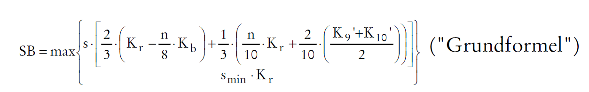
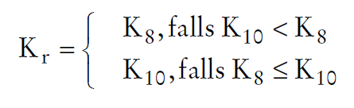
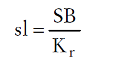
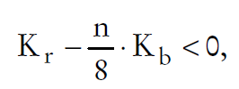

Abkommen zwischen dem Fürstentum Liechtenstein und der Republik Österreich über die Zusammenarbeit im Bereich der Steuern Abgeschlossen in Vaduz am 29. Januar 2013 Zustimmung des Landtags: 6. September 2013 Inkrafttreten: 1. Januar 2014 Das Fürstentum Liechtenstein und die Republik Österreich, im Wunsch, die finanzpolitischen Beziehungen der beiden Staaten weiter zu festigen, im Willen, die Zusammenarbeit im steuerlichen Bereich zu stärken und den gegenseitigen Wettbewerb zu fördern, in Anbetracht der bereits bestehenden engen Zusammenarbeit im Bereich der Doppelbesteuerung, sind wie folgt übereingekommen: Teil 1 Allgemeines Art. 1 Inhalt und Zweck 1) Mit diesem Abkommen soll durch bilaterale Zusammenarbeit der Vertragsstaaten die effektive Besteuerung der betroffenen Personen in der Republik Österreich sichergestellt werden. 2) Zu diesem Zweck vereinbaren die Vertragsstaaten eine bilaterale Zusammenarbeit, die im Kern folgende Elemente enthält: a) Vermögenswerte bei einer liechtensteinischen Zahlstelle von in der Republik Österreich ansässigen betroffenen Personen werden auf der Grundlage dieses Abkommens nachversteuert; b) auf Erträgen und Gewinnen aus Vermögenswerten bei einer liechtensteinischen Zahlstelle wird von in der Republik Österreich ansässigen betroffenen Personen nach den Regelungen dieses Abkommens eine abgeltende Steuer erhoben; c) Vermögenswerte von in der Republik Österreich ansässigen betroffenen Personen, die von einer liechtensteinischen Zahlstelle verwaltet werden, unabhängig von ihrer Belegenheit in Liechtenstein oder im Ausland, sind von diesem Abkommen erfasst; d) die Besteuerung von Zuwendungen an und von intransparenten Vermögensstrukturen wird geregelt; e) Liechtenstein kann von der Republik Österreich nach Massgabe dieses Abkommens die Einführung von Massnahmen zur Sicherung der Besteuerung von in Liechtenstein ansässigen Personen verlangen in Bezug auf Kapitalerträge, die bei Zahlstellen in der Republik Österreich erzielt werden. 3) Aufgehoben 4) Aufgehoben Art. 2 Begriffsbestimmungen 1) Für die Zwecke dieses Abkommens, soweit nichts anderes bestimmt ist, a) bedeutet der Ausdruck "Vertragsstaat", je nach Zusammenhang, die Republik Österreich oder das Fürstentum Liechtenstein; b) bedeutet "Republik Österreich" das Hoheitsgebiet der Republik Österreich; c) bedeutet "Liechtenstein" das Fürstentum Liechtenstein und im geographischen Sinne verwendet das Hoheitsgebiet des Fürstentums Liechtenstein; d) bedeutet der Ausdruck "zuständige Behörde": - in der Republik Österreich der Bundesminister für Finanzen oder die von ihm bestimmte Behörde; - in Liechtenstein die Regierung des Fürstentums Liechtenstein oder deren Bevollmächtigten; e) bedeutet der Ausdruck "liechtensteinische Zahlstelle": i) Banken nach dem liechtensteinischen Bankengesetz und Wertpapierhändler; ii) in Liechtenstein ansässige natürliche und juristische Personen nach liechtensteinischem Recht, einschliesslich Personengesellschaften und Betriebsstätten ausländischer Gesellschaften, die im Rahmen ihrer Geschäftstätigkeit regelmässig Vermögenswerte von Dritten entgegennehmen, halten, anlegen, übertragen oder lediglich Erträge nach Art. 18 Abs. 1 leisten oder absichern. Eingeschlossen sind nach dem Treuhändergesetz zugelassene natürliche und juristische Personen und Träger einer Bewilligung nach Art. 180a PGR, sofern sie Mitglied des Verwaltungsorgans einer Vermögensstruktur sind. Für die Zwecke von Teil 3 dieses Abkommens werden Personen, die Dividenden oder Zinsen direkt an ihre Beteiligten oder Gläubiger zahlen, allein durch diesen Umstand nicht zur Zahlstelle, sofern die Summe der jährlich bezahlten Dividenden und Zinsen einen Betrag von 1 Million Schweizer Franken nicht übersteigt. f) bedeutet der Ausdruck "Vermögenswerte" das i) bei liechtensteinischen Zahlstellen im Sinne des Bst. e Ziff. i auf Konten oder Depots verbuchte Vermögen; oder ii) von liechtensteinischen Zahlstellen im Sinne des Bst. e Ziff. ii verwaltete im In- oder Ausland belegene Vermögen nach Art. 4 Abs. 1 Bst. g des liechtensteinischen Vermögensverwaltungsgesetzes, ausgenommen Vermögen, das auf - österreichischen Konten oder Depots verbucht ist und dem Kapitalertragssteuerabzug unterlegen ist; oder - Konten oder Depots verbucht ist, auf die das Abkommen zwischen der Republik Österreich und der Schweizerischen Eidgenossenschaft über die Zusammenarbeit in den Bereichen Steuern und Finanzmarkt angewendet wird. Nicht als Vermögenswerte gelten Inhalte von Schrankfächern und Versicherungsverträge, die regulatorisch der liechtensteinischen Finanzmarktaufsicht unterstellt sind, ausgenommen Vermögenswerte, die von einer Lebensversicherungsgesellschaft für einen Versicherungsnehmer im Zusammenhang mit einem individualisiert verwalteten Vermögen in Verbindung mit einem minimalen Versicherungsschutz und Aus- oder Rückzahlungsbedingungen, die nicht auf Tod, Invalidität oder Krankheit beschränkt sind, gehalten werden (nachfolgend "Lebensversicherungsmantel" genannt). g) bedeutet der Ausdruck "Konto" oder "Depot" ein Konto oder ein Depot, auf dem Vermögenswerte nach Bst. f verbucht sind; h) bezieht sich im Falle einer Zahlstelle nach Bst. e Ziff. i der Ausdruck "betroffene Person" auf eine in der Republik Österreich ansässige natürliche Person, die: i) als Vertragspartner einer liechtensteinischen Zahlstelle Konto- oder Depotinhaber sowie nutzungsberechtigte Person der entsprechenden Vermögenswerte ist; oder ii) nach den von einer liechtensteinischen Zahlstelle gestützt auf die geltenden liechtensteinischen Sorgfaltspflichten und unter Berücksichtigung sämtlicher bekannten Umstände getätigten Feststellungen als nutzungsberechtigte Person von Vermögenswerten gilt, die gehalten werden von: - einer Sitzgesellschaft (insbesondere juristischen Personen, Gesellschaften, Anstalten, Stiftungen, Trusts, Treuhandunternehmen und ähnlichen Verbindungen, die kein Handels-, Fabrikations- oder anderes nach kaufmännischer Art geführtes Gewerbe betreiben); oder - einer Lebensversicherungsgesellschaft im Zusammenhang mit einem Lebensversicherungsmantel; oder - einer anderen natürlichen Person über ein Konto oder Depot bei einer liechtensteinischen Zahlstelle. Eine Sitzgesellschaft gilt ausnahmsweise als nutzungsberechtigte Person, wenn der Nachweis erbracht ist, dass sie nach dem Recht des Ortes ihrer Errichtung oder der tatsächlichen Verwaltung selbst effektiv besteuert wird oder nach dem österreichischen Recht als intransparent bezüglich ihres Einkommens gilt. Eine in der Republik Österreich ansässige natürliche Person gilt nicht als betroffene Person hinsichtlich Vermögenswerten von Personenverbindungen, Vermögenseinheiten, Trusts oder Stiftungen, wenn keine feststehende wirtschaftliche Berechtigung an solchen Vermögenswerten besteht. Die nutzungsberechtigte Person eines Lebensversicherungsmantels gilt nicht als betroffene Person, wenn die Versicherungsgesellschaft gegenüber der liechtensteinischen Zahlstelle darlegt, dass die steuerlichen Voraussetzungen für die Anerkennung der Lebensversicherungspolice in der Republik Österreich erfüllt sind. Für die Zwecke von Teil 3 dieses Abkommens gilt eine natürliche Person nicht als betroffene Person, wenn sie: - als liechtensteinische Zahlstelle handelt; oder - im Auftrag einer juristischen Person, eines Investmentfonds oder eines vergleichbaren Investmentsystems handelt; oder - im Auftrag einer anderen natürlichen Person handelt, welche die betroffene Person ist, und deren Identität und Wohnsitz der Zahlstelle mitteilt. Liegen einer liechtensteinischen Zahlstelle Informationen vor, die den Schluss nahelegen, dass die natürliche Person, die Erträge nach Art. 18 Abs. 1 vereinnahmt oder zu deren Gunsten solche Erträge vereinnahmt werden, nicht die betroffene Person ist, so unternimmt sie angemessene Schritte zur Feststellung der Identität der betroffenen Person. Kann die liechtensteinische Zahlstelle die betroffene Person nicht feststellen, so behandelt sie die fragliche natürliche Person als die betroffene Person. In den Fällen der Gesamtrechtsnachfolge und dem unentgeltlichen Erwerb von Vermögenswerten tritt der Rechtsnachfolger an die Stelle der betroffenen Person; die Nachweise richten sich nach österreichischem nationalen Recht (§ 27 Abs. 6 Ziffer 2 5. Teilstrich 1. Unterteilstrich EStG 1988). Ist zumindest eine betroffene Person an einer Kollektivbeziehung oder einem Gemeinschaftskonto beteiligt, so sind die Vermögenswerte der betroffenen Person zuzurechnen. Dies gilt nicht, wenn die liechtensteinische Zahlstelle sämtliche beteiligten Personen bestimmen kann. In diesem Fall ist eine Aufteilung der Vermögenswerte gemäss der Anzahl der Vertragspartner vorzunehmen ("nach Köpfen") und die Abrechnung entsprechend auszugestalten, es sei denn, die liechtensteinische Zahlstelle ist über eine abweichende Berechtigungsquote informiert und dokumentiert sie entsprechend. Ist zumindest eine betroffene Person an einer Personengesellschaft beteiligt, gelten die Regelungen dieses Absatzes zu Kollektivbeziehung und Gemeinschaftskonto entsprechend. i) bezieht sich im Falle einer Zahlstelle nach Bst. e Ziff. ii der Ausdruck "betroffene Person" auf eine: i) in der Republik Österreich ansässige natürliche Person, die an den Vermögenswerten einer transparenten Vermögensstruktur im Sinne Abs. 2 nutzungsberechtigt ist. Ist im verwalteten Vermögen eine qualifizierte Beteiligung an einer Sitzgesellschaft oder ein Lebensversicherungsmantel enthalten, ist unter Bedachtnahme auf Art. 31 entsprechend Bst. h vorzugehen; ist zumindest eine betroffene Person am Vermögen einer transparenten Vermögensstruktur nutzungsberechtigt, so sind die Vermögenswerte der betroffenen Person zuzurechnen. Dies gilt nicht, wenn die liechtensteinische Zahlstelle sämtliche nutzungsberechtigte Personen bestimmen kann. In diesem Fall ist eine Aufteilung der Vermögenswerte gemäss der Anzahl der nutzungsberechtigten Personen vorzunehmen ("nach Köpfen") und die Abrechnung entsprechend auszugestalten, es sei denn, die liechtensteinische Zahlstelle ist über eine abweichende Berechtigungsquote informiert und dokumentiert sie entsprechend; oder ii) in der Republik Österreich ansässige natürliche Person, die an eine intransparente Vermögensstruktur im Sinne des Bst. n Zuwendungen tätigt oder von dieser Zuwendungen erhält. Für Zwecke der Art. 33 und 34 bezieht sich der Ausdruck "betroffene Person" zudem auf eine in der Republik Österreich ansässige Körperschaft. j) bedeutet der Ausdruck "Kontoinhaber" oder "Depotinhaber" die Person, die in Bezug auf die Vermögenswerte einer betroffenen Person die Vertragspartei einer liechtensteinischen Zahlstelle gemäss Bst. e ist; k) bedeuten die Ausdrücke: - "Stichtag 1" den 31. Dezember 2003; - "Stichtag 2" den 31. Dezember 2011; - "Stichtag 3" den letzten Tag des fünften Monats nach dem Inkrafttreten dieses Abkommens; - "Stichtag 4" den letzten Tag des sechsten Monats nach dem Inkrafttreten dieses Abkommens; l) bedeuten die Ausdrücke: - "BAO" die österreichische Bundesabgabenordnung; - "EStG" das österreichische Einkommensteuergesetz 1988; - "VersStG" das österreichische Versicherungssteuergesetz 1953; - "VbVG" das österreichische Verbandsverantwortlichkeitsgesetz; - "FinStrG" das österreichische Finanzstrafgesetz; - "StiftEG" das österreichische Stiftungseingangssteuergesetz; - "StGB" das österreichische Strafgesetzbuch; - "SteG" das liechtensteinische Steuergesetz; - "PGR" das liechtensteinische Personen- und Gesellschaftsrecht; Soweit in diesem Abkommen auf eine Gesetzesbestimmung eines Vertragsstaates verwiesen wird, ist die im Zeitpunkt der Unterzeichnung dieses Abkommens geltende Fassung massgeblich. m) bedeutet der Ausdruck "Vermögensstrukturen" Stiftungen, stiftungsähnliche Anstalten und besondere Vermögenswidmungen mit oder ohne Persönlichkeit; n) bedeutet der Ausdruck "intransparente Vermögensstrukturen" in Liechtenstein verwaltete Vermögensstrukturen, die nach Massgabe des Abs. 2 als intransparent anzusehen sind; o) bedeutet der Ausdruck "Zuwendung" die unentgeltliche Vermögensübertragung in offener oder verdeckter Form unabhängig davon, aus welchen Gründen sie erfolgt. Eine Zuwendung von einer intransparenten Vermögensstruktur liegt auch vor, wenn - die Vermögensübertragung durch eine Bedingung oder Befristung auferlegt wurde; - geldwerte Vorteile zugewendet werden (z.B. Nutzungsüberlassung von Immobilien); - einer intransparenten Vermögensstruktur unentgeltlich Wirtschaftsgüter übertragen werden und diese dafür ihrerseits Vorteile zuwendet (z.B. gemischte Schenkung, Schenkung unter Auflage); - Verbindlichkeiten von der intransparenten Vermögensstruktur übernommen werden. 2) Ungeachtet anderer Bestimmungen dieses Abkommens gilt Folgendes: a) In Liechtenstein verwaltete Vermögensstrukturen gelten für die Zwecke von Teil 2 dieses Abkommens stets als transparent bezüglich ihres Einkommens und Vermögens. b) In Liechtenstein verwaltete Vermögensstrukturen mit Persönlichkeit gelten für Zwecke von Teil 3 und Teil 4 dieses Abkommens als intransparent, wenn folgende Voraussetzungen kumulativ erfüllt sind: - Weder der Stifter noch ein Begünstigter oder eine diesen nahestehende Person sind Mitglied im Stiftungsrat oder in einem Gremium, dem Weisungsbefugnisse gegenüber dem Stiftungsrat zustehen; - Es besteht kein Abberufungsrecht des Stiftungsrats durch den Stifter, einen Begünstigten oder eine diesen nahestehende Person ohne wichtigen Grund; - Es besteht kein ausdrücklicher oder konkludenter Mandatsvertrag. Diese Voraussetzungen gelten sinngemäss für sämtliche Vermögensstrukturen mit Persönlichkeit. Art. 3 Identität und Ansässigkeit der betroffenen Person 1) Um die Identität und die Ansässigkeit der betroffenen Person zu ermitteln, registriert die Zahlstelle nach den geltenden liechtensteinischen Sorgfaltspflichten für die Aufnahme einer Geschäftsbeziehung deren Namen, Vornamen, Geburtsdatum, Anschrift und Angaben zum Wohnsitz. Für vertragliche Beziehungen oder für Transaktionen bei Fehlen einer vertraglichen Beziehung, die beim oder nach dem Inkrafttreten dieses Abkommens eingegangen oder durchgeführt wurden, wird der Wohnsitz für natürliche Personen mit einem von der Republik Österreich ausgestellten Reisepass oder Personalausweis, die geltend machen, in einem anderen Staat als in der Republik Österreich oder Liechtenstein ansässig zu sein, aufgrund einer Wohnsitzbescheinigung der zuständigen Steuerverwaltung des Staates bestimmt, als dessen Ansässiger sich die natürliche Person ausweist. Fehlt eine solche Bescheinigung, so gilt die Republik Österreich als Ansässigkeitsstaat. 2) Für Zwecke des Teils 2 dieses Abkommens ist der Wohnsitz am Stichtag 2 massgebend. Der Wohnsitz bestimmt sich nach den Grundsätzen des Abs. 1. Teil 2 Regelung zur Nachversteuerung von Vermögenswerten Art. 4 Information der betroffenen Person durch die liechtensteinische Zahlstelle 1) Liechtensteinische Zahlstellen gemäss Art. 2 Abs. 1 Bst. e Ziff. i informieren die Konto- und Depotinhaber und liechtensteinische Zahlstellen gemäss Art. 2 Abs. 1 Bst. e Ziff. ii informieren die betroffenen Personen bis spätestens zwei Monate nach dem Inkrafttreten dieses Abkommens über den Inhalt dieses Abkommens und die daraus resultierenden Rechte und Pflichten der betroffenen Person. 2) Eröffnet eine betroffene Person zwischen dem Inkrafttreten dieses Abkommens und dem Stichtag 3 eine Geschäftsbeziehung bei oder mit einer liechtensteinischen Zahlstelle, so erfolgt die Information nach Abs. 1 zusammen mit einem Hinweis auf Art. 7 bei Vertragsschluss. Art. 5 Rechte und Pflichten der betroffenen Person 1) Eine betroffene Person, die am Stichtag 2 und beim Inkrafttreten dieses Abkommens bei derselben liechtensteinischen Zahlstelle gemäss Art. 2 Abs. 1 Bst. e Ziff. i ein Konto oder Depot unterhält, muss der liechtensteinischen Zahlstelle spätestens per Stichtag 3 schriftlich mitteilen, für welche der beim Inkrafttreten dieses Abkommens bestehenden Konten oder Depots die Nachversteuerung durch Einmalzahlung nach Art. 8 erfolgen soll und für welche Konten oder Depots sie der liechtensteinischen Zahlstelle die Ermächtigung zur freiwilligen Meldung nach Art. 10 gewährt. Für sämtliche Vermögenswerte, die von liechtensteinischen Zahlstellen gemäss Art. 2 Abs. 1 Bst. e Ziff. ii verwaltet werden, muss entweder die Nachversteuerung durch Einmalzahlung vorgenommen oder die Ermächtigung zur freiwilligen Meldung gewährt werden. Eine abgegebene Mitteilung ist ab Inkrafttreten dieses Abkommens unwiderruflich. 2) Entscheidet sich die betroffene Person zur Nachversteuerung durch Einmalzahlung nach Art. 8, so stellt sie für die Begleichung der Einmalzahlung den erforderlichen Geldbetrag sicher. 3) Bei Konten oder Depots, bei denen die betroffene Person bis zum Stichtag 3 keine Mitteilung nach Abs. 1 abgibt, erfolgt die Nachversteuerung durch Einmalzahlung nach Art. 8. 4) Ist der Konto- oder Depotinhaber mit der betroffenen Person nicht identisch, so ist die liechtensteinische Zahlstelle gemäss Art. 2 Abs. 1 Bst. e Ziff. i berechtigt, nach den Weisungen und Mitteilungen des Konto- oder Depotinhabers zu handeln. Art. 6 Verhältnis zwischen Zahlstellen nach Art. 2 Abs. 1 Bst. e Ziff. i und ii Zahlstellen gemäss Art. 2 Abs. 1 Bst. e Ziff. ii sind bei betroffenen Personen gemäss Art. 2 Abs. 1 Bst. i für die Durchführung der Verpflichtungen nach Teil 2 dieses Abkommens verantwortlich. Von liechtensteinischen Zahlstellen gemäss Art. 2 Abs. 1 Bst. e Ziff. i erhobene Einmalzahlungen werden auf den Gesamtbetrag der Einmalzahlung angerechnet. Art. 7 Aufnahme einer neuen Kundenbeziehung und Zahlstellenwechsel 1) Für Zahlstellen gemäss Art. 2 Abs. 1 Bst. e Ziff. i gilt: a) Eine betroffene Person, die zwischen dem Stichtag 2 und dem Stichtag 3 in eine Kundenbeziehung zu einer liechtensteinischen Zahlstelle getreten ist, muss der liechtensteinischen Zahlstelle spätestens per Stichtag 4 schriftlich mitteilen, ob: i) die eingebrachten Vermögenswerte am Stichtag 2 bei einer liechtensteinischen Zahlstelle verbucht waren; und ii) die Kundenbeziehung zu dieser liechtensteinischen Zahlstelle beim Inkrafttreten dieses Abkommens weiterhin bestand. b) Waren die Vermögenswerte gemäss der Mitteilung nach Abs. 1 am Stichtag 2 bei einer liechtensteinischen Zahlstelle verbucht und besteht beim Inkrafttreten dieses Abkommens keine Kundenbeziehung der betroffenen Person zu dieser liechtensteinischen Zahlstelle mehr, so führt die neue liechtensteinische Zahlstelle Massnahmen nach Teil 2 dieses Abkommens durch. Die früheren liechtensteinischen Zahlstellen sind zur Kooperation verpflichtet. Die betroffene Person muss spätestens per Stichtag 4: i) die neue liechtensteinische Zahlstelle nach Art. 5 Abs. 1 benachrichtigen; und ii) die neue liechtensteinische Zahlstelle schriftlich ermächtigen, sämtliche notwendigen Informationen zur Durchführung der Nachversteuerung durch Einmalzahlung nach Art. 8 oder zur freiwilligen Meldung nach Art. 10, je nach Mitteilung nach Art. 5 Abs. 1, bei der ehemaligen liechtensteinischen Zahlstelle anzufordern; und iii) die ehemalige liechtensteinische Zahlstelle schriftlich ermächtigen, sämtliche notwendigen Informationen zur Durchführung der Nachversteuerung durch Einmalzahlung nach Art. 8 oder zur freiwilligen Meldung nach Art. 10 der neuen liechtensteinischen Zahlstelle auf Anfrage zu übermitteln. c) Waren die Vermögenswerte gemäss der Mitteilung nach Bst. a am Stichtag 2 bei einer liechtensteinischen Zahlstelle verbucht und bestand beim Inkrafttreten dieses Abkommens die Kundenbeziehung zu dieser liechtensteinischen Zahlstelle weiterhin, so führt die neue liechtensteinische Zahlstelle für die bei ihr verbuchten Vermögenswerte der betroffenen Person keine weiteren Massnahmen nach Teil 2 dieses Abkommens durch. d) Waren die Vermögenswerte gemäss der Mitteilung nach Abs. 1 am Stichtag 2 nicht bei einer liechtensteinischen Zahlstelle verbucht oder von einer liechtensteinischen Zahlstelle verwaltet, so führt die neue liechtensteinische Zahlstelle für die bei ihr verbuchten Vermögenswerte der betroffenen Person keine weiteren Massnahmen nach Teil 2 dieses Abkommens durch. e) Kommt die betroffene Person ihren Verpflichtungen nach den Abs. 1 und 2 nicht nach, so hat die neue liechtensteinische Zahlstelle Identität und Wohnsitz der betroffenen Person zu melden. Das Verfahren nach Art. 10 findet sinngemäss Anwendung. Eine schriftliche Ermächtigung durch die betroffene Person ist in diesem Fall nicht erforderlich. 2) Für Zahlstellen gemäss Art. 2 Abs. 1 Bst. e Ziff. ii gilt: a) Wurden die Vermögenswerte am Stichtag 2 von einer liechtensteinischen Zahlstelle verwaltet, so führt jene liechtensteinische Zahlstelle Massnahmen nach Teil 2 dieses Abkommens durch, die die Vermögenswerte der betroffenen Person am Stichtag 3 verwaltet. Werden die Vermögenswerte am Stichtag 3 nicht mehr von einer liechtensteinischen Zahlstelle verwaltet, so führt jene liechtensteinische Zahlstelle Massnahmen nach Teil 2 dieses Abkommens durch, die die Vermögenswerte der betroffenen Person zum Zeitpunkt des Inkrafttretens dieses Abkommens verwaltet hat. b) Wurden die Vermögenswerte am Stichtag 2 nicht von einer liechtensteinischen Zahlstelle verwaltet, so werden keine Massnahmen nach Teil 2 dieses Abkommens durchgeführt. Art. 8 Nachversteuerung durch Einmalzahlung 1) Unter Vorbehalt von Art. 6, 7 und 12 erheben liechtensteinische Zahlstellen per Stichtag 3 eine Einmalzahlung auf den bei ihnen verbuchten oder verwalteten Vermögenswerten der betroffenen Person. 2) Die Einmalzahlung bemisst sich nach Anhang I dieses Abkommens. Der Steuersatz beträgt 30 Prozent. 3) Gleichzeitig mit der Erhebung der Einmalzahlung erstellt die liechtensteinische Zahlstelle zuhanden der betroffenen Person eine Bescheinigung nach festgelegtem Muster. Die Bescheinigung enthält die folgenden Angaben: a) Identität (Name und Geburtsdatum) und Wohnsitz der betroffenen Person; b) soweit bekannt, die österreichische Finanzamts- und Steuernummer und/oder die österreichische Sozialversicherungsnummer; c) Name und Anschrift der liechtensteinischen Zahlstelle; werden die Vermögenswerte von der Zahlstelle lediglich verwaltet (Art. 2 Abs. 1 Bst. f Ziff. ii), Name und Anschrift der natürlichen oder juristischen Personen, bei denen die Vermögenswerte auf Konten oder Depots verbucht sind; d) Kundennummer der betroffenen Person (Kunden-, Konto- oder Depot-Nummer, IBAN-Code); werden die Vermögenswerte von der Zahlstelle lediglich verwaltet (Art. 2 Abs. 1 Bst. f Ziff. ii), Kundennummer der betroffenen Person bei der natürlichen oder juristischen Person, bei denen die Vermögenswerte auf Konten oder Depots verbucht sind; e) Betrag der Einmalzahlung und Berechnungsmodalitäten. Erhebt die betroffene Person gegen die Bescheinigung nicht innerhalb von 30 Tagen nach deren Zustellung Einspruch, gilt diese als genehmigt. 4) Die liechtensteinische Zahlstelle überweist die erhobenen Einmalzahlungen nach Genehmigung der Bescheinigungen nach Abs. 3 jeweils monatlich an die zuständige liechtensteinische Behörde. Die erste Überweisung erfolgt einen Monat nach dem Stichtag 3. Die zuständige liechtensteinische Behörde leitet die Einmalzahlungen jeweils monatlich an die zuständige österreichische Behörde weiter, wobei die zuständige liechtensteinische Behörde eine Bezugsprovision von EUR 4.000.000 behält. Die erste Weiterleitung erfolgt zwei Monate nach dem Stichtag 3. 5) Die Einmalzahlungen nach Abs. 2 werden von liechtensteinischen Zahlstellen in Euro berechnet, abgezogen und an die zuständige liechtensteinische Behörde überwiesen. Erfolgt die Konto- oder Depotführung nicht in dieser Währung, so nimmt die liechtensteinische Zahlstelle die Umrechnung zum aktuellen Devisentageskurs publiziert durch die SIX AG an den für die Berechnung massgebenden Stichtagen vor. Die Weiterleitung durch die zuständige liechtensteinische Behörde an die zuständige österreichische Behörde erfolgt ebenfalls in Euro. 6) Mit der vollständigen Gutschrift der Einmalzahlung auf dem bei der liechtensteinischen Zahlstelle dafür eingerichteten Abwicklungskonto gelten die österreichischen Erbschaftssteuer- und Schenkungssteueransprüche, die Ansprüche auf die gemeinschaftlichen Bundesabgaben gemäss § 8 Abs. 1 erster Satz erster und dritter Fall des österreichischen Finanzausgleichsgesetzes 2008, die österreichischen Stiftungseingangssteueransprüche und die österreichischen Versicherungssteueransprüche, die auf den - auf den entsprechenden Konten und Depots verbuchten oder verwalteten - Vermögenswerten entstanden sind, als abgegolten. Der im Zeitpunkt des Inkrafttretens dieses Abkommens von der Abgeltungswirkung erfasste Betrag entspricht dem relevanten Kapital Kr wie in Anhang I dieses Abkommens bestimmt. Demzufolge: a) wenn K 10 kleiner ist als K 8 , entspricht K r dem Betrag K 8 ; b) wenn K 10 gleich gross oder grösser ist als K 8 , entspricht K r dem Betrag K 10 . Soweit Vermögenswerte direkt oder indirekt aus der Republik Österreich zufliessen und diese zwischen der Unterzeichnung und dem Inkrafttreten dieses Abkommens aus der Republik Österreich abgeflossen sind, findet insoweit Satz 1 keine Anwendung. Der hinsichtlich dieser Vermögenswerte erhobene Anteil der Einmalzahlung gilt als Vorauszahlung im Sinne des § 45 EStG für den Veranlagungszeitraum 2014; § 46 Abs. 2 EStG ist nicht anwendbar. 7) Die Steueransprüche, die vor dem Stichtag 1 entstanden sind, gelten im selben Umfang wie die in Abs. 6 genannten Steueransprüche als abgegolten. 8) Die Abgeltungswirkung nach den Abs. 6 und 7 erstreckt sich auf alle Gesamtschuldner nach der österreichischen Bundesabgabeordnung. 9) Die Abgeltungswirkung nach den Abs. 6 bis 8 tritt nicht ein, soweit: a) die Vermögenswerte aus einer in § 165 Abs. 1 StGB (Geldwäscherei) genannten mit Strafe bedrohten Handlung (mit Ausnahme des § 33 FinStrG in Verbindung mit den §§ 38a oder 39 FinStrG) herrühren; oder b) im Zeitpunkt der Unterzeichnung dieses Abkommens den nach österreichischem Recht zuständigen Behörden konkrete Hinweise auf nicht versteuerte Vermögenswerte der betroffenen Person auf Konten und Depots bei einer liechtensteinischen Zahlstelle vorlagen und dies der betroffenen Person bekannt war oder diesbezüglich Verfolgungshandlungen (§ 29 Abs. 3 Bst. a FinStrG) wegen eines Finanzvergehens gesetzt worden sind. In diesen Fällen wird eine geleistete Einmalzahlung von der nach österreichischem Recht zuständigen österreichischen Behörde als freiwillige Zahlung auf die geschuldeten Steuern der betroffenen Person behandelt. § 214 Abs. 1 BAO gilt sinngemäss. 10) Abs. 6 und 7 haben keine Auswirkung auf die Berechnung der Grundlage der Mehrwertsteuereigenmittel nach der Verordnung 1553/89/EG des Rates vom 29. Mai 1989. Art. 9 Verfolgung von Finanzvergehen bei der Einmalzahlung 1) Soweit Steueransprüche durch Einmalzahlung nach Art. 8 abgegolten sind, findet keine finanzstrafrechtliche Verfolgung von sich aus diesen Abgabenansprüchen ergebenden Abgabenverkürzungen sowie Verletzungen von Anzeigeverpflichtungen, die sich auf die betroffenen Vermögenswerte beziehen, statt. 2) Kann eine andere Straftat als ein Finanzvergehen wegen der Strafbarkeit eines Finanzvergehens nicht bestraft oder geahndet werden, so gilt dies auch dann, wenn die Strafbarkeit des Finanzvergehens aufgrund dieses Abkommens entfällt. Art. 10 Freiwillige Meldung 1) Die Erhebung der Einmalzahlung nach Art. 8 entfällt, wenn die betroffene Person ihre liechtensteinische Zahlstelle spätestens per Stichtag 3 schriftlich ermächtigt, die Informationen nach Abs. 2 an die zuständige österreichische Behörde zu melden. 2) Die liechtensteinische Zahlstelle übermittelt im Falle der schriftlichen Ermächtigung durch die betroffene Person folgende Angaben an die zuständige liechtensteinische Behörde: a) Identität (Name und Geburtsdatum) und Wohnsitz der betroffenen Person; b) soweit bekannt, die österreichische Finanzamts- und Steuernummer und/oder die österreichische Sozialversicherungsnummer; c) Name und Anschrift der liechtensteinischen Zahlstelle; werden die Vermögenswerte von der Zahlstelle lediglich verwaltet (Art. 2 Abs. 1 Bst. f Ziff. ii), Name und Anschrift der natürlichen oder juristischen Personen, bei denen die Vermögenswerte auf Konten oder Depots verbucht sind; d) Kundennummer der betroffenen Person (Kunden-, Konto- oder Depot-Nummer, IBAN-Code); werden die Vermögenswerte von der Zahlstelle lediglich verwaltet (Art. 2 Abs. 1 Bst. f Ziff. ii), Kundennummer der betroffenen Person bei der natürlichen oder juristischen Person, bei denen die Vermögenswerte auf Konten oder Depots verbucht sind; e) jährlicher Kontostand per 31. Dezember für die Periode zwischen dem Stichtag 1 und dem Inkrafttreten dieses Abkommens. Diese Angaben werden monatlich übermittelt. Die erste Übermittlung erfolgt einen Monat nach dem Stichtag 3. Die letzte Übermittlung erfolgt sechs Monate nach dem Stichtag 3. 3) Die zuständige liechtensteinische Behörde übermittelt die Informationen nach Abs. 2 jeweils monatlich an die zuständige österreichische Behörde. Die erste Übermittlung erfolgt zwei Monate nach dem Stichtag 3. Die letzte Übermittlung erfolgt sieben Monate nach dem Stichtag 3. Spätere Meldungen übermittelt die liechtensteinische Zahlstelle unverzüglich an die zuständige liechtensteinische Behörde, die sie unverzüglich an die zuständige österreichische Behörde weiterleitet. 4) Bei einer freiwilligen Meldung erhält die betroffene Person von der liechtensteinischen Zahlstelle eine Bescheinigung über die übermittelten Informationen. 5) Kann die zuständige österreichische Behörde die betroffene Person aufgrund der übermittelten Informationen nicht identifizieren, so kann sie die zuständige liechtensteinische Behörde um weitere Informationen ersuchen. Art. 11 Verfolgung von Finanzvergehen bei freiwilliger Meldung 1) Ergibt die Überprüfung der Angaben nach Art. 10 Abs. 2, dass unter Verletzung einer abgabenrechtlichen Anzeige-, Offenlegungs- oder Wahrheitspflicht eine Abgabenverkürzung bewirkt worden ist, so gilt die freiwillige Meldung ab dem Zeitpunkt der schriftlichen Ermächtigung nach Art. 10 Abs. 1 als Selbstanzeige nach § 29 Abs. 1 Satz 1 FinStrG bezogen auf die gemeldeten Konten oder Depots. Die Rechtsfolgen bestimmen sich nach § 29 FinStrG, wobei die für die Feststellung der Verkürzung bedeutsamen Umstände innerhalb einer von der zuständigen österreichischen Behörde festgesetzten angemessenen Frist durch die betroffene Person offengelegt werden müssen. 2) Die in Abs. 1 genannten Rechtsfolgen treten nicht ein, soweit: a) die Vermögenswerte aus einer in § 165 Abs. 1 StGB (Geldwäscherei) genannten mit Strafe bedrohten Handlung (mit Ausnahme des § 33 FinStrG in Verbindung mit den §§ 38a oder 39 FinStrG) herrühren; oder b) die Tat im Zeitpunkt der Unterzeichnung dieses Abkommens hinsichtlich ihrer objektiven Tatbestandsmerkmale bereits ganz oder teilweise entdeckt und dies der betroffenen Person bekannt war oder diesbezüglich Verfolgungshandlungen (§ 29 Abs. 3 Bst. a FinStrG) gesetzt worden sind. Art. 12 Fehlende flüssige Mittel für die Erhebung der Einmalzahlung 1) Gibt eine betroffene Person aufgrund einer Information der liechtensteinischen Zahlstelle nach Art. 4 der liechtensteinischen Zahlstelle schriftlich bekannt, dass sie die Erhebung der Einmalzahlung nach Art. 8 wünscht, verfügt sie jedoch zum Stichtag 3 nicht über einen ausreichenden Geldbetrag auf dem betreffenden Konto bei der liechtensteinischen Zahlstelle, so muss die liechtensteinische Zahlstelle der betroffenen Person schriftlich eine Fristverlängerung von längstens acht Wochen für die Sicherstellung eines ausreichenden Geldbetrages auf dem Konto einräumen. Zugleich muss sie die betroffene Person auf mögliche Konsequenzen nach Abs. 3 hinweisen. Dasselbe gilt, wenn die Einmalzahlung auf Grund von Art. 5 Abs. 3 erhoben wird. 2) Wurde eine Fristverlängerung nach Abs. 1 gewährt, so erhebt die liechtensteinische Zahlstelle die Einmalzahlung am Tag des Fristablaufs. Die Wirkung der Einmalzahlung entspricht der Einmalzahlung nach Art. 8 Abs. 6 mit der Massgabe, dass sie erst mit Gutschrift auf dem Abwicklungskonto der liechtensteinischen Zahlstelle eintritt. 3) Besteht beim Inkrafttreten bei der liechtensteinischen Zahlstelle ein Konto oder ein Depot einer betroffenen Person und kann eine Einmalzahlung aufgrund fehlender flüssiger Mittel nicht vollständig erhoben werden, so muss die liechtensteinische Zahlstelle die betroffene Person entsprechend Art. 10 melden. Eine schriftliche Ermächtigung durch die betroffene Person ist in diesem Fall nicht erforderlich. 4) Für Zahlstellen gemäss Art. 2 Abs. 1 Bst. e Ziff. ii gelten die Abs. 1 bis 3 sinngemäss. Art. 13 Versäumte Identifizierung einer betroffenen Person 1) Versäumt es eine liechtensteinische Zahlstelle, eine betroffene Person zu identifizieren und diese über ihre Rechte und Pflichten nach Art. 5 zu informieren und wird diese Person nachträglich durch die liechtensteinische Zahlstelle als betroffene Person identifiziert, so kann die betroffene Person mit dem Einverständnis der zuständigen Behörden der Vertragsstaaten dennoch die Rechte und Pflichten nach Art. 5 wahrnehmen. Die Nachversteuerung nach Art. 8 oder die freiwillige Meldung nach Art. 10 ist innerhalb einer von den zuständigen Behörden der Vertragsstaaten gemeinsam festzusetzenden Frist durchzuführen. 2) Zusätzlich zu einer nachträglichen Einmalzahlung nach Abs. 1 erhebt die liechtensteinische Zahlstelle von der betroffenen Person vom Stichtag 3 bis zur Erhebung der Einmalzahlung einen Verzugszins in der Höhe von 0,5 Prozent für jeden vollen Monat. Art. 14 Unvollständige oder zu Unrecht erfolgte Erhebung der Einmalzahlung 1) Erhebt die liechtensteinische Zahlstelle die Einmalzahlung nach Art. 8 aufgrund eines Berechnungs- oder Abwicklungsfehlers nicht in vollständiger Höhe, so kann die liechtensteinische Zahlstelle der betroffenen Person den fehlenden Betrag zuzüglich eines Verzugszinses entsprechend Art. 13 Abs. 2 nachbelasten. Die liechtensteinische Zahlstelle bleibt gegenüber der zuständigen liechtensteinischen Behörde jedenfalls zur entsprechenden Nachleistung verpflichtet. Dasselbe gilt für erhobene Verzugszinsen. Die zuständige liechtensteinische Behörde leitet nachgeleistete Einmalzahlungen einschliesslich erhobener Verzugszinsen unverzüglich an die zuständige österreichische Behörde weiter. 2) In Fällen von Abs. 1 tritt für die betroffene Person die Wirkung nach Art. 8 Abs. 6 auch ein, wenn die betroffene Person den Berechnungs- oder Abwicklungsfehler ohne grobes Verschulden nicht erkannt hat. Wird der Berechnungs- oder Abwicklungsfehler nach Abs. 1 korrigiert, tritt die Wirkung nach Art. 8 Abs. 6 in jedem Fall ein. 3) Ist die Einmalzahlung ohne rechtlichen Grund bezahlt worden, so hat die betroffene Person gegenüber der zuständigen österreichischen Behörde einen Anspruch auf Erstattung der Einmalzahlung. Art. 15 Wirkung der Bescheinigung Werden der nach österreichischem Recht zuständigen österreichischen Behörde aus anderem Anlass als im Rahmen der Durchführung dieses Abkommens Vermögenswerte bekannt, die nach Art. 8 nachversteuert wurden oder nach Art. 10 freiwillig gemeldet wurden, muss die betroffene Person nachweisen, dass diese Vermögenswerte abgeltend nach diesem Abkommen besteuert wurden oder durch Meldung nach Art. 10 der zuständigen österreichischen Behörde bekannt wurden. Der Nachweis gilt durch die Vorlage der Bescheinigung der liechtensteinischen Zahlstelle nach Art. 8 Abs. 3 oder Art. 10 Abs. 4 als erbracht. Bestehen Zweifel an der Echtheit einer Bescheinigung, so kann die nach österreichischem Recht zuständige österreichische Behörde unter Einschaltung der zuständigen österreichischen Behörde die zuständige liechtensteinische Behörde um Prüfung der Bescheinigung ersuchen. Die zuständige liechtensteinische Behörde stellt für diesen Zweck sicher, dass jede Bescheinigung über eine geleistete Einmalzahlung zugeordnet werden kann. Art. 16 Zielstaaten abgezogener Vermögenswerte Die zuständige liechtensteinische Behörde teilt der zuständigen österreichischen Behörde innerhalb von zwölf Monaten nach dem Stichtag 3 die gemessen am Volumen der Vermögenswerte zehn wichtigsten Staaten oder Territorien in der Reihenfolge ihrer Wichtigkeit mit, wohin diejenigen betroffenen Personen, die ihr Konto oder Depot zwischen der Unterzeichnung und dem Inkrafttreten dieses Abkommens aufgelöst haben, die Vermögenswerte der saldierten Konten und Depots überwiesen haben. Die Mitteilung enthält zudem die Anzahl betroffener Personen pro Staat respektive Territorium. Die gestützt auf diesen Artikel erhobenen und mitgeteilten Angaben werden von den Vertragsstaaten nicht veröffentlicht. Art. 17 Verzicht auf die Verfolgung von Straftaten und Ordnungswidrigkeiten, Haftung 1) Beteiligte an einem Finanzvergehen, das vor Unterzeichnung dieses Abkommens von einer betroffenen Person hinsichtlich von Vermögenswerten im Sinne dieses Abkommens begangen wurde, werden nicht verfolgt. In diesen Fällen wird auch keine Geldbusse gegen Verbände im Sinne des VbVG, die für diese Finanzvergehen verantwortlich sind, festgesetzt. Sätze 1 und 2 gelten nicht, wenn die Tat im Zeitpunkt der Unterzeichnung dieses Abkommens hinsichtlich ihrer objektiven Tatbestandsmerkmale bereits ganz oder teilweise entdeckt und dies den Beteiligten bekannt war oder diesbezüglich Verfolgungshandlungen (§ 29 Abs. 3 Bst. a FinStrG) gesetzt worden sind. 2) Unter den Voraussetzungen des Abs. 1 entfällt auch die Haftung nach § 11 BAO. 3) Beteiligte an Straftaten oder Ordnungswidrigkeiten, die im Zusammenhang mit dem Erwerb steuererheblicher Daten vor Unterzeichnung dieses Abkommens begangen wurden, werden weder nach liechtensteinischem noch nach österreichischem Recht verfolgt; bereits anhängige Verfahren werden eingestellt. Davon ausgeschlossen sind Verfahren nach liechtensteinischem Recht gegen Mitarbeitende liechtensteinischer Zahlstellen. Teil 3 Erhebung einer Quellensteuer durch liechtensteinische Zahlstellen Art. 18 Erhebung einer der österreichischen Einkommensteuer entsprechenden Steuer mit abgeltender Wirkung durch liechtensteinische Zahlstellen 1) Liechtensteinische Zahlstellen erheben von betroffenen Personen einen der österreichischen Einkommensteuer entsprechenden Betrag (nachfolgend "Steuer" genannt) auf folgenden Erträgen: a) Zinserträgen; b) Dividendenerträgen; c) sonstigen Einkünften als den unter den Bst. a und b genannten Erträgen; d) Veräusserungsgewinne. Der Steuer unterliegen auch Entgelte oder Vorteile, die anstelle der in den Bst. a bis d genannten Erträge gewährt werden. 2) Schuldner der Steuer nach Abs. 1 ist die betroffene Person. Der Steuersatz beträgt 25 Prozent für Zinsen aus Geldeinlagen und nicht verbrieften sonstigen Forderungen bei Kreditinstituten (ausgenommen Ausgleichzahlungen und Leihgebühren) und 27,5 Prozent in allen anderen Fällen (einschliesslich Zinserträge im Sinne des Art. 24 Abs. 1 Bst. c). 3) Für die Erträge nach Abs. 1, soweit sie der Steuer unterlegen haben, gilt die österreichische Einkommensteuer als abgegolten, sofern das österreichische Einkommensteuergesetz für diese Erträge eine abgeltende Wirkung vorsieht. Art. 19 Steuersatzänderungen 1) Die zuständige österreichische Behörde informiert die zuständige liechtensteinische Behörde schriftlich über Steuersatzänderungen im österreichischen Recht, die Erträge betreffen, welche nach Teil 3 dieses Abkommens besteuert werden. 2) Steuersätze, die nach Unterzeichnung dieses Abkommens im österreichischen Recht geändert werden, finden zeitgleich Anwendung auf die Besteuerung der entsprechenden Erträge unter diesem Abkommen, sofern die zuständige liechtensteinische Behörde innerhalb von 30 Tagen, nachdem sie die Mitteilung der zuständigen österreichischen Behörde erhalten hat, nicht schriftlich mitteilt, dass die Satzänderungen bei der Anwendung dieses Abkommens nicht nachvollzogen werden. Die zuständige liechtensteinische Behörde veröffentlicht unverzüglich jede Steuersatzänderung und sorgt dafür, dass diese den liechtensteinischen Zahlstellen bekannt wird. Art. 20 Verhältnis zu anderen Steuern 1) Die Erhebung einer allfälligen liechtensteinischen Quellensteuer bleibt unberührt. Die liechtensteinische Zahlstelle kann in eigenem Namen und auf Rechnung der betroffenen Person die vollumfängliche oder teilweise Rückerstattung beantragen, soweit dies das Doppelbesteuerungsabkommen zwischen Liechtenstein und der Republik Österreich vorsieht. Die nach dem Doppelbesteuerungsabkommen nicht rückforderbare Quellensteuer (Residualsteuer) wird an die Steuer nach Art. 18 Abs. 1 und 2 angerechnet. Diese Anrechnung darf jedoch den Betrag der Steuer nach Art. 18 Abs. 1 und 2 nicht übersteigen. 2) Unterliegen Erträge nach Art. 18 Abs. 1 in der Republik Österreich einer Quellensteuer, so rechnet die liechtensteinische Zahlstelle diese Quellensteuer an die Steuer nach Art. 18 Abs. 1 und 2 an. Diese Anrechnung darf jedoch den Betrag der Steuer nach Art. 18 Abs. 1 und 2 nicht übersteigen. 3) Unterliegen Erträge nach Art. 18 Abs. 1 einer Quellensteuer in einem Drittstaat, so rechnet die liechtensteinische Zahlstelle diese Quellensteuer an die Steuer nach Art. 18 Abs. 1 und 2 an, soweit das Doppelbesteuerungsabkommen zwischen der Republik Österreich und dem Drittstaat die Rückerstattung dieser Quellensteuer ausschliesst (Residualsatz). Diese Anrechnung darf jedoch den Betrag der Steuer nach Art. 18 Abs. 1 und 2 nicht übersteigen. 4) Liechtensteinische Ertragsteuer einer Vermögensstruktur, die gemäss Art. 2 Abs. 2 Bst. b als nicht intransparent gilt, kann nicht auf die Steuer nach Art. 18 Abs. 1 und 2 angerechnet werden. Art. 21 Freiwillige Meldung 1) Ermächtigt die betroffene Person eine liechtensteinische Zahlstelle ausdrücklich, der zuständigen österreichischen Behörde die Erträge eines Kontos oder Depots zu melden, so nimmt diese Zahlstelle anstelle der Erhebung der Steuer auf die Erträge nach Art. 18 Abs. 1 eine Meldung der Erträge vor. 2) Die Meldung umfasst folgende Angaben: a) Identität (Name und Geburtsdatum) und Wohnsitz der betroffenen Person; b) soweit bekannt die österreichische Finanzamts- und Steuernummer und/oder die österreichische Sozialversicherungsnummer; c) Name und Anschrift der liechtensteinischen Zahlstelle; werden die Vermögenswerte von der Zahlstelle lediglich verwaltet (Art. 2 Abs. 1 Bst. f Ziff. ii), Name und Anschrift der natürlichen oder juristischen Personen, bei denen die Vermögenswerte auf Konten oder Depots verbucht sind; d) Kundennummer der betroffenen Person (Kunden-, Konto- oder Depot-Nummer, IBAN-Code); werden die Vermögenswerte von der Zahlstelle lediglich verwaltet (Art. 2 Abs. 1 Bst. f Ziff. ii), Kundennummer der betroffenen Person bei der natürlichen oder juristischen Person, bei denen die Vermögenswerte auf Konten oder Depots verbucht sind; e) betreffendes Steuerjahr; f) Totalbetrag der im entsprechenden Jahr angefallenen und nach Art. 23 berechneten positiven und negativen Erträge oder Totalbetrag der Erträge nach Art. 18 Abs. 1 Bst. a bis d. Art. 22 Besteuerung im Veranlagungsverfahren in der Republik Österreich Die nach Art. 18 Abs. 1 und 2 erhobene Steuer gilt als in der Republik Österreich erhobene Kapitalertragsteuer nach § 93 EStG. Art. 23 Bemessungsgrundlage 1) Die liechtensteinische Zahlstelle erhebt die Steuer auf Zahlungen ohne jeden Abzug und ohne Berücksichtigung der Anschaffungsnebenkosten wie folgt: a) bei Zinserträgen nach Art. 18 Abs. 1 Bst. a: i) im Falle eines Zinsertrags nach Art. 24 Abs. 1 Bst. a: auf dem Bruttobetrag der gezahlten oder gutgeschriebenen Zinsen; ii) im Falle eines Zinsertrags nach Art. 24 Abs. 1 Bst. b oder d: auf dem Betrag der dort bezeichneten Zinsen oder Erträge; iii) im Falle eines Zinsertrags nach Art. 24 Abs. 1 Bst. c: auf dem Betrag der dort bezeichneten Zinsen; b) bei Dividendenerträgen nach Art. 18 Abs. 1 Bst. b: i) im Falle einer Dividende nach Art. 25 Bst. a: auf dem Bruttobetrag der gezahlten oder gutgeschriebenen Dividenden oder dem Verkehrswert der Sachdividende im Zeitpunkt des Zuflusses; ii) im Falle einer Dividende nach Art. 25 Bst. b: auf dem Betrag der dort bezeichneten Dividenden; iii) im Falle einer Dividende nach Art. 25 Bst. c: auf dem Betrag der dort bezeichneten Einkünfte; c) bei sonstigen Einkünften nach Art. 18 Abs. 1 Bst. c: i) im Falle sonstiger Einkünfte nach Art. 26 Bst. a: auf dem Bruttobetrag der gezahlten oder gutgeschriebenen sonstigen Einkünfte; ii) im Falle sonstiger Einkünfte nach Art. 26 Bst. b: auf dem Betrag der dort bezeichneten sonstigen Einkünfte; iii) im Falle sonstiger Einkünfte nach Art. 26 Bst. c: auf dem Betrag der dort bezeichneten Erträge; d) bei Veräusserungsgewinnen auf Vermögenswerten nach Art. 18 Abs. 1 Bst. d: i) Auf dem Veräusserungserlös abzüglich der Anschaffungskosten. Die Anschaffungskosten werden mit der Durchschnittsmethode erfasst. Bei Anschaffungen von Vermögenswerten vor dem 1. April 2012 gelten die Marktwerte per 1. April 2012 als Anschaffungskosten. Sind die Marktwerte per 1. April 2012 nicht verfügbar, so wird die Steuer auf 30 Prozent des Veräusserungserlöses erhoben. ii) Stehen bei Anschaffungen nach dem 31. März 2012 historische Daten zur Ermittlung der Anschaffungskosten nicht zur Verfügung oder ist nicht bekannt, wann die Anschaffung erfolgt ist, so wird die Steuer auf 30 Prozent des Veräusserungserlöses erhoben. iii) Überträgt die betroffene Person Vermögenswerte auf ein Konto oder Depot eines Dritten, so stellt dies eine Veräusserung dar. 2) Negative Erträge nach Art. 18 Abs. 1 sind mit innerhalb des gleichen Kalenderjahres bei der gleichen liechtensteinischen Zahlstelle erzielten positiven Erträgen zu verrechnen. Auf Antrag der betroffenen Person erteilt die liechtensteinische Zahlstelle über die Höhe des verbleibenden Verlustes am Ende eines Kalenderjahres eine Bescheinigung nach festgelegtem Muster. Art. 24 Definition der Zinserträge 1) Für die Zwecke dieses Abkommens gelten als "Zinserträge": a) i) auf ein Konto eingezahlte oder einem Konto gutgeschriebene Zinsen, die mit Forderungen jeglicher Art zusammenhängen, einschliesslich Zinsen, die von liechtensteinischen Zahlstellen zugunsten der betroffenen Person auf Treuhandkonten gezahlt werden, unabhängig davon, ob sie hypothekarisch gesichert sind oder nicht und ob sie ein Recht auf Beteiligung am Gewinn des Schuldners beinhalten oder nicht (Zinsen aus Genussrechten). Dies schliesst insbesondere Erträge aus Staatspapieren, Anleihen und Schuldverschreibungen einschliesslich der mit diesen Papieren, Anleihen oder Schuldverschreibungen verbundenen Prämien und Gewinne ein, nicht aber Zinsen von Darlehen zwischen natürlichen Personen, die nicht im Rahmen ihrer Geschäftstätigkeit handeln. Zuschläge für verspätete Zahlungen gelten nicht als Zinserträge; ii) vereinnahmte Optionsprämien (Stillhalterprämien); b) bei Verkauf, Rückzahlung oder Einlösung von Forderungen nach Bst. a Ziff. i aufgelaufene oder kapitalisierte Zinsen; c) direkte oder über eine Einrichtung nach Art. 4 Abs. 2 der Richtlinie 2003/48/EG des Rates vom 3. Juni 2003 im Bereich der Besteuerung von Zinserträgen (nachfolgend "Richtlinie" genannt) laufende Zinserträge, die ausgeschüttet oder thesauriert werden von: i) in einem Mitgliedstaat der Europäischen Union niedergelassenen Organismen für gemeinsame Anlagen; ii) in einem Mitgliedstaat der Europäischen Union niedergelassenen Einrichtungen, die von der Wahlmöglichkeit nach Art. 4 Abs. 3 der Richtlinie Gebrauch gemacht haben und die liechtensteinische Zahlstelle hiervon unterrichten; iii) ausserhalb des Gebiets der Europäischen Union und Liechtensteins errichteten Organismen für gemeinsame Anlagen; iv) liechtensteinischen Anlagefonds; d) diesbezügliche Erträge, die bei Verkauf, Rückzahlung oder Einlösung von Anteilen an den nachstehend aufgeführten Einrichtungen realisiert werden: i) in einem Mitgliedstaat der Europäischen Union niedergelassenen Organismen für gemeinsame Anlagen; ii) in einem Mitgliedstaat der Europäischen Union niedergelassenen Einrichtungen, die von der Wahlmöglichkeit nach Art. 4 Abs. 3 der Richtlinie Gebrauch gemacht haben und die liechtensteinische Zahlstelle hiervon unterrichten; iii) ausserhalb des Gebiets der Europäischen Union und Liechtensteins errichteten Organismen für gemeinsame Anlagen; iv) liechtensteinischen Anlagefonds. 2) Liegen einer liechtensteinischen Zahlstelle keine Informationen über den Anteil der Zinszahlungen an den Erträgen vor, so gilt in den Fällen nach Abs. 1 Bst. c und d der Gesamtbetrag als Zinsertrag. Art. 25 Definition der Dividendenerträge Für die Zwecke dieses Abkommens gelten als "Dividendenerträge": a) auf ein Konto eingezahlte oder einem Konto gutgeschriebene Dividenden, die Einkünfte aus Aktien, Genussaktien oder Genussscheinen (Substanzgenussscheine), Kuxen, Gründeranteilen oder anderen Rechten - ausgenommen Forderungen - mit Gewinnbeteiligung darstellen sowie aus sonstigen Gesellschaftsanteilen stammende Einkünfte, die nach dem Recht des Staates, in dem die ausschüttende Gesellschaft ansässig ist, den Einkünften aus Aktien steuerlich gleichgestellt sind; b) direkte oder über eine Einrichtung nach Art. 4 Abs. 2 der Richtlinie laufende Dividendenerträge, die ausgeschüttet oder thesauriert werden von: i) in einem Mitgliedstaat der Europäischen Union niedergelassenen Organismen für gemeinsame Anlagen; ii) in einem Mitgliedstaat der Europäischen Union niedergelassenen Einrichtungen, die von der Wahlmöglichkeit nach Art. 4 Abs. 3 der Richtlinie Gebrauch gemacht haben und die liechtensteinische Zahlstelle hiervon unterrichten; iii) ausserhalb des Gebiets der Europäischen Union und Liechtensteins errichteten Organismen für gemeinsame Anlagen; iv) liechtensteinischen Anlagefonds; c) diesbezügliche Erträge, die bei Verkauf, Rückzahlung oder Einlösung von Anteilen an den nachstehend aufgeführten Einrichtungen realisiert werden: i) in einem Mitgliedstaat der Europäischen Union niedergelassenen Organismen für gemeinsame Anlagen; ii) in einem Mitgliedstaat der Europäischen Union niedergelassenen Einrichtungen, die von der Wahlmöglichkeit nach Art. 4 Abs. 3 der Richtlinie Gebrauch gemacht haben und die liechtensteinische Zahlstelle hiervon unterrichten; iii) ausserhalb des Gebiets der Europäischen Union und Liechtensteins errichteten Organismen für gemeinsame Anlagen; iv) liechtensteinischen Anlagefonds. Art. 26 Definition der sonstigen Einkünfte Für die Zwecke dieses Abkommens gelten als "sonstige Einkünfte": a) im Zusammenhang mit strukturierten Finanzinstrumenten, Securities Lending, Repo-Geschäften, Swaps und vergleichbaren Transaktionen vereinnahmte Ersatzzahlungen für Zinsen nach Art. 24 Abs. 1 Bst. a und Dividenden nach Art. 25 Bst. a sowie anlässlich solcher Transaktionen vereinnahmte sonstige Gebühren und Kommissionen; b) direkte oder über eine Einrichtung nach Art. 4 Abs. 2 der Richtlinie laufende sonstige Einkünfte, die ausgeschüttet oder thesauriert werden von: i) in einem Mitgliedstaat der Europäischen Union niedergelassenen Organismen für gemeinsame Anlagen; ii) in einem Mitgliedstaat der Europäischen Union niedergelassenen Einrichtungen, die von der Wahlmöglichkeit nach Art. 4 Abs. 3 der Richtlinie Gebrauch gemacht haben und die liechtensteinische Zahlstelle hiervon unterrichten; iii) ausserhalb des Gebiets der Europäischen Union und Liechtensteins errichteten Organismen für gemeinsame Anlagen; iv) liechtensteinischen Anlagefonds; c) diesbezügliche Erträge, die bei Verkauf, Rückzahlung oder Einlösung von Anteilen an den nachstehend aufgeführten Einrichtungen realisiert werden: i) in einem Mitgliedstaat der Europäischen Union niedergelassenen Organismen für gemeinsame Anlagen; ii) in einem Mitgliedstaat der Europäischen Union niedergelassenen Einrichtungen, die von der Wahlmöglichkeit nach Art. 4 Abs. 3 der Richtlinie Gebrauch gemacht haben und die liechtensteinische Zahlstelle hiervon unterrichten; iii) ausserhalb des Gebiets der Europäischen Union und Liechtensteins errichteten Organismen für gemeinsame Anlagen; iv) liechtensteinischen Anlagefonds. Art. 27 Definition der Veräusserungsgewinne Für die Zwecke dieses Abkommens gelten als "Veräusserungsgewinne": a) der Gewinn aus der Veräusserung von Anteilen an Körperschaften, Dividenden- und Zinscoupons, Darlehensverhältnissen, Ansprüchen aus Versicherungsverhältnissen und sonstigen Kapitalforderungen. Ebenfalls als Veräusserungsgewinn gilt der Gewinn aus strukturierten respektive als Termingeschäft ausgestalteten Finanzinstrumenten sowie der Differenzausgleich oder der durch den Wert einer veränderlichen Bezugsgrösse bestimmte Geldbetrag oder Vorteil, den die betroffene Person bei einem Termingeschäft erlangt. Als Veräusserung gilt auch die Einlösung, Rückzahlung, Abtretung oder die Einlage in eine Kapitalgesellschaft; b) direkte oder über eine Einrichtung nach Art. 4 Abs. 2 der Richtlinie erzielte Veräusserungsgewinne, die ausgeschüttet oder thesauriert werden von: i) in einem Mitgliedstaat der Europäischen Union niedergelassenen Organismen für gemeinsame Anlagen; ii) in einem Mitgliedstaat der Europäischen Union niedergelassenen Einrichtungen, die von der Wahlmöglichkeit nach Art. 4 Abs. 3 der Richtlinie Gebrauch gemacht haben und die liechtensteinische Zahlstelle hiervon unterrichten; iii) ausserhalb des Gebiets der Europäischen Union und Liechtensteins errichteten Organismen für gemeinsame Anlagen; iv) liechtensteinischen Anlagefonds; thesaurierte Veräusserungsgewinne unterliegen nur zu 60 Prozent der Besteuerung; c) diesbezügliche Erträge, die bei Verkauf, Rückzahlung oder Einlösung von Anteilen an den nachstehend aufgeführten Einrichtungen realisiert werden: i) in einem Mitgliedstaat der Europäischen Union niedergelassenen Organismen für gemeinsame Anlagen; ii) in einem Mitgliedstaat der Europäischen Union niedergelassenen Einrichtungen, die von der Wahlmöglichkeit nach Art. 4 Abs. 3 der Richtlinie Gebrauch gemacht haben und die liechtensteinische Zahlstelle hiervon unterrichten; iii) ausserhalb des Gebiets der Europäischen Union und Liechtensteins errichteten Organismen für gemeinsame Anlagen; iv) liechtensteinischen Anlagefonds. Art. 28 Verhältnis der Zahlstellen nach Art. 2 Abs. 1 Bst. e Ziff. i und ii Die Bestimmungen des Art. 6 sind sinngemäss auf Teil 3 anzuwenden. Art. 29 Administrative Bestimmungen 1) Die liechtensteinischen Zahlstellen überweisen die nach Teil 3 dieses Abkommens erhobene Steuer jeweils spätestens zwei Monate nach dem Ende des Steuerjahres Liechtensteins an die zuständige liechtensteinische Behörde. Die Deklaration erfolgt mittels einer gesonderten Aufstellung der Steuerbeträge nach Art. 18 Abs. 1 und 2. 2) Die zuständige liechtensteinische Behörde leitet diese Steuer jeweils spätestens drei Monate nach dem Ende des Steuerjahres Liechtensteins in einer Zahlung an die zuständige österreichische Behörde weiter, wobei die zuständige liechtensteinische Behörde eine Bezugsprovision von 0,5 Prozent behält. 3) Die Steuerbeträge nach Art. 18 Abs. 1 und 2 werden von den liechtensteinischen Zahlstellen in Euro berechnet, abgezogen und an die zuständige liechtensteinische Behörde überwiesen. Erfolgt die Konto- oder Depotführung nicht in dieser Währung, so nimmt die liechtensteinische Zahlstelle die Umrechnung zum aktuellen Devisentageskurs publiziert durch die SIX AG an dem für die Berechnung massgebenden Stichtag vor. Die zuständige liechtensteinische Behörde leitet die Steuer ebenfalls in Euro an die zuständige österreichische Behörde weiter. 4) In Fällen der freiwilligen Meldung nach Art. 21 übermitteln die liechtensteinischen Zahlstellen die Angaben nach Art. 21 Abs. 2 jeweils spätestens drei Monate nach dem Ende des Steuerjahres Liechtensteins an die zuständige liechtensteinische Behörde. Diese leitet die Angaben automatisch einmal pro Jahr spätestens sechs Monate nach dem Ende des Steuerjahres Liechtensteins an die zuständige österreichische Behörde weiter. Art. 30 Bescheinigung der liechtensteinischen Zahlstelle 1) Die liechtensteinische Zahlstelle erstellt zuhanden der betroffenen Person jährlich, bei Auflösung der Bankbeziehung sowie bei Wechsel der Zahlstelle und bei Untergang der Vermögensstruktur eine Bescheinigung, die namentlich Angaben nach den Art. 18 und 20 sowie Verluste nach Art. 23 Abs. 2 ausweist. Diese Bescheinigung hat einem festgelegten Muster zu entsprechen. Art. 6 und 15 letzter Satz gelten sinngemäss. 2) Die Republik Österreich akzeptiert die Bescheinigungen der liechtensteinischen Zahlstellen nach Abs. 1 als Bescheinigungen für steuerliche Zwecke. Art. 31 Übertragung von Vermögenswerten und Änderung der Ansässigkeit 1) Überträgt die betroffene Person Vermögenswerte von einer liechtensteinischen Zahlstelle auf eine andere liechtensteinische Zahlstelle, hat die übertragende Zahlstelle der übernehmenden Zahlstelle sämtliche für die Bestimmung der Bemessungsgrundlage relevanten Daten im Zusammenhang mit diesen Vermögenswerten mitzuteilen. Dies gilt entsprechend bei der Übertragung von Vermögenswerten von oder auf ein Konto oder Depot einer österreichischen Zahlstelle. 2) Überträgt die betroffene Person Vermögenswerte von einer liechtensteinischen Zahlstelle gemäss Art. 2 Abs. 1 Bst. e Ziff. i auf ein Konto oder Depot bei einer ausländischen Zahlstelle (ausgenommen schweizerischer Zahlstellen) oder teilt sie der liechtensteinischen Zahlstelle mit, dass sie nicht mehr in der Republik Österreich ansässig ist, so weist sie die liechtensteinische Zahlstelle auf die Deklarationspflicht im österreichischen Recht hin. Bei Zahlstellen gemäss Art. 2 Abs. 1 Bst. e Ziff. ii gelten Übertragungen von Vermögenswerten auf Konten oder Depots bei ausländischen Zahlstellen nicht als Veräusserung, sofern durch die Übertragung das Besteuerungsrecht der Republik Österreich an den übertragenen Vermögenswerten nicht verloren geht. In diesem Fall weist die liechtensteinische Zahlstelle auf die Deklarationspflicht im österreichischen Recht hin. Art. 32 Missbrauchsbestimmung 1) Die Vertragsstaaten anerkennen, dass eine betroffene Person ihr Vermögen in einem Staat oder Territorium ihrer freien Wahl anlegen kann. 2) Liechtensteinische Zahlstellen werden künstliche Strukturen, bei denen sie wissen, dass einziger oder hauptsächlicher Zweck die Umgehung der Besteuerung von Vermögenswerten nach den Bestimmungen dieses Abkommens ist, weder selber verwalten noch deren Verwendung unterstützen. 3) Ungeachtet dessen, dass die betroffene Person Schuldner der Steuer nach Art. 18 Abs. 1 ist, ist eine liechtensteinische Zahlstelle, die in Widerspruch zu Abs. 2 gehandelt hat, zur Bezahlung eines Betrages in der Höhe der umgangenen Steuer nach Art. 18 Abs. 1 und 2 an die zuständige liechtensteinische Behörde verpflichtet. Die zuständige liechtensteinische Behörde leitet diesen Betrag an die zuständige österreichische Behörde weiter. Die liechtensteinische Zahlstelle kann gegen eine an einer Struktur nach Abs. 2 beteiligte betroffene Person Rückgriff nehmen. Hat die Republik Österreich die auf den Erträgen von Vermögenswerten betroffener Personen geschuldete Steuer sowohl von der betroffenen Person als auch nach dieser Bestimmung von der liechtensteinischen Zahlstelle bezogen, so nimmt die zuständige österreichische Behörde im Ausmass des doppelten Bezuges eine Rückerstattung an die liechtensteinische Zahlstelle vor. 4) Abs. 3 kommt nur dann zur Anwendung, wenn im konkreten Einzelfall eindeutige und direkte Beweise vorliegen. 5) Ergibt sich, dass liechtensteinische Zahlstellen Meldungen oder Auskünfte nach diesem Abkommen unrichtig zu Lasten des Abgabenanspruches der Republik Österreich erteilt haben, hat dies die zuständige österreichische Behörde der zuständigen liechtensteinischen Behörde mitzuteilen. Teil 4 Intransparente Vermögensstrukturen Art. 33 Erhebung und Höhe der österreichischen Stiftungseingangssteuer Im Falle einer Offenlegung gemäss § 2 Abs. 1 Bst. b StiftEG, in der Fassung des Budgetbegleitgesetzes 2012, BGBl I Nr. 112/2011, sowie der Beibringung der Informationen und Unterlagen, die für eine dem Art. 2 Abs. 2 Bst. b entsprechende Beurteilung erforderlich sind, beträgt die Stiftungseingangssteuer bei Zuwendungen betroffener Personen ungeachtet der Bestimmungen des österreichischen innerstaatlichen Rechts, ausgenommen § 1 Abs. 5 und 6 StiftEG, oder anderer zwischenstaatlicher Vereinbarungen 5 Prozent. Wird jedoch die Vermögensstruktur im jeweiligen Kalenderjahr nach den Bestimmungen des Art. 64 SteG besteuert, beträgt die Stiftungseingangssteuer 7,5 Prozent. Art. 34 Abs. 3 gilt sinngemäss. Art. 34 Erhebung und Höhe der Eingangssteuer 1) In Fällen, die nicht unter Art. 33 fallen, erheben liechtensteinische Zahlstellen gemäss Art. 2 Abs. 1 Bst. e Ziff. ii von Zuwendungen betroffener Personen an eine intransparente Vermögensstruktur eine der österreichischen Stiftungseingangssteuer entsprechende Steuer (nachfolgend "Eingangssteuer" genannt). 2) Der Steuersatz für die Eingangssteuer beträgt 7,5 Prozent. Wird jedoch die Vermögensstruktur im jeweiligen Kalenderjahr nach den Bestimmungen des Art. 64 SteG besteuert, beträgt die Eingangssteuer 10 Prozent. 3) Wird einer Vermögensstruktur, für die im Zeitpunkt einer Zuwendung eine Steuer gemäss Art. 33 oder Abs. 2 entrichtet worden ist, der Status als Privatvermögensstruktur gemäss Art. 64 SteG zuerkannt, gilt das in den vergangenen 10 Jahren zugewendete Vermögen als erneut zugewendet. Die Besteuerung dieser Zuwendung erfolgt unter Anwendung eines Steuersatzes in Höhe von 2,5 Prozent. 4) Schuldner der Eingangssteuer sind die betroffene Person und die empfangende intransparente Vermögensstruktur zur ungeteilten Hand. 5) Mit der Erhebung der Eingangssteuer gilt die österreichische Stiftungseingangssteuer als abgegolten. Art. 35 Erhebung und Höhe der Zuwendungssteuer 1) Liechtensteinische Zahlstellen erheben von Zuwendungen intransparenter Vermögensstrukturen an betroffene Personen einen der österreichischen Einkommensteuer entsprechenden Betrag (nachfolgend "Zuwendungssteuer" genannt). 2) Schuldner der Zuwendungssteuer sind die betroffene Person und die zuwendende intransparente Vermögensstruktur zur ungeteilten Hand. Der Steuersatz beträgt 25 Prozent. Für Zuwendungen nach dem 31. Dezember 2016 beträgt der Steuersatz 27,5 Prozent. Werden Vermögenswerte zugewendet, die bereits einer laufenden Besteuerung in Liechtenstein unterlegen sind, wird die liechtensteinische Steuer auf die Zuwendungssteuer angerechnet. 3) Mit der Erhebung der Zuwendungssteuer gilt die österreichische Einkommensteuer für Zuwendungen als abgegolten. Im Veranlagungsverfahren in der Republik Österreich gilt die Zuwendungssteuer als in der Republik Österreich erhobene Kapitalertragsteuer nach § 93 EStG. 4) Die Bestimmungen des § 27 Abs. 5 Ziff. 8 und 9 EStG kommen bei Erhebung der Zuwendungssteuer nicht zur Anwendung. Davon abweichend kommen die Bestimmungen des § 27 Abs. 5 Ziff. 9 EStG ausnahmsweise dann zur Anwendung, wenn die intransparente Vermögensstruktur aufgelöst wird, weil der Stiftungszweck erreicht oder nicht mehr erreichbar ist; dabei ist für bis zum Zeitpunkt des Inkrafttretens des Abkommens getätigte Zuwendungen an die intransparente Vermögensstruktur höchstens das relevante Kapital gemäss Art. 8 Abs. 6 in Abzug zu bringen. Art. 35a Steuersatzänderungen 1) Die zuständige österreichische Behörde informiert die zuständige liechtensteinische Behörde schriftlich über Steuersatzänderungen im österreichischen Recht, die die Zuwendungssteuer betreffen. 2) Art. 19 Abs. 2 gilt sinngemäss. Art. 36 Freiwillige Meldung 1) Ermächtigt die betroffene Person eine liechtensteinische Zahlstelle gemäss Art. 2 Abs. 1 Bst. e Ziff. ii ausdrücklich, der zuständigen österreichischen Behörde die im Kalenderjahr getätigten Zuwendungen an eine intransparente Vermögensstruktur und/oder von einer intransparenten Vermögensstruktur zu melden, so nimmt diese Zahlstelle anstelle der Erhebung der Eingangssteuer und/oder Zuwendungssteuer eine Meldung vor. 2) Die Meldung umfasst folgende Angaben: a) Identität (Name und Geburtsdatum bzw. Firma) und Wohnsitz bzw. Sitz der betroffenen Person; b) soweit bekannt die österreichische Finanzamts- und Steuernummer und/oder die österreichische Sozialversicherungsnummer; c) Name und Anschrift der liechtensteinischen Zahlstelle; d) Name und Anschrift der intransparenten Vermögensstruktur; e) Art und Höhe jeder im betreffenden Steuerjahr getätigten Zuwendung; f) betreffendes Steuerjahr. Art. 37 Administrative Bestimmungen 1) Die liechtensteinischen Zahlstellen überweisen die nach Teil 4 dieses Abkommens erhobenen Steuern jeweils spätestens vier Monate nach dem Ende des Steuerjahres Liechtensteins an die zuständige liechtensteinische Behörde. Die Deklaration erfolgt mittels einer gesonderten Aufstellung der Bemessungsgrundlagen für die Eingangs- und Zuwendungssteuer. 2) Die zuständige liechtensteinische Behörde leitet diese Steuern jeweils spätestens fünf Monate nach dem Ende des Steuerjahres Liechtensteins in jeweils einer Zahlung für die Eingangs- und Zuwendungssteuer an die zuständige österreichische Behörde weiter, wobei die zuständige liechtensteinische Behörde eine Bezugsprovision von 0,5 Prozent behält. 3) Die Steuerbeträge der Eingangs- und Zuwendungssteuer werden von den liechtensteinischen Zahlstellen in Euro berechnet, abgezogen und an die zuständige liechtensteinische Behörde überwiesen. Erfolgt die Konto- oder Depotführung nicht in dieser Währung, so nimmt die liechtensteinische Zahlstelle die Umrechnung zum aktuellen Devisentageskurs publiziert durch die SIX AG an dem für die Berechnung massgebenden Stichtag vor. Die zuständige liechtensteinische Behörde leitet die Steuer ebenfalls in Euro an die zuständige österreichische Behörde weiter. 4) In Fällen der freiwilligen Meldung nach Art. 36 übermitteln die liechtensteinischen Zahlstellen die Angaben nach Art. 36 Abs. 2 jeweils spätestens fünf Monate nach dem Ende des Steuerjahres Liechtensteins an die zuständige liechtensteinische Behörde. Diese leitet die Angaben automatisch einmal pro Jahr spätestens acht Monate nach dem Ende des Steuerjahres Liechtensteins an die zuständige österreichische Behörde weiter. Art. 38 Bescheinigung der liechtensteinischen Zahlstelle 1) Die liechtensteinische Zahlstelle erstellt zuhanden der betroffenen Person jährlich, sowie bei Wechsel der Zahlstelle und bei Untergang der Vermögensstruktur eine Bescheinigung, die namentlich Angaben nach den Art. 33 bis 35 ausweist. Diese Bescheinigung hat einem festgelegten Muster zu entsprechen. Art. 15 letzter Satz gilt sinngemäss. 2) Die Republik Österreich akzeptiert die Bescheinigungen der liechtensteinischen Zahlstellen nach Abs. 1 als Bescheinigungen für steuerliche Zwecke. Art. 39 Wechsel der Zahlstelle Wird die Verwaltung einer intransparenten Vermögensstruktur von einer liechtensteinischen Zahlstelle auf eine andere liechtensteinische Zahlstelle übertragen, hat die übertragende Zahlstelle der übernehmenden Zahlstelle sämtliche für die Bestimmung der Bemessungsgrundlage nach den Art. 33 bis 35 relevanten Daten mitzuteilen. Art. 40 Missbrauchsbestimmung Die Missbrauchsbestimmung des Art. 32 ist sinngemäss auf Teil 4 anzuwenden. Teil 5 Kontrolle Art. 41 Kontrolle 1) Die zuständige liechtensteinische Behörde führt bei den liechtensteinischen Zahlstellen Kontrollen durch. Gegenstand der Kontrollen ist die Einhaltung der Pflichten, die sich für liechtensteinische Zahlstellen aus diesem Abkommen ergeben. 2) Sie führt Kontrollen im Zusammenhang mit Teil 2 dieses Abkommens innerhalb von drei Jahren nach dem Inkrafttreten dieses Abkommens durch. Die Kontrollen sollen eine repräsentative Auswahl liechtensteinischer Zahlstellen erfassen. 3) Kontrollen im Zusammenhang mit Teil 3 und Teil 4 dieses Abkommens werden regelmässig durchgeführt. 4) Die zuständige liechtensteinische Behörde informiert die zuständige österreichische Behörde jeweils in einem zusammenfassenden Bericht über die Resultate und wichtigsten Erkenntnisse der im Vorjahr gestützt auf diesen Artikel durchgeführten Kontrollen. Art. 42 Besondere Kontrolle mit Bezug auf Teil 2 dieses Abkommens bei Zahlstellen gemäss Art. 2 Abs. 1 Bst. e Ziff. ii 1) Die Einhaltungen der Verpflichtungen, die sich für Zahlstellen gemäss Art. 2 Abs. 1 Bst. e Ziff. ii mit Bezug auf Teil 2 dieses Abkommens ergeben, wird durch rechtlich, wirtschaftlich und persönlich unabhängige Prüfer kontrolliert. 2) Die zuständige liechtensteinische Behörde bestimmt den im jeweiligen Kontrollverfahren einzusetzenden Prüfer. Der Prüfer ist eine qualifizierte Fachperson. Als Prüfer zugelassen sind Wirtschaftsprüfer und Revisionsgesellschaften, die über eine Bewilligung der liechtensteinischen Finanzmarktaufsicht nach dem Gesetz über die Wirtschaftsprüfer und Revisionsgesellschaften in Liechtenstein verfügen oder Mitglied der österreichischen Kammer der Wirtschaftstreuhänder mit dem Berechtigungsumfang als Wirtschaftsprüfer im Sinne des Wirtschaftstreuhandberufsgesetzes sind. Das Verfahren zur Bestellung der Prüfer richtet sich nach dem Verfahren zur Beauftragung von Wirtschaftsprüfern, Revisionsgesellschaften und spezialgesetzlichen Revisionsstellen zur Durchführung von Kontrollen nach der liechtensteinischen Sorgfaltspflichtgesetzgebung. 3) Dem Prüfer ist unbeschränkter Zugang zu allen Informationen, die er zur Durchführung der Kontrolle als notwendig erachtet, zu gewähren. Er hat über die im Rahmen seiner Kontrolltätigkeit gemachten Feststellungen Stillschweigen zu bewahren. 4) Die Kontrolle nach Abs. 1 der Zahlstellen gemäss Art. 2 Abs. 1 Bst. e Ziff. ii wird frühestens nach einem Jahr nach Inkrafttreten des Abkommens durchgeführt und ist spätestens vier Jahre nach Inkrafttreten des Abkommens abzuschliessen. 5) Der Prüfer reicht bei der zuständigen liechtensteinischen Behörde einen Kontrollbericht ein, der die folgenden Informationen enthält: a) die Bezeichnung des Repräsentanten, der einer Kontrolle unterzogen wurde; b) den Einhaltungsgrad der Verpflichtungen, und zwar auf statistisch signifikante Weise. 6) Die zuständige liechtensteinische Behörde sammelt die Kontrollberichte, erstellt Statistiken und verfasst eine jährliche zusammenfassende Übersicht auf anonymer Basis, die der zuständigen österreichische Behörde übermittelt wird. 7) Die zuständige liechtensteinische Behörde meldet schwerwiegende oder wiederholte Verstösse der zuständigen Aufsichts- oder Disziplinarbehörde. Art. 43 Besondere Kontrolle mit Bezug auf Teil 4 dieses Abkommens bei Zahlstellen gemäss Art. 2 Abs. 1 Bst. e Ziff. ii 1) Die zuständige liechtensteinische Behörde meldet im sechsten Monat nach Ablauf eines jeden Kalenderjahres auf anonymer Basis der zuständigen österreichischen Behörde die Anzahl der liechtensteinischen intransparenten Vermögensstrukturen. 2) Bei 10 Prozent maximal jedoch 20 Fällen pro Kalenderjahr der unter Abs. 1 genannten liechtensteinischen intransparenten Vermögensstrukturen erfolgt eine gemeinsame Kontrolle der Erfüllung der Kriterien nach Art. 2 Abs. 2 Bst. b dieses Abkommens sowie für die vergangenen 5 Steuerjahre der ordnungsgemässen Entrichtung der Steuern gemäss Teil 4 dieses Abkommens durch einen Prüfungsausschuss im Sinne des Art. 44 dieses Abkommens. Die Auswahl der zu prüfenden Vermögensstrukturen erfolgt nach dem Zufallsprinzip und gilt als Verfolgungshandlung im Sinne des § 29 Abs. 3 Bst. a FinStrG. Der gemeinsame Ausschuss gemäss Art. 49 kann gegebenenfalls die Anzahl der zu prüfenden Fälle anpassen. 3) Die liechtensteinische Behörde übermittelt dem Prüfungsausschuss alle Angaben, Beweismittel und Schriftstücke, die nach Ansicht der liechtensteinischen Behörde oder des Prüfungsausschusses für die Entscheidungsfindung nützlich sein können. Die liechtensteinische Behörde hat jeder Aufforderung des Prüfungsausschusses Angaben, Beweismittel oder Schriftstücke zu übermitteln, nachzukommen. Alle Informationen, die der Prüfungsausschuss im Zuge dieses Prüfungsverfahrens erhält, sind geheim zu halten und dürfen durch den Prüfungsausschuss ausschliesslich für Zwecke dieses Prüfungsverfahrens verwendet werden. 4) Der Prüfungsausschuss beurteilt die zu prüfenden Fälle innerhalb von 6 Monaten nach Erhalt der Informationen gemäss Abs. 3, längstens jedoch innerhalb von 12 Monaten, und berichtet darüber in anonymisierter Form den zuständigen Behörden. Kommt der Prüfungsausschuss zum Ergebnis, dass es sich bei einer Vermögensstruktur nicht um eine intransparente Vermögensstruktur handelt oder dass die Steuern gemäss Teil 4 dieses Abkommens nicht ordnungsgemäss entrichtet wurden, sind die Informationen gemäss Abs. 3 unter sinngemässer Anwendung der im liechtensteinischen Amtshilfeverfahren vorgesehenen Rechtsschutzinstrumente von der zuständigen liechtensteinischen Behörde an die zuständige österreichische Behörde zu übermitteln. 5) Alle vom Prüfungsausschuss durchgeführten Verfahren sind vertraulich und werden in Liechtenstein durchgeführt. Art. 44 Prüfungsausschuss zur Durchführung der Kontrolle gemäss Art. 43 1) Zur Durchführung der gemeinsamen Kontrolle nominieren die Vertragsstaaten mit Inkrafttreten dieses Abkommens die für die Durchführung der Kontrolle erforderlichen unabhängigen Ausschussmitglieder. Ausschussmitglieder eines Vertragsstaates sind unabhängige Personen, die entweder die Voraussetzungen für die Ausübung richterlicher Aufgaben in ihrem Land erfüllen oder Steuerexperten von allgemein anerkannter Kompetenz sein müssen. Die Vertragsstaaten können in begründeten Fällen ein vom anderen Vertragsstaat nominiertes Ausschussmitglied ablehnen. 2) Der Prüfungsausschuss besteht grundsätzlich aus 5 Mitgliedern (jeweils 2 Mitglieder aus einem der beiden Vertragsstaaten und 1 Vorsitzender) und wird erstmals mit Inkrafttreten des Abkommens eingesetzt. Die Mitglieder wählen eine Person als Vorsitzenden. Der Vorsitzende stammt jährlich alternierend aus dem einen oder dem anderen Vertragsstaat. Der gemeinsame Ausschuss gemäss Art. 48 kann gegebenenfalls die Anzahl der Mitglieder reduzieren. 3) Die Kosten des Verfahrens des Prüfungsausschusses werden zu gleichen Teilen von den beteiligten Vertragsstaaten getragen. Teil 6 Schlussbestimmungen Art. 45 Reziproke Massnahmen der Republik Österreich Liechtenstein kann zum Zweck der Sicherung der Besteuerung von Kapitalerträgen, die in Liechtenstein ansässige Personen bei Zahlstellen in der Republik Österreich erzielen, von der Republik Österreich im Rahmen der grundsätzlichen Gegenseitigkeit dieses Abkommens die Einführung entsprechender Massnahmen verlangen. Diese sind so auszugestalten, wie sie die Republik Österreich gegenüber anderen Staaten anwendet. Die Modalitäten werden in einer Vereinbarung zwischen den Vertragsstaaten festgelegt. Art. 46 Verwendung von Informationen 1) Alle Informationen, die ein Vertragsstaat im Rahmen der Durchführung dieses Abkommens erhalten hat, sind ebenso geheim zu halten wie die aufgrund des innerstaatlichen Rechts dieses Staats beschafften Informationen und dürfen nur den Personen und Behörden (einschliesslich der Gerichte und der Verwaltungsbehörden) zugänglich gemacht werden, die mit der Veranlagung oder der Erhebung, der Vollstreckung oder der Strafverfolgung oder mit der Entscheidung von Rechtsmitteln hinsichtlich der vom Abkommen betroffenen Steuern befasst sind. Diese Personen oder Behörden dürfen die Informationen nur für diese Zwecke verwenden. Sie dürfen die Informationen in einem öffentlichen Gerichtsverfahren oder in einer Gerichtsentscheidung offen legen. 2) Ein Vertragsstaat kann zur Durchführung dieses Abkommens erhaltene Informationen für andere Zwecke verwenden, wenn solche Informationen nach dem Recht beider Vertragsstaaten für solche andere Zwecke verwendet werden dürfen und die zuständige Behörde des übermittelnden Vertragsstaates dieser anderen Verwendung zugestimmt hat. 3) Die in diesem Artikel enthaltenen Verwendungsbeschränkungen gelten nicht in Fällen einer freiwilligen Meldung nach den Art. 10 und 21. Art. 47 Durchführung dieses Abkommens Die Vertragsstaaten treffen alle zur Umsetzung dieses Abkommens notwendigen Massnahmen, insbesondere den Erlass von Verfahrens-, Haftungs- und Strafvorschriften. Art. 48 Konsultation 1) Bestehen zwischen den zuständigen Behörden hinsichtlich der Auslegung oder Anwendung dieses Abkommens im Einzelfall Schwierigkeiten, so konsultieren sich die zuständigen Behörden und bemühen sich um Verständigung auf eine Lösung. Können sie sich nicht auf eine Lösung einigen, so legen sie die Angelegenheit dem gemeinsamen Ausschuss vor. 2) Die zuständige österreichische Behörde informiert die zuständige liechtensteinische Behörde über Änderungen des österreichischen Rechts zur Besteuerung von Erträgen, die durch dieses Abkommen erfasst werden. 3) Die zuständigen Behörden informieren sich gegenseitig über Entwicklungen, die das ordnungsgemässe Funktionieren dieses Abkommens beeinträchtigen könnten. Hierzu gehören auch Informationen über einschlägige Abkommen, die ein Vertragsstaat mit einem Drittstaat abgeschlossen hat, insbesondere solche, die die Anwendung von Art. 2 Bst. f und g und Art. 20 betreffen. Art. 49 Gemeinsamer Ausschuss 1) Die Vertragsstaaten setzen mit dem Inkrafttreten dieses Abkommens einen paritätisch mit Vertreterinnen und Vertretern beider Vertragsstaaten besetzten gemeinsamen Ausschuss ein. 2) Der gemeinsame Ausschuss legt Form und Inhalt der in diesem Abkommen vorgesehenen Bescheinigungen fest. 3) Zusätzlich zu den dem gemeinsamen Ausschuss in anderen Bestimmungen dieses Abkommens übertragenen Aufgaben nimmt dieser folgende Funktionen wahr: a) Überprüfen des ordnungsgemässen Funktionierens dieses Abkommens; b) Analyse von relevanten Entwicklungen; c) Abgabe von Empfehlungen an die Vertragsstaaten zur Änderung oder Revision dieses Abkommens. Art. 50 Ausserordentliche Umstände Gefährden ausserordentliche Umwälzungen auf den Finanzmärkten die Durchführung dieses Abkommens, so treten die Vertragsstaaten in Konsultation und treffen gemeinsam geeignete Massnahmen. Art. 51 Anhang Der Anhang I ist ein integraler Bestandteil dieses Abkommens. Art. 52 Inkrafttreten 1) Jeder Vertragsstaat notifiziert dem anderen Vertragsstaat auf diplomatischem Weg, dass die innerstaatlichen gesetzlichen Erfordernisse für das Inkrafttreten dieses Abkommens erfüllt sind. Das Abkommen tritt am 1. Januar des dem Eingang der späteren dieser Notifikationen folgenden Kalenderjahres in Kraft. 2) Bezüglich des Teils 3 und 4 dieses Abkommens werden Zahlungen und Zuwendungen erfasst, die ab dem Inkrafttreten dieses Abkommens geleistet werden. 3) Teil 3 dieses Abkommens gilt nur für sämtliche Konten oder Depots (Art. 2 Abs. 1 Bst. g) von Vermögensstrukturen (Art. 2 Abs. 1 Bst. m), die bis spätestens 31. Dezember 2016 errichtet wurden. Art. 53 Kündigung und Aufhebung 1) Dieses Abkommen bleibt in Kraft, solange es nicht von einem der Vertragsstaaten gekündigt wird. 2) Jeder Vertragsstaat kann dieses Abkommen durch Notifikation an den anderen Vertragsstaat zum Ende eines Kalenderjahres unter Einhaltung einer Frist von zwei Jahren kündigen. 3) Beeinträchtigt ein Vertragsstaat die Wirkung dieses Abkommens in schwerwiegender Weise, so kann der andere Vertragsstaat dieses Abkommen durch Notifikation unter Einhaltung einer Frist von sechs Monaten kündigen. Vor der Notifikation informiert er den gemeinsamen Ausschuss und belegt gegenüber diesem die Beeinträchtigung dieses Abkommens durch den anderen Vertragsstaat. 4) Abs. 3 gilt sinngemäss, falls eine Steuersatzänderung nach Art. 19 Abs. 2 oder Art. 35a nicht nachvollzogen wird. 5) Im Falle einer Kündigung dieses Abkommens: a) bleiben die Ansprüche der betroffenen Person nach Art. 22 unberührt; b) erstellt Liechtenstein bei Ende der Anwendbarkeit dieses Abkommens eine Schlussabrechnung und tätigt eine abschliessende Zahlung an die Republik Österreich. Geschehen zu Vaduz, am 29. Januar 2013, in zwei Urschriften in deutscher Sprache. Für das Fürstentum Liechtenstein Für die Republik Österreich gez. Dr. Klaus Tschütscher gez. Dr. Maria Fekter Anhang I Berechnung des Steuerbetrages 

 wobei K 9 ' = K r + K r · r K 10 ' = K r + K r · 2 · r 

 

 _______________________________________________________________ Um Negativsteuern zu verhindern, gilt: Falls 

 wird diese Grösse gleich null gesetzt. Der erhöhte Steuerbetrag SB' errechnet sich wie folgt: Falls sl ≥ 0.30 (d.h. 30 %) und: falls 2 Mio. ≤ Kr < 4 Mio., dann gilt sl' = 0.32 falls 4 Mio. ≤ Kr < 6 Mio., dann gilt sl' = 0.34 falls 6 Mio. ≤ Kr < 8 Mio., dann gilt sl' = 0.36 falls 8 Mio. ≤ Kr, dann gilt sl' = 0.38 Es gilt SB' = sl' · K r . Art. 8 Abs. 5 legt fest, dass die Einmalzahlung in Euro berechnet wird. Alle Beträge in diesem Anhang sind somit in Euro. SB Steuerbetrag SB' Erhöhter Steuerbetrag s Steuersatz (30 %) sl Steuerbelastung sl' Erhöhte Steuerbelastung K r Relevantes Kapital n Anzahl Jahre der Bankbeziehung vor dem 31.12.2011, 0 ≤ n ≤ 8 K b Kapitalbestand am Ende des Jahres, in dem die Bankbeziehung eröffnet wurde. Für Bankbeziehungen, die vor dem 01.01.2004 eröffnet wurden, ist der Kapitalbestand am 31.12.2003 massgebend. i Jahr i, 1 ≤ i ≤ 10, wobei das Jahr 1 am 01.01.2004 beginnt K i Kapitalbestand am Ende des Jahres i K 8 Kapitalbestand am Ende des achten Jahres (31.12.2011) K 10 Kapitalbestand am Ende des zehnten Jahres (31.12.2013) K 9 ', K 10 ' Fiktives Kapital am Ende des neunten (31.12.2012), resp. des zehnten Jahres (31.12.2013) R Rendite (3 % per annum) S min Minimalsteuersatz (15 %) Schlussakte zum Abkommen zwischen dem Fürstentum Liechtenstein und der Republik Österreich über die Zusammenarbeit im Bereich der Steuern Die Bevollmächtigten haben die folgenden Erklärungen angenommen, welche dieser Schlussakte beigefügt sind: 1. Gemeinsame Erklärung der Vertragsstaaten zu anderen Abgeltungssteuerabkommen 2. Gemeinsame Erklärung der Vertragsstaaten zur Umsetzung von Teil 3 dieses Abkommens 3. Gemeinsame Erklärung der Vertragsstaaten zu reziproken Massnahmen der Republik Österreich 4. Gemeinsame Erklärung der Vertragsstaaten zur Wirkung der freiwilligen Meldung nach Art. 11 dieses Abkommens 5. Gemeinsame Erklärung der Vertragsstaaten zur Behandlung von Trusts 6. Erklärung des Fürstentums Liechtenstein zur Umsetzung von Teil 2 dieses Abkommens 7. Erklärung des Fürstentums Liechtenstein zu Art. 35 Abs. 4 8. Erklärung der Republik Österreich betreffend den Erwerb entwendeter Daten von Kunden liechtensteinischer Finanzintermediäre Unterzeichnet in Vaduz, am 29. Januar 2013, in zwei Exemplaren in deutscher Sprache. Gemeinsame Erklärung der Vertragsstaaten zu anderen Abgeltungssteuerabkommen Die Vertragsstaaten erklären, dass bei Abschluss weiterer Abkommen über die Zusammenarbeit im Bereich der Steuern mit anderen Staaten diejenigen Vermögenwerte, die das Abkommen zwischen dem Fürstentum Liechtenstein und der Republik Österreich über die Zusammenarbeit im Bereich der Steuern erfasst, vom Anwendungsbereich dieser weiteren Abkommen ausgenommen werden sollten. Durch solche weitere Abkommen dürfen die Grundsätze des Abkommens zwischen dem Fürstentum Liechtenstein und der Republik Österreich über die Zusammenarbeit im Bereich der Steuern nicht unterwandert werden. Gemeinsame Erklärung der Vertragsstaaten zur Umsetzung von Teil 3 dieses Abkommens Die Vertragsstaaten erklären, dass sie zügig nach der Unterzeichnung des Abkommens zwischen dem Fürstentum Liechtenstein und der Republik Österreich über die Zusammenarbeit im Bereich der Steuern eine so genannte Konkordanztabelle zur Unterstützung der praktischen Anwendung dieses Abkommens vereinbaren werden. Sie erklären weiter, dass liechtensteinische Zahlstellen, denen die Anwendung der liechtensteinisch-österreichischen Konkordanztabelle im ersten Jahr nach dem Inkrafttreten dieses Abkommens erhebliche Schwierigkeiten bereiten würde, bis zum 31. Dezember 2014 statt auf die liechtensteinisch-österreichische gültig auf die schweizerisch-österreichische Konkordanztabelle abstellen dürfen (vgl. Anhang II des Abkommens zwischen der Schweizerischen Eidgenossenschaft und der Republik Österreich über die Zusammenarbeit in den Bereichen Steuern und Finanzmarkt vom 13. April 2012). Dies gilt sinngemäss hinsichtlich der Ermittlung der Bemessungsgrundlage für Veräusserungsgewinne, insbesondere für die Berücksichtigung von Anschaffungsnebenkosten gemäss Art. 23 Abs. 1, für die Berücksichtigung von Aufwendungen, die unmittelbar im sachlichen Zusammenhang mit der Veräusserung anfallen sowie für die Besteuerung thesaurierter Veräusserungsgewinne gemäss Art. 27 Bst. b. Ab dem 1. Januar 2015 müssen alle liechtensteinischen Zahlstellen die liechtensteinisch-österreichische Konkordanztabelle zur Anwendung bringen. Gemeinsame Erklärung der Vertragsstaaten zu reziproken Massnahmen der Republik Österreich Die Vertragsstaaten erklären, dass im Zeitpunkt der Unterzeichnung des Abkommens zwischen dem Fürstentum Liechtenstein und der Republik Österreich über die Zusammenarbeit im Bereich der Steuern unter reziproken Massnahmen der Republik Österreich solche Massnahmen zu verstehen sind, wie sie die Republik Österreich in Anwendung der Richtlinie 2003/48/EG des Rates vom 3. Juni 2003 im Bereich der Besteuerung von Zinserträgen gegenüber anderen Staaten anwendet. Gemeinsame Erklärung der Vertragsstaaten zur Wirkung der freiwilligen Meldung nach Art. 11 dieses Abkommens Die Vertragsstaaten erklären, dass 1. die im Art. 11 des Abkommens zwischen dem Fürstentum Liechtenstein und der Republik Österreich über Zusammenarbeit im Bereich der Steuern vereinbarte Wirkung der freiwilligen Meldung als Selbstanzeige nach der vollständigen Offenlegung der für die Feststellung der Verkürzung bedeutsamen Umstände die Voraussetzungen des § 29 Abs. 2 FinStrG erfüllt und 2. dass die für die Entrichtung der geschuldeten Beträge vorgesehene Frist des § 29 Abs. 2 FinStrG erst ab dem Zeitpunkt der Bekanntgabe der geschuldeten Beträge durch die zuständige österreichische Behörde zu laufen beginnt. Gemeinsame Erklärung der Vertragsstaaten zur Behandlung von Trusts Die Vertragsstaaten erklären, dass in Liechtenstein verwaltete Trusts mit und ohne Persönlichkeit vom Anwendungsbereich des Abkommens erfasst sind, sofern der für die Abkommensanwendung allgemein erforderliche Bezug zu Österreich vorliegt. Trusts ohne Persönlichkeit werden unter dem Abkommen wie andere transparente Strukturen behandelt und somit findet Teil 3 auf die gesamten verwalteten Vermögenswerte im Sinne des Abkommens Anwendung. Erklärung des Fürstentums Liechtenstein zur Umsetzung von Teil 2 dieses Abkommens Die Regierung des Fürstentums Liechtenstein erklärt anlässlich der Unterzeichnung des Abkommens zwischen dem Fürstentum Liechtenstein und der Republik Österreich über die Zusammenarbeit im Bereich der Steuern ihre Erwartung, dass aufgrund der Regelung in Teil 2 dieses Abkommens das Gros der Einmalzahlungen im Verlaufe des Jahres 2014 an die Republik Österreich ausbezahlt werden kann. Sie wird die erwartete Entwicklung auf geeignete Weise mit angemessenen Mitteln unterstützen. Erklärung des Fürstentums Liechtenstein zu Art. 35 Abs. 4 Die Regierung des Fürstentums Liechtenstein erklärt, dass die Erreichung oder Nichterreichbarkeit des Stiftungszwecks und eine darauf abstützende Auflösung einer Stiftung rechtsgültig nur im Einklang mit Art. 552 § 39 des liechtensteinischen Personen- und Gesellschaftsrechts vorgenommen werden kann. Somit bedarf es zur Feststellung, ob der Stiftungszweck erreicht oder nicht mehr erreichbar ist, jeweils einer Beurteilung der Umstände des Einzelfalls. Eine willkürliche Auflösung einer Stiftung ist gesetzeswidrig. Erklärung der Republik Österreich betreffend den Erwerb entwendeter Daten von Kunden liechtensteinischer Finanzintermediäre Die Regierung der Republik Österreich erklärt anlässlich der Unterzeichnung des Abkommens zwischen dem Fürstentum Liechtenstein und der Republik Österreich über die Zusammenarbeit im Bereich der Steuern, dass sich die österreichischen Finanzbehörden nicht aktiv um den Erwerb von bei liechtensteinischen Finanzintermediären entwendeten Kundendaten bemühen werden.
