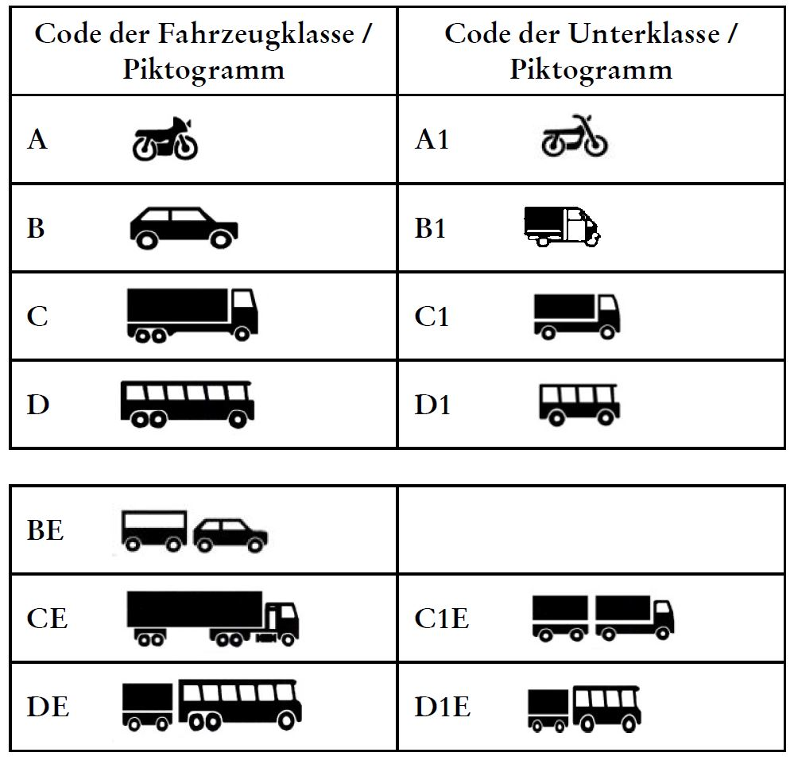
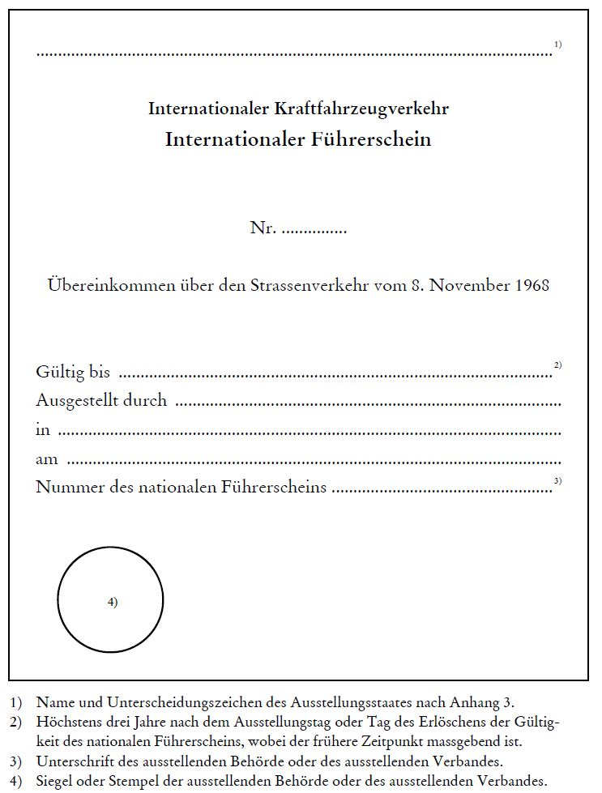
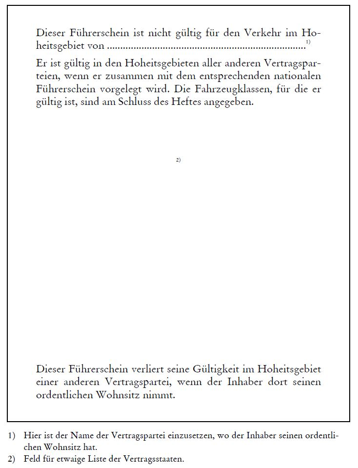
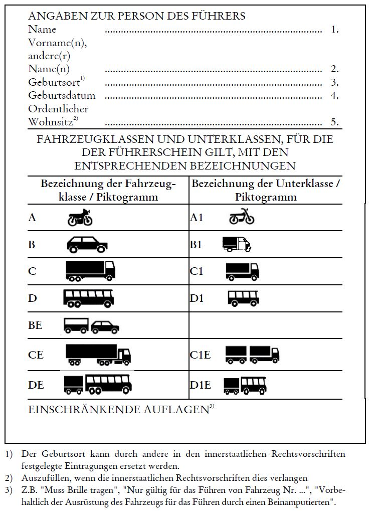
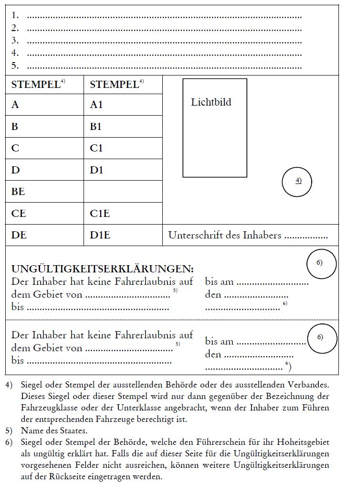

Übereinkommen über den Strassenverkehr Abgeschlossen in Wien am 8. November 1968 Zustimmung des Landtags: 5. Dezember 2019 Inkrafttreten für das Fürstentum Liechtenstein: 2. März 2021 Vorbemerkung Dieses Übereinkommen wurde in der in der Bundesrepublik Deutschland üblichen Rechtssprache abgefasst. Die nachfolgende alphabetische Liste umfasst jene Rechtsbegriffe und Fachausdrücke, für die in Liechtenstein eine andere Terminologie üblich ist: Deutsche Terminologie Liechtensteinische Terminologie ausweichen kreuzen Begrenzungsleuchte Standlicht Beiwagen Seitenwagen bevorrechtigtes Fahrzeug vortrittsberechtigtes Fahrzeug Blinkleuchten Richtungsblinker Bremsleuchten Bremslichter Fahrbewegung Fahrmanöver Fahrtrichtungsanzeiger Richtungsblinker, Richtungsanzeiger Fernsprecher Telefon Führerschein Führerausweis Führerscheinklasse Führerscheinkategorie Fussgängerlichtzeichen Fussgängersignallichter Fussgängerüberweg Fussgängerstreifen Gefahrenwarnzeichen Gefahrensignal Gehweg Fussweg Gespannfahrzeuge Tierfuhrwerke Haltzeichen Stoppsignal Hinweiszeichen Hinweissignal Kennzeichen Kontrollschild Kennzeichenbeleuchtung Kontrollschildbeleuchtung Kraftfahrstrasse Autostrasse Kraftfahrzeug Motorfahrzeug Kraftomnibus Gesellschaftswagen Kraftrad Motorrad Krankenfahrstuhl Invalidenfahrzeug Kreuzung Verzweigung Lastkraftwagen Lastwagen Lernführerschein Lernfahrausweis Leuchten Lichter Lichtzeichen Signallichter Nebelscheinwerfer Nebellichter Oberleitungsomnibus Trolleybus Personenkraftwagen Personenwagen Rückfahrscheinwerfer Rückfahrlicht Rundumlicht Drehlicht Sattelkraftfahrzeug Sattelmotorfahrzeug Schild Tafel Schlussleuchte Schlusslicht Strassenverkehrszeichen Strassensignal Überweg für Fussgänger Fussgängerstreifen Verkehrslichtzeichen Signallichter Verkehrszeichen Signal Vorfahrt Vortritt Vorfahrt gewähren (Signal) kein Vortritt (Signal) Vorfahrtstrasse Hauptstrasse Vorrang Vortritt Warnanlage Signalanlage Zeichen Signal Zulassungsschein Fahrzeugausweis Die Vertragsparteien, in dem Wunsch, den internationalen Strassenverkehr zu erleichtern und die Sicherheit auf den Strassen durch die Annahme einheitlicher Verkehrsregeln zu erhöhen, haben die folgenden Bestimmungen vereinbart: Kapitel I Allgemeines Art. 1 Begriffsbestimmungen Im Sinne dieses Übereinkommens haben die nachstehenden Begriffe die ihnen in diesem Artikel zugeordneten Bedeutungen: a) "Innerstaatliche Rechtsvorschriften" einer Vertragspartei sind alle im Hoheitsgebiet dieser Vertragspartei in Kraft befindlichen nationalen oder örtlichen Gesetze und Regelungen; b) ein Fahrzeug gilt als "im internationalen Verkehr" im Hoheitsgebiet eines Staates, wenn i) es einer natürlichen oder juristischen Person gehört, die ihren ordentlichen Wohnsitz ausserhalb dieses Staates hat; ii) es in diesem Staat nicht zugelassen ist, und iii) es vorübergehend in diesen Staat eingeführt wird; dabei steht es jedoch jeder Vertragspartei frei, es abzulehnen, ein Fahrzeug als "im internationalen Verkehr" befindlich anzusehen, das ohne nennenswerte Unterbrechung, deren Dauer sie festsetzen kann, länger als ein Jahr in ihrem Hoheitsgebiet geblieben ist. Miteinander verbundene Fahrzeuge gelten als "im internationalen Verkehr", wenn wenigstens eines dieser Fahrzeuge der Begriffsbestimmung entspricht; c) "Ortschaft" ist ein Gebiet, das bebaute Grundstücke umfasst und dessen Ein- und Ausfahrten als solche besonders gekennzeichnet sind oder das in den innerstaatlichen Rechtsvorschriften in anderer Weise bestimmt ist; [...] d) "Strasse" ist die gesamte Fläche jedes dem öffentlichen Verkehr dienenden Weges; e) "Fahrbahn" ist der Teil der Strasse, der üblicherweise von den Fahrzeugen benutzt wird; eine Strasse kann mehrere Fahrbahnen haben, die insbesondere durch einen Mittelstreifen oder einen Höhenunterschied deutlich voneinander getrennt sind; f) auf Fahrbahnen, wo ein seitlicher Fahrstreifen oder ein Weg oder mehrere seitliche Fahrstreifen oder Wege dem Verkehr bestimmter Fahrzeuge vorbehalten sind, ist "Fahrbahnrand" für die anderen Verkehrsteilnehmer der Rand des übrigen Teils der Fahrbahn; g) "Fahrstreifen" ist jeder der Längsstreifen, in welche die Fahrbahn unterteilt werden kann, mag er durch Strassenmarkierungen in der Längsrichtung gekennzeichnet sein oder nicht, dessen Breite für die Fortbewegung einer Reihe mehrspuriger Kraftfahrzeuge (Art. 1 Bst. p) ausreicht; g bis ) "Radstreifen" ist jener Teil der Fahrbahn, der für die Radfahrer bestimmt ist. Ein Radstreifen ist von der übrigen Fahrbahn durch Strassenmarkierungen in der Längsrichtung getrennt. g ter ) "Radweg" ist eine eigene Strasse oder der Teil einer Strasse, die bzw. der Radfahrern vorbehalten und als Radweg gekennzeichnet ist. Ein Radweg ist von anderen Strassen oder anderen Strassenteilen durch bauliche Einrichtungen getrennt. h) "Kreuzung" ist jede höhengleiche Kreuzung, Einmündung oder Gabelung von Strassen einschliesslich der durch solche Kreuzungen, Einmündungen oder Gabelungen gebildeten Plätze; i) "Bahnübergang" ist jede höhengleiche Kreuzung zwischen einer Strasse und Eisenbahn- oder Strassenbahnschienen auf eigenem Schienenkörper; j) "Autobahn" ist eine Strasse, die für den Verkehr mit Kraftfahrzeugen besonders bestimmt und gebaut ist, zu der von den angrenzenden Grundstücken aus keine unmittelbare Zufahrt besteht und die: i) - ausser an einzelnen Stellen oder vorübergehend - für beide Verkehrsrichtungen besondere Fahrbahnen hat, die durch einen nicht für den Verkehr bestimmten Geländestreifen oder in Ausnahmefällen durch andere Mittel voneinander getrennt sind; ii) keine höhengleiche Kreuzung mit Strassen, Eisenbahn- oder Strassenbahnschienen oder Gehwegen hat; iii) als Autobahn besonders gekennzeichnet ist; k) ein Fahrzeug gilt als: i) "haltendes Fahrzeug", wenn es während der Zeit, die zum Ein- oder Aussteigen oder zum Be- und Entladen erforderlich ist, hält; ii) "parkendes Fahrzeug", wenn es aus einem anderen Grunde als zur Vermeidung eines Zusammentreffens mit einem anderen Verkehrsteilnehmer oder mit einem Hindernis oder zur Einhaltung von Verkehrsvorschriften hält und wenn sich sein Halten nicht auf die Zeit beschränkt, die zum Ein- oder Aussteigen oder zum Be- und Entladen erforderlich ist. Die Vertragsparteien können jedoch die nach Ziff. ii stillstehenden Fahrzeuge als "haltende Fahrzeuge" ansehen, wenn die Dauer dieses Stillstehens eine durch die innerstaatlichen Rechtsvorschriften festgesetzte zeitliche Beschränkung nicht überschreitet, und sie können die nach Ziff. i stillstehenden Fahrzeuge als "parkende Fahrzeuge" ansehen, wenn die Dauer dieses Stillstehens eine durch die innerstaatlichen Rechtsvorschriften festgesetzte zeitliche Beschränkung überschreitet; l) "Fahrrad" ist jedes Fahrzeug mit wenigstens zwei Rädern, das ausschliesslich durch die Muskelkraft auf ihm befindlicher Personen, insbesondere mit Hilfe von Pedalen oder Handkurbeln, angetrieben wird; m) "Motorfahrräder" sind zwei- oder dreirädrige Fahrzeuge mit einem Verbrennungsmotor, dessen Zylinderinhalt 50 cm 3 (3,05 Kubikzoll) und dessen durch die Bauart bestimmte Höchstgeschwindigkeit 50 km (30 Meilen) in der Stunde nicht übersteigt. Die Vertragsparteien haben jedoch das Recht, in ihren innerstaatlichen Rechtsvorschriften solche Fahrzeuge nicht als Motorfahrräder anzusehen, die nicht hinsichtlich ihrer Verwendungsmöglichkeiten die Merkmale von Fahrrädern haben - insbesondere das Merkmal, durch Pedale angetrieben werden zu können - oder deren durch die Bauart bestimmte Höchstgeschwindigkeit, deren Masse oder gewisse Merkmale des Motors gegebene Grenzen übersteigen. Nichts in dieser Begriffsbestimmung ist so auszulegen, als hindere es die Vertragsparteien, hinsichtlich der Anwendung ihrer innerstaatlichen Rechtsvorschriften für den Strassenverkehr, die Motorfahrräder völlig den Fahrrädern gleichzustellen; n) "Kraftrad" ist jedes zweirädrige Fahrzeug mit oder ohne Beiwagen, das einen Antriebsmotor hat. Die Vertragsparteien können in ihren innerstaatlichen Rechtsvorschriften dreirädrige Fahrzeuge mit einer Leermasse von nicht mehr als 400 kg (900 Pfund) den Krafträdern gleichstellen. Der Begriff "Kraftrad" schliesst die Motorfahrräder nicht ein; die Vertragsparteien können jedoch unter der Bedingung, dass sie nach Art. 54 Abs. 2 eine entsprechende Erklärung abgeben, für die Anwendung dieses Übereinkommens die Motorfahrräder den Krafträdern gleichstellen; o) "Kraftfahrzeug" ist jedes auf der Strasse mit eigener Kraft verkehrende Fahrzeug mit Antriebsmotor mit Ausnahme der Motorfahrräder in dem Hoheitsgebiet der Vertragsparteien, die sie nicht den Krafträdern gleichgestellt haben, und mit Ausnahme der Schienenfahrzeuge; p) "Kraftfahrzeuge" im Sinne dieses Buchstabens sind nur die Kraftfahrzeuge, die üblicherweise auf der Strasse zur Beförderung von Personen oder Gütern oder zum Ziehen von Fahrzeugen, die für die Personen- oder Güterbeförderung benutzt werden, dienen. Dieser Begriff schliesst die Oberleitungsomnibusse - das heisst die mit einer elektrischen Leitung verbundenen und nicht auf Schienen fahrenden Fahrzeuge - ein. Er umfasst nicht Fahrzeuge, die auf der Strasse nur gelegentlich zur Beförderung von Personen oder Gütern oder zum Ziehen von Fahrzeugen, die der Personen- oder Güterbeförderung dienen, benutzt werden, wie landwirtschaftliche Zugmaschinen; q) "Anhänger" ist jedes Fahrzeug, das dazu bestimmt ist, an ein Kraftfahrzeug angehängt zu werden; dieser Begriff schliesst die Sattelanhänger ein; r) "Sattelanhänger" ist jeder Anhänger, der dazu bestimmt ist, mit einem Kraftfahrzeug (Art. 1 Bst. p) so verbunden zu werden, dass er teilweise auf diesem aufliegt und dass ein wesentlicher Teil seiner Masse und der Masse seiner Ladung von diesem getragen wird; s) "leichter Anhänger" ist jeder Anhänger, dessen höchste zulässige Gesamtmasse 750 kg (1650 Pfund) nicht übersteigt; t) "miteinander verbundene Fahrzeuge" sind solche miteinander verbundenen Fahrzeuge, die am Strassenverkehr als eine Einheit teilnehmen; u) "Sattelkraftfahrzeuge" sind miteinander verbundene Fahrzeuge, die aus einem Kraftfahrzeug (Art. 1 Bst. p) und einem damit verbundenen Sattelanhänger bestehen; v) "Führer" ist jede Person, die ein Kraftfahrzeug oder ein anderes Fahrzeug (Fahrräder eingeschlossen) lenkt oder die auf einer Strasse Vieh, einzeln oder in Herden, oder Zug-, Saum- oder Reittiere leitet; w) "höchste zulässige Gesamtmasse" ist die Höchstmasse des beladenen Fahrzeugs, das von der zuständigen Behörde des Zulassungsstaates als zulässig erklärt wurde; x) "Leermasse" ist die Masse des Fahrzeugs ohne Besatzung, Fahrgäste oder Ladung, aber mit seinem gesamten Kraftstoffvorrat und seinem üblichen Bordwerkzeug; y) "Gesamtmasse" ist die tatsächliche Masse des beladenen Fahrzeugs einschliesslich der Besatzung und der Fahrgäste; z) "Verkehrsrichtung" und "entsprechend der Verkehrsrichtung" bedeuten rechts, wenn nach den innerstaatlichen Rechtsvorschriften der Fahrzeugführer ein entgegenkommendes Fahrzeug links vorbeilassen muss; im umgekehrten Falle bedeuten diese Ausdrücke links; aa) die Pflicht für den Fahrzeugführer, anderen Fahrzeugen "die Vorfahrt zu gewähren" bedeutet, dass er seine Fahrt oder seine Fahrbewegung nicht fortsetzen oder wiederaufnehmen darf, wenn dies andere Fahrzeugführer dazu zwingen könnte, die Richtung oder die Geschwindigkeit ihrer Fahrzeuge unvermittelt zu ändern. [...] Art. 2 Anhänge zu dem Übereinkommen Die Anhänge zu diesem Übereinkommen, nämlich: - Anhang 1: Abweichungen von der Verpflichtung zur Zulassung von Kraftfahrzeugen (Art. 1 Bst. p) und Anhängern zum internationalen Verkehr, - Anhang 2: Kennzeichen der Kraftfahrzeuge (Art. 1 Bst. p) und Anhänger im internationalen Verkehr, - Anhang 3: Unterscheidungszeichen der Kraftfahrzeuge (Art. 1 Bst. p) und Anhänger im internationalen Verkehr, - Anhang 4: Erkennungsmerkmale der Kraftfahrzeuge (Art. 1 Bst. p) und Anhänger im internationalen Verkehr, - Anhang 5: Technische Anforderungen an die Kraftfahrzeuge (Art. 1 Bst. p) und Anhänger, - Anhang 6: Nationaler Führerschein und - Anhang 7: Internationaler Führerschein sind Bestandteile dieses Übereinkommens. Art. 3 Verpflichtungen der Vertragsparteien 1) a) Die Vertragsparteien treffen die erforderlichen Massnahmen, damit die in ihrem Hoheitsgebiet geltenden Verkehrsregeln in ihrem sachlichen Gehalt mit den in Kapitel II enthaltenen Bestimmungen übereinstimmen. Unter der Bedingung, dass sie in keinem Punkte mit den genannten Bestimmungen unvereinbar sind, i) brauchen diese Regeln jene Bestimmungen nicht zu übernehmen, die für Verhältnisse gelten, die im Hoheitsgebiet der betreffenden Vertragsparteien nicht vorkommen; ii) können diese Regeln Bestimmungen enthalten, die in Kapitel II nicht vorgesehen sind. b) Dieser Absatz verpflichtet die Vertragsparteien nicht, Strafmassnahmen für jede Verletzung der Bestimmungen des Kapitels II, die in ihre Verkehrsregeln übernommen wurden, vorzusehen. 2) a) Die Vertragsparteien treffen auch die erforderlichen Massnahmen, damit die in ihrem Hoheitsgebiet geltenden Regeln für die von den Kraftfahrzeugen (Art. 1 Bst. p) und den Anhängern zu erfüllenden technischen Bedingungen mit Anhang 5 übereinstimmen; unter der Bedingung, dass sie in keinem Punkte den diesen Bestimmungen zugrunde liegenden Sicherheitsgrundsätzen widersprechen, können diese Regeln Bestimmungen enthalten, die in diesem Anhang nicht vorgesehen sind. Die Vertragsparteien treffen darüber hinaus die erforderlichen Massnahmen, damit die in ihrem Hoheitsgebiet zugelassenen Kraftfahrzeuge (Art. 1 Bst. p) und Anhänger mit Anhang 5 übereinstimmen, wenn diese im internationalen Verkehr eingesetzt werden. b) Dieser Absatz bindet die Vertragsparteien nicht in Bezug auf die in ihrem Hoheitsgebiet geltenden technischen Bedingungen für diejenigen Kraftfahrzeuge, die keine Kraftfahrzeuge (Art. 1 Bst. p) im Sinne dieses Übereinkommens sind. 3) Vorbehaltlich der im Anhang 1 vorgesehenen Abweichungen sind die Vertragsparteien gehalten, zum internationalen Verkehr in ihrem Hoheitsgebiet die Kraftfahrzeuge (Art. 1 Bst. p) und die Anhänger zuzulassen, welche den in Kapitel III festgelegten Bedingungen entsprechen und deren Führer die in Kapitel IV festgelegten Bedingungen erfüllen; sie sind auch gehalten, die nach Kapitel III ausgestellten Zulassungsscheine bis zum Nachweis des Gegenteils als Beweis dafür anzuerkennen, dass die Fahrzeuge, auf die sich diese Zulassungsscheine beziehen, die den in Kapitel III festgelegten Bedingungen entsprechen. 4) Massnahmen, welche die Vertragsparteien entweder einseitig oder durch zwei- oder mehrseitige Übereinkommen getroffen haben oder treffen werden, um in ihrem Hoheitsgebiet Kraftfahrzeuge (Art. 1 Bst. p) und Anhänger, die nicht allen in Kapitel III festgelegten Anforderungen entsprechen, zum internationalen Verkehr zuzulassen und um, ausser den in Kapitel IV vorgesehenen Fällen, die Gültigkeit von Führerscheinen in ihrem Hoheitsgebiet anzuerkennen, die von einer anderen Vertragspartei ausgestellt wurden, werden als dem Sinn und Zweck dieses Übereinkommens entsprechend angesehen. 5) Die Vertragsparteien sind gehalten, zum internationalen Verkehr in ihrem Hoheitsgebiet die Fahrräder und die Motorfahrräder zuzulassen, welche den in Kapitel V festgelegten technischen Bedingungen entsprechen und deren Führer ihren ordentlichen Wohnsitz im Hoheitsgebiet einer anderen Vertragspartei haben. Eine Vertragspartei kann nicht verlangen, dass die Führer von Fahrrädern oder Motorfahrrädern im internationalen Verkehr Besitzer eines Führerscheins sind; jedoch können die Vertragsparteien, die nach Art. 54 Abs. 2 eine Erklärung abgegeben haben, welche die Motorfahrräder den Krafträdern gleichstellt, von den Führern von Motorfahrrädern im internationalen Verkehr einen Führerschein verlangen. 5 bis ) Die Vertragsparteien ergreifen die erforderlichen Massnahmen, damit insbesondere in den Schulen in allen Stufen ein systematischer und fortlaufender Verkehrssicherheitsunterricht erteilt wird. 5 ter ) In allen Fällen, in denen der Fahrunterricht für Fahrschüler durch professionelle Fahrschulen erteilt wird, müssen die innerstaatlichen Rechtsvorschriften Mindestanforderungen in Bezug auf die bisherige Tätigkeit und die berufliche Qualifikation der mit der Erteilung des Fahrunterrichts beauftragten Personen festlegen. 6) Die Vertragsparteien sind verpflichtet, jeder darum ersuchenden Vertragspartei die notwendigen Auskünfte zur Ermittlung der Person zu geben, auf deren Namen ein Kraftfahrzeug (Art. 1 Bst. p) oder ein mit einem solchen Fahrzeug verbundener Anhänger in ihrem Hoheitsgebiet zugelassen ist, wenn aus dem vorgelegten Ersuchen hervorgeht, dass dieses Fahrzeug im Hoheitsgebiet der ersuchenden Vertragspartei in einen schweren Unfall verwickelt war oder der Fahrer dieses Fahrzeugs einen schwerwiegenden Verstoss gegen die Strassenverkehrsordnung begangen hat, der schwere Strafen oder einen Entzug der Fahrerlaubnis nach sich ziehen kann. 7) Massnahmen, welche die Vertragsparteien entweder einseitig oder über zwei- oder mehrseitige Übereinkommen getroffen haben oder treffen werden, um den internationalen Strassenverkehr durch Vereinfachung der Vorschriften für das Zoll-, Polizei- oder Gesundheitswesen oder auf anderen ähnlichen Gebieten zu erleichtern sowie Massnahmen, die gewährleisten sollen, dass Zollämter an ein und derselben Grenzübergangsstelle dieselben Zuständigkeiten und dieselben Öffnungszeiten haben, werden als dem Sinn und Zweck dieses Übereinkommens entsprechend angesehen. 8) Die Abs. 3, 5 und 7 stehen dem Recht jeder Vertragspartei nicht entgegen, die Zulassung von Kraftfahrzeugen (Art. 1 Bst. p) und Anhängern, von Fahrrädern und Motorfahrrädern sowie deren Führern und Mitfahrern zum internationalen Verkehr in ihrem Hoheitsgebiet ihrer Regelung über den gewerblichen Personen- und Güterverkehr, ihrer Regelung über die Haftpflichtversicherung der Führer, ihrer Regelung bezüglich der Verzollung sowie ganz allgemein ihren Vorschriften ausserhalb des Bereiches des Strassenverkehrs zu unterwerfen. Art. 4 Verkehrszeichen Die Vertragsparteien dieses Übereinkommens, die nicht Vertragsparteien des Übereinkommens über Strassenverkehrszeichen sind, das am selben Tage wie dieses Übereinkommen in Wien zur Unterschrift aufgelegt worden ist, verpflichten sich, a) dafür zu sorgen, dass alle Strassenverkehrszeichen, Verkehrslichtzeichen und Strassenmarkierungen, die in ihrem Hoheitsgebiet angebracht sind, ein zusammenhängendes System bilden und so gestaltet und aufgestellt sind, dass man sie leicht erkennen kann; b) die Zahl der Arten der Verkehrszeichen zu beschränken und diese nur an den Stellen anzubringen, wo sie als nützlich angesehen werden; c) Gefahrenwarnzeichen in genügendem Abstand vor der Gefahrenstelle anzubringen, um die Führer rechtzeitig zu warnen; und d) zu verbieten, dass i) an einem Verkehrszeichen, an dessen Träger oder an irgendeiner anderen Einrichtung zur Verkehrsregelung irgend etwas angebracht wird, was nicht in Beziehung zum Sinn und Zweck dieses Verkehrszeichens oder dieser Einrichtung steht, wenn jedoch die Vertragsparteien oder ihre Teilgebiete eine Gesellschaft ohne Erwerbszweck ermächtigen, Hinweiszeichen aufzustellen, können sie gestatten, dass das Emblem dieser Gesellschaft auf dem Zeichen oder dessen Träger erscheint, sofern das Verständnis des Zeichens dadurch nicht erschwert wird; ii) Tafeln, Schilder, Kennzeichen oder Einrichtungen angebracht werden, die zu Verwechslungen mit Verkehrszeichen oder anderen Einrichtungen zur Verkehrsregelung führen, deren Sichtbarkeit oder Wirksamkeit verringern oder die Verkehrsteilnehmer blenden oder ihre Aufmerksamkeit in für die Sicherheit des Verkehrs gefährlicher Weise ablenken könnten; iii) auf Gehwegen und begehbaren Seitenstreifen keine Vorrichtungen oder Geräte angebracht werden, die den Fussgängerverkehr, insbesondere ältere und behinderte Personen, unnötig beeinträchtigen könnten. Kapitel II Verkehrsregeln Art. 5 Geltung der Verkehrszeichen 1) Die Verkehrsteilnehmer müssen sich nach den durch die Strassenverkehrszeichen, die Verkehrslichtzeichen oder die Strassenmarkierungen angezeigten Vorschriften richten, selbst wenn die betreffenden Vorschriften im Widerspruch zu anderen Verkehrsregeln zu stehen scheinen. 2) Die durch Verkehrslichtzeichen angezeigten Vorschriften gehen jenen, die durch vorfahrtregelnde Strassenverkehrszeichen angezeigt sind, vor. Art. 6 Zeichen und Weisungen der Verkehrspolizisten 1) Die den Verkehr regelnden Polizisten müssen bei Tag und Nacht leicht erkennbar und aus angemessener Entfernung sichtbar sein. 2) Die Verkehrsteilnehmer müssen unverzüglich den Zeichen und Weisungen der den Verkehr regelnden Polizisten nachkommen. 3) Es wird empfohlen, in den innerstaatlichen Rechtsvorschriften insbesondere als Zeichen der den Verkehr regelnden Polizisten anzusehen: a) den senkrecht erhobenen Arm; dieses Zeichen bedeutet "Achtung, Halt" für alle Verkehrsteilnehmer mit Ausnahme jener Führer, die nicht mehr unter ausreichenden Sicherheitsbedingungen anhalten können; wird dieses Zeichen an einer Kreuzung gegeben, verpflichtet es die bereits in der Kreuzung befindlichen Führer nicht zum Anhalten; b) den oder die waagrecht ausgestreckten Arme; dieses Zeichen bedeutet "Halt" für alle Verkehrsteilnehmer, die aus Richtungen kommen, welche die durch den oder die ausgestreckten Arme angezeigte Richtung schneiden; nach diesem Zeichen kann der den Verkehr regelnde Polizist den oder die Arme senken; das bedeutet für die vor oder hinter dem Polizisten befindlichen Führer ebenfalls "Halt"; c) das Schwenken einer Lampe mit rotem Licht; dieses Zeichen bedeutet "Halt" für die Verkehrsteilnehmer, gegen die das Licht gerichtet ist. 4) Die Zeichen und Weisungen der den Verkehr regelnden Polizisten gehen den durch Strassenverkehrszeichen, Verkehrslichtzeichen oder Strassenmarkierungen angezeigten Vorschriften sowie den Verkehrsregeln vor. Art. 7 Allgemeine Regeln 1) Die Verkehrsteilnehmer müssen jedes Verhalten vermeiden, das eine Gefährdung oder Behinderung des Verkehrs mit sich bringen sowie Personen gefährden oder öffentliches oder privates Gut beschädigen könnte. 2) Es wird empfohlen, in den innerstaatlichen Rechtsvorschriften vorzusehen, dass die Strassenverkehrsteilnehmer den Verkehr nicht dadurch behindern oder gefährden dürfen, dass sie Gegenstände oder Stoffe auf die Strasse werfen, hinlegen oder dort zurücklassen oder irgendein anderes Hindernis auf der Strasse schaffen. Die Verkehrsteilnehmer, denen es nicht möglich war, das Auftreten eines Hindernisses oder einer Gefahr zu vermeiden, müssen die notwendigen Massnahmen treffen, um das Hindernis oder die Gefahr so schnell wie möglich zu beseitigen oder, sofern dies nicht sofort möglich ist, andere Verkehrsteilnehmer davor zu warnen. 3) Die Fahrzeugführer müssen gegenüber den schwächsten Verkehrsteilnehmern, wie z. B. Fussgängern und Radfahrern und insbesondere Kindern, älteren Personen und Behinderten, erhöhte Vorsicht walten lassen. 4) Die Fahrzeugführer müssen dafür Sorge tragen, dass ihre Fahrzeuge die Verkehrsteilnehmer und Anlieger, insbesondere durch die Entwicklung von Lärm, Staub oder Rauch, nicht unnötig belästigen. 5) Das Anlegen des Sicherheitsgurtes ist für die Fahrzeugführer und die Fahrzeuginsassen auf den mit Gurten ausgerüsteten Sitzen vorgeschrieben, ausgenommen sind Fälle, in denen die innerstaatlichen Rechtsvorschriften Ausnahmen zulassen. [...] Art. 8 Führer 1) Jedes Fahrzeug und miteinander verbundene Fahrzeuge müssen, wenn sie in Bewegung sind, einen Führer haben. 2) Es wird empfohlen, in den innerstaatlichen Rechtsvorschriften vorzusehen, dass Zug-, Saum- und Reittiere und, ausser in Gebieten, die an ihrem Zugang besonders gekennzeichnet sind, Vieh, einzeln oder in Herden, einen Führer haben müssen. 3) Jeder Führer muss die erforderlichen körperlichen und geistigen Eigenschaften haben und körperlich und geistig in der Lage sein zu führen. 4) Jeder Führer eines Kraftfahrzeugs muss die für die Führung des Fahrzeugs erforderlichen Kenntnisse und Fähigkeiten haben; diese Bestimmung bildet jedoch kein Hindernis für den Fahrunterricht nach den innerstaatlichen Rechtsvorschriften. 5) Jeder Führer muss dauernd sein Fahrzeug beherrschen oder seine Tiere führen können. [...] 5 bis ) Fahrzeugsysteme, die einen Einfluss auf das Führen des Fahrzeugs haben, gelten mit Abs. 5 dieses Artikels und mit Abs. 1 des Art. 13 als konform, sofern sie den Vorschriften bezüglich Bauweise, Montage und Benutzung nach Massgabe der internationalen Rechtsvorschriften für Kraftfahrzeuge, Ausrüstungsgegenstände und Teile, die in Kraftfahrzeuge eingebaut und/oder dafür verwendet werden können, entsprechen; Fahrzeugsysteme, die einen Einfluss auf das Führen eines Fahrzeugs haben und die nicht den oben erwähnten Vorschriften bezüglich Bauweise, Montage und Benutzung entsprechen, gelten mit Abs. 5 dieses Artikels und mit Abs. 1 des Art. 13 als konform, sofern die Fahrzeugsysteme vom Fahrzeugführer übersteuert oder desaktiviert werden können. 6) Der Führer eines Fahrzeugs muss alle anderen Tätigkeiten als das Führen seines Fahrzeugs vermeiden. Die innerstaatlichen Rechtsvorschriften sollten Bestimmungen zur Benutzung von Telefonen durch die Fahrzeugführer vorsehen. In jedem Fall müssen sie die Benutzung von Telefonen ohne Freisprecheinrichtung durch Führer eines sich in Bewegung befindlichen Motorfahrzeugs oder Motorfahrrads verbieten. Art. 9 Herden Es wird empfohlen, in den innerstaatlichen Rechtsvorschriften vorzusehen, dass Viehherden zur Erleichterung des Verkehrs in kleinere Gruppen mit genügend grossen Abständen unterteilt werden müssen, sofern nicht Abweichungen zugelassen werden, um die Herdenwanderungen zu erleichtern. Art. 10 Platz auf der Fahrbahn 1) Die Verkehrsrichtung muss auf allen Strassen desselben Staates gleich sein, mit Ausnahme gegebenenfalls der Strassen, die ausschliesslich oder überwiegend dem Durchgangsverkehr zwischen zwei anderen Staaten dienen. [...] 2) Tiere auf der Fahrbahn müssen so nahe wie möglich an dem der Verkehrsrichtung entsprechenden Fahrbahnrand geführt werden. 3) Unbeschadet der gegenteiligen Bestimmungen in Art. 7 Abs. 1, Art. 11 Abs. 6 und der sonstigen gegenteiligen Bestimmungen dieses Übereinkommens muss jeder Fahrzeugführer, soweit es ihm die Umstände erlauben, sein Fahrzeug nahe dem der Verkehrsrichtung entsprechenden Fahrbahnrand halten. Die Vertragsparteien oder ihre Teilgebiete können jedoch genauere Regeln über den Platz der Güterfahrzeuge auf der Fahrbahn vorschreiben. 4) Wenn eine Strasse zwei oder drei Fahrbahnen hat, darf kein Führer die Fahrbahn benutzen, die der der Verkehrsrichtung entsprechenden Fahrbahn gegenüberliegt. 5) a) Auf Fahrbahnen mit Gegenverkehr und wenigstens vier Fahrstreifen darf kein Führer die Fahrstreifen benutzen, die sich ganz auf der Fahrbahnhälfte befinden, die der der Verkehrsrichtung entsprechenden Seite gegenüberliegt. b) Auf Fahrbahnen mit Gegenverkehr und drei Fahrstreifen darf kein Führer den Fahrstreifen benutzen, der sich an dem Fahrbahnrand befindet, welcher der der Verkehrsrichtung entsprechenden Seite gegenüberliegt. 6) Unbeschadet der Bestimmungen in Art. 11 muss jeder Führer eines langsam fahrenden Fahrzeugs in Fällen, in denen ein zusätzlicher Fahrstreifen durch Verkehrszeichen angezeigt wird, diesen Fahrstreifen benutzen. Art. 11 Überholen und Fahren in Reihen 1) a) Es ist auf der der Verkehrsrichtung entgegengesetzten Seite zu überholen. b) Es ist jedoch auf der der Verkehrsrichtung entsprechenden Seite zu überholen, wenn der zu überholende Führer nach Anzeigen seiner Absicht, sich nach der der Verkehrsrichtung entgegengesetzten Seite zu begeben, sein Fahrzeug oder seine Tiere auf diese Seite der Fahrbahn gebracht hat, um auf dieser Seite in eine andere Strasse oder in ein Grundstück einzubiegen oder um auf dieser Seite zu halten. c) Die innerstaatlichen Rechtsvorschriften können es Radfahrern und Führern von Motorfahrrädern gestatten, stehende oder sich langsam fortbewegende Fahrzeuge auf der der Verkehrsrichtung entsprechenden Seite zu überholen, sofern es sich bei den Fahrzeugen nicht um Fahrräder oder Motorfahrräder handelt und genug freier Raum vorhanden ist. 2) Vor dem Überholen muss sich jeder Führer unbeschadet des Art. 7 Abs. 1 und des Art. 14 vergewissern, a) dass kein ihm folgender Führer zum Überholen angesetzt hat; b) dass derjenige, der auf demselben Fahrstreifen vor ihm ist, nicht seine Absicht angezeigt hat, einen Dritten zu überholen; c) dass er dabei den Gegenverkehr weder gefährdet noch behindert, insbesondere der von ihm zu benutzende Fahrstreifen auf eine ausreichende Entfernung frei ist und die relative Geschwindigkeit der beiden Fahrzeuge ein Überholen in einer ausreichend kurzen Zeit gestattet; d) dass er, ausser wenn er einen für den Gegenverkehr verbotenen Fahrstreifen benutzt, ohne Behinderung des oder der von ihm überholten Strassenverkehrsteilnehmer den nach Art. 10 Abs. 3 vorgeschriebenen Platz wieder einnehmen kann. 3) Entsprechend Abs. 2 ist auf Fahrbahnen mit Gegenverkehr das Überholen insbesondere bei Annäherung an den Scheitelpunkt einer Kuppe und, bei ungenügender Sicht, in den Kurven, verboten, es sei denn, dass dort die Fahrstreifen mit Längsmarkierungen versehen sind und so überholt wird, dass der Fahrstreifen, auf dem die Markierung Gegenverkehr verbietet, nicht verlassen wird. 4) Während er überholt, muss jeder Führer von dem oder den überholten Verkehrsteilnehmern einen ausreichenden Seitenabstand halten. 5) a) Auf Fahrbahnen, die mindestens zwei dem Verkehr in der von ihm befahrenen Richtung vorbehaltene Fahrstreifen haben, darf ein Führer, der unmittelbar oder kurz nachdem er den nach Art. 10 Abs. 3 vorgeschriebenen Platz wieder hätte einnehmen sollen sich zu erneutem Überholen veranlasst sieht, auf dem von ihm für die erste Überholung benutzten Fahrstreifen bleiben, um diese Überholung auszuführen, unter der Bedingung, dass er sich vergewissert, dass dies für die Führer von hinter ihm herankommenden schnelleren Fahrzeugen keine nennenswerte Behinderung zur Folge hat. b) Die Vertragsparteien oder ihre Teilgebiete brauchen jedoch diesen Absatz nicht anzuwenden auf die Führer von Fahrrädern, Motorfahrrädern, Krafträdern, von Fahrzeugen, die im Sinne dieses Übereinkommens keine Kraftfahrzeuge (Art. 1 Bst. p) sind, sowie auf die Führer von Kraftfahrzeugen (Art. 1 Bst. p), deren höchste zulässige Gesamtmasse 3500 kg (7700 Pfund) übersteigt oder deren durch die Bauart bestimmte Höchstgeschwindigkeit 40 km (25 Meilen) in der Stunde nicht übersteigt. 6) Ist Abs. 5 Bst. a anwendbar und ist der Verkehr so dicht, dass die Fahrzeuge nicht nur die ganze ihrer Verkehrsrichtung vorbehaltene Fahrbahnhälfte einnehmen, sondern auch nur mit einer Geschwindigkeit fahren, die von der Geschwindigkeit des ihnen in ihrer Reihe vorausfahrenden Fahrzeugs abhängt, a) so gilt, unbeschadet des Abs. 9, nicht als Überholen im Sinne dieses Artikels, wenn die Fahrzeuge einer Reihe schneller als die einer anderen Reihe fahren; b) so darf ein Führer, der sich nicht auf dem Fahrstreifen befindet, der in seiner Verkehrsrichtung dem Fahrbahnrand am nächsten liegt, den Fahrstreifen nur wechseln, um sich auf das Rechts- oder Linksabbiegen vorzubereiten oder zu parken, abgesehen von dem Fahrstreifenwechsel, der von den Führern entsprechend der innerstaatlichen Rechtsvorschriften durchgeführt wird, die sich aus der Anwendung des Abs. 5 Bst. b ergeben würden. 7) Bei dem in den Abs. 5 und 6 beschriebenen Fahren in Reihen ist es den Führern untersagt, wenn die Fahrstreifen auf der Fahrbahn durch Längsmarkierungen begrenzt sind, über diesen zu fahren. 8) Unbeschadet des Abs. 2 und sonstiger Einschränkungen, die die Vertragsparteien oder ihre Teilgebiete für das Überholen an Kreuzungen und an Bahnübergängen bestimmen können, darf kein Fahrzeugführer ein Fahrzeug ausser einem zweirädrigen Fahrrad, einem zweirädrigen Motorfahrrad oder einem zweirädrigen Kraftrad ohne Beiwagen überholen: a) unmittelbar vor und in einer Kreuzung ohne Kreisverkehr, ausser i) in dem in Abs. 1 Bst. b vorgesehenen Fall; ii) wo die Strasse, auf der das Überholen stattfindet, die Vorfahrt an der Kreuzung hat; iii) wo der Verkehr an der Kreuzung durch einen Verkehrspolizisten oder durch Verkehrslichtzeichen geregelt wird; b) unmittelbar vor und während des Überquerens von Bahnübergängen ohne Schranken oder Halbschranken, wobei die Vertragspartei oder ihre Teilgebiete jedoch dieses Überholen an Bahnübergängen zulassen können, wo der Strassenverkehr durch Verkehrslichtzeichen geregelt ist, die ein Zeichen enthalten, das den Fahrzeugen die Fahrt freigibt. 9) Ein Fahrzeug darf ein anderes Fahrzeug, das sich einem durch Markierungen auf der Fahrbahn begrenzten oder als solchen gekennzeichneten Fussgängerüberweg nähert oder unmittelbar davor hält, nur mit ausreichend verminderter Geschwindigkeit überholen, um sofort anhalten zu können, wenn sich darauf ein Fussgänger befindet. Dieser Absatz ist nicht so auszulegen, als hindere er die Vertragsparteien oder ihre Teilgebiete, das Überholen innerhalb einer bestimmten Entfernung von einem Fussgängerüberweg zu untersagen oder strengere Vorschriften für einen Fahrzeugführer zu erlassen, der ein anderes unmittelbar vor dem Überweg anhaltendes Fahrzeug zu überholen beabsichtigt. 10) Ein Führer, der bemerkt, dass ein ihm folgender Führer ihn zu überholen wünscht, muss, ausser in dem nach Art. 16 Abs. 1 Bst. b vorgesehenen Fall, sich dicht an den der Verkehrsrichtung entsprechenden Rand der Fahrbahn halten, ohne die Geschwindigkeit zu steigern. Wenn die ungenügende Breite, der Querschnitt oder der Zustand der Fahrbahn es unter Berücksichtigung der Dichte des Gegenverkehrs nicht erlauben, mit Leichtigkeit und ohne Gefahr ein langsames, sperriges oder zur Beachtung einer Geschwindigkeitsgrenze verpflichtetes Fahrzeug zu überholen, muss der Führer dieses Fahrzeugs seine Geschwindigkeit vermindern und erforderlichenfalls so bald wie möglich zur Seite fahren, um die ihm folgenden Fahrzeuge vorbeifahren zu lassen. 11) a) Die Vertragsparteien oder ihre Teilgebiete können auf Fahrbahnen für eine Richtung oder auf Fahrbahnen mit Gegenverkehr, wenn wenigstens zwei Fahrstreifen innerhalb von Ortschaften und drei Fahrstreifen ausserhalb von Ortschaften dem Verkehr in der gleichen Richtung vorbehalten und von Längsmarkierungen begrenzt sind, i) den auf einem Fahrstreifen fahrenden Fahrzeugen erlauben, Fahrzeuge, die auf einem anderen Fahrstreifen fahren, auf der der Verkehrsrichtung entsprechenden Seite zu überholen, und ii) Art. 10 Abs. 3 ausser Kraft setzen, unter der Voraussetzung, dass sie Bestimmungen erlassen, welche die Möglichkeit des Fahrstreifenwechsels einschränken. b) In dem unter Bst. a vorgesehenen Fall stellt das Fahrverhalten kein Überholen im Sinne dieses Übereinkommens dar; Abs. 9 bleibt jedoch anwendbar. Art. 12 Ausweichen 1) Beim Ausweichen muss jeder Führer einen ausreichenden Seitenabstand freilassen und, wenn nötig, sich dicht an dem der Verkehrsrichtung entsprechenden Fahrbahnrand halten; wenn dabei seine Weiterfahrt durch ein Hindernis oder durch andere Verkehrsteilnehmer gehemmt wird, muss er langsamer fahren, und, wenn nötig, anhalten, um den oder die entgegenkommenden Verkehrsteilnehmer vorbeizulassen. 2) Auf Gebirgsstrassen und auf steilen Strassen mit gleichartigen Merkmalen, wo das Ausweichen unmöglich oder schwierig ist, obliegt es dem Führer des bergabfahrenden Fahrzeugs, sein Fahrzeug zur Seite zu fahren, um jedes bergauffahrende Fahrzeug vorbeifahren zu lassen ausser da, wo längs der Fahrbahn Ausweichstellen, die es den Fahrzeugen ermöglichen, zur Seite zu fahren, so angeordnet sind, dass unter Berücksichtigung der Geschwindigkeit und des Standorts der Fahrzeuge dem bergauffahrenden Fahrzeug eine vor ihm liegende Ausweichstelle zur Verfügung steht und eines der Fahrzeuge rückwärtsfahren müsste, wenn das bergauffahrende Fahrzeug jene Ausweichstelle nicht benutzte. Wenn eines der beiden Fahrzeuge, die einander ausweichen wollen, zu diesem Zweck rückwärtsfahren muss, muss dies der Führer des bergabfahrenden Fahrzeugs tun, es sei denn, dass dies für den bergauffahrenden Führer einfacher ist. Die Vertragsparteien oder ihre Teilgebiete können jedoch für bestimmte Fahrzeuge oder bestimmte Strassen oder Strassenabschnitte Sonderregeln vorschreiben, die von denen dieses Absatzes abweichen. Art. 13 Geschwindigkeit und Abstand zwischen Fahrzeugen 1) Jeder Fahrzeugführer muss unter allen Umständen sein Fahrzeug beherrschen, um den Sorgfaltspflichten genügen zu können und um ständig in der Lage zu sein, alle ihm obliegenden Fahrbewegungen auszuführen. Er muss bei der Wahl der Geschwindigkeit seines Fahrzeugs ständig die Umstände berücksichtigen, insbesondere die örtlichen Verhältnisse, den Strassenzustand, den Zustand und die Beladung seines Fahrzeugs, die Witterungsverhältnisse und die Dichte des Verkehrs, um innerhalb der nach vorn übersehbaren Strecke und vor jedem vorhersehbaren Hindernis sein Fahrzeug anhalten zu können. Er muss langsamer fahren und, wenn nötig, anhalten, sobald die Umstände es verlangen, namentlich wenn die Sicht nicht gut ist. 2) Die innerstaatlichen Rechtsvorschriften müssen Höchstgeschwindigkeiten für alle Strassen festlegen. Ebenso müssen die innerstaatlichen Rechtsvorschriften Geschwindigkeitsbeschränkungen für bestimmte Fahrzeugklassen vorschreiben, die insbesondere auf Grund ihrer Masse oder ihrer Ladung eine besondere Gefahr darstellen. Sie können ähnliche Bestimmungen für bestimmte Kategorien von Fahrzeugführern vorsehen, insbesondere für Fahranfänger. 3) Die in Abs. 2 Satz 1 vorgesehenen Bestimmungen gelten nicht für die Führer von bevorrechtigten Fahrzeugen nach Art. 34 Abs. 2 oder von in den innerstaatlichen Rechtsvorschriften vorgesehenen vergleichbaren Fahrzeugen. 4) Ein Führer darf die normale Fahrt der anderen Fahrzeuge nicht dadurch behindern, dass er ohne triftigen Grund mit ungewöhnlich niedriger Geschwindigkeit fährt. 5) Der Führer eines Fahrzeugs, der hinter einem anderen Fahrzeug fährt, muss einen ausreichenden Sicherheitsabstand von diesem wahren, um bei dessen plötzlichem Bremsen oder Anhalten einen Zusammenstoss zu vermeiden. 6) Um das Überholen zu erleichtern, müssen ausserhalb von Ortschaften die Führer von Fahrzeugen oder von miteinander verbundenen Fahrzeugen mit mehr als 3500 kg (7700 Pfund) höchster zulässiger Gesamtmasse oder mehr als 10 m (33 Fuss) Gesamtlänge - ausser wenn sie überholen oder sich anschicken, dies zu tun - zwischen ihren Fahrzeugen zu vorausfahrenden Kraftfahrzeugen einen so grossen Abstand halten, dass sich ein überholendes Fahrzeug gefahrlos vor das überholte einordnen kann. Dies gilt jedoch nicht, wenn der Verkehr sehr dicht oder das Überholen verboten ist. Ausserdem a) können die zuständigen Behörden für bestimmte Fahrzeugkolonnen Abweichungen von dieser Bestimmung zulassen oder sie auch auf Strassen, auf denen dem Verkehr in der betreffenden Richtung zwei Fahrstreifen zur Verfügung stehen, für unanwendbar erklären; b) können die Vertragsparteien oder ihre Teilgebiete andere Werte als die in diesem Absatz genannten für die betroffenen Fahrzeuge bestimmen. Art. 14 Allgemeine Vorschriften für die Fahrbewegungen 1) Jeder Fahrzeugführer, der eine Fahrbewegung ausführen will, wie Herausfahren aus einer oder Einfahren in eine Parkreihe, Wechseln nach rechts oder nach links auf der Fahrbahn, Abbiegen nach links oder rechts in eine andere Strasse oder in ein angrenzendes Grundstück, muss sich zuvor vergewissern, dass er es ohne Gefährdung der anderen Verkehrsteilnehmer tun kann, die hinter ihm oder vor ihm sind oder die ihm begegnen, und zwar unter Berücksichtigung ihres Standorts, ihrer Richtung und ihrer Geschwindigkeit. 2) Jeder Führer, der wenden oder rückwärts fahren will, muss sich zuvor vergewissern, dass er es ohne Gefährdung oder Behinderung der anderen Verkehrsteilnehmer tun kann. 3) Vor dem Abbiegen oder vor einer Fahrbewegung, die mit einer seitlichen Verschiebung verbunden ist, muss der Führer seine Absicht deutlich und rechtzeitig mit dem oder den Fahrtrichtungsanzeigern seines Fahrzeugs oder, falls solche nicht vorhanden sind, wenn möglich durch ein mit dem Arm gegebenes geeignetes Zeichen anzeigen. Das durch den oder die Fahrtrichtungsanzeiger gegebene Zeichen muss während der ganzen Dauer der Fahrbewegung fortgesetzt werden und aufhören, sobald diese beendet ist. Art. 15 Sondervorschriften bezüglich der Fahrzeuge des öffentlichen Linienverkehrs Es wird empfohlen, in den innerstaatlichen Rechtsvorschriften vorzusehen, dass in Ortschaften, um den Verkehr der Fahrzeuge des öffentlichen Linienverkehrs zu erleichtern, die Führer der anderen Fahrzeuge, vorbehaltlich des Art. 17 Abs. 1, ihre Fahrt verlangsamen und, wenn nötig, anhalten, um diese Fahrzeuge des öffentlichen Verkehrs die erforderliche Fahrbewegung ausführen zu lassen, damit sie sich bei der Abfahrt von den als solche gekennzeichneten Haltestellen wieder in Bewegung setzen können. Die von den Vertragsparteien oder ihren Teilgebieten zu diesem Zweck erlassenen Bestimmungen ändern in keiner Weise die für die Führer der Fahrzeuge des öffentlichen Linienverkehrs bestehende Verpflichtung, die zur Vermeidung irgendeiner Gefährdung nötigen Vorsichtsmassnahmen zu treffen, nachdem sie ihre Absicht des Wiederanfahrens mit ihren Fahrtrichtungsanzeigern angezeigt haben. Art. 16 Fahrtrichtungsänderung 1) Ein Führer, der nach rechts oder links in eine andere Strasse oder in ein angrenzendes Grundstück abbiegen will, muss unbeschadet des Art. 7 Abs. 1 und des Art. 14, a) wenn er die Strasse nach der der Verkehrsrichtung entsprechenden Seite verlassen will, sich so nahe wie möglich an den dieser Richtung entsprechenden Fahrbahnrand halten und seine Fahrbewegung in einem kleinstmöglichen Raum ausführen; b) wenn er die Strasse nach der anderen Seite verlassen will, vorbehaltlich der Möglichkeit für die Vertragsparteien oder ihre Teilgebiete, abweichende Bestimmungen für Fahrräder und Motorfahrräder zu erlassen, die diesen insbesondere eine Fahrtrichtungsänderung durch ein Überqueren der Kreuzung in zwei Einzelphasen ermöglichen, sich auf Strassen mit Gegenverkehr so nahe wie möglich an die Mittellinie der Fahrbahn und auf Einbahnstrassen an den der Verkehrsrichtung entgegen gesetzten Fahrbahnrand halten; wenn er in eine andere Strasse mit Gegenverkehr abbiegen will sich an den der Verkehrsrichtung entsprechenden Fahrbahnrand halten. 2) Während der Fahrtrichtungsänderung muss der Führer, unbeschadet des Art. 21 bezüglich der Fussgänger, die Verkehrsteilnehmer auf der Fahrbahn oder anderen Teilen der Strasse, die er verlassen will, vorbeifahren lassen. Art. 17 Verminderung der Geschwindigkeit 1) Kein Führer darf eine nicht aus Sicherheitsgründen erforderliche plötzliche Bremsung vornehmen. 2) Jeder Führer, der die Geschwindigkeit seines Fahrzeugs wesentlich vermindern will, muss, ausser wenn diese Verminderung durch eine drohende Gefahr begründet ist, sich zuvor vergewissern, dass er es ohne Gefahr oder ungewöhnliche Behinderung für andere Führer tun kann. Er muss ferner, ausser wenn er sich vergewissert hat, dass ihm ein anderes Fahrzeug nicht oder nur in weitem Abstand folgt, seine Absicht deutlich und rechtzeitig durch ein geeignetes Zeichen mit dem Arm anzeigen; diese Vorschrift gilt jedoch nicht, wenn die Anzeige der Geschwindigkeitsverminderung durch das Aufleuchten der in Anhang 5 Abs. 31 angeführten Bremsleuchten am Fahrzeug gegeben wird. Art. 18 Kreuzungen und Pflicht, die Vorfahrt zu gewähren 1) Jeder Führer, der sich einer Kreuzung nähert, muss die besondere Vorsicht walten lassen, die den örtlichen Verhältnissen angemessen ist. Fahrzeugführer müssen insbesondere mit einer solchen Geschwindigkeit fahren, dass sie die Möglichkeit haben anzuhalten, um die Fahrzeuge durchfahren zu lassen, die Vorfahrt haben. 2) Jeder Führer, der aus einem Fuss- oder Feldweg auf eine Strasse gelangt, die kein Fuss- oder Feldweg ist, muss den auf dieser Strasse verkehrenden Fahrzeugen die Vorfahrt gewähren. Für die Zwecke dieses Artikels können die Begriffe "Fussweg" oder "Feldweg" in den innerstaatlichen Rechtsvorschriften bestimmt werden. 3) Jeder Fahrzeugführer, der aus einem angrenzenden Grundstück auf eine Strasse einfährt, muss den auf dieser Strasse fahrenden Fahrzeugen die Vorfahrt gewähren. 4) Vorbehaltlich des Abs. 7 a) muss in Staaten mit Rechtsverkehr an anderen Kreuzungen als denen nach Abs. 2 und nach Art. 25 Abs. 2 und 4 der Führer eines Fahrzeuges den von rechts kommenden Fahrzeugen die Vorfahrt gewähren; b) steht es den Vertragsparteien oder ihren Teilgebieten, auf deren Gebiet Linksverkehr besteht, frei, die Vorfahrtregeln an Kreuzungen nach Belieben festzulegen. 5) Selbst wenn die Verkehrslichtzeichen ihm dazu die Ermächtigung geben, darf sich ein Führer nicht in eine Kreuzung begeben, wenn der Verkehr so dicht ist, dass er wahrscheinlich auf der Kreuzung anhalten müsste und so den Querverkehr behindern oder blockieren würde. 6) Ein Führer, der sich auf einer Kreuzung befindet, wo der Verkehr durch Verkehrslichtzeichen geregelt ist, darf die Kreuzung verlassen, ohne abzuwarten, bis der Verkehr in der Richtung freigegeben wird, in die er sich zu begeben wünscht, wenn dadurch die Bewegung anderer Verkehrsteilnehmer in Richtung des freigegebenen Verkehrs nicht behindert wird. 7) Die Führer nicht schienengebundener Fahrzeuge müssen den Schienenfahrzeugen die Vorfahrt gewähren. [...] Art. 19 Bahnübergänge Jeder Verkehrsteilnehmer muss bei der Annäherung an einen Bahnübergang und bei dessen Überquerung besondere Vorsicht walten lassen. Insbesondere a) muss jeder Fahrzeugführer mit mässiger Geschwindigkeit fahren; b) darf unbeschadet der Verpflichtung, das durch ein Verkehrslichtzeichen oder ein akustisches Zeichen gegebene Haltgebot zu befolgen, sich kein Verkehrsteilnehmer auf einen Bahnübergang begeben, dessen Schranken oder Halbschranken geschlossen sind oder sich senken oder dessen Halbschranken sich heben; c) darf, wenn ein Bahnübergang keine Schranken, Halbschranken oder Verkehrslichtzeichen hat, sich kein Verkehrsteilnehmer darauf begeben, ohne sich vergewissert zu haben, dass sich kein Schienenfahrzeug nähert; d) ist es den Fahrzeugführern nicht gestattet, sich auf einen Bahnübergang zu begeben, ohne sich vorher vergewissert zu haben, dass sie ihr Fahrzeug dort nicht anhalten müssten; e) darf kein Verkehrsteilnehmer die Überquerung eines Bahnübergangs unangemessen verlängern; bleibt ein Fahrzeug liegen, so muss sich sein Führer bemühen, es ausserhalb des Schienenbereichs zu bringen und, wenn er das nicht kann, sofort alle in seiner Macht stehenden Massnahmen ergreifen, damit die Führer der Schienenfahrzeuge rechtzeitig vor der Gefahr gewarnt werden. Art. 20 Vorschriften für Fussgänger 1) Die Vertragsparteien oder ihre Teilgebiete brauchen diesen Artikel nur in den Fällen für anwendbar zu erklären, wo der Fussgängerverkehr auf der Fahrbahn gefährlich oder für den Fahrzeugverkehr hinderlich wäre. 2) Gibt es an der Seite der Fahrbahn Gehwege oder von Fussgängern begehbare Seitenstreifen, so müssen Fussgänger diese benutzen. Jedoch, wenn sie die nötigen Vorsichtsmassnahmen ergreifen, a) dürfen Fussgänger, die sperrige Gegenstände schieben oder tragen, die Fahrbahn benutzen, wenn die Benutzung des Gehweges oder des Seitenstreifens andere Fussgänger erheblich behindern würde; b) dürfen Fussgängergruppen, die von einer Aufsichtsperson geführt werden oder einen Umzug bilden, auf der Fahrbahn gehen. [...] 3) Wenn es nicht möglich ist, Gehwege oder Seitenstreifen benutzen, oder wenn solche fehlen, dürfen die Fussgänger auf der Fahrbahn gehen; wenn ein Radweg vorhanden ist und die Verkehrsdichte es ihnen erlaubt, dürfen sie auf dem Radweg gehen, aber ohne den Verkehr der Radfahrer und der Führer von Motorfahrrädern zu behindern. 4) Wenn Fussgänger entsprechend den Abs. 2 und 3 die Fahrbahn benutzen, müssen sie sich so dicht wie möglich an den Fahrbahnrand halten. 5) Es wird empfohlen, in den innerstaatlichen Rechtsvorschriften folgendes vorzusehen: wenn Fussgänger die Fahrbahn benutzen, müssen sie, ausser wenn dies ihre Sicherheit gefährden würde, auf der der Verkehrsrichtung entgegengesetzten Seite gehen. Jedoch müssen Personen, die ein Fahrrad, ein Motorfahrrad oder ein Kraftrad schieben, sowie Fussgängergruppen, die von einer Aufsichtsperson geführt werden oder einen Umzug bilden, sich an die Fahrbahnseite halten, die der Verkehrsrichtung entspricht. Ausser wenn sie einen Umzug bilden, müssen die Fahrbahn benutzende Fussgänger bei Nacht oder schlechter Sicht sowie am Tage, wenn es die Dichte des Fahrzeugverkehrs erfordert, nach Möglichkeit in einer Reihe gehen. 6) a) Fussgänger dürfen nur mit Vorsicht eine Fahrbahn betreten, um sie zu überschreiten; sie müssen hierzu einen Fussgängerüberweg benutzen, wenn ein solcher in der Nähe ist. b) Um eine Fahrbahn auf einem Fussgängerüberweg zu überschreiten, der als solcher gekennzeichnet oder durch Markierungen auf der Fahrbahn begrenzt ist, i) müssen die Fussgänger, wenn der Überweg mit Fussgängerlichtzeichen ausgestattet ist, die durch diese Lichtzeichen angezeigten Vorschriften beachten; ii) dürfen die Fussgänger, wenn der Überweg nicht mit einer solchen Lichtzeichenanlage ausgestattet ist, aber der Fahrzeugverkehr durch Verkehrslichtzeichen oder einen Verkehrspolizisten geregelt wird, die Fahrbahn nicht betreten solange das Lichtzeichen oder das Handzeichen des Verkehrspolizisten den Fahrzeugen die Fahrt freigibt; iii) dürfen die Fussgänger an anderen Fussgängerüberwegen die Fahrbahn nicht betreten, ohne dabei die Entfernung und die Geschwindigkeit der herannahenden Fahrzeuge zu berücksichtigen. c) Um ausserhalb eines als solchen gekennzeichneten oder durch Markierungen auf der Fahrbahn begrenzten Fussgängerüberwegs die Fahrbahn zu überschreiben, dürfen die Fussgänger diese nicht betreten, bevor sie sich vergewissert haben, dass sie es ohne Behinderung des Fahrbahnverkehrs tun können. d) Beim Überschreiten der Fahrbahn dürfen die Fussgänger ihren Weg nicht unnötig verlängern, sich nicht unnötig dabei aufhalten oder stehen bleiben. 7) Jedoch können die Vertragsparteien oder ihre Teilgebiete strengere Bestimmungen für das Überschreiten der Fahrbahn durch Fussgänger erlassen. Art. 21 Verhalten der Führer gegenüber Fussgängern 1) Jeder Fahrzeugführer muss Verhaltensweisen vermeiden, durch die Fussgänger in Gefahr gebracht werden könnten. 2) Unbeschadet des Art. 7 Abs. 1, des Art. 11 Abs. 9 und des Art. 13 Abs. 1, wenn ein als solcher gekennzeichneter oder durch Markierungen auf der Fahrbahn begrenzter Fussgängerüberweg vorhanden ist, a) müssen die Fahrzeugführer, wenn der Fahrzeugverkehr an diesem Fussgängerüberweg durch Verkehrslichtzeichen oder durch einen Verkehrspolizisten geregelt wird und ihnen die Weiterfahrt nicht gestattet wird, vor dem Überweg oder den ihm vorangehenden Quermarkierungen anhalten, und wenn ihnen die Weiterfahrt gestattet ist, dürfen sie das Überschreiten der Fussgänger, die sich auf den Fussgängerüberweg begeben haben, nicht behindern oder belästigen; beim Abbiegen in eine andere Strasse, an deren Einfahrt sich ein Fussgängerüberweg befindet, müssen die Fahrzeugführer langsam fahren und nötigenfalls anhalten, um die Fussgänger, die sich auf den Überweg begeben haben oder die im Begriff sind, ihn zu betreten, vorbeizulassen. b) wenn der Fahrzeugverkehr an diesem Überweg nicht durch Verkehrslichtzeichen oder einen Verkehrspolizisten geregelt wird, dürfen sich die Führer dem Überweg nur mit so mässiger Geschwindigkeit nähern, dass die Fussgänger, die sich auf diesen begeben haben oder begeben, nicht gefährdet werden, nötigenfalls müssen sie anhalten, um diese vorbeizulassen. 3) Dieser Artikel ist nicht so auszulegen, als hindere er die Vertragsparteien oder ihre Teilgebiete - den Fahrzeugführern jedes Mal das Anhalten zu gebieten, wenn sich Fussgänger auf einen als solchen gekennzeichneten oder durch Markierungen auf der Fahrbahn begrenzten Überweg unter den in Art. 20 vorgesehenen Bedingungen begeben haben oder begeben, oder - ihnen zu verbieten, Fussgänger, die die Fahrbahn an einer Kreuzung oder dicht an einer Kreuzung überschreiten, auch wenn an dieser Stelle kein Fussgängerüberweg als solcher gekennzeichnet oder durch Markierungen auf der Fahrbahn begrenzt ist, zu behindern oder zu belästigen. 4) Fahrzeugführer, die auf der der Verkehrsrichtung entsprechenden Seite an einer als solche gekennzeichneten Haltestelle an einem öffentlichen Verkehrsmittel vorbeifahren wollen, müssen ihre Geschwindigkeit vermindern und nötigenfalls anhalten, um den Fahrgästen das Ein- und Aussteigen zu ermöglichen. [...] Art. 22 Verkehrsinseln auf der Fahrbahn Unbeschadet des Art. 10 darf jeder Führer Verkehrsinseln, Pfosten und andere auf seiner Fahrbahn angebrachte Einrichtungen rechts oder links lassen, ausser in den folgenden Fällen: a) wenn die Seite, die zu benutzen ist, durch ein Verkehrszeichen vorgeschrieben ist; b) wenn sich die Insel, der Pfosten oder die Einrichtung auf der Mittellinie einer Fahrbahn für beide Richtungen befindet; der Führer muss dann die Insel, den Pfosten oder die Einrichtung auf der der Verkehrsrichtung entgegengesetzten Seite lassen. Art. 23 Halten und Parken 1) Ausserhalb von Ortschaften müssen haltende oder parkende Fahrzeuge und stillstehende Tiere, wenn irgendmöglich, ausserhalb der Fahrbahn abgestellt werden. Sowohl innerhalb als auch ausserhalb von Ortschaften dürfen sie weder auf Radwegen, Radstreifen oder Fahrstreifen für den öffentlichen Linienverkehr, noch auf Reitwegen, Wegen für Fussgänger, Gehwegen oder den für die Fussgänger hergerichteten Seitenstreifen abgestellt werden, es sei denn, die innerstaatlichen Rechtsvorschriften lassen dies zu. 2) a) Auf der Fahrbahn haltende oder parkende Fahrzeuge und stillstehende Tiere müssen möglichst nahe am Fahrbahnrand abgestellt werden. Ein Führer darf mit seinem Fahrzeug nur auf der seiner Verkehrsrichtung entsprechenden Seite der Fahrbahn halten oder parken; wenn jedoch das Halten oder Parken auf der Seite der Verkehrsrichtung wegen dort verlegter Schienen nicht möglich ist, ist es auf der anderen Seite erlaubt. Im Übrigen können die Vertragsparteien oder ihre Teilgebiete: i) das Halten und Parken auf der einen oder anderen Seite unter bestimmten Bedingungen erlauben, insbesondere wenn Verkehrszeichen das Halten auf der der Verkehrsrichtung entsprechenden Seite verbieten; ii) auf Fahrbahnen für nur eine Richtung das Halten und Parken auf der anderen Seite erlauben, und zwar auch gleichzeitig mit dem Halten und Parken auf der der Verkehrsrichtung entsprechenden Seite; iii) das Halten und Parken in der Mitte der Fahrbahn an besonders gekennzeichneten Stellen erlauben. b) Vorbehaltlich gegenteiliger innerstaatlicher Rechtsvorschriften dürfen Fahrzeuge ausser zweirädrigen Fahrrädern, zweirädrigen Motorfahrrädern oder zweirädrigen Krafträdern ohne Beiwagen auf der Fahrbahn in doppelter Reihe weder halten noch parken. Haltende oder parkende Fahrzeuge müssen, ausser wo die örtlichen Verhältnisse etwas anderes erlauben, parallel zum Fahrbahnrand aufgestellt werden. 3) a) Jedes Halten und Parken eines Fahrzeugs auf der Fahrbahn ist verboten i) auf Fussgängerüberwegen, auf Radfahrüberwegen und auf Bahnübergängen; ii) auf den Schienen von Strassenbahnen oder Eisenbahnen auf der Strasse oder so dicht an den Schienen, dass der Verkehr dieser Schienenbahnen oder Eisenbahnen behindert werden könnte, sowie, vorbehaltlich der Möglichkeit für die Vertragsparteien oder ihre Teilgebiete, gegenteilige Bestimmungen zu erlassen, auf Gehwegen und Radwegen; [...] b) Jedes Halten und Parken eines Fahrzeuges ist an allen Stellen verboten, wo es eine Gefahr bilden könnte, insbesondere i) unter Überführungen oder in Tunneln ausser an besonders gekennzeichneten Stellen ii) auf der Fahrbahn in der Nähe der Scheitelpunkte von Kuppen sowie in Kurven, wenn die Sicht zur völlig sicheren Vorbeifahrt an dem Fahrzeug unter Berücksichtigung der Geschwindigkeit der Fahrzeuge auf dem betreffenden Strassenabschnitt unzureichend ist; iii) auf der Fahrbahn in Höhe einer Längsmarkierung, wenn Bst. b Ziff. ii nicht zutrifft, aber die Fahrbahnbreite zwischen der Markierung und dem Fahrzeug weniger als 3 m (10 Fuss) beträgt und wenn es sich um eine Markierung handelt, deren Überfahren den aus derselben Richtung kommenden Fahrzeugen verboten ist; iv) an Stellen, an denen das Fahrzeug den Verkehrsteilnehmern die Sicht auf ein Strassenverkehrszeichen oder ein Verkehrslichtzeichen verdecken könnte; v) auf einem zusätzlichen Fahrstreifen für langsam fahrende Fahrzeuge. c) Jedes Parken eines Fahrzeugs auf der Fahrbahn ist verboten: i) an Bahnübergängen, Kreuzungen, Omnibus-, Oberleitungsomnibus- und Schienenfahrzeug-Haltestellen innerhalb der in den innerstaatlichen Rechtsvorschriften festgelegten Entfernungen; ii) vor Grundstückseinfahrten; iii) an jeder Stelle, wo das parkende Fahrzeug den Zugang zu einem anderen ordnungsgemäss parkenden Fahrzeug oder das Herausfahren eines solchen Fahrzeugs verhindern würde; iv) auf der mittleren Fahrbahn der Strassen mit drei Fahrbahnen und ausserhalb von Ortschaften auf den Fahrbahnen der Strassen, die durch ein geeignetes Zeichen als Vorfahrtstrassen gekennzeichnet sind; 4) Ein Führer darf sein Fahrzeug oder seine Tiere nicht verlassen, ohne alle zweckdienlichen Vorkehrungen getroffen zu haben, um jeden Unfall, und sofern es sich um ein Kraftfahrzeug (Art. 1 Bst. p) handelt, dessen unerlaubte Verwendung zu verhüten. 5) Es wird empfohlen, in den innerstaatlichen Rechtsvorschriften vorzusehen, dass jedes Kraftfahrzeug ausser einem zweirädrigen Motorfahrrad oder einem zweirädrigen Kraftrad ohne Beiwagen und jeder angekuppelte oder nicht angekuppelte Anhänger, die ausserhalb einer Ortschaft auf der Fahrbahn abgestellt wurden, mittels mindestens einer in ausreichender Entfernung vom Fahrzeug an günstigster Stelle aufgestellten geeigneten Vorrichtung zu kennzeichnen sind, um herankommende Führer rechtzeitig zu warnen: a) wenn das Fahrzeug nachts unter solchen Bedingungen auf der Fahrbahn abgestellt wurde, dass die herankommenden Führer das dadurch gebildete Hindernis nicht erkennen können; b) wenn ein Führer, in anderen Fällen, gezwungen war, sein Fahrzeug an einer Stelle anzuhalten, wo das Halten verboten ist. 6) Nichts in diesem Artikel ist so auszulegen, als hindere es die Vertragsparteien oder ihre Teilgebiete, andere Park- und Haltbestimmungen oder gesonderte Park- und Haltebestimmungen für Fahrräder und Motorfahrräder zu erlassen. [...] Art. 24 Öffnen der Fahrzeugtüren Es ist verboten, die Tür eines Fahrzeugs zu öffnen, sie offenzulassen oder aus dem Fahrzeug auszusteigen, ohne sich vergewissert zu haben, dass daraus keine Gefahr für andere Verkehrsteilnehmer entstehen kann. Art. 25 Autobahnen und ähnliche Strassen 1) Auf den Autobahnen und, wenn die innerstaatlichen Rechtsvorschriften dies bestimmen, auf den besonderen Zu- und Abfahrtsstrassen der Autobahnen: a) ist der Verkehr verboten für Fussgänger, Tiere und Fahrräder, für Motorfahrräder, wenn sie nicht den Krafträdern gleichgestellt sind, und für alle anderen Fahrzeuge, die nicht Kraftfahrzeuge (Art. 1 Bst. p) oder deren Anhänger sind, sowie Kraftfahrzeuge (Art. 1 Bst. p) oder ihre Anhänger, die auf ebener Strasse eine in den innerstaatlichen Rechtsvorschriften festgesetzte durch die Bauart bestimmte Geschwindigkeit nicht erreichen können; b) ist es den Führern verboten, i) mit ihren Fahrzeugen anderswo als auf den gekennzeichneten Parkplätzen zu halten oder zu parken; der Führer eines liegen gebliebenen Fahrzeugs muss sich bemühen, sein Fahrzeug von der Fahrbahn und auch von dem befestigten Seitenstreifen zu entfernen, und, wenn er dies nicht tun kann, sofort das Fahrzeug in ausreichender Entfernung zu kennzeichnen, um herankommende Führer rechtzeitig zu warnen; ii) zu wenden, rückwärts zu fahren oder den Mittelstreifen einschliesslich der die beiden Fahrbahnen verbindenden Überfahrten zu benutzen. [...] 2) Bei der Einfahrt in eine Autobahn müssen die Führer den auf der Autobahn verkehrenden Fahrzeugen die Vorfahrt gewähren. Wenn ein Beschleunigungsstreifen vorhanden ist, müssen sie diesen benutzen. 3) Ein Führer, der die Autobahn verlässt, muss rechtzeitig den Fahrstreifen, der der Autobahnausfahrt entspricht, benutzen und so bald wie möglich auf den Verzögerungsstreifen fahren, wenn einer vorhanden ist. [...] 4) Hinsichtlich der Anwendung der Abs. 1, 2 und 3 sind den Autobahnen die anderen dem Verkehr mit Kraftfahrzeugen vorbehaltenen Strassen gleichgestellt, die als solche ordnungsmässig gekennzeichnet sind und zu denen von den angrenzenden Grundstücken aus keine Zufahrt besteht. Art. 25 bis Sondervorschriften für Tunnel mit einem besonderen Verkehrszeichen In Tunneln mit einem besonderen Verkehrszeichen gelten folgende Vorschriften: 1. Den Fahrzeugführern ist verboten: a) rückwärts zu fahren; b) zu wenden. 2. Selbst wenn der Tunnel beleuchtet ist, muss jeder Führer sein Fern- oder Abblendlicht einschalten. 3. Fahrzeugführer dürfen ihr Fahrzeug nur im Notfall oder bei drohender Gefahr anhalten oder abstellen. Dabei ist darauf zu achten, dass dies nach Möglichkeit an den besonders gekennzeichneten Stellen geschieht. 4. Bleiben die Fahrzeuge länger stehen, muss der Führer den Motor abstellen. Art. 26 Sondervorschriften für Umzüge und Körperbehinderte 1) Den Verkehrsteilnehmern ist verboten, Militärkolonnen, Gruppen von Schülern in geschlossenen Abteilungen unter Leitung eines Lehrers und andere Umzüge zu unterbrechen. 2) Körperbehinderte, die in einem Krankenfahrstuhl fahren, der von ihnen selbst angetrieben wird oder der mit Schrittgeschwindigkeit fährt, dürfen die Gehwege und befahrbaren Seitenstreifen benutzen. Art. 27 Besondere Vorschriften für Radfahrer, Führer von Motorfahrrädern und von Krafträdern 1) Ungeachtet des Art. 10 Abs. 3 brauchen die Vertragsparteien oder ihre Teilgebiete den Radfahrern nicht zu verbieten, zu mehreren nebeneinander zu fahren. 2) Den Radfahrern ist es verboten zu fahren, ohne zumindest mit einer Hand die Lenkstange zu halten, sich von einem anderen Fahrzeug ziehen zu lassen oder Gegenstände zu befördern, zu ziehen oder zu schieben, die sie beim Fahren behindern oder die andere Verkehrsteilnehmer gefährden. Dieselben Bestimmungen gelten für die Führer von Motorfahrrädern und von Krafträdern; diese müssen aber die Lenkstange mit beiden Händen halten, ausser um die in Art. 14 Abs. 3 beschriebene Fahrbewegung anzuzeigen. 3) Den Radfahrern und den Führern von Motorfahrrädern ist verboten, auf ihrem Fahrzeug andere Personen zu befördern; die Vertragsparteien oder ihre Teilgebiete können jedoch Ausnahmen davon bewilligen, insbesondere die Personenbeförderung auf dem oder den an dem Fahrrad angebrachten zusätzlichen Sitzen. Führer von Krafträdern dürfen andere Personen nur in einem Beiwagen und auf einem hinter dem Führer angebrachten zusätzlichen Sitz befördern. 4) Die Vertragsparteien oder ihre Teilgebiete können den Radfahrern verbieten, wenn ein Radstreifen oder ein Radweg vorhanden ist, den übrigen Teil der Fahrbahn zu benutzen. Im selben Falle können sie den Führern von Motorfahrrädern erlauben, den Radstreifen oder den Radweg zu benutzen und, wenn sie es für zweckmässig halten, ihnen verbieten, den übrigen Teil der Fahrbahn zu benutzen. Die innerstaatlichen Rechtsvorschriften sehen vor, unter welchen Umständen andere Verkehrsteilnehmer Radstreifen oder Radwege benutzen oder queren dürfen, wobei zu keiner Zeit die Sicherheit der Radfahrer beeinträchtigt werden darf. [...] [Art. 27 bis bis 27 quater ] Art. 28 Optische und akustische Warnzeichen 1) Vorrichtungen zum Abgeben akustischer Warnzeichen dürfen nur benutzt werden, a) um die notwendigen Warnzeichen zur Verhütung eines Unfalls zu geben; b) um ausserhalb von Ortschaften einem Führer anzuzeigen, dass er überholt werden soll. Akustische Warnzeichen dürfen nicht länger als nötig dauern. 2) Führer von Kraftfahrzeugen dürfen die in Art. 32 Abs. 3 bestimmten optischen Warnzeichen geben. Sie dürfen das auch bei Tage zu den in Abs. 1 Bst. b genannten Zwecken tun, wenn das unter den gegebenen Verhältnissen zweckmässiger ist. 3) Die Vertragsparteien oder ihre Teilgebiete können die Abgabe von optischen Warnzeichen zu dem in Abs. 1 Bst. b genannten Zwecken auch in Ortschaften erlauben. Art. 29 Schienenfahrzeuge 1) Wenn sich Schienen auf einer Fahrbahn befinden, muss jeder Verkehrsteilnehmer bei Annäherung einer Strassenbahn oder eines anderen Schienenfahrzeugs die Schienen so bald wie möglich räumen, um dem Schienenfahrzeug die Durchfahrt zu ermöglichen. 2) Die Vertragsparteien oder ihre Teilgebiete können von diesem Kapitel abweichende besondere Verkehrsvorschriften für Schienenfahrzeuge auf der Strasse sowie darüber erlassen, wie ihnen auszuweichen ist und wie sie zu überholen sind. Die Vertragsparteien oder ihre Teilgebiete können jedoch keine Vorschriften erlassen, die den in Art. 18 Abs. 7 enthaltenen zuwiderlaufen. [...] Art. 30 Ladung der Fahrzeuge 1) Wenn für ein Fahrzeug eine höchste zulässige Gesamtmasse bestimmt ist, darf die Gesamtmasse dieses Fahrzeugs niemals die höchste zulässige Gesamtmasse überschreiten. 2) Jede Ladung eines Fahrzeugs muss so verstaut und, wenn nötig, so befestigt sein, dass sie a) Personen nicht gefährden oder öffentliches oder privates Gut nicht beschädigen, insbesondere nicht auf der Strasse schleifen oder auf sie fallen kann; b) nicht die Sicht des Führers beschränken oder das Gleichgewicht oder die Führung des Fahrzeugs beeinträchtigen kann; c) weder vermeidbaren Lärm oder Staub noch sonstige vermeidbare Belästigungen verursachen kann; d) die nach diesem Übereinkommen oder nach den innerstaatlichen Rechtsvorschriften vorgeschriebenen Leuchten einschliesslich der Bremsleuchten und der Fahrtrichtungsanzeiger, Rückstrahler, Kennzeichen und das danach vorgeschriebene Unterscheidungszeichen des Zulassungsstaates oder die nach Art. 14 Abs. 3 oder Art. 17 Abs. 2 mit dem Arm gegebenen Zeichen nicht verdecken kann. 3) Alle Zubehörteile wie Seile, Ketten, Decken, die dazu dienen, die Ladung zu befestigen oder zu schützen, müssen ihr dicht anliegen und gut befestigt sein. Alle Zubehörteile, die dazu dienen, die Ladung zu schützen, müssen den in Abs. 2 für die Ladung vorgesehenen Bedingungen entsprechen. 4) Die nach vorn, nach hinten oder seitlich über das Fahrzeug hinausragenden Ladungen müssen in allen Fällen, wo ihre Umrisse von den Führern anderer Fahrzeuge nicht bemerkt werden könnten, gut sichtbar gekennzeichnet sein; nachts muss diese Kennzeichnung vorn durch ein weisses Licht und eine weisse Rückstrahlvorrichtung und hinten durch ein rotes Licht und eine rote Rückstrahlvorrichtung erfolgen. Insbesondere müssen auf Kraftfahrzeugen a) Ladungen, die mehr als 1 m (3 Fuss 4 Zoll) nach hinten oder nach vorn über das äusserste Ende des Fahrzeugs hinausragen, stets gekennzeichnet sein; b) Ladungen, die seitlich über den Umriss des Fahrzeugs so hinausragen, dass ihr äusserster seitlicher Punkt mehr als 0,40 m (16 Zoll) vom äussersten Rand der Begrenzungsleuchte des Fahrzeugs entfernt ist, bei Nacht nach vorn gekennzeichnet sein; das gleiche gilt nach hinten für Ladungen, die so hinausragen, dass ihr äusserster seitlicher Punkt mehr als 0,40 m (16 Zoll) vom äussersten Rand der roten Schlussleuchte des Fahrzeugs entfernt ist. 5) Nichts in Abs. 4 ist so auszulegen, als hindere es die Vertragsparteien oder ihre Teilgebiete, das in diesem Absatz erwähnte Hinausragen der Ladung zu verbieten, zu beschränken oder einer Sondergenehmigung zu unterwerfen. Art. 30 bis Beförderung von Fahrgästen Die Zahl der Fahrgäste oder die Art und Weise ihrer Beförderung dürfen weder die Führung des Fahrzeugs behindern noch die Sicht des Führers einschränken. Art. 31 Verhalten bei Unfällen 1) Unbeschadet der innerstaatlichen Rechtsvorschriften über die Verpflichtung zur Hilfeleistung für Verletzte muss jeder an einem Verkehrsunfall beteiligte Führer oder andere Verkehrsteilnehmer a) anhalten, sobald es ihm möglich ist, ohne dadurch eine zusätzliche Gefahr für den Verkehr zu schaffen; b) sich bemühen, die Sicherheit des Verkehrs an der Unfallstelle zu gewährleisten und, wenn durch den Unfall eine Person getötet oder schwer verletzt wurde, eine Veränderung des Zustandes an der Unfallstelle und die Beseitigung von Spuren, die zur Feststellung der Verantwortlichkeit nützlich sein können, zu vermeiden, sofern dies die Verkehrssicherheit nicht beeinträchtigt; c) auf Verlangen anderer am Unfall beteiligter Personen ihnen die zur Feststellung seiner Person erforderlichen Angaben machen; d) wenn durch den Unfall eine Person verletzt oder getötet wurde, die Polizei benachrichtigen und bis zu ihrem Eintreffen an Ort und Stelle bleiben oder dorthin zurückkehren und die Ankunft der Polizei abwarten, sofern diese ihm nicht erlaubt hat, die Unfallstelle zu verlassen oder er dem Verletzten Hilfe leisten oder selbst behandelt werden muss. [...] 2) Die Vertragsparteien oder ihre Teilgebiete können in ihren innerstaatlichen Rechtsvorschriften davon absehen, Abs. 1 Bst. d anzuwenden, wenn keine schwere Verletzung verursacht wurde und keiner der am Unfall Beteiligten die Benachrichtigung der Polizei verlangt. Art. 32 Regeln für die Benutzung der Beleuchtungseinrichtungen 1) Zwischen dem Hereinbrechen der Nacht und dem Anbruch des Tages sowie zu anderen Zeiten, wenn die Sicht beispielsweise infolge von Nebel, Schneefall oder starkem Regen ungenügend ist, müssen bei fahrenden Fahrzeugen die folgenden Lichter eingeschaltet werden: a) bei Kraftfahrzeugen und Krafträdern das Fern- oder Abblendlicht und die Schlussleuchten entsprechend der in diesem Übereinkommen für die Fahrzeuge jeder Klasse vorgeschriebenen Ausrüstung; b) bei Anhängern die vorderen Begrenzungsleuchten, wenn diese in Abs. 30 des Anhangs 5 vorgeschrieben sind, und mindestens zwei Schlussleuchten. 2) Das Fernlicht muss ausgeschaltet und an seiner Stelle das Abblendlicht eingeschaltet werden: a) in Ortschaften, wenn die Strasse ausreichend beleuchtet ist und ausserhalb von Ortschaften, wenn die Fahrbahn durchgehend beleuchtet ist und diese Beleuchtung dem Führer deutliche Sicht auf ausreichende Entfernung ermöglicht und den übrigen Verkehrsteilnehmern gestattet, das Fahrzeug auf ausreichende Entfernung wahrzunehmen; b) wenn ein Führer einem anderen Fahrzeug begegnet, so dass auf ausreichende Entfernung eine Blendung vermieden wird, damit der Führer dieses anderen Fahrzeugs seine Fahrt ungehindert und ungefährdet fortsetzen kann; c) unter allen andern Umständen, wenn es erforderlich ist, die übrigen Verkehrsteilnehmer oder die Benutzer einer Wasserstrasse oder eines Schienenweges, die an der Strasse entlangführen, nicht zu blenden. 3) Wenn ein Fahrzeug einem anderen in geringem Abstand folgt, darf jedoch das Fernlicht eingeschaltet, werden, um die Absicht des Überholens durch optische Warnzeichen unter den in Art. 28 Abs. 2 angegebenen Bedingungen anzuzeigen. 4) Die Nebelscheinwerfer dürfen nur bei dichtem Nebel, Schneefall, starkem Regen oder ähnlichen Bedingungen eingeschaltet werden; die nach vorn wirkenden Nebelscheinwerfer können das Abblendlicht ersetzen. Die innerstaatlichen Rechtsvorschriften können die gleichzeitige Verwendung der vorderen Nebelscheinwerfer und des Abblendlichts und die Benutzung der vorderen Nebelscheinwerfer auf engen kurvenreichen Strassen zulassen. 5) Bei Fahrzeugen, die mit nach vorn wirkenden Begrenzungsleuchten ausgerüstet sind, müssen diese gleichzeitig mit dem Fernlicht, dem Abblendlicht oder den vorderen Nebelscheinwerfern eingeschaltet werden. 6) Bei Tag müssen die Führer von Krafträdern mindestens ein Abblendlicht und eine rote Schlussleuchte beim Fahren einschalten. Die innerstaatlichen Rechtsvorschriften können die Verwendung des Tagesfahrlichts an Stelle des Abblendlichts zulassen. 7) Die innerstaatlichen Rechtsvorschriften können für die Führer von Kraftfahrzeugen die Verwendung des Abblendlichts oder des Tagesfahrlichts bei Tag vorschreiben. In diesem Fall müssen die hinteren Begrenzungsleuchten zusammen mit den vorderen Leuchten eingeschaltet sein. 8) Zwischen dem Hereinbrechen der Nacht und dem Anbruch des Tages sowie in allen Umständen, in denen die Sicht ungenügend ist, müssen auf einer Strasse haltende oder parkende Kraftfahrzeuge und ihre Anhänger durch die Begrenzungsleuchten und Schlussleuchten angezeigt werden. Bei dichtem Nebel, Schneefall, starkem Regen oder ähnlichen Bedingungen können das Abblendlicht oder die Nebelscheinwerfer eingeschaltet werden. Unter diesen Bedingungen können die Nebelschlussleuchten zusätzlich zu den Schlussleuchten verwendet werden. 9) Abweichend von Abs. 8 können an Stelle der vorderen und hinteren Begrenzungsleuchten innerhalb einer Ortschaft Parkleuchten verwendet werden, wenn a) die Abmessungen des Fahrzeugs 6 m in der Länge und 2 m in der Breite nicht übersteigen; b) an das Fahrzeug kein anderes Fahrzeug angehängt ist; c) die Parkleuchten an der dem Fahrbahnrand gegenüberliegenden Seite des haltenden oder parkenden Fahrzeugs angebracht sind. 10) Unbeschadet von den Bestimmungen der Abs. 8 und 9 ist bei haltenden oder parkenden Fahrzeugen eigene Beleuchtung entbehrlich, wenn a) die Strassenbeleuchtung das Fahrzeug auf ausreichende Entfernung deutlich sichtbar macht; b) sie sich ausserhalb der Fahrbahn oder eines befestigten Seitenstreifens befinden; c) es sich um zweirädrige Motorfahrräder und Krafträder ohne Beiwagen und ohne Batterie handelt, die in einer Ortschaft ganz dicht am Fahrbahnrand abgestellt werden. 11) Die innerstaatlichen Rechtsvorschriften können Abweichungen von den Abs. 8 und 9 für Fahrzeuge zulassen, die in einer Ortschaft in Strassen mit sehr schwachem Verkehr halten oder parken. 12) Die Rückfahrscheinwerfer dürfen nur dann verwendet werden, wenn das Fahrzeug rückwärts fährt oder im Begriff ist, rückwärts zu fahren. 13) Das Warnblinklicht darf nur verwendet werden, um die übrigen Verkehrsteilnehmer auf eine besondere Gefahr aufmerksam zu machen: a) wenn ein liegen gebliebenes oder verunfalltes Fahrzeug nicht sofort entfernt werden kann, so dass es ein Hindernis für die übrigen Verkehrsteilnehmer darstellt; b) wenn den übrigen Verkehrsteilnehmern eine unmittelbare drohende Gefahr angezeigt werden soll. 14) Besondere Warnleuchten, a) die ein blaues Licht aussenden, dürfen nur für bevorrechtigte Fahrzeuge verwendet werden, die in dringendem Auftrag unterwegs sind, oder in Fällen, in denen es erforderlich ist, die übrigen Verkehrsteilnehmer vor dem Fahrzeug zu warnen; b) die ein gelbes Licht aussenden, dürfen nur verwendet werden, wenn die Fahrzeuge tatsächlich für besondere Aufgaben eingesetzt werden und dafür mit einer Kennleuchte ausgestattet wurden oder wenn die Anwesenheit dieser Fahrzeuge auf der Strasse eine Gefahr oder eine Belästigung für die übrigen Verkehrsteilnehmer darstellt. Die Verwendung von andersfarbigen Warnleuchten kann von den innerstaatlichen Rechtsvorschriften zugelassen werden. 15) Vorbehaltlich der in Abs. 61 des Anhangs 5 genannten Ausnahmen dürfen auf keinen Fall für die Beleuchtungseinrichtungen eines Fahrzeugs vorne die rote Farbe und hinten die weisse Farbe zugelassen werden. Ein Fahrzeug darf nicht so verändert und auch nicht mit zusätzlichen Beleuchtungseinrichtungen versehen werden, dass es gegen diese Bestimmung verstossen könnte. Art. 33 Beleuchtungsvorschriften für Fahrzeuge, die in Art. 32 nicht genannt sind, sowie für bestimmte Verkehrsteilnehmer 1) Jedes Fahrzeug oder alle miteinander verbundenen Fahrzeuge, für welche Art. 32 nicht gilt und die sich zwischen dem Einbruch der Nacht und dem Tagesanbruch auf einer Strasse befinden, müssen wenigstens nach vorn ein weisses oder hellgelbes Licht und nach hinten ein rotes Licht zeigen. Ist nur ein Licht nach vorn oder nur ein Licht nach hinten vorhanden, muss dieses in der Fahrzeuglängsachse oder an der der Verkehrsrichtung gegenüberliegende Seite angebracht sein. a) Handwagen, d.h. Wagen, die von Hand gezogen oder geschoben werden, müssen nach vorn mindestens ein weisses oder hellgelbes Licht und nach hinten mindestens ein rotes Licht zeigen. Diese beiden Lichter können durch eine einzige Vorrichtung an der der Verkehrsrichtung gegenüberliegenden Seite ausgestrahlt werden. Die Lichter sind für Handwagen, die höchstens 1 m breit sind, nicht vorgeschrieben. b) Gespannfahrzeuge müssen nach vorn mit zwei weissen oder hellgelben Lichtern und nach hinten mit zwei roten Lichtern ausgerüstet sein. Die innerstaatlichen Rechtsvorschriften können jedoch zulassen, dass diese Fahrzeuge nach vorn durch ein einziges weisses oder hellgelbes Licht und nach hinten durch ein rotes Licht kenntlich gemacht werden. In beiden Fällen muss das Licht an der der Verkehrsrichtung gegenüberliegenden Seite des Fahrzeugs angebracht sein. Wenn die vorgesehenen Lichter nicht am Fahrzeug angebracht werden können, können diese von Personen getragen werden, die unmittelbar an der Fahrzeugseite gehen, die der Verkehrsrichtung gegenüberliegt. Darüber hinaus müssen Gespannfahrzeuge hinten zwei rote Rückstrahler haben, die möglichst nah am jeweiligen äusseren Rand des Fahrzeugs angebracht sein müssen. Für Gespannfahrzeuge, die höchstens 1 m breit sind, sind diese Lichter nicht vorgeschrieben. In diesen Fällen muss jedoch ein Rückstrahler hinten an der der Verkehrsrichtung gegenüberliegenden Seite oder in der Mitte des Fahrzeugs angebracht sein. 2) a) Gehen bei Nacht auf der Fahrbahn i) Fussgängergruppen, die von einer Aufsichtsperson geführt werden oder einen Umzug bilden, müssen an der der Verkehrsrichtung gegenüberliegenden Seite nach vorne mindestens durch ein weisses oder hellgelbes Licht und nach hinten durch ein rotes Licht oder durch ein gelbes Licht in beiden Richtungen kenntlich gemacht sein. ii) Führer von Saum-, Zug- oder Reittieren oder von Vieh müssen an der der Verkehrsrichtung gegenüberliegenden Seite nach vom mindestens durch ein weisses oder hellgelbes Licht und nach hinten durch ein rotes Licht oder durch ein gelbes Licht in beiden Richtungen kenntlich gemacht sein. Diese Lichter können von einer einzigen Vorrichtung ausgestrahlt werden. b) Die unter Bst. a genannten Lichter sind nicht erforderlich in Ortschaften mit geeigneter Beleuchtung. Art. 34 Ausnahmen 1) Sobald das Herannahen eines bevorrechtigten Fahrzeugs durch die besonderen optischen und akustischen Warnvorrichtungen angekündigt wird, muss jeder Verkehrsteilnehmer die Durchfahrt auf der Fahrbahn freigeben und notfalls anhalten. 2) Die innerstaatlichen Rechtsvorschriften können vorsehen, dass die Führer von bevorrechtigten Fahrzeugen alle oder einen Teil der Bestimmungen dieses Kapitels II ausser denen in Art. 6 Abs. 2 nicht zu beachten brauchen, wenn sie ihre Fahrt mit den besonderen Warnvorrichtungen des Fahrzeugs ankündigen, und unter der Voraussetzung, dass sie die anderen Verkehrsteilnehmer nicht gefährden. 3) Die innerstaatlichen Rechtsvorschriften können bestimmen, in welchem Umfang die mit dem Bau, der Instandsetzung oder Instandhaltung der Strasse beschäftigten Personen einschliesslich der Führer der für die Arbeiten benutzten Maschinen während ihrer Arbeit dieses Kapitel II nicht zu beachten brauchen, unter der Voraussetzung, dass sie alle erforderlichen Vorsichtsmassnahmen ergreifen. 4) Um die in Abs. 3 genannten Maschinen zu überholen oder um ihnen auszuweichen, während diese für Arbeiten auf der Strasse verwendet werden, brauchen die Führer der anderen Fahrzeuge, soweit nötig und unter der Bedingung, dass sie alle erforderlichen Vorsichtsmassnahmen ergreifen, die Art. 11 und 12 nicht zu beachten. Kapitel III Bedingungen für die Zulassung der Kraftfahrzeuge (Art. 1 Bst. p) und Anhänger zum internationalen Verkehr Art. 35 Zulassung 1) a) Um unter die Vergünstigungen dieses Übereinkommens zu fallen, muss im internationalen Verkehr jedes Kraftfahrzeug (Art. 1 Bst. p) und jeder mit einem Kraftfahrzeug (Art. 1 Bst. p) verbundene Anhänger mit Ausnahme eines leichten Anhängers von einer Vertragspartei oder einem ihrer Teilgebiete zugelassen sein; und der Führer des Kraftfahrzeugs (Art. 1 Bst. p) muss eine gültige Bescheinigung über diese Zulassung haben, die entweder von einer zuständigen Behörde dieser Vertragspartei oder ihres Teilgebiets oder im Namen der Vertragspartei oder ihres Teilgebiets von einem Verband ausgestellt worden ist, der dazu von dieser Vertragspartei oder ihrem Teilgebiet ermächtigt wurde. Diese Bescheinigung, Zulassungsschein genannt, muss wenigstens enthalten: - ein Kennzeichen, dessen Zusammensetzung in Anhang 2 angegeben ist; - den Tag der ersten Zulassung des Fahrzeugs; - den vollständigen Namen und den Wohnsitz desjenigen, für den die Bescheinigung ausgestellt ist; - den Namen oder die Fabrikmarke des Fahrzeugherstellers; - die Fahrgestellnummer (Fabrik- oder Seriennummer des Herstellers); - wenn es sich um ein Fahrzeug zur Güterbeförderung handelt, die höchste zulässige Gesamtmasse; - wenn es sich um ein Fahrzeug zur Güterbeförderung handelt, die Leermasse; - die Gültigkeitsdauer, wenn diese nicht unbegrenzt ist. Die Eintragungen in dieser Bescheinigung müssen entweder in lateinischen Buchstaben oder in der so genannten englischen Kursivschrift vorgenommen oder so wiederholt werden. b) Die Vertragsparteien oder ihre Teilgebiete können jedoch bestimmen, dass auf den in ihrem Hoheitsgebiet ausgestellten Bescheinigungen anstelle des Tages der ersten Zulassung das Herstellungsjahr angegeben wird. c) Bei den in den Anhängen 6 und 7 genannten Kraftfahrzeugen der Klasse A und B sowie, wenn möglich, für die anderen Kraftfahrzeuge: i) muss das Unterscheidungszeichen des Zulassungslandes nach Anhang 3 oben in die Bescheinigung eingetragen sein; ii) müssen den acht Eintragungen, die jeder Zulassungsschein nach Bst. a enthalten muss, die Bst. A, B, C, D, E, F, G und H voran- oder nachgestellt sein; iii) kann der Überschrift der Bescheinigung in der oder den Landessprachen des Zulassungslandes der Vermerk "certificat d'immatriculation" in französischer Sprache voran- oder nachgestellt sein. d) Bei Anhängern (einschliesslich Sattelanhängern), die vorübergehend nicht über den Verkehrsträger Strasse eingeführt werden, ist eine von der Behörde, die die Bescheinigung ausgestellt hat, beglaubigte Ablichtung des Zulassungsscheins als ausreichend anzusehen. 2) Abweichend von Abs. 1 soll ein nicht getrenntes Sattelkraftfahrzeug, während es sich im internationalen Verkehr befindet, selbst dann unter die Vergünstigungen dieses Übereinkommens fallen, wenn für den Sattelschlepper und den Sattelanhänger, aus denen das Fahrzeug besteht, nur eine einzige Zulassung und eine einzige Bescheinigung vorliegen. 3) Nichts in diesem Übereinkommen ist so auszulegen, als beschränke es das Recht der Vertragsparteien oder ihrer Teilgebiete, bei einem Fahrzeug im internationalen Verkehr, das nicht für eine im Fahrzeug befindliche Person zugelassen ist, den Nachweis der Berechtigung des Führers zur Benutzung des Fahrzeugs zu verlangen. 4) Es wird empfohlen, dass die Vertragsparteien, sofern dies noch nicht geschehen ist, eine Stelle schaffen, die beauftragt ist, auf nationaler oder regionaler Ebene die im Verkehr befindlichen Kraftfahrzeuge (Art. 1 Bst. p) zu erfassen und die in jedem Zulassungsschein für jedes Fahrzeug enthaltenen Angaben zentral zu sammeln. Art. 36 Kennzeichen 1) Im internationalen Verkehr muss jedes Kraftfahrzeug (Art. 1 Bst. p) an der Vorderseite und an der Rückseite sein Kennzeichen führen, Krafträder brauchen jedoch nur ein hinteres Kennzeichen. 2) Jeder zugelassene Anhänger muss im internationalen Verkehr an der Rückseite sein Kennzeichen führen. Zieht ein Kraftfahrzeug (Art. 1 Bst. p) einen oder mehrere Anhänger, so muss der einzige oder der letzte Anhänger, wenn er nicht zugelassen ist, das Kennzeichen des Zugfahrzeugs führen. 3) Ausgestaltung und Anbringung des in diesem Artikel genannten Kennzeichens müssen dem Anhang 2 entsprechen. Art. 37 Unterscheidungszeichen des Zulassungsstaates 1) a) Ausser dem Kennzeichen muss jedes Kraftfahrzeug im internationalen Verkehr hinten, ein Unterscheidungszeichen des Staates führen, in dem es zugelassen ist. b) Dieses Zeichen kann entweder unabhängig vom Kennzeichen angebracht oder ein Bestandteil desselben sein. c) Wenn das Unterscheidungszeichen Bestandteil des Kennzeichens ist, muss es auch auf dem vorderen Kennzeichen angebracht sein, sofern ein solches vorgeschrieben ist. 2) Jeder Anhänger, der mit einem Kraftfahrzeug verbunden ist und nach Art. 36 dieses Übereinkommens an der Rückseite ein Kennzeichen führen muss, hat hinten auch das Unterscheidungszeichen des Staates, wo dieses Kennzeichen ausgegeben worden ist, zu führen, entweder unabhängig vom Kennzeichen oder als Bestandteil desselben. Dieser Absatz gilt auch, wenn der Anhänger in einem anderen Staat als dem Zulassungsstaat des Kraftfahrzeuges (Art. 1 Bst. p), mit dem er verbunden ist, zugelassen ist; ist der Anhänger nicht zugelassen, so muss er hinten das Unterscheidungszeichen des Staates führen, in dem das Zugfahrzeug zugelassen ist, ausser wenn er in diesem Staat verkehrt. 3) Ausgestaltung und Anbringung des Unterscheidungszeichens bzw. seine Einbeziehung in das Kennzeichen müssen den in Anhang 2 und 3 festgelegten Anforderungen genügen. Art. 38 Erkennungsmerkmale Jedes Kraftfahrzeug (Art. 1 Bst. p) und jeder Anhänger im internationalen Verkehr müssen die Erkennungsmerkmale nach Anhang 4 tragen. Art. 39 Technische Vorschriften und Untersuchung der Fahrzeuge 1) Jedes Kraftfahrzeug, jeder Anhänger und alle miteinander verbundenen Fahrzeuge im internationalen Verkehr müssen dem Anhang 5 entsprechen. Sie müssen ferner betriebssicher sein. Sind diese Fahrzeuge mit Systemen, Teilen oder Ausrüstungsgegenständen ausgerüstet, die den technischen Vorschriften bezüglich Bauweise, Montage und Benutzung nach Massgabe der in Abs. 5 bis von Art. 8 dieses Übereinkommens erwähnten internationalen Rechtsvorschriften entsprechen, so gelten sie mit dem Anhang 5 als konform. 2) In den innerstaatlichen Rechtsvorschriften ist eine regelmässige technische Untersuchung vorzuschreiben für: a) Kraftfahrzeuge zur Personenbeförderung, die ausser dem Fahrersitz mehr als acht Sitzplätze haben; b) Kraftfahrzeuge zur Güterbeförderung, deren zulässiges höchstes Gesamtgewicht 3500 kg übersteigt, sowie für Anhänger, die an diese Fahrzeuge angehängt werden. 3) In den innerstaatlichen Rechtsvorschriften sollen die in Abs. 2 genannten Bestimmungen, soweit möglich, auf andere Fahrzeugklassen ausgedehnt werden. Art. 40 Übergangsbestimmungen 1) Auf die Dauer von zehn Jahren vom Inkrafttreten dieses Übereinkommens nach Art. 47 Abs. 1 an sollen die Anhänger im internationalen Verkehr ohne Rücksicht auf ihre höchste zulässige Gesamtmasse selbst dann unter die Vergünstigungen dieses Übereinkommens fallen, wenn sie nicht zugelassen sind. 2) Der Zulassungsschein muss innerhalb der ersten fünf Jahre nach Inkrafttreten den geänderten Bestimmungen von Art. 35 Abs. 1 entsprechen. Die vor Ablauf dieser Frist ausgestellten Bescheinigungen werden bis zur darin angegebenen Geltungsdauer gegenseitig anerkannt. Kapitel IV Führer von Kraftfahrzeugen (Art. 1 Bst. p) Art. 41 Führerscheine 1) a) Jeder Führer eines Kraftfahrzeugs muss im Besitz eines Führerscheins sein; b) die Vertragsparteien verpflichten sich, die erforderlichen Massnahmen zu treffen, dass Führerscheine erst dann ausgestellt werden, wenn die zuständigen Behörden geprüft haben, dass der Führer die geforderten theoretischen Kenntnisse und die praktische Befähigung besitzt. Die Personen, die ermächtigt sind, diese Prüfung durchzuführen, müssen über die notwendigen Qualifikationen verfügen. Der Inhalt und die Modalitäten betreffend die theoretische und die praktische Prüfung sind in den innerstaatlichen Rechtsvorschriften festgelegt; c) die innerstaatlichen Rechtsvorschriften müssen Bedingungen für die Erlangung eines Führerscheins festlegen. Sie müssen insbesondere das Mindestalter zur Erlangung eines Führerscheins, die medizinischen Anforderungen und die Bedingungen für das Bestehen der theoretischen und praktischen Prüfung festlegen; d) keine Bestimmung dieses Übereinkommens ist so auszulegen, als hindere sie die Vertragsparteien oder ihre Teilgebiete, Führerscheine für andere Kraftfahrzeuge und für Motorfahrräder zu verlangen. 2) a) Die Vertragsparteien erkennen an: i) jeden nationalen Führerschein, der dem Anhang 6; ii) jeden internationalen Führerschein, der dem Anhang 7 entspricht, wenn er zusammen mit entsprechenden nationale Führerschein vorgelegt wird; als gültig, um auf ihrem Gebiet ein Fahrzeug zu führen, das zu den Klassen gehört, für die die Führerscheine gelten, vorausgesetzt, dass die Führerscheine noch gültig sind und von einer anderen Vertragspartei oder einem ihrer Teilgebiete oder von einem Verband ausgestellt worden sind, der dazu von dieser anderen Vertragspartei oder einem ihrer Teilgebiete ermächtigt wurde; b) Führerscheine, die von einer Vertragspartei ausgestellt wurden, werden auf dem Gebiet einer anderen Vertragspartei solange anerkannt, bis der Inhaber seinen ordentlichen Wohnsitz in diesem Gebiet nimmt; c) Dieser Absatz gilt nicht für Lernführerscheine. 3) Die Gültigkeitsdauer eines nationalen Führerscheins kann durch innerstaatliche Rechtsvorschriften begrenzt werden. Die Gültigkeit eines internationalen Führerscheins endet spätestens drei Jahre nach dem Ausstellungsdatum oder am Tag des Erlöschens der Gültigkeit des nationalen Führerscheins, falls dies früher der Fall ist. 4) Ungeachtet der Abs. 1 und 2: a) wenn die Geltung des Führerscheins durch einen besonderen Vermerk davon abhängig gemacht wird, dass der Inhaber sich gewisser Geräte bedienen oder dass das Fahrzeug in bestimmter Weise ausgestattet sein muss, um der Körperbehinderung des Führers Rechnung zu tragen, wird der Führerschein nur dann als gültig anerkannt, wenn diese Auflagen beachtet werden; b) können die Vertragsparteien in ihrem Hoheitsgebiet die Anerkennung jedes Führerscheins verweigern, dessen Inhaber das 18. Lebensjahr nicht vollendet hat; c) können die Vertragsparteien auf ihrem Hoheitsgebiet die Anerkennung von Führerscheinen zum Führen von Kraftfahrzeugen oder miteinander verbundenen Fahrzeuge der Klassen C, D, CE und DE nach den Anhängen 6 und 7 verweigern, wenn der Inhaber dieser Führerscheine das 21. Lebensjahr nicht vollendet hat. 5) Ein internationaler Führerschein darf nur dem Inhaber eines nationalen Führerscheins ausgestellt werden, für dessen Erwerb die in diesem Übereinkommen bestimmten Mindestanforderungen erfüllt wurden. Ein internationaler Führerschein darf nur von der Vertragspartei ausgestellt werden, auf deren Gebiet der Inhaber seinen ordentlichen Wohnsitz hat und die auch den nationalen Führerschein ausgestellt oder einen von einer anderen Vertragspartei ausgestellten Führerschein anerkannt hat; er hat auf diesem Gebiet keine Gültigkeit. 6) Dieser Artikel verpflichtet die Vertragsparteien nicht, a) nationale Führerscheine anzuerkennen, die im Hoheitsgebiet einer anderen Vertragspartei für Personen ausgestellt worden sind, die zum Zeitpunkt dieser Ausstellung ihren ordentlichen Wohnsitz in ihrem Hoheitsgebiet hatten oder deren ordentlicher Wohnsitz seit dieser Ausstellung in ihr Hoheitsgebiet verlegt worden ist; b) nationale Führerscheine anzuerkennen, die für Personen ausgestellt worden sind, die zum Zeitpunkt der Ausstellung ihren ordentlichen Wohnsitz nicht im Hoheitsgebiet hatten, in dem der Führerschein ausgestellt wurde oder deren Wohnsitz seit dieser Ausstellung in ein anderes Hoheitsgebiet verlegt worden ist. Art. 42 Vorübergehende Aufhebung der Geltung der Führerscheine 1) Die Vertragsparteien oder ihre Teilgebiete können einen Führer, der in ihrem Hoheitsgebiet eine Zuwiderhandlung begeht, die nach ihren Rechtsvorschriften den Entzug des Führerscheins zur Folge haben kann, das Recht aberkennen, in ihrem Hoheitsgebiet seinen nationalen oder internationalen Führerschein zu verwenden. In diesem Fall kann die zuständige Behörde der Vertragspartei oder ihres Teilgebiets, die das Recht auf Verwendung des Führerscheins aberkannt hat, a) den Führerschein einziehen und ihn bis zum Ablauf der Aberkennungsfrist oder, wenn der Führer ihr Hoheitsgebiet früher verlässt, bis zu seiner Ausreise zurückbehalten; b) die Behörde, die den Führerschein ausgestellt hat oder in deren Namen er ausgestellt wurde, von der Aberkennung benachrichtigen; c) wenn es sich um einen internationalen Führerschein handelt, an der hierzu vorgesehenen Stelle vermerken, dass der Führerschein in ihrem Hoheitsgebiet nicht mehr gilt; d) wenn sie nicht nach Bst. a verfahren hat, die unter Bst. b angeführte Benachrichtigung dahin ergänzen, dass sie die Behörde, die den Führerschein ausgestellt hat oder in deren Namen er ausgestellt wurde, bittet, dem Betroffenen die in Bezug auf ihn getroffene Entscheidung mitzuteilen. 2) Die Vertragsparteien bemühen sich, die ihnen entsprechend dem Verfahren nach Abs. 1 Bst. d zugegangenen Entscheidungen den Betroffenen mitzuteilen. 3) Nichts in diesem Übereinkommen ist so auszulegen, dass es die Vertragsparteien oder eines ihrer Teilgebiete der Möglichkeit beraubt, einen Führer, der Besitzer eines nationalen oder internationalen Führerscheins ist, daran zu hindern, ein Fahrzeug zu führen, wenn es offensichtlich oder erwiesen ist, dass sein Zustand es ihm nicht erlaubt, ein Fahrzeug sicher zu führen oder wenn ihm das Recht, ein Fahrzeug zu führen in dem Staat aberkannt wurde, in dem er seinen ordentlichen Wohnsitz hat. Art. 43 Übergangsbestimmungen 1) Die Vertragsparteien stellen spätestens fünf Jahre nach Inkrafttreten der neuen Bestimmungen in Anhang 6 ihre nationalen Führerscheine nach den Vorgaben dieser Bestimmungen aus. Nationale Führerscheine, die vor dem Ablauf dieser Frist in Übereinstimmung mit den früher gültigen Bestimmungen von Art. 41 und 43 sowie Anhang 6 ausgestellt wurden, werden während ihrer Gültigkeitsdauer anerkannt. 2) Die Vertragsparteien stellen spätestens fünf Jahre nach Inkrafttreten der neuen Bestimmungen in Anhang 7 ihre internationalen Führerscheine gemäss diesen Bestimmungen aus. Die Gültigkeit von internationalen Führerscheinen, die vor dem Ablauf in Übereinstimmung mit den vorstehenden Bestimmungen in Art. 41 und 43 sowie Anhang 7 ausgestellt wurden, bestimmt sich nach Art. 41 Abs. 3. Kapitel V Bedingungen für die Zulassung der Fahrräder und Motorfahrräder zum internationalen Verkehr Art. 44 1) Fahrräder ohne Motor im internationalen Verkehr müssen: a) eine wirksame Bremse haben; b) mit einer Klingel versehen sein, die auf ausreichende Entfernung zu hören ist, und dürfen keine andere akustische Warnvorrichtung haben; c) mit einer roten Rückstrahlvorrichtung nach hinten und mit Vorrichtungen versehen sein, die es ermöglichen, ein weisses oder hellgelbes Licht nach vorn und ein rotes Licht nach hinten zu zeigen. 2) Im Hoheitsgebiet der Vertragsparteien, die nicht nach Art. 54 Abs. 2 eine Erklärung abgegeben haben, dass sie die Motorfahrräder den Krafträdern gleichstellen, müssen die Motorfahrräder im internationalen Verkehr: a) zwei voneinander unabhängige Bremsen haben; b) mit einer Klingel oder einer anderen akustischen Warnvorrichtung versehen sein, die auf ausreichende Entfernung zu hören ist; c) mit einem wirksamen Auspuffschalldämpfer versehen sein; d) mit Vorrichtungen versehen sein, die es ermöglichen, ein weisses oder hellgelbes Licht nach vorn und ein rotes Licht nach hinten zu zeigen, sowie hinten einen roten Rückstrahler haben; e) das in Anhang 4 bestimmte Erkennungsmerkmal tragen. [...] 3) Im Hoheitsgebiet der Vertragsparteien, die nach Art. 54 Abs. 2 eine Erklärung abgegeben haben, dass sie die Motorfahrräder den Krafträdern gleichstellen, müssen die Motorfahrräder für die Zulassung zum internationalen Verkehr den Bestimmungen genügen, die in Anhang 5 für die Krafträder festgelegt sind. Kapitel VI Schlussbestimmungen Art. 45 1) Dieses Übereinkommen liegt am Sitz der Vereinten Nationen in New York bis zum 31. Dezember 1969 allen Mitgliedstaaten der Vereinten Nationen oder Mitgliedern einer ihrer Sonderorganisationen oder der Internationalen Atomenergie-Organisation oder den Partnerstaaten des Statuts des Internationalen Gerichtshofs und jedem anderen Staat, der von der Generalversammlung der Vereinten Nationen eingeladen wird, dem Übereinkommen beizutreten, zur Unterzeichnung auf. 2) Dieses Übereinkommen bedarf der Ratifikation. Die Ratifikationsurkunden sind beim Generalsekretär der Vereinten Nationen zu hinterlegen. 3) Dieses Übereinkommen bleibt für jeden der in Abs. 1 bezeichneten Staaten zum Beitritt offen. Die Beitrittsurkunden sind beim Generalsekretär zu hinterlegen. 4) Bei der Unterzeichnung dieses Übereinkommens oder der Hinterlegung seiner Ratifikations- oder Beitrittsurkunde notifiziert jeder Staat dem Generalsekretär der Vereinten Nationen das entsprechend Anhang 3 gewählte Unterscheidungszeichen, das die von ihm zugelassenen Fahrzeuge im internationalen Verkehr zu führen haben. Durch eine weitere an den Generalsekretär gerichtete Notifikation kann jeder Staat ein von ihm vorher gewähltes Unterscheidungszeichen ändern. Art. 46 1) Jeder Staat kann bei der Unterzeichnung, der Ratifikation, dem Beitritt oder jederzeit danach durch eine an den Generalsekretär gerichtete Notifikation erklären, dass dieses Übereinkommen auf alle oder einzelne Hoheitsgebiete anwendbar ist, deren internationale Beziehungen er wahrnimmt. Das Übereinkommen wird in den in der Notifikation genannten Gebieten dreissig Tage nach Eingang der Notifikation beim Generalsekretär anwendbar oder am Tage des Inkrafttretens des Übereinkommens für den notifizierenden Staat, wenn dieser Tag später ist. 2) Jeder Staat, der nach Abs. 1 eine Erklärung abgegeben hat, kann jederzeit danach durch eine an den Generalsekretär gerichtete Notifikation erklären, dass dieses Übereinkommen auf das in der Notifikation genannte Hoheitsgebiet keine Anwendung mehr finden soll, und das Übereinkommen tritt sodann ein Jahr nach dem Eingang dieser Notifikation beim Generalsekretär für das betreffende Hoheitsgebiet ausser Kraft. 3) Jeder Staat, der eine Notifikation nach Abs. 1 abgibt, notifiziert dem Generalsekretär die entsprechend Anhang 3 gewählten Unterscheidungszeichen, welche die in den in Betracht kommenden Hoheitsgebieten zugelassenen Fahrzeuge im internationalen Verkehr zu führen haben. Durch eine weitere an den Generalsekretär gerichtete Notifikation kann jeder Staat ein von ihm vorher gewähltes Unterscheidungszeichen ändern. Art. 47 1) Dieses Übereinkommen tritt zwölf Monate nach der Hinterlegung der fünfzehnten Ratifikations- oder Beitrittsurkunde in Kraft. 2) Für jeden Staat, der dieses Übereinkommen nach der Hinterlegung der fünfzehnten Ratifikations- oder Beitrittsurkunde ratifiziert oder ihm beitritt, tritt es zwölf Monate nach der Hinterlegung seiner Ratifikations- oder Beitrittsurkunde in Kraft. Art. 48 Im Verhältnis unter den Vertragsparteien hebt dieses Übereinkommen bei seinem Inkrafttreten das Internationale Abkommen über Kraftfahrzeugverkehr und das Internationale Abkommen über Strassenverkehr, beide unterzeichnet am 24. April 1926 in Paris, das am 15. Dezember 1943 in Washington zur Unterzeichnung aufgelegte Abkommen über die Regelung des interamerikanischen Kraftfahrzeugverkehrs sowie das am 19. September 1949 in Genf zur Unterzeichnung aufgelegte Abkommen über den Strassenverkehr auf und ersetzt sie. Art. 49 1) Ist dieses Übereinkommen ein Jahr in Kraft gewesen, so kann jede Vertragspartei eine oder mehrere Änderungen des Übereinkommens vorschlagen. Der Wortlaut jedes Änderungsvorschlags ist mit einer Begründung dem Generalsekretär der Vereinten Nationen mitzuteilen, der ihn allen Vertragsparteien übermittelt. Diese können dem Generalsekretär binnen zwölf Monaten nach dem Tage dieser Übermittlung mitteilen, ob sie: a) die Änderung annehmen; oder b) die Änderung ablehnen; oder c) die Einberufung einer Konferenz zur Prüfung dieser Änderung wünschen. Der Generalsekretär übermittelt den Text der vorgeschlagenen Änderung auch allen anderen in Art. 45 Abs. 1 bezeichneten Staaten. 2) a) Jeder Änderungsvorschlag, der nach Abs. 1 übermittelt wurde, gilt als angenommen, wenn während der vorerwähnten Zwölfmonatsfrist weniger als ein Drittel der Vertragsparteien dem Generalsekretär mitteilt, dass sie entweder die Änderung ablehnen oder die Einberufung einer Konferenz zur Prüfung dieser Änderung wünschen. Der Generalsekretär notifiziert allen Vertragsparteien alle Annahmen und Ablehnungen der vorgeschlagenen Änderung und alle Wünsche nach Einberufung einer Konferenz. Wenn die Gesamtzahl der innerhalb der genannten Zwölfmonatsfrist eingegangenen Ablehnungen oder Wünsche nach Einberufung einer Konferenz weniger als ein Drittel aller Vertragsparteien beträgt, notifiziert der Generalsekretär allen Vertragsparteien, dass die Änderung sechs Monate nach Ablauf der im Abs. 1 festgesetzten Zwölfmonatsfrist für alle Vertragsparteien in Kraft tritt, ausgenommen für jene, die binnen der festgesetzten Frist die Änderung abgelehnt oder die Einberufung einer Konferenz zur Prüfung gewünscht haben. b) Jede Vertragspartei, die während der erwähnten Zwölfmonatsfrist einen Änderungsvorschlag abgelehnt oder die Einberufung einer Konferenz zur Prüfung gewünscht hat, kann jederzeit nach Ablauf dieser Frist dem Generalsekretär notifizieren, dass sie die Änderung annimmt; der Generalsekretär übermittelt diese Notifikation allen anderen Vertragsparteien. Die Änderung tritt für die Vertragsparteien, die ihre Annahme notifiziert haben, sechs Monate nach Eingang ihrer Notifikation beim Generalsekretär in Kraft. 3) Wenn ein Änderungsvorschlag nicht nach Abs. 2 angenommen wurde und während der im Abs. 1 festgesetzten Zwölfmonatsfrist weniger als die Hälfte der Gesamtzahl der Vertragsparteien dem Generalsekretär notifizieren, dass sie den Vorschlag ablehnen, und wenn wenigstens ein Drittel der Gesamtzahl der Vertragsparteien, aber nicht weniger als zehn, ihm mitteilen, dass sie den Vorschlag annehmen oder dass sie die Einberufung einer Konferenz wünschen, um die Änderung zu prüfen, beruft der Generalsekretär eine Konferenz zur Prüfung der vorgeschlagenen Änderung oder jedes anderen Vorschlags ein, der ihm gegebenenfalls auf Grund von Abs. 4 vorgelegt wird. 4) Wenn nach Abs. 3 eine Konferenz einberufen wird, lädt der Generalsekretär alle in Art. 45 Abs. 1 erwähnten Staaten dazu ein. Er bittet alle zur Konferenz eingeladenen Staaten, ihm spätestens sechs Monate vor deren Eröffnung alle Vorschläge zu unterbreiten, die sie ausser der vorgeschlagenen Änderung auf der Konferenz geprüft zu sehen wünschen, und übermittelt diese Vorschläge mindestens drei Monate vor der Eröffnung der Konferenz allen zur Konferenz eingeladenen Staaten. 5) a) Jede Änderung dieses Übereinkommens gilt als angenommen, wenn sie durch eine Zweidrittelmehrheit der auf der Konferenz vertretenen Staaten gebilligt wird, sofern diese Mehrheit mindestens zwei Drittel der Gesamtzahl der auf der Konferenz vertretenen Vertragsparteien umfasst. Der Generalsekretär notifiziert allen Vertragsparteien die Annahme der Änderung, und diese tritt für alle Vertragsparteien zwölf Monate nach dem Zeitpunkt dieser Notifizierung in Kraft, ausgenommen für jene, die binnen dieser Frist dem Generalsekretär notifizieren, dass sie die Änderung ablehnen. b) Jede Vertragspartei, die während der erwähnten Zwölfmonatsfrist eine Änderung abgelehnt hat, kann jederzeit dem Generalsekretär notifizieren, dass sie die Änderung annimmt, und der Generalsekretär übermittelt diese Notifikation allen anderen Vertragsparteien. Die Änderung tritt für die Vertragspartei, die ihre Annahme notifiziert hat, sechs Monate nach Eingang der Notifikation beim Generalsekretär oder nach Ablauf der genannten Zwölfmonatsfrist, wenn dieser Zeitpunkt später ist, in Kraft. 6) Gilt der Änderungsvorschlag nach Abs. 2 als nicht angenommen und sind die in Abs. 3 vorgeschriebenen Bedingungen für die Einberufung einer Konferenz nicht erfüllt, so gilt der Änderungsvorschlag als abgelehnt. Art. 50 Jede Vertragspartei kann dieses Übereinkommen durch eine an den Generalsekretär gerichtete schriftliche Notifikation kündigen. Die Kündigung wird ein Jahr nach Eingang der Notifikation beim Generalsekretär wirksam. Art. 51 Dieses Übereinkommen tritt ausser Kraft, wenn zu irgendeinem Zeitpunkt die Zahl der Vertragsparteien während zwölf aufeinander folgender Monate weniger als fünf beträgt. Art. 52 Jede Streitigkeit zwischen zwei oder mehreren Vertragsstaaten über die Auslegung oder Anwendung dieses Übereinkommens, die die Parteien nicht durch Verhandlungen oder auf andere Weise beilegen konnten, wird auf Antrag einer der beteiligten Vertragsparteien dem Internationalen Gerichtshof zur Entscheidung vorgelegt. Art. 53 Dieses Übereinkommen ist nicht so auszulegen, als hindere es eine Vertragspartei, Massnahmen zu ergreifen, die sie für ihre innere oder äussere Sicherheit als notwendig erachtet und die mit der Charta der Vereinten Nationen vereinbar und auf die Erfordernisse der Lage beschränkt sind. Art. 54 1) Jeder Staat kann bei der Unterzeichnung dieses Übereinkommens oder bei der Hinterlegung seiner Ratifikations- oder Beitrittsurkunde erklären, dass er sich durch Art. 52 nicht als gebunden betrachtet. Die anderen Vertragsparteien sind gegenüber einer Vertragspartei, die eine solche Erklärung abgegeben hat, durch Art. 52 nicht gebunden. 2) Jeder Staat kann bei der Hinterlegung seiner Ratifikations- oder Beitrittsurkunde durch eine an den Generalsekretär gerichtete Notifikation erklären, dass er für die Anwendung dieses Übereinkommens die Motorfahrräder den Krafträdern gleichstellt (Art. 1 Bst. n). Jeder Staat kann jederzeit danach seine Erklärung durch eine an den Generalsekretär gerichtete Notifikation zurückziehen. 3) Die Erklärungen nach Abs. 2 werden sechs Monate nach Eingang der Notifikation beim Generalsekretär oder am Tage des Inkrafttretens des Übereinkommens für den die Erklärung abgebenden Staat wirksam, wenn dieser Zeitpunkt später ist. 4) Jede Änderung eines vorher gewählten Unterscheidungszeichens, die nach Art. 45 Abs. 4 oder Art. 46 Abs. 3 notifiziert wurde, tritt drei Monate nach Eingang der Notifikation beim Generalsekretär in Kraft. 5) Andere Vorbehalte zu diesem Übereinkommen und seinen Anhängen als die nach Abs. 1 sind zulässig, wenn sie schriftlich erklärt und, wenn sie vor der Hinterlegung der Ratifikations- oder Beitrittsurkunde erklärt wurden, in dieser Urkunde bestätigt werden. Der Generalsekretär teilt diese Vorbehalte allen in Art. 45 Abs. 1 bezeichneten Staaten mit. 6) Jede Vertragspartei, die nach Abs. 2 oder 4 einen Vorbehalt gemacht oder eine Erklärung abgegeben hat, kann diese jederzeit durch eine an den Generalsekretär gerichtete Notifikation zurückziehen. 7) Jeder Vorbehalt nach Abs. 5 a) ändert für die Vertragspartei, die diesen Vorbehalt gemacht hat, die Bestimmungen des Übereinkommens, auf die sich der Vorbehalt bezieht, nur in den Grenzen des Vorbehalts; b) ändert diese Bestimmungen in den gleichen Grenzen für die anderen Vertragsparteien hinsichtlich ihrer Beziehungen zu der Vertragspartei, die den Vorbehalt notifiziert hat. Art. 55 Ausser den nach den Art. 49 und 54 vorgesehenen Erklärungen, Notifikationen und Mitteilungen notifiziert der Generalsekretär allen in Art. 45 Abs. 1 bezeichneten Staaten a) die Unterzeichnungen, Ratifikationen und Beitritte nach Art. 45; b) die Notifikationen und Erklärungen nach Art. 45 Abs. 4 und Art. 46; c) die Zeitpunkte des Inkrafttretens dieses Übereinkommens nach Art. 47; d) den Zeitpunkt des Inkrafttretens von Änderungen zu diesem Übereinkommen nach Art. 49 Abs. 2 und 5; e) die Kündigungen nach Art. 50; f) das Ausserkrafttreten dieses Übereinkommens nach Art. 51. Art. 56 Die Urschrift dieses Übereinkommens, hergestellt in einfacher Ausfertigung in chinesischer, englischer, französischer, russischer und spanischer Sprache, wobei jeder Wortlaut gleichermassen verbindlich ist, wird beim Generalsekretär der Vereinten Nationen hinterlegt, der allen in Art. 45 Abs. 1 bezeichneten Staaten beglaubigte Abschriften übersendet. Zu Urkund dessen haben die von ihren Regierungen gehörig befugten Unterzeichneten dieses Übereinkommens unterschrieben. Geschehen zu Wien am heutigen achten Tag des Monats November eintausendneunhundertundachtundsechzig. Anhang 1 Abweichungen von der Verpflichtung zur Zulassung von Kraftfahrzeugen (Art. 1 Bst. p) und Anhängern zum internationalen Verkehr 1. Die Vertragsparteien brauchen in ihrem Hoheitsgebiet Kraftfahrzeuge (Art. 1 Bst. p), Anhänger und miteinander verbundene Fahrzeuge, deren Gesamtmasse, Achslasten oder Abmessungen die in ihren innerstaatlichen Rechtsvorschriften für die in ihrem Hoheitsgebiet zugelassenen Fahrzeuge festgesetzten Grenzen übersteigen, zum internationalen Verkehr nicht zuzulassen. Die Vertragsparteien, in deren Hoheitsgebiet sich Schwerfahrzeuge im internationalen Verkehr befinden, bemühen sich, regionale Vereinbarungen abzuschliessen, um den Fahrzeugen und den miteinander verbundenen Fahrzeugen, deren Masse und Masse die in diesen Vereinbarungen festgelegten Werte nicht übersteigen, im internationalen Verkehr die Benutzung der Strassen des Gebietes, mit Ausnahme der Nebenstrassen, zu gestatten. 2. Für die Anwendung des Abs. 1 gilt nicht als Überschreitung der höchsten zulässigen Breite das Hinausragen a) der Luftreifen in der Nähe ihrer Berührungsfläche mit dem Boden sowie der Verbindungen der Druckanzeiger der Luftreifen; b) der an den Rädern angebrachten Gleitschutzvorrichtungen; c) der Rückspiegel, die in beiden Richtungen unter mässigem Druck nachgeben können, so dass sie dann nicht mehr über die höchste zulässige Breite hinausragen; d) der seitlichen Fahrtrichtungsanzeiger und der Begrenzungsleuchten, wenn das Hinausragen nicht mehr als einige Zentimeter beträgt; e) der an der Ladung angebrachten Zollsiegel und der Schutz- und Befestigungsvorrichtungen für diese Zollsiegel. 3. Die Vertragsparteien brauchen in ihrem Hoheitsgebiet die nachstehend genannten miteinander verbundenen Fahrzeuge, soweit als ihre innerstaatlichen Rechtsvorschriften den Verkehr solcher miteinander verbundenen Fahrzeuge verbieten, nicht zum internationalen Verkehr zuzulassen: a) Krafträder mit Anhängern; b) miteinander verbundene Fahrzeuge bestehend aus einem Kraftfahrzeug (Art. 1 Bst. p) und mehreren Anhängern; c) Sattelkraftfahrzeuge zur Personenbeförderung. 4. Die Vertragsparteien brauchen in ihrem Hoheitsgebiet keine Kraftfahrzeuge (Art. 1 Bst. p) und Anhänger zum internationalen Verkehr zuzulassen, denen nach Abs. 60 des Anhangs 5 Ausnahmen zugestanden worden sind. 5. Die Vertragsparteien brauchen in ihrem Hoheitsgebiet keine Motorfahrräder und Krafträder zum internationalen Verkehr zuzulassen, deren Führer und Beifahrer keinen Schutzhelm tragen. 6. Die Vertragsparteien können die Zulassung aller Kraftfahrzeuge (Art. 1 Bst. p) mit Ausnahme zweirädriger Motorfahrräder oder zweirädriger Krafträder ohne Beiwagen zum internationalen Verkehr in ihrem Hoheitsgebiet von der Mitführung einer Vorrichtung nach Abs. 56 des Anhangs 5 abhängig machen, die dazu dient, im Falle eines Haltens auf der Fahrbahn auf die durch das haltende Fahrzeug bestehende Gefahr hinzuweisen. 7. Die Vertragsparteien können die Zulassung von Kraftfahrzeugen (Art. 1 Bst. p), deren höchste zulässige Gesamtmasse 3500 kg (7700 Pfund) übersteigt, zum internationalen Verkehr auf bestimmten schwierigen Strassen oder in bestimmten Gegenden ihres Hoheitsgebietes mit schwierigem Gelände davon abhängig machen, dass diese den durch ihre innerstaatlichen Rechtsvorschriften für die Zulassung der von ihnen zugelassenen Fahrzeugen der gleichen höchsten zulässigen Gesamtmasse zum Verkehr auf diesen Strassen oder in diesen Gegenden bestimmten Sondervorschriften entsprechen. [...] 8. Die Vertragsparteien brauchen in ihrem Hoheitsgebiet keine Kraftfahrzeuge (Art. 1 Bst. p) zum internationalen Verkehr zuzulassen, die mit Scheinwerfern für asymmetrisches Abblendlicht versehen sind, wenn deren Einstellung nicht der Verkehrsrichtung in ihrem Lande entspricht. 9. Die Vertragsparteien brauchen in ihrem Hoheitsgebiet keine Kraftfahrzeuge (Art. 1 Bst. p) oder damit verbundene Anhänger zum internationalen Verkehr zuzulassen, die ein anderes als die nach Art. 37 vorgeschriebenen Unterscheidungszeichen führen. Hingegen dürfen sie einem Fahrzeug die Zulassung nicht verweigern, das in Übereinstimmung mit diesem Übereinkommen ein vom Kennzeichen unabhängiges Unterscheidungszeichen trägt, welches ein in das Kennzeichen einbezogenes Unterscheidungszeichen ersetzt, das nicht im Einklang mit diesem Übereinkommen ist. Anhang 2 Kennzeichen der Kraftfahrzeuge (Art. 1 Bst. p) und Anhänger im internationalen Verkehr 1. Das in den Art. 35 und 36 erwähnte Kennzeichen muss sich entweder aus Ziffern oder aus Buchstaben oder aus Ziffern und Buchstaben zusammensetzen. Es sind arabische Ziffern und lateinische grosse Buchstaben zu verwenden. Andere Ziffern oder Buchstaben sind zulässig, wenn das Kennzeichen in arabischen Ziffern und lateinischen grossen Buchstaben wiederholt wird. 2. Das Kennzeichen muss so ausgestaltet und angebracht sein, dass es am Tage bei klarem Wetter und stehendem Fahrzeug auf mindestens 40 m (130 Fuss) für einen in der Verlängerung der Fahrzeuglängsachse stehenden Beobachter lesbar ist; die Vertragsparteien können jedoch bei den von ihnen zugelassenen Fahrzeugen diese Mindestentfernung für die Lesbarkeit bei Krafträdern und bei besonderen Kraftfahrzeugarten herabsetzen, bei denen es schwierig wäre, Kennzeichen in solcher Grösse anzubringen, dass sie noch aus 40 m (130 Fuss) Entfernung lesbar sind. 3. Befindet sich das Kennzeichen auf einem Schild, so muss das Schild eben und lotrecht, sowie senkrecht zur Längsmittelebene des Fahrzeugs angebracht sein. Ist das Kennzeichen auf dem Fahrzeug angebracht oder aufgemalt, so muss es sich auf einer ebenen oder annähernd ebenen und lotrechten oder annähernd lotrechten, senkrecht zur Längsmittelebene des Fahrzeugs stehenden Fläche befinden. 4. Unbeschadet der Bestimmungen in Anhang 5 Abs. 61 Bst. g darf das Schild, auf dem das Kennzeichen und gegebenenfalls das Unterscheidungszeichen des Staates, in dem das Fahrzeug zugelassen ist, allenfalls ergänzt durch die Flagge oder das Emblem des Staates entsprechend Anhang 3, angebracht ist, einen rückstrahlenden Untergrund haben. 5. Der Bereich des Schildes, in dem das Unterscheidungszeichen angebracht ist, muss den gleichen Untergrund haben wie der Bereich, in dem das Kennzeichen angebracht ist. Anhang 3 Unterscheidungszeichen der Kraftfahrzeuge (Art. 1 Bst. p) und Anhänger im internationalen Verkehr 1. Das Unterscheidungszeichen nach Art. 37 muss sich aus einem bis drei lateinischen grossen Buchstaben zusammensetzen. 2. Wenn das Unterscheidungszeichen unabhängig vom Kennzeichen angebracht ist, muss es folgenden Bestimmungen entsprechen: a) Die Buchstaben müssen mindestens 0,08 m hoch sein und eine Strichbreite von mindestens 0,01 m haben. Die Buchstaben müssen schwarz und auf einer weissen, elliptischen Fläche aufgebracht sein, deren lange Achse waagerecht liegt. Der weisse Hintergrund darf aus rückstrahlendem Material bestehen. b) Besteht das Unterscheidungszeichen nur aus einem Buchstaben, so darf die lange Achse der Ellipse lotrecht stehen. c) Das Unterscheidungszeichen darf nicht so angebracht werden, dass es mit dem Kennzeichen verwechselt werden kann oder dessen Lesbarkeit beeinträchtigen kann. d) An Krafträdern und ihren Anhängern müssen die Ellipsenachsen mindestens 0,175 m und 0,115 m lang sein. An anderen Kraftfahrzeugen (Art. 1 Bst. p) und ihren Anhängern müssen die Achsen der Ellipsen mindestens: i) 0,24 m und 0,145 m lang sein, wenn das Unterscheidungszeichen aus drei Buchstaben besteht, und ii) 0,175 m und 0,115 m, wenn das Unterscheidungszeichen aus weniger als drei Buchstaben besteht. 3. Wenn das Unterscheidungszeichen in das Kennzeichen einbezogen ist, müssen folgenden Bestimmungen erfüllt sein: a) Die Buchstaben müssen mindestens 0,02 m hoch sein, bei einer angenommenen Kennzeichenhöhe von 0,11 m. b) i) Das Unterscheidungszeichen des Zulassungsstaates muss, gegebenenfalls ergänzt durch die Flagge oder das Emblem des Staates oder das Emblem der regionalen Wirtschaftsorganisation, zu der dieser Staat gehört, links oder rechts aussen am hinteren Kennzeichen angebracht werden, vorzugsweise jedoch links oder oben auf zweizeiligen Kennzeichen. ii) Wenn ausser dem Unterscheidungszeichen noch ein nicht-numerisches Symbol und/oder eine Flagge und/oder ein regionales oder lokales Emblem in das Kennzeichen einbezogen sind, muss das Unterscheidungszeichen des Zulassungsstaates zwingend am linken Aussenrand des Schildes angebracht werden. c) Die Flagge oder das Emblem, die gegebenenfalls das Unterscheidungszeichen des Zulassungsstaates ergänzen, muss so angebracht werden, dass die Lesbarkeit des Unterscheidungszeichens nicht beeinträchtigt wird, vorzugsweise über dem Unterscheidungszeichen. d) Das Unterscheidungszeichen des Zulassungsstaates muss so angebracht werden, dass es leicht zu erkennen ist und weder mit dem Kennzeichen verwechselt werden kann, noch dessen Lesbarkeit einschränken kann. Deshalb muss das Unterscheidungszeichen sich zumindest in der Farbgebung vom Kennzeichen unterscheiden, oder sein Hintergrund muss eine andere Farbe haben als die des Kennzeichens, oder es muss klar vom Kennzeichen abgetrennt sein, vorzugsweise durch einen Strich. e) Bei den Kennzeichen von Krafträdern und ihren Anhängern und/oder den zweizeiligen Kennzeichen dürfen die Grösse der Buchstaben des Unterscheidungszeichens sowie gegebenenfalls die Grösse der Nationalflagge, des Emblems des Zulassungsstaates oder des Symbols der regionalen Wirtschaftsorganisation entsprechend angepasst werden. f) Dieser Absatz gilt in gleichem Masse für das vordere Kennzeichen, sofern dieses vorgeschrieben ist. 4. Für das Unterscheidungszeichen gelten die entsprechenden Bestimmungen in Abs. 3 des Anhangs 2. Anhang 4 Erkennungsmerkmale der Kraftfahrzeuge (Art. 1 Bst. p) und Anhänger im internationalen Verkehr 1. Die Erkennungsmerkmale müssen umfassen: a) für Kraftfahrzeuge (Art. 1 Bst. p): i) den Namen oder die Fabrikmarke des Fahrzeugherstellers; ii) auf dem Fahrgestell oder beim Fehlen eines Fahrgestells auf der Karosserie die Fabrik- oder Seriennummer des Herstellers; iii) auf dem Motor die Fabriknummer des Motors, wenn der Hersteller eine solche Nummer anbringt; b) für Anhänger die unter den Ziff. i und ii erwähnten Angaben; c) für Motorfahrräder die Angabe des Hubraums und das Zeichen "CM". 2. Die in Abs. 1 erwähnten Merkmale müssen an zugänglicher Stelle gut lesbar angebracht und so gestaltet sein, dass sie nicht leicht entfernt oder geändert werden können. Die in den Merkmalen enthaltenen Buchstaben und Ziffern müssen entweder in lateinischen Buchstaben oder in der so genannten englischen Kursivschrift und in arabischen Ziffern ausgeführt oder so wiederholt werden. Anhang 5 Technische Anforderungen an Kraftfahrzeuge und Anhänger 1. Unbeschadet des Art. 3 Abs. 2 Bst. a und des Art. 39 Abs. 1 kann jede Vertragspartei fair Kraftfahrzeuge und Anhänger, die sie entsprechend ihren innerstaatlichen Rechtsvorschriften zulässt, Vorschriften erlassen, die die Bestimmungen dieses Anhangs ergänzen oder verschärfen. Jedes Fahrzeug im internationalen Verkehr muss den technischen Vorschriften genügen, die bei seiner ersten Inbetriebnahme in seinem Zulassungsland gelten. 2. Im Sinne dieses Anhangs findet der Ausdruck "Anhänger" nur auf solche Anhänger Anwendung, die dazu bestimmt sind, an ein Kraftfahrzeug (Art. 1 Bst. p) angehängt zu werden. 3. Die Vertragsparteien, die nach Art. 1 Bst. n erklärt haben, dass sie dreirädrige Fahrzeuge mit einer Leermasse von nicht mehr als 400 kg (900 Pfund) den Krafträdern gleichstellen wollen, müssen solche Fahrzeuge entweder den für Krafträder oder den für andere Kraftfahrzeuge (Art. 1 Bst. p) geltenden Bestimmungen dieses Anhangs unterwerfen. Kapitel I Bremsen 4. Im Sinne dieses Kapitels bedeuten: a) "Räder einer Achse" die zur Längsmittelebene des Fahrzeugs symmetrischen oder nahezu symmetrischen Räder, selbst wenn sie nicht auf derselben Achse angebracht sind (eine Doppelachse zählt als zwei Achsen); b) "Betriebsbremse" die üblicherweise verwendete Vorrichtung, um das Fahrzeug zu verlangsamen und zum Stillstand zu bringen; c) "Feststellbremse" die üblicherweise verwendete Vorrichtung, um bei Abwesenheit des Führers das Fahrzeug oder den abgehängten Anhänger im Stillstand zu halten; d) "Hilfsbremse" die Vorrichtung, um das Fahrzeug beim Versagen der Betriebsbremse zu verlangsamen und zum Stillstand zu bringen. A. Bremsen der Kraftfahrzeuge (Art. 1 Bst. p) ausser den Krafträdern 5. Jedes Kraftfahrzeug (Art. 1 Bst. p) - ausgenommen Krafträder - muss Bremsen haben, die der Führer von seinem Sitz aus leicht bewältigen kann. Diese Bremsen müssen die folgenden drei Bremsfunktionen gewährleisten: a) eine Betriebsbremse, mit der das Fahrzeug bei jeder Beladung auf allen Steigungen und Gefällen der von ihm befahrenen Strasse verlangsamt und sicher, schnell und wirksam zum Stillstand gebracht werden kann; b) eine Feststellbremse, mit der das Fahrzeug bei jeder Beladung auf einer erheblichen Steigung oder einem erheblichen Gefälle im Stillstand gehalten werden kann, wobei die wirksamen Bremsflächen auf rein mechanische Weise in der Bremsstellung gehalten werden; c) eine Hilfsbremse, mit der das Fahrzeug bei jeder Beladung auf eine genügend kurze Strecke verlangsamt und zum Stillstand gebracht werden kann, auch wenn die Betriebsbremse versagt. 6. Vorbehaltlich des Abs. 5 dürfen die Vorrichtungen, welche die drei Bremsfunktionen gewährleisten (Betriebs-, Hilfs- und Feststellbremse), gemeinsame Teile haben; die Zusammenfassung der Betätigungsvorrichtungen ist nur unter der Bedingung zulässig, dass wenigstens zwei getrennte Betätigungsvorrichtungen bleiben. 7. Die Betriebsbremse muss auf alle Räder des Fahrzeugs wirken. 8. Die Hilfsbremse muss auf wenigstens ein Rad auf jeder Seite der Längsmittelebene des Fahrzeugs wirken; gleiches gilt für die Feststellbremse. 9. Die Betriebsbremse und die Feststellbremse müssen auf Bremsflächen wirken, die durch ausreichend widerstandsfähige Teile dauerhaft mit den Rädern verbunden sind. 10. Keine Bremsfläche darf von den Rädern getrennt werden können. Eine solche Trennung ist jedoch für einige der Bremsflächen zulässig unter der Bedingung, dass a) sie nur kurz, zum Beispiel während des Gangwechsels, erfolgt; b) sie, soweit es sich um die Feststellbremse handelt, nicht ohne Betätigung durch den Führer möglich ist; c) soweit es sich um die Betriebs- oder die Hilfsbremse handelt, die Bremsung weiter mit der in Abs. 5 vorgeschriebenen Wirkung ausgeübt werden kann. 10 bis . Alle am Bremsvorgang beteiligten Vorrichtungen des Fahrzeugs müssen so ausgestaltet sein, dass die Wirksamkeit der Betriebsbremse bei längerer oder wiederholter Betätigung sichergestellt ist. 10 ter . Die Wirkung der Betriebsbremse muss zwischen den einzelnen Achsen des Fahrzeugs angemessen verteilt und synchronisiert sein. 10 quater . Wenn die Betriebsbremse teilweise oder ganz über eine andere Energiequelle als die körperliche Kraft des Fahrzeugführers betätigt wird, muss die Möglichkeit, das Fahrzeug auf eine angemessene Entfernung zum Stillstand zu bringen, auch bei Ausfall dieser Energiequelle gewährleistet sein. B. Bremsen der Anhänger 11. Unbeschadet des Abs. 17 Bst. c muss jeder Anhänger - ausgenommen leichte Anhänger - Bremsen haben, und zwar a) eine Betriebsbremse, mit der das Fahrzeug bei jeder Beladung auf allen Steigungen und Gefällen der von ihm befahrenen Strasse verlangsamt und sicher, schnell und wirksam zum Stillstand gebracht werden kann; b) eine Feststellbremse, mit der das Fahrzeug bei jeder Beladung auf einer erheblichen Steigung oder einem erheblichen Gefälle im Stillstand gehalten werden kann, wobei die wirksamen Bremsflächen auf rein mechanische Weise in der Bremsstellung gehalten werden. Diese Bestimmung gilt nicht für Anhänger, die nur mittels Werkzeugen vom Zugfahrzeug getrennt werden können, vorausgesetzt, dass die Anforderungen an die Feststellbremse von den miteinander verbundenen Fahrzeugen erfüllt werden. 12. Die Vorrichtungen, die beide Bremsfunktionen gewährleisten (Betriebs- und Feststellbremse), dürfen gemeinsame Teile haben. 13. Die Betriebsbremse muss auf alle Räder des Anhängers wirken. Die Wirkung der Betriebsbremse muss zwischen den einzelnen Achsen des Anhängers angemessen verteilt und synchronisiert sein. 14. Die Betriebsbremse muss über die Betriebsbremse des Zugfahrzeugs betätigt werden können; wenn jedoch die höchste zulässige Gesamtmasse des Anhängers 3500 kg (7700 Pfund) nicht übersteigt, darf die Betriebsbremse so ausgestaltet sein, dass sie während der Fahrt durch die blosse Annäherung des Anhängers an das Zugfahrzeug betätigt wird (Auflaufbremse). 15. Die Betriebsbremse und die Feststellbremse müssen auf Bremsflächen wirken, die durch ausreichend widerstandsfähige Teile dauerhaft mit den Rädern verbunden sind. 16. Die Bremsanlagen müssen so ausgestaltet sein, dass sie beim Bruch der Anhängevorrichtung während der Fahrt den Anhänger selbsttätig zum Stehen bringen. Das gilt jedoch nicht für einachsige Anhänger oder für zweiachsige mit einem Achsabstand von weniger als 1 m (40 Zoll), wenn ihre höchste zulässige Gesamtmasse 1500 kg (3300 Pfund) nicht übersteigt und wenn sie - ausgenommen Sattelanhänger - neben der üblichen Anhängevorrichtung eine Hilfsverbindung haben. C. Bremsen der miteinander verbundenen Fahrzeuge 17. Ausser den Bestimmungen der Teile A und B in Bezug auf die Einzelfahrzeuge (Kraftfahrzeuge [Art. 1 Bst. p] und Anhänger) gelten für miteinander verbundene Fahrzeuge folgende Bestimmungen: a) die Bremsanlagen jedes dieser miteinander verbundenen Fahrzeuge müssen zueinander passen; b) Die Wirkung der Betriebsbremse muss zwischen den einzelnen Achsen der miteinander verbundenen Fahrzeuge angemessen verteilt und synchronisiert sein; c) die höchste zulässige Gesamtmasse eines nicht mit einer Betriebsbremse ausgerüsteten Anhängers darf die Hälfte der Summe der Leermasse des Zugfahrzeugs und der Masse des Führers nicht übersteigen. D. Bremsen der Krafträder 18. a) Jedes Kraftrad muss zwei Bremsen haben, von denen die eine mindestens auf das oder die Hinterräder und die andere mindestens auf das oder die Vorderräder wirkt; hat ein Kraftrad einen Beiwagen, so ist die Bremsung des Beiwagenrades nicht erforderlich. Mit diesen Bremsen muss das Fahrzeug bei jeder Beladung auf allen Steigungen und Gefällen der von ihm befahrenen Strasse verlangsamt und sicher, schnell und wirksam angehalten werden können; b) ausser den unter Bst. a vorgesehenen Bremsen müssen Krafträder mit drei symmetrisch zur Längsmittelebene des Fahrzeugs angeordneten Rädern eine Abs. 5 Bst. b entsprechende Feststellbremse haben. Kapitel II Beleuchtungs- und lichttechnische Einrichtungen für Fahrzeuge 19. Im Sinne dieses Kapitels bedeuten: - "Scheinwerfer für Fernlicht" die Scheinwerfer, die der Beleuchtung der Strasse vor dem Fahrzeug auf grosse Entfernung dienen; - "Scheinwerfer für Abblendlicht" die Scheinwerfer, die der Beleuchtung der Strasse vor dem Fahrzeug dienen, ohne entgegenkommende Führer und andere Verkehrsteilnehmer in unzumutbarer Weise zu blenden oder zu belästigen; - "Begrenzungsleuchten" die Leuchten, die der Kenntlichmachung des Fahrzeugs und seiner Breite nach vorn dienen; - "Schlussleuchten" die Leuchten, die der Kenntlichmachung des Fahrzeugs und seiner Breite nach hinten dienen; - "Bremsleuchten" die Leuchten, die dazu dienen, anderen Verkehrsteilnehmern hinter dem Fahrzeug anzuzeigen, dass sein Führer die Betriebsbremse betätigt; - "Nebelscheinwerfer" die Scheinwerfer, die dazu dienen, die Beleuchtung der Strasse bei dichtem Nebel, Schneefall, starkem Regen oder ähnlichen Bedingungen zu verbessern; - "Nebelschlussleuchten" die Leuchten, die dazu dienen, das Fahrzeug bei dichtem Nebel, Schneefall, starkem Regen oder ähnlichen Bedingungen nach hinten besser kenntlich zu machen; - "Rückfahrscheinwerfer" die Scheinwerfer, die dazu dienen, die Strasse hinter dem Fahrzeug zu beleuchten und andere Verkehrsteilnehmer davor zu warnen, dass das Fahrzeug rückwärts fährt oder im Begriff ist, rückwärts zu fahren; - "Blinkleuchten" die Leuchten, die dazu dienen, anderen Verkehrsteilnehmern anzuzeigen, dass der Führer seine Fahrtrichtung nach rechts oder links ändern will; - "Parkleuchten" die Leuchten, die dazu dienen, das Vorhandensein eines parkenden Fahrzeugs anzuzeigen; sie können die Begrenzungsleuchten und die Schlussleuchten ersetzen; - "Markierungsleuchten" die Leuchten, die nahe an den äussersten Punkten der Gesamtbreite des Fahrzeugs und so hoch wie möglich am Fahrzeug angebaut sind und dazu dienen, die Gesamtbreite deutlich anzuzeigen. Diese Leuchten sollen bei bestimmten Fahrzeugen und Anhängern die Begrenzungsleuchten und die Schlussleuchten ergänzen und besondere Aufmerksamkeit auf die Grösse des Fahrzeugs lenken; - "Warnblinklicht" das Licht, das durch gleichzeitiges Betätigen aller Blinkleuchten abgegeben wird; - "Seitenbegrenzungsleuchten" die Leuchten, die an der Längsseite des Fahrzeugs angebracht und dazu bestimmt sind, die Anwesenheit des Fahrzeugs von der Seite her gesehen anzuzeigen; - "Warnleuchten" die Leuchten, die dazu dienen, entweder ein bevorrechtigtes Fahrzeug oder ein Fahrzeug bzw. eine Gruppe von Fahrzeugen anzuzeigen, deren Anwesenheit auf der Strasse von den anderen Verkehrsteilnehmern besondere Vorsichtsmassnahmen erfordert, insbesondere Fahrzeugkolonnen, Fahrzeuge mit aussergewöhnlichen Abmessungen und Fahrzeuge oder Maschinen für Strassenbau oder Instandhaltung; - "Beleuchtungseinrichtungen für das hintere Kennzeichen" eine Einrichtung, die dazu dient, das hintere Kennzeichen zu beleuchten; sie kann aus verschiedenen optischen Teilen zusammengesetzt sein; - "Scheinwerfer für Tagesfahrlicht" die Scheinwerfer, die dazu dienen, ein fahrendes Fahrzeug tagsüber nach vorn auffälliger zu machen; - "Rückstrahler" die Vorrichtungen, die der Kenntlichmachung eines Fahrzeugs durch Rückstrahlung des Lichtes dienen, das von einer nicht mit dem Fahrzeug verbundenen Lichtquelle herrührt; - "Lichtaustrittsflächen" die rechtwinklige Projektion auf eine lotrechte quer zur wirksamen sichtbaren Austrittsfläche des ausgestrahlten Lichts liegende Ebene. Als wirksame Fläche eines Rückstrahlers bezeichnet man die sichtbare Rückstrahlfläche. 20. Die in diesem Kapitel angeführten Farben des Lichtes müssen soweit wie möglich den in der Anlage dieses Anhangs angeführten Begriffsbestimmungen entsprechen. 21. Jedes Kraftfahrzeug (Art. 1 Bst. p), das auf ebener Strasse eine Geschwindigkeit von 40 km (25 Meilen) in der Stunde überschreiten kann - ausgenommen Krafträder - muss vorn eine gerade Zahl von Scheinwerfern für weisses oder hellgelbes Fernlicht haben, die nachts bei klarem Wetter die Strasse wirksam beleuchten können. Die äusseren Ränder der Lichtaustrittsflächen der Scheinwerfer für Fernlicht dürfen in keinem Falle näher der breitesten Stelle des Fahrzeugumrisses liegen als die äusseren Ränder der Lichtaustrittsflächen der Scheinwerfer für Abblendlicht. 22. Jedes Kraftfahrzeug, das auf ebener Strasse eine Geschwindigkeit von 10 km (6 Meilen) in der Stunde überschreiten kann - ausgenommen Krafträder - muss vorn eine gerade Zahl von Scheinwerfern für weisses oder hellgelbes Abblendlicht haben, die nachts bei klarem Wetter die Strasse vor dem Fahrzeug wirksam beleuchten können. Ein Kraftfahrzeug muss so ausgerüstet sein, dass nicht mehr als zwei Scheinwerfer für Abblendlicht gleichzeitig eingeschaltet werden können. Die Scheinwerfer für Abblendlicht müssen so eingestellt sein, dass sie der Begriffsbestimmung in Abs. 19 entsprechen. 23. Jedes Kraftfahrzeug - ausgenommen zweirädrige Krafträder ohne Beiwagen - muss vorn mit zwei Begrenzungsleuchten für weisses Licht ausgerüstet sein. Jedoch ist hellgelbes Licht für Begrenzungsleuchten zugelassen, die in Scheinwerfer für hellgelbes Fern- oder Abblendlicht eingebaut sind. Diese Begrenzungsleuchten müssen, wenn sie die einzigen eingeschalteten vorderen Leuchten des Fahrzeugs sind, nachts bei klarem Wetter sichtbar sein, ohne andere Verkehrsteilnehmer in unzumutbarer Weise zu blenden oder zu belästigen. 24. a) Jedes Kraftfahrzeug - ausgenommen zweirädrige Krafträder ohne Beiwagen - muss hinten eine gerade Zahl von roten Schlussleuchten haben, die nachts bei klarem Wetter sichtbar sind, ohne andere Verkehrsteilnehmer in unzumutbarer Weise zu blenden oder zu belästigen. b) Jeder Anhänger muss hinten eine gerade Zahl von roten Schlussleuchten haben, die nachts bei klarem Wetter sichtbar sind, ohne andere Verkehrsteilnehmer in unzumutbarer Weise zu blenden oder zu belästigen. Jedoch brauchen Anhänger, deren Gesamtbreite 0,80 m nicht übersteigt, nur eine dieser Leuchten zu haben, wenn sie mit einem zweirädrigen Kraftrad ohne Beiwagen verbunden sind. 25. Kraftfahrzeuge und Anhänger, die hinten ein Kennzeichen führen, müssen eine Beleuchtungseinrichtung für das Kennzeichen haben, die das Kennzeichen nachts bei klarem Wetter lesbar macht. 26. Bei jedem Kraftfahrzeug - einschliesslich der Krafträder - und bei allen miteinander verbundenen Fahrzeugen, bestehend aus einem Kraftfahrzeug und einem oder mehreren Anhängern, muss die elektrische Schaltung so sein, dass die Scheinwerfer für Fernlicht, für Abblendlicht, die Nebelscheinwerfer, die Begrenzungsleuchten und die Kennzeichenbeleuchtung nach Abs. 25 nur zusammen mit den am weitesten hinten gelegenen Schlussleuchten des Kraftfahrzeugs oder der miteinander verbundenen Fahrzeuge eingeschaltet werden können. Die Nebelschlussleuchten dürfen nur zusammen mit den Scheinwerfern für Fernlicht, für Abblendlicht oder den Nebelscheinwerfern eingeschaltet werden können. Das gilt jedoch nicht für Scheinwerfer für Fern- oder für Abblendlicht, wenn diese zur Abgabe von optischen Warnzeichen nach Art. 32 Abs. 3 verwendet werden. Ausserdem muss die elektrische Schaltung so sein, dass die Begrenzungsleuchten des Kraftfahrzeugs immer zusammen mit den Scheinwerfern für Abblendlicht oder für Fernlicht oder den Nebelscheinwerfern eingeschaltet sind. 27. Jedes Kraftfahrzeug - ausgenommen zweirädrige Krafträder ohne Beiwagen - muss hinten mindestens zwei rote, nicht dreieckige Rückstrahler haben. Die Rückstrahler müssen, wenn sie vom Fernlicht, vom Abblendlicht oder von den Nebelscheinwerfern eines anderen Fahrzeugs getroffen werden, nachts bei klarem Wetter für den Führer dieses anderen Fahrzeugs sichtbar sein. 28. Jeder Anhänger muss hinten mindestens zwei rote Rückstrahler haben. Diese Rückstrahler müssen die Form eines gleichseitigen Dreiecks haben, von dem eine Spitze nach oben zeigt und eine Seite waagerecht liegt; im Dreieck darf keine Beleuchtungseinrichtung sein. Diese Rückstrahler müssen den Sichtbarkeitsbestimmungen nach Abs. 27 genügen. Jedoch brauchen Anhänger, deren Gesamtbreite 0,80 m nicht übersteigt, nur einen Rückstrahler zu haben, wenn sie mit einem zweirädrigen Kraftrad ohne Beiwagen verbunden sind. 29. Jeder Anhänger muss vorn zwei weisse, nicht dreieckige Rückstrahler haben. Diese Rückstrahler müssen den Sichtbarkeitsbestimmungen nach Abs. 27 genügen. 30. Anhänger, deren Breite 1,60 m übersteigt, müssen vorn zwei Begrenzungsleuchten haben. Diese müssen möglichst nahe am Seitenrand des Anhängers angebracht sein. 31. Jedes Kraftfahrzeug, ausgenommen Krafträder mit oder ohne Beiwagen, das auf ebener Strasse eine Geschwindigkeit von 25 km (15 Meilen) in der Stunde überschreiten kann, muss hinten mindestens zwei rote Bremsleuchten haben, deren Lichtstärke deutlich grösser ist als die der Schlussleuchten. Das gilt auch für jeden Anhänger, der das letzte von miteinander verbundenen Fahrzeugen ist. 32. Vorbehaltlich des Rechts der Vertragsparteien, die nach Art. 54 Abs. 2 eine Erklärung abgegeben haben, dass sie die Motorfahrräder den Krafträdern gleichstellen, die Motorfahrräder von allen oder einem Teile dieser Vorschrift zu befreien: a) muss jedes zweirädrige Kraftrad mit oder ohne Beiwagen einen oder zwei Scheinwerfer für Abblendlicht haben, die den Farb- und Sichtbarkeitsbestimmungen nach Abs. 22 genügen; b) muss jedes zweirädrige Kraftrad mit oder ohne Beiwagen, das auf ebener Strasse eine Geschwindigkeit von 40 km (25 Meilen) in der Stunde überschreiten kann, zusätzlich zum Scheinwerfer für Abblendlicht mindestens einen Scheinwerfer für Fernlicht haben, das den Farb- und Sichtbarkeitsbestimmungen nach Abs. 21 genügt. Haben solche Krafträder mehr als einen Scheinwerfer für Fernlicht, so müssen diese so nahe wie möglich beieinander liegen; 33. Jedes zweirädrige Kraftrad ohne Beiwagen darf vorn eine oder zwei Begrenzungsleuchten haben, deren Licht den Farb- und Sicherheitsbestimmungen nach Abs. 23 genügt. Haben solche Krafträder zwei Begrenzungsleuchten, so müssen diese so nahe wie möglich beieinander liegen. 34. Jedes zweirädrige Kraftrad ohne Beiwagen muss hinten eine Schlussleuchte haben, deren Licht den Farb- und Sichtbarkeitsbestimmungen nach Abs. 24 Bst. a genügt. 35. Jedes zweirädrige Kraftrad ohne Beiwagen muss hinten einen nicht dreieckigen Rückstrahler haben, der den Farb- und Sichtbarkeitsbestimmungen nach Abs. 27 genügt. 36. Vorbehaltlich des Rechts der Vertragsparteien, die nach Art. 54 Abs. 2 eine Erklärung abgegeben haben, dass sie die Motorfahrräder den Krafträdern gleichstellen, die zweirädrigen Motorfahrräder mit oder ohne Beiwagen von dieser Vorschrift zu befreien, muss jedes zweirädrige Kraftrad mit oder ohne Beiwagen eine Bremsleuchte haben, die den Bestimmungen nach Abs. 31 genügt. 37. Unbeschadet der Bestimmungen über die Beleuchtungseinrichtungen und Rückstrahler für Krafträder ohne Beiwagen muss jeder mit einem zweirädrigen Kraftrad verbundene Beiwagen vorn eine Begrenzungsleuchte haben, deren Licht den Farb- und Sichtbarkeitsbestimmungen nach Abs. 23 genügt, und hinten eine Schlussleuchte, deren Licht den Farb- und Sichtbarkeitsbestimmungen nach Abs. 24 Bst. a genügt, sowie einen Rückstrahler, der den Farb- und Sichtbarkeitsbestimmungen nach Abs. 27 genügt. Die elektrische Schaltung muss so sein, dass die Begrenzungsleuchte und die Schlussleuchte des Kraftrades gleichzeitig eingeschaltet sind. 38. Kraftfahrzeuge (Art. 1 Bst. p) mit drei symmetrisch zur Längsmittelebene des Fahrzeugs angeordneten Rädern, die nach Art. 1 Buchstaben den Krafträdern gleichgestellt sind, müssen die in den Abs. 21, 22, 23, 24 Bst. a, 27 und 31 vorgeschriebenen Einrichtungen haben. Jedoch genügen bei einem Elektrofahrzeug, dessen Breite 1,30 m nicht übersteigt und dessen Geschwindigkeit 40 km (25 Meilen) in der Stunde nicht überschreitet, ein einziger Scheinwerfer für Fernlicht und ein einziger Scheinwerfer für Abblendlicht. 39. Jedes Kraftfahrzeug - ausgenommen Motorfahrräder - und jeder Anhänger muss eine gerade Zahl von fest am Fahrzeug angebrachten Blinkleuchten für gelbes Licht haben, die bei Tag und bei Nacht für die Verkehrsteilnehmer sichtbar sind, für welche die Bewegung des Fahrzeugs von Bedeutung ist. 40. Haben Kraftfahrzeuge Nebelscheinwerfer, so dürfen diese nur weisses oder hellgelbes Licht ausstrahlen und müssen, zwei an der Zahl oder bei Krafträdern nur eines, so angebracht sein, dass kein Punkt ihrer Lichtaustrittsflächen höher liegt als der höchste Punkt der Lichtaustrittsflächen der Scheinwerfer für Abblendlicht. 41. Kein Rückfahrscheinwerfer darf andere Verkehrsteilnehmer in unzumutbarer Weise blenden oder belästigen. An Kraftfahrzeugen angebrachte Rückfahrscheinwerfer dürfen nur weisses oder hellgelbes Licht ausstrahlen. Dieser Scheinwerfer darf nur bei eingelegtem Rückwärtsgang eingeschaltet sein können. 42. Keine Beleuchtungseinrichtung, ausgenommen Blinkleuchten und Warnleuchten, darf ein Blink- oder Rundumlicht ausstrahlen. Die Seitenbegrenzungsleuchten können zusammen mit den Begrenzungsleuchten aufblinken. 42 bis . Die Warnleuchten müssen ein Blink- oder Rundumlicht ausstrahlen; die Farbe des ausgestrahlten Lichts muss den Bestimmungen nach Art. 32 Abs. 14 genügen. 42 ter . Jedes Kraftfahrzeug, ausgenommen Krafträder, und jeder Anhänger muss eine Warnblinkanlage haben. 42 quater . Die an einem Kraftfahrzeug oder einem Anhänger angebrachten Nebelschlussleuchten müssen rot sein. 42 quinquies . Die Kraftfahrzeuge und Anhänger, deren Länge 6 m übersteigt, müssen an den Längsseiten mit seitlichen gelben Rückstrahlern ausgerüstet sein. 42 sexties . Die Kraftfahrzeuge und Anhänger, deren Breite 1,80 m übersteigt, können mit Umrissleuchten ausgerüstet werden. Diese sind vorgeschrieben, wenn die Breite des Kraftfahrzeugs oder des Anhängers 2,10 m übersteigt. Werden Umrissleuchten verwendet, so müssen es mindestens zwei an der Zahl sein und ein weisses oder gelbes Licht nach vorn und ein rotes Licht nach hinten ausstrahlen. 42 septies . Jedes Kraftfahrzeug und jeder Anhänger kann mit Seitenbegrenzungsleuchten ausgerüstet werden, die ein gelbes Licht ausstrahlen. 43. Für die Anwendung der Bestimmungen dieses Anhangs gilt: a) als eine einzige Beleuchtungseinrichtung jede Verbindung von zwei oder mehr gleichen oder verschiedenen Beleuchtungseinrichtungen mit gleicher Aufgabe und gleicher Farbe des Lichtes; b) als zwei oder eine andere gerade Zahl von Beleuchtungseinrichtungen eine solche Einrichtung mit bandförmiger Lichtaustrittsfläche, wenn sie symmetrisch zur Längsmittelebene des Fahrzeugs liegt. Die Beleuchtung einer solchen Lichtaustrittsfläche muss durch mindestens zwei möglichst nahe ihren äussersten Teilen liegende Lichtquellen gewährleistet sein. 44. Bei einem Fahrzeug muss das Licht der Beleuchtungseinrichtungen, die dieselbe Aufgabe haben und in dieselbe Richtung wirken, dieselbe Farbe haben. Ausser bei Fahrzeugen, deren äussere Form asymmetrisch ist, müssen in gerader Zahl vorhandene Scheinwerfer, Leuchten und Rückstrahler symmetrisch zur Längsmittelebene des Fahrzeugs angeordnet sein. Paarweise zusammengehörende Beleuchtungseinrichtungen müssen nahezu die gleiche Lichtstärke haben. 45. Beleuchtungseinrichtungen verschiedener Art und, vorbehaltlich der anderen Absätze dieses Kapitels, Beleuchtungseinrichtungen zusammen mit Rückstrahlern dürfen in einer Einrichtung zusammen- oder ineinander gebaut werden, wenn jede Beleuchtungseinrichtung und jeder Rückstrahler den auf sie anwendbaren Bestimmungen dieses Anhangs entsprechen. Kapitel III Weitere Vorschriften Lenkvorrichtung 46. Jedes Kraftfahrzeug (Art. 1 Bst. p) muss eine widerstandsfähige Lenkvorrichtung haben, mit der der Führer die Richtung seines Fahrzeugs leicht, schnell und sicher ändern kann. Rückspiegel 47. Jedes Kraftfahrzeug muss einen oder mehrere Rückspiegel haben; Zahl, Grösse und Anbringung dieser Rückspiegel müssen es dem Führer ermöglichen, den Verkehr hinter seinem Fahrzeug zu überblicken. Akustische Warnvorrichtung 48. Jedes Kraftfahrzeug (Art. 1 Bst. p) muss mindestens eine akustische Warnvorrichtung von genügender Wirksamkeit haben. Der Klang muss gleich bleibend und einheitlich und darf nicht schrill sein. Die bevorrechtigten Fahrzeuge und die Fahrzeuge, die der öffentlichen Personenbeförderungen dienen, dürfen zusätzlich akustische Warnvorrichtungen haben, die diesen Bestimmungen nicht unterliegen. Scheibenwischer 49. Jedes Kraftfahrzeug (Art. 1 Bst. p) mit so grossen und so gestalteten Windschutzscheiben, dass der Führer die Strasse nur durch die durchsichtigen Teile dieser Scheibe nach vorn überblicken kann, muss mindestens einen wirksamen und widerstandsfähigen, an geeigneter Stelle angebrachten Scheibenwischer haben, der keine dauernde Bedienung durch den Führer erfordert. Scheibenwaschanlage 50. Jedes Kraftfahrzeug (Art. 1 Bst. p), das mindestens einen Scheibenwischer haben muss, muss auch eine Scheibenwaschanlage haben. Windschutzscheibe und andere Scheiben 51. An jedem Kraftfahrzeug (Art. 1 Bst. p) und an jedem Anhänger a) müssen die durchsichtigen Stoffe, die Teile der Aussenwand des Fahrzeugs einschliesslich der Windschutzscheibe oder einer inneren Trennwand bilden, so beschaffen sein, dass bei Bruch die Gefahr von Körperverletzung so gering wie möglich ist; b) müssen die Windschutzscheiben aus einem Stoff hergestellt sein, dessen Durchsichtigkeit sich nicht verändert, und so beschaffen sein, dass sie keine erheblichen Verzerrungen der durch sie hindurch gesehenen Gegenstände hervorrufen und dass bei Bruch der Führer die Strasse noch in ausreichendem Masse überblicken kann. Rückwärtsgang 52. Jedes Kraftfahrzeug (Art. 1 Bst. p) muss eine vom Führersitz aus bedienbare Einrichtung zum Rückwärtsfahren haben. Jedoch brauchen Krafträder und Kraftfahrzeuge (Art. 1 Bst. p) mit drei symmetrisch zur Längsmittelebene des Fahrzeugs angeordneten Rädern diese Einrichtung nur zu haben, wenn ihre höchste zulässige Gesamtmasse 400 kg (900 Pfund) übersteigt. Schalldämpfer 53. Jeder Verbrennungsmotor zum Antrieb eines Kraftfahrzeugs muss mit einem wirksamen Auspuffschalldämpfer versehen sein. Reifen 54. Die Räder der Kraftfahrzeuge und ihrer Anhänger müssen mit Luftreifen versehen sein, die selbst auf nasser Fahrbahn eine gute Bodenhaftung gewährleisten. Diese Bestimmung hindert jedoch die Vertragsparteien nicht, die Verwendung von Vorrichtungen zu gestatten, deren Wirkungen denen der Luftreifen mindestens gleichwertig sind. Geschwindigkeitsmesser 55. Jedes Kraftfahrzeug (Art. 1 Bst. p), das auf ebener Strasse eine Geschwindigkeit von 40 km (25 Meilen) in der Stunde überschreiten kann, muss einen Geschwindigkeitsmesser haben, wobei die Vertragsparteien jedoch bestimmte Arten von Krafträdern und anderen leichten Fahrzeugen hiervon befreien können. Warnvorrichtung, die in Kraftfahrzeugen (Art. 1 Bst. p) mitgeführt werden muss 56. Die Vorrichtung nach Art. 23 Abs. 5 und Anhang 1 Abs. 6 muss sein a) entweder ein gleichseitiges Warndreieck mit roter Umrandung und mit ausgesparter oder hellfarbiger Innenfläche; die rote Umrandung muss mit einem rückstrahlenden Streifen versehen sein. Sie kann darüber hinaus teilweise mit einem fluoreszierenden Material beschichtet und/oder von innen beleuchtet sein; das Dreieck muss fest in lotrechter Stellung aufgestellt werden können; b) oder eine andere gleichwertige Vorrichtung, die durch die innerstaatlichen Rechtsvorschriften des Landes bestimmt wird, in der das Fahrzeug zugelassen ist. Diebstahlsicherung 57. Jedes Kraftfahrzeug (Art. 1 Bst. p) muss mit einer Diebstahlsicherung ausgerüstet sein, die beim Parken die Ausserbetriebsetzung oder die Blockierung eines wesentlichen Teils des Fahrzeugs ermöglicht. Rückhaltevorrichtungen 58. Wenn immer dies technisch möglich ist, müssen alle Vordersitze von Fahrzeugen der in den Anhängen 6 und 7 angeführten Klasse B - mit Ausnahme von Fahrzeugen, die für bestimmte, in den innerstaatlichen Rechtsvorschriften festgelegte Zwecke gebaut oder verwendet werden - mit amtlich genehmigten Sicherheitsgurten oder einer anderen amtlich genehmigten Vorrichtung mit vergleichbarer Wirkung ausgerüstet sein. Allgemeine Bestimmungen 59. a) Soweit wie möglich dürfen die mechanischen Teile und die Ausrüstung der Kraftfahrzeuge (Art. 1 Bst. p) nicht feuer- oder explosionsgefährlich sein; sie dürfen weder schädliche Gase noch dichten Qualm, Gerüche oder Lärm im Übermass erzeugen. b) Soweit wie möglich dürfen die Hochspannungs-Zündanlagen von Fahrzeugmotoren keine Funkstörungen im Übermass erzeugen. c) Jedes Kraftfahrzeug (Art. 1 Bst. p) muss so gebaut sein, dass das Sichtfeld des Führers nach vorn, rechts und links ihm ein sicheres Führen erlaubt. d) Soweit wie möglich müssen Kraftfahrzeuge (Art. 1 Bst. p) und Anhänger so gebaut und ausgerüstet sein, dass für ihre Insassen und andere Verkehrsteilnehmer die Gefahr bei Unfällen so gering wie möglich ist. Insbesondere dürfen sich an den Fahrzeugen innen und aussen keine Verzierungen und andere entbehrliche, Kanten bildende oder vorspringende Teile befinden, die für die Insassen und andere Verkehrsteilnehmer gefährlich werden könnten. e) Fahrzeuge, deren höchste zulässige Gesamtmasse 3,5 t übersteigt, müssen soweit wie möglich mit einem Unterfahrschutz und seitlichen Schutzvorrichtungen ausgerüstet sein. Kapitel IV Ausnahmen 60. Die Vertragsparteien können im innerstaatlichen Bereich in den folgenden Fällen von den Bestimmungen dieses Anhangs abweichen: a) für Kraftfahrzeuge (Art. 1 Bst. p) und Anhänger, deren durch die Bauart bestimmte Höchstgeschwindigkeit auf ebener Strasse 30 km (19 Meilen) in der Stunde nicht übersteigt oder für die durch die innerstaatlichen Rechtsvorschriften die Geschwindigkeit auf 25 km in der Stunde beschränkt ist; b) für Krankenfahrstühle, das sind kleine Kraftfahrzeuge (Art. 1 Bst. p), die für den Gebrauch durch eine gebrechliche oder körperbehinderte Person besonders bestimmt und gebaut - nicht nur hergerichtet - sind und üblicherweise nur von dieser Person verwendet werden; c) für Fahrzeuge zur Durchführung von Versuchen zur technischen Weiterentwicklung und Hebung der Verkehrssicherheit; d) für Fahrzeuge besonderer Form oder Art oder für solche, die unter besonderen Bedingungen für besondere Zwecke verwendet werden; e) für Fahrzeuge, die so angepasst sind, dass sie von Behinderten geführt werden können. 61. Die Vertragsparteien können ausserdem von den Bestimmungen dieses Anhangs für die von ihnen zugelassenen Fahrzeuge und die am internationalen Verkehr teilnehmen dürfen, abweichen, a) indem sie für die Begrenzungsleuchten der Kraftfahrzeuge und Anhänger gelbe Farbe zulassen; b) hinsichtlich der Position der Beleuchtungseinrichtungen an besonderen Fahrzeugen, deren Form die Beachtung dieser Bestimmungen nicht ohne Zuhilfenahme von Befestigungsvorrichtungen ermöglicht, die leicht beschädigt oder abgerissen werden können; c) hinsichtlich der zur Beförderung von Langgut (Baumstämmen, Rohren und dergleichen) dienenden Anhänger, die während der Fahrt nur durch die Ladung mit dem Zugfahrzeug verbunden sind; d) indem sie für folgende Vorrichtungen die Ausstrahlung von weissem Licht nach hinten und von rotem Licht nach vorn zulassen: - Rundumlicht oder Blinklicht von bevorrechtigten Fahrzeugen, - fest angebrachte Beleuchtungseinrichtungen für Sondertransporte, - seitliche Beleuchtungseinrichtungen und Rückstrahler, - Anzeige mit Lichtschrift auf dem Dach; e) indem sie nach vorn und nach hinten wirkendes blaues Rundum- oder Blinklicht zulassen; f) indem sie für Fahrzeuge besonderer Form oder mit besonderen Abmessungen oder für solche, die unter besonderen Bedingungen für besondere Zwecke eingesetzt werden, die Anbringung abwechselnd rückstrahlender oder fluoreszierender roter Streifen und rückstrahlender weisser Streifen auf ganz gleich welcher Seite zulassen; g) indem sie zulassen, dass von den Zahlen oder Buchstaben oder von dem Kennzeichenhintergrund selbst sowie von Unterscheidungszeichen oder anderen deutlichen Markierungen, die in den innerstaatlichen Rechtsvorschriften verlangt werden, weisses oder farbiges Licht nach hinten abgestrahlt wird; h) indem sie für die am weitesten hinten angebrachten Seitenrückstrahler und Seitenbegrenzungsleuchten rote Farbe zulassen. Kapitel V Übergangsbestimmungen 62. Kraftfahrzeuge (Art. 1 Abs. p), die vor oder binnen zwei Jahren nach dem Inkrafttreten dieses Übereinkommens im Hoheitsgebiet einer Vertragspartei erstmals zugelassen und Anhänger, die zu einem solchen Zeitpunkt im Hoheitsgebiet einer Vertragspartei erstmals im Verkehr verwendet worden sind, unterliegen nicht diesem Anhang, vorausgesetzt, dass sie den Kapiteln I, II und III des Anhangs 6 des Abkommens über den Strassenverkehr von 1949 entsprechen. 62. bis Kraftfahrzeuge, die vor oder binnen zwei Jahren nach Inkrafttreten dieses Übereinkommens im Hoheitsgebiet einer Vertragspartei erstmals zugelassen und Anhänger, die zu diesen Zeitpunkten im Hoheitsgebiet einer Vertragspartei erstmals im Verkehr verwendet worden sind, unterliegen nicht diesem Anhang, vorausgesetzt, dass sie Anhang 5 des Übereinkommens über den Strassenverkehr von 1968 oder anderen in Kapitel V dieses Anhangs genannten Bestimmungen entsprechen. Anlage Festlegung der Farbfilter für die in diesem Anhang genannten Farben (Farbwertanteile) Rot Grenze gegen gelb y ≤ 0.355 Grenze gegen purpur* z ≤ 0.008 Weiss Grenze gegen blau x ≥ 0.310 Grenze gegen gelb x ≤ 0.500 Grenze gegen grün y ≥ 0.150 + 0.640 x Grenze gegen grün y ≤ 0.440 Grenze gegen purpur y ≥ 0.050 + 0.750 x Grenze gegen rot y ≥ 0.382 Gelb** Grenze gegen gelb* y ≤ 0.429 Grenze gegen rot* y ≥ 0.398 Grenze gegen weiss* z ≤ 0.007 Hellgelb*** Grenze gegen rot* y ≥ 0.138 + 0.580 x Grenze gegen grün* y ≥ 1.29 x - 0.100 Grenze gegen weiss* y ≥ - x + 0.966 Grenze gegen Spektralfarbenzug* y ≥ - x + 0.992 Blau Grenze gegen grün y = 0.065 + 0.805 x Grenze gegen weiss y = 0.400 - x Grenze gegen purpur x = 0.133 + 0.600 y * In diesen Fällen wurden andere Grenzen als die von der CIE empfohlenen angenommen, da die Spannungen an den Klemmen der Lampen, mit denen die Leuchten ausgerüstet sind, sehr stark schwanken. ** Gilt für die Farbe jener Beleuchtungseinrichtungen und Rückstrahler, die bisher geläufig als "orange" oder "gelborange" bezeichnet wurden. Entspricht einem genau festgelegten Teil des Bereichs "gelb" des Farbdreiecks der CIE. *** Gilt nur für das Fern- und Abblendlicht. In dem besonderen Fall des Nebellichts gilt die Farbselektivität als ausreichend, vorausgesetzt, dass der Reinheitsfaktor mindestens 0.820 beträgt, wobei die Grenze gegen weiss y ≥ - x + 0.966 dann y ≥ - x + 0.940 und y = 0.440 ist. Zur Feststellung der Farbmerkmale dieser Filter ist eine Lichtquelle der Farbtemperatur von 2854° K (entsprechend der Normlichtart A der Internationalen Beleuchtungskommission [CIE]) zu verwenden. Anhang 6 Nationaler Führerschein 1. Der nationale Führerschein muss die Form eines amtlichen Dokuments haben. 2. Der Führerschein kann aus Plastik oder Papier bestehen. Plastikführerscheine sollten möglichst das Format 54 x 86 mm haben. Die Farbe des Führerscheins sollte möglichst rosa sein. Die Vorgaben für die Beschriftung und die Felder für die Eintragungen sind im Einklang mit den Abs. 6 und 7 in innerstaatlichen Rechtsvorschriften zu machen. 3. Auf der Vorderseite des Führerscheins steht "Führerschein" in der/den Amtssprache(n) des Landes, in dem der Führerschein ausgestellt wird sowie die Bezeichnung und/oder das Unterscheidungszeichen dieses Landes. 4. Der Führerschein muss folgende Angaben unter den hier angegebenen Nummern enthalten: 1. Name; 2. Vorname(n), andere(r) Name(n); 3. Geburtsdatum und Geburtsort; 4a. Ausstellungsdatum; 4b. Gültigkeitsdauer; 4c. Bezeichnung oder Stempel der ausstellenden Behörde; 5. Nummer des Führerscheins; 6. Lichtbild des Inhabers; 7. Unterschrift des Inhabers; 9. Fahrzeugklassen (Unterklassen), für die der Führerschein gültig ist; 12. Zusätzliche Angaben oder Einschränkungen für die jeweiligen Fahrzeugklassen (Unterklassen in verschlüsselter Form). 5. Wenn die innerstaatlichen Rechtsvorschriften weitere Angaben verlangen, so haben diese auf dem Führerschein unter folgenden Nummern zu erfolgen: 4d. Kennnummer zu Verwaltungszwecke, die sich von der Nummer unter Abs. 4 Ziff. 5 unterscheidet; 8. ordentlicher Wohnsitz des Inhabers; 10. Ausstellungsdatum für jede Fahrzeugklasse (Unterklasse); 11. Gültigkeitsdauer für jede Fahrzeugklasse (Unterklasse); 13. Angaben zu Verwaltungszwecken, falls der Inhaber seinen ordentlichen Wohnsitz in ein anderes Land verlegt; 14. Angaben zu Verwaltungszwecken oder weitere Angaben zur Strassenverkehrssicherheit. 6. Eintragungen müssen ausschliesslich in lateinischer Schrift vorgenommen werden. Wird eine andere Schrift verwendet, so muss zusätzlich eine Umschrift in die lateinische Schrift erfolgen. 7. Die Angaben unter den Ziff. 1 bis 7 in den Abs. 4 und 5 sollten möglichst auf der gleichen Seite des Führerscheins ersichtlich sein. Die Felder für andere Angaben gemäss den Ziff. 8 bis 14 der Abs. 4 und 5 sollten in innerstaatlichen Rechtsvorschriften festgelegt werden. Dort kann auch eine Stelle zur Speicherung elektronischer Informationen auf dem Führerschein vorgeschrieben werden. 8. Der Führerschein kann für die folgenden Fahrzeugklassen ausgestellt werden: "A" Krafträder; "B" Kraftfahrzeuge, die nicht der Klasse "A" angehören, mit einer höchsten zulässigen Gesamtmasse von nicht mehr als 3500 kg, bei denen die Zahl der Sitzplätze, ausgenommen der Fahrersitz, nicht mehr als acht beträgt; oder Kraftfahrzeuge der Klasse B mit einem Anhänger, dessen zulässige Gesamtmasse höchstens 750 kg beträgt; oder Kraftfahrzeuge der Klasse B mit einem Anhänger, dessen höchste zulässige Gesamtmasse 750 kg übersteigt, nicht jedoch das Leergewicht des Kraftfahrzeugs, wenn die Summe der höchsten zulässigen Gesamtmassen von Kraftfahrzeug und Anhänger 3500 kg nicht übersteigt; "C" Kraftfahrzeuge, die nicht der Klasse "D" angehören, mit einer höchsten zulässigen Gesamtmasse von mehr als 3500 kg; oder Kraftfahrzeuge der Klasse C mit einem Anhänger, dessen höchste zulässige Gesamtmasse 750 kg nicht übersteigt; "D" Kraftfahrzeuge zur Personenbeförderung mit mehr als acht Sitzplätzen, den Fahrersitz ausgenommen; oder Kraftfahrzeuge der Klasse D mit einem Anhänger, dessen höchste zulässige Gesamtmasse 750 kg nicht übersteigt; "BE" Kraftfahrzeuge der Klasse "B" mit einem Anhänger, dessen höchste zulässige Gesamtmasse 750 kg sowie die Leermasse des Kraftfahrzeugs überschreitet; oder Kraftfahrzeuge der Klasse B mit einem Anhänger, dessen höchste zulässige Gesamtmasse 750 kg übersteigt, wenn die Summe der höchsten zulässigen Gesamtmasse der so verbundenen Fahrzeuge 3500 kg übersteigt; "CE" Kraftfahrzeuge der Klasse "C" mit einem Anhänger, dessen höchste zulässige Gesamtmasse 750 kg übersteigt; "DE" Kraftfahrzeuge der Klasse "D" mit einem Anhänger, dessen höchste zulässige Gesamtmasse 750 kg übersteigt. 9. Innerhalb der Klassen "A", "B", "C", "CE", "D" und "DE" können durch innerstaatliche Rechtsvorschriften die folgenden Unterklassen eingerichtet werden, für die der Führerschein gelten kann: "A1" Krafträder mit einem Hubraum von höchstens 125 cm³ und einer Motorleistung von höchstens 11 kW (Leichtkrafträder); "B1" Dreirädrige und vierrädrige Kraftfahrzeuge; "C1" Kraftfahrzeuge, die nicht der Klasse "D" angehören, mit einer höchsten zulässigen Gesamtmasse von mehr als 3500 kg, aber nicht mehr als 7500 kg; oder Kraftfahrzeuge der Unterklasse C1 mit einem Anhänger, dessen höchste zulässige Gesamtmasse 750 kg nicht übersteigt; "D1" Kraftfahrzeuge zur Personenbeförderung mit mehr als acht, aber nicht mehr als 16 Sitzplätzen ausser dem Fahrersitz; oder Kraftfahrzeuge der Unterklasse D1 mit einem Anhänger, dessen höchste zulässige Gesamtmasse 750 kg nicht übersteigt; "C1E" Kraftfahrzeuge der Unterklasse "C1" mit einem Anhänger, dessen höchste zulässige Gesamtmasse 750 kg übersteigt, nicht jedoch die Leermasse des Kraftfahrzeugs, wenn die Summe der höchsten zulässigen Gesamtmassen der so verbundenen Fahrzeuge 12000 kg nicht übersteigt; "D1E" Kraftfahrzeuge der Unterklasse "D1" mit einem Anhänger, der nicht der Personenbeförderung dient und dessen höchste zulässige Gesamtmasse 750 kg übersteigt, nicht jedoch die Leermasse des Kraftfahrzeugs, wenn die Summe der höchsten zulässigen Gesamtmassen der so verbundenen Fahrzeuge 12000 kg beträgt. 10. Die innerstaatlichen Rechtsvorschriften können andere Fahrzeugklassen und Unterklassen einrichten als die hier aufgeführten. Die Bezeichnungen dieser Klassen und Unterklassen sollten nicht den Symbolen ähneln, die in diesem Übereinkommen für Klassen und Unterklassen verwendet werden; es sollte ausserdem eine andere Schriftart gewählt werden. 11. Die Fahrzeugklassen (Unterklassen), für die der Führerschein gilt, werden durch die Piktogramme in der unten stehenden Tabelle dargestellt. 

 Anhang 7 Internationaler Führerschein 1. Der Führerschein muss ein Heft im Format A6 (148 x 105 mm - 5,82 x 4,13 Zoll) sein. Sein Umschlag ist grau, seine Innenseiten sind weiss. 2. Vorder- und Rückseite des ersten Umschlagblattes müssen den nachstehenden Musterseiten 1 und 2 entsprechen, sie sind in der Landessprache oder mindestens in einer der Landessprachen des Ausstellungsstaates zu drucken. Am Schluss der Innenseiten müssen zwei einander gegenüberliegende Seiten dem nachstehenden Muster 3 entsprechen und in französischer Sprache gedruckt sein. Die Innenseiten davor geben in mehreren Sprachen, darunter auf jeden Fall in Englisch, Russisch und Spanisch, die erste der erwähnten beiden Seiten wieder. 3. Eintragungen in Hand- oder Maschinenschrift in den Führerschein müssen in lateinischen Buchstaben oder in der so genannten englischen Kursivschrift vorgenommen werden. 4. Die Vertragsparteien, die internationale Führerscheine ausstellen oder zu deren Ausstellung ermächtigen, deren Umschlagblatt in einer Sprache gedruckt ist, die weder Englisch noch Französisch, Russisch oder Spanisch ist, teilen dem Generalsekretär der Vereinten Nationen die Übersetzung des Textes des nachstehenden Musters 3 in diese Sprache mit. Musterseite 1 (Vorderseite des ersten Umschlagblattes) 

 Musterseite 2 (Rückseite des ersten Umschlagblattes) 

 Muster 3 (linke Seite) 

 Muster 3 (Rechte Seite) 

 Vorbehalte und Erklärungen des Fürstentums Liechtenstein Zu Art. 18 Abs. 3: Art. 18 Abs. 3 wird von Liechtenstein in Übereinstimmung mit der Fassung von Ziff. 15 des Anhangs zum Europäischen Zusatzübereinkommen vom 1. Mai 1971 zu diesem Übereinkommen angewendet. Zu Art. 44 Abs. 1 Bst. b: Art. 44 Abs. 1 Bst. b wird von Liechtenstein in dem Sinne angewandt, dass eine Klingel nur bei motorisierten Fahrrädern anzubringen ist. Zu Art. 3 Abs. 3 (Erklärung): Liechtenstein anerkennt im internationalen Verkehr alle nach Kapitel III der Konvention von den Vertragsparteien ausgestellten Zulassungsscheine, welche die Zulassung der Fahrzeuge im Hoheitsgebiet des ausstellenden Staates nicht ausschliessen. Zu Anhang 1 Abs. 1 (Erklärung): Nach dem Wortlaut von Anhang 1 Abs. 1 kann eine Vertragspartei in ihrem Hoheitsgebiet nur ausländische Motorfahrzeuge, Anhänger und miteinander verbundene Fahrzeuge, deren Gesamtmasse, Achslasten oder Abmessungen die in ihren eigenen nationalen Rechtsvorschriften festgesetzten Grenzen übersteigen, zum internationalen Verkehr nicht zulassen. Daher erachtet es Liechtenstein als nicht vereinbar mit dem im Wortlaut von Anhang 1 Abs. 1 verankerten Territorialitäts- und Nichtdiskriminierungs-Grundsatz, wenn eine Vertragspartei Motorfahrzeuge, Anhänger und miteinander verbundene Fahrzeuge, deren Gesamtmasse, Achslasten oder Abmessungen die in ihren eigenen nationalen Rechtsvorschriften festgesetzten Grenzen nicht übersteigen, zum internationalen Verkehr nicht zulässt; Liechtenstein behält sich in einem solchen Fall das Recht vor, die zur Wahrung seiner Interessen notwendigen Massnahmen zu treffen. Zu Art. 45 Abs. 4 (Mitteilung): Liechtenstein benutzt folgendes Unterscheidungszeichen: "FL". Unterscheidungszeichen der Fahrzeuge im internationalen Verkehr (Art. 45 Abs. 4) Albanien AL Armenien AM Aserbaidschan AZ Bahrain BRN Belarus BY Belgien B Bosnien und Herzegowina BIH Brasilien BR Bulgarien BG Côte d'Ivoire CI Dänemark DK Deutschland D Estland EST Finnland FIN Frankreich (gilt auch für die Überseegebiete) F Georgien GE Griechenland GR Guyana GUY Iran IR Israel IL Italien I Kap Verde CV Kasachstan KZ Kenia E.A.K Kirgisistan KG Kongo (Kinshasa) ZRE Kroatien HR Kuwait KWT Lettland LV Liechtenstein FL Litauen LT Luxemburg L Marokko MA Moldau MD Monaco MC Mongolei MGL Montenegro MNE Myanmar MYA Niederlande NL Niger RN Nordmazedonien MK Norwegen N Österreich A Pakistan PK Palästina PS Philippinen RP Polen PL Rumänien RO Russland RUS San Marino RSM Schweden S Schweiz CH Senegal SN Serbien SRB Seychellen SY Simbabwe ZW Slowakei SK Slowenien SLO Südafrika ZA Tadschikistan TJ Tschechische Republik CZ Republik Tunesien TN Turkmenistan TM Ukraine UA Ungarn H Uruguay ROU Usbekistan UZ Vereinigtes Königreich GB Gibraltar GBZ Guernsey GBG Jersey GBJ Vietnam VN Zentralafrikanische Republik RCA Geltungsbereich des Übereinkommens am 2. März 2021 Vertragsstaaten Hinterlegung der Beitritts- oder Ratifikationsurkunde Albanien 29.06.2000 Armenien 08.02.2005 Aserbaidschan 03.07.2002 Bahamas 14.05.1991 Bahrain 04.05.1973 Belarus 18.06.1974 Belgien 16.11.1988 Bosnien und Herzegowina 01.09.1993 Brasilien 29.10.1980 Bulgarien 28.12.1978 Dänemark 03.11.1986 Deutschland 03.08.1978 Elfenbeinküste 24.07.1985 Estland 24.08.1992 Finnland 01.04.1985 Frankreich 09.12.1971 Georgien 23.07.1993 Griechenland 18.12.1986 Guyana 31.01.1973 Honduras 03.02.2020 Irak 01.02.2017 Iran 21.05.1976 Israel 11.05.1971 Italien 02.10.1996 Kapverden 12.06.2018 Kasachstan 04.04.1994 Katar 06.03.2013 Kenia 09.09.2009 Kirgisistan 30.08.2006 Kongo (Demokratische Republik) 25.07.1977 Kroatien 23.11.1992 Kuba 30.09.1977 Kuwait 14.03.1980 Lettland 19.10.1992 Liberia 16.09.2005 Liechtenstein 02.03.2020 Litauen 20.11.1991 Luxemburg 25.11.1975 Marokko 29.12.1982 Monaco 06.06.1978 Mongolei 19.12.1997 Montenegro 23.10.2006 Myanmar 26.06.2019 Niederlande 08.11.2007 Niger 11.07.1975 Nigeria 18.10.2018 Nordmazedonien 18.08.1993 Norwegen 01.04.1985 Österreich 11.08.1981 Pakistan 19.03.1986 Palästina 11.09.2019 Peru 06.10.2006 Philippinen 27.12.1973 Polen 23.08.1984 Portugal 30.09.2010 Republik Moldau 26.05.1993 Rumänien 09.12.1980 Russische Föderation 07.06.1974 San Marino 20.07.1970 Saudi-Arabien 12.05.2016 Schweden 25.07.1985 Schweiz 11.12.1991 Senegal 16.08.1972 Serbien 12.03.2001 Seychellen 11.04.1977 Simbabwe 31.07.1981 Slowakei 01.02.1993 Slowenien 06.07.1992 Südafrika 01.11.1977 Tadschikistan 09.03.1994 Tschechische Republik 02.06.1993 Tunesien 05.01.2004 Türkei 22.01.2013 Turkmenistan 14.06.1993 Ukraine 12.07.1974 Ungarn 16.03.1976 Uruguay 08.04.1981 Usbekistan 17.01.1995 Vereinigte Arabische Emirate 10.01.2007 Vereinigtes Königreich 28.03.2018 Gibraltar 28.02.2019 Guernsey 28.02.2019 Jersey 28.02.2019 Vietnam 20.08.2014 Zentralafrikanische Republik 03.02.1988
