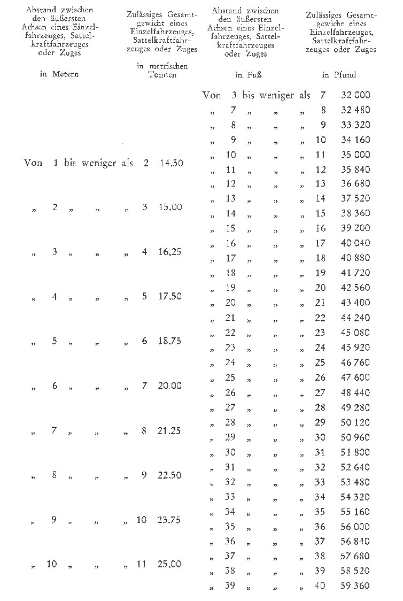
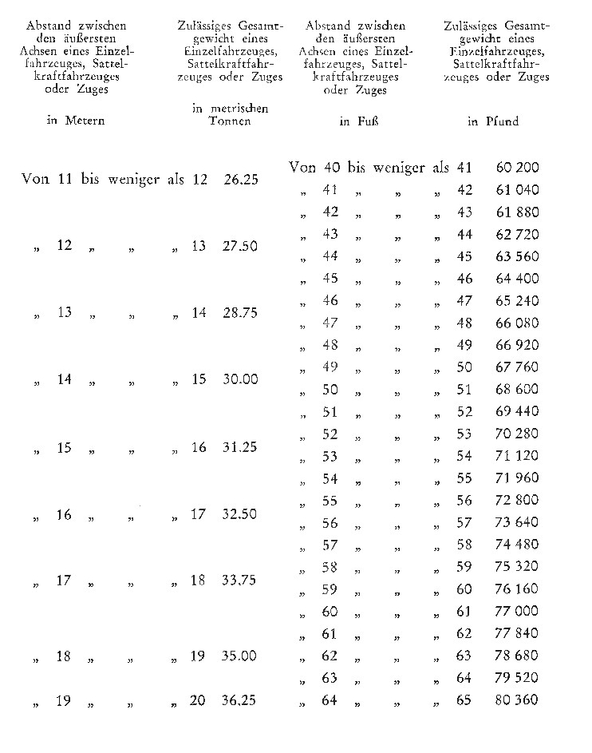
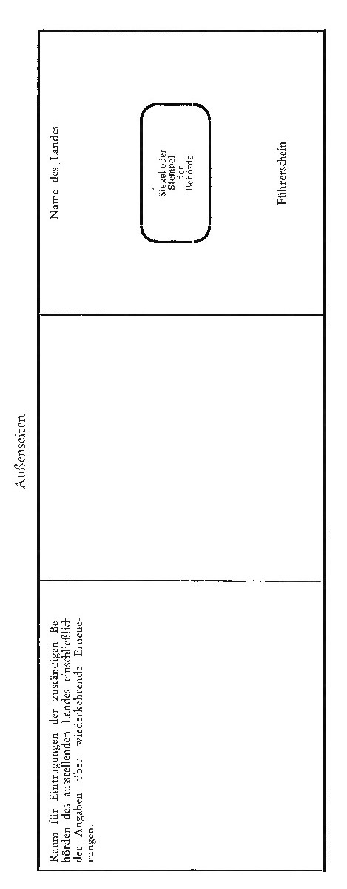
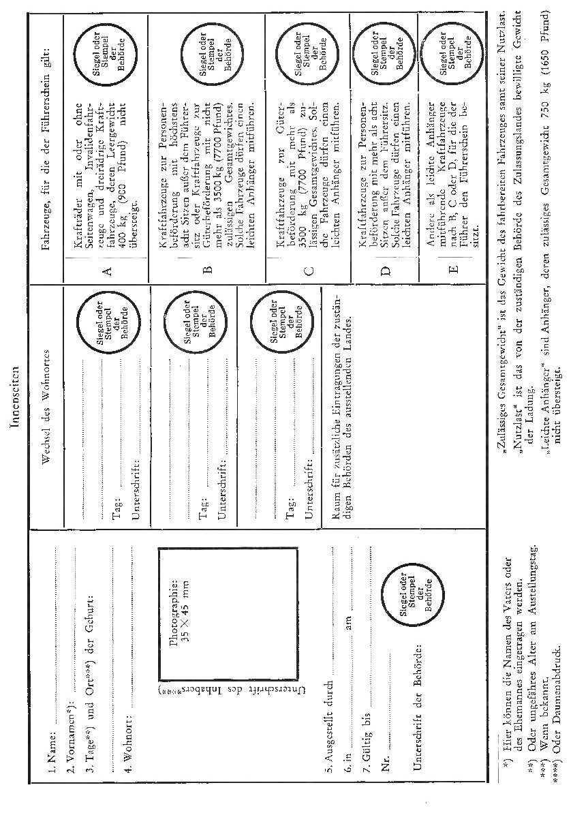
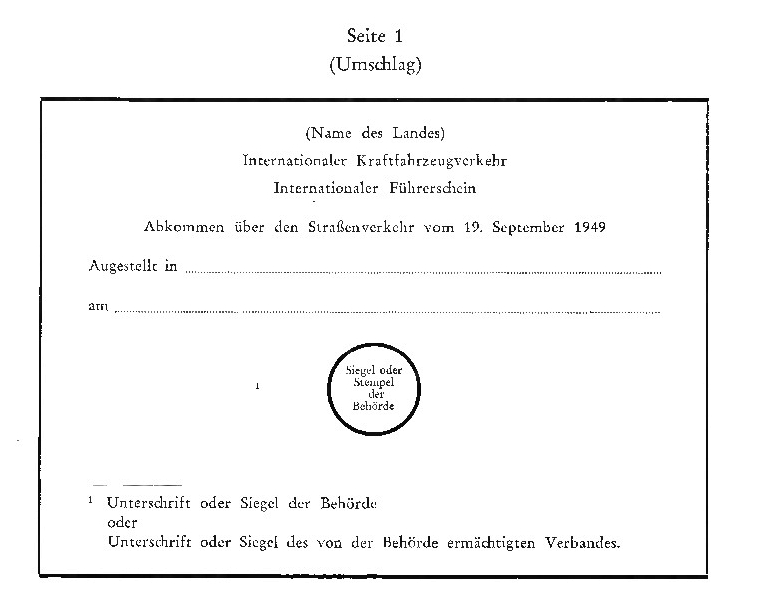
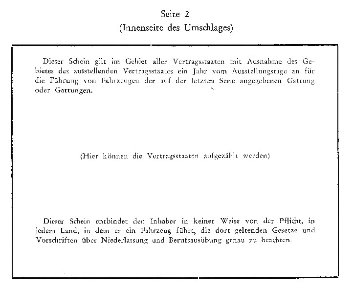
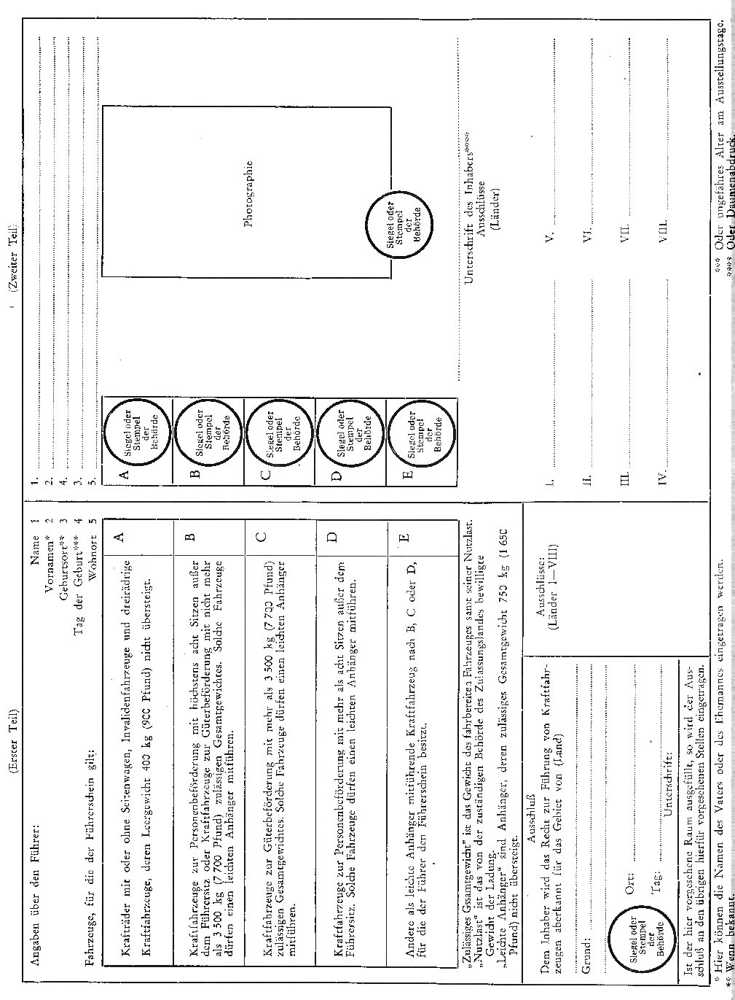

Abkommen über den Strassenverkehr Abgeschlossen in Genf am 19. September 1949 Zustimmung des Landtags: 5. Dezember 2019 Inkrafttreten für das Fürstentum Liechtenstein: 1. April 2020 Im Bestreben, die Entwicklung und Sicherheit des internationalen Strassenverkehrs durch Aufstellung einheitlicher Regeln zu fördern, haben die Vertragsstaaten folgende Bestimmungen vereinbart: I. Kapitel Allgemeines Art. 1 1) Unter Wahrung ihres Rechtes, die Benutzung ihrer Strassen zu regeln, vereinbaren die Vertragsstaaten, dass ihre Strassen unter den in diesem Abkommen festgelegten Bedingungen dem internationalen Verkehr dienen sollen. 2) Kein Vertragsstaat ist gehalten, die Vergünstigungen dieses Abkommens Kraftfahrzeugen [Motorfahrzeugen], Anhängern oder Führern einzuräumen, die sich ohne Unterbrechung mehr als ein Jahr auf seinem Gebiet aufgehalten haben. Art. 2 1) Die Anhänge zu diesem Abkommen gelten als wesentliche Bestandteile des Abkommens; jedoch kann jeder Staat bei Unterzeichnung, Ratifikation oder Beitritt oder zu irgendeinem späteren Zeitpunkt erklären, dass er die Anhänge 1 und 2 nicht anwenden werde. 2) Jeder Vertragsstaat kann dem Generalsekretär der Vereinten Nationen jederzeit mitteilen, dass er vom Zeitpunkt der Mitteilung an durch die von ihm früher nach Abs. 1 dieses Artikels ausgeschlossenen Anhänge 1 und 2 gebunden sei. Art. 3 1) Massnahmen, die alle oder einzelne Vertragsstaaten vereinbart haben oder noch vereinbaren werden, um den internationalen Strassenverkehr durch Vereinfachungen der Vorschriften für das Zoll-, Polizei- oder Gesundheitswesen oder auf anderen Gebieten zu erleichtern, entsprechen dem Sinne und Zweck dieses Abkommens. 2) a) Jeder Vertragsstaat kann eine Sicherstellung für alle Einfuhrzölle und -abgaben verlangen, die ohne solche Sicherstellung bei der Einfuhr jedes zum internationalen Verkehr zugelassenen Kraftfahrzeuges [Motorfahrzeuges] erhoben würden. b) Bei der Anwendung dieses Artikels wird jeder Vertragsstaat die Sicherheitsleistung einer auf seinem Gebiete bestehenden und einem internationalen Verbande angeschlossenen Organisation anerkennen, wenn sie für das Kraftfahrzeug [Motorfahrzeug] ein internationales Zollpapier (zum Beispiel ein Grenzpassierscheinheft) ausgestellt hat. 3) Zur Erfüllung der in diesem Abkommen vorgesehenen Bestimmungen werden die Vertragsstaaten anstreben, die Zollämter und Zollstellen, die an derselben internationalen Strasse einander gegenüberliegen, zu denselben Stunden offen zu halten. Art. 4 Im Sinne dieses Abkommens haben die nachstehenden Ausdrücke folgende Bedeutung: "Internationaler Verkehr" ist jeder Verkehr über wenigstens eine Grenze; "Strasse" ist jeder dem Fahrzeugverkehr dienende öffentliche Weg; "Fahrbahn" ist der Teil der Strasse, der üblicherweise von den Fahrzeugen benützt wird; "Fahrstreifen" ist ein Fahrbahnteil, dessen Breite für die Fortbewegung einer Fahrzeugreihe ausreicht; "Führer" sind alle Personen, die Fahrzeuge einschliesslich Fahrrädern lenken oder auf der Strasse Zug-, Saum- oder Reittiere oder Herden leiten oder die tatsächliche Herrschaft darüber ausüben; "Kraftfahrzeug" ["Motorfahrzeug"] ist jedes mit mechanischem Antrieb und eigener Kraft auf der Strasse verkehrende Fahrzeug, das nicht an Schienen oder elektrische Leitungen gebunden ist und üblicherweise zur Beförderung von Personen oder Gütern dient. Jeder durch Anhang 1 gebundene Staat schliesst von dieser Begriffsbestimmung die in diesem Anhang beschriebenen Fahrräder mit Hilfsmotor aus; "Sattelkraftfahrzeug" ["Sattelmotorfahrzeug"] ist jedes Kraftfahrzeug [Motorfahrzeug] mit einem Anhänger ohne Vorderachse, der so auf dem Zugfahrzeug aufliegt, dass ein wesentlicher Teil des Gewichtes des Anhängers und seiner Ladung vom Zugfahrzeug getragen wird. Ein solcher Anhänger wird "Sattelanhänger" genannt; "Anhänger" ist jedes Fahrzeug, das dazu bestimmt ist, von einem Kraftfahrzeug [Motorfahrzeug] gezogen zu werden; "Fahrrad" ist jedes Fahrrad ohne Eigenantrieb; jeder durch Anhang 1 gebundene Staat schliesst in diese Begriffsbestimmung die in diesem Anhang beschriebenen Fahrräder mit Hilfsmotor ein; "Gesamtgewicht" eines Fahrzeuges ist das Gewicht des stillstehenden fahrbereiten Fahrzeuges samt Ladung, inbegriffen das Gewicht des Führers und aller gleichzeitig beförderten Personen; "Nutzlast" ist das von der zuständigen Behörde des Zulassungslandes bewilligte Gewicht der Ladung; "Zulässiges Gesamtgewicht" ist das Gewicht des fahrbereiten Fahrzeuges samt seiner Nutzlast. Art. 5 Es ist nicht der Zweck dieses Abkommens, die entgeltliche Beförderung von Personen oder von anderen Gütern als des persönlichen Gepäcks der Fahrzeuginsassen zu gestatten; diese Frage und alle anderen in diesem Abkommen nicht behandelten Sachgebiete verbleiben der Regelung durch die Landesgesetzgebung unter Vorbehalt anderer internationaler Verträge oder Abkommen. II. Kapitel Verkehrsregeln Art. 6 Jeder Vertragsstaat trifft die notwendigen Massnahmen, um die Beachtung der Vorschriften dieses Kapitels zu gewährleisten. Art. 7 Kein Führer, Fussgänger oder anderer Strassenbenutzer darf den Verkehr gefährden oder behindern; sie haben jede Schädigung von Personen sowie von öffentlichem oder privatem Gut zu vermeiden. Art. 8 1) Jedes Fahrzeug und jeder Zug miteinander verbundener Fahrzeuge müssen einen Führer haben. 2) Zug-, Saum- und Reittiere müssen einen Führer haben; Vieh muss ausser in besonderen, an den Zugängen gekennzeichneten Gebieten begleitet sein. 3) Fahrzeug- oder Tiergruppen müssen die von der Landesgesetzgebung vorgeschriebene Zahl von Führern haben. 4) Nötigenfalls müssen Fahrzeug- oder Tiergruppen zur Erleichterung des Verkehrs in kürzere Gruppen mit genügend grossen Abständen unterteilt werden. Dies gilt nicht für Gegenden, wo Nomaden wandern. 5) Die Führer müssen dauernd in der Lage sein, ihr Fahrzeug zu beherrschen oder ihre Tiere zu führen. Bei der Begegnung mit anderen Strassenbenutzern müssen sie die für deren Sicherheit erforderlichen Massnahmen treffen. Art. 9 1) Alle in gleicher Richtung verkehrenden Fahrzeuge müssen die gleiche Strassenseite einhalten; welche Strassenseite zu benutzen ist, muss für alle Strassen eines Landes einheitlich festgelegt sein. Die Vorschriften jedes Landes über den Einbahnverkehr werden dadurch nicht berührt. 2) Allgemein und wenn Art. 7 es erfordert, muss jeder Führer sein Fahrzeug a) auf Fahrbahnen mit je einem Fahrstreifen in jeder Richtung auf dem für seine Fahrtrichtung bestimmten Fahrstreifen; b) auf Fahrbahnen mit mehr als zwei Fahrstreifen auf dem in seiner Fahrtrichtung randnächsten Fahrstreifen halten. 3) Tiere müssen unter Beachtung der Vorschriften der Landesgesetzgebung so nahe wie möglich am Strassenrand geführt werden. Art. 10 Jeder Fahrzeugführer muss seine Geschwindigkeit ständig beherrschen und vernünftig und vorsichtig fahren. Er muss langsam fahren oder anhalten, sobald die Umstände es verlangen, namentlich wenn die Sicht nicht gut ist. Art. 11 1) Beim Begegnen oder Überholtwerden muss sich jeder Führer möglichst nahe an den seiner Fahrtrichtung entsprechenden Fahrbahnrand halten. Je nach der Strassenseite, die im betreffenden Land eingehalten werden muss, sind Fahrzeuge und Tiere rechts oder links zu überholen. Abweichende Vorschriften im Hinblick auf Strassenbahnen, Eisenbahnen auf Strassen und bestimmte Bergstrassen werden nicht berührt. 2) Beim Herannahen eines Fahrzeuges oder begleiteten Tieres muss jeder Führer: a) wenn er ihnen begegnet, genügend Raum lassen; b) wenn er überholt wird, sich möglichst nahe an den seiner Fahrtrichtung entsprechenden Fahrbahnrand halten, ohne die Geschwindigkeit zu steigern. 3) Jeder Führer, der überholen will, muss sich vergewissern, dass er dafür genügend Raum hat und die Sicht nach vorn es ihm ohne Gefahr gestattet. Nach dem Überholen muss er je nach den Vorschriften des betreffenden Landes wieder die rechte oder die linke Strassenseite einnehmen, dies aber erst, wenn er sich vergewissert hat, dass es ohne Behinderung des überholten Fahrzeuges, Fussgängers oder Tieres möglich ist. Art. 12 1) Jeder Führer, der sich einer Gabelung, Kreuzung oder Einmündung von Strassen oder einem Bahnübergang nähert, muss besonders vorsichtig sein, um jeden Unfall zu vermeiden. 2) An Gabelungen, Kreuzungen oder Einmündungen kann einzelnen Strassen oder Strassenabschnitten der Vorrang eingeräumt werden. Dieser Vorrang muss durch Zeichen [Signale] kenntlich gemacht werden. Jeder Führer, der sich einer solchen Strasse oder einem solchen Strassenabschnitt nähert, muss den darauf verkehrenden Führern den Vorrang [den Vortritt, die Vorfahrt] gewähren. 3) Die Bestimmungen des Anhanges 2 über den Vorrang [den Vortritt, die Vorfahrt] auf den nicht unter Abs. 2 dieses Artikels fallenden Gabelungen, Kreuzungen oder Einmündungen gelten in den Staaten, die durch diesen Anhang gebunden sind. 4) Vor dem Einbiegen in eine andere Strasse muss jeder Führer: a) sich vergewissern, dass er es ohne Gefahr für die anderen Strassenbenutzer tun kann; b) seine Absicht klar anzeigen; c) sich möglichst nahe an den seiner Fahrtrichtung entsprechenden Fahrbahnrand halten, wenn er nach dieser Seite abbiegen will; d) sich möglichst nahe an die Fahrbahnmitte halten, wenn er nach der anderen Seite abbiegen will, unter Vorbehalt von Art. 16 Abs. 2; e) jede Behinderung des Gegenverkehrs vermeiden. Art. 13 1) Haltende Fahrzeuge oder Tiere müssen, wenn möglich, ausserhalb der Fahrbahn aufgestellt werden, sonst möglichst nahe am Fahrbahnrand. Die Führer dürfen ihre Fahrzeuge oder Tiere nicht verlassen, bevor sie alle Massnahmen zur Verhütung eines Unfalles getroffen haben. 2) Fahrzeuge und Tiere dürfen nicht stehen gelassen werden, wo sie den Verkehr gefährden oder behindern könnten, namentlich nicht auf Gabelungen, Kreuzungen, Einmündungen, Kuppen, in Kurven oder in der Nähe solcher Stellen. Art. 14 Es sind alle notwendigen Vorsichtsmassnahmen zu treffen, damit die Ladung des Fahrzeuges keinen Schaden und keine Gefahr verursachen kann. Art. 15 1) Vom Hereinbrechen der Dunkelheit an, nachts oder wenn die Witterung es erfordert, müssen alle Fahrzeuge und Züge miteinander verbundener Fahrzeuge, die sich auf der Strasse befinden, wenigstens ein weisses Licht nach vorn und ein rotes Licht nach hinten zeigen. Haben Fahrzeuge ausser Fahrrädern oder Krafträdern [Motorrädern] ohne Seitenwagen vorn nur ein weisses Licht, so muss es auf der dem Gegenverkehr näheren Fahrzeugseite angebracht sein. In den Ländern, wo zwei weisse vordere Lichter vorgeschrieben sind, muss das eine rechts, das andere links am Fahrzeug angebracht sein. Das rote Licht kann entweder von einer besonderen oder, sofern die geringe Länge und der Bau des Fahrzeuges es gestatten, von derselben Vorrichtung erzeugt werden wie das weisse Licht nach vorn. 2) Kein Fahrzeug darf ein rotes Licht oder einen roten Rückstrahler nach vorn oder ein weisses Licht oder einen weissen Rückstrahler nach hinten zeigen. Diese Vorschrift gilt nicht für weisse oder gelbe Rückfahrtscheinwerfer, wenn die Gesetzgebung des Zulassungslandes solche gestattet. 3) Lichter und Rückstrahler müssen das Fahrzeug den übrigen Strassenbenutzern deutlich erkennbar machen. 4) Jeder Vertragsstaat oder seine Teilgebiete können unter der Voraussetzung, dass die Verkehrssicherheit genügend gewährleistet bleibt, von den Bestimmungen dieses Artikels ausnehmen: a) Fahrzeuge, die für besondere Zwecke oder unter besonderen Umständen verwendet werden; b) Fahrzeuge besonderer Form oder Art; c) Fahrzeuge, die auf genügend beleuchteter Strasse aufgestellt sind. Art. 16 1) Die Bestimmungen dieses Kapitels gelten auch für Oberleitungsomnibusse [Trolleybusse]. 2) a) Radfahrer müssen die Radwege benutzen, wo ihnen diese Verpflichtung durch besondere Zeichen [Signale] kenntlich gemacht oder durch die Landesgesetzgebung auferlegt ist; b) Radfahrer müssen, wenn die Verkehrsverhältnisse es erfordern, einzeln hintereinander fahren; ausser in besonderen, durch die Landesgesetzgebung bestimmten Fällen dürfen auf der Fahrbahn nie mehr als zwei Radfahrer nebeneinander fahren; c) Radfahrer dürfen sich nicht von Fahrzeugen ziehen lassen; d) Die Vorschrift des Art. 12 Abs. 4 Bst. d gilt nicht für Radfahrer in Ländern, deren Gesetzgebung etwas anderes bestimmt. III. Kapitel Verkehrszeichen [Signale] Art. 17 1) Zur Sicherung der Einheitlichkeit dürfen auf den Strassen jedes Vertragsstaates, wenn immer möglich, keine anderen als die von ihm angenommenen Verkehrszeichen [Signale] verwendet werden. Muss ein Staat neue Verkehrszeichen [Signale] einführen, so haben sie sich in Form, Farbe und Symbol in das Zeichensystem [Signalsystem] dieses Staates einzufügen. 2) Die Zahl der anerkannten Zeichen [Signale] ist auf das nötigste zu beschränken. Sie sind nur anzubringen, wo sie unentbehrlich sind. 3) Um die Strassenbenutzer rechtzeitig zu warnen, müssen die Gefahrenzeichen [Gefahrensignale] in genügendem Abstand vor der Gefahrenstelle angebracht werden. 4) Auf anerkannten Zeichen [Signalen] dürfen keine wesensfremden, ihre Erkennbarkeit beeinträchtigenden oder ihre Bedeutung ändernden Aufschriften gestattet werden. 5) Alle Tafeln oder Aufschriften, die mit anerkannten Zeichen [Signalen] verwechselt werden oder deren Lesbarkeit erschweren könnten, müssen untersagt werden. IV. Kapitel Bestimmungen für Kraftfahrzeuge [Motorfahrzeuge] und Anhänger im internationalen Verkehr Art. 18 1) Um der Vergünstigungen dieses Abkommens teilhaftig zu werden, muss das Kraftfahrzeug [Motorfahrzeug] von einem Vertragsstaat oder einem seiner Teilgebiete nach der Landesgesetzgebung zum Verkehr zugelassen sein. 2) Die zuständige Behörde oder ein dazu ermächtigter Verband stellen auf Antrag einen Zulassungsschein aus, der wenigstens das Kennzeichen, den Namen oder die Marke und die Fabrik- oder Seriennummer des Fahrzeugherstellers, den Tag der ersten Zulassung sowie Namen, Vornamen und Wohnsitz des Antragstellers enthalten muss. 3) Der Inhalt dieses Zulassungsscheines wird bis zum Gegenbeweis von allen Vertragsstaaten als richtig anerkannt. Art. 19 1) Jedes Kraftfahrzeug [Motorfahrzeug] muss wenigstens hinten auf einem Schild oder auf dem Fahrzeug selbst das von der zuständigen Behörde zugeteilte Kennzeichen tragen. Zieht ein Kraftfahrzeug [Motorfahrzeug] Anhänger, so muss der letzte das Kennzeichen des Zugfahrzeuges oder ein eigenes Kennzeichen tragen. 2) Zusammensetzung und Anbringung des Kennzeichens richten sich nach Anhang 3. Art. 20 1) Ausser dem Kennzeichen muss jedes Kraftfahrzeug [Motorfahrzeug] hinten auf einem Schild oder auf dem Fahrzeug selbst das Unterscheidungszeichen des Zulassungsortes tragen. Dieses Zeichen nennt entweder einen Staat oder ein für die Zulassung besonders zusammengefasstes Gebiet. Hat ein Fahrzeug Anhänger, so muss der letzte hinten das gleiche Unterscheidungszeichen tragen wie sein Zugfahrzeug. 2) Zusammensetzung und Anbringung des Unterscheidungszeichens richten sich nach Anhang 4. Art. 21 Alle Kraftfahrzeuge [Motorfahrzeuge] und Anhänger müssen die im Anhang 5 festgelegten Erkennungsmerkmale tragen. Art. 22 1) Kraftfahrzeuge [Motorfahrzeuge] und Anhänger müssen betriebssicher und in solchem Zustande sein, dass sie weder den Führer, noch die Insassen, noch andere Strassenbenutzer gefährden noch an öffentlichem oder privatem Gut Schaden verursachen. 2) Ferner müssen die Kraftfahrzeuge [Motorfahrzeuge] und Anhänger und ihre Ausrüstung den Vorschriften des Anhanges 6 entsprechen; ihre Führer müssen die Vorschriften dieses Anhanges beachten. 3) Die Vorschriften dieses Artikels gelten auch für Oberleitungsomnibusse [Trolleybusse]. Art. 23 1) Die Höchstabmessungen und zulässigen Gesamtgewichte der zum Verkehr auf den Strassen eines Vertragsstaates oder seiner Teilgebiete zugelassenen Fahrzeuge legt die Landesgesetzgebung fest. Auf einzelnen Strassen, die von den Vertragsstaaten durch regionale Abkommen oder, wenn solche Abkommen fehlen, von einem Vertragsstaat allein bestimmt werden, gelten die im Anhang 7 festgelegten Höchstabmessungen und zulässigen Gesamtgewichte. 2) Die Bestimmungen dieses Artikels gelten auch für Oberleitungsomnibusse [Trolleybusse]. V. Kapitel Kraftfahrzeugführer [Motorfahrzeugführer] im internationalen Verkehr Art. 24 1) Alle Vertragsstaaten gestatten ohne neue Prüfung jedem in ihr Land kommenden Führer, der die Bedingungen des Anhanges 8 erfüllt, auf ihren Strassen Kraftfahrzeuge [Motorfahrzeuge] der in den Anhängen 9 und 10 umschriebenen Gattungen zu führen, für die dem Führer auf Grund einer Eignungsprüfung von der zuständigen Behörde eines anderen Vertragsstaates oder eines seiner Teilgebiete oder durch einen von dieser Behörde ermächtigten Verband ein gültiger Führerschein ausgestellt worden ist. 2) Die Vertragsstaaten können aber von den in ihr Land kommenden Führern verlangen, dass sie einen internationalen Führerschein nach dem Muster des Anhanges 10 mitführen, besonders dann, wenn der Führer aus einem Lande kommt, in dem kein nationaler Führerschein erforderlich ist, oder wenn sein nationaler Führerschein nicht dem Muster in Anhang 9 entspricht. 3) Der internationale Führerschein wird den Führern, die ihre Eignung nachgewiesen haben, von der zuständigen Behörde eines Vertragsstaates oder eines seiner Teilgebiete oder von einem durch diese Behörde ermächtigten Verband ausgestellt und von der Behörde oder dem Verband mit Siegel oder Stempel versehen. Der Führerschein ermächtigt seinen Inhaber, in allen Vertragsstaaten Kraftfahrzeuge [Motorfahrzeuge] der Gattungen zu führen, für die er ausgestellt ist. 4) Das Recht, von einem nationalen oder internationalen Führerschein Gebrauch zu machen, kann aberkannt werden, wenn die Voraussetzungen für ihre Erteilung offensichtlich nicht mehr erfüllt sind. 5) Ein Vertragsstaat oder seine Teilgebiete können einem Führer das Recht, von einem nationalen oder internationalen Führerschein Gebrauch zu machen, nur dann aberkennen, wenn der Führer eine Zuwiderhandlung gegen die Verkehrsvorschriften begangen hat, die nach der Gesetzgebung des betreffenden Vertragsstaates den Entzug des Führerscheines zur Folge haben kann. In diesem Fall können der Vertragsstaat oder sein Teilgebiet, die das Recht auf Verwendung des Führerscheines aberkannt haben, den Führerschein einziehen und ihn bis zum Ablauf der Aberkennungsfrist oder, wenn der Führer das Gebiet dieses Vertragsstaates früher verlässt, bis zu seiner Ausreise zurückbehalten. Der Staat oder sein Teilgebiet können die Aberkennung auf dem Führerschein eintragen und Namen und Adresse des Führers der Behörde mitteilen, die den Führerschein ausgestellt hat. 6) Fünf Jahre vom Inkrafttreten dieses Abkommens an gelten die Bedingungen dieses Artikels bei allen Führern als erfüllt, die nach den Bestimmungen des am 24. April 1926 in Paris unterzeichneten Internationalen Abkommens über Kraftfahrzeugverkehr oder des am 15. Dezember 1943 in Washington zur Unterzeichnung aufgelegten Abkommens über die Regelung des interamerikanischen Kraftfahrzeugverkehrs zum internationalen Verkehr zugelassen sind und die nach diesen Abkommen erforderlichen Papiere besitzen. Art. 25 Die Vertragsstaaten sind verpflichtet, sich gegenseitig die notwendigen Auskünfte zur Ermittlung von Inhabern eines nationalen oder internationalen Führerscheines zu geben, die sich wegen Übertretung von Verkehrsvorschriften strafbar gemacht haben. Die Vertragsstaaten geben sich in gleicher Weise die nötigen Auskünfte zur Ermittlung des Eigentümers eines an einem schweren Unfall beteiligten ausländischen Fahrzeuges oder der Person, auf deren Namen es zugelassen ist. VI. Kapitel Bestimmungen für Fahrräder im internationalen Verkehr Art. 26 Jedes Fahrrad muss haben: a) wenigstens eine wirksame Bremse; b) eine akustische Warnvorrichtung, die aus einer auf genügende Entfernung hörbaren Glocke bestehen muss, wobei das Fahrrad keine weitere akustische Warnvorrichtung tragen darf; c) vom Hereinbrechen der Dunkelheit an, nachts und wenn die Witterung es erfordert, ein weisses oder gelbes Licht nach vorn und ein rotes Licht oder einen roten Rückstrahler nach hinten. VII. Kapitel Schlussbestimmungen Art. 27 1) Dieses Abkommen steht bis zum 31. Dezember 1949 allen Mitgliedstaaten der Vereinten Nationen und allen zur Genfer Konferenz über Strassen- und Kraftfahrzeugverkehr von 1949 eingeladenen Staaten zur Unterzeichnung offen. 2) Dieses Abkommen bedarf der Ratifikation; die Ratifikationsurkunden werden beim Generalsekretär der Vereinten Nationen hinterlegt. 3) Vom 1. Januar 1950 an können die im Abs. 1 dieses Artikels erwähnten Staaten, die dieses Abkommen nicht unterzeichnet haben, und weitere durch Beschluss des Wirtschafts- und Sozialrates bezeichnete Staaten ihm beitreten. Der Beitritt kann auch im Namen von Treuhandgebieten erklärt werden, deren Verwaltung den Vereinten Nationen übertragen ist. 4) Der Beitritt erfolgt durch Hinterlegung einer Beitrittsurkunde beim Generalsekretär der Vereinten Nationen. Art. 28 1) Jeder Staat kann bei Unterzeichnung, Ratifikation oder Beitritt oder zu irgendeinem späteren Zeitpunkt durch eine Mitteilung an den Generalsekretär der Vereinten Nationen erklären, dass die Bestimmungen dieses Abkommens für alle oder einzelne Gebiete gelten sollen, deren internationale Beziehungen er wahrnimmt. Die Abkommensbestimmungen werden in den durch die Mitteilung bezeichneten Gebieten dreissig Tage nach Eingang der Mitteilung beim Generalsekretär anwendbar oder, wenn das Abkommen dann noch nicht in Kraft ist, mit dem Tage seines Inkrafttretens. 2) Jeder Vertragsstaat verpflichtet sich, wenn die Umstände es erlauben, möglichst bald die notwendigen Massnahmen zu treffen, um die Anwendung dieses Abkommens auf die Gebiete auszudehnen, deren internationale Beziehungen er wahrnimmt, vorbehaltlich der Zustimmung der Regierungen solcher Gebiete, wenn sie aus verfassungsmässigen Gründen notwendig ist. 3) Jeder Staat, der nach Abs. 1 dieses Artikels erklärt hat, er werde dieses Abkommen auf Gebiete anwenden, deren internationale Beziehungen er wahrnimmt, kann später jederzeit durch eine Mitteilung an den Generalsekretär erklären, dass dieses Abkommen in dem durch die Mitteilung bezeichneten Gebiet seine Geltung verliert. In diesem Gebiet endet die Gültigkeit des Abkommens ein Jahr nach der Mitteilung. Art. 29 Dieses Abkommen tritt am dreissigsten Tage nach der Hinterlegung der fünften Ratifikations- oder Beitrittsurkunde in Kraft. Für jeden Staat, der dieses Abkommen nachher ratifiziert oder ihm nachher beitritt, tritt es am dreissigsten Tage nach der Hinterlegung seiner Ratifikations- oder Beitrittsurkunde in Kraft. Der Generalsekretär der Vereinten Nationen gibt den Tag des Inkrafttretens dieses Abkommens jedem Staat bekannt, der es unterzeichnet hat oder ihm beigetreten ist, sowie den übrigen Staaten, die zur Konferenz der Vereinten Nationen über Strassen- und Kraftfahrzeugverkehr eingeladen waren. Art. 30 Im Verhältnis unter den Vertragsstaaten hebt dieses Abkommen das Internationale Abkommen über Kraftfahrzeugverkehr und das Internationale Abkommen über Strassenverkehr, beide unterzeichnet am 24. April 1926 in Paris, sowie das am 15. Dezember 1943 in Washington zur Unterzeichnung aufgelegte Abkommen über die Regelung des interamerikanischen Kraftfahrzeugverkehrs auf und ersetzt sie. Art. 31 1) Jeder Vertragsstaat kann Änderungen dieses Abkommens vorschlagen. Ihr Wortlaut ist dem Generalsekretär der Vereinten Nationen mitzuteilen. Dieser übermittelt den Vorschlag jedem Vertragsstaat mit der Bitte, binnen vier Monaten anzugeben, a) ob er wünscht, dass zur Behandlung der vorgeschlagenen Änderung eine Konferenz einberufen wird, oder b) ob er ohne Konferenz die vorgeschlagene Änderung annehmen will, oder c) ob er ohne Konferenz die vorgeschlagene Änderung ablehnt. Ebenso bringt der Generalsekretär die vorgeschlagene Änderung allen Nichtvertragsstaaten, die zur Konferenz der Vereinten Nationen über Strassen- und Kraftfahrzeugverkehr eingeladen waren, zur Kenntnis. 2) Der Generalsekretär beruft eine Konferenz der Vertragsstaaten zur Behandlung der vorgeschlagenen Änderung ein, wenn dies verlangt wird: a) von mindestens einem Viertel der Vertragsstaaten bei einem Änderungsvorschlag zu einem Teil des Abkommens ausser den Anhängen; b) von mindestens einem Drittel der Vertragsstaaten bei einem Änderungsvorschlag zu einem Anhang ausser den Anhängen 1 und 2; c) bei den Anhängen 1 und 2 von mindestens einem Drittel der Staaten, die durch den Anhang gebunden sind, zu dem eine Änderung vorgeschlagen wird. Der Generalsekretär lädt zu einer solchen Konferenz auch die Nichtvertragsstaaten ein, die zur Konferenz der Vereinten Nationen über Strassen- und Kraftfahrzeugverkehr eingeladen waren oder deren Teilnahme der Wirtschafts- und Sozialrat für wünschenswert erachtet. Diese Bestimmungen gelten nicht, wenn Änderungen des Abkommens nach Abs. 5 dieses Artikels angenommen werden. 3) Jede von einer Konferenz mit Zweidrittelmehrheit angenommene Änderung dieses Abkommens wird allen Vertragsstaaten zur Annahme unterbreitet. Neunzig Tage nach ihrer Annahme durch zwei Drittel der Vertragsstaaten tritt jede Änderung des Abkommens, ausser solchen zu den Anhängen 1 und 2, für alle Vertragsstaaten in Kraft, die nicht vor dem Tage des Inkrafttretens erklären, dass sie die Änderung nicht annehmen. Für das Inkrafttreten jeder Änderung der Anhänge 1 und 2 bedarf es der Zweidrittelmehrheit der durch den betreffenden Anhang gebundenen Staaten. 4) Bei der Annahme einer Änderung dieses Abkommens, ausser solchen der Anhänge 1 und 2, kann die Konferenz mit Zweidrittelmehrheit beschliessen, die Änderung sei so wesentlich, dass jeder Vertragsstaat, der sie nicht anzunehmen erklärt und sie dann nicht binnen zwölf Monaten nach ihrem Inkrafttreten annimmt, nach Ablauf dieser Frist aus dem Abkommen ausscheidet. 5) Teilen wenigstens zwei Drittel der Vertragsstaaten dem Generalsekretär nach Abs. 1 Bst. b dieses Artikels mit, dass sie die Änderung ohne Konferenz annehmen wollen, so gibt der Generalsekretär ihren Entschluss allen Vertragsstaaten bekannt. Neunzig Tage nach dieser Bekanntgabe tritt die Änderung für alle Vertragsstaaten in Kraft, die nicht binnen dieser Frist dem Generalsekretär erklären, dass sie die Änderung ablehnen. 6) Bei Änderungen der Anhänge 1 und 2 und allen ausser den in Abs. 4 dieses Artikels genannten Änderungen bleibt die ursprüngliche Bestimmung für jeden Vertragsstaat in Geltung, der die Erklärung nach Abs. 3 abgegeben oder die Ablehnung nach Abs. 5 erklärt hat. 7) Der Vertragsstaat, der die Erklärung nach Abs. 3 abgegeben oder die Ablehnung einer Änderung nach Abs. 5 dieses Artikels erklärt hat, kann die Erklärung oder Ablehnung jederzeit durch Mitteilung an den Generalsekretär zurückziehen. Die Änderung tritt für diesen Staat mit dem Eingang der Mitteilung beim Generalsekretär in Kraft. Art. 32 Dieses Abkommen kann mit einjähriger Frist durch Mitteilung an den Generalsekretär der Vereinten Nationen gekündigt werden; dieser gibt jedem Staat, der das Abkommen unterzeichnet hat oder ihm beigetreten ist, hiervon Kenntnis. Nach Ablauf dieses Jahres tritt das Abkommen für den Vertragsstaat, der es gekündigt hat, ausser Kraft. Art. 33 Jede Meinungsverschiedenheit zwischen zwei oder mehreren Vertragsstaaten über die Auslegung oder Anwendung dieses Abkommens, die die Parteien nicht durch Verhandlung oder auf andere Weise klären konnten, kann mit schriftlichem Antrag eines beteiligten Vertragsstaates dem Internationalen Gerichtshof zur Entscheidung vorgelegt werden. Art. 34 Keine Bestimmung dieses Abkommens darf so ausgelegt werden, dass sie einen Vertragsstaat hindert, Massnahmen zu ergreifen, die er für seine innere oder äussere Sicherheit als notwendig erachtet und die mit der Charta der Vereinten Nationen vereinbar und auf die Erfordernisse der Lage beschränkt sind. Art. 35 1) Ausser den im Art. 29, im Art. 31 Abs. 1, 3 und 5 und im Art. 32 vorgesehenen Mitteilungen gibt der Generalsekretär den im Art. 27 Abs. 1 erwähnten Staaten bekannt: a) die Erklärungen, mit denen die Vertragsstaaten nach Art. 2 Abs. 1 den Anhang 1, den Anhang 2 oder beide Anhänge von der Anwendung des Abkommens ausschliessen; b) die Erklärungen, mit denen ein Vertragsstaat nach Art. 2 Abs. 2 mitteilt, durch den Anhang 1, den Anhang 2 oder beide Anhänge gebunden zu sein; c) die Unterzeichnungen, Ratifikationen und Beitritte nach Art. 27; d) die Mitteilungen nach Art. 28 über die örtliche Anwendung des Abkommens; e) die Erklärungen, mit denen die Staaten Änderungen des Abkommens nach Art. 31 Abs. 5 annehmen; f) die Ablehnungen von Änderungen des Abkommens, die die Staaten dem Generalsekretär nach Art. 31 Abs. 5 mitteilen; g) den Tag des Inkrafttretens der Änderungen des Abkommens nach Art. 31 Abs. 3 und 5; h) den Tag des Ausscheidens eines Staates aus dem Abkommen nach Art. 31 Abs. 4; i) die Rücknahme der Ablehnung einer Änderung nach Art. 31 Abs. 7; j) die Liste der durch die Änderungen des Abkommens gebundenen Staaten; k) die Kündigungen des Abkommens nach Art. 32; l) die Erklärungen nach Art. 28 Abs. 3 über das Ausserkrafttreten des Abkommens für ein bestimmtes Gebiet; m) die Mitteilungen der Staaten nach Anhang 4 Abs. 3 über Unterscheidungszeichen. 2) Die Urschrift dieses Abkommens wird beim Generalsekretär hinterlegt, der den im Art. 27 Abs. 1 erwähnten Staaten beglaubigte Abschriften davon zustellt. 3) Der Generalsekretär ist ermächtigt, dieses Abkommen bei Inkrafttreten einzutragen. Zu Urkund dessen haben die unterzeichneten Vertreter nach Übergabe ihrer in guter und gehöriger Form befundenen Vollmachten dieses Abkommen unterzeichnet. Geschehen zu Genf, in einfacher Ausfertigung in englischer und französischer Sprache, wobei der Wortlaut beider Sprachen authentisch [massgebend] ist, am neunzehnten September neunzehnhundertneunundvierzig. (Es folgen die Unterschriften) Anhang 1 Zusatzbestimmung über den Begriff der Kraftfahrzeuge [Motorfahrzeuge] und Fahrräder Fahrräder mit einem Verbrennungshilfsmotor, dessen Zylinderinhalt 50 cm 3 (3,05 Kubikzoll) nicht übersteigt, gelten nicht als Kraftfahrzeuge [Motorfahrzeuge], wenn sie in ihrer Bauart alle üblichen Merkmale von Fahrrädern behalten. Anhang 2 Vorrang [Vortritt, Vorfahrt] 1. Nähern sich zwei Fahrzeuge gleichzeitig einer Gabelung, Kreuzung oder Einmündung gleichrangiger Strassen, so muss in den Ländern mit Rechtsverkehr das von links kommende und in den Ländern mit Linksverkehr das von rechts kommende Fahrzeug dem anderen den Vorrang [den Vortritt, die Vorfahrt] gewähren. 2. Abweichende Vorschriften im Hinblick auf Strassenbahnen und Eisenbahnen auf Strassen werden nicht berührt. Anhang 3 Kennzeichen der Fahrzeuge im internationalen Verkehr 1. Das Kennzeichen der Fahrzeuge muss sich entweder aus Ziffern oder aus Ziffern und Buchstaben zusammensetzen. Es sind arabische Ziffern wie in den Urkunden der Vereinten Nationen und lateinische Buchstaben zu verwenden. Andere Ziffern und Buchstaben sind zulässig, wenn die Angaben in den vorstehend erwähnten Ziffern und Buchstaben wiederholt werden. 2. Das Kennzeichen muss tags bei klarem Wetter auf 20 m (65 Fuss) lesbar sein. 3. Befindet sich das Kennzeichen auf einem besonderen Schild, so muss das Schild im Lot oder annähernd im Lot und senkrecht zum Mittellängsschnitt des Fahrzeuges angebracht sein. Ist das Kennzeichen unmittelbar auf der Fahrzeugwand angebracht oder aufgemalt, so muss es sich auf einer lotrechten oder annähernd im Lot stehenden Fläche der Rückseite des Fahrzeuges befinden. 4. Das hintere Kennzeichen muss nach den Vorschriften des Anhanges 6 beleuchtet sein. Anhang 4 Unterscheidungszeichen der Fahrzeuge im internationalen Verkehr 1. Das Unterscheidungszeichen muss sich aus einem bis drei lateinischen grossen Buchstaben zusammensetzen. Die Buchstaben müssen mindestens 80 mm (3,1 Zoll) hoch sein und eine Strichstärke von mindestens 10 mm (0,4 Zoll) haben. Die Buchstaben müssen schwarz auf einer weissen elliptischen Fläche aufgemalt sein, deren Hauptachse waagrecht liegt. 2. Besteht das Unterscheidungszeichen aus drei Buchstaben, so muss die Ellipse mindestens 240 mm (9,4 Zoll) breit und 145 mm (5,7 Zoll) hoch sein. Die Breite kann auf 175 mm (6,9 Zoll) und die Höhe auf 115 mm (4,5 Zoll) verkleinert werden, wenn das Zeichen weniger als drei Buchstaben hat. Bei den Unterscheidungszeichen der Krafträder [Motorräder] kann die Breite der Ellipse auf 175 mm (6,9 Zoll) und die Höhe auf 115 mm (4,5 Zoll) vermindert werden, unabhängig davon, ob das Zeichen aus einem, zwei oder drei Buchstaben besteht. 3. Die Unterscheidungszeichen für die einzelnen Staaten und Gebiete sind: Jeder Staat, der es nicht vorher getan hat, muss bei der Unterzeichnung oder Ratifikation dieses Abkommens oder beim Beitritt dem Generalsekretär das von ihm gewählte Unterscheidungszeichen bekanntgeben. 4. Befindet sich das Unterscheidungszeichen auf einem besonderen Schild, so muss das Schild im Lot oder annähernd im Lot und senkrecht zum Mittellängsschnitt des Fahrzeuges angebracht sein. Ist das Unterscheidungszeichen unmittelbar auf der Fahrzeugwand angebracht oder aufgemalt, so muss es sich auf einer lotrechten oder annähernd im Lot stehenden Fläche der Rückseite des Fahrzeuges befinden. Anhang 5 Erkennungsmerkmale der Fahrzeuge im internationalen Verkehr 1. Die Erkennungsmerkmale umfassen: a) für Kraftfahrzeuge [Motorfahrzeuge]: i) Namen oder Marke des Herstellers des Fahrzeuges; ii) auf dem Fahrgestell oder beim Fehlen eines Fahrgestells auf der Karosserie die Fabrik- oder Seriennummer des Herstellers; iii) auf dem Motor die Fabriknummer des Motors, wenn der Hersteller eine solche Nummer anbringt; b) für Anhänger entweder die unter i) und ii) erwähnten Angaben oder ein von der zuständigen Behörde dem Anhänger zugeteiltes Erkennungsmerkmal. 2. Die Erkennungsmerkmale müssen an zugänglicher Stelle gut lesbar angebracht und so gestaltet sein, dass sie nicht leicht entfernt oder geändert werden können. Anhang 6 Technische Anforderungen an die Ausrüstung der Kraftfahrzeuge [Motorfahrzeuge] und Anhänger im internationalen Verkehr I. Bremsen a) Bremsen der Kraftfahrzeuge [Motorfahrzeuge] ausser den Krafträdern (Motorrädern) mit oder ohne Seitenwagen Jedes Kraftfahrzeug [Motorfahrzeug] muss Bremsen haben, die es gestatten, bei beliebiger Beladung auf allen Steigungen und Gefällen, auf denen das Fahrzeug verkehrt, seinen Lauf zu beherrschen und es sicher, schnell und wirksam anzuhalten. Die Bremsung muss durch zwei Vorrichtungen erfolgen können, die so gebaut sind, dass beim Versagen der einen das Fahrzeug durch die andere auf eine genügend kurze Strecke angehalten werden kann. In diesem Anhang heisst eine dieser Vorrichtungen "Betriebsbremse", die andere "Feststellbremse". Die Feststellbremse muss auch bei Abwesenheit des Führers auf rein mechanische Weise gesichert bleiben können. Die durch jede der beiden Vorrichtungen gebremsten Räder müssen symmetrisch zur Längsachse des Fahrzeuges liegen. Die Bremsflächen müssen ständig mit den Rädern des Fahrzeuges verbunden sein, so dass sie nicht anders als nur kurzfristig durch Kupplung, Getriebe oder Freilauf getrennt werden können. Wenigstens eine Vorrichtung muss auf Bremsflächen wirken, die mit den Rädern starr oder über Teile verbunden sind, deren Versagen unwahrscheinlich ist. b) Bremsen der Anhänger Jeder Anhänger, dessen zulässiges Gesamtgewicht 750 kg (1650 Pfund) übersteigt, muss wenigstens eine Bremsanlage haben, die auf symmetrisch zur Längsachse des Fahrzeuges liegende Räder und mindestens auf die halbe Anzahl seiner Räder wirkt. Die vorstehende Bestimmung gilt auch für Anhänger, deren zulässiges Gesamtgewicht 750 kg (1650 Pfund) nicht übersteigt, aber höher als die Hälfte des Leergewichtes des Zugfahrzeuges ist. Die Bremsanlage der Anhänger mit einem zulässigen Gesamtgewicht von mehr als 3500 kg (7700 Pfund) muss über die Betriebsbremse des Zugfahrzeuges betätigt werden können. Wenn das zulässige Gesamtgewicht des Anhängers 3500 kg (7700 Pfund) nicht übersteigt, darf seine Bremsanlage durch die Annäherung des Anhängers an das Zugfahrzeug betätigt werden (Auflaufbremse). Durch die Bremsanlage muss beim losgelösten Anhänger das Drehen der Räder verhindert werden können. Jeder mit Bremsen versehene Anhänger muss eine Vorrichtung haben, die ihn selbsttätig zum Halten bringt, wenn er sich während der Fahrt vom Zugfahrzeug löst. Diese Bestimmung gilt nicht für zweirädrige Wohnanhänger und leichte Gepäckanhänger, deren Gewicht 750 kg (1650 Pfund) übersteigt, wenn diese Anhänger ausser durch die Hauptkupplung durch eine Nebenkupplung wie eine Kette oder ein Drahtseil mit dem Zugfahrzeuge verbunden sind. c) Bremsen der Sattelkraftfahrzeuge [Sattelmotorfahrzeuge] und der Züge miteinander verbundener Fahrzeuge i) Sattelkraftfahrzeuge [Sattelmotorfahrzeuge] Die Bestimmungen des Abs. a gelten für alle Sattelkraftfahrzeuge [Sattelmotorfahrzeuge]. Sattelanhänger mit einem zulässigen Gesamtgewicht von mehr als 750 kg (1650 Pfund) müssen wenigstens eine Bremsanlage haben, die über die Betriebsbremse des Zugfahrzeuges betätigt werden kann. Durch die Bremsanlage muss ferner beim losgelösten Sattelanhänger das Drehen der Räder verhindert werden können. Die Landesgesetzgebung kann vorschreiben, dass jeder mit einer Bremse versehene Sattelanhänger eine Vorrichtung haben muss, die ihn selbsttätig zum Halten bringt, wenn er sich während der Fahrt vom Zugfahrzeug löst. ii) Züge miteinander verbundener Fahrzeuge Jeder aus einem Kraftfahrzeug [Motorfahrzeug] und einem oder mehreren Anhängern bestehende Zug muss Bremsen haben, die es gestatten, bei beliebiger Beladung auf allen Steigungen und Gefällen, auf denen der Zug verkehrt, seinen Lauf zu beherrschen und ihn sicher, schnell und wirksam anzuhalten. d) Bremsen der Krafträder [Motorräder] mit oder ohne Seitenwagen Alle Krafträder [Motorräder] müssen zwei Bremsen haben, die von Hand oder mit dem Fuss betätigt werden können und gestatten, den Lauf des Kraftrades [Motorrades] zu beherrschen und es sicher, schnell und wirksam anzuhalten. II. Beleuchtung a) Alle Kraftfahrzeuge [Motorfahrzeuge], die auf ebener Strasse eine Geschwindigkeit von mehr als 20 km (12 Meilen) in der Stunde erreichen können, ausser den Krafträdern [Motorrädern] mit oder ohne Seitenwagen, müssen vorn wenigstens zwei weisse oder gelbe Scheinwerfer haben, die nachts bei klarem Wetter die Strasse vor dem Fahrzeug auf mindestens 100 m (325 Fuss) wirksam beleuchten können. b) Alle Kraftfahrzeuge [Motorfahrzeuge], die auf ebener Strasse eine Geschwindigkeit von mehr als 20 km (12 Meilen) in der Stunde erreichen können, ausser den Krafträdern [Motorrädern] mit oder ohne Seitenwagen, müssen vorn zwei weisse oder gelbe Abblendlichter haben, die erforderlichenfalls die Strasse vor dem Fahrzeug nachts bei klarem Wetter auf wenigstens 30 m (100 Fuss) wirksam beleuchten können und, ungeachtet der Verkehrsrichtung, die übrigen Strassenbenutzer nicht blenden. Die Abblendlichter müssen an Stelle der Scheinwerfer verwendet werden, wo immer es erforderlich oder vorgeschrieben ist, die übrigen Strassenbenutzer nicht zu blenden. c) Alle Krafträder [Motorräder] mit oder ohne Seitenwagen müssen wenigstens einen Scheinwerfer und ein Abblendlicht haben, die den Bestimmungen der Abs. a und b entsprechen. Krafträder [Motorräder] mit einem Motor von höchstens 50 cm³ (3,05 Kubikzoll) Zylinderinhalt können jedoch von dieser Verpflichtung befreit werden. d) Alle Kraftfahrzeuge [Motorfahrzeuge] ausser den Krafträdern [Motorrädern] ohne Seitenwagen müssen vorn zwei weisse Begrenzungslichter haben, die nachts bei klarem Wetter auf 150 m (500 Fuss) vor dem Fahrzeug sichtbar sein müssen, ohne die übrigen Strassenbenutzer zu blenden. Die äussersten Teile der Leuchtflächen dieser Lichter müssen möglichst nahe am Fahrzeugseitenrand liegen; ihr seitlicher Abstand von der breitesten Stelle des Fahrzeuges darf auf keinen Fall mehr als 400 mm (16 Zoll) betragen. Die Begrenzungslichter müssen nachts brennen, wann immer ihre Verwendung vorgeschrieben ist, und immer zusammen mit den Abblendlichtern, wenn die äussersten Teile der Leuchtflächen der Abblendlichter mehr als 400 mm (16 Zoll) seitlich von der breitesten Stelle des Fahrzeuges entfernt liegen. e) Alle Kraftfahrzeuge [Motorfahrzeuge] und jeder Anhänger am Ende eines Zuges müssen hinten wenigstens ein rotes Licht haben, das nachts bei klarem Wetter auf 150 m (500 Fuss) hinter dem Fahrzeug sichtbar ist. f) Das hintere Kennzeichen aller Kraftfahrzeuge [Motorfahrzeuge] und Anhänger muss nachts so beleuchtet werden können, dass es bei klarem Wetter auf wenigstens 20 m (65 Fuss) hinter dem Fahrzeug lesbar ist. g) Das oder die hinteren roten Lichter und die Beleuchtung des hinteren Kennzeichens müssen gleichzeitig mit den einzelnen Begrenzungslichtern, Abblendlichtern oder Scheinwerfern brennen. h) Alle Kraftfahrzeuge [Motorfahrzeuge] ausser den Krafträdern [Motorrädern] ohne Seitenwagen müssen zwei rote, möglichst nicht dreieckige Rückstrahler haben, die hinten am Fahrzeug auf beiden Seiten symmetrisch anzubringen sind. Die äusseren Ränder beider Rückstrahler müssen möglichst nahe am Fahrzeugseitenrand liegen; ihr seitlicher Abstand von der breitesten Stelle des Fahrzeuges darf auf keinen Fall mehr als 400 mm (16 Zoll) betragen. Wenn die roten Schlusslichter diese Bedingung erfüllen, können die Rückstrahler darin eingebaut sein. Diese Rückstrahler müssen nachts bei klarem Wetter auf wenigstens 100 m (325 Fuss) sichtbar sein, wenn sie vom Licht zweier Scheinwerfer getroffen werden. i) Alle Krafträder [Motorräder] ohne Seitenwagen müssen hinten einen roten, möglichst nicht dreieckigen Rückstrahler haben, der in das rote Schlusslicht eingebaut sein kann und unter den im Abs. h genannten Bedingungen sichtbar sein muss. j) Alle Anhänger und Sattelkraftfahrzeuge [Sattelmotorfahrzeuge] müssen zwei rote, möglichst dreieckige Rückstrahler haben, die hinten am Fahrzeug auf beiden Seiten symmetrisch anzubringen sind. Diese Rückstrahler müssen nachts bei klarem Wetter auf wenigstens 100 m (325 Fuss) sichtbar sein, wenn sie vom Licht zweier Scheinwerfer getroffen werden. Dreieckige Rückstrahler müssen ein gleichseitiges Dreieck mit wenigstens 150 mm (6 Zoll) Seitenlänge darstellen, dessen eine Spitze nach oben zeigt. Die äussere Ecke des Rückstrahlers muss möglichst nahe am Fahrzeugseitenrand liegen; ihr seitlicher Abstand von der breitesten Stelle des Fahrzeuges darf auf keinen Fall mehr als 400 mm (16 Zoll) betragen. k) Alle Kraftfahrzeuge [Motorfahrzeuge] ausser den Krafträdern [Motorrädern] und jeder Anhänger am Ende eines Zuges müssen hinten wenigstens ein rotes oder orangefarbiges Stoplicht [Bremslicht] haben. Dieses Licht muss bei Betätigung der Betriebsbremse des Fahrzeuges aufleuchten. Ist das Licht rot, so muss seine Lichtstärke grösser sein als die des roten Schlusslichtes, wenn die beiden Lichter nahe beieinander oder zusammengebaut sind. An Anhängern und Sattelanhängern, deren Abmessungen so gering sind, dass das Stoplicht [Bremslicht] des Zugfahrzeuges von hinten sichtbar bleibt, ist kein solches erforderlich. l) Werden Kraftfahrzeuge [Motorfahrzeuge] mit Fahrtrichtungsanzeigern ausgerüstet, so muss dafür eine der folgenden Arten verwendet werden: i) ausschwenkbare, auf beiden Seiten über den Fahrzeugrand hinausragende Zeiger, die bei waagrechter Stellung dauernd orangefarbig leuchten; ii) unbewegliche, auf beiden Seitenwänden des Fahrzeuges angebrachte, orangefarbige Blinklichter; iii) unbewegliche, auf beiden Fahrzeugseiten vorn und hinten angebrachte Blinklichter, die nach vorn weiss oder orangefarbig, nach hinten rot oder orangefarbig leuchten. m) Ausser für Fahrtrichtungsanzeiger sind keine Blinklichter zulässig. n) Hat ein Fahrzeug mehrere Lichter gleicher Art, so müssen sie von gleicher Farbe sein. Ausser bei den Krafträdern [Motorrädern] mit Seitenwagen müssen je zwei dieser Lichter symmetrisch zur Fahrzeuglängsachse angebracht sein. o) Mehrere Lichter können in einer Beleuchtungsvorrichtung vereinigt werden, wenn jedes von ihnen den vorstehend für sie festgelegten Bestimmungen entspricht. III. Weitere Bestimmungen a) Lenkvorrichtung Alle Kraftfahrzeuge [Motorfahrzeuge] müssen eine kräftige Lenkvorrichtung haben, die ein leichtes, schnelles und sicheres Wenden gestattet. b) Rückblickspiegel Alle Kraftfahrzeuge [Motorfahrzeuge] müssen wenigstens einen genügend grossen Rückblickspiegel haben, der so anzubringen ist, dass der Führer von seinem Sitz aus die Strasse hinter dem Fahrzeug überblicken kann. Diese Vorschrift ist jedoch für Krafträder [Motorräder] mit oder ohne Seitenwagen nicht zwingend. c) Warnvorrichtung Alle Kraftfahrzeuge [Motorfahrzeuge] müssen mindestens eine akustische Warnvorrichtung von genügender Stärke haben; Klingeln, Gongs, Glocken, Sirenen und andere schrilltönende Vorrichtungen sind nicht gestattet. d) Scheibenwischer Alle Kraftfahrzeuge [Motorfahrzeuge] mit Windschutzscheibe müssen wenigstens einen wirksamen Scheibenwischer haben, der keine dauernde Bedienung durch den Führer erfordert. Diese Vorrichtung ist aber bei Krafträdern [Motorrädern] mit oder ohne Seitenwagen nicht erforderlich. e) Windschutzscheiben Mindestens die Windschutzscheiben müssen aus einem unveränderlichen, völlig durchsichtigen Stoff bestehen, der bei Bruch keine scharfen Splitter bilden soll. Beim Blick durch die Scheibe dürfen die Gegenstände nicht verzerrt erscheinen. f) Rückwärtsgang Alle Kraftfahrzeuge [Motorfahrzeuge] mit mehr als 400 kg (900 Pfund) Leergewicht müssen eine vom Führersitz aus bedienbare Einrichtung zum Rückwärtsfahren haben. g) Schalldämpfer Zur Vermeidung übermässigen oder aussergewöhnlichen Lärmes müssen alle Kraftfahrzeuge [Motorfahrzeuge] eine ständig wirkende Vorrichtung zur Dämpfung des Auspuffgeräusches haben, deren Wirkung auf der Fahrt vom Führer nicht ausgeschaltet werden kann. h) Reifen Die Räder der Kraftfahrzeuge [Motorfahrzeuge] und ihre Anhänger müssen Luftreifen oder andere ebenso elastische Reifen haben. i) Haltevorrichtung für Gefälle Alle Kraftfahrzeuge [Motorfahrzeuge], deren zulässiges Gesamtgewicht 3500 kg (7700 Pfund) übersteigt, müssen auf Fahrten in Berggegenden von Ländern, deren Gesetzgebung dies vorschreibt, eine Vorrichtung, zum Beispiel einen Unterlegkeil, haben, durch die das Abrollen nach vor- oder rückwärts verhindert wird. j) Allgemeine Bestimmungen i) Soweit als möglich dürfen die mechanischen Anlagen und zusätzlichen Vorrichtungen der Kraftfahrzeuge [Motorfahrzeuge] nicht feuer- oder explosionsgefährlich sein, weder schädliche Gase noch belästigende Gerüche oder Geräusche erzeugen noch eine Gefahr bei Zusammenstössen bilden. ii) Alle Kraftfahrzeuge [Motorfahrzeuge] müssen so gebaut sein, dass die Sicht des Führers nach vorn, rechts und links für ein sicheres Fahren ausreicht. iii) Die Bestimmungen über Bremsen und Beleuchtung gelten nicht für Invalidenfahrzeuge, deren Bremsen und Beleuchtung den Vorschriften des Zulassungslandes entsprechen. "Invalidenfahrzeug" im Sinne dieses Absatzes ist ein Kraftfahrzeug [Motorfahrzeug] dessen Leergewicht 300 kg (700 Pfund) und dessen Geschwindigkeit 30 km (19 Meilen) in der Stunde nicht überschreitet, das für den Gebrauch durch körperlich gebrechliche oder behinderte Personen eigens entworfen und gebaut (nicht nur hergerichtet) worden ist und in der Regel von solchen Personen verwendet wird. IV. Züge miteinander verbundener Fahrzeuge a) ein Zug miteinander verbundener Fahrzeuge darf aus einem Zugfahrzeug und einem oder zwei Anhängern bestehen. Ein Sattelkraftfahrzeug [Sattelmotorfahrzeug] darf einen Anhänger mitführen; dient das Sattelkraftfahrzeug [Sattelmotorfahrzeug] aber der Personenbeförderung, so darf der Anhänger nur eine Achse haben und keine Personen befördern. b) Jeder Vertragsstaat kann jedoch erklären, dass er an Zugfahrzeugen nur einen und an Sattelkraftfahrzeugen [Sattelmotorfahrzeugen] keinen Anhänger zulässt. Er kann auch erklären, dass er keine Sattelkraftfahrzeuge [Sattelmotorfahrzeuge] zur Personenbeförderung zulässt. V. Übergangsbestimmungen Die Bestimmungen der Abschnitte I, II und III Abs. e gelten für die Kraftfahrzeuge [Motorfahrzeuge] und ihre Anhänger, die nach Ablauf von zwei Jahren nach dem Inkrafttreten dieses Abkommens zum erstenmal zugelassen werden; für alle Kraftfahrzeuge [Motorfahrzeuge] und Anhänger, die vorher zum erstenmal zugelassen worden sind, gelten sie erst nach Ablauf von fünf Jahren vom Inkrafttreten dieses Abkommens an. Während dieser Übergangszeiten gelten folgende Bestimmungen: a) Alle Kraftfahrzeuge [Motorfahrzeuge] müssen entweder zwei voneinander unabhängige Bremsenanlagen oder eine Bremsanlage mit zwei voneinander unabhängigen Bedienungsvorrichtungen haben, von denen die eine selbst dann noch wirkt, wenn die andere versagt; jedenfalls muss die eine wie die andere Anlage hinreichend und schnell wirken. b) Alle einzeln verkehrenden Kraftfahrzeuge [Motorfahrzeuge] müssen vom Hereinbrechen der Dunkelheit an und nachts vorn wenigstens zwei weisse Lichter, eines auf der rechten und eines auf der linken Seite, und hinten ein rotes Licht haben. Für zweirädrige Krafträder [Motorräder] ohne Seitenwagen genügt jedoch vorn ein weisses Licht. c) Alle Kraftfahrzeuge [Motorfahrzeuge] müssen ferner eine oder mehrere Vorrichtungen haben, die die Strasse nach vorn auf genügende Entfernung wirksam beleuchten können, wenn nicht schon die oben vorgeschriebenen weissen Lichter diese Bedingung erfüllen. Bei Fahrzeugen, deren Geschwindigkeit 30 km (19 Meilen) in der Stunde überschreiten kann, muss die beleuchtete Strecke mindestens 100 m (325 Fuss) betragen. d) Beleuchtungsvorrichtungen, die Blendung hervorrufen können, müssen bei Begegnung mit anderen Strassenbenutzern und wo immer es nützlich ist, abgeblendet werden können. Beim Abblenden muss die Lichtstärke noch zur wirksamen Beleuchtung der Fahrbahn auf wenigstens 25 m (80 Fuss) ausreichen. e) Bei Kraftfahrzeugen [Motorfahrzeugen] mit Anhängern gelten für die Beleuchtung nach vorn dieselben Bestimmungen wie bei einzeln verkehrenden Kraftfahrzeugen [Motorfahrzeugen]; das rote Schlusslicht muss hinten am Anhänger angebracht sein. Anhang 7 Bestimmungen Abmessungen und Gewichte der Fahrzeuge im internationalen Verkehr 1. Dieser Anhang gilt für die nach Art. 23 bezeichneten Strassen. 2. Auf diesen Strassen sind für leere oder beladene Fahrzeuge höchstens die folgenden Abmessungen und Gewichte zulässig, mit der Einschränkung, dass kein Fahrzeug eine schwerere Ladung befördern darf als die von der zuständigen Behörde des Zulassungslandes bewilligte Nutzlast: Meter Fuss a) Höchstbreite 2.50 8.20 b) Höchsthöhe 3.80 12.50 c) Höchstlänge: Lastfahrzeuge mit zwei Achsen 10.00 33.00 Personenfahrzeuge mit zwei Achsen 11.00 36.00 Fahrzeuge mit drei oder mehr Achsen 11.00 36.00 Sattelkraftfahrzeuge [Sattelmotorfahrzeuge] 14.00 46.00 Züge mit einem Anhänger 18.00 59.00 Züge mit zwei Anhängern 22.00 72.00 metrische Tonnen Pfund d) Zulässiges Gesamtgewicht: i) auf der am stärksten belasteten Achse 8.00 17.600 ii) auf der am stärksten belasteten Doppelachse (der Abstand zwischen den beiden Achsen einer Gruppe muss mindestens 1 m [40 Zoll] und darf höchstens 2 m [7 Fuss] betragen) 14.50 32.000 iii) je Fahrzeug, Sattelkraftfahrzeug [Sattelmotorfahrzeug] oder Zug: 

 

 iv) Wenn in der Aufstellung des Unterabs. iii über das zulässige Gesamtgewicht der Kraftfahrzeuge [Motorfahrzeuge] im internationalen Verkehr Unterschiede zwischen den in metrischen Einheiten und den in Fuss und Pfund ausgedrückten Angaben bestehen, so gilt der höhere Wert. 3. Die Vertragsstaaten können in regionalen Vereinbarungen höhere als die in der Liste angegebenen zulässigen Gesamtgewichte vorsehen. Es wird jedoch empfohlen, das zulässige Gesamtgewicht auf der am stärksten belasteten Achse 13 metrische Tonnen (28.660 Pfund) nicht übersteigen zu lassen. 4. Bei der Bezeichnung der Strassen, für die dieser Anhang gilt, gibt jeder Vertragsstaat bekannt, welche Höchstabmessungen und Höchstgewichte vorläufig auf diesen Strassen zulässig sind, solange a) Fähren, Tunnel oder Brücken den Verkehr von Fahrzeugen mit Abmessungen und Gewichten nach diesem Anhang nicht gestatten, b) Art und Zustand dieser Strassen den Verkehr solcher Fahrzeuge nicht zulassen. 5. Sonderbewilligungen für Fahrten mit Fahrzeugen oder Zügen, die die oben erwähnten Höchstabmessungen oder Höchstgewichte übersteigen, können von jedem Vertragsstaat oder seinen Teilgebieten ausgestellt werden. 6. Jeder Vertragsstaat oder seine Teilgebiete können vorübergehend den Kraftfahrzeugverkehr [Motorfahrzeugverkehr] auf Strassen, für die dieser Anhang gilt, einschränken oder untersagen oder das Gewicht der darauf verkehrenden Fahrzeuge beschränken, wenn die Strasse wegen ihres Abnutzungsgrades, wegen starken Regens, Schnees oder Tauwetters oder wegen anderer ungünstiger Witterungseinflüsse durch Fahrzeuge mit den gewöhnlich zugelassenen Gewichten schwer beschädigt würde. Anhang 8 Anforderungen an die Kraftfahrzeugführer [Motorfahrzeugführer] im internationalen Verkehr Das Mindestalter zur Führung eines Kraftfahrzeuges [Motorfahrzeuges] unter den im Art. 24 des Abkommens festgelegten Bedingungen beträgt achtzehn Jahre. Jeder Vertragsstaat oder seine Teilgebiete können jedoch Führerscheine anerkennen, die andere Staaten an noch nicht achtzehnjährige Führer von Krafträdern [Motorrädern] oder Invalidenfahrzeugen ausgestellt haben. Anhang 9 Muster des Führerscheines [Führerausweises] - Masse: 74 x 105 mm Farbe: rosa 1. Der Führerschein [Führerausweis] ist in der (den) Sprache(n) abzufassen, die die Gesetzgebung des ausstellenden Staates vorschreibt. 2. Die Überschrift des Scheines [Ausweises] ist in der (den) unter 1 vorgeschriebenen Sprache(n) abzufassen und durch die französische Übersetzung "Permis de conduire" zu ergänzen. 3. Die Eintragungen müssen mit lateinischen Buchstaben oder in der sogenannten englischen Schrift geschrieben (oder wenigstens wiederholt) sein. 4. Zusätzliche Eintragungen der zuständigen Behörden des ausstellenden Landes berühren den internationalen Verkehr nicht. 5. Das Unterscheidungszeichen nach Anhang 4 ist in das Oval einzutragen. 

 

 Anhang 10 Muster des Internationalen Führerscheines - Masse: 105 x 148 mm Farben: Umschlag: grau Innenseiten: weiss Die Seiten 1 und 2 sind in der (den) Landessprache(n) abzufassen. Die ganze letzte Seite ist in französischer Sprache abzufassen. Die zusätzlichen Seiten müssen den Wortlaut des Teiles I der letzten Seite in anderen Sprachen wiederholen. Sie müssen in folgenden Sprachen abgefasst sein: a) in der (den) vom ausstellenden Staat vorgeschriebenen Sprache(n); b) in den Amtssprachen der Vereinten Nationen; c) in höchstens sechs anderen Sprachen nach Wahl des ausstellenden Staates. Die amtliche Übersetzung des Wortlautes des Führerscheines in den verschiedenen Sprachen ist dem Generalsekretär der Vereinten Nationen von jeder Regierung in ihrer Sprache mitzuteilen. Die Eintragungen müssen immer mit lateinischen Buchstaben oder in der sogenannten englischen Schrift geschrieben sein. 

 

 

 Vorbehalte und Erklärungen des Fürstentums Liechtenstein Vorbehalt zu Art. 26 Bst. b: Art. 26 Bst. b wird von Liechtenstein in dem Sinne angewandt, dass eine akustische Warnvorrichtung nur bei motorisierten Fahrrädern anzubringen ist. Erklärung zu Anhang 1: Liechtenstein wendet Anhang 1 des Abkommens nicht an. Mitteilung zu Anhang 4: Liechtenstein benutzt folgendes Unterscheidungszeichen: "FL". Geltungsbereich des Abkommens am 1. April 2020 Vertragsstaaten Hinterlegung der Ratifikations- oder Beitrittsurkunde Ägypten 28.05.1957 Albanien 01.10.1969 Algerien 16.05.1963 Argentinien 25.11.1960 Australien 07.12.1954 Bangladesch 06.12.1978 Barbados 05.03.1971 Belgien 23.04.1954 Benin 05.12.1961 Botswana 03.01.1967 Bulgarien 13.02.1963 Burkina Faso 31.08.2009 Chile 10.08.1960 Demokratische Republik Kongo 06.03.1961 Dänemark 03.02.1956 Dominikanische Republik 15.08.1957 Elfenbeinküste 08.12.1961 Ecuador 26.09.1962 Fiji 31.10.1972 Finnland 24.09.1958 Frankreich 15.09.1950 Georgien 23.07.1993 Ghana 06.01.1959 Griechenland 01.07.1952 Guatemala 10.01.1962 Haiti 12.02.1958 Heiliger Stuhl 05.10.1953 Indien 09.03.1962 Irland 31.05.1962 Island 22.07.1983 Israel 06.01.1955 Italien 15.12.1952 Jamaika 09.08.1963 Japan 07.08.1964 Jordanien 14.01.1960 Kambodscha 14.03.1956 Kanada 23.12.1965 Kirgistan 22.03.1994 Kongo 15.05.1962 Kroatien 07.02.2020 Kuba 01.10.1952 Laos 06.03.1959 Lesotho 27.09.1973 Libanon 02.08.1963 Liechtenstein 02.03.2020 Litauen 04.02.2019 Luxemburg 17.10.1952 Madagaskar 27.06.1962 Malawi 17.02.1965 Malaysia 10.09.1958 Mali 19.09.1962 Malta 03.01.1966 Marokko 07.11.1956 Monaco 03.08.1951 Montenegro 23.10.2006 Namibia 13.10.1993 Neuseeland 12.02.1958 Niederlande 19.09.1952 Niger 25.08.1961 Nigeria 03.02.2011 Norwegen 11.04.1957 Österreich 02.11.1955 Papua Neu Guinea 12.02.1981 Paraguay 18.10.1965 Peru 09.07.1957 Philippinen 15.09.1952 Polen 29.10.1958 Portugal 28.12.1955 Republik Korea 14.06.1971 Ruanda 05.08.1964 Rumänien 26.01.1961 Russland 17.08.1959 San Marino 19.03.1962 Schweden 25.02.1952 Senegal 13.07.1962 Serbien 12.03.2001 Sierra Leone 13.03.1962 Singapur 29.11.1972 Slowakei 01.02.1993 Slowenien 13.07.2017 Spanien 13.02.1958 Sri Lanka 26.07.1957 Südafrika 09.07.1952 Syrien 11.12.1953 Thailand 15.08.1962 Togo 27.02.1962 Trinidad und Tobago 08.07.1964 Tschechische Republik 02.06.1993 Tunesien 08.11.1957 Türkei 17.01.1956 Uganda 15.04.1965 Ungarn 30.07.1962 Venezuela 11.05.1962 Vereinigte Arabische Emirate 10.01.2007 Vereinigtes Königreich 08.07.1957 Vereinigte Staaten 30.08.1950 Vietnam 02.11.1953 Zentralafrikanische Republik 04.09.1962 Zimbabwe 01.12.1998 Zypern 06.07.1962
