Protokoll über Strassenverkehrszeichen Abgeschlossen in Genf am 19. September 1949 Zustimmung des Landtags: 5. Dezember 2019 Inkrafttreten für das Fürstentum Liechtenstein: 2. Juni 2021 Im Bestreben, durch ein einheitliches System der Verkehrszeichen [Strassensignalisation] die Sicherheit des Strassenverkehrs zu gewährleisten und den internationalen Strassenverkehr zu erleichtern, haben die an diesem Protokoll beteiligten Staaten die folgenden Bestimmungen vereinbart: Abschnitt I Allgemeine Bestimmungen Art. 1 Die Vertragspartner nehmen das in diesem Protokoll beschriebene System der Verkehrszeichen [Strassensignalisation] an und verpflichten sich, es möglichst bald einzuführen. Zu diesem Zweck bringen sie die hier vorgesehenen Zeichen [Signale] an, wo solche neu aufgestellt oder bestehende erneuert werden. Die mit dem System dieses Protokolls nicht übereinstimmenden Zeichen [Signale] müssen spätestens zehn Jahre nach dem Inkrafttreten dieses Protokolls für die einzelnen Vertragspartner vollständig ersetzt sein. Art. 2 Die Vertragspartner verpflichten sich, sofort nach dem Inkrafttreten dieses Protokolls alle Zeichen [Signale] zu ersetzen, die trotz gleicher Merkmale eine andere Bedeutung haben als ein im Protokoll vorgesehenes Zeichen [Signal]. Abschnitt II Strassenverkehrszeichen [Strassensignale] I. Kapitel Allgemeines Art. 3 Das internationale System der Strassenverkehrszeichen [Strassensignalisationssystem] umfasst folgende drei Gruppen von Zeichen [Signalen]: a) Gefahrenzeichen [Gefahrensignale]; b) Vorschriftszeichen [Vorschriftssignale], unterteilt in: i) Verbotszeichen [Verbotssignale], ii) Gebotszeichen [Gebotssignale]; c) Richtzeichen, unterteilt in: i) Hinweiszeichen [Hinweissignale], ii) Vorwegweiser und Wegweiser, iii) Orts- und Strassenbezeichnungstafeln. Art. 4 Die Form der Tafel ist für jede Gruppe von Zeichen [Signalen] verschieden. Art. 5 1) Die Symbole der auf den beigefügten Abbildungen dargestellten Zeichen [Signale] müssen von den Vertragspartnern als Grundlage ihres Verkehrszeichensystems [ihrer Strassensignalisation] angenommen werden. In der Regel müssen sie auf den Tafeln selbst angebracht sein. 2) Erachtet ein Vertragspartner Änderungen dieser Symbole für notwendig, so dürfen doch die wesentlichen Symbolmerkmale nicht verändert werden. 3) Zur besseren Verständlichkeit der Zeichen [Signale] können darunter zusätzliche Angaben auf einem rechteckigen Schild angebracht werden. 4) Werden auf Zeichen [Signalen] oder Zusatzschildern Aufschriften angebracht, so müssen sie in der oder in den Landessprachen und allenfalls in einer der Amtssprachen der Vereinten Nationen abgefasst sein. Die Vorschriften dieses Absatzes gelten nicht für die in Art. 33 Abs. 2 vorgesehene Aufschrift "Stop". 5) Neue Zeichen [Signale], die die Vertragspartner nach Art. 17 Abs. 1 des am 19. September 1949 in Genf zur Unterzeichnung aufgelegten Abkommens über den Strassenverkehr einführen, sind dem Generalsekretär der Vereinten Nationen bekanntzugeben, der sie allen Vertragspartnern mitteilt. Art. 6 1) Für die Zeichen [Signale], Symbole und Aufschriften sind die in diesem Protokoll vorgeschriebenen Farben zu verwenden, es sei denn, dass aussergewöhnliche Umstände dies unmöglich machen. 2) Steht die Wahl der Farben frei, so muss jedes Land für die unter gleichen Bedingungen aufgestellten Zeichen [Signale] einer Gruppe dieselben Farben verwenden. 3) Die Rückseite der Tafeln ist in neutraler Farbe zu halten, ausser beim Zeichen [Signal] III, C. 1 a, b und beim Symbol II, A. 15, wenn es auf der Rückseite des Zeichens [Signals] II, A. 14 angebracht ist. Art. 7 Die Verwendung einer Beleuchtung oder von rückstrahlendem Material oder solchen Einrichtungen wird mindestens für Gefahrenzeichen [Gefahrensignale] und Vorschriftszeichen [Vorschriftssignale] empfohlen, soweit ihre Verwendung die Sichtbarkeit der Strassenverkehrszeichen (Strassenverkehrssignale) in der Nacht verbessert; die getroffenen Massnahmen dürfen aber nicht bewirken, dass die Strassenbenützer geblendet werden oder dass die Erkennbarkeit des Zeichens [Signals] oder der Aufschrift beeinträchtigt wird. Art. 8 1) Die Tafeln müssen so bemessen sein, dass das Zeichen [Signal] von fern leicht sichtbar und aus der Nähe leicht verständlich ist. 2) Zur Gewährleistung möglichst grosser Einheitlichkeit müssen die Abmessungen der verschiedenen Zeichen [Signale] in jedem Land genormt werden. Im allgemeinen werden für jede Art zwei Grössen verwendet: ein Normal- und ein Kleinformat. Das Kleinformat wird verwendet, wo die Verhältnisse die Aufstellung des Normalformates nicht gestatten oder die Sicherheit der Strassenbenutzer es nicht verlangt. Ausnahmsweise kann zur Wiederholung eines Zeichens [Signals] oder in Ortschaften ein Sonderkleinformat verwendet werden. Art. 9 1) Ausserhalb von Ortschaften darf die Mittelsenkrechte der Tafeln höchstens 2 m vom Fahrbahnrand entfernt sein, sofern nicht besondere Umstände entgegenstehen. 2) In Ortschaften und in Berggegenden darf der Abstand zwischen dem der Fahrbahn am nächsten liegenden äussersten Rand der Tafel und der Senkrechten auf dem Fahrbahnrand nicht weniger als 0,50 m betragen. In Ausnahmefällen darf dieser Abstand verringert werden. Art. 10 1) In diesem Protokoll gilt als Höhe der Tafel über dem Boden die Höhe ihrer Unterkante über der Ebene der Strasse. 2) Soweit als möglich ist auf demselben Strassenzug eine einheitliche Höhe einzuhalten. II. Kapitel Gruppe I. Gefahrenzeichen [Gefahrensignale] Art. 11 1) Die Tafeln der Gefahrenzeichen [Gefahrensignale] haben die Form eines gleichseitigen Dreiecks. Eine Spitze des Dreiecks zeigt nach oben ausser beim Zeichen [Signal] "ACHTUNG VORRANGSTRASSE" (I, 22), dessen eine Spitze nach unten zeigt. 2) Die Tafeln haben einen roten Rand und einen weissen oder hellgelben Grund. Die Symbole sind schwarz oder von dunkler Farbe. 3) Die Seiten des Dreiecks messen bei Zeichen [Signalen] im Normalformat mindestens 0,90 m, im Kleinformat wenigstens 0,60 m. 4) Die Tafeln müssen auf der Seite der Fahrtrichtung angebracht und dem Verkehr zugewendet sein. Sie können auf der anderen Seite der Strasse wiederholt werden. 5) Soweit dieses Protokoll nichts anderes bestimmt, sind die Tafeln wenigstens 150 m und nicht mehr als 250 m vor der Gefahrenstelle anzubringen, wenn die örtlichen Verhältnisse dies nicht unmöglich machen. Bei solchen Ausnahmen wird die Tafel weniger als 150 m, aber möglichst weit vor der Gefahrenstelle angebracht, und es sind besondere Massnahmen zu treffen. 6) Die Höhe der Zeichen [Signale] darf nicht mehr als 2,20 m und ausserhalb von Ortschaften nicht weniger als 0,60 m betragen. 7) Die Tafeln sind so aufzustellen, dass sie nicht verdeckt sind und die Fussgänger nicht behindern. Art. 12 Das Zeichen [Signal] "QUERRINNE oder AUFWÖLBUNG" (I, 1) wird, wenn die zuständigen Behörden es für notwendig halten, vor Strassenabschnitten, auf denen die Strasse ein unregelmässiges Profil hat, oder vor einer Querrinne, einer Aufwölbung oder einer aufgewölbten Brücke angebracht. 

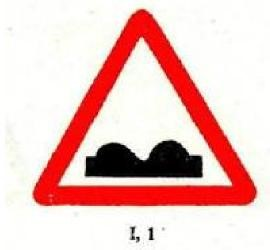

 Art. 13 1) Das Zeichen [Signal] "GEFÄHRLICHE KURVE" oder "GEFÄHRLICHE KURVEN" (I, 2) wird nur vor einer oder mehreren Kurven aufgestellt, die wegen ihrer Beschaffenheit oder Unübersichtlichkeit gefährlich sind. 

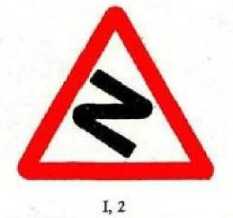

 2) Statt dieses Zeichens [Signals] kann jeder Vertragspartner Zeichen [Signale] einführen, die die Art der Kurven deutlicher bezeichnen. Diese Zeichen [Signale] sind dann im ganzen Gebiet des betreffenden Vertragspartners ausschliesslich zu verwenden; diese Zeichen [Signale] sind: I, 3 - Rechtskurve I, 4 - Linkskurve I, 5 - Doppelkurve nach rechts beginnend I, 6 - Doppelkurve nach links beginnend. 

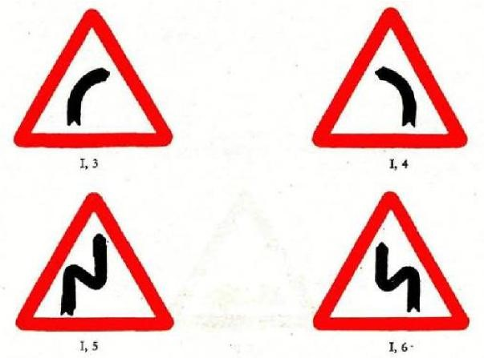

 Art. 14 1) Das Zeichen [Signal] "KREUZUNG" (I, 7) wird, wenn es notwendig ist, vor einer Gabelung, Kreuzung oder Einmündung aufgestellt. In Ortschaften wird dieses Zeichen [Signal] nur ausnahmsweise angebracht. 

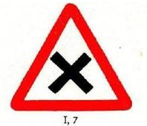

 2) Falls die angekündigte Kreuzung eine Kreuzung mit Kreisverkehr ist, kann das nachstehende Zeichen [Signal] I, 7 a an Stelle des Zeichens [Signals] I, 7 verwendet werden. Bei Linksverkehr wird die Richtung der Pfeile des Zeichens umgekehrt. 

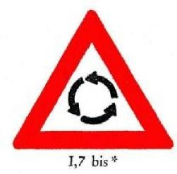

 * In der Übersetzung als "I, 7 a " bezeichnet. Art. 15 1) Das Zeichen [Signal] "BAHNÜBERGANG MIT SCHRANKEN" (I, 8) ist vor jedem Bahnübergang mit Schranken oder Halbschranken, die versetzt beiderseits der Schienen angebracht sind, aufzustellen. 

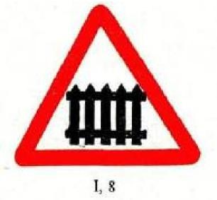

 2) Das Zeichen [Signal] "BAHNÜBERGANG OHNE SCHRANKEN" (I, 9) ist vor jedem Bahnübergang ohne Schranken oder Halbschranken aufzustellen. 

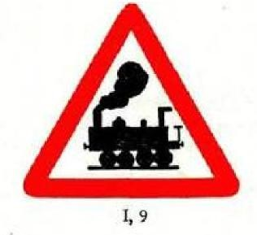

 3) Auf Strassen mit starkem nächtlichen Kraftfahrzeugverkehr müssen die in den Abs. 1 und 2 dieses Artikels erwähnten Zeichen [Signal] beleuchtet, mit rückstrahlenden Einrichtungen versehen oder mit rückstrahlendem Material überzogen sein. 4) Sind an den Bahnübergängen mit Schranken oder Halbschranken diese Schranken oder Halbschranken quer über die Strasse gesenkt, so bedeutet dies "HALT" für alle Strassenbenützer; die Bewegung der Schranken oder Halbschranken hat dieselbe Bedeutung. 5) Die Schranken und Halbschranken der Bahnübergänge sind mit roten und weissen oder roten und hellgelben Streifen zu bemalen. Sie können auch weiss oder hellgelb gestrichen und in der Mitte mit einer grossen roten Scheibe versehen sein. Um die Schranken bei Nacht besser sichtbar zu machen, müssen sie mit roten Lichtern oder mit roten rückstrahlenden Einrichtungen versehen oder mit rotem rückstrahlendem Material überzogen sein, oder sie müssen, solange sie nicht vollständig geöffnet sind, von einem Scheinwerfer beleuchtet sein. 

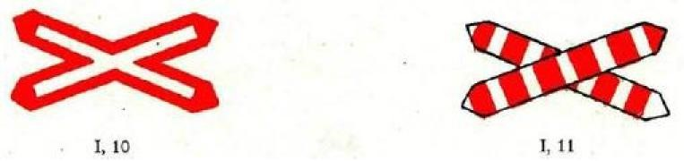

 6) Bei jedem Bahnübergang ohne Schranken oder Halbschranken muss in unmittelbarer Nähe der Schienen ein Zeichen [Signal] in der Form des Andreaskreuzes (I, 10 und I, 11) oder eine rechteckige Tafel mit neutralem Grund, auf die dieses Kreuz gemalt ist, aufgestellt werden. Das Andreaskreuz oder wenigstens seine unteren Arme können verdoppelt werden, wenn die Eisenbahnlinie zwei oder mehr Gleise hat. Das Kreuz muss rot und weiss oder rot und hellgelb gestrichen sein. 7) Für Bahnübergänge an Eisenbahnstrecken von örtlicher Bedeutung, an Industriegleisen oder ähnlichen Anschlussgleisen kann jeder Vertragspartner besonders auf Strassen mit geringem Verkehr oder bei Bahnübergängen, die mit einer Gabelung, Kreuzung oder Einmündung zusammenfallen: - ausserhalb der Ortschaften gewisse Vereinfachungen an dem in den Abs. 1, 2, 3, 5 und 6 dieses Artikels vorgesehenen System vornehmen oder gewisse Ausnahmen davon machen; - innerhalb der Ortschaften anstatt der Bestimmungen der Abs. 1, 2, 3, 5 und 6 dieses Artikels die Vorschriften anwenden, die ihm am geeignetsten erscheinen. Art. 16 1) Das Zeichen [Signal] "GEFÄHRLICHES GEFÄLLE" (I, 12) wird verwendet, wenn die zuständigen Behörden es für notwendig erachten, vor einem gefährlichen Gefälle zu warnen, sofern die Neigung zehn Prozent übersteigt oder wegen der örtlichen Verhältnisse eine Gefahr darstellt. 2) Das Gefälle muss auf dem Zeichen [Signal] angegeben werden, wie zum Beispiel in den Abbildungen I, 12 a und I, 12 b . 

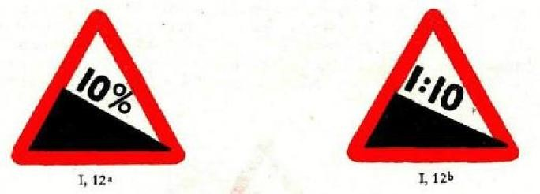

 Art. 17 Das Zeichen [Signal] "ENGPASS" (I, 13) wird aufgestellt, wenn die zuständigen Behörden es für notwendig erachten, eine Verengung der Fahrbahn anzuzeigen, die eine Gefahr darstellen kann. 

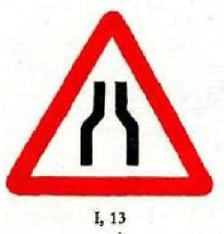

 Art. 18 Das Zeichen [Signal] "BEWEGLICHE BRÜCKE" (I, 14) wird verwendet, wenn die zuständigen Behörden es für notwendig erachten, eine bewegliche Brücke anzuzeigen. 

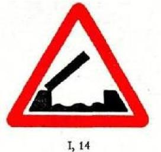

 Art. 19 1) Das Zeichen [Signal] "BAUSTELLE" (I, 15) wird aufgestellt, um Arbeiten auf der Strasse anzuzeigen. 2) Die Grenzen der Baustellen müssen nachts deutlich gekennzeichnet sein. 

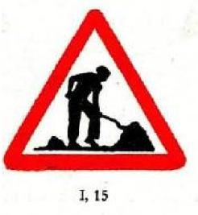

 Art. 20 Das Zeichen [Signal] "SCHLEUDERGEFAHR" (I, 16) wird verwendet, wenn die zuständigen Behörden es für notwendig halten, einen Abschnitt der Fahrbahn anzuzeigen, dessen Oberfläche unter bestimmten Verhältnissen glitschig sein kann. 

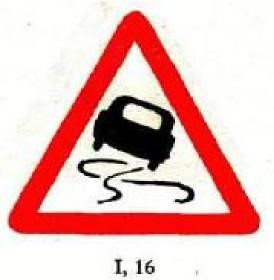

 Art. 21 1) Das Zeichen [Signal] "FUSSGÄNGERÜBERGANG" (I, 17) wird aufgestellt, wenn die zuständigen Behörden es für notwendig erachten, einen Fussgängerübergang anzuzeigen. Die Art der Kennzeichnung dieser Übergänge bestimmen die zuständigen Behörden. 2) Die Bestimmungen von Art. 11 Abs. 5 dieses Protokolls gelten nicht für dieses Zeichen [Signal]. 

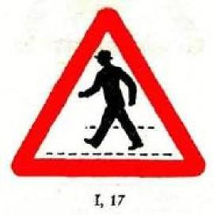

 Art. 22 1) Das Zeichen [Signal] "KINDER" (I, 18) wird verwendet, wenn die zuständigen Behörden es für notwendig erachten, vor Stellen wie Schulen oder Spielplätzen zu warnen, wo sich häufig Kinder aufhalten. 2) Die Bestimmungen von Art. 11 Abs. 5 dieses Protokolls gelten nicht für dieses Zeichen [Signal]. 

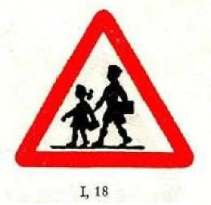

 Art. 23 Das Zeichen [Signal] "ACHTUNG TIERE" (I, 19) wird aufgestellt, wenn die zuständigen Behörden es für notwendig halten anzuzeigen, dass ein Gebiet beginnt, wo mit unbegleiteten Tieren zu rechnen ist; das Sinnbild dieses Zeichens [Signals] kann geändert werden, um besondere Fälle zu berücksichtigen. 

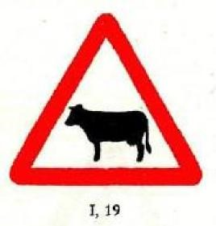

 Art. 24 Das Zeichen [Signal] "KREUZUNG MIT STRASSE OHNE VORRANG" (I, 20) wird im Gebiet von Vertragspartnern, deren Verkehrsregeln es entspricht, auf Vorrangstrassen oder Strassen mit starkem Verkehr aufgestellt, wenn die zuständigen Behörden es für notwendig erachten, eine Kreuzung mit einer Strasse ohne Vorrang anzuzeigen. 

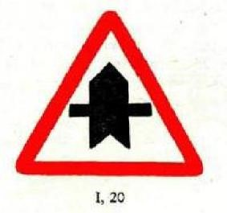

 Art. 25 1) Das Zeichen [Signal] "ANDERE GEFAHR" (I, 21) wird verwendet, wenn die zuständigen Behörden es für notwendig erachten, eine andere als die in den Art. 12 bis 24 dieses Protokolls erwähnten Gefahren anzuzeigen. 

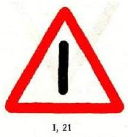

 2) Auf dem Zeichen [Signal] kann jedoch an Stelle des Symbols eine Aufschrift in schwarzer oder dunkler Farbe angebracht sein, die die Gefahr näher bezeichnet, wie beschränkte lichte Höhe oder Breite, Fähre oder Steinschlag. 3) Dieses Zeichen [Signal] muss immer das Symbol oder eine Aufschrift oder beides enthalten. 4) Unter dem Zeichen [Signal] kann zusätzlich ein rechteckiges Schild mit einer Aufschrift oder einem Symbol nach Landesbrauch des Vertragspartners angebracht werden. Art. 26 Wo die Witterungsverhältnisse die Aufstellung voller Tafeln nicht zulassen, kann ein roter Dreieckrahmen zur Bezeichnung der verschiedenen in den Art. 12 bis 25 aufgezählten Gefahren verwendet werden. Unter diesem Dreieck muss immer ein rechteckiges Schild angebracht sein, worauf das der Gefahr entsprechende Symbol, eine entsprechende Aufschrift oder beides angebracht ist. Art. 27 1) Das Zeichen [Signal] "ACHTUNG VORRANGSTRASSE" (I, 22) wird verwendet, um dem Führer anzuzeigen, dass er den Fahrzeugen auf der Strasse, der er sich nähert, den Vorrang [den Vortritt, die Vorfahrt] gewähren muss. 

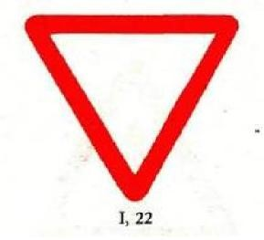

 2) Dieses Zeichen [Signal] wird auf Strassen ohne Vorrang in angemessenem Abstand, das heisst ausserhalb von Ortschaften höchstens 50 m und in Ortschaften höchstens 25 m vor der Gabelung, Kreuzung oder Einmündung aufgestellt. Es wird überdies empfohlen, zur Bezeichnung der Lage solcher Gabelungen, Kreuzungen oder Einmündungen möglichst nahe daran eine Linie, eine Marke oder ein Zeichen anzubringen. 3) Wenn das Zeichen [Signal] I, 22 verwendet wird, geht ihm das Zeichen [Signal] I, 7 nicht voran, aber es kann ihm ein Zeichen [Signal] vorangehen, das aus einem Zeichen [Signal] I, 22 besteht, dem wie in der Abbildung I, 22 a ein rechteckiges Schild mit der Angabe des Abstandes von der Gabelung, Kreuzung oder Einmündung beigefügt ist. Wenn zwischen dem vorangehenden Zeichen [dem Vorsignal] und der Vorrangstrasse oder der Strasse mit starkem Verkehr andere Gabelungen, Kreuzungen oder Einmündungen liegen, ist es nach jeder von ihnen zu wiederholen. 

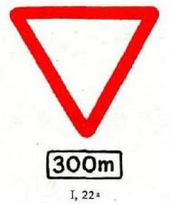

 III. Kapitel Gruppe II. Vorschriftszeichen [Vorschriftssignale] Art. 28 1) Die Zeichen [Signal] dieser Gruppe geben Verbote oder Gebote der zuständigen Behörde an. 2) Die Tafeln dieser Gruppe sind rund. 3) Ausser beim Zeichen [Signal] II, A. 16 beträgt der Durchmesser für die Zeichen [Signale] im Normalformat mindestens 0,60 m, im Kleinformat wenigstens 0,40 m. Bei den Zeichen [Signalen] II, A. 15, 17, 18 und II, B. 1, 2 kann der Durchmesser auf 0,20 m vermindert werden, wenn sie als Zwischenzeichen [Zwischensignale] aufgestellt werden. 4) Die Tafeln müssen auf der Seite der Fahrtrichtung angebracht und dem Verkehr zugewendet sein. Sie können auf der andern Seite der Strasse wiederholt werden. 5) Die Tafeln sind in unmittelbarer Nähe der Stelle anzubringen, wo das Verbot oder Gebot beginnt oder weiterbesteht. Die Tafeln, die das Abbiegen verbieten oder eine bestimmte Fahrtrichtung vorschreiben, können jedoch in angemessenem Abstand davor angebracht werden. 6) Die Höhe der Signale darf nicht mehr als 2,20 m und nicht weniger als 0,60 m betragen. II, A. Verbotszeichen [Verbotssignale] Art. 29 Soweit dieses Protokoll nichts anderes vorsieht, müssen die Verbotszeichen [Verbotssignale] in den folgenden Farben gehalten sein: weisser oder hellgelber Grund mit rotem Rand, schwarzes oder dunkelfarbiges Symbol. Art. 30 Die Zeichen [Signale] für Verkehrsverbote sind: a) das Zeichen [Signal] "FAHRVERBOT (IN BEIDEN RICHTUNGEN)" (II, A. 1); 

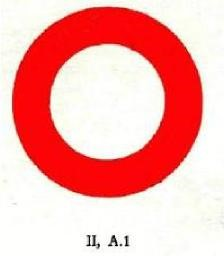

 b) das Zeichen [Signal] "EINFAHRT VERBOTEN" (II, A. 2); dieses Zeichen ist rot mit einem weissen oder hellfarbigen waagrechten Querbalken; 

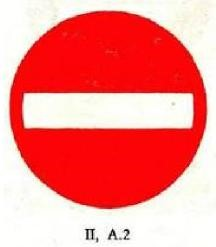

 c) das Zeichen [Signal] "ABBIEGEN NACH RECHTS (NACH LINKS) VERBOTEN" (II, A. 3); der Pfeil ist je nach der Bedeutung des Verbots nach rechts oder links gerichtet; 

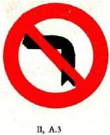

 d) das Zeichen [Signal] "ÜBERHOLEN VERBOTEN" (II, A. 4); dieses Zeichen [Signal] wird verwendet, um anzuzeigen, dass zusätzlich zu den allgemeinen Überholvorschriften das Überholen von mechanisch angetriebenen Strassenfahrzeugen (einschliesslich Obussen) mit Ausnahme von Motorrädern ohne Beiwagen verboten ist; bei Linksverkehr sind die Farben der abgebildeten Wagen vertauscht. 

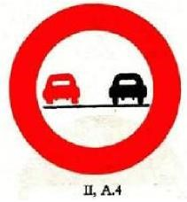

 Art. 31 Die Verbotszeichen [Verbotssignale] für bestimmte Fahrzeuggattungen sind: a) das Zeichen [Signal] "EINFAHRT VERBOTEN FÜR ALLE KRAFTFAHRZEUGE [MOTORFAHRZEUGE] AUSSER KRAFTRÄDERN [MOTORRÄDERN] OHNE SEITENWAGEN" (II, A. 5); 

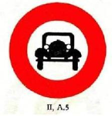

 b) das Zeichen [Signal] "EINFAHRT VERBOTEN FÜR KRAFTRÄDER [MOTORRÄDER] OHNE SEITENWAGEN" (II, A. 6); 

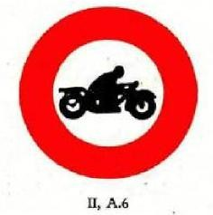

 c) das Zeichen [Signal] "EINFAHRT VERBOTEN FÜR ALLE KRAFTFAHRZEUGE [MOTORFAHRZEUGE]" (II, A. 7); 

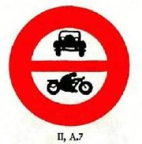

 d) das Zeichen [Signal] "EINFAHRT VERBOTEN FÜR LASTWAGEN MIT ÜBER ... TONNEN GESAMTGEWICHT" (II, A. 8); 

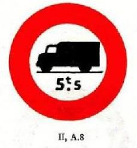

 e) das Zeichen [Signal] "EINFAHRT VERBOTEN FÜR RADFAHRER" (II, A. 9). 

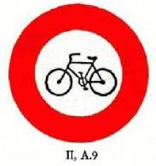

 Art. 32 Die Zeichen [Signale] für Beschränkungen der Abmessungen, Gewichte oder Geschwindigkeiten der Fahrzeuge sind: a) das Zeichen [Signal] "EINFAHRT VERBOTEN FÜR ÜBER ... METER (... FUSS) BREITE FAHRZEUGE" (II, A. 10); 

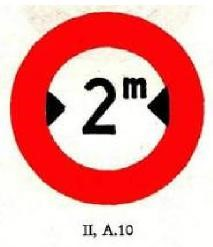

 b) das Zeichen [Signal] "EINFAHRT VERBOTEN FÜR ÜBER ... METER (... FUSS) HOHE FAHRZEUGE" (II, A. 11); 

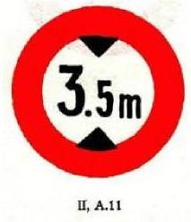

 c) das Zeichen [Signal] "EINFAHRT VERBOTEN FÜR FAHRZEUGE MIT ÜBER ... TONNEN GESAMTGEWICHT" (II, A. 12); darunter kann zusätzlich ein rechteckiges Schild angebracht werden mit Angaben über besondere Verkehrsregeln oder über die Höchstzahl der Fahrzeuge, die zu gleicher Zeit über eine Brücke fahren dürfen; 

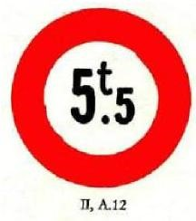

 d) das Zeichen [Signal] "EINFAHRT VERBOTEN FÜR FAHRZEUGE MIT ÜBER ... TONNEN ACHSDRUCK" (II, A. 13); 

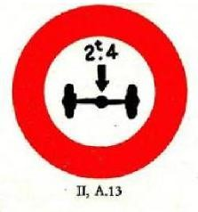

 e) das Zeichen [Signal] "GESCHWINDIGKEITSBESCHRÄNKUNG" (II, A. 14); darunter kann zusätzlich ein rechteckiges Schild mit rotem Rand und Angabe von Einzelheiten über die Anwendung der Geschwindigkeitsbeschränkung angebracht werden; 

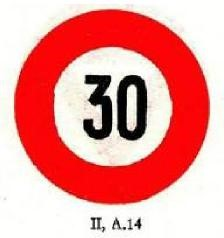

 f) das Zeichen "ENDE DER GESCHWINDIGKEITSBESCHRÄNKUNG" (II, A. 15) (weisser oder hellgelber Grund mit schwarzem oder dunkelfarbigem schrägem Querbalken) wird verwendet, um das Ende der Strecke anzuzeigen, auf der die Geschwindigkeit beschränkt ist; es kann auf der Rückseite der Tafel II, A. 14 angebracht werden, selbst wenn es aus diesem Grunde nicht auf dem der Fahrtrichtung entsprechenden Strassenrand steht. 

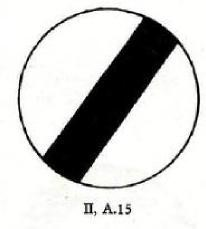

 Art. 33 1) Das Zeichen [Signal] "HALT VOR DER KREUZUNG" wird verwendet, um anzuzeigen, dass der Führer anhalten muss, bevor er auf eine andere Strasse einfährt, und dass er die auf dieser Strasse verkehrenden Fahrzeuge vorfahren lassen muss. 2) Dieses Zeichen [Signal] besteht aus einem roten Dreieck mit einer Spitze nach unten, das von einem roten Kreis umschlossen ist. Das Dreieck kann wie in Abbildung II, A. 16 das Wort "Stop" enthalten. 

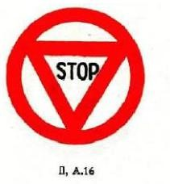

 3) Der Durchmesser beträgt bei diesem Zeichen [Signal] im Normalformat wenigstens 0,90 m, im Kleinformat mindestens 0,60 m. 4) Das Zeichen [Signal] ist auf der Strasse ohne Vorrang in angemessenem Abstand, das heisst ausserhalb von Ortschaften höchstens 50 m, in Ortschaften höchstens 25 m vor der Gabelung, Kreuzung oder Einmündung aufzustellen. Es wird überdies empfohlen, zur Bezeichnung der Lage solcher Gabelungen, Kreuzungen oder Einmündungen möglichst nahe daran auf der Strasse eine Linie, eine Marke oder ein Zeichen anzubringen. 5) Wenn das Zeichen [Signal] II, A. 16 verwendet wird, geht ihm das Zeichen [Signal] I, 7 nicht voran, aber es kann ihm ein Zeichen (Vorsignal) vorangehen, das aus einem Zeichen [Signal] I, 22 besteht, dem wie in der Abbildung I, 22 a ein rechteckiges Schild mit der Angabe des Abstandes von der Gabelung, Kreuzung oder Einmündung beigefügt ist. Wenn zwischen dem vorangehenden Zeichen [dem Vorsignal] und der Vorrangstrasse oder der Strasse mit starkem Verkehr andere Gabelungen, Kreuzungen oder Einmündungen liegen, ist es nach jeder von ihnen zu wiederholen. Art. 34 1) Das Zeichen [Signal] "HALT (ZOLL)" (II, A. 17) wird verwendet, um eine Zollstelle anzuzeigen, bei der angehalten werden muss. Das Wort "ZOLL" muss auf diesem Zeichen [Signal] enthalten sein. Die Übersetzung dieses Wortes in eine Sprache des Nachbarlandes kann hinzugefügt werden (II, A. 17). 

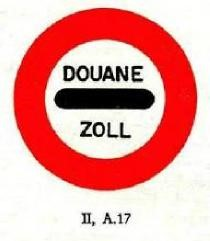

 2) Dieses Zeichen [Signal] kann auch für andere Anhaltegebote verwendet werden; in diesem Fall ist die Aufschrift "Zoll" durch die Angabe des Grundes zum Anhalten zu ersetzen. Art. 35 1) Das Zeichen [Signal] "BESCHRÄNKUNG FÜR HALTEN ODER PARKEN" (II, A. 18) bezeichnet die Stellen, wo Fahrzeuge nicht halten oder nicht oder nur für beschränkte Dauer parken dürfen. Das Mittelfeld der Scheibe ist blau; sie hat einen roten schrägen Querbalken und einen roten Rand. 

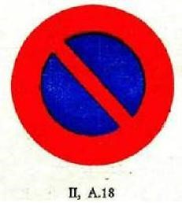

 2) Ohne Aufschrift bedeutet dieses Zeichen [Signal] ein dauerndes Parkverbot. 3) Aufschriften mit der Angabe: a) der Stunden, während deren das Parken verboten ist, b) der Dauer, während der das Parken gestattet ist, c) der Tage, an denen das Parken abwechselnd auf der einen oder andern Strassenseite gestattet ist, d) der Ausnahmen für gewisse Fahrzeuggattungen können entweder auf dem Zeichen [Signal] selbst oder zusätzlich auf einem Schild darunter angebracht werden, sofern sich durch diese Aufschriften die allgemeine Bedeutung des Zeichens [Signal] nicht ändert und dieses weder zweideutig noch unklar wird. 3a) Um anzuzeigen, dass das Parken auf der einen oder der anderen Seite der Strasse wechselweise verboten ist, kann auch folgendes Zeichen [Signal] "WECHSELSEITIGE BESCHRÄNKUNG FÜR PARKEN" (II. A.18 a) verwendet werden, und wenn keine anderen Angaben auf einem zusätzlichen Schild unter dem Zeichen [Signal] gemacht werden, gilt das Parkverbot dann auf der Seite der Zahl I an den Tagen mit einem Datum mit ungerader Zahl und auf der Seite der Zahl II an den Tagen mit einem Datum mit gerader Zahl. 

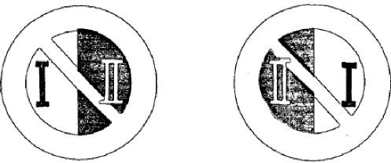

 4) Die Aufschrift "HALTEN VERBOTEN" auf dem Zeichen [Signal] selbst oder auf einem zusätzlichen Schild darunter bedeutet, dass das Halten der Fahrzeuge verboten ist. 5) Vertragspartner, die früher ein Zeichen [Signal] "PARKVERBOT" (rote Scheibe, die ein weisses oder hellgelbes Mittelfeld mit den Bst. P und einem schrägen roten Querbalken trägt) angenommen hatten, um ein längeres Parken von Fahrzeugen mit oder ohne Führer zu verbieten, brauchen dieses System vorläufig nicht zu ändern. Da aber dieses Protokoll nur das Zeichen [Signal] II, A. 18 für diesen Zweck vorsieht, wird den Vertragspartnern dringend empfohlen, auf ihrem Gebiet die Bedingungen für Halten oder Parken nach den Grundsätzen der vorstehenden Abs. 1 bis 4 anzuzeigen. II, B. Gebotszeichen [Gebotssignale] Art. 36 1) Die Farben der Gebotszeichen [Gebotssignale] sind: blauer Grund und weisses Symbol. 2) Die Gebotszeichen [Gebotssignale] sind: a) das Zeichen [Signal] "VORGESCHRIEBENE FAHRTRICHTUNG" (II, B. 1); das Symbol dieses Zeichens [Signals] kann Sonderfällen angepasst werden; 

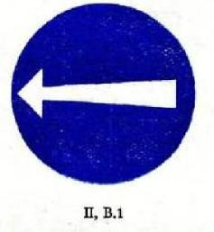

 b) das Zeichen [Signal] "RADWEG" (II, B. 2); es bedeutet, dass die Radfahrer den ihnen vorbehaltenen besonderen Weg benutzen müssen; 

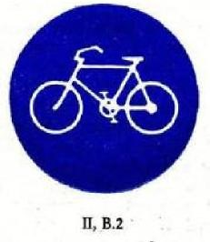

 c) das Zeichen [Signal] "VORGESCHRIEBENE MINDESTGESCHWINDIGKEIT" (II, B. 3); dieses Zeichen [Signal] bedeutet, dass die die Strasse benützenden Fahrzeuge mindestens mit der angegebenen Geschwindigkeit fahren müssen. 

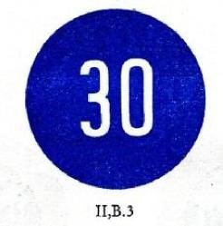

 IV. Kapitel Gruppe III. Richtzeichen Art. 37 1) Die Tafeln dieser Gruppe sind rechteckig. 2) Soweit die Farben frei gewählt werden können, darf die rote Farbe nie vorherrschen. III, A. Hinweiszeichen [Hinweissignale] Art. 38 1) Das Zeichen [Signal] "PARKEN" (III, A. 1) bezeichnet Stellen, auf denen das Parken gestattet ist. 

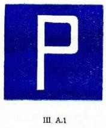

 2) Die Tafel ist quadratisch. 3) Die Quadratseite misst wenigstens 0,60 m beim Zeichen [Signal] im Normalformat und mindestens 0,40 m im Kleinformat. 4) Diese Tafel kann rechtwinklig oder parallel zur Strasse angebracht werden. 5) Der Grund der Tafel ist blau, der Bst. "P" weiss. 6) Darunter kann zusätzlich ein rechteckiges Schild angebracht werden mit Angaben über die Beschränkung der Parkdauer oder über die Lage des Parkplatzes. Art. 39 1) Das Zeichen [Signal] "HEILSTÄTTE [HOSPITAL, SPITAL]" zeigt dem Fahrzeugführer an, dass er die in der Nähe von Krankenanstalten notwendigen Massnahmen treffen, namentlich jeden unnötigen Lärm vermeiden muss. 2) Die Tafel enthält unter dem Symbol H das Wort "HEILSTÄTTE [HOSPITAL, SPITAL]" wie in Abbildung III, A. 2. 

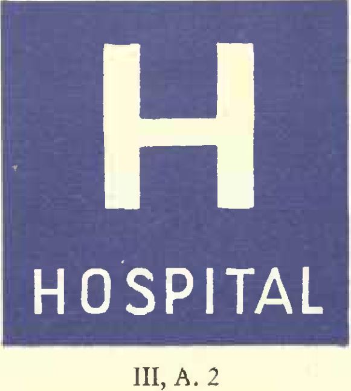

 3) Der Grund der Tafel ist blau, die Aufschrift weiss. 4) Das Zeichen [Signal] muss rechtwinklig zur Strasse angebracht sein. Art. 40 1) Die Zeichen [Signale] für Hilfsdienste sind: a) das Zeichen [Signal] "HILFSPOSTEN" (III, A. 3 oder III, A. 4), das auf einen in der Nähe liegenden Hilfsposten eines amtlich anerkannten Verbandes hinweist; 

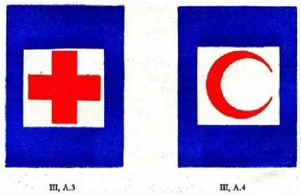

 b) das Zeichen [Signal] "PANNENHILFE" (III, A. 5), das zur Bezeichnung einer in der Nähe liegenden Werkstätte dient; 

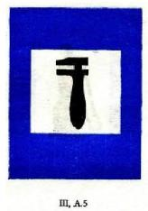

 c) das Zeichen [Signal] "TELEPHON" (III, A. 6), das zur Bezeichnung einer in der Nähe liegenden Sprechstelle dient; 

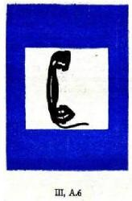

 d) das Zeichen [Signal] "TANKSTELLE" (III, A. 7), das zur Bezeichnung einer in der angegebenen Entfernung befindlichen Tankstelle dient. 

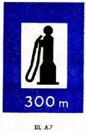

 2) Die kürzere Seite der in diesem Artikel vorgesehenen rechteckigen Zeichen [Signale] muss waagrecht sein. Ihr Grund ist blau. Das Zeichen [Signal] trägt in einem weissen Quadrat ein schwarzes oder dunkelfarbiges Symbol, ausser bei den Signalen III, A. 3 oder III, A. 4, deren Symbol rot ist. Die Seiten des weissen Quadrates messen mindestens 0,30 m. Beim Zeichen [Signal] III, A. 7 ist jedoch das Quadrat durch ein weisses Rechteck ersetzt, dessen kürzere Seite waagrecht sein muss. 3) Die Verwendung der in Abs. 1 unter b, c und d vorgesehenen Zeichen [Signale] wird durch die zuständigen Behörden geregelt. Art. 41 1) Das Zeichen [Signal] "VORRANGSTRASSE" (III, A. 8) kann verwendet werden, um den Anfang einer Vorrangstrasse zu bezeichnen. 

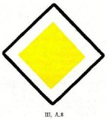

 2) Es kann auf solchen Strassen wiederholt werden. 3) Das Zeichen [Signal] "ENDE DES VORRANGES" (III, A. 9) wird verwendet, um das Ende einer Vorrangstrasse anzuzeigen, wenn an ihrem Anfang das Zeichen [Signal] III, A. 8 aufgestellt ist. 

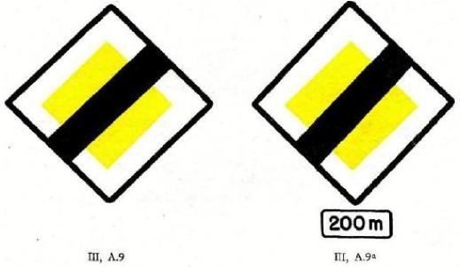

 4) Dieses Zeichen [Signal] kann auch verwendet werden, um anzuzeigen, dass man sich dem Ende einer Vorrangstrasse nähert. In diesem Fall muss, wie in Abbildung III, A. 9 a dargestellt, darunter zusätzlich ein rechteckiges Schild angebracht werden mit dem Hinweis, in welcher Entfernung der Vorrang der Strasse aufhört. 5) Die Tafeln der in diesem Artikel vorgesehenen Zeichen [Signale] sind quadratisch mit einer Ecke nach unten. 6) Die Quadratseiten messen beim Zeichen [Signal] im Normalformat wenigstens 0,60 m, im Kleinformat mindestens 0,40 m. Sie messen wenigstens 0,25 m bei den Wiederholungszeichen [Wiederholungssignalen] in Ortschaften. 7) Der Grund des Zeichens [Signals] ist gelb, der Rand weiss mit schwarzer oder dunkler Einfassung. Beim Zeichen [Signal] III, A. 9 ist der Querbalken schwarz oder dunkelfarbig. 8) Diese Tafeln müssen auf dem der Fahrtrichtung entsprechenden Fahrbahnrand aufgestellt und dem Verkehr zugewendet sein. Sie können auf der anderen Seite der Strasse wiederholt werden. III, B. Vorwegweiser und Wegweiser Art. 42 1) Die Vorwegweiser sind rechteckig. 2) Sie müssen so gross sein, dass die Angaben von den Führern schnell fahrender Fahrzeuge leicht gelesen werden können. 3) Sie haben entweder einen hellen Grund mit dunkelfarbiger Aufschrift oder einen dunklen Grund mit hellfarbiger Aufschrift. 4) Sie werden 100 bis 250 m vor der Gabelung, Kreuzung oder Einmündung aufgestellt. Auf Autobahnen kann dieser Abstand bis 500 m betragen. 5) Beispiele dieses Zeichens [Signals] sind die Abbildungen III, B. 1 a und III, B. 1 b . 

 Art. 43 1) Die Wegweiser haben die Form eines Rechtecks, dessen längere Seiten waagrecht liegen und das in einer Pfeilspitze endet. 2) Auf einem Zeichen [Signal] können die Namen mehrerer Orte, die in derselben Richtung liegen, angegeben sein. 3) Werden Entfernungen angegeben, so muss die Zahl der Kilometer (oder Meilen) zwischen dem Ortsnamen und der Pfeilspitze stehen. 4) Die Farben dieser Zeichen [Signale] müssen denen der Vorwegweiser gleich sein. 5) Beispiele dieses Zeichens [Signals] sind die Abbildungen III, B. 2 a und III, B. 2 b . 

 III, C. Orts- und Strassenbezeichnungstafeln Art. 44 1) Ortstafeln sind rechteckig; die längere Seite liegt waagrecht. 2) Sie müssen so bemessen und aufgestellt sein, dass sie auch nachts gesehen werden können. 3) Sie haben entweder einen hellen Grund mit dunkelfarbiger Aufschrift oder einen dunklen Grund mit hellfarbiger Aufschrift. 4) Diese Tafeln werden vor den Ortschaften auf dem der Fahrtrichtung entsprechenden Strassenrand aufgestellt und dem Verkehr zugewendet. 5) Beispiele dieses Zeichens [Signals] sind die Abbildungen III, C. 1 a und III, C. 1 b . 

 Art. 45 1) Die Zeichen [Signale] zur besonderen Kennzeichnung der Strassen bestehen aus Ziffern oder Buchstaben oder beiden und sind rechteckig. 2) Diese Aufschriften können auf Kilometersteinen, unter oder über anderen Zeichen [Signalen] oder als selbständige Zeichen [Signale] angebracht werden. 3) Ein Beispiel dieses Zeichens [Signals] ist die Abbildung III, C. 2 a . 

 Abschnitt III Zusätzliche Bestimmungen für Bahnübergänge Art. 46 Unter einem Zeichen [Signal] I, 8 oder I, 9 kann, wenn die zuständigen Behörden es für notwendig erachten, eine senkrechte Tafel, die drei rote Schrägbalken auf weissem oder gelbem Grund trägt, angebracht werden, vorausgesetzt, dass Tafeln gleicher Form, die zwei bzw. einen roten Schrägbalken auf weissem oder gelbem Grund tragen, als unabhängige Zeichen [Signal] etwa bei zwei Dritteln und einem Drittel des Abstandes zwischen dem Zeichen [Signal] und den Gleisen angebracht sind. Beispiele dieser Tafeln sind die Abbildungen I, 8 a , I, 9 a , I, 8/9 b und I, 8/9 c . 

 Art. 47 1) Ist eine Signalanlage an einem Bahnübergang eingerichtet, um das Herannahen eines Zuges oder das unmittelbar bevorstehende Schliessen der Schranken oder Halbschranken anzuzeigen, so besteht sie: a) vorbehaltlich der Bestimmungen des Abs. 4 dieses Artikels entweder aus einem roten Blinklicht oder aus zwei roten abwechselnd blinkenden Lichtern, die an ein und demselben Ständer angebracht sind; diesem Licht oder diesen Lichtern kann ein hörbares Zeichen [Signal] beigefügt werden; b) oder aus einem einfachen hörbaren Zeichen [Signal]. 2) a) Jeder Bahnübergang mit Schranken oder Halbschranken, deren Bedienung von einer Stelle aus erfolgt, von der aus sie nicht einsehbar sind, muss mit der im vorstehenden Abs. 1 a oder 1 b beschriebenen Signalanlage ausgerüstet sein; b) Jeder Bahnübergang mit Schranken oder Halbschranken, deren Bedienung selbsttätig durch das Herannahen der Züge erfolgt, muss mit der im vorstehenden Abs. 1 a beschriebenen Signalanlage ausgerüstet sein. 3) Die im Abs. 1 dieses Artikels vorgesehene Signalanlage bedeutet, wenn sie in Betrieb ist, dass jeder Strassenbenützer anhalten muss. 4) Ausnahmsweise kann in den Ortschaften, wo Kreuzungen mit den in Art. 53 dieses Protokolls vorgesehenen Lichtzeichen (Lichtsignalen) zur Verkehrsregelung ausgerüstet sind, oder in der Nähe derartiger Ortschaften die im Abs. 1 dieses Artikels vorgesehene Signalanlage entweder durch die in demselben Art. 53 vorgesehene Dreifarben-Lichtzeichenanlage (Dreifarben-Lichtsignalanlage) oder durch das gelbe und rote Licht dieser Anlage allein ersetzt werden, das gelbe und rote Licht hat dann für alle Strassenbenützer die in demselben Art. 53 für Fahrzeuge vorgesehene Bedeutung. In einem solchen Fall braucht das in Art. 15 Abs. 1 oder 2 vorgesehene Ankündigungszeichen nicht angebracht zu werden; wenn es auf Grund der örtlichen Bedingungen schwierig wäre, es genügend sichtbar anzubringen. 5) Bei jedem Bahnübergang, der mit Schranken oder Halbschranken ausgerüstet ist, deren Bedienung selbsttätig durch das Herannahen der Züge oder von einer Betriebsstelle aus erfolgt, von der aus die Schranken oder Halbschranken nicht einsehbar sind, muss das Schliessen der Schranken oder Halbschranken so geschehen, dass die Strassenbenützer, die sich dem Übergang nähern oder sich bereits auf ihm befinden, wenn die Signalanlage in Tätigkeit tritt, Zeit haben, vor dem Übergang zu halten oder ihn noch zu überqueren. Art. 48 Bei jedem Bahnübergang mit Schranken oder Halbschranken muss ihr Betrieb gewährleistet sein, solange Züge verkehren. Wenn ein Bahnübergang mit Schranken oder Halbschranken endgültig in einen Übergang ohne Schranken oder Halbschranken umgewandelt wird, müssen die Schranken oder Halbschranken entfernt werden, um jede Möglichkeit von Missdeutungen durch die Strassenbenützer auszuschliessen. Art. 49 Die in Art. 47 Abs. 1 a dieses Protokolls vorgesehenen Signalvorrichtungen für das Herannahen der Züge müssen in unmittelbarer Nähe der Gleise und, wenn ein Zeichen [Signal] in der Form des Andreaskreuzes aufgestellt ist, wenn möglich, auf demselben Ständer wie dieses Zeichen [Signal] angebracht werden. Es müssen geeignete Massnahmen getroffen werden, um ein Versagen der Signalanlage auszuschliessen, wenn sie selbsttätig ist, und um sicherzustellen, dass sie im Falle Nichtfunktionierens oder mangelhaften Funktionierens nicht zu Missdeutungen Anlass gibt. Art. 50 Bahnübergänge müssen entweder mit Schranken, Halbschranken oder mit Signalanlagen für das Herannahen der Züge ausgestattet sein, wenn die Strassenbenützer die Gleise, besonders im Hinblick auf die Höchstgeschwindigkeit der Züge, nach beiden Seiten nicht leicht überblicken können; der Kraftfahrer, der sich von der einen oder anderen Seite den Gleisen nähert, muss, wenn ein Zug sichtbar wird, genügend Zeit haben, um vor dem Übergang anzuhalten; ebenso müssen Strassenbenützer, die sich beim Herannahen eines Zuges schon auf dem Übergang befinden, Zeit haben, ihn zu verlassen. Abschnitt IV Handzeichen der Verkehrspolizisten Art. 51 Die Verkehrspolizisten müssen so ausgerüstet sein und sich so aufstellen, dass sie von allen Strassenbenutzern gesehen werden können. Art. 52 1) Die Handzeichen der Verkehrspolizisten müssen einem der beiden folgenden Systeme entsprechen: Erstes System Zeichen A - "HALT" für Fahrzeuge, die von vorn kommen: ein Arm wird senkrecht erhoben mit der Handfläche nach vorn. Zeichen C - "HALT" für Fahrzeuge, die von hinten kommen: auf der Seite, die der Fahrtrichtung der aufzuhaltenden Fahrzeuge entspricht, wird der Arm mit der Handfläche nach vorn waagrecht ausgestreckt. Die Zeichen A und C können gleichzeitig gegeben werden. 

 Zweites System Zeichen B - "HALT" für Fahrzeuge, die von vorn kommen: auf der Seite, die der Fahrtrichtung der aufzuhaltenden Fahrzeuge entspricht, wird der Arm mit der Handfläche nach vorn waagrecht ausgestreckt. Zeichen C - "HALT" für Fahrzeuge, die von hinten kommen: auf der Seite, die der Fahrtrichtung der aufzuhaltenden Fahrzeuge entspricht, wird der Arm mit der Handfläche nach vorn waagrecht ausgestreckt. Die Zeichen B und C können gleichzeitig gegeben werden. 2) Bei beiden Systemen kann ein Handzeichen zum Weiterfahren gegeben werden. Abschnitt V Lichtzeichen [Lichtsignale] zur Verkehrsregelung Art. 53 1) Die Lichter der Lichtzeichen [Lichtsignale] zur Verkehrsregelung bedeuten: a) Beim Dreifarbensystem: Rot bedeutet, dass die Fahrzeuge nicht weiterfahren dürfen; Grün bedeutet, dass die Fahrzeuge weiterfahren dürfen; Wenn gelb auf grün folgt, so bedeutet es, dass die Fahrzeuge nicht mehr weiterfahren dürfen, ausser wenn sie so nahe herangekommen sind, dass sie beim Aufleuchten des gelben Lichtes nicht mehr sicher davor anhalten können; Wenn gelb gleichzeitig mit oder nach rot erscheint, so zeigt es den nahen Wechsel der Lichter an, gibt aber noch nicht die Erlaubnis zum Weiterfahren. b) Beim Zweifarbensystem: Rot bedeutet, dass die Fahrzeuge nicht weiterfahren dürfen; Grün bedeutet, dass die Fahrzeuge weiterfahren dürfen; Erscheint rot zusammen mit grün, so hat es die gleiche Bedeutung wie im Dreifarbensystem gelb, das auf grün folgt. 2) Ein gelbes Blinklicht allein bedeutet "VORSICHT". 3) Die Lichter müssen übereinander angebracht sein. In der Regel muss das rote Licht oben, das grüne unten sein. Wird ein gelbes Licht verwendet, so muss es zwischen dem roten und dem grünen sein. 4) Sind die Lichter am Fahrbahnrand, so darf sich der untere Rand des untersten Lichtes in der Regel nicht weniger als 2 m und nicht mehr als 3,50 m über der Fahrbahn befinden; jedes Licht wird, wenn möglich, auf der gegenüberliegenden Seite der Gabelung, Kreuzung oder Einmündung wiederholt. Sind sie über der Fahrbahn, so muss der untere Rand des untersten Lichtes wenigstens 4,50 m über der Fahrbahn liegen. Abschnitt VI Fahrbahnmarkierungen Art. 54 1) Hat eine Fahrbahn ausserhalb von Ortschaften mehr als zwei Fahrstreifen, so müssen sie in der Regel deutlich voneinander abgegrenzt sein. 2) Sind auf einer Fahrbahn mit drei Fahrstreifen ausserhalb von Ortschaften Abschnitte mit ungenügender Sicht oder andere Gefahrenstellen, so darf die ganze Breite der Fahrbahn nur in zwei Fahrstreifen unterteilt werden. 3) Auf Fahrbahnen mit zwei Fahrstreifen können diese, wo die Sicht ungenügend ist oder an andern Gefahrenstellen, in gleicher Weise abgegrenzt werden. 4) Die in den Abs. 2 und 3 vorgesehene Kennzeichnung bedeutet, dass die Fahrzeuge bei normalen Verkehrsverhältnissen den ihrer Fahrtrichtung entsprechenden Fahrstreifen nicht verlassen dürfen. Art. 55 1) Wo die Fahrbahnränder durch Lichter oder Rückstrahlvorrichtungen gekennzeichnet werden, können dafür zwei verschiedene Farben verwendet werden. 2) Rot oder orange kann zur Bezeichnung des der Fahrtrichtung entsprechenden, weiss zur Bezeichnung des gegenüberliegenden Fahrbahnrandes verwendet werden. 3) Wo Lichter oder Rückstrahlvorrichtungen zur Bezeichnung von Pfosten oder Inseln in der Fahrbahnmitte dienen, soll dafür vorzugsweise weiss oder gelb verwendet werden. Abschnitt VII Schlussbestimmungen Art. 56 1) Dieses Protokoll steht bis zum 31. Dezember 1949 zur Unterzeichnung für alle Staaten offen, die das am 19. September 1949 in Genf zur Unterzeichnung aufgelegte Abkommen über den Strassenverkehr unterzeichnet haben. 2) Dieses Protokoll bedarf der Ratifikation; die Ratifikationsurkunden werden beim Generalsekretär der Vereinten Nationen hinterlegt. 3) Vom 1. Januar 1950 an können diesem Protokoll die Staaten beitreten, die das Abkommen über den Strassenverkehr unterzeichnet haben oder die ihm beigetreten sind. Der Beitritt kann auch im Namen von Treuhandgebieten erklärt werden, deren Verwaltung den Vereinten Nationen übertragen ist und in deren Namen dem erwähnten Abkommen beigetreten wurde. 4) Der Beitritt erfolgt durch Hinterlegung einer Beitrittsurkunde beim Generalsekretär der Vereinten Nationen. Art. 57 1) Jeder Staat kann bei Unterzeichnung, Ratifikation oder Beitritt oder zu irgendeinem späteren Zeitpunkt durch eine Mitteilung an den Generalsekretär der Vereinten Nationen erklären, dass die Bestimmungen dieses Protokolls für alle oder einzelne Gebiete gelten sollen, deren internationale Beziehungen er wahrnimmt. Die Bestimmungen des Protokolls werden in den durch die Mitteilung bezeichneten Gebieten dreissig Tage nach Eingang der Mitteilung beim Generalsekretär anwendbar oder, wenn das Protokoll dann noch nicht in Kraft ist, mit dem Tage seines Inkrafttretens. 2) Jeder Vertragspartner verpflichtet sich, wenn die Umstände es erlauben, möglichst bald die notwendigen Massnahmen zu treffen, um die Anwendung dieses Protokolls auf die Gebiete auszudehnen, deren internationale Beziehungen er wahrnimmt, vorbehaltlich der Zustimmung der Regierungen solcher Gebiete, wenn sie aus verfassungsmässigen Gründen notwendig ist. 3) Jeder Staat, der nach Abs. 1 dieses Artikels erklärt hat, er werde dieses Protokoll auf Gebiete anwenden, deren internationale Beziehungen er wahrnimmt, kann später jederzeit durch eine Mitteilung an den Generalsekretär erklären, dass dieses Protokoll in dem durch die Mitteilung bezeichneten Gebiet seine Geltung verliert. In diesem Gebiet endet die Gültigkeit des Protokolls ein Jahr nach der Mitteilung. Art. 58 Dieses Protokoll tritt fünfzehn Monate nach der Hinterlegung der fünften Ratifikations- oder Beitrittsurkunde in Kraft. Für jeden Staat, der dieses Protokoll nachher ratifiziert oder ihm nachher beitritt, tritt es fünfzehn Monate nach der Hinterlegung seiner Ratifikations- oder Beitrittsurkunde in Kraft. Der Generalsekretär der Vereinten Nationen gibt den Tag des Inkrafttretens dieses Protokolls jedem Staat bekannt, der es unterzeichnet hat oder ihm beigetreten ist, sowie den übrigen Staaten, die zur Konferenz der Vereinten Nationen über Strassen- und Kraftfahrzeugverkehr eingeladen waren. Art. 59 Mit der Ratifikation dieses Protokolls oder mit dem Beitritt verpflichtet sich jeder Staat, der dem am 30. März 1931 in Genf zur Unterzeichnung aufgelegten Abkommen über die Vereinheitlichung der Verkehrszeichen angehört, dieses Abkommen binnen drei Monaten nach der Hinterlegung seiner Ratifikations- oder Beitrittsurkunde zu kündigen. Art. 60 1) Jeder Vertragsstaat kann eine oder mehrere Änderungen zu diesem Protokoll vorschlagen. Der Wortlaut jeder derart vorgeschlagenen Änderung wird dem Generalsekretär der Vereinten Nationen übermittelt, der ihn allen Vertragsstaaten mit dem Ersuchen mitteilt, binnen vier Monaten bekanntzugeben: a) ob er wünscht, dass zur Behandlung der vorgeschlagenen Änderung eine Konferenz einberufen wird, oder b) ob er ohne Konferenz die vorgeschlagene Änderung annehmen will, oder c) ob er ohne Konferenz die vorgeschlagene Änderung ablehnt. Ebenso bringt der Generalsekretär die vorgeschlagene Änderung allen Nichtvertragsstaaten, die zur Konferenz der Vereinten Nationen über Strassen- und Kraftfahrzeugverkehr eingeladen waren, zur Kenntnis. 2) Der Generalsekretär beruft eine Konferenz der Vertragspartner zur Behandlung der vorgeschlagenen Änderung ein, wenn mindestens ein Drittel der Vertragspartner dies verlangt. Der Generalsekretär lädt zu einer solchen Konferenz auch die Nichtvertragsstaaten ein, die zur Konferenz der Vereinten Nationen über Strassen- und Kraftfahrzeugverkehr eingeladen waren oder deren Teilnahme der Wirtschafts- und Sozialrat für wünschenswert erachtet. Diese Bestimmungen gelten nicht, wenn Änderungen des Protokolls nach Abs. 5 dieses Artikels angenommen werden. 3) Jede von einer Konferenz mit Zweidrittelmehrheit angenommene Änderung dieses Protokolls wird allen Vertragspartnern zur Annahme unterbreitet. Neunzig Tage nach ihrer Annahme durch zwei Drittel der Vertragspartner tritt die Änderung für alle Vertragspartner in Kraft, die nicht vor dem Tage des Inkrafttretens erklären, dass sie die Änderung nicht annehmen. 4) Bei der Annahme einer Änderung dieses Protokolls kann die Konferenz mit Zweidrittelmehrheit beschliessen, die Änderung sei so wesentlich, dass jeder Vertragspartner, der sie nicht anzunehmen erklärt und sie dann nicht binnen zwölf Monaten nach ihrem Inkrafttreten annimmt, nach Ablauf dieser Frist aufhört, Partner des Protokolls zu sein. 5) Teilen wenigstens zwei Drittel der Vertragspartner dem Generalsekretär nach Abs. 1 b) dieses Artikels mit, dass sie die Änderung ohne Konferenz annehmen wollen, so gibt der Generalsekretär ihren Entschluss allen Vertragspartnern bekannt. Neunzig Tage nach dieser Bekanntgabe tritt die Änderung für alle Vertragspartner in Kraft, die nicht binnen dieser Frist dem Generalsekretär erklären, dass sie die Änderung ablehnen. 6) Bei allen ausser den im Abs. 4 dieses Artikels genannten Änderungen bleibt die ursprüngliche Bestimmung für jeden Vertragspartner in Geltung, der die Erklärung nach Abs. 3 abgegeben oder die Ablehnung nach Abs. 5 erklärt hat. 7) Der Vertragspartner, der die Erklärung nach Abs. 3 abgegeben oder die Ablehnung einer Änderung nach Abs. 5 dieses Artikels erklärt hat, kann die Erklärung oder Ablehnung jederzeit durch Mitteilung an den Generalsekretär zurückziehen. Die Änderung tritt für diesen Vertragspartner mit dem Eingang der Mitteilung beim Generalsekretär in Kraft. Art. 61 Dieses Protokoll kann mit einjähriger Frist durch Mitteilung an den Generalsekretär der Vereinten Nationen gekündigt werden; dieser gibt jedem Staat, der das Protokoll unterzeichnet hat oder ihm beigetreten ist, hiervon Kenntnis. Nach Ablauf dieses Jahres tritt das Protokoll für den Vertragspartner, der es gekündigt hat, ausser Kraft. Art. 62 Jede Meinungsverschiedenheit zwischen zwei oder mehreren Vertragspartnern über die Auslegung oder Anwendung dieses Protokolls, die die Parteien nicht durch Verhandlung oder auf andere Weise klären konnten, kann mit schriftlichem Antrag eines beteiligten Vertragspartners dem Internationalen Gerichtshof zur Entscheidung vorgelegt werden. Art. 63 Keine Bestimmung dieses Protokolls darf so ausgelegt werden, dass sie einen Vertragspartner hindert, Massnahmen zu ergreifen, die er für seine innere oder äussere Sicherheit als notwendig erachtet und die mit der Charta der Vereinten Nationen vereinbar und auf die Erfordernisse der Lage beschränkt sind. Art. 64 1) Ausser den im Art. 5 Abs. 5, im Art. 58, im Art. 60 Abs. 1, 3 und 5 sowie im Art. 61 vorgesehenen Mitteilungen gibt der Generalsekretär der Vereinten Nationen den im Art. 56 Abs. 1 erwähnten Staaten bekannt: a) die Unterzeichnungen, Ratifikationen und Beitritte nach Art. 56; b) die Mitteilungen nach Art. 57 über die örtliche Anwendung dieses Protokolls; c) die Erklärungen, mit denen die Staaten Änderungen dieses Protokolls nach Art. 60 Abs. 3 annehmen; d) die Ablehnungen von Änderungen dieses Protokolls, die die Staaten dem Generalsekretär nach Art. 60 Abs. 5 mitteilen; e) den Tag des Inkrafttretens der Änderungen dieses Protokolls nach Art. 60 Abs. 3 und 5; f) den Tag, an dem ein Staat nach Art. 60 Abs. 4 aufhört, Partner dieses Protokolls zu sein; g) die Rücknahme der Ablehnung einer Änderung dieses Protokolls nach Art. 60 Abs. 7; h) die Liste der durch die Änderungen dieses Protokolls gebundenen Staaten; i) die Kündigungen des Übereinkommens [Abkommens] vom 30. März 1931 über die Vereinheitlichung der Verkehrszeichen [Wegezeichen] nach Art. 59 dieses Protokolls; j) die Kündigungen dieses Protokolls nach Art. 61. 2) Die Urschrift dieses Protokolls wird beim Generalsekretär hinterlegt, der den im Art. 56 Abs. 1 erwähnten Staaten beglaubigte Abschriften davon zustellt. 3) Der Generalsekretär ist ermächtigt, dieses Protokoll bei Inkrafttreten einzutragen. Zu Urkund dessen haben die unterzeichneten Vertreter nach Übergabe ihrer in guter und gehöriger Form befundenen Vollmachten dieses Protokoll unterzeichnet. Geschehen zu Genf, in einfacher Ausfertigung in englischer und französischer Sprache, wobei der Wortlaut beider Sprachen authentisch (massgebend) ist, am neunzehnten September neunzehnhundertneunundvierzig. Vorbehalte und Erklärungen Geltungsbereich des Protokolls am 2. Juni 2021 Vertragsstaaten Hinterlegung der Ratifikations- oder Beitrittsurkunde Ägypten 28.05.1957 Belgien 23.04.1954 Bulgarien 13.02.1963 Burkina Faso 31.08.2009 Dänemark 01.07.1959 Dominikanische Republik 15.08.1957 Ecuador 26.09.1962 Finnland 24.09.1958 Frankreich 18.08.1954 Griechenland 01.07.1952 Haiti 12.02.1958 Heiliger Stuhl 01.10.1956 Italien 15.12.1952 Kambodscha 14.03.1956 Kuba 01.10.1952 Kirgistan 22.03.1994 Liechtenstein 02.03.2020 Luxemburg 17.10.1952 Monaco 25.09.1951 Montenegro 23.10.2006 Niederlande 19.09.1952 Niger 05.03.1968 Österreich 02.11.1955 Polen 29.10.1958 Portugal 15.02.1957 Rumänien 26.01.1961 Russland 17.08.1959 Ruanda 05.08.1964 San Marino 19.03.1962 Schweden 25.02.1952 Senegal 13.07.1962 Serbien 12.03.2001 Slowakei 28.05.1993 Spanien 13.02.1958 Thailand 15.08.1962 Tschechische Republik 02.06.1993 Tunesien 08.11.1957 Uganda 15.04.1965 Ungarn 30.07.1962 Vereinigtes Königreich 16.05.1966
