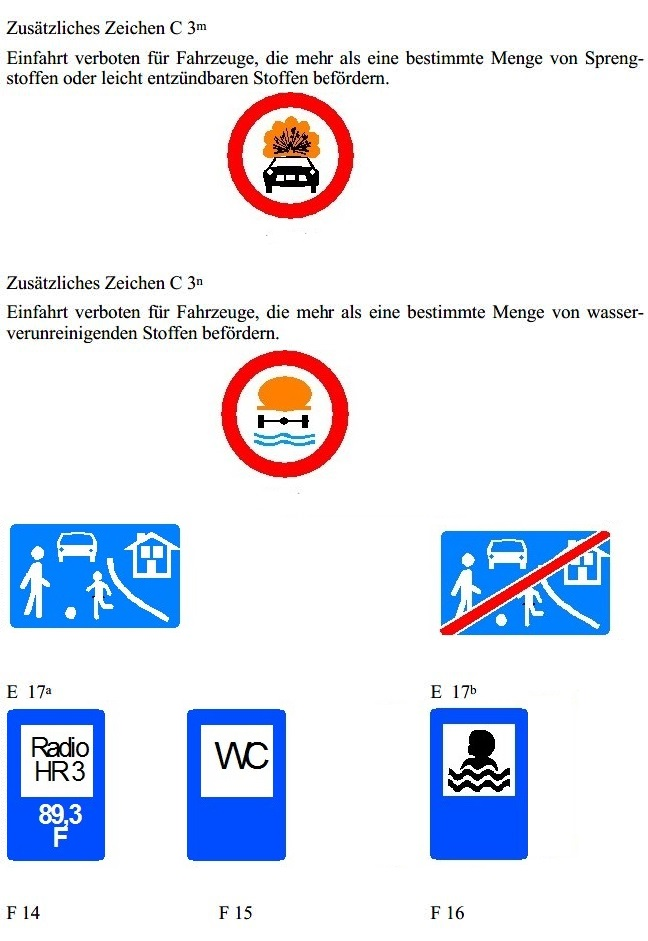

Europäisches Zusatzübereinkommen zum Übereinkommen über Strassenverkehrszeichen, das in Wien am 8. November 1968 zur Unterzeichnung aufgelegt wurde Abgeschlossen in Genf am 1. Mai 1971 Zustimmung des Landtags: 5. Dezember 2019 Inkrafttreten für das Fürstentum Liechtenstein: 2. März 2021 Die Vertragsparteien, die auch Vertragsparteien des am 8. November 1968 in Wien zur Unterzeichnung aufgelegten Übereinkommens über Strassenverkehrszeichen sind, in dem Wunsch, eine grössere Einheitlichkeit der Vorschriften über Strassenverkehrszeichen und Strassenmarkierungen in Europa herbeizuführen, haben folgendes vereinbart: Art. 1 Die Vertragsparteien, die auch Vertragsparteien des am 8. November 1968 in Wien zur Unterzeichnung aufgelegten Übereinkommens über Strassenverkehrszeichen sind, treffen die erforderlichen Massnahmen, damit das in ihrem Hoheitsgebiet geltende System der Strassenverkehrszeichen und Strassenmarkierungen mit den Bestimmungen des Anhangs dieses Zusatzübereinkommens übereinstimmt. Art. 2 1) Dieses Zusatzübereinkommen liegt bis zum 31. Dezember 1972 den Staaten zur Unterzeichnung auf, die das am 8. November 1968 in Wien zur Unterzeichnung aufgelegte Übereinkommen über Strassenverkehrszeichen unterzeichnet haben oder diesem beigetreten sind, und die entweder Mitglied der Wirtschaftskommission für Europa der Vereinten Nationen oder zur Kommission nach Abs. 8 ihres Auftrags in beratender Eigenschaft zugelassen sind. 2) Dieses Zusatzübereinkommen bedarf der Ratifikation, nachdem der Staat das am 8. November 1968 in Wien zur Unterzeichnung aufgelegte Übereinkommen über Strassenverkehrszeichen unterzeichnet hat oder diesem beigetreten ist. Die Ratifikationsurkunden sind beim Generalsekretär der Vereinten Nationen zu hinterlegen. 3) Dieses Zusatzübereinkommen bleibt für jeden der in Abs. 1 erwähnten Staaten zum Beitritt offen, der Vertragspartei des am 8. November 1968 in Wien zur Unterzeichnung aufgelegten Übereinkommens über Strassenverkehrszeichen ist. Die Beitrittsurkunden sind beim Generalsekretär zu hinterlegen. Art. 3 1) Jeder Staat kann bei der Unterzeichnung der Ratifikation, dem Beitritt oder jederzeit danach durch eine an den Generalsekretär gerichtete Notifikation erklären, dass dieses Zusatzübereinkommen auf alle oder einzelne Hoheitsgebiete anwendbar ist, deren internationale Beziehungen er wahrnimmt. Das Zusatzübereinkommen wird in den in der Notifikation genannten Gebieten dreissig Tage nach Eingang der Notifikation beim Generalsekretär anwendbar oder am Tage des Inkrafttretens des Zusatzübereinkommens für den notifizierenden Staat, wenn dieser Tag später ist. 2) Jeder Staat, der nach Abs. 1 eine Erklärung abgegeben hat, kann jederzeit danach durch eine an den Generalsekretär gerichtete Notifikation erklären, dass dieses Zusatzübereinkommen auf das in der Notifikation genannte Hoheitsgebiet keine Anwendung mehr finden soll, und das Zusatzübereinkommen tritt sodann ein Jahr nach dem Eingang dieser Notifikation beim Generalsekretär für das betreffende Hoheitsgebiet ausser Kraft. Art. 4 1) Dieses Zusatzübereinkommen tritt zwölf Monate nach der Hinterlegung der zehnten Ratifikations- oder Beitrittsurkunde in Kraft. 2) Für jeden Staat, der dieses Zusatzübereinkommen nach der Hinterlegung der zehnten Ratifikations- oder Beitrittsurkunde ratifiziert oder ihm beitritt, tritt es zwölf Monate nach Hinterlegung seiner Ratifikations- oder Beitrittsurkunde in Kraft. 3) Liegt der sich aus den Abs. 1 und 2 ergebende Tag des Inkrafttretens vor dem sich aus der Anwendung des Art. 39 des am 8. November 1968 in Wien zur Unterzeichnung aufgelegten Übereinkommens über Strassenverkehrszeichen ergebenden Tag, so tritt dieses Zusatzübereinkommen nach Abs. 1 zu dem letztgenannten Zeitpunkt in Kraft. Art. 5 Im Verhältnis unter den Vertragsparteien hebt dieses Zusatzübereinkommen bei seinem Inkrafttreten die Bestimmungen hinsichtlich des Protokolls über Strassenverkehrszeichen der am 16. September 1950 in Genf unterzeichneten Europäischen Zusatzvereinbarung zum Abkommen über den Strassenverkehr und zum Protokoll über Strassenverkehrszeichen des Jahres 1949, das in Genf am 16. Dezember 1955 unterzeichnete Übereinkommen über die Kennzeichnung der Baustellen und das am 13. Dezember 1957 unterzeichnete Europäische Übereinkommen über Strassenmarkierungen auf und ersetzt sie. Art. 6 1) Ist dieses Zusatzübereinkommen zwölf Monate in Kraft gewesen, so kann jede Vertragspartei eine oder mehrere Änderungen des Zusatzübereinkommens vorschlagen. Der Wortlaut jedes Änderungsvorschlags ist mit einer Begründung dem Generalsekretär mitzuteilen, der ihn allen Vertragsparteien übermittelt. Diese können dem Generalsekretär binnen zwölf Monaten nach dem Tage dieser Übermittlung mitteilen, ob sie: a) die Änderung annehmen; oder b) die Änderung ablehnen; oder c) die Einberufung einer Konferenz zur Prüfung dieser Änderung wünschen. Der Generalsekretär übermittelt den Text der vorgeschlagenen Änderung auch allen anderen in Art. 2 bezeichneten Staaten. 2) a) Jeder Änderungsvorschlag, der nach Abs. 1 übermittelt wurde, gilt als angenommen, wenn während der vorerwähnten Zwölfmonatsfrist weniger als ein Drittel der Vertragsparteien dem Generalsekretär mitteilt, dass sie entweder die Änderung ablehnen oder die Einberufung einer Konferenz zur Prüfung dieser Änderung wünschen. Der Generalsekretär notifiziert allen Vertragsparteien alle Annahmen und Ablehnungen der vorgeschlagenen Änderung und alle Wünsche nach Einberufung einer Konferenz. Wenn die Gesamtzahl der innerhalb der genannten Zwölfmonatsfrist eingegangenen Ablehnungen oder Wünsche nach Einberufung einer Konferenz weniger als ein Drittel aller Vertragsparteien beträgt, notifiziert der Generalsekretär allen Vertragsparteien, dass die Änderung sechs Monate nach Ablauf der im Abs. 1 festgesetzten Zwölfmonatsfrist für alle Vertragsparteien in Kraft tritt, ausgenommen für jene, die binnen der festgesetzten Frist die Änderung abgelehnt oder die Einberufung einer Konferenz zur Prüfung gewünscht haben. b) Jede Vertragspartei, die während der erwähnten Zwölfmonatsfrist einen Änderungsvorschlag abgelehnt oder die Einberufung einer Konferenz zur Prüfung gewünscht hat, kann jederzeit nach Ablauf dieser Frist dem Generalsekretär notifizieren, dass sie die Änderung annimmt; der Generalsekretär übermittelt diese Notifikation allen anderen Vertragsparteien. Die Änderung tritt für die Vertragspartei, die ihre Annahme notifiziert hat, sechs Monate nach Eingang ihrer Notifikation beim Generalsekretär in Kraft. 3) Wenn ein Änderungsvorschlag nicht nach Abs. 2 angenommen wurde und während der im Abs. 1 festgesetzten Zwölfmonatsfrist weniger als die Hälfte der Gesamtzahl der Vertragsparteien dem Generalsekretär notifizieren, dass sie den Vorschlag ablehnen, und wenn wenigstens ein Drittel der Gesamtzahl der Vertragsparteien, aber nicht weniger als fünf, ihm mitteilen, dass sie den Vorschlag annehmen oder dass sie die Einberufung einer Konferenz wünschen, um die Änderung zu prüfen, beruft der Generalsekretär eine Konferenz zur Prüfung der vorgeschlagenen Änderung oder jedes anderen Vorschlags ein, der ihm gegebenenfalls auf Grund von Abs. 4 vorgelegt wird. 4) Wenn nach Abs. 3 eine Konferenz einberufen wird, lädt der Generalsekretär alle Vertragsparteien und die in Art. 2 bezeichneten anderen Staaten dazu ein. Er bittet alle zur Konferenz eingeladenen Staaten, ihm spätestens sechs Monate vor deren Eröffnung alle Vorschläge zu unterbreiten, die sie ausser der vorgeschlagenen Änderung auf der Konferenz geprüft zu sehen wünschen und übermittelt diese Vorschläge mindestens drei Monate vor der Eröffnung der Konferenz allen zur Konferenz eingeladenen Staaten. 5) a) Jede Änderung dieses Zusatzübereinkommens gilt als angenommen, wenn sie durch eine Zweidrittelmehrheit der auf der Konferenz vertretenen Staaten gebilligt wird, sofern diese Mehrheit mindestens zwei Drittel der Gesamtzahl der auf der Konferenz vertretenen Vertragsparteien umfasst. Der Generalsekretär notifiziert allen Vertragsparteien die Annahme der Änderung, und diese tritt für alle Vertragsparteien zwölf Monate nach dem Zeitpunkt dieser Notifizierung in Kraft, ausgenommen für jene, die binnen dieser Frist dem Generalsekretär notifizieren, dass sie die Änderung ablehnen. b) Jede Vertragspartei, die während der erwähnten Zwölfmonatsfrist eine Änderung abgelehnt hat, kann jederzeit dem Generalsekretär notifizieren, dass sie die Änderung annimmt, und der Generalsekretär übermittelt diese Notifikation allen anderen Vertragsparteien. Die Änderung tritt für die Vertragspartei, die ihre Annahme notifiziert hat, sechs Monate nach Eingang der Notifikation beim Generalsekretär oder nach Ablauf der genannten Zwölfmonatsfrist. wenn dieser Zeitpunkt später ist, in Kraft. 6) Gilt der Änderungsvorschlag nach Abs. 2 als nicht angenommen und sind die in Abs. 3 vorgeschriebenen Bedingungen für die Einberufung einer Konferenz nicht erfüllt, so gilt der Änderungsvorschlag als abgelehnt. 7) Unabhängig von dem in den Abs. 1 bis 6 vorgesehenen Änderungsverfahren kann der Anhang dieses Zusatzübereinkommens im Einvernehmen zwischen den zuständigen Verwaltungen aller Vertragsparteien abgeändert werden. Wenn die Verwaltung einer Vertragspartei erklärt hat, dass sie ihr Einverständnis auf Grund ihrer innerstaatlichen Rechtsvorschriften von der Erwirkung einer Sondergenehmigung oder von der Zustimmung eines gesetzgebenden Organs abhängig machen muss, so gilt die Zustimmung der zuständigen Verwaltung der betreffenden Vertragspartei zu der Änderung des Anhangs erst von dem Zeitpunkt ab als gegeben, an dem diese Verwaltung dem Generalsekretär erklärt, dass die erforderlichen Genehmigungen oder Zustimmungen erwirkt wurden. Dieses Übereinkommen zwischen den zuständigen Verwaltungen kann eine Bestimmung vorsehen, nach der die früheren Bestimmungen des Anhangs während einer Übergangsfrist ganz oder teilweise mit den neuen Bestimmungen in Kraft bleiben. Der Generalsekretär setzt den Zeitpunkt des Inkrafttretens der neuen Bestimmungen fest. 8) Jeder Staat notifiziert dem Generalsekretär bei der Unterzeichnung der Ratifikation oder dem Beitritt die Bezeichnung und Anschrift seiner zuständigen Verwaltung für die Abgabe des in Abs. 7 vorgesehenen Einverständnisses. Art. 7 Jede Vertragspartei kann dieses Zusatzübereinkommen durch eine an den Generalsekretär gerichtete schriftliche Notifikation kündigen. Die Kündigung wird ein Jahr nach Eingang der Notifikation beim Generalsekretär wirksam. Jede Vertragspartei, die nicht mehr Vertragspartei des am 8. November 1968 in Wien zur Unterzeichnung aufgelegten Übereinkommens über Strassenverkehrszeichen ist, ist von dem gleichen Zeitpunkt ab auch nicht mehr Vertragspartei dieses Zusatzübereinkommens. Art. 8 Dieses Zusatzübereinkommen tritt ausser Kraft, wenn zu irgendeinem Zeitpunkt die Zahl der Vertragsparteien während zwölf aufeinanderfolgender Monate weniger als fünf beträgt sowie, wenn das am 8. November 1968 in Wien zur Unterzeichnung aufgelegte Übereinkommen über Strassenverkehrszeichen ausser Kraft tritt. Art. 9 1) Jede Streitigkeit zwischen zwei oder mehreren Vertragsparteien über die Auslegung oder Anwendung dieses Zusatzübereinkommens, die die Parteien nicht durch Verhandlungen oder auf andere Weise beilegen konnten, wird auf Antrag einer der streitenden Vertragsparteien einem Schiedsrichter oder mehreren Schiedsrichtern zur Entscheidung vorgelegt, die von den streitenden Parteien im gegenseitigen Einvernehmen ausgewählt werden. Einigen sich die streitenden Parteien nicht innerhalb einer Frist von drei Monaten seit dem Tage des Antrags auf Schiedsverfahren über die Wahl eines Schiedsrichters oder der Schiedsrichter, so kann jede dieser Parteien den Generalsekretär der Vereinten Nationen ersuchen, einen einzigen Schiedsrichter zu benennen, dem der Fall zur Entscheidung vorgelegt wird. 2) Die Entscheidung des nach Abs. 1 bestellten Schiedsrichters oder der nach Abs. 1 bestellten Schiedsrichter ist für die streitenden Vertragsparteien bindend. Art. 10 Dieses Zusatzübereinkommen ist nicht so auszulegen, als hindere es eine Vertragspartei, Massnahmen zu ergreifen, die sie für ihre innere oder äussere Sicherheit als notwendig erachtet und die mit der Charta der Vereinten Nationen vereinbar und auf die Erfordernisse der Lage beschränkt sind. Art. 11 1) Jeder Staat kann bei der Unterzeichnung dieses Zusatzübereinkommens oder bei der Hinterlegung seiner Ratifikations- oder Beitrittsurkunde erklären, dass er sich durch Art. 9 nicht als gebunden betrachtet. Die anderen Vertragsparteien sind gegenüber einer Vertragspartei, die eine solche Erklärung abgegeben hat, durch Art. 9 nicht gebunden. 2) Andere Vorbehalte zu diesem Zusatzübereinkommen als die nach Abs. 1 sind zulässig, wenn sie schriftlich erklärt und, wenn sie vor der Hinterlegung der Ratifikations- oder Beitrittsurkunde erklärt wurden, in dieser Urkunde bestätigt werden. 3) Jeder Staat teilt bei der Hinterlegung seiner Ratifikations- oder Beitrittsurkunde dem Generalsekretär schriftlich mit, inwieweit die von ihm zu dem am 8. November 1968 in Wien zur Unterzeichnung aufgelegten Übereinkommen über Strassenverkehrszeichen auf dieses Zusatzübereinkommen Anwendung finden. Jene dieser Vorbehalte, die nicht Gegenstand einer Notifikation bei der Hinterlegung der Ratifikations- oder Beitrittsurkunde zu diesem Zusatzübereinkommen gewesen wären, gelten als nicht anwendbar auf dieses Zusatzübereinkommen. 4) Der Generalsekretär teilt die in Anwendung dieses Artikels gemachten Vorbehalte und abgegebenen Notifikationen allen in Art. 2 dieses Zusatzübereinkommens bezeichneten Staaten mit. 5) Jeder Staat, der nach diesem Artikel einen Vorbehalt gemacht oder eine Erklärung oder Notifikation abgegeben hat, kann diese jederzeit durch eine an den Generalsekretär gerichtete Notifikation zurückziehen. 6) Jeder nach Abs. 2 gemachte oder nach Abs. 3 notifizierte Vorbehalt a) ändert für die Vertragspartei, die diesen Vorbehalt gemacht oder notifiziert hat, die Bestimmungen des Zusatzübereinkommens, auf die sich der Vorbehalt bezieht, nur in den Grenzen des Vorbehalts; b) ändert diese Bestimmungen in den gleichen Grenzen für die anderen Vertragsparteien hinsichtlich ihrer Beziehungen zu der Vertragspartei, die den Vorbehalt gemacht oder notifiziert hat. Art. 12 Ausser den nach den Art. 6 und 11 vorgesehenen Erklärungen, Notifikationen und Mitteilungen notifiziert der Generalsekretär den in Art. 2 Abs. 1 bezeichneten Vertragsparteien und anderen Staaten a) die Unterzeichnungen, Ratifikationen und Beitritte nach Art. 2; b) die Notifikationen und Erklärungen nach Art. 3; c) die Zeitpunkte des Inkrafttretens dieses Zusatzübereinkommens nach Art. 4; d) den Zeitpunkt des Inkrafttretens von Änderungen zu diesem Zusatzübereinkommen nach Art. 6 Abs. 2, 5 und 7; e) die Kündigungen nach Art. 7; f) das Ausserkrafttreten dieses Zusatzübereinkommens nach Art. 8. Art. 13 Nach dem 31. Dezember 1972 wird die Urschrift dieses Zusatzübereinkommens beim Generalsekretär der Vereinten Nationen hinterlegt, der allen in Art. 2 bezeichneten Staaten beglaubigte Abschriften übersendet. Zu Urkund dessen haben die von ihren Regierungen gehörig befugten Unterzeichneten dieses Zusatzübereinkommen unterschrieben. Geschehen zu Genf am ersten Mai neunzehnhunderteinundsiebzig in einer einzigen Urschrift in englischer, französischer und russischer Sprache, wobei jeder Wortlaut gleichermassen verbindlich ist. (Es folgen die Unterschriften) Anhang 1. Im Sinne dieses Anhangs ist "Übereinkommen" das am 8. November 1968 in Wien zur Unterzeichnung aufgelegte Übereinkommen über Strassenverkehrszeichen. 2. Dieser Anhang enthält nur Zusätze und Änderungen zu den entsprechenden Bestimmungen des Übereinkommens. 3. Zu Art. 1 des Übereinkommens (Begriffsbestimmungen) Bst. b: Dieser Buchstabe lautet: "Ortschaft ist ein Gebiet, das bebaute Grundstücke umfasst und dessen Ein- und Ausfahrten als solche gekennzeichnet sind;" Zusätzlicher Buchstabe, der unmittelbar nach Bst. b einzufügen ist: Dieser Buchstabe lautet: "Verkehrsberuhigter Wohnbereich ist ein besonderes Gebiet, in dem besondere Verkehrsregeln gelten und das an seinen Ein- und Ausfahrten als solches besonders gekennzeichnet ist." Bst. l: Dreirädrige Fahrzeuge mit einem Leergewicht von nicht mehr als 400 kg (900 Pfund) sind den Krafträdern gleichgestellt. Zusätzlicher Buchstabe, der am Ende dieses Artikels anzufügen ist: Dieser Buchstabe lautet: "Den Fussgängern gleichgestellt sind Personen, die einen Kinderwagen, einen Krankenfahrstuhl oder ein anderes Kleinfahrzeug ohne Motor schieben oder ziehen, die zu Fuss gehend ein Fahrrad oder ein Motorfahrrad schieben sowie Körperbehinderte, die in einem Krankenfahrstuhl fahren, der von ihnen selbst angetrieben wird oder der mit Schrittgeschwindigkeit fährt." 4. Zu Art. 3 des Übereinkommens (Verpflichtungen der Vertragsparteien) Abs. 3 Dieser Absatz lautet: "Alle dem im Übereinkommen oder im Zusatzübereinkommen festgelegten System nicht entsprechenden Zeichen, Symbole, Einrichtungen oder Markierungen sind innerhalb von zehn Jahren nach dem Inkrafttreten des Zusatzübereinkommens zu ersetzen. Im Laufe dieses Zeitraums und um die Verkehrsteilnehmer an das im Übereinkommen und im Zusatzübereinkommen festgelegte System zu gewöhnen, können die bisherigen Zeichen und Symbole und Aufschriften neben den im Übereinkommen oder im Zusatzübereinkommen vorgesehenen beibehalten werden." 5. Zu Abs. 6 des Übereinkommens Abs. 4: Die Bestimmungen dieses Absatzes, die im Übereinkommen Empfehlungen sind, sind verbindlich. 6. Zu Art. 7 des Übereinkommens Abs. 1: Zusätzlicher Satz, der am Ende dieses Absatzes anzufügen ist: Dieser Satz lautet: "Ferner wird hinsichtlich dieser Zeichen empfohlen, beleuchtete oder mit rückstrahlenden Stoffen oder Vorrichtungen versehene Zeichen nicht auf einem Strassenabschnitt neben Zeichen zu verwenden, die nicht so beschaffen sind." 7. Zu Art. 8 des Übereinkommens Abs. 3: Dieser Absatz lautet: "Während des zehnjährigen Übergangszeitraums nach Nummer 4 dieses Anhanges zum Zusatzübereinkommen sowie danach in Ausnahmefällen, kann eine Aufschrift auf einem rechteckigen Schild unter den Zeichen oder auf einem rechteckigen Schild, das das Zeichen enthält, hinzugefügt werden, um die Verständlichkeit der Zeichen zu erleichtern; eine solche Aufschrift kann auch auf das Zeichen selbst gesetzt werden, sofern seine Verständlichkeit für die Führer nicht beeinträchtigt wird, die die Aufschrift nicht verstehen können." 8. Zu Art. 9 des Übereinkommens Abs. 1: Jeder Staat wählt das Muster Aa als Gefahrenwarnzeichen. 9. Zu Art. 10 des Übereinkommens (Vorfahrtzeichen) Abs. 3: Jeder Staat wählt das Muster B 2a für das Zeichen "Halt". Abs. 6: Die Vorankündigung des Zeichens B 1 erfolgt mit demselben Zeichen, ergänzt durch ein Zusatzschild nach Muster H 1 des Anhangs 1 Abschnitt H des Übereinkommens. Die Vorankündigung des Zeichens B 2a erfolgt mit dem Zeichen B 1, das durch ein rechteckiges Schild mit dem Symbol "Stop" und einer Zahl ergänzt wird, die die Entfernung vom Zeichen B 2a anzeigt. 9 bis . Zu Art. 13 bis des Übereinkommens (Besondere Vorschriftzeichen) Abs. 2: Dieser Absatz lautet: "Die Zeichen E 7a, E 7" oder E 7c und E 8a, E 8b oder E 8c zeigen den Verkehrsteilnehmern die allgemeine Verkehrsregelung an, die im Hoheitsgebiet des Staates in den Ortschaften von den Zeichen E 7a, E 7" oder E 7c bis zu den Zeichen E 8a, E 8b oder E 8c gilt, soweit nicht durch andere Zeichen auf bestimmten Strassenabschnitten der Ortschaft eine andere Regelung angezeigt worden ist. Sie enthalten Aufschriften in dunkler Farbe auf weissem oder hellem Grund und werden jeweils an den Ortseingängen und Ortsausgängen aufgestellt. Das Zeichen B 4 muss jedoch immer aufgestellt werden, wenn auf den mit dem Zeichen B 3 gekennzeichneten Vorfahrtstrassen die Vorfahrt bei der Durchfahrt innerhalb dieser Ortschaft endet." 10. Zu Art. 18 des Übereinkommens (Ortshinweistafeln) Die Ortshinweistafeln müssen Aufschriften in weisser oder heller Farbe auf dunklem Grund enthalten. 11. Zu Art. 23 des Übereinkommens (Zeichen für die Regelung des Fahrzeugverkehrs) Zusätzlicher Absatz, der unmittelbar nach Abs. 11 einzufügen ist: Dieser Absatz lautet: "In besonderen Fällen, wenn die ständige Verwendung von Lichtzeichen nicht notwendig ist, kann ein aus einem nichtblinkenden gelben Licht bestehendes Zeichen, dem ein nichtblickendes rotes Licht folgt, verwendet werden; dem nichtblinkenden gelben Zeichen kann ein gelbes Blinklicht vorangehen." 12. Zu Art. 24 des Übereinkommens (Nur für Fussgänger bestimmte Zeichen) Abs. 1, Bst. a Ziff. ii: Diese Bestimmung wird nicht angewendet. Abs. 2: Dieser Absatz lautet: "Für Fussgänger sind Lichtzeichen des Zwei-Farben-Systems mit zwei Lichtern, rot und grün, zu verwenden. Es dürfen niemals zwei Lichter gleichzeitig aufleuchten." Abs. 3: Dieser Absatz lautet: "Die Lichter sind senkrecht untereinander anzuordnen, wobei das rote Licht immer oben und das grüne Licht immer unten ist. Das rote Licht hat die Form eines stehenden Fussgängers oder stehender Fussgänger und das grüne Licht die Form eines gehenden Fussgängers oder gehender Fussgänger." 13. Zu Art. 31 des Übereinkommens (Kennzeichnung der Baustellen) Abs. 2: Die Schranken dürfen nicht mit schwarzen und weissen oder schwarzen und gelben Streifen bemalt sein. 14. Zu Art. 32 des Übereinkommens (Kennzeichnung durch Lichter oder Rückstrahlvorrichtungen) Dieser Artikel lautet: "1) Es wird empfohlen, Grenzsteine oder Verkehrsinseln auf der Fahrbahn durch weisse oder gelbe Lichter oder Rückstrahlvorrichtungen anzuzeigen. 2) Wenn die Fahrbahnränder durch Lichter oder Rückstrahlvorrichtungen gekennzeichnet sind, müssen diese ausnahmslos a) weiss oder hellgelb oder b) weiss oder hellgelb zur Kennzeichnung des der Verkehrsrichtung gegenüberliegenden Fahrbahnrandes und rot oder dunkelgelb zur Kennzeichnung des der Verkehrsrichtung entsprechenden Fahrbahnrandes sein. 3) Jede Vertragspartei des Zusatzübereinkommens hat für ihr gesamtes Hoheitsgebiet dieselbe Farbe oder dasselbe Farbensystem für die in diesem Artikel genannten Lichter oder Rückstrahlvorrichtungen anzunehmen." 15. Zu Art. 33 des Übereinkommens (Bahnübergänge) Abs. 1 Bst. a: Dieser Buchstabe lautet: "Wenn an einem Bahnübergang eine Warnanlage angebracht ist, um die Annäherung der Züge oder das unmittelbar bevorstehende Schliessen der Schranken oder Halbschranken anzuzeigen, muss sie aus einem roten Blinklicht oder aus abwechselnd blinkenden roten Lichtern bestehen, wie es in Art. 23 Abs. 1 Bst. b des Übereinkommens vorgesehen ist. An Bahnübergängen, die weder Schranken noch Halbschranken haben, soll die Warnanlage vorzugsweise aus zwei abwechselnd blinkenden roten Lichtern bestehen. Jedoch i) können die roten Blinklichter durch ein in Art. 23 Abs. 2 des Übereinkommens beschriebenen Lichtzeichen des Drei-Farben-Systems (rot, gelb, grün) oder durch ein solches Zeichen, in dem das grüne Licht fehlt, ergänzt oder ersetzt werden, wenn sich an der Strasse kurz vor dem Bahnübergang andere Drei-Farben-Lichtzeichen befinden oder wenn der Bahnübergang mit Schranken versehen ist. An Bahnübergängen mit Halbschranken dürfen die roten Blinklichter nicht auf die im vorangehenden Satz beschriebene Art ersetzt werden; sie dürfen jedoch so ergänzt werden, wenn sich andere Drei-Farben-Lichtzeichen an der Strasse kurz vor dem Bahnübergang befinden; ii) kann an Feldwegen, wo der Verkehr sehr gering ist, und an Wegen für Fussgänger nur ein akustisches Zeichen verwendet werden." Abs. 2: Dieser Absatz lautet: "Die Lichtzeichen sind an dem der Verkehrsrichtung entsprechenden Fahrbahnrand aufzustellen; wenn die Umstände - beispielsweise die Sichtbarkeit der Zeichen oder die Verkehrsdichte - es verlangen, sind die Lichter auf der anderen Strassenseite zu wiederholen. Wenn es jedoch auf Grund der örtlichen Verhältnisse zweckmässig ist, können die Lichter über die Fahrbahn oder auf einer Verkehrsinsel in der Fahrbahn wiederholt werden." 16. Zu Art. 35 des Übereinkommens Abs. 1: Die Schranken und Halbschranken der Bahnübergänge dürfen nicht mit schwarzen und weissen oder schwarzen und gelben Streifen gekennzeichnet sein. 17. Zu Anhang 1 Abschnitt A Unterabschnitt II des Übereinkommens Nummer 2 (Gefährliches Gefälle): Diese Nummer lautet: "a) Um ein starkes Gefälle anzuzeigen, ist das Symbol A 2a zu verwenden. b) Der linke Teil des Symbols A 2a füllt die linke Ecke des Schildes aus; seine Grundlinie erstreckt sich über die gesamte Breite des Schildes; die Zahl bezeichnet das Gefälle in Prozenten." Nummer 3 (Starke Steigung): Diese Nummer lautet: "a) Um eine starke Steigung anzuzeigen, ist das Symbol A 3a zu verwenden. b) Der rechte Teil des Symbols A 3a füllt die rechte Ecke des Schildes aus; seine Grundlinie erstreckt sich über die gesamte Breite des Schildes; die Zahl bezeichnet die Steigung in Prozenten." Nummer 12 (Fussgängerüberweg): Diese Nummer lautet: "a) Um einen Fussgängerüberweg anzuzeigen, ist das Symbol A 12a zu verwenden. b) Das Symbol kann umgekehrt werden." Nummer 18 (Kreuzung, an der die Vorfahrt durch die allgemein geltende Regel bestimmt wird): Diese Nummer lautet: "Um eine Kreuzung anzuzeigen, an der die Vorfahrt durch die in dem betreffenden Land allgemein geltende Regel bestimmt wird, ist das Symbol A 18a zu verwenden." Nummer 20 (Kreuzung mit einer Strasse, deren Benutzer Vorfahrt haben): Diese Nummer lautet: "In diesem Fall sind die Zeichen B 1 oder B 2a nach Nummer 9 dieses Anhangs zum Zusatzübereinkommen zu verwenden." Nummer 22 (Kreuzung, an der der Verkehr durch Lichtzeichen geregelt wird): Diese Nummer lautet: "Falls der Verkehr an der Kreuzung durch Lichtzeichen geregelt wird, kann ergänzend oder an der Stelle der in den Nummern 18 bis 21 beschriebenen Zeichen ein Zeichen Aa mit dem in Nummer 17 beschriebenen Symbol A 17 aufgestellt werden." Nummer 26 (andere Bahnübergänge): Bst. b: Dieser Buchstabe lautet: "Um andere Bahnübergänge anzuzeigen, ist je nach Fall das Symbol A 26a oder das Symbol A 27 zu verwenden." Nummer 28 (Zeichen in unmittelbarer Nähe der Bahnübergänge): Das Muster A 28c des Zeichens A 28 wird nicht verwendet. Die Muster A 28a und A 28b können rote Streifen zeigen, wenn dadurch weder das allgemeine Erscheinungsbild noch die Wirksamkeit der Zeichen beeinträchtigt wird. 18. Zu Anhang 1 Abschnitt B des Übereinkommens Nummer 1 (Zeichen "Vorfahrt gewähren"): Das Zeichen B 1 trägt weder Symbol noch Aufschrift. Nummer 2 (Zeichen "Halt"): Diese Nummer lautet: "Das Zeichen "Halt" ist das Zeichen B 2 Muster B 2a. Das Zeichen B 2 Muster B 2a ist achteckig mit rotem Grund und schmalem weissem oder hellgelbem Rand und enthält das Symbol "Stop" in Weiss oder Hellgelb; die Höhe des Symbols beträgt mindestens ein Drittel der Höhe des Schildes. Die Höhe des Zeichens B 2a im Normalformat beträgt etwa 0,90 m; bei Zeichen im Kleinformat beträgt sie nicht weniger als 0,60 m." 19. Zu Anhang 1 Abschnitt C Unterabschnitt II des Übereinkommens Nummer 1 (Verkehrsverbote und Verkehrsbeschränkungen): Das Muster C 1b des Zeichens C 1 wird nicht verwendet. Die beiden in der Anlage dieses Anhangs zum Zusatzübereinkommen wiedergegebenen Zeichen C 3m und C 3n, die die folgende Bedeutung haben, können verwendet werden: C 3m "Einfahrt verboten für Fahrzeuge, die mehr als eine bestimmte Menge von Sprengstoffen oder leicht entzündbaren Stoffen befördern" C 3n "Einfahrt verboten für Fahrzeuge, die mehr als eine bestimmte Menge von wasserverunreinigenden Stoffen befördern". Die Anmerkung am Ende des Bst. c lautet: "Die Zeichen C 3a bis C 3l sowie die vorgenannten Zeichen C 3m und C 3n dürfen keinen roten Schrägbalken enthalten." Nummer 4 (Überholverbot): Die Muster C 13ab und C 13bb der Zeichen C 13a und C 13b werden nicht verwendet. Nummer 9 Bst. a Ziff. ii: Diese Bestimmung wird nicht angewendet. Nummer 9 Bst. b Ziff. iii: Diese Bestimmung wird nicht angewendet. Nummer 9 Bst. c Ziff. v: Die Möglichkeit, dort, wo sich das Verbot nur auf eine bestimmte kurze Strecke bezieht, nur ein Zeichen mit einem roten Kreis aufzustellen, in dem die Länge der Verbotsstrecke angegeben ist, wird nicht genutzt. 20. Zu Anhang 1 Abschnitt D Unterabschnitt I des Übereinkommens Nummer 2: Diese Nummer lautet: "Wenn nichts anderes bestimmt ist, sind die Zeichen blau, die Symbole weiss oder von heller Farbe." 21. Zu Anhang 1 Abschnitt D Unterabschnitt II des Übereinkommens Nummer 1 (Vorgeschriebene Fahrtrichtung): Das Zeichen D 1b wird nicht verwendet. 22. Zu Anhang 1 Abschnitt E Unterabschnitt II des Übereinkommens Nummer 3 (Zeichen "Einbahnstrasse"), Bst. a Ziff. ii: Der Pfeil des Zeichens E 3b darf nur dann eine Aufschrift enthalten, wenn seine Wirksamkeit dadurch nicht beeinträchtigt wird. Nummer 5 (Zeichen, die die Zufahrt zu oder die Ausfahrt aus einer Autobahn anzeigen): Zusätzlicher Absatz, der unmittelbar nach dem Bst. a einzufügen ist: Dieser Absatz lautet: "Das Zeichen E 5a kann verwendet und wiederholt werden, um die Annäherung an eine Autobahn anzukündigen; jedes so verwendete Zeichen muss entweder in seinem unteren Teil die Entfernung zwischen seinem Aufstellungspunkt und dem Beginn der Autobahn angeben oder mit einem Zusatzschild des Musters H 1 nach Anhang 1 Abschnitt H des Übereinkommens versehen sein." Nummer 6 (Zeichen, die die Einfahrt zu oder die Ausfahrt aus einer Strasse anzeigen, wo die Verkehrsvorschriften die gleichen sind wie auf einer Autobahn): Zusätzlicher Absatz, der unmittelbar nach dem Bst. a dieser Nummer einzufügen ist: Dieser Absatz lautet: "Das Zeichen E 6a kann verwendet und wiederholt werden, um die Annäherung an eine Strasse anzukündigen, wo die Verkehrsvorschriften die gleichen sind wie auf einer Autobahn; jedes so verwendete Zeichen muss entweder in seinem unteren Teil die Entfernung zwischen seinem Aufstellungspunkt und dem Beginn der Strasse anzeigen, wo die Verkehrsvorschriften die gleichen sind wie auf einer Autobahn, oder mit einem Zusatzschild des Musters H 1 nach Anhang 1 Abschnitt H des Übereinkommens versehen sein." Nummer 7 (Zeichen, das den Beginn und das Ende einer Ortschaft anzeigt): Diese Nummer lautet: "a) Das Zeichen, das den Beginn einer Ortschaft anzeigt, trägt den Namen der Ortschaft oder das Symbol mit der Silhouette einer Ortschaft oder beides zusammen. Die Zeichen enthalten Aufschriften in dunkler Farbe auf weissem oder hellem Grund sowie einen dunklen Rand. Die Zeichen E 7a, E 7b und E 7c sind Beispiele für Zeichen, die den Beginn einer Ortschaft anzeigen. b) Das Zeichen, das das Ende einer Ortschaft anzeigt, ist identisch, ausser dass es einen roten Schrägbalken oder parallele rote Linien aufweist, die von der oberen rechten Ecke zur unteren linken Ecke verlaufen. Die Zeichen E 8a, E 8b und E 8c sind Beispiele für Zeichen, die das Ende einer Ortschaft ankündigen. c) Abweichend von Art. 6 Abs. 1 können diese Zeichen auf der Rückseite der Tafeln angebracht werden, die den Beginn der Ortschaft anzeigen. Die unter diesen Abschnitt fallenden Zeichen werden gemäss Art. 13 bis Abs. 2 verwendet." Nummer 10 (Fussgängerüberweg): Das Zeichen E 12b wird nicht verwendet. Nummer 12 (Zeichen "Parken"): Das im ersten Absatz dieser Nummer genannte quadratische Schild trägt den Bst. "P". Zusätzlicher Text, der am Ende dieser Nummer eingefügt wird: Zusätzlicher Absatz, der unmittelbar nach Nummer 13 eingefügt wird: Dieser Absatz lautet: "Zeichen, die die Einfahrt oder die Ausfahrt aus einem Wohngebiet mit besonderer Verkehrsregelung anzeigen Das Zeichen E 17a "Verkehrsberuhigter Wohnbereich" ist an der Stelle aufzustellen, von der an die besonderen Verkehrsvorschriften gelten, die in einem verkehrsberuhigten Wohnbereich zu beachten sind und auf die Art. 27 bis des Übereinkommens über Strassenverkehrszeichen, in der Fassung des Europäischen Zusatzübereinkommens ergänzt wird, Bezug nimmt. Das Zeichen E 17b "Ende des verkehrsberuhigten Wohnbereichs" ist an der Stelle aufzustellen, von der an diese Vorschriften nicht mehr gelten." 23. Zu Anhang 1 Abschnitt F Unterabschnitt II des Übereinkommens Nummer 1 (Symbol "Erste Hilfe"): Die Symbole F 1b und F 1c werden nicht verwendet. Nummer 2 (Verschiedene Symbole): Am Ende des Textes ist einzufügen: Zusätzliche Symbole, die am Ende dieses Absatzes einzufügen sind: F 14 "Rundfunkstationen, die Verkehrsinformationen senden" Aufschrift auf weissem Quadrat : Unter dem Wort "Radio" kann, erforderlichenfalls in abgekürzter Form, auf den Namen oder das Kürzel des Senders und die Nummer des Programms hingewiesen werden. Das Wort "Radio" kann auch in der Landessprache wiederholt werden. Aufschrift auf blauem Grund : Angabe der Frequenz und, wenn erforderlich, der Wellenlänge des lokalen Rundfunksenders. Es bleibt den Ländern überlassen, ob sie im Fall von UKW-Stationen den Hinweis "MHz" oder den regionalen Code und im Fall von Stationen auf Mittel- oder Langwelle den Hinweis "kc/s" hinzufügen wollen. Die Wellenlänge kann in Zahlen mit dem Bst. m (z. B. 1500 m) angegeben werden. F 15 "Öffentliche Toiletten" F 16 "Strand oder Schwimmbad" 24. Zu Anhang 1 Abschnitt G Unterabschnitt II des Übereinkommens Nummer 2 (Sonderfälle), Bst. a: Der rote Balken der Zeichen G 2a und G 2b ist mit einem schmalen weissen Rand zu versehen. 25. Zu Anhang 1 Abschnitt G Unterabschnitt III des Übereinkommens Nummer 1: Das Zeichen G 4c wird nicht verwendet. Nummer 2: Das Zeichen G 6c wird nicht verwendet. 26. Zu Anhang 1 Abschnitt G Unterabschnitt V des Übereinkommens Nummer 3 (Zeichen "Sackgasse"): Der rote Balken des Zeichens G 13 ist mit einem weissen Rand zu versehen. 27. Zu Anhang 1 Abschnitt H des Übereinkommens Zusätzlicher Absatz, der unmittelbar nach Nummer 1 einzufügen ist: Dieser Absatz lautet: "Der Grund der Zusatzschilder sollte vorzugsweise dem Grund der einzelnen Zeichengruppen entsprechen, mit denen sie verwendet werden." Anlage zum Anhang 

 Vorbehalte des Fürstentums Liechtenstein Zu Ziff. 9 des Anhangs (Art. 10 Abs. 6 des Übereinkommens): Liechtenstein behält sich das Recht vor, durch nationales Recht zur Vorankündigung des Zeichens B 2a das gleiche Zeichen, verbunden mit einem Zusatzschild gemäss Anhang 1 Abschnitt H, Muster H 1 vorzusehen. Zu Ziff. 9 bis und 22 des Anhangs (Art. 13 bis und Anhang 1 Abschnitt E Unterabschnitt II Nummer 7 des Übereinkommens): Liechtenstein betrachtet sich nicht an die Ziff. 9 bis und 22 des Anhangs gebunden. Zu Ziff. 12 des Anhangs (Art. 24 Abs. 2 des Übereinkommens): Liechtenstein behält sich das Recht vor, durch nationales Recht für Fussgängerlichtzeichen das Drei-Farben-System nach Art. 24 Abs. 2 des Übereinkommens vorzusehen. Geltungsbereich des Übereinkommens am 2. März 2021 Vertragsstaaten Hinterlegung der Beitritts- oder Ratifikationsurkunde Albanien 06.06.2005 Aserbaidschan 11.07.2011 Belarus 17.12.1974 Belgien 16.11.1988 Bosnien und Herzegowina 12.01.1994 Bulgarien 28.12.1978 Dänemark 03.11.1986 Deutschland 03.08.1978 Estland 30.11.1993 Finnland 01.04.1985 Frankreich 16.01.1974 Georgien 15.05.2001 Griechenland 18.12.1986 Italien 07.02.1997 Kasachstan 07.06.2011 Lettland 21.11.2001 Liechtenstein 02.03.2020 Litauen 31.01.1992 Luxemburg 25.11.1975 Montenegro 23.10.2006 Niederlande 08.11.2007 Nordmazedonien 20.12.1999 Österreich 11.08.1981 Polen 23.08.1984 Republik Moldau 27.10.2015 Rumänien 09.12.1980 Russische Föderation 27.09.1974 Schweden 25.07.1985 Schweiz 11.12.1991 Serbien 12.03.2001 Slowakei 28.05.1993 Tschechische Republik 02.06.1993 Ukraine 30.12.1974 Ungarn 16.03.1976 Zypern 16.08.2016
