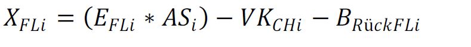
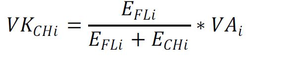
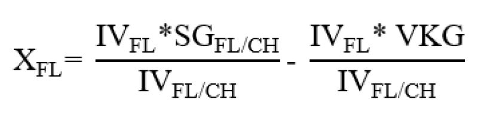

Vereinbarung zum Vertrag zwischen dem Fürstentum Liechtenstein und der Schweizerischen Eidgenossenschaft betreffend die Umweltabgaben im Fürstentum Liechtenstein Abgeschlossen in Bern am 29. Januar 2010 Zustimmung des Landtags: 16. Dezember 2009 Vorläufig angewendet seit 1. Februar 2010 Inkrafttreten: 14. April 2011 Die Regierung des Fürstentums Liechtenstein und der Schweizerische Bundesrat haben zur Durchführung des Vertrags zwischen dem Fürstentum Liechtenstein und der Schweizerischen Eidgenossenschaft betreffend die Umweltabgaben im Fürstentum Liechtenstein Folgendes vereinbart: Kapitel I Allgemeine Bestimmungen Art. 1 Anwendbares Recht 1) Liechtenstein übernimmt im Sinne der nachstehenden Bestimmungen die Vorschriften der schweizerischen Bundesgesetzgebung über die Umweltabgaben in sein Landesrecht. 2) Die massgebliche schweizerische Bundesgesetzgebung betreffend die Umweltabgaben ist in der Anlage I zu dieser Vereinbarung aufgeführt. Anlage II enthält diejenige schweizerische Bundesgesetzgebung, welche im Zusammenhang mit den Umweltabgaben in Liechtenstein direkt anwendbar ist. Änderungen der in den Anlagen genannten schweizerischen Bundesgesetzgebung teilt die Schweiz Liechtenstein auf diplomatischem Wege mit. 3) Die zuständigen schweizerischen Bundesbehörden informieren die zuständigen liechtensteinischen Behörden rechtzeitig über die Einführung neuer Umweltabgaben in der Schweiz und die entsprechende Bundesgesetzgebung, welche allenfalls in die Anlagen I und II zu dieser Vereinbarung aufzunehmen sind. 4) Die zuständigen liechtensteinischen Behörden informieren die zuständigen schweizerischen Bundesbehörden rechtzeitig über bevorstehende Änderungen der liechtensteinischen Gesetzgebung bezüglich die Umweltabgaben sowie über geplante neue Umweltabgaben, welche sich aufgrund der Teilnahme Liechtensteins im EWR ergeben. 5) Zur Gewährleistung der einheitlichen Anwendung der Gesetzgebung über die Umweltabgaben sieht Liechtenstein für strafbare Handlungen gegen deren Bestimmungen zumindest ein dem schweizerischen Recht vergleichbares Strafmass vor. Art. 2 Vollzug 1) Die gemäss der in den Anlagen aufgeführten Bundesgesetzgebung zuständigen schweizerischen Bundesbehörden vollziehen im Namen und Auftrag Liechtensteins die Gesetzgebung über die Umweltabgaben auf dessen Gebiet. Abs. 2 bleibt vorbehalten. Sie wenden dabei die massgebliche materielle liechtensteinische Gesetzgebung, jedoch das massgebliche schweizerische Verfahrensrecht an. Die Rechtsmittel richten sich nach der schweizerischen Bundesgesetzgebung. 2) Die zuständigen liechtensteinischen Behörden vollziehen die Gesetzgebung analog zu den Zuständigkeiten der entsprechenden Behörden der Schweizer Kantone sowie für den Bereich der CO 2 -Abgabe, für den Bereich der Sanktion für Betreiber mit einer Verminderungsverpflichtung 2025-2040 und für den Bereich der Sanktion zur Verminderung der CO 2 -Emissionen von Personenwagen, von Lieferwagen und leichten Sattelschleppern sowie von schweren Fahrzeugen die Bestimmungen über die Verteilung und Verwendung der Erträge. 3) Widerhandlungen gegen die aufgrund dieser Vereinbarung erlassene liechtensteinische Gesetzgebung werden gemäss der massgeblichen liechtensteinischen Gesetzgebung von den zuständigen schweizerischen Bundesbehörden und von den zuständigen liechtensteinischen Behörden verfolgt und beurteilt. Sie wenden dabei das massgebliche schweizerische beziehungsweise liechtensteinische Verfahrensrecht an. Die Rechtsmittel richten sich dabei nach dem jeweiligen Recht. Kapitel II Umweltabgaben ohne Abgaben zur Reduktion der CO 2 -Emissionen Art. 3 Entschädigung des Vollzugsaufwands Die liechtensteinischen Behörden werden für ihren Aufwand beim Vollzug der Gesetzgebung über die Umweltabgaben wie die Schweizer Kantone entschädigt. Art. 4 Verteilung der Erträge aus den Umweltfinanzierungsabgaben 1) Die in den Hoheitsgebieten der beiden Vertragsstaaten und an der Zollgrenze eingenommenen Erträge aus den Umweltfinanzierungsabgaben werden einem von der Schweizerischen Eidgenossenschaft zu errichtenden Pool zugeführt. 2) Jeder der beiden Vertragsstaaten erhält aus dem Pool Abgeltungen für Leistungen, die gemäss den Bestimmungen der Gesetzgebung des jeweiligen Vertragsstaates abgeltungsberechtigt sind. Art. 5 Verteilung der Erträge aus den Umweltlenkungsabgaben 1) Die in den Hoheitsgebieten der beiden Vertragsstaaten und an der Zollgrenze eingenommenen Erträge aus den Umweltlenkungsabgaben werden einem von der Schweizerischen Eidgenossenschaft zu errichtenden Pool zugeführt. 2) Jeder der beiden Vertragsstaaten erhält aus dem Pool jährlich den Anteil am Nettoertrag aus den Umweltlenkungsabgaben, der dem Verhältnis der Einwohnerzahl des jeweiligen Staates zur Gesamtzahl der Einwohner beider Staaten nach der jeweils letzten Volkszählung entspricht. 3) Als Nettoertrag gilt der Ertrag nach Abzug der Rückerstattungen und der Vollzugskosten des Bundesamts für Zoll und Grenzsicherheit (BAZG) und der anderen Vollzugsbehörden. Kapitel III Besondere Bestimmungen zu den Abgaben zur Reduktion der CO 2 -Emissionen Art. 5a Verteilung der Erträge aus der Sanktion zur Verminderung der CO 2 -Emissionen von Personenwagen, von Lieferwagen und leichten Sattelschleppern sowie von schweren Fahrzeugen 1) Die in den Hoheitsgebieten der beiden Vertragsstaaten anfallenden Erträge aus der Sanktion zur Verminderung der CO 2 -Emissionen von Personenwagen, von Lieferwagen und leichten Sattelschleppern sowie von schweren Fahrzeugen werden einem von der Schweizerischen Eidgenossenschaft zu errichtenden Pool zugeführt. 2) Liechtenstein erhält aus dem Pool jährlich den Anteil, der sich aus der Berechnungsformel nach Anlage IV zu dieser Vereinbarung ergibt. Allfällig nötige Korrekturen aufgrund der erst nach Buchungsschluss des Erhebungsjahres vorliegenden Schlussabrechnungen werden mit dem Anteil des Folgejahres verrechnet. Art. 5b Geltungsbereich der Bestimmungen zur Verminderung der CO 2 -Emissionen von Personenwagen, von Lieferwagen und leichten Sattelschleppern sowie von schweren Fahrzeugen Bei der Anwendung der schweizerischen Bestimmungen zur Verminderung der CO 2 -Emissionen von Personenwagen, von Lieferwagen und leichten Sattelschleppern sowie von schweren Fahrzeugen gilt der Import nach Liechtenstein als Import in die Schweiz und das Inverkehrsetzen in Liechtenstein als Inverkehrsetzen in der Schweiz. Art. 6 Verteilung der Erträge aus der CO 2 -Abgabe 1) Die in den Hoheitsgebieten der beiden Vertragsstaaten und an der Zollgrenze eingenommenen Erträge aus der CO 2 -Abgabe werden einem von der Schweizerischen Eidgenossenschaft zu errichtenden Pool zugeführt. 2) Liechtenstein erhält aus dem Pool jährlich den Anteil, der sich aus der Berechnungsformel nach Anlage III zu dieser Vereinbarung ergibt. Allfällig nötige Korrekturen aufgrund der erst nach Buchungsschluss des Erhebungsjahres vorliegenden Schlussabrechnungen werden mit dem Anteil des Folgejahres verrechnet. 3) Die Rückverteilung der CO 2 -Abgabe an Unternehmen in Liechtenstein richtet sich nach den Grundsätzen, die in der Schweiz angewendet werden. Art. 7 Aufgehoben Art. 7a Abgabe von Emissionsminderungszertifikaten und Emissionsrechten sowie Sanktionszahlungen in der Periode 2013-2024 1) In Fällen, in denen für die Periode 2013-2024 die Abgabe von Emissionsminderungszertifikaten und Emissionsrechten zur teilweisen Erfüllung der gegenüber den zuständigen schweizerischen Bundesbehörden eingegangenen Verpflichtung zur Verminderung der Treibhausgasemissionen oder zur Abgeltung einer Sanktion im Falle des Nichteinhaltens einer solchen Verpflichtung vorgesehen ist, geben liechtensteinische Unternehmen die erforderliche Anzahl von Emissionsminderungszertifikaten und Emissionsrechte an die zuständigen schweizerischen Bundesbehörden ab. 2) Nach Ablauf der Periode 2013-2024 löschen die zuständigen schweizerischen Bundesbehörden sämtliche Emissionsminderungszertifikate und Emissionsrechte, welche ihnen in der Periode 2013-2024 zur teilweisen Erfüllung der Verpflichtung zur Verminderung der Treibhausgasemissionen oder zur Abgeltung einer Sanktion im Falle des Nichteinhaltens einer solchen Verpflichtung von liechtensteinischen Unternehmen abgegeben wurden. 3) Emissionsminderungszertifikate entsprechen Emissionsgutschriften nach liechtensteinischem Recht. 4) Im Falle einer Sanktion überweisen liechtensteinische Unternehmen den Sanktionsbetrag an die zuständigen schweizerischen Bundesbehörden. 5) Nach Ablauf der Periode 2013-2024 überweisen die zuständigen schweizerischen Bundesbehörden allfällige Sanktionen, die von liechtensteinischen Unternehmen im Bereich der CO 2 -Abgabe geleistet wurden, an die zuständigen liechtensteinischen Behörden. Art. 7b und 7c Aufgehoben Art. 7d Informationen zu Verminderungsverpflichtungen in der Periode 2025-2040 Die zuständigen schweizerischen Bundesbehörden stellen den zuständigen liechtensteinischen Behörden sämtliche Informationen zur Verfügung, welche diese benötigen, um die teilweise Erfüllung der für die Periode 2025-2040 eingegangenen Verminderungsverpflichtungen durch die Abgabe von Bescheinigungen beurteilen oder die Abgeltung einer Sanktion im Falle des Nichteinhaltens einer solchen Verpflichtung anordnen zu können. Art. 8 Betreiber von Anlagen nach dem liechtensteinischen Emissionshandelsgesetz Liechtensteinische Unternehmen, deren Tätigkeiten in den Anwendungsbereich des liechtensteinischen Emissionshandelsgesetzes fallen, können sich gegenüber den zuständigen schweizerischen Bundesbehörden nicht zur Verminderung der Treibhausgasemissionen verpflichten. Sie erhalten gegen Nachweis und mit einer Bestätigung der zuständigen liechtensteinischen Behörde über die Genehmigungspflicht der Tätigkeiten nach dem Emissionshandelsgesetz die bereits entrichteten Abgaben vom BAZG zurückerstattet. Art. 8a Pflicht zur Kompensation bei Treibstoffen 1) Liechtenstein gewährleistet gegenüber der Schweiz, Massnahmen zu ergreifen, die in ihrer Wirkung den Bestimmungen in der Schweiz zur Kompensation von Treibhausgasemissionen entsprechen, die bei der energetischen Nutzung fossiler Treibstoffe entstehen. 2) Als Grundlage zur Festlegung der in Liechtenstein zu kompensierenden Menge an Treibhausgasemissionen werden die Treibhausgasemissionen herangezogen, die durch die in Liechtenstein abgesetzten fossilen Treibstoffmengen verursacht werden. 3) Die zuständigen schweizerischen Bundesbehörden berücksichtigen bei der Festlegung der in der Schweiz zu kompensierenden Menge an Treibhausgasemissionen die nach Abs. 2 ermittelten Treibstoffmengen. Kapitel IV Schlussbestimmungen Art. 9 Zusammenarbeit der Behörden 1) Die zuständigen Behörden der beiden Vertragsstaaten unterstützen sich gegenseitig bei der Erfüllung ihrer Aufgaben. 2) Sie teilen sich gegenseitig Wahrnehmungen über unrichtige, unvollständige oder zu Zweifeln Anlass gebende Angaben der den Umweltabgaben unterliegenden Personen und Unternehmen mit. Die zuständigen schweizerischen Bundesbehörden informieren die zuständigen liechtensteinischen Behörden über geplante Kontrollen auf liechtensteinischem Territorium gemäss der liechtensteinischen Gesetzgebung über die Umweltabgaben. Die zuständigen liechtensteinischen Behörden sind bei der Durchführung der Kontrollen anwesend. 3) Rechtskräftige Verfügungen des einen Vertragsstaates sind auch im anderen Vertragsstaat vollstreckbar. Art. 10 Datenschutz 1) Die beiden Vertragsstaaten geben einander Daten bekannt, soweit dies für die Durchführung dieser Vereinbarung notwendig ist. 2) Die für die Durchführung dieser Vereinbarung notwendigen, von den beiden Vertragsstaaten übermittelten Daten, die Rückschlüsse auf bestimmte Personen zulassen, sind unter Berücksichtigung der in den beiden Vertragsstaaten geltenden Datenschutzbestimmungen zu bearbeiten und zu sichern. Art. 11 Schiedsgericht 1) Das Schiedsgericht (Art. 3 des Vertrags) wird auf Verlangen eines der beiden Vertragsstaaten von Fall zu Fall gebildet, indem jeder Vertragsstaat ein Mitglied bestellt und beide Mitglieder sich auf einen Angehörigen eines Drittstaates als Vorsitzenden einigen, der von den Regierungen der beiden Vertragsstaaten zu bestellen ist. Die Mitglieder sind innerhalb von drei Monaten zu bestellen, nachdem der eine Vertragsstaat dem andern mitgeteilt hat, dass er die Streitfrage einem Schiedsgericht unterbreiten will. 2) Werden die in Abs. 1 genannten Fristen nicht eingehalten, so kann in Ermangelung einer anderen Vereinbarung jeder der beiden Vertragsstaaten den Präsidenten des Europäischen Gerichtshofs für Menschenrechte ersuchen, die erforderlichen Ernennungen vorzunehmen. Besitzt dieser die liechtensteinische oder die schweizerische Staatsangehörigkeit oder ist er aus einem anderen Grund verhindert, so nimmt der Vizepräsident die Ernennungen vor. Besitzt auch der Vizepräsident die liechtensteinische oder die schweizerische Staatsangehörigkeit oder ist auch er verhindert, so nimmt das im Rang nächstfolgende Mitglied des Gerichtshofes, das weder die liechtensteinische noch die schweizerische Staatsangehörigkeit besitzt, die Ernennungen vor. 3) Das Schiedsgericht entscheidet aufgrund der zwischen den beiden Vertragsstaaten bestehenden Verträge und des allgemeinen Völkerrechts mit Stimmenmehrheit. Seine Entscheidungen sind bindend. Jeder Vertragsstaat trägt die Kosten des von ihm bestellten Schiedsrichters. Die Kosten des Vorsitzenden sowie die sonstigen Kosten werden von den beiden Vertragsstaaten zu gleichen Teilen getragen. Im Übrigen regelt das Schiedsgericht sein Verfahren selbst. Art. 12 Inkrafttreten und Geltungsdauer 1) Diese Vereinbarung wird wie der Vertrag ab dem 1. Februar 2010 vorläufig angewendet. 2) Diese Vereinbarung tritt gleichzeitig mit dem Vertrag in Kraft. 3) Diese Vereinbarung bleibt in Kraft, solange der Vertrag in Kraft ist. Zu Urkund dessen haben die Bevollmächtigten diese Vereinbarung mit ihren Unterschriften versehen. Geschehen in Bern, in doppelter Ausfertigung in deutscher Sprache, am 29. Januar 2010. Für die Regierung des Fürstentums Liechtenstein: Für den Schweizerischen Bundesrat: gez. Dr. Hubert Büchel gez. Paul Seger Anlage I (Massgebliche schweizerische Bundesgesetzgebung) Bundesgesetz vom 7. Oktober 1983 über den Umweltschutz (Umweltschutzgesetz, USG; SR 814.01 ): Art. 32e Abs. 1 und 2, Art. 35a Abs. 1-8, Art. 35b Abs. 1-4, Art. 35b bis Abs. 1-5, Art. 35c, Art. 54, Art. 61 Abs. 1 Bst. i, Abs. 2 und 3, Art. 61a, Art. 61b sowie Art. 62 Abs. 2 Bundesgesetz vom 23. Dezember 2011 über die Reduktion der CO 2 -Emissionen (CO 2 -Gesetz; SR 641.71 ): Art. 1, Art. 2 Bst. a, b und g, Art. 3 Abs. 1, Art. 10-13b, Art. 29 und 30, Art. 31, 31a, 31b, 31c und 32, Art. 32a und 32b, Art. 32c, Art. 33, Art. 36 Abs. 3 und 4, Art. 38, Art. 40a, 40b und 40c, Art. 42-45 sowie Art. 49 Verordnung vom 26. September 2008 über die Abgabe zur Sanierung von Altlasten (VASA; SR 814.681 ): Art. 1 Bst. a, Art. 2, Art. 3 Abs. 1 und 2, Art. 4-8 sowie Art. 17 Abs. 1 Verordnung vom 12. November 1997 über die Lenkungsabgabe auf flüchtigen organischen Verbindungen (VOCV; SR 814.018 ): Art. 1-3, Art. 4 Abs. 1 und 4, Art. 6-9b, Art. 9c Abs. 1, Art. 9g-9h, Art. 9j -9k, Art. 10-22b sowie Anhänge 1-3 Verordnung vom 12. November 1997 über die Lenkungsabgabe auf "Heizöl Extraleicht" mit einem Schwefelgehalt von mehr als 0,1 Prozent (HELV; SR 814.019 ): Art. 1, Art. 2 Abs. 1 sowie Art. 3 und 3a Verordnung vom 15. Oktober 2003 über die Lenkungsabgaben auf Benzin und Dieselöl mit einem Schwefelgehalt von mehr als 0,001 Prozent (BDSV; SR 814.020 ): Art. 1, Art. 2 Abs. 1 sowie Art. 3 und 4 Verordnung vom 30. November 2012 über die Reduktion der CO 2 -Emissionen (CO 2 -Verordnung; SR 641.711 ): Art. 1, Art. 2 Bst. a und b, Art. 5-12, Art. 13 und 14, Art. 17-35, Art. 66-79, Art. 86-92, Art. 92c-92f, Art. 93-95, Art. 96 Abs. 1 und Abs. 2 Bst. c, Art. 97-103, Art. 124-127, Art. 130 Abs. 1-3 und Abs. 6, Art. 130a, Art. 133, Art. 134 Abs. 1 Bst. a und b Ziff. 2, c, d und f und Abs. 2 und 3, Art. 135 Bst. b-c bis und e, Art. 146aa-146af sowie Anhänge 1, 2, 3, 4, 4a, 5, 10, 11 und 19 Anlage II (Direkt anwendbare schweizerische Bundesgesetzgebung) Bundesgesetz vom 20. Dezember 1968 über das Verwaltungsverfahren (VwVG; SR 172.021 ) Bundesgesetz vom 17. Juni 2005 über das Bundesgericht (Bundesgerichtsgesetz, BGG; SR 173.110 ) Bundesgesetz vom 17. Juni 2005 über das Bundesverwaltungsgericht (Verwaltungsgerichtsgesetz, VGG; SR 173.32 ) Bundesgesetz vom 22. März 1974 über das Verwaltungsstrafrecht (VStrR; SR 313.0 ) Bundesgesetz vom 19. Dezember 1958 über den Strassenverkehr (SVG; SR 741.01 ): Art. 89a Bundesgesetz vom 30. September 2016 über Energie (EnG; SR 730.0 ): Art. 41 und Art. 46 Abs. 2 Luftreinhalte-Verordnung vom 16. Dezember 1985 (LRV; SR 814.318.142.1 ): Art. 2 Abs. 1, Art. 3, 4 und 6 sowie Anhang 1 Ziff. 32 Verordnung vom 3. Juni 2005 über die Gebühren des Bundesamtes für Umwelt (Gebührenverordnung BAFU; SR 814.014 ): Art. 1-9 Verordnung vom 19. Juni 1995 über die Typengenehmigung von Strassenfahrzeugen (TGV; SR 741.511 ) Verordnung vom 10. September 1969 über Kosten und Entschädigungen im Verwaltungsverfahren (SR 172.041.0): Art. 13 Verordnung vom 30. November 2012 über die Reduktion der CO 2 -Emissionen (CO 2 -Verordnung; SR 641.711 ): Anhänge 4, 4a und 5 Anlage III (Berechnungsformel betreffend die CO 2 -Abgabe) Der Anteil, welcher Liechtenstein aus dem Pool nach Art. 6 Abs. 1 der Vereinbarung zusteht, ergibt sich aus der Formel: 

 wobei sich VK CH i aus folgender Formel ergibt: 

 Erläuterung der Abkürzungen i Jahr X FL i Liechtensteinischer Anteil aus dem gemeinsamen Pool nach Art. 6 Abs. 1 in CHF für das Jahr "i" E CHi CO 2 -Emissionen der Schweiz des Jahres "i" in Tonnen gem. CO 2 -Statistik (nicht klimabereinigte Werte) E FLi CO 2 -Emissionen Liechtensteins des Jahres "i" aus dem Verbrauch fossiler Brennstoffe in Tonnen gemäss Energiestatistik B Rück FL i Gesamthafter Rückerstattungsbetrag für befreite Unternehmen aus Liechtenstein sowie Betreiber von Anlagen nach dem Emissionshandelsgesetz in CHF im Jahr "i" VK CH i Anteil Liechtensteins an den Verwaltungskosten der Schweiz des Jahres "i" in CHF AS i Abgabesatz des Jahres "i" in CHF/Tonne CO 2 -Emission VA i Aufwandsentschädigung der Schweizer Vollzugsbehörden des Jahres "i" in CHF gemäss Art. 30 der schweizerischen CO 2 -Verordnung vom 8. Juni 2007; Stand 1. Juli 2007 (AS 2007 2915) Die konkreten Werte geben sich das Bundesamt für Umwelt (BAFU) und das Amt für Umwelt (AU) gegenseitig für jedes Jahr bis zum 15. August des Folgejahres bekannt. Anlage IV (Berechnungsformel betreffend die Erträge der Sanktion zur Verminderung der CO 2 -Emissionen von Personenwagen, von Lieferwagen und leichten Sattelschleppern sowie von schweren Fahrzeugen) Der Anteil, der Liechtenstein aus dem Pool nach Art. 5a Abs. 1 der Vereinbarung zusteht, ergibt sich aus der folgenden Formel: 

 Erläuterung der Abkürzungen X FL : Gesamter liechtensteinischer Anteil aus dem gemeinsamen Pool nach Art. 5a Abs. 1 im abzurechnenden Kalenderjahr (in CHF) IV FL : Gesamte Anzahl der Immatrikulationen in Liechtenstein im abzurechnenden Kalenderjahr IV FL/CH : Gesamte Anzahl der Immatrikulationen in Liechtenstein und in der Schweiz im abzurechnenden Kalenderjahr SG FL/CH : Gesamte Sanktionen, welche in Liechtenstein und in der Schweiz im abzurechnenden Kalenderjahr erhoben wurden (in CHF) VKG: Gesamte Verwaltungskosten des Bundesamtes für Energie (BFE) und des Bundesamtes für Strassen (ASTRA) für den Vollzug der CO 2 -Emissionsvorschriften für Fahrzeuge im abzurechnenden Kalenderjahr Übergangs- und Inkrafttretensbestimmungen 0.814.091.011.1 Vereinbarung zum Vertrag zwischen dem Fürstentum Liechtenstein und der Schweizerischen Eidgenossenschaft betreffend die Umweltabgaben im Fürstentum Liechtenstein Vereinbarung zwischen der Regierung des Fürstentums Liechtenstein und dem Schweizerischen Bundesrat über die Änderung der Vereinbarung vom 29. Januar 2010 zum Vertrag zwischen dem Fürstentum Liechtenstein und der Schweizerischen Eidgenossenschaft betreffend die Umweltabgaben im Fürstentum Liechtenstein ... Art. 3 Diese Vereinbarung tritt am Tag ihrer Unterzeichnung in Kraft und wird rückwirkend per 1. Januar 2025 angewandt. ...
