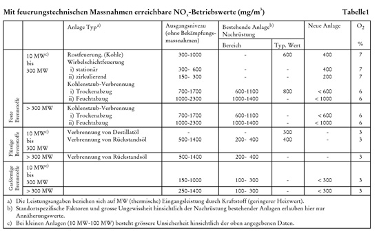

Protokoll zu dem Übereinkommen von 1979 über weiträumige grenzüberschreitende Luftverunreinigung betreffend die Bekämpfung von Emissionen von Stickstoffoxiden oder ihres grenzüberschreitenden Flusses Abgeschlossen in Sofia am 31. Oktober 1988 Zustimmung des Landtags: 21. Dezember 1993 Inkrafttreten für das Fürstentum Liechtenstein: 22. Juni 1994 Die Vertragsparteien, entschlossen, das Übereinkommen über weiträumige grenzüberschreitende Luftverunreinigung durchzuführen, besorgt darüber, dass die derzeitigen Emissionen luftverunreinigender Stoffe in exponierten Teilen Europas und Nordamerikas Schäden an Naturschätzen von lebenswichtiger Bedeutung für Umwelt und Wirtschaft verursachen, eingedenk dessen, dass das Exekutivorgan für das Übereinkommen auf seiner zweiten Tagung die Notwendigkeit anerkannt hat, die jährlichen Gesamtemissionen von Stickstoffoxiden aus ortsfesten und beweglichen Quellen oder ihren grenzüberschreitenden Fluss bis 1995 wirksam herabzusetzen, sowie die Notwendigkeit, dass Staaten, die bei der Verringerung dieser Emissionen bereits Fortschritte erzielt haben, ihre Emis-sionsgrenzwerte für Stickstoffoxide beibehalten und überprüfen,unter Berücksichtigung vorhandener wissenschaftlicher und technischer Daten über Emissionen, Luftbewegungen und Auswirkungen von Stickstoffoxiden und deren Folgeprodukten auf die Umwelt sowie Daten über Technologien zur Bekämpfung von Emissionen, im Bewusstsein, dass die schädlichen Auswirkungen von Emissionen von Stickstoffoxiden auf die Umwelt von Land zu Land unterschiedlich sind, entschlossen, wirksame Massnahmen zur Bekämpfung und Verringerung der jährlichen nationalen Emissionen von Stickstoffoxiden oder ihres grenzüberschreitenden Flusses zu ergreifen, insbesondere durch Anwendung geeigneter nationaler Emissionsgrenzwerte für neue bewegliche und neue grössere ortsfeste Quellen sowie durch Nachrüstung bestehender grösserer ortsfester Quellen, in der Erkenntnis, dass sich die wissenschaftlichen und technischen Kenntnisse über diese Fragen weiterentwickeln und dass diese Entwicklung bei der Überprüfung der Anwendung dieses Protokolls und bei der Entscheidung über weitere Massnahmen zu berücksichtigen ist, in der Erkenntnis, dass die Ausarbeitung eines auf kritischen Belastungen beruhenden Lösungsansatzes die Erstellung einer wirkungsorientierten wissenschaftlichen Grundlage zum Ziel hat, die bei der Überprüfung der Anwendung dieses Protokolls und bei der Entscheidung über weitere international vereinbarte Massnahmen zur Begrenzung und Verringerung von Emissionen von Stickstoffoxiden oder ihres grenzüberschreitenden Flusses zu berücksichtigen ist, in der Erkenntnis, dass die zügige Prüfung von Verfahren zur Schaffung günstigerer Voraussetzungen für einen Technologieaustausch zu einer wirksamen Verringerung der Emissionen von Stickstoffoxiden in der Region der Kommission beitragen wird, mit Genugtuung zur Kenntnis nehmend, dass sich mehrere Staaten gegenseitig verpflichtet haben, ihre jährlichen nationalen Emissionen von Stickstoffoxiden unverzüglich und in erheblichem Umfang herabzusetzen, eingedenk der von einigen Staaten bereits ergriffenen Massnahmen, die eine Verringerung der Emissionen von Stickstoffoxiden bewirkt haben, sind wie folgt übereingekommen: Art. 1 Begriffsbestimmungen Im Sinne dieses Protokolls 1. bedeutet "Übereinkommen" das am 13. November 1979 in Genf angenommene Übereinkommen über weiträumige grenzüberschreitende Luftverunreinigung; 2. bedeutet "EMEP" das Programm über die Zusammenarbeit bei der Messung und Bewertung der weiträumigen Übertragung von luftverunreinigenden Stoffen in Europa; 3. bedeutet "Exekutivorgan" das nach Art. 10 Abs. 1 des Übereinkommens gebildete Exekutivorgan für das Übereinkommen; 4. bedeutet "geographischer Anwendungsbereich des EMEP" das in Art. 1 Abs. 4 des am 28. September 1984 in Genf angenommenen Protokolls zum Übereinkommen von 1979 über weiträumige grenzüberschreitende Luftverunreinigung betreffend die langfristige Finanzierung des Programms über die Zusammenarbeit bei der Messung und Bewertung der weiträumigen Übertragung von luftverunreinigenden Stoffen in Europa (EMEP) definierte Gebiet; 5. bedeutet "Vertragsparteien" die Vertragsparteien dieses Protokolls, soweit der Zusammenhang nichts anderes erfordert; 6. bedeutet "Kommission" die Wirtschaftskommission der Vereinten Nationen für Europa; 7. bedeutet "kritische Belastung" eine quantitative Schätzung der Exposition gegenüber einem oder mehreren verunreinigenden Stoffen, unterhalb deren nach dem heutigen Wissensstand keine erheblichen schädlichen Auswirkungen auf bestimmte empfindliche Teile der Umwelt auftreten; 8. bedeutet "grössere bestehende ortsfeste Quelle" jede bestehende ortsfeste Quelle, deren thermische Eingangsleistung mindestens 100 MW beträgt; 9. bedeutet "grössere neue ortsfeste Quelle" jede neue ortsfeste Quelle, deren thermische Eingangsleistung mindestens 50 MW beträgt; 10. bedeutet "grössere Kategorie von Quellen" jede Kategorie von Quellen, die luftverunreinigende Stoffe in Form von Stickstoffoxiden emittieren oder emittieren können, einschliesslich der im technischen Anhang beschriebenen Kategorien, und die mindestens 10 v.H. der gesamten jährlichen Emissionen von Stickstoffoxiden des Landes erzeugen, gemessen oder berechnet im ersten Kalenderjahr, das auf den Tag des Inkrafttretens dieses Protokolls folgt, und danach alle vier Jahre; 11. bedeutet "neue ortsfeste Quelle" jede ortsfeste Quelle, mit deren Bau oder mit deren wesentlicher Veränderung nach Ablauf von zwei Jahren nach dem Tag des Inkrafttretens dieses Protokolls begonnen wird; 12. bedeutet "neue bewegliche Quelle" ein Kraftfahrzeug oder eine sonstige bewegliche Quelle, die nach Ablauf von zwei Jahren nach dem Tag des Inkrafttretens dieses Protokolls hergestellt wird. Art. 2 Grundlegende Verpflichtungen 1) Die Vertragsparteien ergreifen so bald wie möglich als ersten Schritt wirksame Massnahmen zur Begrenzung und/oder Verringerung ihrer jährlichen nationalen Emissionen von Stickstoffoxiden oder ihres grenzüberschreitenden Flusses, damit diese Emissionen spätestens am 31. Dezember 1994 nicht über den jeweiligen jährlichen nationalen Emissionen von Stickstoffoxiden oder deren grenzüberschreitendem Fluss während des Kalenderjahrs 1987 oder eines früheren Jahres liegen, das bei der Unterzeichnung des Protokolls oder dem Beitritt zum Protokoll anzugeben ist; dabei dürfen ausserdem in bezug auf jede Vertragspartei, die ein solches früheres Jahr angibt, der durchschnittliche jährliche nationale grenzüberschreitende Fluss oder die durchschnittlichen jährlichen nationalen Emissionen von Stickstoffoxiden dieser Vertragspartei in der Zeit vom 1. Januar 1987 bis zum 1. Januar 1996 den grenzüberschreitenden Fluss oder die nationalen Emissionen im Kalenderjahr 1987 nicht übersteigen. 2) Ausserdem werden die Vertragsparteien spätestens zwei Jahre nach dem Tag des Inkrafttretens dieses Protokolls insbesondere a) nationale Emissionsgrenzwerte auf grössere neue ortsfeste Quellen und/oder Kategorien von Quellen sowie auf wesentlich veränderte ortsfeste Quellen in grösseren Kategorien von Quellen anwenden und zwar auf der Grundlage der besten verfügbaren Technologien, die wirtschaftlich vertretbar sind, und unter Berücksichtigung des technischen Anhangs; b) nationale Emissionsgrenzwerte auf neue bewegliche Quellen sämtlicher grösserer Kategorien von Quellen anwenden und zwar auf der Grundlage der besten verfügbaren Technologien, die wirtschaftlich vertretbar sind, und unter Berücksichtigung des technischen Anhangs und der diesbezüglichen Beschlüsse, die im Rahmen des Binnenverkehrausschusses der Kommission gefasst werden, und c) Massnahmen zur Bekämpfung der Verunreinigung für grössere bestehende ortsfeste Quellen einführen, wobei der technische Anhang, die charakteristischen Merkmale der Anlage, ihr Alter und Nutzungsgrad sowie die Notwendigkeit zu berücksichtigen sind, unangemessene Unterbrechungen des Betriebs zu vermeiden. 3) a) Als zweiten Schritt nehmen die Vertragsparteien spätestens sechs Monate nach dem Tag des Inkrafttretens dieses Protokolls Verhandlungen über weitere Schritte zur Verringerung der jährlichen nationalen Emissionen von Stickstoffoxiden oder ihres grenzüberschreitenden Flusses auf, wobei die besten verfügbaren wissenschaftlichen und technischen Entwicklungen, international anerkannte kritische Belastungen und andere Faktoren zu berücksichtigen sind, die sich aus dem nach Art. 6 durchgeführten Arbeitsprogramm ergeben. b) Zu diesem Zweck arbeiten die Vertragsparteien zusammen, um i) kritische Belastungen zu bestimmen; ii) die Verringerungen der jährlichen nationalen Emissionen von Stickstoffoxiden oder ihres grenzüberschreitenden Flusses zu bestimmen, die erforderlich sind, um auf kritischen Belastungen beruhende vereinbarte Ziele zu erreichen, und iii) zur Erreichung dieser Verringerungen Massnahmen und einen Zeitplan zu bestimmen, der spätestens am 1. Januar 1996 beginnt. 4) Die Vertragsparteien können strengere als die in diesem Artikel geforderten Massnahmen ergreifen. Art. 3 Technologieaustausch 1) Die Vertragsparteien erleichtern in Übereinstimmung mit ihren innerstaatlichen Gesetzen, sonstigen Vorschriften und Gepflogenheiten den Austausch von Technologien zur Verringerung der Emissionen von Stickstoffoxiden, insbesondere durch die Förderung a) des kommerziellen Austausches verfügbarer Technologien; b) direkter Kontakte und der Zusammenarbeit der Industrien, einschliesslich Gemeinschaftsunternehmen; c) des Austausches von Informationen und Erfahrungen und d) der Gewährung technischer Unterstützung. 2) Mit der Förderung der unter den Bst. a bis d bezeichneten Tätigkeiten schaffen die Vertragsparteien günstige Voraussetzungen, indem sie Kontakte und Zusammenarbeit zwischen geeigneten Organisationen und Personen des privaten und öffentlichen Sektors erleichtern, die Technologien, Planungs- und Konstruktionsdienste, Ausrüstung oder Finanzierung zur Verfügung stellen können. 3) Die Vertragsparteien beginnen spätestens sechs Monate nach dem Tag des Inkrafttretens dieses Protokolls mit der Prüfung von Verfahren zur Schaffung günstigerer Voraussetzungen für den Austausch von Technologien zur Verringerung der Emissionen von Stickstoffoxiden. Art. 4 Unverbleiter Kraftstoff Die Vertragsparteien sorgen dafür, dass so bald wie möglich, spätestens jedoch zwei Jahre nach dem Tag des Inkrafttretens dieses Protokolls, unverbleiter Kraftstoff ausreichend zur Verfügung steht, in besonderen Fällen zumindest entlang den internationalen Haupttransitstrecken, um den Verkehr von mit Katalysatoren ausgestatteten Fahrzeugen zu erleichtern. Art. 5 Überprüfungsverfahren 1) Die Vertragsparteien überprüfen dieses Protokoll in regelmässigen Abständen und tragen dabei den besten verfügbaren wissenschaftlichen Grundlagen und technischen Entwicklungen Rechnung. 2) Die erste Überprüfung erfolgt spätestens ein Jahr nach dem Tag des Inkrafttretens dieses Protokolls. Art. 6 Auszuführende Arbeiten Die Vertragsparteien räumen solchen Forschungs- und Überwachungs-aufgaben besonderen Vorrang ein, die mit der Entwicklung und Anwendung eines auf kritischen Belastungen beruhenden Lösungsansatzes in Zusammenhang stehen, um auf wissenschaftlicher Grundlage die erforderlichen Verringerungen der Emissionen von Stickstoffoxiden zu bestimmen. Die Vertragsparteien bemühen sich insbesondere durch nationale Forschungsprogramme, im Rahmen des Arbeitsplans des Exekutivorgans und durch andere Programme der Zusammenarbeit im Rahmen des Übereinkommens, a) die Auswirkungen von Emissionen von Stickstoffoxiden auf Menschen, pflanzliches und tierisches Leben, Gewässer, Böden und Materialien festzustellen und zu quantifizieren, wobei die Wirkung von Stickstoffoxiden, die aus anderen Quellen als der Ablagerung aus der Luft stammen, zu berücksichtigen ist; b) die geographische Verteilung empfindlicher Gebiete zu ermitteln; c) Messsysteme und Modelle einschliesslich abgestimmter Verfahren zur Berechnung von Emissionen zu entwickeln, um den weiträumigen Transport von Stickstoffoxiden und ähnlichen verunreinigenden Stoffen zu quantifizieren; d) Leistungs- und Kostenschätzungen von Technologien zur Bekämpfung von Emissionen von Stickstoffoxiden zu verfeinern und die Ent-wicklung verbesserter oder neuer Technologien aufzuzeichnen sowie e) im Rahmen eines auf kritischen Belastungen beruhenden Lösungsansatzes Methoden zur Zusammenführung wissenschaftlicher, technischer und wirtschaftlicher Daten zu entwickeln, um geeignete Bekämpfungsstrategien bestimmen zu können. Art. 7 Nationale Programme, Politiken und Strategien Die Vertragsparteien stellen zur Erfüllung der Verpflichtungen aus diesem Protokoll unverzüglich nationale Programme, Politiken und Strategien auf, die als Mittel dazu dienen, die Emissionen von Stickstoffoxiden oder ihren grenzüberschreitenden Fluss zu begrenzen und zu verringern. Art. 8 Informationsaustausch und jährliche Berichterstattung 1) Die Vertragsparteien tauschen Informationen aus, indem sie dem Exekutivorgan die nationalen Programme, Politiken und Strategien mitteilen, die sie nach Art. 7 aufstellen, und ihm über die Fortschritte im Rahmen dieser Programme, Politiken und Strategien sowie über Änderungen derselben jährlich berichten, insbesondere a) über das Niveau der jährlichen nationalen Emissionen von Stickstoffoxiden sowie die Grundlage, auf der sie berechnet worden sind; b) über Fortschritte bei der Anwendung der nach Art. 2 Abs. 2 Bst. a und b vorgeschriebenen nationalen Emissionsgrenzwerte, über die angewendeten oder anzuwendenden nationalen Emissionsgrenzwerte sowie über die betroffenen Quellen und/oder Kategorien von Quellen; c) über Fortschritte bei der Einführung der nach Art. 2 Abs. 2 Bst. c vorgeschriebenen Massnahmen zur Bekämpfung der Verunreinigung, über die betroffenen Quellen und die eingeführten oder einzuführenden Massnahmen; d) über Fortschritte bei der Bereitstellung unverbleiten Kraftstoffs; e) über die zur Erleichterung des Technologieaustausches ergriffenen Massnahmen und f) über Fortschritte bei der Bestimmung kritischer Belastungen. 2) Diese Informationen werden nach Möglichkeit entsprechend einem einheitlichen Berichtssystem übermittelt. Art. 9 Berechnungen Das EMEP stellt dem Exekutivorgan rechtzeitig vor dessen jährlichen Sitzungen Berechnungen des Stickstoffhaushalts sowie des grenzüberschreitenden Flusses und der Ablagerungen von Stickstoffoxiden im geographischen Anwendungsbereich des EMEP zur Verfügung, wobei geeignete Modelle verwendet werden. In Gebieten ausserhalb des geographischen Anwendungsbereichs des EMEP werden Modelle verwendet, die im Hinblick auf die besonderen Verhältnisse der dort gelegenen Vertragsparteien geeignet sind. Art. 10 Technischer Anhang Der technische Anhang zu diesem Protokoll hat Empfehlungscharakter. Er ist Bestandteil des Protokolls. Art. 11 Änderungen des Protokolls 1) Jede Vertragspartei kann Änderungen dieses Protokolls vorschlagen. 2) Die vorgeschlagenen Änderungen werden dem Exekutivsekretär der Kommission schriftlich unterbreitet; dieser übermittelt sie allen Vertragsparteien. Das Exekutivorgan erörtert die vorgeschlagenen Änderungen auf seiner nächsten jährlichen Sitzung, sofern die Vorschläge den Vertragsparteien vom Exekutivsekretär mindestens neunzig Tage vorher mitgeteilt worden sind. 3) Änderungen des Protokolls, ausgenommen Änderungen des technischen Anhangs, bedürfen der einvernehmlichen Annahme der auf einer Sitzung des Exekutivorgans vertretenen Vertragsparteien; sie treten für die Vertragsparteien, die sie angenommen haben, am neunzigsten Tag nach dem Zeitpunkt in Kraft, an dem zwei Drittel der Vertragsparteien ihre Urkunde über die Annahme der Änderungen hinterlegt haben. Die Änderungen treten für jede Vertragspartei, die sie angenommen hat, nachdem zwei Drittel der Vertragsparteien ihre Urkunde über die Annahme der Änderungen hinterlegt haben, am neunzigsten Tag nach dem Zeitpunkt in Kraft, an dem die betreffende Vertragspartei ihre Urkunde über die Annahme der Änderungen hinterlegt hat. 4) Änderungen des technischen Anhangs bedürfen der einvernehmlichen Annahme der auf einer Sitzung des Exekutivorgans vertretenen Vertragsparteien; sie treten dreissig Tage nach dem Zeitpunkt in Kraft, zu dem sie nach Abs. 5 mitgeteilt worden sind. 5) Änderungen nach den Abs. 3 und 4 werden vom Exekutivsekretär allen Vertragsparteien so bald wie möglich nach ihrer Annahme mitgeteilt. Art. 12 Beilegung von Streitigkeiten Entsteht zwischen zwei oder mehr Vertragsparteien eine Streitigkeit über die Auslegung oder Anwendung dieses Protokolls, so bemühen sich diese Vertragsparteien um eine Lösung durch Verhandlungen oder durch ein anderes Verfahren der Beilegung, das für die Streitparteien annehmbar ist. Art. 13 Unterzeichnung 1) Dieses Protokoll liegt vom 1. bis zum 4. November 1988 in Sofia und danach bis zum 5. Mai 1989 am Sitz der Vereinten Nationen in New York für die Mitgliedstaaten der Kommission, für Staaten, die in der Kommission nach Abs. 8 der Entschliessung 36 (IV) des Wirtschafts- und Sozialrats vom 28. März 1947 beratenden Status haben, sowie für die Organisationen der regionalen Wirtschaftsintegration, die von den souveränen Staaten, die Mitglieder der Kommission sind, gebildet werden und für die Aushandlung, den Abschluss und die Anwendung internationaler Übereinkünfte über Angelegenheiten zuständig sind, die in den Geltungsbereich dieses Protokolls fallen, zur Unterzeichnung auf, vorausgesetzt, dass die betreffenden Staaten und Organisationen Vertragsparteien des Übereinkommens sind. 2) Solche Organisationen der regionalen Wirtschaftsintegration üben in Angelegenheiten, die in ihren Zuständigkeitsbereich fallen, in ihrem eigenen Namen die Rechte aus und nehmen die Verantwortlichkeiten wahr, die dieses Protokoll den Mitgliedstaaten dieser Organisationen überträgt. In diesen Fällen sind die Mitgliedstaaten dieser Organisationen nicht berechtigt, solche Rechte einzeln auszuüben. Art. 14 Ratifikation, Annahme, Genehmigung und Beitritt 1) Dieses Protokoll bedarf der Ratifikation, Annahme oder Genehmigung durch die Unterzeichner. 2) Dieses Protokoll steht vom 6. Mai 1989 an für die in Art. 13 Abs. 1 genannten Staaten und Organisationen zum Beitritt offen. 3) Staaten oder Organisationen, die diesem Protokoll nach dem 31. Dezember 1993 beitreten, können die Art. 2 und 4 spätestens bis zum 31. Dezember 1995 durchführen. 4) Die Ratifikations-, Annahme-, Genehmigungs oder Beitrittsurkunden werden beim Generalsekretär der Vereinten Nationen hinterlegt; dieser erfüllt die Aufgaben des Depositars. Art. 15 Inkrafttreten 1) Dieses Protokoll tritt am neunzigsten Tag nach dem Zeitpunkt der Hinterlegung der sechzehnten Ratifikations-, Annahme-, Genehmigungs- oder Beitrittsurkunde in Kraft. 2) Für alle in Art. 13 Abs. 1 bezeichneten Staaten und Organisationen, die nach der Hinterlegung der sechzehnten Ratifikations-, Annahme-, Genehmigungs- oder Beitrittsurkunde dieses Protokoll ratifizieren, annehmen oder genehmigen oder ihm beitreten, tritt das Protokoll am neunzigsten Tag nach dem Zeitpunkt der Hinterlegung der Ratifika-tions-, Annahme-, Genehmigungs- oder Beitrittsurkunde durch die betreffende Vertragspartei in Kraft. Art. 16 Rücktritt Eine Vertragspartei kann jederzeit nach Ablauf von fünf Jahren nach dem Zeitpunkt, zu dem dieses Protokoll für sie in Kraft getreten ist, durch eine an den Depositar gerichtete schriftliche Notifikation von dem Protokoll zurücktreten. Der Rücktritt wird am neunzigsten Tag nach dem Eingang der Notifikation bei dem Depositar oder zu einem in der Rücktrittsnotifikation angegebenen späteren Zeitpunkt wirksam. Art. 17 Verbindliche Wortlaute Die Urschrift dieses Protokolls, dessen englischer, französischer und russischer Wortlaut gleichermassen verbindlich ist, wird beim Generalsekretär der Vereinten Nationen hinterlegt. Zu Urkund dessen haben die hierzu gehörig befugten Unterzeichneten dieses Protokoll unterschrieben. Geschehen zu Sofia am 31. Oktober 1988. (Es folgen die Unterschriften) Technischer Anhang 1. Die Angaben über Emissionsverhalten und Kosten beruhen auf offiziellen Unterlagen des Exekutivorgans und seiner Nebenorgane, insbesondere auf den Dokumenten EB.AIR/WG.3/R.8, R.9 und R.16 sowie ENV/WP.I/R.86 und Corr. 1, die in Kapitel 7 der "Auswirkungen und Bekämpfung der grenzüberschreitenden Luftverunreinigung" enthalten sind. Wenn nicht anders angegeben, wird vorausgesetzt, dass es sich hierbei um praktisch erprobte Technologien handelt. 2. Die in diesem Anhang enthaltenen Informationen sind nicht vollständig. Da sich fortlaufend neue Erfahrungen mit neuen Motoren und neuen Anlagen, in denen emissionsarme Technologien angewendet werden, sowie bei der Nachrüstung bestehender Anlagen ergeben, wird es notwendig sein, diesen Anhang in regelmässigen Abständen zu überarbeiten und zu ändern. Der Anhang kann auch keine erschöpfende Auskunft über technische Möglichkeiten geben; er soll für die Vertragsparteien vielmehr eine Orientierungshilfe bei der Erkennung wirtschaftlich vertretbarer Technologien sein, damit sie die Verpflichtungen aus dem Protokoll erfüllen können. I. Technologien zur Bekämpfung von NO x -Emissionen aus ortsfesten Quellen 3. Die Verbrennung von fossilen Brennstoffen ist die hauptsächliche ortsfeste Quelle der anthropogenen NO x -Emissionen. Zusätzlich können auch einige Prozesse, bei denen keine Verbrennung stattfindet, erheblich zu NO x -Emissionen beitragen. 4. Zu den grösseren Kategorien ortsfester Quellen von NO x -Emissionen können gehören: a) Feuerungsanlagen; b) Industrieöfen (z.B. zur Zementherstellung); c) ortsfeste Gasturbinen und Verbrennungsmotoren; d) Prozesse, bei denen keine Verbrennung stattfindet (z.B. Herstellung von Salpetersäure). 5. Die Technologien zur Verringerung der NO x -Emissionen konzentrieren sich auf bestimmte feuerungs- oder verfahrenstechnische Massnahmen und - insbesondere bei grossen Kraftwerken - auf die Rauchgasreinigung. 6. Bei der Nachrüstung bestehender Anlagen kann der Umfang der Anwendung von Technologien zur Verringerung der NO x -Emissionen durch negative Nebenwirkungen auf den Betrieb oder andere standortspezifische Einschränkungen begrenzt werden. Deshalb sind im Fall der Nachrüstung für die typischerweise erreichbaren NO x -Emissionswerte nur annähernde Schätzungen angegeben. Bei neuen Anlagen können die negativen Nebenwirkungen durch geeignete Auslegungskriterien auf ein Mindestmass beschränkt oder ausgeschlossen werden. 7. Nach den heute verfügbaren Daten können die Kosten für feuerungstechnische Massnahmen bei neuen Anlagen niedrig angesetzt werden. Für die Nachrüstung, beispielsweise in grossen Kraftwerken, beliefen sich die Kosten jedoch auf etwa 8 bis 25 Schweizer Franken pro kw el (1985). In der Regel liegen die Investitionskosten für Anlagen zur Rauchgasreinigung wesentlich höher. 8. Für ortsfeste Quellen werden die Emissionsfaktoren in Milligramm NO2 je Kubikmeter (mg/m³) trockenem Abgas unter Normalbedingungen (0 ºC, 1013 mb) angegeben. Feuerungsanlagen 9. Die Gruppe der Feuerungsanlagen umfasst die Verbrennung fossiler Brennstoffe in Öfen, Dampfkesseln, Anlagen zur indirekten Beheizung und sonstigen Feuerungseinrichtungen mit einer thermischen Eingangsleistung von mehr als 10 MW, wobei keine Vermischung der Verbrennungsgase mit anderen Ofenabgängen oder behandelten Stoffen erfolgt. Für neue und bestehende Anlagen stehen folgende Verbrennungstechnologien einzeln oder kombiniert zur Verfügung: a) Auslegung des Feuerungsraums für niedrige Temperaturen, einschliesslich Wirbelschichtfeuerung; b) Betrieb mit geringem Luftüberschuss; c) Einbau spezieller NO x -armer Brenner; d) Rückführung der Rauchgase in die Verbrennungsluft; e) stufenweise Verbrennung/Zweitluftbetrieb; f) Nachverbrennung (stufenweise Brennstoffzufuhr). Tabelle 1 enthält die erreichbaren Betriebswerte. 

 10. Die Rauchgasreinigung durch selektive katalytische Reduktion (SCR) ist eine weitere Massnahme zur Verringerung der NO x -Emissionen; sie hat einen Wirkungsgrad von mindestens 80 Prozent. In der Region der Kommission werden bereits beträchtliche Betriebserfahrungen mit neuen und nachgerüsteten Anlagen gesammelt, insbesondere bei Kraftwerken mit mehr als 300 MW (thermisch). Zusammen mit feuerungstechnischen Massnahmen können ohne weiteres Emissionswerte von 200 mg/m³ (feste Brennstoffe, 6 % O 2 ) und 150 mg/m³ (flüssige Brennstoffe, 3 % O 2 ) erreicht werden. 11. Die selektive nicht-katalytische Reduktion (SNCR), eine Rauchgasreinigung mit einer NO x -Verringerung zwischen 20 und 60 Prozent, ist eine kostengünstigere Technologie für besondere Anwendungen (z.B. Raffinerieöfen und Gasverbrennung bei Grundlast). Ortsfeste Gasturbinen und Verbrennungsmotoren (IC) 12. Die NO x -Emissionen aus ortsfesten Gasturbinen können entweder durch feuerungstechnische Massnahmen (Trockenverfahren) oder durch Einspritzen von Wasser oder Wasserdampf (Nassverfahren) verringert werden. Beide Massnahmen sind erprobt. Sie ermöglichen es, Emissionswerte von 150 mg/m³ (Gas, 15 % O 2 ) und 300 mg/m³ (Öl, 15 % O 2 ) einzuhalten. Nachrüstung ist möglich. 13. NO x -Emissionen aus ortsfesten Verbrennungsmotoren mit elektrischer Zündung lassen sich entweder durch feuerungstechnische Massnahmen (z.B. durch magere Verbrennung und Abgasrückführung) oder durch Rauchgasreinigung (geregelter Drei-Wege-Katalysator, SCR) verringern. Inwieweit diese verschiedenen Verfahren technisch und wirtschaftlich durchführbar sind, hängt von der Grösse und dem Typ des betreffenden Motors (Zweitakt/Viertakt) und der Betriebsart (konstante/veränderliche Last) ab. Eine magere Verbrennung ermöglicht NO x -Emissionswerte von 800 mg/m³ (5 % O 2 ), das SCR-Verfahren verringert die NO x -Emissionen auf unter 400 mg/m³ (5 % O 2 ), und der Drei-Wege-Katalysator senkt sie sogar auf unter 200 mg/m³ (5 % O 2 ). Industrie - Öfen - Zementkalzinierung 14. In der Region der Kommission wird gegenwärtig untersucht, ob das Vorwärmverfahren möglicherweise dazu geeignet ist, die NO x -Konzentrationen im Rauchgas neuer und bestehender Zementbrennöfen auf etwa 300 mg/m3 (10 % O 2 ) zu senken. Verfahren, bei denen keine Verbrennung stattfindet - Herstellung von Salpetersäure 15. Die Herstellung von Salpetersäure bei hohem Druck (> 8 bar) ermöglicht es, die NO x -Konzentrationen in unverdünnten Abgasen unter 400 mg/m³ zu halten. Das gleiche Ergebnis lässt sich durch Mitteldruckabsorption in Verbindung mit einem SCR-Verfahren oder jedem beliebigen anderen ähnlich wirksamen NO x -Reduktionsverfahren erzielen. Nachrüstung ist möglich. II. Technologien zur Bekämpfung der NO x -Emissionen aus Kraftfahrzeugen 16. Die in diesem Anhang behandelten Kraftfahrzeuge sind Strassenfahrzeuge, und zwar: benzin- und dieselbetriebene Personenkraftwagen sowie leichte und schwere Nutzfahrzeuge. Wo erforderlich, wird Bezug genommen auf die jeweiligen Fahrzeugkategorien (M 1 , M 2 , M 3 , N 1 , N 2 , N 3 ), die in der ECE-Regelung Nr. 13 in Übereinstimmung mit dem Übereinkommen von 1958 über die Annahme einheitlicher Bedingungen für die Genehmigung der Ausrüstungsgegenstände und Teile von Kraftfahrzeugen und über die gegenseitige Anerkennung der Genehmigung festgelegt sind. 17. Der Strassenverkehr ist eine der wesentlichen Quellen der anthropogenen NO x -Emissionen in vielen Ländern der Kommission; der Anteil an den Gesamtemissionen der jeweiligen Länder beträgt zwischen 40 und 80 Prozent. Benzinbetriebene Fahrzeuge verursachen normalerweise zwei Drittel sämtlicher im Strassenverkehr erzeugter NO x -Emissionen. 18. In den Tabellen 3 und 6 sind die Technologien aufgeführt, die zur Bekämpfung der Stickstoffoxide aus Kraftfahrzeugen zur Verfügung stehen. Der Einfachheit halber sind die Technologien nach den vorhandenen oder empfohlenen nationalen und internationalen Emissionsgrenzwerten, die unterschiedlich streng sind, zusammengefasst. Da sich die gegenwärtigen Testreihen nur mit dem Fahrverhalten in der Stadt befassen, wurde bei den in der Tabelle enthaltenen Schätzungen der relativen NO x -Emissionen in den Fällen eine schnellere Fahrweise berücksichtigt, in denen NO x -Emissionen besonders wichtig sein können. 19. Die in den Tabellen 3 und 6 aufgeführten zusätzlichen Produktionskosten für die verschiedenen Technologien sind eher geschätzte Herstellungskosten als Einzelhandelspreise. 20. Um zu gewährleisten, dass die durch die Emissionsgrenzwerte angestrebte Verringerung in der Praxis auch erreicht wird, müssen deren Einhaltung bei der Herstellung sowie die Werte der im Verkehr befindlichen Fahrzeuge überwacht werden. 21. Technologien, die die Verwendung von Katalysatoren einschliessen oder sich auf deren Verwendung stützen, erfordern unverbleiten Kraftstoff. Der unbeschränkte Verkehr der mit Katalysatoren ausgerüsteten Fahrzeuge hängt davon ab, dass unverbleiter Kraftstoff überall zur Verfügung steht. Personenkraftwagen mit Benzin- und Dieselmotoren (M 1 ) 22. In Tabelle 2 sind vier Emissionsgrenzwerte angegeben. In Tabelle 3 werden damit verschiedene Technologien für Fahrzeuge mit Benzinmotor entsprechend ihrem Potential zur Verringerung der NO x -Emissionen zusammengefasst. Tabelle 2 Definition der Emissions-Grenzwerte Norm Grenzwerte Anmerkungen A. ECE R. 15-04 HC + NOx: 19-28 g/Test Gegenwärtige ECE-Norm (Regelung Nr. 15 einschl. der Änderungsreihe 04 gemäss dem in Absatz 16 erwähnten Übereinkommen von 1958), auch angenommen durch die EWG (Richtlinie 83/351/EWG). ECE R. 15 Testreihe Stadtverkehr. Emissionsgrenze schwankt je nach Fahrzeuggewicht. B. "Luxemburg 1985" HC + NOx: 1,4-2,0 l: 8,0 g/Test Dieser Grenzwert dient nur dazu, die Technologien zusammenzufassen (< 1,4 l: 15,0 g/Test > 2,0 l: 6,5 g/Test) Im Zeitraum 1988-1993 in der EWG einzuführende Grenzwerte, wie auf der Sitzung des EG-Ministerrats in Luxemburg 1985 erörtert und im Dezember 1987 endgültig beschlossen. ECE R. 15 für Testreihe Stadtverkehr findet Anwendung. Dieser Grenzwert für Motoren > 2 l entspricht im allgemeinen dem US-Grenzwert von 1983. Der Grenzwert für Motoren < 1,4 l ist vorläufig; der endgültige Grenzwert soll erarbeitet werden. Die Grenzwerte für Motoren von 1,4-2,0 l gelten für alle Dieselfahrzeuge > 1,4 l. C. "Stockholm 1985" Grenzwerte für die nationale Gesetzgebung auf der Grundlage des nach dem Treffen der Umweltminister aus 8 Ländern 1985 in Stockholm erstellten "master document". Vergleichbar mit den US-Grenzwerten des Jahres 1987 und nachstehenden Prüfverfahren: NOx: 0,62 g/km NOx: 0,76 g/km US Federal Test Procedure (1975). Highway fuel economy test procedure. D. "Kalifornien 1989" NOx: 0,25 g/km Für Modelle ab Baujahr 1989 im Bundesstaat Kalifornien geltende Grenzwerte. US Federal Test Procedure. Tabelle 3 Technologien für Benzinmotoren, Emissionsverhalten, Kosten und Kraftstoffverbrauch für die Einhaltung der Emissionsgrenzwerte Norm Technologie Mittlere NOx Verringerung % 1) Zusätzliche Produktionskosten (1986, Schweizer Franken) 2) Kraftstoffverbrauchs-index 1) A. Ausgangswert (herkömmlicher Fremdzündungsmotor mit Vergaser) - 3) - 100 B. a) Kraftstoffeinspritzung EGR + Sekundärlufteinblasung 4) 25 200 105 b) ungeregelter Drei-Wege-Katalysator (+ EGR) 55 150 103 c) Magermotor mit Oxyda-tonskatalysator (+ EGR) 5) 60 200-600 90 C. geregelter Drei-Wege-Katalysator 90 300-600 95 D. geregelter Drei-Wege-Katalysator (+ EGR) 92 350-650 98 1) Schätzungen der mittleren NOx-Verringerung und des Kraftstoffverbrauchs gelten für einen europäischen Kraftwagen mittleren Gewichts bei durchschnittlichen europäischen Verkehrsbedingungen. 2) Zusätzliche Produktionskosten könnten besser als Prozentsatz der Gesamtkosten für einen Kraftwagen angegeben werden. Da die Kostenschätzungen jedoch primär einen relativen Vergleich bieten sollen, blieb die Formulierung aus den ursprünglichen Dokumenten erhalten. 3) Mittlerer NO x -Emissionsfaktor = 2,6 g/km. 4) "EGR" bedeutet Abgasrückführung. 5) Beruht ausschliesslich auf Daten für Testmotoren. Es werden praktisch keine Fahrzeuge mit Magermotoren hergestellt. 23. Die Emissionsnormen A, B, C und D umfassen Emissionsgrenzwerte sowohl für Kohlenwasserstoff (HC) und Kohlenmonoxid (CO) als auch für NO x . Die geschätzten Emissionsverringerungen für diese verunreinigenden Stoffe bezogen auf die Werte der ECE R. 15-04 - stehen in Tabelle 4. Tabelle 4 Geschätzte Verringerungen der HC- und CO-Emissionen von Personenkraftwagen mit Benzinmotoren bei Einsatz unterschiedlicher Technologien Norm Technologie HC-Verringerung % CO-Verringerung % B. Kraftstoffeinspritzung EGR + Sekundärlufteinblasung 30-40 50 ungeregelter Drei-Wege-Katalysator (+ EGR) 50-60 40-50 Magermotor mit Oxydationskatalysator (+ EGR) 70-90 70-90 C. geregelter Drei-Wege-Katalysator 90 90 D. geregelter Drei-Wege-Katalysator (+ EGR) 90 90 24. Die heutigen Dieselfahrzeuge können die Anforderungen der Normen A, B und C hinsichtlich der NO x -Emissionen erfüllen. Strenge Anforderungen an die Partikel-Emissionen und die strikten NO x -Grenzwerte der Norm D haben zur Folge, dass Personenkraftwagen mit Dieselmotoren noch weiter entwickelt werden müssen, wahrscheinlich unter Einbeziehung der elektronischen Regelung der Kraftstoffpumpe, fortschrittlicher Einspritzsysteme, Abgasrückführung und Partikelabscheider. Bisher gibt es lediglich Versuchsfahrzeuge auf diesem Gebiet (s. auch Tabelle 6, Fussnote 1). Andere leichte Nutzfahrzeuge (N 1 ) 25. Die Bekämpfungsverfahren für Personenkraftwagen finden Anwendung, aber die NO x -Verringerung sowie Kosten und kommerzielle Einführungszeiten können unterschiedlich sein. Schwere Nutzfahrzeuge mit Benzinmotor (M 1 , M 3 , N 2 , N 3 ) 26. Diese Fahrzeugklasse ist in Westeuropa ohne Bedeutung und in Osteuropa rückläufig. Das Niveau der NO x -Emissionen nach US-1990 und US-1991 (s. Tabelle 5) könnte mit relativ geringen Kosten und ohne nennenswerten technischen Aufwand erreicht werden. Schwere Nutzfahrzeuge mit Dieselmotor (M 1 , M 3 , N 2 , N 3 ) 27. In Tabelle 5 werden drei Emissionsnormen angegeben. In Tabelle 6 werden danach Technologien für Motoren von dieselbetriebenen schweren Nutzfahrzeugen entsprechend ihrem Potential zur Verringerung der NO x -Emissionen zusammengestellt. Die grundlegende Motorstruktur ist im Wandel, wobei der Trend vom Motor ohne Aufladung zum Turbolader geht. Dieser Trend wirkt sich auch auf einen wirtschaftlicheren Kraftstoffverbrauch aus. Aus diesem Grund sind an dieser Stelle keine vergleichenden Schätzungen des Kraftstoffverbrauchs angegeben. Tabelle 5 Definition der Emissionsgrenzwerte Norm NOx-Grenzwerte g/kWh Anmerkungen I ECE R. 49 18 Test von 13 Betriebszuständen II US-1990 8,0 Transienttest III US-1991 6,7 Transienttest Tabelle 6 Technologien für schwere Nutzfahrzeuge mit Dieselmotoren, Emissionsverhalten und Kosten für die Einhaltung der Emissionsgrenzwerte 1) Norm Technologie Geschätzte NOx-Verringerung % Zusätzliche Produktionskosten (1984 US-Dollar) I Herkömmlicher Dieselmotor mit direkter Einspritzung 0 0 II 2) Turbolader + Nachkühlung + Einspritzverzögerung (Änderung von Brennkammer und Auspuff). (Selbstansaugende Motoren können die Norm wahrscheinlich nicht einhalten) 40 $ 115 (davon $ 69 für NOx-Norm) 3) III 2) Weitergehende Verfeinerung der unter II aufgeführten Technologien einschlies-slich variabler Einspritz-Einstellung und Einsatz von Elektronik 50 $ 404 (davon $ 68 für NO x -Norm) 3) 1) Eine Verschlechterung der Qualität des Dieseltreibstoffs würde die Emission nachteilig beeinflussen und könnte sich auf den Kraftstoffverbrauch sowohl der schweren als auch der leichten Nutzfahrzeuge auswirken. 2) Es ist immer noch erforderlich, auf breiter Basis die Verfügbarkeit neuer Bauteile zu prüfen. 3) Die Differenz erklärt sich aus der Bekämpfung der Partikelemissionen und anderen Überlegungen. Erklärung vom 31. Oktober 1988 über die Verringerung der Stickstoffoxidemissionen um 30 vom Hundert Die Regierungen Österreichs, Belgiens, Dänemarks, der Bundesrepublik Deutschland, Finnlands, Frankreichs, Italiens, Liechtensteins, der Niederlande, Norwegens, Schwedens, der Schweiz, die das Protokoll zu dem Übereinkommen von 1979 über weiträumige grenzüberschreitende Luftverunreinigung betreffend die Bekämpfung von Stickstoffemissionen oder ihres grenzüberschreitenden Flusses (im Nachfolgenden als "das Protokoll" bezeichnet) unterzeichnen werden, besorgt darüber, dass die Stickstoffoxidemissionen allein und in Verbindung mit flüchtigen organischen Verbindungen (VOC) der Umwelt und der menschlichen Gesundheit schwere Schäden zufügen, unter Hinweis darauf, dass das Exekutivorgan des Übereinkommens im Jahre 1984 auf seiner zweiten Sitzung "die Notwendigkeit einer wirksamen Reduzierung der gesamten nationalen jährlichen Stickstoffoxidemissionen aus stationären und mobilen Quellen oder deren grenzüberschreitenden Fluss bis 1995" anerkannte, ferner unter Hinweis darauf, dass das Exekutivorgan des Übereinkommens im Jahre 1987 auf seiner 5. Sitzung "die Bedeutung der Umweltschäden, die in vielen Ländern durch VOC-Emissionen, die durch ihre Reaktion mit Stickstoffoxiden zur Bildung von photochemischen Oxidantien, z.B. Ozon, beitragen, anerkannte und demzufolge die Notwendigkeit einer wirksamen Reduzierung von VOC-Emissionen betonte", begrüssend, dass die Vertragsparteien des Übereinkommens das Protokoll auf der 6. Sitzung des Exekutivorgans am 1. November 1988 in Sofia unterzeichnen werden, in der Erwägung, dass über die im Protokoll vorgesehenen Massnahmen hinaus sofortige und wirksame Verringerungen der NO x -Emissionen erforderlich sind, erklären wie folgt: 1. Die Unterzeichner dieser Erklärung werden so schnell wie möglich und spätestens bis 1998 eine Verringerung der nationalen Stickstoffoxidemissionen in der Grössenordnung von 30 Prozent durchführen, wobei zur Berechnung der Verringerung das Niveau eines Jahres zwischen 1980-1986 zugrunde gelegt wird. 2. Die Unterzeichner fordern die anderen Vertragsparteien des Übereinkommens, die das Protokoll unterzeichnen werden, auf, gemeinsam mit ihnen alles zu tun, um ihre nationalen Stickstoffoxidemissionen oder deren grenzüberschreitenden Flüsse über die im Protokoll vorgeschriebenen Verpflichtungen hinaus wesentlich zu begrenzen und zu verringern. 3. Die Unterzeichner betonen die Notwendigkeit, im Rahmen des Übereinkommens sowie auf der Grundlage der laufenden Arbeit gemeinsam wirksame Massnahmen zu ergreifen, um wesentliche Verringerungen der VOC-Emissionen zu erreichen. Zu Urkund dessen haben die Unterzeichneten diese Erklärung unterschrieben. Geschehen zu Sofia, den 31. Oktober 1988. (Es folgen die Unterschriften)
