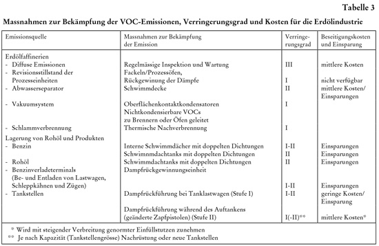
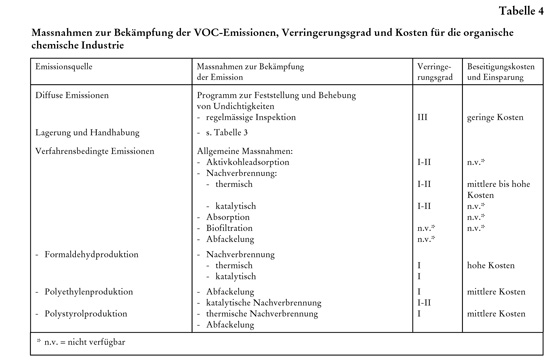
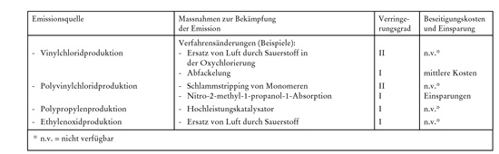
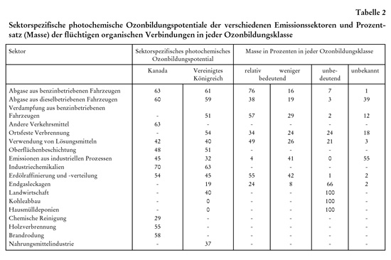
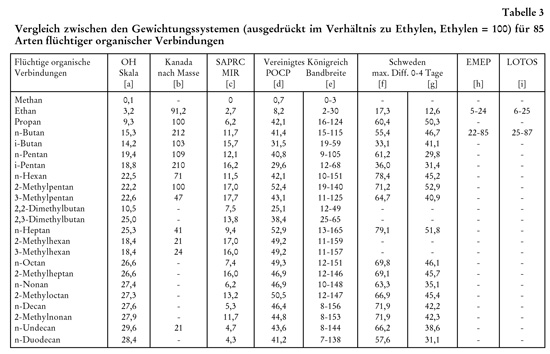
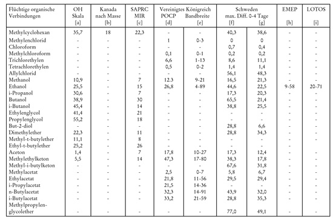
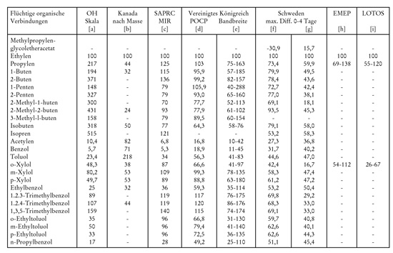
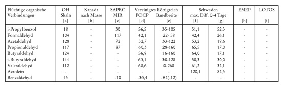
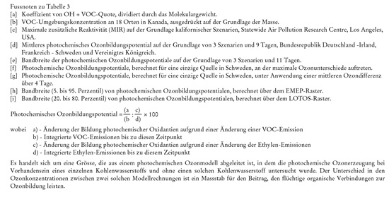

Protokoll zu dem Übereinkommen von 1979 über weiträumige grenzüberschreitende Luftverunreinigung betreffend die Bekämpfung von Emissionen flüchtiger organischer Verbindungen oder ihres grenzüberschreitenden Flusses Abgeschlossen in Genf am 19. November 1991 Zustimmung des Landtages: 21. Dezember 1993 Inkrafttreten für das Fürstentum Liechtenstein: 22. Juni 1994 Die Vertragsparteien, entschlossen, das Übereinkommen über weiträumige grenzüberschreitende Luftverunreinigung durchzuführen, besorgt darüber, dass die derzeitigen Emissionen flüchtiger organischer Verbindungen (VOCs) und die daraus entstehenden sekundären photochemischen Oxidantien in exponierten Teilen Europas und Nordamerikas Schäden an Naturschätzen von lebenswichtiger Bedeutung für Umwelt und Wirtschaft verursachen und unter bestimmten Expositionsbedingungen schädliche Auswirkungen auf die menschliche Gesundheit haben, in Anbetracht dessen, dass aufgrund des am 31. Oktober 1988 in Sofia angenommenen Protokolls betreffend die Bekämpfung von Emissionen von Stickstoffoxiden oder ihres grenzüberschreitenden Flusses bereits Einvernehmen über die Verringerung der Emissionen von Stickstoffoxiden besteht, in der Erkenntnis, dass flüchtige organische Verbindungen und Stickstoffoxide zur Bildung troposphärischen Ozons beitragen,sowie in der Erkenntnis, dass flüchtige organische Verbindungen, Stickstoffoxide und das daraus entstehende Ozon über internationale Grenzen hinweg transportiert werden und so die Luftqualität in benachbarten Staaten beeinträchtigen, in dem Bewusstsein, dass es aufgrund des Ablaufs der Bildung photochemischer Oxidantien erforderlich ist, die Emissionen flüchtiger organischer Verbindungen zu verringern, um das Auftreten photochemischer Oxidantien zu vermindern, sowie in dem Bewusstsein, dass durch menschliche Tätigkeiten emittiertes Methan und Kohlenmonoxid in der Luft über der ECE-Region in Hintergrundkonzentrationen vorhanden sind und zur Bildung episodischer Ozonspitzenwerte beitragen, dass ausserdem ihre weltweit ablaufende Oxidation in Gegenwart von Stickstoffoxiden zur Bildung troposphärischen Ozons in Hintergrundkonzentrationen beiträgt, die von photochemischen Episoden überlagert werden, und dass Methan voraussichtlich Gegenstand von Bekämpfungsmassnahmen in anderen Gremien werden wird, eingedenk dessen, dass das Exekutivorgan für das Übereinkommen auf seiner sechsten Tagung die Notwendigkeit anerkannt hat, Emissionen flüchtiger organischer Verbindungen oder ihren grenzüberschreitenden Fluss und das Auftreten photochemischer Oxidantien zu bekämpfen, sowie die Notwendigkeit, dass Vertragsparteien, welche diese Emissionen bereits verringert haben, ihre Emissionsgrenzwerte für flüchtige organische Verbindungen beibehalten und überprüfen, eingedenk der von einigen Vertragsparteien bereits ergriffenen Massnahmen, die eine Verringerung ihrer jährlichen nationalen Emissionen von Stickstoffoxiden und flüchtigen organischen Verbindungen bewirkt haben, in Anbetracht dessen, dass einige Vertragsparteien Luftqualitätsgrenzwerte und/oder -ziele für troposphärisches Ozon festgelegt haben und dass die Weltgesundheitsorganisation und andere zuständige Gremien Grenzwerte für Konzentrationen troposphärischen Ozons festgelegt haben, entschlossen, wirksame Massnahmen zur Bekämpfung und Verringerung der jährlichen nationalen Emissionen flüchtiger organischer Verbindungen oder des grenzüberschreitenden Flusses flüchtiger organischer Verbindungen und der daraus entstehenden sekundären photochemischen Oxidantien zu ergreifen, insbesondere durch die Anwendung geeigneter nationaler oder internationaler Emissionsgrenzwerte für neue bewegliche und neue ortsfeste Quellen und die Nachrüstung bestehender grösserer ortsfester Quellen sowie durch die Begrenzung der Bestandteile, die flüchtige organische Verbindungen emittieren können, in Produkten für den industriellen oder häuslichen Gebrauch, in dem Bewusstsein, dass sich flüchtige organische Verbindungen in ihrer Reaktivität und in ihrem Potential, troposphärisches Ozon und andere photochemische Oxidantien zu bilden, stark unterscheiden und dass dieses Potential bei jeder einzelnen Verbindung je nach den meteorologischen Bedingungen und anderen Faktoren von einem Zeitpunkt zum anderen schwanken kann, in der Erkenntnis, dass solche Unterschiede und Schwankungen berücksichtigt werden müssen, damit die Massnahmen zur Bekämpfung und Verringerung von Emissionen flüchtiger organischer Verbindungen und ihres grenzüberschreitenden Flusses so wirksam wie möglich sind und dazu führen, die Bildung troposphärischen Ozons und anderer photochemischer Oxidantien auf ein Mindestmass zu beschränken, unter Berücksichtigung vorhandener wissenschaftlicher und technischer Daten über Emissionen, Luftbewegungen und Auswirkungen flüchtiger organischer Verbindungen und photochemischer Oxidantien auf die Umwelt sowie Daten über Technologien zur Bekämpfung von Emissionen, in der Erkenntnis, dass sich die wissenschaftlichen und technischen Kenntnisse über diese Fragen weiterentwickeln und dass diese Entwicklung bei der Überprüfung der Anwendung dieses Protokolls und bei der Entscheidung über weitere Massnahmen zu berücksichtigen ist, in der Erkenntnis, dass die Ausarbeitung eines auf kritischen Werten beruhenden Lösungsansatzes die Erstellung einer wirkungsorientierten wissenschaftlichen Grundlage zum Ziel hat, die bei der Überprüfung der Anwendung dieses Protokolls und bei der Entscheidung über weitere international vereinbarte Massnahmen zur Begrenzung und Verringerung von Emissionen flüchtiger organischer Verbindungen oder des grenzüberschreitenden Flusses flüchtiger organischer Verbindungen und photochemischer Oxidantien zu berücksichtigen ist, sind wie folgt übereingekommen: Art. 1 Begriffsbestimmungen Im Sinne dieses Protokolls 1. bedeutet "Übereinkommen" das am 13. November 1979 in Genf angenommene Übereinkommen über weiträumige grenzüberschreitende Luftverunreinigung; 2. bedeutet "EMEP" das Programm über die Zusammenarbeit bei der Messung und Bewertung der weiträumigen Übertragung von luftverunreinigenden Stoffen in Europa; 3. bedeutet "Exekutivorgan" das nach Art. 10 Abs. 1 des Übereinkommens gebildete Exekutivorgan für das Übereinkommen; 4. bedeutet "geographischer Anwendungsbereich des EMEP" das in Art. 1 Abs. 4 des am 28. September 1984 in Genf angenommen Protokolls zum Übereinkommen von 1979 über weiträumige grenzüberschreitende Luftverunreinigung betreffend die langfristige Finanzierung des Programms über die Zusammenarbeit bei der Messung und Bewertung der weiträumigen Übertragung von luftverunreinigenden Stoffen in Europa (EMEP) definierte Gebiet; 5. bedeutet "Gebiet, in dem Massnahmen zur Verminderung der troposphärischen Ozonkonzentrationen durchgeführt werden (Tropospheric Ozone Management Area (TOMA))" ein in Anhang I unter den in Art. 2 Abs. 2 Bst. b aufgestellten Bedingungen festgelegtes Gebiet; 6. bedeutet "Vertragsparteien" die Vertragsparteien dieses Protokolls, soweit der Zusammenhang nichts anderes erfordert; 7. bedeutet "Kommission" die Wirtschaftskommission der Vereinten Nationen für Europa; 8. bedeutet "kritische Werte" in der Atmosphäre während einer bestimmten Expositionszeit auftretende Konzentrationen luftverunreinigender Stoffe, unterhalb deren nach dem heutigen Wissensstand keine unmittelbaren schädlichen Auswirkungen auf Rezeptoren wie Menschen, Pflanzen, Ökosysteme oder Material auftreten; 9. bedeutet "flüchtige organische Verbindungen" oder "VOCs", sofern nichts anderes festgelegt ist, alle organischen Verbindungen anthropogener Art - ausser Methan -, die in der Lage sind, durch Reaktionen mit Stickstoffoxiden in Gegenwart von Sonnenlicht photochemische Oxidantien zu erzeugen; 10. bedeutet "grössere Kategorie von Quellen" jede Kategorie von Quellen, die luftverunreinigende Stoffe in Form flüchtiger organischer Verbindungen emittieren, einschliesslich der in den Anhängen II und III beschriebenen Kategorien, und die mindestens 1 v.H. zu den gesamten jährlichen Emissionen flüchtiger organischer Verbindungen des Landes beitragen, gemessen oder berechnet im ersten Kalenderjahr, das auf den Tag des Inkrafttretens dieses Protokolls folgt, und danach alle vier Jahre; 11. bedeutet "neue ortsfeste Quelle" jede ortsfeste Quelle, mit deren Bau oder mit deren wesentlicher Veränderung nach Ablauf von zwei Jahren nach dem Tag des Inkrafttretens dieses Protokolls begonnen wird; 12. bedeutet "neue bewegliche Quelle" jedes Strassenkraftfahrzeug, das nach Ablauf von zwei Jahren nach dem Tag des Inkrafttretens dieses Protokolls hergestellt wird; 13. bedeutet "photochemisches Ozonbildungspotential" (POCP) das Potential einer einzelnen flüchtigen organischen Verbindung, bezogen auf das anderer flüchtiger organischer Verbindungen, durch Reaktion mit Stickstoffoxiden in Gegenwart von Sonnenlicht Ozon zu bilden, wie in Anhang IV beschrieben. Art. 2 Grundlegende Verpflichtungen 1) Die Vertragsparteien begrenzen und verringern ihre Emissionen flüchtiger organischer Verbindungen, um den grenzüberschreitenden Fluss dieser flüchtigen organischen Verbindungen und den Fluss der aus diesen entstehenden sekundären photochemischen Oxidantien zu verringern mit dem Ziel, die menschliche Gesundheit und die Umwelt vor schädlichen Auswirkungen zu schützen. 2) Um den Anforderungen des Abs. 1 zu entsprechen, begrenzt und verringert jede Vertragspartei ihre jährlichen nationalen Emissionen flüchtiger organischer Verbindungen oder ihren grenzüberschreitenden Fluss auf eine der folgenden Arten, die bei der Unterzeichnung anzugeben ist: a) Sie ergreift so bald wie möglich als ersten Schritt wirksame Massnahmen, um ihre jährlichen nationalen Emissionen flüchtiger organischer Verbindungen bis 1999 um mindestens 30 v.H. zu verringern, wobei sie das Niveau von 1988 oder das eines anderen Jahres in dem Zeitraum von 1984 bis 1990 zugrunde legt, das sie bei der Unterzeichnung dieses Protokolls oder dem Beitritt zum Protokoll angeben kann, oder b) in den Fällen, in denen ihre jährlichen Emissionen zu troposphärischen Ozonkonzentrationen in Gebieten unter der Hoheitsgewalt einer oder mehrerer anderer Vertragsparteien beitragen und diese Emissionen ausschliesslich aus Gebieten unter ihrer Hoheitsgewalt stammen, die in Anhang I als Gebiete, in denen Massnahmen zur Verminderung der troposphärischen Ozonkonzentrationen durchgeführt werden, festgelegt sind, ergreift sie so bald wie möglich als ersten Schritt wirksame Massnahmen, i) um ihre jährlichen Emissionen flüchtiger organischer Verbindungen aus den so bestimmten Gebieten bis zum Jahr 1999 um mindestens 30 v.H. zu verringern, wobei sie das Niveau von 1988 oder das eines anderen Jahres in dem Zeitraum von 1984-1990 zugrunde legt, das sie bei der Unterzeichnung dieses Protokolls oder dem Beitritt zum Protokoll angeben kann, und ii) um sicherzustellen, dass die gesamten jährlichen Emissionen flüchtiger organischer Verbindungen des Landes bis 1999 das Niveau von 1988 nicht überschreiten, oder c) in den Fällen, in denen ihre jährlichen nationalen Emissionen flüchtiger organischer Verbindungen 1988 geringer waren als 500 000 Tonnen und 20 kg/Einwohner und 5 Tonnen/km, ergreift sie sobald wie möglich als ersten Schritt wirksame Massnahmen, um mindestens sicherzustellen, dass ihre jährlichen nationalen Emissionen flüchtiger organischer Verbindungen spätestens 1999 das Niveau von 1988 nicht überschreiten. 3) a) Ausserdem wird jede Vertragspartei spätestens zwei Jahre nach dem Tag des Inkrafttretens dieses Protokolls i) geeignete nationale oder internationale Emissionsgrenzwerte auf neue ortsfeste Quellen anwenden, und zwar auf der Grundlage der besten verfügbaren Technologien, die wirtschaftlich vertretbar sind, unter Berücksichtigung des Anhangs II; ii) nationale oder internationale Massnahmen auf Produkte anwenden, die Lösungsmittel enthalten, und die Verwendung von Produkten fördern, die arm an oder frei von flüchtigen organischen Verbindungen sind, unter Berücksichtigung des Anhangs II, einschliesslich der Kennzeichnung der Produkte unter Angabe ihres Gehalts an flüchtigen organischen Verbindungen; iii) geeignete nationale oder internationale Emissionsgrenzwerte auf neue bewegliche Quellen anwenden, und zwar auf der Grundlage der besten verfügbaren Technologien, die wirtschaftlich vertretbar sind, unter Berücksichtigung des Anhangs III, und iv) die Beteiligung der Öffentlichkeit an den Emissionsbekämpfungsprogrammen durch öffentliche Bekanntmachungen verstärken und dabei die beste Nutzung der verschiedenen Verkehrsarten sowie verkehrslenkende und -planende Massnahmen fördern. b) In den Gebieten, in denen die nationalen oder internationalen Grenzwerte für troposphärisches Ozon überschritten werden oder aus denen grenzüberschreitende Flüsse kommen oder voraussichtlich kommen werden, wird jede Vertragspartei ausserdem spätestens fünf Jahre nach dem Tag des Inkrafttretens dieses Protokolls i) die besten verfügbaren Technologien, die wirtschaftlich vertretbar sind, auf bestehende ortsfeste Quellen in grösseren Kategorien von Quellen anwenden, unter Berücksichtigung des Anhangs II; ii) technische Verfahren zur Verringerung der Emissionen flüchtiger organischer Verbindungen bei Benzinverteilungs- und Betankungsvorgängen und zur Verringerung der Flüchtigkeit des Benzins anwenden, unter Berücksichtigung der Anhänge II und III. 4) Die Vertragsparteien werden aufgefordert, bei der Erfüllung ihrer Verpflichtungen aus diesem Artikel der Verringerung und Begrenzung von Emissionen von Stoffen mit dem grössten photochemischen Ozonbildungspotential unter Berücksichtigung der in Anhang IV enthaltenen Informationen höchsten Vorrang einzuräumen. 5) Die Vertragsparteien unternehmen geeignete Schritte, um bei der Durchführung dieses Protokolls und insbesondere bei allen Massnahmen zum Ersatz bestimmter Produkte durch andere sicherzustellen, dass einzelne flüchtige organische Verbindungen nicht durch andere ersetzt werden, die toxisch oder karzinogen sind oder die stratosphärische Ozonschicht schädigen. 6) Als zweiten Schritt nehmen die Vertragsparteien spätestens sechs Monate nach dem Tag des Inkrafttretens dieses Protokolls Verhandlungen über weitere Schritte zur Verringerung der jährlichen nationalen Emissionen flüchtiger organischer Verbindungen oder des grenzüberschreitenden Flusses solcher Emissionen und der daraus entstehenden sekundären photochemischen Oxidantien auf, wobei die besten verfügbaren wissenschaftlichen und technischen Entwicklungen, wissenschaftlich bestimmte kritische Werte und international anerkannte Zielwerte, die Rolle der Stickstoffoxide bei der Bildung photochemischer Oxidantien und andere Faktoren zu berücksichtigen sind, die sich aus dem nach Art. 5 durchgeführten Arbeitsprogramm ergeben. 7) Zu diesem Zweck arbeiten die Vertragsparteien zusammen, um a) genauere Informationen über die einzelnen flüchtigen organischen Verbindungen und ihr photochemisches Ozonbildungspotential zu gewinnen; b) kritische Werte für photochemische Oxidantien zu bestimmen; c) die Verringerungen der jährlichen nationalen Emissionen oder des grenzüberschreitenden Flusses flüchtiger organischer Verbindungen und der daraus entstehenden sekundären photochemischen Oxidantien zu bestimmen, insbesondere soweit sie erforderlich sind, um auf kritischen Werten beruhende vereinbarte Ziele zu erreichen; d) Bekämpfungsstrategien, wie zum Beispiel ökonomische Instrumente, zu entwickeln, um bei der Erreichung der vereinbarten Ziele insgesamt Kostenwirksamkeit sicherzustellen; e) zur Erreichung dieser Verringerungen Massnahmen und einen Zeitplan zu bestimmen, der spätestens am 1. Januar 2000 beginnt. 8) Im Verlauf dieser Verhandlungen prüfen die Vertragsparteien, ob es für die in Abs. 1 genannten Zwecke angebracht wäre, diese weiteren Schritte durch Massnahmen zur Verringerung der Methanemissionen zu ergänzen. Art. 3 Weitere Massnahmen 1) Die in diesem Protokoll geforderten Massnahmen entbinden die Vertragsparteien nicht von ihren sonstigen Verpflichtungen, Massnahmen zur Verringerung der gesamten gasförmigen Emissionen zu ergreifen, die wesentlich zu Klimaveränderungen, zur Bildung troposphärischen Hintergrundozons oder zum Abbau stratosphärischen Ozons beitragen oder die toxisch oder karzinogen sind. 2) Die Vertragsparteien können strengere als die in diesem Protokoll geforderten Massnahmen ergreifen. 3) Die Vertragsparteien richten einen Mechanismus zur Überwachung der Einhaltung dieses Protokolls ein. Als ersten Schritt auf der Grundlage der nach Art. 8 zur Verfügung gestellten Informationen oder anderer Informationen kann jede Vertragspartei, die Grund zu der Annahme hat, dass eine andere Vertragspartei in einer Weise handelt oder gehandelt hat, die mit ihren Verpflichtungen aus diesem Protokoll nicht vereinbar ist, das Exekutivorgan und gleichzeitig die betroffenen Vertragsparteien davon unterrichten. Auf Ersuchen einer Vertragspartei kann die Angelegenheit auf der nächsten Sitzung des Exekutivorgans behandelt werden. Art. 4 Technologieaustausch 1) Die Vertragsparteien erleichtern in Übereinstimmung mit ihren innerstaatlichen Gesetzen, sonstigen Vorschriften und Gepflogenheiten den Austausch von Technologien zur Verringerung der Emissionen flüchtiger organischer Verbindungen, insbesondere durch die Förderung a) des kommerziellen Austausches verfügbarer Technologien; b) direkter Kontakte und Zusammenarbeit der Industrien, einschliesslich Gemeinschaftsunternehmen; c) des Austausches von Informationen und Erfahrungen und d) der Gewährung technischer Unterstützung. 2) Bei der Förderung der in Abs. 1 bezeichneten Tätigkeiten schaffen die Vertragsparteien günstige Voraussetzungen, indem sie Kontakte und Zusammenarbeit zwischen geeigneten Organisationen und Personen des privaten und öffentlichen Sektors erleichtern, die Technologien, Planungs- und Konstruktionsdienste, Ausrüstung oder Finanzierung zur Verfügung stellen können. 3) Die Vertragsparteien beginnen spätestens sechs Monate nach dem Tag des Inkrafttretens dieses Protokolls mit der Prüfung von Verfahren zur Schaffung günstigerer Voraussetzungen für den Austausch von Technologien zur Verringerung der Emissionen flüchtiger organischer Verbindungen. Art. 5 Durchzuführende Forschungs- und Überwachungsaufgaben Die Vertragsparteien räumen solchen Forschungs- und Überwachungsaufgaben besonderen Vorrang ein, die mit der Entwicklung und Anwendung von Methoden zur Erreichung nationaler oder internationaler Grenzwerte für troposphärisches Ozon oder anderer Ziele zum Schutz der menschlichen Gesundheit und der Umwelt in Zusammenhang stehen. Die Vertragsparteien bemühen sich, insbesondere durch nationale oder internationale Forschungsprogramme, innerhalb des Arbeitsplans des Exekutivorgans und durch andere Programme der Zusammenarbeit im Rahmen des Übereinkommens a) die Auswirkungen sowohl anthropogener als auch biogener Emissionen flüchtiger organischer Verbindungen und photochemischer Oxidantien auf die menschliche Gesundheit, die Umwelt und Materialien festzustellen und zu quantifizieren; b) die geographische Verteilung empfindlicher Gebiete zu ermitteln; c) Überwachungssysteme und Modellrechnungen für Emissionen und Luftqualität, einschliesslich Methoden zur Berechnung von Emissionen, zu entwickeln, wobei die verschiedenen Arten anthropogener und biogener flüchtiger organischer Verbindungen und ihre Reaktivität soweit wie möglich berücksichtigt werden, um den weiträumigen Transport anthropogener und biogener flüchtiger organischer Verbindungen und ähnlicher luftverunreinigender Stoffe, die bei der Bildung photochemischer Oxidantien eine Rolle spielen, zu quantifizieren; d) Leistungs- und Kostenschätzungen von Technologien zur Bekämpfung von Emissionen flüchtiger organischer Verbindungen zu verfeinern und die Entwicklung verbesserter und neuer Technologien aufzuzeichnen; e) im Rahmen eines auf kritischen Werten beruhenden Lösungsansatzes Methoden zur Zusammenführung wissenschaftlicher, technischer und wirtschaftlicher Daten zu entwickeln, um geeignete rationelle Strategien zur Begrenzung der Emissionen flüchtiger organischer Verbindungen zu bestimmen und bei der Erreichung der vereinbarten Ziele insgesamt Kostenwirksamkeit sicherzustellen; f) die Genauigkeit der Emissionskataster für anthropogene und biogene flüchtige organische Verbindungen zu verbessern und die entsprechenden Berechnungs- oder Schätzungsmethoden zu harmonisieren; g) ihr Verständnis für die bei der Bildung photochemischer Oxidantien ablaufenden chemischen Prozesse zu verbessern; h) mögliche Massnahmen zur Verringerung der Emissionen von Methan zu bestimmen. Art. 6 Überprüfungsverfahren 1) Die Vertragsparteien überprüfen dieses Protokoll in regelmässigen Abständen und tragen dabei den besten verfügbaren wissenschaftlichen Grundlagen und technischen Entwicklungen Rechnung. 2) Die erste Überprüfung erfolgt spätestens ein Jahr nach dem Tag des Inkrafttretens dieses Protokolls. Art. 7 Nationale Programme, Politiken und Strategien Die Vertragsparteien stellen zur Erfüllung der Verpflichtungen aus diesem Protokoll unverzüglich nationale Programme, Politiken und Strategien auf, die als Mittel dazu dienen, die Emissionen flüchtiger organischer Verbindungen oder ihren grenzüberschreitenden Fluss zu be-grenzen und zu verringern. Art. 8 Informationsaustausch und jährliche Berichterstattung 1) Die Vertragsparteien tauschen Informationen aus, indem sie dem Exekutivorgan die nationalen Programme, Politiken und Strategien mitteilen, die sie nach Art. 7 aufstellen und ihm über die Fortschritte im Rahmen dieser Programme, Politiken und Strategien sowie über Änderungen derselben berichten. Im ersten Jahr nach Inkrafttreten dieses Protokolls berichtet jede Vertragspartei über das Niveau der Emissionen flüchtiger organischer Verbindungen in ihrem Hoheitsgebiet und in jedem in ihrem Hoheitsgebiet gelegenen Gebiet, in dem Massnahmen zur Verminderung der troposphärischen Ozonkonzentrationen durchgeführt werden, insgesamt und soweit möglich nach Herkunftssektoren und den einzelnen flüchtigen organischen Verbindungen entsprechend den vom Exekutivorgan festzulegenden Richtlinien für das Jahr 1988 oder für ein anderes für die Zwecke des Art. 2 Abs. 2 zugrunde gelegtes Jahr sowie über die Grundlage, auf der diese Niveaus berechnet worden sind. 2) Ausserdem berichtet jede Vertragspartei jährlich a) über die in Abs. 1 genannten Punkte für das vorausgehende Kalenderjahr und über jede sich als notwendig erweisende Überarbeitung der bereits für frühere Jahre erstatteten Berichte; b) über Fortschritte bei der Anwendung nationaler oder internationaler Emissionsgrenzwerte und der in Art. 2 Abs. 3 vorgeschriebenen Emissionsbekämpfungstechniken; c) über die zur Erleichterung des Technologieaustausches ergriffenen Massnahmen. 3) Ferner übermitteln Vertragsparteien innerhalb des geographischen Anwendungsbereichs des EMEP in vom Exekutivorgan zu bestimmenden Zeitabständen Informationen über Emissionen flüchtiger organischer Verbindungen, aufgeschlüsselt nach Herkunftssektoren, mit einer vom Exekutivorgan zu bestimmenden räumlichen Auflösung, die sich für die modellhafte Darstellung der Bildung und des Transports sekundärer photochemischer Oxidantien eignen. 4) Diese Informationen werden nach Möglichkeit entsprechend einem einheitlichen Berichtssystem übermittelt. Art. 9 Berechnungen Das EMEP stellt für die jährlichen Sitzungen des Exekutivorgans einschlägige Informationen über den weiträumigen Transport von Ozon in Europa zur Verfügung, wobei geeignete Modelle und Messungen verwendet werden. In Gebieten ausserhalb des geographischen Anwendungsbereichs des EMEP werden Modelle verwendet, die im Hinblick auf die besonderen Verhältnisse der dort gelegenen Vertragsparteien geeignet sind. Art. 10 Anhänge Die Anhänge zu diesem Protokoll sind Bestandteil des Protokolls. Anhang I ist verbindlich, die Anhänge II,III und IV haben Empfehlungs-charakter. Art. 11 Änderungen des Protokolls 1) Jede Vertragspartei kann Änderungen dieses Protokolls vorschlagen. 2) Die vorgeschlagenen Änderungen werden dem Exekutivsekretär der Kommission schriftlich unterbreitet; dieser übermittelt sie allen Vertragsparteien. Das Exekutivorgan erörtert die vorgeschlagenen Änderungen auf seiner nächsten jährlichen Sitzung, sofern die Vorschläge den Vertragsparteien vom Exekutivsekretär mindestens neunzig Tage vorher mitgeteilt worden sind. 3) Änderungen des Protokolls, ausgenommen Änderungen der Anhänge, werden von den auf einer Sitzung des Exekutivorgans vertretenen Vertragsparteien durch Konsens beschlossen; sie treten für die Vertragsparteien, die sie angenommen haben, am neunzigsten Tag nach dem Zeitpunkt in Kraft, zu dem zwei Drittel der Vertragsparteien ihre Urkunde über die Annahme der Änderungen hinterlegt haben. Die Änderungen treten für jede Vertragspartei, die sie angenommen hat, nachdem zwei Drittel der Vertragsparteien ihre Urkunde über die Annahme der Änderungen hinterlegt haben, am neunzigsten Tag nach dem Zeitpunkt in Kraft, zu dem die betreffende Vertragspartei ihre Urkunde über die Annahme der Änderung hinterlegt hat. 4) Änderungen der Anhänge werden von den auf einer Sitzung des Exekutivorgans vertretenen Vertragsparteien durch Konsens beschlossen; sie treten dreissig Tage nach dem Zeitpunkt in Kraft, zu dem sie nach Abs. 5 mitgeteilt worden sind. 5) Änderungen nach den Abs. 3 und 4 werden vom Exekutivsekretär allen Vertragsparteien so bald wie möglich nach der Beschlussfassung mitgeteilt. Art. 12 Beilegung von Streitigkeiten Entsteht zwischen zwei oder mehr Vertragsparteien eine Streitigkeit über die Auslegung oder Anwendung dieses Protokolls, so bemühen sich diese Vertragsparteien um eine Lösung durch Verhandlungen oder durch ein anderes Verfahren der Beilegung, das für die Streitparteien annehmbar ist. Art. 13 Unterzeichnung 1) Dieses Protokoll liegt vom 18. bis zum 22. November 1991 in Genf und danach bis zum 22. Mai 1992 am Sitz der Vereinten Nationen in New York für die Mitgliedstaaten der Kommission, für Staaten, die in der Kommission nach Abs. 8 der Entschliessung 36 (IV) des Wirtschafts- und Sozialrats vom 28. März 1947 beratenden Status haben, sowie für die Organisationen der regionalen Wirtschaftsintegration, die von den souveränen Staaten, die Mitglieder der Kommission sind, gebildet werden und für die Aushandlung, den Abschluss und die Anwendung internationaler Übereinkünfte über Angelegenheiten zuständig sind, die in den Geltungsbereich dieses Protokolls fallen, zur Unterzeichnung auf, vorausgesetzt, dass die betreffenden Staaten und Organisationen Vertragsparteien des Übereinkommens sind. 2) Solche Organisationen der regionalen Wirtschaftsintegration üben in Angelegenheiten, die in ihren Zuständigkeitsbereich fallen, in ihrem eigenen Namen die Rechte aus und nehmen die Verantwortlichkeiten wahr, die dieses Protokoll den Mitgliedstaaten dieser Organisationen überträgt. In diesen Fällen sind die Mitgliedstaaten dieser Organisationen nicht berechtigt, solche Rechte einzeln auszuüben. Art. 14 Ratifikation, Annahme, Genehmigung und Beitritt 1) Dieses Protokoll bedarf der Ratifikation, Annahme oder Genehmigung durch die Unterzeichner. 2) Dieses Protokoll steht vom 22. Mai 1992 an für die in Art. 13 Abs. 1 genannten Staaten und Organisationen zum Beitritt offen. Art. 15 Depositar Die Ratifikations-, Annahme-, Genehmigungs- oder Beitrittsurkunden werden beim Generalsekretär der Vereinten Nationen hinterlegt; dieser erfüllt die Aufgaben des Depositars. Art. 16 Inkrafttreten 1) Dieses Protokoll tritt am neunzigsten Tag nach dem Zeitpunkt der Hinterlegung der sechzehnten Ratifikations-, Annahme-, Genehmigungs- oder Beitrittsurkunde in Kraft. 2) Für alle in Art. 13 Abs. 1 bezeichneten Staaten und Organisationen, die nach der Hinterlegung der sechzehnten Ratifikations-, Annahme-, Genehmigungs- oder Beitrittsurkunde dieses Protokoll ratifizieren, annehmen, gehmigen oder ihm beitreten, tritt das Protokoll am neunzigsten Tag nach dem Zeitpunkt der Hinterlegung der Ratifikations-, Annahme-, Genehmigungs- oder Beitrittsurkunde durch die betreffende Vertragspartei in Kraft. Art. 17 Rücktritt Eine Vertragspartei kann jederzeit nach Ablauf von fünf Jahren nach dem Zeitpunkt, zu dem dieses Protokoll für sie in Kraft getreten ist, durch eine an den Verwahrer gerichtete schriftliche Notifikation von dem Protokoll zurücktreten. Der Rücktritt wird am neunzigsten Tag nach dem Eingang der Notifikation bei dem Verwahrer oder zu einem in der Rücktrittsnotifikation angegebenen späteren Zeitpunkt wirksam. Art. 18 Verbindliche Wortlaute Die Urschrift dieses Protokolls, dessen englischer, französischer und russischer Wortlaut gleichermassen verbindlich ist, wird beim Generalsekretär der Vereinten Nationen hinterlegt. Zu Urkund dessen haben die hierzu gehörig befugten Unterzeichneten dieses Protokoll unterschrieben. Geschehen zu Genf am 18. November 1991. (Es folgen die Unterschriften) Anhang I Bezeichnete Gebiete, in denen Massnahmen zur Verminderung der troposphärischen Ozonkonzentrationen durchgeführt werden (Tropospherie Ozone Management Areas [TOMAs]) Die folgenden TOMAs werden für die Zwecke dieses Protokolls festgelegt: Kanada TOMA Nr. 1: Das Lower Fraser Valley (Unteres Frasertal) in der Provinz British Columbia. Hierbei handelt es sich um ein 16 800 km 2 grosses Gebiet in der Südwestecke der Provinz British Columbia, das durchschnittlich 80 km breit ist und sich im Fraser-Tal 200 km von der Mündung des Flusses in der Meerenge von Georgia bis Boothroyd, British Columbia, erstreckt. Seine südliche Grenze ist die Staatsgrenze zwischen Kanada und den Vereinigten Staaten, und es schliesst den Greater Vancouver Regional District (Landkreis von Gross-Vancouver) ein. TOMA Nr. 2: Der Windsor-Quebec-Korridor in den Provinzen Ontario und Quebec. Hierbei handelt es sich um ein 157 000 km 2 grosses Gebiet, das aus einem Landstreifen von 1100 km Länge und durchschnittlich 140 km Breite besteht, der sich von der Stadt Windsor (angrenzend an Detroit in den Vereinigten Staaten) in der Provinz Ontario bis Quebec-City in der Provinz Quebec erstreckt. Das TOMA Windsor-Quebec-Korridor erstreckt sich entlang dem Nordufer der Grossen Seen und des Sankt-Lorenz-Stroms in Ontario und zu beiden Seiten des Sankt-Lorenz-Stroms von der Grenze von Ontario bis Quebec-City in Quebec. Es schliesst die Städte Windsor, London, Hamilton, Toronto, Ottawa, Montreal, Trois-Rivières und Quebec-City ein. Norwegen Das gesamte norwegische Festland sowie die ausschliessliche Wirtschaftszone südlich 62 Grad nördlicher Breite innerhalb der ECE-Region mit einer Fläche von 466 000 km 2 . Anhang II Massnahmen zur Bekämpfung der Emissionen flüchtiger organischer Verbindungen (VOCs) aus ortsfesten Quellen Einleitung 1. Ziel dieses Anhangs ist es, den Vertragsparteien des Übereinkommens bei der Bestimmung der besten verfügbaren Technologien eine Orientierungshilfe zu geben, um es ihnen zu ermöglichen, die Verpflichtungen aus dem Protokoll zu erfüllen. 2. Die Angaben über Emissionsverhalten und Kosten beruhen auf offiziellen Unterlagen des Exekutivorgans und seiner Nebenorgane, insbesondere auf den Dokumenten, welche die Arbeitsgruppe für VOC-Emissionen aus ortsfesten Quellen erhalten und überarbeitet hat.Wenn nicht anders angegeben, wird vorausgesetzt, dass es sich hierbei um praktisch erprobte Techniken handelt. 3. Es ergeben sich fortlaufend neue Erfahrungen mit neuen Produkten und neuen Anlagen, bei denen emissionsarme Techniken angewendet werden, sowie mit der Nachrüstung bestehender Anlagen; aus diesem Grund wird es notwendig sein, diesen Anhang in regelmässigen Abständen zu überarbeiten und zu ändern. Die für neue Anlagen festgelegten besten verfügbaren Technologien können nach einer angemessenen Übergangszeit auf bestehende Anlagen angewendet werden. 4. In diesem Anhang wird eine Reihe von Massnahmen aufgeführt, die ein Spektrum an Kosten und Wirkungsgraden abdecken. Die Entscheidung für eine Massnahme in einem bestimmten Fall hängt von einer Reihe von Faktoren ab, einschliesslich der wirtschaftlichen Umstände, der technologischen Infrastruktur und der bereits durchgeführten Massnahmen zur Bekämpfung von VOC-Emissionen. 5. Dieser Anhang berücksichtigt im allgemeinen nicht die spezifischen VOC-Arten, die von den verschiedenen Quellen emittiert werden, sondern behandelt die besten verfügbaren Technologien zur VOC-Verringerung. Wenn Massnahmen für bestimmte Quellen geplant werden, lohnt es sich zu erwägen, denjenigen Tätigkeiten Vorrang einzuräumen, die eher reaktionsfähige als nichtreaktionsfähige flüchtige organische Verbindungen emittieren (z.B. im Lösungsmittel verwendenden Sektor). Jedoch sollten bei der Entwicklung solcher verbindungsspezifischer Massnahmen auch andere Auswirkungen auf die Umwelt (z.B. die globale Klimaveränderung) und auf die menschliche Gesundheit berücksichtigt werden. I. Die Hauptquellen von VOC-Emissionen aus ortsfesten Quellen 6. Die Hauptquellen anthropogener VOC-Emissionen ausser Methan aus ortsfesten Quellen sind folgende: a) Einsatz von Lösungsmitteln, b) Erdölindustrie einschliesslich Umschlag von Erdölprodukten, c) organische chemische Industrie, d) Kleinfeuerungsanlagen (z.B. Heizungen in Haushalten, kleine Kessel in der Industrie), e) Nahrungsmittelindustrie, f) Eisen- und Stahlindustrie, g) Handhabung und Behandlung von Abfall, h) Landwirtschaft. 7. Die Reihenfolge der Quellen entspricht ihrer allgemeinen Bedeutung vorbehaltlich der Unsicherheitsfaktoren von Emissionskatastern. Die Aufteilung der VOC-Emissionen auf unterschiedliche Quellen hängt weitgehend von den Tätigkeitsbereichen im Hoheitsgebiet jeder einzelnen Vertragspartei ab. II. Allgemeine Optionen für die Verringerung von VOC-Emissionen 8. Für die Begrenzung oder Vermeidung von VOC-Emissionen gibt es mehrere Möglichkeiten. Massnahmen zur Verringerung von VOC-Emissionen konzentrieren sich auf Produkte und/oder Verfahrensänderungen (einschliesslich Wartung und Betriebsüberwachung) sowie auf die Nachrüstung bestehender Anlagen. Die folgende Liste gibt einen Überblick über verfügbare Massnahmen, die entweder einzeln oder kombiniert durchgeführt werden können: a) Ersatz flüchtiger organischer Verbindungen, z.B. Verwendung entfettender Bäder auf Wasserbasis und VOC-armer oder -freier Farben, Tinten, Leime und Klebstoffe, b) Verringerung durch bestmögliche Formen des Wirtschaftens, z.B. sauberes Arbeiten, vorbeugende Wartungsprogramme, oder durch Änderungen in den Verfahren, z.B. geschlossene Systeme während des Einsatzes, der Lagerung und der Verteilung leichtsiedender organischer Flüssigkeiten, c) Wiederverwertung und/oder Rückgewinnung von durch Techniken wie Adsorption, Absorption, Kondensation und Membranverfahren wirksam abgeschiedenen flüchtigen organischen Verbindungen; im Idealfall können organische Verbindungen vor Ort wiederverwertet werden, d) Vernichtung von wirksam abgeschiedenen flüchtigen organischen Verbindungen durch Techniken wie thermische oder katalytische Nachverbrennung oder biologische Behandlung. 9. Die Verfahren zur Bekämpfung der VOC-Emissionen müssen überwacht werden, um sicherzustellen, dass die entsprechenden Massnahmen und Methoden ordnungsgemäss angewendet werden und zu einer wirksamen Verringerung führen. Diese Überwachung umfasst a) die Aufstellung eines Verzeichnisses derjenigen oben aufgeführten Massnahmen zur Verringerung von VOC-Emissionen, die bereits angewendet worden sind, b) die Bestimmung und Quantifizierung der VOC-Emissionen aus relevanten Quellen durch messtechnische oder andere Verfahren, c) die regelmässige Überprüfung der bereits angewendeten Bekämpfungsmassnahmen, um sicherzustellen, dass diese weiterhin wirksam eingesetzt werden, d) die regelmässige Berichterstattung zu den Bst. a, b und c nach einem einheitlichen Verfahren an die Vollzugsbehörden, e) einen Vergleich der in der Praxis erzielten Verringerung der VOC-Emissionen mit den im Protokoll genannten Zielen. 10. Die Zahlen für Investitionen/Kosten stammen aus verschiedenen Quellen. Aufgrund der Vielzahl der mitwirkenden Faktoren sind diese Zahlen stark fallspezifisch. Wird die Einheit "Kosten je Tonne beseitigte VOC-Emissionen" für Überlegungen hinsichtlich einer Kosten-Nutzen-Strategie verwendet, so muss stets berücksichtigt werden, dass diese spezifischen Zahlen in hohem Masse von Faktoren wie z.B. der Kapazität der Anlage, Effizienz des Beseitigungsverfahrens und VOC-Konzentration im Rohgas, Art der Technologie sowie Neuanlage oder Nachrüstung abhängen. Veranschaulichende Kostenzahlen sollten ebenfalls auf verfahrensspezifischen Parametern beruhen, z.B. mg/m 2 behandelter Fläche (Farben), kg/m 3 Produkt oder kg/Einheit. 11. Überlegungen hinsichtlich einer Kosten-Nutzen-Strategie sollten auf den Gesamtkosten im Jahr beruhen (einschliesslich Kapital- und Betriebskosten). Die bei der Verringerung der VOC-Emissionen entstehenden Kosten sollten auch im Rahmen der Wirtschaftlichkeit des Gesamtprozesses gesehen werden, z.B. die Auswirkungen von Bekämpfungsmassnahmen und -kosten auf die Herstellungskosten. III. Emissionsbekämpfungstechniken 12. Die Hauptkategorien der verfügbaren Techniken zur Verringerung der VOC-Emissionen sind in Tabelle 1 zusammengefasst. Die in die Tabelle aufgenommenen Techniken sind kommerziell erfolgreich angewandt worden und sind nunmehr allgemein anerkannt. Zum grössten Teil sind sie sektorenübergreifend angewandt worden. 13. Sektorenspezifische Techniken, einschliesslich der Begrenzung des Lösungsmittelgehalts von Produkten, sind in den Kapiteln IV und V aufgeführt. 14. Es sollte darauf geachtet werden, dass die Anwendung dieser Techniken keine anderen Umweltprobleme schafft. Ist eine Verbrennung erforderlich, so sollte sie, wenn möglich, mit einer Energierückgewinnung gekoppelt sein. 15. Beim Einsatz solcher Techniken können allgemein Konzentrationen von unter 150 mg/m 3 (als Gesamtkohlenstoff, Standardbedingungen) in Abluftströmen erzielt werden. In den meisten Fällen können Emissionswerte von 10-50 mg/m 3 erreicht werden. 16. Ein weiteres allgemein verbreitetes Verfahren zur Vernichtung nicht halogenierter flüchtiger organischer Verbindungen ist der Einsatz von VOC-haltigen Gasströmen als Zusatzluft oder Brennstoff in bestehenden Energieumwandlungseinheiten. Dies erfordert jedoch in der Regel standortspezifische Verfahrensänderungen und ist deshalb ebenfalls nicht in der folgenden Tabelle enthalten. Tabelle 1 Zusammenfassung der verfügbaren Techniken zur Bekämpfung der VOC-Emissionen, ihres jeweiligen Wirkungsgrads und ihrer Kosten Technik Niedrigere Konzentration im Luftstrom Höhere Konzentration im Luftstrom Anwendung Wirkungsgrad Kosten Wirkungsgrad Kosten Thermische Nachverbrennung* hoch hoch hoch mittel breit, bei hohen Konzentrationen Katalytische Nachverbrennung* hoch mittel mittel mittel eher bei niedrigen Konzentrationen Adsorption** (Aktivkohlefilter) - - hoch mittel breit, bei niedrigen Konzentrationen Absorption (Abgaswäsche) - - hoch mittel breit, bei hohen Konzentrationen Kondensation** - - mittel gering nur bei besonderen Fällen hoher Konzentration Biofiltration mittel bis hoch gering gering*** gering hauptsächlich bei niedrigen Kozentrationen, auch zur Geruchsbekämpfung Konzentration: niedriger: < 3 g/m 3 (in vielen Fällen < 1 g/m3 höher: > 5 g/m 3 Wirkungsgrad: hoch: > 95 % mittel: 80-95 % gering: < 80 % Kosten: hoch: > 500 ECU/t beseitigter VOC-Emissionen mittel: 150-500 ECU/t beseitigter VOC-Emissionen gering: < 150 ECU/t beseitigter VOC-Emissionen * Einsparungen aufgrund von Energierückgewinnung sind nicht eingeschlossen; diese können die Kosten erheblich senken. ** Diese Verfahren können mit Lösungsmittelrückgewinnungssystemen kombiniert werden. Dann ergeben sich Kosteneinsparungen. *** Mit Pufferfiltern zur Dämpfung der Emissionsspitzen werden mittlere bis hohe Wirkungsgrade bei mittleren bis geringen Kosten erzielt. 17. Die Angaben über den Wirkungsgrad werden aus Betriebserfahrungen abgeleitet und spiegeln die Leistungsfähigkeit bestehender Anlagen wider. 18. Die Angaben über die Kosten sind unsicherer aufgrund der unterschiedlichen Kosteninterpretationen, der Usancen im Rechnungswesen und der standortspezifischen Bedingungen. Aus diesem Grund sind die vorgelegten Angaben fallspezifisch. Sie decken die Kostenbereiche für die verschiedenen Techniken ab. Sie geben jedoch das Verhältnis zwischen den Kosten der verschiedenen Techniken genau wieder. Die Unterschiede zwischen den Kosten für neue und nachzurüstende Einrichtungen können in einigen Fällen beträchtlich sein, sind jedoch nicht so gross, dass die Reihenfolge in Tabelle 1 geändert werden müsste. 19. Die Wahl einer Emissionsbekämpfungstechnik hängt von Parametern wie der VOC-Konzentration im Rohgas, dem Gasvolumenstrom, der VOC-Art usw. ab. Deshalb kann eine gewisse Überschneidung bei den Anwendungsbereichen auftreten; in einem solchen Fall muss die am besten geeignete Technik je nach Sachlage ausgewählt werden. IV. Sektoren 20. In diesem Kapitel wird jeder VOC-emittierende Sektor durch eine Tabelle beschrieben, in der die Hauptemissionsquellen, die Verringerungsmassnahmen einschliesslich der besten verfügbaren Technologien, ihr spezifischer Verringerungsgrad und die damit verbundenen Kosten enthalten sind. 21. Die Tabelle enthält auch für jeden Sektor eine Schätzung des Gesamtpotentials zur Verringerung seiner VOC-Emissionen. Das grösste Verringerungspotential gilt für Situationen, in denen gegenwärtig nur ein geringes Mass an Verringerung vorliegt. 22. Verfahrensspezifische Verringerungsgrade sollten nicht mit den für das Verringerungspotential eines jeden Sektors angegebenen Zahlen verwechselt werden. Bei den ersteren handelt es sich um technische Möglichkeiten, während die letzteren die wahrscheinliche Umsetzung und andere sektorspezifische Faktoren berücksichtigen. Die verfahrensspezifischen Wirksamkeitsgrade werden nur qualitativ angegeben, und zwar wie folgt: I = > 95 %; II = 80-95 %; III = < 80 % 23. Kosten hängen von der Kapazität, standortspezifischen Faktoren, Usancen im Rechnungswesen und sonstigen Faktoren ab. Folglich können die Kosten erheblich variieren deshalb werden nur qualitative Angaben (mittel, gering, hoch) gemacht, die sich auf einen Vergleich zwischen den Kosten verschiedener Technologien für bestimmte Anwendungsbereiche beziehen. Tabelle 2 Massnahmen zur Bekämpfung der VOC-Emissionen, Verringerungsgrad und Kosten für den Lösungsmittel verwendenden Sektor Emissionsquelle Massnahmen zur Bekämpfung der Emission Verringerungsgrad Beseitigungskosten Industrielle Oberflächenbeschichtung Umstellung auf - Pulverlacke I Einsparungen - VOC-arme/-freie Farben I-III gering - Farben mit hohem Feststoffanteil I-III Einsparungen Nachverbrennung: - thermisch - katalytisch I-II I-II mittel bis hoch mittel Aktivkohleadsorption I-II mittel Papieroberflächenbeschichtung Nachverbrennung Strahlentrocknung/ wässrige Tinten I-II I-III mittel gering Fahrzeugherstellung Umstellung auf - Pulverlacke - Systeme auf Wasserbasis - Beschichtung mit Farben mit hohem Feststoffanteil I I-II II Aktivkohleadsorption I-II gering Nachverbrennung mit Wärmerückgewinnung - thermisch - katalytisch I-II I-II Industriefarben VOC-arme/-freie Farben VOC-arme/-freie Farben I-II II-III mittel mittel Druckerei Lösungsmittelarme Tinten/ Tinten auf Wasserbasis II-III mittel Buchdruck: Strahlentrocknung I gering Aktivkohleadsorption I-II hoch Absorption Nachverbrennung - thermisch - katalytisch I-II Biofiltration einschliesslich Pufferfilter I mittel Metallentfettung Übergang auf VOC-arme/ -freie Systeme I Geschlossene Anlagen Aktivkohleadsorption II gering bis hoch Abdeckung, Kühlung III gering Chemische Reinigung Trockner mit Rückgewinnung und sauberes Arbeiten (geschlossene Kreisläufe) II-III gering bis mittel Kondensation Aktivkohleadsorption II II gering gering Flachholztäfelung VOC-arme/-freie Beschichtung I gering A. Verwendung von Lösungsmitteln in der Industrie 24. Durch die Verwendung von Lösungsmitteln in der Industrie werden in vielen Ländern die meisten VOC-Emissionen aus ortsfesten Quellen verursacht. In Tabelle 2 werden die Hauptsektoren, die möglichen Verringerungsmassnahmen einschliesslich der besten verfügbaren Technologien und die Verringerungsgrade aufgeführt und für jeden Sektor die beste verfügbare Technologie angegeben. Es kann Unterschiede zwischen kleinen und grossen oder neuen und alten Anlagen geben. Deshalb liegt das angeführte geschätzte Gesamtverringerungspotential unter den in Tabelle 2 angegebenen Werten. Das geschätzte Gesamtverringerungspotential für diesen Sektor beträgt bis zu 60 v.H. Ein weiterer Schritt zur Verringerung des Potentials zur Bildung von Ozonepisoden kann auch die Änderung der Zusammensetzung der restlichen Lösungsmittel umfassen. 25. Im Hinblick auf die Verwendung von Lösungsmitteln in der Industrie können grundsätzlich drei Lösungsansätze angewendet werden: ein produktorientierter Ansatz, der z.B. zu einer Änderung der Zusammensetzung des Produkts führt (Farben, entfettende Produkte usw.), verfahrensorientierte Veränderungen und nachgeschaltete Verringerungstechnologien. Für einige Verwendungsbereiche von Lösungsmitteln in der Industrie ist nur ein produktorientierter Ansatz möglich (im Fall des Anstreichens von Anlagen oder Gebäuden, der industriellen Verwendung von Reinigungsprodukten usw.). In allen anderen Fällen ist, unter anderem wegen der positiven Nebenwirkungen auf die Lösungsmittelemissionen der verarbeitenden Industrie, dem produktorientierten Ansatz Vorrang einzuräumen. Darüber hinaus können die Auswirkungen der Emissionen auf die Umwelt durch eine Kombination der besten verfügbaren Technologie mit einer Änderung der Produktzusammensetzung, bei der Lösungsmittel durch weniger schädliche Alternativen ersetzt werden, verringert werden. Bei einem solchen kombinierten Ansatz könnte ein maximales Emissionsverringerungspotential von bis zu 60 v.H. zu einer erheblich stärkeren Verbesserung der Umweltsituation führen. 26. Die Entwicklung vollzieht sich rasch in Richtung auf lösungsmittelarme bzw. -freie Farben, die zu den kostenwirksamsten Lösungen zählen. Für viele Anlagen wird eine Kombination aus lösungsmittelarmen und Adsorptions-/Nachverbrennungstechniken gewählt. Die Verringerung der VOC-Emissionen konnte bei Grossanlagen für industrielle Lackierung (z.B. für Fahrzeuge, Haushaltgeräte) relativ schnell verwirklicht werden. In mehreren Ländern sind die Emissionen bis auf 60 g/m 2 verringert worden. Eine Reihe von Ländern hat erkannt, dass es technisch möglich ist, Emissionen aus neuen Anlagen auf unter 20 g/m 2 zu verringern. 27. Für die Entfettung von Metalloberflächen bieten sich emissionsarme alternative Lösungen in Form einer Behandlung auf Wasserbasis oder des Einsatzes geschlossener Anlagen mit Aktivkohle für die Rückgewinnung an. 28. Für die verschiedenen Drucktechniken werden unterschiedliche Methoden zur Verringerung der VOC-Emissionen angewendet. Dazu gehören hauptsächlich der Einsatz anderer Tinten, Veränderungen innerhalb des Druckprozesses durch Anwendung anderer Druckmethoden sowie Gasreinigungstechniken. Wässrige Tinten werden anstelle von Tinten auf Lösungsmittelbasis für Gummidruck auf Papier verwendet und werden gegenwärtig für den Druck auf Plastik entwickelt. Wässrige Tinten für Sieb- und Rotationsdruck sind für einige Anwendungsbereiche verfügbar. Die Verwendung elektronenstrahlhärtender Tinten im Offsetdruck beseitigt VOC-Emissionen und wird für den Druck in der Verpackungsindustrie eingesetzt. Für einige Druckmethoden stehen UV-trocknende Tinten zur Verfügung. Die beste verfügbare Technologie für Rotationsdrucke für Publikationen ist die Gasreinigungstechnik, die Aktivkohleadsorber verwendet. In der Verpackungsindustrie wird die Lösungsmittelrückgewinnung beim Rotationsdruck durch Adsorption (Zeolith, Aktivkohle) durchgeführt, aber auch durch Nachverbrennung und durch Absorption. Zur Reinigung der bei der Thermofixierung im Rollenoffset-Verfahren anfallenden Abgase wird die thermische oder katalytische Nachverbrennung eingesetzt. Die Verbrennungsanlagen umfassen häufig eine Vorrichtung zur Wärmerückgewinnung. 29. Für die chemische Reinigung besteht die beste verfügbare Technologie aus geschlossenen Anlagen und einer Behandlung der Abluft aus der Belüftung durch Aktivkohlefilter. B. Erdölindustrie 30. Die Erdölindustrie ist einer der Hauptverursacher von VOC-Emis-sionen aus ortsfesten Quellen. Die Emissionen entstehen sowohl in den Raffinerien als auch bei der Verteilung (einschliesslich Transport und Tankstellen). Die folgenden Anmerkungen beziehen sich auf Tabelle 3; die angeführten Massnahmen umfassen auch die beste verfügbare Technologie. 31. Emissionen aus Raffinerieprozessen entstehen bei der Verfeuerung von Brennstoffen, der Abfackelung von Kohlenwasserstoffen, der Absaugung aus Vakuumsystemen und durch diffuse Emissionen aus Prozesseinheiten wie Flanschen und sonstigen Verbindungen, geöffneten Leitungen und Probenahmesystemen. Weitere bedeutende VOC-Emissionen innerhalb von Raffinerien und ähnlichen Anlagen entstehen bei der Lagerung, der Abwasserbehandlung, in Be-/Entlade-einrichtungen wie Häfen, Verladestellen von Tanklastwagen und Bahn, Rohrleitungsterminals sowie bei wiederkehrenden Vorgängen wie Abfahren, Wartung und Anfahren (Revisionsstillstand der Prozesseinheiten). 32. Die bei einem Revisionsstillstand entstehenden Emissionen können durch eine Entlüftung der Dämpfe in Dampfrückgewinnungssysteme oder durch kontrollierte Abfackelung beseitigt werden. 33. Die Dämpfe aus Vakuumsystemen können durch Kondensation oder durch Einleitung in Dampf- oder Wärmeerzeuger beseitigt werden. 34. Diffuse Emissionen aus Prozessgeräten für Gas/Dampf oder leichtflüchtige Flüssigkeiten (z.B. Selbststeuerventile, handbetriebene Ventile, Überdrucksicherungen, Probenahmesysteme, Pumpen, Kompressoren, Flansche und Verbindungen) können durch regelmässige Untersuchungen auf Undichtigkeiten, Reparaturprogramme und vorbeugende Wartung verringert oder vermieden werden. Geräte mit beträchtlichen Undichtigkeiten (z.B. Ventile, Dichtungen, Verschlüsse, Pumpen usw.) können durch weniger leckanfällige Teile ersetzt werden. Beispielsweise können handbetriebene und Selbststeuerventile durch entsprechende Ventile mit Ausgleichsdichtungen ersetzt werden. Pumpen für Gas/ Dampf oder leichtflüchtige Flüssigkeiten können mit doppelten mechanischen Verschlüssen mit gesteuerten Entlüftungsöffnungen ausgestattet werden. Kompressoren können mit Dichtungen mit einem Flüssigkeitssperrsystem ausgerüstet werden, das verhindert, dass Flüssigkeit aus dem Prozess in die Atmosphäre entweicht, und die aus den Kompressordichtungen entweichenden Stoffe können zu den Fackeln geleitet werden. 

 35. Überdrucksicherungen für möglicherweise VOCs enthaltende Medien können an ein Gassammelsystem angeschlossen und die gesammelten Gase in Prozessöfen oder Fackeln verbrannt werden. 36. VOC-Emissionen aus der Lagerung von Rohöl und Erdölprodukten können dadurch verringert werden, dass Festdachtanks mit internen Schwimmdächern ausgestattet werden oder dass Schwimmdachtanks doppelte Dichtungen erhalten. 37. VOC-Emissionen aus der Lagerung von Benzin und anderen leichtflüchtigen Flüssigkeitsbestandteilen können mit verschiedenen Mitteln verringert werden. Festdachtanks können mit internen Schwimm-dächern mit primären und sekundären Dichtungen ausgestattet oder an ein geschlossenes Entlüftungssystem und eine wirksame Verringerungseinrichtung, z.B. zur Dampfrückgewinnung, Abfackelung oder Verbrennung in Prozessöfen, angeschlossen werden. Schwimmdachtanks mit einer Dichtung können mit einer zweiten Dichtung und/oder zusätzlich mit undurchlässigen Festdächern und mit Überdruckventilen, die mit der Fackel verbunden werden können, ausgestattet werden. 38. VOC-Emissionen, die im Zusammenhang mit der Handhabung und Behandlung von Abwasser entstehen, können mit verschiedenen Mitteln verringert werden. Im Abflusssystem können Wasserdichtungen sowie Abzweigkästen eingebaut werden, die mit dichtsitzenden Abdeckungen versehen sind. Kanalisationsleitungen können abgedeckt werden. Eine andere Möglichkeit ist, das Abflusssystem vollständig gegenüber der Atmosphäre abzuschliessen. Öl-Wasser-Abscheider einschliesslich der Abscheidetanks, Abstreichlöffel, Ablaufwehre, Abriebkammern. Schlammtrichter und Schlicköleinrichtungen können mit Festdächern und geschlossenen Entlüftungssystemen versehen werden, welche die Dämpfe zu einer Einrichtung leiten, die entweder für die Rückgewinnung oder die Vernichtung der VOC-Dämpfe bestimmt ist. Als weitere Möglichkeit können Öl-Wasser-Abscheider mit Schwimmdächern mit primären und sekundären Dichtungen ausgestattet werden. VOC-Emissionen aus Abwasserbehandlungsanlagen können dadurch wirksam verringert werden, dass das Öl den Prozesseinrichtungen entzogen und dem Schlickölsystem zugeführt wird, wodurch der Ölstrom in die Abwasserbehandlungsanlage verringert wird. Die Temperatur des einfliessenden Wassers kann ebenfalls geregelt werden, um die Emissionen in die Atmosphäre zu senken. 39. Der Sektor Benzinlagerung und -verteilung weist ein hohes Verringerungspotential auf. Die das Verladen von Benzin in der Raffinerie (über zwischengeschaltete Terminals) bis zur Belieferung der Tankstellen umfassende Emissionsverringerung wird als Stufe I bezeichnet, die Verringerung der beim Auftanken von Kraftwagen an Tankstellen auftretenden Emissionen als Stufe II (s. Abs. 33 des Anhangs III über Massnahmen zur Verringerung der Emissionen flüchtiger organischer Verbindungen [VOCs] aus Strassenkraftfahrzeugen). 40. Die Verringerungsmassnahmen in Stufe I bestehen aus dem Rückführen und dem Auffangen der Dämpfe beim Verladen von Benzin sowie der Rückgewinnung der Dämpfe in geeigneten Einrichtungen. Ausserdem können die an Tankstellen beim Entladen der Tanklastwagen aufgefangenen Dämpfe in Dampfrückgewinnungseinrichtungen zurückgeführt und dort zurückgewonnen werden. 41. Die Verringerung in Stufe II besteht aus einer Gaspendelung zwischen dem Fahrzeugtank und dem unterirdischen Lagertank der Tankstelle. 42. Stufe II stellt zusammen mit Stufe I die beste verfügbare Technologie zur Verringerung der bei der Verteilung von Benzin entstehenden Verdampfungsemissionen dar. Ein ergänzendes Mittel zur Verringerung der VOC-Emissionen aus der Lagerung und dem Umschlag von Kraftstoffen besteht darin, die Flüchtigkeit der Kraftstoffe zu verringern. 43. Das Gesamtverringerungspotential im Sektor Erdölindustrie beträgt bis zu 80 v.H. Dieses Höchstmass kann nur erreicht werden, wenn das derzeitige Niveau der Emissionsverringerung niedrig ist. C. Organische chemische Industrie 44. Die chemische Industrie trägt auch erheblich zu den VOC-Emis-sionen aus ortsfesten Quellen bei. Die Emissionen sind von unterschiedlicher Art mit einer breiten Palette von Schadstoffen aufgrund der Vielfalt der Produkte und Produktionsverfahren. Die verfahrensbedingten Emissionen lassen sich in die folgenden wichtigsten Unterkategorien unterteilen: Emissionen aus Reaktionsprozessen, aus der Luftoxidation und der Destillation sowie aus anderen Trennverfahren. Weitere wichtige Emissionsquellen sind Undichtigkeiten, Lagerung und Produktumschlag (Be-/Entladen). 45. Bei neuen Anlagen können die Emissionen durch Verfahrensänderungen und/oder neue Verfahren häufig erheblich verringert werden. Sogenannte Zusatz- oder nachgeschaltete Techniken, z.B. Adsorption, Absorption und thermische oder katalytische Nachverbrennung, stellen in vielen Fällen alternative oder ergänzende Technologien dar. Um Verdampfungsverluste aus Lagertanks und Emissionen aus Be- und Entladevorrichtungen zu verringern, können die für die Erdölindustrie 

 

 empfohlenen Bekämpfungsmassnahmen (Tabelle 3) angewandt werden. Bekämpfungsmassnahmen einschliesslich der besten verfügbaren Technologie und ihres verfahrensbedingten Verringerungsgrads sind in Tabelle 4 aufgeführt. 46. Das erreichbare Gesamtverringerungspotential in der organischen chemischen Industrie beträgt bis zu 70 v.H. je nach der Art der verschiedenen Industrien und dem Ausmass, in dem Verringerungstechnologien und -verfahren bereits angewandt werden. D. Ortsfeste Verbrennung 47. Die optimale Verringerung von VOC-Emissionen aus der ortsfesten Verbrennung setzt eine rationelle Nutzung der Brennstoffe auf nationaler Ebene voraus (Tabelle 5). Es ist ferner wichtig, eine wirksame Verbrennung der Brennstoffe durch den Einsatz zweckmässiger Betriebsverfahren, wirksamer Verbrennungsgeräte und hochentwickelter Systeme zur Steuerung der Verbrennung sicherzustellen. Tabelle 5 Massnahmen zur Bekämpfung der VOC-Emissionen aus ortsfesten Verbrennungsquellen Emissionsquelle Massnahmen zur Bekämpfung der Emission Kleine Verbrennungsquellen Energieeinsparungen, z.B. Isolierung Regelmässige Inspektionen Austausch alter Öfen Erdgas und Heizöl statt fester Brennstoffe Zentralheizung Fernheizung Industrielle und gewerbliche Quellen Energieeinsparungen Bessere Wartung Änderung der Brennstoffart Änderung von Brenner und Ladung Änderung der Verbrennungsbedingungen Ortsfeste interne Verbrennungsquellen Katalysatoren Thermo-Reaktoren 48. Insbesondere bei kleinen Systemen gibt es noch ein erhebliches Verringerungspotential, vor allem bei der Verbrennung fester Brennstoffe. Allgemein lassen sich die VOC-Emissionen durch das Auswechseln alter Öfen/Kessel und/ oder die Umstellung auf Gas als Brennstoff verringern. Durch den Ersatz von Einzelöfen durch Zentralheizungen und/oder den Ersatz individueller Heizungssysteme wird die Luftverschmutzung allgemein verringert; jedoch muss der gesamte energetische Wirkungsgrad berücksichtigt werden. Die Brennstoffumstellung auf Gas stellt eine sehr wirksame Verringerungsmassnahme dar, vorausgesetzt, dass das Verteilersystem dicht ist. 49. In den meisten Ländern ist das VOC-Verringerungspotential bei Kraftwerken unbedeutend. Wegen der Unsicherheiten in bezug auf das Ersetzen von Anlagen und Brennstoffen können keine Zahlen für das Gesamtverringerungspotential und die damit verbundenen Kosten angegeben werden. E. Nahrungsmittelindustrie 50. Im Sektor Nahrungsmittelindustrie gibt es eine breite Palette VOC-emittierender Verfahren in grossen und kleinen Anlagen (Tabelle 6). Die Hauptquellen von VOC-Emissionen sind a) Herstellung von alkoholischen Getränken, b) Backen, c) Pflanzenölextraktion unter Verwendung von Mineralölen, d) Gewinnung tierischer Fette. Alkohol ist das wichtigste VOC, das durch die Tätigkeiten unter a und b verursacht wird. Aliphatische Kohlenwasserstoffe sind die wichtigsten VOCs, die durch die Tätigkeit unter c verursacht werden. 51. Andere potentielle Quellen sind a) Zuckerindustrie und -verwertung, b) Kaffee- und Nussrösterei, c) Fritieren (Pommes Frites, Kartoffelchips usw.), d) Herstellung von Fischmehl, e) Zubereitung von Fleischgerichten usw. 52. Die VOC-Emissionen sind gewöhnlich Geruchsemissionen und weisen eine geringe Konzentration mit hohem Volumenstrom und Wassergehalt auf. Deshalb wird der Einsatz von Biofiltern als Verringerungstechnik angewandt. Konventionelle Techniken wie Absorption, Adsorption, thermische und katalytische Nachverbrennung werden ebenfalls eingesetzt. Der Hauptvorteil von Biofiltern liegt darin, dass sie im Vergleich zu anderen Techniken geringe Betriebskosten mit sich bringen. Dennoch ist eine regelmässige Wartung erforderlich. 53. In grossen Gäranlagen und Grossbäckereien lässt sich Alkohol möglicherweise durch Kondensierung zurückgewinnen. 54. Emissionen aliphatischer Kohlenwasserstoffe aus der Ölextraktion lassen sich durch die Anwendung geschlossener Kreisläufe, durch umsichtiges Verhalten zur Verhinderung von Verlusten durch Ventile und Dichtungen usw. auf ein Mindestmass beschränken. Für unterschiedliche Ölsamen werden unterschiedliche Mengen an Mineralöl zur Extraktion benötigt. Olivenöl kann mechanisch gewonnen werden, so dass kein Mineralöl gebraucht wird. 55. Das technologisch mögliche Gesamtverringerungspotential in der Nahrungsmittelindustrie wird auf bis zu 35 v.H. geschätzt. Tabelle 6 Massnahmen zur Bekämpfung der VOC-Emissionen, Verringerungsgrad und Kosten für die Nahrungsmittelindustrie Emissionsquelle Massnahmen zur Bekämpfung der Emission Verringe-rungsgrad Beseitigungs-kosten Allgemein Geschlossene Kreisläufe Bio-Oxidation II gering* Kondensation und Behandlung I hoch Adsorption/Absorption Thermische/Katalytische Nachverbrennung Pflanzenölextraktion Verfahrensintegrierte Massnahmen III gering Adsorption Membrantechnik Nachverbrennung im Prozessofen Gewinnung tierischer Fette Biofiltration II gering* * Aufgrund der Tatsache, dass diese Verfahren gewöhnlich auf Gase mit geringen VOC-Konzentrationen angewandt werden, sind die Kosten je Kubikmeter Gas gering, obwohl die Kosten der Verringerung je Tonne VOC hoch sind. F. Eisen- und Stahlindustrie (einschliesslich Ferro-Legierungen, Giessen usw.) 56. In der Eisen- und Stahlindustrie können VOC-Emissionen aus den verschiedenen Quellen stammen: a) Verarbeitung von Eingangsmaterial (Kokereien; Agglomerieranlagen; Sintern; Pelletisieren; Brikettieren; Schrottbehandlung); b) metallurgische Reaktoren (Lichtbogenreduktionsöfen; elektrische Lichtbogenöfen; Konverter, insbesondere beim Einsatz von Schrott; (offene) Kupolöfen; Hochöfen); c) Produktbehandlung (Giessen; Wärmeöfen; Walzwerke). 57. Reduzierung des Kohlenstoffträgers in Rohmaterialien (z.B auf Sinterbändern) verringert das VOC-Emissionspotential. 58. Im Fall offener metallurgischer Reaktoren können sich VOC-Emis-sionen, insbesondere aus verunreinigtem Schrott und unter pyrolytischen Bedingungen, ergeben. Besondere Aufmerksamkeit ist der Sammlung von Gasen aus Ladungs- und Entnahmevorgängen zuzuwenden, um die diffusen VOC-Emissionen auf ein Mindestmass herabzusetzen. 59. Besondere Aufmerksamkeit ist dem durch Öl, Fett, Farbe usw. verunreinigten Schrott sowie der Trennung der Staubpartikel (nichtmetallische Teile) von metallischem Schrott zuzuwenden. 60. Die Verarbeitung von Produkten hat gewöhnlich diffuse Emissionen zur Folge. Beim Giessen ergeben sich Emissionen von Pyrolysegasen, vor allem aus organisch gebundenen Sänden. Diese Emissionen können dadurch verringert werden, dass emissionsarme Bindeharze gewählt werden und/oder die Menge der Bindestoffe auf ein Mindestmass beschränkt wird. Biofilter wurden an solchen Rauchgasen getestet. Ölnebel in der Luft aus Walzwerken kann durch Filtration auf ein niedriges Niveau zurückgeführt werden. 61. Kokereianlagen sind eine wichtige VOC-Emissionsquelle. Emissionen ergeben sich aus dem Entweichen von Koksofengas, dem Verlust von VOCs, die normalerweise an eine angeschlossene Destillationsanlage weitergeleitet werden, und der Verbrennung von Koksofengas und anderem Brennstoff. Die VOC-Emissionen werden in erster Linie durch folgende Massnahmen verringert: verbesserte Abdichtung zwischen Ofentüren und Ofenrahmen und zwischen Ladungsöffnungen und Abdeckungen, Aufrechterhaltung der Absaugung aus Öfen auch während des Ladens, Trockenlöschung entweder durch direkte Kühlung mit Inertgasen oder durch indirekte Kühlung mit Wasser, Ausstoss direkt in die Trockenlöscheinheit und wirksame Abdeckung während des Ausstossvorgangs. G. Handhabung und Behandlung von Abfall 62. Bei der Begrenzung des kommunalen festen Abfalls sind die wichtigsten Ziele, die Menge des anfallenden Abfalls und die Menge des zu behandelnden Abfalls zu verringern. Ausserdem sollte die Abfallbehandlung unter dem Gesichtspunkt des Umweltschutzes optimiert werden. 63. Bei der Entsorgung in Mülldeponien sollten die Massnahmen zur Bekämpfung von VOC-Emissionen bei der Behandlung des kommunalen Abfalls mit einer wirksamen Sammlung der Gase (vorwiegend Methan) verbunden sein. 64. Diese Emissionen können vernichtet werden (Verbrennung). Eine andere Möglichkeit ist die Reinigung der Gase (Bio-Oxidation, Absorption, Aktivkohle, Adsorption), so dass sie zur Energieerzeugung genutzt werden können. 65. Die Entsorgung von VOCs enthaltendem Industrieabfall in Mülldeponien führt zu VOC-Emissionen. Diese Tatsache muss bei der Festlegung der Abfallbeseitigungspolitik berücksichtigt werden. 66. Das Gesamtverringerungspotential wird auf 30 v.H. geschätzt, wobei diese Zahl allerdings auch Methan umfasst. H. Landwirtschaft 67. Die Hauptquellen für VOC-Emissionen aus der Landwirtschaft sind a) das Verbrennen landwirtschaftlichen Abfalls, insbesondere von Stroh und Stoppeln; b) die Verwendung organischer Lösungsmittel in Pestizidzubereitungen; c) der anaerobe Abbau von Tierfutter und tierischen Abfällen. 68. Die VOC-Emissionen werden verringert durch a) die kontrollierte Beseitigung von Stroh statt der allgemein praktizierten Verbrennung auf offenem Feld; b) den möglichst geringen Einsatz von Pestiziden mit einem hohen Gehalt an organischen Lösungsmitteln und/oder den Einsatz von Emulsionen und Zubereitungen auf Wasserbasis; c) die Kompostierung von Abfall, wobei dem Dung Stroh beigemischt wird usw.; d) die Verringerung der Abgase aus Ställen, Anlagen zur Dungtrocknung usw. mittels Biofiltern, Adsorption usw. 69. Ausserdem führt eine Veränderung des Futters zur Verringerung der von Tieren ausgehenden Gasemissionen, und die Rückgewinnung der Gase zur Nutzung als Brennstoff ist eine Möglichkeit. 70. Es ist gegenwärtig nicht möglich, das Verringerungspotential bei VOC-Emissionen aus der Landwirtschaft abzuschätzen. V. Produkte 71. Wenn die Verringerung von VOC-Emissionen durch technische Lösungen nicht möglich ist, ist die einzige Möglichkeit zur Verringerung dieser Emissionen die Änderung der Zusammensetzung der verwendeten Produkte. Die wichtigsten in Frage kommenden Sektoren und Produkte sind folgende: Klebstoffe, die im Haushalt, in der Konsumgüterindustrie, in Geschäften und Büros verwendet werden, Farben für den Gebrauch im Haushalt, Reinigungsmittel für den Haushalt und Hygieneprodukte, Büromaterial wie Korrekturflüssigkeit und Autopflegeprodukte. In allen anderen Fällen, in denen Produkte wie die oben genannten eingesetzt werden (z.B. für Farben, in der Konsumgüterindustrie), ist es vorzuziehen, die Zusammensetzung der Produkte zu ändern. 72. Massnahmen, die eine Verringerung von VOC-Emissionen aus solchen Produkten zum Ziel haben, sind a) Ersatz des Produkts; b) Änderung der Produktzusammensetzung; c) Änderung der Verpackung von Produkten, insbesondere im Fall von Produkten, deren Zusammensetzung geändert wurde. 73. Instrumente, welche die Marktauswahl beeinflussen sollen, umfassen a) Kennzeichnung, um sicherzustellen, dass die Verbraucher über den VOC-Gehalt hinreichend unterrichtet werden; b) aktive Förderung der Verwendung von VOC-armen Produkten (z.B. nach dem System "Blauer Engel"); c) steuerliche Anreize, die an den VOC-Gehalt geknüpft sind. 74. Die Wirksamkeit dieser Massnahmen hängt von dem VOC-Gehalt der betroffenen Produkte sowie dem Vorhandensein und der Akzeptanz von Alternativen ab. Im Fall der Änderung der Produktzusammensetzung sollte geprüft werden ob die neuen Produkte nicht anderweitig Probleme schaffen (z.B. verstärkte Emissionen von Fluorchlorkohlenwasserstoffen [FCKW]). 75. VOC enthaltende Produkte werden sowohl in der Industrie als auch im Haushalt eingesetzt. In beiden Fällen kann der Einsatz lösungsmittelarmer Alternativen Änderungen der Arbeitsgeräte und der Arbeitsmethoden bedingen. 76. Allgemein in Industrie und Haushalt verwendete Farben haben einen durchschnittlichen Lösungsmittelgehalt von rund 25-60 v.H.. Für die meisten Verwendungszwecke stehen lösungsmittelarme oder -freie Alternativen zur Verfügung oder werden gegenwärtig entwickelt: a) Farben für den Einsatz in der Konsumgüterindustrie: Pulverlacke = 0 % v.H. VOC-Gehalt des Produkts wässrige Farben = 10 % v.H. VOC-Gehalt des Produkts lösungsmittelarme Farben = 15 % v.H. VOC-Gehalt des Produkts b) Farben für Haushaltszwecke: wässrige Farben = 10 % v.H. VOC-Gehalt des Produkts lösungsmittelarme Farben = 15 % v.H. VOC-Gehalt des Produkts Die Umstellung auf alternative Farben wird voraussichtlich eine Gesamtverringerung der VOC-Emissionen von rund 45-60 v.H. ergeben. 77. Die meisten Klebstoffe werden in der Industrie eingesetzt, während die Verwendung im Haushalt weniger als 10 v.H. ausmacht. Rund 25 v.H. der gebräuchlichen Klebstoffe enthalten VOC-Lösungsmittel. Bei diesen Klebstoffen variiert der Lösungsmittelgehalt stark und kann die Hälfte des Gewichts des Produkts ausmachen. In mehreren Anwendungsbereichen stehen lösungsmittelarme/-freie Alternativen zur Verfügung. In dieser Kategorie von Quellen ist deshalb ein hohes Verringerungspotential vorhanden. 78. Tinte wird hauptsächlich für industrielle Druckvorgänge eingesetzt, wobei der Lösungsmittelgehalt stark variiert, bis zu 95 v.H.. Für die meisten Druckvorgänge, insbesondere für Drucken auf Papier (vgl. Abs. 28), stehen lösungsmittelarme Tinten zur Verfügung oder werden gegenwärtig entwickelt. 79. Rund 40-60 v.H. der VOC-Emissionen aus Verbrauchsgütern (ein-schliesslich Büromaterial und Autopflegeprodukten) stammen aus Aerosolen. Es gibt drei grundlegende Möglichkeiten zur Verringerung der VOC-Emissionen aus Verbrauchsgütern: a) Ersatz der Treibgase und Verwendung mechanischer Pumpen; b) Änderung der Produktzusammensetzung; c) Änderung der Verpackung. 80. Das Verringerungspotential der VOC-Emissionen aus Verbrauchsgütern wird auf 50 v.H. geschätzt. Anhang III Massnahmen zur Bekämpfung der Emissionen flüchtiger organischer Verbindungen (VOCs) aus Strassenkraftfahrzeugen Einleitung 1. Dieser Anhang beruht auf Angaben über die Ergebnisse und Kosten der Massnahmen zur Emissionsbekämpfung, die in den offiziellen Unterlagen des Exekutivorgans und seiner Nebenorgane, in dem für die Arbeitsgruppe über flüchtige organische Verbindungen ausgearbeiteten Bericht "Flüchtige organische Verbindungen aus Strassenfahrzeugen - Quellen und Verringerungsmöglichkeiten" und in den Unterlagen des ECE-Binnenverkehrsausschusses und seiner Nebenorgane (insbesondere den Dokumenten TRANS/SCI/ WP.29/R.242, 486 und 506) enthalten sind, sowie auf zusätzlichen Angaben, die von den durch die Regierungen bestellten Sachverständigen zur Verfügung gestellt wurden. 2. Da sich fortlaufend neue Erfahrungen mit neuen Fahrzeugen, die mit emissionsarmer Technologie ausgestattet sind, und mit der Entwicklung alternativer Treibstoffe sowie mit der Nachrüstung und anderen Strategien für vorhandene Fahrzeuge ergeben, wird es notwendig sein, diesen Anhang in regelmässigen Abständen zu überarbeiten und zu ändern. Der Anhang kann keine erschöpfende Auskunft über technische Möglichkeiten geben; er soll den Vertragsparteien vielmehr eine Orientierungshilfe bei der Erkennung wirtschaftlich vertretbarer Technologien geben, damit sie ihre Verpflichtungen aus dem Protokoll erfüllen können. Bis andere Angaben verfügbar werden, wird in diesem Anhang nur auf Strassenfahrzeuge eingegangen. I. Hauptquellen von VOC-Emissionen aus Kraftfahrzeugen 3. Die Quellen von VOC-Emissionen aus Kraftfahrzeugen wurden unterteilt in a) Auspuffemissionen, b) Verdampfungs- und Betankungsemissionen und c) Emissionen aus dem Motorgehäuse. 4. Der Strassenverkehr (ohne Berücksichtigung der Benzinverteilung) ist eine der Hauptquellen anthropogener VOC-Emissionen in den meisten ECE-Ländern; sein Anteil an den gesamten vom Menschen verursachten VOC-Emissionen in der ECE-Region insgesamt beträgt zwischen 30 und 45 v.H. Bei weitem die grösste Quelle von VOC-Emissionen im Strassenverkehr ist das benzinbetriebene Fahrzeug, auf das 90 v.H. aller durch den Verkehr verursachten VOC-Emis-sionen entfallen (von denen 30 bis 50 v.H. Verdampfungsemissionen sind). Verdampfungs- und Betankungsemissionen ergeben sich in erster Linie aus der Verwendung von Benzin; im Fall des Dieseltreibstoffs werden sie als sehr gering angesehen. II. Allgemeine Aspekte der Technologien zur Bekämpfung von VOC-Emissionen aus Strassenkraftfahrzeugen 5. Die in diesem Anhang untersuchten Kraftfahrzeuge sind Personenwagen, Kleinlastwagen, schwere Strassen-Nutzfahrzeuge, Motorräder und Mopeds. 6. Obwohl sich dieser Anhang sowohl mit neuen als auch mit bereits im Einsatz befindlichen Fahrzeugen befasst, gilt das Hauptaugenmerk der Bekämpfung von VOC-Emissionen aus neuen Fahrzeugtypen. 7. Dieser Anhang enthält auch orientierende Informationen über den Einfluss von Änderungen in den Benzineigenschaften auf die VOC-Verdampfungsemissionen. Der Ersatz durch andere Treibstoffe (z.B. Erdgas, Flüssiggas [LPG], Methanol) kann ebenfalls zur Verringerung der VOC-Emissionen führen, aber diese Möglichkeit wird in diesem Anhang nicht behandelt. 8. Die hier angegebenen Kosten für die verschiedenen Technologien sind eher geschätzte Herstellungskosten als Einzelhandelspreise. 9. Es ist wichtig, sicherzustellen, dass die Fahrzeuge ihrer Konstruktion nach die Emissionsgrenzwerte auch im Betrieb einhalten können. Dies kann dadurch geschehen, dass die Gleichförmigkeit der Produktion, die Haltbarkeit während der gesamten Lebensdauer, die Übernahme einer Garantie für die emissionsbegrenzenden Bauteile und der Rückruf mangelhafter Fahrzeuge gewährleistet werden. Für Fahrzeuge, die bereits in Gebrauch sind, kann eine kontinuierliche Einhaltung der Emissionsgrenzwerte auch durch ein wirksames Inspektions- und Wartungsprogramm und durch Massnahmen gegen Manipulationen und falsches Tanken gewährleistet werden. 10. Emissionen aus Fahrzeugen, die bereits in Gebrauch sind. können durch Programme wie Verringerung der Treibstoffflüchtigkeit, wirtschaftliche Anreize zur Förderung der beschleunigten Einführung der gewünschten Technologie, nur gering mit Sauerstoff angereicherte Treibstoffgemische sowie Nachrüstung verringert werden. Die Verringerung der Treibstoffflüchtigkeit ist die wirksamste Einzelmassnahme zur Verringerung von VOC-Emissionen aus Fahrzeugen, die bereits in Gebrauch sind. 11. Technologien, die den Einsatz von Katalysatoren vorsehen, erfordern die Verwendung unverbleiten Treibstoffs. Aus diesem Grund sollte unverbleites Benzin überfall verfügbar sein. 12. Massnahmen zur Verringerung von VOC- und anderen Emissionen durch die Beeinflussung des innerstädtischen und des Fernverkehrs sind als wirksames zusätzliches Mittel zur Verringerung von VOC-Emissionen wichtig, auch wenn in diesem Anhang nicht näher auf sie eingegangen wird. Die wichtigsten verkehrsbeeinflussenden Massnahmen haben die Verbesserung der Aufteilung auf die verschiedenen Verkehrsarten durch taktische, strukturelle, finanzielle und restriktive Mittel zum Ziel. 13. VOC-Emissionen aus Kraftfahrzeugen, die keiner Massnahme zur Emissionsbegrenzung unterliegen, enthalten beträchtliche Mengen toxischer Verbindungen, von denen einige bekanntermassen karzinogen wirken. Durch die Anwendung von Technologien zur Verringerung der VOC-Emissionen (Auspuff-, Verdampfungs- und Betankungsemissionen sowie Emissionen aus dem Motorgehäuse) werden diese toxischen Emissionen im grossen und ganzen in demselben Mass verringert wie die VOC-Emissionen. Das Niveau der toxischen Emissionen kann auch dadurch herabgesetzt werden, dass bestimmte Treibstoffparameter geändert werden (z.B. Verringerung des Benzolanteils im Benzin). III. Technologien zur Bekämpfung der Auspuffemissionen a) Benzinbetriebene Personenwagen und Kleinlastwagen 14. Die wichtigsten Technologien zur Bekämpfung der VOC-Emissionen sind in Tabelle 1 aufgeführt. 15. Vergleichsgrundlage in Tabelle 1 ist die Technologieoption B, die eine Technologie ohne Verwendung von Katalysatoren darstellt, welche aufgrund der Vorschriften der Vereinigten Staaten für 1973/1974 bzw. der ECE-Regelung 15-04 in Übereinstimmung mit dem Übereinkommen von 1958 über die Annahme einheitlicher Bedingungen für die Genehmigung der Ausrüstungsgegenstände und Teile von Kraftfahrzeugen und über die gegenseitige Anerkennung der Genehmigung konzipiert wurde. In der Tabelle sind auch die erreichbaren Emissionswerte für geregelte und ungeregelte Katalysatoren sowie deren Auswirkungen auf die Kosten angegeben. 16. Die Werte "ohne Emissionsverringerung" unter Bst. A in Tabelle 1 beziehen sich auf die Lage in der ECE-Region im Jahr 1970, können aber in bestimmten Gebieten auch heute noch zutreffen. 17. Die Emissionswerte in Tabelle 1 geben Emissionen an, die mit Standardtestverfahren gemessen wurden. Emissionen aus Fahrzeugen auf der Strasse können erhebliche Abweichungen aufweisen, unter anderem aufgrund der Umgebungstemperatur, der Betriebsbedingungen, der Treibstoffeigenschaften und der Wartung der Fahrzeuge. Das in Tabelle 1 angegebene Verringerungspotential wird jedoch als repräsentativ für die im Betrieb erreichbaren Verringerungen angesehen. 18. Die beste gegenwärtig verfügbare Technologie ist in Option D enthalten. Durch diese Technologie wird eine starke Verringerung der VOC-, CO- und NO x -Emissionen erreicht. 19. Aufgrund der Reglementierungsprogramme zur weiteren Verringerung der VOC-Emissionen (z.B. in Kanada und den Vereinigten Staaten) werden verfeinerte geregelte Dreiwegkatalysatoren entwickelt (Option E). Diese Verbesserungen konzentrieren sich auf leistungsfähigere Motorbetriebssysteme, verbesserte Katalysatoren, Diagnosesysteme im Fahrzeug und andere Entwicklungen. Diese Systeme werden Mitte der neunziger Jahre die beste verfügbare Technologie darstellen. 20. Eine besondere Kategorie bilden die Fahrzeuge mit Zweitaktmotoren, die in einigen Teilen Europas verwendet werden; diese Fahrzeuge verursachen gegenwärtig sehr hohe VOC-Emissionen. Die Kohlenwasserstoffemissionen aus Zweitaktmotoren liegen nach dem europäischen Fahrzyklus in der Regel zwischen 45,0 und 75,0 Gramm je Test. Gegenwärtig werden Versuche unternommen, diesen Motor zu ändern und mit einem Katalysator auszustatten. In bezug auf das Verringerungspotential und die Dauerhaltbarkeit dieser Lösungen müssen noch Daten gewonnen werden. Ausserdem werden gegenwärtig verschiedene Typen von Zweitaktmotoren entwickelt, die einen geringeren Emissionsausstoss haben. Tabelle 1 Technologien zur Bekämpfung von Auspuffemissionen für benzinbetriebene Personenwagen und Kleinlastwagen Technologieoption Emissionswerte (v.H.) Kosten* (US-$) Viertakt-motoren Zweitakt-motoren A. Zustand ohne Emissions-verringerung 400 900 - B. Änderungen des Motors (Motorkonstruktion, Verbrennungs- und Zündsysteme, Lufteindüsung) 100 (1,8 g/km) ** C. Ungeregelter Katalysator 50 - 150-200 D. Geregelter Dreiwegekatalysator 10-30 - 250-450*** E. Verfeinerter geregelter Dreiwegekatalysator 6 - 350-600*** * Schätzungen der zusätzlichen Produktionskosten je Fahrzeug in bezug auf die Technologieoption B. ** Kosten für Motoränderungen von Option A nach B werden auf 40 bis 100 US-$ geschätzt. *** Mit den Technologieoptionen D und E werden zusätzlich zu den VOC-Emissionen auch die CO- und NOx-Emissionen verringert. Die Technologieoptionen B und C können auch zu einer gewissen Verringerung der CO- und/oder NOx-Werte führen. b) Dieselbetriebene Personenwagen und Lastkraftwagen 21. Dieselbetriebene Personenwagen und Kleinlastwagen verursachen sehr geringe VOC-Emissionen, im allgemeinen weniger als benzinbetriebene Fahrzeuge mit geregeltem Katalysator. Allerdings sind ihre Partikel- und NOx-Emissionen höher. 22. Aufgrund ihrer allgemein niedrigen VOC-Emissionswerte werden gegenwärtig für dieselbetriebene schwere Nutzfahrzeuge in keinem ECE-Land strenge Programme zur Bekämpfung von VOC-Auspuff-emissionen durchgeführt. In vielen Ländern gibt es jedoch Programme zur Bekämpfung der Partikelemissionen aus Dieselfahrzeugen, und diese für die Bekämpfung der Partikelemissionen eingesetzte Technologie (z.B. Verbesserungen der Verbrennungskammer und des Einspritzsystems) führt letztlich auch zu einer Verminderung der VOC-Emissionen. 23. Die Werte für VOC-Auspuffemissionen bei dieselbetriebenen schweren Nutzfahrzeugen werden infolge eines strengen Programms zur Bekämpfung der Partikelemissionen voraussichtlich um zwei Drittel gesenkt werden. 24. Die VOC-Emissionen aus Dieselmotoren unterscheiden sich von denen aus Benzinmotoren. c) Motorräder und Mopeds 25. Die Technologien zur Bekämpfung von VOC-Emissionen bei Motorrädern sind in Tabelle 2 aufgeführt. Die gegenwärtigen ECE-Vorschriften (R. 40) können in der Regel eingehalten werden, ohne dass Verringerungstechnologien nötig sind. Aufgrund der zukünftigen österreichischen und schweizerischen Grenzwerte werden möglicherweise Oxidationskatalysatoren, insbesondere für Zweitaktmotoren notwendig. 26. Bei Zweitaktmopeds mit einem kleinen Oxidationskatalysator lässt sich eine Verringerung der VOC-Emissionen von 90 v.H. bei einem zusätzlichen Produktionskostenaufwand von 30 bis 50 US-$ erreichen. In Österreich und der Schweiz gelten bereits Grenzwerte, die eine solche Technologie erfordern. Tabelle 2 Technologien zur Bekämpfung von Auspuffemissionen aus Motorrädern und deren Umsetzung Technologieoption Emissionswerte (v.H.) Kosten* (US-$) Viertaktmotoren Zweitaktmotoren A. Ohne Emissionsverringerung 400 (9,6 g/km) 100 (2 g/km) - B. Beste Technologie ohne Einsatz von Katalysatoren 200 60 - C. Oxidationskatalysator, Zusatzluftzufuhr 30-50 20 50 D. Geregelter Dreiwegekatalysator entfällt 10** 350 * Schätzungen der zusätzlichen Produktionskosten je Fahrzeug. ** Voraussichtlich bis 1991 für einige bestimmte Motorradtypen verfügbar (Prototypen sind bereits gebaut und getestet). IV. Technologien zur Bekämpfung der Verdampfungs- und Betankungsemissionen 27. Verdampfungsemissionen bestehen aus Treibstoffdämpfen aus dem Motor und dem Treibstoffsystem. Sie zerfallen in a) tägliche Emissionen die sich aus dem "Atmen" des Treibstofftanks ergeben, wenn dieser im Lauf eines Tages erwärmt wird und sich wieder abkühlt, b) Verlustemissionen, die durch die Hitze des Motors nach dem Abstellen verursacht werden, c) laufende Verluste aus dem Treibstoffsystem, während das Fahrzeug in Betrieb ist, und d) Ruheverluste, z.B. aus unten offenen Kanistern (soweit verwendet) und durch bestimmte für das Treibstoffsystem verwendete Plastikmaterialien, die zu Permeationsverlusten führen, bei denen das Benzin langsam das Material durchdringt. 28. Die üblicherweise zur Verringerung der Verdampfungsemissionen aus benzinbetriebenen Fahrzeugen eingesetzte Technologie umfasst einen Aktivkohlekanister (mit entsprechenden Anschlüssen) und ein Reinigungssystem, um die flüchtigen organischen Verbindungen geregelt im Motor zu verbrennen. 29. Die in den Vereinigten Staaten gewonnenen Erfahrungen mit derzeitigen Programmen zur Verringerung der Verdampfungsemissionen zeigen, dass die Systeme zur Verringerung dieser Emissionen nicht das gewünschte Mass an Verringerung erbracht haben, insbesondere an stark ozongefährdeten Tagen. Dies ist zum Teil darauf zurückzuführen, dass die Flüchtigkeit des allgemein verwendeten Benzins sehr viel höher ist als die des Benzins, das für Zulassungstests verwendet wird. Der Grund liegt aber auch in einem unzureichenden Testverfahren, das zu unzureichender Verringerungstechnologie geführt hat. Das Programm der Vereinigten Staaten zur Verringerung der Verdampfungsemissionen für die neunziger Jahre legt das Schwergewicht auf Treibstoffe mit verringerter Flüchtigkeit für die Verwendung im Sommer und auf ein verbessertes Testverfahren, um verfeinerte Systeme zur Verringerung der Verdampfungsemissionen zu fördern und dadurch eine Verringerung der Emissionen aus den vier in Abs. 27 genannten Emissionsquellen herbeizuführen. Für Länder mit hochflüchtigem Benzin ist die kostenwirksamste Einzelmassnahme die Verringerung der Flüchtigkeit des allgemein verwendeten Benzins. 30. Grundsätzlich muss eine wirksame Verringerung der Verdampfungsemissionen folgendes umfassen: a) die Verringerung der Flüchtigkeit des Benzins je nach den klimatischen Bedingungen und b) ein angemessenes Testverfahren. 31. In Tabelle 3 ist eine Liste der Verringerungsoptionen, der Verringerungspotentiale und der Kostenschätzungen enthalten, wobei Option B die beste gegenwärtig verfügbare Technologie darstellt. Option C wird bald die beste verfügbare Technologie werden und gegenüber Option B eine beträchtliche Verbesserung darstellen. 32. Die Treibstoffersparnisse aufgrund der Verringerung der Verdampfungsemissionen werden auf weniger als 2 v.H. geschätzt. Die Ersparnisse sind auf die höhere Energiedichte und den niedrigen Dampfdruck des Treibstoffs nach Reid (RVP) sowie auf Verbrennung statt Entlüftung aufgefangener Dämpfe zurückzuführen. 33. Grundsätzlich können Betankungsemissionen durch an den Tankstellen eingebaute Systeme (Stufe II) oder durch Systeme im Fahrzeug zurückgewonnen werden. Die Systeme an den Tankstellen beruhen auf einer praktisch erprobten Technologie, während die Systeme im Fahrzeug bislang an mehreren Prototypen untersucht wurden. Gegenwärtig wird die Sicherheit von Dampfrückgewinnungssystemen im Fahrzeug während des Betriebs untersucht. Um die Sicherheit dieser Systeme im Konstruktionsstadium zu gewährleisten, kann die gleichzeitige Entwicklung von Sicherheitsnormen angezeigt sein. Die Verringerungsmassnahmen der Stufe II können schneller durchgeführt werden, da Tankstellen in einem bestimmten Gebiet mit solchen Systemen ausgestattet werden können. Die Verringerungsmassnahmen der Stufe II nützen allen benzinbetriebenen Fahrzeugen, während die Systeme im Fahrzeug nur neuen Fahrzeugen nützen. 34. Obwohl Verdampfungsemissionen aus Motorrädern und Mopeds in der ECE-Region gegenwärtig keiner Verringerungsmassnahme unterliegen, können im grossen und ganzen die gleichen Technologien wie für benzinbetriebene Fahrzeuge angewandt werden. Tabelle 3 Massnahmen zur Bekämpfung von Verdampfungsemissionen und Verringerungspotentiale für benzinbetriebene Personenwagen und Kleinlastwagen Technologieoptionen VOC-Verringerungs- porential (v. H.) 1 Kosten 2 (US-$) A. Kleiner Kanister, grosszügige RVP-Grenzwerte 3 , US-Test verfahrenfür die achtziger Jahre < 80 20 B. Kleiner Kanister, strenge RVP- Grenzwerte 4 , US-Testverfahren für die achtziger Jahre 80-95 20 C. Verfeinerte Systeme zur Verringerung der Verdampfungsemissionen, strenge RVP-Grenzwerte 4 , US-Testverfahren für die neunziger Jahre 5 > 95 33 1 Verglichen mit dem Zustand ohne Emissionsverringerung. 2 Schätzungen der zusätzlichen Produktionskosten je Fahrzeug. 3 Dampfdruck nach Reid. 4 Auf der Grundlage von US-Daten, wobei ein RVP-Grenzwert von 62 kPa während der warmen Jahreszeit bei einem Kostenaufwand von 0,0038 US-$ je Liter zugrunde gelegt wird. Unter Berücksichtigung der Treibstoffeinsparung, die mit dem Einsatz von Benzin mit niedrigem RVP-Wert verbunden ist, betragen die geschätzten bereinigten Kosten 0,0012 US-$ je Liter. 5 Das US-Testverfahren für die neunziger Jahre wird ausgelegt für eine wirksamere Verringerung von verschiedenen täglichen Emissionen, Verlusten während des Betriebs, Emissionen beim Betrieb in hoher Umgebungstemperatur, Verlustemissionen nach längerem Betrieb und Ruheverlusten. Anhang IV Klassifizierung flüchtiger organischer Verbindungen (VOCs) auf der Grundlage ihres photochemischen Ozonbildungspotentials (POCP) 1. In diesem Anhang werden die zur Verfügung stehenden Informationen zusammengefasst und die Elemente bestimmt, die als Anleitung für die durchzuführenden Arbeiten noch entwickelt werden müssen. Die Grundlage bilden Informationen über Kohlenwasserstoffe und Ozonbildung in zwei für die Arbeitsgruppe für flüchtige organische Verbindungen erarbeiteten Berichten (EB.AIR/WG.4/R.11 und R.13), die Ergebnisse weiterer Forschungsarbeiten, die insbesondere in Deutschland, Kanada, den Niederlanden, Österreich, Schweden. den Vereinigten Staaten von Amerika, dem Vereinigten Königreich und dem EMEP Meteorological Synthesizing Centre-West (NSC-W) durchgeführt wurden, sowie zusätzliche Informationen, die von den durch die Regierungen bestellten Sachverständigen zur Verfügung gestellt wurden. 2. Der POCP-Lösungsansatz soll letztlich eine Orientierung für regionale und nationale Strategien zur Bekämpfung flüchtiger organischer Verbindungen (VOCs) geben, wobei der Einfluss jeder VOC-Art sowie der sektorspezifischen VOC-Emissionen auf die episodische Ozonbildung, ausgedrückt als photochemisches Ozonbildungspotential (POCP), zu berücksichtigen ist; das Ozonbildungspotential ist definiert als die Änderung der photochemischen Ozonerzeugung infolge einer Änderung der Emission dieser bestimmten VOC-Art. Das photochemische Ozonbildungspotential kann bestimmt werden durch photochemische Modellrechnungen oder durch Laborversuche. Es dient dazu. die verschiedenen Aspekte bei der episodischen Bildung von Oxidantien darzustellen. z.B. Ozonspitzen oder verstärkte Ozonerzeugung während einer bestimmten Episode. 3. Das Konzept des photochemischen Ozonbildungspotentials wird hier eingeführt, weil bestimmte flüchtige organische Verbindungen für die episodische Ozonerzeugung von sehr unterschiedlicher Bedeutung sind. Charakteristisch ist dabei, dass jede flüchtige organische Verbindung in Gegenwart von Sonnenlicht und Stickstoffoxiden Ozon auf ähnliche Weise erzeugt, selbst wenn die Umstände, unter denen Ozon erzeugt wird, grosse Unterschiede aufweisen. 4. Verschiedene photochemische Modellrechnungen zeigen. dass eine beträchtliche Verringerung der VOC- und NOx-Emissionen notwendig ist (in einer Grössenordnung von über 50 v.H.) um eine deutliche Ozonverringerung zu erreichen. Ausserdem werden die Höchstkonzentrationen von Ozon in Bodennähe bei einer Verringerung der VOC-Emissionen unterproportional verringert. Diese Wirkung wird im Grundsatz durch theoretische Szenarioberechnungen verdeutlicht. Wenn die anthropogenen VOC-Emissionen ausser Methan um 50 v.H. (Masse), d.h. alle VOC-Arten im gleichen Verhältnis verringert werden. verringern sich die Ozonhöchstwerte (über 75 ppb 1-Stunden-Mittelwert) in Europa je nach vorhandenem Ozonniveau nur um 10 bis 15 v.H. Dagegen würde nach den Berechnungen eine 50prozentige Verringerung (Masse) der Emissionen der wichtigsten anthropogenen VOC-Arten ausser Methan (bestimmt nach dem photochemischen Ozonbildungspotential und den Massenwerten oder der Reaktivität) zu einer 20- bis 30prozentigen Verringerung der episodischen Ozonspitzenkonzentration führen. Dies bestätigt die Vorteile eines POCP-Lösungsansatzes bei der Festlegung der Prioritäten für die Bekämpfung der VOC-Emissionen und zeigt deutlich, dass flüchtige organische Verbindungen zumindest in grosse Kategorien entsprechend ihrer Bedeutung bei der episodischen Ozonbildung eingeordnet werden können. 5. Die POCP-Werte und die Reaktivitätsskalen wurden als Schätzwerte berechnet, wobei jeweils ein bestimmtes Szenarium (z.B. Anstieg und Rückgang der Emissionen, Luftmassentrajektorien) zugrunde gelegt und auf ein bestimmtes Ziel ausgerichtet wurde (z.B. Ozonspitzenkonzentration, integriertes Ozon, durchschnittliches Ozon). Die POCP-Werte und die Reaktivitätsskalen hängen von chemischen Mechanismen ab. Natürlich gibt es zwischen den verschiedenen POCP-Schätzungen Unterschiede, die in einigen Fällen mehr als 400 v.H. betragen können. Die POCP-Zahlen sind nicht konstant, sondern variieren je nach Ort und Zeit. Um ein Beispiel zu nennen: Das berechnete photochemische Ozonbildungspotential von Ortho-xylol in der sogenannten "Frankreich-Schweden"-Trajektorie hat einen Wert von 41 am ersten Tag und einen Wert von 97 am fünften Tag des Transportzeitraums Nach den Berechnungen des Meteorological Synthesizing Centre-West (MSC-W) des EMEP variiert das photochemische Ozonbildungspotential von Ortho-xylol für O3 oberhalb von 60 ppb zwischen 54 und 112 (5 bis 95 Perzentile) für die Rasterfelder des EMEP-Gebiets. Die Unterschiedlichkeit der photochemischen Ozonbildungspotentiale je nach Ort und Zeit ist nicht nur auf die Zusammensetzung der Luftmasse in bezug auf anthropogene VOC-Emissionen zurückzuführen, sondern ist auch ein Ergebnis der Schwankungen der meteorologischen Bedingungen In der Tat kann jede reaktive flüchtige organische Verbindung je nach den NOx- und VOC-Konzentrationen sowie den meteorologischen Parametern in grösserem oder geringerem Umfang zur episodischen Bildung photochemischer Oxidantien beitragen Kohlenwasserstoffe mit sehr geringer Reaktivität wie Methan, Methanol, Ethan und einige Chlorkohlenwasserstoffe spielen in diesem Prozess praktisch keine Rolle. Es gibt ausserdem Unterschiede aufgrund unterschiedlicher meteorologischer Bedingungen zwischen bestimmten Tagen und über Europa als Ganzes. Die POCP-Werte hängen implizit davon ab, wie die Emissionskataster berechnet werden. Gegenwärtig gibt es keine für ganz Europa einheitliche Methode und einheitlichen Informationen. Sicherlich muss die POCP-Methode noch verbessert werden. 6. Natürliche Isopren-Emissionen von Laubbäumen können zusammen mit Stickstoffoxiden (NOx), die hauptsächlich aus anthropogenen Quellen stammen, bei warmem Sommerwetter in Gebieten mit grossem Laubbaumbestand erheblich zur Ozonbildung beitragen. Tabelle 1 Einteilung der flüchtigen organischen Verbindungen in drei Gruppen entsprechend ihrer Bedeutung bei der episodischen Ozonbildung Relativ bedeutend Alkene Aromatische Substanzen Alkane > C6 Alkane ausser 2,3 Diamethylpentan Aldehyde Alle Aldehyde ausser Benzaldehyd Biogene Stoffe Isopren Weniger bedeutend Alkane C3-C5 Alkane und 2,3 Dimethylpentan Ketone Methylethylketon und Methyl t-Butylketon Alkohole Ethanol Ester Alle Ester ausser Methylacetat Unbedeutend Alkane Methan und Ethan Alkine Acethylen Aromatische Substanzen Benzol Aldehyde Benzaldehyd Ketone Aceton Alkohole Methanol Ester Methylacetat Chlorkohlenwasserstoffe Methylchloroform Methylenchlorid Trichlorethylen und Tetrachlorethylen 7. In Tabelle 1 werden die VOC-Arten entsprechend ihrer Bedeutung bei der Erzeugung episodischer Ozonspitzenkonzentrationen in Gruppen zusammengefasst. Drei Gruppen wurden ausgewählt. Die Bedeutung in Tabelle 1 wird auf der Grundlage der VOC-Emissionen je Einheitsmasse ausgedrückt. Einige Kohlenwasserstoffe wie n-Butan haben aufgrund ihrer Massenemission Bedeutung erlangt, obwohl sie gemessen an ihrer OH-Reaktivität nicht sehr bedeutend erscheinen mögen. 8. Aus den Tabellen 2 und 3 geht die Auswirkung einzelner flüchtiger organischer Verbindungen hervor, ausgedrückt als Index im Verhältnis zu der Auswirkung einer bestimmten Art (Ethylen), die mit dem Index 100 versehen wird. Diese Tabellen zeigen, wie anhand solcher Indizes, d.h. anhand der photochemischen Ozonbildungspotentiale, die Auswirkung verschiedener Verringerungen von VOC-Emissionen abgeschätzt werden kann. 9. Tabelle 2 weist das mittlere photochemische Ozonbildungspotential für jede grössere Kategorie von Quellen auf der Grundlage einer zentralen POCP-Schätzung für jede VOC-Art in jeder Kategorie von Quellen aus. Für diese Zusammenstellung und Darstellung wurden Emissionskataster verwendet, die unabhängig voneinander im Vereinigten Königreich und Kanada erstellt wurden. Bei vielen Quellen, z.B. Kraftfahrzeugen, Feuerungsanlagen und zahlreichen industriellen Prozessen, werden Kohlenwasserstoffgemische emittiert. Massnahmen, durch die spezifisch diejenigen flüchtigen organischen Verbindungen verringert werden, die sich im Rahmen der POCP-Methode als besonders reaktiv erwiesen haben, stehen in den meisten Fällen nicht zur Verfügung. In der Praxis führen die meisten möglichen Verringerungsmassnahmen zu einer Verringerung der Emissionen nach der Masse, unabhängig von ihrem photochemischen Ozonbildungspotential. 10. In Tabelle 3 werden eine Reihe verschiedener Gewichtungssysteme für ein ausgewähltes Spektrum von VOC-Arten verglichen. Bei der Festlegung von Prioritäten innerhalb eines nationalen Programms zur Bekämpfung flüchtiger organischer Verbindungen können eine Reihe von Indizes verwendet werden, die sich auf bestimmte flüchtige organische Verbindungen beziehen. Die einfachste, aber auch am wenigsten wirksame Methode besteht darin, die relative Massenemission oder die relative Umgebungskonzentration in den Mittelpunkt zu stellen. 11. Die relative Gewichtung auf der Grundlage der OH-Reaktivität geht auf einige - aber bei weitem nicht alle - wichtigen Aspekte der atmosphärischen Reaktionen ein, durch die Ozon in Gegenwart von NOx und Sonnenlicht gebildet wird. Die vom SAPRC (Statewide Air Pollution Research Centre) vorgenommenen Gewichtungen beziehen sich auf die Lage in Kalifornien. Aufgrund der unterschiedlichen Modellbedingungen im Becken von Los Angeles und in Europa ergeben sich grössere Unterschiede für das Verhalten photochemisch labiler Arten wie z.B. Aldehyd. Die photochemischen Ozonbildungspotentiale, die anhand photochemischer Modelle in den Niederlanden, Schweden, den Vereinigten Staaten von Amerika, dem Vereinigten Königreich und von EMEP (MSC-W) berechnet wurden, gehen auf verschiedene Aspekte des Ozonproblems in Europa ein. 12. Einige der weniger reaktiven Lösungsmittel verursachen andere Probleme; beispielsweise sind sie ausserordentlich schädlich für die menschliche Gesundheit, schwierig zu handhaben, persistent und können in anderen Schichten der Atmosphäre negative Umweltauswirkungen haben (z.B. in der freien Troposphäre oder der Stratosphäre). In vielen Fällen besteht die beste verfügbare Technologie zur Verringerung von Lösungsmittelemissionen in der Anwendung von Systemen, die keine Lösungsmittel verwenden. 13. Für jede kostenwirksame Strategie zur Bekämpfung flüchtiger organischer Verbindungen und insbesondere für Strategien auf der Grundlage der POCP-Methode sind zuverlässige Kataster über die VOC-Emissionen unerlässlich. Die nationalen VOC-Emissionen sollten deshalb nach Sektoren, zumindest aber entsprechend den Richtlinien des Exekutivorgans, angegeben werden und sollten soweit wie möglich durch Angaben über die Arten und die zeitlichen Schwankungen der Emissionen ergänzt werden. 

 

 

 

 

 

