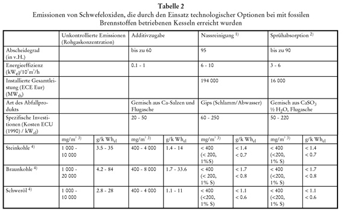
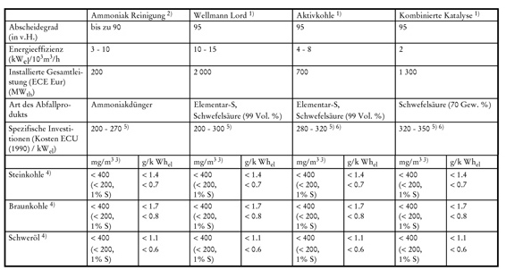
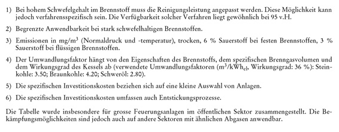

Protokoll zu dem Übereinkommen von 1979 über weiträumige grenzüberschreitende Luftverunreinigung betreffend die weitere Verringerung von Schwefelemissionen Abgeschlossen in Oslo am 14. Juni 1994 Zustimmung des Landtags: 18. Juni 1997 Inkrafttreten für das Fürstentum Liechtenstein: 25. November 1997 Die Vertragsparteien - entschlossen, das Übereinkommen über weiträumige grenzüberschreitende Luftverunreinigung durchzuführen, besorgt darüber, dass Emissionen von Schwefel und anderen luftverunreinigenden Stoffen weiterhin über internationale Grenzen befördert werden und in exponierten Teilen Europas und Nordamerikas ausgedehnte Schäden an Naturschätzen von lebenswichtiger Bedeutung für Umwelt und Wirtschaft, z.B. Wäldern, Böden und Gewässern, sowie an Materialien, einschliesslich historischer Denkmäler, verursachen und unter bestimmten Umständen schädliche Auswirkungen auf die menschliche Gesundheit haben, in dem Entschluss, vorsorgende Massnahmen zu treffen, um Emissionen luftverunreinigender Stoffe vorzubeugen, sie zu verhüten oder auf ein Mindestmass zu beschränken und ihre nachteiligen Auswirkungen möglichst gering zu halten, in der Überzeugung, dass bei drohenden schweren oder bleibenden Schäden die fehlende absolute wissenschaftliche Sicherheit nicht als Grund dafür dienen soll, entsprechende Massnahmen aufzuschieben, wobei zu berücksichtigen ist, dass diese vorsorgenden Massnahmen zur Bekämpfung der Emissionen luftverunreinigender Stoffe kosteneffizient sein sollen, eingedenk dessen, dass Massnahmen zur Bekämpfung von Schwefel und anderen luftverunreinigenden Stoffen auch zum Schutz der empfindlichen Umwelt der Arktis beitragen würden, in der Erwägung, dass die Hauptquellen der Luftverunreinigung, die zur Versauerung der Umwelt beitragen, die Verbrennung fossiler Brennstoffe zur Energieerzeugung, die wichtigsten technischen Verfahren in den verschiedenen Industriesektoren sowie der Verkehr sind, die zu Emissionen von Schwefel, Stickstoffoxiden und anderen verunreinigenden Stoffen führen, in dem Bewusstsein, dass ein kosteneffizienter, regionaler Lösungsansatz zur Bekämpfung der Luftverunreinigung notwendig ist, bei dem die Unterschiede zwischen den einzelnen Staaten bezüglich der Auswirkungen und der Kosten der Bekämpfung berücksichtigt werden, in dem Wunsch, weitere und wirksamere Massnahmen zur Bekämpfung und Verringerung der Schwefelemissionen zu ergreifen, in Kenntnis der Tatsache, dass jede Politik zur Bekämpfung der Schwefelemissionen, so kostenwirksam sie auf regionaler Ebene auch sein mag, eine relativ hohe wirtschaftliche Belastung für die Staaten verursachen wird, die sich im Übergang zur Marktwirtschaft befinden, im Hinblick darauf, dass Massnahmen zur Verringerung der Schwefelemissionen nicht als Mittel willkürlicher oder ungerechtfertigter Diskriminierung oder als verschleierte Einschränkung des internationalen Wettbewerbs und Handels dienen sollen, unter Berücksichtigung der verfügbaren wissenschaftlichen und technischen Daten über Emissionen, Abläufe in der Atmosphäre und Auswirkungen der Schwefeloxide auf die Umwelt sowie über die Kosten für deren Bekämpfung, in dem Bewusstseins, dass neben den Schwefelemissionen auch Emissionen von Stickstoffoxiden und Ammoniak zur Versauerung der Umwelt führen, in Anbetracht dessen, dass aufgrund des am 9. Mai 1992 in New York angenommenen Rahmenübereinkommens der Vereinten Nationen über Klimaänderungen vereinbart wurde, nationale Politiken einzuführen und entsprechende Massnahmen zur Bekämpfung der Klimaänderungen zu ergreifen, wodurch eine Verringerung der Schwefelemissionen herbeigeführt werden dürfte, in Bekräftigung der Notwendigkeit, eine umweltverträgliche und nachhaltige Entwicklung sicherzustellen, in Anerkennung der Notwendigkeit, die wissenschaftliche und technische Zusammenarbeit fortzusetzen, um den auf kritischen Einträgen und kritischen Werten beruhenden Lösungsansatz weiter auszuarbeiten, einschliesslich der Bemühungen zur Bewertung verschiedener luftverunreinigender Stoffe und verschiedenartiger Auswirkungen auf die Umwelt, aus Materialien und auf die menschliche Gesundheit, unter Hervorhebung der Tatsache, dass wissenschaftliche und technische Kenntnisse weiter fortschreiten und dass es notwendig sein wird, diese Entwicklungen zu berücksichtigen, wenn die Angemessenheit der aufgrund dieses Protokolls eingegangenen Verpflichtungen überprüft und über künftige Massnahmen entschieden wird, in Anerkennung des am 8. Juli 1985 in Helsinki angenommenen Protokolls betreffend die Verringerung von Schwefelemissionen oder ihres grenzüberschreitenden Flusses um mindestens 30 vom Hundert sowie der von zahlreichen Staaten bereits ergriffenen Massnahmen, die eine Verringerung der Schwefelemissionen bewirkt haben - sind wie folgt übereingekommen: Art. 1 Begriffsbestimmungen Im Sinne dieses Protokolls 1. bedeutet "Übereinkommen" das am 13. November 1979 in Genf angenommene Übereinkommen über weiträumige grenzüberschreitende Luftverunreinigung; 2. bedeutet "EMEP" das Programm über die Zusammenarbeit bei der Messung und Bewertung der weiträumigen Übertragung von luftverunreinigenden Stoffen in Europa; 3. bedeutet "Exekutivorgan" das nach Art. 10 Abs. 1 des Übereinkommens gebildete Exekutivorgan für das Übereinkommen; 4. bedeutet "Kommission" die Wirtschaftskommission der Vereinten Nationen für Europa; 5. bedeutet "Vertragsparteien" die Vertragsparteien dieses Protokolls, soweit der Zusammenhang nichts anderes erfordert; 6. bedeutet "geographischer Anwendungsbereich des EMEP" das in Art. 1 Abs. 4 des am 28. September 1984 in Genf angenommenen Protokolls zum Übereinkommen von 1979 über weiträumige grenzüberschreitende Luftverunreinigung betreffend die langfristige Finanzierung des Programms über die Zusammenarbeit bei der Messung und Bewertung der weiträumigen Übertragung von luftverunreinigenden Stoffen in Europa (EMEP) definierte Gebiet; 7. bedeutet "SOMA" ein in Anhang III unter den in Art. 2 Abs. 3 festgelegten Bedingungen bestimmtes Gebiet, in dem Massnahmen zur Verminderung der Schwefeloxide durchgeführt werden; 8. bedeutet "kritischer Eintrag" eine quantitative Schätzung der Exposition gegenüber einem oder mehreren verunreinigenden Stoffen, unterhalb deren nach dem heutigen Wissensstand keine signifikanten schädlichen Auswirkungen auf bestimmte empfindliche Teile der Umwelt auftreten; 9. bedeutet "kritische Werte" die Konzentration verunreinigender Stoffe in der Atmosphäre, oberhalb deren nach dem heutigen Wissensstand unmittelbare schädliche Auswirkungen auf Rezeptoren wie Menschen, Pflanzen, Ökosysteme oder Materialien auftreten können; 10. bedeutet "kritische Schwefeldeposition" eine quantitative Schätzung der Exposition gegenüber oxidierten Schwefelverbindungen unter Berücksichtigung der durch Aufnahme und Deposition basischer Kationen verursachten Auswirkungen, unterhalb deren nach dem heutigen Wissensstand keine signifikanten schädlichen Auswirkungen auf bestimmte empfindliche Teile der Umwelt auftreten; 11. bedeutet "Emission" die Ableitung von Stoffen in die Atmosphäre; 12. bedeutet "Schwefelemissionen" sämtliche Emissionen von Schwefelverbindungen, ausgedrückt in Kilotonnen Schwefeldioxid (kt SO 2 ), in die Atmosphäre, die von anthropogenen Quellen mit Ausnahme von Schiffen im internationalen Verkehr ausserhalb der Hoheitsgewässer ausgehen; 13. bedeutet "Brennstoff jedes feste, flüssige oder gasförmige brennbare Material mit Ausnahme von Haushaltsabfällen und toxischen oder gefährlichen Abfällen; 14. bedeutet "ortsfeste Verbrennungsquelle" jede technische Einrichtung oder Gruppe von technischen Einrichtungen, die sich an einem gemeinsamen Standort befinden, die Abgase durch einen gemeinsamen Schornstein ableiten oder ableiten könnten und in denen zur Nutzung der erzeugten Wärme Brennstoffe oxidiert werden; 15. bedeutet "grössere neue ortsfeste Verbrennungsquelle" jede ortsfeste Verbrennungsquelle, deren Bau oder wesentliche Veränderung nach dem 31. Dezember 1995 genehmigt wird und deren thermische Nennleistung mindestens 50 MW th beträgt. Die zuständigen nationalen Behörden entscheiden darüber, ob eine Veränderung wesentlich ist oder nicht, unter Berücksichtigung solcher Faktoren wie die Vorteile für die Umwelt infolge der Veränderung; 16. bedeutet "grössere bestehende ortsfeste Verbrennungsquelle" jede bestehende ortsfeste Verbrennungsquelle, deren thermische Nennleistung mindestens 50 MW th beträgt; 17. bedeutet "Gasöl" jedes Erdölerzeugnis innerhalb von HS 2710 oder jedes Erdölerzeugnis, das aufgrund seines Destillationsbereichs in die Kategorie der Mitteldestillate fällt, die zur Verwendung als Brennstoff bestimmt sind und von denen mindestens 85 Volumenprozente einschliesslich Destillationsverluste bei 350º Celsius destillieren; 18. bedeutet "Emissionsgrenzwert" die zulässige Konzentration von Schwefelverbindungen, ausgedrückt als Schwefeldioxid, in den Abgasen aus einer ortsfesten Verbrennungsquelle, ausgedrückt als Masse pro Volumen der Abgase in mg SO 2 /Nm 3 , bezogen auf einen Volumenanteil an Sauerstoff im Abgas von 3 v.H. bei flüssigen und gasförmigen Brennstoffen und 6 v.H. bei festen Brennstoffen; 19. bedeutet "Emissionsbegrenzung" die zulässige Gesamtmenge an Schwefelverbindungen, ausgedrückt als Schwefeldioxid die von einer Verbrennungsquelle oder einer Gruppe von Verbrennungsquellen herrühren, die sich entweder an einem gemeinsamen Standort oder innerhalb eines festgelegten geographischen Gebiets befinden, ausgedrückt in Kilotonnen pro Jahr; 20. bedeutet "Schwefelabscheidegrad" das Verhältnis der Schwefelmenge, die in einem bestimmten Zeitraum am Standort der Verbrennungsquelle abgeschieden wird, zu der Schwefelmenge in dem Brennstoff, der in die Verbrennungsanlagen eingebracht und im gleichen Zeitraum verbraucht wird; 21. bedeutet "Schwefelhaushalt" eine Matrix berechneter Beiträge von Emissionen aus bestimmten Gebieten zur Deposition oxidierter Schwefelverbindungen in Aufnahmegebieten. Art. 2 Grundlegende Verpflichtungen 1) Die Vertragsparteien begrenzen und verringern ihre Schwefelemissionen, um die Gesundheit des Menschen und die Umwelt vor nachteiligen Auswirkungen, insbesondere Auswirkungen durch Versauerung, zu schützen und um sicherzustellen, soweit möglich ohne unverhältnismässig hohe Kosten zu verursachen, dass Depositionen von oxidierten Schwefelverbindungen die nach dem heutigen wissenschaftlichen Kenntnisstand in Anhang I als kritische Schwefeldepositionen angegebenen kritischen Einträge langfristig nicht überschreiten. 2) In einem ersten Schritt verringern die Vertragsparteien ihre jährlichen Schwefelemissionen zumindest entsprechend dem Zeitplan und den Werten, die in Anhang II festgelegt sind, und halten sie auf diesem Stand. 3) Jede Vertragspartei, a) deren gesamte Landfläche mehr als 2 000 000 Quadratkilometer beträgt; b) die sich nach Abs. 2 zu einer Höchstmenge der nationalen Schwefelemissionen verpflichtet hat, die das Niveau ihrer Emissionen von 1990 oder ihre Verpflichtung im Rahmen des Protokolls von Helsinki von 1985 zur Verringerung von Schwefelemissionen oder ihres grenzüberschreitenden Flusses um mindestens 30 vom Hundert nicht übersteigt, sofern dieser Wert niedriger ist, wie in Anhang II angegeben; c) deren jährliche Schwefelemissionen, die zur Versauerung in Gebieten unter der Hoheitsgewalt einer oder mehrerer anderer Vertragsparteien beitragen, ausschliesslich aus Gebieten unter ihrer Hoheitsgewalt stammen, welche in Anhang III als SOMAs aufgeführt sind, und die hierüber entsprechende Unterlagen vorgelegt hat, und d) die bei der Unterzeichnung dieses Protokolls oder beim Beitritt zu dem Protokoll ihre Absicht bekundet hat, in Übereinstimmung mit diesem Absatz zu handeln, verringert darüber hinaus ihre jährlichen Schwefelemissionen in dem derart ausgewiesenen Gebiet zumindest entsprechend dem Zeitplan und den Werten, die in Anhang II festgelegt sind, und hält sie auf diesem Stand. 4) Ausserdem wenden die Vertragsparteien entsprechend den Leitlinien in Anhang IV die wirksamsten Massnahmen, die unter den jeweiligen Umständen für sie angemessen sind, zur Verringerung der Schwefelemissionen auf neue und bestehende Quellen an; dazu gehören unter anderem: - Massnahmen zur Erhöhung der Energieeffizienz; - Massnahmen zur Erhöhung der Verwendung erneuerbarer Energien; - Massnahmen zur Verringerung des Schwefelgehalts bestimmter Brennstoffe und zur Förderung der Verwendung von Brennstoffen mit niedrigem Schwefelgehalt, einschliesslich der kombinierten Verwendung von hoch schwefelhaltigem mit schwefelarmem oder schwefelfreiem Brennstoff; - Massnahmen zur Anwendung der besten verfügbaren Technologien zur Emissionsbekämpfung, die keine unverhältnismässig hohen Kosten verursachen. 5) Mit Ausnahme der Vertragsparteien, die dem Abkommen über Luftqualität von 1991 zwischen den Vereinigten Staaten und Kanada unterliegen, wird jede Vertragspartei zumindest: a) Emissionsgrenzwerte auf alle grösseren neuen ortsfesten Verbrennungsquellen anwenden, die mindestens so streng sind wie die in Anhang V festgelegten Werte; b) bis spätestens 1. Juli 2004, soweit wie möglich ohne unverhältnismässig hohe Kosten zu verursachen, Emissionsgrenzwerte, die mindestens so streng sind wie die in Anhang V festgelegten Werte, auf die grösseren bestehenden ortsfesten Verbrennungsquellen, die eine thermische Nennleistung von mehr als 500 MW th haben, wobei die verbleibende Lebenszeit einer Anlage ab dem Zeitpunkt des Inkrafttretens dieses Protokolls berücksichtigt wird, oder gleichwertige Emissionsbegrenzungen oder sonstige geeignete Bestimmungen anwenden, sofern diese die in Anhang II festgelegten Obergrenzen für Schwefelemissionen erreichen und sich im Anschluss daran den in Anhang I aufgeführten kritischen Einträge nähern; bis spätestens 1. Juli 2004 Emissionsgrenzwerte oder Emissionsbegrenzungen auf die grösseren bestehenden ortsfesten Verbrennungsquellen anwenden, deren thermische Nennleistung zwischen 50 und 500 MW th liegt, wobei Angang V als Leitlinie dient; c) spätestens zwei Jahre nach Inkrafttreten dieses Protokolls nationale Normen für den Schwefelgehalt im Gasöl anwenden, die mindestens so streng sind wie die in Anhang V festgelegten. In Fällen, in denen die Versorgung mit Gasöl anders nicht sichergestellt werden kann, kann ein Staat die in diesem Absatz festgelegte Frist bis auf 10 Jahre verlängern. In diesem Fall bekundet er in einer Erklärung, die zusammen mit der Ratifikations-, Annahme-, Genehmigungs- oder Beitrittsurkunde hinterlegt wird, seine Absicht zur Verlängerung der Frist. 6) Die Vertragsparteien können ausserdem wirtschaftliche Instrumente anwenden, um die Annahme kostenwirksamer Lösungsansätze zur Verringerung der Schwefelemissionen zu fördern. 7) Die Vertragsparteien dieses Protokolls können auf einer Tagung des Exekutivorgans entsprechend den Regeln und Bedingungen, die von diesem auszuarbeiten und anzunehmen sind, entscheiden, ob zwei oder mehr Vertragsparteien die in Anhang II enthaltenen Verpflichtungen gemeinsam erfüllen dürfen. Diese Regeln und Bedingungen müssen die Einhaltung der in Abs. 2 enthaltenen Verpflichtungen gewährleisten und auch die Erreichung der in Abs. 1 genannten Umweltziele fördern. 8) Die Vertragsparteien beginnen vorbehaltlich des Ergebnisses der ersten Überprüfung nach Art. 8 und spätestens ein Jahr nach Abschluss dieser ersten Überprüfung Verhandlungen über weitere Verpflichtungen zur Verringerung der Emissionen. Art. 3 Technologieaustausch 1) Die Vertragsparteien erleichtern in Übereinstimmung mit ihren innerstaatlichen Gesetzen, sonstigen Vorschriften und Gepflogenheiten den Austausch von Technologien und Techniken zur Verringerung von Schwefelemissionen, einschliesslich solcher, welche die Energieeffizienz, die Verwendung erneuerbarer Energien und die Verwendung schwefelarmer Brennstoffe erhöhen, insbesondere durch die Förderung a) des kommerziellen Austausches verfügbarer Technologien; b) direkter Kontakte und Zusammenarbeit der Industrien, einschliesslich Gemeinschaftsunternehmen; c) des Austausches von Informationen und Erfahrungen und d) der Gewährung technischer Unterstützung. 2) Bei der Förderung der in Abs. 1 bezeichneten Tätigkeiten Stillaffen die Vertragsparteien günstige Voraussetzungen, indem sie Kontakte und Zusammenarbeit zwischen geeigneten Organisationen und Personen des privaten und öffentlichen Sektors erleichtern, die Technologien, Planungs- und Konstruktionsdienste, Ausrüstung oder Finanzierung zur Verfügung stellen können. 3) Die Vertragsparteien beginnen spätestens sechs Monate nach Inkrafttreten dieses Protokolls mit der Prüfung von Verfahren zur Schaffung günstigerer Voraussetzungen für den Austausch von Technologien zur Verringerung der Schwefelemissionen. Art. 4 Nationale Strategien, Politiken, Programme, Massnahmen und Informationen 1) Zur Erfüllung ihrer in Art. 2 enthaltenen Verpflichtungen wird jede Vertragspartei a) spätestens sechs Monate, nachdem dieses Protokoll für sie in Kraft getreten ist, nationale Strategien, Politiken und Programme verabschieden und b) nationale Massnahmen ergreifen und anwenden, um ihre Schwefel- emissionen zu begrenzen und zu verringern. 2) Jede Vertragspartei sammelt und hält Informationen verfügbar über a) das tatsächliche Niveau der Schwefelemissionen sowie der Immissionskonzentrationen und Depositionen von oxidiertem Schwefel und anderen versauernden Verbindungen, wobei bei den Vertragsparteien innerhalb des geographischen Anwendungsbereichs des EMEP der EMEP-Arbeitsplan berücksichtigt wird, und b) die durch Depositionen von oxidiertem Schwefel und anderen versauernden Verbindungen entstandenen Auswirkungen. Art. 5 Berichterstattung 1) Jede Vertragspartei übermittelt dem Exekutivorgan über den Exekutivsekretär der Kommission in vom Exekutivorgan festzulegenden regelmässigen Abständen Informationen über a) die Durchführung der in Art. 4 Abs. 1 genannten nationalen Strategien, Politiken, Programme und Massnahmen, b) das Niveau der jährlichen nationalen Schwefelemissionen entsprechend den vom Exekutivorgan angenommenen Richtlinien unter Angabe der Emissionsdaten für alle einschlägigen Kategorien von Emissionsquellen und c) die Durchführung sonstiger Verpflichtungen, die sie aufgrund dieses Protokolls übernommen hat, im Einklang mit einem von den Vertragsparteien auf einer Tagung des Exekutivorgans gefassten Beschluss über Form und Inhalt der Informationen. Die Bestimmungen dieses Beschlusses werden, falls erforderlich, überprüft, um zusätzliche Elemente bezüglich Form und/oder Inhalt der in den Bericht aufzunehmenden Informationen festzustellen. 2) Jede Vertragspartei innerhalb des geographischen Anwendungsbereichs des EMEP übermittelt an EMEP über den Exekutivsekretär der Kommission in regelmässigen Abständen, die vom EMEP-Lenkungsorgan festzulegen und von den Vertragsparteien auf einer Tagung des Exekutivorgans zu genehmigen sind, Informationen über das Niveau der Schwefelemissionen mit der vom EMEP-Lenkungsausschuss bestimmten zeitlichen und räumlichen Auflösung. 3) Rechtzeitig vor jeder Jahrestagung des Exekutivorgans legt EMEP Informationen vor über a) Immissionskonzentrationen und Deposition oxidierter Schwefelverbindungen und b) Berechnungen der Schwefelhaushalte. Die Vertragsparteien ausserhalb das geographischen Anwendungsbereichs des EMEP stellen auf Anfrage des Exekutivorgans ähnliche Informationen zur Verfügung. 4) Das Exekutivorgan veranlasst nach Art. 10 Abs. 2 Bst. b das Übereinkommens die Darlegung von Informationen über die Auswirkungen von Depositionen oxidierten Schwefels und anderer versauernder Verbindungen. 5) Die Vertragsparteien sorgen dafür, dass auf den Tagungen des Exekutivorgans in regelmässigen Abständen überarbeitete Informationen über berechnete und international optimierte Zuteilungen von Emissionsverringerungen für die Staaten innerhalb des geographischen Anwendungsbereichs des EMEP mit Hilfe integrierter Bewertungsmodelle vorgelegt werden, um im Sinne des Art. 2 Abs. 1 dieses Protokolls den Unterschied zwischen den tatsächlichen Depositionen oxidierter Schwefelverbindungen und den kritischen Eintragswerten weiter zu verringern. Art. 6 Forschung, Entwicklung und Überwachung Die Vertragsparteien fördern die Forschung, Entwicklung, Überwachung und Zusammenarbeit in bezug auf: a) die internationale Harmonisierung der Methoden zur Festlegung der kritischen Einträge und der kritischen Werte sowie die Ausarbeitung von Verfahren für eine derartige Harmonisierung; b) die Verbesserung der Überwachungsmethoden und -systeme sowie der Modellierung von Transport, Konzentrationen und Depositionen von Schwefelverbindungen; c) Strategien zur weiteren Verringerung der Schwefelemissionen auf der Grundlage der kritischen Einträge und der kritischen Werte sowie der technischen Entwicklungen und der Verbesserung integrierter Bewertungsmodelle zur Berechnung international optimierter Zuteilungen von Emissionsverringerungen unter Berücksichtigung einer ausgewogenen Verteilung der Kosten der Emissionsverringerungen; d) das Verständnis für die weiterreichenden Auswirkungen von Schwefelemissioinen auf die Gesundheit des Menschen, die Umwelt - insbesondere Versauerung - und auf Materialien, einschliesslich historischer und kultureller Denkmäler, unter Berücksichtigung des Verhältnisses zwischen Schwefeloxiden, Stickstoffoxiden, Ammoniak, flüchtigen organischen Verbindungen und troposphärischem Ozon; e) Technologien zur Emissionsbekämpfung und Technologien und Techniken zur Verbesserung der Energieeffizienz, der Energieeinsparung und der Verwendung erneuerbarer Energien; f) die wirtschaftliche Bewertung der durch die Verringerung von Schwefelemissionen bewirkten Vorteile für die Umwelt und die Gesundheit des Menschen. Art. 7 Einhaltung des Protokolls 1) Hiermit wird ein Durchführungsausschuss eingesetzt, der die Durchführung dieses Protokolls und die Einhaltung der von den Vertragsparteien eingegangenen Verpflichtungen überprüft. Er erstattet den Vertragsparteien auf den Tagungen des Exekutivorgans Bericht und kann ihnen die von ihm für geeignet gehaltenen Empfehlungen erteilen. 2) Nach Prüfung des Berichts und etwaiger vom Durchführungsausschuss erteilter Empfehlungen können die Vertragsparteien unter Berücksichtigung der Umstände einer Angelegenheit und entsprechend den Gepflogenheiten des Übereinkommens beschliessen und verlangen, dass Massnahmen getroffen werden, um die vollständige Einhaltung dieses Protokolls sicherzustellen, einschliesslich Massnahmen zur Unterstützung einer Vertragspartei bei der Einhaltung des Protokolls und zur Förderung der Ziele des Protokolls. 3) Auf der ersten Tagung des Exekutivorgans nach Inkrafttreten dieses Protokolls fassen die Vertragsparteien einen Beschluss, durch den die Struktur und die Aufgaben des Durchführungsausschusses sowie die Verfahren festgelegt werden, die der Ausschuss bei der Überprüfung der Einhaltung des Protokolls zugrundelegt. 4) Die Anwendung des Verfahrens zur Überprüfung der Einhaltung lässt Art. 9 dieses Protokolls unberührt. Art. 8 Überprüfungen durch die Vertragsparteien auf den Tagungen des Exekutivorgans 1) Nach Art. 10 Abs. 2 Bst. a des Übereinkommens überprüfen die Vertragsparteien auf den Tagungen des Exekutivorgans die von den Vertragsparteien und EMEP vorgelegten Informationen, die Daten über die Auswirkungen durch Schwefeldepositionen und Depositionen anderer versauernder Verbindungen sowie die in Art. 7 Abs. 1 dieses Protokolls bezeichneten Berichte des Durchführungsausschusses. 2) a) Auf den Tagungen des Exekutivorgans überprüfen die Vertragsparteien laufend die in diesem Protokoll aufgeführten Verpflichtungen, darunter i) ihre Verpflichtungen im Zusammenhang mit ihren berechneten und international optimierten Zuteilungen von Emissionsverringerungen, wie in Art. 5 Abs. 5 vorgesehen, und ii) die Angemessenheit der Verpflichtungen und die Fortschritte, die zur Erreichung der in diesem Protokoll festgelegten Ziele gemacht wurden; b) die Überprüfungen berücksichtigen die besten verfügbaren wissenschaftlichen Informationen über Versauerung, einschliesslich der Bewertung der kritischen Einträge, der technologischen Entwicklungen, der sich ändernden wirtschaftlichen Bedingungen und der Erfüllung der Verpflichtungen hinsichtlich der Emissionswerte; c) im Zusammenhang mit diesen Überprüfungen bemüht sich jede Vertragspartei, deren Verpflichtungen hinsichtlich der in Anhang II festgelegten Obergrenzen für Schwefelemissionen nicht mit den für sie berechneten und international optimierten Zuteilungen der Emissionsverringerungen, die zur Verringerung des Unterschieds um mindestens 60 v.H. zwischen den Schwefeldepositionen im Jahr 1990 und den kritischen Schwefeldepositionen innerhalb des geographischen Anwendungsbereichs des EMEP erforderlich sind, übereinstimmen, nach Kräften, den geänderten Verpflichtungen nachzukommen; d) die Verfahren Methoden und der Zeitplan für die Überprüfungen werden von den Vertragsparteien auf einer Tagung des Exekutivorgans festgelegt. Die erste Überprüfung dieser Art muss 1997 beendet sein. Art. 9 Beilegung von Streitigkeiten 1) Im Fall einer Streitigkeit zwischen zwei oder mehr Vertragsparteien über die Auslegung oder Anwendung dieses Protokolls bemühen sich die betroffenen Vertragsparteien um eine Beilegung der Streitigkeit durch Verhandlungen oder andere friedliche Mittel ihrer Wahl. Die Streitparteien unterrichten das Exekutivorgan über ihre Streitigkeit. 2) Bei der Ratifikation, der Annahme oder der Genehmigung dieses Protokolls oder beim Beitritt zum Protokoll oder jederzeit danach kann eine Vertragspartei, die keine Organisation der regionalen Wirtschaftsintegration ist, in einer dem Verwahrer vorgelegten schriftlichen Urkunde erklären, dass sie in bezug auf jede Streitigkeit über die Auslegung oder Anwendung des Protokolls eines oder beide der folgenden Mittel der Streitbeilegung gegenüber jeder Vertragspartei, welche dieselbe Verpflichtung übernimmt, von Rechts wegen und ohne Übereinkunft als obligatorisch anerkennt: a) Vorlage der Streitigkeit beim Internationalen Gerichtshof; b) ein Schiedsverfahren in Übereinstimmung mit Verfahren, die von den Vertragsparteien so bald wie möglich in einem Anhang über ein Schiedsverfahren auf einer Tagung des Exekutivorgans beschlossen werden. Eine Vertragspartei, die eine Organisation der regionalen Wirtschaftsintegration ist, kann in bezug auf ein Schiedsverfahren nach dem unter Bst. b vorgesehenen Verfahren eine Erklärung mit gleicher Wirkung abgeben. 3) Eine nach Abs. 2 abgegebene Erklärung bleibt in Kraft, bis sie gemäss den darin enthaltenen Bestimmungen erlischt oder bis zum Ablauf von drei Monaten nach Hinterlegung einer schriftlichen Rücknahmenotifikation beim Verwahrer. 4) Eine neue Erklärung, eine Rücknahmenotifiktaion oder das Erlöschen einer Erklärung berührt nicht die beim Internationalen Gerichtshof oder bei dem Schiedsgericht anhängigen Verfahren, sofern die Streitparteien nichts anderes vereinbaren. 5) Ausser in dem Fall, in dem die Streitparteien dasselbe Mittel der Streitbeilegung nach Abs. 2 angenommen haben, wird die Streitigkeit auf Ersuchen einer der Streitparteien einem Vergleichsverfahren unterworfen, wenn nach Ablauf von zwölf Monaten, nachdem eine Vertragspartei einer anderen notifiziert hat, daß eine Streitigkeit zwischen ihnen besteht, die betreffenden Vertragsparteien ihre Streitigkeit nicht durch die in Abs. 1 genannten Mittel beilegen konnten. 6) Für die Zwecke des Abs. 5 wird eine Vergleichskommission gebildet. Die Kommission besteht aus einer jeweils gleichen Anzahl von durch die betreffenden Parteien oder, falls mehrere Parteien des Vergleichsverfahrens eine Streitgenossenschaft bilden, durch die Gesamtheit dieser Parteien ernannten Mitgliedern sowie einem Vorsitzenden, der gemeinsam von den so ernannten Mitgliedern gewählt wird. Die Kommission fällt einen Spruch mit Empfehlungscharakter, den die Parteien nach Treu und Glauben prüfen. Art. 10 Anhänge Die Anhänge dieses Protokolls sind Bestandteil des Protokolls. Die Anhänge I und IV haben Empfehlungscharakter. Art. 11 Änderungen und Anpassungen 1) Jede Vertragspartei kann Änderungen dieses Protokolls vorschlagen. Jede Vertragspartei des Übereinkommens kann eine Anpassung in Anhang II des Protokolls vorschlagen, um ihren Namen zusammen mit Emissionswerten, Obergrenzen für Schwefelemissionen und dem Vomhundertsatz der Emissionsverringerungen einfügen zu lassen. 2) Diese vorgeschlagenen Änderungen und Anpassungen werden dem Exekutivsekretär der Kommission schriftlich vorgelegt, der sie an alle Vertragsparteien weiterleitet. Die Vertragsparteien erörtern die vorgeschlagenen Änderungen und Anpassungen auf der nächsten Tagung des Exekutivorgans, sofern diese Vorschläge vom Exekutivsekretär den Vertragsparteien mindestens neunzig Tage im voraus übermittelt worden sind. 3) Änderungen dieses Protokolls und seiner Anhänge II, III und V bedürfen der einvernehmlichen Annahme durch die auf einer Tagung des Exekutivorgans anwesenden Vertragsparteien; sie treten für die Vertragsparteien, die sie angenommen haben, am neunzigsten Tag nach dem Zeitpunkt in Kraft, zu dem zwei Drittel der Vertragsparteien ihre Urkunde über die Annahme der Änderungen hinterlegt haben. Die Änderungen treten für jede andere Vertragspartei am neunzigsten Tag nach dem Zeitpunkt in Kraft, zu dem die betreffende Vertragspartei ihre Urkunde über die Annahme der Änderungen hinterlegt hat. 4) Änderungen der Anhänge dieses Protokolls, ausgenommen Änderungen der in Abs. 3 genannten Anhänge, bedürfen der einvernehmlichen Annahme durch die auf einer Tagung des Exekutivorgans anwesenden Vertragsparteien. Für die Vertragsparteien, die dem Verwahrer keine Notifikation nach Abs. 5 vorgelegt haben, wird eine Änderung eines dieser Anhänge nach Ablauf von neunzig Tagen nach dem Zeitpunkt wirksam, zu dem der Exekutivsekretär sie der Kommission übermittelt hat, sofern mindestens sechzehn Vertragsparteien keine solche Notifikation vorgelegt haben. 5) Jede Vertragspartei, die eine Änderung eines Anhangs, ausgenommen einen in Abs. 3 aufgeführten Anhang, nicht genehmigen kann, notifiziert dies dem Verwahrer schriftlich innerhalb von neunzig Tagen, nachdem die Annahme der Änderung mitgeteilt wurde. Der Verwahrer unterrichtet alle Vertragsparteien unverzüglich über die erhaltene Notifikation. Eine Vertragspartei kann jederzeit ihre frühere Notifikation durch eine Annahme ersetzen; die Änderung des betreffenden Anhangs wird für die Vertragspartei mit Hinterlegung einer Annahmeurkunde beim Verwahrer wirksam. 6) Anpassungen in Anhang II bedürfen der einvernehmlichen Annahme durch die auf einer Tagung des Exekutivorgans anwesenden Vertragsparteien; sie werden für alle Vertragsparteien dieses Protokolls am neunzigsten Tag nach dem Zeitpunkt wirksam, zu dem der Exekutivsekretär der Kommission den betreffenden Vertragsparteien die Annahme der Anpassung schriftlich notifiziert hat. Art. 12 Unterzeichnung 1) Dieses Protokoll liegt vom 13. bis zum 14. Juni 1994 in Oslo und danach bis zum 12. Dezember 1994 am Sitz der Vereinten Nationen in New York für die Mitgliedstaaten der Kommission, für Staaten, die in der Kommission nach Abs. 8 der Entschliessung 36 (IV) des Wirtschafts- und Sozialrats vom 28. März 1947 beratenden Status haben, sowie für Organisationen der regionalen Wirtschaftsintegration, die von souveränen Staaten, die Mitglieder der Kommission sind, gebildet werden und für die Aushandlung, den Abschluss und die Anwendung internationaler Übereinkünfte in Angelegenheiten zuständig sind, die in den Geltungsbereich dieses Protokolls fallen, zur Unterzeichnung auf, vorausgesetzt, dass die betreffenden Staaten und Organisationen Vertragsparteien des Übereinkommens und in Anhang II aufgeführt sind. 2) Solche Organisationen der regionalen Wirtschaftsintegration üben in Angelegenheiten, die in ihren Zuständigkeitsbereich fallen, in ihrem eigenen Namen die Rechte aus und nehmen die Pflichten wahr, die dieses Protokoll ihren Mitgliedstaaten überträgt. In diesen Fällen sind die Mitgliedstaaten dieser Organisationen nicht berechtigt, solche Rechte einzeln auszuüben. Art. 13 Ratifikation, Annahme, Genehmigung und Beitritt 1) Dieses Protokoll bedarf der Ratifikation, Annahme oder Genehmigung durch die Unterzeichner. 2) Dieses Protokoll steht vom 12. Dezember 1994 an für die Staaten und Organisationen, welche die Voraussetzungen des Art. 12 Abs. 1 erfüllen, zum Beitritt offen. Art. 14 Verwahrer Die Ratifikations-, Annahme-, Genehmigungs- oder Beitrittsurkunden werden beim Generalsekretär der Vereinten Nationen hinterlegt; dieser erfüllt die Aufgaben des Verwahrers. Art. 15 Inkrafttreten 1) Dieses Protokoll tritt am neunzigsten Tag nach dem Zeitpunkt der Hinterlegung der sechzehnten Ratifikations-, Annahme-, Genehmigungs- oder Beitrittsurkunde beim Verwahrer in Kraft. 2) Für alle in Art. 12 Abs. 1 bezeichneten Staaten und Organisationen, die nach der Hinterlegung der sechzehnten Ratifikations-, Annahme-, Genehmigungs- oder Beitrittsurkunde dieses Protokoll ratifizieren, annehmen, genehmigen oder ihm beitreten, tritt das Protokoll am neunzigsten Tag nach dem Zeitpunkt der Hinterlegung der Ratifikations-, Annahme-, Genehmigungs- oder Beitrittsurkunde durch die betreffende Vertragspartei in Kraft. Art. 16 Rücktritt Eine Vertragspartei kann jederzeit nach Ablauf von fünf Jahren nach dem Zeitpunkt, zu dem dieses Protokoll für sie in Kraft getreten ist, durch eine an den Verwahrer gerichtete schriftliche Notifikation von dem Protokoll zurücktreten. Der Rücktritt wird am neunzigsten Tag nach dem Eingang der Notifikation bei dem Verwahrer oder zu einem in der Rücktrittsnotifikation angegebenen späteren Zeitpunkt wirksam. Art. 17 Verbindliche Wortlaute Die Urschrift dieses Protokolls, dessen englischer, französischer und russischer Wortlaut gleichermassen verbindlich ist, wird beim Generalsekretär der Vereinten Nationen hinterlegt. Zu Urkund dessen haben die hierzu gehörig befugten Unterzeichneten dieses Protokoll unterschrieben. Geschehen zu Oslo am 14. Juni 1994. (Es folgen die Unterschriften) Anhang I Kritische Schwefeldeposition (5-Perzentil in Zentrigramm Schwefel pro Quadratmeter und Jahr) Anhang II Höchstmengen der Schwefelemissionen und Emissionsverringerungen in vom Hundert Die in der Tabelle unten aufgeführten Obergrenzen für Schwefelemissionen stellen die in Art. 2 Abs. 2 und 3 dieses Protokolls enthaltenen Verpflichtungen dar. Die aufgeführten Emissionswerte für 1980 und 1990 sowie die Emissionsverringerungen in v.H. dienen lediglich Informationszwecken. Emissionswerte kt SO 2 pro Jahr Obergrenzen für Schwefelemissionen 1) kt SO 2 pro Jahr Emissionsverringerung in v.H. (Basisjahr 1980 2) ) 1980 1990 2000 2005 2010 2000 2005 2010 Belarus 740 - 456 400 370 38 46 50 Belgien 828 443 248 232 215 70 72 74 Bulgarien 2050 2020 1374 1230 1127 33 40 45 Dänemark 451 180 90 - - 80 - - Deutschland 7494 5803 1300 990 - 83 87 - Finnland 584 260 116 - - 80 - - Frankreich 3348 1202 868 770 737 74 77 78 Griechenland 400 510 595 580 570 0 3 4 Irland 222 168 155 - - 30 - - Italien 3800 - 1330 1042 - 65 73 - Kanada - national 4614 3700 3200 - - 30 - - - SOMA 3245 - 1750 - - 46 - - Kroatien 150 160 133 125 117 11 17 22 Liechtenstein 0.4 0.1 0.1 - - 74 - - Litauen 6) 311 222 145 35 Luxemburg 24 - 10 - - 58 - - Niederlande 466 207 106 - - 77 - - Norwegen 142 54 34 - - 76 - - Monaco 4) 0.08 0.07 0.07 0.05 0.04 13 38 50 Österreich 397 90 78 - - 80 - - Polen 4100 3210 2583 2173 1397 37 47 66 Portugal 266 284 304 294 - 0 3 - Russische Föderation 3) 7161 4460 4440 4297 4297 38 40 40 Schweden 507 130 100 - - 80 - - Schweiz 126 62 60 - - 52 - - Slowakei 843 539 337 295 240 60 65 72 Slowenien 235 195 130 94 71 45 60 56 Spanien 3319 2316 2143 - - 35 - - Tschechien 2257 1876 1128 902 632 50 60 72 Ukraine 3850 - 2310 - - 40 - - Ungarn 1632 1010 898 816 653 45 50 60 Vereinigtes Königreich 4898 3780 2449 1470 980 50 70 80 Europäische Gemeinschaft 25513 - 9598 - - 62 - - Zypern 5) 28 46 53 48 39 0 9 26 Anmerkungen: 1. Stellt eine Vertragspartei vor dem Jahr 2005 zu einem Zeitpunkt fest, dass sie wegen eines besonders harten Winters, eines besonders trockenen Sommers oder eines unvorhergesehenen kurzfristigen Kapazitätsverlustes im Energieversorgungssystem im Inland oder in einem Nachbarstaat nicht in der Lage ist, ihren Verpflichtungen aus diesem Anhang nachzukommen, so kann sie diese erfüllen, indem sie den Durchschnittswert ihrer jährlichen Schwefelemissionen in dem betreffenden Jahr, dem Vorjahr und dem folgenden Jahr ermittelt; jedoch darf der Emissionswert in einem einzigen Jahr die Obergrenze für Schwefelemissionen um nicht mehr als 20 v.H. übersteigen. Dem Durchführungsausschuss sind die Gründe für die Überschreitung in einem bestimmten Jahr sowie die Methode der Ermittlung des Durchschnittwerts für die 3 Jahre zu melden. 2. Bei Griechenland, Zypern und Portugal stützen sich die angegebenen Vom-Hundert-Sätze der Emissionsverringerung auf die für das Jahr 2000 berechneten Obergrenzen. 3. Europäischer Teil innerhalb des Anwendungsgebietes des EMEP. 4. Die Werte von Monaco wurden anlässlich der 19. Sitzung des Exekutivorgans angenommen. 5. Die Werte von Zypern wurden anlässlich der 22. Sitzung des Exekutivorgans angenommen. 6. Die Werte von Litauen wurden anlässlich der 25. Sitzung des Exekutivorgans angenommen. Anhang III Bestimmung der Gebiete, in denen Massnahmen zur Verminderung der Schwefeloxide durchgeführt werden (Sulphur Oxides Management Areas [SOMAs]) Das folgende SOMA wird für die Zwecke dieses Protokolls angegeben: SOMA Südost-Kanada Es handelt sich um eine Fläche von 1 Mio km 2 , die folgendes umfasst: sämtliche Gebiete der Provinzen Prince-Edward-Island, Neuschottland und New Brunswick, das gesamte Gebiet der Provinz Quebec südlich einer geraden Linie zwischen Havre-St. Pierre an der Nordküste des St.-Lorenz-Golfs und dem Punkt, an dem die Grenze Quebec/Ontario auf die Küstenlinie der James-Bucht trifft, sowie das gesamte Gebiet der Provinz Ontario südlich einer geraden Linie zwischen dem Punkt, an dem die Grenze Ontario/Quebec die Küstenlinie der James-Bucht schneidet, um den Fluss Nipigon in der Nähe des Nordufers des Oberen Sees. Anhang IV Technologien zur Bekämpfung der Schwefelemissionen aus ortsfesten Quellen I. Einleitung 1. Dieser Anhang dient als Richtschnur für die Feststellung von Möglichkeiten und Technologien zur Bekämpfung von Schwefelemissionen, um die in diesem Protokoll enthaltenen Verpflichtungen einzuhalten. 2. Der Anhang stützt sich auf Informationen über allgemeine Möglichkeiten zur Verringerung der Schwefelemissionen und insbesondere über die Ergebnisse und Kosten der Technologien zur Bekämpfung der Emissionen, die in amtlichen Unterlagen des Exekutivorgans und seiner untergeordneten Organe enthalten sind. 3. Sofern nichts anderes angegeben ist, beruhen die aufgeführten Massnahmen zur Emissionsverringerung in den meisten Fällen auf der in mehreren Jahren gewonnenen praktischen Erfahrungen und gelten als die am besten eingeführten und wirtschaftlich günstigsten verfügbaren Technologien. Allerdings machen die sich fortlaufend erweiternden Erfahrungen mit emissionsarmen Massnahmen und Technologien in neuen Anlagen sowie Nachrüstung bestehender Anlagen eine regelmässige Überprüfung dieses Anhangs erforderlich. 4. Der Anhang führt zwar eine Reihe von Massnahmen und Technologien in einer grossen Bandbreite von Kosten und Leistungen auf, doch kann er nicht als vollständige Liste der Emissionsbekämpfungsmöglichkeiten betrachtet werden. Überdies hängt die Entscheidung für die Bekämpfungsmassnahmen und -technologien im Einzelfall von verschiedenen Faktoren ab, einschliesslich der geltenden Gesetze und Verordnungen, und insbesondere von den Anforderungen der Bekämpfungstechnologie, der Primärenergiestruktur, der industriellen Infrastruktur, der Wirtschaftslage und den besonderen innerbetrieblichen Bedingungen. 5. Das Hauptaugenmerk des Anhangs richtet sich auf die Bekämpfung der Emissionen oxidierten Schwefels als der Summe aus Schwefeldioxid (SO 2 ) und Schwefeltrioxid (SO 3 ), ausgedrückt als SO 2 . Der Anteil des Schwefels, der in Form von Schwefeloxid oder anderen Schwefelverbindungen von Nichtverbrennungsprozessen und aus anderen Quellen abgegeben wird, ist im Vergleich mit den Schwefelemissionen aus der Verbrennung gering. 6. Bei der Planung von Massnahmen oder Technologien für SO x -Quellen, die auch andere Stoffe, insbesondere Stickoxide (NO x ), Stäube, Schwermetalle und flüchtige organische Verbindungen (VOCs) abgeben, ist es sinnvoll, sie in Verbindung mit schadstoffspezifischen Bekämpfungsmöglichkeiten zu prüfen, um ihre Gesamtwirkung zu erhöhen und die Auswirkungen auf die Umwelt auf ein Mindestmass zu beschränken und insbesondere um zu verhindern, dass sich die Probleme der Luftverunreinigung auf andere Medien (wie z.B. Abwasser und feste Abfälle) übertragen. II. Grössere orstfeste Quellen für Schwefelemissionen 7. Die Verbrennung fossiler Brennstoffe ist die Hauptquelle anthropogener Schwefelemissionen aus orstfesten Quellen. Darüber hinaus können ausser der Verbrennung einige andere Prozesse erheblich zu diesen Emissionen beitragen. Nach EMEP/CORINAIR 90 gehören folgende Kategorien zu den wichtigsten orstfesten Verbrennungsquellen: i) öffentliche Kraftwerke, Anlagen für Kraftwärmekopplung und Fernwärme: a) Kessel; b) orstfeste Verbrennungsturbinen und Verbrennungsmotoren; ii) Feuerungsanlagen für Gewerbe, Institutionen und Wohngebäude: a) gewerbliche Kessel; b) Hausfeuerungen; iii) industrielle Feuerungsanlagen und Verbrennungsprozesse: a) Kessel und Industrieheizungsanlagen; b) Prozesse, z.B. metallurgische Verfahren wie etwa Glühen und Sintern, Kokereianlagen, Bearbeitung von Titandioxid (TiO 2 ) usw.; iv) Nichtverbrennungsprozesse, z.B. Herstellung von Schwefelsäure, bestimmte organische Syntheseverfahren, Behandlung metallischer Oberflächen; v) Gewinnung, Verarbeitung und Verteilung fossiler Brennstoffe; vi) Abfallbehandlung und -entsorgung, z.B. thermische Behandlung kommunaler und industrieller Abfälle. 8. Die Gesamtdaten (1990) für die ECE-Region zeigen, dass ca. 88 v.H. der gesamten Schwefelemissionen aus Verbrennungsverfahren (20 v.H. aus industrieller Verbrennung), 5 v.H. aus Produktionsprozessen und 7 v.H. aus Ölraffinerien stammen. In vielen Ländern ist der Kraftwerkesektor die Hauptquelle der Schwefelemissionen. In einigen Ländern ist der Industriesektor (einschliesslich Raffinerien) ebenfalls eine bedeutende Quelle dieser Emissionen. Zwar sind die Emissionen aus Raffinerien in der ECE-Region verhältnismässig gering, doch sind deren Auswirkungen auf die Schwefelemissionen aus anderen Quellen erheblich wegen des Schwefels in den Ölprodukten. Im allgemeinen verbleiben 60 v.H. des in den Rohprodukten vorhandenen Schwefels in den Endprodukten, 30 v.H. werden als Elementarschwefel zurückgewonnen und 10 v.H. aus den Raffinerieschornsteinen ausgestossen. III. Allgemeine Möglichkeiten zur Verringerung der bei der Verbrennung entstehenden Schwefelemissionen 9. Zur Verringerung der Schwefelemissionen sind folgende allgemeine Möglichkeiten vorhanden: i) Massnahmen der Energiewirtschaft : a) Energieeinsparung Ein rationaler Energieverbrauch (Verbesserung der Energieeffizienz und der Verfahrensdurchführung, Kraftwärmekopplung und/oder Nachfrageregelung) führt gewöhnlich zu einer Verringerung der Schwefelemissionen. b) Energiemix Im allgemeinen können Schwefelemissionen dadurch verringert werden, dass der Anteil der Energiequellen, bei denen keine Verbrennung stattfindet (d.h. Hydro-, Kern-, Windenergie usw.), im Energiemix erhöht wird. Jedoch sind weitere Umweltauswirkungen zu prüfen. ii) Technische Möglichkeiten: a) Brennstoffumstellung Die bei der Verbrennung erzeugten Schwefelemissionen sind unmittelbar auf den Schwefelgehalt des verwendeten Brennstoffs zurückzuführen. Eine Brennstoffumstellung (z.B. von schwefelreicher auf schwefelarme Kohle und/oder flüssige Brennstoffe oder von Kohle auf Gas) führt zu geringeren Schwefelemissionen, doch kann es gewisse Einschränkungen geben, wie etwa durch die Verfügbarkeit schwefelarmer Brennstoffe und die Anpassungsfähigkeit vorhandener Verbrennungssysteme an unterschiedliche Brennstoffe. In vielen ECE-Ländern werden derzeit einige Kohle- oder Ölverbrennungsanlagen durch gasbefeuerte Verbrennungsanlagen ersetzt. Mit zwei unterschiedlichen Brennstoffen zu betreibende Anlagen können die Brennstoffumstellung erleichtern. b) Brennstoffreinigung Die Reinigung von Erdgas entspricht dem Stand der Technik und wird weitgehend aus betrieblichen Gründen angewandt. Die Reinigung von Prozessgasen (saures Raffineriegas, Kokereigas, Biogas usw.) ist ebenfalls Stand der Technik. Die Entschwefelung flüssiger Brennstoffe (leichte und mittlere Fraktion) ist ebenfalls Stand der Technik. Die Entschwefelung schwerer Fraktionen ist technisch möglich, doch sollten die Rohöleigenschaften nicht ausser Betracht gelassen werden. Die Entschwefelung der Rückstände aus der atmosphärischen Destillation (Rückstände aus atmosphärischen Rohöldestillationsanlagen) zur Herstellung von schwefelarmen Brennstofföl wird jedoch nicht gemeinhin angewandt; die Verarbeitung schwefelarmer Rohöle ist deshalb für gewöhnlich vorzuziehen. Hydrokracken und Technologien zur Brennstoffumwandlung sind ausgereift und verbinden einen hohen Entschwefelungsgrad mit einer erhöhten Ausbeute an Leichtprodukten. Die Anzahl der Raffinerien mit fortschrittlichen Konversionsanlagen ist noch gering. Diese Raffinerien gewinnen charakteristischerweise 80 bis 90 v.H. des eingesetzten Schwefels zurück und wandeln sämtliche Reststoffe in Leichtprodukte oder andere vermarktbare Produkte um. Für diesen Raffinerietyp sind der Energieverbrauch und die Investitionskosten höher. Der übliche Schwefelgehalt für die Raffinerieprodukte wird in Tabelle 1 dargestellt. Tabelle 1 Schwefelgehalt bei Raffinerieprodukten S-Gehalt (v.H.) Heute übliche Werte Voraussichtlich künftige Werte Ottokraftstoff 0.1 0.05 Kerosin 0.1 0.01 Diesel 0.05 - 0.3 < 0.05 Heizöl, leicht 0.1 - 0.2 < 0.1 Heizöl, schwer 0.2 - 3.5 < 1 Schiffsdieselöl 0.5 - 1.0 < 0.5 Bunkeröl 3.0 - 5.0 < 1 (Küstenbereiche) < 2 (Hohe See) Durch Reinigung von Steinkohle mit den derzeitig verfügbaren Technologien können ca. 50 v.H. des anorganischen Schwefels (je nach den Eigenschaften der Kohle), jedoch kein organischer Schwefel zurückgewonnen werden. Zur Zeit werden wirksamere Technologien entwickelt, die jedoch höhere Investitionen und Kosten erfordern. Demzufolge ist die Wirksamkeit der Entschwefelung durch Kohlereinigung im Vergleich zur Rauchgasentschwefelung begrenzt. Es kann länderspezifische Optimierungspotentiale für die beste Kombination aus Brennstoffreinigung und Rauchgasreinigung geben. c) Moderne Verbrennungstechnologien Zu den Verbrennungstechnologien mit verbessertem thermischen Wirkungsgrad und verringerten Schwefelemissionen gehören folgende: Wirbelschichtfeuerung, stationäre Wirbelschichtfeuerung, zirkulierende Wirbelschichtfeuerung und Druckwirbelschichtfeuerung; Gas- und Dampfturbinenprozess mit integrierter Brennstoffvergasung und kombiniertem Gas- und Dampfturbinenprozess. Stationäre Verbrennungsturbinen können in die Feuerungssysteme bei konventionellen Kraftwerken integriert werden, wodurch der Gesamtwirkungsgrad um 5 bis 7 v.H. erhöht werden kann, was z.B. zu einer beträchtlichen Verringerung der SO 2 -Emissionen führt. Allerdings werden grundlegende Veränderungen an der bestehenden Feuerungsanlage erforderlich. Die Wirbelschichtfeuerung ist eine Verbrennungstechnologie für Steinkohle und Braunkohle, die aber auch andere feste Brennstoffe wie etwa Petrolkoks und minderwertige Brennstoffe wie etwa Abfall, Torf und Holz verbrennen kann. Die Emissionen können zusätzlich durch eine in das System integrierte Verbrennungsregelung verringert werden, indem dem Schichtmaterial Kalk/Kalkstein beigegeben wird. Die gesamte installierte Leistung der Wirbelschichtfeuerung beträgt etwa 30 000 MW th (250 bis 350 Anlagen), einschliesslich 8 000 MW th in einem Leistungsbereich mit mehr als 50 Mw th . Abfallprodukte aus diesem Verfahren können hinsichtlich der Verwendbarkeit und/oder Entsorgung Schwierigkeiten verursachen; eine Weiterentwicklung ist deshalb erforderlich. Zum Verfahren des Gas- und Dampfturbinenprozesses mit integrierter Brennstoffvergasung gehört eine Kohlevergasung und ein Kombiprozess mit einer Gas- und Dampfturbine. Die vergaste Kohle wird in der Verbrennungskammer der Gasturbine verbrannt. Die Begrenzung der Schwefelemissionen wird durch eine dem Stand der Technik entsprechende Rohgasreinigungsanlage für den Gasturbineneintrittsstrom erreicht. Diese Technologie gibt es auch für Schwerölrückstände und Bitumenemulsionen. Die installierte Leistung beträgt derzeit ca. 1 000 MW el (5 Anlagen). Kraftwerke mit kombinierter Gas- und Dampfturbinentechnik, die Erdgas als Brennstoff mit einer Energieeffizienz von ca. 48 bis 52 v.H. verwenden, befinden sich derzeit in der Planung. d) Änderungen der Verfahren und der Art der Verbrennung Änderungen der Verbrennung, die mit den zur Bekämpfung von NO x -Emissionen eingesetzten Massnahmen vergleichbar sind, gibt es nicht, da der organisch und/oder anorganisch gebundene Schwefel bei der Verbrennung fast vollständig oxidiert (je nach den Eigenschaften des Brennstoffs und der Feuerungstechnologie bleibt ein bestimmter Anteil in der Asche zurück). In diesem Anhang werden Trockenadditivprozesse für herkömmliche Kessel als Verfahrensänderungen betrachtet, da ein Zusatzstoff in die Verbrennungskammer eingespritzt wird. Die Erfahrung hat jedoch gezeigt, dass bei Anwendung dieser Verfahren die thermische Leistung gesenkt wird, das Verhältnis Ca/S hoch und die Schwefelrückhaltung gering ist. Schwierigkeiten bei der Weiterverwendung der Abfallprodukte müssen ebenfalls berücksichtigt werden, so dass diese Lösung gewöhnlich nur als Zwischenmassnahme und für kleinere Anlagen genutzt werden soll (Tabelle 2). 

 

 

 e) Rauchgasentschwefelungsverfahren Diese Verfahren zielen auf die Abscheidung der bereits gebildeten Schwefeloxide ab und werden auch als Sekundärmassnahmen bezeichnet. Abgasreinigungstechnologien nach dem Stand der Technik basieren alle auf der Entfernung des Schwefels durch nasse, trockene, halbtrockene und katalytische chemische Prozesse. Um ein möglichst wirksames Programm zur Verringerung von Schwefelemissionen zu erreichen, das über die unter Ziff. i genannten Massnahmen hinausgeht, soll eine Kombination der unter Ziff. ii aufgeführten technologischen Möglichkeiten ins Auge gefasst werden. In einigen Fällen können die Optionen zur Verringerung von Schwefelemissionen auch zu einer Verringerung der Emissionen von CO 2 , NO x und anderen verunreinigenden Stoffen führen. Bei öffentlichen Kraftwerken, Anlagen mit Kraftwärmekopplung und Fernwärmeanlagen werden u.a. folgende Rauchgasentschwefelungsverfahren angewendet: Kalk/Kalkstein-Verfahren (nass); Sprühabsorption (trocken); Wellman-Lord-Verfahren; Ammoniakwaschverfahren und kombinierte NO x -SO x -Abgasreinigung (Aktivkohleverfahren und kombinierte katalytische NO x /SO x -Abgasreinigung). Im Sektor Stromerzeugung umfassen die Kalk/Kalkstein-Verfahren und die Sprühabsorption 85 v.H. beziehungsweise 10 v.H. der installierten Anlagenkapazität. Einige neue Rauchgasentschwefelungsverfahren, wie z.B. die Elektronenstrahlverfahren und das Verfahren Mark 13A, befinden sich noch in der Erprobungsphase. Tabelle 2 zeigt den Wirkungsgrad der oben genannten Sekundärmassnahmen; die Zahlen beruhen auf praktischen Erfahrungen, die in zahlreichen in Betrieb befindlichen Anlagen gewonnen wurden. Die installierte Leistung und die mögliche Leistungsspanne sind ebenfalls angegeben. Trotz vergleichbarer Eigenschaften einiger Technologien zur Bekämpfung von Schwefelemissionen können orts- oder anlagenspezifische Bedingungen zum Ausschluss einer bestimmten Technik führen. Tabelle 2 enthält auch die Preisspannen für die üblichen Investitionskosten bei Anwendung der Minderungsmassnahmen, die unter Ziff. ii Bst. c, d und e aufgeführt sind. Für die Anwendung im Einzelfall ist zu bedenken, dass die Investitionskosten für Massnahmen zur Verringerung der Emissionen u.a. von der eingesetzten Technik, den erforderlichen Minderungssystemen, der Grösse der Anlage, der erforderlichen Abscheideleistung und dem Zeitplan der vorgesehenen Wartungszyklen abhängig sind. Die Tabelle enthält somit lediglich einen allgemeinen Überblick über die Investitionskosten. Die Investitionskosten für die Nachrüstung übersteigen im allgemeinen die für neue Anlagen. IV. Bekämpfungsverfahren in anderen Sektoren 10. Die unter Nummer 9 Ziff. ii Bst. a bis e aufgeführten Bekämpfungsmassnahmen gelten nicht nur für den Bereich der Kraftwerke, sondern auch für verschiedene andere Industriesektoren. Über mehrere Jahre wurden praktische Erfahrungen gesammelt, in den meisten Fällen im Kraftwerksbereich. 11. Die Anwendung von Technologien zur Bekämpfung der Schwefelemissionen im Industriesektor hängt lediglich von den verfahrensspezifischen Begrenzungen in dem jeweiligen Sektor ab. Tabelle 3 weist die hauptsächlichen Quellen von Schwefelemissionen und die entsprechenden Massnahmen zur Verringerung dieser Emissionen aus. Tabelle 3 Quelle Verringerungsmassnahmen Rösten nicht-eisenhaltiger Sulfide Katalytisches Schwefelsäurenassverfahren Viskoseherstellung Doppelkontaktverfahren Schwefelsäureherstellung Doppelkontaktverfahren, verbesserte Ausbeute Sulfat-Zellstoffherstellung verschiedene prozessintegrierte Massnahmen 12. In den in Tabelle 3 aufgeführten Sektoren können prozessintegrierte Massnahmen, einschliesslich Rohstoffwechsel (gegebenenfalls kombiniert mit bereichsspezifischer Rauchgasbehandlung) angewandt werden, um die Schwefelemissionen so wirksam wie möglich zu verringern. 13. Folgende Beispiele sind bekannt: a) In neuen Sulfatzellstoffwerken können Emissionen von weniger als 1 kg Schwefel pro Tonne Zellstoff (luftgetrocknet) erreicht werden; b) in Sulfitzellstoffwerken können 1 bis 1.5 kg Schwefel pro Tonne luftgetrockneter Zellstoff erreicht werden; c) beim Rösten von Sulfiden sind Abscheidegrade von 80 bis 99 v.H. für Anlagengrössen von 10 000 bis 200 000 m 3 /h bekannt (abhängig vom Verfahren); d) bei einer Eisenerzsinteranlage erreicht eine Rauchgasentschwefelungsanlage mit einer Kapazität von 320 000 m 3 /h einen Reingaswert von weniger als 100 mg SO x pro Nm 3 bei 6 % O 2 ; e) Koksöfen erreichen weniger als 400 mg SO x /Nm 3 bei 6 % O 2 ; f) Schwefelsäureanlagen erreichen einen Umwandlungsgrad von über 99 v.H.; g) eine fortschrittliche Claus-Anlage erreicht eine Schwefelrückgewinnung von über 99 v.H. V. Nebenprodukte und Nebenwirkungen 14. Die zunehmenden Bemühungen in den Staaten der ECE-Region zur Verringerung der Schwefelemissionen aus ortsfesten Quellen erhöhen die Menge der Nebenprodukte. 15. Es sollen Optionen gewählt werden, die zu verwertbaren Nebenprodukten führen. Ferner sollen Optionen gewählt werden, die zu einem verbesserten thermischen Wirkungsgrad und soweit wie möglich zu einer Verringerung des Abfallentsorgungsproblems führen. Obwohl die meisten Nebenprodukte, beispielsweise Gips, Ammoniaksalze, Schwefelsäure oder Schwefel, wiederverwendbar oder wiederverwertbar sind, müssen andere Faktoren wie Marktbedingungen und Qualitätsnormen in Betracht gezogen werden. Die Wiederverwendung von Nebenprodukten aus der Wirbelschichtverbrennung und der Trockensprühabsorption muss verbessert und untersucht werden, da in manchen Ländern die Deponien und die diesbezüglichen Kriterien die Entsorgung einschränken. 16. Folgende Nebenwirkungen werden die Umsetzung einer bestimmten Technologie oder Methode nicht behindern, sollen jedoch berücksichtigt werden, wenn mehrere Techniken oder Möglichkeiten zur Verringerung von Schwefelemissionen in Frage kommen: a) Energiebedarf der Gasreinigungsverfahren; b) Korrosion aufgrund der Bildung von Schwefelsäure durch die Reaktion von Schwefeloxiden mit Wasserdampf; c) verstärkter Einsatz von Wasser und Abwasserbehandlung; d) Reagenzbedarf; e) Entsorgung fester Abfälle. VI. Überwachung und Berichterstattung 17. Zu den für die Durchführung nationaler Strategien und Politiken zur Kontrolle der Luftverunreinigung ergriffenen Massnahmen gehören gesetzliche und sonstige Vorschriften, positive und negative wirtschaftliche Anreize sowie technologische Anforderungen (beste verfügbare Technologie). 18. Im allgemeinen werden Emissionsnormen für jede Emissionsquelle nach folgenden Kriterien festgelegt: Anlagegrösse, Betriebszustand, Verbrennungstechnologie, Brennstoffart und Alt- oder Neuanlage. Eine andere, ebenfalls benutzte Lösung besteht darin, für die Verringerung der gesamten Schwefelemissionen aus einer Gruppe von Quellen Ziele zu setzen und die Entscheidung zu ermöglichen, wo Massnahmen zum Erreichen dieser Ziele zu treffen sind (Bubblekonzept). 19. Anstrengungen zur Verringerung der Schwefelemissionen auf die in den nationalen Gesetzen festgelegten Werte sind durch ein ständiges Überwachungs- und Berichterstattungssystem zu kontrollieren und den Überwachungsbehörden zu melden. 20. Derzeit stehen verschiedene Überwachungssysteme zur Verfügung, die sowohl kontinuierlich als auch diskontinuierliche Methoden anwenden. Jedoch sind die Qualitätsanforderungen unterschiedlich. Die Messungen sind von qualifizierten Instituten unter Verwendung von Mess- und Überwachungssystemen durchzuführen. Zu diesem Zweck kann ein Zertifizierungssystem die grösste Sicherheit bieten. 21. Im Rahmen moderner automatisierter Überwachungs- und Prozesssteuerungssysteme stellt die Berichterstattung keine Schwierigkeiten dar. Die Erhebung von Daten zur weiteren Verwendung entspricht dem Stand der Technik; jedoch sind die Daten, die an die zuständigen Behörden weiterzuleiten sind, von Fall zu Fall unterscheidlich. Zur besseren Vergleichbarkeit sollen Datenreihen und Vorschriften harmonisiert werden. Eine Harmonisierung ist auch zur Qualitätssicherung der Mess- und Überwachungssysteme wünschenswert. Dies sollte bei einem Vergleich der Daten berücksichtigt werden. 22. Zur Vermeidung von Abweichungen und Widersprüchen sind die folgenden Basisdaten und Parameter genau festzulegen, einschliesslich der folgenden: a) Festlegen der Emissionswerte, die in ppmv, mg/N 3 m g/GJ, kg/h oder kg/t des Produkts ausgedrückt werden. Die meisten dieser Einheiten müssen berechnet und auf Gastemperatur, Feuchtigkeit, Druck, Sauerstoffgehalt oder Wärmegehalt bezogen/umgerechnet werden; b) Festlegung der Mittelungszeit für die Emissionswerte als Stunden-, Monats- oder Jahresmittel; c) Festlegung von Ausfallzeiten und entsprechenden Notfallregelungen für den Bypassbetrieb des Überwachungssystems oder beim Abschalten der Anlage; d) Festlegung von Methoden zur nachträglichen Ergänzung von Daten, die fehlen oder infolge eines Gerätefehlers verlorengegangen sind; e) Festlegung des Parametersatzes, der zu messen ist. Je nach Art des Industrieprozesses können die erforderlichen Informationen unterschiedlich sein. Das betrifft auch den Ort der Messung innerhalb des Systems. 23. Eine Qualitätskontrolle der Messungen muss sichergestellt sein. Anhang V Grenzwerte für Emissionen und Schwefelgehalt A. Emissionsgrenzwerte für grössere ortsfeste Verbrennungsquellen 1) i (MW th ) ii Emissionsgrenzwert (mg SO 2 /Nm 3 2) iii Entschwefelungsgrad (v.H.) 1. Feste Brennstoffe 50 - 100 2000 (bezogen auf 6 % Sauerstoff im Abgas) 100 - 500 2000 - 400 (lineare Abnahme) 40 (für 100 -167 MW th ) 40 - 90 (lineare Zunahme für 167 - 500 MW th ) > 500 400 90 2. Flüssige Brennstoffe 50 - 300 1 700 (bezogen auf 3 % Sauerstoff im Abgas) 300 - 500 1 700 - 400 (lineare Abnahme) 90 > 500 400 90 3. Gasförmige Brennstoffe (bezogen auf 3 % Sauerstoff im Abgas) Gasförmige Brennstoffe allgemein 35 Flüssiggas 5 Gase mit niedrigem Heizwert aus der Vergasung von Raffinerierückständen, Kokereigas, Hochofengas 800 B. Gasöl Schwefelgehalt (v.H.) Dieselkraftstoff für Strassenfahrzeuge 0.05 andere Arten 0.2 Anmerkungen: 1) Als Richtschnur für Anlagen mit einer Mehrstoff-Verbrennungsanlage, in der gleichzeitig zwei oder mehr verschiedene Brennstoffe eingesetzt werden, setzen die zuständigen Behörden Emissionsgrenzwerte fest unter Berücksichtigung der für jeden einzelnen Brennstoff gültigen Emissionsgrenzwert in Spalte ii, der von jedem einzelnen Brennstoff erzeugten Feuerungswärmeleistung und, bei Raffinerien, der jeweiligen anlagenspezifischen Merkmale. Bei Raffinerien darf solch ein kombinierter Grenzwert unter keinen Umständen 1 700 mg SO 2 /Nm 3 übersteigen. Insbesondere gelten die Grenzwerte nicht für folgende Anlagen: - Anlagen, in denen die Verbrennungsprodukte zur direkten Erwärmung, Trocknung oder zu anderen Behandlungsmethoden von Gegenständen oder Materialien, z.B. Nachwärmöfen, Öfen zur Wärmebehandlung, verwendet werden; - Nachverbrennungsanlagen, d.h. jeder technische Apparat zur Reinigung von Abgasen durch Verbrennung, der nicht als unabhängige Verbrennungsanlage betrieben wird; - Anlagen zur Wiedergewinnung von Katalysatoren zum Kracken; - Anlagen zur Umwandlung von Schwefelwasserstoff in Schwefel; - Reaktoren, die in der chemischen Industrie verwendet werden; - Koksofenunterfeuerung; - Winderhitzer; - Abfallverbrennungsanlagen; - Anlagen, die durch Diesel-, Benzin- und Gasmotoren oder durch Gasturbinen angetrieben werden, ungeachtet des verwendeten Brennstoffs. In dem Fall, dass eine Vertragspartei aufgrund des hohen Schwefelgehalts in den einheimischen festen oder flüssigen Brennstoffen die in Spalte ii festgelegten Emissionsgrenzwerte nicht einhalten kann, kann sie die in Spalte iii festgelegten Entschwefelungsraten oder einen Höchstgrenzwert von 800 mg SO 2 /Nm 3 (vorzugsweise jedoch nicht mehr als 650 mg SO 2 /Nm 3 ) anwenden. Die Vertragspartei meldet dem Durchführungsausschuss eine solche Anwendung in dem Kalenderjahr, in dem sie erfolgt. Werden zwei oder mehr einzelne neue Anlagen derart errichtet, dass unter Berücksichtigung der technischen und wirtschaftlichen Faktoren ihre Abgase nach Ansicht der zuständigen Behörden durch einen gemeinsamen Schornstein ausgestossen werden können, so wird eine solche Gesamtanlage als eine Einheit betrachtet. 2) mg SO 2 /Nm 3 wird bei einer Temperatur von 273 K und einem Druck von 101, 3 kPa nach Abzug des Wasserdampfgehalts bestimmt.
