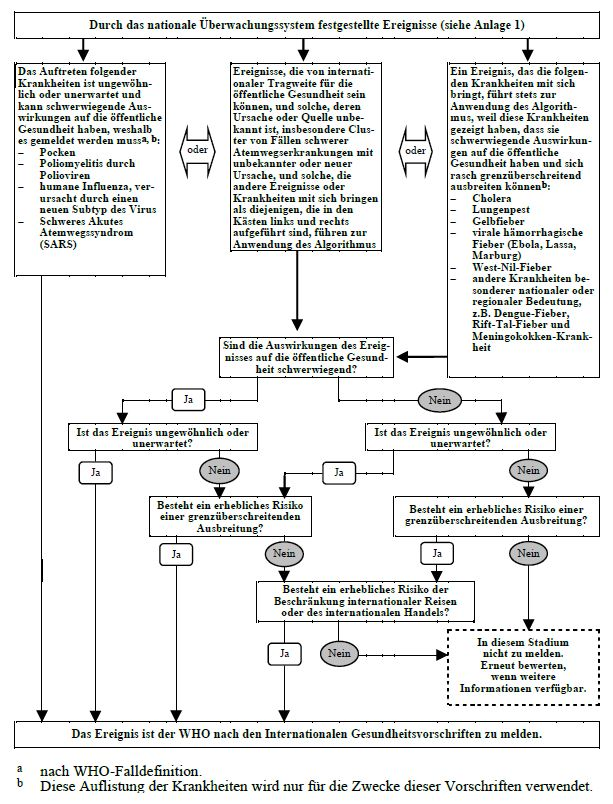

Internationale Gesundheitsvorschriften (2005) vom 23. Mai 2005 in der durch die Resolution WHA77.17 (2024) geänderten Fassung Änderungen angenommen an der siebenundsiebzigsten Weltgesundheitsversammlung am 1. Juni 2024 Inkrafttreten für das Fürstentum Liechtenstein: 19. September 2025 Die Internationalen Gesundheitsvorschriften (2005) werden wie folgt geändert: Teil I Begriffsbestimmungen, Zweck und Anwendungsbereich, Grundsätze und zuständige Behörden Art. 1 Begriffsbestimmungen 1) Für die Zwecke der Internationalen Gesundheitsvorschriften (im Folgenden "IGV" oder "Vorschriften") gelten folgende Begriffsbestimmungen: "Abreise" bedeutet im Hinblick auf Personen, Gepäck, Fracht, Beförderungsmittel oder Güter das Verlassen eines Hoheitsgebiets; "Absonderung" bedeutet die Absonderung von erkrankten oder verseuchten Personen oder von betroffenen Gepäckstücken, Containern, Beförderungsmitteln, Gütern oder Postpaketen von anderen in einer Weise, dass die Ausbreitung der Infektion oder Verseuchung verhindert wird; "Ankunft" eines Beförderungsmittels bedeutet: a) bei einem Seefahrzeug die Ankunft oder das Ankern in dem bezeichneten Gebiet eines Hafens, b) bei einem Luftfahrzeug die Ankunft auf einem Flughafen, c) bei einem Binnenschifffahrts-Fahrzeug auf internationaler Reise die Ankunft an einer Grenzübergangsstelle, d) bei einem Eisenbahnzug oder einem Strassenfahrzeug die Ankunft an einer Grenzübergangsstelle; "Anlauf- beziehungsweise Landeerlaubnis (free pratique)" bedeutet die Genehmigung für ein Schiff, einen Hafen anzulaufen, die Fahrgäste ein- oder auszuschiffen und das Be- und Entladen von Fracht oder Vorräten vorzunehmen, oder für ein Luftfahrzeug, die Fluggäste nach der Landung ein- und aussteigen zu lassen und das Be- und Entladen von Fracht oder Vorräten vorzunehmen, oder für Landfahrzeuge, die Fahrgäste nach der Ankunft ein- und aussteigen zu lassen und das Be- und Entladen von Fracht oder Vorräten vorzunehmen; "ärztliche Untersuchung" bedeutet die vorläufige Beurteilung von Personen durch dazu befugtes medizinisches Personal oder durch unter der unmittelbaren Aufsicht der zuständigen Behörde tätige Personen zur Bestimmung des gesundheitlichen Zustands und der potentiellen Gefahr für die öffentliche Gesundheit, die eine Prüfung der Gesundheitsdokumente wie auch die körperliche Untersuchung umfassen kann, wenn die Umstände des Einzelfalls dies rechtfertigen; "Beförderer" bedeutet eine natürliche oder juristische Person oder ihren Vertreter, die oder der für eine Beförderung verantwortlich ist; "Beförderungsmittel" bedeutet ein Luftfahrzeug, ein Schiff, einen Eisenbahnzug, ein Strassenfahrzeug oder ein anderes Beförderungsmittel auf internationaler Reise; "Befreiung von Insekten" bedeutet das Verfahren, bei dem Gesundheitsmassnahmen zur Bekämpfung oder Vernichtung der in Gepäck, Fracht, Containern, Beförderungsmitteln, Gütern und Postpaketen vorhandenen Insekten, die Überträger menschlicher Krankheiten sein können, getroffen werden; "Beobachtung zum Schutz der öffentlichen Gesundheit" bedeutet die Überwachung des Gesundheitszustands eines Reisenden über einen bestimmten Zeitraum, um das Risiko der Übertragung einer Krankheit zu bestimmen; "Besatzungsmitglieder" bedeutet die Personen an Bord eines Beförderungsmittels, die keine Fahrgäste sind; "Bestätigung" bedeutet die Bereitstellung von Informationen durch einen Vertragsstaat an die WHO, um den Stand eines Ereignisses im Hoheitsgebiet oder in den Hoheitsgebieten des betreffenden Vertragsstaats zu bestätigen; "betroffen" bedeutet Personen, Gepäck, Fracht, Container, Beförderungsmittel, Güter, Postpakete oder menschliche Überreste, die infiziert oder verseucht sind oder Infektions- oder Verseuchungsquellen tragen, so dass sie eine Gefahr für die öffentliche Gesundheit darstellen; "betroffenes Gebiet" bedeutet insbesondere einen geographischen Ort, für den von der WHO Gesundheitsmassnahmen aufgrund dieser Vorschriften empfohlen wurden; "Container" bedeutet einen Transportbehälter: a) der dauerhaft und daher wiederholt benutzbar ist, b) der besonders dazu bestimmt ist, die Beförderung von Gütern mit einem oder mehreren Verkehrsmitteln ohne Umladen zu erleichtern, c) der mit Vorrichtungen versehen ist, die eine bequeme Handhabung, insbesondere das Umladen von einem Verkehrsmittel auf ein anderes, gestatten, und d) der eigens so gefertigt ist, dass er leicht gefüllt und entleert werden kann; "Container-Verladeplatz" bedeutet einen Ort oder eine Anlage, der oder die für im internationalen Verkehr genutzte Container bestimmt ist; "Desinfektion" bedeutet das Verfahren, bei dem Gesundheitsmassnahmen zur Bekämpfung oder Vernichtung von Krankheitserregern auf einem menschlichen oder tierischen Körper oder in beziehungsweise auf Gepäck, Fracht, Containern, Beförderungsmitteln, Gütern und Postpaketen durch unmittelbare Einwirkung chemischer oder physikalischer Stoffe getroffen werden; "Empfehlung" oder "empfohlen" bezieht sich auf eine aufgrund dieser Vorschriften gemachte zeitlich befristete oder ständige Empfehlung; "Entrattung" bedeutet das Verfahren, bei dem an der Grenzübergangsstelle Gesundheitsmassnahmen zur Bekämpfung oder Vernichtung von in Gepäck, Fracht, Containern, Beförderungsmitteln, Einrichtungen, Gütern und Postpaketen vorhandenen Nagetieren, die Überträger menschlicher Krankheiten sein können, getroffen werden; "Entseuchung" bedeutet ein Verfahren, bei dem Gesundheitsmassnahmen getroffen werden, um auf menschlichen oder tierischen Körpern, in oder auf einem für den Verzehr bestimmten Produkt oder auf anderen unbelebten Gegenständen einschliesslich Beförderungsmitteln befindliche Krankheitserreger oder Giftstoffe, die eine Gefahr für die öffentliche Gesundheit darstellen können, zu vernichten; "Ereignis" bedeutet das Auftreten einer Krankheit oder ein Ereignis, das die Möglichkeit einer Krankheit schafft; "erkrankte Person" bedeutet eine Person, die an einer körperlichen Störung, die eine Gefahr für die öffentliche Gesundheit darstellen kann, leidet oder von ihr betroffen ist; "Flughafen" bedeutet einen Ankunfts- und Abgangsflughafen für den internationalen Luftverkehr; "Fracht(-stücke)" bedeutet die an Bord eines Beförderungsmittels oder in einem Container geladenen Güter; "Gefahr für die öffentliche Gesundheit" bedeutet die Wahrscheinlichkeit eines Ereignisses, das die Gesundheit von Bevölkerungsgruppen beeinträchtigen kann, wobei solche Ereignisse besonders zu beachten sind, die sich grenzüberschreitend ausbreiten oder eine ernste und unmittelbare Bedrohung darstellen können; "Generaldirektor" bedeutet den Generaldirektor der Weltgesundheitsorganisation; "Gepäck(-stücke)" bedeutet die persönliche Habe eines Reisenden; "gesundheitliche Notlage von internationaler Tragweite" bedeutet ein aussergewöhnliches Ereignis, das, wie in diesen Vorschriften vorgesehen: i) durch die grenzüberschreitende Ausbreitung von Krankheiten eine Gefahr für die öffentliche Gesundheit in anderen Staaten darstellt, und ii) möglicherweise eine abgestimmte internationale Reaktion erfordert; "Gesundheitsmassnahme" bedeutet Verfahren, die angewendet werden, um die Ausbreitung von Krankheiten oder von Verseuchung zu verhindern; Gesundheitsmassnahmen umfassen keine Massnahmen des Gesetzesvollzugs oder Sicherheitsmassnahmen; "Grenzübergangsstelle" bedeutet eine internationale Ein- und Ausreisestelle für Reisende, Gepäck, Fracht, Container, Beförderungsmittel, Güter und Postpakete sowie Einrichtungen und Bereiche, die diesen bei der Ein- oder Ausreise Dienstleistungen erbringen; "Güter" bedeutet körperliche Produkte einschliesslich Tiere und Pflanzen, die auf einer internationalen Reise - auch zur Verwendung an Bord eines Beförderungsmittels - befördert werden; "Hafen" bedeutet einen See- oder Binnenhafen, in den oder aus dem Schiffe auf internationaler Reise ein- oder auslaufen; "Herd" bedeutet ein Tier, eine Pflanze oder einen Stoff, in dem oder in der Krankheitserreger in der Regel leben und deren Vorkommen eine Gefahr für die öffentliche Gesundheit darstellen kann; "IGV-Kontaktstelle der WHO" bedeutet die Stelle in der WHO, die jederzeit für die Verständigung mit den nationalen IGV-Anlaufstellen erreichbar ist; "Infektion" bedeutet das Eindringen eines Krankheitserregers in den menschlichen oder tierischen Körper beziehungsweise seine Entwicklung oder Vermehrung, die eine Gefahr für die öffentliche Gesundheit darstellen können; "internationale Reise" bedeutet: a) bei einem Beförderungsmittel eine Reise zwischen Grenzübergangsstellen in den Hoheitsgebieten mehrerer Staaten oder eine Reise zwischen Grenzübergangsstellen im Hoheitsgebiet oder in den Hoheitsgebieten desselben Staates, wenn das Beförderungsmittel auf seiner Reise mit dem Hoheitsgebiet eines anderen Staates in Berührung kommt, jedoch nur hinsichtlich dieser Berührung, b) bei einem Reisenden eine Reise, die mit der Einreise in das Hoheitsgebiet eines Staates verbunden ist, das nicht das Hoheitsgebiet des Staates ist, in dem der Reisende die Reise antritt; "internationaler Verkehr" bedeutet die Bewegung von Personen, Gepäck, Fracht, Containern, Beförderungsmitteln, Gütern oder Postpaketen über eine internationale Grenze, einschliesslich des internationalen Handels; "invasiv" bedeutet das Durchstechen oder Einschneiden der Haut oder das Einführen eines Instruments oder Fremdkörpers in den Körper oder die Untersuchung einer Körperhöhle. Im Sinne dieser Vorschriften gelten die ärztliche Untersuchung von Ohr, Nase und Mund, die Temperaturmessung mittels Ohr-, Mund- oder Hautthermometer oder durch Wärmebildfotografie, die ärztliche Überprüfung, die Auskultation, das äusserliche Abtasten, die Retinoskopie, die äusserliche Entnahme von Urin-, Stuhl- oder Speichelproben, die äusserliche Blutdruckmessung sowie die Elektrokardiographie als nichtinvasiv; "Krankheit" bedeutet eine Krankheit oder einen gesundheitlichen Zustand, die oder der ungeachtet des Ursprungs oder der Quelle Menschen erheblich schädigt oder schädigen kann; "Landfahrzeug" bedeutet ein motorisiertes Beförderungsmittel für den Landtransport, das sich auf einer internationalen Reise befindet, einschliesslich Eisenbahnzügen, Reisebussen, Lastkraftwagen und Kraftfahrzeugen; "Landübergang" bedeutet eine an Land befindliche Grenzübergangsstelle in einem Vertragsstaat, einschliesslich einer von Strassenfahrzeugen und Eisenbahnzügen genutzten Grenzübergangsstelle; "Luftfahrzeug" bedeutet ein Luftfahrzeug, das sich auf einer internationalen Reise befindet; "massgebliche Gesundheitsprodukte" bedeutet solche Gesundheitsprodukte, die als Reaktion auf gesundheitliche Notlagen von internationaler Tragweite, einschliesslich pandemischer Notlagen, benötigt werden; sie können Arzneimittel, Impfstoffe, Diagnostika, Medizinprodukte, Produkte zur Vektorbekämpfung, persönliche Schutzausrüstung, Dekontaminierungsprodukte, Hilfsprodukte, Antidote, Zell- und Gentherapien und sonstige Gesundheitstechnologien umfassen; "nationale IGV-Anlaufstelle" bedeutet die von jedem Vertragsstaat bezeichnete nationale zentrale Stelle, die jederzeit für die Verständigung mit den IGV-Kontaktstellen der WHO nach diesen Vorschriften erreichbar ist; "nationale IGV-Stelle " bedeutet die von dem Vertragsstaat bezeichnete oder errichtete Stelle auf nationaler Ebene zur Koordinierung der Durchführung dieser Vorschriften im Hoheitsbereich des Vertragsstaats; "Organisation" oder "WHO" bedeutet die Weltgesundheitsorganisation; "pandemische Notlage" bedeutet eine gesundheitliche Notlage von internationaler Tragweite, die von einer übertragbaren Krankheit verursacht wird und: i) die eine weitreichende geographische Ausdehnung auf mehrere Staaten und innerhalb dieser Staaten aufweist oder bei der ein hohes Risiko dafür besteht, ii) die die Leistungsfähigkeit von Gesundheitssystemen hinsichtlich der Reaktion auf die Notlage in diesen Staaten übersteigt oder bei der ein hohes Risiko dafür besteht, iii) die schwere soziale und/oder wirtschaftliche Störungen, einschliesslich der Störung des internationalen Verkehrs und Handels, verursacht oder bei der ein hohes Risiko dafür besteht, und iv) die schnelles, gerechtes und verstärktes koordiniertes internationales Handeln mit ressortübergreifenden und gesamtgesellschaftlichen Ansätzen erfordert; "personenbezogene Daten" bedeutet Informationen, die sich auf eine identifizierte oder identifizierbare natürliche Person beziehen; "Postpaket" bedeutet ein durch Post- oder Kurierdienste international befördertes adressiertes Erzeugnis oder Paket; "Quarantäne" bedeutet die Einschränkung von Tätigkeiten und/oder die Absonderung verdächtiger Personen, die nicht krank sind, oder verdächtiger Gepäckstücke, Container, Beförderungsmittel oder Güter in der Weise, dass die mögliche Ausbreitung einer Infektion oder Verseuchung verhindert wird; "Reisender" bedeutet eine natürliche Person, die eine internationale Reise unternimmt; "Schiff" bedeutet ein Seeschifffahrts- oder Binnenschifffahrts-Fahrzeug auf einer internationalen Reise; "ständige Empfehlung" bedeutet ein von der WHO bei bestimmten anhaltenden Gefahren für die öffentliche Gesundheit nach Art. 16 erteilter nicht verbindlicher Rat im Hinblick auf geeignete Gesundheitsmassnahmen zur routinemässigen oder gelegentlichen Anwendung, die erforderlich sind, um die grenzüberschreitende Ausbreitung von Krankheiten zu verhindern oder einzudämmen und Beeinträchtigungen des internationalen Verkehrs auf ein Mindestmass zu begrenzen; "ständiger Aufenthalt" hat die Bedeutung, wie sie nach dem innerstaatlichen Recht des betreffenden Vertragsstaats bestimmt ist; "störend" bedeutet die mögliche Verursachung von Unannehmlichkeiten durch engen oder engsten Kontakt oder durch eingehende Befragung; "Strassenfahrzeug" bedeutet ein Landfahrzeug, das kein Eisenbahnzug ist; "Überprüfung" bedeutet die Untersuchung von Bereichen, Gepäck, Containern, Beförderungsmitteln, Einrichtungen, Gütern oder Postpaketen, einschliesslich relevanter Daten und Unterlagen, durch die zuständige Behörde oder unter ihrer Aufsicht, um festzustellen, ob eine Gefahr für die öffentliche Gesundheit besteht; "Überwachung" bedeutet die systematische laufende Sammlung, Abgleichung und Analyse von Daten für die Zwecke des Gesundheitsschutzes sowie die rechtzeitige Verbreitung von für die öffentliche Gesundheit relevanten Informationen zur Bewertung und nötigenfalls Einleitung von Gesundheitsschutzmassnahmen; "Vektor" bedeutet ein Insekt oder ein anderes Tier, das in der Regel einen Krankheitserreger in sich trägt, der eine Gefahr für die öffentliche Gesundheit darstellt; "verdächtig" bedeutet diejenigen Personen, Gepäck- und Frachtstücke, Container, Beförderungsmittel, Güter oder Postpakete, von denen ein Vertragsstaat annimmt, dass sie einer Gefahr für die öffentliche Gesundheit ausgesetzt waren oder möglicherweise ausgesetzt waren, und die eine mögliche Quelle der Ausbreitung einer Krankheit sein können; "Verseuchung" bedeutet das Vorkommen eines Krankheitserregers oder Giftstoffs auf menschlichen oder tierischen Körpern, in oder auf einem für den Verzehr bestimmten Produkt oder auf anderen unbelebten Gegenständen, einschliesslich Beförderungsmitteln, das eine Gefahr für die öffentliche Gesundheit darstellen kann; "vorübergehender Aufenthalt" hat die Bedeutung, wie sie im innerstaatlichen Recht des betreffenden Vertragsstaats festgelegt ist; "wissenschaftliche Erkenntnisse" bedeutet Informationen, die ein auf anerkannten wissenschaftlichen Methoden beruhendes Mass an Beweiskraft bieten; "wissenschaftliche Grundsätze" bedeutet die durch wissenschaftliche Methoden bekannten anerkannten grundlegenden naturwissenschaftlichen Gesetze und Tatsachen; "zeitlich befristete Empfehlung" bedeutet ein von der WHO nach Art. 15 erteilter nicht verbindlicher Rat zur zeitlich befristeten und risikospezifischen Anwendung als Reaktion auf eine gesundheitliche Notlage von internationaler Tragweite, um die grenzüberschreitende Ausbreitung von Krankheiten zu verhindern oder einzudämmen und Beeinträchtigungen des internationalen Verkehrs auf ein Mindestmass zu begrenzen; "zuständige Behörde" bedeutet eine für die Durchführung und Anwendung der Gesundheitsmassnahmen aufgrund dieser Vorschriften zuständige Behörde. 2) Sofern nichts anderes bestimmt ist oder sich aus dem Zusammenhang nichts anderes ergibt, ist eine Bezugnahme auf diese Vorschriften gleichzeitig eine Bezugnahme auf deren Anlagen. Art. 2 Zweck und Anwendungsbereich Zweck und Anwendungsbereich dieser Vorschriften bestehen darin, die grenzüberschreitende Ausbreitung von Krankheiten zu verhüten, dafür vorbereitende Massnahmen zu treffen, davor zu schützen, sie zu bekämpfen und dagegen Gesundheitsschutzmassnahmen einzuleiten, und zwar auf eine Art und Weise, die der Gefahr für die öffentliche Gesundheit entspricht und auf diese beschränkt ist und eine unnötige Beeinträchtigung des internationalen Verkehrs und Handels vermeidet. Art. 3 Grundsätze 1) Die Durchführung dieser Vorschriften erfolgt unter uneingeschränkter Achtung der Würde des Menschen, der Menschenrechte und der Grundfreiheiten und fördert Gerechtigkeit und Solidarität. 2) Die Durchführung dieser Vorschriften richtet sich nach der Charta der Vereinten Nationen und der Satzung der Weltgesundheitsorganisation . 3) Die Durchführung dieser Vorschriften ist auf das Ziel ihrer weltweiten Anwendung zum Schutz der Weltbevölkerung vor der grenzüberschreitenden Ausbreitung von Krankheiten ausgerichtet. 4) Die Staaten haben im Einklang mit der Charta der Vereinten Nationen und den Grundsätzen des Völkerrechts das souveräne Recht, bei der Verfolgung ihrer jeweiligen Gesundheitspolitik Gesetze zu erlassen und durchzuführen. Dabei sollen sie dem Ziel dieser Vorschriften Rechnung tragen. Art. 4 Zuständige Behörden 1) Jeder Vertragsstaat bestimmt beziehungsweise errichtet im Einklang mit seinem innerstaatlichen Recht und den innerstaatlichen Gegebenheiten ein oder zwei Stellen, die als nationale IGV-Stelle und als nationale IGV-Anlaufstelle dienen, sowie die in seinem jeweiligen Hoheitsbereich für die Durchführung der Gesundheitsmassnahmen nach diesen Vorschriften zuständigen Behörden. 1bis) Die nationale IGV-Stelle koordiniert die Durchführung dieser Vorschriften im Hoheitsbereich des Vertragsstaats. 2) Die nationalen IGV-Anlaufstellen müssen für die Verständigung mit den in Abs. 3 vorgesehenen IGV-Kontaktstellen der WHO jederzeit erreichbar sein. Zu den Aufgaben der nationalen IGV-Anlaufstellen gehört Folgendes: a) im Namen des betreffenden Vertragsstaats die Versendung dringender Mitteilungen über die Durchführung dieser Vorschriften, insbesondere aufgrund der Art. 6 bis 12, an die IGV-Kontaktstellen der WHO; und b) die Verbreitung von Informationen an die zuständigen Bereiche der Verwaltung des betreffenden Vertragsstaats - einschliesslich der Bereiche, die für die Überwachung und Berichterstattung, für die Grenzübergangstellen, die öffentlichen Gesundheitsdienste, für Kliniken und Krankenhäuser und andere staatliche Einrichtungen zuständig sind - sowie das Sammeln von Informationen, die aus diesen Bereichen stammen. 2bis) Die Vertragsstaaten treffen Massnahmen zur Durchführung der Abs. 1, 1bis und 2, gegebenenfalls einschliesslich der Anpassung ihrer innerstaatlichen Rechts- und Verwaltungsregelungen. 3) Die WHO bestimmt IGV-Kontaktstellen, die für die Verständigung mit den nationalen IGV-Anlaufstellen jederzeit erreichbar sind. Die IGV-Kontaktstellen der WHO übermitteln dringende Mitteilungen über die Durchführung dieser Vorschriften, insbesondere aufgrund der Art. 6 bis 12, an die nationalen IGV-Anlaufstellen der betreffenden Vertragsstaaten. Die IGV-Kontaktstellen der WHO können von der WHO am Sitz oder auf der regionalen Ebene der Organisation bestimmt werden. 4) Die Vertragsstaaten nennen der WHO die Kontaktdaten ihrer nationalen IGV-Stelle und ihrer nationalen IGV-Anlaufstelle; die WHO nennt den Vertragsstaaten die Kontaktdaten der IGV-Kontaktstellen der WHO. Diese Angaben werden ständig auf dem neuesten Stand gehalten und jährlich bestätigt. Die WHO stellt die Kontaktdaten allen Vertragsstaaten zur Verfügung. Teil II Informationen und Gesundheitsschutzmassnahmen Art. 5 Überwachung 1) Jeder Vertragsstaat schafft, stärkt und unterhält baldmöglichst, jedoch spätestens fünf Jahre nach Inkrafttreten dieser Vorschriften für diesen Vertragsstaat, die Kernkapazitäten, um Ereignisse in Übereinstimmung mit diesen Vorschriften, wie in Anlage 1 Teil A ausgeführt, zu verhüten, festzustellen, zu bewerten, zu melden und darüber Bericht zu erstatten. 2) Im Anschluss an die in Anlage 1 Abs. 2 genannte Bewertung kann ein Vertragsstaat auf der Grundlage berechtigten Bedarfs und eines Durchführungsplans der WHO Bericht erstatten und dabei eine Verlängerung von zwei Jahren erhalten, innerhalb deren seine Verpflichtung nach Abs. 1 zu erfüllen ist. Unter aussergewöhnlichen Umständen und gestützt durch einen neuen Durchführungsplan kann der Vertragsstaat beim Generaldirektor eine weitere Verlängerung von höchstens zwei Jahren beantragen; dieser entscheidet darüber und berücksichtigt dabei den fachlichen Rat des nach Art. 50 eingerichteten Ausschusses (im Folgenden "Prüfungsausschuss"). Nach Ablauf der in Abs. 1 genannten Frist erstattet der Vertragsstaat, dem die Verlängerung gewährt wurde, der WHO jährlich Bericht über die im Hinblick auf die vollständige Durchführung erzielten Fortschritte. 3) Die WHO unterstützt die Vertragsstaaten auf Ersuchen bei der Schaffung, Stärkung und Unterhaltung der in Abs. 1 genannten Kernkapazitäten. 4) Die WHO sammelt durch ihre Überwachungstätigkeiten Informationen über Ereignisse und bewertet deren Potential, eine grenzüberschreitende Ausbreitung von Krankheiten und eine mögliche Beeinträchtigung des internationalen Verkehrs zu verursachen. Die der WHO nach diesem Absatz zugegangenen Informationen werden gegebenenfalls in Übereinstimmung mit den Art. 11 und 45 behandelt. Art. 6 Meldung 1) Jeder Vertragsstaat bewertet Ereignisse in seinem Hoheitsgebiet und benutzt dabei das Entscheidungsschema in Anlage 2. Jeder Vertragsstaat meldet der WHO unter Verwendung des effizientesten verfügbaren Kommunikationsmittels über die nationale IGV-Anlaufstelle und binnen 24 Stunden nach der Bewertung von für die öffentliche Gesundheit relevanten Informationen alle Ereignisse, die in Übereinstimmung mit dem Entscheidungsschema eine gesundheitliche Notlage von internationaler Tragweite in seinem Hoheitsgebiet darstellen können, sowie alle als Reaktion auf solche Ereignisse durchgeführten Gesundheitsmassnahmen. Wird durch die der WHO zugegangene Meldung die Zuständigkeit der Internationalen Atomenergie-Organisation (IAEO) oder einer oder mehrerer sonstiger zwischenstaatlicher Organisationen berührt, so unterrichtet die WHO nach Art. 14 Abs. 1 unverzüglich die IAEO oder gegebenenfalls die andere zwischenstaatliche Organisation oder die anderen zwischenstaatlichen Organisationen. 2) Im Anschluss an eine Meldung übermittelt ein Vertragsstaat der WHO auch weiterhin rechtzeitig die ihm über das gemeldete Ereignis zur Verfügung stehenden genauen und hinreichend detaillierten für die öffentliche Gesundheit relevanten Informationen, möglichst einschliesslich Falldefinitionen, Laborergebnissen, der Quelle und Art des Risikos, der Zahl der Krankheits- und Todesfälle, der die Ausbreitung der Krankheit beeinflussenden Bedingungen und der getroffenen Gesundheitsmassnahmen; des Weiteren berichtet er nötigenfalls über die bei der Reaktion auf eine mögliche gesundheitliche Notlage von internationaler Tragweite aufgetretenen Schwierigkeiten und die dafür benötigte Unterstützung. Art. 7 Weitergabe von Informationen während unerwarteter oder ungewöhnlicher Ereignisse betreffend die öffentliche Gesundheit Liegen einem Vertragsstaat Anzeichen für ein unerwartetes oder ungewöhnliches Ereignis betreffend die öffentliche Gesundheit vor, das - ungeachtet seines Ursprungs oder seiner Quelle - im Hoheitsgebiet des Vertragsstaats aufgetreten ist und eine gesundheitliche Notlage von internationaler Tragweite darstellen kann, so stellt er der WHO alle wichtigen für die öffentliche Gesundheit relevanten Informationen zur Verfügung. In einem solchen Fall findet Art. 6 uneingeschränkt Anwendung. Art. 8 Konsultation Treten in seinem Hoheitsgebiet Ereignisse auf, die keine Meldung nach Art. 6 erforderlich machen, insbesondere Ereignisse, für die nicht genügend Informationen vorliegen, um das Entscheidungsschema auszufüllen, so soll ein Vertragsstaat durch seine nationale IGV-Anlaufstelle die WHO dennoch weiterhin informieren und sich rechtzeitig mit ihr über geeignete Gesundheitsmassnahmen abstimmen. Solche Mitteilungen werden nach Art. 11 Abs. 2 bis 4 behandelt. Der Vertragsstaat, in dessen Hoheitsgebiet das Ereignis eingetreten ist, kann die WHO um Unterstützung bei der Bewertung von epidemiologischen Befunden dieses Vertragsstaats ersuchen. Art. 9 Andere Berichte 1) Die WHO kann Berichte aus anderen Quellen als Meldungen oder Konsultationen berücksichtigen; sie bewertet diese Berichte nach den anerkannten epidemiologischen Grundsätzen und übermittelt sodann Informationen über das Ereignis an den Vertragsstaat, in dessen Hoheitsgebiet das Ereignis angeblich eingetreten ist. Bevor sie Massnahmen aufgrund dieser Berichte ergreift, konsultiert die WHO den Vertragsstaat, in dessen Hoheitsgebiet das Ereignis angeblich eingetreten ist, und bemüht sich, von diesem nach dem in Art. 10 beschriebenen Verfahren eine Bestätigung zu erhalten. Zu diesem Zweck kann die WHO die erhaltenen Informationen den Vertragsstaaten zur Verfügung stellen; nur wo dies ordnungsgemäss begründet ist, darf die WHO die Vertraulichkeit der Quelle wahren. Diese Informationen werden im Einklang mit dem in Art. 11 beschriebenen Verfahren verwendet. 2) Die Vertragsstaaten unterrichten die WHO nach Möglichkeit binnen 24 Stunden, nachdem sie Anzeichen einer Gefahr für die öffentliche Gesundheit ausserhalb ihres Hoheitsgebiets, die zu einer grenzüberschreitenden Ausbreitung der Krankheit führen kann, festgestellt haben, manifestiert durch verschleppte oder eingeschleppte: a) beim Menschen auftretende Fälle; b) Vektoren einer Infektion oder Verseuchung; oder c) verseuchte Güter. Art. 10 Bestätigung 1) Die WHO fordert nach Art. 9 von einem Vertragsstaat die Bestätigung von aus anderen Quellen als Meldungen oder Konsultationen stammenden Berichten über Ereignisse, die eine gesundheitliche Notlage von internationaler Tragweite darstellen können und angeblich im Hoheitsgebiet dieses Staates eingetreten sind. In diesen Fällen informiert die WHO den betreffenden Vertragsstaat über die Berichte, die sie zu prüfen wünscht. 2) Nach Abs. 1 und Art. 9 und auf Ersuchen der WHO bestätigt jeder Vertragsstaat und stellt Folgendes bereit: a) binnen 24 Stunden eine erste Antwort auf beziehungsweise eine Empfangsbestätigung für das Ersuchen der WHO; b) binnen 24 Stunden verfügbare für die öffentliche Gesundheit relevante Informationen zum Stand der im Ersuchen der WHO genannten Ereignisse; und c) Informationen für die WHO im Zusammenhang mit einer Bewertung nach Art. 6, einschliesslich der in dem genannten Artikel erwähnten einschlägigen Informationen. 3) Nach Erhalt von Informationen über ein Ereignis, das eine gesundheitliche Notlage von internationaler Tragweite darstellen kann, bietet die WHO dem betreffenden Vertragsstaat ihre Zusammenarbeit bei der Beurteilung der Möglichkeit einer grenzüberschreitenden Ausbreitung der Krankheit und einer Beeinträchtigung des internationalen Verkehrs sowie bei der Bewertung der Angemessenheit von Bekämpfungsmassnahmen an. Zu derartigen Tätigkeiten können die Zusammenarbeit mit anderen normsetzenden Organisationen und das Angebot gehören, internationale Hilfe zu mobilisieren, um die nationalen Behörden bei der Durchführung und Abstimmung von Bewertungen vor Ort zu unterstützen. Auf Ersuchen des Vertragsstaats stellt die WHO Informationen zur Unterstützung eines solchen Angebots zur Verfügung. 4) Nimmt der Vertragsstaat das Angebot zur Zusammenarbeit nicht an und ist es durch die Grössenordnung der Gefahr für die öffentliche Gesundheit gerechtfertigt, so soll die WHO die ihr verfügbaren Informationen über das Ereignis an andere Vertragsstaaten weitergeben und den Vertragsstaat gleichzeitig ermutigen, das Angebot der WHO zur Zusammenarbeit anzunehmen, wobei sie den Standpunkt des betreffenden Vertragsstaats berücksichtigt. Art. 11 Übermittlung von Informationen durch die WHO 1) Nach Massgabe des Abs. 2 übermittelt die WHO allen Vertragsstaaten und gegebenenfalls einschlägigen zwischenstaatlichen Organisationen baldmöglichst, unter Verwendung des effizientesten verfügbaren Mittels und unter Wahrung der Vertraulichkeit diejenigen für die öffentliche Gesundheit relevanten Informationen, die ihr aufgrund der Art. 5 bis 10 zugegangen sind und die erforderlich sind, um die Vertragsstaaten in die Lage zu versetzen, auf eine Gefahr für die öffentliche Gesundheit zu reagieren. Die WHO soll anderen Vertragsstaaten Informationen übermitteln, die diesen helfen könnten, ähnliche Vorkommnisse zu vermeiden. 2) Die WHO verwendet die aufgrund der Art. 6 und 8 sowie des Art. 9 Abs. 2 erhaltenen Informationen zur Bestätigung, Bewertung und Unterstützung nach diesen Vorschriften und - sofern mit den in diesen Bestimmungen genannten Vertragsstaaten nichts anderes vereinbart ist - macht diese Informationen anderen Vertragsstaaten nicht allgemein zugänglich, bis: a) das Ereignis nach Art. 12 als gesundheitliche Notlage von internationaler Tragweite, einschliesslich einer pandemischen Notlage, festgestellt wird; oder b) die eine grenzüberschreitende Ausbreitung der Infektion oder Verseuchung belegenden Informationen von der WHO nach anerkannten epidemiologischen Grundsätzen bestätigt worden sind; oder c) es Anzeichen dafür gibt, dass: i) Massnahmen zur Bekämpfung der grenzüberschreitenden Ausbreitung wegen der Art der Verseuchung, des Krankheitserregers, des Vektors oder des Herdes wahrscheinlich keinen Erfolg haben, oder ii) es dem Vertragsstaat an der ausreichenden operativen Fähigkeit mangelt, die zur Verhinderung einer weiteren Ausbreitung der Krankheit notwendigen Massnahmen durchzuführen; oder d) die Art und der Umfang der grenzüberschreitenden Bewegung von Reisenden, Gepäck, Fracht, Containern, Beförderungsmitteln, Gütern oder Postpaketen, die von der Infektion oder Verseuchung betroffen sein können, die umgehende Anwendung internationaler Bekämpfungsmassnahmen erforderlich machen. 3) Die WHO konsultiert den Vertragsstaat, in dessen Hoheitsgebiet das Ereignis eingetreten ist, hinsichtlich ihrer Absicht, Informationen aufgrund dieses Artikels zur Verfügung zu stellen. 4) Werden Informationen, welche die WHO nach Abs. 2 erhalten hat, Vertragsstaaten nach diesen Vorschriften zugänglich gemacht, so kann die WHO diese Informationen auch der Öffentlichkeit zugänglich machen, wenn andere Informationen über dasselbe Ereignis bereits allgemein zugänglich sind und es notwendig ist, zuverlässige und unabhängige Informationen zu verbreiten. Art. 12 Feststellung einer gesundheitlichen Notlage von internationaler Tragweite, einschliesslich einer pandemischen Notlage 1) Der Generaldirektor stellt auf der Grundlage der erhaltenen Informationen - insbesondere derjenigen des Vertragsstaats, in dessen Hoheitsgebiet ein Ereignis eingetreten ist, oder der Vertragsstaaten, in deren Hoheitsgebiet es eingetreten ist, - fest, ob ein Ereignis eine gesundheitliche Notlage von internationaler Tragweite, gegebenenfalls einschliesslich einer pandemischen Notlage, nach den in diesen Vorschriften enthaltenen Kriterien und Verfahren darstellt. 2) Ist der Generaldirektor auf der Grundlage einer Bewertung nach diesen Vorschriften der Ansicht, dass eine gesundheitliche Notlage von internationaler Tragweite eingetreten ist, so berät er sich mit dem Vertragsstaat, in dessen Hoheitsgebiet das Ereignis eingetreten ist, oder den Vertragsstaaten, in deren Hoheitsgebiet es eingetreten ist, in Bezug auf diese vorläufige Feststellung. Sind sich der Generaldirektor und der Vertragsstaat beziehungsweise die Vertragsstaaten hinsichtlich dieser Feststellung einig, so ersucht der Generaldirektor nach dem in Art. 49 beschriebenen Verfahren den nach Art. 48 eingesetzten Ausschuss (im Folgenden "Notfallausschuss") um seinen Standpunkt zu geeigneten vorläufigen Empfehlungen. 3) Erzielen der Generaldirektor und der Vertragsstaat, in dessen Hoheitsgebiet das Ereignis eingetreten ist, oder die Vertragsstaaten, in deren Hoheitsgebiet es eingetreten ist, im Anschluss an die Beratungen nach Abs. 2 nicht binnen 48 Stunden Einigung darüber, ob das Ereignis eine gesundheitliche Notlage von internationaler Tragweite darstellt, so wird eine Entscheidung nach dem in Art. 49 beschriebenen Verfahren getroffen. 4) Bei der Feststellung, ob ein Ereignis eine gesundheitliche Notlage von internationaler Tragweite, gegebenenfalls einschliesslich einer pandemischen Notlage, darstellt, berücksichtigt der Generaldirektor Folgendes: a) die von dem Vertragsstaat beziehungsweise den Vertragsstaaten bereitgestellten Informationen; b) das in Anlage 2 enthaltene Entscheidungsschema; c) den Rat des Notfallausschusses; d) wissenschaftliche Grundsätze sowie die verfügbaren wissenschaftlichen Erkenntnisse und andere einschlägige Informationen; und e) eine Bewertung der Gefahr für die menschliche Gesundheit, des Risikos der grenzüberschreitenden Ausbreitung der Krankheit und des Risikos der Beeinträchtigung des internationalen Verkehrs. 4bis) Stellt der Generaldirektor fest, dass ein Ereignis eine gesundheitliche Notlage von internationaler Tragweite darstellt, so stellt der Generaldirektor nach Berücksichtigung der in Abs. 4 genannten Punkte weiterhin fest, ob die gesundheitliche Notlage von internationaler Tragweite auch eine pandemische Notlage darstellt. 5) Ist der Generaldirektor nach Berücksichtigung der in Abs. 4 Bst. a, c, d und e genannten Punkte und nach Beratung mit dem Vertragsstaat, in dessen Hoheitsgebiet die gesundheitliche Notlage von internationaler Tragweite, einschliesslich einer pandemischen Notlage, eingetreten ist, oder den Vertragsstaaten, in deren Hoheitsgebiet sie eingetreten ist, der Auffassung, dass eine solche nicht mehr besteht, weil sie der einschlägigen Begriffsbestimmung in Art. 1 nicht mehr entspricht, so fasst er im Einklang mit dem in Art. 49 beschriebenen Verfahren einen Beschluss. Art. 13 Gesundheitsschutzmassnahmen, einschliesslich eines gerechten Zugangs zu massgeblichen Gesundheitsprodukten 1) Jeder Vertragsstaat schafft, stärkt und unterhält baldmöglichst, jedoch spätestens fünf Jahre nach Inkrafttreten dieser Vorschriften für diesen Vertragsstaat, die Kernkapazitäten nach Anlage 1 Teil A, um Gefahren für die öffentliche Gesundheit und gesundheitliche Notlagen von internationaler Tragweite, einschliesslich einer pandemischen Notlage, auch in instabilen Situationen und humanitären Krisen zu verhüten, vorbereitende Massnahmen zu treffen und umgehend und wirksam auf solche Gefahren und gesundheitliche Notlagen zu reagieren. Die WHO veröffentlicht in Abstimmung mit den Mitgliedstaaten Richtlinien, um die Vertragsstaaten bei der Schaffung von Kernkapazitäten für Gesundheitsschutzmassnahmen zu unterstützen. 2) Im Anschluss an die in Anlage 1 Abs. 2 genannte Bewertung kann ein Vertragsstaat auf der Grundlage berechtigten Bedarfs und eines Durchführungsplans der WHO Bericht erstatten und dabei eine Verlängerung von zwei Jahren erhalten, innerhalb deren seine Verpflichtung nach Abs. 1 zu erfüllen ist. Unter aussergewöhnlichen Umständen und gestützt auf einen neuen Durchführungsplan kann der Vertragsstaat beim Generaldirektor eine weitere Verlängerung von höchstens zwei Jahren beantragen; dieser entscheidet darüber und berücksichtigt dabei den fachlichen Rat des Prüfungsausschusses. Nach Ablauf der in Abs. 1 genannten Frist erstattet der Vertragsstaat, dem die Verlängerung gewährt wurde, der WHO jährlich Bericht über die im Hinblick auf die vollständige Durchführung erzielten Fortschritte. 3) Wenn ein Vertragsstaat darum ersucht oder wenn er ein Angebot der WHO angenommen hat, arbeitet die WHO bei der Reaktion auf Gefahren für die öffentliche Gesundheit und auf Ereignisse mit diesem Staat zusammen, indem sie technischen Rat gibt und technische Hilfe leistet und die Wirksamkeit der getroffenen Bekämpfungsmassnahmen bewertet, nötigenfalls auch durch die Mobilisierung von internationalen Sachverständigengruppen zur Unterstützung vor Ort. 4) Stellt die WHO nach Beratung mit dem betreffenden Vertragsstaat beziehungsweise den betreffenden Vertragsstaaten wie in Art. 12 vorgesehen fest, dass eine gesundheitliche Notlage von internationaler Tragweite, einschliesslich einer pandemischen Notlage, eingetreten ist, so kann sie über die in Abs. 3 genannte Unterstützung hinaus dem Vertragsstaat beziehungsweise den Vertragsstaaten weitere Hilfe anbieten, auch in Form einer Bewertung der Grössenordnung des internationalen Risikos und der Angemessenheit der Bekämpfungsmassnahmen. Diese Zusammenarbeit kann das Angebot zur Mobilisierung internationaler Hilfe umfassen, um die nationalen Behörden bei der Durchführung und Abstimmung von Bewertungen vor Ort zu unterstützen. Auf Ersuchen des Vertragsstaats stellt die WHO Informationen zur Unterstützung eines solchen Angebots zur Verfügung. 5) Auf Ersuchen der WHO sollen die Vertragsstaaten soweit möglich Unterstützung bei den von der WHO koordinierten Schutzmassnahmen leisten. 6) Auf Ersuchen bietet die WHO anderen Vertragsstaaten, die von der gesundheitlichen Notlage von internationaler Tragweite, einschliesslich einer pandemischen Notlage, betroffen oder bedroht sind, angemessenen Rat und angemessene Unterstützung. 7) Wenn die Vertragsstaaten darum ersuchen oder wenn sie ein Angebot der WHO angenommen haben, unterstützt die WHO sie und koordiniert internationale Schutzmassnahmen während gesundheitlicher Notlagen von internationaler Tragweite, einschliesslich pandemischer Notlagen, nach deren Feststellung nach Art. 12. 8) Entsprechend den Gefahren und Erfordernissen für die öffentliche Gesundheit erleichtert die WHO den rechtzeitigen und gerechten Zugang der Vertragsstaaten zu massgeblichen Gesundheitsprodukten nach der Feststellung und während einer gesundheitlichen Notlage von internationaler Tragweite, einschliesslich einer pandemischen Notlage, und arbeitet daran, Hindernisse für diesen Zugang zu beseitigen. Der Generaldirektor: a) führt dazu Bewertungen der Erfordernisse für die öffentliche Gesundheit sowie der Verfügbarkeit und Zugänglichkeit einschliesslich der Erschwinglichkeit von massgeblichen Gesundheitsprodukten für die Gesundheitsschutzmassnahmen durch und überprüft und aktualisiert sie regelmässig; er veröffentlicht solche Bewertungen und berücksichtigt die verfügbaren Bewertungen bei der Abgabe, Änderung, Verlängerung oder Aufhebung von Empfehlungen nach den Art. 15, 16, 17, 18 und 49; b) nutzt dazu einen von der WHO koordinierten Mechanismus oder von ihr koordinierte Mechanismen oder erleichtert bei Bedarf in Abstimmung mit den Vertragsstaaten die Einführung solcher Mechanismen und koordiniert dies gegebenenfalls mit anderen Zuteilungs- und Verteilungsmechanismen und -netzwerken, die den rechtzeitigen und gerechten Zugang zu massgeblichen Gesundheitsprodukten entsprechend den Erfordernissen für die öffentliche Gesundheit erleichtern; c) unterstützt dazu nach Massgabe des Art. 2 und im Einklang mit dem einschlägigen Völkerrecht die Vertragsstaaten auf deren Ersuchen je nach Fall bei der Ausweitung und geographischen Streuung der Herstellung massgeblicher Gesundheitsprodukte durch einschlägige von der WHO koordinierte und sonstige Netzwerke und Mechanismen; d) gibt dazu die der WHO vom Hersteller zwecks Zulassung zur Verfügung gestellten Produktunterlagen zu einem bestimmten massgeblichen Gesundheitsprodukt an einen Vertragsstaat auf dessen Ersuchen weiter, sofern der Hersteller binnen 30 Tagen nach Erhalt eines solchen Ersuchens seine Zustimmung erteilt hat, um die behördliche Beurteilung und Genehmigung durch den Vertragsstaat zu erleichtern; und e) unterstützt dazu die Vertragsstaaten auf deren Ersuchen und gegebenenfalls durch einschlägige von der WHO koordinierte und sonstige Netzwerke und Mechanismen nach Bst. c bei der Förderung von Forschung und Entwicklung und bei der Stärkung der Herstellung von qualitativ hochwertigen, sicheren und wirksamen massgeblichen Gesundheitsprodukten vor Ort und erleichtert sonstige für die vollständige Durchführung dieser Bestimmung wichtige Massnahmen. 9) Nach Abs. 5 und nach Art. 44 Abs. 1 sowie auf Ersuchen anderer Vertragsstaaten oder der WHO verpflichten sich die Vertragsstaaten im Rahmen des geltenden Rechts und verfügbarer Mittel zusammenzuarbeiten und einander beizustehen sowie von der WHO koordinierte Schutzmassnahmen zu unterstützen, auch durch: a) die Unterstützung der WHO bei der Durchführung der in diesem Artikel erwähnten Massnahmen; b) die Einbeziehung und Ermutigung von massgeblichen Akteuren in ihrem jeweiligen Hoheitsbereich, um den gerechten Zugang zu massgeblichen Gesundheitsprodukten als Reaktion auf eine gesundheitliche Notlage von internationaler Tragweite, einschliesslich einer pandemischen Notlage, zu erleichtern; und c) gegebenenfalls das Bereitstellen der einschlägigen Bestimmungen ihrer Übereinkünfte auf dem Gebiet der Forschung und Entwicklung in Bezug auf massgebliche Gesundheitsprodukte, die sich auf die Förderung des gerechten Zugangs zu solchen Produkten während einer gesundheitlichen Notlage von internationaler Tragweite, einschliesslich einer pandemischen Notlage, beziehen. Art. 14 Zusammenarbeit der WHO mit zwischenstaatlichen Organisationen und internationalen Organen 1) Bei der Umsetzung dieser Vorschriften arbeitet die WHO mit anderen zuständigen zwischenstaatlichen Organisationen und internationalen Organen zusammen und koordiniert mit diesen gegebenenfalls ihre Tätigkeiten; dies geschieht auch durch den Abschluss von Übereinkünften und anderen ähnlichen Vereinbarungen. 2) In Fällen, in denen die Meldung oder Bestätigung eines Ereignisses oder die Reaktion auf dieses hauptsächlich in die Zuständigkeit anderer zwischenstaatlicher Organisationen oder internationaler Organe fällt, stimmt die WHO ihre Tätigkeiten mit diesen Organisationen oder Organen ab, um die Anwendung geeigneter Massnahmen zum Schutz der öffentlichen Gesundheit sicherzustellen. 3) Dessen ungeachtet schliessen diese Vorschriften die Bereitstellung von Rat, Hilfe oder technischer oder anderer Unterstützung durch die WHO für die Zwecke des Gesundheitsschutzes nicht aus. Teil III Empfehlungen Art. 15 Zeitlich befristete Empfehlungen 1) Ist nach Art. 12 das Eintreten einer gesundheitlichen Notlage von internationaler Tragweite, einschliesslich einer pandemischen Notlage, festgestellt worden, so gibt der Generaldirektor in Übereinstimmung mit dem in Art. 49 beschriebenen Verfahren zeitlich befristete Empfehlungen. Solche zeitlich befristete Empfehlungen können gegebenenfalls geändert oder verlängert werden, unter anderem auch dann, wenn festgestellt wurde, dass eine gesundheitliche Notlage von internationaler Tragweite, einschliesslich einer pandemischen Notlage, beendet ist; dann können nötigenfalls andere zeitlich befristete Empfehlungen erlassen werden, um ein Wiederauftreten zu verhindern oder umgehend festzustellen. 2) Zeitlich befristete Empfehlungen können Gesundheitsmassnahmen umfassen, die von dem Vertragsstaat oder den Vertragsstaaten durchgeführt werden sollten, der beziehungsweise die sich in einer gesundheitlichen Notlage von internationaler Tragweite, einschliesslich einer pandemischen Notlage, befindet beziehungsweise befinden, oder von anderen Vertragsstaaten, und zwar im Hinblick auf Personen, Gepäck, Fracht, Container, Beförderungsmittel, Güter, einschliesslich massgeblicher Gesundheitsprodukte, und/oder Postpakete, um die grenzüberschreitende Ausbreitung von Krankheiten zu verhindern oder zu verringern und eine unnötige Beeinträchtigung des internationalen Verkehrs zu vermeiden. 2bis) Der Generaldirektor soll, wenn er den Vertragsstaaten den Erlass, die Änderung oder die Verlängerung von zeitlich befristeten Empfehlungen mitteilt, verfügbare Informationen über alle von der WHO koordinierten Mechanismen betreffend den Zugang zu und die Zuteilung von massgeblichen Gesundheitsprodukten sowie über alle sonstigen Zuteilungs- und Verteilungsmechanismen und -netzwerke bereitstellen. 3) Zeitlich befristete Empfehlungen können nach dem in Art. 49 beschriebenen Verfahren jederzeit aufgehoben werden und laufen drei Monate, nachdem sie erlassen wurden, automatisch aus. Sie können geändert oder um weitere Zeiträume von bis zu drei Monaten verlängert werden. Zeitlich befristete Empfehlungen dürfen nicht über die zweite Weltgesundheitsversammlung hinaus fortbestehen, nachdem über die gesundheitliche Notlage von internationaler Tragweite, einschliesslich einer pandemischen Notlage, auf welche sie sich beziehen, entschieden wurde. Art. 16 Ständige Empfehlungen 1) Die WHO kann nach Art. 53 ständige Empfehlungen für geeignete Gesundheitsmassnahmen zur regelmässigen oder gelegentlichen Anwendung erlassen. Diese Massnahmen können bei bestimmten, weiter bestehenden Gefahren für die öffentliche Gesundheit von den Vertragsstaaten im Hinblick auf Personen, Gepäck, Fracht, Container, Beförderungsmittel, Güter, einschliesslich massgeblicher Gesundheitsprodukte, und/oder Postpakete angewandt werden, um die grenzüberschreitende Ausbreitung von Krankheiten zu verhindern oder zu verringern und die Beeinträchtigung des internationalen Verkehrs zu vermeiden. Die WHO kann nach Art. 53 solche Empfehlungen gegebenenfalls ändern oder aufheben. 2) Der Generaldirektor soll, wenn er den Vertragsstaaten den Erlass, die Änderung oder die Verlängerung von ständigen Empfehlungen mitteilt, verfügbare Informationen über alle von der WHO koordinierten Mechanismen betreffend den Zugang zu und die Zuteilung von massgeblichen Gesundheitsprodukten sowie über alle sonstigen Zuteilungs- und Verteilungsmechanismen und -netzwerke bereitstellen. Art. 17 Kriterien für Empfehlungen Beim Erlass, bei der Änderung oder der Aufhebung von zeitlich befristeten oder ständigen Empfehlungen berücksichtigt der Generaldirektor Folgendes: a) die Standpunkte der unmittelbar betroffenen Vertragsstaaten; b) den Rat des Notfall- beziehungsweise Prüfungsausschusses; c) wissenschaftliche Grundsätze und verfügbare wissenschaftliche Erkenntnisse und Informationen; d) Gesundheitsmassnahmen, die auf der Grundlage einer den Umständen angemessenen Risikobewertung den internationalen Verkehr und Handel nicht stärker beeinträchtigen und für Personen nicht störender sind als unter vertretbarem Aufwand verfügbare Alternativen, die das geeignete Mass an Gesundheitsschutz bieten würden; d bis ) Verfügbarkeit und Zugänglichkeit massgeblicher Gesundheitsprodukte; e) einschlägige internationale Normen und Rechtsinstrumente; f) Tätigkeiten anderer einschlägiger zwischenstaatlicher Organisationen und internationaler Organe; und g) andere geeignete und spezifische Informationen, die für das Ereignis von Belang sind. Bei zeitlich befristeten Empfehlungen kann die Berücksichtigung der Bst. e und f durch den Generaldirektor den durch zwingende Umstände bedingten Einschränkungen unterliegen. Art. 18 Empfehlungen in Bezug auf Personen, Gepäck, Fracht, Container, Beförderungsmittel, Güter und Postpakete 1) Von der WHO in Bezug auf Personen gegebene Empfehlungen an die Vertragsstaaten können folgende Ratschläge beinhalten: - besondere Gesundheitsmassnahmen werden nicht angeraten; - den Reiseverlauf in betroffenen Gebieten überprüfen; - den Nachweis von ärztlichen Untersuchungen und Laborergebnissen überprüfen; - ärztliche Untersuchungen verlangen; - den Nachweis einer Impfung oder einer anderen Prophylaxe überprüfen; - eine Impfung oder eine andere Prophylaxe verlangen; - verdächtige Personen einer Beobachtung zum Schutz der öffentlichen Gesundheit unterziehen; - Quarantäne- oder andere Gesundheitsmassnahmen für verdächtige Personen durchführen; - eine Absonderung betroffener Personen und nötigenfalls deren Behandlung durchführen; - eine Nachverfolgung der Kontakte verdächtiger oder betroffener Personen durchführen; - die Einreise verdächtiger und betroffener Personen verweigern; - die Einreise nicht betroffener Personen in betroffene Gebiete verweigern; - bei der Ausreise von Personen aus betroffenen Gebieten ein Screening durchführen und/oder Beschränkungen auferlegen. 2) Von der WHO in Bezug auf Gepäck, Fracht, Container, Beförderungsmittel, Güter und Postpakete gegebene Empfehlungen an die Vertragsstaaten können folgende Ratschläge beinhalten: - besondere Gesundheitsmassnahmen werden nicht angeraten; - Ladeliste und Route überprüfen; - Überprüfungen durchführen; - den Nachweis von Massnahmen bei der Abreise oder bei der Durchfuhr zur Beseitigung von Infektionen oder Verseuchungen überprüfen; - eine Behandlung von Gepäck, Fracht, Containern, Beförderungsmitteln, Gütern, Postpaketen oder menschlichen Überresten durchführen, um Infektionen oder Verseuchungen einschliesslich Vektoren und Herden zu beseitigen; - besondere Gesundheitsmassnahmen anwenden, um die sichere Handhabung und den sicheren Transport menschlicher Überreste zu gewährleisten; - eine Absonderung oder Quarantäne durchführen; - Beschlagnahme und Vernichtung infizierter oder verseuchter oder verdächtiger Gepäck- oder Frachtstücke, Container, Beförderungsmittel, Güter oder Postpakete unter kontrollierten Bedingungen vornehmen, wenn andere verfügbare Behandlungen oder Verfahren sonst erfolglos bleiben würden; - die Ab- oder Einreise verweigern. 3) Von der WHO gegebene Empfehlungen an die Vertragsstaaten berücksichtigen gegebenenfalls die Notwendigkeit: a) den internationalen Reiseverkehr zu erleichtern, insbesondere von im Gesundheits- und Pflegewesen Beschäftigten und von Personen in lebensbedrohlichen Situationen oder humanitären Krisen. Art. 23 bleibt hiervon unberührt; und b) internationale Versorgungsketten aufrechtzuerhalten, einschliesslich derjenigen für massgebliche Gesundheitsprodukte und Lebensmittellieferungen. Teil IV Grenzübergangsstellen Art. 19 Allgemeine Verpflichtungen Jeder Vertragsstaat unternimmt über die nach diesen Vorschriften vorgesehenen Verpflichtungen hinaus Folgendes: a) er trägt dafür Sorge, dass die in Anlage 1 Teil B für benannte Grenzübergangsstellen beschriebenen Kernkapazitäten in dem in Art. 5 Abs. 1 und in Art. 13 Abs. 1 genannten zeitlichen Rahmen geschaffen werden; b) er bezeichnet die an jeder benannten Grenzübergangsstelle zu seinem Hoheitsgebiet zuständigen Behörden; und c) er liefert der WHO nach Möglichkeit sachdienliche Angaben über Infektions- und Verseuchungsquellen, einschliesslich Vektoren und Herden , an seinen Grenzübergangsstellen, die zur grenzüberschreitenden Ausbreitung von Krankheiten führen können, wenn darum als Reaktion auf eine bestimmte potentielle Gefahr für die öffentliche Gesundheit ersucht wird. Art. 20 Flughäfen und Häfen 1) Die Vertragsstaaten benennen die Flughäfen und Häfen, welche die in Anlage 1 Teil B vorgesehenen Kernkapazitäten zu schaffen und aufrechtzuerhalten haben. 2) Die Vertragsstaaten tragen dafür Sorge, dass die Bescheinigung über die Befreiung von der Schiffshygienekontrolle (Ship Sanitation Control Exemption Certificate) und die Bescheinigung über die Schiffshygienekontrolle (Ship Sanitation Control Certificate) nach den Anforderungen des Art. 39 und dem in Anlage 3 enthaltenen Muster ausgestellt werden. 3) Jeder Vertragsstaat übermittelt der WHO eine Liste von Häfen, die zu Folgendem befugt sind: a) zur Ausstellung von Bescheinigungen über die Schiffshygienekontrolle und zur Bereitstellung der in den Anlagen 1 und 3 genannten Leistungen; oder b) nur zur Ausstellung von Bescheinigungen über die Befreiung von der Schiffshygienekontrolle; und c) zur Verlängerung der Bescheinigung über die Befreiung von der Schiffshygienekontrolle um einen Monat bis zur Ankunft des Schiffes in dem Hafen, in dem die Bescheinigung entgegengenommen werden kann. Die Vertragsstaaten informieren die WHO über eventuelle Veränderungen des Status der aufgeführten Häfen. Die WHO veröffentlicht die nach diesem Absatz erhaltenen Informationen. 4) Die WHO kann auf Ersuchen des betreffenden Vertragsstaats nach angemessener Prüfung zertifizieren lassen, dass ein Flughafen oder Hafen in seinem Hoheitsgebiet den in den Abs. 1 und 3 genannten Anforderungen genügt. Diese Zertifizierungen können von der WHO in Abstimmung mit dem Vertragsstaat regelmässig überprüft werden. 5) Die WHO entwickelt und veröffentlicht in Zusammenarbeit mit zuständigen zwischenstaatlichen Organisationen und internationalen Organen Zertifizierungsrichtlinien für Flughäfen und Häfen nach diesem Artikel. Die WHO veröffentlicht ferner ein Verzeichnis zertifizierter Flughäfen und Häfen. Art. 21 Landübergänge 1) Sofern dies aus Gründen der öffentlichen Gesundheit gerechtfertigt ist, kann ein Vertragsstaat Landübergänge, welche die in Anlage 1 Teil B genannten Kernkapazitäten schaffen, benennen, und zwar unter Berücksichtigung: a) des Verkehrsaufkommens und der Verkehrsfrequenz der verschiedenen Arten des internationalen Verkehrs an den Landübergängen eines Vertragsstaats, die benannt werden könnten, im Vergleich zu anderen Grenzübergangsstellen; und b) der Gefahren für die öffentliche Gesundheit, die in Gebieten bestehen, in denen der internationale Verkehr entsteht oder durch die er sich bewegt, und zwar bereits vor seiner Ankunft an einem bestimmten Landübergang. 2) Vertragsstaaten mit gemeinsamen Grenzen sollen Folgendes in Erwägung ziehen: a) den Abschluss zwei- oder mehrseitiger Übereinkünfte oder Vereinbarungen über die Vorbeugung oder Bekämpfung der grenzüberschreitenden Übertragung von Krankheiten an Landübergängen nach Art. 57; und b) im Hinblick auf die Kernkapazitäten nach Anlage 1 Teil B die gemeinsame Benennung angrenzender Landübergänge nach Abs. 1. Art. 22 Aufgaben der zuständigen Behörden 1) Die zuständigen Behörden: a) sind verantwortlich für die Überwachung von in betroffenen Gebieten ankommenden beziehungsweise daraus abgehenden Gepäck- und Frachtstücken, Containern, Beförderungsmitteln, Gütern, Postpaketen und menschlichen Überresten, so dass diese dauerhaft frei von Infektions- und Verseuchungsquellen einschliesslich Vektoren und Herden sind; b) tragen nach Möglichkeit dafür Sorge, dass die von Reisenden an Grenzübergangsstellen genutzten Einrichtungen in hygienisch einwandfreiem Zustand und dauerhaft frei von Infektions- und Verseuchungsquellen einschliesslich Vektoren und Herden sind; c) sind zuständig für die Aufsicht über die aufgrund dieser Vorschriften gegebenenfalls angebrachte Entrattung, Desinfektion, Befreiung von Insekten oder Entseuchung von Gepäck, Fracht, Containern, Beförderungsmitteln, Gütern, Postpaketen und menschlichen Überresten beziehungsweise für die Aufsicht über die aufgrund dieser Vorschriften gegebenenfalls angebrachten Hygienemassnahmen bei Personen; d) setzen Beförderer möglichst frühzeitig von ihrer Absicht in Kenntnis, Bekämpfungsmassnahmen bei einem Beförderungsmittel anzuwenden, und liefern soweit verfügbar schriftliche Informationen über die dabei anzuwendenden Methoden; e) sind für die Aufsicht über die Beseitigung und sichere Entsorgung von verseuchtem Wasser, verseuchten Lebensmitteln, menschlichen oder tierischen Ausscheidungen, Abwasser und anderen verseuchten Stoffen aus Beförderungsmitteln zuständig; f) ergreifen alle mit diesen Vorschriften vereinbaren durchführbaren Massnahmen, um das Einleiten von Abwasser, Abfällen, Ballastwasser und anderen potentiell krankheitserregenden Stoffen, welche die Gewässer eines Hafens, Flusses oder Kanals, einer Meerenge, eines Sees oder anderer internationaler Wasserstrassen verseuchen könnten, zu überwachen und zu verhindern; g) sind für die Aufsicht über die Erbringer von Dienstleistungen für Reisende, Gepäck, Fracht, Container, Beförderungsmittel, Güter, Postpakete und menschliche Überreste an Grenzübergangsstellen verantwortlich, nötigenfalls auch für die Durchführung von Überprüfungen und ärztlichen Untersuchungen; h) verfügen über wirksame Notfallprogramme für unerwartete Ereignisse, welche die öffentliche Gesundheit betreffen; und i) verständigen sich mit der nationalen IGV-Anlaufstelle über die nach diesen Vorschriften ergriffenen einschlägigen Massnahmen für die öffentliche Gesundheit. 2) Die von der WHO für aus einem betroffenen Gebiet ankommende Reisende, Gepäck- und Frachtstücke, Container, Beförderungsmittel, Güter, Postpakete und menschliche Überreste empfohlenen Gesundheitsmassnahmen können bei der Ankunft erneut angewandt werden, wenn nachprüfbare Hinweise darauf und/oder Nachweise dafür vorliegen, dass die bei der Abreise aus dem betroffenen Gebiet angewandten Massnahmen erfolglos waren. 3) Die Befreiung von Insekten, die Entrattung, die Desinfektion, die Entseuchung und andere Hygienemassnahmen werden so durchgeführt, dass Verletzungen und soweit möglich Unannehmlichkeiten für Personen, oder Schäden an der Umwelt, die sich auf die öffentliche Gesundheit auswirken, oder Schäden an Gepäck- oder Frachtstücken, Containern, Beförderungsmitteln, Gütern oder Postpaketen vermieden werden. Teil V Massnahmen für die öffentliche Gesundheit Kapitel I Allgemeine Bestimmungen Art. 23 Gesundheitsmassnahmen bei Ankunft und Abreise 1) Vorbehaltlich geltender völkerrechtlicher Übereinkünfte und einschlägiger Artikel dieser Vorschriften kann ein Vertragsstaat bei Ankunft oder Abreise für die Zwecke des Gesundheitsschutzes Folgendes verlangen: a) im Hinblick auf Reisende: i) Informationen zum Zielort des Reisenden, damit Kontakt mit dem Reisenden aufgenommen werden kann, ii) Informationen zur Reiseroute des Reisenden, um feststellen zu können, ob im oder nahe dem betroffenen Gebiet Reisen stattgefunden haben oder ob es andere mögliche Kontakte zu Infektions- oder Verseuchungsquellen vor der Ankunft gab, und Prüfung der Gesundheitsdokumente des Reisenden, wenn diese aufgrund dieser Vorschriften erforderlich sind, und/oder iii) eine nichtinvasive ärztliche Untersuchung, welche die am wenigsten störende Untersuchung ist, um das Ziel aus Sicht der öffentlichen Gesundheit zu erreichen; und b) eine Überprüfung von Gepäck- und Frachtstücken, Containern, Beförderungsmitteln, Gütern, Postpaketen und menschlichen Überresten. 2) Aufgrund von Anzeichen einer Gefahr für die öffentliche Gesundheit, die durch in Abs. 1 vorgesehene Massnahmen oder durch andere Mittel erkannt worden sind, können die Vertragsstaaten zusätzliche Gesundheitsmassnahmen im Einklang mit diesen Vorschriften anwenden; hierbei kommt bei einem verdächtigen oder betroffenen Reisenden je nach Einzelfall insbesondere die am wenigsten störende und invasive ärztliche Untersuchung in Frage, mit der das Ziel aus Sicht der öffentlichen Gesundheit, nämlich die Verhütung einer grenzüberschreitenden Ausbreitung der Krankheit, erreicht würde. 3) Ohne die ausdrückliche, nach entsprechender Aufklärung gegebene vorherige Zustimmung des Reisenden, seiner Eltern oder seines Vormunds darf keine ärztliche Untersuchung, Impfung, Prophylaxe oder Gesundheitsmassnahme aufgrund dieser Vorschriften durchgeführt werden; dies gilt mit Ausnahme der Bestimmungen des Art. 31 Abs. 2 und im Einklang mit dem Recht und den internationalen Verpflichtungen des Vertragsstaats. 4) Reisende, die nach diesen Vorschriften geimpft oder prophylaktisch versorgt werden müssen, oder deren Eltern oder Vormünder werden über die mit der Impfung oder unterlassenen Impfung und mit der Anwendung oder Nichtanwendung der Prophylaxe verbundenen Risiken nach dem Recht und den internationalen Verpflichtungen des Vertragsstaats informiert. Die Vertragsstaaten setzen die praktischen Ärzte von dieser Anforderung in Übereinstimmung mit dem Recht des Vertragsstaats in Kenntnis. 5) Ärztliche Untersuchungen, medizinische Verfahren, Impfungen oder andere prophylaktische Massnahmen, die mit dem Risiko einer Krankheitsübertragung verbunden sind, werden nur im Einklang mit anerkannten nationalen oder internationalen Sicherheitsrichtlinien und -normen an Reisenden durchgeführt beziehungsweise an Reisende verabreicht, so dass ein solches Risiko auf ein Mindestmass beschränkt wird. Kapitel II Besondere Bestimmungen für Beförderungsmittel und Beförderer Art. 24 Beförderer 1) Die Vertragsstaaten treffen alle im Einklang mit diesen Vorschriften stehenden durchführbaren Massnahmen, um zu gewährleisten, dass Beförderer: a) sich nach den von der WHO empfohlenen und von den Vertragsstaaten angenommenen Gesundheitsmassnahmen, einschliesslich zur Anwendung an Bord sowie während des Ein- und Aussteigens, richten; b) die Reisenden über die von der WHO empfohlenen und von den Vertragsstaaten angenommenen Gesundheitsmassnahmen, einschliesslich zur Anwendung an Bord sowie während des Ein- und Aussteigens, informieren; und c) die Beförderungsmittel, für die sie verantwortlich sind, dauerhaft in einem solchen Zustand halten, dass sie frei von Infektions- oder Verseuchungsquellen einschliesslich Vektoren und Herden sind. Die Anwendung von Massnahmen zur Bekämpfung von Infektions- oder Verseuchungsquellen kann verlangt werden, wenn sich Anzeichen für ihr Vorhandensein gezeigt haben. 2) Besondere Bestimmungen über Beförderungsmittel und Beförderer nach diesem Artikel enthält Anlage 4. Besondere auf Beförderungsmittel und Beförderer anwendbare Massnahmen im Hinblick auf übertragbare (vektorinduzierte) Krankheiten enthält Anlage 5. Art. 25 Schiffe und Luftfahrzeuge auf der Durchfahrt beziehungsweise Durchreise Vorbehaltlich der Art. 27 und 43 oder wenn dies nicht durch geltende völkerrechtliche Übereinkünfte gestattet ist, wendet ein Vertragsstaat keine Gesundheitsmassnahmen an auf: a) Schiffe, die nicht aus einem betroffenen Gebiet kommen und sich auf der Durchfahrt durch einen Seeschifffahrtskanal oder eine Wasserstrasse im Hoheitsgebiet dieses Vertragsstaats mit dem Ziel eines Hafens im Hoheitsgebiet eines anderen Staates befinden. Solchen Schiffen ist es erlaubt, unter Aufsicht der zuständigen Behörde Treibstoff, Wasser, Lebensmittel und Vorräte an Bord zu nehmen; b) Schiffe, die seine Hoheitsgewässer durchfahren, ohne in einem Hafen oder an der Küste anzulegen; und c) Luftfahrzeuge bei der Durchreise auf einem Flughafen in seinem Hoheitsgebiet, ausser dass der Aufenthalt des Luftfahrzeugs auf einen bestimmten Bereich des Flughafens beschränkt werden kann und dass keine Gelegenheit zum Ein- und Aussteigen oder Be- und Entladen besteht. Solchen Luftfahrzeugen ist es jedoch erlaubt, unter Aufsicht der zuständigen Behörde Treibstoff, Wasser, Lebensmittel und Vorräte an Bord zu nehmen. Art. 26 Zivile Lastwagen, Züge und Busse auf der Durchfahrt Vorbehaltlich der Art. 27 und 43 oder wenn dies nicht durch geltende völkerrechtliche Übereinkünfte gestattet ist, werden keine Gesundheitsmassnahmen auf zivile Lastwagen, Züge oder Busse angewandt, die nicht aus einem betroffenen Gebiet kommen und ohne Gelegenheit zum Ein- und Aussteigen oder Be- und Entladen auf der Durchfahrt durch ein Hoheitsgebiet sind. Art. 27 Betroffene Beförderungsmittel 1) Wurden an Bord eines Beförderungsmittels klinische Anzeichen oder Symptome und auf Tatsachen oder Anzeichen beruhende Informationen in Bezug auf eine Gefahr für die öffentliche Gesundheit, einschliesslich Infektions- und Verseuchungsquellen, festgestellt, so betrachtet die zuständige Behörde das Beförderungsmittel als betroffen und kann: a) das Beförderungsmittel je nach Fall desinfizieren, entseuchen, von Insekten befreien oder entratten oder die Durchführung dieser Massnahmen unter ihrer Aufsicht veranlassen; und b) in jedem Fall die anzuwendende Methode bestimmen, um eine angemessene Bekämpfung der Gefahr für die öffentliche Gesundheit nach diesen Vorschriften sicherzustellen. Gibt es von der WHO für diese Verfahren empfohlene Methoden oder Materialien, so sollen diese angewendet werden, sofern die zuständige Behörde nicht feststellt, dass andere Methoden gleichermassen sicher und zuverlässig sind. Die zuständige Behörde kann zusätzliche Gesundheitsmassnahmen durchführen, darunter nötigenfalls die Absonderung und Quarantäne der Beförderungsmittel, um die Ausbreitung einer Krankheit zu verhüten. Diese zusätzlichen Massnahmen sollen der nationalen IGV-Anlaufstelle gemeldet werden. 2) Ist die für die Grenzübergangsstelle zuständige Behörde nicht in der Lage, die nach diesem Artikel erforderlichen Bekämpfungsmassnahmen durchzuführen, so kann dem betroffenen Beförderungsmittel dennoch die Genehmigung zur Abreise erteilt werden, wenn die folgenden Bedingungen erfüllt sind: a) Die zuständige Behörde informiert zum Zeitpunkt der Abreise die für die nächste bekannte Grenzübergangsstelle zuständige Behörde über die unter Bst. b genannte Art von Informationen; und b) bei Schiffen werden die festgestellten Anzeichen sowie die erforderlichen Bekämpfungsmassnahmen in die Bescheinigung über die Schiffshygienekontrolle eingetragen. Solchen Beförderungsmitteln ist es erlaubt, unter Aufsicht der zuständigen Behörde Treibstoff, Wasser, Lebensmittel und Vorräte an Bord zu nehmen. 3) Ein als betroffen geltendes Beförderungsmittel gilt nicht mehr als betroffen, wenn sich die zuständige Behörde davon überzeugt hat, dass: a) die in Abs. 1 vorgesehenen Massnahmen wirksam durchgeführt wurden; und b) an Bord keine Verhältnisse herrschen, die eine Gefahr für die öffentliche Gesundheit darstellen können. Art. 28 Schiffe und Luftfahrzeuge an Grenzübergangsstellen 1) Vorbehaltlich des Art. 43 oder anzuwendender völkerrechtlicher Übereinkünfte dürfen Schiffe oder Luftfahrzeuge aus Gründen der öffentlichen Gesundheit nicht daran gehindert werden, eine Grenzübergangsstelle anzulaufen oder bei ihr zu landen. Verfügt die Grenzübergangsstelle jedoch nicht über die erforderlichen Einrichtungen für die Anwendung von Gesundheitsmassnahmen nach diesen Vorschriften, so können die Schiffe oder Luftfahrzeuge angewiesen werden, sich auf eigene Gefahr zur nächsten geeigneten und für sie erreichbaren Grenzübergangsstelle zu begeben, es sei denn, die Schiffe oder Luftfahrzeuge haben ein Funktionsproblem, das die Weiterfahrt beziehungsweise den Weiterflug unsicher machen würde. 2) Vorbehaltlich des Art. 43 oder geltender völkerrechtlicher Übereinkünfte dürfen Vertragsstaaten Schiffen oder Luftfahrzeugen die Anlauf- beziehungsweise Landeerlaubnis (free pratique) aus Gründen der öffentlichen Gesundheit nicht verweigern; insbesondere darf ihnen das Ein- oder Ausschiffen beziehungsweise das Ein- oder Aussteigenlassen, das Löschen oder Laden von Fracht oder Vorräten sowie die Aufnahme von Treibstoff, Wasser, Lebensmitteln und Vorräten nicht verweigert werden. Die Vertragsstaaten können die Anlauf- beziehungsweise Landeerlaubnis (free pratique) von einer Überprüfung und, wenn an Bord eine Infektions- oder Verseuchungsquelle gefunden wurde, von der Durchführung notwendiger Massnahmen zur Desinfektion, Entseuchung, Befreiung von Insekten oder Entrattung oder von der Durchführung anderer zur Verhütung der Ausbreitung der Infektion oder Verseuchung notwendiger Massnahmen abhängig machen. 3) Soweit möglich und vorbehaltlich des Abs. 2 lässt ein Vertragsstaat die Erteilung einer Anlauf- beziehungsweise Landeerlaubnis (free pratique) an ein Schiff oder Luftfahrzeug auf dem Funkweg oder über andere Kommunikationsmittel zu, wenn er aufgrund der von dem Schiff oder Luftfahrzeug vor dessen Ankunft erhaltenen Informationen der Auffassung ist, dass durch die Ankunft des Schiffes oder Luftfahrzeugs keine Krankheit eingeschleppt oder ausgebreitet wird. 4) Schiffskapitäne beziehungsweise verantwortliche Luftfahrzeugführer oder ihre jeweiligen Vertreter zeigen der Hafen- beziehungsweise Flughafenaufsicht möglichst frühzeitig vor der Ankunft am Bestimmungshafen beziehungsweise Zielflughafen etwaige Erkrankungsfälle, die auf eine Infektionskrankheit hindeuten, oder Anzeichen für eine Gefahr für die öffentliche Gesundheit an Bord an, sobald sie von diesen Erkrankungen oder Gefahren für die öffentliche Gesundheit Kenntnis erlangen. Diese Informationen müssen sofort an die für den Hafen oder Flughafen zuständige Behörde weitergegeben werden. In dringenden Fällen sollen diese Informationen von den Schiffskapitänen beziehungsweise verantwortlichen Luftfahrzeugführern unmittelbar an die für den Hafen oder Flughafen zuständige Behörde weitergegeben werden. 5) Wenn ein verdächtiges oder betroffenes Luftfahrzeug oder Schiff aus Gründen, die ausserhalb des Einflusses des verantwortlichen Luftfahrzeugführers beziehungsweise Schiffskapitäns liegen, an einem anderen Ort als dem Zielflughafen des Luftfahrzeugs beziehungsweise Zielhafen des Schiffes landet oder anlegt, gilt Folgendes: a) Der verantwortliche Luftfahrzeugführer oder der Schiffskapitän beziehungsweise dessen jeweiliger Vertreter unternimmt sein Möglichstes, um unverzüglich mit der nächsten zuständigen Behörde in Verbindung zu treten; b) sobald die zuständige Behörde von der Landung benachrichtigt worden ist, kann sie die von der WHO empfohlenen oder andere in diesen Vorschriften vorgesehene Gesundheitsmassnahmen anwenden; c) sofern Notfälle oder die Aufnahme der Verbindung zu der zuständigen Behörde dies nicht erforderlich machen, darf sich kein an Bord des Luftfahrzeugs oder Schiffes befindlicher Reisender aus seiner unmittelbaren Nähe entfernen; ferner darf keine Fracht aus seiner unmittelbaren Nähe entfernt werden, es sei denn, die zuständige Behörde hat die Erlaubnis dazu erteilt; und d) sobald alle von der zuständigen Behörde angeordneten Gesundheitsmassnahmen durchgeführt worden sind, kann das Luftfahrzeug oder Schiff, was diese Gesundheitsmassnahmen anbelangt, entweder zum ursprünglichen Zielflughafen des Luftfahrzeugs oder Zielhafen des Schiffes oder, wenn dies aus technischen Gründen nicht möglich ist, zu einem anderen günstig gelegenen Flughafen oder Hafen weiterfliegen beziehungsweise weiterfahren. 6) Ungeachtet der Bestimmungen dieses Artikels kann der Schiffskapitän oder der verantwortliche Luftfahrzeugführer die für die Gesundheit und Sicherheit der an Bord befindlichen Reisenden erforderlichen Notmassnahmen treffen. Er informiert die zuständige Behörde möglichst frühzeitig über alle nach diesem Absatz getroffenen Massnahmen. Art. 29 Zivile Lastwagen, Züge und Busse an Grenzübergangsstellen Die WHO entwickelt nach Beratung mit den Vertragsstaaten Leitlinien für die Anwendung von Gesundheitsmassnahmen auf zivile Lastwagen, Züge und Busse an Grenzübergangsstellen und auf der Durchfahrt durch Landübergänge. Kapitel III Besondere Bestimmungen für Reisende Art. 30 Reisende unter Beobachtung zum Schutz der öffentlichen Gesundheit Vorbehaltlich des Art. 43 oder wenn dies durch geltende völkerrechtliche Übereinkünfte gestattet ist, kann ein verdächtiger Reisender, der bei Ankunft unter Beobachtung zum Schutz der öffentlichen Gesundheit gestellt wird, eine internationale Reise fortsetzen, wenn er keine unmittelbare Gefahr für die öffentliche Gesundheit darstellt und der Vertragsstaat die zuständige Behörde der Grenzübergangsstelle am Bestimmungsort, sofern bekannt, über seine erwartete Ankunft informiert. Bei seiner Ankunft meldet sich der Reisende bei dieser Behörde. Art. 31 Gesundheitsmassnahmen bei der Einreise von Reisenden 1) Eine invasive ärztliche Untersuchung, eine Impfung oder eine andere Prophylaxe wird als Voraussetzung für die Einreise eines Reisenden in das Hoheitsgebiet eines Vertragsstaats nicht verlangt; diese Vorschriften hindern die Vertragsstaaten - vorbehaltlich der Art. 32, 42 und 45 - aber nicht daran, eine ärztliche Untersuchung, Impfung oder andere Prophylaxe oder den Nachweis einer Impfung oder anderen Prophylaxe zu verlangen: a) um nötigenfalls festzustellen, ob eine Gefahr für die öffentliche Gesundheit besteht; b) als Voraussetzung für die Einreise von Reisenden, die einen vorübergehenden oder ständigen Aufenthalt anstreben; c) als Voraussetzung für die Einreise von Reisenden nach Art. 43 oder den Anlagen 6 und 7; oder d) die nach Art. 23 durchgeführt werden kann. 2) Stimmt ein Reisender, von dem ein Vertragsstaat eine ärztliche Untersuchung, Impfung oder andere Prophylaxe nach Abs. 1 verlangen kann, einer solchen Massnahme nicht zu oder weigert er sich, die in Art. 23 Abs. 1 Bst. a genannten Informationen oder Dokumente zur Verfügung zu stellen, so kann ihm der betreffende Vertragsstaat vorbehaltlich der Art. 32, 42 und 45 die Einreise verweigern. Gibt es Anzeichen für eine unmittelbare Gefahr für die öffentliche Gesundheit, so kann der Vertragsstaat den Reisenden nach seinem innerstaatlichen Recht und soweit es zur Bekämpfung dieser Gefahr erforderlich ist, zwingen - oder ihm nach Art. 23 Abs. 3 anraten -, sich folgenden Massnahmen zu unterziehen: a) der am wenigsten invasiven und störenden ärztlichen Untersuchung, durch die das Ziel aus Sicht der öffentlichen Gesundheit erreicht wird; b) einer Impfung oder anderen Prophylaxe; oder c) zusätzlichen anerkannten Gesundheitsmassnahmen, welche die Ausbreitung der Krankheit verhindern oder bekämpfen, einschliesslich der Absonderung, der Quarantäne oder der Beobachtung des Reisenden zum Schutz der öffentlichen Gesundheit. Art. 32 Behandlung von Reisenden Bei der Durchführung von Gesundheitsmassnahmen nach diesen Vorschriften behandeln die Vertragsstaaten Reisende unter Achtung ihrer Würde, der Menschenrechte und Grundfreiheiten und beschränken mit derartigen Massnahmen verbundene Unannehmlichkeiten oder Leiden auf ein Mindestmass; hierzu gehört es: a) Reisende höflich und respektvoll zu behandeln; b) geschlechtsbezogene, soziokulturelle, ethnische oder religiöse Belange der Reisenden zu berücksichtigen; und c) Reisenden, die unter Quarantäne gestellt, abgesondert oder ärztlicher Untersuchung oder anderen Verfahren zum Schutz der öffentlichen Gesundheit unterzogen sind, in angemessener Weise Lebensmittel und Wasser, Unterkunft und Kleidung, Schutz des Gepäcks und anderer Habe, ärztliche Behandlung, Mittel zur nötigen Kommunikation möglichst in einer für sie verständlichen Sprache und andere geeignete Hilfe zur Verfügung zu stellen oder stellen zu lassen. Kapitel IV Besondere Bestimmungen für Güter, Container und Container-Verladeplätze Art. 33 Durchgangsgüter Vorbehaltlich des Art. 43 oder wenn dies nicht durch geltende völkerrechtliche Übereinkünfte gestattet ist, unterliegen Durchgangsgüter (ausser lebenden Tieren), die nicht umgeladen werden, den Gesundheitsmassnahmen nach diesen Vorschriften nicht und werden zum Schutz der öffentlichen Gesundheit nicht zurückbehalten. Art. 34 Container und Container-Verladeplätze 1) Die Vertragsstaaten tragen nach Möglichkeit dafür Sorge, dass Container-Verlader Container für den internationalen Verkehr benutzen, die insbesondere während des Beladens von Infektions- oder Verseuchungsquellen, einschliesslich Vektoren und Herden , freigehalten werden. 2) Die Vertragsstaaten tragen nach Möglichkeit dafür Sorge, dass Container-Verladeplätze von Infektions- oder Verseuchungsquellen, einschliesslich Vektoren und Herden , freigehalten werden. 3) Ist der Umfang des internationalen Container-Verkehrs nach Auffassung eines Vertragsstaats gross genug, so ergreifen die zuständigen Behörden alle mit diesen Vorschriften vereinbaren und durchführbaren Massnahmen, einschliesslich der Durchführung von Überprüfungen, zur Bewertung des hygienischen Zustands von Container-Verladeplätzen und Containern, um zu gewährleisten, dass die in diesen Vorschriften enthaltenen Verpflichtungen erfüllt werden. 4) An den Container-Verladeplätzen stehen nach Möglichkeit Einrichtungen zur Überprüfung und Absonderung von Containern zur Verfügung. 5) Container-Empfänger und -Absender bemühen sich nach besten Kräften, Kreuzverseuchungen beim Mehrzweck-Beladen von Containern zu vermeiden. Teil VI Gesundheitsdokumente Art. 35 Allgemeine Regel 1) Andere Gesundheitsdokumente als diejenigen, die nach diesen Vorschriften oder in Empfehlungen der WHO vorgesehen sind, dürfen im internationalen Verkehr nicht verlangt werden; Voraussetzung hierfür ist allerdings, dass dieser Artikel weder auf Reisende anzuwenden ist, die einen vorübergehenden oder ständigen Aufenthalt anstreben, noch auf Dokumentenerfordernisse betreffend den Zustand von Gütern oder Fracht im internationalen Handel im Hinblick auf die öffentliche Gesundheit, die geltenden völkerrechtlichen Übereinkünften entsprechen. Die zuständige Behörde kann Reisende ersuchen, Formulare mit Kontaktinformationen und Fragebögen über die Gesundheit der Reisenden auszufüllen, vorausgesetzt, die in Art. 23 festgelegten Anforderungen sind erfüllt. 2) Nach diesen Vorschriften vorgesehene Gesundheitsdokumente können in nicht-digitalem Format oder in digitalem Format je nach den Verpflichtungen eines Vertragsstaats hinsichtlich des Formats solcher Dokumente, die sich aus sonstigen völkerrechtlichen Übereinkünften ergeben, ausgestellt werden. 3) Unabhängig vom Format, in dem nach diesen Vorschriften vorgesehene Gesundheitsdokumente ausgestellt wurden, müssen diese Gesundheitsdokumente den in den Art. 36 bis 39 genannten Anlagen, soweit anwendbar, entsprechen; ihre Echtheit muss feststellbar sein. 4) Die WHO entwickelt nach Beratung mit den Vertragsstaaten technische Anleitungen, einschliesslich Vorgaben und Normen für die Ausstellung und Feststellung der Echtheit von Gesundheitsdokumenten, die sowohl in digitalem Format als auch in nicht-digitalem Format vorliegen, und aktualisiert sie gegebenenfalls. Solche Vorgaben und Normen müssen Art. 45 betreffend den Umgang mit personenbezogenen Daten entsprechen. Art. 36 Impfbescheinigungen oder Bescheinigungen über andere Prophylaxemassnahmen 1) Impfstoffe und andere Prophylaxemassnahmen für Reisende, die nach diesen Vorschriften oder Empfehlungen angewandt werden, sowie die zugehörigen Bescheinigungen müssen im Hinblick auf bestimmte Krankheiten den Bestimmungen der Anlage 6 und, wenn anwendbar, denen der Anlage 7 entsprechen. 2) Einem Reisenden, der sich im Besitz einer im Einklang mit Anlage 6 und, wenn anwendbar, Anlage 7 ausgestellten Impfbescheinigung oder Bescheinigung über eine andere Prophylaxemassnahme befindet, darf die Einreise aufgrund der Krankheit, auf die sich die Bescheinigung bezieht, nicht verweigert werden, auch wenn er aus einem betroffenen Gebiet kommt, es sei denn, die zuständige Behörde verfügt über nachprüfbare Hinweise darauf und/oder Nachweise dafür, dass die Impfung oder die andere Prophylaxe nicht wirksam war. Art. 37 Schiffsgesundheitserklärung 1) Der Kapitän eines Schiffes hat vor der Ankunft im ersten Anlaufhafen des Hoheitsgebiets eines Vertragsstaats den Gesundheitszustand der an Bord befindlichen Personen festzustellen und bei der Ankunft - oder vor der Ankunft, sofern das Schiff entsprechend ausgerüstet ist und der Vertragsstaat eine solche Vorausbescheinigung verlangt - eine Schiffsgesundheitserklärung auszufüllen und der zuständigen Behörde dieses Hafens zu übergeben, es sei denn, dass dieser Vertragsstaat dies nicht verlangt; diese Erklärung ist vom Schiffsarzt gegenzuzeichnen, sofern sich ein solcher an Bord befindet. 2) Der Kapitän eines Schiffes oder der gegebenenfalls an Bord befindliche Schiffsarzt haben alle von der zuständigen Behörde verlangten Informationen über die gesundheitlichen Verhältnisse an Bord während der internationalen Reise zu geben. 3) Die Schiffsgesundheitserklärung muss dem in Anlage 8 vorgesehenen Muster entsprechen. 4) Ein Vertragsstaat kann beschliessen: a) auf die Vorlage der Schiffsgesundheitserklärung durch ankommende Schiffe ganz zu verzichten; oder b) die Vorlage der Schiffsgesundheitserklärung aufgrund einer Empfehlung von Schiffen zu verlangen, die aus betroffenen Gebieten ankommen, oder sie von Schiffen zu verlangen, die anderweitig Träger von Infektionen oder Verseuchungen sein könnten. Der Vertragsstaat informiert die Reedereien oder deren Vertreter über diese Erfordernisse. Art. 38 Allgemeine Erklärung für Luftfahrzeuge, Abschnitt über Gesundheit 1) Der verantwortliche Luftfahrzeugführer oder sein Vertreter hat während des Fluges oder bei der Landung auf dem ersten Flughafen im Hoheitsgebiet eines Vertragsstaats die Allgemeine Erklärung für Luftfahrzeuge, Abschnitt über Gesundheit, nach bestem Wissen auszufüllen und der zuständigen Behörde dieses Flughafens zu übergeben, es sei denn, dass dieser Vertragsstaat dies nicht verlangt; diese Erklärung muss dem in Anlage 9 wiedergegebenen Muster entsprechen. 2) Der verantwortliche Luftfahrzeugführer oder sein Vertreter hat alle Informationen zu geben, die von dem Vertragsstaat über die gesundheitlichen Verhältnisse an Bord während einer internationalen Reise und etwaige auf das Luftfahrzeug angewandte Gesundheitsmassnahmen verlangt werden. 3) Ein Vertragsstaat kann beschliessen: a) auf die Vorlage der Allgemeinen Erklärung für Luftfahrzeuge, Abschnitt über Gesundheit, durch ankommende Luftfahrzeuge ganz zu verzichten; oder b) die Vorlage der Allgemeinen Erklärung für Luftfahrzeuge, Abschnitt über Gesundheit, aufgrund einer Empfehlung von Luftfahrzeugen zu verlangen, die aus betroffenen Gebieten ankommen, oder sie von Luftfahrzeugen zu verlangen, die anderweitig Träger von Infektionen oder Verseuchungen sein könnten. Der Vertragsstaat informiert die Betreiber von Luftfahrzeugen oder deren Vertreter über diese Erfordernisse. Art. 39 Schiffshygienebescheinigungen 1) Bescheinigungen über die Befreiung von der Schiffshygienekontrolle und Bescheinigungen über die Schiffshygienekontrolle gelten für die Dauer von höchstens sechs Monaten. Diese Frist kann um einen Monat verlängert werden, wenn die Überprüfung oder die erforderlichen Bekämpfungsmassnahmen in dem Hafen nicht durchgeführt werden können. 2) Wird keine gültige Bescheinigung über die Befreiung von der Schiffshygienekontrolle beziehungsweise Bescheinigung über die Schiffshygienekontrolle vorgelegt oder werden an Bord eines Schiffes Anzeichen für eine Gefahr für die öffentliche Gesundheit festgestellt, so kann der Vertragsstaat wie in Art. 27 Abs. 1 vorgesehen verfahren. 3) Die in diesem Artikel genannten Bescheinigungen müssen dem Muster in Anlage 3 entsprechen. 4) Soweit möglich werden Bekämpfungsmassnahmen dann durchgeführt, wenn Schiff und Laderäume leer sind. Bei ballastführenden Schiffen werden sie vor dem Beladen durchgeführt. 5) Sind Bekämpfungsmassnahmen erforderlich und wurden sie zufriedenstellend durchgeführt, so stellt die zuständige Behörde eine Bescheinigung über die Schiffshygienekontrolle aus, in der die festgestellten Anzeichen und die durchgeführten Bekämpfungsmassnahmen vermerkt sind. 6) Die zuständige Behörde kann in jedem nach Art. 20 benannten Hafen eine Bescheinigung über die Befreiung von der Schiffshygienekontrolle ausstellen, wenn sie sich vergewissert hat, dass das Schiff frei von Infektionen und Verseuchungen einschliesslich Vektoren und Herden ist. Eine solche Bescheinigung wird normalerweise nur dann ausgestellt, wenn die Überprüfung des Schiffes zu einem Zeitpunkt durchgeführt wurde, zu dem das Schiff und die Laderäume leer waren oder nur Ballast oder sonstige Stoffe enthielten, die so beschaffen oder gelagert waren, dass eine gründliche Überprüfung der Laderäume möglich war. 7) Kann unter den Bedingungen, unter denen die Bekämpfungsmassnahmen durchgeführt werden, nach Auffassung der zuständigen Behörde des Hafens, in dem die Massnahme vorgenommen wurde, kein zufriedenstellendes Ergebnis erzielt werden, so versieht die zuständige Behörde die Bescheinigung über die Schiffshygienekontrolle mit einem entsprechenden Vermerk. Teil VII Gebühren Art. 40 Gebühren für Gesundheitsmassnahmen in Bezug auf Reisende 1) Ein Vertragsstaat darf - ausser bei Reisenden, die einen vorübergehenden oder ständigen Aufenthalt anstreben, und vorbehaltlich des Abs. 2 - nach diesen Vorschriften keine Gebühren für folgende Massnahmen zum Schutz der öffentlichen Gesundheit erheben: a) für eine in diesen Vorschriften vorgesehene ärztliche Untersuchung oder eine zusätzliche Untersuchung, die dieser Vertragsstaat zur Feststellung des Gesundheitszustands des untersuchten Reisenden verlangen kann; b) für eine bei einem Reisenden bei Ankunft durchgeführte Impfung oder andere Prophylaxe, die kein veröffentlichtes Erfordernis ist oder ein Erfordernis ist, das weniger als 10 Tage vor Durchführung der Impfung oder der anderen Prophylaxe veröffentlicht wurde; c) für geeignete Massnahmen zur Absonderung oder Quarantäne von Reisenden; d) für eine dem Reisenden ausgestellte Bescheinigung mit Angabe der angewandten Massnahmen und dem Datum ihrer Anwendung; oder e) für Gesundheitsmassnahmen, die auf Gepäck angewandt werden, das den Reisenden begleitet. 2) Die Vertragsstaaten können Gebühren für andere als die in Abs. 1 erwähnten Gesundheitsmassnahmen erheben, einschliesslich jener Massnahmen, die hauptsächlich im Interesse des Reisenden sind. 3) Werden für die nach diesen Vorschriften erfolgende Anwendung dieser Gesundheitsmassnahmen auf Reisende Gebühren erhoben, so richten sich diese nach einem einzigen in dem betreffenden Vertragsstaat geltenden Tarif, und jede Gebühr: a) muss diesem Tarif entsprechen; b) darf die tatsächlichen Kosten der Dienstleistung nicht übersteigen; und c) muss ohne Unterschied bezüglich der Staatsangehörigkeit, des Wohnsitzes oder des Aufenthaltsorts des betreffenden Reisenden erhoben werden. 4) Der Tarif und jede Änderung des Tarifs sind mindestens 10 Tage vor ihrem Inkrafttreten zu veröffentlichen. 5) Diese Vorschriften hindern Vertragsstaaten nicht daran, für die durch die Durchführung der Gesundheitsmassnahmen nach Abs. 1 entstandenen Kosten in folgenden Fällen eine Erstattung anzustreben: a) von Beförderern oder Eigentümern von Beförderungsmitteln im Hinblick auf ihre Mitarbeiter; oder b) von beteiligten Versicherungen. 6) Reisenden oder Beförderern darf nicht die Möglichkeit verweigert werden, das Hoheitsgebiet eines Vertragsstaats zu verlassen, wenn die in Abs. 1 oder 2 genannten Gebühren noch nicht bezahlt wurden. Art. 41 Gebühren für Gepäck, Fracht, Container, Beförderungsmittel, Güter oder Postpakete 1) Werden für die nach diesen Vorschriften erfolgende Anwendung von Gesundheitsmassnahmen auf Gepäck, Fracht, Container, Beförderungsmittel, Güter oder Postpakete Gebühren erhoben, so richten sich diese nach einem einzigen in dem betreffenden Vertragsstaat geltenden Tarif, und jede Gebühr: a) muss diesem Tarif entsprechen; b) darf die tatsächlichen Kosten der Dienstleistung nicht übersteigen; und c) muss ohne Unterschied bezüglich der Staatszugehörigkeit, der Flagge, des Registers oder der Eigentumsverhältnisse des Gepäcks, der Fracht, der Container, der Beförderungsmittel, der Güter oder der Postpakete erhoben werden. Insbesondere wird kein Unterschied zwischen inländischen und ausländischen Gepäck- oder Frachtstücken, Containern, Beförderungsmitteln, Gütern oder Postpaketen gemacht. 2) Der Tarif und jede Änderung des Tarifs sind mindestens 10 Tage vor ihrem Inkrafttreten zu veröffentlichen. Teil VIII Allgemeine Bestimmungen Art. 42 Durchführung von Gesundheitsmassnahmen Aufgrund dieser Vorschriften ergriffene Gesundheitsmassnahmen sind unverzüglich einzuleiten und abzuschliessen sowie transparent und unterschiedslos anzuwenden. Art. 43 Zusätzliche Gesundheitsmassnahmen 1) Diese Vorschriften hindern Vertragsstaaten nicht daran, in Übereinstimmung mit ihren einschlägigen innerstaatlichen Rechtsvorschriften und ihren völkerrechtlichen Verpflichtungen als Reaktion auf bestimmte Gefahren für die öffentliche Gesundheit oder gesundheitliche Notlagen von internationaler Tragweite Gesundheitsmassnahmen durchzuführen, die: a) das gleiche oder ein höheres Mass an Gesundheitsschutz wie WHO-Empfehlungen erreichen; oder b) sonst nach Art. 25, Art. 26, Art. 28 Abs. 1 und 2, Art. 30, Art. 31 Abs. 1 Bst. c und Art. 33 verboten sind, vorausgesetzt, diese Massnahmen entsprechen im Übrigen diesen Vorschriften. Derartige Massnahmen dürfen den internationalen Verkehr nicht stärker beeinträchtigen und für Personen nicht invasiver oder störender sein als unter vertretbarem Aufwand verfügbare Alternativen, die ein angemessenes Mass an Gesundheitsschutz erreichen würden. 2) Bei der Entscheidung, ob die in Abs. 1 genannten Gesundheitsmassnahmen oder zusätzliche Gesundheitsmassnahmen nach Art. 23 Abs. 2, Art. 27 Abs. 1, Art. 28 Abs. 2 und Art. 31 Abs. 2 Bst. c durchgeführt werden, richten sich die Vertragsstaaten nach: a) wissenschaftlichen Grundsätzen; b) verfügbaren wissenschaftlichen Erkenntnissen über eine Gefahr für die menschliche Gesundheit, oder - wenn ein solcher Nachweis unzureichend ist - den verfügbaren Informationen, einschliesslich solcher der WHO und anderer einschlägiger zwischenstaatlicher Organisationen und internationaler Organe; und c) verfügbaren spezifischen Anleitungen oder Ratschlägen der WHO. 3) Ein Vertragsstaat, der zusätzliche Gesundheitsmassnahmen nach Abs. 1 durchführt, die den internationalen Verkehr erheblich beeinträchtigen, liefert der WHO eine auf die öffentliche Gesundheit gestützte Begründung und einschlägige wissenschaftliche Informationen dazu. Die WHO gibt diese Informationen an andere Vertragsstaaten weiter und gibt Informationen über die durchgeführten Gesundheitsmassnahmen weiter. Im Sinne dieses Artikels bedeutet eine erhebliche Beeinträchtigung im Allgemeinen die Verweigerung der Ein- oder Abreise von internationalen Reisenden, Gepäck, Fracht, Containern, Beförderungsmitteln, Gütern und dergleichen oder ihre Verzögerung um mehr als 24 Stunden. 4) Nach Bewertung der in Übereinstimmung mit den Abs. 3 und 5 zur Verfügung gestellten Informationen und anderer einschlägiger Informationen kann die WHO verlangen, dass der betreffende Vertragsstaat die Anwendung der Massnahmen erneut überdenkt. 5) Ein Vertragsstaat, der in den Abs. 1 und 2 genannte zusätzliche Gesundheitsmassnahmen durchführt, die den internationalen Verkehr erheblich beeinträchtigen, informiert die WHO innerhalb von 48 Stunden nach Durchführung über diese Massnahmen und deren gesundheitliche Begründung, es sei denn, sie sind durch eine zeitlich befristete oder ständige Empfehlung abgedeckt. 6) Ein Vertragsstaat, der eine Gesundheitsmassnahme nach Abs. 1 oder 2 durchführt, überprüft eine solche Massnahme binnen drei Monaten; er berücksichtigt dabei den Rat der WHO und die in Abs. 2 genannten Kriterien. 7) Unbeschadet seiner Rechte nach Art. 56 kann jeder Vertragsstaat, der von einer nach Abs. 1 oder 2 ergriffenen Massnahme betroffen ist, den eine solche Massnahme durchführenden Vertragsstaat um Rücksprache ersuchen, und zwar entweder unmittelbar oder über den Generaldirektor, der auch Rücksprachen zwischen den betreffenden Vertragsstaaten erleichtern kann. Zweck einer solchen Rücksprache ist es, die wissenschaftlichen Informationen und die auf die öffentliche Gesundheit gestützte Begründung der Massnahme zu klären und zu einer für beide Seiten annehmbaren Lösung zu gelangen. Sofern mit den an der Rücksprache beteiligten Vertragsstaaten nichts anderes vereinbart ist, müssen die während der Rücksprache ausgetauschten Informationen vertraulich behandelt werden. 8) Dieser Artikel kann auf die Durchführung von Massnahmen im Hinblick auf Reisende, die an Massenveranstaltungen teilnehmen, Anwendung finden. Art. 44 Zusammenarbeit, Hilfe und Finanzierung 1) Die Vertragsstaaten verpflichten sich soweit möglich zur Zusammenarbeit untereinander bei: a) der Feststellung und Bewertung von Ereignissen sowie dem Treffen vorbereitender Massnahmen für und der Reaktion auf diese nach diesen Vorschriften; b) der Leistung oder Erleichterung technischer Zusammenarbeit und logistischer Unterstützung, vor allem bei der Schaffung, der Stärkung und der Aufrechterhaltung der nach Anlage 1 erforderlichen Kernkapazitäten; c) der Erschliessung finanzieller Mittel, auch über massgebliche Quellen und Finanzierungsmechanismen, zur Erleichterung der Erfüllung ihrer Verpflichtungen aufgrund dieser Vorschriften, insbesondere, um auf die Bedürfnisse von Entwicklungsländern einzugehen; und d) der Formulierung von Entwürfen für Gesetze und andere Rechts- und Verwaltungsvorschriften für die Durchführung dieser Vorschriften. 2) Soweit möglich, arbeitet die WHO mit den Vertragsstaaten auf deren Ersuchen zusammen und unterstützt sie: a) bei der Beurteilung und Bewertung ihrer Kernkapazitäten, um die wirksame Durchführung dieser Vorschriften zu erleichtern; b) bei der Bereitstellung oder Erleichterung technischer Zusammenarbeit und logistischer Unterstützung den Vertragsstaaten gegenüber; c) bei der Erschliessung finanzieller Mittel, um Entwicklungsländer bei der Schaffung, der Stärkung und der Aufrechterhaltung der in Anlage 1 vorgesehenen Kernkapazitäten zu unterstützen; und d) bei der Erleichterung des Zugangs zu massgeblichen Gesundheitsprodukten im Einklang mit Art. 13 Abs. 8. 2bis) Im Rahmen des geltenden Rechts und verfügbarer Mittel erhalten die Vertragsstaaten die innerstaatlichen Finanzmittel aufrecht oder erhöhen diese erforderlichenfalls und arbeiten für die Stärkung einer nachhaltigen Finanzierung zur Förderung der Durchführung dieser Vorschriften zusammen, gegebenenfalls auch über internationale Zusammenarbeit und Unterstützung. 2ter) Die Vertragsstaaten verpflichten sich nach Abs. 1 Bst. c soweit möglich zur Zusammenarbeit: a) um Verwaltungs- und Betriebsmodelle bestehender Finanzierungseinrichtungen und -mechanismen so zu fördern, dass sie für die Region repräsentativ sind und auf die Bedürfnisse und nationalen Prioritäten von Entwicklungsländern bei der Durchführung dieser Vorschriften eingehen; und b) um den Zugang zu finanziellen Mitteln festzustellen und zu ermöglichen, einschliesslich durch den nach Art. 44bis errichteten Koordinierenden Finanzierungsmechanismus, der notwendig ist, um die Bedürfnisse und Prioritäten von Entwicklungsländern, einschliesslich für die Schaffung, die Stärkung und die Aufrechterhaltung der Kernkapazitäten, gerecht zu berücksichtigen. 2quater) Der Generaldirektor unterstützt gegebenenfalls die Zusammenarbeit nach Abs. 2bis. Die Vertragsstaaten und der Generaldirektor berichten über die entsprechenden Ergebnisse als Teil des Berichts an die Gesundheitsversammlung. 3) Die Zusammenarbeit nach diesem Artikel kann auf mehreren Wegen erfolgen, beispielsweise auch zweiseitig , über regionale Netzwerke und die WHO-Regionalbüros sowie über zwischenstaatliche Organisationen und internationale Organe. Art. 44bis Koordinierender Finanzierungsmechanismus 1) Ein koordinierender Finanzierungsmechanismus (im Folgenden "Mechanismus") wird hiermit errichtet, um: a) die Bereitstellung rechtzeitiger, voraussehbarer und nachhaltiger Finanzierung für die Durchführung dieser Vorschriften zur Schaffung, Stärkung und Aufrechterhaltung der in Anlage 1 beschriebenen Kernkapazitäten, einschliesslich der für pandemische Notlagen massgeblichen, zu fördern; b) die Maximierung des Finanzierungsangebots für die Bedürfnisse und Prioritäten der Vertragsstaaten, insbesondere von Entwicklungsländern, bei der Durchführung anzustreben; und c) auf die Erschliessung neuer und zusätzlicher finanzieller Mittel und die Steigerung der effizienten Nutzung bestehender Finanzierungsinstrumente, die für die wirksame Durchführung dieser Vorschriften massgeblich sind, hinzuwirken. 2) Zur Unterstützung der in Abs. 1 beschriebenen Ziele wird der Mechanismus unter anderem wie folgt tätig: a) Verwendung und Durchführung von einschlägigen Analysen zu Bedürfnissen und Finanzierungslücken; b) Förderung der Harmonisierung, Kohärenz und Koordinierung bestehender Finanzierungsinstrumente; c) Ermittlung aller Finanzierungsquellen, die zur Unterstützung der Durchführung verfügbar sind, und Zurverfügungstellung dieser Informationen für die Vertragsstaaten; d) Beratung und Unterstützung auf Ersuchen der Vertragsstaaten bei der Ermittlung und Beantragung von finanziellen Mitteln zur Stärkung der Kernkapazitäten, einschliesslich der für pandemische Notlagen massgeblichen; und e) Einsetzen für freiwillige Finanzbeiträge für Organisationen und sonstige Stellen, die Vertragsstaaten bei der Schaffung, der Stärkung und der Aufrechterhaltung ihrer Kernkapazitäten, einschliesslich der für pandemische Notlagen massgeblichen, unterstützen. 3) Der Mechanismus wird in Bezug auf die Durchführung dieser Vorschriften unter der Aufsicht und Führung der Gesundheitsversammlung tätig und ist ihr rechenschaftspflichtig. Art. 45 Umgang mit personenbezogenen Daten 1) Für die öffentliche Gesundheit relevante Informationen, die ein Vertragsstaat nach diesen Vorschriften von einem anderen Vertragsstaat oder der WHO erhoben oder erhalten hat und die sich auf eine identifizierte oder identifizierbare Person beziehen, werden in dem Masse vertraulich behandelt und anonym verarbeitet, wie es das innerstaatliche Recht vorschreibt. 2) Unbeschadet des Abs. 1 können Vertragsstaaten personenbezogene Daten verarbeiten und offenlegen, wenn es für die Zwecke der Bewertung und Bewältigung einer Gefahr für die öffentliche Gesundheit unumgänglich ist, jedoch müssen die Vertragsstaaten nach ihrem innerstaatlichen Recht beziehungsweise muss die WHO sicherstellen, dass die personenbezogenen Daten: a) richtig und gesetzmässig verarbeitet und nicht auf eine Weise weiterverarbeitet werden, die mit diesem Zweck unvereinbar ist; b) in Bezug auf diesen Zweck angemessen, sachdienlich und nicht übermässig umfangreich sind; c) genau sind und nötigenfalls aktualisiert werden; es müssen alle angemessenen Schritte unternommen werden, um sicherzustellen, dass ungenaue oder unvollständige Daten gelöscht oder berichtigt werden; und d) nicht länger als erforderlich aufbewahrt werden. 3) Auf Ersuchen stellt die WHO soweit durchführbar Einzelpersonen ihre in diesem Artikel erwähnten personenbezogenen Daten in verständlicher Form zur Verfügung, und zwar ohne unangemessene Verzögerungen oder Kosten, und ermöglicht nötigenfalls eine Korrektur. Art. 46 Transport und Handhabung von biologischen Stoffen, Reagenzien und Materialien für Diagnosezwecke Die Vertragsstaaten erleichtern vorbehaltlich des innerstaatlichen Rechts und unter Berücksichtigung einschlägiger internationaler Leitlinien den Transport, die Ein- und Ausfuhr, die Verarbeitung und Entsorgung biologischer Stoffe und diagnostischer Proben, Reagenzien und anderer diagnostischer Materialien für die Zwecke von Bestätigungen und Gesundheitsschutzmassnahmen aufgrund dieser Vorschriften. Teil IX Die IGV-Sachverständigenliste, der Notfallausschuss und der Prüfungsausschuss Kapitel I Die IGV-Sachverständigenliste Art. 47 Zusammensetzung Der Generaldirektor erstellt eine aus Sachverständigen aller relevanten Fachbereiche bestehende Liste (im Folgenden "IGV-Sachverständigenliste"). Der Generaldirektor ernennt die Mitglieder der IGV-Sachverständigenliste, sofern diese Vorschriften nichts anderes vorsehen, im Einklang mit den für Sachverständigenbeiräte und -ausschüsse geltenden WHO-Regelungen (im Folgenden "WHO-Regelungen für Sachverständigenbeiräte"). Darüber hinaus ernennt der Generaldirektor ein Mitglied auf Ersuchen jedes Vertragsstaats und gegebenenfalls Sachverständige, die von einschlägigen zwischenstaatlichen Organisationen und Organisationen der regionalen Wirtschaftsintegration vorgeschlagen werden. Beteiligte Vertragsstaaten machen dem Generaldirektor Mitteilung über Qualifikationen und Fachbereiche der von ihnen als Mitglieder vorgeschlagenen Sachverständigen. Der Generaldirektor informiert die Vertragsstaaten sowie die einschlägigen zwischenstaatlichen Organisationen und Organisationen der regionalen Wirtschaftsintegration regelmässig über die Zusammensetzung der IGV-Sachverständigenliste. Kapitel II Der Notfallausschuss Art. 48 Aufgabenbereich und Zusammensetzung 1) Der Generaldirektor richtet einen Notfallausschuss ein, der ihm auf sein Ersuchen Stellungnahmen zu Folgendem liefert: a) ob ein Ereignis eine gesundheitliche Notlage von internationaler Tragweite darstellt, einschliesslich einer pandemischen Notlage; b) ob eine gesundheitliche Notlage von internationaler Tragweite, einschliesslich einer pandemischen Notlage, nicht mehr besteht; und c) über die vorgeschlagene Herausgabe, Änderung, Verlängerung oder Aufhebung zeitlich befristeter Empfehlungen. 1bis) Der Notfallausschuss wird als Sachverständigenausschuss betrachtet und unterliegt den WHO-Vorschriften für Sachverständigenbeiräte, sofern in diesem Artikel nichts anderes bestimmt ist. 2) Der Notfallausschuss setzt sich aus vom Generaldirektor ausgewählten Sachverständigen der IGV-Sachverständigenliste und gegebenenfalls anderen Sachverständigenbeiräten der Organisation zusammen. Der Generaldirektor bestimmt die Dauer der Mitgliedschaft im Hinblick darauf, Kontinuität bei der Prüfung eines bestimmten Ereignisses und seiner Folgen zu gewährleisten. Der Generaldirektor wählt die Mitglieder des Notfallausschusses auf der Grundlage der für eine bestimmte Sitzung erforderlichen Fachkenntnis und Erfahrung und unter gebührender Berücksichtigung der Grundsätze gerechter geographischer Vertretung aus. Unter den Mitgliedern des Notfallausschusses soll mindestens ein Sachverständiger sein, der von einem Vertragsstaat beziehungsweise den Vertragsstaaten benannt wurde, in dessen beziehungsweise deren Hoheitsgebiet das Ereignis aufgetreten ist. 3) Der Generaldirektor kann von sich aus oder auf Ersuchen des Notfallausschusses einen oder mehrere technische Sachverständige zur Beratung des Ausschusses ernennen. Art. 49 Verfahren 1) Der Generaldirektor beruft Sitzungen des Notfallausschusses durch Auswahl einer Anzahl von Sachverständigen aus dem in Art. 48 Abs. 2 genannten Personenkreis ein, und zwar entsprechend den für das jeweilige Ereignis wichtigsten Kenntnis- und Erfahrungsbereichen. Im Sinne dieses Artikels gelten auch Telefonkonferenzen, Videokonferenzen oder die elektronische Kommunikation als "Sitzungen" des Notfallausschusses. 2) Der Generaldirektor legt der Kommission die Tagesordnung und mögliche einschlägige Informationen zu dem Ereignis, einschliesslich der von den Vertragsstaaten zur Verfügung gestellten Informationen, sowie zeitlich befristete Empfehlungen, die er zur Abgabe vorschlägt, vor. 3) Der Notfallausschuss wählt seinen Vorsitzenden und erarbeitet nach jeder Sitzung eine kurze Zusammenfassung des Sitzungsverlaufs und der Beratungen einschliesslich etwaiger Stellungnahmen zu Empfehlungen. 4) Der Generaldirektor bittet den Vertragsstaat beziehungsweise die Vertragsstaaten, in dessen beziehungsweise deren Hoheitsgebiet das Ereignis eingetreten ist, dem Notfallausschuss seine Stellungnahme beziehungsweise ihre Stellungnahmen vorzulegen. Zu diesem Zweck teilt der Generaldirektor dem Vertragsstaat Datum und Tagesordnung der Sitzung des Notfallausschusses durch möglichst frühzeitige Vorankündigung mit. Der betreffende Vertragsstaat kann beziehungsweise die betreffenden Vertragsstaaten können jedoch nicht um eine Verschiebung der Sitzung des Notfallausschusses zur Vorlage seiner Stellungnahme beziehungsweise ihrer Stellungnahmen ersuchen. 5) Die Stellungnahme des Notfallausschusses wird dem Generaldirektor zur Prüfung übermittelt. Der Generaldirektor trifft die endgültige Entscheidung hinsichtlich dieser Angelegenheiten. 6) Der Generaldirektor teilt allen Vertragsstaaten die Entscheidung und die Beendigung einer gesundheitlichen Notlage von internationaler Tragweite, einschliesslich einer pandemischen Notlage, die vom betreffenden Vertragsstaat beziehungsweise von den betreffenden Vertragsstaaten ergriffenen Gesundheitsmassnahmen, zeitlich befristete Empfehlungen, einschliesslich der diesbezüglichen Nachweise, sowie die Änderung, Verlängerung und Aufhebung solcher Empfehlungen zusammen mit der Zusammensetzung und der Stellungnahme des Notfallausschusses mit. Der Generaldirektor informiert die Beförderer über die Vertragsstaaten und die einschlägigen internationalen Organe über diese vorläufigen Empfehlungen einschliesslich ihrer Änderung, Verlängerung oder Aufhebung. Der Generaldirektor veröffentlicht diese Informationen und Empfehlungen anschliessend. 7) Die Vertragsstaaten, in deren Hoheitsgebiet das Ereignis eingetreten ist, können dem Generaldirektor die Beendigung einer gesundheitlichen Notlage von internationaler Tragweite, einschliesslich einer pandemischen Notlage, und/oder die Aufhebung der vorläufigen Empfehlungen vorschlagen und diesen Vorschlag dem Notfallausschuss vorlegen. Kapitel III Der Prüfungsausschuss Art. 50 Aufgabenbereich und Zusammensetzung 1) Der Generaldirektor richtet einen Prüfungsausschuss ein, der folgende Aufgaben wahrnimmt: a) die Abgabe fachlicher Empfehlungen an den Generaldirektor in Bezug auf Änderungen dieser Vorschriften; b) die fachliche Beratung des Generaldirektors in Bezug auf ständige Empfehlungen und die Änderung oder Aufhebung derselben; und c) die fachliche Beratung des Generaldirektors in allen dem Ausschuss von diesem unterbreiteten Angelegenheiten in Bezug auf die Wirksamkeit dieser Vorschriften. 2) Der Prüfungsausschuss wird als Sachverständigenausschuss betrachtet und unterliegt den WHO-Regelungen für Sachverständigenbeiräte, sofern in diesem Artikel nichts anderes bestimmt ist. 3) Die Mitglieder des Prüfungsausschusses werden vom Generaldirektor aus den Reihen der Mitglieder der IGV-Sachverständigenliste und gegebenenfalls anderer Sachverständigenbeiräte der Organisation ausgewählt und ernannt. 4) Der Generaldirektor bestimmt die Anzahl der zu einer Sitzung des Prüfungsausschusses einzuladenden Mitglieder sowie Datum und Dauer der Sitzung und beruft den Ausschuss ein. 5) Der Generaldirektor ernennt die Mitglieder des Prüfungsausschusses nur für die Dauer der Tätigkeiten einer Tagung. 6) Der Generaldirektor wählt die Mitglieder des Prüfungsausschusses auf der Grundlage gerechter geographischer Vertretung, der Geschlechtergleichstellung, des Gleichgewichts von Sachverständigen aus entwickelten und Entwicklungsländern, der Vertretung vielfältiger wissenschaftlicher Auffassungen, Ansätze und praktischer Erfahrungen in unterschiedlichen Teilen der Welt und eines angemessenen Gleichgewichts verschiedener Disziplinen aus. Art. 51 Geschäftsführung 1) Beschlüsse des Prüfungsausschusses werden mit der Mehrheit der anwesenden und abstimmenden Mitglieder gefasst. 2) Der Generaldirektor fordert die Mitgliedstaaten, die Vereinten Nationen und deren Sonderorganisationen und andere einschlägige zwischenstaatliche Organisationen und nichtstaatliche Organisationen mit offiziellen Beziehungen zur WHO auf, Vertreter für die Teilnahme an den Ausschusstagungen zu ernennen. Diese Vertreter können Mitteilungen vorlegen und mit Zustimmung des Vorsitzenden Stellungnahmen zu den Verhandlungsgegenständen abgeben. Sie sind nicht stimmberechtigt. Art. 52 Berichte 1) Für jede Tagung verfasst der Prüfungsausschuss einen Bericht, in dem die Stellungnahmen und Ratschläge des Ausschusses dargelegt sind. Dieser Bericht wird vom Ausschuss vor Ende der Tagung genehmigt. Seine Stellungnahmen und Ratschläge sind für die Organisation nicht bindend und werden als Ratschlag an den Generaldirektor formuliert. Ohne Zustimmung des Ausschusses darf der Wortlaut des Berichts nicht geändert werden. 2) Erzielt der Prüfungsausschuss kein Einvernehmen in seiner Beurteilung, so hat jedes Mitglied das Recht, seine abweichende fachliche Auffassung in einem Einzel- oder Gruppenbericht darzulegen, der Gründe für die abweichende Auffassung aufführt und Bestandteil des Ausschussberichts ist. 3) Der Ausschussbericht wird dem Generaldirektor vorgelegt, der die Stellungnahmen und Ratschläge des Ausschusses der Gesundheitsversammlung oder dem Exekutivrat zur Prüfung und weiteren Veranlassung übermittelt. Art. 53 Verfahren für ständige Empfehlungen Ist der Generaldirektor der Auffassung, dass eine ständige Empfehlung in Bezug auf eine bestimmte Gefahr für die öffentliche Gesundheit notwendig und angemessen ist, so ersucht er den Prüfungsausschuss um Stellungnahme. Über die einschlägigen Absätze der Art. 50 bis 52 hinaus gelten die folgenden Vorschriften: a) Vorschläge für ständige Empfehlungen oder deren Änderung oder Aufhebung können dem Prüfungsausschuss vom Generaldirektor oder von den Vertragsstaaten über den Generaldirektor vorgelegt werden; b) jeder Vertragsstaat kann dem Prüfungsausschuss sachdienliche Informationen zur Prüfung vorlegen; c) der Generaldirektor kann Vertragsstaaten, zwischenstaatliche Organisationen oder nichtstaatliche Organisationen mit offiziellen Beziehungen zur WHO ersuchen, dem Prüfungsausschuss nach dessen Angaben in ihrem Besitz befindliche Informationen über den Gegenstand der vorgeschlagenen ständigen Empfehlung zur Verfügung zu stellen; d) der Generaldirektor kann auf Antrag des Prüfungsausschusses oder von sich aus einen oder mehrere technische Sachverständige zur Beratung des Prüfungsausschusses benennen. Diese sind nicht stimmberechtigt; e) jeder Bericht mit den Stellungnahmen und Ratschlägen des Prüfungsausschusses zu ständigen Empfehlungen wird an den Generaldirektor zur Prüfung und Entscheidung weitergeleitet. Der Generaldirektor übermittelt die Stellungnahmen und Ratschläge des Prüfungsausschusses an die Gesundheitsversammlung; f) der Generaldirektor übermittelt den Vertragsstaaten alle ständigen Empfehlungen und teilt ihnen die Änderung oder Aufhebung solcher Empfehlungen mit; ferner übermittelt er die Stellungnahmen des Prüfungsausschusses; und g) ständige Empfehlungen werden vom Generaldirektor der nächsten Gesundheitsversammlung zur Prüfung vorgelegt. Teil X Schlussbestimmungen Art. 54 Berichtswesen und Überprüfung 1) Die Vertragsstaaten und der Generaldirektor berichten der Gesundheitsversammlung über die Durchführung dieser Vorschriften, wie von der Gesundheitsversammlung beschlossen. 2) Die Gesundheitsversammlung überprüft regelmässig die Wirksamkeit dieser Vorschriften, einschliesslich der Finanzierung für ihre wirksame Durchführung. Zu diesem Zweck kann sie den Prüfungsausschuss über den Generaldirektor um Ratschläge bitten. Die erste derartige Überprüfung findet spätestens fünf Jahre nach Inkrafttreten dieser Vorschriften statt. 3) Die WHO führt regelmässig Untersuchungen durch, um die Wirksamkeit der Anlage 2 zu überprüfen und zu bewerten. Die erste derartige Überprüfung beginnt spätestens ein Jahr nach Inkrafttreten dieser Vorschriften. Die Ergebnisse dieser Überprüfungen werden gegebenenfalls der Gesundheitsversammlung zur Prüfung vorgelegt. Art. 54bis Ausschuss der Vertragsstaaten für die Durchführung der Internationalen Gesundheitsvorschriften (2005) 1) Hiermit wird der Ausschuss der Vertragsstaaten für die Durchführung der Internationalen Gesundheitsvorschriften (2005) zur Erleichterung der wirksamen Durchführung dieser Vorschriften, insbesondere der Art. 44 und 44bis, eingerichtet. Der Ausschuss hat nur eine fördernde und beratende Funktion und arbeitet auf nicht konfrontative, nicht sanktionierende, unterstützende und transparente Weise nach den in Art. 3 beschriebenen Grundsätzen. Hierzu: a) verfolgt der Ausschuss das Ziel, das Lernen, den Austausch bewährter Verfahren und die Zusammenarbeit zwischen den Vertragsstaaten für eine wirksame Durchführung dieser Vorschriften zu fördern und zu unterstützen; b) errichtet der Ausschuss einen Unterausschuss zur Bereitstellung fachlicher Beratung und zur Berichterstattung an den Ausschuss. 2) Der Ausschuss besteht aus allen Vertragsstaaten und kommt mindestens einmal alle zwei Jahre zusammen. Der Aufgabenbereich des Ausschusses, einschliesslich der Weise, wie der Ausschuss seine Aufgaben ausführt, sowie der des Unterausschusses werden auf der ersten Sitzung des Ausschusses im Konsens angenommen. 3) Der Ausschuss hat einen Vorsitzenden und einen Stellvertretenden Vorsitzenden, die vom Ausschuss aus dem Kreis der ihm angehörenden Vertragsstaaten gewählt werden, ihr Amt für zwei Jahre innehaben und unter regionalen Aspekten rotieren. 4) Der Ausschuss nimmt auf seiner ersten Sitzung den Aufgabenbereich für den koordinierenden Finanzierungsmechanismus, der nach Art. 44bis eingerichtet wird, sowie die Modalitäten für dessen Tätigkeitsbeginn und Verwaltung im Konsens an und kann notwendige Arbeitsregelungen mit einschlägigen internationalen Organen, die gegebenenfalls dessen Tätigkeit unterstützen können, annehmen. Art. 55 Änderungen 1) Änderungen dieser Vorschriften können von jedem Vertragsstaat oder vom Generaldirektor vorgeschlagen werden. Diese Änderungsvorschläge werden der Gesundheitsversammlung zur Prüfung vorgelegt. 2) Der Wortlaut jedes Änderungsvorschlags wird allen Vertragsstaaten durch den Generaldirektor mindestens vier Monate vor der Gesundheitsversammlung, auf der er zur Beratung vorgeschlagen wird, übermittelt. 3) Änderungen dieser Vorschriften, die von der Gesundheitsversammlung nach diesem Artikel beschlossen werden, treten für alle Vertragsstaaten unter denselben Bedingungen und vorbehaltlich derselben Rechte und Pflichten in Kraft, wie sie in Art. 22 der Satzung der WHO und in den Art. 59 bis 64 dieser Vorschriften vorgesehen sind, und zwar nach Massgabe der in diesen Artikeln für Änderungen dieser Vorschriften vorgesehenen Fristen. Art. 56 Beilegung von Streitigkeiten 1) Im Fall einer Streitigkeit zwischen zwei oder mehr Vertragsstaaten über die Auslegung oder Anwendung dieser Vorschriften bemühen sich die beteiligten Vertragsstaaten zunächst um eine Beilegung der Streitigkeit durch Verhandlungen oder andere friedliche Mittel ihrer Wahl, einschliesslich guter Dienste, der Vermittlung und des Vergleichs. Wird keine Einigung erzielt, so sind die Streitparteien nicht von der Verpflichtung befreit, sich weiterhin um eine Beilegung der Streitigkeit zu bemühen. 2) Wird die Streitigkeit nicht durch eines der in Abs. 1 beschriebenen Mittel beigelegt, so können die beteiligten Vertragsstaaten vereinbaren, die Streitigkeit an den Generaldirektor zu verweisen, der sich nach besten Kräften bemüht, sie beizulegen. 3) Ein Vertragsstaat kann dem Generaldirektor jederzeit schriftlich erklären, dass er ein Schiedsverfahren in Bezug auf alle Streitigkeiten über die Auslegung oder Anwendung dieser Vorschriften, deren Streitpartei er ist, oder in Bezug auf eine bestimmte Streitigkeit gegenüber jeder anderen Vertragspartei, welche dieselbe Verpflichtung übernimmt, als obligatorisch anerkennt. Das Schiedsverfahren wird nach der zum Zeitpunkt seiner Beantragung gültigen Fakultativen Schiedsordnung des Ständigen Schiedshofs für die Beilegung von Streitigkeiten zwischen zwei Staaten durchgeführt. Die Vertragsstaaten, die zugestimmt haben, das Schiedsverfahren als obligatorisch anzuerkennen, erkennen den Schiedsspruch als verbindlich und endgültig an. Der Generaldirektor unterrichtet die Gesundheitsversammlung gegebenenfalls über derartige Schritte. 4) Diese Vorschriften beeinträchtigen nicht die Rechte von Vertragsstaaten aus völkerrechtlichen Übereinkünften, deren Vertragspartei sie sind, von den Streitbeilegungsmechanismen anderer zwischenstaatlicher Organisationen oder von aufgrund völkerrechtlicher Übereinkünfte eingerichteter Streitbeilegungsmechanismen Gebrauch zu machen. 5) Im Fall einer Streitigkeit zwischen der WHO und einem oder mehreren Vertragsstaaten über die Auslegung oder Anwendung dieser Vorschriften wird die Angelegenheit an die Gesundheitsversammlung verwiesen. Art. 57 Verhältnis zu anderen völkerrechtlichen Übereinkünften 1) Die Vertragsstaaten erkennen an, dass die IGV und andere einschlägige völkerrechtliche Übereinkünfte im Sinne der Vereinbarkeit ausgelegt werden sollen. Die IGV berühren nicht die Rechte und Pflichten der Vertragsstaaten aus anderen völkerrechtlichen Übereinkünften. 2) Vorbehaltlich des Abs. 1 hindern diese Vorschriften die Vertragsstaaten, die aufgrund ihrer gesundheitlichen, geographischen, sozialen und wirtschaftlichen Verhältnisse bestimmte gemeinsame Interessen haben, nicht daran, Sonderverträge oder vereinbarungen zu schliessen, um die Anwendung dieser Vorschriften zu erleichtern, und zwar insbesondere im Hinblick auf: a) den unmittelbaren und raschen Austausch von für die öffentliche Gesundheit relevanten Informationen zwischen benachbarten Hoheitsgebieten verschiedener Staaten; b) die im internationalen Küstenverkehr und im internationalen Verkehr in Gewässern innerhalb ihres Hoheitsgebiets anzuwendenden Gesundheitsmassnahmen; c) die in angrenzenden Hoheitsgebieten verschiedener Staaten an ihrer gemeinsamen Grenze anzuwendenden Gesundheitsmassnahmen; d) Vereinbarungen für die Beförderung betroffener Personen oder betroffener menschlicher Überreste durch eigens auf diesen Zweck abgestimmte Beförderungsmittel; und e) die Entrattung, Befreiung von Insekten, Desinfektion, Entseuchung oder andere Behandlung, um Güter von Krankheitserregern zu befreien. 3) Unbeschadet ihrer Verpflichtungen nach diesen Vorschriften wenden Vertragsstaaten, die Mitglieder einer Organisation der regionalen Wirtschaftsintegration sind, in ihren gegenseitigen Beziehungen die in dieser Organisation der regionalen Wirtschaftsintegration in Kraft befindlichen gemeinsamen Regelungen an. Art. 58 Internationale Sanitätsabkommen und Gesundheitsvorschriften 1) Diese Vorschriften ersetzen vorbehaltlich des Art. 62 und der nachstehend vorgesehenen Ausnahmen folgende zwischen den durch diese Vorschriften gebundenen Staaten sowie zwischen diesen Staaten und der WHO geltende internationale Sanitätsabkommen und Gesundheitsvorschriften: a) Internationales Sanitätsabkommen, unterzeichnet in Paris am 21. Juni 1926; b) Internationales Sanitätsabkommen für die Luftfahrt, unterzeichnet in Den Haag am 12. April 1933; c) Internationales Abkommen über die Abschaffung der Gesundheitspässe, unterzeichnet in Paris am 22. Dezember 1934; d) Internationales Abkommen über die Abschaffung der Konsulatssichtvermerke auf den Gesundheitspässen, unterzeichnet in Paris am 22. Dezember 1934; e) Abkommen zur Änderung des Internationalen Sanitätsabkommens vom 21. Juni 1926, unterzeichnet in Paris am 31. Oktober 1938; f) Internationales Sanitätsabkommen von 1944 zur Änderung des Internationalen Sanitätsabkommens vom 21. Juni 1926, zur Unterzeichnung aufgelegt in Washington am 15. Dezember 1944; g) Internationales Sanitätsabkommen für die Luftfahrt von 1944 zur Änderung des Internationalen Sanitätsabkommens vom 12. April 1933, zur Unterzeichnung aufgelegt in Washington am 15. Dezember 1944; h) Protokoll vom 23. April 1946 zur Verlängerung des Internationalen Sanitätsabkommens von 1944, unterzeichnet in Washington; i) Protokoll vom 23. April 1946 zur Verlängerung des Internationalen Sanitätsabkommens für die Luftfahrt von 1944, unterzeichnet in Washington; j) Internationale Gesundheitsvorschriften von 1951 und Zusatzvorschriften von 1955, 1956, 1960, 1963 und 1965; und k) Internationale Gesundheitsvorschriften von 1969 und die Änderungen von 1973 und 1981. 2) Der in Havanna am 14. November 1924 unterzeichnete Panamerikanische Kodex des Gesundheitswesens bleibt mit Ausnahme der Art. 2, 9, 10, 11, 16 bis 53, 61 und 62, auf welche der einschlägige Teil des Abs. 1 des vorliegenden Artikels Anwendung findet, in Kraft. Art. 59 Inkrafttreten; Frist für Ablehnungen oder Vorbehalte 1) Die nach Art. 22 der Satzung der Weltgesundheitsorganisation vorgesehene Frist für die Ablehnung dieser Vorschriften oder für Vorbehalte zu diesen beträgt 18 Monate, gerechnet von dem Tag, an dem der Generaldirektor die Annahme dieser Vorschriften durch die Gesundheitsversammlung notifiziert. Ablehnungen oder Vorbehalte, die nach Ablauf dieser Frist beim Generaldirektor eingehen, sind unwirksam. 1bis) Die nach Art. 22 der Satzung der Weltgesundheitsorganisation vorgesehene Frist für die Ablehnung einer Änderung dieser Vorschriften oder für Vorbehalte zu einer solchen Änderung beträgt 10 Monate, gerechnet von dem Tag, an dem der Generaldirektor die Annahme einer Änderung dieser Vorschriften durch die Gesundheitsversammlung notifiziert. Ablehnungen oder Vorbehalte, die nach Ablauf dieser Frist beim Generaldirektor eingehen, sind unwirksam. 2) Diese Vorschriften treten 24 Monate nach dem in Abs. 1 genannten Tag der Notifikation in Kraft und Änderungen dieser Vorschriften treten 12 Monate nach dem in Abs. 1bis genannten Tag der Notifikation in Kraft; dies gilt nicht für: a) einen Staat, der die Vorschriften oder deren Änderung nach Art. 61 abgelehnt hat; b) einen Staat, der einen Vorbehalt gemacht hat; für ihn treten die Vorschriften oder deren Änderung wie in Art. 62 vorgesehen in Kraft; c) einen Staat, der nach dem in Abs. 1 genannten Tag der Notifikation durch den Generaldirektor Mitglied der WHO wird und nicht bereits Vertragspartei dieser Vorschriften ist; für ihn treten die Vorschriften wie in Art. 60 vorgesehen in Kraft; d) einen Staat, der nicht Mitglied der WHO ist und diese Vorschriften annimmt; für ihn treten sie nach Art. 64 Abs. 1 in Kraft. 3) Ist ein Staat nicht in der Lage, seine innerstaatlichen Rechts- und Verwaltungsregelungen innerhalb der in Abs. 2 genannten Frist vollständig an diese Vorschriften oder an eine Änderung derselben anzupassen, so legt dieser Staat innerhalb der in Abs. 1 oder 1bis jeweils genannten Frist dem Generaldirektor eine Erklärung hinsichtlich der noch ausstehenden Anpassungen vor; diese nimmt er spätestens 12 Monate nach Inkrafttreten dieser Vorschriften oder der Änderung derselben für diesen Vertragsstaat vor. Art. 60 Neue Mitgliedstaaten der WHO Jeder Staat, der nach dem in Art. 59 Abs. 1 genannten Tag der Notifikation durch den Generaldirektor Mitglied der WHO wird und der nicht bereits Vertragspartei dieser Vorschriften ist, kann, nachdem er Mitglied der WHO geworden ist, innerhalb von 12 Monaten nach dem Tag der Notifikation durch den Generaldirektor an ihn seine Ablehnung der Vorschriften oder einen Vorbehalt dazu mitteilen. Werden die Vorschriften nicht abgelehnt, so treten sie vorbehaltlich der Art. 62 und 63 nach Ablauf der genannten Frist in Bezug auf den betreffenden Staat in Kraft. Keinesfalls treten die Vorschriften in Bezug auf diesen Staat vor Ablauf von 24 Monaten nach dem in Art. 59 Abs. 1 genannten Tag der Notifikation in Kraft. Art. 61 Ablehnung Notifiziert ein Staat dem Generaldirektor seine Ablehnung dieser Vorschriften oder einer Änderung derselben innerhalb der in Art. 59 Abs. 1 oder 1bis jeweils vorgesehenen Frist, so treten diese Vorschriften oder die betreffende Änderung in Bezug auf diesen Staat nicht in Kraft. Alle in Art. 58 aufgeführten internationalen Sanitätsabkommen oder Gesundheitsvorschriften, deren Vertragspartei ein solcher Staat bereits ist, bleiben für diesen Staat in Kraft. Art. 62 Vorbehalte 1) Die Staaten können nach diesem Artikel Vorbehalte zu diesen Vorschriften oder einer Änderung derselben anbringen. Solche Vorbehalte dürfen nicht mit Ziel und Zweck dieser Vorschriften unvereinbar sein. 2) Vorbehalte zu diesen Vorschriften oder einer Änderung derselben werden dem Generaldirektor je nach Fall in Übereinstimmung mit Art. 59 Abs. 1 und 1bis sowie Art. 60, Art. 63 Abs. 1 oder Art. 64 Abs. 1 notifiziert. Ein Staat, der nicht Mitglied der WHO ist, notifiziert dem Generaldirektor einen Vorbehalt zusammen mit der Notifikation seiner Annahme dieser Vorschriften. Staaten, die Vorbehalte anbringen, sollen diese dem Generaldirektor gegenüber begründen. 3) Die Ablehnung eines Teiles dieser Vorschriften oder eines Teiles einer Änderung derselben gilt als Vorbehalt. 4) Der Generaldirektor notifiziert in Übereinstimmung mit Art. 65 Abs. 2 jeden nach Abs. 2 dieses Artikels eingegangenen Vorbehalt. Der Generaldirektor ersucht: a) diejenigen Mitgliedstaaten, welche diese Vorschriften nicht abgelehnt haben, ihm innerhalb von sechs Monaten einen etwaigen Einspruch gegen den Vorbehalt zu notifizieren, wenn der Vorbehalt vor Inkrafttreten dieser Vorschriften angebracht wurde; oder b) die Vertragsstaaten, ihm innerhalb von sechs Monaten einen etwaigen Einspruch gegen den Vorbehalt zu notifizieren, wenn der Vorbehalt nach Inkrafttreten dieser Vorschriften angebracht wurde; oder c) die Vertragsstaaten, ihm innerhalb von drei Monaten einen etwaigen Einspruch gegen den Vorbehalt zu notifizieren, wenn der Vorbehalt zu einer Änderung dieser Vorschriften angebracht wurde. Vertragsstaaten, die gegen einen Vorbehalt zu einer Änderung dieser Vorschriften Einspruch erheben, sollen diesen Einspruch dem Generaldirektor gegenüber begründen. 5) Nach Ablauf dieser Frist notifiziert der Generaldirektor allen Vertragsstaaten die bei ihm zu Vorbehalten eingegangenen Einsprüche. Wurde bis spätestens sechs Monate nach dem Tag der in Abs. 4 genannten Notifikation von einem Drittel der in Abs. 4 genannten Staaten kein Einspruch gegen einen Vorbehalt zu diesen Vorschriften erhoben, so gilt dieser als angenommen; diese Vorschriften treten für den diesen Vorbehalt anbringenden Staat nach Massgabe dieses Vorbehalts in Kraft. Wurde bis spätestens drei Monate nach dem Tag der in Abs. 4 genannten Notifikation von einem Drittel der in Abs. 4 genannten Staaten kein Einspruch gegen einen Vorbehalt zu einer Änderung dieser Vorschriften erhoben, so gilt dieser als angenommen; die Änderung tritt für den diesen Vorbehalt anbringenden Staat nach Massgabe dieses Vorbehalts in Kraft. 6) Erhebt mindestens ein Drittel der in Abs. 4 genannten Staaten bis spätestens sechs Monate nach dem Tag der in Abs. 4 genannten Notifikation Einspruch gegen den Vorbehalt zu diesen Vorschriften, oder im Falle eines Vorbehalts zu einer Änderung dieser Vorschriften bis spätestens drei Monate nach dem Tag der in Abs. 4 genannten Notifikation, so notifiziert der Generaldirektor dies dem den Vorbehalt anbringenden Staat mit dem Ziel, ihn zur Prüfung einer Rücknahme des Vorbehalts binnen drei Monaten nach der Notifikation durch den Generaldirektor zu veranlassen. 7) Der einen Vorbehalt anbringende Staat erfüllt weiterhin alle sich auf den Gegenstand des Vorbehalts beziehenden Verpflichtungen, die er aufgrund der in Art. 58 aufgeführten internationalen Sanitätsabkommen oder Gesundheitsvorschriften übernommen hat. 8) Nimmt der den Vorbehalt anbringende Staat den Vorbehalt nicht binnen drei Monaten nach dem Tag der in Abs. 6 genannten Notifikation durch den Generaldirektor zurück, so fordert der Generaldirektor eine Stellungnahme des Prüfungsausschusses an, wenn der den Vorbehalt anbringende Staat darum ersucht. Der Prüfungsausschuss berät den Generaldirektor baldmöglichst nach Art. 50 über die praktischen Auswirkungen des Vorbehalts auf die Wirkungsweise dieser Vorschriften. 9) Der Generaldirektor legt den Vorbehalt und gegebenenfalls die Stellungnahme des Prüfungsausschusses der Gesundheitsversammlung zur Prüfung vor. Erhebt die Gesundheitsversammlung mehrheitlich Einspruch gegen den Vorbehalt, weil er mit Ziel und Zweck dieser Vorschriften unvereinbar ist, so wird der Vorbehalt nicht angenommen; diese Vorschriften oder die Änderung derselben tritt für den den Vorbehalt anbringenden Staat nur dann in Kraft, wenn er seinen Vorbehalt nach Art. 63 zurücknimmt. Nimmt die Gesundheitsversammlung den Vorbehalt an, so treten diese Vorschriften oder die Änderung derselben für den den Vorbehalt anbringenden Staat nach Massgabe seines Vorbehalts in Kraft. Art. 63 Rücknahme von Ablehnungen und Vorbehalten 1) Ein Staat kann eine Ablehnung nach Art. 61 jederzeit durch Notifikation an den Generaldirektor zurücknehmen. In diesen Fällen treten diese Vorschriften beziehungsweise die Änderung derselben in Bezug auf diesen Staat bei Eingang der Notifikation beim Generaldirektor in Kraft, es sei denn, der Staat bringt bei der Rücknahme seiner Ablehnung einen Vorbehalt an; in diesem Fall treten die Vorschriften beziehungsweise die Änderung derselben wie in Art. 62 vorgesehen in Kraft. Keinesfalls treten die Vorschriften in Bezug auf diesen Staat vor Ablauf von 24 Monaten nach dem in Art. 59 Abs. 1 genannten Tag der Notifikation in Kraft und keinesfalls tritt eine Änderung dieser Vorschriften in Bezug auf diesen Staat vor Ablauf von 12 Monaten nach dem in Art. 59 Abs. 1bis genannten Tag der Notifikation in Kraft. 2) Ein Vorbehalt oder ein Teil eines Vorbehalts kann von dem betreffenden Vertragsstaat durch eine an den Generaldirektor gerichtete Notifikation jederzeit zurückgenommen werden. In diesen Fällen wird die Rücknahme mit dem Tag des Eingangs der Notifikation beim Generaldirektor wirksam. Art. 64 Staaten, die nicht Mitglieder der WHO sind 1) Ein Staat, der nicht Mitglied der WHO, jedoch Vertragspartei eines oder einer der in Art. 58 aufgeführten Sanitätsabkommen oder Gesundheitsvorschriften ist oder dem der Generaldirektor die Annahme dieser Vorschriften durch die Weltgesundheitsversammlung notifiziert hat, kann Vertragspartei dieser Vorschriften werden, indem er dem Generaldirektor ihre Annahme notifiziert; diese Annahme wird vorbehaltlich des Art. 62 mit dem Tag des Inkrafttretens der Vorschriften oder, wenn die Annahme nach diesem Zeitpunkt notifiziert wird, drei Monate nach dem Tag des Eingangs der Notifikation über die Annahme beim Generaldirektor wirksam. 2) Ein Staat, der nicht Mitglied der WHO ist und der Vertragspartei dieser Vorschriften geworden ist, kann diese jederzeit durch eine an den Generaldirektor zu richtende Notifikation, die sechs Monate nach ihrem Eingang bei ihm wirksam wird, für sich kündigen. Der Staat, der die Vorschriften gekündigt hat, wendet von dem genannten Zeitpunkt an diejenigen in Art. 58 aufgeführten Sanitätsabkommen oder Gesundheitsvorschriften wieder an, deren Vertragspartei er vorher war. Art. 65 Notifikationen durch den Generaldirektor 1) Der Generaldirektor notifiziert allen Mitgliedern und assoziierten Mitgliedern der WHO sowie allen anderen Vertragsparteien der in Art. 58 aufgeführten Sanitätsabkommen oder Gesundheitsvorschriften die Annahme dieser Vorschriften durch die Gesundheitsversammlung. 2) Der Generaldirektor notifiziert ferner diesen Staaten sowie allen anderen Staaten, die Vertragspartei der Vorschriften oder einer Änderung dieser Vorschriften geworden sind, alle nach den Art. 60 bis 64 bei der WHO eingegangenen Notifikationen sowie alle von der Gesundheitsversammlung nach Art. 62 gefassten Beschlüsse. Art. 66 Verbindliche Wortlaute 1) Der arabische, chinesische, englische, französische, russische und spanische Wortlaut dieser Vorschriften ist gleichermassen verbindlich. Die Urschriften dieser Vorschriften werden bei der WHO hinterlegt. 2) Der Generaldirektor übermittelt zusammen mit der in Art. 59 Abs. 1 vorgesehenen Notifikation allen Mitgliedern und assoziierten Mitgliedern sowie den anderen Vertragsparteien der in Art. 58 aufgeführten Sanitätsabkommen oder Gesundheitsvorschriften beglaubigte Abschriften dieser Vorschriften. 3) Bei Inkrafttreten der Vorschriften übermittelt der Generaldirektor dem Generalsekretär der Vereinten Nationen beglaubigte Abschriften zur Registrierung nach Art. 102 der Charta der Vereinten Nationen. Anlage 1 Kernkapazitäten 1) Die Vertragsstaaten nutzen vorhandene nationale Strukturen und Mittel, um die Anforderungen an ihre Kernkapazitäten nach diesen Vorschriften zu erfüllen, auch im Hinblick auf: a) ihre Tätigkeiten im Zusammenhang mit der Verhütung, der Überwachung, der Berichterstattung, der Meldung, der Bestätigung, dem Treffen vorbereitender Massnahmen, der Reaktion und der Zusammenarbeit; und b) ihre Tätigkeiten in Bezug auf benannte Flughäfen, Häfen und Landübergänge. 2) Jeder Vertragsstaat bewertet binnen zwei Jahren nach dem Inkrafttreten dieser Vorschriften für diesen Vertragsstaat, ob vorhandene nationale Strukturen und Mittel den in dieser Anlage beschriebenen Mindestanforderungen genügen können. Nach einer solchen Bewertung entwickeln die Vertragsstaaten Aktionspläne und führen sie durch, um zu gewährleisten, dass diese Kernkapazitäten in ihrem gesamten jeweiligen Hoheitsgebiet wie in Art. 5 Abs. 1, Art. 13 Abs. 1 und Art. 19 Bst. a beschrieben vorhanden und funktionsfähig sind. 3) Die Vertragsstaaten und die WHO unterstützen die Bewertungs-, Planungs- und Durchführungsverfahren nach dieser Anlage. 4) Nach Art. 44 verpflichten sich die Vertragsstaaten soweit möglich zur Zusammenarbeit untereinander bei der Schaffung, der Stärkung und der Aufrechterhaltung von Kernkapazitäten. A. Geforderte Kernkapazitäten für die Verhütung, die Überwachung, das Treffen vorbereitender Massnahmen und die Reaktion 1) Auf kommunaler Ebene und/oder der unteren Ebene für Gesundheitsschutzmassnahmen (im Folgenden "kommunale Ebene ") schafft und stärkt jeder Vertragsstaat die Kernkapazitäten und erhält diese aufrecht, um: a) in allen Bereichen des Hoheitsgebiets des Vertragsstaats Ereignisse festzustellen, die Krankheits- und Todesfälle über dem für den betreffenden Zeitpunkt und Ort zu erwartenden Niveau mit sich bringen; b) alle verfügbaren wesentlichen Informationen unverzüglich der entsprechenden Ebene für Gesundheitsschutzmassnahmen mitzuteilen. Auf kommunaler Ebene ist den lokalen Einrichtungen des Gesundheitswesens oder dem zuständigen Gesundheitspersonal Bericht zu erstatten. Auf der unteren Ebene für Gesundheitsschutzmassnahmen ist je nach den organisatorischen Strukturen der mittleren beziehungsweise nationalen Ebene für Gesundheitsschutzmassnahmen Bericht zu erstatten. Für die Zwecke dieser Anlage gehören zu den wesentlichen Informationen folgende Angaben: klinische Beschreibungen, Laborergebnisse, Quellen und Arten von Risiken, Zahl der Krankheitsfälle beim Menschen und Todesfälle, die Ausbreitung der Krankheit beeinflussende Bedingungen und getroffene Gesundheitsmassnahmen; c) vorbereitende Massnahmen für die Durchführung vorläufiger Bekämpfungsmassnahmen zu treffen und diese unverzüglich durchzuführen; d) vorbereitende Massnahmen für die Erbringung der als Reaktion auf Gefahren für die öffentliche Gesundheit und entsprechende Ereignisse erforderlichen Gesundheitsleistungen zu treffen und den Zugang zu diesen zu erleichtern; und e) massgebliche Akteure, einschliesslich Gemeinschaften, in das Treffen vorbereitender Massnahmen für und die Reaktion auf Gefahren für die öffentliche Gesundheit und entsprechende Ereignisse einzubeziehen. 2) Auf den mittleren Ebenen für Gesundheitsschutzmassnahmen (im Folgenden: "mittlere Ebene"), sofern vorhanden , schafft und stärkt jeder Vertragsstaat die Kernkapazitäten und erhält diese aufrecht, um: a) den Stand gemeldeter Ereignisse zu bestätigen und zusätzliche Bekämpfungsmassnahmen zu unterstützen oder durchzuführen; b) gemeldete Ereignisse unverzüglich zu bewerten und, sofern als dringlich eingestuft, alle wesentlichen Informationen an die nationale Ebene zu melden. Für die Zwecke dieser Anlage gehören zu den Kriterien für das Vorliegen dringlicher Ereignisse ihre schwerwiegenden Auswirkungen auf die öffentliche Gesundheit und/oder ihre ungewöhnliche oder unerwartete Natur mit hohem Ausbreitungspotential; c) Tätigkeiten bei der Verhütung von Gefahren für die öffentliche Gesundheit und entsprechenden Ereignissen, dem Treffen vorbereitender Massnahmen dafür und der Reaktion darauf mit der kommunalen Ebene zu koordinieren und diese zu unterstützen, auch in Bezug auf: i) Überwachung; ii) Untersuchungen vor Ort; iii) Labordiagnostik, einschliesslich der Weitergabe von Proben; iv) Durchführung von Bekämpfungsmassnahmen; v) Zugang zu den für die Reaktion erforderlichen Gesundheitsleistungen und -produkten; vi) Risikokommunikation, einschliesslich des Umgangs mit Fehl- und Desinformation; und vii) logistische Hilfe (z. B. Ausrüstung, medizinische oder sonstige massgebliche Versorgungsgüter und Transport). 3) Auf nationaler Ebene Bewertung und Meldung. Jeder Vertragsstaat schafft, stärkt und erhält die Kernkapazitäten aufrecht, um: a) alle Berichte über vordringliche Ereignisse binnen 48 Stunden zu bewerten; und b) die WHO unverzüglich über die nationale IGV-Anlaufstelle zu benachrichtigen, wenn die Bewertung ergibt, dass das Ereignis nach Art. 6 Abs. 1 und Anlage 2 zu melden ist, und die WHO wie in Art. 7 und Art. 9 Abs. 2 verlangt zu informieren. Verhütung, vorbereitende Massnahmen und Gesundheitsschutzmassnahmen. Jeder Vertragsstaat schafft, stärkt und erhält die Kernkapazitäten aufrecht für: a) die rasche Festlegung von Bekämpfungsmassnahmen, die zur Verhütung der Ausbreitung im Inland und der grenzüberschreitenden Ausbreitung erforderlich sind; b) die Überwachung; c) den Einsatz von Spezialisten; d) Laboruntersuchungen von Proben (im jeweiligen Land oder durch Kollaborationszentren); e) logistische Unterstützung (z. B. Ausrüstung, medizinische und sonstige massgebliche Versorgungsgüter und Transport); f) die zur Ergänzung der örtlichen Untersuchungen erforderliche Hilfeleistung vor Ort; g) die Schaffung und/oder Verbreitung von Handlungsempfehlungen für klinisches Fallmanagement und Infektionsverhütung und -bekämpfung; h) den Zugang zu den Gesundheitsleistungen und -produkten, die für die Bekämpfung erforderlich sind; i) die Risikokommunikation, einschliesslich des Umgangs mit Fehl- und Desinformation; j) die Schaffung einer direkten operationellen Verbindung zu leitenden Verantwortlichen aus dem Gesundheitsbereich und anderen, damit rasch Eindämmungs- und Bekämpfungsmassnahmen genehmigt und durchgeführt werden können; k) die Herstellung eines direkten Kontakts zu anderen zuständigen Regierungseinrichtungen; l) unter Verwendung des effizientesten verfügbaren Kommunikationsmittels die Schaffung einer Verbindung zu Krankenhäusern, Kliniken, Flughäfen, Häfen, Landübergängen, Labors und anderen wichtigen operationellen Bereichen, damit Informationen und Empfehlungen der WHO zu Ereignissen im eigenen Hoheitsgebiet sowie im Hoheitsgebiet anderer Vertragsstaaten verbreitet werden können; m) die Entwicklung, Anwendung und Fortführung eines nationalen Plans zur Reaktion auf eine gesundheitliche Notlage, einschliesslich der Schaffung multidisziplinärer/multisektoraler Teams zur Reaktion auf Ereignisse, die eine gesundheitliche Notlage von internationaler Tragweite darstellen können; n) die Koordinierung von Tätigkeiten auf nationaler Ebene und die Unterstützung der kommunalen Ebene sowie, sofern vorhanden, der mittleren Ebene bei der Verhütung von Gefahren für die öffentliche Gesundheit und entsprechenden Ereignissen sowie dem Treffen vorbereitender Massnahmen dafür und der Reaktion darauf; und o) die Gewährleistung der genannten Massnahmen rund um die Uhr. B. Von benannten Flughäfen, Häfen und Landübergängen geforderte Kernkapazitäten 1) Jeder Vertragsstaat schafft, stärkt und erhält die Kernkapazitäten jederzeit aufrecht, um: a) den Zugang 1. zu geeigneten medizinischen Diensten einschliesslich Diagnoseeinrichtungen, die so gelegen sind, dass eine sofortige Untersuchung und Versorgung erkrankter Reisender ermöglicht wird, sowie 2. zu geeignetem Personal, geeigneter Ausrüstung und geeigneten Räumlichkeiten sicherzustellen; b) den Zugang zu Ausrüstung und Personal für den Transport erkrankter Reisender zu geeigneten medizinischen Einrichtungen sicherzustellen; c) ausgebildetes Personal für die Überprüfung von Beförderungsmitteln bereitzustellen; d) je nach Bedarf durch Überprüfungsprogramme eine sichere Umgebung für Reisende zu gewährleisten, die Einrichtungen von Grenzübergangsstellen nutzen, darunter die Trinkwasserversorgung, Speiseräume, Einrichtungen der Bordverpflegung, öffentliche Waschräume, geeignete Entsorgungseinrichtungen für feste und flüssige Abfälle und andere potentielle Risikobereiche; und e) soweit durchführbar ein Programm und ausgebildetes Personal für die Bekämpfung von Vektoren und Herden in und in der Nähe von Grenzübergangsstellen bereitzustellen. 2) Für die Reaktion auf Ereignisse, die eine gesundheitliche Notlage von internationaler Tragweite darstellen können, schafft, stärkt und erhält jeder Vertragsstaat die Kernkapazitäten aufrecht, um: a) eine angemessene Reaktion auf gesundheitliche Notlagen zu ermöglichen, indem ein Notfallplan für gesundheitliche Notlagen entwickelt und fortgeführt wird, einschliesslich der Benennung eines Koordinators und von Anlaufstellen für relevante Grenzübergangsstellen, Gesundheitseinrichtungen und -dienste und andere Einrichtungen und Dienste; b) die Untersuchung und Versorgung von betroffenen Reisenden oder Tieren sicherzustellen, indem Vereinbarungen mit medizinischen und tiermedizinischen Einrichtungen und Laboren vor Ort über ihre Absonderung und Behandlung, die Untersuchung ihrer Proben sowie über etwa erforderliche andere unterstützende Leistungen getroffen werden; c) geeignete, von anderen Reisenden getrennte Räumlichkeiten für die Befragung verdächtiger oder betroffener Personen bereitzustellen; d) für die Untersuchung und nötigenfalls für die Quarantäne verdächtiger Reisender zu sorgen, vorzugsweise in von der Grenzübergangsstelle entfernt gelegenen Einrichtungen; e) empfohlene Massnahmen zur Befreiung von Insekten, zur Entrattung, zur Desinfektion, zur Entseuchung oder zur sonstigen Behandlung von Gepäck, Fracht, Containern, Beförderungsmitteln, Gütern oder Postpaketen anzuwenden, gegebenenfalls auch an Orten, die eigens für diesen Zweck bestimmt und ausgerüstet sind; f) Ein- oder Ausreisekontrollen für ankommende und abreisende Personen durchzuführen; g) für den Transfer von Reisenden, die möglicherweise infiziert oder verseucht sind, Zugang zu eigens vorgesehenen Einrichtungen und zu ausgebildetem, mit geeigneten Schutzvorkehrungen versehenem Personal bereitzustellen. Anlage 2 Entscheidungsschema zur Bewertung und Meldung von Ereignissen, die eine gesundheitliche Notlage von internationaler Tragweite darstellen können 

 Beispiele für die Anwendung des Entscheidungsschemas zur Bewertung und Meldung von Ereignissen, die eine gesundheitliche Notlage von internationaler Tragweite darstellen können Die in dieser Anlage enthaltenen Beispiele sind nicht verbindlich und dienen als Anhaltspunkte für die Auslegung der Kriterien des Entscheidungsschemas. Sind bei dem Ereignis mindestens zwei der folgenden Kriterien erfüllt? I. Sind die Auswirkungen des Ereignisses auf die öffentliche Gesundheit schwerwiegend? Sind die Auswirkungen des Ereignisses auf die öffentliche Gesundheit schwerwiegend? 1. Ist die Zahl der Fälle und/oder Todesfälle für diese Art von Ereignis und für den betreffenden Ort und Zeitpunkt oder die betreffende Bevölkerung gross? 2. Kann das Ereignis erhebliche Auswirkungen auf die öffentliche Gesundheit haben? Im folgenden sind Beispiele für Umstände aufgeführt, die zu erheblichen Auswirkungen auf die öffentliche Gesundheit beitragen: Das Ereignis wurde durch einen Krankheitserreger mit hohem epidemischem Potential verursacht (Virulenz des Erregers, hohe Sterberate, mehrere Übertragungswege oder gesunder Überträger). Anzeichen für Therapieversagen (neue oder im Entstehen begriffene Antibiotikaresistenz, Impfstoffversagen, Gegenmittelresistenz oder -versagen). Das Ereignis stellt auch dann eine erhebliche Gefahr für die öffentliche Gesundheit dar, wenn bisher keine oder nur wenige Krankheitsfälle beim Menschen zu verzeichnen sind. Bei Gesundheitspersonal gemeldete Krankheitsfälle. Die gefährdete Bevölkerung ist besonders anfällig (Flüchtlinge, geringer Durchimpfungsgrad, Kinder, ältere Menschen, geringe Immunität, Unterernährung usw.). Begleitumstände, die Gesundheitsschutzmassnahmen verhindern oder verzögern können (Naturkatastrophen, bewaffnete Konflikte, widrige Wetterverhältnisse, mehrere Brennpunkte in einem Vertragsstaat). Das Ereignis tritt in einem Gebiet mit hoher Bevölkerungsdichte ein. Die Ausbreitung von Giftstoffen, Krankheitserregern oder anderweitig gefährlichen Stoffen natürlichen oder sonstigen Ursprungs, durch die eine Bevölkerung und/oder ein grosses geographisches Gebiet verseucht worden ist oder verseucht werden kann. 3. Wird Hilfe von aussen benötigt, um das aktuelle Ereignis festzustellen, zu untersuchen, auf es zu reagieren und es zu bekämpfen oder neue Fälle zu verhüten? Im Folgenden sind Beispiele für Umstände aufgeführt, unter denen Hilfe erforderlich sein kann: Ungeeignete personelle, finanzielle, materielle oder technische Mittel - insbesondere - unzureichende Labor- oder epidemiologische Kapazitäten, um das Ereignis zu untersuchen (Ausrüstung, Personal, finanzielle Mittel), - unzureichende Gegenmittel, Medikamente und/oder Impfstoffe und/oder Schutz-, Entseuchungs- oder Hilfsausstattung, um den geschätzten Bedarf zu decken, - das vorhandene Überwachungssystem ist ungeeignet, um neue Fälle rechtzeitig festzustellen. Sind die Auswirkungen des Ereignisses auf die öffentliche Gesundheit schwerwiegend? Mit "Ja" beantworten, wenn die Fragen 1, 2 oder 3 oben mit "Ja" beantwortet wurden. II. Ist das Ereignis ungewöhnlich oder unerwartet? Ist das Ereignis ungewöhnlich oder unerwartet? 4. Ist das Ereignis ungewöhnlich? Im Folgenden sind Beispiele für ungewöhnliche Ereignisse aufgeführt: Das Ereignis wurde durch einen unbekannten Erreger hervorgerufen oder die Quelle, die Trägersubstanz, der Übertragungsweg sind ungewöhnlich oder unbekannt. Die Fallentwicklung verläuft ernster als erwartet (einschliesslich der Erkrankungshäufigkeit oder Sterberate) oder mit ungewöhnlichen Symptomen. Das Eintreten des Ereignisses selbst ist für das Gebiet, die Jahreszeit oder die Bevölkerung ungewöhnlich. 5. Ist das Ereignis aus der Perspektive der öffentlichen Gesundheit unerwartet? Im Folgenden sind Beispiele für unerwartete Ereignisse aufgeführt: Das Ereignis wurde durch eine Krankheit/einen Erreger hervorgerufen, die/der im Vertragsstaat eliminiert oder ausgerottet oder noch nicht gemeldet war. Ist das Ereignis ungewöhnlich oder unerwartet? Mit "Ja" beantworten, wenn die Fragen 4 oder 5 oben mit "Ja" beantwortet wurden. III. Besteht ein erhebliches Risiko der grenzüberschreitenden Ausbreitung? Besteht ein erhebliches Risiko der grenzüberschreitenden Ausbreitung? 6. Gibt es Anzeichen für einen epidemiologischen Zusammenhang mit ähnlichen Ereignissen in anderen Staaten? 7. Gibt es ein Warnsignal für die Möglichkeit der grenzüberschreitenden Ausbreitung des Erregers, der Trägersubstanz oder des Wirts? Im Folgenden sind Beispiele für Umstände aufgeführt, die für eine grenzüberschreitende Ausbreitung anfällig machen können: Bei Anzeichen für eine lokale Ausbreitung, einen Indexfall (oder andere zusammenhängende Fälle), bei dem/denen im vorangegangenen Monat - eine internationale Reise (oder ein Zeitraum, welcher der Inkubationszeit entspricht, wenn der Krankheitserreger bekannt ist), - die Teilnahme an einer internationalen Zusammenkunft (Pilgerreise, Sportveranstaltung, Konferenz usw.), - enger Kontakt mit einem Auslandsreisenden oder einer hochmobilen Bevölkerung vorgekommen ist. Das Ereignis wurde durch eine Verseuchung der Umwelt verursacht, die sich über internationale Grenzen hinweg ausbreiten kann. Das Ereignis trat in einem Gebiet mit starkem internationalem Verkehr und begrenzten Kapazitäten für Hygienekontrollen, für den Nachweis in der Umwelt oder für die Entseuchung ein. Besteht ein erhebliches Risiko der grenzüberschreitenden Ausbreitung? Mit "Ja" beantworten, wenn die Fragen 6 oder 7 oben mit "Ja" beantwortet wurden. IV. Besteht ein erhebliches Risiko der Beschränkung internationaler Reisen oder des internationalen Handels? Besteht ein erhebliches Risiko der Beschränkung internationaler Reisen oder des internationalen Handels? 8. Führten ähnliche Ereignisse in der Vergangenheit zu internationalen Handels- und/oder Reisebeschränkungen? 9. Sind die Quellen vermutlich oder bekanntermassen verseuchte Nahrungsgüter, verseuchtes Wasser oder andere verseuchte Güter, die in/aus andere/n Staaten ein-/ausgeführt wurden? 10. Ist das Ereignis im Zusammenhang mit einer internationalen Zusammenkunft oder in einem Gebiet mit starkem internationalem Fremdenverkehr eingetreten? 11. Hat das Ereignis zu Ersuchen ausländischer Amtsträger oder internationaler Medien um weitere Informationen geführt? Besteht ein erhebliches Risiko der Beschränkung des internationalen handels oder internationaler Reisen? Mit "Ja" beantworten, wenn die Fragen 8, 9, 10 oder 11 oben mit "Ja" beantwortet wurden. Vertragsstaaten, die die Frage, ob das Ereignis zwei der oben genannten vier Kriterien (I-IV) erfüllt, mit "Ja" beantworten, übermitteln eine Meldung an die WHO nach Art. 6 der Internationalen Gesundheitsvorschriften. Anlage 3 Muster der Bescheinigung über die Befreiung von der Schiffshygienekontrolle/der Bescheinigung über die Schiffshygienekontrolle Hafen: ……………………… Datum: ……………………… Diese Bescheinigung dokumentiert die Überprüfung sowie: 1. die Befreiung von der Kontrolle oder 2. die angewandten Kontrollmassnahmen Name des Schiffes oder Binnenschiffs: …………………… Flagge: …………………. Registrierungs-/IMO-Nr.: ………………… Zum Zeitpunkt der Überprüfung waren die Laderäume leer/beladen mit ………. Tonnen Fracht Name und Anschrift des überprüfenden Beamten ……………….……………… Bescheinigung über die Befreiung von der Schiffshygienekontrolle Bescheinigung über die Schiffshygienekontrolle Überprüfte Bereiche (Systeme und Dienste) Festgestellte Anzeichen 1 Probenergebnisse 2 Überprüfte Dokumente Angewandte Kontrollmassnahmen Datum der erneuten Überprüfung Anmerkungen zu den vorgefundenen Verhältnissen Kombüse ärztliches Logbuch Speisekammer Logbuch Lagerräume andere Laderaum (-räume)/ Fracht Unterkünfte: - Besatzungsmitglieder - Offiziere - Fahrgäste - Deck Trinkwasser Abwasser Ballasttanks feste und medizinische Abfälle stehendes Wasser Maschinenraum medizinische Einrichtungen sonstige spezifizierte Bereiche - siehe Anhang nicht zutreffende Bereiche mit "n.z." markieren Keine Anzeichen festgestellt. Schiff ist von Kontrollmassnahmen befreit. Angegebene Kontrollmassnahmen am u.a. Tag angewandt. Name und Bezeichnung des ausstellenden Beamten: ……………… Unterschrift und Siegel: ……………… Datum: ……………… 1 a) Anzeichen für Infektionen oder Verseuchungen, darunter: Vektoren in allen Entwicklungsstadien; Tierherde für Vektoren; Nagetiere oder andere Arten, die beim Menschen auftretende Krankheiten, mikrobiologische, chemische und andere Gefahren für die menschliche Gesundheit in sich tragen könnten; Anzeichen für ungeeignete Hygienemassnahmen. b) Informationen über Fälle des Auftretens beim Menschen (in der Seegesundheitserklärung zu vermerken). 2 Ergebnisse aus an Bord genommenen Proben. Die Analyse ist auf schnellstmöglichem Weg dem Kapitän und, wenn eine erneute Überprüfung erforderlich ist, dem nächsten geeigneten Anlaufhafen verfügbar zu machen, der aufgrund des in dieser Bescheinigung angegebenen Datums für die erneute Überprüfung in Betracht kommt. Bescheinigungen über die Befreiung von der Schiffshygienekontrolle und Bescheinigungen über die Schiffshygienekontrolle sind höchstens sechs Monate gültig, jedoch kann die Gültigkeitsdauer um einen Monat verlängert werden, wenn die Überprüfung in dem Hafen nicht durchgeführt werden kann und es keine Anzeichen für Infektionen oder Verseuchungen gibt. Anhang zum Muster der Bescheinigung über die Befreiung von der Schiffshygienekontrolle/der Bescheinigung über die Schiffshygienekontrolle Überprüfte Bereiche/Einrichtungen/Systeme 1 Festgestellte Anzeichen Probenergebnisse Überprüfte Dokumente Angewandte Kontrollma ss nahmen Datum der erneuten Überprüfung Anmerkungen zu den vorgefundenen Verhältnissen Lebensmittel Quelle Lagerung Zubereitung Service Wasser Quelle Lagerung Verteilung Abfälle Lagerung Behandlung Entsorgung Swimmingpools/Bäder Ausrüstung Betrieb Medizinische Einrichtungen Ausrüstung und medizinische Geräte Betrieb Arzneimittel Andere überprüfte Bereiche 1 nicht zutreffende Bereiche mit "n.z." markieren Anlage 4 Technische Anforderungen an Beförderungsmittel und Beförderer Abschnitt A. Beförderer 1) Beförderer treffen gegebenenfalls vorbereitende Massnahmen für und erleichtern Folgendes: a) Überprüfungen der Fracht, der Container und des Beförderungsmittels; b) ärztliche Untersuchungen an Bord befindlicher Personen; c) die Anwendung sonstiger Gesundheitsmassnahmen aufgrund dieser Vorschriften, auch an Bord sowie während des Ein- und Aussteigens; und d) die Bereitstellung einschlägiger für die öffentliche Gesundheit relevanter Informationen auf Ersuchen des Vertragsstaats. 2) Beförderer legen der zuständigen Behörde eine gültige Bescheinigung über die Befreiung von der Schiffshygienekontrolle, eine Bescheinigung über die Schiffshygienekontrolle, eine Schiffsgesundheitserklärung oder die Allgemeine Erklärung für Luftfahrzeuge, Abschnitt über Gesundheit, wie nach diesen Vorschriften gefordert, vor. Abschnitt B. Beförderungsmittel 1) Auf Gepäck, Fracht, Container, Beförderungsmittel und Güter aufgrund dieser Vorschriften angewandte Bekämpfungsmassnahmen werden so durchgeführt, dass Verletzungen von oder Unannehmlichkeiten für Personen oder Schäden an Gepäck, Fracht, Containern, Beförderungsmitteln und Gütern soweit möglich vermieden werden. Sofern möglich und angemessen werden Bekämpfungsmassnahmen durchgeführt, wenn das Beförderungsmittel und die Laderäume leer sind. 2) Die Vertragsstaaten zeigen die auf Fracht, Container und Beförderungsmittel angewandten Massnahmen, die behandelten Teile, die angewandten Methoden und die Gründe ihrer Anwendung schriftlich an. Diese Informationen werden der für das Luftfahrzeug verantwortlichen Person schriftlich mitgeteilt und bei Schiffen in die Bescheinigung über die Schiffshygienekontrolle eingetragen. Bei anderen Frachtstücken, Containern oder Beförderungsmitteln übermitteln die Vertragsstaaten den Absendern, Empfängern, Spediteuren oder der für das Beförderungsmittel verantwortlichen Person oder ihren jeweiligen Vertretern diese Informationen schriftlich. Anlage 5 Besondere Massnahmen für übertragbare (vektorinduzierte) Krankheiten 1) Die WHO veröffentlicht regelmässig ein Gebietsverzeichnis; für aus diesen Gebieten kommende Beförderungsmittel werden Massnahmen zur Befreiung von Insekten und andere Massnahmen zur Bekämpfung von Vektoren empfohlen. Die Festlegung solcher Gebiete erfolgt nach den Verfahren für zeitlich befristete beziehungsweise ständige Empfehlungen. 2) Jedes Beförderungsmittel, das eine Grenzübergangsstelle eines Gebiets, für das die Bekämpfung von Vektoren empfohlen wird, verlässt, soll von Insekten und Vektoren befreit werden. Sofern es für diese Verfahren von der Organisation empfohlene Methoden und Materialien gibt, so sollen diese angewandt werden. Das Vorkommen von Vektoren an Bord von Beförderungsmitteln und die zu ihrer Ausrottung angewandten Massnahmen sind: a) bei Luftfahrzeugen in die Allgemeine Erklärung für Luftfahrzeuge, Abschnitt über Gesundheit, aufzunehmen, es sei denn, die zuständige Behörde des Ankunftsflughafens verzichtet auf diesen Teil der Allgemeinen Erklärung; b) bei Schiffen in die Bescheinigung über die Schiffshygienekontrolle aufzunehmen; und c) bei anderen Beförderungsmitteln in eine für den Absender, den Empfänger, den Spediteur oder die für das Beförderungsmittel verantwortliche Person oder dem jeweiligen Vertreter ausgestellte schriftliche Bescheinigung über die Behandlung aufzunehmen. 3) Die Vertragsstaaten sollen die von anderen Staaten auf Beförderungsmittel angewandten Massnahmen zur Befreiung von Insekten und Entrattung sowie anderen Bekämpfungsmassnahmen anerkennen, wenn die von der Organisation empfohlenen Methoden und Materialien angewandt wurden. 4) Die Vertragsstaaten richten Programme ein, um Vektoren, die eine Gefahr für die öffentliche Gesundheit darstellende Krankheitserreger in sich tragen können, bis zu einer Entfernung von mindestens 400 Metern jenseits der Bereiche von Einrichtungen der Grenzübergangsstellen zu bekämpfen, die für Tätigkeiten im Zusammenhang mit Reisenden, Beförderungsmitteln, Containern, Fracht und Postpaketen genutzt werden, wobei diese Mindestentfernung bei Vektoren mit grösserer Reichweite zu vergrössern ist. 5) Ist zur Feststellung des Erfolgs der angewandten Massnahmen zur Bekämpfung von Vektoren eine Nachüberprüfung erforderlich, so sind die zuständigen Behörden des nächsten bekannten Anlaufhafens oder Bestimmungsflughafens mit Überprüfungskapazität im Voraus durch die diese Überprüfung anratende zuständige Behörde über dieses Erfordernis zu unterrichten. Bei Schiffen ist dies in der Bescheinigung über die Schiffshygienekontrolle zu vermerken. 6) Ein Beförderungsmittel kann als verdächtig angesehen werden und soll auf Vektoren und Herde hin überprüft werden, wenn: a) es an Bord einen möglichen Fall einer vektorinduzierten Krankheit gibt; b) während einer internationalen Reise an Bord ein möglicher Fall einer vektorinduzierten Krankheit aufgetreten ist; oder c) es ein betroffenes Gebiet innerhalb eines Zeitraums verlassen hat, in dem an Bord befindliche Vektoren immer noch infektiös sein könnten. 7) Ein Vertragsstaat soll die Landung eines Luftfahrzeugs oder das Anlegen eines Schiffes in seinem Hoheitsgebiet nicht verbieten, wenn die in Abs. 3 vorgesehenen oder anderweitig von der Organisation empfohlenen Bekämpfungsmassnahmen angewandt werden. Von Luftfahrzeugen oder Schiffen, die aus betroffenen Gebieten kommen, kann jedoch verlangt werden, dass sie auf den von dem Vertragsstaat für diesen Zweck bestimmten Flughäfen landen beziehungsweise in einen von ihm für diesen Zweck bestimmten anderen Hafen ausweichen. 8) Ein Vertragsstaat kann Massnahmen zur Bekämpfung von Vektoren auf Beförderungsmittel anwenden, die aus einem von einer vektorinduzierten Krankheit betroffenen Gebiet kommen, wenn die Überträger dieser Krankheit in seinem Hoheitsgebiet vorkommen. Anlage 6 Impfung, Prophylaxe und zugehörige Bescheinigungen 1) Impfstoffe oder andere in Anlage 7 genannte oder aufgrund dieser Vorschriften empfohlene Prophylaxemittel müssen von geeigneter Qualität sein; diese von der WHO bezeichneten Impfstoffe und Prophylaxemittel bedürfen ihrer Zustimmung. Auf Ersuchen legt der Vertragsstaat der WHO geeignete Nachweise der Eignung von Impfstoffen und Prophylaxemitteln vor, die aufgrund dieser Vorschriften in seinem Hoheitsgebiet verabreicht werden. 2) Personen, die sich aufgrund dieser Vorschriften einer Impfung oder anderen Prophylaxe unterziehen, erhalten eine internationale Impf- oder Prophylaxebescheinigung (im Folgenden "Bescheinigung") entsprechend dem in dieser Anlage enthaltenen Muster. Von der in dieser Anlage enthaltenen Musterbescheinigung darf nicht abgewichen werden. 3) Die Bescheinigungen nach dieser Anlage sind nur gültig, wenn der verwendete Impfstoff oder die verwendete Prophylaxe von der WHO zugelassen ist. 4) Die Bescheinigungen nach dieser Anlage, die in einem nicht-digitalen Format ausgestellt werden, müssen von einem die Impfung oder Prophylaxe beaufsichtigenden Kliniker, der ein praktischer Arzt oder ein dazu befugter im Gesundheitswesen Beschäftigter sein muss, unterschrieben sein. Diese Bescheinigungen müssen ferner den Dienststempel der verabreichenden Stelle tragen; ein Stempel wird jedoch nicht als Ersatz für die Unterschrift anerkannt. Ungeachtet des Formats, in dem die Bescheinigungen ausgestellt wurden, müssen sie den Namen des Klinikers, der die Verabreichung der Impfung oder Prophylaxe beaufsichtigt, oder der jeweiligen Behörde, die für die Ausstellung der Bescheinigung oder die Aufsicht über die verabreichende Stelle verantwortlich ist, aufweisen. 5) Die Bescheinigungen sind vollständig in englischer oder französischer Sprache auszufüllen. Zusätzlich zu Englisch oder Französisch können sie in einer anderen Sprache ausgefüllt werden. 6) Jede Änderung, Streichung oder unvollständige Ausfüllung auf dieser Bescheinigung kann ihre Ungültigkeit zur Folge haben. 7) Bescheinigungen sind Einzelbescheinigungen und dürfen unter keinen Umständen als Sammelbescheinigungen benutzt werden. Für Kinder sind gesonderte Bescheinigungen auszustellen. 8) Ein Elternteil oder Vormund unterschreibt Bescheinigungen nach dieser Anlage, die in einem nicht-digitalen Format ausgestellt werden, wenn das Kind des Schreibens nicht mächtig ist. Bei einer Person, die nicht in der Lage ist zu unterschreiben, gilt ein übliches Handzeichen, verbunden mit der Bestätigung eines Dritten, dass es sich um das Handzeichen der betreffenden Person handelt, als ihre Unterschrift. Bei Personen mit einem Vormund unterschreibt der Vormund die Bescheinigung für sie. 9) Ist der aufsichtführende Kliniker der Auffassung, dass eine Impfung oder Prophylaxe aus medizinischen Gründen kontraindiziert ist, so stellt er der betreffenden Person ein Schreiben in englischer oder französischer Sprache - und gegebenenfalls zusätzlich in einer anderen Sprache - aus, in dem er die Gründe für seine Auffassung darlegt; diese sollen von der zuständigen Behörde bei der Ankunft berücksichtigt werden. Der aufsichtführende Kliniker und die zuständigen Behörden informieren die betreffenden Personen nach Art. 23 Abs. 4 über jedes Risiko, das mit einer unterlassenen Impfung und der Nichtanwendung der Prophylaxe verbunden ist. 10) Eine entsprechende von den Streitkräften für ein aktives Mitglied dieser Streitkräfte ausgestellte Bescheinigung wird anstelle einer internationalen Bescheinigung nach dem in dieser Anlage aufgeführten Formular anerkannt, wenn: a) sie im Wesentlichen die gleichen medizinischen Informationen enthält, die in einem solchen Formular verlangt werden; und b) sie einen Vermerk in englischer oder französischer Sprache - und gegebenenfalls zusätzlich in einer anderen Sprache als Englisch oder Französisch - enthält, aus dem die Art und das Datum der Impfung oder Prophylaxe und die Tatsache hervorgeht, dass die Bescheinigung in Übereinstimmung mit diesem Absatz ausgestellt wird. Muster einer internationalen Impf- oder Prophylaxebescheinigung Hiermit wird bescheinigt, dass [Name] ........................, Geburtsdatum ........................, Geschlecht ........................, Staatsangehörigkeit ........................, gegebenenfalls Ausweispapiere ........................, dessen/deren Unterschrift folgt 1 ........................, oder gegebenenfalls ........................, Name des Elternteils oder Vormunds: ........................ Unterschrift des Elternteils oder Vormunds ...................... zu dem angegebenen Zeitpunkt gegen (Bezeichnung der Krankheit oder des Leidens) ........................ nach den Internationalen Gesundheitsvorschriften geimpft beziehungsweise prophylaktisch behandelt worden ist. Impfstoff oder Prophylaxe Datum Name des beaufsichtigenden Klinikers oder jeweilige Behörde, die für die Ausstellung der Bescheinigung oder die Aufsicht über die verabreichende Stelle verantwortlich ist Unterschrift des beaufsichtigenden Klinikers 1 Hersteller und Chargen-Nr. des Impfstoffs bzw. der Prophylaxe Bescheinigung gültig von ... bis ... Dienstsiegel der verabreichenden Stelle 1 1. 2. 1 Gilt nur für Bescheinigungen in nicht-digitalem Format. Diese Bescheinigung ist nur gültig, wenn der verwendete Impfstoff oder die verwendete Prophylaxe von der Weltgesundheitsorganisation zugelassen worden ist. Diese Bescheinigung in nicht-digitalem Format muss von einem die Impfung oder Prophylaxe beaufsichtigenden Kliniker, der ein praktischer Arzt oder ein dazu befugter im Gesundheitswesen Beschäftigter sein muss, unterschrieben sein. Die Bescheinigung muss ferner den Dienststempel der verabreichenden Stelle tragen; ein Stempel wird jedoch nicht als Ersatz für die Unterschrift anerkannt. Ungeachtet des Formats, in dem diese Bescheinigung ausgestellt wurde, muss sie den Namen des Klinikers, der die Verabreichung der Impfung oder Prophylaxe beaufsichtigt, oder der jeweiligen Behörde, die für die Ausstellung der Bescheinigung oder die Aufsicht über die verabreichende Stelle verantwortlich ist, aufweisen. Jede Änderung, Streichung oder unvollständige Ausfüllung auf dieser Bescheinigung kann ihre Ungültigkeit zur Folge haben. Diese Bescheinigung ist bis zu dem Tag gültig, der für die jeweilige Impfung oder Prophylaxe angegeben ist. Die Bescheinigung ist vollständig in englischer oder französischer Sprache auszufüllen. Zusätzlich zu Englisch oder Französisch kann sie in einer anderen Sprache ausgefüllt werden. Anlage 7 Anforderungen an die Impfung oder Prophylaxe für bestimmte Krankheiten 1) Über Empfehlungen für die Impfung und Prophylaxe hinaus sind im Folgenden nach diesen Vorschriften eigens bezeichnete Krankheiten aufgeführt, für die von Reisenden als Voraussetzung für deren Einreise in einen Vertragsstaat ein Impf- oder Prophylaxenachweis gefordert werden kann: Impfung gegen Gelbfieber. 2) Empfehlungen und Anforderungen in Bezug auf Gelbfieberimpfungen: a) Für die Zwecke dieser Anlage: i) beträgt die Inkubationszeit bei Gelbfieber sechs Tage; ii) bieten von der WHO zugelassene Impfstoffe gegen Gelbfieber Schutz vor einer Infektion ab dem zehnten Tag nach Verabreichung der Impfung; iii) hält dieser Schutz bei der geimpften Person lebenslang an; und iv) ist die Gelbfieber-Impfbescheinigung der geimpften Person lebenslang gültig, beginnend zehn Tage nach dem Tag der Impfung. b) Die Impfung gegen Gelbfieber kann von jedem Reisenden verlangt werden, der ein Gebiet verlässt, in dem die Organisation das Risiko einer Gelbfieberübertragung festgestellt hat. c) Besitzt ein Reisender eine Gelbfieber-Impfbescheinigung, die zu dem betreffenden Zeitpunkt noch nicht gültig ist, so kann ihm die Abreise gestattet werden, jedoch kann bei der Ankunft Abs. 2 Bst. h dieser Anlage angewandt werden. d) Ein Reisender, der im Besitz einer gültigen Gelbfieber-Impfbescheinigung ist, wird auch dann nicht als verdächtig behandelt, wenn er aus einem Gebiet kommt, in dem die Organisation das Risiko einer Gelbfieberübertragung festgestellt hat. e) Nach Anlage 6 Abs. 1 muss der verwendete Gelbfieber-Impfstoff von der Organisation zugelassen sein. f) Die Vertragsstaaten benennen spezielle Gelbfieber-Impfstellen in ihrem Hoheitsgebiet, um die Qualität und Sicherheit der angewandten Verfahren und jeweiligen Materialien zu gewährleisten. g) Jede Person, die bei einer Grenzübergangsstelle eines Gebiets, in dem die Organisation das Risiko einer Gelbfieberübertragung festgestellt hat, beschäftigt ist, und jedes Besatzungsmitglied eines Beförderungsmittels, das eine solche Grenzübergangsstelle benutzt, muss im Besitz einer gültigen Gelbfieber-Impfbescheinigung sein. h) Ein Vertragsstaat, in dessen Hoheitsgebiet Gelbfieberüberträger vorhanden sind, kann verlangen, dass ein Reisender, der aus einem Gebiet kommt, in dem die Organisation das Risiko einer Gelbfieberübertragung festgestellt hat, und der keine gültige Gelbfieber-Impfbescheinigung vorlegen kann, unter Quarantäne gestellt wird, bis seine Impfbescheinigung Gültigkeit erlangt oder bis eine Frist von höchstens sechs Tagen abgelaufen ist, und zwar vom Tag der letzten Infektionsmöglichkeit an gerechnet, je nachdem, was zuerst eintritt. i) Reisenden, die im Besitz einer von einem dazu befugten Arzt oder von einem dazu befugten im Gesundheitswesen Beschäftigten unterzeichneten Bescheinigung über die Befreiung von der Gelbfieberimpfung sind, kann vorbehaltlich des Bst. h und nach Unterrichtung über den Schutz vor Gelbfieberüberträgern dennoch die Einreise gewährt werden. Werden die Reisenden nicht unter Quarantäne gestellt, kann von ihnen verlangt werden, der zuständigen Behörde fieberhafte oder andere Symptome zu melden und sich unter Überwachung zu stellen. Anlage 8 Muster einer Schiffsgesundheitserklärung Auszufüllen und abzugeben bei den zuständigen Behörden vom Kapitän eines Schiffes, das aus einem ausländischen Hafen ankommt. Abgegeben im Hafen ........................ Datum ........................ Name des Schiffes oder Binnenschiffs ........................ Registrierungs-/IMO-Nr. ........................ ankommend aus ........................ auf dem Weg nach ........................ (Staatszugehörigkeit) (Flagge des Schiffes) ........................ Name des Kapitäns ........................ Bruttoregistertonnen (Schiff) ........................ Tonnengehalt (Binnenschiff) ........................ Gültige Bescheinigung über die Befreiung von der Schiffshygienekontrolle/Bescheinigung über die Schiffshygienekontrolle an Bord? ........................ Ja ........................ Nein ........................ ausgestellt in ........................ Datum ........................ Erneute Überprüfung erforderlich? Ja ........................ Nein ........................ Hat sich das Schiff/Binnenschiff in einem von der Weltgesundheitsorganisation festgestellten betroffenen Gebiet aufgehalten? Ja ........................ Nein ........................ Hafen und Datum des Aufenthalts ........................ Aufstellung der seit Beginn der internationalen Reise angelaufenen Häfen nebst Abfahrtsdaten bzw. innerhalb der letzten 30 Tage angelaufene Häfen, je nachdem, welches der kürzere Zeitabschnitt ist: ........................ ............................................................................................................................ Auf Ersuchen der zuständigen Behörde am Bestimmungshafen Aufstellung der Besatzungsmitglieder, der Fahrgäste oder anderer Personen, die sich seit Beginn der internationalen Reise bzw. innerhalb der letzten 30 Tage, je nachdem, welches der kürzere Zeitabschnitt ist, an Bord des Schiffes/Binnenschiffs begeben haben, einschliesslich aller Häfen/Länder, die in diesem Zeitraum angelaufen wurden (zusätzliche Namen im Anhang eintragen): 1) Name …………… an Bord gegangen in: 1) …………… 2) …………… 3) …………… 2) Name …………… an Bord gegangen in: 1) …………… 2) …………… 3) …………… 3) Name …………… an Bord gegangen in: 1) …………… 2) …………… 3) …………… Zahl der Besatzungsmitglieder an Bord …………. Zahl der Fahrgäste an Bord ……………………… Fragen über die Gesundheit 1) Ist während der Reise eine Person an Bord aus einer anderen Ursache als infolge eines Unfalls gestorben? Ja .......... Nein .......... Wenn ja, sind nähere Angaben im Anhang zu machen. Gesamtzahl der Todesfälle ........................ 2) Gibt es oder gab es während der internationalen Reise einen Krankheitsfall an Bord, bei dem der Verdacht besteht, dass er ansteckend sein könnte? Ja .......... Nein .......... Wenn ja, sind nähere Angaben im Anhang zu machen. 3) Ist die Gesamtzahl erkrankter Fahrgäste an Bord grösser als üblich/erwartet? Ja .......... Nein .......... Um wie viele Erkrankte handelt es sich? ........................ 4) Befindet sich gegenwärtig eine kranke Person an Bord? Ja .......... Nein .......... Wenn ja, sind nähere Angaben im Anhang zu machen. 5) Wurde ein Arzt konsultiert? Ja .......... Nein ........... Wenn ja, sind nähere Angaben zur Behandlung oder zum ärztlichen Rat im Anhang zu machen. 6) Sind Ihnen Umstände an Bord bekannt, die zu einer Ansteckung oder zur Ausbreitung von Krankheiten führen könnten? Ja .......... Nein .......... Wenn ja, sind nähere Angaben im Anhang zu machen. 7) Wurden an Bord Gesundheitsmassnahmen (z. B. Quarantäne, Absonderung, Desinfektion oder Entseuchung) angewandt? Ja .......... Nein .......... Wenn ja, Art, Ort und Datum angeben ........................ 8) Wurden an Bord blinde Passagiere entdeckt? Ja .......... Nein .......... Wenn ja, wo gingen sie an Bord (falls bekannt)? ........................ 9) Befinden sich kranke Tiere oder Haustiere an Bord? Ja .......... Nein .......... Anmerkung: Befindet sich kein Arzt an Bord, so soll der Kapitän die folgenden Symptome als Verdachtsmomente für das Vorhandensein einer ansteckenden Krankheit ansehen: a) Fieber von mehrtägiger Dauer oder begleitet von: i) Entkräftung; ii) herabgesetztem Bewusstsein; iii) Drüsenschwellung; iv) Gelbsucht; v) Husten oder Kurzatmigkeit; vi) ungewöhnlichen Blutungen; oder vii) Lähmungserscheinungen. b) mit oder ohne Fieber: i) jede akute Hautreizung oder jeden Hautausschlag; ii) schweres Erbrechen (ausser bei Seekrankheit); iii) schwere Diarrhöe; oder iv) wiederkehrende Krämpfe. Hiermit erkläre ich, dass die in dieser Gesundheitserklärung (einschliesslich des Anhangs) enthaltenen Angaben und Antworten nach bestem Wissen und Gewissen richtig und der Wahrheit entsprechend gemacht worden sind. Datum: …………… Unterschrift: ………………………….… Kapitän gegengezeichnet: ……….……………….. Schiffsarzt (sofern an Bord) Anhang zum Muster einer Schiffsgesundheitserklärung Name Klasse oder Tätigkeit an Bord Alter Geschlecht Staatsangehörigkeit Hafen Datum des Anbordgehens Art der Krankheit Datum des Einsetzens der Symptome Einem Hafenarzt gemeldet? Nachfolgende Massnahmen 1 Dem Patienten verabreichte Arznei- und Heilmittel oder andere Behandlungen Anmerkungen 1 Angeben, (1) ob die Person wiederhergestellt, noch krank oder verstorben ist und (2) ob die Person noch an Bord befindlich ist, ob sie evakuiert wurde (einschliesslich der Angabe des Hafens oder Flughafens) oder ob die Leiche auf See bestattet wurde. Anlage 9 Dieses Dokument ist Teil der Allgemeinen Erklärung für Luftfahrzeuge, bekannt gemacht von der Internationalen Zivilluftfahrt-Organisation Allgemeine Erklärung für Luftfahrzeuge, Abschnitt über Gesundheit Gesundheitserklärung Name und Sitzplatznummer oder Funktion der sich an Bord befindenden Personen mit anderen Krankheiten als Luftkrankheit oder den Folgen von Unfällen, die möglicherweise an einer übertragbaren Krankheit leiden (Fieber - eine Temperatur von 38 °C/100 °F oder mehr - in Verbindung mit einem oder mehreren der folgenden Anzeichen oder Symptome, z. B. offensichtliches Unwohlsein, anhaltender Husten, Atembeschwerden, anhaltender Durchfall, anhaltendes Erbrechen, Hautausschlag, Blutergüsse oder Blutungen ohne vorherige Verletzung, akute Verwirrtheit, erhöht die Wahrscheinlichkeit, dass die Person an einer übertragbaren Krankheit leidet), sowie solcher Krankheitsfälle, die bei einem vorherigen Halt von Bord gegangen sind …………………………………………………………………………………………………………………………………………………………………… Genaue Angaben über jede während des Fluges durchgeführte Befreiung von Insekten oder sonstige Hygienemassnahme (Ort, Datum, Uhrzeit, Verfahren). Falls während des Fluges keine Befreiung von Insekten erfolgt ist, sind genaue Angaben über die zuletzt durchgeführte Befreiung von Insekten zu machen …………………………………………………………………………………………………………………………………………………………………… Unterschrift, falls erforderlich, mit Uhrzeit und Datum …………………. zuständiges Besatzungsmitglied Geltungsbereich am 19. März 2026 Vertragsstaaten Ratifikation Inkrafttreten Afghanistan - 19. September 2025 Ägypten - 19. September 2025 Albanien - 19. September 2025 Algerien - 19. September 2025 Andorra - 19. September 2025 Angola - 19. September 2025 Antigua und Barbuda - 19. September 2025 Äquatorialguinea - 19. September 2025 Armenien - 19. September 2025 Aserbaidschan - 19. September 2025 Äthiopien - 19. September 2025 Australien - 19. September 2025 Bahamas - 19. September 2025 Bahrain - 19. September 2025 Bangladesch - 19. September 2025 Barbados - 19. September 2025 Belarus - 19. September 2025 Belgien - 19. September 2025 Belize - 19. September 2025 Benin - 19. September 2025 Bhutan - 19. September 2025 Bolivien - 19. September 2025 Bosnien und Herzegowina - 19. September 2025 Botsuana - 19. September 2025 Brunei - 19. September 2025 Bulgarien - 19. September 2025 Burkina Faso - 19. September 2025 Burundi - 19. September 2025 Chile - 19. September 2025 China - 19. September 2025 Cook-Inseln - 19. September 2025 Costa Rica - 19. September 2025 Côte d’Ivoire - 19. September 2025 Dänemark - 19. September 2025 Dominica - 19. September 2025 Dominikanische Republik - 19. September 2025 Dschibuti - 19. September 2025 Ecuador - 19. September 2025 El Salvador - 19. September 2025 Eritrea - 19. September 2025 Estland - 19. September 2025 Eswatini - 19. September 2025 Fidschi - 19. September 2025 Finnland - 19. September 2025 Frankreich a - 19. September 2025 Gabun - 19. September 2025 Gambia - 19. September 2025 Georgien - 19. September 2025 Ghana - 19. September 2025 Grenada - 19. September 2025 Griechenland - 19. September 2025 Guatemala - 19. September 2025 Guinea - 19. September 2025 Guinea-Bissau - 19. September 2025 Guyana - 19. September 2025 Haiti - 19. September 2025 Heiliger Stuhl* - 19. September 2025 Honduras - 19. September 2025 Indien - 19. September 2025 Indonesien - 19. September 2025 Irak - 19. September 2025 Irland a - 19. September 2025 Island - 19. September 2025 Jamaika - 19. September 2025 Japan - 19. September 2025 Jemen - 19. September 2025 Jordanien - 19. September 2025 Kambodscha - 19. September 2025 Kamerun - 19. September 2025 Kap Verde - 19. September 2025 Kasachstan - 19. September 2025 Katar - 19. September 2025 Kenia - 19. September 2025 Kirgisistan - 19. September 2025 Kiribati - 19. September 2025 Kolumbien - 19. September 2025 Komoren - 19. September 2025 Kongo (Brazzaville) - 19. September 2025 Kongo (Kinshasa) - 19. September 2025 Korea (Nord-) - 19. September 2025 Korea (Süd-) - 19. September 2025 Kroatien a - 19. September 2025 Kuba - 19. September 2025 Kuwait - 19. September 2025 Laos - 19. September 2025 Lesotho - 19. September 2025 Lettland a - 19. September 2025 Libanon - 19. September 2025 Liberia - 19. September 2025 Libyen - 19. September 2025 Liechtenstein - 19. September 2025 Litauen - 19. September 2025 Luxemburg - 19. September 2025 Madagaskar - 19. September 2025 Malawi - 19. September 2025 Malaysia - 19. September 2025 Malediven - 19. September 2025 Mali - 19. September 2025 Malta a - 19. September 2025 Marokko - 19. September 2025 Marshallinseln - 19. September 2025 Mauretanien - 19. September 2025 Mauritius - 19. September 2025 Mexiko - 19. September 2025 Mikronesien - 19. September 2025 Moldau - 19. September 2025 Monaco - 19. September 2025 Mongolei - 19. September 2025 Montenegro - 19. September 2025 Mosambik - 19. September 2025 Myanmar - 19. September 2025 Namibia - 19. September 2025 Nauru - 19. September 2025 Nepal - 19. September 2025 Nicaragua - 19. September 2025 Niger - 19. September 2025 Nigeria - 19. September 2025 Niue - 19. September 2025 Nordmazedonien - 19. September 2025 Norwegen - 19. September 2025 Oman - 19. September 2025 Pakistan - 19. September 2025 Palau - 19. September 2025 Panama - 19. September 2025 Papua-Neuguinea - 19. September 2025 Paraguay - 19. September 2025 Peru - 19. September 2025 Polen - 19. September 2025 Portugal - 19. September 2025 Ruanda - 19. September 2025 Rumänien - 19. September 2025 Russland - 19. September 2025 Salomoninseln - 19. September 2025 Sambia - 19. September 2025 Samoa - 19. September 2025 San Marino - 19. September 2025 São Tomé und Príncipe - 19. September 2025 Saudi-Arabien - 19. September 2025 Schweden - 19. September 2025 Schweiz* - 19. September 2025 Senegal - 19. September 2025 Serbien - 19. September 2025 Seychellen - 19. September 2025 Sierra Leone - 19. September 2025 Simbabwe - 19. September 2025 Singapur - 19. September 2025 Slowenien - 19. September 2025 Somalia - 19. September 2025 Spanien - 19. September 2025 Sri Lanka - 19. September 2025 St. Kitts und Nevis - 19. September 2025 St. Lucia - 19. September 2025 St. Vincent und die Grenadinen - 19. September 2025 Südafrika a - 19. September 2025 Sudan - 19. September 2025 Südsudan - 19. September 2025 Suriname - 19. September 2025 Syrien - 19. September 2025 Tadschikistan - 19. September 2025 Tansania - 19. September 2025 Thailand - 19. September 2025 Timor-Leste - 19. September 2025 Togo - 19. September 2025 Tonga - 19. September 2025 Trinidad und Tobago - 19. September 2025 Tschad - 19. September 2025 Tunesien - 19. September 2025 Türkei* - 19. September 2025 Turkmenistan - 19. September 2025 Tuvalu - 19. September 2025 Uganda - 19. September 2025 Ukraine - 19. September 2025 Ungarn a - 19. September 2025 Uruguay - 19. September 2025 Usbekistan - 19. September 2025 Vanuatu - 19. September 2025 Venezuela - 19. September 2025 Vereinigte Arabische Emirate - 19. September 2025 Vereinigtes Königreich - 19. September 2025 Vietnam - 19. September 2025 Zentralafrikanische Republik - 19. September 2025 Zypern a - 19. September 2025 * Vorbehalte und Erklärungen. Die Vorbehalte und Erklärungen werden im Liechtensteinischen Landesgesetzblatt nicht veröffentlicht. Die französischen und englischen Texte können auf der Website der Weltgesundheitsorganisation unter www.who.int/fr eingesehen oder beim Amt für Auswärtige Angelegenheiten bezogen werden. a Erklärung gemäss Art. 59 Abs. 3 der Internationalen Gesundheitsvorschriften.
