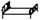
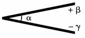
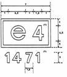

Europäisches Übereinkommen über die Arbeit des im internationalen Strassenverkehr beschäftigten Fahrpersonals (AETR) Abgeschlossen in Genf am 1. Juli 1970 Inkrafttreten für das Fürstentum Liechtenstein: 5. Mai 1997 Die Vertragsparteien, von dem Wunsche geleitet, die Entwicklung und Verbesserung des internationalen Personen- und Güterverkehrs auf der Strasse zu fördern, überzeugt von der Notwendigkeit, die Sicherheit des Strassenverkehrs zu erhöhen, bestimmte Arbeitsbedingungen im internationalen Strassenverkehr nach den Grundsätzen der Internationalen Arbeitsorganisation zu regeln und gemeinsam bestimmte Massnahmen zu treffen, um die Beachtung dieser Regelungen zu sichern, haben Folgendes vereinbart: Art. 1 Begriffsbestimmungen Im Sinne dieses Übereinkommens bedeutet: a) "Fahrzeug" jedes Motorfahrzeug oder jeden Anhänger; dieser Begriff schliesst miteinander verbundene Fahrzeuge ein; b) "Motorfahrzeuge" jedes mit eigener Kraft verkehrende Strassenfahrzeug mit Antriebsmotor, das üblicherweise auf der Strasse der Beförderung von Personen oder Gütern oder dem Ziehen von Fahrzeugen dient, die für die Personen- oder Güterbeförderung benutzt werden; dieser Begriff schliesst landwirtschaftliche Zugmaschinen nicht ein; c) "Anhänger" jedes Fahrzeug, das dazu bestimmt ist, an ein Motorfahrzeug angehängt zu werden; dieser Begriff schliesst Sattelanhänger ein; d) "Sattelanhänger" jeden Anhänger, der dazu bestimmt ist, mit einem Motorfahrzeug so verbunden zu werden, dass er teilweise auf diesem aufliegt und dass ein wesentlicher Teil seines Gewichts und des Gewichts seiner Ladung von diesem getragen wird; e) "miteinander verbundene Fahrzeuge" solche miteinander verbundenen Fahrzeuge, die am Strassenverkehr als Einheit teilnehmen; f) "höchstzulässige Gesamtmasse" die von der zuständigen Behörde des Zulassungsstaates als zulässig erklärte Höchstmasse des beladenen Fahrzeugs; g) "Beförderung im Strassenverkehr" jede ganz oder teilweise auf einer öffentlichen Strasse durchgeführte Fahrt eines zum Personen- oder Sachentransport verwendeten leeren oder beladenen Fahrzeugs; h) "internationaler Strassenverkehr" jeden Strassenverkehr, der mindestens einen Grenzübergang umfasst; i) "Linienverkehr" ist die regelmässige Beförderung von Personen in einer bestimmten Verkehrsverbindung, wobei Fahrgäste an vorher festgelegten Haltestellen ein- oder aussteigen können. Eine Betriebsregelung oder entsprechende Dokumente, die von den zuständigen Behörden der Mitgliedstaaten genehmigt und vom Verkehrsunternehmer vor ihrer Anwendung veröffentlicht werden müssen, legen die Beförderungsbedingungen, insbesondere die Zahl der Fahrten, den Fahrplan, die Tarife und die Beförderungspflicht fest, soweit diese Bedingungen nicht durch Gesetz oder Verordnung bestimmt sind. Als Linienverkehr gilt unabhängig davon, wer den Ablauf der Fahrten bestimmt, auch die regelmässige Beförderung bestimmter Kategorien von Personen unter Ausschluss anderer Fahrgäste, soweit die Merkmale des Linienverkehrs nach Satz 1 gegeben sind. Diese Beförderungen – vor allem die Beförderung von Arbeitnehmern zur Arbeitsstelle und von dort zu ihrer Wohnung und die Beförderung von Schülern zur Lehranstalt und von dort zu ihrer Wohnung - werden als "Sonderformen des Linienverkehrs" bezeichnet; j) "Fahrer" jede Person, gleichviel ob im Arbeitsverhältnis stehend oder nicht, die das Fahrzeug, sei es auch nur für kurze Zeit, selbst lenkt oder sich im Rahmen ihrer Funktion im Fahrzeug befindet, um es gegebenenfalls lenken zu können; k) "Mitglied des Fahrpersonals" den Führer oder eine der nachstehenden Personen, gleichviel ob im Arbeitsverhältnis stehend oder nicht; i) "Beifahrer" jede Person, die den Führer begleitet, um ihn bei bestimmten im Verkehr zu verrichtenden Tätigkeiten zu unterstützen, und die sich in der Regel an den Beförderungshandlungen tatsächlich beteiligt, ohne Führer im Sinne des Buchstabens j dieses Artikels zu sein; ii) "Schaffner" jede Person, die den Führer eines zum Personentransport eingesetzten Fahrzeugs begleitet und beauftragt ist, insbesondere die Fahrausweise oder sonstigen Ausweise, die zur Fahrt berechtigen, zu verkaufen und zu kontrollieren; l) "Woche" der Zeitraum zwischen Montag 00.00 Uhr und Sonntag 24.00 Uhr; m) "Ruhezeit" jeden ununterbrochenen Zeitraum, in dem der Fahrer frei über seine Zeit verfügen kann; n) "Unterbrechung" jeden Zeitraum, in dem der Fahrer nicht berechtigt ist, das Fahrzeug zu lenken oder andere Aufgaben wahrzunehmen, und der dem Fahrer ausschliesslich dazu dient, sich auszuruhen; o) "tägliche Ruhezeit" den Zeitraum im Verlauf eines Tages, in dem ein Fahrer frei über seine Zeit verfügen kann und der eine "regelmässige tägliche Ruhezeit" oder eine "reduzierte tägliche Ruhezeit" sein kann: - "regelmässige tägliche Ruhezeit" ist eine Ruhezeit von mindestens 11 Stunden Dauer. Diese tägliche Ruhezeit kann auch in zwei Tranchen bezogen werden, wovon die erste ein ununterbrochener Zeitraum von mindestens 3 Stunden und die zweite ein ununterbrochener Zeitraum von mindestens 9 Stunden sein muss, - "reduzierte tägliche Ruhezeit" ist eine Ruhezeit von mindestens 9 Stunden, aber weniger als 11 Stunden; p) "wöchentliche Ruhezeit" den wöchentlichen Zeitraum, in dem ein Fahrer frei über seine Zeit verfügen kann und der eine "regelmässige wöchentliche Ruhezeit" oder eine "reduzierte wöchentliche Ruhezeit" sein kann: - "regelmässige wöchentliche Ruhezeit" ist eine Ruhezeit von mindestens 45 Stunden Dauer, - "reduzierte wöchentliche Ruhezeit" ist eine Ruhezeit von weniger als 45 Stunden. Diese kann, vorbehaltlich der in Art. 8 Abs. 6 dieses Übereinkommens aufgeführten Bedingungen, auf ein Minimum von 24 aufeinander folgenden Stunden reduziert werden; q) "andere Aufgaben" jede Tätigkeit mit Ausnahme der Fahrtätigkeit, einschliesslich jeder für denselben oder einen anderen Arbeitgeber durchgeführten Tätigkeit innerhalb oder ausserhalb des Transportsektors. Die Wartezeit und die Nicht-Lenkzeit, die in einem fahrenden Fahrzeug, auf einer Fähre oder in einem Zug verbracht werden, gelten nicht als "andere Aufgaben"; r) "Lenkzeit" die Lenkzeit, die automatisch oder halbautomatisch oder manuell gemäss den im vorliegenden Übereinkommen definierten Bedingungen erfasst wird; s) "Tageslenkzeit" die summierte Gesamtlenkzeit zwischen dem Ende einer täglichen Ruhezeit und dem Beginn der darauf folgenden täglichen Ruhezeit oder zwischen einer täglichen und einer wöchentlichen Ruhezeit; t) "wöchentliche Lenkzeit" die summierte Gesamtlenkzeit innerhalb einer Woche; u) "Lenkzeit" die summierte Lenkzeit zwischen dem Zeitpunkt, an dem der Fahrer sich nach einer Ruhezeit oder einer Pause ans Steuer setzt, und dem Zeitpunkt, an dem er eine Ruhezeit oder Pause einlegt. Die Lenkzeit kann ununterbrochen oder unterbrochen sein; v) "Mehrfachbesatzung" den Fall, in dem während einer Lenkdauer zwischen zwei aufeinander folgenden täglichen Ruhezeiten oder zwischen einer täglichen und einer wöchentlichen Ruhezeit mindestens zwei Fahrer im Fahrzeug zum Lenken eingesetzt sind. Während der ersten Stunde der Mehrfachbesatzung ist die Anwesenheit eines anderen Fahrers oder anderer Fahrer fakultativ, während der restlichen Fahrtdauer jedoch obligatorisch; w) "Verkehrsunternehmen" jede natürliche oder juristische Person und jede Vereinigung oder Gruppe von Personen ohne Rechtspersönlichkeit mit oder ohne Erwerbszweck sowie jede eine eigene Rechtspersönlichkeit besitzende oder einer Behörde mit Rechtspersönlichkeit unterstehende offizielle Stelle, die Strassentransporte auf Rechnung Dritter oder auf eigene Rechnung durchführt. Art. 2 Geltungsbereich 1) Dieses Übereinkommen gilt im Hoheitsgebiet jeder Vertragspartei für den internationalen Strassenverkehr mit jedem Fahrzeug, das im Hoheitsgebiet dieser oder einer anderen Vertragspartei zugelassen ist. 2) Jedoch gilt, vorbehaltlich einer abweichenden Vereinbarung zwischen Vertragsparteien, deren Hoheitsgebiet befahren wird, dieses Übereinkommen nicht für den Sachentransport im internationalen Strassenverkehr mit: a) Fahrzeugen, die zum Sachentransport dienen und deren zulässige Gesamtmasse, einschliesslich Anhänger oder Sattelanhänger, 3,5 Tonnen nicht übersteigt; b) Fahrzeugen, die zum Personentransport dienen und die nach ihrer Bauart und Ausstattung geeignet und dazu bestimmt sind, bis zu neun Personen - einschliesslich des Fahrers - zu befördern; c) Fahrzeugen, die zum Personentransport im Linienverkehr dienen, sofern die Linienstrecke nicht mehr als 50 km beträgt; d) Fahrzeugen mit einer zulässigen Höchstgeschwindigkeit von nicht mehr als 40 km/h; e) Fahrzeugen, die von der Armee, dem Zivilschutz, der Feuerwehr und den für die Aufrechterhaltung der öffentlichen Ordnung zuständigen Stellen verwendet oder von diesen ohne Fahrer gemietet werden, wenn der Transport unter die eigentlichen Aufgaben dieser Stellen fällt und unter deren Leitung durchgeführt wird; f) Fahrzeugen, die in Notfällen oder für Rettungsmassnahmen, einschliesslich nicht gewerblicher Transporte für humanitäre Hilfe, eingesetzt werden; g) Spezialfahrzeugen für ärztliche Aufgaben; h) Fahrzeugen, die für die Pannenhilfe speziell ausgerüstet sind und innerhalb eines Umkreises von 100 km um ihren Standort eingesetzt werden; i) Fahrzeugen, mit denen zum Zweck der technischen Entwicklung oder bei Reparatur- oder Wartungsarbeiten Probefahrten auf der Strasse gemacht werden, und neuen oder umgebauten Fahrzeugen, die noch nicht in Betrieb genommen worden sind; j) Fahrzeugen mit einer zulässigen Gesamtmasse von höchstens 7,5 Tonnen, die für nichtgewerbliche Sachentransporte eingesetzt werden; k) Nutzfahrzeugen, die nach geltendem Recht der Vertragspartei, auf deren Hoheitsgebiet sie benützt werden, als historisch gelten und die nicht für gewerbliche Sachen- oder Personentransporte eingesetzt werden. Art. 3 Anwendungen von Bestimmungen des Übereinkommens auf den Strassenverkehr mit Fahrzeugen aus Nichtvertragsstaaten 1) Jede Vertragspartei wendet in ihrem Hoheitsgebiet auf den internationalen Strassenverkehr mit Fahrzeugen, die in Nichtvertragsstaaten zugelassen sind, mindestens ebenso strenge Bestimmungen an, wie in den Art. 5, 6, 7, 8, 9 und 10 vorgesehen sind. 2) a) Es bleibt jedoch jeder Vertragspartei überlassen, bei einem Fahrzeug, das in einem Nichtvertragsstaat zugelassen ist, anstelle eines Kontrollgeräts, das den Spezifikationen im Anhang dieses Übereinkommens entspricht, nur Tageskontrollblätter zu verlangen. Diese sind von jedem Mitglied des Fahrpersonals handschriftlich auszufüllen, und zwar für den Zeitraum seit der Einfahrt in das Hoheitsgebiet der ersten Vertragspartei. b) Zu diesem Zweck erfasst jedes Mitglied des Fahrpersonals auf dem Einlageblatt die Zeit, die es für seine berufliche Tätigkeit und seine Ruhezeiten aufgewendet hat. Dabei sind die entsprechenden grafischen Symbole zu verwenden, wie sie in Art. 12 des Anhangs zu diesem Übereinkommen definiert werden. Art. 4 Allgemeine Grundsätze Jede Vertragspartei kann höhere Mindestwerte oder niedrigere Höchstwerte als nach den Art. 5 bis 8 anwenden. Dieses Übereinkommen gilt jedoch weiterhin für diejenigen Fahrer, die in Fahrzeugen, welche in einem anderen Vertragsstaat oder Nichtvertragsstaat zugelassen sind, Beförderungen im internationalen Strassenverkehr durchführen. Art. 5 Fahrpersonal 1) Das Mindestalter der im Güterverkehr eingesetzten Fahrer wird festgesetzt: a) bei Fahrzeugen mit einem höchstzulässigen Gesamtgewicht von 7,5 Tonnen - Anhänger oder Sattelanhänger gegebenenfalls inbegriffen - auf das vollendete 18. Lebensjahr; b) bei den übrigen Fahrzeugen auf - das vollendete 21. Lebensjahr oder - das vollendete 18. Lebensjahr, falls der Fahrer Inhaber eines Befähigungsnachweises über den erfolgreichen Abschluss einer von einer Vertragspartei anerkannten Ausbildung für Fahrer im Güterverkehr ist. Die Vertragsparteien werden sich gegenseitig über das geltende nationale Mindestniveau der Ausbildung und andere sachdienliche Bedingungen unterrichten, die auf Fahrer im internationalen Güterverkehr anzuwenden sind, soweit sie unter dieses Übereinkommen fallen. 2) Die im Personenverkehr eingesetzten Fahrer müssen mindestens 21 Jahre alt sein. Die im Personenverkehr im Umkreis von mehr als 50 km um den Standort des Fahrzeugs eingesetzten Fahrer müssen ausserdem a) mindestens ein Jahr lang die Tätigkeit eines im Güterverkehr eingesetzten Fahrers von Fahrzeugen mit einem zulässigen Höchstgewicht von mehr als 3,5 Tonnen ausgeübt haben, oder b) mindestens ein Jahr lang die Tätigkeit eines Fahrers ausgeübt haben, der im Personenverkehr im Umkreis von bis zu 50 km um den Standort des Fahrzeugs oder in anderen Arten der Personenbeförderung eingesetzt war, die nicht unter dieses Übereinkommen fallen, aber nach Auffassung der zuständigen Behörde die erforderliche Erfahrung verliehen haben, oder c) Inhaber eines Befähigungsnachweises über den erfolgreichen Abschluss einer von einer der Vertragsparteien anerkannten Ausbildung für Fahrer im Personenkraftverkehr sein. Art. 6 Lenkzeiten 1) Die Tageslenkzeit im Sinne von Art. 1 Bst. s dieses Übereinkommens darf 9 Stunden nicht überschreiten. Sie darf höchstens zweimal pro Woche auf maximal 10 Stunden verlängert werden. 2) Die wöchentliche Lenkzeit im Sinne von Art. 1 Bst. t dieses Übereinkommens darf 56 Stunden nicht überschreiten. 3) Die während zwei aufeinander folgenden Wochen summierte Gesamtlenkzeit darf 90 Stunden nicht überschreiten. 4) Die Lenkzeit umfasst alle in den Hoheitsgebieten der Vertragsparteien oder der Nicht-Vertragsparteien geleisteten Lenkzeiten. 5) Der Fahrer erfasst die Zeiten im Sinne von Art. 1 Bst. q sowie alle Lenkzeiten in einem Fahrzeug, das für gewerbliche Zwecke ausserhalb des Anwendungsbereichs des vorliegenden Übereinkommens verwendet wird, als "andere Aufgaben"; zudem erfasst er die verbrachten Bereitschaftszeiten im Sinne von Art. 12 Abs. 3 Bst. c des Anhangs zu diesem Übereinkommen. Diese Zeiten sind entweder handschriftlich auf einem Einlageblatt oder einem Ausdruck oder manuell in das Kontrollgerät einzugeben. Art. 7 Unterbrechungen 1) Nach einer Lenkzeit von viereinhalb Stunden muss der Fahrer eine ununterbrochene Pause von mindestens 45 Minuten einlegen, sofern er keine Ruhezeit nimmt. 2) Diese Unterbrechung im Sinne von Art. 1 Bst. n dieses Übereinkommens kann durch eine Unterbrechung von 15 Minuten, gefolgt von einer Unterbrechung von mindestens 30 Minuten, ersetzt werden. Jede dieser beiden Unterbrechungen ist in die Lenkzeit oder unmittelbar danach so einzufügen, dass die Bestimmungen von Abs. 1 eingehalten werden. 3) Für die Anwendung dieses Artikels gelten die Wartezeit und die Nicht-Lenkzeit, die in einem fahrenden Fahrzeug, auf einer Fähre oder in einem Zug verbracht werden, nicht als "andere Aufgaben" im Sinne Art. 1 Bst. q dieses Übereinkommens und können als "Unterbrechungen" betrachtet werden. 4) Nach diesem Artikel eingelegte Unterbrechungen dürfen nicht als tägliche Ruhezeit betrachtet werden. Art. 8 Ruhezeiten 1) Der Fahrer muss tägliche und wöchentliche Ruhezeiten im Sinne von Art. 1 Bst. o und p einhalten. 2) Innerhalb von vierundzwanzig Stunden nach dem Ende seiner vorangegangenen täglichen oder wöchentlichen Ruhezeit muss der Fahrer eine neue tägliche Ruhezeit genommen haben. Beträgt der Teil der täglichen Ruhezeit, der in diesen 24-Stunden-Zeitraum fällt, mindestens 9 Stunden, jedoch weniger als 11 Stunden, so gilt diese tägliche Ruhezeit als reduzierte tägliche Ruhezeit. 3) In Abweichung von Abs. 2 muss ein Fahrer, der Teil einer Mehrfachbesatzung eines Fahrzeugs ist, innerhalb von 30 Stunden nach dem Ende einer täglichen oder wöchentlichen Ruhezeit eine neue tägliche Ruhezeit von mindestens 9 Stunden genommen haben. 4) Eine tägliche Ruhezeit kann verlängert werden, sodass sich eine regelmässige wöchentliche Ruhezeit oder eine reduzierte wöchentliche Ruhezeit ergibt. 5) Der Fahrer darf zwischen zwei wöchentlichen Ruhezeiten höchstens drei reduzierte tägliche Ruhezeiten einlegen. 6) a) In zwei jeweils aufeinander folgenden Wochen hat der Fahrer mindestens folgende Ruhezeiten einzuhalten: i) zwei regelmässige wöchentliche Ruhezeiten; oder ii) eine regelmässige wöchentliche Ruhezeit und eine reduzierte wöchentliche Ruhezeit von mindestens 24 Stunden. Dabei ist die Reduzierung jedoch durch eine gleichwertige und ununterbrochene Ruhezeit innerhalb der folgenden drei Wochen auszugleichen. Eine wöchentliche Ruhezeit muss spätestens am Ende von sechs 24-Stunden-Zeiträumen nach dem Ende der vorangegangenen wöchentlichen Ruhezeit beginnen. b) Abweichend von Abs. 6 Bst. a darf ein Fahrer im grenzüberschreitenden Personenverkehr für eine einzelne Personentransportfahrt, nicht aber für den Linienverkehr, seine wöchentliche Ruhezeit auf bis zu zwölf 24-Stunden-Zeiträume nach dem Ende der vorangegangenen wöchentlichen Ruhezeit verschieben, sofern folgende Voraussetzungen erfüllt sind: i) die Fahrt dauert mindestens 24 aufeinander folgende Stunden im Hoheitsgebiet einer Vertragspartei oder eines anderen Staats als desjenigen, in dem die Fahrt begonnen wurde; und ii) der Fahrer bezieht nach Verschiebung der wöchentlichen Ruhezeit die folgenden Ruhezeiten: a) entweder zwei regelmässige wöchentliche Ruhezeiten, b) oder eine regelmässige wöchentliche Ruhezeit und eine reduzierte wöchentliche Ruhezeit von mindestens 24 Stunden. Die Reduzierung ist durch eine gleichwertige und ununterbrochene Ruhezeit innerhalb der folgenden drei Wochen auszugleichen; und iii) das Fahrzeug wird innerhalb von vier Jahren nach Einführung des digitalen Fahrtschreibers durch das Land, in dem das Fahrzeug zugelassen ist, mit einem Kontrollgerät in Übereinstimmung mit Anlage 1B des Anhangs zu diesem Übereinkommen ausgerüstet; und iv) das Fahrzeug wird nach dem 1. Januar 2014 bei Fahrten zwischen 22.00 Uhr und 06.00 Uhr mit einer Mehrfachbesatzung ausgestattet oder die in Art. 7 erwähnte Lenkzeit wird auf drei Stunden verkürzt. c) Abweichend von Abs. 6 Bst. a muss jeder Fahrer, der Teil einer Mehrfachbesatzung ist, eine wöchentliche Ruhezeit von mindestens 45 Stunden nehmen. Diese Ruhezeit kann auf ein Minimum von 24 Stunden reduziert werden (reduzierte wöchentliche Ruhezeit). Jede solche Reduzierung muss jedoch durch eine gleichwertige und ununterbrochene Ruhezeit innerhalb der folgenden drei Wochen ausgeglichen werden. Eine wöchentliche Ruhezeit muss spätestens nach Abschluss von sechs 24-Stunden-Zeiträumen nach dem Ende der vorangegangenen wöchentlichen Ruhezeit beginnen. 7) Jede Ruhezeit, die als Ausgleich für eine reduzierte wöchentliche Ruhezeit eingelegt wird, ist an eine andere Ruhezeit von mindestens 9 Stunden anzuhängen. 8) Auf Wunsch des Fahrers können nicht am Standort des Fahrzeugs eingelegte tägliche Ruhezeiten und reduzierte wöchentliche Ruhezeiten im Fahrzeug verbracht werden, sofern das Fahrzeug abgestellt ist und mit geeigneten - vom Hersteller beim Bau des Fahrzeugs vorgesehenen - Schlafmöglichkeiten für jeden Fahrer ausgerüstet ist. 9) Eine wöchentliche Ruhezeit, die in einer Woche beginnt und in die folgende Woche hineinreicht, kann der einen oder der anderen, nicht aber beiden Wochen zugerechnet werden. Art. 8bis Ausnahmen zu Art. 8 1) Wenn ein Fahrer ein Fahrzeug begleitet, das auf einem Fährschiff oder mit der Eisenbahn befördert wird, und dieser Fahrer eine regelmässige tägliche Ruhezeit einlegt, darf diese Ruhezeit in Abweichung von Art. 8 höchstens zweimal durch andere Tätigkeiten unterbrochen werden, sofern folgende Voraussetzungen erfüllt sind: a) der an Land verbrachte Teil der täglichen Ruhezeit muss vor oder nach dem auf dem Fährschiff oder in der Eisenbahn verbrachten Teil der täglichen Ruhezeit liegen; b) der Zeitraum zwischen den Teilen der täglichen Ruhezeit muss so kurz wie möglich sein und darf auf keinen Fall vor der Verladung des Fahrzeugs oder nach dem Verlassen der Eisenbahn oder des Schiffs durch das Fahrzeug 1 Stunde übersteigen; dabei umfasst der Vorgang der Verladung bzw. des Verlassens auch die Zollformalitäten. Während aller Teile der täglichen Ruhezeit muss dem Fahrer eine Schlafkabine zur Verfügung stehen. 2) Die von einem Fahrer verbrachte Zeit, um zu einem in den Geltungsbereich dieses Übereinkommens fallenden Fahrzeug anzureisen, das sich nicht am Wohnsitz des Fahrers oder bei der Betriebsstätte des Arbeitgebers, welcher der Fahrer normalerweise zugeordnet ist, befindet, oder von diesem Fahrzeug zurückzureisen, wird nur dann als Ruhezeit oder Pause verbucht, wenn sich der Fahrer auf einem Fährschiff oder in einem Zug befindet und Zugang zu geeigneten Schlafmöglichkeiten hat. 3) Die von einem Fahrer verbrachte Zeit, um mit einem nicht in den Geltungsbereich dieses Übereinkommens fallenden Fahrzeug zu einem in den Geltungsbereich dieses Übereinkommens fallenden Fahrzeug anzureisen, das sich nicht am Wohnsitz des Fahrers oder bei der Betriebsstätte des Arbeitgebers, welcher der Fahrer normalerweise zugeordnet ist, befindet, oder von diesem Fahrzeug zurückzureisen, wird als "andere Aufgaben" verbucht. Art. 9 Ausnahmen Wenn es mit der Sicherheit im Strassenverkehr vereinbar ist, kann der Führer, um einen geeigneten Halteplatz zu erreichen, von diesem Übereinkommen abweichen, soweit dies erforderlich ist, um die Sicherheit der Fahrgäste, des Fahrzeugs oder seiner Ladung zu gewährleisten. Der Fahrer hat Art und Grund der Abweichung von den Bestimmungen spätestens bei seiner Ankunft am geeigneten Halteplatz auf dem Einlageblatt oder einem Ausdruck des Kontrollgeräts oder in seinem Arbeitszeitplan zu vermerken. Art. 10 Kontrollgerät 1) Die Vertragsparteien schreiben für die in ihrem Hoheitsgebiet zugelassenen Fahrzeuge den Einbau und die Benutzung eines Kontrollgeräts gemäss den Bestimmungen dieses Übereinkommens einschliesslich seines Anhangs und seiner Anlagen vor. 2) Das Kontrollgerät im Sinne dieses Übereinkommens muss hinsichtlich Bauart, Einbau, Benutzung und Prüfung den Vorschriften dieses Übereinkommens einschliesslich seines Anhangs und seiner Anlagen entsprechen. 3) Ein Kontrollgerät, das hinsichtlich Bauart, Einbau, Benutzung und Prüfung der Verordnung (EWG) Nr. 3821/85 des Rates vom 20. Dezember 1985 entspricht, wird so betrachtet, als erfülle es die Bestimmungen dieses Übereinkommens einschliesslich seines Anhangs und seiner Anlagen. Art. 11 Überwachung durch das Unternehmen 1) Das Unternehmen muss seinen Fahrbetrieb so einrichten und den Mitgliedern des Fahrpersonals Anweisungen solcher Art erteilen, dass die Mitglieder des Fahrpersonals die Bestimmungen dieses Übereinkommens einhalten können. 2) Das Unternehmen hat die Dauer der Lenkzeiten und der weiteren Arbeiten sowie die Ruhezeiten regelmässig zu überwachen und sich hierbei aller ihm zur Verfügung stehenden Unterlagen zu bedienen, wie zum Beispiel der persönlichen Kontrollbücher. Stellt das Unternehmen Verstösse gegen dieses Übereinkommen fest, so müssen diese unverzüglich abgestellt und Massnahmen getroffen werden, die eine Wiederholung ausschliessen, zum Beispiel durch Abänderung der Zeitpläne und der Fahrstrecken. 3) Führer im Lohnverhältnis dürfen nicht nach Massgabe der zurückgelegten Strecke und/oder der Menge der beförderten Güter entlohnt werden, auch nicht in Form von Prämien oder Zuschlägen für diese Fahrstrecke oder Gütermengen, es sei denn, dass diese Entgelte nicht geeignet sind, die Sicherheit im Strassenverkehr zu beeinträchtigen oder zu Verstössen gegen dieses Übereinkommen zu verleiten. 4) Das Verkehrsunternehmen haftet für Verstösse von Fahrern des Unternehmens, selbst wenn der Verstoss im Hoheitsgebiet einer anderen Vertragspartei oder eines Nichtvertragsstaats begangen wurde. Unbeschadet des Rechts der Vertragsparteien, Verkehrsunternehmen uneingeschränkt haftbar zu machen, können die Vertragsparteien diese Haftung von einem Verstoss des Unternehmens gegen die Abs. 1 und 2 abhängig machen. Die Vertragsparteien können alle Beweise prüfen, die belegen, dass das Verkehrsunternehmen billigerweise nicht für den begangenen Verstoss haftbar gemacht werden kann. 5) Unternehmen, Spediteure, Verlader, Reiseveranstalter, Speditionsunternehmen, Subunternehmer und Fahrervermittlungsagenturen stellen sicher, dass die vertraglich vereinbarten Beförderungszeitpläne nicht gegen dieses Übereinkommen verstossen. Art. 12 Durchführungsmassnahmen 1) Jede Vertragspartei trifft alle geeigneten Massnahmen, um die Beachtung dieses Übereinkommens sicherzustellen, insbesondere durch Kontrollen auf der Strasse und in den Geschäftsräumen der Unternehmen. Diese Kontrollen umfassen jährlich einen bedeutenden und repräsentativen Anteil aller Fahrer, Unternehmen und Fahrzeuge, die in den Geltungsbereich dieses Übereinkommens fallen: a) Die zuständigen Behörden der Vertragsparteien gestalten diese Kontrollen wie folgt: i) Im Laufe eines Kalenderjahrs werden mindestens 1 % der Arbeitstage der Lenker von Fahrzeugen, die diesem Übereinkommen unterstellt sind, kontrolliert; ab 1. Januar 2010 beträgt dieser Prozentsatz mindestens 2 % und ab 1. Januar 2012 mindestens 3 %; ii) Mindestens 15 % der kontrollierten Arbeitstage werden auf der Strasse und mindestens 25 % in den Geschäftsräumen der Unternehmen kontrolliert. Ab 1. Januar 2010 werden mindestens 30 % der kontrollierten Arbeitstage auf der Strasse und mindestens 50 % in den Geschäftsräumen der Unternehmen kontrolliert. b) Auf der Strasse werden kontrolliert: i) die Tageslenkzeiten und wöchentlichen Lenkzeiten, die Unterbrechungen, die täglichen und wöchentlichen Ruhezeiten; ii) die Einlageblätter der vorangegangenen Tage, die im Fahrzeug mitgeführt werden müssen, und/oder die für denselben Zeitraum auf der Fahrerkarte und/oder im Speicher des Kontrollgeräts gespeicherten Daten und/oder gegebenenfalls die auf den Ausdrucken enthaltenen Daten; iii) das fehlerfreie Funktionieren des Kontrollgeräts. Diese Kontrollen sind ohne Diskriminierung nach gebietsansässigen oder gebietsfremden Fahrzeugen, Unternehmen und Fahrern sowie unabhängig von Ausgangspunkt und Ziel der Fahrt sowie vom Typ des Fahrtschreibers durchzuführen. c) In den Geschäftsräumen der Unternehmen werden zusätzlich zu den bei den Strassenkontrollen überprüften Punkten und der Einhaltung der Bestimmungen von Art. 11 Abs. 2 des Anhangs kontrolliert: i) die wöchentlichen Ruhezeiten und die Lenkzeiten zwischen diesen Ruhezeiten; ii) die zweiwöchige Begrenzung der Lenkzeiten; iii) der Ausgleich für die Verkürzung der wöchentlichen Ruhezeiten in Übereinstimmung mit Art. 8 Abs. 6; iv) die Verwendung der Einlageblätter und/oder der von den Bordgeräten und der Fahrerkarte stammenden Daten und Papierkopien und/oder die Planung der Arbeitszeiten der Fahrer. 2) Im Rahmen eines gegenseitigen Beistandes übermitteln die zuständigen Behörden der Vertragsparteien einander regelmässig alle verfügbaren Angaben über: - die von Gebietsfremden begangenen Zuwiderhandlungen gegen die Bestimmungen diese Übereinkommen und ihre Ahndung; - die von einer Vertragspartei verhängten Massnahmen zur Ahndung von Zuwiderhandlungen, die ihre Gebietsansässigen auf dem Territorium einer anderen Vertragspartei begangen haben. In Fällen von schweren Verstössen enthalten diese Informationen auch die verhängte Strafe. 3) Legt das Ergebnis einer Strassenkontrolle, der der Fahrer eines im Hoheitsgebiet einer anderen Vertragspartei zugelassenen Fahrzeugs unterzogen wird, den Verdacht auf Verstösse nahe, die während der Kontrolle nicht aufgedeckt werden können, weil die erforderlichen Angaben fehlen, so leisten die zuständigen Behörden der betreffenden Vertragsparteien einander bei der Klärung Amtshilfe. Führt die zuständige Vertragspartei hierzu eine Kontrolle auf den Geschäftsgrundstücken des Unternehmens durch, so werden die Ergebnisse dieser Kontrolle der betreffenden anderen Vertragspartei mitgeteilt. 4) Die Vertragsparteien arbeiten bei der Durchführung von Strassenkontrollen zusammen. 5) Die Europäische Wirtschaftskommission der Vereinten Nationen veröffentlicht alle zwei Jahre einen Bericht über die Einhaltung des Abs. 1 dieses Artikels durch die Vertragsparteien. 6) a) Die Vertragsparteien ermächtigen die zuständigen Behörden, gegen einen Fahrer bei einem in ihrem Hoheitsgebiet festgestellten Verstoss gegen dieses Übereinkommen eine Sanktion zu verhängen, sofern hierfür noch keine Sanktion verhängt wurde, und zwar selbst dann, wenn der Verstoss im Hoheitsgebiet einer anderen Vertragspartei oder eines Nichtvertragsstaats begangen wurde. b) Die Vertragsparteien ermächtigen die zuständigen Behörden, gegen ein Unternehmen bei einem in ihrem Hoheitsgebiet festgestellten Verstoss gegen dieses Übereinkommen eine Sanktion zu verhängen, sofern hierfür noch keine Sanktion verhängt wurde, und zwar selbst dann, wenn der Verstoss im Hoheitsgebiet einer anderen Vertragspartei oder eines Nichtvertragsstaats begangen wurde. Dabei gilt folgende Ausnahmeregelung: Wird ein Verstoss festgestellt, der von einem Unternehmen mit Sitz im Hoheitsgebiet einer anderen Vertragspartei oder eines Nichtvertragsstaats begangen wurde, wird die Sanktion gemäss dem im bilateralen Strassenverkehrsabkommen zwischen diesen beiden Vertragsparteien vorgesehenen Verfahren verhängt. Die Vertragsparteien prüfen ab 2011 die Möglichkeit, die in Abs. 6 Bst. b vorgesehene Ausnahmeregelung aufzuheben; dies unter der Voraussetzung, dass alle Vertragsparteien dies wünschen. 7) Leitet eine Vertragspartei in Bezug auf einen bestimmten Verstoss ein Verfahren ein oder verhängt eine Sanktion, so muss sie dem Fahrer angemessene schriftliche Belege vorlegen. 8) Die Vertragsparteien stellen sicher, dass ein System verhältnismässiger Sanktionen, die finanzielle Sanktionen umfassen können, für den Fall besteht, dass Unternehmen oder mit ihnen verbundene Spediteure, Verlader, Reiseveranstalter, Speditionsunternehmen, Subunternehmer und Fahrervermittlungsagenturen gegen das vorliegende Übereinkommen verstossen. Art. 12bis Vorlagen Musterformulare 1) Um die Strassenkontrollen auf internationaler Ebene zu vereinfachen, werden im Anhang zu diesem Übereinkommen, sofern erforderlich, Vorlagen für Musterformulare eingefügt. Zu diesem Zweck wird der Anhang mit einer neuen Anlage 3 ergänzt. Diese Formulare werden gemäss dem in Art. 22ter definierten Verfahren eingeführt oder geändert. 2) Die Formulare in Anlage 3 sind nicht rechtsverbindlich. Werden sie jedoch verwendet, dann ist ihr Inhalt zu übernehmen, insbesondere bezüglich Nummerierung, Reihenfolge und Bezeichnung der Rubriken. 3) Die Vertragsparteien können diese Angaben mit weiteren Informationen ergänzen, um damit nationalen oder regionalen Anforderungen zu entsprechen. Diese zusätzlichen Informationen dürfen jedoch keinesfalls für Transporte aus dem Hoheitsgebiet einer anderen Vertragspartei oder eines Drittstaats verlangt werden. Deshalb müssen diese zusätzlichen Informationen im Formular strikt getrennt von den für den internationalen Verkehr definierten Angaben sein. 4) Diese Formulare müssen akzeptiert werden, wenn sie bei Verkehrskontrollen im Hoheitsgebiet der Vertragsparteien dieses Übereinkommens vorgewiesen werden. Art. 13 Übergangsbestimmungen 1) Alle neuen Bestimmungen dieses Übereinkommens, einschliesslich seines Anhangs und seiner Anlagen 1B und 2, hinsichtlich der Einführung eines digitalen Kontrollgeräts werden für alle Vertragsparteien spätestens vier Jahre nach Inkrafttreten der Änderungen gemäss dem Verfahren nach Art. 21 verbindlich. Nach Ablauf dieser Frist müssen somit alle Fahrzeuge, die diesem Übereinkommen unterstellt sind und neu zum Verkehr zugelassen werden, mit einem Kontrollgerät gemäss den neuen Anforderungen ausgerüstet werden. Während dieser Frist von vier Jahren haben Vertragsparteien, die diese Änderungen noch nicht eingeführt haben, Fahrzeuge, die von einer anderen Vertragspartei zugelassen und bereits mit einem digitalen Kontrollgerät ausgerüstet sind, auf ihrem Hoheitsgebiet zu tolerieren und entsprechend zu kontrollieren. 2) a) Die Vertragsparteien ergreifen die erforderlichen Massnahmen, um die Fahrerkarten gemäss dem geänderten Anhang dieses Übereinkommens spätestens drei Monate vor Ablauf der in Abs. 1 vorgesehenen Frist von vier Jahren auszustellen. Diese Frist von drei Monaten gilt auch für Vertragsparteien, die die Bestimmungen hinsichtlich des digitalen Kontrollgeräts nach der Anlage 1B des Anhangs vor Ablauf der Frist von vier Jahren einführen. Diese Vertragsparteien halten das Sekretariat der Arbeitsgruppe Strassenverkehr der Europäischen Wirtschaftskommission über die Fortschritte dieser Einführung auf dem Laufenden. b) Sofern die Ausstellung der Karten gemäss Bst. a nicht fristgemäss erfolgen kann, gelten für Fahrer, die Fahrzeuge mit einem elektronischen Kontrollgerät gemäss Anlage 1B lenken müssen, die Bestimmungen von Art. 14 des Anhangs. 3) Für jede Ratifikation oder jeden Beitritt eines Staates zu diesem Abkommen, die nach Inkrafttreten der vorliegenden Änderungen erfolgen, gilt das geänderte Übereinkommen, inkl. des Umsetzungstermins nach Abs. 1. Falls ein Beitritt weniger als zwei Jahre vor Ablauf der Frist nach Abs. 1 erfolgt, informiert der beitretende Staat den Depositär bei der Hinterlegung seiner Ratifizierungs- oder Beitrittsurkunde über den Zeitpunkt der tatsächlichen Einführung des digitalen Kontrollgeräts auf seinem Hoheitsgebiet. Dieser Staat kann eine Übergangsfrist von höchstens zwei Jahren ab dem Inkrafttreten dieses Übereinkommens auf seinem Hoheitsgebiet geltend machen. Der Depositär informiert alle Vertragsparteien darüber. Die Bestimmungen des vorstehenden Abschnittes sind auch für den Fall anwendbar, dass ein Staat nach Ablauf der Frist von vier Jahren gemäss Abs. 1 beitritt. Art. 13bis Übergangsbestimmungen Die am Ende der Abs. 7 Bst. a und 7 Bst. b von Art. 12 des Anhangs zu diesem Übereinkommen enthaltenen Bestimmungen erlangen 3 Monate nach Inkrafttreten der vorliegenden Änderungen Gültigkeit. Art. 14 Schlussbestimmungen 1) Dieses Übereinkommen liegt bis zum 31. März 1971 zur Unterzeichnung auf, nach diesem Tag liegt es für die Mitgliedstaaten der Wirtschaftskommission für Europa und für Staaten, die nach Abs. 8 oder 11 der Statuten in beratender Eigenschaft zu dieser Kommission zugelassen sind, zum Beitritt auf. Der Beitritt gestützt auf Abs. 11 der Statuten ist beschränkt auf folgende Staaten: Algerien, Ägypten, Jordanien, Libanon, Marokko und Tunesien. 2) Das Übereinkommen bedarf der Ratifikation. 3) Die Ratifikations- oder Beitrittsurkunden sind beim Generalsekretär der Vereinten Nationen zu hinterlegen. 4) Dieses Übereinkommen tritt am hundertachtzigsten Tag nach Hinterlegung der achten Ratifikations- oder Beitrittsurkunde in Kraft. 5) Für jeden Staat, der dieses Übereinkommen nach der in Abs. 4 genannten Hinterlegung der achten Ratifikations- oder Beitrittsurkunde ratifiziert oder ihm beitritt, tritt dieses Übereinkommen am hundertachtzigsten Tag nach der Hinterlegung seiner eigenen Ratifikations- oder Beitrittsurkunde in Kraft. Art. 15 1) Jede Vertragspartei kann dieses Übereinkommen durch eine an den Generalsekretär der Vereinten Nationen gerichtete Notifikation kündigen. 2) Die Kündigung wird sechs Monate nach Eingang der Notifikation beim Generalsekretär wirksam. Art. 16 Dieses Übereinkommen tritt ausser Kraft, wenn nach seinem Inkrafttreten die Zahl der Vertragsparteien während zwölf aufeinanderfolgender Monate weniger als drei beträgt. Art. 17 1) Jeder Staat kann bei Unterzeichnung dieses Übereinkommens, bei Hinterlegung seiner Ratifikations- oder Beitrittsurkunde oder zu jedem späteren Zeitpunkt durch eine an den Generalsekretär der Vereinten Nationen gerichtete Notifikation erklären, dass sich die Gültigkeit dieses Übereinkommens auf alle oder einzelne Hoheitsgebiete erstreckt, deren internationale Beziehungen er wahrnimmt. Das Übereinkommen wird für jedes in der Notifikation genannte Hoheitsgebiet am hundertachtzigsten Tage nach Eingang der Notifikation beim Generalsekretär oder, falls das Übereinkommen dann noch nicht in Kraft getreten ist, mit seinem Inkrafttreten wirksam. 2) Jeder Staat, der nach Abs. 1 erklärt hat, dass sich dieses Übereinkommen auf ein Hoheitsgebiet erstreckt, dessen internationale Beziehungen er wahrnimmt, kann das Übereinkommen in Bezug auf dieses Hoheitsgebiet nach Art. 15 kündigen. Art. 18 1) Jede Streitigkeit zwischen zwei oder mehr Vertragsparteien über die Auslegung oder Anwendung dieses Übereinkommens wird, soweit möglich, durch Verhandlungen zwischen den streitenden Parteien beigelegt. 2) Jede Streitigkeit, die nicht durch Verhandlungen beigelegt werden konnte, wird auf Antrag einer der streitenden Vertragsparteien einem Schiedsverfahren unterworfen und demgemäss einem oder mehreren Schiedsrichtern unterbreitet, die von den streitenden Parteien in gegenseitigem Einvernehmen ausgewählt werden. Einigen sich binnen dreier Monate nach dem Tage des Antrags auf ein Schiedsverfahren die streitenden Parteien nicht über die Wahl eines Schiedsrichters oder der Schiedsrichter, so kann jede dieser Parteien den Generalsekretär der Vereinten Nationen ersuchen, einen einzigen Schiedsrichter zu ernennen, dem der Streitfall zur Entscheidung überwiesen wird. 3) Die Entscheidung des nach Abs. 2 bestellten Schiedsrichters oder der Schiedsrichter ist für die streitenden Vertragsparteien bindend. Art. 19 1) Jeder Staat kann bei der Unterzeichnung, bei der Ratifikation oder beim Beitritt zu diesem Übereinkommen erklären, dass er sich durch Art. 18 Abs. 2 und 3 nicht als gebunden betrachtet. Die anderen Vertragsparteien sind durch diese Absätze gegenüber keiner Vertragspartei gebunden, die einen solchen Vorbehalt gemacht hat. 2) Macht ein Staat bei der Hinterlegung seiner Ratifikations- oder Beitrittsurkunde einen anderen als den in Abs. 1 vorgesehenen Vorbehalt, so teilt der Generalsekretär der Vereinten Nationen diesen Vorbehalt jenen Staaten mit, die ihre Ratifikations- oder Beitrittsurkunden bereits hinterlegt und das Übereinkommen seitdem nicht gekündigt haben. Der Vorbehalt gilt als angenommen, wenn binnen sechs Monaten nach dieser Mitteilung keiner dieser Staaten gegen die Annahme Einspruch erhoben hat. Andernfalls ist der Vorbehalt unzulässig und die Ratifikations- oder Beitrittsurkunde des betreffenden Staates ist ungültig, falls er seinen Vorbehalt nicht zurückzieht. Bei der Anwendung dieses Absatzes wird der Einspruch von Staaten nicht berücksichtigt, deren Beitritt oder Ratifikation wegen von ihnen erhobener Vorbehalte auf Grund dieses Absatzes ungültig ist. 3) Jede Vertragspartei, deren Vorbehalt im Unterzeichnungsprotokoll zu diesem Übereinkommen angenommen worden ist oder die nach Abs. 1 einen Vorbehalt gemacht hat oder die einen Vorbehalt hat, der nach Abs. 2 angenommen worden ist, kann ihn jederzeit durch eine an den Generalsekretär gerichtete Notifikation zurückziehen. Art. 20 1) Ist dieses Übereinkommen drei Jahre lang in Kraft gewesen, so kann jede Vertragspartei durch eine an den Generalsekretär der Vereinten Nationen gerichtete Notifikation die Einberufung einer Konferenz zur Revision des Übereinkommens beantragen. Der Generalsekretär notifiziert diesen Antrag allen Vertragsparteien und beruft eine Revisionskonferenz ein, wenn binnen vier Monaten nach seiner Notifikation mindestens ein Drittel der Vertragsparteien ihm ihre Zustimmung zu dem Antrag mitteilt. 2) Wird eine Konferenz nach Abs. 1 einberufen, so setzt der Generalsekretär alle Vertragsparteien davon in Kenntnis und fordert sie auf, binnen dreier Monate die Vorschläge einzureichen, deren Prüfung durch die Konferenz sie wünschen. Der Generalsekretär teilt spätestens drei Monate vor Eröffnung der Konferenz allen Vertragsparteien die vorläufige Tagesordnung der Konferenz sowie den Wortlaut der Vorschläge mit. 3) Der Generalsekretär lädt zu jeder nach diesem Artikel einberufenen Konferenz alle in Art. 14 Abs. 1 bezeichneten Staaten ein. Art. 21 1) Jede Vertragspartei kann eine oder mehrere Änderungen dieses Übereinkommens vorschlagen. Der Wortlaut jedes Änderungsvorschlages ist dem Generalsekretär der Vereinten Nationen mitzuteilen, der ihn allen Vertragsparteien übermittelt und allen anderen in Art. 14 Abs. 1 bezeichneten Staaten zur Kenntnis bringt. 2) Binnen sechs Monaten nach dem Tage der Übermittlung des Änderungsvorschlages durch den Generalsekretär kann jede Vertragspartei diesem bekanntgeben: a) dass sie gegen den Änderungsvorschlag Einspruch erhebt, oder b) dass sie den Vorschlag zwar anzunehmen beabsichtigt, die für die Annahme erforderlichen Voraussetzungen in ihrem Staat jedoch noch nicht erfüllt sind. 3) Solange eine Vertragspartei, die eine Mitteilung nach Abs. 2 Bst. b gemacht hat, dem Generalsekretär die Annahme des Änderungsvorschlags nicht notifiziert hat, kann sie binnen neun Monaten nach Ablauf der für die Mitteilung vorgesehenen Frist von sechs Monaten gegen den Änderungsvorschlag Einspruch erheben. 4) Wird nach den Abs. 2 und 3 Einspruch gegen den Änderungsvorschlag erhoben, so gilt er als nicht angenommen und bleibt ohne jede Wirkung. 5) Ist kein Einspruch nach den Abs. 2 und 3 gegen den Änderungsvorschlag erhoben worden, so gilt er zu folgendem Zeitpunkt als angenommen: a) wenn keine Vertragspartei eine Mitteilung nach Abs. 2 Bst. b gemacht hat, mit Ablauf der in Abs. 2 vorgesehenen Frist von sechs Monaten, b) wenn mindestens eine Vertragspartei eine Mitteilung nach Abs. 2 Bst. b gemacht hat, zum früheren der folgenden zwei Zeitpunkte: - sobald alle Vertragsparteien, die eine derartige Mitteilung gemacht haben, dem Generalsekretär ihre Annahme des Änderungsvorschlages notifiziert haben, jedoch frühestens mit Ablauf der in Abs. 2 vorgesehenen Frist von sechs Monaten, falls alle Annahmeerklärungen vor diesem Zeitpunkt notifiziert worden sind; - mit Ablauf der in Abs. 3 vorgesehenen Frist von neun Monaten. 5bis) Tritt ein Staat diesem Übereinkommen zwischen der Übermittlung eines Änderungsvorschlags und dessen Annahme bei, so informiert das Sekretariat der Arbeitsgruppe Strassenverkehr der Europäischen Wirtschaftskommission den neuen Vertragsstaat unverzüglich über den Änderungsvorschlag. Dieser Vertragsstaat kann den Generalsekretär vor Ablauf der Frist von sechs Monaten ab der Übermittlung des ursprünglichen Änderungsvorschlags an alle Vertragsparteien über seine allfällige Einsprache in Kenntnis setzen. 6) Jede Änderung tritt drei Monate nach dem Zeitpunkt in Kraft, zu dem sie als angenommen gilt. 7) Der Generalsekretär notifiziert sobald als möglich allen Vertragsparteien, ob gegen den Änderungsvorschlag Einspruch nach Abs. 2 Bst. a erhoben worden ist und ob eine oder mehrere Vertragsparteien eine Mitteilung nach Abs. 2 Bst. b an ihn gerichtet haben. Haben eine oder mehrere Vertragsparteien eine solche Mitteilung gemacht, so notifiziert er in der Folge allen Vertragsparteien, ob die Vertragspartei oder die Vertragsparteien, die eine solche Mitteilung gemacht haben, Einspruch gegen den Änderungsvorschlag erheben oder ihn annehmen. 8) Unabhängig von dem in den Abs. 1 bis 6 vorgesehenen Änderungsverfahren kann der Anhang zu diesem Übereinkommen durch Vereinbarung zwischen den zuständigen Verwaltungen aller Vertragsparteien geändert werden. Hat die Verwaltung einer Vertragspartei erklärt, dass nach ihrem innerstaatlichen Recht ihre Zustimmung zu einer solchen Vereinbarung von einer entsprechenden Sonderermächtigung oder von der Billigung durch eine gesetzgebende Körperschaft abhängt, so gilt die Zustimmung der betreffenden Vertragspartei zur Änderung des Anhangs als nicht erteilt, bis diese Verwaltung dem Generalsekretär notifiziert hat, dass die erforderliche Ermächtigung oder Billigung erteilt worden ist. Die Vereinbarung zwischen den zuständigen Verwaltungen legt den Tag des Inkrafttretens des geänderten Anhangs fest und kann vorsehen, dass während einer Übergangszeit der alte Anhang ganz oder teilweise neben dem neuen in Kraft bleibt. Art. 22 1) Die Anlagen 1 und 2 zum Anhang dieses Übereinkommens können entsprechend dem in diesem Artikel festgelegten Verfahren geändert werden. 2) Auf Antrag einer Vertragspartei wird jede von ihr vorgeschlagene Änderung der Anlagen 1 und 2 zum Anhang dieses Übereinkommens vom Hauptausschuss Strassenverkehr der Europäischen Wirtschaftskommission geprüft. 3) Wird eine Änderung durch die Mehrheit der anwesenden und abstimmenden Mitglieder angenommen und stellt diese Mehrheit die Mehrheit der anwesenden und abstimmenden Vertragsparteien dar, wird sie der Generalsekretär an die zuständigen Behörden aller Vertragsparteien zwecks Zustimmung mitteilen. 4) Die Änderung ist angenommen, wenn innerhalb eines Zeitraums von sechs Monaten nach dieser Mitteilung weniger als ein Drittel der zuständigen Behörden der Vertragsparteien dem Generalsekretär ihren Einspruch gegen diese Änderung bekanntgeben. 4bis) Tritt ein Staat diesem Übereinkommen zwischen der Übermittlung eines Änderungsvorschlags und dessen Annahme bei, so informiert das Sekretariat der Arbeitsgruppe Strassenverkehr der Europäischen Wirtschaftskommission den neuen Vertragsstaat unverzüglich über den Änderungsvorschlag. Dieser Vertragsstaat kann den Generalsekretär vor Ablauf der Frist von sechs Monaten ab der Übermittlung des ursprünglichen Änderungsvorschlags an alle Vertragsparteien über seine allfällige Einsprache in Kenntnis setzen. 5) Jede angenommene Änderung wird durch den Generalsekretär allen Vertragsparteien mitgeteilt und tritt drei Monate nach dem Zeitpunkt ihrer Bekanntmachung in Kraft. Art. 22bis Verfahren zur Änderung der Anlage 1B 1) Die Anlage 1B zum Anhang dieses Übereinkommens wird entsprechend dem in diesem Artikel festgelegten Verfahren geändert. 2) Änderungen für die einleitenden Artikel der Anlage 1B werden von der Arbeitsgruppe Strassenverkehr der Europäischen Wirtschaftskommission mit Mehrheitsbeschluss der anwesenden und abstimmenden Vertragsparteien angenommen. Das Sekretariat der Arbeitsgruppe teilt diese Änderungen dem Generalsekretär mit, der sie allen Vertragsparteien mitteilt. Die Änderungen treten drei Monate nach dieser Mitteilung in Kraft. 3) Angesichts der Tatsache, dass die Anlage 1B, die gemäss Art. 10 dieses Übereinkommens dem Anhang 1B der Verordnung (EWG) Nr. 3821/85 entspricht und damit direkt von weiteren Änderungen dieses Anhangs durch die Europäische Union abhängt, sind alle Änderungen des Anhangs 1B nach folgendem Vorgehen auch auf die Anlage 1B anwendbar: - Das Sekretariat der Arbeitsgruppe Strassenverkehr der Europäischen Wirtschaftskommission informiert die zuständigen Behörden aller Vertragsparteien über die Veröffentlichung von Änderungen des Anhangs 1B der Europäischen Verordnung im Amtsblatt der Europäischen Union und teilt dies auch dem Generalsekretär unter Beilage der massgeblichen Texte mit. - Die genannten Änderungen treten für die Anlage 1B drei Monate nach der Mitteilung an die Vertragsparteien in Kraft. 4) Falls ein Änderungsvorschlag für den Anhang dieses Übereinkommens auch eine Änderung der Anlage 1B beinhaltet, treten die Änderungen der Anlage nicht vor den Änderungen des Anhangs in Kraft. In solchen Fällen wird das Inkrafttreten von Änderungen der Anlage 1B gemäss dem Vorgehen nach Art. 21 bestimmt. Art. 22ter Verfahren zur Änderung der Anlage 3 1) Die Anlage 3 im Anhang zu diesem Übereinkommen wird gemäss folgendem Verfahren geändert: 2) Die Vorschläge zur Einfügung von Musterformularen in Anlage 3 gemäss Art. 12bis dieses Übereinkommens oder zur Änderung der bestehenden Formulare werden der Arbeitsgruppe Strassenverkehr der Wirtschaftskommission für Europa der Vereinten Nationen vorgelegt. Die Vorschläge gelten als genehmigt, wenn sie mit Mehrheitsbeschluss der anwesenden und abstimmenden Vertragsparteien angenommen werden. Das Sekretariat der Wirtschaftskommission für Europa der Vereinten Nationen informiert darauf offiziell die zuständigen Stellen aller Vertragsparteien des Übereinkommens über die Annahme dieser Änderungen und teilt dies gleichzeitig dem Generalsekretär unter Beilage der massgeblichen Texte mit. 3) Die so genehmigten Musterformulare dürfen ab einem Zeitpunkt von drei Monaten nach der Mitteilung an die Vertragsparteien des Übereinkommens verwendet werden. Art. 23 Ausser den Notifikationen, die nach den Art. 20 und 21 vorgesehen sind, notifiziert der Generalsekretär der Vereinten Nationen den in Art. 14 Abs. 1 bezeichneten Staaten: a) die Ratifikationen und Beitritte nach Art. 14; b) die Zeitpunkte, zu denen dieses Übereinkommen nach Art. 14 in Kraft tritt; c) die Kündigungen nach Art. 15; d) das Ausserkrafttreten dieses Übereinkommens nach Art. 16; e) die Notifikationen nach Art. 17; f) die Erklärungen und Notifikationen nach Art. 19; g) das Inkrafttreten jeder Änderung nach Art. 21. Art. 24 Das Unterzeichnungsprotokoll zu diesem Übereinkommen hat dieselbe Gültigkeit, Wirkung und Dauer wie das Übereinkommen selbst und gilt als Bestandteil desselben. Art. 25 Nach dem 31. März 1971 wird die Urschrift dieses Übereinkommens beim Generalsekretär der Vereinten Nationen hinterlegt, dieser übermittelt allen in Art. 14 Abs. 1 bezeichneten Staaten beglaubigte Abschriften. Zu Urkund dessen haben die hierzu gehörig befugten Unterzeichneten dieses Übereinkommen unterschrieben. Geschehen zu Genf am ersten Juli 1970 in einer Urschrift in englischer und französischer Sprache, wobei jeder Wortlaut gleichermassen verbindlich ist. (Es folgen die Unterschriften) Anhang Kontrollgerät Allgemeine Vorschriften I. Bauartgenehmigung Art. 1 Mit "Kontrollgerät" im Sinne dieses Kapitels ist immer "Kontrollgerät und seine Bestandteile" gemeint. Jeder Antrag auf eine Bauartgenehmigung für ein Kontrollgerät-, ein Einlageblatt- oder ein Kontrollgerätkarten-Muster wird zusammen mit einer entsprechenden Beschreibung vom Hersteller oder einem Beauftragten bei einer Vertragspartei eingereicht. Für ein und dasselbe Kontrollgerät-, Einlageblatt- oder Kontrollgerätkarten-Muster kann ein solcher Antrag nur bei einer Vertragspartei gestellt werden. Art. 2 Jede Vertragspartei erteilt die Bauartgenehmigung für alle Kontrollgerät-, Einlageblatt- oder Kontrollgerätkarten-Muster, wenn diese den Vorschriften der Anlagen 1 oder 1B entsprechen und wenn die Vertragspartei die Möglichkeit hat, die Übereinstimmung der Fertigung mit dem Muster zu überwachen. Ein Kontrollgerät gemäss Anlage 1B wird nur dann bauartgenehmigt, wenn nachgewiesen wird, dass das Gesamtsystem (Gerät selber, Kontrollgerätkarten und Getriebesensor) gegen Eingriffe und Manipulationen der Lenkzeitdaten gesichert ist. Die dazu erforderlichen Prüfungen werden von Fachleuten durchgeführt, die mit den neuesten Manipulationsmethoden vertraut sind. Änderungen und Ergänzungen eines Musters, für das die Bauartgenehmigung bereits erteilt wurde, bedürfen einer Nachtrags-Bauartgenehmigung der Vertragspartei, die die ursprüngliche Bauartgenehmigung erteilt hat. Art. 3 Die Vertragsparteien erteilen dem Antragsteller für jedes gemäss Art. 2 zugelassene Kontrollgerät-, Einlageblatt- oder Kontrollgerätkarten-Muster ein Prüfzeichen entsprechend dem Muster in der Anlage 2. Art. 4 Die zuständige Behörde der Vertragspartei, bei der die Bauartgenehmigung beantragt wird, übermittelt den Behörden der anderen Vertragsparteien innerhalb eines Monats eine Durchschrift des Genehmigungsbogens sowie eine Durchschrift der erforderlichen Beschreibung für jedes genehmigte Kontrollgerät-, Einlageblatt- oder Kontrollgerätkarten-Muster. Sie unterrichtet sie über jede Ablehnung eines Genehmigungsantrages; im Falle der Ablehnung teilt sie die Gründe dafür mit. Art. 5 1) Stellt eine Vertragspartei, die eine Bauartgenehmigung gemäss Art. 2 erteilt hat, fest, dass Kontrollgeräte, Einlageblätter oder Kontrollgerätkarten mit dem von ihr erteilten Prüfzeichen nicht dem von ihr zugelassenen Muster entsprechen, so trifft sie die erforderlichen Massnahmen, um die Übereinstimmung der Fertigung mit dem zugelassenen Muster sicherzustellen. Diese können gegebenenfalls bis zum Entzug der Bauartgenehmigung gehen. 2) Die Vertragspartei, die eine Bauartgenehmigung erteilt hat, muss diese widerrufen, wenn das Kontrollgerät, das Einlageblatt oder die Kontrollgerätkarte, wofür die Bauartgenehmigung erteilt worden ist, als nicht im Einklang mit diesem Anhang einschliesslich seiner Anlagen stehend anzusehen sind oder bei ihrer Verwendung einen Fehler allgemeiner Art erkennen lassen, der sie für ihren Zweck ungeeignet machen. 3) Wird die Vertragspartei, die eine Bauartgenehmigung erteilt hat, von einer anderen Vertragspartei darüber unterrichtet, dass einer der in den Abs. 1 und 2 genannten Fälle vorliegt, so trifft sie nach Anhörung dieser Vertragspartei ebenfalls die in diesen Absätzen vorgesehenen Massnahmen vorbehaltlich Abs. 5. 4) Die Vertragspartei, die einen der in Abs. 2 genannten Fälle festgestellt hat, kann den Vertrieb und die Inbetriebnahme der Kontrollgeräte, Einlageblätter oder Kontrollgerätkarten bis auf weiteres untersagen. Dasselbe gilt für Fälle nach Abs. 1, wenn der Hersteller nach erfolgter Anmahnung die Übereinstimmung der von der Ersteichung befreiten Kontrollgeräte, Einlageblätter oder Kontrollgerätkarten mit der zugelassenen Bauart bzw. mit den Anforderungen des vorliegenden Anhangs nicht herbeigeführt hat. Auf jeden Fall teilen die zuständigen Behörden der Vertragsparteien einander innerhalb eines Monats den Entzug einer Bauartgenehmigung oder andere in Übereinstimmung mit den Abs. 1, 2 und 3 getroffene Massnahmen sowie die dafür massgeblichen Gründe mit. 5) Bestreitet eine Vertragspartei, die eine Bauartgenehmigung erteilt hat, dass die in den Abs. 1 und 2 genannten Fälle, auf die sie hingewiesen worden ist, gegeben sind, so bemühen sich die betreffenden Vertragsparteien um Beilegung des Streitfalls. Art. 6 1) Beim Antrag auf eine Bauartgenehmigung für ein Einlageblatt-Muster ist anzugeben, für welches Kontrollgerät (welche Kontrollgeräte) dieses Einlageblatt bestimmt ist; für Prüfungen des Einlageblatts ist ausserdem ein geeignetes Kontrollgerät des (der) entsprechenden Typs (Typen) zur Verfügung zu stellen. 2) Die zuständigen Behörden einer jeden Vertragspartei geben auf dem Bauartgenehmigungsbogen des Einlageblatt-Musters an, in welchem Kontrollgerät (welchen Kontrollgeräten) dieses Einlageblatt verwendet werden kann. Art. 7 Die Vertragsparteien dürfen die Zulassung oder die Benutzung der mit dem Kontrollgerät ausgerüsteten Fahrzeuge nicht aus Gründen ablehnen oder verbieten, die mit der Ausrüstung zusammenhängen, wenn das Gerät das in Art. 6 bezeichnete Prüfzeichen und die in Art. 9 genannte Einbauplakette aufweist. Art. 8 Jede Verfügung auf Grund dieses Anhangs, durch die eine Bauartgenehmigung für ein Kontrollgerät-, ein Einlageblatt- oder ein Kontrollgerätkarten-Muster verweigert oder entzogen wird, ist eingehend zu begründen. Sie ist dem Betreffenden unter Angabe der Rechtsmittel und der Rechtsmittelfristen mitzuteilen, die nach dem geltenden Recht der Vertragsparteien vorgesehen sind. II. Einbau und Prüfung Art. 9 1) Einbau und Reparaturen des Kontrollgeräts dürfen nur von Installateuren oder Werkstätten vorgenommen werden, die von den zuständigen Behörden der Vertragsparteien hierzu zugelassen worden sind, wobei diese Behörden vor der Zulassung die beteiligten Hersteller anhören können. Die Gültigkeitsdauer der zugelassenen Werkstätten und der zugelassenen Installateure darf ein Jahr nicht überschreiten. Bei Erneuerung, Beschädigung, Fehlfunktion, Verlust oder Diebstahl der den zugelassenen Werkstätten oder den zugelassenen Installateuren ausgestellten Karten stellt die ausstellende Behörde binnen fünf Werktagen nach Eingang eines entsprechenden begründeten Antrags eine Ersatzkarte aus. Wird eine neue Karte ausgestellt, die die alte ersetzt, erhält die neue Karte die gleiche Werkstattinformationsnummer; der Index wird jedoch um eins erhöht. Die ausstellende Behörde führt ein Verzeichnis der verlorenen, gestohlenen und defekten Karten. Die Vertragsparteien ergreifen alle erforderlichen Massnahmen, um die Möglichkeit einer Fälschung der den zugelassenen Werkstätten oder den zugelassenen Installateuren ausgestellten Karten auszuschliessen. 2) Der zugelassene Installateur oder die zugelassene Werkstatt versehen die von ihnen angebrachten Plombierungen mit einem besonderen Zeichen; ausserdem geben sie im Fall von Kontrollgeräten gemäss Anlage 1B die elektronischen Sicherheitsdaten ein, anhand deren sich insbesondere die Authentifizierungskontrollen durchführen lassen. Die zuständigen Behörden der Vertragsparteien führen ein Verzeichnis der verwendeten Zeichen und elektronischen Sicherheitsdaten sowie der den zugelassenen Werkstätten und den zugelassenen Installateuren ausgestellten Karten. 3) Die zuständigen Behörden der Vertragsparteien übermitteln einander das Verzeichnis der zugelassenen Installateure und Werkstätten sowie der ihnen ausgestellten Karten; ausserdem übermitteln sie ihr eine Abschrift der verwendeten Zeichen und die erforderlichen Informationen betreffend die verwendeten elektronischen Sicherheitsdaten. 4) Durch die Einbauplakette nach den Anlagen 1 oder 1B wird bescheinigt, dass der Einbau des Kontrollgeräts den Vorschriften dieses Anhangs entsprechend erfolgt ist. 5) Alle Plombierungen können von Installateuren oder Werkstätten, die gemäss Abs. 1 von den zuständigen Behörden zugelassen sind, oder unter den in den Anlagen 1 und 1B beschriebenen Umständen entfernt werden. III. Benutzungsvorschriften Art. 10 Der Unternehmer und die Fahrer sorgen für das einwandfreie Funktionieren und die ordnungsgemässe Benutzung des Kontrollgeräts sowie der Fahrerkarte, wenn der Fahrer ein Fahrzeug benutzt, das mit einem Kontrollgerät gemäss Anlage 1B ausgerüstet ist. Art. 11 1) Der Unternehmer händigt den Fahrern von Fahrzeugen mit einem Kontrollgerät gemäss Anlage 1 eine ausreichende Anzahl Einlageblätter aus, wobei dem persönlichen Charakter dieser Einlageblätter, der Dauer des Dienstes und der Möglichkeit Rechnung zu tragen ist, dass beschädigte oder von einem zuständigen Kontrollbeamten beschlagnahmte Einlageblätter ersetzt werden müssen. Der Unternehmer händigt den Fahrern nur solche Einlageblätter aus, die einem amtlich genehmigten Muster entsprechen und die sich für das in das Fahrzeug eingebaute Gerät eignen. Ist ein Fahrzeug mit einem Kontrollgerät gemäss Anlage 1B ausgerüstet, tragen der Unternehmer und der Fahrer dafür Sorge, dass im Fall einer Kontrolle der Ausdruck gemäss Anlage 1B unter Berücksichtigung der Dauer des Dienstes auf Anforderung ordnungsgemäss erfolgen kann. 2) a) Das Unternehmen bewahrt die Einlageblätter und die Ausdrucke - sofern Ausdrucke gemäss Art. 12 Abs. 1 erstellt wurden - nach der Benutzung in chronologischer Reihenfolge und in lesbarer Form mindestens ein Jahr lang auf und händigt den betreffenden Fahrern auf Verlangen eine Kopie aus. Das Unternehmen händigt den betreffenden Fahrern ferner auf Verlangen eine Kopie der von den Fahrerkarten heruntergeladenen Daten sowie Ausdrucke davon aus. Die Einlageblätter, die Ausdrucke und die heruntergeladenen Daten sind jedem befugten Kontrollbeamten auf Verlangen vorzulegen oder auszuhändigen. b) Jedes Verkehrsunternehmen, das Fahrzeuge einsetzt, die unter das vorliegende Übereinkommen fallen und mit einem Kontrollgerät in Übereinstimmung mit Anlage 1B dieses Anhangs ausgestattet sind, stellt sicher, dass: i) alle Daten von dem Bordgerät und der Fahrerkarte so regelmässig heruntergeladen werden, wie es die Vertragspartei vorschreibt, und dass die relevanten Daten in kürzeren Abständen heruntergeladen werden, damit sichergestellt ist, dass alle von dem oder für das Unternehmen durchgeführten Tätigkeiten heruntergeladen werden; ii) alle sowohl vom Bordgerät als auch von der Fahrerkarte heruntergeladenen Daten nach ihrer Aufzeichnung mindestens 12 Monate lang aufbewahrt werden und für einen Kontrollbeamten auf Verlangen entweder direkt oder zur Fernabfrage in den Geschäftsräumen des Unternehmens zugänglich sind. Im Sinne dieses Absatzes wird der Ausdruck "heruntergeladen" entsprechend der Begriffsbestimmung in Anlage 1B Kapitel I Bst. s ausgelegt. 3) Die in der Anlage 1B beschriebene Fahrerkarte wird dem Fahrer auf seinen Antrag von der zuständigen Behörde des Vertragsstaates, in dem er seinen gewöhnlichen Wohnsitz hat, erteilt. Ein Vertragsstaat kann verlangen, dass jeder Fahrer, der diesem Übereinkommen unterliegt und seinen gewöhnlichen Wohnsitz im Hoheitsgebiet dieses Vertragsstaates hat, Inhaber der Fahrerkarte ist: a) Im Sinne dieses Übereinkommens gilt als "gewöhnlicher Wohnsitz" der Ort, an dem eine Person wegen persönlicher und beruflicher Bindungen oder - im Falle einer Person ohne berufliche Bindungen - wegen persönlicher Bindungen, die enge Beziehungen zwischen der Person und dem Wohnort erkennen lassen, gewöhnlich, d.h. während mindestens 185 Tagen im Kalenderjahr, wohnt. Jedoch gilt als gewöhnlicher Wohnsitz einer Person, deren berufliche Bindungen an einem anderen Ort als dem ihrer persönlichen Bindungen liegen und die daher veranlasst ist, sich abwechselnd an verschiedenen Orten in zwei oder mehr Mitgliedstaaten aufzuhalten, der Ort ihrer persönlichen Bindungen, sofern sie regelmässig dorthin zurückkehrt. Dies ist nicht erforderlich, wenn sich die Person in einem Mitgliedstaat zur Ausführung eines Auftrags von bestimmter Dauer aufhält. b) Die Fahrer erbringen den Nachweis über ihren gewöhnlichen Wohnsitz anhand aller geeigneten Mittel, insbesondere des Personalausweises oder jedes anderen beweiskräftigen Dokuments. c) Bestehen bei den zuständigen Behörden der Vertragspartei, die die Fahrerkarte ausstellt, Zweifel über die Richtigkeit der Angaben des gewöhnlichen Wohnsitzes nach Bst. b oder sollen bestimmte spezifische Kontrollen vorgenommen werden, so können diese Behörden nähere Auskünfte oder zusätzliche Belege verlangen. d) Die zuständigen Behörden der ausstellenden Vertragspartei vergewissern sich im Rahmen des Möglichen, dass der Antragsteller nicht bereits Inhaber einer gültigen Fahrerkarte ist. 4) a) Die zuständige Behörde der Vertragspartei versieht gemäss Anlage 1B die Fahrerkarte mit den persönlichen Daten des Fahrers. Die Geltungsdauer der Fahrerkarte darf fünf Jahre nicht überschreiten. Ein Fahrer darf nur Inhaber einer einzigen gültigen Fahrerkarte sein. Er darf nur seine eigene persönliche Fahrerkarte benutzen. Er darf weder eine defekte Fahrerkarte benutzen, noch eine Fahrerkarte, deren Gültigkeit abgelaufen ist. Wird eine neue Karte ausgestellt, die die alte ersetzt, erhält die neue Karte die gleiche Ausstellungsnummer; der Index wird jedoch um eins erhöht. Die ausstellende Behörde führt ein Verzeichnis der ausgestellten, gestohlenen, verlorenen und defekten Fahrerkarten, in dem die Fahrerkarten mindestens bis zum Ablauf ihrer Gültigkeit aufgeführt sind. Bei Beschädigung, Fehlfunktion, Verlust oder Diebstahl der Fahrerkarte stellt die ausstellende Behörde binnen fünf Werktagen nach Eingang eines entsprechend begründeten Antrags eine Ersatzkarte aus. Bei Antrag auf Erneuerung einer Karte, deren Gültigkeitsdauer abläuft, stellt die Behörde vor Ablauf der Gültigkeit eine neue Karte aus, sofern sie den Antrag bis zu der in Art. 12 Abs. 1 Unterabs. 4 genannten Frist erhalten hat. b) Fahrerkarten werden nur Antragstellern ausgestellt, die den Bestimmungen dieses Übereinkommens unterliegen. c) Die Fahrerkarte ist persönlich. Während ihrer Gültigkeitsdauer darf sie unter keinen Umständen entzogen oder ihre Gültigkeit ausgesetzt werden, es sei denn, die zuständige Behörde einer Vertragspartei stellt fest, dass die Karte gefälscht worden ist, der Fahrer eine Karte verwendet, deren Inhaber er nicht ist, oder die Ausstellung der Karte auf der Grundlage falscher Erklärungen und/oder gefälschter Dokumente erwirkt wurde. Werden die vorgenannten Massnahmen zum Entzug oder zur Aussetzung der Gültigkeit der Karte von einer anderen als der ausstellenden Vertragspartei getroffen, so sendet diese Vertragspartei die Karte an die Behörden der ausstellenden Vertragspartei zurück und begründet ihr Vorgehen. d) Die Fahrerkarten werden von den Vertragsparteien gegenseitig anerkannt. Hat der Inhaber einer von einer Vertragspartei ausgestellten gültigen Fahrerkarte seinen gewöhnlichen Wohnsitz im Hoheitsgebiet einer anderen Vertragspartei begründet, so kann er einen Antrag auf Umtausch seiner Karte gegen eine gleichwertige Fahrerkarte stellen; es ist Sache der umtauschenden Vertragspartei, gegebenenfalls zu prüfen, ob die vorgelegte Karte tatsächlich noch gültig ist. Die Vertragsparteien, die einen Umtausch vornehmen, senden die einbehaltene Karte den Behörden der ausstellenden Vertragspartei zurück und begründen ihr Vorgehen. e) Wird eine Fahrerkarte von einer Vertragspartei ersetzt oder umgetauscht, so wird dieser Vorgang ebenso wie jede weitere Ersetzung oder Erneuerung von der betreffenden Vertragspartei erfasst. f) Die Vertragsparteien ergreifen alle für die Vermeidung einer Fälschung von Fahrerkarten erforderlichen Massnahmen. 5) Die Vertragsparteien tragen dafür Sorge, dass die für die Überwachung und Einhaltung dieses Übereinkommens erforderlichen Daten, die von den Kontrollgeräten gemäss Anlage 1B dieses Anhangs aufgezeichnet und gespeichert werden, nach ihrer Aufzeichnung mindestens 365 Tage gespeichert bleiben und unter solchen Bedingungen, die die Sicherheit und Richtigkeit der Angaben garantieren, zugänglich gemacht werden können. Die Vertragsparteien ergreifen alle erforderlichen Massnahmen um sicherzustellen, dass die Weiterveräusserung oder Stilllegung von Kontrollgeräten insbesondere die ordnungsgemässe Anwendung dieses Absatzes nicht beeinträchtigen kann. Art. 12 1) Die Fahrer dürfen keine angeschmutzten oder beschädigten Einlageblätter oder Fahrerkarten verwenden. Die Einlageblätter oder die Fahrerkarten müssen deshalb in angemessener Weise geschützt werden. Wird ein Einlageblatt, welches Aufzeichnungen enthält, oder eine Fahrerkarte beschädigt, so haben die Fahrer das beschädigte Einlageblatt oder die Fahrerkarte dem ersatzweise verwendeten Reserveblatt beizufügen. Bei Beschädigung, Fehlfunktion, Verlust oder Diebstahl der Fahrerkarte müssen die Fahrer bei den zuständigen Behörden der Vertragspartei, in dem sie ihren gewöhnlichen Wohnsitz haben, binnen sieben Kalendertagen einen Antrag auf Ersetzung der Karten stellen. Fahrer, die die Erneuerung ihrer Fahrerkarte wünschen, müssen bei den zuständigen Behörden der Vertragspartei, in der sie ihren gewöhnlichen Wohnsitz haben, spätestens 15 Werktage vor Ablauf der Gültigkeit der Karte einen entsprechenden Antrag stellen. 2) a) Die Fahrer benutzen für jeden Tag, an dem sie lenken, ab dem Zeitpunkt, an dem sie das Fahrzeug übernehmen, Einlageblätter oder Fahrerkarten. Das Einlageblatt oder die Fahrerkarte wird erst nach der täglichen Arbeitszeit entfernt, es sei denn, eine Entnahme ist auf andere Weise zulässig. Kein Einlageblatt oder Fahrerkarte darf über den festgelegten Zeitraum hinaus verwendet werden. Befindet sich an Bord eines mit einem Kontrollgerät gemäss Anlage 1B ausgestatteten Fahrzeugs mehr als ein Fahrer, so stellt jeder Fahrer sicher, dass seine Fahrerkarte in den richtigen Schlitz im Fahrtschreiber eingeschoben wird. b) Wenn die Fahrer sich nicht im Fahrzeug aufhalten und daher nicht in der Lage sind, das in das Fahrzeug eingebaute Gerät zu betätigen, müssen die in Abs. 3 zweiter Gedankenstrich Bst. b, c und d genannten Zeiträume: i) wenn das Fahrzeug mit einem Kontrollgerät gemäss Anlage 1 des Anhangs ausgestattet ist: von Hand, durch automatische Aufzeichnung oder auf andere Weise lesbar und ohne Beschmutzung des Einlageblatts eingetragen werden; oder ii) wenn das Fahrzeug mit einem Kontrollgerät gemäss Anlage 1B des Anhangs ausgestattet ist: mittels der manuellen Eingabevorrichtung des Kontrollgeräts auf der Fahrerkarte eingetragen werden. c) Wenn sich mehr als ein Fahrer im Fahrzeug befindet, nehmen die Fahrer die auf den Einlageblättern erforderlichen Änderungen so vor, dass die in Abs. 3 zweiter Gedankenstrich Bst. b, c und d genannten Angaben auf dem Einlageblatt des Fahrers, der tatsächlich lenkt, aufgezeichnet werden. 3) Der Fahrer: - achtet darauf, dass die Zeitmarkierung auf dem Einlageblatt mit der gesetzlichen Zeit des Landes übereinstimmt, in dem das Fahrzeug zugelassen ist; - betätigt die Schaltvorrichtung des Kontrollgeräts so, dass folgende Zeiten getrennt und unterscheidbar aufgezeichnet werden: a) unter dem Zeichen 

 oder 

 * : die Lenkzeiten, b) unter dem Zeichen 

 oder 

 * : alle sonstigen Arbeitszeiten, c) unter dem Zeichen 

 oder 

 * : die Bereitschaftszeit, also: - Wartezeit, d. h. die Zeit, in der die Fahrer nur an ihrem Arbeitsplatz verbleiben müssen, um der etwaigen Aufforderung nachzukommen, die Fahrtätigkeit aufzunehmen bzw. wieder aufzunehmen oder andere Arbeiten zu verrichten, - die während der Fahrt neben dem Fahrer verbrachte Zeit, - die während der Fahrt in einer Schlafkabine verbrachte Zeit, d) unter dem Zeichen 

 oder 

 * : die Arbeitsunterbrechungen und die Tagesruhezeiten. * Symbol des digitalen Fahrtschreibers. 4) Jeder Vertragsstaat kann gestatten, dass die in Abs. 3 zweiter Gedankenstrich Bst. b und c genannten Zeiträume in die Einlageblätter, die für die in seinem Hoheitsgebiet zugelassenen Fahrzeuge verwendet werden, sämtlich unter dem Zeichen 

 eingetragen werden. 5) Jedes Mitglied des Fahrerteams hat auf dem Einlageblatt folgende Angaben einzutragen: a) bei Beginn der Benutzung des Blattes: seinen Namen und Vornamen; b) bei Beginn und am Ende der Benutzung des Blattes: den Zeitpunkt und den Ort; c) die Kennzeichennummer des Fahrzeugs, das ihm zugewiesen ist, und zwar vor der ersten auf dem Blatt verzeichneten Fahrt und in der Folge im Falle des Fahrzeugwechsels während der Benutzung des Einlageblattes; d) den Stand des Kilometerzählers: - vor der ersten auf dem Blatt verzeichneten Fahrt, - am Ende der letzten auf dem Blatt verzeichneten Fahrt, - im Falle des Fahrzeugwechsels während des Arbeitstages (Zähler des vorherigen Fahrzeugs und Zähler des neuen Fahrzeugs); e) gegebenenfalls die Uhrzeit des Fahrzeugwechsels. 5bis) Der Fahrer gibt in das Kontrollgerät gemäss Anlage 1B das Symbol des Landes, in dem er seinen Arbeitstag beginnt, und das Symbol des Landes ein, in dem er seinen Arbeitstag beendet. Die Eingaben der vorgenannten Daten werden vom Fahrer vorgenommen; sie können entweder völlig manuell oder, wenn das Kontrollgerät an ein satellitengestütztes Standortbestimmungssystem angeschlossen ist, automatisch sein. 6) Das Kontrollgerät Anlage 1 muss so beschaffen sein, dass die Kontrollbeamten nach etwaiger Öffnung des Geräts, ohne das Einlageblatt bleibend zu verformen, zu beschädigen oder zu verschmutzen, die Aufzeichnungen der letzten neuen Stunden vor dem Kontrollzeitpunkt ablesen können. Das Gerät muss ausserdem so beschaffen sein, dass ohne Öffnung des Gehäuses nachgeprüft werden kann, ob die Aufzeichnungen erfolgen. 7) a) Lenkt der Fahrer ein Fahrzeug, das mit einem Kontrollgerät gemäss Anlage 1 ausgerüstet ist, muss er den Kontrollbeamten auf Verlangen jederzeit Folgendes vorlegen können: i) die Einlageblätter der laufenden Woche und die vom Fahrer in den 15 vorangehenden Kalendertagen verwendeten Einlageblätter; ii) die Fahrerkarte, falls er Inhaber einer solchen Karte ist; und iii) alle in der laufenden Woche und den vorangehenden 15 Kalendertagen erstellten handschriftlichen Aufzeichnungen und Ausdrucke, die gemäss diesem Übereinkommen vorgeschrieben sind. Von dem in Art. 13bis dieses Übereinkommens festgelegten Gültigkeitszeitpunkt an umfassen die in den Ziff. i und iii genannten Zeiträume jedoch den laufenden Tag und die vorangehenden 28 Kalendertage. b) Lenkt der Fahrer ein Fahrzeug, das mit einem Kontrollgerät gemäss Anlage 1B ausgerüstet ist, muss er den Kontrollbeamten auf Verlangen jederzeit Folgendes vorlegen können: i) die Fahrerkarte, deren Inhaber er ist; und ii) alle in der laufenden Woche und den vorangehenden 15 Kalendertagen erstellten handschriftlichen Aufzeichnungen und Ausdrucke, die gemäss diesem Übereinkommen vorgeschrieben sind; iii) die Einlageblätter für den gleichen Zeitraum wie in Ziff. ii, falls er in diesem Zeitraum ein Fahrzeug gelenkt hat, das mit einem Kontrollgerät gemäss Anlage 1 ausgerüstet ist. Von dem in Art. 13bis dieses Übereinkommens festgelegten Gültigkeitszeitpunkt an umfassen die in den Ziff. ii genannten Zeiträume jedoch den laufenden Tag und die vorangehenden 28 Tage. c) Ein ermächtigter Kontrollbeamter kann die Einhaltung dieses Übereinkommens überprüfen, indem er die Einlageblätter, die im Kontrollgerät oder auf der Fahrerkarte gespeicherten Daten (mittels Anzeige oder Ausdruck) oder andernfalls jedes andere beweiskräftige Dokument, das die Nichteinhaltung einer Bestimmung (beispielsweise der Bestimmungen des Art. 13 Abs. 2 und 3) rechtfertigt, analysiert. 8) Die Verfälschung, Unterdrückung oder Vernichtung von Aufzeichnungen auf dem Einlageblatt, des Speicherinhalts des Kontrollgeräts bzw. der Fahrerkarte sowie der von dem Kontrollgerät gemäss Anlage 1B ausgedruckten Dokumente ist verboten. Dies gilt in gleicher Weise für Manipulationen am Kontrollgerät, am Einlageblatt oder an der Fahrerkarte, durch die Aufzeichnungen und/oder die ausgedruckten Dokumente verfälscht, unterdrückt oder vernichtet werden können. Im Fahrzeug darf keine Einrichtung vorhanden sein, die zu diesem Zweck verwendet werden kann. Art. 13 1) Bei Betriebsstörung oder bei mangelhaftem Funktionieren des Gerätes muss der Unternehmer die Reparatur, sobald die Umstände dies gestatten, von einem zugelassenen Installateur oder einer zugelassenen Werkstatt durchführen lassen. Kann die Rückkehr zum Sitz des Unternehmens erst nach mehr als einer Woche nach dem Tag des Eintritts der Störung oder der Feststellung des mangelhaften Funktionierens erfolgen, so ist die Reparatur unterwegs vorzunehmen. Die Vertragsparteien sehen vor, dass die zuständigen Behörden die Benutzung des Fahrzeugs verbieten können, wenn eine Betriebsstörung oder ein mangelhaftes Funktionieren nicht gemäss den Unterabs. 1 und 2 des vorliegenden Artikels behoben wird. 2) a) Während einer Betriebsstörung oder bei Fehlfunktion des Kontrollgeräts hat der Fahrer auf dem Einlageblatt (den Einlageblättern) oder auf einem besonderen, entweder dem Einlageblatt oder der Fahrerkarte beizufügenden Blatt die vom Kontrollgerät nicht mehr einwandfrei aufgezeichneten oder ausgedruckten Angaben über die Zeitgruppen zu vermerken, zusammen mit Angaben zu seiner Person (Name und Nummer seines Führerausweises oder Name und Nummer seiner Fahrerkarte) und seiner Unterschrift. b) Ist eine Fahrerkarte beschädigt, nicht funktionsfähig, verloren gegangen oder nicht im Besitz des Fahrers, so hat dieser: i) zu Beginn seiner Fahrt die Angaben über das von ihm gelenkte Fahrzeug auszudrucken und auf dem Ausdruck Folgendes einzutragen: - die Angaben, mit denen der Fahrer identifiziert werden kann (Name, Nummer der Fahrerkarte oder des Führerausweises), sowie seine Unterschrift, - die in Art. 12 Abs. 3 zweiter Gedankenstrich Bst. b, c und d dieses Anhangs genannten Zeiten; ii) am Ende seiner Fahrt die Angaben über die vom Kontrollgerät aufgezeichneten Zeiten auszudrucken, die vom Fahrtschreiber nicht erfassten Zeiten, in denen er seit dem Erstellen des Ausdrucks bei Fahrtantritt andere Aufgaben ausgeübt hat, Bereitschaft hatte oder eine Ruhezeit eingelegt hat, zu vermerken und auf diesem Dokument die Angaben einzutragen, mit denen der Fahrer identifiziert werden kann (Name, Nummer der Fahrerkarte oder des Führerausweises), sowie seine Unterschrift anzubringen. 3) Bei Beschädigung oder Fehlfunktion der Fahrerkarte gibt der Fahrer diese Karte der zuständigen Behörde der Vertragspartei, in der er seinen gewöhnlichen Wohnsitz hat, zurück. Der Diebstahl einer Fahrerkarte ist den zuständigen Behörden des Staates, in dem sich der Diebstahl ereignet hat, ordnungsgemäss zu melden. Der Verlust einer Fahrerkarte ist den zuständigen Behörden des ausstellenden Staates sowie, sofern es sich nicht um denselben Staat handelt, den zuständigen Behörden des Vertragsstaates, in dem der Fahrer seinen gewöhnlichen Wohnsitz hat, ordnungsgemäss zu melden. Der Fahrer darf seine Fahrt ohne Fahrerkarte während eines Zeitraums von höchstens 15 Kalendertagen fortsetzen, bzw. während eines längeren Zeitraums, wenn das für die Rückkehr des Fahrzeugs zum Standort des Unternehmens erforderlich ist, sofern er nachweisen kann, dass es unmöglich war, die Fahrerkarte während dieses Zeitraums vorzulegen oder zu benutzen. Handelt es sich bei den Behörden des Mitgliedstaats, in dem der Fahrer seinen gewöhnlichen Wohnsitz hat, nicht um die Behörden, die die Fahrerkarte ausgestellt haben, und müssen diese die Fahrerkarte erneuern, ersetzen oder austauschen, teilen sie den Behörden, die die bisherige Karte ausgestellt haben, die genauen Gründe für die Erneuerung, die Ersetzung oder den Austausch mit. Art. 14 1) Gestützt auf Art. 13 Abs. 2 Bst. b dieses Übereinkommens müssen Fahrer, die während der vierjährigen Übergangsfrist gemäss Abs. 1 desselben Artikels im internationalen Verkehr ein Fahrzeug lenken, das mit einem digitalen Kontrollgerät gemäss Anlage 1B des vorliegenden Anhangs ausgerüstet ist, und denen die zuständigen Behörden noch keine Fahrerkarten ausstellen können, auf Verlangen jederzeit die Ausdrucke bzw. Einlageblätter der laufenden Woche und in jedem Fall den Ausdruck bzw. das Einlageblatt des letzten Tages der vorangehenden Woche, an dem sie gefahren sind, vorweisen können. 2) Abs. 1 gelangt für Länder nicht zur Anwendung, die eine Fahrerkartenpflicht kennen. Die Fahrer müssen jedoch auf Verlangen jederzeit Ausdrucke vorweisen können. 3) Die Ausdrucke gemäss Abs. 1 müssen alle zur Identifikation des Fahrers erforderlichen Informationen enthalten (Name und Nummer des Führerausweises), sowie seine Unterschrift aufweisen. Anlage 1 Vorschriften über Bau, Prüfung, Einbau und Nachprüfung I. Begriffsbestimmungen Im Sinne dieses Anhangs sind: a) Kontrollgeräte: Ein für den Einbau in Motorfahrzeuge bestimmtes Gerät zum vollautomatischen oder halbautomatischen Anzeigen und Aufzeichnen von Angaben über die Fahrt des Fahrzeugs sowie über bestimmte Arbeitszeiten der Fahrer. b) Einlageblatt: Für die dauerhafte Aufzeichnung von Angaben geeignetes Blatt, das in das Kontrollgerät eingelegt wird und auf dem die Schreibeinrichtung des Gerätes fortlaufend die Diagramme der zu registrierenden Angaben aufzeichnet. c) Konstante des Kontrollgerätes: Kenngrösse, die den Wert des Eingangssignals angibt, der für das Anzeigen und Aufzeichnen einer zurückgelegten Wegstrecke von 1 km erforderlich ist; diese Konstante wird ausgedrückt in Umdrehungen je Kilometer (k = ... U/km) oder in Impulsen je Kilometer (k = ... Imp/km). d) Wegdrehzahl des Motorfahrzeugs: Kenngrösse, die den Zahlenwert des Ausgangssignals angibt, das am Anschlussstutzen für das Kontrollgerät am Motorfahrzeug entsteht (in einigen Fällen Getriebestutzen und in anderen Fällen Radachse) bei einer unter den normalen Prüfbedingungen zurückgelegten Wegstrecke von einem Kilometer (vgl. Kapitel VI Nummer 4 dieser Anlage). Die Wegdrehzahl wird in Umdrehungen je Kilometer (w = ... U/km) oder in Impulsen je Kilometer (w = ... Imp/km) ausgedrückt. e) Wirksamer Umfang der Fahrzeugräder: Mittelwert der von jedem Antriebsrad bei einer vollen Umdrehung zurückgelegten Wegstrecke. Die Messung dieser Wegstrecken muss unter den normalen Prüfbedingungen erfolgen (vgl. Kapitel VI Nummer 4 dieser Anlage) und wird in folgender Form ausgedrückt: 1 = ... mm. II. Allgemeine Funktionsmerkmale des Kontrollgerätes Das Gerät muss folgende Angaben aufzeichnen: 1. die vom Fahrzeug zurückgelegte Wegstrecke, 2. die Geschwindigkeit des Fahrzeugs, 3. die Lenkzeit, 4. die sonstigen Arbeits- und die Bereitschaftszeiten, 5. die Arbeitsunterbrechungen und die Tagesruhezeiten, 6. das Öffnen des das Einlageblatt enthaltenden Gehäuses. 7. Für elektronische Kontrollgeräte, welches Geräte sind, die durch elektrisch übertragene Signale des Geschwindigkeits- und Weggebers betrieben werden, jede über 100 Millisekunden hinausgehende Unterbrechung der Stromversorgung des Kontrollgerätes (ausgenommen die Beleuchtung), der Stromversorgung des Geschwindigkeits- und Weggebers und jede Unterbrechung der Signalleitung zum Geschwindigkeits- und Weggeber. Bei Fahrzeugen, zu deren Betrieb zwei Führer eingesetzt werden, muss das Kontrollgerät so beschaffen sein, dass die unter 3, 4 und 5 aufgeführten Zeitgruppen für diese Führer des Fahrpersonals gleichzeitig und unterscheidbar auf zwei verschiedenen Einlageblättern aufgezeichnet werden können. III. Bauartmerkmale des Kontrollgerätes A. Allgemeines 1) Für das Kontrollgerät sind folgende Einrichtungen vorgeschrieben: a) Anzeigeeinrichtungen: - für die Wegstrecke (Kilometerzähler), - für die Geschwindigkeit (Tachometer), - für die Zeit (Uhr). b) Schreibeinrichtungen: - zur Aufzeichnung der zurückgelegten Wegstrecke, - zur Aufzeichnung der [jeweiligen] Geschwindigkeit, - eine oder mehrere Einrichtungen zur Aufzeichnung der Zeiten nach Massgabe des Kapitels III Bst. c Nummer 4. c) Eine Vorrichtung, durch die - jedes Öffnen des das Einlageblatt enthaltenden Gehäuses, - für elektronische Kontrollgeräte gemäss Kapitel II Nummer 7 jede über 100 Millisekunden hinausgehende Unterbrechung der Stromversorgung des Kontrollgerätes, ausgenommen die Beleuchtung, spätestens beim Wiedereinschalten der Stromversorgung, - für elektronische Kontrollgeräte gemäss Kapitel II Nummer 7 jede über 100 Millisekunden hinausgehende Unterbrechung der Stromversorgung des Geschwindigkeits- und Weggebers und jede Unterbrechung der Signalleitung zum Geschwindigkeits- und Weggeber auf dem Einlageblatt gesondert markiert wird. 2) Etwa vorhandene Zusatzeinrichtungen des Gerätes dürfen weder die einwandfreie Arbeitsweise noch das Ablesen der vorgeschriebenen Einrichtungen beeinträchtigen. Das Gerät muss mit diesen etwa vorhandenen Zusatzeinrichtungen zur Bauartgenehmigung vorgelegt werden. 3) Werkstoffe a) Alle Bauteile des Kontrollgeräts müssen aus Werkstoffen von hinreichender Stabilität und mechanischer Festigkeit sowie genügender elektrischer und magnetischer Unveränderlichkeit bestehen. b) Jede Änderung eines Teils des Gerätes oder der Art der zu seiner Herstellung verwendeten Werkstoffe bedürfen einer vorherigen Genehmigung der Behörde, die die Bauartgenehmigung für das Gerät erteilt hat. 4) Messung der zurückgelegten Wegstrecke Die zurückgelegten Wegstrecken können gezählt und aufgezeichnet werden: - beim Vorwärtsfahren und beim Rückwärtsfahren oder - nur beim Vorwärtsfahren. Die etwaige Aufzeichnung der zurückgelegten Wegstrecken beim Rückwärtsfahren darf die Klarheit und Genauigkeit der übrigen Aufzeichnungen in keiner Weise beeinträchtigen. 5) Messung der Geschwindigkeit a) Der Messbereich des Geschwindigkeitsmessgeräts wird in der Bauartgenehmigung festgelegt. b) Eigenfrequenz und Dämpfung des Messwerks müssen so bemessen sein, dass die Anzeige und die Aufzeichnung der Geschwindigkeit im Messbereich Beschleunigungen bis zu 2 m/s 2 innerhalb der Fehlergrenzen folgen können. 6) Messung der Zeit (Uhr) a) Die Stelleinrichtung der Uhr muss in einem das Einlageblatt enthaltenden Gehäuse liegen, dessen Öffnung jeweils automatisch auf dem Einlageblatt registriert wird. b) Wird das Einlageblatt vom Uhrwerk angetrieben, so muss die einwandfreie Laufzeit der Uhr nach vollständigem Aufziehen mindestens 10 v. H. über der maximalen Aufzeichnungsdauer des Einlageblatts (der Einlageblätter) liegen. 7) Beleuchtung und Schutz a) Die Anzeigeeinrichtungen müssen mit einer nicht blendenden Beleuchtungseinrichtung versehen sein. b) Unter normalen Betriebsbedingungen müssen alle Teile der Inneneinrichtung gegen Feuchtigkeit und Staub geschützt sein. Ausserdem müssen sie durch plombierbare Gehäuse gegen Eingriffe geschützt sein. B. Anzeigeeinrichtungen 1) Wegstreckenzähler (Kilometerzähler) a) Der Wert der kleinsten Messeinheit des Wegstreckenzählers muss 0,1 km betragen. Die Ziffern, die jeweils 100 m darstellen, müssen deutlich von denen zu unterscheiden sein, die ganze Kilometer darstellen. b) Die Ziffern des Wegstreckenzählers müssen gut lesbar sein und eine sichtbare Höhe von mindestens 4 mm haben. c) Der Wegstreckenzähler muss mindestens 99 999,9 km anzeigen können. 2) Geschwindigkeitsmessgerät (Tachometer) a) Innerhalb des Messbereichs muss die Geschwindigkeitsskala einheitlich in Abschnitte von 1, 2, 5 oder 10 km/h geteilt sein. Der Geschwindigkeitswert der Skala (Teilstrichabstand) darf 10 % der Skalengeschwindigkeit nicht übersteigen. b) Der ausserhalb des Messbereichs liegende Anzeigebereich braucht nicht beziffert zu sein. c) Der einer Geschwindigkeitsänderung von 10 km/h entsprechende Teilstrichabstand darf nicht kleiner sein als 10 mm. d) Auf einem Zeigermessgerät darf der Abstand zwischen Zeiger und Skala 3 mm nicht übersteigen. 3) Zeitmessgerät (Uhr) Die Zeitanzeige muss auf dem Gerät von aussen sichtbar sein und sich zuverlässig, leicht und unmissverständlich ablesen lassen. C. Schreibeinrichtungen 1) Allgemeines a) Jedes Gerät muss unabhängig von der Form des Einlageblatts (Band oder Scheibe) eine Markierung besitzen, die ein richtiges Einlegen des Einlageblatts ermöglicht, so dass die Zeitmarkierung auf dem Einlageblatt mit der Zeitangabe der Uhr übereinstimmt. b) Der Antrieb des Einlageblatts muss so beschaffen sein, dass das Einlageblatt spielfrei transportiert wird und jederzeit eingelegt und entnommen werden kann. c) Bei Einlageblättern in Scheibenform wird die Transporteinrichtung durch das Uhrwerk angetrieben. In diesem Fall muss der Vorschub des Einlageblatts gleichförmig schleichend erfolgen und mindestens 7 mm in der Stunde, gemessen am inneren Kreisrand des Geschwindigkeits- und Schreibfelds, betragen. Bei Bandschreibern muss der gradlinige Vorschub des Bandes mindestens 10 mm in der Stunde betragen, wenn die Transporteinrichtung durch das Uhrwerk angetrieben wird. d) Die zurückgelegte Wegstrecke, die Geschwindigkeit des Fahrzeugs sowie das Öffnen des das Einlageblatt (die Einlageblätter) enthaltenden Gehäuses müssen vollautomatisch aufgezeichnet werden. 2) Aufzeichnung der zurückgelegten Wegstrecke a) Zurückgelegte Wegstrecken von 1 km Länge müssen in der Aufzeichnung Strecken von mindestens 1 mm auf der jeweiligen Koordinate entsprechen. b) Auch bei Geschwindigkeiten an der oberen Grenze des Messbereichs muss die Wegstreckenaufzeichnung noch einwandfrei ablesbar sein. 3) Aufzeichnung der Geschwindigkeit a) Der Schreibstift für die Geschwindigkeitsaufzeichnung muss unabhängig von der Form des Einlageblatts grundsätzlich geradlinig und senkrecht zur Bewegungsrichtung des Einlageblatts geführt sein. Jedoch kann der Schreibstift kreisbogenförmig geführt sein, wenn folgende Voraussetzungen erfüllt sind: - Die Schreibspur muss senkrecht zum mittleren Kreisumfang (bei Einlageblättern in Scheibenform) oder zu der Achse (bei Einlageblättern in Bandform) des Geschwindigkeitsschreibfelds verlaufen; - das Verhältnis des Krümmungsradius des Führungsbogens zur Breite des Geschwindigkeitsschreibfelds darf für alle Einlageblattformen nicht kleiner als 2,4:1 sein; - einzelne Striche der Zeitskala müssen das Schreibfeld in der Führung des Schreibfelds entsprechenden bogenförmigen Führung durchziehen. Der Abstand zwischen den Strichen darf höchstens einer Stunde der Zeitskala entsprechen. b) Einer Geschwindigkeitsänderung von 10 km/h muss in der Aufzeichnung einer Strecke von mindestens 1,5 mm auf der jeweiligen Koordinate entsprechen. 4) Aufzeichnung der Zeiten a) Kontrollgeräte müssen so gebaut sein, dass die Lenkzeit immer automatisch aufgezeichnet wird und die übrigen Zeitgruppen durch die Betätigung einer Schaltvorrichtung unterscheidbar aufgezeichnet werden können: i) unter dem Zeichen 

 : die Lenkzeiten; ii) unter dem Zeichen 

 : alle sonstigen Arbeitszeiten; iii) unter dem Zeichen 

 : die Bereitschaftszeit, also - die Wartezeit, d. h. die Zeit, in der die Fahrer nur an ihrem Arbeitsplatz verbleiben müssen, um der etwaigen Aufforderung nachzukommen, die Fahrtätigkeit aufzunehmen bzw. wieder aufzunehmen oder andere Arbeiten zu verrichten; - die während der Fahrt neben dem Fahrer verbrachte Zeit; - die während der Fahrt in einer Schlafkabine verbrachte Zeit; iv) unter dem Zeichen 

 : die Arbeitsunterbrechungen und die Tagesruhezeiten. Jede Vertragspartei kann gestatten, dass die vorstehend unter Bst. ii und iii genannten Zeiträume in die Einlageblätter, die für die in ihrem Hoheitsgebiet zugelassenen Fahrzeuge verwendet werden, sämtlich unter dem Zeichen 

 eingetragen werden. b) Aus der Beschaffenheit der Schreibspuren, ihrer Anordnung und gegebenenfalls den in Nummer 4 Bst. a vorgesehenen Zeichen muss einwandfrei erkennbar sein, um welche Zeitgruppe es sich handelt. Die einzelnen Zeitgruppen werden auf dem Einlageblatt durch unterschiedliche Breiten der Schreibspuren oder in jeder anderen Form dargestellt, die eine mindestens gleiche Ablesbarkeit und Auswertbarkeit des Einlageblatts sicherstellt. c) Bei Fahrzeugen, zu deren Betrieb ein aus mehreren Fahrern bestehendes Fahrpersonal eingesetzt wird, müssen die unter Nummer 4 Bst. a genannten Aufzeichnungen auf zwei getrennten, den einzelnen Fahrern zugeordneten Einlageblättern erfolgen. In diesem Fall muss der Vorschub der einzelnen Einlageblätter durch dieselbe Vorrichtung oder durch gleichgeschaltete Vorrichtungen erfolgen. D. Verschlusseinrichtungen 1) Das Gehäuse, welches das Einlageblatt (die Einlageblätter) und die Stelleinrichtung der Uhr enthält, muss mit einem Schloss versehen sein. 2) Jedes Öffnen des Gehäuses, welches das Einlageblatt (die Einlageblätter) und die Stelleinrichtung der Uhr enthält, muss automatisch auf dem Einlageblatt (den Einlageblättern) registriert werden. E. Bezeichnungen 1) Auf dem Skalenblatt des Gerätes müssen folgende Bezeichnungen angebracht sein: - in unmittelbarer Nähe der Anzeige des Wegstreckenzählers die Masseinheit der zurückgelegten Wegstrecken mit der Abkürzung "km", - in der Nähe der Geschwindigkeit die Abkürzung "km/h", - der Messbereich des Geschwindigkeitsmessgeräts in der Form "Vmin. ... km/h, Vmax. ... km/h". Diese Bezeichnung kann fehlen, wenn sie auf dem Typenschild des Gerätes erscheint. Diese Vorschriften gelten jedoch nicht für Kontrollgeräte, für die die Bauartgenehmigung vor dem 10. August 1970 erteilt wurde. 2) Das mit dem Gerät verbundene Typenschild muss folgende Angaben enthalten, die auf dem eingebauten Gerät leicht ablesbar sein müssen: - Name und Adresse des Herstellers, - Fabriknummer und Baujahr, - Prüfzeichen des Gerätetyps, - die Gerätekonstante in der Form "k = ... U/km" oder "k = ... Imp/km", - gegebenenfalls Geschwindigkeitsmessbereich in der unter Nummer 1 angegebenen Form, - falls das Gerät so neigungsempfindlich ist, dass hierdurch die zulässigen Fehlergrenzen bei den Angaben des Geräts überschritten werden: die zulässige Neigung in der Form 

 wobei α der von der waagerechten Stellung der (nach oben geneigten) Vorderseite des betreffenden Gerätes aus gemessene Winkel ist; β und γ sind die höchstzulässigen Neigungsausschläge nach oben und unten gegenüber dem Winkel. F. Zulässige Fehlergrenzen (Anzeige- und Schreibeinrichtungen) 1) Prüfstandversuch vor dem Einbau a) Zurückgelegte Wegstrecke: ± 1 v. H. der tatsächlichen Wegstrecke, die mindestens 1 km beträgt; b) Geschwindigkeit: tatsächliche Geschwindigkeit ± 3 km/h; c) Zeit: ± 2 Minuten pro Tag, jedoch nicht mehr als 10 Minuten nach 7 Tagen, wenn die aufziehfreie Laufzeit der Uhr nicht weniger als 7 Tage beträgt. 2) Beim Einbau a) zurückgelegte Wegstrecke: ± 2 v. H. der tatsächlichen Wegstrecke, die mindestens 1 km beträgt; b) Geschwindigkeit: tatsächliche Geschwindigkeit ± 4 km/h; c) Zeit: ± 2 Minuten pro Tag oder ± 10 Minuten nach 7 Tagen. 3) Im Betrieb a) zurückgelegte Wegstrecke: ± 4 v. H. der tatsächlichen Wegstrecke, die mindestens 1 km beträgt; b) Geschwindigkeit: tatsächliche Geschwindigkeit ± 6 km/h; c) Zeit: ± 2 Minuten pro Tag oder ± 10 Minuten nach 7 Tagen. 4) Die unter den Nummern 1, 2 und 3 genannten zulässigen Fehlergrenzen gelten für Temperaturen zwischen 0° und 40° C; die Temperaturen werden unmittelbar am Gerät gemessen. 5) Die unter den Nummern 2 und 3 genannten zulässigen Fehlergrenzen gelten, wenn sie unter den unter Kapitel VI genannten Bedingungen ermittelt worden sind. IV. Einlageblätter A. Allgemeines 1) Die Einlageblätter müssen so beschaffen sein, dass sie das normale Funktionieren des Geräts nicht behindern und dass die Aufzeichnungen unverwischbar sowie einwandfrei abzulesen und auszuwerten sind. Sie müssen ihre Abmessungen und ihre Aufzeichnungen bei normaler Feuchtigkeit und Temperatur behalten. Jedes Mitglied des Fahrpersonals muss auf den Einlageblättern, ohne sie zu beschädigen und ohne Beeinträchtigung der Lesbarkeit, folgende Eintragungen vornehmen können: a) bei Beginn der Benutzung des Blattes: seinen Namen und Vornamen; b) bei Beginn und am Ende der Benutzung des Blattes: den Zeitpunkt und den Ort; c) die Kontrollschildnummer des Fahrzeugs, das ihm zugewiesen ist, und zwar vor der ersten auf dem Blatt verzeichneten Fahrt und in der Folge im Falle des Fahrzeugwechsels während der Benutzung des Einlageblatts; d) den Stand des Kilometerzählers: - vor der ersten auf dem Blatt verzeichneten Fahrt, - am Ende der letzten auf dem Blatt verzeichneten Fahrt, - im Falle des Fahrzeugwechsels während des Arbeitstags (Zähler des vorherigen Fahrzeugs und Zähler des neuen Fahrzeugs); e) gegebenenfalls die Uhrzeit des Fahrzeugwechsels. Die Einlageblätter müssen bei sachgemässer Lagerung mindestens ein Jahr lang gut lesbar sein. 2) Die Mindestdauer möglicher Aufzeichnungen auf den Einlageblättern muss unabhängig von der Form der Einlageblätter 24 Stunden betragen. Sind mehrere Einlageblätter miteinander verbunden, um die mögliche Dauer der eingriffsfreien Aufzeichnungen zu verlängern, so müssen die Verbindungen der einzelnen Einlageblätter so ausgeführt sein, dass die Aufzeichnungen an den Übergangsstellen von einem Einlageblatt zum nächsten weder Unterbrechungen noch Überlappungen aufweisen. B. Schreibfelder und ihre Einteilung 1) Die Einlageblätter weisen die folgenden Schreibfelder auf: - ein Schreibfeld für die Geschwindigkeitsaufzeichnung; - ein Schreibfeld für die Aufzeichnung der zurückgelegten Wegstrecke; - ein Schreibfeld (oder Schreibfelder) für die Aufzeichnung der Lenkzeit, der sonstigen Arbeits- und der Bereitschaftszeiten der Arbeitsunterbrechungen und der Ruhezeiten. 2) Das Schreibfeld für die Geschwindigkeitsaufzeichnung muss mindestens von 20 zu 20 km/h eingeteilt sein. Jeder Teilstrich muss mit der entsprechenden Geschwindigkeit beziffert sein. Die Abkürzung km/h muss mindestens an einer Stelle des Schreibfeldes erscheinen. Der letzte Teilstrich muss mit dem oberen Ende des Messbereichs übereinstimmen. 3) Das Schreibfeld für die Aufzeichnung der zurückgelegten Wegstrecke muss so eingeteilt sein, dass die Anzahl der zurückgelegten Kilometer leicht ablesbar ist. 4) Das Schreibfeld (die Schreibfelder) für die Aufzeichnung der Zeiten nach Nummer 1 muss (müssen) Hinweise enthalten, die eine eindeutige Unterscheidung der einzelnen Zeitgruppen ermöglichen. C. Angaben auf dem Einlageblatt Jedes Einlageblatt muss folgende Aufdrucke tragen: - Name und Anschrift oder Firmenzeichen des Herstellers; - Prüfzeichen des Einlageblattmusters; - Prüfzeichen des Gerätetyps (oder der Gerätetypen), für den (oder die) das Einlageblatt zulässig ist; - obere Grenze des Geschwindigkeitsmessbereichs in km/h. Auf jedem Einlageblatt muss ausserdem mindestens eine Zeitskala aufgedruckt sein, die ein direktes Ablesen der Uhrzeit im Abstand von 15 Minuten sowie eine einfache Ermittlung der Abschnitte von 5 Minuten ermöglicht. D. Freier Raum für handschriftliche Eintragungen Auf dem Einlageblatt muss Raum für mindestens folgende handschriftliche Eintragungen des Führers vorgesehen sein: - Name und Vorname des Führers; - Zeitpunkt sowie Ort des Beginns und des Endes der Benutzung des Einlageblatts; - amtliches (amtliche) Kennzeichen des Fahrzeugs (der Fahrzeuge), das (die) dem Führer während der Benutzung des Einlageblatts zugewiesen ist (sind); - Stand des Kilometerzählers des Fahrzeugs (der Fahrzeuge), das (die) dem Führer während der Benutzung des Einlageblatts zugewiesen ist (sind); - Uhrzeit des Fahrzeugwechsels. V. Einbau des Kontrollgerätes A. Allgemeines 1) Das Kontrollgerät muss so in das Motorfahrzeug eingebaut werden, dass der Führer vom Fahrersitz aus Geschwindigkeitsmessgerät, Wegstreckenzähler und Uhr leicht ablesen kann und alle Bauteile einschliesslich der Übertragungselemente gegen unbeabsichtigte Beschädigungen geschützt sind. 2) Die Konstante des Kontrollgeräts muss durch eine geeignete Justiereinrichtung an die Wegdrehzahl des Kraftfahrzeugs angeglichen werden können. Motorfahrzeuge mit mehreren Hinterachsuntersetzungen müssen mit einer Umschalteinrichtung ausgerüstet sein, durch die die verschiedenen Untersetzungsverhältnisse automatisch auf die Wegdrehzahl gebracht werden, für die die Angleichung des Gerätes an das Fahrzeug erfolgt ist. 3) Nach der Einbauprüfung beim Ersteinbau wird am Fahrzeug auf oder neben dem Kontrollgerät gut sichtbar ein Einbauschild angebracht. Nach jedem Eingriff eines zugelassenen Installateurs oder einer zugelassenen Werkstatt, der eine Änderung der Einstellung des eigentlichen Einbaus erfordert, ist das Einbauschild durch ein neues Schild zu ersetzen. Das Einbauschild muss mindestens die nachstehenden Angaben enthalten: - Name, Adresse oder Firmenzeichen des zugelassenen Installateurs oder der zugelassenen Werkstatt; - Wegdrehzahl des Kraftfahrzeugs in der Form "w = ... U/km" oder "w = ... Imp/km"; - wirksamer Reifenumfang in der Form "I = ... mm"; - Datum der Messung der Wegdrehzahl des Fahrzeugs und des wirksamen Reifenumfangs. B. Plombierung Folgende Geräteteile müssen plombiert werden: a) das Einbauschild, es sei denn, es ist so angebracht, dass es sich nicht ohne Vernichtung der Angaben entfernen lässt; b) die Enden der Verbindung zwischen dem eigentlichen Kontrollgerät und dem Fahrzeug; c) die eigentliche Justiereinrichtung und deren Anschluss an die übrigen Teile der Anlage; d) die Umschaltvorrichtung bei Motorfahrzeugen mit mehreren Hinterachsuntersetzungen; e) die Verbindungen der Justiereinrichtung und der Umschalteinrichtung mit den übrigen Teilen der Anlage; f) die unter Kapitel III Abschnitt A Nummer 7 Bst. b vorgesehenen Gehäuse. In Einzelfällen können bei der Bauartgenehmigung des Geräts weitere Plombierungen vorgesehen werden; auf dem Bauartgenehmigungsbogen muss angegeben werden, wo diese Plomben angebracht sind. Nur die Plomben an den unter den Bst. b, c und e genannten Verbindungsstellen dürfen in Notfällen entfernt werden. Jede Verletzung der Plomben muss Gegenstand einer schriftlichen Begründung sein, die der zuständigen Behörde zur Verfügung zu halten ist. VI. Einbauprüfungen und Nachprüfungen Die Mitgliedstaaten bezeichnen die Stellen, die die Einbauprüfungen und Nachprüfungen vornehmen. 1) Bescheinigung für neue oder reparierte Geräte Für jedes neue oder reparierte Einzelgerät werden die ordnungsgemässe Arbeitsweise und die Genauigkeit der Angaben und Aufzeichnungen innerhalb der unter Kapitel III Abschnitt F Nummer 1 festgelegten Grenzen durch die unter Kapitel V Abschnitt Bst. Q vorgesehene Plombierung bescheinigt. Die Mitgliedstaaten können zu diesem Zweck eine erste Prüfung vornehmen, die in der Nachprüfung und Bestätigung der Übereinstimmung eines neuen oder instandgesetzten Gerätes mit dem genehmigten Muster und/oder den Anforderungen der Verordnung einschliesslich ihrer Anhänge besteht, oder die Bescheinigung den Herstellern oder deren Beauftragten übertragen. 2) Einbauprüfung Bei dem Einbau in ein Motorfahrzeug müssen die Geräte und die Gesamtanlage den Vorschriften über die unter Kapitel III Abschnitt F Nummer 2 festgelegten zulässigen Fehlergrenzen entsprechen. Die bei der Nachprüfung erforderlichen Prüfungen werden von dem zugelassenen Installateur oder der zugelassenen Werkstatt in eigener Verantwortung durchgeführt. 3) Regelmässige Nachprüfungen a) Regelmässige Nachprüfungen der in Kraftfahrzeugen eingebauten Geräte erfolgen mindestens alle zwei Jahre und können unter anderem im Rahmen der technischen Überwachung der Kraftfahrzeuge durchgeführt werden. Überprüft werden insbesondere: - ordnungsgemässe Arbeitsweise des Gerätes, - Vorhandensein des Prüfzeichens auf den Geräten, - Vorhandensein des Einbauschildes, - Unversehrtheit der Plomben des Gerätes und der anderen Einbauteile, - wirksamer Umfang der Reifen. b) Die Nachprüfung der Einhaltung der Vorschriften des Kapitels III Abschnitt F Nummer 3 über die zulässigen Fehlergrenzen während der Benutzung wird mindestens alle sechs Jahre einmal vorgenommen; die einzelnen Mitgliedstaaten können für die in ihrem Hoheitsgebiet zugelassenen Motorfahrzeuge auch eine kürzere Frist vorschreiben. Das Einbauschild muss bei jeder Nachprüfung erneuert werden. 4) Messung der Anzeigefehler Die Messung der Anzeigefehler beim Einbau und während der Benutzung wird unter folgenden Bedingungen durchgeführt, die als normale Prüfbedingungen anzusehen sind: - unbeladenes Fahrzeug in fahrbereitem Zustand, - Reifendruck gemäss den Angaben des Herstellers, - Reifenabnutzung innerhalb der gesetzlich zulässigen Grenze, - Bewegung des Fahrzeugs: das Fahrzeug muss sich mit eigener Motorkraft geradlinig auf ebenem Gelände und mit einer Geschwindigkeit von 50 ± 5 km/h fortbewegen; die Messung kann auch auf einem geeigneten Prüfstand durchgeführt werden, sofern sie eine vergleichbare Genauigkeit bietet. Anlage 1B Vorschriften über Bau, Prüfung, Einbau und Kontrolle des im Strassentransport verwendeten digitalen Registrierungsmaterials Art. 1 Präambel 1) Diese Anlage ist eine Anpassung des Anhangs 1B der Verordnung (EWG) Nr. 3821/85 vom 20. Dezember 1985 über das Kontrollgerät im Strassenverkehr . Der Inhalt dieses Anhangs wird im AETR wegen seines Umfangs und äusserst technischen Charakters nicht wiedergegeben. Den offiziellen Gesetzestext finden die Vertragsparteien im Amtsblatt der Europäischen Union. Die Anlage 1B beschränkt sich darum darauf, die bibliographischen Angaben der relevanten Texte der Europäischen Union und ihre Veröffentlichung im Amtsblatt aufzuführen und mit Querverweisen auf jene Einzelpunkte hinzuweisen, für die der Anhang an den Kontext des AETR angepasst werden muss. 2) Zur einfacheren Lesbarkeit dieses Anhangs und seinen Anpassungen, die im Zusammenhang mit dem AETR nötig sind, und um einen Gesamtüberblick dieses Anhangs zu erhalten, erarbeitet das Sekretariat der UN-Wirtschaftskommission für Europa eine konsolidierte Version. Dieser wird jedoch keine Gesetzeskraft zukommen. Sie wird in den offiziellen Sprachen der UN-ECE verfasst und nach Bedarf nachgeführt. Art. 2 Einleitende Bestimmungen zur Anlage 1B 1. In Übereinstimmung mit dem vorangehenden Art. 1 Abs. 1 sind die Vertragsparteien aufgefordert, den Wortlaut von Anhang 1B in den Verordnungen (EG) Nr. 1360/2002 des Rates vom 13. Juni 2002 und Nr. 432/2004 vom 5. März 2004 (betreffend Veröffentlichung im Amtsblatt der Europäischen Union siehe Fussnote), zur siebten und achten Anpassung der Verordnung (EWG) Nr. 3821/85 des Rates über das Kontrollgerät im Strassenverkehr an den technischen Fortschritt. 2. Im Rahmen der Anlage 1B: 2.1 Die Begriffe in der linken Spalte werden durch die Begriffe in der rechten Spalte ersetzt: Begriffe in Anhang 1 B Begriffe in AETR Mitgliedstaaten Ersetzt durch Vertragsparteien MS VP Anhang (1B) Anlage (1B) Anlage Unteranlage Verordnung Übereinkommen oder AETR Gemeinschaft UN-ECE 2.2 Die Referenzen der Rechtstexte in der linken Spalte werden durch die Referenzen in der rechten Spalte ersetzt: Rechtstexte der Europäischen Gemeinschaft Rechtstexte der UN-Wirtschaftskommission für Europa Verordnung Nr. 3821/85/EWG des Rates Ersetzt durch AETR Richtlinie Nr. 92/23/EWG des Rates ECE-Reglement Nr. 54 Richtlinie Nr. 95/54/EG der Kommission zur Anpassung der Richtlinie Nr. 72/245/EWG des Rates an den technischen Fortschritt ECE-Reglement Nr. 10 2.3 Die folgende Referenzliste umfasst Texte oder Bestimmungen, für die kein ECE-Dokument besteht oder die weitere wichtige Informationen liefern. Diese Referenzen dienen ausschliesslich der Dokumentation. 2.3.1 Der Höchstwert für die Einstellung von Geschwindigkeitsbegrenzungseinrichtungen gemäss I (Begriffsbestimmungen) bb) Anhang 1B/Anlage 1B entspricht den Bestimmungen der Richtlinie Nr. 92/6/EWG des Rates vom 10. Februar 1992 (ABl. L 57 vom 2.3.1992). 2.3.2 Die Messung der Wegstrecken gemäss I (Begriffsbestimmungen) u) in Anhang I B/Anlage 1B entspricht den Bestimmungen der Richtlinie Nr. 97/27/EG des Rates vom 22. Juli 1997 in der letzten Fassung (ABl. L 233 vom 25.8.1997). 2.3.3 Die Fahrzeugkennung gemäss I (Begriffsbestimmungen) nn) in Anhang 1B/Anlage 1B entspricht den Bestimmungen der Richtlinie Nr. 76/114/EWG des Rates vom 18. Dezember 1975 (ABl. L 24 vom 30.1.1976). 2.3.4 Die Sicherheitsbestimmungen entsprechen den Bestimmungen der Empfehlung Nr. 95/144/EG des Rates vom 7. April 1995 über gemeinsame Kriterien für die Bewertung der Sicherheit von Systemen der Informationstechnik (ITSEC) (ABl. L 93 vom 26.4.1995). 2.3.5 Der Schutz der natürlichen Personen bei der Verarbeitung personenbezogener Daten und der freie Verkehr dieser Daten entspricht den Bestimmungen der Richtlinie Nr. 95/46/EG des Rates vom 24. Oktober 1995 in der letzten Fassung (ABl. L 281 vom 23.11.1995). 2.4 Andere Änderungen und Löschungen: 2.4.1 Der Text der Ziff. 172 wird gelöscht und ersetzt durch: "Vorbehalten". 2.4.2 Ziff. 174 wird wie folgt geändert: "das Unterscheidungszeichen der ausstellenden Vertragspartei. Die Unterscheidungszeichen von Nicht-EU-Staaten entsprechen den im Wiener Übereinkommen von 1968 über den Strassenverkehr und im Genfer Abkommen von 1949 über den Strassenverkehr definierten Unterscheidungszeichen." 2.4.3 Ziff. 178: EU-Flagge mit Kürzel "MS" ("Mitgliedstaat") wird ersetzt durch: "VP" ("Vertragspartei"). Die Verwendung der Flagge von Vertragsparteien, die nicht Mitgliedstaaten der EU sind, ist freiwillig. 2.4.4 Ziff. 181 wird wie folgt geändert: "Die Vertragsparteien können nach Absprache mit dem UNO-ECE-Sekretariat, unbeschadet der übrigen Bestimmungen dieser Anlage, Farben oder Zeichen als Sicherheitsmerkmale hinzufügen." 2.4.5 Ziff. 278 wird wie folgt geändert: "Interoperabilitätsprüfungen werden von einer einzigen Prüfstelle durchgeführt." 2.4.6 Ziff. 291-295 werden gelöscht und ersetzt durch: "Vorbehalten". 2.4.7 Anlage 9/Unteranlage 9 AETR ("Bauartgenehmigung - Mindestanforderungen an die durchzuführenden Prüfungen"), 1, 1-1, erster Satz wird wie folgt geändert: "Die Bauartgenehmigung von Kontrollgeräten (oder deren Komponenten) oder einer Fahrtschreiberkarte beruht auf:" Anlage 2 Prüfzeichen und Bauartgenehmigungsbögen I. Prüfzeichen 1) Das Prüfzeichen besteht - aus einem Rechteck, in dem der Bst. e angebracht ist, gefolgt von der Kennzahl des Landes, das die Bauartgenehmigung erteilt hat, und zwar Deutschland - 1 Dänemark - 18 Bulgarien - 34 Frankreich - 2 Rumänien - 19 Kasachstan - 35 Italien - 3 Polen - 20 Litauen - 36 Niederlande - 4 Portugal - 21 Türkei - 37 Schweden - 5 Russische Föderation - 22 Turkmenistan - 38 Belgien - 6 Griechenland - 23 Aserbaidschan - 39 Ungarn - 7 Irland - 24 Ex-jugoslawische Republik von Mazedonien - 40 Tschechische Republik - 8 Kroatien - 25 Andorra - 41 Spanien - 9 Slowenien - 26 Usbekistan - 44 Serbien - 10 Slowakische Republik - 27 Zypern - 49 Vereinigtes Königreich - 11 Belarus - 28 Malta - 50 Österreich - 12 Estland - 29 Albanien - 54 Luxemburg - 13 Moldau, Republik - 30 Armenien - 55 Schweiz - 14 Bosnien-Herzegowina - 31 Montenegro - 56 Norwegen - 16 Lettland - 32 San Marino - 57 Finnland - 17 Liechtenstein - 33 Monaco - 59 Nachfolgende Nummern werden zugeteilt: i) Ländern, die Vertragspartei des Abkommens von 1958 über die Annahme einheitlicher Zulassungsbedingungen und die gegenseitige Anerkennung von Zulassungen für Kraftfahrzeugausrüstung und -teile sind, dieselben Nummern, wie sie diesen Ländern im Rahmen dieses Abkommens zugeteilt wurden; ii) Ländern, die Nichtvertragspartei des Abkommens von 1958 sind, in der chronologischen Reihenfolge der Ratifizierung oder des Beitritts zu diesem Abkommen und aus einer Bauartgenehmigungsnummer, die der Nummer des für das Muster des Kontrollgeräts oder des Einlageblatts ausgestellten Bauartgenehmigungsbogens entspricht und an einer beliebigen Stelle in der Nähe des Rechtecks anzubringen ist. Anmerkung: Um eine künftige Übereinstimmung zwischen den Ländernummern im Abkommen von 1958 und den im AETR-Abkommen festgelegten Nummern zu gewährleisten, sollte neu beitretenden Ländern in beiden Abkommen dieselbe Nummer zugewiesen werden. 2) Das Prüfzeichen wird auf dem Typenschild eines jeden Gerätes und auf jedem Einlageblatt angebracht. Das Prüfzeichen muss unverwischbar und gut lesbar sein. 3) Die nachstehend angegebenen Abmessungen des Prüfzeichens sind in Millimetern ausgedrückt und stellen die Mindestabmessungen dar. Die Relationen zwischen diesen Abmessungen müssen eingehalten werden. 

 (1) Diese Zahlen sind lediglich als Beispiel angeführt II. Bauartgenehmigungsbogen für Produkte in Übereinstimmung mit Anlage 1 Die Vertragspartei, die eine Bauartgenehmigung erteilt hat, stellt dem Antragsteller eine Bauartgenehmigung nach folgendem Muster aus. Für die Bekanntgabe der erteilten Bauartgenehmigung oder etwaigen Entzugs verwendet jede Vertragspartei Durchschriften dieses Dokuments. Bauartgenehmigungsbogen Name der zuständigen Behörde Mitteilung betreffend* - die Bauartgenehmigung für das Muster eines Kontrollgerätes - den Entzug der Bauartgenehmigung für das Muster eines Kontrollgeräts - die Genehmigung für ein Einlageblatt - den Entzug der Genehmigung für ein Einlageblatt Nr. der Bauartgenehmigung 1. Fabrik- oder Handelsmarke 2. Bezeichnung des Musters 3. Name des Herstellers 4. Adresse des Herstellers 5. Zur Bauartgenehmigung vorgelegt am 6. Prüfstelle 7. Datum und Nummer des Prüfprotokolls 8. Datum der Bauartgenehmigung 9. Datum des Entzungs der Bauartgenehmigung 10. Muster des Gerätes (oder der Geräte), für das (die) das Einlageblatt zulässig ist 11. Ort 12. Datum 13. Beilagen (Beschreibungen usw.) 14. Bemerkungen (Unterschrift) *Unzutreffendes ist zu streichen. III. Bauartgenehmigungsbogen für Produkte in Übereinstimmung mit Anlage 1B Die Vertragspartei, die eine Bauartgenehmigung erteilt hat, stellt dem Antragsteller einen Bauartgenehmigungsbogen nach folgendem Muster aus. Für die Bekanntgabe der erteilten oder allenfalls entzogenen Bauartgenehmigungen verwendet jede Vertragspartei Kopien dieses Dokuments. Bauartgenehmigungsbogen für Produkte, die die Anforderungen von Anlage 1B erfüllen Name der zuständigen Behörde Mitteilung betreffend (1): □ Bauartgenehmigung für □ Entzug der Bauartgenehmigung für □ ein Muster eines Kontrollgerätes □ eine Komponente eines Kontrollgerätes (2) □ eine Fahrerkarte □ eine Werkstattkarte □ eine Unternehmenskarte □ eine Kontrollkarte Nr. der Bauartgenehmigung 1. Hersteller- oder Handelsmarke 2. Modellbezeichnung 3. Name des Herstellers 4. Adresse des Herstellers 5. Zur Bauartgenehmigung vorgelegt am 6. Prüfstelle(n) 7. Datum und Nummer der Prüfprotokolle 8. Datum der Bauartgenehmigung 9. Datum des Entzugs der Bauartgenehmigung 10. Muster der Komponente(n) des Kontrollgeräts, die mit diesem verwendet wird (werden) 11. Ort 12. Datum 13. Anlagen (Beschreibungen usw.) 14. Bemerkungen (inkl. Position der Plomben, wenn erforderlich) (Unterschrift) (1) Zutreffendes ankreuzen. (2) Komponente angeben, auf die sich die Mitteilung bezieht. Anlage 3 Musterformulare Gemäss Art. 12bis dieses Übereinkommens können die Verkehrsunternehmer die folgenden Musterformulare verwenden, um so die Strassenkontrollen zu erleichtern: 1. Das Formular BESCHEINIGUNG VON TÄTIGKEITEN ist zu verwenden, wenn ein Fahrer krankheits- oder ferienbedingt abwesend war oder wenn er ein anderes Fahrzeug gelenkt hat, das nicht in den AETR-Geltungsbereich im Sinne von Art. 2 dieses Übereinkommens fällt. Anweisungen für den Gebrauch des Formulars. (Wenn möglich auf der Rückseite des Formulars erneut aufzuführen) a) Alle Felder dieses Formulars sind vor der Fahrt durch das Verkehrsunternehmen und den jeweiligen Fahrer auszufüllen. b) Der Formulartext darf nicht verändert werden. c) Um gültig zu sein, muss das Formular sowohl vom bevollmächtigten Vertreter des Verkehrsunternehmens als auch vom Fahrer selbst unterzeichnet werden. Bei Einzelunternehmen unterzeichnet der Fahrer einmal im Namen des Unternehmens und ein zweites Mal als Fahrer. Nur das unterzeichnete Originaldokument ist gültig. d) Das Formular darf mit dem Logo des Unternehmens ausgedruckt werden. Die Rubriken 1-5 dürfen vorgedruckt sein. Die Unterschrift des Unterzeichneten darf nicht durch den Stempel des Unternehmens ersetzt werden, doch sie kann durch den Stempel ergänzt werden. e) Zusätzliche nationale oder regionale Angaben sind auf der Rückseite des Formulars aufzuführen. f) Wird das Formular in einer anderen Sprache als Englisch oder Französisch erstellt, muss der Titel des Formulars in der jeweiligen nationalen Sprache unter dem englischen und französischen Titel stehen. Der englische und der französische Titel müssen beibehalten werden. Die Überschriften zu den Rubriken im Innern des Formulars müssen auf Englisch wiederholt werden, wenn das Originaldokument in einer anderen Sprache als Englisch erstellt wird (siehe beigefügte Formularvorlage). 2. (Reserviert für ein eventuelles weiteres Formular) Anlage 3 des Anhangs zum AETR Formulaire d’attestation d’activités*/ attestation of activities* Bescheinigung von Tätigkeiten* (règlement [CE] No 561/2006 ou l’AETR**)/(Regulation [EC] 561/2006 or the AETR**) (Verordnung [EG] Nr. 561/2006 oder AETR**) Vor jeder Fahrt maschinenschriftlich auszufüllen und zu unterschreiben/ To be filled in by typing in Latin characters and signed before a journey. Zusammen mit den Original-Kontrollgeräteaufzeichnungen aufbewahren/ To be kept with the original control device records wherever they are required to be kept. Falsche Bescheinigungen stellen einen Verstoss gegen geltendes Recht dar/ False attestations constitute an infringement. Vom Unternehmen auszufüllender Teil (Part to be filled in by the undertaking) 1 Name des Unternehmens/ Name of the undertaking: 2 Strasse, Postleitzahl, Ort/ Street address, postal code, city: , , Land/ Country: 3 Telefon-Nr. (mit internationaler Vorwahl)/ Telephone number (including international prefix): 4 Fax-Nr. (mit internationaler Vorwahl)/ Fax number (including international prefix): 5 E-Mail Adresse/ E-mail address: Ich der/die Unterzeichnete (I, the undersigned): 6 Name und Vorname/ Name and first name: 7 Position im Unternehmen/ Position in the undertaking: erkläre, dass sich der Fahrer/die Fahrerin/ declare that the driver: 8 Name und Vorname/ Name and first name: 9 Geburtsdatum (Tag/Monat/Jahr)/ Date of birth (day/month/year): / / 10 Nummer des Führerscheins, des Personalausweises oder des Reisepasses/ Driving licence or identity card or passport number: 11 der/die im Unternehmen tätig ist seit (Tag/Monat/Jahr)/ who has started to work at the undertaking on (day/month/year): / / im Zeitraum/ for the period: 12 von (Uhrzeit/Tag/Monat/Jahr)/ from (hour/day/month/year): / / / 13 bis (Uhrzeit/Tag/Monat/Jahr)/ to (hour/day/month/year): / / / 14 □ sich im Krankheitsurlaub befand***/ was on sick leave 15 □ sich im Erholungsurlaub befand***/ was on annual leave 16 □ sich im Urlaub oder in Ruhezeit befand***/ was on leave or rest 17 □ ein vom Anwendungsbereich der Verordnung (EG) Nr. 561/2006 oder des AETR ausgenommenes Fahrzeug gelenkt hat***/ drove a vehicle exempted from the scope of Regulation (EC) 561/2006 or the AETR 18 □ andere Tätigkeiten als Lenktätigkeiten ausgeführt hat***/ performed other work than driving 19 □ zur Verfügung stand***/ was available 20 Ort/ place: Datum/ date: Unterschrift/ signature: 21 Ich, der Fahrer/die Fahrerin, bestätige, dass ich im vorstehend genannten Zeitraum kein unter den Anwendungsbereich der Verordnung (EG) Nr. 561/2006 oder des AETR fallendes Fahrzeug gelenkt habe/ I, the driver, confirm that I have not been driving a vehicle falling under the scope of Regulation (EC) 561/2006 or the AETR during the period mentioned above. 22 Ort/ place: Datum/ date: Unterschrift des Fahrers/der Fahrerin (signature of the driver): * Eine elektronische und druckfähige Fassung dieses Formulars ist verfügbar unter der Internetadresse/ This Form is available in electronic and printable versions at the following address: www.unece.org/trans/main/sc1/aetr.html . ** Europäisches Übereinkommen über die Arbeit des im internationalen Strassenverkehr beschäftigen Fahrpersonals/ European Agreement concerning the Work of Crews of Vehicles engaged in International Road Transport. *** Nur ein Kästchen ankreuzen/ Choose only one box.
