Fürstliches Handschreiben vom 22. Juli 1937 betreffend die Stiftung des fürstlich liechtensteinischen Verdienstordens und des fürstlich liechtensteinischen Verdienstzeichens Lieber Regierungschef Dr. Hoop! Ich habe Mich bestimmt gefunden, den fürstlich liechtensteinischen Verdienstorden und das fürstlich liechtensteinische Verdienstzeichen gemäss den angeschlossenen Statuten zu stiften. Vaduz, am 22. Juli 1937 gez. Franz gez. Dr. Hoop Statut für den fürstlich liechtensteinischen Verdienstorden I. Stiftung und Verleihung 1) Der von seiner Durchlaucht Franz I., Fürsten von Liechtenstein am 22. Juli 1937, LGBl. 1937 Nr. 12 vom 22. Juli 1937, gestiftete fürstlich liechtensteinische Verdienstorden gelangt an In- und Ausländer zur Verleihung, welche sich um das Fürstentum Liechtenstein besondere Verdienste erworben haben, sei es durch hervorragende öffentliche Dienste oder durch Leistungen auf sozialem Gebiete. Die Verleihung erfolgt durch Seine Durchlaucht den Landesfürsten aufgrund direkter Entschliessung oder über Vorschlag der Regierung taxfrei oder gegen Einhebung einer Taxe. 2) Seine Durchlaucht der Landesfürst ist mit dem Tage des Regierungsantrittes Inhaber des Gross-Sternes des fürstlich liechtensteinischen Verdienstordens. II. Ordensgrade 1) Der fürstlich liechtensteinische Verdienstorden wird verliehen als: Gross-Stern des fürstlich liechtensteinischen Verdienstordens; Grosskreuz mit Brillanten des fürstlich liechtensteinischen Verdienstordens; Grosskreuz des fürstlich liechtensteinischen Verdienstordens; Komturkreuz mit dem Stern des fürstlich liechtensteinischen Verdienstordens; Komturkreuz des fürstlich liechtensteinischen Verdienstordens; Ritterkreuz des fürstlich liechtensteinischen Verdienstordens. 2) Der Besitzer des Gross-Sternes, sowie des Grosskreuzes ist berechtigt, sich als "Inhaber" desselben, der des Komturkreuzes mit dem Stern als "Komtur des fürstlich liechtensteinischen Verdienstordens mit dem Stern", der des Komturkreuzes als "Komtur", des Ritterkreuzes als "Ritter des fürstlich liechtensteinischen Verdienstordens" zu bezeichnen. Andere Vorrechte sind damit nicht verbunden. 3) Die Dekorationen bleiben im Eigentum der Personen, an welche dieselben verliehen wurden, und deren Erben. III. Gross-Stern des fürstlich liechtensteinischen Verdienstordens Beschreibung der Dekorationen A. Hüftdekoration (Kleinod): Durchmesser 62 mm. Ein blau mit roter Umrandung emailliertes, golden eingefasstes Kreuz mit nach aussen sich verbreiternden Balken, welches auf einem gleichfarbigen Mittelschild in Gold auf der Vorderseite den Buchstaben "L" und auf der Rückseite die Initialen des Stifters "FIL" trägt. Die Verbindung dieses Kreuzes mit der Kokarde des Bandes ist in der Weise hergestellt, dass eine am obersten Teile des Kreuzes angebrachte runde vergoldete Öse mit einem grösseren vergoldeten, am Bande befestigten Ringe verknüpft ist. B. Band: Das Band für die Herrendekoration ist 110 mm breit, und zwar 7 1/2 mm rot, 15 mm blau, 65 mm rot, 15 mm blau und 7 1/2 mm rot. Das Band für die Damendekoration ist 65 mm breit, und zwar 5 mm rot, 9 mm blau, 37 mm rot, 9 mm blau und 5 mm rot. C. Bruststern: Auf einem aus acht brillantierten gleich langen Strahlen, gebildeten vergoldeten Stern, der im Durchmesser 94 mm misst, liegt mit leicht eingebogenem Balken das Kreuz des Verdienstordens, Durchmesser 54 mm. 

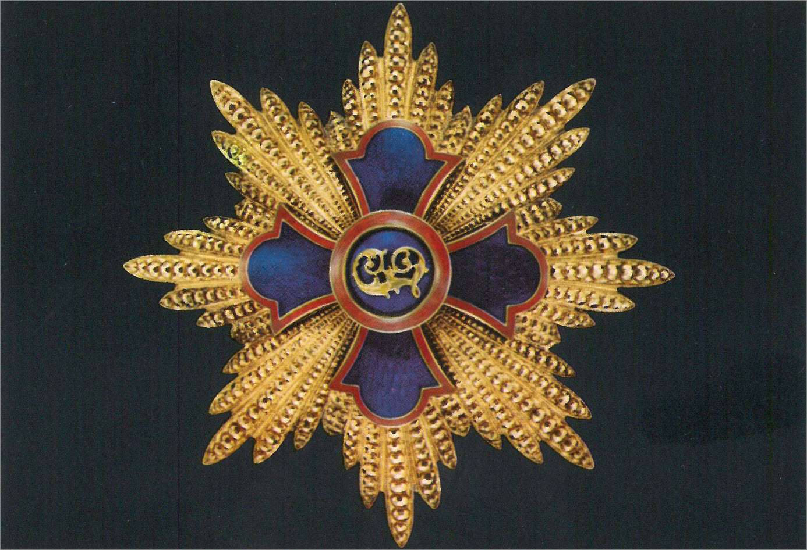

 

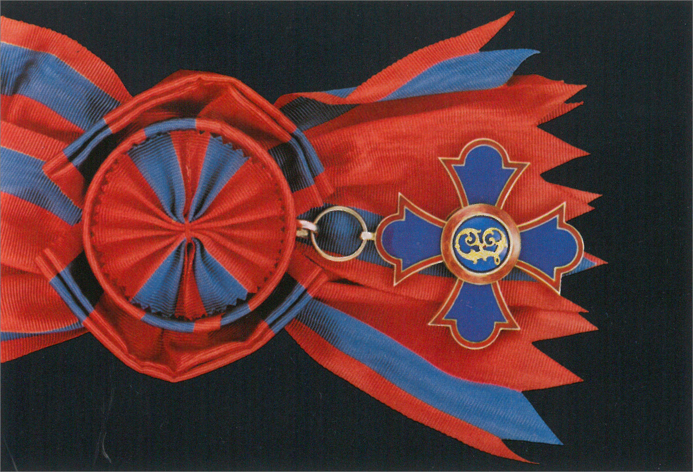

 

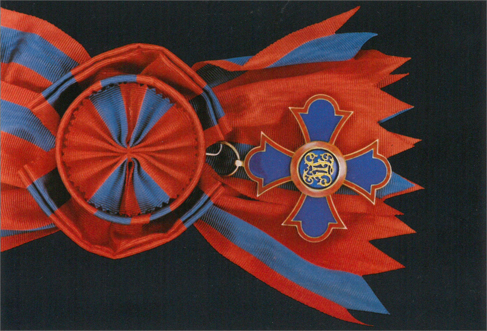

 Grosskreuz mit Brillanten des fürstlich liechtensteinischen Verdienstordens A. Hüftdekoration (Kleinod): Durchmesser 62 mm. Ein blau mit roter Umrandung emailliertes, golden eingefasstes Kreuz mit nach aussen sich verbreiternden Balken, welches auf einem gleichfarbigen Mittelschild auf der Vorderseite in Brillanten den Buchstaben "L" und auf der Rückseite in Gold die Initialen des Stifters "FIL" trägt. Die Verbindung des Kreuzes mit der Kokarde des Bandes ist in der Weise hergestellt, dass eine am obersten Teile des Kreuzes angebrachte runde vergoldete Öse mit einem grösseren vergoldeten, am Bande befestigten Ringe verknüpft ist. B. Band: Das Band für die Herrendekoration ist 110 mm breit, und zwar 7 1/2 mm rot, 15 mm blau, 65 mm rot, 15 mm blau und 7 1/2 mm rot. Das Band für die Damendekoration ist 65 mm breit, und zwar 5 mm rot, 9 mm blau, 37 mm rot, 9 mm blau und 5 mm rot. C. Bruststern: Auf einem aus acht brillantierten gleich langen Strahlen gebildeten silbernen Stern, der im Durchmesser 94 mm misst, liegt mit leicht eingebogenem Balken das Kreuz des Verdienstordens. Der Buchstabe "L" ist mit Brillanten eingelegt. Durchmesser 54 mm. 

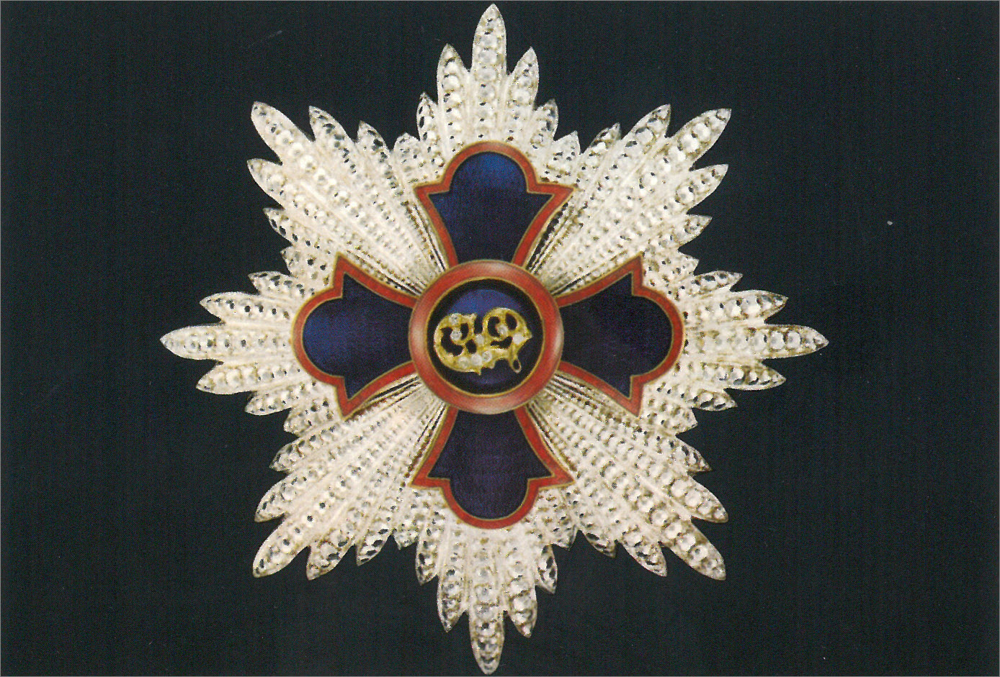

 

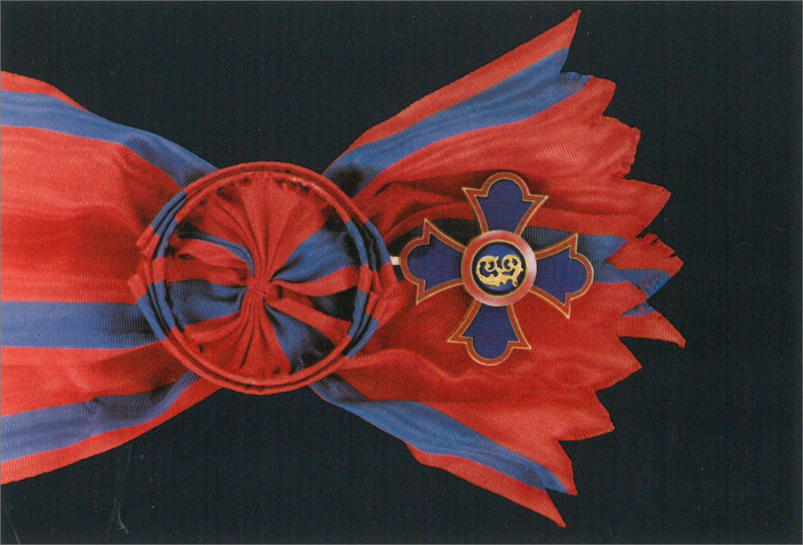

 

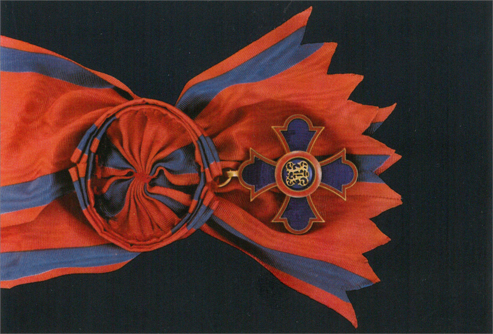

 Grosskreuz des fürstlich liechtensteinischen Verdienstordens A. Hüftdekoration (Kleinod): Durchmesser 62 mm. Ein blau mit roter Umrandung emailliertes, golden eingefasstes Kreuz mit nach aussen sich verbreitenden Balken, welches auf einem gleichfarbigen Mittelschild in Gold auf der Vorderseite den Buchstaben "L" und auf der Rückseite die Initialen des Stifters "FIL" trägt. Die Verbindung dieses Kreuzes mit der Kokarde des Bandes ist in der Weise hergestellt, dass eine am obersten Teile des Kreuzes angebrachte runde vergoldete Öse mit einem grösseren vergoldeten, am Bande befestigten Ringe verknüpft ist. B. Band: Das Band für die Herrendekoration ist 110 mm breit, und zwar 7 1/2 mm rot, 15 mm blau, 65 mm rot, 15 mm blau und 7 1/2 mm rot. Das Band für die Damendekoration ist 65 mm breit, und zwar 5 mm rot, 9 mm blau, 37 mm rot, 9 mm blau und 5 mm rot. C. Bruststern: Auf einem aus acht brillantierten gleich langen Strahlen gebildeten silbernen Stern, der im Durchmesser 94 mm misst, liegt mit leicht eingebogenem Balken das Kreuz des Verdienstordens, Durchmesser 54 mm. 

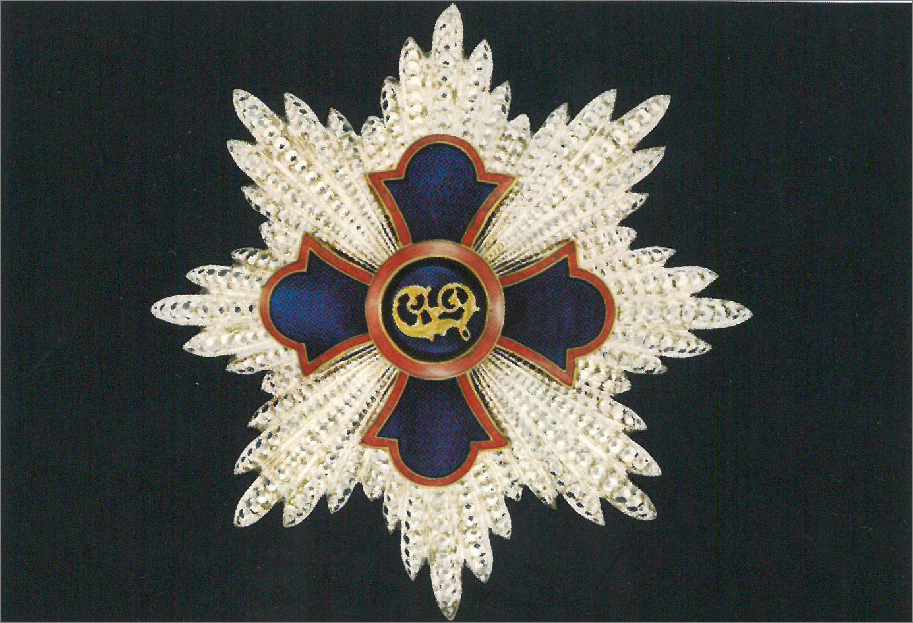

 

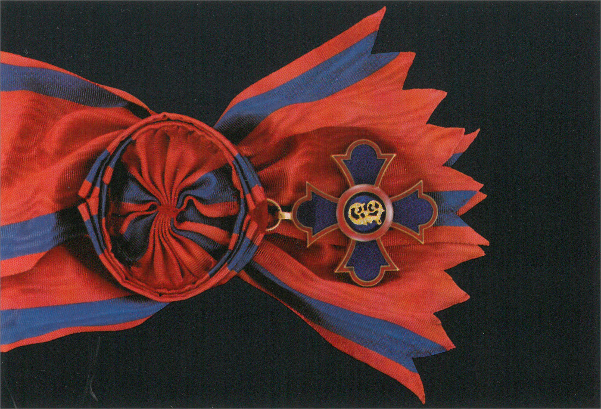

 

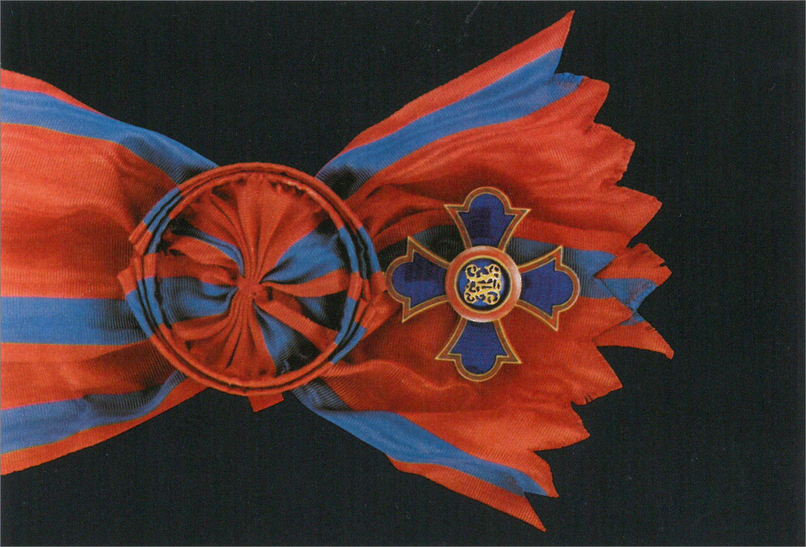

 Komturkreuz mit dem Stern des fürstlich liechtensteinischen Verdienstordens A. Halsdekoration (Kleinod): Durchmesser 54 mm. Ein blau mit roter Umrandung emailliertes, golden eingefasstes Kreuz mit nach aussen sich verbreiternden Balken, welches auf einem gleichfarbigen Mittelschild in Gold auf der Vorderseite den Buchstaben "L" und auf der Rückseite die Initialen des Stifters "FIL" trägt. Die Verbindung des Halskleinodes mit dem Bande ist in der Weise hergestellt, dass eine am obersten Teile des Kreuzes angebrachte runde vergoldete Öse durch einen vergoldeten Ring die Verbindung mit dem brillantierten Schieber herstellt, durch welchen das Band gezogen wird. B. Band: Das Band ist 47 mm breit, und zwar 4 mm rot, 7 mm blau, 25 mm rot, 7 mm blau und 4 mm rot. C. Bruststern: Auf einem aus acht brillantierten Strahlen gebildeten silbernen Stern, von welchem vier Strahlen einen Durchmesser von 77 mm und vier Strahlen einen Durchmesser von 66 mm haben, liegt mit leicht eingebogenem Balken das Kreuz des Verdienstordens, Durchmesser 45 mm. 

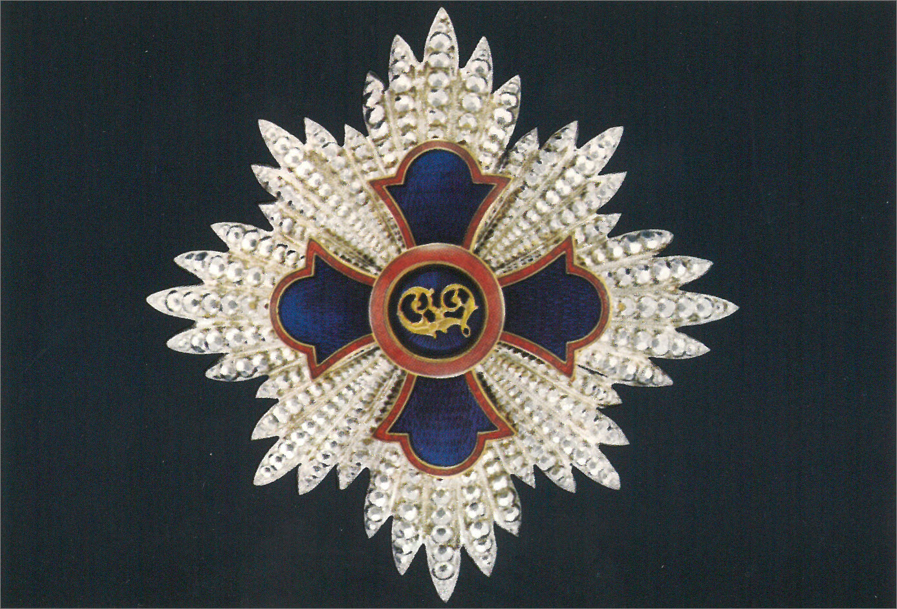

 

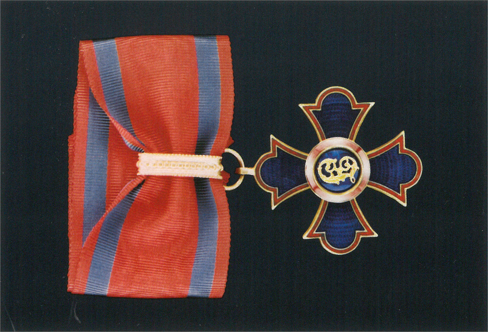

 

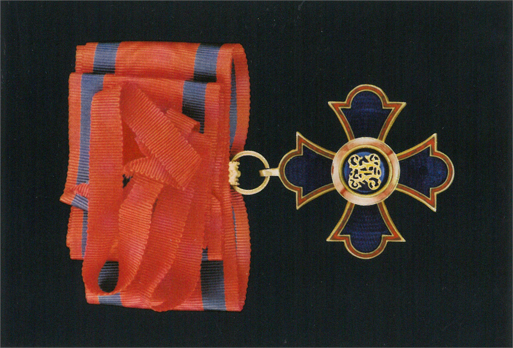

 Komturkreuz des fürstlich liechtensteinischen Verdienstordens A. Halsdekoration (Kleinod): Durchmesser 54 mm. Ein blau mit roter Umrandung emailliertes, golden eingefasstes Kreuz, mit nach aussen sich verbreiternden Balken, welches auf einem gleichfarbigen Mittelschild in Gold auf der Vorderseite den Buchstaben "L" und auf der Rückseite die Initialen des Stifters "FIL" trägt. Die Verbindung des Halskleinodes mit dem Bande ist in der Weise hergestellt, dass eine am obersten Teile des Kreuzes angebrachte runde vergoldete Öse durch einen vergoldeten Ring die Verbindung mit dem brillantierten Schieber herstellt, durch welchen das Band gezogen wird. B. Band: Das Band ist 47 mm breit, und zwar 4 mm rot, 7 mm blau, 25 mm rot, 7 mm blau und 4 mm rot. 

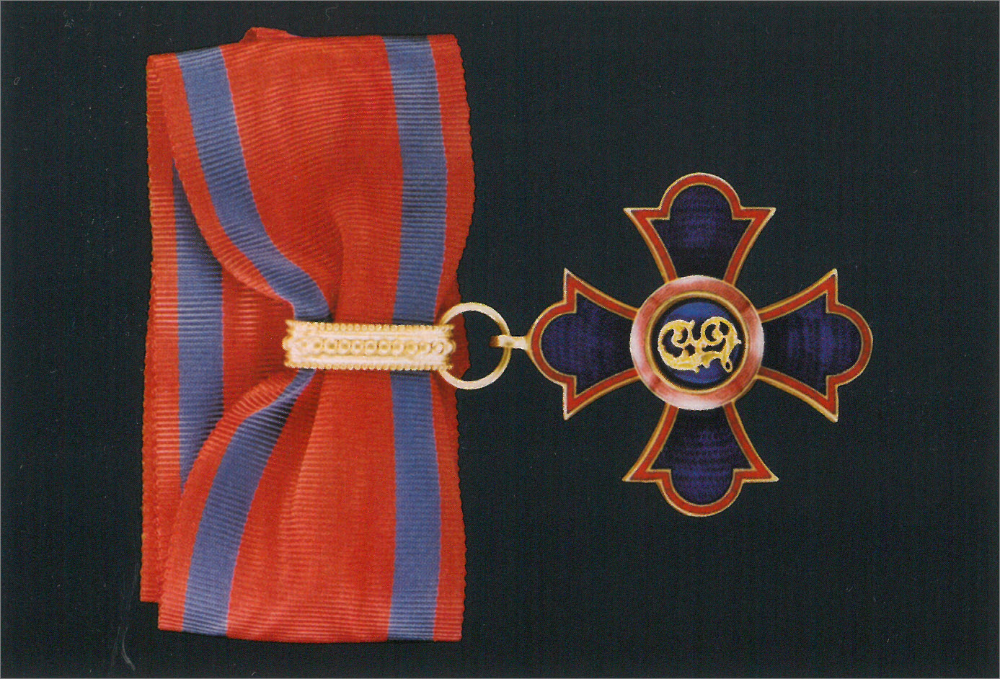

 

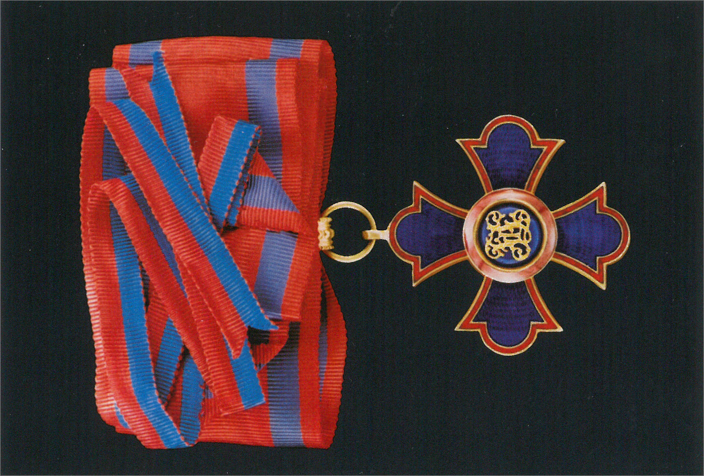

 Ritterkreuz des fürstlich liechtensteinischen Verdienstordens A. Kleinod: Durchmesser 45 mm. Ein blau mit roter Umrandung emailliertes, golden eingefasstes Kreuz mit nach aussen sich verbreiternden Balken, welches auf einem gleichfarbigen Mittelschild in Gold auf der Vorderseite den Buchstaben "L" und auf der Rückseite die Initialen des Stifters "FIL" trägt. Die Verbindung dieses Kreuzes mit dem Bande erfolgt durch eine am obersten Teile des Kreuzes angebrachte vergoldete Öse. B. Band: Das Band ist 40 mm breit, und zwar 3 mm rot, 6 mm blau, 22 mm rot, 6 mm blau und 3 mm rot. 

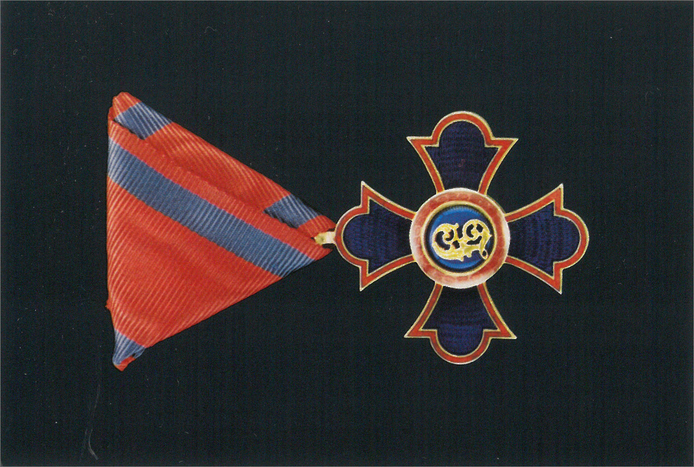

 

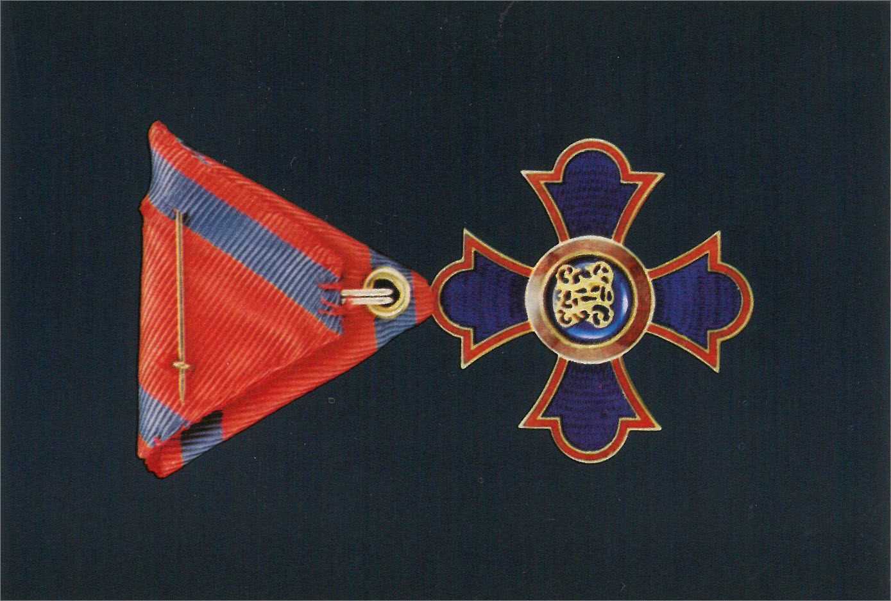

 IV. Art des Tragens 1) Der Inhaber des Gross-Sterns, sowie des Grosskreuzes des Verdienstordens trägt die Dekoration an dem von der rechten Schulter vorne und rückwärts zur linken Hüfte verlaufende Bande, den Bruststern an der linken Brustseite. 2) Der Komtur des Verdienstordens mit dem Stern trägt die Dekoration an dem Bande um den Hals, den Bruststern an der linken Brustseite. 3) Der Komtur des Verdienstordens trägt die Dekoration an dem Bande um den Hals. 4) Der Ritter des Verdienstordens trägt die Dekoration am dreieckig gefalteten Bande an der linken Brustseite. 5) Auf geistlichen Gewändern, Talaren, usw. wird das Band des Gross-Sternes und des Grosskreuzes des Verdienstordens in Falten gelegt breit um den Hals getragen. Das Kleinod hängt in der Mitte auf der Brust. 6) Frauen tragen das Ritterkreuz des Verdienstordens an einem maschenartig genähten Band der entsprechenden Breite und Farbe. V. Kleindekorationen, Miniaturen und Bandspangen 1) An Stelle der unter III beschriebenen Dekorationen der höheren Grade des Verdienstordens können die nachstehenden "Kleindekorationen" angelegt werden: 2) Für den Gross-Stern, bzw. das Grosskreuz: Ritterkreuz am dreieckig gefalteten Bande; auf dem Band ein vergoldeter bzw. silberner Stern mit 8 gleich langen Strahlen von 18 mm Durchmesser mit aufgelegtem Verdienstorden. 3) Für das Komturkreuz mit dem Stern: Ritterkreuz am dreieckig gefalteten Bande; auf dem Band ein silberner Stern mit 4 längeren und 4 kürzeren Strahlen von 17 und 14 mm Durchmesser mit aufgelegtem Verdienstorden. 4) Für das Komturkreuz: Ritterkreuz am dreieckig gefalteten Bande; auf dem Band der Verdienstorden, 11 mm Durchmesser. 5) Das Tragen von Miniaturen, ferner von Bandspangen ist statthaft. Die Bandspangen der höheren Grade sind mit den vorstehend beschriebenen Auflagen zu versehen. VI. Ordensjuwelier Die Dekorationen des fürstlich liechtensteinischen Verdienstordens, ferner Duplikate derselben, die Kleindekorationen und Miniaturen sind nur bei der Firma Anton Reitterer, Ordensjuwelier, Wien IX., Schubertgasse 24, welcher das alleinige Urheberrecht zukommt, herzustellen. Der Bezug von Duplikaten und Kleindekorationen bedarf überdies jeweilig der Vorweisung einer von der Regierung oder Kabinettskanzlei schriftlich ausgefertigten Bezugsberechtigung beim Ordensjuwelier. Der Bezug von Miniaturen ist frei. VII. Führung der Angelegenheiten Alle sonstigen Angelegenheiten werden von Regierung und Kabinettskanzlei einvernehmlich geregelt. Vaduz, am 22. Juli 1937 gez. Franz gez. Dr. Hoop Statut für das fürstlich liechtensteinische Verdienstzeichen I. Stiftung und Verleihung Das von Seiner Durchlaucht Franz I., Fürsten von Liechtenstein am 22. Juli 1937, LGBl. 1937 Nr. 12, gestiftete fürstlich liechtensteinische Verdienstzeichen wird an In- und Ausländer verliehen, die sich um das Fürstentum Liechtenstein namhafte Verdienste erworben haben. Die Verleihung erfolgt durch Seine Durchlaucht, den Landesfürsten auf Grund direkter Entschliessung oder über Vorschlag der Regierung taxfrei oder gegen Einhebung einer Taxe. II. Grade des Verdienstzeichens 1) Das fürstlich liechtensteinische Verdienstzeichen gelangt zur Verleihung als: fürstlich liechtensteinisches goldenes Verdienstzeichen und fürstlich liechtensteinisches silbernes Verdienstzeichen. 2) Die mit dem Verdienstzeichen ausgezeichnete Person kann sich als "Besitzer" desselben bezeichnen. Andere Vorrechte sind damit nicht verbunden. 3) Die Dekorationen bleiben im Eigentum der Personen, an welche dieselben verliehen wurden, und deren Erben. III. Fürstlich liechtensteinisches goldenes Verdienstzeichen Beschreibung A. Kleinod: Durchmesser 45 mm. Ein vergoldetes Kreuz mit nach aussen sich verbreitenden Balken, welches auf einem blau mit roter Umrandung emaillierten golden eingefassten Mittelschild vergoldet auf der Vorderseite den Buchstaben "L" und auf der Rückseite die Initialen des Stifters "FIL" trägt. Die Verbindung des Kreuzes mit dem Bande erfolgt durch eine am obersten Teile angebrachte vergoldete Öse. B. Band: Blau-rot, 40 mm breit. 

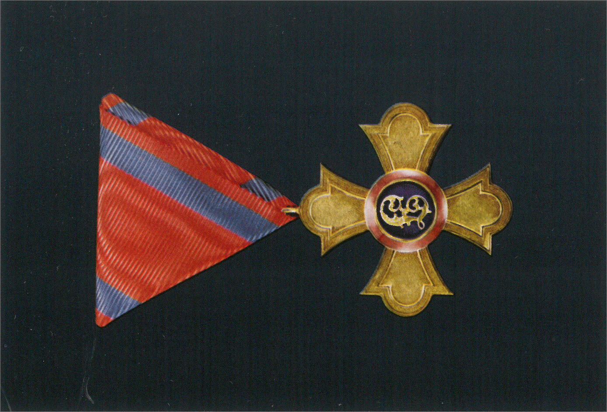

 

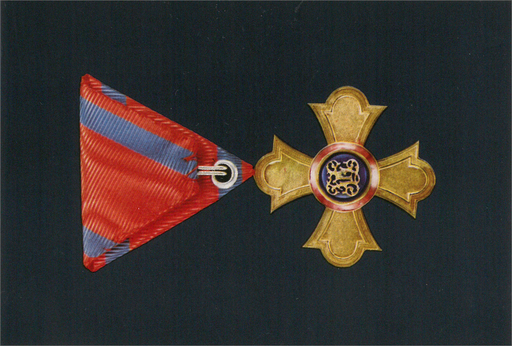

 Fürstlich liechtensteinisches silbernes Verdienstzeichen A. Kleinod: Durchmesser 45 mm. Ein versilbertes Kreuz mit nach aussen sich verbreiternden Balken, welches auf einem blau mit roter Umrandung emaillierten golden eingefassten Mittelschild vergoldet auf der Vorderseiten den Buchstaben "L" und auf der Rückseite die Initialen des Stifters "FIL" trägt. Die Verbindung des Kreuzes mit dem Bande erfolgt durch eine am obersten Teile angebrachte versilberte Öse. B. Band: Blau-rot, 40 mm breit. 

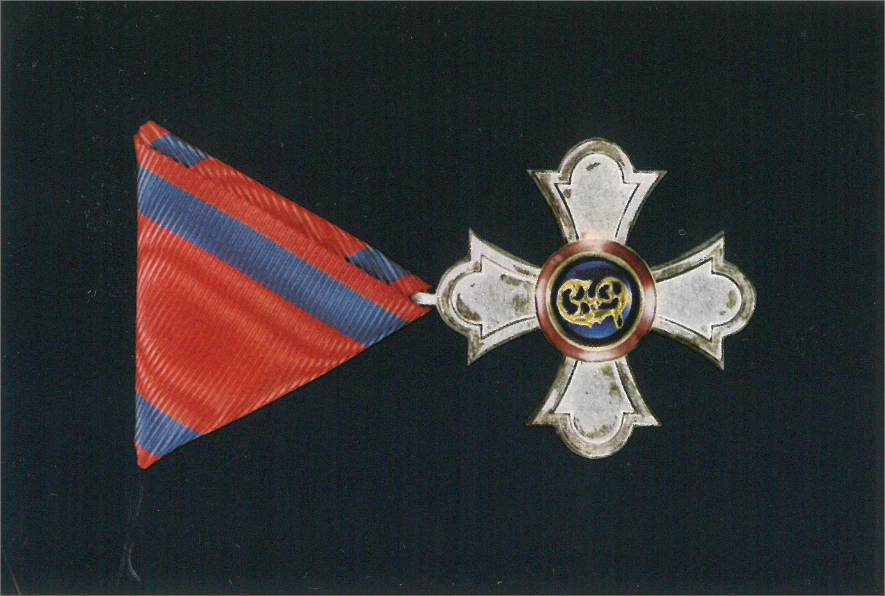

 

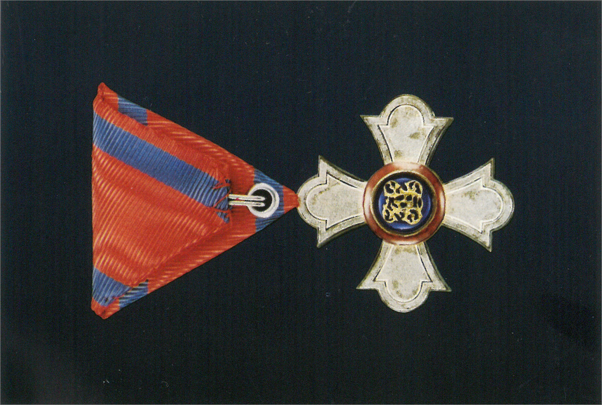

 IV. Art des Tragens 1) Der Besitzer des goldenen und silbernen Verdienstzeichens trägt die Dekoration am dreieckig gefalteten Bande an der linken Brustseite. 2) Frauen tragen das goldene und silberne Verdienstzeichen an einem maschenartig genähten Bande der entsprechenden Farbe und Breite. V. Miniaturen und Bandspangen Das Tragen von Miniaturen der Dekorationen der Verdienstzeichen, ferner von Bandspangen ist statthaft. VI. Ordensjuwelier Die fürstlich liechtensteinischen Verdienstzeichen, ferner Duplikate und Miniaturen derselben sind nur bei der Firma Anton Reitterer, Ordensjuwelier, Wien IX., Schubertgasse 24, welcher das alleinige Urheberrecht zukommt, herzustellen. Der Bezug von Duplikaten bedarf überdies jeweilig der Vorweisung einer von der Regierung oder Kabinettskanzlei schriftlich ausgefertigten Bezugsberechtigung beim Ordensjuwelier. Der Bezug von Miniaturen ist frei. VII. Führung der Angelegenheiten Alle sonstigen Angelegenheiten werden von Regierung und Kabinettskanzlei einvernehmlich geregelt. Vaduz, am 22. Juli 1937 gez. Franz gez. Dr. Hoop
