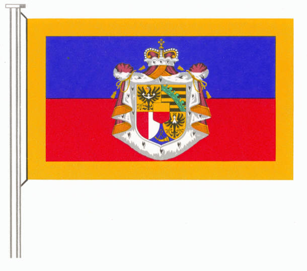
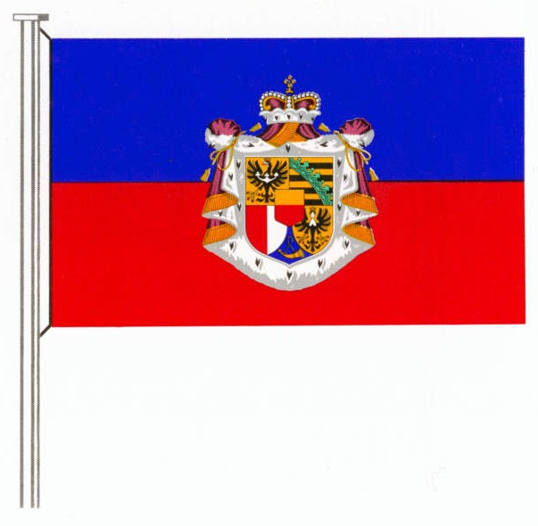
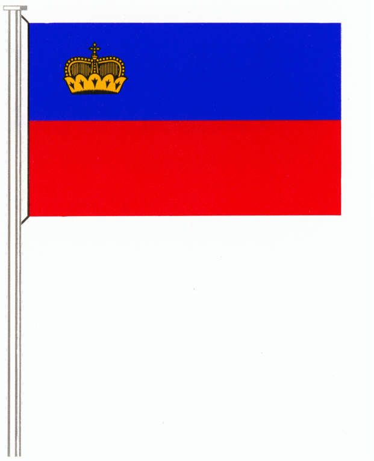

Verordnung vom 8. Mai 1984 über die Beflaggung Gestützt auf Art. 19 und 25 des Gesetzes vom 30. Juni 1982 über Wappen, Farben, Siegel und Embleme des Fürstentums Liechtenstein (Wappengesetz), LGBl. 1982 Nr. 58 , verordnet die Regierung: I. Beflaggung von öffentlichen Gebäuden Art. 1 Geltungsbereich 1) Diese Verordnung gilt für die Beflaggung der Gebäude der Landes- und Gemeindebehörden und der Dienststellen der Landesverwaltung, der Post- und Zollgebäude, der Gebäude der Anstalten und Stiftungen des öffentlichen Rechts sowie der Gebäude der diplomatischen und konsularischen Vertretungen des Fürstentums Liechtenstein im Ausland. Die besondere Regelung der Beflaggung der Residenz des Landesfürsten bleibt unberührt. 2) Zu beflaggen sind sämtliche in Abs. 1 genannten Gebäude ohne Rücksicht auf die Eigentumsverhältnisse und auf das Ausmass der öffentlichen Nutzung. 3) Die Beflaggung von Gebäuden und Gebäudeteilen nach Abs. 2 kann unterbleiben, soweit es sich um Nebengebäude oder um Gebäudeteile, die zur Beflaggung nicht geeignet sind, handelt. Art. 2 Allgemeine Beflaggungstage 1) Die Gebäude gemäss Art. 1 Abs. 1 sind an folgenden Tagen (allgemeine Beflaggungstage) zu beflaggen: a) Staatsfeiertag (15. August); b) Tag des Erlasses der Verfassung (5. Oktober); b bis ) Gründungstag des Fürstentums Liechtenstein (23. Januar); c) Tag des Regierungsantrittes des Landesfürsten; d) Geburtstag und Namenstag des Landesfürsten; e) Fronleichnam. 2) An den allgemeinen Beflaggungstagen sollen auch die Privatgebäude beflaggt werden. 3) Für die Gebäude der diplomatischen und konsularischen Vertretungen des Fürstentums Liechtenstein im Ausland gelten als allgemeine Beflaggungstage die Tage gemäss Abs. 1 Bst. a bis d. Art. 3 Beflaggung zu besonderen Anlässen 1) Über die Beflaggung sowie deren Art und Umfang zu besonderen Anlässen wie bei Staatsbesuchen, Besuchen ausländischer Regierungsmitglieder, internationalen Konferenzen und Tagungen im Fürstentum Liechtenstein sowie bei Anlässen von nationaler Bedeutung und bei Traueranlässen entscheidet die Regierung über Antrag des Protokolls. 2) Das Gebäude, in dem der Landtag tagt, ist für die Dauer der Sitzung zu beflaggen. 3) Die Beflaggung der diplomatischen und konsularischen Vertretungen des Fürstentums Liechtenstein im Ausland zu besonderen Anlässen richtet sich nach den lokalen Gepflogenheiten. 4) Die Beflaggung der Gemeindegebäude bei besonderen Anlässen in der Gemeinde erfolgt nach deren Anweisung. Art. 4 Art der Beflaggung 1) An den allgemeinen Beflaggungstagen gemäss Art. 2 und zu besonderen Anlässen gemäss Art. 3 ist in den Landesfarben zu beflaggen. 2) An den allgemeinen Beflaggungstagen gemäss Art. 2 Abs. 1 Bst. a bis d sowie an Anlässen, die in einer besonderen Beziehung zum Fürstenhaus stehen, soll zusätzlich auch in den Farben des Fürstenhauses beflaggt werden. 3) Von den Gemeinden können neben den in den Abs. 1 und 2 bezeichneten Flaggen auch die Gemeindeflaggen gesetzt werden. 4) Andere als die in den Abs. 1 bis 3 bezeichneten Flaggen dürfen nur mit Bewilligung der Regierung gesetzt werden. Ob bei besonderen Anlässen auch ausländische Flaggen oder Flaggen internationaler Organisationen gesetzt werden, entscheidet die Regierung über Antrag des Protokolls. Art. 5 Rangordnung bei der Beflaggung 1) Der Flagge in den Landesfarben gebührt, wenn zusätzlich andere Flaggen gesetzt werden, die bevorzugte Stelle. Wird nur eine andere inländische Flagge gesetzt, so ist, vom Innern des Gebäudes gesehen, die Flagge in den Landesfarben rechts, die andere links zu setzen. 2) Werden mehrere andere inländische Flaggen gesetzt, so gilt folgende Rangordnung: - Flagge in den Landesfarben, - Flagge in den Farben des Fürstenhauses, - Gemeindeflaggen in der Reihenfolge gemäss Art. 1 der Verfassung, - andere Flaggen. 3) Wird nur eine ausländische Flagge oder eine Flagge einer internationalen Organisation gesetzt, gebührt ihr die bevorzugte Stelle. 4) Werden mehrere ausländische Flaggen oder Flaggen internationaler Organisationen gesetzt, so gilt die Reihenfolge von rechts nach links nach dem französischen Alphabet. Links schliessen sich die inländischen Flaggen in der Reihenfolge gemäss Abs. 2 an. 5) Die Grösse der Flaggen muss in einem angemessenen Verhältnis zur Grösse und Höhe der beflaggten Gebäude stehen. Sind an einem Gebäude mehrere Flaggen gesetzt, so sollen sie gleich gross sein. 6) An Traueranlässen werden die Flaggen auf Halbmast gesetzt. Soweit Flaggen nicht auf Halbmast gesetzt werden können, sind sie mit einem Trauerflor zu versehen. II. Beflaggung von Dienstwagen Art. 6 Standarten und Dienstflaggen 1) Der Landesfürst, der Landtagspräsident und der Regierungschef führen bei offiziellen Anlässen an ihrem Dienstwagen auf dem rechten Kotflügel ihre Standarte (Abbildungen Nr. 1 und 2 im Anhang). 2) In offizieller Mission im Ausland führen die übrigen Mitglieder des Landtags und der Regierung, die Präsidenten des Staatsgerichtshofes und des Obersten Gerichtshofes, diplomatische und konsularische Vertreter des Fürstentums Liechtenstein sowie Sonderbeauftragte der Regierung an ihrem Dienstwagen auf dem rechten Kotflügel die Dienstflagge. 3) Die Dienstflagge ist eine Flagge in den Landesfarben (Abbildung Nr. 3 im Anhang). III. Inkrafttreten Art. 7 Diese Verordnung tritt am Tage der Kundmachung in Kraft. Fürstliche Regierung: gez. Hans Brunhart Fürstlicher Regierungschef Anhang Abbildung Nr. 1 Standarte des Landesfürsten (Art. 6 Abs. 1) 

 Abbildung Nr. 2 Standarte des Landtagspräsidenten und des Regierungschefs (Art. 6 Abs. 1) 

 Abbildung Nr. 3 Dienstflagge (Art. 6 Abs. 3) 

