Verordnung vom 14. Februar 1984 über Wappen, Farben, Siegel und Embleme des Fürstentums Liechtenstein (Wappenverordnung) Aufgrund von Art. 25 des Gesetzes vom 30. Juni 1982 über Wappen, Farben, Siegel und Embleme des Fürstentums Liechtenstein (Wappengesetz), LGBl. 1982 Nr. 58, verordnet die Regierung: Art. 1 Allgemeines 1) Die Siegel und Stempel gemäss Art. 18 des Wappengesetzes werden als grosses Staatssiegel, kleines Staatssiegel und Siegel zu besonderen Zwecken geführt. 2) Form und Grösse der Siegel und Stempel richten sich nach den massstäblichen Abbildungen Nr. 1 bis 3 im Anhang 1. Art. 2 Grosses Staatssiegel 1) Das grosse Staatssiegel ist ein ovales Siegel und zeigt das grosse Staatswappen mit der Umschrift "Fürstentum Liechtenstein" (Abbildung Nr. 2 im Anhang 1). 2) Das grosse Staatssiegel wird als Prägesiegel aus Metall ausgeführt. 3) Das grosse Staatssiegel wird vom Landesfürsten, vom Landtag, von der Regierung sowie vom Staatsgerichtshof und vom Obersten Gerichtshof geführt. 4) Das grosse Staatssiegel findet Verwendung bei feierlichen Beurkundungen. Art. 3 Kleines Staatssiegel 1) Das kleine Staatssiegel ist ein Rundsiegel und zeigt das grosse Staatswappen mit der Umschrift "Fürstentum Liechtenstein" und der Bezeichnung "Landesverwaltung" bzw. "Regierung"; zudem kann die Bezeichnung der siegelführenden Behörde enthalten sein (Abbildung Nr. 3 im Anhang 1). 2) Das kleine Staatssiegel wird als Prägesiegel aus Metall und als Farbdruckstempel aus Metall oder Gummi (Metallstempel, Gummistempel) ausgeführt. Das kleine Staatssiegel als Prägesiegel kann auch als Siegelmarke zur Anwendung kommen. 3) Das kleine Staatssiegel (Dienstsiegel) wird von den staatlichen Behörden, Ämtern, Dienststellen und den Landesinstituten (öffentlichrechtliche Anstalten und Stiftungen) sowie mit Bewilligung der Regierung von natürlichen oder juristischen Personen geführt. 4) Bei der Verwendung des kleinen Staatssiegels ist zu unterscheiden zwischen den Fällen, in denen es behördlichen Äusserungen oder Erklärungen urkundlichen Wert gibt, und den Fällen, in denen es mehr dekorative Aufgaben erfüllt und lediglich erkennbar macht, dass es sich um eine amtliche Veröffentlichung handelt. 5) Die Zahl der zur Verwendung des kleinen Staatssiegels berechtigten Personen ist so klein wie möglich zu halten und wird von der Regierung festgelegt. Art. 3a Staatssiegel in elektronischer Form 1) Das grosse und das kleine Staatssiegel können nach Massgabe von Art. 2 Abs. 1, 3 und 4 sowie Art. 3 Abs. 1 und 3 bis 5 auch in elektronischer Form geführt und verwendet werden. 2) Die Regierung kann Abweichungen in Bezug auf die Grösse, Form und Gestaltung der Staatssiegel in elektronischer Form bewilligen. Art. 4 Siegel zu besonderen Zwecken Die zur Führung des kleinen Staatssiegels Berechtigten dürfen Siegel von abweichender Grösse, Form und Gestaltung nur zu besonderen Zwecken und nur mit Bewilligung der Regierung gebrauchen (Abbildung Nr. 4 im Anhang 1). Art. 5 Aufbewahrung der Staatssiegel 1) Die Staatssiegel sind sicher aufzubewahren. 2) Der Verlust eines Staatssiegels ist unverzüglich der Regierung anzuzeigen. 3) Historisch wertvolle Siegel und Staatssiegel, die nicht mehr benötigt werden, sind an das Landesarchiv abzugeben. 4) Über die dauernde Aufbewahrung und allfällige Vernichtung von Siegeln befindet das Landesarchiv. Art. 6 Amtliche Schilder 1) Als amtliche Schilder werden rechteckige und ovale Metallschilder verwendet. 2) Form und Gestaltung der amtlichen Schilder richten sich nach den Abbildungen Nr. 5 bis 7 im Anhang 1. Art. 7 Rechteckiges amtliches Schild 1) Das rechteckige amtliche Schild dient zur Kennzeichnung öffentlicher Gebäude (Landesverwaltung, Gericht, Post, Zoll usw.). Es zeigt das grosse Staatswappen auf weissem Grund. Unter dem Staatswappen ist die Bezeichnung der Behörde in schwarzer Schrift angebracht (Abbildung Nr. 5 im Anhang 1). 2) Befinden sich in einem Gebäude mehrere zur Führung des amtlichen Schildes berechtigte Behörden, so führen sie ein gemeinsames Schild. Die Bezeichnungen der Behörden werden in diesem Falle auf besonderen, untereinander angebrachten Schildern angeführt. 3) Es sind drei Grössen mit folgenden Abmessungen zugelassen: Grössen I II III a) Breite 35 cm 30 cm 20 cm b) Höhe - des amtlichen Schildes gemäss Abs. 1 50 cm 40 cm 28 cm - des amtlichen Schildes mehrerer Behörden gemäss Abs. 2 35 cm 30 cm 20 cm - der Schilder zur Bezeichnung der Behörden gemäss Abs. 2 15 cm 10 cm 8 cm 4) Die jeweils zugelassene Grösse des amtlichen Schildes gemäss Abs. 3 richtet sich nach den örtlichen Gegebenheiten. 5) Über die Berechtigung zur Führung des amtlichen Schildes entscheidet in Zweifelsfällen die Regierung. Art. 8 Ovales amtliches Schild 1) Das ovale amtliche Schild dient zur Kennzeichnung des Sitzes der diplomatischen und konsularischen Vertretungen des Fürstentums Liechtenstein im Ausland. Es zeigt das grosse Staatswappen auf weissem Grund. Über dem Staatswappen ist die Umschrift "Fürstentum Liechtenstein", unter dem Staatswappen die Bezeichnung der diplomatischen und konsularischen Vertretungen angebracht (Abbildung Nr. 6 im Anhang 1). 2) Das ovale amtliche Schild dient auch zur Kennzeichnung der Staatsgrenzen an Grenzübergängen. Es zeigt das grosse Staatswappen auf weissem Grund. Über dem Staatswappen ist die Umschrift "Fürstentum Liechtenstein" angebracht (Abbildung Nr. 7 im Anhang 1). 3) Die Abmessungen des ovalen amtlichen Schildes betragen: a) zur Kennzeichnung des Sitzes diplomatischer und konsularischer Vertretungen: - Längsdurchmesser des Ovals 60 cm - Querdurchmesser des Ovals 51 cm b) zur Kennzeichnung der Staatsgrenze: - Längsdurchmesser des Ovals 80 cm - Querdurchmesser des Ovals 69 cm Art. 9 Amtliche Drucksachen 1) Auf amtlichen Drucksachen finden das grosse und kleine Staatswappen Verwendung. 2) Form, Grösse und Gestaltung der amtlichen Drucksachen bedürfen der Bewilligung der Regierung. Art. 9a Darstellung der Landesfarben und des Fürstenhutes Für die Darstellung der Landesfarben und des Fürstenhutes in Fahnen, Flaggen, Bannern und Wimpeln (Art. 4 bis 8 des Gesetzes) sind die Formerfordernisse, die Grössenverhältnisse und die Farbdefinitionen nach Anhang 2 massgebend. Art. 10 Kokarden und Abzeichen 1) Auf Uniformen der Landespolizei und des Landeskaders der Feuerwehr findet das kleine Staatswappen als Kokarde und Abzeichen Verwendung. 2) Form, Grösse und Gestaltung der Kokarde richten sich nach der Abbildung Nr. 8 im Anhang 1. 3) Form, Grösse und Gestaltung der Abzeichen bedürfen der Bewilligung der Regierung. Art. 11 Durchführung Mit der Beschaffung werden betraut: a) bei Siegeln, Stempeln, amtlichen Schildern, Kokarden und Abzeichen: das Amt für Personal und Organisation; b) bei Siegeln in elektronischer Form: das Amt für Informatik. Art. 12 Übergangsbestimmungen Nach dem Inkrafttreten dieser Verordnung müssen alle Verwendung findenden Siegel, Stempel, amtlichen Schilder, Drucksachen, Kokarden und Abzeichen dieser Verordnung entsprechen. Art. 13 Inkrafttreten Diese Verordnung tritt am Tage der Kundmachung in Kraft. Fürstliche Regierung: gez. Hans Brunhart Fürstlicher Regierungschef Anhang 1 Abbildung Nr. 1 Grosses Staatswappen in vereinfachter Ausführung 

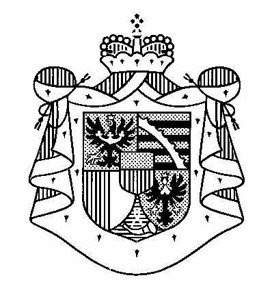

 Abbildung Nr. 2 Grosses Staatssiegel Massstab 1:1 (Art. 2) 

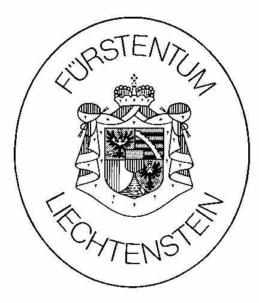

 Abbildung Nr. 3 Kleines Staatssiegel Dienstsiegel Massstab 1:1 (Art. 3) 

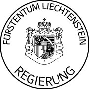

 

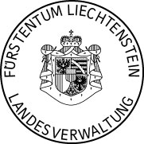

 

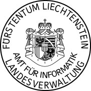

 Abbildung Nr. 4 Siegel zu besonderen Zwecken (Art. 4) 

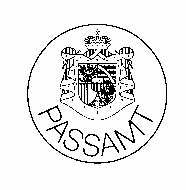

 Abbildung Nr. 5 Rechteckiges amtliches Schild (Art. 7) 

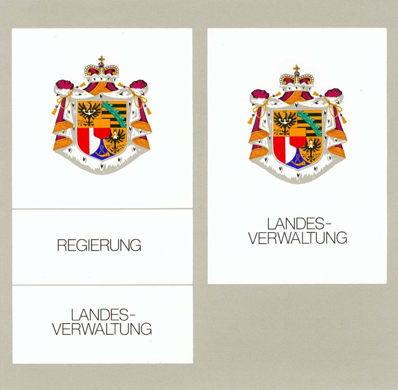

 Abbildung Nr. 6 Ovales amtliches Schild (Art. 8 Abs. 1 und Abs. 3 Bst. a) 

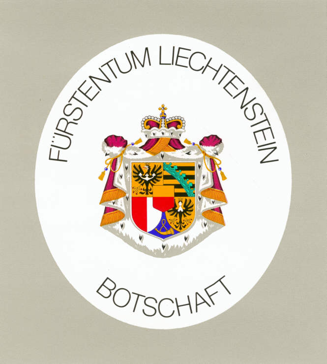

 Abbildung Nr. 7 Ovales amtliches Schild (Art. 8 Abs. 2 und Abs. 3 Bst. b) 

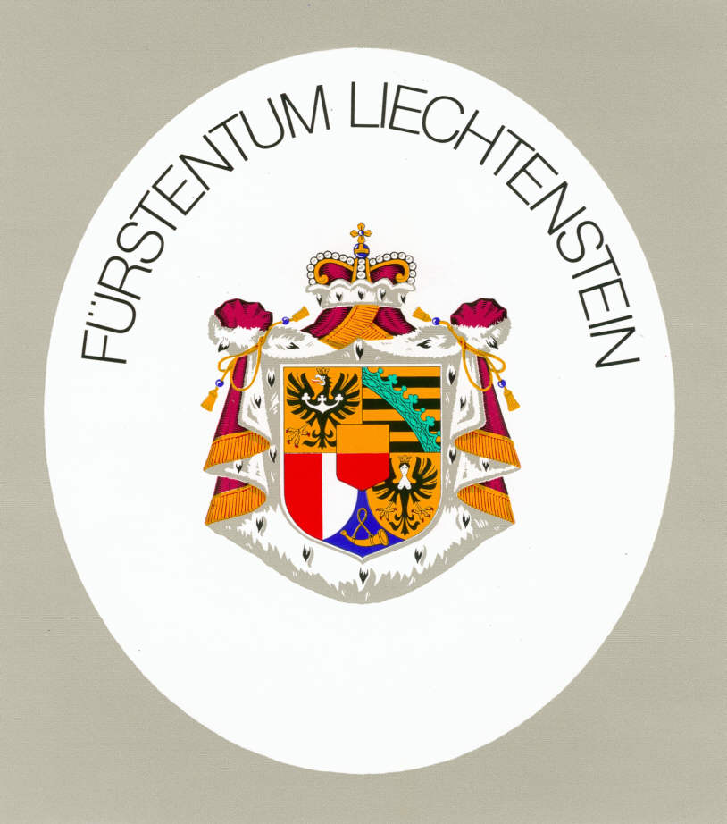

 Abbildung Nr. 8 Kokarde Massstab 1:1 (Art. 10) 

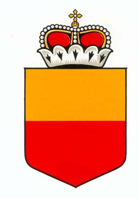

 Anhang 2 Darstellung der Landesfarben und des Fürstenhutes in Fahnen, Flaggen, Bannern und Wimpeln (Art. 9a) A. Formerfordernisse und Grössenverhältnisse Abbildung Nr. 1 Flaggen und Fahnen 

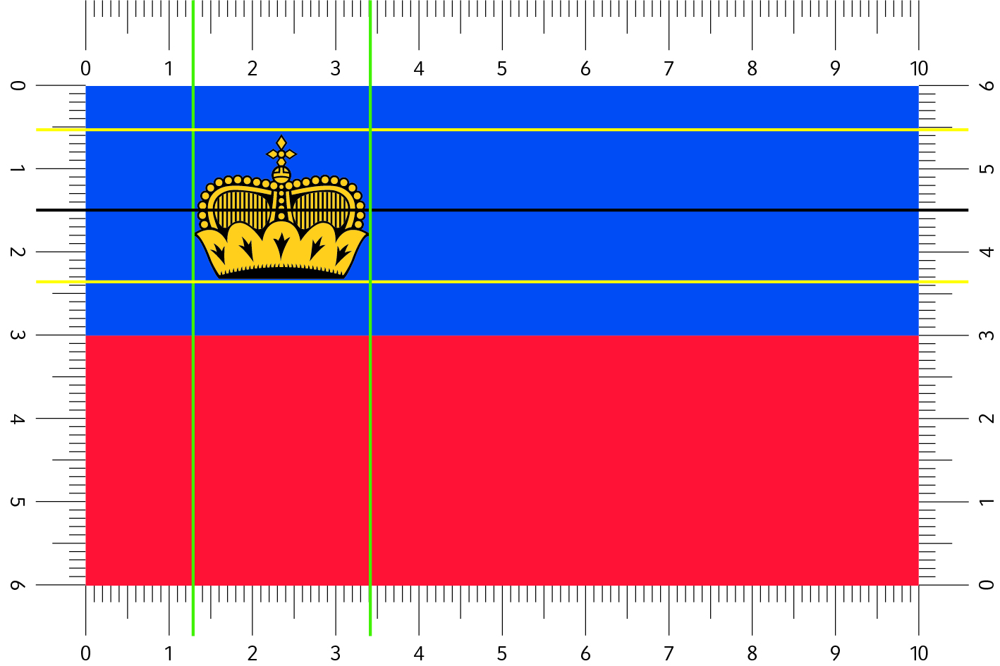

 Grössenverhältnisse Das Verhältnis der Höhe zur Länge des Flaggen- bzw. Fahnentuches beträgt drei zu fünf. Beispiel Masse: Höhe 6 cm, Länge 10 cm Grösse Fürstenhut: Höhe 1.8 cm, Länge 2.2 cm Position des Fürstenhutes 1. Links oben 2. Innerhalb des ersten Drittels des blauen Bereiches 3. Vertikal mittig Abbildung Nr. 2 Banner 

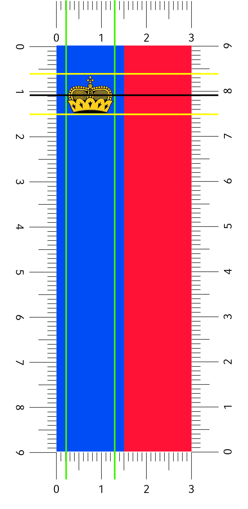

 Grössenverhältnisse Beispiel Masse: Höhe 9 cm, Länge 3 cm Grösse Fürstenhut: Höhe 0.9 cm, Länge 1.1 cm Position des Fürstenhutes 1. Links oben 2. Innerhalb des ersten Sechstels im blauen Bereich 3. Unmittelbar angrenzend an den folgenden Sechstel 4. Vertikal mittig Abbildung Nr. 3 Wimpel 

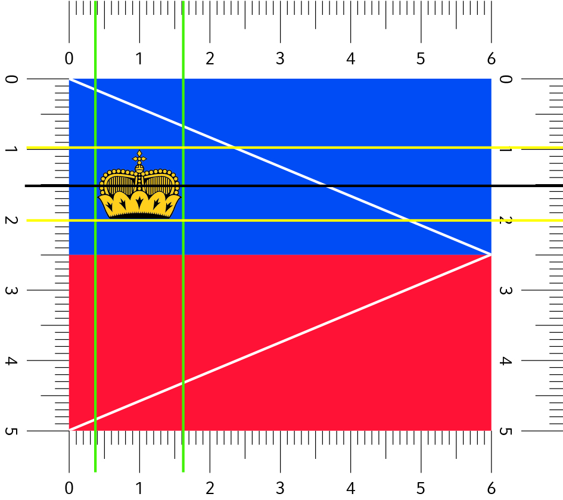

 Grössenverhältnisse Beispiel Masse: Höhe 5 cm, Länge 6 cm Grösse Fürstenhut: Höhe 1 cm, Länge 1.2 cm Position des Fürstenhutes 1. Links oben im blauen Bereich hin zur Stange 2. Die Spitze des Fürstenhutes liegt auf dem Kreuz des ersten Sechstels der Länge und dem ersten Fünftel der Höhe 3. Vertikal ab dem zweiten Fünftel 4. Horizontal ab dem ersten Fünfzehntel B. Farbdefinitionen 1. Landesfarben "coated" Coated Blau Rot Gelb (Gold) PANTONE Pantone 293 C Pantone 185 C Pantone 123 C CMYK C100/M69/Y0/K4 C0/M93/Y79/K0 C0/M19/Y89/K0 RGB R0/G61/B165 R228/G0/B43 R255/G199/B44 Hex #003DA5 #E4002B #FFC72C HKS HKS 39 HKS 14 HKS 4 RAL RAL 5002 RAL 3028 RAL 1003 2. Landesfarben "uncoated" Uncoated Blau Rot Gelb (Gold) PANTONE Pantone 293 U Pantone 185 U Pantone 123 U CMYK C93/M54/Y0/K0 C0/M81/Y54/K0 C0/M28/Y98/K0 RGB R35/G91/B168 R241/G80/B96 R255/G172/B42 Hex #235BA8 #F15060 #FFAC2A HKS HKS 39 HKS 14 HKS 4 RAL RAL 5002 RAL 3028 RAL 1003
