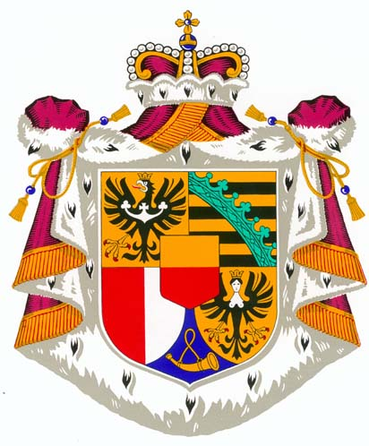
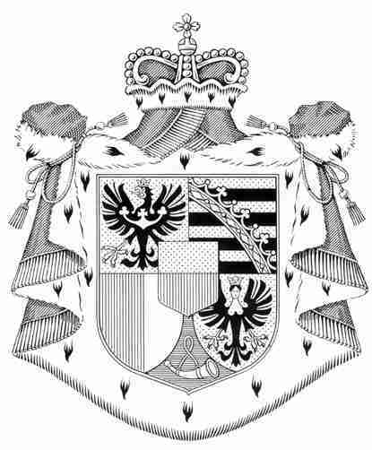
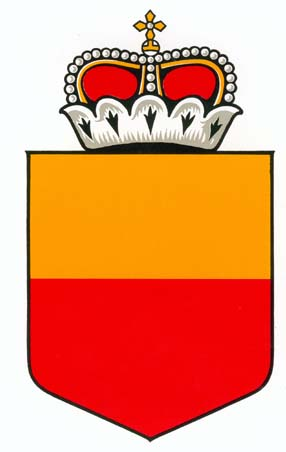
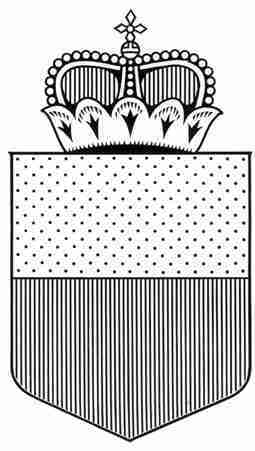
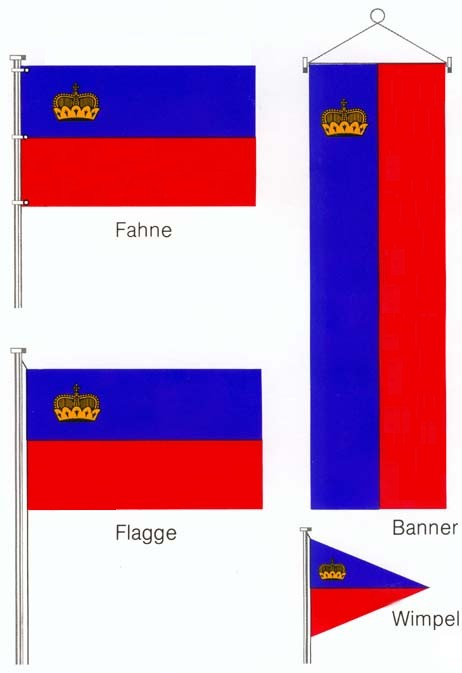
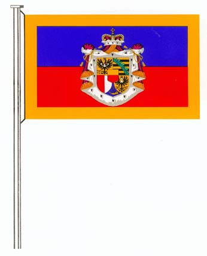
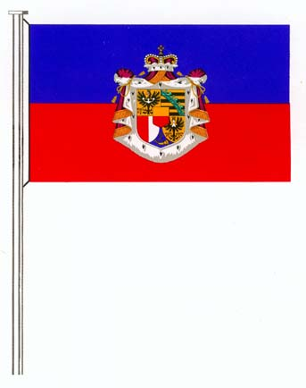
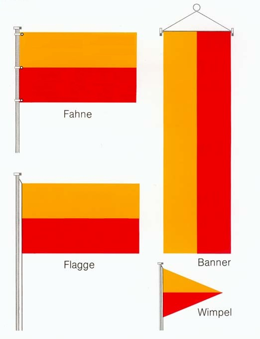

Gesetz vom 30. Juni 1982 über Wappen, Farben, Siegel und Embleme des Fürstentums Liechtenstein (Wappengesetz) Dem nachstehenden vom Landtag gefassten Beschluss erteile Ich Meine Zustimmung: I. Staatswappen Art. 1 Grosses Staatswappen 1) Das grosse Staatswappen ist das Wappen des Fürstenhauses Liechtenstein. Es wird wie folgt umschrieben: Das grosse Staatswappen ist geviert mit unten eingepfropfter Spitze und belegt mit von Gold und Rot geteiltem Herzschild: - in Gold ein mit kreuzbesetztem silbernen Kleeblattmond belegter gekrönter schwarzer Adler; - von Gold und Schwarz achtmal gestreift, mit grünem Rautenkranz belegt; - von Rot und Silber gespalten; - in Gold ein gekrönter, gold-bewehrter schwarzer Jungfernadler mit silbernem Kopf; - in der blauen Spitze ein goldenes Jagdhorn an gleichfarbiger Schnur. 2) Den Schild umgibt ein mit dem Fürstenhute gekrönter Fürstenmantel (Wappenmantel), von Purpur und innen mit Hermelin gefüttert. Art. 2 Kleines Staatswappen 1) Neben dem grossen Staatswappen besteht das kleine Staatswappen. 2) Das kleine Staatswappen ist das von Gold und Rot geteilte Herzschild des grossen Staatswappens unter dem Fürstenhut. Art. 3 Verwahrung der Urschilder, heraldische Darstellung und künstlerische Ausgestaltung des Staatswappens 1) Die Urschilder des Staatswappens sind im Liechtensteinischen Landesarchiv und in der Kabinettskanzlei verwahrt. 2) Die Urschilder sind für die heraldische Darstellung des Staatswappens massgebend. Abbildungen der Urschilder sind im Anhang aufgeführt. 3) Die künstlerische Ausgestaltung des Staatswappens bleibt für jeden besonderen Zweck vorbehalten. II. Landesfarben Art. 4 Allgemeines 1) Die Landesfarben sind blau-rot. Sie finden Anwendung in Flaggen, Fahnen, Bannern, Wimpeln und Standarten. 2) Für die Darstellung der Flaggen, Fahnen, Banner, Wimpel und Standarten sind die im Anhang aufgeführten Abbildungen massgebend. Art. 5 Flagge 1) Die Flagge besteht aus einem mit einer Leine lose an einer Stange befestigten rechteckigen Tuch aus zwei gleich breiten Querstreifen, oben blau, unten rot. Im blauen Streifen ist gegen die Stange hin der Fürstenhut in Gold angebracht. 2) Das Verhältnis der Höhe zur Länge des Flaggentuches beträgt drei zu fünf. Art. 6 Fahne 1) Die Fahne besteht aus einem an einer Stange fest angebrachten rechteckigen Tuch aus zwei gleich breiten Querstreifen, oben blau, unten rot. Im blauen Streifen ist gegen die Stange hin der Fürstenhut in Gold angebracht. 2) Das Verhältnis der Höhe zur Länge des Fahnentuches beträgt drei zu fünf. Art. 7 Banner Das Banner besteht aus einem an einer Querstange mit der Schmalseite befestigten, lang herabhängenden rechteckigen Tuch aus zwei gleich breiten Längsstreifen, links blau, rechts rot. Im blauen Streifen ist gegen die Stange hin der Fürstenhut in Gold angebracht. Art. 8 Wimpel Der Wimpel besteht aus einem kleinen gleichgeteilten dreieckigen Tuch, oben blau, unten rot. Im blauen Teil ist der Fürstenhut in Gold angebracht. Art. 9 Standarte des Landesfürsten 1) Die Standarte des Landesfürsten besteht aus einem rechteckigen Tuch aus zwei gleich breiten Querstreifen, oben blau, unten rot, mit einer goldfarbenen Randborte. Über beide Streifen ist das grosse Staatswappen gelegt. 2) Das Verhältnis der Höhe zur Länge des Standartentuches beträgt drei zu fünf. Art. 10 Standarte der Regierung und des Landtages 1) Die Standarte der Regierung und des Landtages besteht aus einem rechteckigen Tuch aus zwei gleich breiten Querstreifen, oben blau, unten rot. Über beide Streifen ist das grosse Staatswappen gelegt. 2) Das Verhältnis der Höhe zur Länge des Standartentuches beträgt drei zu fünf. III. Farben des Fürstenhauses Liechtenstein Art. 11 Allgemeines 1) Die Farben des Fürstenhauses Liechtenstein sind gold-rot. Sie finden Anwendung in Flaggen, Fahnen, Bannern und Wimpeln. 2) Für die Darstellung der Flaggen, Fahnen, Banner und Wimpel sind die im Anhang aufgeführten Abbildungen massgebend. Art. 12 Flagge 1) Die Flagge besteht aus einem mit einer Leine lose an einer Stange befestigten rechteckigen Tuch aus zwei gleich breiten Querstreifen, oben gold, unten rot. 2) Das Verhältnis der Höhe zur Länge des Flaggentuches beträgt drei zu fünf. Art. 13 Fahne 1) Die Fahne besteht aus einem an einer Stange fest angebrachten rechteckigen Tuch aus zwei gleich breiten Querstreifen, oben gold, unten rot. 2) Das Verhältnis der Höhe zur Länge des Fahnentuches beträgt drei zu fünf. Art. 14 Banner Das Banner besteht aus einem an einer Querstange mit der Schmalseite befestigten, lang herabhängenden rechteckigen Tuch aus zwei gleich breiten Längsstreifen, links gold, rechts rot. Art. 15 Wimpel Der Wimpel besteht aus einem kleinen gleichgeteilten dreieckigen Tuch, oben gold, unten rot. IV. Führung und Verwendung von Wappen, Farben, Siegeln und Emblemen Art. 16 Allgemeines 1) Jede Führung und Verwendung der Wappen, Farben, Siegel und Embleme des Fürstentums Liechtenstein ist mit Ausnahme der in Abs. 3 und Art. 17 bis 21 angeführten Fälle bei Strafe verboten. 2) Unter "Führung" des Wappens, der Farben, Siegel und Embleme im Sinne dieses Gesetzes ist der Gebrauch im persönlichen, beruflichen oder amtlichen Verkehr, insbesondere als Aufdruck auf Schildern, Schriften und Drucksorten, unter "Verwendung" der Wappen, Farben, Siegel und Embleme der Gebrauch auf Gegenständen aller Art, insbesondere auf gewerblichen Artikeln oder Abzeichen zu verstehen. 3) Der Gebrauch des Wappens, der Farben, Siegel und Embleme des Fürstentums Liechtenstein als Abbildung in wissenschaftlichen Werken, im Schulunterricht und zur würdigen Ausschmückung bei heimatlichen Festen und Veranstaltungen fällt nicht unter das Verbot. Art. 17 Führung und Verwendung des Staatswappens 1) Das Recht zur Führung und Verwendung des Staatswappens haben sämtliche Mitglieder des Fürstenhauses Liechtenstein, die staatlichen Behörden, Ämter, Dienststellen und die Landesinstitute (öffentlich-rechtliche Anstalten und Stiftungen). 2) Die Regierung kann die Bewilligung zur Führung und Verwendung des Staatswappens an weitere natürliche oder juristische Personen erteilen, welche zu den öffentlichen Interessen und der Eigenart des Landes und seiner Bevölkerung in enger Beziehung stehen. Die Bewilligung kann nur erteilt werden, wenn wichtige, im Interesse des Landes gelegene Gründe dafür sprechen und Gewähr dafür besteht, dass das Staatswappen in Ehren geführt und verwendet wird. 3) Jede Bewilligung zur Führung und Verwendung des Staatswappens ist von der Regierung zu widerrufen, wenn die Voraussetzungen, unter denen sie erteilt wurde, entfallen sind oder mit Grund ein Missbrauch mit dem Staatswappen zu befürchten ist oder die tatsächliche Führung oder Verwendung des Staatswappens durch den Berechtigten den Bedingungen der Bewilligung nicht entspricht. Art. 18 Art der Verwendung des Staatswappens 1) Das grosse Staatswappen findet Verwendung in Siegeln, Stempeln und auf amtlichen Schildern und Drucksachen. 2) Das kleine Staatswappen findet Verwendung in Siegeln, Stempeln, auf amtlichen Drucksachen, auf Ortschaftstafeln, auf Kontrollschildern für Motorfahrzeuge, zur Kennzeichnung von Luft- und Wasserfahrzeugen und auf Uniformen (Kokarden und Abzeichen) der Landespolizei, der Feuerwehr und der Postbediensteten. Art. 19 Führung und Verwendung der Landesfarben und der Farben des Fürstenhauses 1) Das Recht zur Führung und Verwendung der Landesfarben blau-rot in Flaggen, Fahnen, Bannern und Wimpeln haben sämtliche Mitglieder des Fürstenhauses Liechtenstein, alle Landes- und Gemeindebehörden, alle Privaten im Fürstentum Liechtenstein sowie die diplomatischen und konsularischen Vertretungen des Fürstentums Liechtenstein im Ausland. 2) Das Recht zur Führung und Verwendung der Landesfarben blau-rot in Standarten haben der Landesfürst, die Regierung und der Landtag. 3) Das Recht zur Führung der Farben des Fürstenhauses gold-rot in Flaggen, Fahnen, Bannern und Wimpeln steht ausschliesslich den Mitgliedern des Fürstenhauses Liechtenstein zu. 4) Das Recht zur Verwendung der Farben des Fürstenhauses gold-rot in Flaggen, Fahnen, Bannern und Wimpeln haben die Mitglieder des Fürstenhauses Liechtenstein, die Landes- und Gemeindebehörden sowie bei heimatlichen Festen und Veranstaltungen alle Privaten im Fürstentum Liechtenstein. Art. 20 Führung und Verwendung von Gemeindewappen und Gemeindeflaggen 1) Der Landesfürst verleiht den Gemeinden durch Wappenbrief das Recht zur Führung und Verwendung von Gemeindewappen und Gemeindeflaggen. 2) Die Gemeinden sind berechtigt, im Rahmen des verliehenen Rechtes in einem Wappenreglement nähere Bestimmungen zur Führung und Verwendung der Gemeindewappen und Gemeindeflaggen zu erlassen. Art. 21 Verwendung zu geschäftlichen Zwecken 1) Die Verwendung der Wappen, Farben, Siegel und Embleme des Fürstentums Liechtenstein zu geschäftlichen Zwecken ist an eine besondere Bewilligung der Regierung gebunden. Dies gilt auch für die Verwendung von Bestandteilen und Abarten der Wappen. 2) Die Regierung darf die Bewilligung nur erteilen, wenn das Ansehen oder sonstige Interessen des Landes dadurch gefördert werden. 3) Die Bewilligung zur Verwendung von Gemeindewappen und Gemeindeflaggen zu geschäftlichen Zwecken darf nur mit Zustimmung des Gemeinderates erteilt werden. 4) Die Bewilligung ist von der Regierung zu widerrufen, wenn die Voraussetzungen, unter denen sie erteilt wurde, entfallen sind oder mit Grund ein Missbrauch zu befürchten ist oder die tatsächliche Verwendung durch den Berechtigten den Bedingungen der Bewilligung nicht entspricht. 5) Für die Erteilung der Bewilligung kann eine Gebühr erhoben werden. Art. 22 Andere Wappen oder Hoheitszeichen Der öffentliche Gebrauch von anderen Wappen oder Hoheitszeichen als die des Fürstentums Liechtenstein, namentlich solche des Auslandes und zwischenstaatlicher internationaler Organisationen, ist an eine Bewilligung der Regierung gebunden, deren Erteilung insbesondere davon abhängig gemacht werden kann, ob Gegenrecht gehalten wird. Von diesen Bestimmungen wird nicht betroffen, wer nachweislich zur Benützung dieser Zeichen ermächtigt ist. Art. 22a Delegation von Geschäften Die Regierung kann mit Verordnung die ihr in den Art. 17, 21 und 22 zugewiesenen Geschäfte unter Vorbehalt des Rechtszuges an die Kollegialregierung an eine Amtsstelle zur selbständigen Erledigung übertragen. Die Beschwerdefrist beträgt 14 Tage ab Zustellung der jeweiligen Verfügung oder Entscheidung. V. Straf- und Schlussbestimmungen Art. 23 Widerhandlungen 1) Wer gegen die Bestimmungen dieses Gesetzes und der hierzu erlassenen Verordnung verstösst, wird vom Landgericht wegen Übertretung mit einer Busse bis zu 50 000 Franken, im Nichteinbringlichkeitsfalle mit einer Freiheitsstrafe bis zu sechs Monaten bestraft. Bei erschwerenden Umständen ist der Täter mit einer Busse bis zu 100 000 Franken zu bestrafen. 2) Bei fahrlässiger Begehung wird die Strafobergrenze auf die Hälfte herabgesetzt. 3) Unrechtmässig erlangte Vermögensvorteile aus Widerhandlungen können nach Massgabe der Bestimmungen des Allgemeinen Teils des Strafgesetzbuches für verfallen erklärt werden. Gegenstände, auf die sich die Widerhandlung bezieht oder die zur Begehung einer Widerhandlung verwendet worden oder bestimmt sind, können nach Massgabe von § 26 StGB eingezogen werden. Das Verfahren richtet sich nach den §§ 353 bis 357 StPO. Art. 24 Verantwortlichkeit Werden die Zuwiderhandlungen im Geschäftsbetrieb einer juristischen Person oder einer Kollektiv- oder Kommanditgesellschaft oder einer Einzelfirma begangen, finden die Strafbestimmungen auf die Personen Anwendung, die für sie gehandelt haben oder hätten handeln sollen, jedoch unter solidarischer Mithaftung der juristischen Person, der Gesellschaft oder der Einzelfirma für die Geldstrafen und Kosten. Art. 25 Durchführungsverordnung Die Regierung erlässt die zur Durchführung dieses Gesetzes notwendige Verordnung. Art. 26 Ausserkrafttreten Das Gesetz vom 4. Juni 1957 betreffend Wappen und Flaggen des Fürstentums Liechtenstein, LGBl. 1957 Nr. 13, wird aufgehoben. Art. 27 Inkrafttreten Dieses Gesetz tritt am Tage der Kundmachung in Kraft. gez. Franz Josef gez. Hans Brunhart Fürstlicher Regierungschef Anhang Das grosse Staatswappen (Art. 1) 

 Das grosse Staatswappen (Art. 1) 

 Das kleine Staatswappen (Art. 2) 

 Das kleine Staatswappen (Art. 2) 

 Landesfarben (Art. 4) 

 Standarte des Landesfürsten (Art. 9) 

 Standarte der Regierung und des Landtages (Art. 10) 

 Farben des Fürstenhauses Liechtenstein (Art. 11) 

