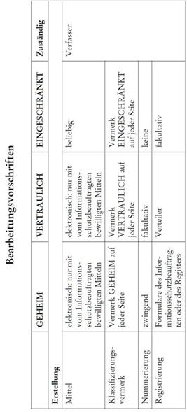
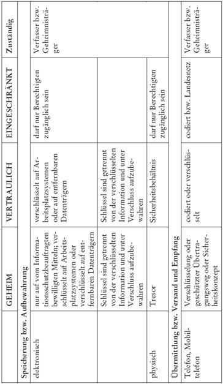
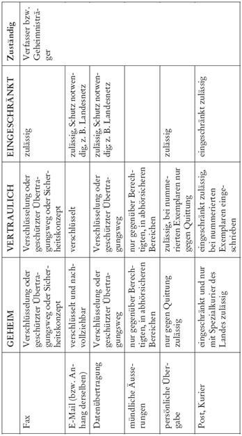
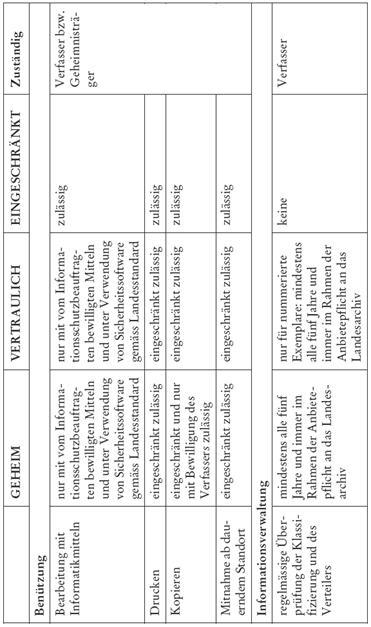
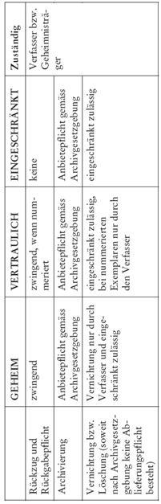

Verordnung vom 9. Dezember 2009 über den Schutz von Informationen des Landes (Informationsschutzverordnung; ISchV) Aufgrund von Art. 3 Abs. 3 und Art. 38 des Gesetzes vom 19. Mai 1999 über die Information der Bevölkerung (Informationsgesetz), LGBl. 1999 Nr. 159, in der geltenden Fassung, und von Art. 17 des Archivgesetzes (ArchivG) vom 5. Dezember 2024, LGBl. 2025 Nr. 141, verordnet die Regierung: I. Allgemeine Bestimmungen Art. 1 Gegenstand 1) Diese Verordnung regelt den Schutz von Informationen des Landes, soweit er im Interesse Liechtensteins geboten ist und dient der Umsetzung völkerrechtlicher Verpflichtungen. Sie legt insbesondere die Klassifizierung und Bearbeitung von Informationen fest. 2) Vorbehalten bleiben spezialgesetzliche Bestimmungen. Art. 2 Geltungsbereich Diese Verordnung gilt für: a) das bei der Regierung und den Amtsstellen beschäftigte Personal sowie Mitglieder von Kommissionen und Beiräte im Sinne des Gesetzes über die Regierungs- und Verwaltungsorganisation; b) das Personal der Körperschaften, Stiftungen und Anstalten des öffentlichen Rechts sowie Private, die klassifizierte Informationen bearbeiten, soweit dies gesetzlich vorgesehen ist oder entsprechend vereinbart wurde. Art. 3 Begriffe und Bezeichnungen 1) In dieser Verordnung bedeuten: a) "Informationen": Aufzeichnungen auf Informationsträgern und mündliche Äusserungen; b) "Informationsträger": Träger von Informationen irgendwelcher Art, namentlich Schriftstücke und Träger von Text-, Bild-, Ton- oder anderen Daten; Zwischenmaterial, namentlich Entwürfe, gelten ebenfalls als Informationsträger; c) "Bearbeiten": jeder Umgang mit Informationen, unabhängig von den angewandten Mitteln und Verfahren, insbesondere das Erstellen, Benützen, Verarbeiten, Kopieren, Zugänglichmachen, Bekanntgeben, Übermitteln, Zur-Kenntnis-Nehmen, Aufbewahren, Archivieren und Vernichten; d) "Verfasser": Person, Verwaltungseinheit oder Auftragnehmer, die oder der klassifizierte Informationen erstellt; e) "Geheimnisträger": Person, der klassifizierte Informationen anvertraut wurden; f) "Klassifizieren": eine konkrete Information dem Klassifizierungskatalog (Art. 8) entsprechend beurteilen und mit dem Klassifizierungsvermerk formell kennzeichnen; g) "Entklassifizieren": den Klassifizierungsvermerk nach Wegfall der Schutzwürdigkeit streichen; h) "Informatik- und Kommunikationssysteme": Systeme und die auf ihnen vorhandenen Anwendungen und Datensammlungen; i) "Informatiksicherheit": die Informatiksicherheit stellt die Vertraulichkeit, Verfügbarkeit, Integrität und Nachvollziehbarkeit bei der elektronischen Bearbeitung von Informationen sicher; k) "Codierung": Anwendung von Umschreibungen und Decknamen; l) "Verschlüsselung": technische Umformung von Klartext, welche eine dem Stand der Technik entsprechende Qualität aufweist. 2) Unter den in dieser Verordnung verwendeten Personen- und Funktionsbezeichnungen sind Angehörige des weiblichen und männlichen Geschlechts zu verstehen. II. Klassifizierungen Art. 4 Klassifizierungsstufen 1) Wer schutzwürdige Informationen verfasst oder herausgibt, weist sie entsprechend dem Grad ihrer Schutzwürdigkeit einer der folgenden Klassifizierungsstufen zu: a) GEHEIM; b) VERTRAULICH; c) EINGESCHRÄNKT. 2) Werden Informationsträger physisch zu einem Sammelwerk zusammengefasst, ist zu überprüfen, ob dieses klassifiziert oder einer höheren Klassifizierungsstufe zugeordnet werden muss. Art. 5 GEHEIME Informationen 1) Als GEHEIM werden Informationen klassifiziert, deren Kenntnisnahme durch Unberechtigte den Landesinteressen einen schweren Schaden zufügen kann. Dabei handelt es sich namentlich um Informationen, deren Bekanntwerden: a) die Handlungsfähigkeit des Landtages oder der Regierung schwerwiegend gefährden kann; b) die Sicherheit der Bevölkerung schwerwiegend gefährden kann; c) die wirtschaftliche Landesversorgung oder die Sicherheit von landeswichtigen Führungs- und Infrastrukturanlagen schwerwiegend gefährden kann; d) die Aufgabenerfüllung der Landesverwaltung oder wesentlicher Teile davon schwerwiegend gefährden kann; e) die aussenpolitischen Interessen oder die internationalen Beziehungen Liechtensteins schwerwiegend gefährden kann. 2) Träger von als GEHEIM klassifizierten Informationen sind zu nummerieren. Art. 6 VERTRAULICHE Informationen 1) Als VERTRAULICH werden Informationen klassifiziert, deren Kenntnisnahme durch Unberechtigte den Landesinteressen Schaden zufügen kann. Dabei handelt es sich namentlich um Informationen, deren Bekanntwerden: a) die freie Meinungs- und Willensbildung des Landtages oder der Regierung beeinträchtigen kann; b) die zielkonforme Durchführung konkreter behördlicher Massnahmen beeinträchtigen kann; c) die Sicherheit der Bevölkerung beeinträchtigen kann; d) die wirtschaftliche Landesversorgung oder die Sicherheit von wichtigen Infrastrukturanlagen beeinträchtigen kann; e) die Aufgabenerfüllung von Teilen der Landesverwaltung beeinträchtigen kann; f) die aussenpolitischen Interessen oder internationalen Beziehungen Liechtensteins beeinträchtigen kann; g) die Beziehungen zwischen Land und Gemeinden oder zwischen Gemeinden beeinträchtigen kann; h) wirtschaftspolitische Interessen Liechtensteins beeinträchtigen kann. 2) Träger von als VERTRAULICH klassifizierten Informationen können nummeriert werden. Art. 7 EINGESCHRÄNKTE Informationen Als EINGESCHRÄNKT werden Informationen klassifiziert, die dem Amts-, Berufs-, Geschäfts- oder Betriebsgeheimnis unterliegen und einen erhöhten Informationsschutz benötigen, sofern sie weder als GEHEIM noch VERTRAULICH klassifiziert werden müssen. Art. 8 Klassifizierungskatalog Der Informationsschutzbeauftragte (Art. 19) legt in einem Klassifizierungskatalog fest, wie gewisse häufig anfallende schutzwürdige Informationen des Landes zu klassifizieren sind. Art. 9 Befristete Klassifizierung Die Klassifizierung ist zu befristen, wenn voraussehbar ist, wann die Schutzwürdigkeit dahinfallen wird. III. Geheimnisträger Art. 10 Anforderungen 1) Personen, die aufgrund ihres Aufgabenbereiches Zugang zu klassifizierten Informationen erhalten sollen, sind: a) sorgfältig auszuwählen; b) zur Geheimhaltung zu verpflichten; und c) entsprechend aus- und weiterzubilden. 2) Geheimnisträger, die Zugang zu als GEHEIM oder als VERTRAULICH klassifizierten Information erhalten sollen, haben sich einer Personensicherheitsprüfung zu unterziehen und müssen im Besitz des dazu ermächtigenden Zertifikates sein. Die Überprüfung richtet sich nach der Verordnung über die Personensicherheitsprüfungen (PSPV). Art. 11 Aus- und Weiterbildung Die Fachkenntnisse von Geheimnisträgern im Bereich des Informationsschutzes und der Informatiksicherheit sind sicher zu stellen und periodisch zu aktualisieren. Art. 12 Verantwortung Wer klassifizierte Informationen bearbeitet, ist für die Einhaltung der Informationsschutzvorschriften verantwortlich. IV. Bearbeitung von klassifizierten Informationen Art. 13 Grundsätze 1) Die Erstellung, die Bekanntgabe und das Zugänglichmachen klassifizierter Informationen sind auf ein Minimum zu beschränken; dabei sind Lage, Auftrag, Zweck und Zeit zu berücksichtigen. 2) Klassifizierte Informationen dürfen nur jenen Personen bekannt gegeben oder zugänglich gemacht werden, die davon Kenntnis haben müssen. 3) Bei Gesuchen um Zugang zu amtlichen Dokumenten überprüft die zuständige Stelle, unabhängig von einem allfälligen Klassifizierungsvermerk, ob der Zugang nach Massgabe des Informationsgesetzes zu gewähren oder zu verweigern ist. 4) Die Bearbeitung klassifizierter Informationen aus dem Ausland richtet sich nach dem entsprechenden Informationsschutzabkommen. Liegt kein solches vor, so richtet sich die Bearbeitung nach den Bearbeitungsvorschriften der mit der ausländischen Klassifizierungsstufe äquivalenten liechtensteinischen Klassifizierung. Art. 14 Überprüfung von Schutzwürdigkeit und Verteiler Die Verfasser einer als VERTRAULICH klassifizierten und nummerierten oder einer als GEHEIM klassifizierten Information überprüfen deren Schutzwürdigkeit und den Verteiler mindestens alle fünf Jahre und immer im Rahmen der Anbietepflicht an das Landesarchiv. Art. 15 Schutz bei falscher oder fehlender Klassifizierung 1) Wer vermutet oder feststellt, dass Informationen offensichtlich falsch oder fälschlicherweise nicht klassifiziert sind, hat deren Schutz bis zur Änderung der Klassifizierung sicherzustellen. 2) Er benachrichtigt unverzüglich den Verfasser. Dieser trifft sofort die erforderlichen Massnahmen. Art. 16 Meldung bei Verlust, Missbrauch oder Gefährdung 1) Wer feststellt, dass klassifizierte Informationen gefährdet, abhanden gekommen oder missbraucht worden sind, trifft Schutzmassnahmen und informiert unverzüglich die vorgesetzte Person, den Verfasser und den Informationsschutzbeauftragten (Art. 19). 2) Der Verfasser trifft in Absprache mit dem Informationsschutzbeauftragten (Art. 19) sofort die erforderlichen Massnahmen. Art. 17 Archivierung Die Archivierung klassifizierter Informationen richtet sich nach den Vorschriften der Archivgesetzgebung. Art. 18 Bearbeitungsvorschriften 1) Die Bearbeitung klassifizierter Informationen und der Umgang mit entsprechenden Informationsträgern sind im Anhang geregelt. 2) Der Informationsschutzbeauftragte (Art. 19) erlässt detaillierte Bearbeitungsvorschriften. 3) Er regelt die vereinfachte Handhabung im Bereich von Informationen der Landespolizei nach deren Bedürfnissen und unter Wahrung eines hinreichenden Informationsschutzes nach dieser Verordnung. V. Informationsschutzbeauftragter Art. 19 Bestellung und Aufgaben 1) Die Regierung bezeichnet eine Person als Informationsschutzbeauftragten. 2) Der Informationsschutzbeauftragte nimmt insbesondere folgende Aufgaben wahr: a) Er sorgt für die Umsetzung des Informationsschutzes. b) Er kontrolliert periodisch das Vorhandensein und die Vollständigkeit der als GEHEIM und VERTRAULICH klassifizierten Informationsträger. Der Informationsschutzbeauftragte kann diese Kontrolltätigkeit an das Register zur selbständigen Erledigung übertragen. c) Er erlässt die nötigen fachtechnischen Weisungen, namentlich den Klassifizierungskatalog (Art. 8) und die detaillierten Bearbeitungsvorschriften (Art. 18). d) Er kann Kontrollen und die in völkerrechtlichen Verträgen vorgesehenen Sicherheitsinspektionen durchführen. e) Er legt die Vorgaben für die Ausbildung der Geheimnisträger fest und erstellt die notwendigen Ausbildungshilfsmittel. f) Er erstattet der Regierung regelmässig Bericht. 3) Der Informationsschutzbeauftragte hat sich einer erweiterten Sicherheitsprüfung gemäss Art. 10 der Verordnung über die Personensicherheitsprüfungen (PSPV) zu unterziehen. VI. Übergangs- und Schlussbestimmungen Art. 20 Übergangsbestimmung Die Klassifizierung von Informationen, die vor Inkrafttreten dieser Verordnung erstellt wurden, ist bis zum 31. Dezember 2012 anzupassen. Art. 21 Inkrafttreten Diese Verordnung tritt am 1. Januar 2010 in Kraft. Fürstliche Regierung: gez. Dr. Martin Meyer Regierungschef-Stellvertreter Anhang (Art. 18 Abs. 1) 

 

 

 

 

