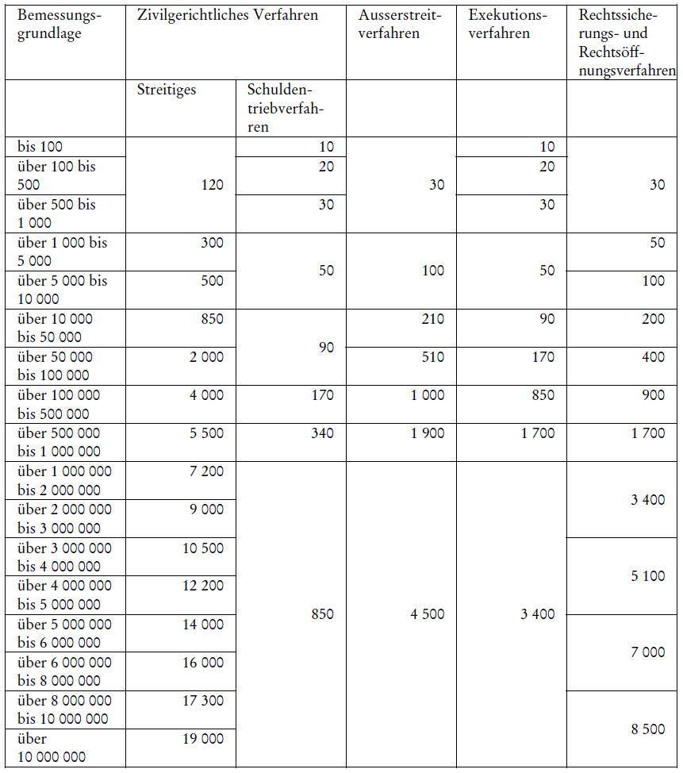

Gesetz vom 4. Mai 2017 über die Gebühren der Gerichte und Beschwerdekommissionen (Gerichtsgebührengesetz; GGG) Dem nachstehenden vom Landtag gefassten Beschluss erteile Ich Meine Zustimmung: I. Allgemeine Bestimmungen Art. 1 Gegenstand und Geltungsbereich 1) Dieses Gesetz regelt die Gebühren für die Inanspruchnahme der Tätigkeit der folgenden Gerichte und Kommissionen, einschliesslich der an sie gerichteten Eingaben: a) der ordentlichen Gerichte; b) des Staatsgerichtshofes; c) des Obersten Gerichtshofes als Verwaltungsgerichtshof; d) der Beschwerdekommissionen im Sinne von Art. 78 Abs. 3 der Verfassung (nachfolgend Beschwerdekommissionen). 2) Soweit nicht ausdrücklich etwas anderes bestimmt ist, gelten als Gerichte im Sinne dieses Gesetzes auch die Beschwerdekommissionen. Art. 2 Bezeichnungen Die in diesem Gesetz verwendeten Personen-, Berufs- und Funktionsbezeichnungen gelten für Personen männlichen und weiblichen Geschlechts. Art. 3 Entstehung des Gebührenanspruchs Der Anspruch des Staates auf die Gebühr wird, soweit im Folgenden nichts anderes bestimmt wird, begründet: a) mit der Überreichung oder dem Eingang folgender Eingaben bei Gericht: 1. Klagen oder Widerklagen des zivilgerichtlichen Verfahrens erster Instanz; 2. Klagen auf Aufhebung eines Schiedsspruchs und Klagen auf Feststellung des Bestehens oder Nichtbestehens eines Schiedsspruchs; 3. Rechtsmittelschriften und Rechtsbehelfe des zivilgerichtlichen und strafgerichtlichen Verfahrens zweiter und dritter Instanz sowie des Verfahrens vor dem Staatsgerichtshof, dem Obersten Gerichtshof als Verwaltungsgerichtshof oder den Beschwerdekommissionen; 4. Schriftsätze des zivilgerichtlichen Verfahrens, wenn das Klagebegehren erweitert wird; wird das Klagebegehren erweitert, ohne dass vorher die Klagserweiterung mit einem Schriftsatz dem Gericht mitgeteilt worden ist, so entsteht eine allfällige zusätzliche Gebühr mit dem Beginn der Protokollierung; 5. Anträge zur Vorladung des Gegners nach § 227 Abs. 1 ZPO, schriftliche Gesuche um Erlassung eines bedingten Zahlbefehls (§§ 577 ff. ZPO) beziehungsweise eines Rechtsbots (§ 593 ZPO), Anträge nach § 567 ZPO, Anbringen auf gerichtliche Aufkündigungen (§§ 560 ff. ZPO), Anträge auf Erlassung eines Wechsel- oder Scheckauftrages oder eines Zahlungsauftrages nach § 548 ZPO; 6. Anträge des Verfahrens zur Erlassung einstweiliger Verfügungen (Art. 270 ff. EO) oder Exekutionsanträge, Anträge auf pfandweise Beschreibung (Art. 294 Abs. 2 EO) oder Oppositions-, Impugnations- und Exszindierungsklagen (Art. 18 bis 20 EO); 7. verfahrenseinleitende Anträge des ausserstreitigen Verfahrens (Art. 20 Abs. 1 AussStrG) sowie auf Antrag eingeleitete Verlassenschaftsverfahren (Art. 143 Abs. 2 AussStrG) und auf Antrag eingeleitete Ausserstreitverfahren nach dem Personen- und Gesellschaftsrecht; 8. schriftliche Privatanklagen sowie Subsidiaranklagen; b) mit der Beurkundung durch das Gericht bei Vergleichen, die vor der Einleitung eines Verfahrens geschlossen werden; c) mit der Zustellung der Entscheidung des ausserstreitigen Verfahrens, des Konkursverfahrens, soweit der Antrag auf Eröffnung eines Konkursverfahrens von einem Gläubiger des Schuldners eingebracht wird, und des Sanierungsverfahrens; d) mit der Rechtskraft der die Kostenersatzpflicht festlegenden Entscheidung im offizialen Strafverfahren erster Instanz; e) mit dem Beginn der Niederschrift bei Protokollaranträgen; f) mit Veranlassung beziehungsweise Herstellung durch die Partei bei Abschriften (Kopien, Ablichtungen, Ausdrucke); g) mit dem Beginn von allen sonstigen Amtshandlungen und Verfahren. Art. 4 Gebührenermittlung 1) Der der Gebührenermittlung zugrunde zu legende Betrag (Bemessungsgrundlage) ergibt sich aus den besonderen Bestimmungen dieses Gesetzes. 2) Die ermittelte Bemessungsgrundlage und Gebühr ist auf den nächsthöheren Frankenbetrag aufzurunden. 3) Bildet ein Betrag in ausländischer Währung die Bemessungsgrundlage, ist der entsprechende Betrag in Schweizer Franken zum aktuellen, von der SIX AG veröffentlichten Devisentageskurs am Tag der Entstehung des Gebührenanspruchs zu ermitteln. Art. 5 Gebührenentscheidung 1) Im Rahmen dieses Gesetzes sind die folgenden Entscheidungen zu treffen: a) Feststellung des Bestehens oder Nichtbestehens einer beanspruchten Gebührenbefreiung; b) Ermittlung und Festsetzung der zu entrichtenden Gebühr; c) Festsetzung eines zu leistenden Vorschusses für die Gebühr; d) Feststellung, dass eine Eingabe als zurückgezogen gilt. 2) Entscheidungen nach Abs. 1 Bst. a bis c obliegen: a) bei Gebühren für Verfahren vor den ordentlichen Gerichten und dem Obersten Gerichtshof als Verwaltungsgerichtshof der beim Landgericht eingerichteten Abteilung für Zentrale Dienste; b) bei Gebühren für Verfahren vor dem Staatsgerichtshof oder den Beschwerdekommissionen dem von diesen dafür für zuständig erklärten Einzelrichter oder Einzelmitglied. 3) Entscheidungen nach Abs. 1 Bst. d obliegen: a) für Verfahren vor dem Landgericht dem für die Erledigung der Rechtssache zuständigen Rechtspfleger oder Einzelrichter; b) für Verfahren vor dem Staatsgerichtshof, dem Verwaltungsgerichtshof, dem Obersten Gerichtshof, dem Obergericht oder den Beschwerdekommissionen dem von diesen dafür für zuständig erklärten Einzelrichter oder Einzelmitglied. 4) Wird im Laufe des Verfahrens festgestellt, dass die Gebühr oder ein zu leistender Vorschuss für die Gebühr unrichtig festgesetzt oder anderweitig anzupassen ist, kann das Gericht die Festsetzung von Amts wegen oder auf Antrag der gebührenpflichtigen Person oder deren Gegners korrigieren. 5) Eine rechtskräftige Gebührenentscheidung bildet einen Exekutionstitel im Sinne der Exekutionsordnung. Gebührenentrichtung Art. 6 a) Art der Entrichtung 1) Soweit nicht anders bestimmt, ist die Gebühr nur einmal zu entrichten, gleichgültig, ob die Eingabe mehrere Anträge enthält oder ob sich die Eingabe auf mehrere Personen bezieht. 2) Wird eine gebührenpflichtige Eingabe der Partei zur Verbesserung zurückgestellt und neuerlich eingereicht, so ist hiefür keine weitere Gebühr zu entrichten. 3) Die Gebühren können in bar, durch Überweisung oder nach Massgabe der technischen Möglichkeiten durch Verwendung von Bankkarten mit Bankomatfunktion oder Kreditkarten, durch Abbuchung oder durch Einziehung entrichtet werden. 4) Die Abbuchung nach Abs. 3 erfolgt von dem bei Gericht geführten Depot. Abgebuchte Gebühren, die nicht oder nicht im abgebuchten Betrag geschuldet sind, sind vom Gericht zurückzuerstatten. Verfügt ein Depot nicht über ausreichend Mittel zur Begleichung einer Gebühr, so hat das Gericht dies dem Depotinhaber mitzuteilen. Wird das Depot nicht binnen zwei Wochen ab dem Zeitpunkt dieser Mitteilung um mindestens den noch offenen Betrag aufgefüllt, so ist die Eingabe vom Gericht als zurückgezogen zu erklären. 5) Die Einziehung nach Abs. 3 setzt voraus, dass das Gericht zur Einziehung der Gebühren auf ein Konto ermächtigt ist und die Eingabe die Angabe des Kontos, von dem die Gebühren einzuziehen sind, und allenfalls den höchstens abzubuchenden Betrag enthält. Die Angabe des Kontos, von dem die Gebühren einzuziehen sind, oder des Anschriftscodes, unter dem ein Konto zur Einziehung der Gebühren gespeichert ist, gilt als Zustimmung zum Gebühreneinzug. Art. 7 b) Zeitpunkt der Entrichtung 1) Entsteht der Gebührenanspruch mit der Überreichung oder dem Eingang der Eingabe bei Gericht und wird die Gebühr nicht oder nicht vollständig binnen vier Wochen ab Entstehung des Anspruchs entrichtet, so ist die Eingabe vom Gericht als zurückgezogen zu erklären, wenn die zahlungspflichtige Person nicht gebührenbefreit ist. Auf den der Eingabe zugrundeliegenden Anspruch hat dies jedoch keinerlei Einfluss. Ist nach Ablauf der Frist lediglich ein Betrag von bis zu 100 Franken ausstehend, so kann das Gericht eine Verhandlung anberaumen, wobei der fehlende Betrag zu Beginn der Verhandlung in bar zu entrichten ist, oder eine angemessene Nachfrist zur Bezahlung der Gebühr setzen oder einen Zahlungsauftrag erlassen. Andernfalls ist die zum Teil entrichtete Gebühr vom Gericht zurückzuerstatten. 2) Der Zahlungsauftrag nach Abs. 1 hat eine detaillierte Aufstellung der geschuldeten Beträge und die Aufforderung zu enthalten, den angesprochenen Betrag binnen einer Frist von zwei Wochen einzuzahlen. Neben der geschuldeten Gebühr ist im Zahlungsauftrag ein Mehrbetrag von 25 Franken zu erheben. Nach Ablauf der Zahlungsfrist ist ein Zahlungsauftrag unmittelbar vollstreckbar. Gegen die Erlassung eines Zahlungsauftrages ist ein Rechtsmittel nicht gegeben. Der Zahlungspflichtige kann aber, wenn er sich durch den Inhalt des Zahlungsauftrages beschwert erachtet, innert der ihm angesetzten Zahlungsfrist unter Angabe von Gründen dessen Berichtigung verlangen. Einem Berichtigungsantrag ist ohne Weiteres stattzugeben, wenn es sich um eine offenbare Unrichtigkeit handelt. In allen übrigen Fällen entscheidet der Landgerichtspräsident, der Präsident des Staatsgerichtshofes oder der Präsident der jeweiligen Beschwerdekommission endgültig über den Berichtigungsantrag. 3) Die in Abs. 1 genannte Frist verlängert sich im Fall nach Art. 9 Abs. 2 AussStrG bis zum Zeitpunkt, zu welchem das Gericht die Partei zur ziffernmässig bestimmten Angabe des Begehrens aufgefordert hat. 4) Das Gericht kann die Zahlungsfrist nach Abs. 1 verkürzen, das Verfahren vor Entrichtung der Gebühr fortsetzen und auf die vorgängige Einhebung der Gebühr verzichten. 5) Entsteht der Gebührenanspruch nicht mit der Überreichung oder dem Eingang der Eingabe bei Gericht, so ist ein angemessener Vorschuss für die Gebühr (Art. 9) zu leisten. Das gilt nicht für: a) Amtshandlungen oder Entscheidungen nach Art. 37; in diesem Fall ist die Gebühr sogleich bei Gericht zu entrichten; b) das offiziale Strafverfahren. Art. 8 c) Stundung, Nachlass und Verzicht 1) Auf Antrag des Zahlungspflichtigen kann die vorgeschriebene Zahlungsfrist verlängert oder die Entrichtung in Teilbeträgen bewilligt werden, wenn die Einbringung für den Zahlungspflichtigen mit einer besonderen Härte verbunden wäre und durch die Stundung nicht gefährdet erscheint. Wird Ratenzahlung bewilligt, so tritt bei nicht rechtzeitiger Bezahlung einer verfallenen Rate Terminverlust ein. 2) Gebühren können auf Antrag des Zahlungspflichtigen ganz oder teilweise nachgelassen werden, wenn die Einbringung für ihn mit besonderer Härte verbunden wäre. 3) Über Anträge auf Stundung oder Nachlass von Gebühren entscheidet der Landgerichtspräsident, der Präsident des Staatsgerichtshofes oder der Präsident der jeweiligen Beschwerdekommission endgültig. 4) Der Landgerichtspräsident, der Präsident des Staatsgerichtshofes oder der Präsident der jeweiligen Beschwerdekommission kann von der amtlichen Einbringung von Gebühren absehen, wenn nach den dem Gericht bekannten Umständen ein Erfolg im Exekutionsverfahren nicht zu erwarten ist. Art. 9 d) Vorschuss für Gebühren 1) In den Fällen nach Art. 7 Abs. 5 nimmt das Gericht die beantragte Amtshandlung oder die Fällung einer Entscheidung erst nach Entrichtung des Vorschusses vor. 2) Ergibt sich im Laufe des Verfahrens, dass der geleistete Vorschuss nicht hinreicht, so hat das Gericht eine Ergänzung desselben zu verlangen. 3) Wird der Vorschuss nach Abs. 1 oder die Ergänzung nach Abs. 2 nicht binnen einer vom Gericht bestimmten Frist geleistet, so ist der Antrag auf Vornahme einer Amtshandlung oder auf Fällung einer Entscheidung als zurückgezogen zu erklären. 4) Nach Abschluss des Verfahrens wird der Vorschuss mit der effektiven Gebühr verrechnet. Zahlungspflicht Art. 10 a) Grundsatz 1) Die Zahlungspflicht trifft, soweit nicht besondere Bestimmungen bestehen: a) bei Eingaben und den diese ersetzenden Protokollaranträgen die einschreitende Partei; b) bei Beglaubigungen, Abschriften und Amtsbestätigungen denjenigen, der darum ansucht oder in dessen Interesse diese Schriftstücke ausgestellt werden beziehungsweise bei Abschriften auch denjenigen, der diese herstellt; c) bei Vergleichen, die vor der Einleitung eines Verfahrens geschlossen werden, die Parteien je zur Hälfte ohne Rücksicht auf entgegenstehende Parteienvereinbarungen; d) bei anderen Amtshandlungen oder Verfahren denjenigen, der sie veranlasst hat oder in dessen Interesse sie stattfinden. 2) Trifft die Verpflichtung zur Entrichtung desselben Gebührenbetrags zwei oder mehrere Personen, so sind sie zur ungeteilten Hand zahlungspflichtig. 3) Wird eine gebührenpflichtige Eingabe von einer oder mehreren gebührenpflichtigen und gebührenbefreiten Parteien eingebracht, so hat die gebührenpflichtige Partei den vollen Gebührenbetrag zu entrichten. Dasselbe gilt auch für gebührenpflichtige Entscheidungen oder Amtshandlungen, an denen gebührenpflichtige und gebührenbefreite Parteien teilnehmen, sofern solche Amtshandlungen durch gemeinschaftliches Ansuchen dieser Parteien veranlasst wurden oder sie zur ungeteilten Hand zahlungspflichtig sind. 4) Bei persönlicher Gebührenfreiheit ist der Gegner zur Zahlung der Gebühr, die die gebührenbefreite Person zu entrichten gehabt hätte, verpflichtet, soweit ihm die Kosten des Verfahrens auferlegt sind oder soweit er die Kosten durch Vergleich übernommen hat. Im Zweifel ist die Hälfte der Gebühr einzuheben. Art. 11 b) Verlassenschaftsverfahren 1) Im Verlassenschaftsverfahren gelangt Art. 10 Abs. 2 dann nicht zur Anwendung, wenn der Erblasser die Gebührenentrichtung einer Person auferlegt hat. 2) Gebührenpflichtig ist die Einantwortung einer Verlassenschaft, die Überlassung derselben an Legatare oder die Ausfolgung nach Art. 150 AussStrG. 3) Vor Entrichtung oder Sicherstellung der Gebühr darf ein Einantwortungsbeschluss nicht ausgefertigt und die bücherliche Umschrift allfälliger Nachlassliegenschaften auf Erben oder Vermächtnisnehmer nicht bewilligt werden. 4) Zur Sicherung der Gebühr besteht an sämtlichen Nachlassaktiven ein gesetzliches Pfandrecht. Art. 12 c) Exekutionsverfahren 1) Ist in einem Exekutionsverfahren der betreibende Gläubiger von der Entrichtung der Gebühr befreit, so ist in dem Beschluss, mit dem die Exekution bewilligt wird, dem Verpflichteten gleichzeitig auch die Zahlung der Gebühr aufzutragen, die die gebührenbefreite Person zu entrichten gehabt hätte; dieser Beschluss ist sofort vollstreckbar. 2) Die Exekution ist auch zur Hereinbringung der Gebühr zu führen; die Gebührenforderung steht im Rang vor der betriebenen Forderung. Art. 13 d) Insolvenzverfahren 1) Im Insolvenzverfahren ist der Anspruch des Staates auf die Gebühr als Masseforderung zu behandeln. 2) Von der einschreitenden Partei ist die Gebühr dann einzuheben, wenn: a) das Insolvenzverfahren mangels kostendeckenden Vermögens aufgehoben; oder b) der Antrag auf Eröffnung eines Insolvenzverfahrens zurück- oder abgewiesen wird. Art. 14 e) Sanierungsverfahren mit Eigenverwaltung Im Sanierungsverfahren mit Eigenverwaltung ist die Gebühr vom Schuldner vor der Bestätigung des Sanierungsplans zu entrichten oder sicherzustellen. Gebührenbefreiung Art. 15 a) Grundsatz Aufgehoben Art. 16 b) Persönliche Gebührenbefreiung 1) Von der Zahlungspflicht für Gebühren sind befreit: a) Parteien einstweilig, wenn ihnen dies nach den Bestimmungen der ZPO über die Verfahrenshilfe bewilligt wurde; b) das Land Liechtenstein und alle inländischen Körperschaften, Anstalten und Stiftungen des öffentlichen Rechts, soweit sie in Verfolgung ihrer gesetzlichen oder statutarischen Aufgaben an einem Verfahren als Partei beteiligt sind; c) der Landesfürst und die Mitglieder der Fürstlichen Familie; d) die Liechtensteinische Staatsanwaltschaft; e) der Insolvenzverwalter, soweit er im betreffenden Verfahren nicht als Kläger oder Antragsteller auftritt; f) amtlich bestellte Kuratoren oder Sachwalter, mit Ausnahme der Fälle nach Art. 141 Abs. 1 PGR. 2) Die persönliche Gebührenfreiheit kommt nur der Partei zu, der sie gewährt wird, und geht auf die Rechtsnachfolger nicht über. Art. 17 c) Sachliche Gebührenbefreiung 1) Von der Gebührenpflicht sind befreit: a) alle Eingaben, Amtshandlungen und Entscheidungen des Ausserstreitverfahrens, für die im Rahmen dieses Gesetze keine Bemessungsgrundlage vorgesehen ist; die Verpflichtung zum Ersatz von Kosten, die durch Publikationen entstehen, sowie von Kosten für beizuziehende Sachverständige oder Dolmetscher bleibt jedoch unberührt; b) bewilligte Verfahrenshilfeanträge im Umfang ihrer einstweiligen Befreiung von der Gerichtsgebühr; c) alle Gebührenangelegenheiten nach diesem Gesetz. 2) Im Falle eines Verzichts-, Anerkenntnis- und Versäumnisurteils ist ein angemessener Teil der Gebühr vom Gericht zurückzuerstatten. Die Festsetzung des angemessenen Teils der Gebühr erfolgt im Rahmen des jeweiligen Urteils. Das Gleiche gilt für Beschlüsse, mit denen: a) die Eingabe wegen Unzulässigkeit des Rechtswegs, Unzuständigkeit des Gerichts, Streitanhängigkeit, rechtskräftig entschiedener Streitsache oder wegen vorzeitiger Einbringung der Scheidungsklage (§ 592 ZPO) zurückgewiesen wird; b) die Eingabe wegen Paupertätseides oder die Klage nach § 529 ZPO für zurückgenommen erklärt wird; c) die Eingabe zurückgezogen wird. II. Bemessungsgrundlagen A. Zivilgerichtliches Verfahren erster Instanz Art. 18 Grundsatz 1) Bemessungsgrundlage ist, soweit nicht im Folgenden etwas anderes bestimmt wird, der Wert des Streitgegenstandes zum Zeitpunkt der Entstehung des Gebührenanspruchs. Zuwachs, Früchte, Zinsen, Schäden und Kosten, die als Nebenforderungen geltend gemacht werden, bleiben bei der Wertberechnung unberücksichtigt. 2) In Fällen, in welchen der Streitgegenstand nicht in einem Geldbetrag besteht, hat der Kläger diesen Wert in der Klage oder in der verfahrenseinleitenden Eingabe anzugeben. Dies gilt insbesondere auch für Klagen auf Vornahme von Arbeiten und anderen persönlichen Leistungen, auf Duldung oder Unterlassung und auf Abgabe von Willenserklärungen. 3) Wird die Bemessungsgrundlage nicht oder so angegeben, dass sie den tatsächlichen Verhältnissen offensichtlich nicht entspricht, ist sie allenfalls nach Durchführung von Erhebungen vom Gericht nach freiem Ermessen amtswegig festzusetzen. Gegen eine solche Entscheidung ist ein Rechtsmittel nicht gegeben. 4) Findet der Beklagte die Bewertung des Streitgegenstandes durch den Kläger zu hoch oder zu niedrig, so kann er spätestens bei der ersten zur mündlichen Streitverhandlung bestimmten Tagsatzung die Bewertung bemängeln. Das Gericht hat mangels einer Einigung der Parteien möglichst ohne weitere Erhebungen und ohne die Erledigung wesentlich zu verzögern oder Kosten zu verursachen, den Streitgegenstand im Rahmen der von den Parteien behaupteten Beträge zu bewerten. Dieser Beschluss kann durch ein Rechtsmittel nicht angefochten werden. Bei der Feststellung des Streitwerts ist das Gericht auch nicht an übereinstimmende Wertangaben der Parteien gebunden. 5) Mehrere in einem zivilgerichtlichen Verfahren von einer einzelnen Partei oder von Streitgenossen geltend gemachte Ansprüche sind zusammenzurechnen; die Summe der geltend gemachten Ansprüche bildet, soweit nicht im Folgenden etwas anderes bestimmt wird, eine einheitliche Bemessungsgrundlage für das ganze Verfahren. 6) Wird der gleiche Anspruch durch oder gegen mehrere Personen geltend gemacht, denen der Anspruch solidarisch zusteht oder für den sie solidarisch haften, so richtet sich der Wert nach der Höhe des einfachen Anspruchs. 7) Wird nur ein Teil einer Geldforderung begehrt, so ist nur der eingeklagte Teil der Gebührenermittlung zugrunde zu legen. Art. 19 Besondere Verfahrensbestimmungen 1) Werden Ansprüche auf Leistung von Unterhalts- oder Versorgungsbeiträgen geltend gemacht, gilt als Streitwert deren doppelter Jahresbetrag, bei Renten für erlittene körperliche Beschädigungen oder wegen der Tötung eines Menschen der dreifache Jahresbetrag. Wird ein solcher Anspruch für einen kürzeren Zeitraum geltend gemacht, gilt der geltend gemachte Gesamtbetrag als Streitwert. 2) Im Verfahren auf Erhöhung oder Verminderung von Unterhaltsbeiträgen ist als Streitwert der doppelte Jahresbetrag der begehrten Erhöhung oder Verminderung zugrunde zu legen, bei Geltendmachung eines einstweiligen Unterhalts dessen einfacher Jahresbetrag. 3) Bei gemeinsamer Geltendmachung von künftigem und bereits fällig gewordenem Unterhalt sind der Betrag für den künftigen Unterhalt und der für die Vergangenheit geforderte Betrag zusammenzurechnen. 4) Für Klagen auf Aufhebung eines Schiedsspruchs (§ 628 ZPO) ist der Wert des Gegenstandes des im Schiedsspruch entschiedenen Streits massgebend. Für eine nur teilweise Anfechtung eines Schiedsspruchs durch Aufhebungsklage und für die Erhebung von Aufhebungsklagen durch beide Seiten ist Art. 22 Abs. 2 entsprechend anzuwenden. Betrifft eine Aufhebungsklage nur die Entscheidung des Schiedsgerichts über seine Zuständigkeit (§ 628 Abs. 1 zweiter Satz ZPO), so hat abweichend von der Regel des ersten Satzes der Kläger den Streitwert in der Aufhebungsklage anzugeben; unterlässt er eine Bewertung, so ist nach Art. 18 Abs. 3 vorzugehen. Für eine Klage auf Feststellung des Bestehens eines Schiedsspruchs (§ 629 ZPO) ist der Wert des Gegenstandes des im Schiedsspruch entschiedenen Streits massgebend, für eine Klage auf Feststellung des Nichtbestehens eines Schiedsspruchs (§ 629 ZPO) der Streitwert, über den nach den Klagsbehauptungen kein Schiedsspruch ergangen ist. Art. 20 Bewertung einzelner Streitigkeiten Die Bemessungsgrundlage beträgt 3 000 Franken bei: a) arbeitsrechtlichen Streitigkeiten, soweit nicht ein Geldbetrag - sei es in einem Leistungs- oder in einem sonstigen Begehren, etwa einem Feststellungs- oder Unterlassungsbegehren - Gegenstand der Klage ist; b) gerichtlichen Kündigungen von Bestandverträgen und Aufträgen zur Übergabe oder Übernahme von Bestandgegenständen; c) Bestandstreitigkeiten, soweit nicht ein Geldbetrag - sei es in einem Leistungs- oder in einem sonstigen Begehren, etwa einem Feststellungs- oder Unterlassungsbegehren - Gegenstand der Klage ist; d) Streitigkeiten, die bloss die Rangordnung von Forderungen im Exekutionsverfahren und im Insolvenzverfahren betreffen; e) ehe- und familienrechtlichen Verfahren sowie in Verfahren betreffend die eingetragene Partnerschaft, abgesehen von den damit allenfalls verbundenen Ansprüchen vermögensrechtlicher Natur; f) Besitzerschutzverfahren. Art. 21 Wertänderungen 1) Die Bemessungsgrundlage bleibt für das ganze Verfahren gleich. 2) Wird jedoch der Streitwert infolge einer Erweiterung des Klagebegehrens geändert oder durch richterliche Streitwertbestimmung erhöht oder ist Gegenstand des Vergleichs eine Leistung, deren Wert das Klagebegehren übersteigt, so ist die Gebühr unter Zugrundelegung des höheren Streitwerts zu berechnen. Die bereits entrichtete Gebühr ist einzurechnen. 3) Eine Änderung des Streitwerts für die Gebühren tritt nicht ein, wenn das Klagebegehren zurückgezogen oder eingeschränkt wird oder wenn ein Teil- oder Zwischenurteil gefällt wird. B. Zivilgerichtliches Rechtsmittelverfahren sowie Verfahren über Nichtigkeits- oder Wiederaufnahmsklagen Art. 22 Grundsatz 1) Die Bemessungsgrundlage entspricht der des vorangegangenen Verfahrens. 2) Betrifft das Rechtsmittelverfahren oder das Verfahren über eine Wiederaufnahms- oder Nichtigkeitsklage jedoch nur einen Teil des ursprünglichen Streitgegenstands, so ist in diesem Verfahren für die Berechnung nur der Wert dieses Teils massgebend. Besteht dieser Teil nicht in einem Geldbetrag, so ist er in der Eingabe zu bewerten. Wird eine Bewertung unterlassen oder entspricht diese offensichtlich nicht den tatsächlichen Verhältnissen, ist der Bemessung der Gebühr der ganze ursprüngliche Streitwert zugrunde zu legen. 3) Bei wechselseitig erhobenen Rechtsmitteln sind die Gebühren nach Massgabe der Anträge eines jeden der beiden Streitteile gesondert zu berechnen und vom jeweiligen Rechtsmittelwerber zu entrichten. 4) Bei Kostenrekursen beträgt der Streitwert 1 000 Franken, jedoch nie mehr als die Hälfte des ursprünglichen Streitwerts. C. Ausserstreitverfahren Art. 23 Fürsorgeverfahren betreffend den Unterhalt zwischen Eltern und Kindern 1) Bemessungsgrundlage für den für die Vergangenheit zuerkannten Unterhaltsanspruch ist der zugesprochene Betrag. 2) Für die Zuerkennung künftigen Unterhalts ist das Einfache der Jahresleistung als Bemessungsgrundlage anzunehmen; wird der Anspruch aber auf eine kürzere Zeit als ein Jahr zuerkannt, so dient der Gesamtbetrag der zugesprochenen Leistungen als Bemessungsgrundlage. 3) Bei gemeinsamer Zuerkennung von künftigem und bereits fällig gewordenem Unterhalt sind der Betrag für den künftigen Unterhalt und der für die Vergangenheit zugesprochene Betrag zusammenzurechnen. Art. 24 Verlassenschaftsverfahren 1) Im Verlassenschaftsverfahren ist auf der Basis des Nachlasswerts eine Gebühr einzuheben. 2) Bei der Ermittlung des Reinnachlasses sind Liegenschaften in der Regel mit ihrem Steuerschätzwert in Anschlag zu bringen. Grundbücherlich sichergestellte Nachlassverbindlichkeiten dürfen in diesem Fall jedoch nur bis zur Höhe des Steuerschätzwerts der betreffenden Liegenschaft in Abzug gebracht werden. 3) Verlangen die Erben vollen Abzug der grundbücherlich sichergestellten Nachlassverbindlichkeiten, sind die belasteten Liegenschaften mit ihrem amtlichen Schätzungswert in Anschlag zu bringen. Art. 25 Handelsregistersachen In Handelsregistersachen ist der Gegenstand mit dem statutarischen Grundkapital zu bewerten, wenn aus dem Antrag kein anderer Wert hervorgeht. D. Exekutions- und Rechtssicherungsverfahren Art. 26 Grundsatz 1) Die Bemessungsgrundlage ist im Exekutionsverfahren der Betrag des durchzusetzenden Anspruchs, im Rechtssicherungsverfahren der Betrag des zu sichernden Anspruchs. 2) Für die Bewertung des Anspruchs gelten die Bestimmungen für das zivilgerichtliche Verfahren erster Instanz sinngemäss. Ist dem Verfahren ein denselben Anspruch betreffendes zivilgerichtliches Verfahren vorausgegangen, so bleibt der in diesem Verfahren massgebende Streitwert für die Bewertung des durchzusetzenden oder zu sichernden Anspruchs massgebend. Betrifft das Exekutions- oder Rechtssicherungsverfahren jedoch nur einen Teil des ursprünglichen Streitgegenstands, so ist in diesem Verfahren für die Berechnung nur der Wert dieses Teils massgebend. Besteht dieser Teil nicht in einem Geldbetrag, so ist er in der Eingabe zu bewerten. Wird eine Bewertung unterlassen oder entspricht diese offensichtlich nicht den tatsächlichen Verhältnissen, ist der Bemessung der Gebühr der ganze ursprüngliche Streitwert zugrunde zu legen. Prozesskosten oder Nebengebühren sind nur dann zu berücksichtigen, wenn sie allein den Gegenstand des durchzusetzenden oder zu sichernden Anspruchs bilden. 3) Eine Änderung der Bemessungsgrundlage für die Gebühren tritt nicht ein, wenn das Verfahren auf einen Teil des vollstreckbaren oder zu sichernden Anspruchs eingeschränkt wird. E. Strafverfahren Art. 27 Privat- und Subsidiaranklageverfahren Als Streitwert der Gebührenbemessung sind im Privat- und Subsidiaranklageverfahren folgende Beträge zugrunde zu legen: a) bei Übertretungen 1 000 Franken; b) bei Vergehen 5 000 Franken; c) bei Verbrechen 20 000 Franken. F. Verfahren vor dem Staatsgerichtshof Art. 28 Grundsatz 1) Die Bemessungsgrundlage im Verfahren vor dem Staatsgerichtshof entspricht der des vorangegangenen Verfahrens. 2) Betrifft das Verfahren vor dem Staatsgerichtshof jedoch nur einen Teil des ursprünglichen Streitgegenstands, so ist in diesem Verfahren für die Berechnung nur der Wert dieses Teils massgebend. Besteht dieser Teil nicht in einem Geldbetrag, so ist er in der Eingabe zu bewerten. 3) Wird die Bemessungsgrundlage nicht oder so angegeben, dass sie den tatsächlichen Verhältnissen offensichtlich nicht entspricht, ist sie allenfalls nach Durchführung von Erhebungen vom Staatsgerichtshof nach freiem Ermessen amtswegig festzusetzen. Gegen eine solche Entscheidung ist ein Rechtsmittel nicht gegeben. G. Verfahren vor dem Obersten Gerichtshof als Verwaltungsgerichtshof und den Beschwerdekommissionen Art. 29 Bewertung einzelner Streitigkeiten Die Bemessungsgrundlage beträgt im Verfahren vor dem Obersten Gerichtshof als Verwaltungsgerichtshof oder den Beschwerdekommissionen bei: a) Verwaltungssachen mit sehr geringer Bedeutung: 1 000 Franken; b) Verwaltungssachen mit geringer Bedeutung: 10 000 Franken; c) Verwaltungssachen mit erhöhter Bedeutung: 50 000 Franken; d) Verwaltungssachen mit mittlerer Bedeutung: 100 000 Franken; e) Verwaltungssachen mit weit erhöhter Bedeutung: 500 000 Franken; f) Verwaltungssachen mit hoher Bedeutung: 1 000 000 Franken; g) Verwaltungssachen mit sehr grosser Bedeutung: über 1 000 000 Franken. III. Gebühren Art. 30 Berechnung 1) Die Gebühr wird, soweit im Folgenden nichts anderes bestimmt wird, im Rahmen der Bemessungsgrundlagen nach der Gebührentabelle im Anhang festgesetzt. 2) Das Zweifache der Gebühr nach Abs. 1 wird für folgende Eingaben erhoben: a) Berufungen oder Revisionen des zivilgerichtlichen Rechtsmittelverfahrens; b) zweit- oder drittinstanzliche Rechtsmittel in Ausserstreitsachen; c) Anträge auf Bewilligung der Zwangsverwaltung oder Zwangsversteigerung von Liegenschaften sowie zweit- oder drittinstanzliche Rechtsmittel in Exekutionssachen; d) zweit- oder drittinstanzliche Rechtsmittel in Rechtssicherungs- und Rechtsöffnungssachen. 3) Bei Rechtsmitteln im Schuldentriebverfahren und Exekutionsverfahren sind zu erheben: a) bis zu einem Streitwert von 5 000 Franken das Einfache der Gebühr nach Abs. 1; b) bis zu einem Streitwert von 50 000 Franken das Zweieinhalbfache der Gebühr nach Abs. 1; c) ab einem Streitwert von 50 000 Franken das Sechsfache der Gebühr nach Abs. 1. Art. 31 Verlassenschaftsverfahren 1) Im Verlassenschaftsverfahren beträgt die Gebühr: a) bei Einantwortung des Nachlasses an den Ehegatten, an den eingetragenen Partner, an Eltern, Nachkommen oder Adoptivkinder des Erblassers: 2 ‰ des Reinnachlasses; b) bei Einantwortung an Geschwister des Erblassers oder deren Nachkommen: 3 ‰ des Reinnachlasses; c) bei Einantwortung an andere Blutsverwandte des Erblassers: 5 ‰ des Reinnachlasses; d) bei Einantwortung an andere Personen: 10 ‰ des Reinnachlasses; e) in jedem Fall jedoch mindestens 100 Franken. 2) Kirchliche sowie gemeinnützige öffentliche Institutionen sind Nachkommen des Erblassers gleichgestellt. Art. 32 Exekutionsverfahren Die Gebühr im Exekutionsverfahren ist unabhängig davon, ob in einem Beschluss lediglich über einen oder über mehrere Exekutionsanträge entschieden wird, zu erheben. Art. 33 Insolvenzverfahren 1) Für die Durchführung des Insolvenzverfahrens beträgt die Gebühr bei Bestätigung eines Sanierungsplans 5 ‰ der vom Verfahren betroffenen Verbindlichkeiten des Schuldners, ansonsten 2 ‰ des Liquidationserlöses der Insolvenzmasse, mindestens jedoch 200 Franken. 2) Eine angemessene Gebühr ist auch dann einzuheben, wenn das Verfahren vor Abschluss der Vermögensverwertung aufgehoben oder wenn der Antrag auf Eröffnung eines Insolvenzverfahrens zurück- oder abgewiesen wird. Art. 34 Strafverfahren 1) Bei erstinstanzlichen Strafverfahren, die über Antrag der Staatsanwaltschaft eingeleitet werden, betragen die Gebühren unter Berücksichtigung des Umfangs und Aufwands für das Strafverfahren: a) in Verfahren vor dem Einzelrichter bei Übertretungen und bestimmten Vergehen nach den §§ 317 ff. StPO: 100 bis 5 000 Franken; b) in Verfahren vor dem Einzelrichter nach den §§ 312 ff. StPO: 250 bis 10 000 Franken; c) in Verfahren vor dem Kriminalgericht: 500 bis 20 000 Franken. 2) Mit den Gebühren nach Abs. 1 sind alle Auslagen für Zustellungen, Vorladungen, Reisekosten und Taggelder der Gerichtspersonen und des Staatsanwaltes abgegolten, nicht jedoch die in § 301 Abs. 1 Ziff. 2, 3, 4, 5 und 7 StPO angeführten Kosten sowie allenfalls weitere, durch ein Strafverfahren anfallende Barauslagen. 3) Im Privat- und Subsidiaranklageverfahren sind vom privaten Ankläger die für das streitige Zivilverfahren festgelegten Gebühren einzuheben. 4) In strafgerichtlichen Rechtsmittelverfahren betragen die Gebühren unter Berücksichtigung des Umfangs und Aufwands bis 1 000 Franken. Art. 35 Verfahren vor dem Staatsgerichtshof 1) Für Rechtsmittel an den Staatsgerichtshof ist das Zweifache der für ein streitiges Zivilverfahren anfallenden Gebühr einzuheben. 2) Für einen Antrag auf Zuerkennung der aufschiebenden Wirkung oder ein Ansuchen um Verfügung vorsorglicher Massnahmen ist das Zweifache der für ein Rechtssicherungs- oder Rechtsöffnungsverfahren anfallenden Gebühr einzuheben. Art. 36 Verfahren vor dem Obersten Gerichtshof als Verwaltungsgerichtshof und den Beschwerdekommissionen Für Rechtsmittel an den Obersten Gerichtshof als Verwaltungsgerichtshof oder die Beschwerdekommissionen ist das Dreifache der für ein Ausserstreitverfahren anfallenden Gebühr einzuheben. Art. 37 Gebühren für andere gerichtliche Amtshandlungen und Entscheidungen 1) Bei anderen gerichtlichen Amtshandlungen oder Entscheidungen sind folgende Gebühren einzuheben: a) für die Errichtung öffentlicher Urkunden eine Gebühr in der Höhe von 1 % des Werts der zu beurkundenden Erklärung oder des Rechtsgeschäfts, mindestens jedoch 100 Franken und höchstens 10 000 Franken; b) für die Errichtung eines gerichtlichen Testaments eine Gebühr von 500 Franken und für die gerichtliche Verwahrung einer letztwilligen Verfügung eine Verwaltungsgebühr von 100 Franken; c) für die Aufnahme von Wechselprotesten eine Gebühr in der Höhe von 1 % der protestierten Wechselsumme, höchstens jedoch 1 000 Franken; d) für die gerichtliche Verwahrung oder Hinterlegung einer beweglichen Sache eine Verwahrungsgebühr in der Höhe von 1 % des Werts der verwahrten Sache, mindestens jedoch 50 Franken und höchstens 15 000 Franken; falls die Kosten der Verwahrung den Betrag von 15 000 Franken übersteigen, ist eine den tatsächlichen Kosten entsprechende Gebühr zu entrichten, wobei der 15 000 Franken übersteigende Gebührenbetrag auch nachträglich vorgeschrieben werden kann, sofern die tatsächlichen Kosten nicht im Voraus bestimmbar sind; e) für Amtsbestätigungen jeder Art 20 Franken pro Bestätigung, unabhängig von der Anzahl der Ausfertigungen. Das gilt nicht für Rechtskraftbestätigungen im Strafverfahren, das auf andere Weise als durch Einstellung nach § 22b StPO oder als durch ein verurteilendes Erkenntnis beendigt wird; f) für die Beglaubigung einer Unterschrift 10 Franken; g) für die Beglaubigung von Abschriften 5 Franken pro Seite; h) für Strafregisterbescheinigungen 20 Franken pro Bescheinigung; i) für einen Auszug aus dem Pfändungsregister 20 Franken; k) für die Beurkundung einer Vorsorgevollmacht nach § 284b Abs. 2 ABGB und jede weitere Beurkundung eine Gebühr von 150 Franken; l) für die Errichtung einer Vorsorgevollmacht nach § 284b Abs. 3 ABGB und jede Änderung eine Gebühr von 500 Franken; m) für die Registrierung einer Vorsorgevollmacht, einschliesslich ihres Wirksamwerdens, einer Sachwalterverfügung oder einer Abänderung oder eines Widerrufs einer Vorsorgevollmacht oder Sachwalterverfügung im Zentralen Vertretungsverzeichnis (§ 284e ABGB) eine Verwaltungsgebühr von 100 Franken; n) für die Ausstellung einer Urkunde zur Bestätigung des Wirksamwerdens einer Vorsorgevollmacht (§ 284f Abs. 2 ABGB) 50 Franken; o) für die Errichtung einer Patientenverfügung nach Art. 6 PatVG eine Gebühr von 500 Franken; p) für die Registrierung einer Patientenverfügung im Zentralen Patientenverfügungsregister (Art. 14 PatVG) eine Verwaltungsgebühr von 100 Franken; q) für Abschriften (Kopien, Ablichtungen, Ausdrucke) 1 Franken pro angefangener Seite. 2) Die für das Schuldentriebverfahren vorgeschriebene Gebühr ist einzuheben: a) für die Erlassung eines Rechtsbots nach den §§ 593a ff. ZPO; b) für die Erlassung eines Übergabe- oder Übernahmeauftrags nach § 567 ZPO; c) für die Bewilligung einer gerichtlichen Aufkündigung; d) für die Bewilligung einer pfandweisen Beschreibung. 3) Die doppelte Gebühr der für das Schuldentriebverfahren vorgeschriebenen Gebühr ist einzuheben: a) für die Erlassung eines Wechsel- oder Scheckzahlungsauftrags; b) für die Erlassung eines Zahlungsauftrags nach § 548 ZPO. IV. Rechtsmittel Art. 38 Beschwerde 1) Gegen Entscheidungen nach Art. 5 Abs. 2 und 3 sowie nach Art. 17 Abs. 2 kann binnen zwei Wochen ab Zustellung oder Verkündigung schriftlich Beschwerde erhoben werden. Der Beschwerde kommt keine aufschiebende Wirkung zu. Entscheidungen über Beschwerden ergehen endgültig. 2) Die Behandlung von Beschwerden gegen Entscheidungen nach Art. 5 Abs. 2 und nach Art. 17 Abs. 2 obliegen: a) bei den ordentlichen Gerichten dem jeweiligen Präsidenten; b) beim Staatsgerichtshof oder bei den Beschwerdekommissionen dem für die Erledigung der Rechtssache zuständigen Senat. Ist ein Mitglied des Senats aufgrund einer vorgängigen Gebührenentscheidung in der Sache befangen, so entscheiden die übrigen Mitglieder des Senats über die Beschwerde. 3) Die Behandlung von Beschwerden gegen Entscheidungen nach Art. 5 Abs. 3 Bst. a obliegen dem Obergericht, gegen Entscheidungen nach Art. 5 Abs. 3 Bst. b dem für die Erledigung der Rechtssache zuständigen Senat des jeweiligen Gerichts oder der jeweiligen Beschwerdekommission. Ist ein Mitglied des Senats aufgrund einer vorgängigen Gebührenentscheidung in der Sache befangen, so entscheiden die übrigen Mitglieder des Senats über die Beschwerde. V. Verjährung Art. 39 Grundsatz 1) Der Anspruch des Staates auf Bezahlung der Gebühren sowie der Anspruch auf Rückerstattung unrichtig berechneter Gebühren verjähren in fünf Jahren. 2) Die Verjährungsfristen beginnen mit dem Ablauf des Jahres zu laufen, in dem der Gebührenanspruch entstanden ist und die Person des Zahlungspflichtigen feststeht, frühestens jedoch mit rechtskräftiger Beendigung des Verfahrens. 3) Die Verjährung wird durch die Aufforderung zur Zahlung, die Einbringung eines Ansuchens um Stundung oder Nachlass und durch jede Eintreibungshandlung unterbrochen. VI. Übergangs- und Schlussbestimmungen Art. 40 Aufhebung bisherigen Rechts Das Gesetz vom 30. Mai 1974 über die Gerichtsgebühren (Gerichtsgebührengesetz, GGG), LGBl. 1974 Nr. 42, in der geltenden Fassung, wird aufgehoben. Art. 41 Übergangsbestimmung Auf im Zeitpunkt des Inkrafttretens dieses Gesetzes hängige Verfahren findet das bisherige Recht Anwendung. Art. 42 Inkrafttreten Dieses Gesetz tritt unter Vorbehalt des ungenutzten Ablaufs der Referendumsfrist am 1. Januar 2018 in Kraft, andernfalls am Tag nach der Kundmachung. In Stellvertretung des Landesfürsten: gez. Alois Erbprinz gez. Adrian Hasler Fürstlicher Regierungschef Anhang (Art. 30 Abs. 1) Gebührentabelle (Angaben in Franken) 

