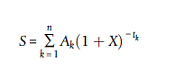

Konsumkreditgesetz (KKG) vom 24. November 2011 Dem nachstehenden vom Landtag gefassten Beschluss erteile Ich Meine Zustimmung: I. Allgemeine Bestimmungen Art. 1 Gegenstand und Zweck 1) Dieses Gesetz regelt die Rechte und Pflichten von Konsumenten, Kreditgebern und Kreditvermittlern in Zusammenhang mit Kreditverträgen und bezweckt den Schutz der Konsumenten sowie die Sicherstellung eines transparenten und effizienten Konsumkreditmarktes. 2) Es dient der Umsetzung der Richtlinie 2008/48/EG des Europäischen Parlaments und des Rates vom 23. April 2008 über Verbraucherkreditverträge und zur Aufhebung der Richtlinie 87/102/EWG des Rates (EWR-Rechtssammlung: Anh. XIX - 7h.07). Art. 2 Geltungsbereich 1) Dieses Gesetz gilt für Kreditverträge. 2) Es gilt nicht für: a) Kreditverträge, die entweder durch eine Hypothek oder durch eine in einem Mitgliedstaat des Europäischen Wirtschaftsraums (EWR-Mitgliedstaat) oder der Schweiz sonst für unbewegliches Vermögen übliche, vergleichbare Sicherheit oder durch ein Recht an unbeweglichem Vermögen gesichert sind; b) Kreditverträge, die für den Erwerb oder die Erhaltung von Eigentumsrechten an einem Grundstück oder einem bestehenden oder geplanten Gebäude bestimmt sind; c) Kreditverträge, bei denen der Gesamtkreditbetrag weniger als 300 Franken oder mehr als 120 000 Franken beträgt; d) Miet- oder Leasingverträge, bei denen weder in dem Vertrag selbst noch in einem gesonderten Vertrag eine Verpflichtung zum Erwerb des Miet- bzw. Leasinggegenstands vorgesehen ist; von einer solchen Verpflichtung ist auszugehen, wenn der Kreditgeber darüber einseitig entscheidet; e) Kreditverträge in Form von Überziehungsmöglichkeiten, bei denen der Kredit binnen eines Monats zurückzuzahlen ist; f) zins- und gebührenfreie Kreditverträge und Kreditverträge, nach denen der Kredit binnen drei Monaten zurückzuzahlen ist und bei denen nur geringe Kosten anfallen; g) Verträge über Kredite, die Arbeitnehmern vom Arbeitgeber als Nebenleistung zinsfrei oder zu einem niedrigeren effektiven Jahreszins als dem marktüblichen gewährt werden und die nicht der breiten Öffentlichkeit angeboten werden; h) Kreditverträge, die mit einer Bank im Sinne des Bankengesetzes oder mit einer Wertpapierfirma im Sinne des Wertpapierfirmengesetzes geschlossen werden und die es einem Anleger erlauben sollen, ein Geschäft zu tätigen, das eines oder mehrere der in Anhang 1 Abschnitt C des Wertpapierfirmengesetzes genannten Finanzinstrumente betrifft, wenn die Bank oder Wertpapierfirma, die den Kredit gewährt, an diesem Geschäft beteiligt ist; i) Kreditverträge, die Ergebnis eines Vergleichs vor einem Richter oder einer anderen gesetzlich befugten Stelle sind; k) Kreditverträge, die die unentgeltliche Stundung einer bestehenden Forderung zum Gegenstand haben; l) Kreditverträge, nach deren Abschluss der Konsument zur Bestellung eines Fahrnispfandes als Sicherheit beim Kreditgeber verpflichtet ist und bei denen sich die Haftung des Konsumenten ausschliesslich auf dieses Fahrnispfand beschränkt; m) Kreditverträge, die Darlehen zum Gegenstand haben, die einem begrenzten Kundenkreis im Rahmen gesetzlicher Bestimmungen im Gemeinwohlinteresse gewährt werden, sei es zu einem niedrigeren als dem marktüblichen Zinssatz oder zinslos oder zu anderen, für den Konsumenten günstigeren als den marktüblichen Bedingungen und zu Zinssätzen, die nicht über den marktüblichen Zinssätzen liegen. 3) Auf Kreditverträge in Form einer kurzfristigen Überziehungsmöglichkeit, bei denen der Kredit nach Aufforderung oder binnen drei Monaten zurückzuzahlen ist, finden lediglich die Art. 1 bis 3, 4 Abs. 1 Bst. a bis c und Abs. 3, Art. 6 bis 9, 10 Abs. 1 und 4, Art. 11, 13, 16 und 18 sowie die Art. 20 bis 30 Anwendung. 4) Auf Kreditverträge in Form von Überschreitung finden lediglich die Art. 1 bis 3, 19 sowie 22 bis 30 Anwendung. 5) Auf Kreditverträge, die vorsehen, dass Kreditgeber und Konsumenten Vereinbarungen über Stundungs- oder Rückzahlungsmodalitäten treffen, wenn der Konsument seinen Verpflichtungen aus dem ursprünglichen Kreditvertrag nicht nachgekommen ist, finden lediglich die Art. 1 bis 4, 6, 7, 9, 10 Abs. 1, 2 Bst. a bis i, m und s sowie Abs. 4, Art. 12, 14, 17 sowie 19 bis 30 Anwendung, sofern: a) durch solche Vereinbarungen voraussichtlich ein Gerichtsverfahren wegen Nichterfüllung der Zahlungsverpflichtungen vermieden werden kann; und b) der Konsument dadurch im Vergleich zum ursprünglichen Kreditvertrag nicht schlechter gestellt wird. 6) Handelt es sich in den Fällen nach Abs. 5 um Kreditverträge in Form einer kurzfristigen Überziehungsmöglichkeit, so gelten nur die Bestimmungen von Abs. 3. Art. 3 Begriffsbestimmungen und Bezeichnungen 1) Im Sinne dieses Gesetzes gelten als: a) "Konsument": eine natürliche Person, die einen Kreditvertrag zu einem Zweck abschliesst, der nicht ihrer beruflichen oder gewerblichen Tätigkeit zugerechnet werden kann; b) "Kreditgeber": eine natürliche oder juristische Person, die in Ausübung ihrer gewerblichen oder beruflichen Tätigkeit einen Kredit gewährt oder zu gewähren verspricht; c) "Kreditvertrag" (Konsumkreditvertrag): ein Vertrag, bei dem ein Kreditgeber einem Konsumenten einen Kredit in Form eines Zahlungsaufschubs, eines Darlehens oder einer sonstigen ähnlichen Finanzierungshilfe gewährt oder zu gewähren verspricht; ausgenommen sind Verträge über die wiederkehrende Erbringung von Dienstleistungen oder über die Lieferung von Waren gleicher Art, bei denen der Konsument für die Dauer der Erbringung oder Lieferung Teilzahlungen für diese Dienstleistungen oder Waren leistet; d) "Überziehungsmöglichkeit": ein ausdrücklicher Kreditvertrag, bei dem der Kreditgeber dem Konsumenten Beträge zur Verfügung stellt, die das aktuelle Guthaben auf dem laufenden Konto des Konsumenten überschreiten; ist dieser Kredit nach Aufforderung oder binnen drei Monate zurückzuzahlen, handelt es sich um eine "kurzfristige Überziehungsmöglichkeit"; e) "Überschreitung": eine stillschweigend akzeptierte Überziehung, bei der der Kreditgeber dem Konsumenten Beträge zur Verfügung stellt, die das aktuelle Guthaben auf dem laufenden Konto des Konsumenten oder die vereinbarte Überziehungsmöglichkeit überschreiten; f) "Kreditvermittler": eine natürliche oder juristische Person, die nicht als Kreditgeber handelt und die in Ausübung ihrer gewerblichen oder beruflichen Tätigkeit gegen ein Entgelt, das aus einer Geldzahlung oder einem sonstigen vereinbarten wirtschaftlichen Vorteil bestehen kann: 1. Konsumenten Kreditverträge vorstellt oder anbietet; 2. Konsumenten bei anderen als den in Ziff. 1 genannten Vorarbeiten zum Abschluss von Kreditverträgen behilflich ist; oder 3. für den Kreditgeber Kreditverträge mit den Konsumenten abschliesst; g) "Gesamtkosten des Kredits für den Konsumenten": sämtliche Kosten, einschliesslich der Zinsen, Provisionen, Steuern und Kosten jeder Art - ausgenommen Beurkundungsgebühren -, die der Konsument im Zusammenhang mit dem Kreditvertrag zu zahlen hat und die dem Kreditgeber bekannt sind; Kosten für Nebenleistungen im Zusammenhang mit dem Kreditvertrag, insbesondere Versicherungsprämien, sind ebenfalls enthalten, wenn der Abschluss des Vertrags über diese Nebenleistung eine zusätzliche zwingende Voraussetzung dafür ist, dass der Kredit überhaupt oder nach den vorgesehenen Vertragsbedingungen gewährt wird; h) "vom Konsumenten zu zahlender Gesamtbetrag": die Summe des Gesamtkreditbetrags und der Gesamtkosten des Kredits für den Konsumenten; i) "effektiver Jahreszins": die Gesamtkosten des Kredits für den Konsumenten, die als jährlicher Prozentsatz des Gesamtkreditbetrags ausgedrückt sind, soweit zutreffend einschliesslich der Kosten nach Art. 20 Abs. 2 und 3; k) "Sollzinssatz": der als fester oder variabler periodischer Prozentsatz ausgedrückte Zinssatz, der auf jährlicher Basis auf die in Anspruch genommenen Kredit-Auszahlungsbeträge angewandt wird; l) "fester Sollzinssatz": ein Sollzinssatz, bei dem der Kreditgeber und der Konsument im Kreditvertrag einen einzigen Sollzinssatz für die gesamte Laufzeit des Kreditvertrags oder mehrere Sollzinssätze für verschiedene Teilzeiträume der Gesamtlaufzeit vereinbaren, wobei ausschliesslich ein bestimmter fester Prozentsatz zugrunde gelegt wird. Sind in dem Kreditvertrag nicht alle Sollzinssätze festgelegt, so gilt der Sollzinssatz nur für diejenigen Teilzeiträume der Gesamtlaufzeit als vereinbart, für die die Sollzinssätze ausschliesslich durch einen bei Abschluss des Kreditvertrags vereinbarten bestimmten festen Prozentsatz festgelegt wurden; m) "Gesamtkreditbetrag": die Obergrenze oder die Summe aller Beträge, die aufgrund eines Kreditvertrags zur Verfügung gestellt werden; n) "dauerhafter Datenträger": jedes Medium, das es dem Konsumenten gestattet, an ihn persönlich gerichtete Informationen derart zu speichern, dass er sie in der Folge für eine den Zwecken der Informationen angemessene Dauer einsehen kann, und das die unveränderte Wiedergabe der gespeicherten Informationen ermöglicht; o) "verbundener Kreditvertrag": ein Kreditvertrag, bei dem: 1. der betreffende Kredit ausschliesslich der Finanzierung eines Vertrags über Lieferung bestimmter Waren oder die Erbringung einer bestimmten Dienstleistung dient; und 2. diese beiden Verträge objektiv betrachtet eine wirtschaftliche Einheit bilden; von einer wirtschaftlichen Einheit ist auszugehen, wenn der Warenlieferant oder der Dienstleistungserbringer den Kredit zugunsten des Konsumenten finanziert oder wenn sich der Kreditgeber im Falle der Finanzierung durch einen Dritten bei der Vorbereitung oder dem Abschluss des Kreditvertrags der Mitwirkung des Warenlieferanten oder des Dienstleistungserbringers bedient oder wenn im Kreditvertrag ausdrücklich die spezifischen Waren oder die Erbringung einer spezifischen Dienstleistung angegeben sind. 2) Unter den in diesem Gesetz verwendeten Personen-, Funktions- und Berufsbezeichnungen sind Personen des männlichen und weiblichen Geschlechts zu verstehen. II. Informationspflichten und vorvertragliche Pflichten Art. 4 Standardinformationen, die in die Werbung aufzunehmen sind 1) Werden in der Werbung für Kreditverträge Zinssätze oder sonstige, auf die Kosten eines Kredits für den Konsumenten bezogene Zahlen genannt, so müssen diese Informationen in der Werbung die folgenden Elemente in klarer, prägnanter und auffallender Art und Weise anhand eines repräsentativen Beispiels enthalten: a) fester oder variabler Sollzinssatz oder fester und variabler Sollzinssatz, zusammen mit Einzelheiten aller für den Konsumenten anfallenden, in die Gesamtkreditkosten einbezogenen Kosten; b) Gesamtkreditbetrag; c) effektiver Jahreszins; ausgenommen sind Kreditverträge in Form einer kurzfristigen Überziehungsmöglichkeit; d) falls zutreffend, Laufzeit des Kreditvertrags; e) im Falle eines Kredits in Form eines Zahlungsaufschubs für eine bestimmte Ware oder Dienstleistung, Barzahlungspreis und Betrag etwaiger Anzahlungen; und f) gegebenenfalls vom Konsumenten zu zahlender Gesamtbetrag sowie der Betrag der Teilzahlungen. 2) Ist der Abschluss eines Vertrags über die Inanspruchnahme einer Nebenleistung, insbesondere eines Versicherungsvertrags, im Zusammenhang mit dem Kreditvertrag zwingende Voraussetzung dafür, dass der Kredit überhaupt oder nach den vorgesehenen Vertragsbedingungen gewährt wird, und können die Kosten der Nebenleistung nicht im Voraus bestimmt werden, so ist auf die Verpflichtung zum Abschluss jenes Vertrags ebenfalls in klarer, prägnanter Form an optisch hervorgehobener Stelle zusammen mit dem effektiven Jahreszinssatz hinzuweisen. 3) Vorbehalten bleiben die Bestimmungen des Gesetzes gegen den unlauteren Wettbewerb. Vorvertragliche Informationen Art. 5 a) Im Allgemeinen 1) Der Kreditgeber oder gegebenenfalls der Kreditvermittler hat dem Konsumenten rechtzeitig bevor dieser durch einen Kreditvertrag oder ein Angebot gebunden ist auf der Grundlage der vom Kreditgeber angebotenen Kreditbedingungen und gegebenenfalls der vom Konsumenten geäusserten Präferenzen und vorgelegten Auskünfte die Information zu erteilen, die der Konsument benötigt, um verschiedene Angebote zu vergleichen und eine fundierte Entscheidung darüber zu treffen, ob er einen Kreditvertrag schliessen will. Der Kreditgeber oder gegebenenfalls der Kreditvermittler hat dem Konsumenten die in Abs. 2 genannten Informationen auf Papier oder einem anderen dauerhaften Datenträger unter Verwendung des Formulars "Standardinformationen für Konsumkredite" nach Anhang 2 mitzuteilen. Die Informationspflichten des Kreditgebers gelten als erfüllt, wenn er das genannte Formular vorgelegt hat. 2) Die Informationen nach Abs. 1 müssen folgende Angaben enthalten: a) die Art des Kredits; b) die Identität und die Anschrift des Kreditgebers sowie gegebenenfalls die Identität und die Anschrift des beteiligten Kreditvermittlers; c) den Gesamtkreditbetrag und die Bedingungen für die Inanspruchnahme; d) die Laufzeit des Kreditvertrags; e) bei Krediten in Form eines Zahlungsaufschubs für eine bestimmte Ware oder Dienstleistung und bei verbundenen Kreditverträgen die Ware oder die Dienstleistung und den Barzahlungspreis; f) den Sollzinssatz, die Bedingungen für die Anwendung des Sollzinssatzes und, soweit vorhanden, Indizes oder Referenzzinssätze, die auf den anfänglichen Sollzinssatz Anwendung finden, ferner die Zeiträume, Bedingungen und die Art und Weise der Anpassung des Sollzinssatzes. Gelten unter bestimmten Umständen unterschiedliche Sollzinssätze, so sind die oben genannten Informationen für alle anzuwendenden Sollzinssätze zu erteilen; g) den effektiven Jahreszins und den vom Konsumenten zu zahlenden Gesamtbetrag, erläutert durch ein repräsentatives Beispiel unter Angabe sämtlicher in die Berechnung des Jahreszinses einfliessenden Annahmen; hat der Konsument dem Kreditgeber seine Wünsche in Bezug auf eines oder mehrere Elemente seines Kredits mitgeteilt, beispielsweise in Bezug auf die Laufzeit des Kreditvertrags oder den Gesamtkreditbetrag, so muss der Kreditgeber diese Elemente berücksichtigen; sofern ein Kreditvertrag unterschiedliche Verfahren der Inanspruchnahme mit jeweils unterschiedlichen Entgelten oder Sollzinssätzen vorsieht, und der Kreditgeber die Vermutung nach Anhang 1 Teil II Bst. b trifft, so weist er darauf hin, dass andere Mechanismen der Inanspruchnahme bei der Art des Kreditvertrags zu einem höheren effektiven Jahreszins führen können; h) den Betrag, die Anzahl und die Periodizität der vom Konsumenten zu leistenden Zahlungen und gegebenenfalls die Reihenfolge, in der die Zahlungen auf verschiedene ausstehende Restbeträge, für die unterschiedliche Sollzinssätze gelten, zum Zwecke der Rückzahlung angerechnet werden; i) gegebenenfalls die Entgelte für die Führung eines oder mehrerer Konten für die Buchung der Zahlungsvorgänge und der in Anspruch genommenen Kreditbeträge, es sei denn, die Eröffnung eines entsprechenden Kontos ist fakultativ, zusammen mit den Entgelten für die Verwendung eines Zahlungsmittels, mit dem sowohl Zahlungsvorgänge als auch Abhebungen getätigt werden können, sonstige Entgelte aufgrund des Kreditvertrags und die Bedingungen, unter denen diese Entgelte geändert werden können; k) falls zutreffend, den Hinweis auf vom Konsumenten bei Abschluss des Kreditvertrags zu zahlende Beurkundungsgebühren; l) gegebenenfalls die Verpflichtung, einen mit dem Kreditvertrag zusammenhängenden Vertrag, insbesondere über eine Versicherung, abzuschliessen, wenn der Abschluss eines solchen Vertrags Voraussetzung dafür ist, dass der Kredit überhaupt oder nach den vorgesehenen Vertragsbedingungen gewährt wird; m) den anwendbaren Satz der Verzugszinsen und die Art und Weise seiner etwaigen Anpassung sowie gegebenenfalls anfallende Verzugskosten; n) einen Warnhinweis zu den Folgen ausbleibender Zahlungen; o) die gegebenenfalls verlangten Sicherheiten; p) das Bestehen oder Nichtbestehen eines Widerrufsrechts; q) das Recht auf vorzeitige Rückzahlung und gegebenenfalls die Informationen zum Anspruch des Kreditgebers auf Entschädigung sowie zur Art der Berechnung dieser Entschädigung nach Art. 17; r) das Recht des Konsumenten auf unverzügliche und unentgeltliche Unterrichtung nach Art. 9 Abs. 2 über das Ergebnis einer Datenbankabfrage zur Beurteilung der Kreditwürdigkeit; s) das Recht des Konsumenten, auf Verlangen unentgeltlich eine Kopie des Kreditvertragsentwurfs zu erhalten. Diese Bestimmung gilt nicht, wenn der Kreditgeber zum Zeitpunkt der Beantragung nicht zum Abschluss eines Kreditvertrags mit dem Konsumenten bereit ist; und t) gegebenenfalls den Zeitraum, während dessen der Kreditgeber an die vorvertraglichen Informationen gebunden ist. 3) Etwaige zusätzliche Informationen des Kreditgebers für den Konsumenten sind in einem gesonderten Dokument zu erteilen, das dem betreffenden Formular "Standardinformationen für Konsumkredite" beigefügt werden kann. 3a) Wird im Kreditvertrag auf einen Referenzwert im Sinne des Art. 3 Abs. 1 Ziff. 3 der Verordnung (EU) 2016/1011 Bezug genommen, teilt der Kreditgeber oder gegebenenfalls der Kreditvermittler dem Konsumenten in einem eigenen Dokument, das der Standardinformation für Konsumkredite beigefügt werden kann, den Namen des Referenzwerts und seines Administrators sowie dessen mögliche Auswirkungen auf den Konsumenten mit. 4) Bei fernmündlicher Kommunikation im Sinne von Art. 6 des Fern-Finanzdienstleistungs-Gesetzes muss die zu liefernde Beschreibung der Hauptmerkmale der Finanzdienstleistung zumindest die in Abs. 2 Bst. c, d, e, f und h des vorliegenden Artikels vorgesehenen Angaben und den anhand eines repräsentativen Beispiels erläuterten effektiven Jahreszins sowie den vom Konsumenten zu zahlenden Gesamtbetrag enthalten. 5) Wurde der Vertrag auf Ersuchen des Konsumenten mittels eines Fernkommunikationsmittels geschlossen, das die Erteilung der Informationen nach Abs. 1 bis 3 nicht gestattet, insbesondere in dem in Abs. 4 genannten Fall, teilt der Kreditgeber dem Konsumenten unverzüglich nach Abschluss des Kreditvertrags die vollständigen vorvertraglichen Informationen unter Verwendung des Formulars "Standardinformationen für Konsumkredite" mit. 6) Auf Verlangen erhält der Konsument zusätzlich zu dem Formular "Standardinformationen für Konsumkredite" unentgeltlich eine Kopie des Kreditvertragsentwurfs. Diese Bestimmung gilt nicht, wenn der Kreditgeber zum Zeitpunkt der Beantragung nicht zum Abschluss eines Kreditvertrags mit dem Konsumenten bereit ist. 7) Dienen bei einem Kreditvertrag vom Konsumenten geleistete Zahlungen nicht der unmittelbaren Tilgung seiner Schuld im Verhältnis zum Gesamtkreditbetrag, sondern der Bildung von Kapital innerhalb der Zeiträume und zu den Bedingungen, die im Kreditvertrag oder in einem Zusatzvertrag zum Kreditvertrag vorgesehen sind, so muss aus den nach Abs. 1 bis 3 bereitgestellten vorvertraglichen Informationen klar und prägnant hervorgehen, dass der Kreditvertrag oder der Zusatzvertrag keine Garantie für die Rückzahlung des aufgrund des Kreditvertrags in Anspruch genommenen Gesamtbetrags vorsieht, es sei denn, eine solche Garantie wird gegeben. 8) Der Kreditgeber und gegebenenfalls der Kreditvermittler sind zudem verpflichtet, dem Konsumenten angemessene Erläuterungen zu geben, gegebenenfalls durch Erläuterung der vorvertraglichen Informationen nach Abs. 1 bis 3, der Hauptmerkmale der angebotenen Produkte und der möglichen spezifischen Auswirkungen der Produkte auf den Konsumenten, einschliesslich der Konsequenzen bei Zahlungsverzug des Konsumenten. Der Konsument soll dadurch beurteilen können, ob der Kreditvertrag seinen Bedürfnissen und seiner finanziellen Situation gerecht wird. Art. 6 b) Bestimmte Kreditverträge in Form von kurzfristigen Überziehungsmöglichkeiten und bestimmte, spezielle Kreditverträge 1) Der Kreditgeber und gegebenenfalls der Kreditvermittler hat dem Konsumenten, rechtzeitig bevor dieser durch einen Kreditvertrag oder ein Angebot im Sinne von Art. 2 Abs. 3, 5 und 6 gebunden ist, auf der Grundlage der vom Kreditgeber angebotenen Kreditbedingungen und gegebenenfalls der vom Konsumenten geäusserten Präferenzen und vorgelegten Auskünfte die Informationen zu erteilen, die der Konsument benötigt, um verschiedene Angebote zu vergleichen und eine fundierte Entscheidung darüber zu treffen, ob er einen Kreditvertrag schliessen will. 2) Die Informationen nach Abs. 1 müssen folgende Angaben enthalten: a) die Art des Kredits; b) die Identität und die Anschrift des Kreditgebers sowie gegebenenfalls die Identität und die Anschrift des beteiligten Kreditvermittlers; c) den Gesamtkreditbetrag; d) die Laufzeit des Kreditvertrags; e) den Sollzinssatz, die Bedingungen für die Anwendung des Sollzinssatzes sowie Indizes oder Referenzzinssätze, die auf den anfänglichen Sollzinssatz Anwendung finden; die vom Zeitpunkt des Vertragsabschlusses des Kreditvertrags an zu zahlenden Entgelte und gegebenenfalls die Bedingungen, unter denen diese Entgelte geändert werden können; f) den effektiven Jahreszins, erläutert anhand repräsentativer Beispiele unter Angabe sämtlicher in die Berechnung des Jahreszinses einfliessenden Annahmen; g) die Bedingungen und das Verfahren zur Beendigung des Kreditvertrags; h) bei Kreditverträgen in Form von kurzfristigen Überziehungsmöglichkeiten gegebenenfalls den Hinweis, dass der Konsument jederzeit zur Rückzahlung des gesamten Kreditbetrags aufgefordert werden kann; i) den Zinssatz, der im Verzugsfall Anwendung findet, und die Art und Weise seiner etwaigen Anpassung sowie gegebenenfalls anfallende Verzugskosten; k) das Recht des Konsumenten auf unverzügliche und unentgeltliche Unterrichtung nach Art. 9 Abs. 2 über das Ergebnis einer Datenbankabfrage zur Beurteilung der Kreditwürdigkeit; l) bei Kreditverträgen in Form einer kurzfristigen Überziehungsmöglichkeit Angaben zu den ab Abschluss des Kreditvertrags einschlägigen Kosten und, sofern zutreffend, die Bedingungen, nach denen diese Kosten geändert werden können; und m) gegebenenfalls den Zeitraum, während dessen der Kreditgeber an die vorvertraglichen Informationen gebunden ist. 3) Der Kreditgeber oder gegebenenfalls der Kreditvermittler hat dem Konsumenten die in Abs. 2 genannten Informationen auf Papier oder einem anderen dauerhaften Datenträger - alle in gleicher Weise hervorgehoben - mitzuteilen. Dies kann unter Verwendung des Formulars "Standardinformationen für Überziehungskredite und Umschuldungen" nach Anhang 3 geschehen. Die Informationspflichten des Kreditgebers gelten als erfüllt, wenn er das genannte Formular vorgelegt hat. 4) Bei Kreditverträgen in Form einer kurzfristigen Überziehungsmöglichkeit muss bei den vorvertraglichen Informationspflichten kein effektiver Jahreszins angegeben werden. 5) Bei Kreditverträgen, die vorsehen, dass Kreditgeber und Konsument Vereinbarungen über Stundungs- oder Rückzahlungsmodalitäten treffen, wenn der Konsument seinen Verpflichtungen aus dem ursprünglichen Kreditvertrag nicht nachgekommen ist, ist der Konsument auch über Folgendes zu informieren: a) den Betrag, die Anzahl und die Periodizität der vom Konsument zu leistenden Zahlungen und gegebenenfalls die Reihenfolge, in der die Zahlungen auf verschiedene ausstehende Restbeträge, für die unterschiedliche Sollzinssätze gelten, zum Zwecke der Rückzahlung angerechnet werden; und b) das Recht auf vorzeitige Rückzahlung und gegebenenfalls die Informationen zum Anspruch des Kreditgebers auf Entschädigung sowie zur Art der Festlegung dieser Entschädigung. 6) Handelt es sich in den Fällen nach Abs. 5 um Kreditverträge in Form einer kurzfristigen Überziehungsmöglichkeit, dann gelten nur die in Abs. 1 bis 3 genannten Bestimmungen 7) Bei fernmündlicher Kommunikation oder falls der Konsument verlangt, dass die Überziehungsmöglichkeit sofort zur Verfügung steht, muss die Beschreibung der Hauptmerkmale der Finanzdienstleistung zumindest die in Abs. 2 Bst. c, e, f und h vorgesehenen Angaben enthalten. Im Falle von Kreditverträgen im Sinne von Abs. 5 muss die Beschreibung der Hauptmerkmale ausserdem eine Bestimmung der Laufzeit des Kreditvertrags enthalten. 8) Ungeachtet der Ausnahmeregelung des Art. 2 Abs. 2 Bst. e sind für Kreditverträge in Form einer Überziehungsmöglichkeit, bei denen der Kredit innerhalb eines Monats zurückzuzahlen ist, zumindest die Anforderungen des Abs. 7 Satz 1 einzuhalten. 9) Auf Verlangen erhält der Konsument zusätzlich zu den in den Abs. 1 bis 7 genannten Informationen unentgeltlich eine Kopie des Kreditvertragsentwurfs mit den vertraglichen Informationen nach Art. 10 und 11, sofern diese Anwendung finden. Diese Bestimmung gilt nicht, wenn der Kreditgeber zum Zeitpunkt der Beantragung nicht zum Abschluss eines Kreditvertrags mit dem Konsumenten bereit ist. 10) In dem Fall, dass der Vertrag auf Ersuchen des Konsumenten mittels eines Fernkommunikationsmittels geschlossen wurde, das die Erteilung der Informationen nach den Abs. 1 bis 3 und 5, einschliesslich der in Abs. 7 genannten Fälle, nicht gestattet, kommt der Kreditgeber unverzüglich nach Abschluss des Kreditvertrags seinen Verpflichtungen nach den Abs. 1 bis 3 und 5 nach, indem er dem Konsumenten die vertraglichen Informationen nach Art. 10 und 11, sofern diese Anwendung finden, vorlegt. Art. 7 c) Ausnahmen Die Pflicht zur Bereitstellung der vorvertraglichen Informationen nach Art. 5 und 6 gilt nicht für Warenlieferanten oder Dienstleistungserbringer, die nur in untergeordneter Funktion als Kreditvermittler beteiligt sind. Die Verpflichtung des Kreditgebers, dem Konsumenten die verlangten vorvertraglichen Informationen mitzuteilen, wird hiervon nicht berührt. Art. 8 Bewertung der Kreditwürdigkeit des Konsumenten 1) Der Kreditgeber muss vor Vertragsabschluss die Kreditwürdigkeit des Konsumenten anhand ausreichender Informationen bewerten, die er gegebenenfalls vom Konsumenten verlangt; erforderlichenfalls hat er auch Auskünfte aus einer zur Verfügung stehenden Datenbank einzuholen. 2) Sofern die Vertragsparteien vereinbaren, den Gesamtkreditbetrag nach Abschluss des Kreditvertrages zu ändern, hat der Kreditgeber die ihm zur Verfügung stehenden Finanzinformationen über den Konsumenten auf den neuen Stand zu bringen und die Kreditwürdigkeit des Konsumenten vor jeder deutlichen Erhöhung des Gesamtkreditbetrags zu bewerten. III. Zugang zu Datenbanken Art. 9 Zugang zu Datenbanken bei grenzüberschreitenden Krediten 1) Bei grenzüberschreitenden Krediten ist der Zugang zu Datenbanken, die zur Bewertung der Kreditwürdigkeit von Konsumenten verwendet werden, ohne Diskriminierung auch Kreditgebern aus anderen EWR-Mitgliedstaaten oder der Schweiz zu gewähren. 2) Lehnt ein Kreditgeber einen Kreditantrag aufgrund einer Datenbankabfrage ab, so unterrichtet er den Konsumenten unverzüglich und unentgeltlich über das Ergebnis dieser Abfrage und über die Angaben der betreffenden Datenbank. Die Unterrichtung hat zu unterbleiben, wenn sie nach anderen Rechtsvorschriften unzulässig ist oder die öffentliche Ordnung oder Sicherheit gefährdet. 3) Aufgehoben IV. Information und Rechte aus Kreditverträgen Zwingende Angaben in Kreditverträgen Art. 10 a) Im Allgemeinen 1) Unbeschadet der Wirksamkeit des Rechtsgeschäfts sind Kreditverträge auf Papier oder auf einem anderen dauerhaften Datenträger zu erstellen. Der Kreditgeber hat allen Vertragsparteien nach Vertragsabschluss eine Kopie des Kreditvertrags zur Verfügung zu stellen. 2) Der Kreditvertrag muss in klarer und prägnanter Form folgende Angaben enthalten: a) die Art des Kredits; b) die Identität und Adressen der Vertragsparteien sowie gegebenenfalls die Identität und die Adresse des beteiligten Kreditvermittlers; c) die Laufzeit des Kreditvertrags; d) den Gesamtkreditbetrag und die Bedingungen für die Inanspruchnahme; e) bei Krediten in Form eines Zahlungsaufschubs für eine bestimmte Ware oder Dienstleistung oder bei verbundenen Kreditverträgen die Ware oder die Dienstleistung und den Barzahlungspreis; f) den Sollzinssatz, die Bedingungen für die Anwendung des Sollzinssatzes und, soweit vorhanden, Indizes oder Referenzzinssätze, die sich auf den anfänglichen Sollzinssatz beziehen, ferner die Zeiträume, Bedingungen und die Art und Weise der Anpassung des Sollzinssatzes; gelten unter verschiedenen Umständen unterschiedliche Sollzinssätze, so sind die genannten Informationen für alle anzuwendenden Sollzinssätze zu erteilen; g) den effektiven Jahreszins und der vom Konsument zu zahlende Gesamtbetrag, berechnet zum Zeitpunkt des Abschlusses des Kreditvertrages; anzugeben sind alle in die Berechnung dieses Zinses einfliessenden Annahmen; h) den Betrag, die Anzahl und die Periodizität der vom Konsumenten zu leistenden Zahlungen und gegebenenfalls die Reihenfolge, in der die Zahlungen auf verschiedene ausstehende Restbeträge, für die unterschiedliche Sollzinssätze gelten, zum Zwecke der Rückzahlung angerechnet werden; i) im Falle der Darlehenstilgung bei einem Kreditvertrag mit fester Laufzeit das Recht des Konsumenten auf Antrag kostenlos und zu jedem beliebigen Zeitpunkt während der Gesamtlaufzeit des Kreditvertrags eine Aufstellung in Form eines Tilgungsplans zu erhalten. Aus dem Tilgungsplan geht hervor, welche Zahlungen in welchen Zeitabständen zu leisten sind und welche Bedingungen für diese Zahlungen gelten; in dem Plan sind die einzelnen periodischen Rückzahlungen nach der Darlehenstilgung, den nach dem Sollzinssatz berechneten Zinsen und gegebenenfalls allen zusätzlichen Kosten aufzuschlüsseln; im Falle eines Kreditvertrags, bei dem kein fester Zinssatz vereinbart wurde oder die zusätzlichen Kosten geändert werden können, ist in dem Tilgungsplan in klarer und prägnanter Form anzugeben, dass die Daten im Tilgungsplan nur bis zur nächsten Änderung des Sollzinssatzes oder der zusätzlichen Kosten gemäss dem Kreditvertrag Gültigkeit haben; k) sofern die Zahlung von Entgelten und Zinsen ohne Kapitaltilgung vorgesehen ist, eine Aufstellung der Zeiträume und Bedingungen für die Zahlung der Sollzinsen und der damit verbundenen wiederkehrenden und nicht wiederkehrenden Entgelte; l) gegebenenfalls die Entgelte für die Führung eines oder mehrerer Konten für die Buchung der Zahlungsvorgänge und der in Anspruch genommenen Kreditbeträge, es sei denn, die Eröffnung eines Kontos ist fakultativ, zusammen mit den Entgelten für die Verwendung eines Zahlungsmittels, mit dem sowohl Zahlungsvorgänge als auch Abhebungen getätigt werden können, sonstige Entgelte aufgrund des Kreditvertrags und die Bedingungen, unter denen diese Entgelte geändert werden können; m) den Satz der Verzugszinsen gemäss der zum Zeitpunkt des Abschlusses des Kreditvertrags geltenden Regelung und die Art und Weise seiner etwaigen Anpassung sowie gegebenenfalls anfallende Verzugskosten; n) einen Warnhinweis zu den Folgen ausbleibender Zahlungen; o) soweit zutreffend, einen Hinweis auf anfallende Beurkundungsgebühren; p) gegebenenfalls die verlangten Sicherheiten und Versicherungen; q) das Bestehen oder Nichtbestehen eines Widerrufsrechts sowie die Frist und die anderen Modalitäten für die Ausübung des Widerrufsrechts, einschliesslich der Angaben zu der Verpflichtung des Konsumenten, das in Anspruch genommene Kapital zurückzuzahlen, den Zinsen nach Art. 15 Abs. 4 und der Höhe der Zinsen pro Tag; r) Informationen über die aus Art. 16 erwachsenden Rechte und über die Bedingungen für die Ausübung dieser Rechte; s) das Recht auf vorzeitige Rückzahlung, das Verfahren bei vorzeitiger Rückzahlung und gegebenenfalls Informationen zum Anspruch des Kreditgebers auf Entschädigung sowie zur Art der Berechnung dieser Entschädigung; t) die einzuhaltenden Modalitäten bei der Ausübung des Rechts auf Kündigung des Kreditvertrags; u) die Angabe, ob der Konsument Zugang zu einem aussergerichtlichen Beschwerde- und Rechtsbehelfsverfahren hat, und gegebenenfalls die Voraussetzungen für diesen Zugang; v) gegebenenfalls weitere Vertragsbedingungen; und w) gegebenenfalls den Namen und die Adresse der zuständigen Aufsichtsbehörde. 3) Im Falle der Darlehenstilgung bei einem Kreditvertrag mit fester Laufzeit, stellt der Kreditgeber dem Konsumenten kostenlos und zu jedem beliebigen Zeitpunkt während der Gesamtlaufzeit des Kreditvertrages eine Aufstellung in Form eines Tilgungsplans zur Verfügung. 4) Sofern bei einem Kreditvertrag vom Konsumenten geleistete Zahlungen nicht der unmittelbaren Tilgung seiner Schuld im Verhältnis zum Gesamtkreditbetrag dienen, sondern der Bildung von Kapital innerhalb der Zeiträume und zu den Bedingungen, die im Kreditvertrag oder in einem Zusatzvertrag zum Kreditvertrag vorgesehen sind, so muss aus den nach Abs. 2 bereitgestellten Informationen klar und prägnant hervorgehen, dass der Kreditvertrag oder der Zusatzvertrag keine Garantie für die Rückzahlung des aufgrund des Kreditvertrags in Anspruch genommenen Gesamtkreditbetrags vorsieht, es sei denn, eine solche Garantie wird gegeben. Art. 11 b) Kreditverträge in Form von kurzfristigen Überziehungsmöglichkeiten Bei Kreditverträgen in Form von kurzfristigen Überziehungsmöglichkeiten, muss der Kreditvertrag in klarer und prägnanter Form folgende Angaben enthalten: a) die Art des Kredits; b) die Identität und Adressen der Vertragsparteien sowie gegebenenfalls die Identität und die Adresse des beteiligten Kreditvermittlers; c) die Laufzeit des Kreditvertrags; d) den Gesamtkreditbetrag und die Bedingungen für die Inanspruchnahme; e) den Sollzinssatz, die Bedingungen für die Anwendung des Sollzinssatzes und, soweit vorhanden, Indizes oder Referenzzinssätze, die sich auf den anfänglichen Sollzinssatz beziehen, ferner die Zeiträume, Bedingungen und die Art und Weise der Anpassung des Sollzinssatzes und sofern unter verschiedenen Umständen unterschiedliche Sollzinssätze gelten, so sind die genannten Informationen für alle anzuwendenden Sollzinssätze zu erteilen; f) die Gesamtkosten des Kredites für den Konsumenten, berechnet zum Zeitpunkt des Abschlusses des Kreditvertrags; anzugeben sind alle in die Berechnung dieses Zinses einfliessenden Annahmen nach Art. 20 Abs. 2 und 3 in Verbindung mit Art. 3 Abs. 1 Bst. g und i; g) den Hinweis, dass der Konsument jederzeit zur Rückzahlung des gesamten Kreditbetrags aufgefordert werden kann; h) die einzuhaltenden Modalitäten bei der Ausübung des Rechts auf Kündigung des Kreditvertrags; und i) Angaben über die vom Zeitpunkt des Vertragsabschlusses des Kreditvertrags an einschlägigen Entgelte und soweit zutreffend die Bedingungen, unter denen diese Entgelte geändert werden können. Art. 12 Angaben zum Sollzinssatz 1) Der Konsument ist über eine allfällige Änderung des Sollzinssatzes auf Papier oder auf einem anderen dauerhaften Datenträger zu informieren, bevor die Änderung wirksam wird. 2) Die Information muss den Betrag der nach dem Wirksamwerden des neuen Sollzinssatzes zu leistenden Zahlungen enthalten. Ändern sich die Anzahl oder die Periodizität der zu leistenden Zahlungen, so sind auch hierzu Einzelheiten anzugeben. 3) Die Vertragsparteien können jedoch im Kreditvertrag vereinbaren, dass die Information nach Abs. 1 und 2 dem Konsumenten in regelmässigen Abständen erteilt wird, wenn die Änderung des Sollzinssatzes auf eine Änderung eines Referenzzinssatzes zurückgeht, der neue Referenzzinssatz auf geeignete Weise öffentlich zugänglich gemacht wird und die Information über den neuen Referenzzinssatz ausserdem in den Geschäftsräumen des Kreditgebers eingesehen werden kann. Art. 13 Verpflichtungen bei Kreditverträgen in Form einer Überziehungsmöglichkeit 1) Wird einem Konsumenten ein Kredit in Form einer Überziehungsmöglichkeit gewährt, so muss der Kreditgeber den Konsumenten regelmässig mittels eines Kontoauszugs auf Papier oder auf einem anderen dauerhaften Datenträger informieren über: a) den genauen Zeitraum, auf den sich der Kontoauszug bezieht; b) die in Anspruch genommenen Beträge und das Datum der Inanspruchnahme; c) den Saldo sowie das Datum des letzten Kontoauszugs; d) den neuen Saldo; e) das jeweilige Datum und den jeweiligen Betrag der Zahlungen des Konsumenten; f) den angewandten Sollzinssatz; g) etwaige erhobene Entgelte; und h) den gegebenenfalls zu zahlenden Mindestbetrag. 2) Darüber hinaus ist der Konsument über allfällige Erhöhungen des Sollzinssatzes oder der erhobenen Entgelte auf Papier oder auf einem anderen dauerhaften Datenträger zu informieren, bevor die Änderung wirksam wird. 3) Die Vertragsparteien können jedoch im Kreditvertrag vereinbaren, dass die Information über die Änderung des Sollzinssatzes nach Massgabe des Abs. 1 zu erteilen ist, wenn diese Änderung auf eine Änderung eines Referenzzinssatzes zurückgeht, der neue Referenzzinssatz auf geeignete Weise öffentlich zugänglich gemacht wird und die Information über den neuen Referenzzinssatz ausserdem in den Geschäftsräumen des Kreditgebers eingesehen werden kann. Art. 14 Unbefristete Kreditverträge 1) Der Konsument kann einen unbefristeten Kreditvertrag jederzeit unentgeltlich ordentlich kündigen, es sei denn, die Parteien haben eine Kündigungsfrist vereinbart. Die Kündigungsfrist darf einen Monat nicht überschreiten. 2) Sofern die Parteien im Kreditvertrag eine entsprechende Vereinbarung getroffen haben, kann der Kreditgeber einen unbefristeten Kreditvertrag unter Einhaltung einer Kündigungsfrist von mindestens zwei Monaten ordentlich kündigen; die Kündigung ist dem Konsumenten auf Papier oder auf einem anderen dauerhaften Datenträger mitzuteilen. 3) Sofern die Parteien im Kreditvertrag eine entsprechende Vereinbarung getroffen haben, kann der Kreditgeber aus sachlich gerechtfertigten Gründen dem Konsumenten das Recht auf Inanspruchnahme von Kreditbeträgen aufgrund eines unbefristeten Kreditvertrags entziehen. Der Kreditgeber muss den Konsumenten über die Entziehung und die Gründe hierfür möglichst vor, spätestens jedoch unverzüglich nach der Entziehung auf Papier oder auf einem anderen dauerhaften Datenträger informieren, es sei denn, eine solche Unterrichtung ist nach anderen Rechtsvorschriften unzulässig oder gefährdet die öffentliche Ordnung oder Sicherheit. Art. 15 Widerrufsrecht 1) Der Konsument kann den Kreditvertrag innerhalb von 14 Kalendertagen ohne Angabe von Gründen widerrufen. 2) Diese Widerrufsfrist beginnt: a) am Tag des Abschlusses des Kreditvertrags; oder b) an dem Tag, an dem der Konsument die Vertragsbedingungen und die Informationen nach Art. 10 und 11 erhält, sofern dieser nach dem in Bst. a genannten Datum liegt. 3) Sofern der Konsument sein Widerrufsrecht ausüben will, erklärt er den Widerruf, um diesen vor Ablauf der in Abs. 1 genannten Frist wirksam werden zu lassen, gegenüber dem Kreditgeber entsprechend den Informationen, die der Kreditgeber ihm nach Art. 10 Abs. 2 Bst. q gegeben hat. Die Ausübung des Widerrufsrechts bedarf zu ihrer Rechtswirksamkeit der Schriftform. Die Widerrufsfrist gilt als gewahrt, wenn diese Mitteilung, sofern sie auf Papier oder einem anderen dauerhaften Datenträger erfolgt, der dem Kreditgeber zur Verfügung steht und zu dem er Zugang hat, vor Fristablauf abgesandt wird. 4) Ist das Darlehen bereits vor dem Widerruf ausbezahlt worden, so hat der Konsument dem Kreditgeber unverzüglich, spätestens jedoch binnen 30 Kalendertagen nach Absendung der Widerrufserklärung an den Kreditgeber das Darlehen einschliesslich der ab dem Zeitpunkt der Inanspruchnahme des Kredits bis zum Zeitpunkt der Rückzahlung des Darlehens aufgelaufenen Zinsen zurückzuzahlen. Die Zinsen sind auf der Grundlage des vereinbarten Sollzinssatzes zu berechnen. Der Kreditgeber hat im Falle des Widerrufs keinen Anspruch auf weitere vom Konsumenten zu leistende Entschädigungen, mit Ausnahme von Entschädigungen für Entgelte, die der Kreditgeber an Behörden entrichtet hat und nicht zurückverlangen kann. 5) Wird eine Nebenleistung im Zusammenhang mit dem Kreditvertrag vom Kreditgeber oder von einem Dritten aufgrund einer Vereinbarung zwischen dem Dritten und dem Kreditgeber erbracht, so ist der Konsument nicht mehr an die Vereinbarung über die Nebenleistung gebunden, wenn er sein Recht auf Widerruf vom Kreditvertrag nach diesem Artikel ausübt. 6) Sofern der Konsument über ein Widerrufsrecht nach diesem Artikel verfügt, finden Art. 8 des Fern-Finanzdienstleistungs-Gesetzes und Art. 4 Abs. 1 bis 3 des Konsumentenschutzgesetzes im Falle von ausserhalb von Geschäftsräumen geschlossenen Verträgen keine Anwendung. 7) Allfällige Rechtsvorschriften, die eine Frist vorsehen, innerhalb deren die Ausführung des Vertrags nicht beginnen kann, werden von diesem Artikel nicht berührt. Art. 16 Verbundene Kreditverträge 1) Sofern der Konsument ein Recht auf Widerruf von einem Vertrag über die Lieferung von Waren oder die Erbringung von Dienstleistungen ausgeübt hat, ist er an einen damit verbundenen Kreditvertrag nicht mehr gebunden. 2) Werden die unter einen verbundenen Kreditvertrag fallenden Waren oder Dienstleistungen nicht oder nur teilweise geliefert oder entsprechen sie nicht dem Warenlieferungs- oder Dienstleistungsvertrag, so kann der Konsument seine Rechte gegen den Kreditgeber geltend machen, wenn er seine Rechte gegen den Lieferanten oder den Dienstleistungserbringer geltend gemacht hat, diese aber nicht durchsetzen konnte. Dabei müssen folgende Bedingungen erfüllt sein: a) Zwischen dem Kreditgeber und dem Lieferanten muss eine Abmachung bestehen, wonach Kredite an Kunden dieses Lieferanten ausschliesslich vom Kreditgeber gewährt werden. b) Der Konsument erhält den Kredit im Rahmen dieser Abmachungen. c) Die unter den Kreditvertrag fallenden Waren oder Dienstleistungen werden nicht oder nur teilweise geliefert oder entsprechen nicht dem Liefervertrag. 3) Abs. 1 und 2 gelten unbeschadet anderer Rechtsvorschriften, nach denen ein Kreditgeber gegenüber jeglichen Ansprüchen, die der Konsument gegen den Lieferanten oder den Dienstleistungserbringer haben könnte, als Gesamtschuldner verpflichtet ist, wenn der Erwerb von Waren oder Dienstleistungen vom Lieferanten über einen Kreditvertrag finanziert wird. Art. 17 Vorzeitige Rückzahlung 1) Der Konsument kann seine Verbindlichkeiten aus einem Kreditvertrag jederzeit ganz oder teilweise erfüllen. In solchen Fällen hat der Konsument das Recht auf Ermässigung der Gesamtkosten des Kredits, die sich nach den Zinsen und den Kosten für die verbleibende Laufzeit des Vertrags richtet. 2) Der Kreditgeber kann im Falle der vorzeitigen Rückzahlung des Kredits eine angemessene und objektiv gerechtfertigte Entschädigung für die entstandenen, unmittelbar mit der vorzeitigen Rückzahlung des Kredits zusammenhängenden Kosten verlangen, wenn die vorzeitige Rückzahlung in einen Zeitraum fällt, für den ein fester Sollzinssatz vereinbart wurde. 3) Die Entschädigung nach Abs. 2 darf 1 % des vorzeitig zurückgezahlten Kreditbetrags nicht überschreiten, wenn der Zeitraum zwischen der vorzeitigen Rückzahlung und dem Zeitpunkt des vereinbarten Ablaufs des Kreditvertrags ein Jahr überschreitet. Überschreitet der Zeitraum nicht ein Jahr, darf die Entschädigung 0,5 % des vorzeitig zurückgezahlten Kreditbetrags nicht überschreiten. 4) Eine Entschädigung für vorzeitige Rückzahlung darf nicht verlangt werden: a) wenn die Rückzahlung aufgrund eines Versicherungsvertrags erfolgt, der vereinbarungsgemäss die Rückzahlung des Kredits gewährleisten soll; b) im Falle von Überziehungsmöglichkeiten; oder c) wenn die Rückzahlung in einen Zeitraum fällt, für den kein fester Sollzinssatz vereinbart wurde. 5) Keinesfalls darf die Entschädigung den Zinsbetrag übersteigen, den der Konsument in der Zeit zwischen der vorzeitigen Rückzahlung und dem vereinbarten Ende der Laufzeit des Kreditvertrags bezahlt hätte. Art. 18 Forderungsabtretung 1) Werden die Ansprüche des Kreditgebers aus einem Kreditvertrag oder der Kreditvertrag selbst an einen Dritten abgetreten, so kann der Konsument dem neuen Gläubiger gegenüber die Einreden geltend machen, die ihm gegen den ursprünglichen Kreditgeber zustanden, und zwar einschliesslich der Aufrechnung von Gegenforderungen. 2) Der Kreditgeber hat den Konsumenten über die Abtretung nach Abs. 1 zu unterrichten, es sei denn, der ursprüngliche Kreditgeber tritt mit dem Einverständnis des Zessionars dem Konsumenten gegenüber nach wie vor als Kreditgeber auf. Art. 19 Überschreitung 1) Ein Vertrag über die Eröffnung eines laufenden Kontos, der dem Konsumenten die Möglichkeit der Überschreitung einräumt, muss zusätzlich die Informationen enthalten über: a) den Sollzinssatz, die Bedingungen für die Anwendung des Sollzinssatzes sowie Indizes oder Referenzzinssätze, die auf den anfänglichen Sollzinssatz Anwendung finden; und b) die vom Zeitpunkt des Vertragsabschlusses an zu zahlenden Entgelte und gegebenenfalls die Bedingungen, unter denen diese Entgelte geändert werden können. 2) Der Kreditgeber muss die Informationen nach Abs. 1 dem Konsumenten regelmässig auf Papier oder auf einem anderen dauerhaften Datenträger mitteilen. 3) Im Falle einer erheblichen Überschreitung für die Dauer von mehr als einem Monat hat der Kreditgeber den Konsumenten unverzüglich auf Papier oder auf einem anderen dauerhaften Datenträger zu informieren über: a) das Vorliegen einer Überschreitung; b) den betreffenden Betrag; c) den Sollzinssatz; und d) etwaige Vertragsstrafen, Entgelte oder Verzugszinsen. V. Effektiver Jahreszinses Art. 20 Berechnung des effektiven Jahreszinses 1) Der effektive Jahreszins, der auf Jahresbasis die Gleichheit zwischen den Gegenwartswerten der gesamten gegenwärtigen oder künftigen Verpflichtungen (in Anspruch genommene Kreditbeträge, Tilgungszahlungen und Entgelte) des Kreditgebers und des Konsumenten herstellt, ist nach der in Teil I des Anhangs 1 aufgeführten mathematischen Formel zu berechnen. 2) Für die Berechnung des effektiven Jahreszinses sind die Gesamtkosten des Kredits für den Konsumenten massgebend, mit Ausnahme der Kosten, die er bei Nichterfüllung einer seiner Verpflichtungen aus dem Kreditvertrag zu tragen hat, sowie der Kosten mit Ausnahme des Kaufpreises, die er beim Erwerb von Waren oder Dienstleistungen unabhängig davon zu tragen hat, ob es sich um ein Bar- oder ein Kreditgeschäft handelt. 3) Die Kosten für die Führung eines Kontos, auf dem sowohl Zahlungen als auch in Anspruch genommene Kreditbeträge verbucht werden, die Kosten für die Verwendung eines Zahlungsmittels, mit dem sowohl Zahlungen getätigt als auch Kreditbeträge in Anspruch genommen werden können, sowie sonstige Kosten für Zahlungsgeschäfte werden als Gesamtkosten des Kredits für den Konsumenten berücksichtigt, es sei denn, die Eröffnung des Kontos ist fakultativ und die mit dem Konto verbundenen Kosten sind im Kreditvertrag oder in einem anderen mit dem Konsumenten geschlossenen Vertrag klar und getrennt ausgewiesen. 4) Bei der Berechnung des effektiven Jahreszinses wird von der Annahme ausgegangen, dass der Kreditvertrag für den vereinbarten Zeitraum gilt und dass Kreditgeber und Konsument ihren Verpflichtungen unter den im Kreditvertrag niedergelegten Bedingungen und zu den dort niedergelegten Terminen nachkommen. 5) In Kreditverträgen mit Klauseln, nach denen der Sollzinssatz und gegebenenfalls die Entgelte, die im effektiven Jahreszins enthalten sind, deren Quantifizierung zum Zeitpunkt seiner Berechnung aber nicht möglich ist, geändert werden können, wird bei der Berechnung des effektiven Jahreszinses von der Annahme ausgegangen, dass der Sollzinssatz und die sonstigen Kosten gemessen an der ursprünglichen Höhe fest bleiben und bis zum Ende des Kreditvertrags gelten. 6) Erforderlichenfalls kann für die Berechnung von den in Anhang 1 genannten zusätzlichen Annahmen ausgegangen werden. VI. Kreditvermittler Art. 21 Bestimmte Pflichten des Kreditvermittlers 1) Der Kreditvermittler muss sowohl in seiner Werbung als auch in den für den Konsumenten bestimmten Unterlagen auf den Umfang seiner Befugnisse hinweisen und insbesondere deutlich machen, ob er ausschliesslich mit einem oder mehreren Kreditgebern oder als unabhängiger Kreditvermittler arbeitet. 2) Sofern der Konsument dem Kreditvermittler für dessen Dienste ein Entgelt zahlen muss, ist dieses dem Konsumenten bekannt zu geben und vor Abschluss des Kreditvertrages zwischen dem Konsumenten und dem Kreditvermittler auf Papier oder auf einem anderen dauerhaften Datenträger zu vereinbaren. 3) Gleichzeitig hat der Kreditvermittler das gegebenenfalls vom Konsumenten an ihn für seine Dienste zu zahlende Entgelt dem Kreditgeber zur Berechnung des effektiven Jahreszinses mitzuteilen. VII. Zwingendes Recht Art. 22 Unabdingbarkeit Von den Bestimmungen dieses Gesetzes darf nicht zu Ungunsten des Konsumenten abgewichen werden. VIII. Aussergerichtliche Streitbeilegung Art. 23 Schlichtungsstelle 1) Zur Beilegung von Streitfällen zwischen Kreditgebern oder Kreditvermittlern einerseits und Konsumenten andererseits bestimmt die Regierung mit Verordnung eine Schlichtungsstelle. 2) Die Schlichtungsstelle hat zur Aufgabe, im Streitfall zwischen den Parteien auf geeignete Weise zu vermitteln und auf diese Weise eine Einigung zwischen den Parteien herbeizuführen. 3) Kann keine Einigung zwischen den Parteien erzielt werden, so sind sie auf den ordentlichen Rechtsweg zu verweisen. 4) Bei grenzüberschreitenden Streitigkeiten arbeitet die Schlichtungsstelle mit Schlichtungsstellen anderer betroffener EWR-Mitgliedstaaten sowie der Schweiz zusammen. 5) Die Regierung regelt das Nähere, insbesondere die organisatorische Ausgestaltung, die Zusammensetzung und das Verfahren, mit Verordnung. IX. Zivilrechtliche Wirkungen Art. 24 Nichtigkeit 1) Die Nichteinhaltung der Art. 10, 11, 13 und 19 bewirkt die Nichtigkeit des Kreditvertrages. 2) Ist der Kreditvertrag nichtig, so hat der Konsument die bereits empfangene oder beanspruchte Kreditsumme bis zum Ablauf der Kreditdauer zurückzuzahlen, schuldet aber weder Zinsen noch Kosten. 3) Der Kredit ist in gleich hohen Teilzahlungen zurückzuzahlen, die, wenn der Vertrag keine längeren Zeitabstände vorsieht, jeweils einen Monat auseinander liegen. X. Strafbestimmungen Art. 25 Übertretungen 1) Vom Amt für Volkswirtschaft wird, sofern die Tat nicht den Tatbestand einer in die Zuständigkeit der Gerichte fallenden strafbaren Handlung bildet oder nach anderen Verwaltungsstrafbestimmungen mit strengerer Strafe bedroht ist, wegen Übertretung mit Busse bis 5 000 Franken, im Wiederholungsfalle bis 20 000 Franken, bestraft, wer: a) Kredite ohne die nach Art. 4 erforderlichen oder mit falschen Angaben bewirbt; b) in die nach Art. 5 und 6 gebotenen vorvertraglichen Information falsche Angaben aufnimmt oder die Informationspflichten nach Art. 5 und 6 nicht oder nicht vollständig erfüllt; c) die Kreditwürdigkeit des Konsumenten nicht entsprechend dem Art. 8 Abs. 1 bewertet; d) nicht alle nach Art. 10 und 11 vorgesehenen oder falsche Angaben in einen Kreditvertrag aufnimmt; e) nicht entsprechend Art. 12 über eine Änderung des Sollzinssatzes informiert; f) bei einem Konto mit Überschreitungsmöglichkeit in die nach Art. 13 und 19 gebotenen Informationen falsche Angaben aufnimmt oder die Informationspflichten nach Art. 13 und 19 nicht oder nicht vollständig erfüllt; g) als Kreditvermittler die Pflichten nach Art. 21 nicht erfüllt. 2) Das Amt für Volkswirtschaft informiert die für die Beaufsichtigung von Kreditgebern oder -vermittlern zuständigen Behörden über die Verhängung von Strafen nach Abs. 1. Art. 26 Verantwortlichkeit Werden die Widerhandlungen im Geschäftsbetrieb einer juristischen Person oder einer Kollektiv- oder Kommanditgesellschaft oder Einzelfirma begangen, finden die Strafbestimmungen auf die Personen Anwendung, die für sie gehandelt haben oder hätten handeln sollen, jedoch unter solidarischer Mithaftung der juristischen Person, der Gesellschaft oder der Einzelfirma für die Geldstrafen, Bussen und Kosten. Xa. Datenschutz Verarbeitung personenbezogener Daten Art. 26a a) durch Kreditgeber und Kreditvermittler 1) Kreditgeber und Kreditvermittler dürfen personenbezogene Daten, einschliesslich personenbezogener Daten über strafrechtliche Verurteilungen und Straftaten, über Kreditnehmer verarbeiten, die sie im Zusammenhang mit dem Abschluss oder der Vermittlung eines Kreditvertrages benötigen. 2) Kreditgeber und Kreditvermittler müssen geeignete Massnahmen ergreifen, um sicherzustellen, dass insbesondere die Grundsätze für die Verarbeitung personenbezogener Daten nach der Datenschutzgesetzgebung eingehalten werden. Art. 26b b) durch das Amt für Volkswirtschaft 1) Das Amt für Volkswirtschaft darf personenbezogene Daten, einschliesslich personenbezogener Daten über strafrechtliche Verurteilungen und Straftaten, über Kreditgeber, -vermittler und -nehmer verarbeiten, soweit dies zur Erfüllung seiner Aufgaben nach diesem Gesetz erforderlich ist. 2) Das Amt für Volkswirtschaft darf Daten nach Abs. 1 an andere zuständige Stellen und Behörden sowie Gerichte und die Staatsanwaltschaft übermitteln, sofern diese die Daten für die Erfüllung ihrer gesetzlichen Aufgaben benötigen. XI. Übergangs- und Schlussbestimmungen Art. 27 Durchführungsverordnungen Die Regierung erlässt die zur Durchführung dieses Gesetzes notwendigen Verordnungen. Art. 28 Übergangsbestimmungen 1) Auf Verträge, die vor dem Zeitpunkt des Inkrafttretens dieses Gesetzes abgeschlossen worden sind, findet das bisherige Recht Anwendung. 2) Auf bereits laufende unbefristete Kreditverträge sind die Art. 12 bis 14, 18 sowie 19 Abs. 2 und 3 bis spätestens sechs Monate nach Inkrafttreten dieses Gesetzes anzuwenden. Art. 29 Aufhebung bisherigen Rechts Es werden aufgehoben: a) Gesetz vom 22. Oktober 1992 über den Konsumkredit, LGBl. 1993 Nr. 50; b) Gesetz vom 14. September 1994 betreffend die Abänderung des Gesetzes über den Konsumkredit, LGBl. 1994 Nr. 67; c) Gesetz vom 26. November 1999 betreffend die Abänderung des Gesetzes über den Konsumkredit, LGBl. 2000 Nr. 18. Art. 30 Inkrafttreten Dieses Gesetz tritt am 1. Mai 2012 in Kraft. In Stellvertretung des Landesfürsten: gez. Alois Erbprinz gez. Dr. Klaus Tschütscher Fürstlicher Regierungschef Anhang 1 Ermittlung des effektiven Jahreszinses I. Grundgleichung zur Darstellung der Gleichheit zwischen Kredit-Auszahlungsbeträgen einerseits und Rückzahlungen (Tilgung und Kreditkosten) andererseits 1) Die nachstehende Gleichung zur Ermittlung des effektiven Jahreszinses drückt auf jährlicher Basis die rechnerische Gleichheit zwischen der Summe der Gegenwartswerte der in Anspruch genommenen Kredit-Auszahlungsbeträge einerseits und der Summe der Gegenwartswerte der Rückzahlungen (Tilgung und Kosten) andererseits aus: 

 Dabei ist: - X der effektive Jahreszins; - m die laufende Nummer des letzten Kredit-Auszahlungsbetrags; - k die laufende Nummer eines Kredit-Auszahlungsbetrags, wobei 1 ≤ k ≤ m; - C k die Höhe des Kredit-Auszahlungsbetrags mit der Nummer k; - t k der in Jahren oder Jahresbruchteilen ausgedrückte Zeitraum zwischen der ersten Darlehensgabe und dem Zeitpunkt der einzelnen nachfolgenden in Anspruch genommenen Kredit-Auszahlungsbeträge, wobei t 1 = 0 ; - m’ die laufende Nummer der letzten Tilgungs- oder Kostenzahlung; - l die laufende Nummer einer Tilgungs- oder Kostenzahlung; - D l der Betrag einer Tilgungs- oder Kostenzahlung; - s l der in Jahren oder Jahresbruchteilen ausgedrückte Zeitraum zwischen dem Zeitpunkt der Inanspruchnahme des ersten Kredit-Auszahlungsbetrags und dem Zeitpunkt jeder einzelnen Tilgungs- oder Kostenzahlung. 2) Bei der Berechnung ist Folgendes zu berücksichtigen: a) Die von beiden Seiten zu unterschiedlichen Zeitpunkten gezahlten Beträge sind nicht notwendigerweise gleich gross und werden nicht notwendigerweise in gleichen Zeitabständen entrichtet. b) Anfangszeitpunkt ist der Tag der Auszahlung des ersten Kreditbetrags. c) Der Zeitraum zwischen diesen Zeitpunkten wird in Jahren oder Jahresbruchteilen ausgedrückt. Zugrunde gelegt werden für ein Jahr 365 Tage (bzw. für ein Schaltjahr 366 Tage), 52 Wochen oder zwölf Standardmonate. Ein Standardmonat hat 30,41666 Tage (d. h. 365/12), unabhängig davon, ob es sich um ein Schaltjahr handelt oder nicht. d) Das Rechenergebnis wird auf mindestens eine Dezimalstelle genau angegeben. Ist die Ziffer der darauf folgenden Dezimalstelle grösser als oder gleich 5, so erhöht sich die Ziffer der ersten Dezimalstelle um den Wert 1. e) Mathematisch darstellen lässt sich diese Gleichung durch eine einzige Summation unter Verwendung des Faktors "Ströme" (Ak), die entweder positiv oder negativ sind, je nachdem, ob sie für Auszahlungen oder für Rückzahlungen innerhalb der Perioden 1 bis k, ausgedrückt in Jahren, stehen: 

 dabei ist S der Saldo der Gegenwartswerte aller "Ströme", deren Wert gleich Null sein muss, damit die Gleichheit zwischen den "Strömen" gewahrt bleibt. II. Zusätzliche Annahmen für die Berechnung des effektiven Jahreszinses 1) Ist es dem Konsumenten nach dem Kreditvertrag freigestellt, wann er den Kredit in Anspruch nehmen will, so gilt der gesamte Kredit als sofort in voller Höhe in Anspruch genommen. 2) Sieht der Kreditvertrag verschiedene Arten der Inanspruchnahme mit unterschiedlichen Kosten oder Sollzinssätzen vor, so gilt der gesamte Kredit als zu den höchsten Kosten und zum höchsten Sollzinssatz in Anspruch genommen, wie sie für die Kategorie von Geschäften gelten, die bei dieser Kreditvertragsart am häufigsten vorkommt. 3) Ist es dem Konsumenten nach dem Kreditvertrag generell freigestellt, wann er den Kredit in Anspruch nehmen will, sind jedoch je nach Art der Inanspruchnahme Beschränkungen in Bezug auf Betrag und Zeitraum vorgesehen, so gilt der gesamte Kredit als zu dem im Kreditvertrag vorgesehenen frühestmöglichen Zeitpunkt mit den entsprechenden Beschränkungen in Anspruch genommen. 4) Bei unbefristeten Kreditverträgen, die keine Überziehungsmöglichkeiten sind, wird angenommen, dass: a) der Kredit ab der ersten Inanspruchnahme für einen Zeitraum von einem Jahr gewährt wird und dass mit der letzten Zahlung des Konsumenten der Saldo, die Zinsen und etwaige sonstige Kosten ausgeglichen sind; b) der Kreditbetrag in gleich hohen monatlichen Zahlungen, beginnend einen Monat nach dem Zeitpunkt der ersten Inanspruchnahme zurückgezahlt wird. Muss der Kreditbetrag jedoch vollständig, in Form einer einmaligen Zahlung, innerhalb jedes Zahlungszeitraums zurückgezahlt werden, so wird angenommen, dass spätere Inanspruchnahmen und Rückzahlungen des gesamten Kreditbetrags durch den Konsumenten innerhalb eines Jahres stattfinden. Zinsen und sonstige Kosten werden entsprechend diesen Inanspruchnahmen und Tilgungszahlungen und nach den Bestimmungen des Kreditvertrags festgelegt. Als unbefristete Kreditverträge gelten Kreditverträge ohne feste Laufzeit, einschliesslich solcher Kredite, bei denen der Kreditbetrag innerhalb oder nach Ablauf eines Zeitraums vollständig zurückgezahlt werden muss, dann aber erneut in Anspruch genommen werden kann. 5) Bei anderen Kreditverträgen, die weder Überziehungsmöglichkeiten noch unbefristete Kredite sind (siehe die Annahmen unter Abs. 4 und 8), gilt Folgendes: a) Lassen sich der Zeitpunkt oder die Höhe einer vom Konsumenten zu leistenden Tilgungszahlung nicht feststellen, so wird angenommen, dass die Rückzahlung zu dem im Kreditvertrag genannten frühestmöglichen Zeitpunkt und in der darin festgelegten geringsten Höhe erfolgt. b) Ist der Zeitpunkt des Abschlusses des Kreditvertrags nicht bekannt, so wird angenommen, dass der Kredit erstmals zu dem Zeitpunkt in Anspruch genommen wurde, der sich aus dem kürzesten zeitlichen Abstand zwischen diesem Zeitpunkt und der Fälligkeit der ersten vom Konsumenten zu leistenden Zahlung ergibt. 6) Lassen sich der Zeitpunkt oder die Höhe einer vom Konsumenten zu leistenden Tilgungszahlung nicht anhand des Kreditvertrags oder der Annahmen nach den Abs. 4, 5 oder 8 feststellen, so wird angenommen, dass die Zahlung in Übereinstimmung mit den vom Kreditgeber bestimmten Fristen und Bedingungen erfolgt, und dass, falls diese nicht bekannt sind: a) die Zinszahlungen zusammen mit den Tilgungszahlungen erfolgen; b) Zahlungen für Kosten, die keine Zinsen sind und die als Einmalbetrag ausgedrückt sind, bei Abschluss des Kreditvertrags erfolgen; c) Zahlungen für Kosten, die keine Zinsen sind und die als Mehrfachzahlungen ausgedrückt sind, beginnend mit der ersten Tilgungszahlung in regelmässigen Abständen erfolgen, und es sich, falls die Höhe dieser Zahlungen nicht bekannt ist, um jeweils gleich hohe Beträge handelt; d) mit der letzten Zahlung der Saldo, die Zinsen und etwaige sonstige Kosten ausgeglichen sind. 7) Wurde noch keine Kreditobergrenze vereinbart, so wird eine Obergrenze in Höhe von 2 250 Franken angenommen. 8) Im Fall einer Überziehungsmöglichkeit gilt der gesamte Kredit als in voller Höhe und für die gesamte Laufzeit des Kreditvertrags in Anspruch genommen. Ist die Laufzeit des Kreditvertrags nicht bekannt, so wird bei der Berechnung des effektiven Jahreszinses von der Annahme ausgegangen, dass die Laufzeit des Kreditvertrags drei Monate beträgt. 9) Werden für einen begrenzten Zeitraum oder Betrag verschiedene Zinssätze und Kosten angeboten, so werden als Zinssatz oder als Kosten während der gesamten Laufzeit des Kreditvertrags der höchste Zinssatz bzw. die höchsten Kosten angenommen. 10) Bei Konsumkreditverträgen, bei denen für den Anfangszeitraum ein fester Sollzinssatz vereinbart wurde, nach dessen Ablauf ein neuer Sollzinssatz festgelegt wird, der anschliessend in regelmässigen Abständen nach einem vereinbarten Indikator angepasst wird, wird bei der Berechnung des effektiven Jahreszinses von der Annahme ausgegangen, dass der Sollzinssatz ab dem Ende der Festzinsperiode dem Sollzinssatz entspricht, der sich aus dem Wert des vereinbarten Indikators im Zeitpunkt der Berechnung des effektiven Jahreszinses ergibt. Anhang 2 Standardinformationen für Konsumkredite 1. Name und Kontaktangaben des Kreditgebers/Kreditvermittlers Kreditgeber Adresse Telefon (*) E-Mail (*) Fax (*) Internet-Adresse (*) [Name] [Adresse für Kontakte mit dem Konsumenten] (falls zutreffend) Kreditvermittler Adresse Telefon (*) E-Mail (*) Fax (*) Internet-Adresse (*) [Name] [Adresse für Kontakte mit dem Konsumenten] (*) Freiwillige Angaben des Kreditgebers. In allen Fällen, in denen "falls zutreffend" angegeben ist, muss der Kreditgeber das betreffende Kästchen ausfüllen, wenn die Information für das Kreditprodukt relevant ist, oder die betreffende Information bzw. die gesamte Zeile durchstreichen, wenn die Information für die in Frage kommende Kreditart nicht relevant ist. Die Vermerke in eckigen Klammern dienen zur Erläuterung und sind durch die entsprechenden Angaben zu ersetzen. 2. Beschreibung der wesentlichen Merkmale des Kreditprodukts Kreditart Gesamtkreditbetrag Obergrenze oder Summe aller Beträge, die auf Grund des Kreditvertrags zur Verfügung gestellt wird Bedingungen für die Inanspruchnahme Gemeint ist, wie und wann Sie das Geld erhalten Laufzeit des Kreditvertrags Teilzahlungen und gegebenenfalls Reihenfolge, in der die Teilzahlungen angerechnet werden Sie müssen folgende Zahlungen leisten: [Betrag, Anzahl und Fälligkeit der vom Konsumenten zu leistenden Zahlungen] Zinsen und/oder Kosten sind wie folgt zu entrichten: Von Ihnen zu zahlender Gesamtbetrag Betrag des geliehenen Kapitals zuzüglich Zinsen und etwaiger Kosten im Zusammenhang mit Ihrem Kredit [Summe des Gesamtkreditbetrags und der Gesamtkosten des Kredits] (falls zutreffend) Der Kredit wird in Form eines Zahlungsaufschubs für eine Ware oder Dienstleistung gewährt oder ist mit der Lieferung bestimmter Waren oder der Erbringung einer Dienstleistung verbunden. Bezeichnung des Produkts/der Dienstleistung Barzahlungspreis (falls zutreffend) Verlangte Sicherheiten Beschreibung der von Ihnen im Zusammenhang mit dem Kreditvertrag zu stellenden Sicherheiten [Art der Sicherheiten] (falls zutreffend) Zahlungen dienen nicht der unmittelbaren Kapitaltilgung 3. Kreditkosten Sollzinssatz oder gegebenenfalls die verschiedenen Sollzinssätze, die für den Kreditvertrag gelten [ % - fest oder - variabel (mit dem Index oder Referenzzinssatz für den anfänglichen Sollzinssatz) - Zeiträume] Effektiver Jahreszins Gesamtkosten ausgedrückt als jährlicher Prozentsatz des Gesamtkreditbetrags Diese Angabe hilft Ihnen dabei, unterschiedliche Angebote zu vergleichen. [ %. Repräsentatives Beispiel unter Angabe sämtlicher in die Berechnung des Jahreszinses einfliessender Annahmen] Ist - der Abschluss einer Kreditversicherung oder - die Inanspruchnahme einer anderen mit dem Kreditvertrag zusammenhängenden Nebenleistung zwingende Voraussetzung dafür, dass der Kredit überhaupt oder nach den vorgesehenen Vertragsbedingungen gewährt wird? Falls der Kreditgeber die Kosten dieser Dienstleistungen nicht kennt, sind sie nicht im effektiven Jahreszins enthalten. Ja/nein [Falls ja, Art der Versicherung:] Ja/nein [Falls ja, Art der Nebenleistung:] Kosten im Zusammenhang mit dem Kredit (falls zutreffend) Die Führung eines oder mehrerer Konten ist für die Buchung der Zahlungsvorgänge und der in Anspruch genommenen Kreditbeträge erforderlich. (falls zutreffend) Höhe der Kosten für die Verwendung eines bestimmten Zahlungsmittels (z. B. einer Kreditkarte) (falls zutreffend) Sonstige Kosten im Zusammenhang mit dem Kreditvertrag (falls zutreffend) Bedingungen, unter denen die vorstehend genannten Kosten im Zusammenhang mit dem Kreditvertrag geändert werden können (falls zutreffend) Verpflichtung zur Zahlung von Beurkundungsgebühren Kosten bei Zahlungsverzug Ausbleibende Zahlungen können schwerwiegende Folgen für Sie haben (z. B. Zwangsversteigerung) und die Erlangung eines Kredits erschweren. Bei Zahlungsverzug wird Ihnen [… (anwendbarer Zinssatz und Regelungen für seine Anpassung sowie gegebenenfalls Verzugskosten)] berechnet. 4. Andere wichtige rechtliche Aspekte Widerrufsrecht Sie haben das Recht, innerhalb von 14 Kalendertagen den Kreditvertrag zu widerrufen. ja/nein Vorzeitige Rückzahlung Sie haben das Recht, den Kredit jederzeit ganz oder teilweise vorzeitig zurückzuzahlen. (falls zutreffend) Dem Kreditgeber steht bei vorzeitiger Rückzahlung eine Entschädigung zu [Festlegung der Entschädigung (Berechnungsmethode) nach Art. 17 des Konsumkreditgesetzes] Datenbankabfrage Der Kreditgeber muss Sie unverzüglich und unentgeltlich über das Ergebnis einer Datenbankabfrage informieren, wenn ein Kreditantrag aufgrund einer solchen Abfrage abgelehnt wird. Dies gilt nicht, wenn eine entsprechende Unterrichtung nach anderen Rechtsvorschriften unzulässig ist oder die öffentliche Ordnung oder Sicherheit gefährdet . Recht auf einen Kreditvertragsentwurf Sie haben das Recht, auf Verlangen unentgeltlich eine Kopie des Kreditvertragsentwurfs zu erhalten. Diese Bestimmung gilt nicht, wenn der Kreditgeber zum Zeitpunkt des Verlangens nicht zum Abschluss eines Kreditvertrags mit Ihnen bereit ist. (falls zutreffend) Zeitraum, während dessen der Kreditgeber an die vorvertraglichen Informationen gebunden ist Diese Informationen gelten vom … bis ... (falls zutreffend) 5. Zusätzliche Informationen beim Fernabsatz von Finanzdienstleistungen a) zum Kreditgeber (falls zutreffend) Vertreter des Kreditgebers in dem Mitgliedstaat, in dem Sie Ihren Wohnsitz haben Adresse Telefon (*) E-Mail (*) Fax (*) Internet-Adresse (*) [Name] [tatsächliche Adresse, für den Konsumenten] (falls zutreffend) (falls zutreffend) Eintrag im Handelsregister [Handelsregister, in das der Kreditgeber eingetragen ist, und seine Registernummer oder eine gleichwertige in diesem Register verwendete Kennung] (falls zutreffend) Zuständige Aufsichtsbehörde b) zum Kreditvertrag (falls zutreffend) Ausübung des Widerrufsrechts [Praktische Hinweise zur Ausübung des Widerrufsrechts, darunter Widerrufsfrist, Angabe der Adresse, an die die Widerrufserklärung zu senden ist, sowie Folgen bei Nichtausübung dieses Rechts] (falls zutreffend) Recht, das der Kreditgeber der Aufnahme von Beziehungen zu Ihnen vor Abschluss des Kreditvertrags zugrunde legt (falls zutreffend) Klauseln über das auf den Kreditvertrag anwendbare Recht und/oder die zuständige Gerichtsbarkeit [entsprechende Klausel hier wiedergeben] (falls zutreffend) Wahl der Sprache Die Informationen und Vertragsbedingungen werden in [Angabe der Sprache] vorgelegt. Mit Ihrer Zustimmung werden wir während der Laufzeit des Kreditvertrags in [Angabe der Sprache(n)] mit Ihnen Kontakt halten. c) zu den Rechtsmitteln Verfügbarkeit aussergerichtlicher Beschwerde- oder Schlichtungsverfahren und Zugang dazu [Angabe, ob der Konsument, der Vertragspartei eines Fernabsatzvertrags ist, Zugang zu einem aussergerichtlichen Beschwerde- oder Schlichtungsverfahren hat, und gegebenenfalls die Voraussetzungen für diesen Zugang] (*) Freiwillige Angaben des Kreditgebers. Anhang 3 Standardinformationen für Überziehungskredite und Umschuldungen 1. Name und Kontaktangaben des Kreditgebers/Kreditvermittlers Kreditgeber Adresse Telefon (*) E-Mail (*) Fax (*) Internet-Adresse (*) [Name] [Adresse für Kontakte mit dem Konsumenten] (falls zutreffend) Kreditvermittler Adresse Telefon (*) E-Mail (*) Fax (*) Internet-Adresse (*) [Name] [Adresse für Kontakte mit dem Konsumenten] (*) Freiwillige Angaben des Kreditgebers. In allen Fällen, in denen "falls zutreffend" angegeben ist, muss der Kreditgeber das betreffende Kästchen ausfüllen, wenn die Information für das Kreditprodukt relevant ist, oder die betreffende Information bzw. die gesamte Zeile durchstreichen, wenn die Information für die in Frage kommende Kreditart nicht relevant ist. Die Vermerke in eckigen Klammern dienen zur Erläuterung und sind durch die entsprechenden Angaben zu ersetzen. 2. Beschreibung der wesentlichen Merkmale des Kreditprodukts Kreditart Gesamtkreditbetrag Obergrenze oder Summe aller Beträge, die auf Grund des Kreditvertrags zur Verfügung gestellt wird Laufzeit des Kreditvertrags (falls zutreffend) Sie können jederzeit zur Rückzahlung des gesamten Kreditbetrags aufgefordert werden. 3. Kreditkosten Sollzinssatz oder gegebenenfalls die verschiedenen Sollzinssätze, die für den Kreditvertrag gelten [ % - fest oder - variabel (mit dem Index oder Referenzzinssatz für den anfänglichen Sollzinssatz)] (falls zutreffend) effektiver Jahreszins Gesamtkosten ausgedrückt als jährlicher Prozentsatz des Gesamtkreditbetrags des Kredits. Der effektive Jahreszins soll dem Konsumenten einen Vergleich der verschiedenen Angebote ermöglichen. [ %. Repräsentatives Beispiel unter Angabe sämtlicher in die Berechnung des Jahreszinses einfliessender Annahmen] (falls zutreffend) Kosten (falls zutreffend) Bedingungen, unter denen diese Kosten geändert werden können [sämtliche vom Zeitpunkt des Vertragsabschlusses des Kreditvertrags an zu zahlende Kosten] Kosten bei Zahlungsverzug Bei Zahlungsverzug wird Ihnen [… (anwendbarer Zinssatz und Regelungen für seine Anpassung sowie gegebenenfalls Verzugskosten)] berechnet. 4. Andere wichtige rechtliche Aspekte Beendigung des Kreditvertrags [Bedingungen und Verfahren zur Beendigung des Kreditvertrags] Datenbankabfrage Der Kreditgeber muss Sie unverzüglich und unentgeltlich über das Ergebnis einer Datenbankabfrage informieren, wenn ein Kreditantrag aufgrund einer solchen Abfrage abgelehnt wird. Dies gilt nicht, wenn eine entsprechende Unterrichtung nach anderen Rechtsvorschriften unzulässig ist oder die öffentliche Ordnung oder Sicherheit gefährdet (falls zutreffend) Zeitraum, während dessen der Kreditgeber an die vorvertraglichen Informationen gebunden ist Diese Informationen gelten vom … bis ... (falls zutreffend) 5. Zusätzliche Informationen, die zu liefern sind, wenn die vorvertraglichen Informationen von bestimmten Kreditorganisationen (Art. 2 Abs. 5 der Richtlinie 2008/48/EG) zur Verfügung gestellt werden oder einen Verbraucherkredit für eine Umschuldung betreffen Raten und gegebenenfalls Reihenfolge, in der die Raten angerechnet werden Sie müssen folgende Zahlungen leisten: [repräsentatives Beispiel für einen Ratenzahlungsplan unter Angabe des Betrags, der Anzahl und der Periodizität der vom Verbraucher zu leistenden Zahlungen] Gesamtbetrag, den Sie zu zahlen haben Vorzeitige Rückzahlung Sie haben das Recht, den Kredit jederzeit ganz oder teilweise vorzeitig zurückzuzahlen. (falls zutreffend) Dem Kreditgeber steht bei vorzeitiger Rückzahlung eine Entschädigung zu. [Festlegung der Entschädigung (Berechnungsmethode) gemäss den Vorschriften zur Umsetzung von Art. 16 der Richtlinie 2008/48/EG] 6. Zusätzlich zu gebende Informationen beim Fernabsatz von Finanzdienstleistungen a) zum Kreditgeber (falls zutreffend) Vertreter des Kreditgebers in dem Mitgliedstaat, in dem Sie Ihren Wohnsitz haben Adresse Telefon (*) E-Mail (*) Fax (*) Internet-Adresse (*) [Name] [Adresse für Kontakte mit dem Konsumenten] (falls zutreffend) Eintrag im Handelsregister [Handelsregister, in das der Kreditgeber eingetragen ist, und seine Registernummer oder eine gleichwertige in diesem Register verwendete Kennung] (falls zutreffend) zuständige Aufsichtsbehörde b) zum Kreditvertrag Widerrufsrecht Sie haben das Recht, innerhalb von 14 Tagen den Kreditvertrag zu widerrufen. (falls zutreffend) Ausübung des Widerrufsrechts Ja/Nein [praktische Hinweise zur Ausübung des Widerrufsrechts, u.a. Adresse, an die die Widerrufserklärung zu senden ist, sowie Folgen bei Nichtausübung dieses Rechts] (falls zutreffend) Recht, das der Kreditgeber der Aufnahme von Beziehungen zu Ihnen vor Abschluss des Kreditvertrags zugrunde legt (falls zutreffend) Klauseln über das auf den Kreditvertrag anwendbare Recht und/oder die zuständige Gerichtsbarkeit [entsprechende Klausel hier wiedergeben] (falls zutreffend) Wahl der Sprache Die Informationen und Vertragsbedingungen werden in [Angabe der Sprache] vorgelegt. Mit Ihrer Zustimmung werden wir während der Laufzeit des Kreditvertrags in [Angabe der Sprache(n)] mit Ihnen Kontakt halten. c) zu den Rechtsmitteln Verfügbarkeit aussergerichtlicher Beschwerde- oder Schlichtungsverfahren und Zugang zu ihnen [Angabe, ob der Konsument, der Vertragspartei eines Fernabsatzvertrags ist, Zugang zu einem aussergerichtlichen Beschwerde- oder Schlichtungsverfahren hat, und gegebenenfalls die Voraussetzungen für diesen Zugang] (*) Freiwillige Angaben des Kreditgebers.
