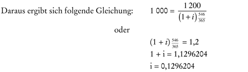
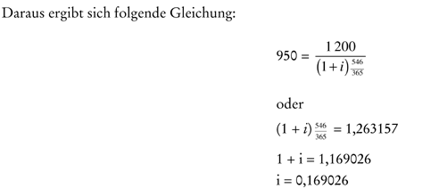
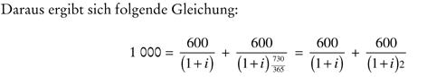
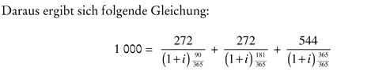
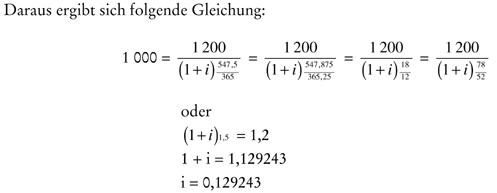
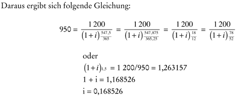
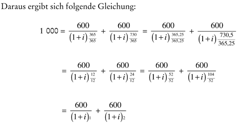
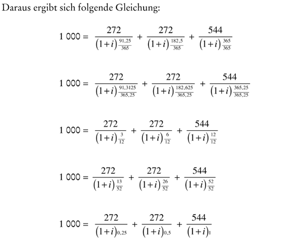

Verordnung vom 15. Februar 2000 zum Gesetz über den Konsumkredit Aufgrund von Art. 19 des Gesetzes vom 22. Oktober 1992 über den Konsumkredit, LGBl. 1993 Nr. 50 , in der Fassung des Gesetzes vom 26. November 1999, LGBl. 2000 Nr. 18, verordnet die Regierung: Art. 1 Zweck 1) Diese Verordnung regelt nähere Vorschriften zur Berechnung des effektiven Jahreszinses gemäss Art. 17 des Gesetzes. 2) Diese Verordnung dient der Durchführung der Richtlinie 98/7/EG des Rates vom 16. Februar 1998 zur Änderung der Richtlinie 87/102/EWG zur Angleichung der Rechts- und Verwaltungsvorschriften der Mitgliedstaaten über den Verbraucherkredit (EWR-Rechtssammlung: Anh. XIX-4.03) in ihrer jeweils gültigen Fassung. Art. 2 Vorschriften zur Berechnung des effektiven Jahreszinses Die Formel zur Berechnung des effektiven Jahreszinses gemäss Anhang des Gesetzes ist unter Beachtung der folgenden Punkte zu verstehen: a) die von beiden Seiten zu unterschiedlichen Zeitpunkten gezahlten Beträge sind nicht notwendigerweise gleich gross und werden nicht notwendigerweise in gleichen Zeitabständen entrichtet; b) Anfangszeitpunkt ist der Tag der ersten Darlehensvergabe; c) die Spanne zwischen diesen Zeitpunkten wird in Jahren oder Jahresbruchteilen ausgedrückt. Zugrunde gelegt werden für das Jahr 365 Tage oder 365,25 Tage (Duchschnitt über 4 Jahre) oder (im Fall von Schaltjahren) 366 Tage, 52 Wochen oder 12 gleich lange Monate, wobei für letztere eine Länge von 30,41666 (also 365/12) Tagen angenommen wird; d) das Rechenergebnis wird auf mindestens eine Dezimalstelle genau angegeben. Bei der Rundung auf eine bestimmte Dezimalstelle ist folgende Regel anzuwenden: Ist die Ziffer der Dezimalstelle, die auf die betreffende Dezimalstelle folgt, grösser als oder gleich 5, so erhöht sich die Ziffer der betreffenden Dezimalstelle um eine Einheit. Art. 3 Berechnungsmethode Das anwendbare Lösungsverfahren muss zu einem Ergebnis gleicher Art wie bei den Beispielen des Anhangs zu dieser Verordnung führen. Art. 4 Inkrafttreten Diese Verordnung tritt am Tage der Kundmachung in Kraft. Fürstliche Regierung: gez. Dr. Mario Frick Fürstlicher Regierungschef Anhang Berechnungsbeispiele A. Berechnung des effektiven Jahreszinses auf der Grundlage des Kalendarjahres (1 Jahr = 365 Tage (oder 366 Tage bei einem Schaltjahr)) Erstes Beispiel Darlehenssumme am 1. Januar 1994: S = 1 000 ECU Diese Summe wird am 1. Juli 1995, d.h. 1 1/2 Jahre oder 546 ( = 365 + 181) Tage nach Darlehensaufnahme, in einer einzigen Zahlung in Höhe von 1 200 ECU zurückgezahlt. 

 Der Betrag wird auf 13 % gerundet (oder 12,96 % falls eine Genauigkeit von zwei Dezimalstellen vorgezogen wird). Zweites Beispiel Die Darlehenssumme S beträgt 1 000 ECU, jedoch behält der Darlehensgeber 50 ECU für Kreditwürdigkeitsprüfungs- und Bearbeitungskosten ein, so dass sich der effektive Darlehensbetrag auf 950 ECU beläuft. Die Rückzahlung der 1 200 ECU erfolgt wie im ersten Beispiel am 1. Juli 1995. 

 Dieses Ergebnis wird auf 16,9 % gerundet. Drittes Beispiel Die Darlehenssumme S beträgt am 1. Januar 1994 1 000 ECU, die in zwei Tilgungsraten von jeweils 600 ECU nach einem bzw. nach zwei Jahren rückzahlbar ist. 

 Die Gleichung wird algebraisch gelöst und ergibt i = 0,1306623; dieses Ergebnis wird auf 13,1 % gerundet (oder 13,07 %, falls eine Genauigkeit von zwei Dezimalsstellen vorgezogen wird). Viertes Beispiel Die Darlehenssumme S beträgt am 1. Januar 1994 1 000 ECU. Der Darlehensnehmer hat folgende Raten zurückzuzahlen: Nach 3 Monaten (0,25 Jahre/90 Tage): 272 ECU Nach 6 Monaten (0,5 Jahre/181 Tage): 272 ECU Nach 12 Monaten (1 Jahr/365 Tage): 544 ECU Insgesamt: 1 088 ECU 

 Mit dieser Gleichung lässt sich i durch schrittweise Annäherungen, die auf einem Taschenrechner programmiert werden können, errechnen. Das Ergebnis lautet i = 0,13226; dieses Ergebnis wird gerundet auf 13,2 % (oder 13,23 % falls eine Genauigkeit von zwei Dezimalstellen vorgezogen wird). B. Berechnung des effektiven Jahreszinses auf der Grundlage eines Standardjahres (1 Jahr = 365 Tage oder 365,25 Tage, 52 Wochen oder 12 gleich lange Monate) Erstes Beispiel Darlehenssumme: S = 1 000 ECU Diese Summe wird 1,5 Jahre (d.h. 1,5 x 365 = 547,5 Tage, 1,5 x 365,25 = 547,875 Tage, 1,5 x 366 = 549 Tage, 1,5 x 12 = 18 Monate oder 1,5 x 52 = 78 Wochen) nach Darlehensaufnahme in einer einzigen Zahlung in Höhe von 1 200 ECU zurückgezahlt. 

 Der Betrag wird auf 12,9 % gerundet (oder 12,92 %, falls eine Genauigkeit von zwei Dezimalstellen vorgezogen wird). Zweites Beispiel Die Darlehenssumme S beträgt 1 000 ECU, jedoch behält der Darlehensgeber 50 ECU für Kreditwürdigkeitsprüfungs- und Bearbeitungskosten ein, so dass sich der effektive Darlehensbetrag auf 950 ECU beläuft. Die Rückzahlung der 1 200 ECU erfolgt wie im ersten Beispiel 1,5 Jahre nach der Darlehensaufnahme. 

 Dieses Ergebnis wird auf 16,9 % gerundet (oder 16,85 % falls eine Genauigkeit von zwei Dezimalstellen vorgezogen wird). Drittes Beispiel Die Darlehenssumme beträgt 1 000 ECU, die in zwei Tilgungsraten von jeweils 600 ECU nach einem bzw. nach zwei Jahren rückzahlbar ist. 

 Die Gleichung wird algebraisch gelöst und ergibt i = 0,13066; dieses Ergebnis wird auf 13,1 % gerundet (oder 13,07 % falls eine Genauigkeit von zwei Dezimalstellen vorgezogen wird). Viertes Beispiel Die Darlehenssumme S beträgt 1 000 ECU. Der Darlehensnehmer hat folgende Raten zurückzuzahlen: Nach 3 Monaten (0,25 Jahre/13 Wochen/91,25 Tage/91,3125 Tage): 272 ECU Nach 6 Monaten (0,5 Jahre/26 Wochen/182,5 Tage/182,625 Tage): 272 ECU Nach 12 Monaten (1 Jahr/52 Wochen/365 Tage/365,25 Tage): 544 ECU Insgesamt: 1 088 ECU 

 Mit dieser Gleichung lässt sich i durch schrittweise Annäherungen, die auf einem Taschenrechner programmiert werden können, errechnen. Das Ergebnis lautet i = 0,13185; dieses Ergebnis wird gerundet auf 13,2 % (oder 13,19 %, falls eine Genauigkeit von zwei Dezimalstellen vorgezogen wird).
