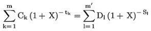
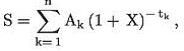

Gesetz vom 3. Dezember 2020 über Hypothekar- und Immobilienkreditverträge für Konsumenten (Hypothekar- und Immobilienkreditgesetz; HIKG) Dem nachstehenden vom Landtag gefassten Beschluss erteile Ich Meine Zustimmung: I. Allgemeine Bestimmungen Art. 1 Gegenstand 1) Dieses Gesetz legt die Rahmenbedingungen für mit Konsumenten abgeschlossene grundpfandrechtlich gesicherte Kreditverträge oder andere Immobilienkreditverträge fest und regelt insbesondere: a) die Pflichten von Kreditgebern und Kreditvermittlern im Zusammenhang mit dem Abschluss von Kreditverträgen; b) die Voraussetzungen für die Aufnahme und Ausübung der Tätigkeit des Kreditvermittlers. 2) Weitergehende Pflichten von Kreditgebern und Kreditvermittlern gegenüber Konsumenten nach anderen Gesetzen, insbesondere nach dem Bankengesetz, bleiben unberührt. Art. 2 Umsetzung von EWR-Rechtsvorschriften 1) Dieses Gesetz dient der Umsetzung der Richtlinie 2014/17/EU über Wohnimmobilienkreditverträge für Verbraucher . 2) Die gültige Fassung der EWR-Rechtsvorschriften, auf die in diesem Gesetz Bezug genommen wird, ergibt sich aus der Kundmachung der Beschlüsse des Gemeinsamen EWR-Ausschusses im Liechtensteinischen Landesgesetzblatt nach Art. 3 Bst. k des Kundmachungsgesetzes. Art. 3 Geltungsbereich 1) Dieses Gesetz gilt für Kreditverträge: a) die durch ein Grundpfandrecht oder eine vergleichbare Sicherheit, die gewöhnlich für Wohnimmobilien genutzt werden, gesichert werden; oder b) die für den Erwerb oder die Erhaltung von Eigentumsrechten an einem durch ein Grundpfandrecht gesicherten Grundstück bestimmt sind. 2) Es gilt nicht für Kreditverträge: a) bei denen der Kreditgeber: 1. pauschale oder regelmässige Zahlungen leistet oder andere Formen der Kredittilgung vornimmt und damit im Gegenzug einen Betrag aus dem künftigen Erlös des Verkaufs einer Wohnimmobilie erhält oder ein Recht an einer Wohnimmobilie erwirbt; und 2. erst dann eine Rückzahlung fordert, wenn im Leben des Konsumenten ein oder mehrere festgelegte Ereignisse eintreten, ausser der Konsument verstösst gegen die Vertragsbestimmungen, was dem Kreditgeber erlaubt, den Kreditvertrag zu kündigen; b) die Arbeitnehmern vom Arbeitgeber als Nebenleistung zinsfrei oder zu einem niedrigeren effektiven Jahreszins als dem marktüblichen gewährt werden und die nicht der breiten Öffentlichkeit angeboten werden; c) die in Gestalt eines vor einem Gericht oder einer sonstigen staatlichen Einrichtung geschlossenen Vergleichs oder als dessen Ergebnis geschlossen werden; d) in Form von Überziehungsmöglichkeiten, bei denen der Kredit binnen eines Monats zurückzuzahlen ist; e) die ohne Zinsen und sonstige Gebühren ausser denen, die unmittelbar auf den mit der Sicherung des Kredits verbundenen Kosten beruhen; f) die die unentgeltliche Stundung einer bestehenden Forderung zum Gegenstand haben und nicht unter den Geltungsbereich von Abs. 1 Bst. a fallen; g) bei denen der Kredit nach Abs. 1 für den Erwerb einer Wohnimmobilie gewährt wird, die nicht in einem EWR-Mitgliedstaat belegen ist. 3) Die Art. 7 und 9 und Anhang 2 sind nicht anzuwenden bei Kreditverträgen, die durch ein Grundpfandrecht oder eine vergleichbare Sicherheit, die gewöhnlich für Wohnimmobilien genutzt wird, oder durch ein Recht an Wohnimmobilien gesichert sind und die nicht für den Erwerb oder die Erhaltung des Rechts an Wohnimmobilien bestimmt sind, sofern für diese Kreditverträge die Art. 4 und 5 und die Anhänge 2 und 3 des Konsumkreditgesetzes angewendet werden. 4) Die Bestimmungen dieses Gesetzes sind vorbehaltlich Abs. 5 nicht auf Kreditverträge anzuwenden: a) bei denen für den Erwerb einer Immobilie im Kreditvertrag festgehalten ist und der Konsument bestätigt, dass die Immobilie: 1. zu keinem Zeitpunkt als Haus, Wohnung oder sonstige Wohnstätte durch den Konsument oder ein Familienmitglied des Konsumenten genutzt werden kann; und 2. auf der Grundlage eines Mietvertrags als Haus, Wohnung oder sonstige Wohnstätte genutzt werden soll; b) die Kredite zum Gegenstand haben, die einem begrenzten Kundenkreis im Rahmen gesetzlicher Bestimmungen - insbesondere aufgrund des Wohnbauförderungsgesetzes - im Gemeinwohlinteresse gewährt werden, sei es zinslos oder zu einem niedrigeren als dem marktüblichen Sollzinssatz oder zu anderen, für den Konsumenten günstigeren als den marktüblichen Bedingungen und zu Zinssätzen, die nicht über den marktüblichen Sollzinssätzen liegen; c) bei denen es sich um Überbrückungsdarlehen nach diesem Gesetz handelt; d) die von einer Organisation geschlossen werden: 1. die zum gegenseitigen Nutzen ihrer Mitglieder eingerichtet wurde; 2. die Gewinne ausschliesslich für ihre Mitglieder erzielt; 3. die einen nach innerstaatlichen Rechtsvorschriften vorgeschriebenen sozialen Zweck erfüllt; 4. die nur von ihren Mitgliedern Ersparnisse erhält und verwaltet und auch nur für ihre Mitglieder Finanzierungsquellen erschliesst; 5. die Kredite auf der Grundlage eines effektiven Jahreszinses gewährt, der unter den marktüblichen Zinssätzen liegt oder durch innerstaatliches Recht nach oben hin begrenzt ist; 6. deren Mitgliedschaft auf Personen beschränkt ist, die nach innerstaatlichem Recht die Voraussetzung für das Bestehen einer gemeinsamen Verbindung zwischen den Mitgliedern bilden; und 7. bei denen der Gesamtwert aller bestehenden Kreditverträge der Organisation im Verhältnis zum Gesamtwert aller bestehenden Kreditverträge in Liechtenstein unbedeutend ist und der Gesamtwert aller bestehenden Kreditverträge aller derartigen Organisationen in Liechtenstein weniger als 1 % des Gesamtwerts aller bestehenden Kreditverträge in Liechtenstein ausmacht. 5) Auf die in Abs. 4 Bst. b und d genannten Kreditverträge finden Art. 7 und 9 sinngemäss Anwendung. Art. 4 Begriffe und Bezeichnungen 1) Im Sinne dieses Gesetzes gelten als: a) "Konsument": eine natürliche Person, die einen Kreditvertrag nach Art. 3 Abs. 1 zu einem Zweck abschliesst, der nicht ihrer beruflichen oder gewerblichen Tätigkeit zugerechnet werden kann; b) "Kreditgeber": eine natürliche oder juristische Person, die in Ausübung ihrer gewerblichen oder beruflichen Tätigkeit einen in den Geltungsbereich nach Art. 3 Abs. 1 fallenden Kredit gewährt oder zu gewähren verspricht; c) "Kreditvertrag (Konsumkreditvertrag)": ein Vertrag, bei dem ein Kreditgeber einem Konsumenten einen in den Geltungsbereich nach Art. 3 Abs. 1 fallenden Kredit gewährt oder zu gewähren verspricht; d) "Nebenleistung": eine Dienstleistung, die dem Konsument im Zusammenhang mit dem Kreditvertrag angeboten wird; e) "Kreditvermittler": eine natürliche oder juristische Person, die nicht als Kreditgeber oder als Notar handelt, die nicht lediglich einen Konsumenten direkt oder indirekt mit einem Kreditgeber oder Kreditvermittler in Kontakt bringt und die in Ausübung ihrer gewerblichen oder beruflichen Tätigkeit gegen ein Entgelt, das aus einer Geldzahlung oder einem sonstigen vereinbarten wirtschaftlichen Vorteil bestehen kann: 1. Kreditverträge einem Konsumenten vorstellt oder anbietet; 2. Konsumenten bei anderen als den in Ziff. 1 genannten Vorarbeiten oder anderen vorvertraglichen administrativen Tätigkeiten zum Abschluss von Kreditverträgen behilflich ist; oder 3. für den Kreditgeber Kreditverträge mit Konsumenten abschliesst; f) "Gruppe": eine Gruppe von Kreditgebern, die zum Zweck der Erstellung eines konsolidierten Abschlusses im Sinne der Richtlinie 2013/34/EU zu konsolidieren sind; g) "gebundener Kreditvermittler": ein Kreditvermittler, der im Namen und unter der unbeschränkten und vorbehaltslosen Verantwortung handelt: 1. nur eines Kreditgebers; 2. nur einer Gruppe; oder 3. mehrerer Kreditgeber oder Gruppen, die auf dem Markt zusammen keine Mehrheit bilden; h) "Gesamtkreditbetrag": die Obergrenze oder die Summe aller Beträge, die aufgrund eines Kreditvertrags zur Verfügung gestellt werden; i) "Gesamtkosten des Kredits für den Konsumenten": sämtliche Kosten einschliesslich der Zinsen, Provisionen etwa für die Vermittlung des Kredits, Abgaben und Kosten jeder Art, ausgenommen Beurkundungsgebühren, die der Konsument im Zusammenhang mit dem Kreditvertrag zu zahlen hat und die dem Kreditgeber bekannt sind. Dazu zählen auch Kosten für Nebenleistungen im Zusammenhang mit dem Kreditvertrag, insbesondere Versicherungsprämien, wenn der Abschluss des Vertrags über diese Nebenleistung eine vom Kreditgeber geforderte Voraussetzung dafür ist, dass der Kredit überhaupt oder nach den vorgesehenen Vertragsbedingungen gewährt wird, sowie die Kosten für die Liegenschaftsbewertung, sofern eine solche Bewertung für die Gewährung des Kredits erforderlich ist, jedoch nicht die Gebühren für die Eintragung der Eigentumsübertragung in das Grundbuch, ausserdem nicht Entgelte, die der Konsument für die Nichteinhaltung der im Kreditvertrag festgelegten Verpflichtungen zahlen muss; k) "vom Konsumenten zu zahlender Gesamtbetrag": die Summe des Gesamtkreditbetrags und der Gesamtkosten des Kredits für den Konsumenten; l) "effektiver Jahreszins": die Gesamtkosten des Kredits für den Konsumenten, die als jährlicher Prozentsatz des Gesamtkreditbetrags ausgedrückt sind; m) "Sollzinssatz": der als fester oder variabler periodischer Prozentsatz ausgedrückte Zinssatz, der auf jährlicher Basis auf die in Anspruch genommenen Kredit-Auszahlungsbeträge angewandt wird; n) "Kreditwürdigkeitsprüfung": die Bewertung der Aussicht, dass der Konsument den Verpflichtungen aus dem Kreditvertrag nachkommen wird; o) "dauerhafter Datenträger": jedes Medium, das es dem Konsumenten gestattet, an ihn persönlich gerichtete Informationen derart zu speichern, dass er sie in der Folge für eine den Zwecken der Informationen angemessene Dauer einsehen kann, und das die unveränderte Wiedergabe der gespeicherten Informationen ermöglicht; p) "Überbrückungsdarlehen": ein Kreditvertrag, der entweder keine feste Laufzeit hat oder innerhalb von zwölf Monaten zurückzuzahlen ist und der vom Konsumenten zur Überbrückung des Zeitraums während des Übergangs zu einer anderen finanziellen Vereinbarung für die Immobilie genutzt wird; q) "Bündelungsgeschäft": das Angebot oder der Abschluss eines Kreditvertrags in einem Paket gemeinsam mit anderen gesonderten Finanzprodukten oder -dienstleistungen, bei dem der Kreditvertrag separat vom Konsumenten abgeschlossen werden kann, jedoch nicht zwangsläufig zu den gleichen Bedingungen, zu denen er mit den Nebenleistungen gebündelt angeboten wird; r) "Kopplungsgeschäft": das Angebot oder der Abschluss eines Kreditvertrags in einem Paket gemeinsam mit anderen gesonderten Finanzprodukten oder -dienstleistungen, bei dem der Kreditvertrag nicht separat vom Konsumenten abgeschlossen werden kann; s) "Fremdwährungskredit": ein Kreditvertrag, bei dem der Kredit: 1. auf eine andere Währung lautet als die, in der der Konsument sein Einkommen bezieht oder die Vermögenwerte hält, aus denen der Kredit zurückgezahlt werden soll; oder 2. auf eine andere Währung als die Währung des EWR-Mitgliedstaates lautet, in welchem der Konsument seinen Wohnsitz hat; t) "Wohnimmobilie": eine Immobilie, die zum Zeitpunkt des Abschluss des Kreditvertrags als Haus, Wohnung oder sonstige Wohnstätte durch den Konsument oder ein Familienmitglied des Konsumenten überwiegend für eigene Wohnzwecke genutzt wird oder werden soll; u) "Vermögenswerte": jedes nach der Verkehrsanschauung im Wirtschaftsleben selbständig bewertbare Gut, das in seiner Einzelheit von Bedeutung und bei einer Veräusserung realisierbar ist. Der Vermögenswert muss so beschaffen sein, dass seine Verwertung einem Gläubiger zur Rückzahlung von dessen Forderung verhilft; v) "Beratungsdienstleistung": die Erteilung individueller Empfehlungen an einen Konsumenten in Bezug auf ein oder mehrere Geschäfte im Zusammenhang mit Kreditverträgen. Beratungsdienstleistungen sind von der Gewährung eines Kredits und von der in Bst. e genannten Kreditvermittlungstätigkeit zu unterscheiden. 2) Im Übrigen finden die Begriffsbestimmungen von Art. 4 der Richtlinie 2014/17/EU ergänzend Anwendung. 3) Unter den in diesem Gesetz verwendeten Personen- und Funktionsbezeichnungen sind Angehörige des männlichen und weiblichen Geschlechts zu verstehen. Art. 5 Unwirksame Vereinbarungen Soweit in Vereinbarungen zum Nachteil des Konsumenten von den Bestimmungen dieses Gesetzes abgewichen wird, sind sie unwirksam. Art. 6 Unentgeltlichkeit von Informationen Wenn dieses Gesetz Informationen für Konsumenten vorsieht, sind diese Informationen unentgeltlich zu erteilen. II. Hypothekar- und Immobilienkredite A. Allgemeine Informationspflichten und vorvertragliche Pflichten Art. 7 Werbung 1) Werden in einer Werbung für Kreditverträge Zinssätze oder sonstige auf die Kosten eines Kredits für den Konsumenten bezogene Zahlen genannt, so muss die Werbung klar, prägnant und auffallend folgende Standardinformationen enthalten: a) die Identität des Kreditgebers oder gegebenenfalls des Kreditvermittlers; b) gegebenenfalls den Hinweis, dass der Kreditvertrag durch ein Grundpfandrecht oder eine vergleichbare Sicherheit, die gewöhnlich für Wohnimmobilien genutzt wird, oder durch ein Recht an Wohnimmobilien gesichert wird; c) den Sollzinssatz und die Angabe, ob es sich um einen festen oder einen variablen Zinssatz oder eine Kombination aus beiden handelt, sowie Einzelheiten aller für den Konsumenten anfallenden, in die Gesamtkreditkosten einbezogenen Kosten; d) den Gesamtkreditbetrag; e) den effektiven Jahreszins, der in der Werbung mindestens genauso hervorzuheben ist wie jeder Zinssatz; f) gegebenenfalls die Laufzeit des Kreditvertrags; g) gegebenenfalls die Höhe der Raten; h) gegebenenfalls den vom Konsumenten zu zahlenden Gesamtbetrag; i) gegebenenfalls die Anzahl der Raten; k) gegebenenfalls einen Warnhinweis, dass sich mögliche Wechselkursschwankungen auf die Höhe des vom Konsumenten zu zahlenden Betrags auswirken könnten. 2) Die in Abs. 1 angeführten Informationen mit Ausnahme der Angaben nach Bst. a, b und k sind durch ein repräsentatives Beispiel zu veranschaulichen und richten sich durchwegs nach diesem repräsentativen Beispiel. Die Kriterien für das repräsentative Beispiel ergeben sich aus Anhang 1. 3) Ist der Abschluss eines Vertrags über die Inanspruchnahme einer Nebenleistung, insbesondere eines Versicherungsvertrags, zwingende Voraussetzung dafür, dass der Kredit überhaupt oder nach den vorgesehenen Vertragsbedingungen gewährt wird, und können die Kosten der Nebenleistung nicht im Voraus bestimmt werden, so ist auf die Verpflichtung zum Abschluss jenes Vertrags klar, prägnant und auffallend zusammen mit dem effektiven Jahreszins hinzuweisen. 4) Die Informationen nach Abs. 1 und 3 müssen je nach dem für die Werbung verwendeten Medium gut lesbar beziehungsweise akustisch gut verständlich sein. 5) Wenn die Kommunikation für Werbe- und Marketingzwecke, die Kreditverträge betrifft, nicht redlich und eindeutig ist, insbesondere wenn sie beim Konsumenten falsche Erwartungen in Bezug auf die Zugänglichkeit oder die Kosten eines Kredits weckt oder irreführend ist, gilt sie als unlautere Geschäftspraktik im Sinne des Gesetzes gegen den unlauteren Wettbewerb. Art. 8 Allgemeine Informationen Kreditgeber und gegebenenfalls gebundene Kreditvermittler haben jederzeit klare und verständliche allgemeine Informationen über Kreditverträge auf Papier oder auf einem anderen dauerhaften Datenträger oder in elektronischer Form bereitzustellen. Diese allgemeinen Informationen haben zumindest zu umfassen: a) die Identität und Anschrift des Urhebers der Informationen; b) die Zwecke, für die der Kredit verwenden werden kann; c) die Formen von Sicherheiten einschliesslich gegebenenfalls der Möglichkeit, dass diese in einem anderen EWR-Mitgliedstaat belegen sein dürfen; d) die mögliche Laufzeit der Kreditverträge; e) die Arten von angebotenen Sollzinssätzen mit der Angabe, ob es sich um einen festen oder einen variablen Zinssatz oder beide handelt, mit einer kurzen Darstellung der Merkmale eines festen und eines variablen Zinssatzes, einschliesslich der sich daraus ergebenden Konsequenzen für den Konsumenten; f) falls Fremdwährungskredite verfügbar sind, eine Angabe der ausländischen Währungen, einschliesslich einer Erläuterung der Konsequenzen für den Konsumenten in Fällen, in denen der Kredit auf eine ausländische Währung lautet; g) ein repräsentatives Beispiel des Gesamtkreditbetrags, der Gesamtkosten des Kredits für den Konsumenten, des vom Konsumenten zu zahlenden Gesamtbetrags und des effektiven Jahreszinses; h) einen Hinweis auf mögliche weitere in Zusammenhang mit einem Kreditvertrag anfallende Kosten, die nicht in den Gesamtkosten des Kredits für den Konsumenten enthalten sind; i) das Spektrum der verschiedenen möglichen Optionen zur Rückzahlung des Kredits an den Kreditgeber einschliesslich Anzahl, Häufigkeit und Höhe der regelmässigen Rückzahlungsraten bzw. Amortisationen; k) gegebenenfalls einen klaren und prägnanten Hinweis darauf, dass die Einhaltung der Bedingungen des Kreditvertrags die Rückzahlung des aufgrund des Kreditvertrags in Anspruch genommenen Gesamtkreditbetrags nicht garantiert; l) eine Beschreibung der für eine vorzeitige Rückzahlung unmittelbar geltenden Bedingungen; m) die Angabe, ob eine Bewertung der Immobilie erforderlich ist und, falls ja, wer verantwortlich dafür ist, dass die Bewertung durchgeführt wird, sowie Angaben dazu, ob dem Konsumenten dadurch Kosten entstehen; n) Angaben zu den Nebenleistungen, die der Konsument als Voraussetzung dafür erwerben muss, dass der Kredit überhaupt oder nach den vorgesehenen Vertragsbedingungen gewährt wird, und gegebenenfalls eine Präzisierung, dass die Nebenleistungen von einem anderen Anbieter als dem Kreditgeber erworben werden können; o) einen allgemeinen Warnhinweis bezüglich möglicher Konsequenzen der Nichteinhaltung der mit dem Kreditvertrag eingegangenen Verpflichtungen; und p) falls Verträge verfügbar sind, in denen auf einen Referenzwert im Sinne des Art. 3 Abs. 1 Ziff. 3 der Verordnung (EU) 2016/1011 Bezug genommen wird, die Namen der Referenzwerte und ihrer Administratoren sowie die möglichen Auswirkungen auf den Konsumenten. Art. 9 Vorvertragliche Informationspflichten 1) Der Kreditgeber und gegebenenfalls der Kreditvermittler hat dem Konsumenten auf ihn zugeschnittene Informationen zu erteilen, die der Konsument benötigt, um die auf dem Markt verfügbaren Kreditprodukte zu vergleichen, ihre jeweiligen Auswirkungen zu prüfen und eine fundierte Entscheidung über den Abschluss eines Kreditvertrags zu treffen. 2) Diese Informationen sind auf Papier oder einem anderen dauerhaften Datenträger mittels des ESIS-Merkblatts nach Anhang 2 zu erteilen, und zwar: a) unverzüglich nachdem der Konsument die erforderlichen Angaben zu seinen Bedürfnissen, seiner finanziellen Situation und seinen Präferenzen nach Art. 12 Abs. 2 gemacht hat; und b) rechtzeitig, bevor der Konsument durch einen Kreditvertrag oder ein Angebot gebunden ist. 3) Macht ein Kreditgeber dem Konsumenten ein verbindliches Angebot, so ist es auf Papier oder einem anderen dauerhaften Datenträger zu übermitteln. Der Kreditgeber oder gegebenenfalls der Kreditvermittler hat dem Konsumenten zum Zeitpunkt der Vorlage eines für den Kreditgeber verbindlichen Angebots eine Ausfertigung des Kreditvertrags auszuhändigen. 4) Ergänzend ist dem Konsumenten das ESIS-Merkblatt nach Anhang 2 auszuhändigen, sofern: a) dem Konsumenten zuvor noch kein ESIS-Merkblatt vorgelegt wurde; oder b) die Merkmale des Angebots von den Informationen abweichen, die im zuvor vorgelegten ESIS-Merkblatt enthalten sind. 5) Ein Angebot gilt für mindestens sieben Tage und ist während dieses Zeitraums für den Kreditgeber verbindlich. 6) Werden allerdings der Sollzinssatz oder andere für das Angebot massgebliche Kosten auf Basis des Verkaufs zugrunde liegender Anleihen oder anderer langfristiger Finanzierungsinstrumente festgelegt, so können der Sollzinssatz oder die anderen Kosten entsprechend dem Wert des zugrundliegenden Wertpapiers oder des langfristigen Finanzierungsinstruments von den Angaben des Angebots abweichen. 7) Mit der Vorlage des ESIS-Merkblatts nach Anhang 2 gelten die Anforderungen in Bezug auf die Information des Konsumenten vor Abschluss eines Fernabsatzvertrags nach Art. 5 Abs. 1 des Fern-Finanzdienstleistungs-Gesetzes durch den Kreditgeber als erfüllt. Die Anforderungen des Art. 7 Abs. 1 des Fern-Finanzdienstleistungs-Gesetzes gelten nur dann als erfüllt, wenn das ESIS-Merkblatt zumindest vor Abschluss des Vertrags vorgelegt worden ist. 8) Bei Ferngesprächen im Sinne des Art. 6 des Fern-Finanzdienstleistungs-Gesetzes muss die nach Art. 6 Abs. 2 Bst. b des Fern-Finanzdienstleistungs-Gesetzes gebotene Beschreibung der Hauptmerkmale der Finanzdienstleistung zumindest die in Anhang 2 Teil A Abschnitte 3 bis 6 vorgesehenen Angaben enthalten. 9) Etwaige zusätzliche Informationen, die der Kreditgeber dem Konsumenten erteilt, sind in einem gesonderten Dokument mitzuteilen. Art. 10 Informationspflichten für Kreditvermittler 1) Ein Kreditvermittler hat rechtzeitig vor Ausübung jeder Kreditvermittlungstätigkeit dem Konsumenten gegenüber auf Papier oder einem anderen dauerhaften Datenträger Folgendes mitzuteilen: a) seine Identität und Anschrift; b) die Angabe, in welches Register er eingetragen wurde, einschliesslich der Registrierungsnummer, und die Angabe, auf welche Weise sich die Eintragung überprüfen lässt; c) die Angabe, ob er als gebundener Kreditvermittler tätig ist; allenfalls zusätzlich die Angabe, ob er als unabhängiger Kreditvermittler tätig ist; d) falls er die Tätigkeit eines gebundenen Kreditvermittlers oder eines Kreditvermittlers, der ausschliesslich für einen oder mehrere Kreditgeber arbeitet, ausübt, die Angabe der Namen der Kreditgeber, für die er tätig ist; e) ob er Beratungsdienstleistungen anbietet; f) das Verfahren für interne Beschwerden von Konsumenten sowie den Hinweis, dass die Möglichkeit besteht, die Schlichtungsstelle nach Art. 59 bei Beschwerden in Anspruch zu nehmen; g) das gegebenenfalls vom Konsumenten an ihn für dessen Dienste zu zahlende Entgelt oder, sofern dies nicht möglich ist, die Methode, nach der das Entgelt berechnet wird; h) gegebenenfalls ob und, falls bekannt, in welcher Höhe er oder ein Dritter ihm für seine Dienstleistung im Zusammenhang mit dem Kreditvertrag Provisionen zu zahlen oder sonstige Anreize zu gewähren hat; i) falls er die Tätigkeit eines nicht gebundenen Kreditvermittlers, der Provisionen von einem oder mehreren Kreditgebern erhält, ausübt, auf Verlangen des Konsumenten die jeweilige Höhe der Provisionen, die ihm von den verschiedenen Kreditgebern gezahlt werden, in deren Namen er dem Konsumenten Kreditverträge anbietet; der Konsument ist darüber zu unterrichten, dass er entsprechende Auskünfte verlangen kann; k) für den Fall, dass er vom Konsumenten ein Entgelt verlangt und zusätzlich eine Provision vom Kreditgeber oder einem Dritten erhält, eine Erläuterung gegenüber dem Konsumenten, ob die Provision - ganz oder teilweise - auf das Entgelt angerechnet wird. 2) Der Kreditvermittler hat dem Kreditgeber das vom Konsumenten an den Kreditvermittler für dessen Dienste zu zahlende Entgelt zur Berechnung des effektiven Jahreszinses mitzuteilen. 3) Der Kreditvermittler hat die in den Art. 4, 5 und 6 des Konsumkreditgesetzes vorgesehenen Pflichten gegenüber den Konsumenten einzuhalten. Art. 11 Angemessene Erläuterungen 1) Der Kreditgeber und gegebenenfalls der Kreditvermittler hat dem Konsumenten angemessene Erläuterungen zu den angebotenen Kreditverträgen und etwaigen Nebenleistungen zu geben, damit der Konsument in die Lage versetzt wird, zu beurteilen, ob die vorgeschlagenen Kreditverträge und die Nebenleistungen seinen Bedürfnissen und seiner finanziellen Situation gerecht werden. 2) Die Erläuterungen nach Abs. 1 müssen gegebenenfalls insbesondere Folgendes enthalten: a) die vorvertraglichen Informationen nach Art. 9 bei Kreditgebern und nach Art. 9 und 10 bei Kreditvermittlern; b) die Hauptmerkmale der angebotenen Produkte; c) die möglichen spezifischen Auswirkungen der angebotenen Produkte auf den Konsumenten, einschliesslich der Konsequenzen bei Zahlungsverzug des Konsumenten; und d) wenn Nebenleistungen mit einem Kreditvertrag gebündelt werden, ob jeder einzelne Bestandteil des Pakets einzeln beendet werden kann und welche Folgen dies für den Konsumenten hätte. B. Kreditwürdigkeitsprüfung Art. 12 Prüfung der Kreditwürdigkeit des Konsumenten 1) Vor Abschluss eines Kreditvertrags hat der Kreditgeber eine eingehende Prüfung der Kreditwürdigkeit des Konsumenten vorzunehmen. Bei der Kreditwürdigkeitsprüfung sind die Faktoren, die für die Prüfung der Aussichten relevant sind, dass der Konsument seinen Verpflichtungen aus dem Kreditvertrag nachkommt, in angemessener Form zu berücksichtigen. 2) Die Kreditwürdigkeitsprüfung ist auf der Grundlage notwendiger, ausreichender und angemessener Informationen zu Einkommen, Ausgaben sowie anderen finanziellen und wirtschaftlichen Umständen des Konsumenten vorzunehmen. Der Kreditgeber hat die Informationen aus einschlägigen internen und externen Quellen zu ermitteln, einschliesslich des Konsumenten. Die Informationen müssen auch die Auskünfte einschliessen, die dem Kreditvermittler im Zuge des Kreditantragsverfahrens erteilt wurden. Die Informationen sind in angemessener Weise zu überprüfen, erforderlichenfalls auch durch Einsichtnahme in unabhängig nachprüfbare Unterlagen. Der Kreditvermittler hat dem Kreditgeber die vom Konsumenten erhaltenen erforderlichen Angaben korrekt vorzulegen, damit die Kreditwürdigkeitsprüfung durchgeführt werden kann. 3) Die Kreditwürdigkeitsprüfung darf sich nicht hauptsächlich darauf stützen, dass der Wert der Immobilie den Kreditbetrag übersteigt, oder auf die Annahme, dass der Wert der Immobilie zunimmt, es sei denn, der Kreditvertrag dient zum Bau oder zur Renovierung der Immobilie. 4) Die Verfahren und Angaben, auf die sich die Bewertung stützt, hat der Kreditgeber festzulegen, zu dokumentieren und aufzubewahren. 5) Der Kreditgeber darf dem Konsumenten den Kredit nur gewähren, wenn aus der Kreditwürdigkeitsprüfung hervorgeht, dass es wahrscheinlich ist, dass die Verpflichtungen im Zusammenhang mit dem Kreditvertrag in der nach diesem Vertrag vorgeschriebenen Weise erfüllt werden. 6) Vor einer deutlichen Erhöhung des Gesamtkreditbetrags nach dem Abschluss des Kreditvertrags hat der Kreditgeber die Kreditwürdigkeit des Konsumenten auf der Grundlage von aktualisierten Angaben erneut zu prüfen, es sei denn, ein derartiger zusätzlicher Kredit war bereits im Rahmen der ursprünglichen Kreditwürdigkeitsprüfung vorgesehen und enthalten. 7) Wird ein Kreditantrag abgelehnt, so hat der Kreditgeber den Konsumenten unverzüglich über die Ablehnung zu unterrichten und gegebenenfalls darüber, dass die Entscheidung auf einer automatisierten Verarbeitung von Daten beruht. Beruht die Ablehnung auf dem Ergebnis einer Datenbankabfrage, so hat der Kreditgeber den Konsumenten über das Ergebnis dieser Abfrage und über die Einzelheiten der betreffenden Datenbank zu unterrichten. 8) Ein von einem Kreditgeber mit einem Konsumenten abgeschlossener Kreditvertrag kann vom Kreditgeber nicht nachträglich mit der Begründung aufgehoben, beendet oder zum Nachteil des Konsumenten geändert werden, dass die Prüfung der Kreditwürdigkeit nicht ordnungsgemäss durchgeführt wurde oder die vor Abschluss des Kreditvertrags vom Konsumenten erhaltenen Angaben unvollständig waren, es sein denn, der Konsument hat die Informationen im Sinne des Abs. 2 wissentlich vorenthalten oder gefälscht. 9) Auf Kreditgeber, die Banken im Sinne von Art. 4 Abs. 1 Bst. a des Bankengesetzes sind, finden die Abs. 1 bis 6 nur insoweit Anwendung, als die Verpflichtungen sich nicht bereits aus der Bankengesetzgebung ergeben. Art. 13 Vorvertragliche Informationen zur Kreditwürdigkeitsprüfung 1) Der Kreditgeber hat in der vorvertraglichen Phase klare und einfache Angaben dazu zu machen, welche erforderlichen Informationen und unabhängig nachprüfbaren Nachweise der Konsument für die Kreditwürdigkeitsprüfung beizubringen hat, und den Zeitraum anzugeben, innerhalb dessen der Konsument die Informationen zu liefern hat. Dieses Auskunftsersuchen muss verhältnismässig und auf diejenigen Auskünfte beschränkt sein, die erforderlich sind, um eine ordnungsgemässe Kreditwürdigkeitsprüfung durchzuführen. Der Kreditgeber kann um Klärung der als Antwort auf dieses Auskunftsersuchen erhaltenen Informationen nachsuchen, wo dies erforderlich ist, um eine Kreditwürdigkeitsprüfung zu ermöglichen. 2) Der Kreditgeber oder der Kreditvermittler hat den Konsumenten darüber zu informieren, dass der Konsument auf Auskunftsersuchen nach Abs. 1 korrekte Angaben vorlegen muss und dass diese Angaben so vollständig sein müssen, wie dies für eine vollständige Kreditwürdigkeitsprüfung erforderlich ist. 3) Der Kreditgeber oder der Kreditvermittler hat den Konsumenten zu warnen, dass der Kredit nicht gewährt werden kann, wenn der Kreditgeber nicht imstande ist, eine Kreditwürdigkeitsprüfung vorzunehmen, weil sich der Konsument weigert, die für die Prüfung seiner Kreditwürdigkeit erforderlichen Informationen oder Nachweise vorzulegen. Die Warnung kann in standardisierter Form erfolgen. 4) Wenn eine Datenbankabfrage vorgenommen wird, hat der Kreditgeber den Konsumenten im Einklang mit Art. 13 der Verordnung (EU) 2016/679 vorab zu informieren. Art. 14 Zugang zu Datenbanken 1) Kreditgebern mit Sitz in Liechtenstein oder in einem anderen EWR-Mitgliedstaat ist ohne Diskriminierung der Zugang zu Datenbanken zu gewähren, die zur Bewertung der Kreditwürdigkeit des Konsumenten verwendet werden und mit deren Verwendung ausschliesslich überwacht werden soll, inwieweit Konsumenten während der Laufzeit eines Kreditvertrags ihre Kreditverpflichtungen erfüllen. 2) Abs. 1 gilt sowohl für von privaten Kreditbüros und Kreditauskunfteien betriebene Datenbanken als auch für öffentliche Register. C. Besondere Pflichten der Kreditgeber und Kreditvermittler Art. 15 Vergütung 1) Kreditgeber haben die Art und Weise der Vergütung für ihr Personal und die Kreditvermittler so zu gestalten, dass diese nicht den Wohlverhaltensregeln nach Art. 18 entgegensteht; dies gilt ebenso für Kreditvermittler in Bezug auf ihr Personal. 2) Kreditgeber haben bei der Festlegung und Anwendung der Vergütungspolitik für das für die Prüfung der Kreditwürdigkeit von Konsumenten zuständige Personal folgende Grundsätze zu beachten: a) Bei der Festlegung und Anwendung der Vergütungspolitik ist auf die Grösse, die interne Organisation sowie die Art, den Umfang und die Komplexität der Tätigkeiten des Kreditgebers Bedacht zu nehmen. b) Die Vergütungspolitik ist mit einem soliden und wirksamen Risikomanagement vereinbar und diesem förderlich und ermutigt nicht zur Übernahme von Risiken, die über das vom Kreditgeber tolerierte Mass hinausgehen. c) Die Vergütungspolitik ist an der Geschäftsstrategie, den Zielen, Werten und langfristigen Interessen des Kreditgebers ausgerichtet und beinhaltet Massnahmen zur Vermeidung von Interessenkonflikten, wobei insbesondere vorzusehen ist, dass die Vergütung nicht von der Zahl oder dem Anteil der genehmigten Anträge abhängt. 3) Kreditgeber und Kreditvermittler, die Beratungsdienstleistungen nach Art. 17 erbringen, haben sicherzustellen, dass die Struktur der Vergütung für das mit Beratungsdienstleistungen betraute Personal nicht dessen Fähigkeit darin, im besten Interesse des Konsumenten zu handeln, beeinträchtigt und insbesondere nicht an Absatzziele gekoppelt ist. 4) Auf Kreditgeber, die Banken im Sinne von Art. 4 Abs. 1 Bst. a des Bankengesetzes sind, findet Abs. 2 nur insoweit Anwendung, als die Verpflichtungen sich nicht bereits aus der Bankengesetzgebung ergeben. Art. 16 Anforderungen an die Kenntnisse und Fähigkeiten des Personals 1) Kreditgeber und Kreditvermittler haben dafür Sorge zu tragen, dass das mit der Gestaltung, dem Anbieten und dem Abschliessen von Kreditverträgen oder der Erbringung von Beratungsdienstleistungen befasste Personal in folgenden Bereichen über angemessene Kenntnisse und Fähigkeiten verfügt und diese auf dem aktuellen Stand hält: a) angemessene Kenntnis der Kreditverträge nach Art. 3 Abs. 1 und der üblicherweise mit ihnen angebotenen Nebenleistungen; b) angemessene Kenntnis der Rechtsvorschriften betreffend Kreditverträge nach Art. 3 Abs. 1, insbesondere der Bestimmungen zum Konsumentenschutz; c) angemessene Kenntnis über die Phasen des Kreditgeschäftes; d) angemessene Kenntnis über Belehnungssätze im Grundpfandgeschäft in Bezug auf die Bewertung von Sicherheiten; e) angemessene Kenntnis über Grundbücher und Grundpfandtitel; f) angemessene Kenntnis des Marktes in dem einschlägigen EWR-Mitgliedstaat, in dem Kreditverträge im Sinne des Art. 3 Abs. 1 der Richtlinie 2014/17/EU angeboten werden; g) angemessene Kenntnis der ethischen Standards im Geschäftsleben; h) angemessene Kenntnis zur Beurteilung der Kreditfähigkeit und der Kreditwürdigkeit des Konsumenten; i) angemessenes Bankfachwissen und solides Verständnis für volkswirtschaftliche Zusammenhänge. 2) Abs. 1 gilt auch für jene Fälle, in denen der Abschluss eines Kreditvertrags damit verbundene Nebenleistungen beinhaltet. 3) Die nach Abs. 1 erforderlichen angemessenen Kenntnisse und Fähigkeiten sind auf Verlangen der zuständigen Vollzugsbehörde durch Vorlage von Abschluss- oder Arbeitszeugnissen, von Schulungsnachweisen oder in anderer geeigneter Form nachzuweisen. Der Nachweis der erforderlichen angemessenen Kenntnisse und Fähigkeiten darf nicht ausschliesslich auf der Grundlage von Berufserfahrung erfolgen. Art. 17 Standards für Beratungsdienstleistungen 1) Kreditgeber und Kreditvermittler haben den Konsumenten im Zusammenhang mit einem entsprechenden Geschäft ausdrücklich darüber zu informieren, ob Beratungsdienstleistungen für den Konsumenten erbracht werden oder erbracht werden können. 2) Vor der Erbringung von Beratungsdienstleistungen oder gegebenenfalls vor dem Abschluss eines Vertrags über die Erbringung von Beratungsdienstleistungen haben Kreditvermittler dem Konsumenten folgende Informationen auf Papier oder einem anderen dauerhaften Datenträger zu erteilen: a) ob die Empfehlung sich nur auf ihre eigene Produktpalette im Einklang mit Abs. 4 Bst. b oder eine grössere Auswahl von Produkten auf dem Markt nach Abs. 4 Bst. c bezieht, damit der Konsument verstehen kann, auf welcher Grundlage die Empfehlung ergeht; b) gegebenenfalls das vom Konsumenten für die Beratungsdienstleistungen zu zahlende Entgelt bzw. - wenn sich der Betrag zum Zeitpunkt der Offenlegung nicht feststellen lässt - die für seine Berechnung verwendete Methode. 3) Die in Abs. 2 Bst. a und b genannten Informationen können dem Konsumenten in Form von zusätzlichen vorvertraglichen Informationen erteilt werden. 4) Erbringen Kreditvermittler Beratungsdienstleistungen für die Konsumenten, so gilt Folgendes: a) Kreditvermittler haben die erforderlichen Informationen über die persönliche und finanzielle Situation, Präferenzen und Ziele des Konsumenten einzuholen, damit sie geeignete Kreditverträge empfehlen können. Die entsprechende Bewertung muss sich auf zum betreffenden Zeitpunkt aktuelle Informationen stützen und realistische Annahmen bezüglich der Risiken für die Situation des Konsumenten während der Laufzeit des angebotenen Kreditvertrags zugrunde legen. b) Gebundene Kreditvermittler haben eine ausreichende Zahl von Kreditverträgen aus ihrer Produktpalette einzubeziehen und unter Berücksichtigung der Bedürfnisse, der finanziellen Situation und der persönlichen Umstände des Konsumenten einen geeigneten Kreditvertrag oder mehrere geeignete Kreditverträge aus ihrer Produktpalette zu empfehlen. c) Nicht gebundene Kreditvermittler haben eine ausreichende Zahl von auf dem Markt verfügbaren Kreditverträgen einzubeziehen und unter Berücksichtigung der Bedürfnisse, der finanziellen Situation und der persönlichen Umstände des Konsumenten einen auf dem Markt verfügbaren geeigneten Kreditvertrag oder mehrere auf dem Markt verfügbare geeignete Kreditverträge zu empfehlen. d) Kreditvermittler haben im besten Interesse der Konsumenten zu handeln, indem sie: 1. sich über die Bedürfnisse und Umstände des Konsumenten informieren; und 2. geeignete Kreditverträge im Einklang mit Bst. a bis c empfehlen. e) Kreditvermittler haben dem Konsumenten eine Aufzeichnung der abgegebenen Empfehlung auf Papier oder einem anderen dauerhaften Datenträger zur Verfügung zu stellen. 5) Erbringen Kreditgeber Beratungsdienstleistungen für die Konsumenten, so gelten Abs. 2, 3 und 4 Bst. a, b, d und e entsprechend. 6) Kreditgeber oder Kreditvermittler, die Beratungsdienstleistungen nach Abs. 1 erbringen, dürfen die Begriffe "unabhängige Beratung" oder "unabhängiger Berater" nur dann verwenden, wenn folgende Voraussetzungen erfüllt sind: a) Sie beziehen eine ausreichende Zahl von auf dem Markt verfügbaren Kreditverträgen ein. b) Sie erhalten für die Erbringung dieser Beratungsdienstleistungen keinerlei Vergütung von einem oder mehreren Kreditgebern; dies gilt nur, wenn die Zahl der einbezogenen Kreditgeber auf dem Markt keine Mehrheit darstellt. Art. 18 Wohlverhaltensregeln in Bezug auf die Vergabe von Kreditverträgen Kreditgeber und Kreditvermittler haben bei der Gestaltung von Kreditprodukten, bei der Gewährung und der Vermittlung von Kreditverträgen, bei der Erbringung von Beratungsdienstleistungen zu Kreditverträgen und gegebenenfalls von Nebenleistungen für Konsumenten sowie bei der Ausführung eines Kreditvertrags unter Berücksichtigung der Rechte und Interessen der Konsumenten ehrlich, redlich, transparent und professionell zu handeln. Art. 19 Änderung des Sollzinssatzes 1) Bevor eine Änderung des Sollzinssatzes wirksam wird, hat der Kreditgeber den Konsumenten auf Papier oder einem anderen dauerhaften Datenträger über den angepassten Sollzinssatz zu informieren. 2) Hängt die Änderung des Sollzinssatzes mit einer Änderung des Referenzzinssatzes zusammen, so kann die Information nach Abs. 1 dem Konsumenten in regelmässigen Abständen erteilt werden, wenn: a) dies im Kreditvertrag vereinbart wurde; b) der Referenzzinssatz auf geeigneten Wegen öffentlich zugänglich gemacht wird; und c) die Information über den neuen Referenzzinssatz in den Geschäftsräumen des Kreditgebers eingesehen werden kann sowie dem Konsumenten zusammen mit dem Betrag der neuen regelmässigen Raten mitgeteilt wird. 3) Sofern die Veröffentlichung des Referenzzinssatzes überhaupt oder in der aktuellen Form zukünftig unterbleiben sollte, darf der Kreditgeber die darauf folgenden Zinsanpassungen anhand eines geeigneten anderen Zinsindikators vornehmen. Dieser hat wirtschaftlich dem bisher vereinbarten Zinsindikator vergleichbar zu sein. Der Kreditgeber hat in diesem Fall dem Kreditnehmer den neuen Zinsindikator vorab schriftlich bekannt zu gegeben. Die schriftliche Bekanntgabe an den Konsumenten hat rechtzeitig vor der ersten Zinsanpassung, die anhand des vom Kreditgeber ausgewählten anderen Zinsindikators durchgeführt wird, zu erfolgen. Im Rahmen der schriftlichen Bekanntgabe hat der Kreditgeber dem Konsumenten angemessene Erläuterungen zu dem gewählten neuen Zinsindikator zu geben sowie klar und nachvollziehbar in verständlicher Sprache die Entscheidungsgrundlagen hinsichtlich der Geeignetheit und der Vergleichbarkeit des gewählten neuen Zinsindikators darzustellen. Art. 20 Vorzeitige Rückzahlung 1) Der Konsument kann seine Verbindlichkeiten aus einem Kreditvertrag jederzeit ganz oder teilweise erfüllen. In solchen Fällen hat der Konsument das Recht auf Ermässigung der Gesamtkosten des Kredits, die sich nach den Zinsen und den Kosten für die verbleibende Laufzeit des Kreditvertrags richtet. 2) Der Kreditgeber kann das Recht nach Abs. 1 an bestimmte im Kreditvertrag festzulegende Bedingungen knüpfen. 3) Der Kreditgeber kann vom Kreditnehmer eine angemessene und objektiv gerechtfertigte Entschädigung für den ihm aus der vorzeitigen Rückzahlung voraussichtlich unmittelbar entstehenden Vermögensnachteil verlangen. 4) Wenn der Konsument eine vorzeitige Rückzahlung beabsichtigt und dies dem Kreditgeber mitteilt, so hat ihm der Kreditgeber auf Papier oder einem anderen dauerhaften Datenträger unverzüglich die Informationen zu erteilen, die für die Prüfung dieser Möglichkeit erforderlich sind. Diese Informationen müssen zumindest die Auswirkungen der vorzeitigen Rückzahlung für den Konsumenten quantifizieren und etwaige herangezogene Annahmen klar angeben. Alle herangezogenen Annahmen müssen vernünftig und zu rechtfertigen sein. Art. 21 Kreditverträge mit variablem Zinssatz 1) Der Kreditgeber hat zur Berechnung des Sollzinssatzes für Kreditverträge mit variablem Zinssatz etwaige Indizes oder Referenzzinssätze heranzuziehen, die klar, verfügbar, objektiv und von den Vertragsparteien des Kreditvertrags und der FMA überprüfbar sind. 2) Frühere Aufzeichnungen der Indizes oder Referenzzinsätze zur Berechnung des Sollzinssatzes hat der Kreditgeber aufzubewahren, es sei denn, sie werden von den Stellen aufbewahrt, die diese Indizes oder Referenzzinssätze zur Verfügung stellen. 3) Für die Zwecke von Anhang 2 Teil B Abschnitt 4 Abs. 2 legt die FMA in einer Richtlinie einen Benchmarkzinssatz fest. Art. 22 Kopplungs- und Bündelungsgeschäfte 1) Bündelungsgeschäfte sind erlaubt. Kopplungsgeschäfte sind untersagt, ausser der Kreditgeber kann gegenüber der FMA nachweisen, dass die zu ähnlichen Vertragsbedingungen angebotenen gekoppelten Produkte oder Produktkategorien, die nicht separat erhältlich sind, unter gebührender Berücksichtigung der Verfügbarkeit und der Preise der einschlägigen auf dem Markt angebotenen Produkte einen klaren Nutzen für den Konsumenten bieten. Dies ist nur auf Produkte anwendbar, die nach Inkrafttreten dieses Gesetzes vertrieben werden. 2) Ungeachtet des Abs. 1 kann der Kreditgeber vom Konsumenten oder einem Familienangehörigen oder einem nahen Verwandten verlangen: a) ein Zahlungs- oder ein Sparkonto zu eröffnen, dessen einziger Zweck die Ansammlung von Kapital ist, um den Kredit zurückzuzahlen oder zu bedienen, Mittel zusammenzulegen, um den Kredit zu erhalten, oder eine zusätzliche Sicherheit für den Kreditgeber für den Fall eines Zahlungsausfalls zu leisten; b) ein Anlageprodukt oder ein privates Rentenprodukt zu erwerben oder zu behalten, wenn dieses Produkt, das dem Investor in erster Linie ein Ruhestandseinkommen bietet, auch als zusätzliche Sicherheit für den Kreditgeber im Fall eines Zahlungsausfalls oder zur Ansammlung von Kapital dient, um den Kredit zurückzuzahlen oder zu bedienen oder Mittel zusammenzulegen, um den Kredit zu erhalten; c) einen gesonderten Kreditvertrag in Verbindung mit einem Kreditvertrag mit Wertbeteiligung abzuschliessen, um den Kredit zu erhalten. 3) Der Kreditgeber kann vom Konsumenten verlangen, eine einschlägige Versicherung im Zusammenhang mit dem Kreditvertrag abzuschliessen, muss aber die Versicherungspolice eines anderen als seines bevorzugten Anbieters akzeptieren, wenn diese eine gleichwertige Garantieleistung wie die vom Kreditgeber angebotene Versicherungspolice bietet. Art. 23 Fremdwährungskredite 1) Bei einem Fremdwährungskredit hat der Kreditgeber zum Zeitpunkt des Abschlusses des Kreditvertrags zu gewährleisten, dass: a) der Konsument unter festgelegten Bedingungen das Recht hat, den Kreditvertrag auf eine alternative Währung umzustellen; oder b) Vorkehrungen im Kreditvertrag enthalten sind, welche es dem Konsumenten ermöglichen, das im Rahmen des Kreditvertrags bestehende Wechselkursrisiko zu begrenzen. 2) Das Recht des Konsumenten auf Umstellung besteht dann, wenn bei einer Änderung des Wechselkurses der Wert des ausstehenden Restbetrags oder der Wert der regelmässigen Raten in der Landeswährung des Kreditnehmers um mehr als 20 % über dem Wert liegt, der bei Zugrundelegung des Wechselkurses bei Vertragsabschluss gegeben wäre. Wünscht der Konsument die Umstellung des Fremdwährungskredites auf einen Zeitpunkt, der nicht auf das Ende einer Zinsbindung fällt, ist der Kreditgeber berechtigt, eine angemessene und objektiv gerechtfertigte Entschädigung für den ihm aus der vorzeitigen Rückzahlung des Fremdwährungskredits voraussichtlich unmittelbar entstehenden Vermögensnachteils zu verlangen. Dies ist dem Konsumenten im Kreditvertrag mitzuteilen. 3) Die in Abs. 1 genannte alternative Währung ist entweder: a) die Währung, in der der Konsument überwiegend sein Einkommen bezieht oder Vermögenswerte hält, aus denen der Kredit zurückbezahlt werden soll, wie zum Zeitpunkt der jüngsten Kreditwürdigkeitsprüfung, die im Zusammenhang mit dem Kreditvertrag durchgeführt wurde, angegeben; oder b) die Währung des EWR-Mitgliedstaates, in welchem der Konsument seinen Wohnsitz hat oder in welchem er bei Abschluss des Kreditvertrags seinen Wohnsitz hatte. 4) Bei einem Fremdwährungskredit kann der Kreditgeber im Rahmen des Kreditvertrags festlegen, auf welche der in diesem Gesetz festgelegten Wahlmöglichkeiten sich die Festlegung der Währung bezieht. Dabei kann auch die Währung des Staates herangezogen werden, in welchem der Vermögenswert belegen ist, welcher im Rahmen der Kreditwürdigkeitsprüfung angeführt wurde. Hierzu zählt auch der im Rahmen des Kreditvertrags belehnte Vermögenswert. 5) Der für die Umstellung auf eine alternative Währung verwendete Wechselkurs hat dem am Tag des Antrags auf Umstellung geltenden Marktwechselkurs zu entsprechen, sofern im Kreditvertrag nichts anderen festgelegt ist. 6) Der Kreditgeber hat einen Konsumenten, der einen Fremdwährungskredit aufgenommen hat, auf Papier oder einem anderen dauerhaften Datenträger regelmässig zumindest dann zu warnen, wenn der Wert des vom Konsumenten noch zu zahlenden Gesamtbetrags oder der regelmässigen Zins- oder Amortisationsraten um mehr als 20 % von dem Wert abweicht, der gegeben wäre, wenn der Wechselkurs zwischen der Währung des Kreditvertrags und der Währung des EWR-Mitgliedstaates zum Zeitpunkt des Abschlusses des Kreditvertrags angewandt würde. Mit dieser Warnung ist der Konsument über einen Anstieg des vom Konsumenten zu zahlenden Gesamtbetrags sowie gegebenenfalls über sein Recht auf Umstellung in eine andere Währung und die dafür geltenden Bestimmungen zu informieren. Der Kreditgeber hat auch andere anwendbare Mechanismen zu erläutern, um das Wechselkursrisiko für den Konsumenten zu begrenzen. 7) Der Konsument ist im ESIS-Merkblatt nach Anhang 2 und im Kreditvertrag über die nach diesem Artikel geltenden Regelungen zu unterrichten. Ist im Kreditvertrag keine Bestimmung vorgesehen, wonach das Wechselkursrisiko für den Konsumenten auf eine Wechselkursschwankung von weniger als 20 % begrenzt wird, so ist im ESIS-Merkblatt ein Beispiel anzugeben, das die Auswirkungen einer Wechselkursschwankung von 20 % deutlich macht. Art. 24 Zahlungsausfall 1) Gebühren, die ein Kreditgeber im Falle eines Zahlungsausfalles dem Konsumenten in Rechnung stellen darf, dürfen nicht höher sein als die Kosten, die dem Kreditgeber aufgrund des Zahlungsausfalls entstanden sind. 2) Kreditgeber können dem Konsumenten bei Zahlungsausfall zusätzliche Gebühren und Kosten in Rechnung stellen, sofern diese in Summe den Betrag an Gebühren nach Abs. 1 nicht übersteigen. D. Datenschutz Art. 25 Verarbeitung personenbezogener Daten 1) Kreditgeber und Kreditvermittler dürfen personenbezogene Daten, einschliesslich personenbezogener Daten über strafrechtliche Verurteilungen und Straftaten, über Kreditnehmer verarbeiten oder verarbeiten lassen, die sie im Zusammenhang mit dem Abschluss oder der Vermittlung eines Kreditvertrages benötigen. 2) Kreditgeber und Kreditvermittler müssen geeignete Massnahmen ergreifen, um sicherzustellen, dass insbesondere die Grundsätze für die Verarbeitung personenbezogener Daten nach der Datenschutzgesetzgebung eingehalten werden. III. Aufnahme und Ausübung der Tätigkeit des Kreditvermittlers A. Allgemeines Art. 26 Grundsatz 1) Dieses Kapitel regelt die Aufnahme und Ausübung der Tätigkeit des Kreditvermittlers nach Art. 4 Abs. 1 Bst. e; es lässt die gesetzlichen Pflichten der Kreditvermittler nach dem II. Kapitel unberührt. 2) Es findet keine Anwendung auf Banken, die der Aufsicht nach dem Bankengesetz unterliegen. 3) Soweit in diesem Kapitel nicht ausdrücklich etwas anderes bestimmt wird, finden auf den Kreditvermittler folgende Bestimmungen des Gewerbegesetzes sinngemäss Anwendung: a) Art. 11 bis 13 und Art. 15 bis 19 (Bewilligungsvoraussetzungen); b) Art. 21 und 22 (Bewilligungsverfahren); c) Art. 24 und 25 (Ruhen und Erlöschen der Bewilligung); d) Art. 33 (Dienstleistungserbringung aus Drittstaaten). B. Bewilligungen Art. 27 Bewilligungspflicht 1) Wer die Tätigkeit eines Kreditvermittlers nach Art. 4 Abs. 1 Bst. e ausüben will, benötigt eine Bewilligung des Amts für Volkswirtschaft. 2) Im Antrag auf Erteilung einer Bewilligung nach Abs. 1 ist bekannt zu geben, ob der Antragsteller die Tätigkeit als gebundener oder nicht gebundener Kreditvermittler ausüben will. Mit der Ausübung von Tätigkeiten der Kreditvermittlung darf erst ab der Eintragung in das Register nach Art. 52 begonnen werden. 3) Keiner Bewilligung nach Abs. 1 bedürfen natürliche oder juristische Personen mit Wohnsitz oder Sitz in einem anderen EWR-Mitgliedstaat, die: a) von einer zuständigen Behörde ihres Herkunftsmitgliedstaates für die Ausübung der Tätigkeit als Kreditvermittler oder für die Erbringung von Beratungsdienstleistungen nach Art. 29 der Richtlinie 2014/17/EU zugelassen sind; und b) im Rahmen der Niederlassungsfreiheit oder des freien Dienstleistungsverkehrs im Inland Tätigkeiten ausüben oder Beratungsdienstleistungen erbringen, die von der Zulassung der zuständigen Behörde ihres Herkunftsmitgliedstaates erfasst sind. Art. 28 Bewilligungsvoraussetzungen 1) Die Bewilligung als Kreditvermittler wird erteilt, wenn der Antragsteller: a) handlungsfähig ist; b) zuverlässig ist; c) die Staatsangehörigkeit eines EWR-Mitgliedstaates besitzt oder als Drittstaatsangehöriger einen ununterbrochenen Wohnsitz von mindestens fünf Jahren im Inland hat und diesen dauernd aufrechterhält; d) seine Haupttätigkeit im Inland ausübt; e) über die erforderliche fachliche Eignung, insbesondere Kenntnisse und Fähigkeiten im Zusammenhang mit Kreditverträgen, verfügt; f) über eine im Inland gelegene Betriebsstätte verfügt und eine inländische Zustelladresse bezeichnet; g) über eine Berufshaftpflichtversicherung oder eine andere gleichwertige Garantie verfügt; und h) nachweist, dass der Gewerbezweck im Handelsregistereintrag abgebildet ist. 2) Die Bewilligung wird einer rechtsfähigen juristischen Person oder einer Kollektiv- oder Kommanditgesellschaft erteilt, wenn sie: a) ihren Sitz und ihre Hauptverwaltung im Inland hat; ist nach nationalem Recht der juristischen Person kein Sitz erforderlich, muss die Haupttätigkeit im Inland ausgeübt werden; b) die Voraussetzungen nach Abs. 1 Bst. b, f, g und h erfüllt; und c) einen Geschäftsführer (Art. 17 GewG) und erforderlichenfalls einen Betriebsleiter (Art. 18 GewG) bestellt. 3) Die Regierung regelt das Nähere mit Verordnung. Art. 29 Entzug der Bewilligung Die Bewilligung wird entzogen, wenn: a) die Voraussetzungen für deren Erteilung nicht mehr erfüllt sind; b) die Tätigkeit während der letzten sechs Monate nicht mehr ausgeübt wurde; c) die Meldepflicht nach Art. 30 verletzt wird; d) sie durch unrichtige oder irreführende Angaben oder durch Verschweigen wesentlicher Tatsachen erwirkt wurde; e) wiederholt oder in schwerwiegender Weise gegen dieses Gesetz oder die darauf gestützten Verordnungen verstossen wird; f) die Gebühr für die Erteilung nicht bezahlt wird. Art. 30 Meldepflichten Der Bewilligungsinhaber hat den Vollzugsbehörden schriftlich mitzuteilen, wenn: a) sich die Voraussetzungen, die zur Erteilung der Bewilligung geführt haben, nachträglich ändern; b) in den sechs vorhergehenden Monaten keine Kreditvermittlungstätigkeit ausgeübt und keine Beraterdienstleistung erbracht wurden. C. Externe Revision Art. 31 Verpflichtung zur externen Revision 1) Kreditvermittler haben ihre Geschäftstätigkeit jedes Jahr durch eine von ihnen unabhängige und von der FMA anerkannte Revisionsstelle nach Art. 32 prüfen zu lassen. 2) Kreditvermittler haben der Revisionsstelle jederzeit Einsicht in die Bücher, Belege, Geschäftskorrespondenz und die Protokolle des Verwaltungsrates und der Geschäftsleitung zu gewähren, die für die Feststellung und Bewertung der Aktiven und Passiven üblichen Unterlagen bereitzuhalten sowie alle Auskünfte zu erteilen, die zur Erfüllung der Prüfungspflicht erforderlich sind. Art. 32 Bestellung der Revisionsstelle 1) Jeder Kreditvermittler hat als Revisionsstelle einen von der FMA anerkannten Wirtschaftsprüfer oder eine von der FMA anerkannte Wirtschaftsprüfungsgesellschaft zu bestellen. 2) Die Anerkennung nach Abs. 1 wird erteilt, wenn: a) Wirtschaftsprüfer über eine Bewilligung nach den Art. 4, 59 oder 67 des Wirtschaftsprüfergesetzes und besondere Qualifikationen im Bereich der Hypothekarkreditvergabe verfügen; b) Wirtschaftsprüfungsgesellschaften über eine Bewilligung nach den Art. 12, 62 oder 70 oder eine Registrierung nach Art. 69 des Wirtschaftsprüfergesetzes und verantwortliche Wirtschaftsprüfer (leitende Revisoren), die die Voraussetzungen nach Bst. a erfüllen, verfügen. 3) Die Wirtschaftsprüfungsgesellschaften haben der FMA die verantwortlichen Wirtschaftsprüfer vor Revisionsbeginn zu melden. 4) Die Revisionsstelle hat sich ausschliesslich der Revisionstätigkeit und den unmittelbar damit zusammenhängenden Geschäften zu widmen. Sie darf weder Zahlungsdienste, Bankgeschäfte, Wertpapierdienstleistungen oder die Kreditvermittlung erbringen noch Vermögensverwaltungen besorgen. 5) Die Regierung kann das Nähere mit Verordnung regeln, insbesondere: a) die Anforderungen für die besondere Qualifikation von Wirtschaftsprüfern nach Abs. 2 Bst. a; b) das Verfahren zur Anerkennung von Wirtschaftsprüfern und Wirtschaftsprüfungsgesellschaften nach Abs. 2. Art. 33 Pflichten der Revisionsstelle 1) Vorbehaltlich abweichender Regelungen in diesem Gesetz prüft die Revisionsstelle insbesondere: a) die fortwährende Erfüllung der Bewilligungsvoraussetzungen; b) die Einhaltung der Bestimmungen dieses Gesetzes und der dazu erlassenen Verordnungen sowie der bestehenden Geschäftsreglemente (Satzungen, Weisungen und dergleichen); und c) die Einhaltung der gesetzlichen, statutarischen und reglementarischen Erfordernisse hinsichtlich Form und Inhalt der Jahresrechnung und des Jahresberichts. 2) Die Revisionsstelle hat das Ergebnis der Prüfungen nach Abs. 1 in einem schriftlichen Revisionsbericht zusammenzufassen. Der Revisionsbericht geht gleichzeitig an: a) den Kreditvermittler; b) die Vollzugsbehörden; und c) gegebenenfalls die Revisionsstelle nach den Bestimmungen des Personen- und Gesellschaftsrechts. 3) Die Revisionsstelle hat ausser gegenüber dem Kreditvermittler und den Vollzugsbehörden über alle ihr bei der Revision bekannt gewordenen Tatsachen das Geheimnis zu wahren. 4) Die Revisionsstelle haftet für alle Pflichtverletzungen nach den Vorschriften des Personen- und Gesellschaftsrechts über die Abschlussprüfung. 5) Die Regierung kann das Nähere mit Verordnung regeln, insbesondere: a) den näheren Inhalt des Revisionsberichts; b) die Frist zur Erstellung und Einreichung des Revisionsberichts bei den Vollzugsbehörden. Art. 34 Beanstandungen und Meldepflichten 1) Stellt die Revisionsstelle Verletzungen von gesetzlichen Vorschriften oder sonstige Missstände fest, setzt sie dem Kreditvermittler eine angemessene Frist zur Herstellung des rechtmässigen Zustandes. Wird die Frist nicht eingehalten, berichtet die Revisionsstelle den Vollzugsbehörden. 2) Die Revisionsstelle hat die Vollzugsbehörden sofort zu benachrichtigen, wenn eine Fristansetzung als zwecklos erscheint oder wenn sie feststellt, dass vom Kreditvermittler bzw. dessen Geschäftsleitung strafbare Handlungen begangen wurden oder andere schwere Missstände bestehen, welche dem Zweck dieses Gesetzes zuwiderlaufen. 3) Eine Meldepflicht im Sinne von Abs. 2 gilt ungeachtet von Abs. 1 bei allen Tatsachen oder Entscheidungen, die insbesondere: a) eine erheblichen Verletzung der Bestimmungen dieses Gesetzes und der dazu erlassenen Verordnungen oder der bestehenden Geschäftsreglemente (Satzungen, Weisungen und dergleichen) darstellen könnten, welche für die Bewilligung oder die Ausübung der Tätigkeit des Kreditvermittlers gelten; b) eine Behinderung der Tätigkeit des Kreditvermittlers darstellen könnten: c) den Fortbestand des Kreditvermittlers in Frage stellen könnten; d) dazu führen könnten, dass der Prüfungsvermerk verweigert oder unter einen Vorbehalt gestellt wird. 4) Eine Meldepflicht besteht auch dann, wenn die Revisionsstelle in Ausübung ihrer Revisionstätigkeit Feststellungen im Sinne von Abs. 3 bei Unternehmen macht, die mit dem zu revidierenden Kreditvermittler in einer engen Verbindung stehen. 5) Revisionsstellen, die den Vollzugsbehörden nach Treu und Glauben Sachverhalte zur Kenntnis bringt, verstossen dadurch nicht gegen eine etwaige vertragliche oder gesetzliche Beschränkung der Informationsweitergabe. Die Erfüllung der Informationspflicht zieht insoweit keine nachteiligen Folgen für die Revisionsstelle oder die Person, welche die Information weitergeleitet hat, nach sich. Art. 35 Aufsicht über Revisionsstellen Bei der Beaufsichtigung von Revisionsstellen kann die FMA insbesondere Qualitätskontrollen durchführen und die Revisionsstellen bei ihrer Prüftätigkeit bei Kreditvermittlern begleiten. Art. 36 Kosten der Revision 1) Der Kreditvermittler trägt die Kosten der ordentlichen sowie der ausserordentlichen Revision. Die Kosten der Revision richten sich nach einem allgemein anerkannten Tarif. 2) Die Vereinbarung einer Pauschalentschädigung oder eines bestimmten Zeitaufwandes für die Revision ist untersagt. D. Niederlassungs- und Dienstleistungsfreiheit Art. 37 Tätigkeit inländischer Kreditvermittler in einem anderen EWR-Mitgliedstaat im Rahmen der Niederlassungsfreiheit 1) Beabsichtigt ein Kreditvermittler mit Sitz im Inland im Rahmen der Niederlassungsfreiheit eine Zweigniederlassung in einem anderen EWR-Mitgliedstaat zu errichten, so hat er dies dem Amt für Volkswirtschaft mitzuteilen. 2) Das Amt für Volkswirtschaft hat innerhalb eines Monats nach der Mitteilung nach Abs. 1 den zuständigen Behörden des Aufnahmemitgliedstaates die Absicht des Kreditvermittlers mitzuteilen. Der Kreditvermittler ist darüber zu informieren, dass eine entsprechende Mitteilung an die zuständigen Behörden des Aufnahmemitgliedstaates erfolgt ist. 3) Beabsichtigt die Vollzugsbehörde, für die Zwecke der Aufsicht über Kreditvermittler nach Abs. 1 im Hoheitsgebiet des Aufnahmemitgliedstaates Ermittlungen vor Ort vorzunehmen, so hat sie die zuständige Behörde des Aufnahmemitgliedstaates davon in Kenntnis zu setzen. 4) Die Regierung regelt das Nähere mit Verordnung. Art. 38 Tätigkeit inländischer Kreditvermittler in einem anderen EWR-Mitgliedstaat im Rahmen des freien Dienstleistungsverkehrs 1) Beabsichtigt ein Kreditvermittler mit Sitz im Inland erstmalig im Rahmen des freien Dienstleistungsverkehrs in einem anderen EWR-Mitgliedstaat tätig zu werden, so hat er dies dem Amt für Volkswirtschaft mitzuteilen. 2) Das Amt für Volkswirtschaft hat innerhalb eines Monats nach der Mitteilung nach Abs. 1 den zuständigen Behörden des Aufnahmemitgliedstaates die Absicht des Kreditvermittlers mitzuteilen. Der Kreditvermittler ist darüber zu informieren, dass eine entsprechende Mitteilung an die zuständigen Behörden des Aufnahmemitgliedstaates erfolgt ist. 3) Die Regierung regelt das Nähere mit Verordnung. Art. 39 Pflichten gegenüber den zuständigen Behörden des Aufnahmemitgliedstaates Die Vollzugsbehörde teilt den zuständigen Behörden des Aufnahmemitgliedstaates binnen 14 Tagen auf geeignetem Weg mit, wenn im Inland gegen einen Kreditvermittler nach Art. 37 Abs. 1 oder Art. 38 Abs. 1 Massnahmen ergriffen oder die Bewilligung entzogen wurden. Art. 40 Errichtung einer Zweigniederlassung von Kreditvermittlern aus dem EWR im Inland 1) Ein Kreditvermittler mit Sitz in einem anderen EWR-Mitgliedstaat darf im Rahmen der Niederlassungsfreiheit einen Monat, nachdem die zuständigen Behörden des Herkunftsmitgliedstaates dem Amt für Volkswirtschaft die notwendigen Informationen nach Art. 32 der Richtlinie 2014/17/EU mitgeteilt haben, im Inland eine Zweigniederlassung errichten. 2) Das Amt für Volkswirtschaft hat die nach Abs. 1 erhaltenen Informationen unverzüglich in das Register nach Art. 52 einzutragen. Der Registereintrag hat den Hinweis zu enthalten, dass die Tätigkeit im Rahmen der Niederlassungsfreiheit ausgeübt wird. 3) Bevor ein Kreditvermittler seine Tätigkeit im Rahmen der Niederlassungsfreiheit aufnehmen kann oder innerhalb von zwei Monaten nach Eingang der Mitteilung nach Abs. 1, informiert das Amt für Volkswirtschaft den Kreditvermittler über jene Bestimmungen, die zusätzlich zu den Voraussetzungen der Richtlinie 2014/17/EU für die Ausübung der Tätigkeiten im Inland gelten. Art. 41 Befugnisse der Vollzugsbehörde bei der Ausübung der Niederlassungsfreiheit 1) Den Vollzugsbehörden obliegt es zu gewährleisten, dass Kreditvermittler aus anderen EWR-Mitgliedstaaten, die im Rahmen der Niederlassungsfreiheit ihre Tätigkeit im Inland über eine Zweigniederlassung ausüben, den Verpflichtungen nach Art. 6 bis 12, 16 bis 18 sowie 54 und 59 nachkommen. 2) Die Vollzugsbehörden haben das Recht, die Niederlassungsmodalitäten zu überprüfen und Änderungen zu verlangen, die zwingend notwendig sind, um die Einhaltung der Verpflichtungen nach den Art. 6 bis 12, 16 bis 18 sowie 54 und 59 und angeordneter Massnahmen zu gewährleisten. 3) Stellt die Vollzugsbehörde fest, dass ein Kreditvermittler aus einem anderen EWR-Mitgliedstaat, der im Rahmen der Niederlassungsfreiheit seine Tätigkeit im Inland über eine Zweigniederlassung ausübt, gegen die in Art. 6 bis 12, 16 bis 18 sowie 54 und 59 enthaltenen Verpflichtungen verstösst, fordert sie ihn auf, den rechtmässigen Zustand herzustellen. 4) Kommt ein Kreditvermittler aus einem anderen EWR-Mitgliedstaat, der im Rahmen der Niederlassungsfreiheit seine Tätigkeit im Inland über eine Zweigniederlassung ausübt, der Aufforderung zur Herstellung des rechtmässigen Zustands nach Abs. 3 nicht nach, kann die Vollzugsbehörde alle geeigneten Massnahmen ergreifen. Gleichzeitig benachrichtigt die Vollzugsbehörde die zuständigen Behörden des Herkunftsmitgliedstaates über die ergriffenen Massnahmen. 5) Verstösst ein Kreditvermittler aus einem anderen EWR-Mitgliedstaat, der im Rahmen der Niederlassungsfreiheit seine Tätigkeit im Inland über eine Zweigniederlassung ausübt, trotz der von der Vollzugsbehörde ergriffenen Massnahmen weiterhin gegen die in Art. 6 bis 12, 16 bis 18 sowie 54 und 59 enthaltenen Verpflichtungen, kann die Vollzugsbehörde nach Unterrichtung der zuständigen Behörden des Herkunftsmitgliedstaates die geeigneten Massnahmen treffen, um weitere Pflichtverletzungen zu verhindern, und, soweit unbedingt erforderlich, den Kreditvermittler daran zu hindern, weiter Neugeschäfte im Inland zu betreiben. Die Vollzugsbehörde hat die EFTA-Überwachungsbehörde über jede entsprechende Massnahme unverzüglich zu informieren. 6) Hat die Vollzugsbehörde Grund zur Annahme, dass ein Kreditvermittler aus einem anderen EWR-Mitgliedstaat, der im Rahmen der Niederlassungsfreiheit seine Tätigkeit im Inland über eine Zweigniederlassung ausübt, gegen andere als die in Abs. 1 genannte Verpflichtungen dieses Gesetzes verstösst, teilt sie diese Annahme den zuständigen Behörden des Herkunftsmitgliedstaates mit. 7) Haben die zuständigen Behörden des Herkunftsmitgliedstaates innerhalb eines Monats nach der Mitteilung der Vollzugsbehörde nach Abs. 6 keine Massnahmen ergriffen oder handelt ein Kreditvermittler aus einem anderen EWR-Mitgliedstaat, der im Rahmen der Niederlassungsfreiheit seine Tätigkeit im Inland über eine Zweigniederlassung ausübt, trotz der Massnahmen der zuständigen Behörden des Herkunftsmitgliedstaates weiterhin in einer Art und Weise, die den Interessen der Konsumenten im Inland oder dem ordnungsgemässen Funktionieren der Märkte eindeutig abträglich ist, kann die Vollzugsbehörde nach Unterrichtung der zuständigen Behörden des Herkunftsmitgliedstaates die geeigneten Massnahmen treffen, die unter Bedachtnahme auf den Schutz der Konsumenten und die Gewährleistung des ordnungsgemässen Funktionierens der Märkte erforderlich sind, um weitere Unregelmässigkeiten zu verhindern. Diese Massnahmen beinhalten auch die Möglichkeit, einem Kreditvermittler aus einem anderen EWR-Mitgliedstaat, der im Rahmen der Niederlassungsfreiheit seine Tätigkeit im Inland über eine Zweigniederlassung ausübt, die Tätigkeit im Inland zu untersagen. Die Europäische Bankenaufsichtsbehörde und die EFTA-Überwachungsbehörde sind über diese Massnahmen unverzüglich zu informieren. 8) Erhält die Vollzugsbehörde ein Ersuchen der zuständigen Behörden des Herkunftsmitgliedstaates nach Art. 34 Abs. 5 der Richtlinie 2014/17/EU über die Vornahme von Ermittlungen in der Zweigniederlassung eines Kreditvermittlers aus einem anderen EWR-Mitgliedstaat im Inland, kann die Vollzugsbehörde der ersuchenden Behörde die Durchführung der Überprüfung oder Ermittlung nach Massgabe von Art. 50 Abs. 3 gestatten. Art. 42 Ausübung der Dienstleistungsfreiheit durch Kreditvermittler aus dem EWR im Inland 1) Ein Kreditvermittler mit Sitz in einem anderen EWR-Mitgliedstaat darf im Rahmen des freien Dienstleistungsverkehrs einen Monat, nachdem die zuständigen Behörden des Herkunftsmitgliedstaates dem Amt für Volkswirtschaft die Informationen nach Art. 32 der Richtlinie 2014/17/EU mitgeteilt haben, im Inland tätig werden. 2) Das Amt für Volkswirtschaft hat die nach Abs. 1 erhaltenen Informationen unverzüglich in das Register nach Art. 52 einzutragen. Der Registereintrag hat den Hinweis zu enthalten, dass die Tätigkeit im Rahmen des freien Dienstleistungsverkehrs ausgeübt wird. Art. 43 Befugnisse der Vollzugsbehörde im Rahmen des freien Dienstleistungsverkehrs 1) Hat die Vollzugsbehörde Grund zur Annahme, dass ein Kreditvermittler aus einem anderen EWR-Mitgliedstaat bei der Ausübung seiner Tätigkeit im Rahmen des freien Dienstleistungsverkehrs gegen Pflichten nach diesem Gesetz verstösst, teilt sie diese Annahme den zuständigen Behörden des Herkunftsmitgliedstaates mit. 2) Haben die zuständigen Behörden des Herkunftsmitgliedstaates innerhalb eines Monats nach der Mitteilung der Vollzugsbehörde nach Abs. 1 keine Massnahmen ergriffen oder handelt ein Kreditvermittler, der im Rahmen des freien Dienstleistungsverkehrs im Inland tätig ist, trotz der Massnahmen der zuständigen Behörden des Herkunftsmitgliedstaates weiterhin in einer Art und Weise, die den Interessen der Konsumenten im Inland oder dem ordnungsgemässen Funktionieren der Märkte eindeutig abträglich ist, kann die Vollzugsbehörde nach Unterrichtung der zuständigen Behörden des Herkunftsmitgliedstaates die geeigneten Massnahmen treffen, die unter Bedachtnahme auf den Schutz der Konsumenten und die Gewährleistung des ordnungsgemässen Funktionierens der Märkte erforderlich sind, um weitere Unregelmässigkeiten zu verhindern. Diese Massnahmen beinhalten auch die Möglichkeit, einem Kreditvermittler die Tätigkeit im Inland zu untersagen. Die Europäische Bankenaufsichtsbehörde und die EFTA-Überwachungsbehörde sind über diese Massnahmen unverzüglich zu informieren. IV. Organisation und Durchführung A. Organisation Art. 44 Vollzugsbehörden Der Vollzug dieses Gesetzes obliegt: a) der FMA; b) dem Amt für Volkswirtschaft. Art. 45 FMA 1) Die FMA überwacht die Einhaltung der Bestimmungen dieses Gesetzes in Bezug auf: a) Kreditgeber; b) gebundene Kreditvermittler; und c) Banken im Sinne von Art. 4 Abs. 1 Bst. a des Bankengesetzes, die als gebundene oder nicht gebundene Kreditvermittler tätig sind. 2) Die FMA nimmt die Aufgabe der nationalen Kontaktstelle im Sinne von Art. 36 der Richtlinie 2014/17/EU wahr. Der Kontaktstelle obliegt die Zusammenarbeit mit den Kontaktstellen der anderen EWR-Mitgliedstaaten. Art. 46 Amt für Volkswirtschaft Dem Amt für Volkswirtschaft obliegen: a) die Erteilung und der Entzug der Bewilligung nach Art. 26 ff.; b) die Aufsicht über die nicht gebundenen Kreditvermittler; c) die Wahrnehmung von Aufgaben in Bezug auf die Niederlassung- und Dienstleistungsfreiheit nach Art. 37 bis 43; d) die Führung des Registers der bewilligten Kreditvermittler nach Art. 52. B. Befugnisse Art. 47 Befugnisse 1) Die Vollzugsbehörden besitzen gegenüber den Kreditvermittlern alle erforderlichen Befugnisse, um ihre Aufgaben nach diesem Gesetz zu erfüllen, und können dabei insbesondere: a) von Kreditvermittlern, ihren Revisionsstellen und Dritten, auf welche betriebliche Funktionen oder Tätigkeiten ausgelagert wurden, alle für den Vollzug dieses Gesetzes erforderlichen Informationen und Unterlagen einschliesslich Kopien verlangen; b) ausserordentliche Revisionen anordnen oder durchführen; c) Entscheidungen und Handlungs-, Unterlassungs- und Feststellungsverfügungen erlassen; d) die Staatsanwaltschaft ersuchen, Massnahmen zur Sicherung des Verfalls von Vermögenswerten nach Massgabe der Strafprozessordnung zu beantragen; e) öffentliche Bekanntmachungen vornehmen, insbesondere rechtskräftige Entscheidungen und Verfügungen veröffentlichen; f) alle erforderlichen Untersuchungen im Hinblick auf jede Person im Sinne des Bst. a, die in Liechtenstein niedergelassen oder ansässig ist, durchführen, einschliesslich: 1. des Rechts, die Vorlage von Unterlagen zu verlangen; 2. die Bücher und Aufzeichnungen von Personen im Sinne des Bst. a zu prüfen und Kopien oder Auszüge dieser Bücher und Aufzeichnungen anzufertigen; 3. von einer Person im Sinne des Bst. a oder deren Vertretern oder Mitarbeitern schriftliche oder mündliche Erklärungen einzuholen; 4. jede andere Person zu befragen, die dieser Befragung zum Zweck der Einholung von Informationen über den Gegenstand einer Untersuchung zustimmt; g) bei Kreditvermittlern sowie bei Dritten, auf welche betriebliche Funktionen oder Tätigkeiten ausgelagert wurden, Vor-Ort-Überprüfungen durchführen; h) zusätzliche Melde- und Berichtspflichten verlangen; i) Sachverständige beiziehen. 2) Beauftragen die Vollzugsbehörden Sachverständige oder Revisionsstellen, so haben diese zu Beginn des Verfahrens der beauftragenden Behörde einen Kostenvoranschlag zur Genehmigung einzureichen. Die Kosten der beauftragten Dritten haben sich dabei nach den anwendbaren branchenüblichen Tarifen zu richten und müssen in Bezug auf den Zweck der Untersuchung verhältnismässig sein. 3) Wird im Verfahren eine Verletzung aufsichtsrechtlicher Bestimmungen festgestellt, so werden die Verfahrenskosten den kontrollierten Personen auferlegt. In allen anderen Fällen trägt die Kosten der Staat. 4) Bei Kreditgebern, die Banken im Sinne von Art. 4 Abs. 1 Bst. a des Bankengesetzes sind, verfügt die FMA über alle Befugnisse nach Art. 154 des genannten Gesetzes. 5) Erhalten die Vollzugsbehörden von Verletzungen dieses Gesetzes oder von sonstigen Missständen Kenntnis, so erlassen sie die zur Herstellung des rechtmässigen Zustandes und zur Beseitigung der Missstände notwendigen Verfügungen. C. Amtsgeheimnis Art. 48 Verschwiegenheitspflicht 1) Die Vollzugsbehörden sowie allfällig durch diese beigezogenen weitere Personen unterliegen hinsichtlich der Informationen, die ihnen bei ihrer Tätigkeit bekannt werden, zeitlich unbeschränkt dem Amtsgeheimnis. Vorbehalten bleibt Abs. 2. 2) Sofern ein rechtlich zulässiger Grund besteht, dürfen Informationen nach Abs. 1 offengelegt werden. D. Behördenzusammenarbeit Art. 49 Zusammenarbeit inländischer Behörden 1) Die Vollzugsbehörden arbeiten im Rahmen ihrer Aufsicht zusammen, soweit es für die Erfüllung ihrer Aufgaben erforderlich ist. Dazu erteilen und übermitteln sie einander alle für die Durchsetzung dieses Gesetzes notwendigen Auskünfte und Unterlagen. 2) Die Vollzugsbehörden, die zuständigen inländischen Stellen, die Gerichte und die Staatsanwaltschaft sind verpflichtet, einander alle für die Durchsetzung dieses Gesetzes notwendigen Auskünfte zu erteilen und Unterlagen zu übermitteln. 3) Die Gerichte und die Staatsanwaltschaft haben die Vollzugsbehörden unverzüglich über die Einleitung und Einstellung von Verfahren straf- oder insolvenzrechtlicher Natur zu benachrichtigen, welche sich gegen Kreditvermittler richten. Die Gerichte übermitteln den Vollzugsbehörden unaufgefordert Ausfertigungen entsprechender Urteile. Art. 50 Zusammenarbeit mit Behörden anderer EWR-Mitgliedstaaten 1) Die Vollzugsbehörden arbeiten im Rahmen ihrer Aufsicht mit den zuständigen Behörden anderer EWR-Mitgliedstaaten, der Europäischen Bankenaufsichtsbehörde und der EFTA-Überwachungsbehörde zusammen. Die Zusammenarbeit umfasst insbesondere die Übermittlung von Informationen und Unterlagen sowie die Zusammenarbeit bei Ermittlungen oder bei der Durchführung dieses Gesetzes. 2) Erhalten die Vollzugsbehörden Informationen von einer unzuständigen Behörde eines anderen EWR-Mitgliedstaates, dürfen sie diese den zuständigen Behörden anderer EWR-Mitgliedstaaten, der Europäischen Bankenaufsichtsbehörde und der EFTA-Überwachungsbehörde übermitteln. 3) Die Vollzugsbehörden dürfen ein Ersuchen einer zuständigen Behörde eines anderen EWR-Mitgliedstaates auf Zusammenarbeit nur ablehnen, wenn: a) dadurch die Souveränität, die Sicherheit oder die öffentliche Ordnung Liechtensteins beeinträchtigt wird; b) aufgrund derselben Handlungen und gegen dieselben natürlichen oder juristischen Personen bereits in Liechtenstein ein Verfahren vor einem Gericht anhängig ist; c) in Liechtenstein gegen die betreffenden Personen aufgrund derselben Handlungen bereits ein rechtskräftiges Urteil ergangen ist. 4) Die Ablehnung nach Abs. 3 ist der ersuchenden Behörde unter Angabe der Gründe mitzuteilen. 5) Die Zusammenarbeit der FMA mit den zuständigen Behörden anderer EWR-Mitgliedstaaten und der Europäischen Bankenaufsichtsbehörde richtet sich im Übrigen nach Art. 176 bis 179 des Bankengesetzes. 6) Die FMA kann nach Art. 19 der Verordnung (EU) Nr. 1093/2010 die Europäische Bankenaufsichtsbehörde sowie die EFTA-Überwachungsbehörde mit der Angelegenheit befassen und um ihre Unterstützung ersuchen, sofern im Rahmen der grenzüberschreitenden Zusammenarbeit mit den zuständigen Aufsichtsbehörden anderer EWR-Mitgliedstaaten nach den Art. 34 und 35 der Richtlinie 2014/17/EU die einschlägigen Bedingungen nicht eingehalten wurden. E. Datenschutz Art. 51 Verarbeitung personenbezogener Daten 1) Die Vollzugsbehörden dürfen personenbezogene Daten, einschliesslich personenbezogener Daten über strafrechtliche Verurteilungen und Straftaten, verarbeiten oder verarbeiten lassen, soweit dies zur Erfüllung ihrer Aufgaben nach diesem Gesetz erforderlich ist. 2) Soweit es zur Wahrnehmung gesetzlicher Aufgaben erforderlich ist, dürfen die Vollzugsbehörden personenbezogene Daten nach Abs. 1 offenlegen: a) anderen mit der Durchführung, Kontrolle oder Beaufsichtigung der Durchführung dieses Gesetzes betrauten Stellen; b) anderen inländischen Behörden, den Gerichten und der Staatsanwaltschaft, soweit dies zur Erfüllung ihrer gesetzlichen Aufgaben erforderlich ist; c) den zuständigen Behörden anderer EWR-Mitgliedstaaten; d) der Europäischen Bankenaufsichtsbehörde; e) der EFTA-Überwachungsbehörde; f) den Auskunftsersuchenden nach Massgabe von Art. 52. F. Register der Kreditvermittler Art. 52 Führung und Inhalt 1) Das Amt für Volkswirtschaft führt ein öffentlich zugängliches Register der bewilligten Kreditvermittler. 2) In dieses Register werden die Angaben über Kreditvermittler sowie Art, Dauer und Umfang der Bewilligung eingetragen. Dazu gehören insbesondere: a) die Personalien bzw. die Firma, der Sitz und die Rechtsform des Kreditvermittlers sowie die Personalien des Geschäftsführers und des Betriebsleiters; b) die Zustelladresse; c) der Zweck (Gewerbezweck); d) der Standort der Betriebsstätte; e) Beginn und Ende der Bewilligung; f) Administrativmassnahmen und verwaltungsstrafrechtliche Sanktionen. 3) Das Amt für Volkswirtschaft kann Daten aus dem Register öffentlich zugänglich machen. 4) Das Amt für Volkswirtschaft nimmt die Aufgabe der zentralen Auskunftsstelle im Sinne von Art. 29 Abs. 6 der Richtlinie 2014/17/EU wahr. 5) Die Regierung regelt das Nähere über die Führung des Registers mit Verordnung, insbesondere: a) den Inhalt des Registers; b) die Erstellung von Auszügen und Bescheinigungen aus dem Register; c) die Veröffentlichung von Registerdaten. G. Gebühren Art. 53 Grundsatz 1) Für Amtshandlungen der Vollzugsbehörden werden Gebühren erhoben. 2) Die Regierung regelt das Nähere über die Gebührenerhebung, insbesondere die Höhe der Gebühren, mit Verordnung. 3) Die Aufsichtsabgaben und Gebühren für Kreditgeber und gebundene Kreditvermittler richten sich nach der Finanzmarktaufsichtsgesetzgebung. V. Effektiver Jahreszins Art. 54 Berechnung des effektiven Jahreszinses 1) Der effektive Jahreszins wird anhand der mathematischen Formel in Anhang 1 berechnet. 2) Die Kosten für die Eröffnung und Führung eines spezifischen Kontos, sofern die Eröffnung und Führung eines solchen Kontos ausschliesslich für Zwecke der mit dem Kreditvertrag verbundenen Abwicklung erforderlich ist, die Kosten für die Verwendung eines Zahlungsmittels, mit dem sowohl Geschäfte auf diesem Konto getätigt als auch Kreditbeträge in Anspruch genommen werden können, sowie sonstige Kosten für Zahlungsgeschäfte sind im Rahmen der Gesamtkosten des Kredits für den Konsumenten zu berücksichtigen, wenn die Eröffnung oder Führung eines Kontos Voraussetzung dafür ist, dass der Kredit überhaupt oder nach den vorgesehenen Vertragsbedingungen gewährt wird. 3) Bei der Berechnung des effektiven Jahreszinses ist von der Annahme auszugehen, dass der Kreditvertrag für den vereinbarten Zeitraum gilt und dass Kreditgeber und Konsument ihren Verpflichtungen zu den im Kreditvertrag niedergelegten Bedingungen und Terminen nachkommen. 4) In Kreditverträgen mit Klauseln, nach denen der Sollzinssatz und gegebenenfalls die Entgelte, die im effektiven Jahreszins enthalten sind, deren Quantifizierung zum Zeitpunkt seiner Berechnung aber nicht möglich ist, geändert werden können, ist der bei der Berechnung des effektiven Jahreszinses von der Annahme auszugehen, dass der Sollzinssatz und die sonstigen Kosten gemessen an der bei Abschluss des Vertrags festgesetzten Höhe, unverändert bleiben werden. 5) Bei Kreditverträgen, bei denen ein fester Sollzinssatz für einen Anfangszeitraum von mindestens fünf Jahren vereinbart wurde, nach dessen Ablauf ein neuer fester Sollzinssatz für einen weiteren Zeitraum von mehreren Jahren ausgehandelt wird, hat sich die Berechnung des zusätzlichen, als Beispiel dienenden effektiven Jahreszinses, der im ESIS-Merkblatt nach Anhang 2 angegeben wird, nur auf die anfängliche Festzinsperiode zu beziehen, wobei von der Annahme auszugehen ist, dass das Restkapital am Ende des Zinsfestschreibungszeitraums zurückgezahlt wird. Handelt es sich bei Kreditverträgen nach diesem Absatz um unbefristete Kreditverträge, hat sich die Berechnung des zusätzlichen, als Beispiel dienenden effektiven Jahreszinses, der im ESIS-Merkblatt angegeben wird, entweder auf die anfängliche Festzinsperiode oder auf eine zwanzigjährige Festzinsperiode zu beziehen. 6) Sieht der Kreditvertrag die Möglichkeit von Änderungen des Zinssatzes vor, so ist der Konsument zumindest mittels des ESIS-Merkblatts nach Anhang 2 über die möglichen Auswirkungen der Änderungen auf die zu zahlenden Beträge und den effektiven Jahreszins zu informieren. Dem Konsumenten sind zu diesem Zweck mittels eines zusätzlichen effektiven Jahreszinses die möglichen Risiken zu veranschaulichen, die mit einer signifikanten Erhöhung des Zinssatzes verbunden sind. Ist der Zinssatz nicht gedeckelt, so ist dieser Information ein Warnhinweis beizufügen, mit dem darauf hingewiesen wird, dass sich die Gesamtkosten des Kredits für den Konsumenten, die aus dem effektiven Jahreszins deutlich werden, ändern können. Diese Bestimmung gilt nicht für Kreditverträge, bei denen der Zinssatz für einen Anfangszeitraum von mindestens fünf Jahren festgeschrieben wird, nach dessen Ablauf ein neuer fester Sollzinssatz für einen weiteren Zeitraum von mehreren Jahren ausgehandelt wird, für den ein zusätzlicher, als Beispiel dienender effektiver Jahreszins im ESIS-Merkblatt angegeben wird. 7) Falls zutreffend, ist für die Berechnung des effektiven Jahreszinses von den in Anhang 1 genannten zusätzlichen Annahmen auszugehen. VI. Strafbestimmungen Art. 55 Übertretungen 1) Von der FMA wird, sofern die Tat nicht den Tatbestand einer in die Zuständigkeit der Gerichte fallenden strafbaren Handlung bildet oder nach anderen Verwaltungsstrafbestimmungen mit strengerer Strafe bedroht ist, wegen Übertretung mit Busse bis zu 10 000 Franken bestraft, wer vorsätzlich: a) als Kreditgeber oder gebundener Kreditvermittler Kredite ohne die nach Art. 7 erforderlichen oder mit falschen Angaben bewirbt; b) als Kreditgeber oder gebundener Kreditvermittler die in Art. 8 vorgesehenen allgemeinen Informationen nicht oder nicht vollständig bereitstellt; c) als Kreditgeber oder gebundener Kreditvermittler in die nach Art. 9 gebotenen vorvertraglichen Informationen falsche Angaben aufnimmt, die Informationspflichten nach den Art. 9, 13 Abs. 2 und 3 oder Art. 17 Abs. 2 und 3 nicht oder nicht vollständig erfüllt oder bei einem verbindlichen Angebot gegen die in Art. 9 Abs. 2 und 3 enthaltenen Bestimmungen verstösst; d) als Kreditgeber die Kreditwürdigkeit des Konsumenten nicht entsprechend Art. 12 Abs. 1 bis 3 und 6 prüft, die Festlegungs-, Dokumentations- oder Aufbewahrungspflichten nach Art. 12 Abs. 4 verletzt, einen Kredit trotz Fehlens der Voraussetzungen des Art. 12 Abs. 5 gewährt oder den Konsumenten nicht oder nicht in entsprechender Weise nach Art. 12 Abs. 7 über die Ablehnung des Kreditantrags informiert; e) als Kreditgeber oder gebundener Kreditvermittler die Ausübungsregeln nach Art. 17 Abs. 4 oder Art. 18 missachtet; f) als Kreditgeber oder gebundener Kreditvermittler entgegen Art. 17 Abs. 6 die Begriffe "unabhängige Beratung" oder "unabhängiger Berater" verwendet; g) als Kreditgeber nicht entsprechend Art. 19 über die Änderung des Sollzinssatzes informiert; h) als Kreditgeber Indizes oder Referenzzinssätze heranzieht, die den Anforderungen des Art. 21 Abs. 1 widersprechen, oder die Aufbewahrungspflichten des Art. 21 Abs. 2 verletzt; i) als Kreditgeber Kopplungsgeschäfte anbietet oder abschliesst, die nach Art. 22 unzulässig sind; k) als Kreditgeber die Warnpflicht gegenüber einem Konsumenten, der einen Fremdwährungskredit aufgenommen hat, nach Art. 23 Abs. 6 verletzt. 2) Vom Amt für Volkswirtschaft wird, sofern die Tat nicht den Tatbestand einer in die Zuständigkeit der Gerichte fallenden strafbaren Handlung bildet oder nach anderen Verwaltungsstrafbestimmungen mit strengerer Strafe bedroht ist, wegen Übertretung mit Busse bis zu 10 000 Franken bestraft, wer vorsätzlich: a) als nicht gebundener Kreditvermittler Kredite ohne die nach Art. 7 erforderlichen oder mit falschen Angaben bewirbt; b) als nicht gebundener Kreditvermittler die in Art. 8 vorgesehenen allgemeinen Informationen nicht oder nicht vollständig bereitstellt; c) als nicht gebundener Kreditvermittler in die nach Art. 9 gebotenen vorvertraglichen Informationen falsche Angaben aufnimmt, die Informationspflichten nach den Art. 9, 13 Abs. 2 und 3 oder Art. 17 Abs. 2 und 3 nicht oder nicht vollständig erfüllt oder bei einem verbindlichen Angebot gegen die in Art. 9 Abs. 2 und 3 enthaltenen Bestimmungen verstösst; d) als nicht gebundener Kreditvermittler die Ausübungsregeln des Art. 17 Abs. 4 oder des Art. 18 missachtet; e) als nicht gebundener Kreditvermittler entgegen Art. 17 Abs. 6 die Begriffe "unabhängige Beratung" oder "unabhängiger Berater" verwendet; f) als nicht gebundener Kreditvermittler Melde- und Informationspflichten nach Art. 10 und 30 verletzt; g) als Kreditvermittler eine Mitteilung über die Ausübung der Niederlassungs- oder Dienstleistungsfreiheit nach Art. 37 oder 38 unterlässt; h) die Tätigkeit eines Kreditvermittlers im Inland aufnimmt, ohne dass Informationen nach Art. 41 oder 42 mitgeteilt wurden. 3) Die FMA und das Amt für Volkswirtschaft haben Bussen nach Abs. 1 und 2 gegen juristische Personen zu verhängen, wenn die Übertretungen nach Abs. 1 und 2 in Ausübung geschäftlicher Verrichtungen der juristischen Person (Anlasstaten) durch Personen begangen werden, die entweder allein oder als Mitglied des Verwaltungsrats, der Geschäftsleitung, des Vorstands oder Aufsichtsrats der juristischen Person oder aufgrund einer anderen Führungsposition innerhalb der juristischen Person gehandelt haben, aufgrund derer sie: a) befugt sind, die juristische Person nach aussen zu vertreten; b) Kontrollbefugnisse in leitender Stellung ausüben; oder c) sonst massgeblichen Einfluss auf die Geschäftsführung der juristischen Person ausüben. 4) Für Übertretungen nach Abs. 1 und 2, welche von Mitarbeitern der juristischen Person, wenngleich nicht schuldhaft, begangen werden, ist die juristische Person auch dann verantwortlich, wenn die Übertretung dadurch ermöglicht oder wesentlich erleichtert worden ist, dass die in Abs. 3 genannten Personen es unterlassen haben, die erforderlichen und zumutbaren Massnahmen zur Verhinderung derartiger Anlasstaten zu ergreifen. 5) Die Verantwortlichkeit der juristischen Person für die Anlasstat und die Strafbarkeit der in Abs. 3 genannten Personen oder von Mitarbeitern nach Abs. 4 wegen derselben Tat schliessen einander nicht aus. Die FMA und das Amt für Volkswirtschaft können von der Bestrafung einer natürlichen Person absehen, wenn für dieselbe Verletzung bereits eine Geldbusse gegen die juristische Person verhängt wird und keine besonderen Umstände vorliegen, die einem Absehen von der Bestrafung entgegenstehen. 6) Bei fahrlässiger Begehung werden die Strafobergrenzen nach Abs. 1 und 2 auf die Hälfte herabgesetzt. 7) Verstösse gegen die nach Massgabe von Art. 26 Abs. 3 dieses Gesetzes anwendbaren gewerberechtlichen Bestimmungen werden nach Art. 44 des Gewerbegesetzes bestraft. Art. 56 Verhältnismässigkeit und Effizienzgebot 1) Bei der Verhängung von Strafen nach Art. 55 berücksichtigen die FMA und das Amt für Volkswirtschaft: a) in Bezug auf den Verstoss insbesondere: 1. dessen Schwere und Dauer; 2. Dritten entstandene Verluste, soweit bezifferbar; b) in Bezug auf die für den Verstoss verantwortlichen natürlichen oder juristischen Personen insbesondere: 1. den Grad an Verantwortung; 2. die Finanzkraft; 3. die Kooperationsbereitschaft; 4. frühere Verstösse und eine Wiederholungsgefahr. 2) Im Übrigen findet der Allgemeine Teil des Strafgesetzbuches sinngemäss Anwendung. Art. 57 Bekanntmachung von Sanktionen 1) Die Vollzugsbehörden veröffentlichen auf ihrer Internetseite alle rechtskräftig verhängten Strafen wegen Übertretungen nach Art. 55 unverzüglich, nachdem der betroffenen Person die Strafe mitgeteilt wurde. Die Veröffentlichung enthält: a) Informationen zu Art und Charakter des Verstosses; und b) den Namen bzw. die Firma der natürlichen oder juristischen Person, gegen die die Sanktion verhängt wurde. 2) Die Vollzugsbehörden machen rechtskräftig verhängte Strafen auf ihrer Internetseite in anonymisierter Form bekannt, wenn die öffentliche Bekanntmachung der personenbezogenen Daten: a) unter Berücksichtigung des Schadens für die betroffenen natürlichen oder juristischen Personen unverhältnismässig wäre; oder b) die Stabilität der Finanzmärkte oder laufende strafrechtliche Ermittlungen gefährden würde. 3) Liegen Gründe für eine anonyme Veröffentlichung nach Abs. 2 vor, ist aber davon auszugehen, dass diese Gründe in absehbarer Zeit nicht mehr vorliegen werden, so können die Vollzugsbehörden auf die anonyme Veröffentlichung verzichten und die Strafe nach Wegfall der Gründe nach Abs. 1 veröffentlichen. 4) Die Vollzugsbehörden stellen sicher, dass die Veröffentlichung mindestens fünf Jahre ab Rechtskraft der Strafe auf der Internetseite abrufbar ist. Dabei ist die Veröffentlichung personenbezogener Daten nur aufrecht zu erhalten, so lange nicht eines der Kriterien des Abs. 2 erfüllt werden würde. 5) Die Veröffentlichung nach Abs. 1 ist von den Vollzugsbehörden zu verfügen; dies gilt nicht für anonyme Veröffentlichungen. VII. Rechtsschutz Art. 58 Beschwerde 1) Gegen Entscheidungen und Verfügungen der FMA kann binnen 14 Tagen ab Zustellung Beschwerde bei der FMA-Beschwerdekommission erhoben werden. 2) Gegen Entscheidungen und Verfügungen des Amts für Volkswirtschaft kann binnen 14 Tagen ab Zustellung Beschwerde bei der Beschwerdekommission für Verwaltungsangelegenheiten erhoben werden. 3) Gegen Entscheidungen und Verfügungen der FMA-Beschwerdekommission oder der Beschwerdekommission für Verwaltungsangelegenheiten kann binnen 14 Tagen ab Zustellung Beschwerde beim Verwaltungsgerichtshof erhoben werden. Art. 59 Aussergerichtliche Schlichtungsstelle 1) Schlichtungsstelle im Sinne von Art. 39 der Richtlinie 2014/17/EU ist die Schlichtungsstelle im Finanzdienstleistungsbereich nach Art. 4 Abs. 1 Bst. c des Alternative-Streitbeilegungs-Gesetzes. 2) Die Schlichtungsstelle hat zur Aufgabe, in Streitigkeiten von Konsumenten mit Kreditgebern oder Kreditvermittlern in Zusammenhang mit Kreditverträgen auf geeignete Weise zu vermitteln und auf diese Weise eine Einigung zwischen den Parteien herbeizuführen. 3) Die Schlichtungsstelle hat auch Beschwerden von Organisationen, die sich landesweit und statutengemäss dem Konsumentenschutz oder anderen, Kreditverträge nach Art. 3 Abs. 1 betreffenden Themen widmen, entgegenzunehmen und zu behandeln. 4) Kann keine Einigung zwischen den Parteien erzielt werden, so sind sie auf den ordentlichen Rechtsweg zu verweisen. 5) Bei grenzüberschreitenden Streitigkeiten über Kreditverträge nach Art. 3 Abs. 1 arbeitet die Schlichtungsstelle mit Schlichtungsstellen anderer betroffener EWR-Mitgliedstaaten zusammen. 6) Im Übrigen findet das Alternative-Streitbeilegungs-Gesetz Anwendung. VIII. Übergangs- und Schlussbestimmungen Art. 60 Durchführungsverordnungen Die Regierung erlässt die zur Durchführung dieses Gesetzes notwendigen Verordnungen. Art. 61 Übergangsbestimmungen Dieses Gesetz ist auf Kreditverträge anzuwenden, die nach seinem Inkrafttreten abgeschlossen werden. Art. 62 Inkrafttreten Dieses Gesetz tritt unter Vorbehalt des ungenutzten Ablaufs der Referendumsfrist am 1. April 2021 in Kraft, andernfalls am Tag nach der Kundmachung. In Stellvertretung des Landesfürsten: gez. Alois Erbprinz gez. Adrian Hasler Fürstlicher Regierungschef Anhang 1 (Art. 7 und 54) Berechnung des effektiven Jahreszinses I. Grundgleichung zur Darstellung der Gleichheit zwischen Kredit-Auszahlungsbeträgen einerseits und Rückzahlungen (Tilgung und Kreditkosten) andererseits 1. Die nachstehende Gleichung zur Ermittlung des effektiven Jahreszinses drückt auf jährlicher Basis die rechnerische Gleichheit zwischen der Summe der Gegenwartswerte der in Anspruch genommenen Kredit-Auszahlungsbeträge einerseits und der Summe der Gegenwartswerte der Rückzahlungen (Tilgung und Kreditkosten) andererseits aus: 

 Hierbei ist: - X der effektive Jahreszins; - m die laufende Nummer des letzten Kredit-Auszahlungsbetrags; - k die laufende Nummer eines Kredit-Auszahlungsbetrags, wobei 1 ≤ k ≤ m; - C k die Höhe des Kredit-Auszahlungsbetrags mit der Nummer k; - t k der in Jahren oder Jahresbruchteilen ausgedrückte Zeitraum zwischen der ersten Darlehensvergabe und dem Zeitpunkt der einzelnen nachfolgenden in Anspruch genommenen Kreditauszahlungsbeträge, wobei t1 = 0; - m‘ die laufende Nummer der letzten Tilgungs- oder Kostenzahlung; - l die laufende Nummer einer Tilgungs- oder Kostenzahlung; - D l der Betrag einer Tilgungs- oder Kostenzahlung; - s l der in Jahren oder Jahresbruchteilen ausgedrückte Zeitraum zwischen dem Zeitpunkt der Inanspruchnahme des ersten Kredit-Auszahlungsbetrags und dem Zeitpunkt jeder einzelnen Tilgungs- oder Kostenzahlung. 2. Anmerkungen: a) Die von beiden Seiten zu unterschiedlichen Zeitpunkten gezahlten Beträge sind nicht notwendigerweise gleich gross und werden nicht notwendigerweise in gleichen Zeitabständen entrichtet. b) Anfangszeitpunkt ist der Tag der Auszahlung des ersten Kreditbetrags. c) Der Zeitraum zwischen diesen Zeitpunkten wird in Jahren oder Jahresbruchteilen ausgedrückt. Zugrunde gelegt werden für ein Jahr 365 Tage (bzw. für ein Schaltjahr 366 Tage), 52 Wochen oder 12 Standardmonate. Ein Standardmonat hat 30,41666 Tage (d.h. 365/12), unabhängig davon, ob es sich um ein Schaltjahr handelt oder nicht. Können die Zeiträume zwischen den in den Berechnungen verwendeten Zeitpunkten nicht als ganze Zahl von Wochen, Monaten oder Jahren ausgedrückt werden, so sind sie als ganze Zahl eines dieser Zeitabschnitte in Kombination mit einer Anzahl von Tagen auszudrücken. Bei der Verwendung von Tagen: i) werden alle Tage einschliesslich Wochenenden und Feiertagen gezählt; ii) werden gleich lange Zeitabschnitte und dann Tage bis zur Inanspruchnahme des ersten Kreditbetrags zurückgezählt; iii) wird die Länge des in Tagen bemessenen Zeitabschnitts ohne den ersten und einschliesslich des letzten Tages berechnet und in Jahren ausgedrückt, indem dieser Zeitabschnitt durch die Anzahl von Tagen des gesamten Jahres (365 oder 366 Tage), zurückgezählt ab dem letzten Tag bis zum gleichen Tag des Vorjahres, geteilt wird. d) Das Rechenergebnis wird auf mindestens eine Dezimalstelle genau angegeben. Ist die Ziffer der darauf folgenden Dezimalstelle grösser als oder gleich 5, so erhöht sich die Ziffer der vorangehenden Dezimalstelle um den Wert 1. e) Mathematisch darstellen lässt sich diese Gleichung durch eine einzige Summation unter Verwendung des Faktors "Ströme" (Ak), die entweder positiv oder negativ sind, je nachdem, ob sie für Auszahlungen oder für Rückzahlungen innerhalb der Perioden 1 bis n, ausgedrückt in Jahren, stehen: 

 dabei ist S der Saldo der Gegenwartswerte aller "Ströme", deren Wert gleich Null sein muss, damit die Gleichheit zwischen den "Strömen" gewahrt bleibt. II. Zusätzliche Annahmen für die Berechnung des effektiven Jahreszinses a) Ist es dem Konsumenten nach dem Kreditvertrag freigestellt, wann er den Kredit in Anspruch nehmen will, so gilt der gesamte Kredit als sofort in voller Höhe in Anspruch genommen. b) Sieht der Kreditvertrag verschiedene Arten der Inanspruchnahme mit unterschiedlichen Kosten oder Sollzinssätzen vor, so gilt der gesamte Kredit als zu den höchsten Kosten und zum höchsten Sollzinssatz in Anspruch genommen, wie sie für die Kategorie von Geschäften gelten, die bei dieser Kreditvertragsart am häufigsten vorkommt. c) Ist es dem Konsumenten nach dem Kreditvertrag generell freigestellt, wann er den Kredit in Anspruch nehmen will, sind jedoch je nach Art der Inanspruchnahme Beschränkungen in Bezug auf Kreditbetrag und Zeitraum vorgesehen, so gilt der gesamte Kredit als zu dem im Kreditvertrag vorgesehenen frühestmöglichen Zeitpunkt mit den entsprechenden Beschränkungen in Anspruch genommen. d) Werden für einen begrenzten Zeitraum oder Betrag verschiedene Sollzinssätze und Kosten angeboten, so werden als Sollzinssatz oder als Kosten während der gesamten Laufzeit des Kreditvertrags der höchste Sollzinssatz bzw. die höchsten Kosten angenommen. e) Bei Kreditverträgen, bei denen für den Anfangszeitraum ein fester Sollzinssatz vereinbart wurde, nach dessen Ablauf ein neuer Sollzinssatz festgelegt wird, der anschliessend in regelmässigen Abständen nach einem vereinbarten Indikator oder einem internen Referenzzinssatz angepasst wird, wird bei der Berechnung des effektiven Jahreszinses von der Annahme ausgegangen, dass der Sollzinssatz ab dem Ende der Festzinsperiode dem Sollzinssatz entspricht, der sich aus dem Wert des vereinbarten Indikators oder des internen Referenzzinssatzes zum Zeitpunkt der Berechnung des effektiven Jahreszinses ergibt, die Höhe des festen Sollzinssatzes jedoch nicht unterschreitet. f) Wurde noch keine Kreditobergrenze vereinbart, so wird eine Obergrenze in Höhe von 170 000 Euro oder dessen Gegenwert in Schweizer Franken angenommen. Bei Kreditverträgen, die weder Eventualverpflichtungen noch Garantien sind und die nicht für den Erwerb oder die Erhaltung eines Rechts an Wohnimmobilien oder Grundstücken bestimmt sind, bei Überziehungsmöglichkeiten, Debit-Karten mit Zahlungsaufschub oder Kreditkarten wird eine Obergrenze von 1 500 Euro oder dessen Gegenwert in Schweizer Franken angenommen. g) Bei Kreditverträgen, die weder Überziehungsmöglichkeiten noch Überbrückungsdarlehen, Kreditverträge mit Wertbeteiligung, Eventualverpflichtungen oder Garantien sind, und bei unbefristeten Kreditverträgen (siehe die Annahmen unter den Bst. i, j, k, l und m) gilt Folgendes: i) Lassen sich der Zeitpunkt oder die Höhe einer vom Konsumenten zu leistenden Tilgungszahlung nicht feststellen, so wird angenommen, dass die Rückzahlung zu dem im Kreditvertrag genannten frühestmöglichen Zeitpunkt und in der darin festgelegten geringsten Höhe erfolgt. ii) Lässt sich der Zeitraum zwischen der ersten Inanspruchnahme und der ersten vom Konsumenten zu leistenden Zahlung nicht feststellen, so wird der kürzest mögliche Zeitraum angenommen. h) Lassen sich der Zeitpunkt oder die Höhe einer vom Konsumenten zu leistenden Zahlung nicht anhand des Kreditvertrags oder der Annahmen nach den Bst. g, i, j, k, l und m feststellen, so wird angenommen, dass die Zahlung in Übereinstimmung mit den vom Kreditgeber bestimmten Fristen und Bedingungen erfolgt, und dass, falls diese nicht bekannt sind: i) die Zinszahlungen zusammen mit den Tilgungszahlungen erfolgen; ii) Zahlungen für Kosten, die keine Zinsen sind und die als Einmalbetrag ausgedrückt sind, bei Abschluss des Kreditvertrags erfolgen; iii) Zahlungen für Kosten, die keine Zinsen sind und die als Mehrfachzahlungen ausgedrückt sind, beginnend mit der ersten Tilgungszahlung in regelmässigen Abständen erfolgen, und es sich, falls die Höhe dieser Zahlungen nicht bekannt ist, um jeweils gleich hohe Beträge handelt; iv) mit der letzten Zahlung der Saldo, die Zinsen und etwaige sonstige Kosten ausgeglichen sind. i) Bei einer Überziehungsmöglichkeit gilt der gesamte Kredit als in voller Höhe und für die gesamte Laufzeit des Kreditvertrags in Anspruch genommen. Ist die Dauer der Überziehungsmöglichkeit nicht bekannt, so wird bei der Berechnung des effektiven Jahreszinses von der Annahme ausgegangen, dass die Laufzeit des Kreditvertrags drei Monate beträgt. j) Bei einem Überbrückungsdarlehen gilt der gesamte Kredit als in voller Höhe und für die gesamte Laufzeit des Kreditvertrags in Anspruch genommen. Ist die Laufzeit des Kreditvertrags nicht bekannt, so wird bei der Berechnung des effektiven Jahreszinses von der Annahme ausgegangen, dass sie 12 Monate beträgt. k) Bei einem unbefristeten Kreditvertrag, der weder eine Überziehungsmöglichkeit noch ein Überbrückungsdarlehen ist, wird angenommen, dass: i) bei Kreditverträgen, die für den Erwerb oder die Erhaltung von Rechten an Immobilien bestimmt sind, der Kredit für einen Zeitraum von 20 Jahren ab der ersten Inanspruchnahme gewährt wird und dass mit der letzten Zahlung des Konsumenten der Saldo, die Zinsen und etwaige sonstige Kosten ausgeglichen sind; bei Kreditverträgen, die nicht für den Erwerb oder die Erhaltung von Rechten an Immobilien bestimmt sind oder bei denen der Kredit im Rahmen von Debit-Karten mit Zahlungsaufschub oder Kreditkarten in Anspruch genommen wird, beträgt dieser Zeitraum ein Jahr; ii) der Kreditbetrag in gleich hohen monatlichen Zahlungen, beginnend einen Monat nach dem Zeitpunkt der ersten Inanspruchnahme, zurückgezahlt wird. Muss der Kreditbetrag jedoch vollständig, in Form einer einmaligen Zahlung, innerhalb jedes Zahlungszeitraums zurückgezahlt werden, so wird angenommen, dass spätere Inanspruchnahmen und Rückzahlungen des gesamten Kreditbetrags durch den Konsumenten innerhalb eines Jahres stattfinden. Zinsen und sonstige Kosten werden entsprechend diesen Inanspruchnahmen und Tilgungszahlungen und nach den Bestimmungen des Kreditvertrags festgelegt. Als unbefristete Kreditverträge gelten für die Zwecke dieses Buchstabens Kreditverträge ohne feste Laufzeit, einschliesslich solcher Kredite, bei denen der Kreditbetrag innerhalb oder nach Ablauf eines Zeitraums vollständig zurückgezahlt werden muss, dann aber erneut in Anspruch genommen werden kann. l) Bei Eventualverpflichtungen oder Garantien wird angenommen, dass der gesamte Kredit zum früheren der beiden folgenden Zeitpunkte als einmaliger Betrag vollständig in Anspruch genommen wird: i) dem letztzulässigen Zeitpunkt nach dem Kreditvertrag, welcher die potenzielle Quelle der Eventualverbindlichkeit oder Garantie ist; oder ii) bei einem Roll-over-Kreditvertrag am Ende der ersten Zinsperiode vor der Erneuerung der Vereinbarung. m) Bei Kreditverträgen mit Wertbeteiligung wird angenommen, dass: i) die Zahlungen der Konsumenten zu den letzten nach dem Kreditvertrag möglichen Zeitpunkten geleistet werden; ii) die prozentuale Wertsteigerung der Immobilie, die die Sicherheit für den Vertrag darstellt, und ein in dem Vertrag genannter Inflationsindex ein Prozentsatz ist, der - je nachdem, welcher Satz höher ist - dem aktuellen Inflationsziel der Zentralbank oder der Höhe der Inflation in dem EWR-Mitgliedstaat, in dem die Immobilie belegen ist, zum Zeitpunkt des Abschlusses des Kreditvertrags oder dem Wert 0 %, falls diese Prozentsätze negativ sind, entspricht. Anhang 2 (Art. 3, 9, 21 und 23) Europäisches standardisiertes Merkblatt (ESIS-Merkblatt) Teil A Das folgende Muster ist im selben Wortlaut in das ESIS-Merkblatt zu übernehmen. Text in eckigen Klammern ist durch die entsprechende Angabe zu ersetzen. Hinweise für den Kreditgeber oder gegebenenfalls den Kreditvermittler zum Ausfüllen des ESIS-Merkblatts finden sich in Teil B. Bei Angaben, denen der Text "falls zutreffend" vorangestellt ist, hat der Kreditgeber die erforderlichen Angaben zu machen, wenn sie für den Kreditvertrag relevant sind. Ist die betreffende Information nicht relevant, ist die entsprechende Rubrik bzw. der gesamte Abschnitt vom Kreditgeber zu streichen (beispielsweise wenn der Abschnitt nicht anwendbar ist). Wird der gesamte Abschnitt gestrichen, so ist die Nummerierung der einzelnen Abschnitte des ESIS-Merkblatts entsprechend anzupassen. Die nachstehenden Informationen müssen in einem einzigen Dokument enthalten sein. Es ist eine gut lesbare Schriftgrösse zu wählen. Zur Hervorhebung sind Fettdruck, Schattierung oder eine grössere Schriftgrösse zu verwenden. Sämtliche Warnhinweise sind optisch hervorzuheben. Muster für das ESIS-Merkblatt (Vorbemerkungen) Dieses Dokument wurde am [Datum] für [Name des Konsumenten] erstellt. Das Dokument wurde auf der Grundlage der bereits von Ihnen gemachten Angaben sowie der aktuellen Bedingungen am Finanzmarkt erstellt. Die nachstehenden Informationen bleiben bis [Gültigkeitsdatum] gültig, (falls zutreffend) mit Ausnahme des Zinssatzes und anderer Kosten. Danach können sie sich je nach Marktbedingungen ändern. (falls zutreffend) Die Ausfertigung dieses Dokuments begründet für [Name des Kreditgebers] keinerlei Verpflichtung zur Gewährung eines Kredits. 1. Kreditgeber [Name] [Telefon] [Anschrift] (Fakultativ) [E-Mail] (Fakultativ) [Faxnummer] (Fakultativ) [Internetadresse] (Fakultativ) [Kontaktperson/-stelle] (Falls zutreffend, Informationen darüber, ob Beratungsdienstleistungen erbracht werden:) [(Wir empfehlen nach Analyse Ihres Bedarfs und Ihrer Situation, dass Sie diesen Kredit aufnehmen./Wir empfehlen Ihnen keinen bestimmten Kredit. Aufgrund Ihrer Antworten auf einige der Fragen erhalten Sie von uns jedoch Informationen zu diesem Kredit, damit Sie Ihre eigene Entscheidung treffen können.)]. 2. (falls zutreffend) Kreditvermittler [Name] [Telefon] [Anschrift] (Fakultativ) [E-Mail] (Fakultativ) [Faxnummer] (Fakultativ) [Internetadresse] (Fakultativ) [Kontaktperson/-stelle] (Falls zutreffend, Informationen darüber, ob Beratungsdienstleistungen erbracht werden:) [(Wir empfehlen nach Analyse Ihres Bedarfs und Ihrer Situation, dass Sie diesen Kredit aufnehmen./Wir empfehlen Ihnen keinen bestimmten Kredit. Aufgrund Ihrer Antworten auf einige der Fragen erhalten Sie von uns jedoch Informationen zu diesem Kredit, damit Sie Ihre eigene Entscheidung treffen können.)]. [Vergütung] 3. Hauptmerkmale des Kredits Kreditbetrag und Währung: [Wert] [Währung] (falls zutreffend) Dieser Kredit lautet nicht auf [Landeswährung des Kreditnehmers]. (falls zutreffend) Der Wert Ihres Kredits in [Landeswährung des Kreditnehmers] kann sich ändern. (falls zutreffend) Wenn beispielsweise [Landeswährung des Kreditnehmers] gegenüber [Kreditwährung] um 20 % an Wert verliert, würde sich der Wert Ihres Kredits um [Betrag in der Landeswährung des Kreditnehmers] erhöhen. Allerdings könnte es sich auch um einen höheren Betrag handeln, falls [Landeswährung des Kreditnehmers] um mehr als 20 % an Wert verliert. (falls zutreffend) Der Wert Ihres Kredits beläuft sich auf maximal [Betrag in der Landeswährung des Kreditnehmers]. (falls zutreffend) Sie erhalten einen Warnhinweis, falls der Kreditbetrag [Betrag in der Landeswährung des Kreditnehmers] erreicht. (falls zutreffend) Sie haben die Möglichkeit, [Recht auf Neuverhandlung eines Fremdwährungskreditvertrags oder Recht, den Kredit in [einschlägige Währung] umzuwandeln, und Bedingungen]. Laufzeit des Kredits: [Laufzeit] [Kreditart] [Art des anwendbaren Zinssatzes] Zurückzuzahlender Gesamtbetrag: Dies bedeutet, dass Sie [Betrag] je geliehene(n) [Währungseinheit] zurückzuzahlen haben. (falls zutreffend) Bei dem gewährten Kredit/einem Teil des gewährten Kredits handelt es sich um einen endfälligen Kredit. Ihre Schuld nach Ablauf der Laufzeit des Kredits beträgt [Kreditbetrag nach Endfälligkeit]. (falls zutreffend) Für dieses Merkblatt zugrunde gelegter Schätzwert der Immobilie [Betrag] (falls zutreffend] Beleihungsgrenze (maximale Höhe des Kredits im Verhältnis zum Wert der Immobilie) [Verhältnis] oder Mindestwert der Immobilie als Voraussetzung für die Aufnahme eines Kredits in der angegebenen Höhe [Betrag] (falls zutreffend) [Sicherheit] 4. Zinssatz und andere Kosten Der effektive Jahreszins entspricht den Gesamtkosten des Kredits, ausgedrückt als jährlicher Prozentsatz. Der effektive Jahreszins erleichtert den Vergleich verschiedener Angebote. Der für Ihren Kredit geltende effektive Jahreszins beträgt [effektiver Jahreszins]. Er setzt sich zusammen aus: Zinssatz: [Wert in Prozent oder, falls zutreffend, Angabe eines Referenzzinssatzes und Prozentwerts der Zinsmarge des Kreditgebers] [sonstige Komponenten des effektiven Jahreszinses] Einmalige Kosten: (falls zutreffend) Für die Eintragung der Hypothek bzw. Grundschuld wird eine Gebühr fällig. [Gebühr sofern bekannt oder Grundlage für die Berechnung.] Regelmässig anfallende Kosten: (falls zutreffend) Dieser effektive Jahreszins wird anhand des angenommenen Zinssatzes berechnet. (falls zutreffend) Da es sich bei Ihrem Kredit [einem Teil Ihres Kredits] um einen Kredit mit variablem Zinssatz handelt, kann der tatsächliche effektive Jahreszins von dem angegebenen effektiven Jahreszins abweichen, falls sich der Zinssatz ihres Kredits ändert. Falls sich der Zinssatz beispielsweise auf [unter Teil B beschriebenes Szenario] erhöht, kann der effektive Jahreszins auf [Beispiel für den gemäss diesem Szenario fälligen effektiven Jahreszins] ansteigen. (falls zutreffend) Beachten Sie bitte, dass bei der Berechnung dieses effektiven Jahreszinses davon ausgegangen wird, dass der Zinssatz während der gesamten Vertragslaufzeit auf dem für den Anfangszeitraum festgelegten Niveau bleibt. (falls zutreffend) Die folgenden Kosten sind dem Kreditgeber nicht bekannt und sind daher im effektiven Jahreszins nicht enthalten: [Kosten] (falls zutreffend) Für die Eintragung der Hypothek bzw. Grundschuld wird eine Gebühr fällig. Bitte vergewissern Sie sich, dass Sie alle im Zusammenhang mit Ihrem Kredit anfallenden Kosten und Gebühren bedacht haben. 5. Häufigkeit und Anzahl der Ratenzahlungen Häufigkeit der Ratenzahlungen: [Zahlungsintervall] Anzahl der Zahlungen: [Anzahl] 6. Höhe der einzelnen Raten [Betrag] [Währung] Ihre Einkommenssituation kann sich ändern. Prüfen Sie bitte, ob Sie Ihre [Zahlungsintervall] Raten auch dann noch zahlen können, wenn sich Ihr Einkommen verringern sollte. (falls zutreffend) Da es sich bei dem [gewährten Kredit/einem Teil des gewährten Kredits] um einen endfälligen Kredit handelt, müssen Sie eine gesonderte Regelung für die Tilgung der Schuld von [Kreditbetrag nach Endfälligkeit] nach Ablauf der Laufzeit des Kredits treffen. Berücksichtigen Sie dabei auch alle Zahlungen, die Sie zusätzlich zu der hier angegebenen Ratenhöhe leisten müssen. (falls zutreffend) Der Zinssatz dieses Kredits oder eines Teils davon kann sich ändern. Daher kann die Höhe Ihrer Raten steigen oder sinken. Falls sich der Zinssatz beispielsweise auf [unter Teil B beschriebenes Szenario] erhöht, können Ihre Ratenzahlungen auf [Angabe der Höhe der gemäss diesem Szenario fälligen Rate] ansteigen. (falls zutreffend) Die Höhe der [Zahlungsintervall] in [Landeswährung des Kreditnehmers] fälligen Zahlungen kann sich ändern. (falls zutreffend) Ihre pro [Zahlungsperiode] fälligen Zahlungen können sich auf [Höchstbetrag in der Landeswährung des Kreditnehmers] erhöhen. (falls zutreffend) Wenn beispielsweise [Landeswährung des Kreditnehmers] gegenüber [Kreditwährung] um 20 % an Wert verliert, müssten Sie pro [Zeitraum] [Betrag in der Landeswährung des Kreditnehmers] mehr zahlen. Ihre Zahlungen könnten auch um einen höheren Betrag ansteigen. (falls zutreffend) Bei der Umrechnung Ihrer in [Kreditwährung] geleisteten Rückzahlungen in [Landeswährung des Kreditnehmers] wird der von [Name der den Wechselkurs veröffentlichenden Einrichtung] am [Datum] veröffentlichte oder auf der Grundlage von [Bezeichnung der Bezugsgrundlage oder Berechnungsmethode] am [Datum] errechnete Wechselkurs zugrunde gelegt. (falls zutreffend) [Spezifische Angaben zu verbundenen Sparprodukten und Krediten mit abgegrenztem Zins] 7. (falls zutreffend) Beispiel eines Tilgungsplans Der folgenden Tabelle ist die Höhe des pro [Zahlungsintervall] zu zahlenden Betrags zu entnehmen. Die Raten (Spalte [Nummer]) setzen sich aus zu zahlenden Zinsen (Spalte [Nummer]) und, falls zutreffend, zu zahlender Tilgung (Spalte [Nummer]) sowie, falls zutreffend, sonstigen Kosten (Spalte [Nummer]) zusammen. (falls zutreffend) Die in der Spalte "sonstige Kosten" angegebenen Kosten betreffen [Aufzählung der Kosten]. Das Restkapital (Spalte [Nummer]) ist der nach einer Ratenzahlung noch verbleibende zurückzuzahlende Kreditbetrag. [Tabelle] 8. Zusätzliche Auflagen Der Kreditnehmer muss folgende Auflagen erfüllen, um in den Genuss der im vorliegenden Dokument genannten Kreditkonditionen zu kommen. [Auflagen] (falls zutreffend) Beachten Sie bitte, dass sich die in diesem Dokument genannten Kreditkonditionen (einschliesslich Zinssatz) ändern können, falls Sie diese Auflagen nicht erfüllen. (falls zutreffend) Beachten Sie bitte die möglichen Konsequenzen einer späteren Kündigung der mit dem Kredit verbundenen Nebenleistungen: [Konsequenzen] 9. Vorzeitige Rückzahlung Sie können den Kredit ganz oder teilweise vorzeitig zurückzahlen. (falls zutreffend) [Bedingungen] (falls zutreffend) Ablösungsentschädigung: [Betrag oder, sofern keine Angabe möglich ist, Berechnungsmethode] (falls zutreffend) Sollten Sie beschliessen, den Kredit vorzeitig zurückzuzahlen, setzen Sie sich bitte mit uns in Verbindung, um die genaue Höhe der Ablösungsentschädigung zum betreffenden Zeitpunkt in Erfahrung zu bringen. 10. Flexible Merkmale (falls zutreffend) [Information über Übertragbarkeit/Abtretung] Sie können den Kredit auf [einen anderen Kreditgeber] [oder] [eine andere Immobilie] übertragen. [Bedingungen] (falls zutreffend) Sie können den Kredit nicht auf [einen anderen Kreditgeber] [oder] [eine andere Immobilie] übertragen. (falls zutreffend) Zusätzliche Merkmale: [Erläuterung der in Teil B aufgelisteten zusätzlichen Merkmale und - fakultativ - aller weiteren Merkmale, die der Kreditgeber im Rahmen des Kreditvertrags anbietet und die nicht in den vorausgehenden Abschnitten genannt sind]. 11. Sonstige Rechte des Kreditnehmers (falls zutreffend) Bevor Sie sich für die Aufnahme des Kredits entscheiden, haben Sie ab dem [Zeitpunkt, zu dem die Bedenkzeit beginnt] [Dauer der Bedenkzeit] Bedenkzeit. (falls zutreffend) Sobald Sie den Kreditvertrag vom Kreditgeber erhalten haben, können Sie diesen nicht vor Ablauf einer Frist von [Zeitraum der Bedenkzeit] annehmen. (falls zutreffend) Sie können während eines Zeitraums von [Dauer der Rücktrittsfrist] ab [Zeitpunkt, zudem die Rücktrittsfrist beginnt] von Ihrem Rücktrittsrecht Gebrauch machen. [Bedingungen][Verfahren] (falls zutreffend) Sie können Ihr Rücktrittsrecht verlieren, wenn Sie innerhalb dieses Zeitraums eine Immobilie erwerben oder veräussern, die im Zusammenhang mit diesem Kreditvertrag steht. (falls zutreffend) Sollten Sie beschliessen, von Ihrem Recht auf Rücktritt [des Kreditvertrags] Gebrauch zu machen, so prüfen Sie bitte, ob Sie durch andere [, in Abschnitt 8 genannte] Auflagen im Zusammenhang mit dem Kredit [einschliesslich der mit dem Kredit verbundenen Nebenleistungen] weiter gebunden bleiben. 12. Beschwerden Im Fall einer Beschwerde wenden Sie sich bitte an [interne Kontaktstelle und Informationsquelle zum weiteren Verfahren] (falls zutreffend) Maximale Frist für die Bearbeitung der Beschwerde: [Zeitraum] (falls zutreffend) Sollten wir die Beschwerde nicht intern zu Ihrer Zufriedenheit beilegen, so können Sie sich auch an [Name der externen Stelle für aussergerichtliche Beschwerde- und Rechtsbehelfsverfahren] wenden (falls zutreffend) oder Sie können weitere Informationen bei FIN-NET oder der entsprechenden Stelle in Ihrem eigenen Land erfragen. 13. Nichteinhaltung der aus dem Kreditvertrag erwachsenden Verpflichtungen: Konsequenzen für den Kreditnehmer [Arten eines Verstosses gegen die Verpflichtungen] [finanzielle und/oder rechtliche Folgen] Sollten Sie Schwierigkeiten haben, die [Zahlungsintervall] Zahlungen zu leisten, so nehmen Sie bitte umgehend Kontakt mit uns auf, damit nach möglichen Lösungen gesucht werden kann. (falls zutreffend) Kommen Sie Ihren Zahlungsverpflichtungen nicht nach, kann als letztes Mittel Ihre Immobilie zwangsversteigert werden. (falls zutreffend) 14. Zusätzliche Informationen (falls zutreffend) [auf den Kreditvertrag anwendbares Recht]. (Sofern der Kreditgeber eine Sprache verwenden möchte, die sich von der Sprache des ESIS-Merkblatts unterscheidet) Informationen und Vertragsbedingungen werden in [Angabe der Sprache] vorgelegt. Mit Ihrer Zustimmung werden wir während der Laufzeit des Kreditvertrags mit Ihnen in [Angabe der Sprache(n)] kommunizieren. [Hinweis betreffend das Recht, dass der Kreditvertrag gegebenenfalls im Entwurf vorgelegt oder dies angeboten wird]. 15. Aufsichtsbehörde Die Aufsicht über diesen Kreditgeber obliegt: [Bezeichnung(en) und Internetadresse(n) der Aufsichtsbehörde(n)]. (falls zutreffend) Die Aufsicht über diesen Kreditvermittler obliegt: [Bezeichnung und Internetadresse der Aufsichtsbehörde] Teil B Hinweise zum Ausfüllen des ESIS-Merkblatts Beim Ausfüllen des ESIS-Merkblatts sind die folgenden Hinweise zu beachten: Abschnitt "Vorbemerkungen" Das Datum, bis zu dem die Angaben gelten, ist optisch angemessen hervorzuheben. Für die Zwecke dieses Abschnitts bezeichnet der Begriff "Gültigkeitsdatum" den Zeitraum, innerhalb dessen die im ESIS-Merkblatt enthaltenen Angaben, etwa der Sollzinssatz, unverändert bleiben und zur Anwendung kommen werden, falls der Kreditgeber beschliesst, den Kredit innerhalb dieser Frist zu bewilligen. Hängt die Festlegung des anwendbaren Sollzinssatzes und anderer Kosten vom Ergebnis des Verkaufs zugrunde liegender Wertpapiere ab, so können der letztliche Sollzinssatz und andere Kosten gegebenenfalls von diesen Angaben abweichen. Ausschliesslich unter diesen Umständen ist auf die Tatsache, dass sich das Gültigkeitsdatum nicht auf den Sollzinssatz und andere Kosten bezieht, mit folgender Angabe hinzuweisen: "mit Ausnahme des Zinssatzes und anderer Kosten". Abschnitt "1. Kreditgeber" 1) Name, Telefonnummer und Anschrift des Kreditgebers müssen die Kontaktdaten sein, die der Konsument im künftigen Schriftwechsel verwenden kann. 2) Angaben zu E-Mail-Adresse, Faxnummer, Internetadresse und Kontaktperson/-stelle sind fakultativ. 3) Wird der Kreditvertrag im Rahmen eines Fernabsatzgeschäfts angeboten, muss der Kreditgeber im Einklang mit Art. 3 der Richtlinie 2002/65/EG gegebenenfalls Namen und Anschrift seines Vertreters in dem EWR-Mitgliedstaat, in dem der Konsument seinen Wohnsitz hat, angeben. Die Angabe von Telefonnummer, E-Mail-Adresse und Internetadresse des Vertreters des Kreditgebers ist fakultativ. 4) Kommt Abschnitt 2 nicht zur Anwendung, so unterrichtet der Kreditgeber unter Verwendung der Formulierungen in Teil A den Konsumenten darüber, ob und auf welcher Grundlage Beratungsdienstleistungen erbracht werden. (falls zutreffend) Abschnitt "2. Kreditvermittler" Erhält der Konsument die Produktinformationen von einem Kreditvermittler, so erteilt dieser die folgenden Informationen: a) Name, Telefonnummer und Anschrift des Kreditvermittlers müssen die Kontaktdaten sein, die der Konsument im künftigen Schriftwechsel verwenden kann; b) Angaben zu E-Mail-Adresse, Faxnummer, Internetadresse und Kontaktperson/-stelle sind fakultativ; c) der Kreditvermittler unterrichtet unter Verwendung der Formulierungen in Teil A den Konsumenten darüber, ob und auf welcher Grundlage Beratungsdienstleistungen erbracht werden; d) Erläuterungen zur Art und Weise der Vergütung des Kreditvermittlers. Erhält dieser eine Provision vom Kreditgeber, so sind der Betrag und - sofern abweichend von der Angabe unter Abschnitt 1 - der Name des Kreditgebers anzugeben. Abschnitt "3. Hauptmerkmale des Kredits" 1) In diesem Abschnitt sind die Hauptmerkmale des Kredits, einschliesslich des Wertes, der Währung und der potenziellen Risiken, die mit dem Sollzinssatz (darunter die unter Nummer 8 genannte Risiken) und der Amortisationsstruktur verbunden sind, klar darzulegen. 2) Handelt es sich bei der Kreditwährung nicht um die Landeswährung des Konsumenten, so weist der Kreditgeber darauf hin, dass der Konsument zumindest einen regelmässigen Warnhinweis erhält, sobald der Wechselkurs um mehr als 20 % schwankt, gegebenenfalls das Recht hat, die Währung des Kreditvertrags umzuwandeln, oder die Möglichkeit hat, die Bedingungen neu auszuhandeln, sowie auf alle sonstigen Regelungen, die dem Konsumenten zur Begrenzung des Wechselkursrisikos zur Verfügung stehen. Ist im Kreditvertrag eine Bestimmung zur Begrenzung des Wechselkursrisikos vorgesehen, so gibt der Kreditgeber den Höchstbetrag an, den der Konsument gegebenenfalls zurückzuzahlen hat. Ist im Kreditvertrag keine Bestimmung vorgesehen, wonach das Wechselkursrisiko für den Konsumenten auf eine Wechselkursschwankung von weniger als 20 % begrenzt wird, so gibt der Kreditgeber ein anschauliches Beispiel dafür, wie sich ein Kursverfall der Landeswährung des Konsumenten von 20 % gegenüber der Kreditwährung auf den Wert des Kredits auswirkt. 3) Die Laufzeit des Kredits ist - je nach Relevanz - in Jahren oder Monaten auszudrücken. Kann sich die Kreditlaufzeit während der Geltungsdauer des Vertrags ändern, erläutert der Kreditgeber, wann und unter welchen Bedingungen dies möglich ist. Handelt es sich um einen unbefristeten Kredit, etwa für eine gesicherte Kreditkarte, so ist dies vom Kreditgeber klar anzugeben. 4) Die Art des Kredits ist genau anzugeben (z. B. hypothekarisch gesicherter Kredit, wohnungswirtschaftlicher Kredit, gesicherte Kreditkarte). Bei der Beschreibung der Kreditart ist klar anzugeben, wie Kapital und Zinsen während der Laufzeit des Kredits zurückzuzahlen sind (d.h. die Amortisationsstruktur) und ob der Kreditvertrag auf einer Kapitalrückzahlung oder auf der Endfälligkeit basiert oder eine Mischung von beidem ist. 5) Handelt es sich bei dem gewährten Kredit oder einem Teil davon um einen endfälligen Kredit, so ist ein diesbezüglicher eindeutiger Hinweis unter Verwendung der Formulierung in Teil A deutlich sichtbar am Ende dieses Abschnitts einzufügen. 6) In diesem Abschnitt ist anzugeben, ob der Sollzinssatz fest oder variabel ist, sowie gegebenenfalls die Zeiträume, für die der Zinssatz festgeschrieben ist, wie häufig der Zinssatz in der Folge überprüft wird und inwieweit die Variabilität des Sollzinssatzes nach oben oder nach unten hin begrenzt ist. Die Formel für die Überprüfung des Sollzinssatzes und seiner einzelnen Bestandteile (z.B. Referenzzinssatz, Zinsmarge) ist zu erläutern. Der Kreditgeber hat anzugeben, etwa mittels einer Internetadresse, wo weitere Informationen zu den in der Formel zugrunde gelegten Indizes oder Zinssätzen zu finden sind, z. B. Euribor-Satz oder Referenzzinssatz der Zentralbank. 7) Gelten unter bestimmten Umständen unterschiedliche Sollzinssätze, so sind diese Angaben für alle anzuwendenden Sollzinssätze zu machen. 8) Der "zurückzuzahlende Gesamtbetrag" entspricht dem Gesamtbetrag, den der Konsument zu zahlen hat. Er wird dargestellt als die Summe aus Kreditbetrag und Gesamtkosten des Kredits für den Konsumenten. Ist der Sollzinssatz für die Laufzeit des Vertrags nicht festgelegt, so ist optisch hervorzuheben, dass dieser Betrag lediglich Beispielcharakter hat und insbesondere bei einer Veränderung des Sollzinssatzes variieren kann. 9) Wird der Kredit durch eine Hypothek auf die Immobilie oder durch eine andere vergleichbare Sicherheit oder ein Recht an einer Immobilie gesichert, hat der Kreditgeber den Konsumenten darauf hinzuweisen. Der Kreditgeber hat gegebenenfalls den geschätzten Wert der Immobilie oder der sonstigen Sicherheiten zu nennen, die zur Erstellung dieses Merkblatts herangezogen wurden. 10) Der Kreditgeber gibt gegebenenfalls Folgendes an: a) die "Beleihungsgrenze" (maximale Höhe des Kredits im Verhältnis zum Wert der Immobilie,) die das Verhältnis zwischen Kredithöhe und Objektwert angibt. Neben der entsprechenden Angabe ist ein konkretes Zahlenbeispiel für die Ermittlung des Höchstbetrags zu nennen, der bei einem bestimmten Immobilienwert als Kredit aufgenommen werden kann; oder b) den "Mindestwert der Immobilie, den der Kreditgeber für die Vergabe eines Kredits in der angegebenen Höhe voraussetzt". 11) Bei mehrteiligen Krediten (z.B. zum Teil mit festem und zum Teil mit variablem Zinssatz) muss dies aus den Angaben zur Art des Kredits hervorgehen und die vorgeschriebenen Informationen müssen für jeden Teil des Kredits angegeben werden. Abschnitt "4. Zinssatz und andere Kosten" 1) Der Begriff "Zinssatz" bezeichnet den Sollzinssatz oder die Sollzinssätze. 2) Der Sollzinssatz ist als Prozentwert anzugeben. Handelt es sich um einen variablen Sollzinssatz auf Basis eines Referenzzinssatzes, so kann der Kreditgeber den Sollzinssatz in Form eines Referenzzinssatzes und eines Prozentwerts seiner Zinsmarge angeben. Der Kreditgeber muss allerdings den am Tag der Ausstellung des ESIS-Merkblatts geltenden Wert des Referenzzinssatzes angeben. Im Falle eines variablen Sollzinssatzes ist Folgendes anzugeben: a) die für die Berechnung des effektiven Jahreszinses zugrunde gelegten Annahmen; b) gegebenenfalls die geltenden Ober- und Untergrenzen; sowie c) ein Warnhinweis, dass sich die Variabilität negativ auf die tatsächliche Höhe des effektiven Jahreszinses auswirken könnte. Der Warnhinweis hat in grösserer Schrift deutlich sichtbar im Hauptteil des ESIS-Merkblatts zu erscheinen, damit die Aufmerksamkeit der Konsumenten darauf gelenkt wird. Der Warnhinweis sollte durch ein anschauliches Beispiel zum effektiven Jahreszins ergänzt werden. Besteht eine Obergrenze für den Sollzinssatz, so basiert das Beispiel auf der Annahme, dass der Sollzinssatz bei frühestmöglicher Gelegenheit auf das höchste im Kreditvertrag vorgesehene Niveau ansteigt. Besteht keine Obergrenze, so bildet das Beispiel den effektiven Jahreszins beim höchsten Sollzinssatz der mindestens letzten zwanzig Jahre ab oder - falls die der Berechnung des Sollzinssatzes zugrunde liegenden Daten nur für einen Zeitraum von weniger als 20 Jahren vorliegen - des längsten Zeitraums, für den solche Daten vorliegen, und zwar ausgehend vom Höchststand des jeweiligen externen Referenzsatzes, der gegebenenfalls für die Berechnung des Sollzinssatzes herangezogen wurde oder vom Höchststand eines Benchmarkzinssatzes, der von einer zuständigen Behörde oder der EBA festgesetzt wird, sofern der Kreditgeber keinen externen Referenzsatz verwendet. Diese Anforderung gilt nicht für Kreditverträge, bei denen für einen konkreten Anfangszeitraum von mehreren Jahren ein fester Sollzinssatz vereinbart wurde, der anschliessend nach Verhandlungen zwischen Kreditgeber und Konsument für einen weiteren Zeitraum festgeschrieben werden kann. Im Falle von Kreditverträgen, bei denen für einen konkreten Anfangszeitraum von mehreren Jahren ein fester Sollzinssatz vereinbart wurde, der anschliessend nach Verhandlungen zwischen Kreditgeber und Konsument für einen weiteren Zeitraum festgeschrieben werden kann, muss das Merkblatt einen Warnhinweis enthalten, dass der effektive Jahreszins auf der Grundlage des Sollzinssatzes für den Anfangszeitraum berechnet worden ist. Der Warnhinweis ist durch ein zusätzliches anschauliches Beispiel für den nach Art. 18 Abs. 5 errechneten effektiven Jahreszins zu ergänzen. Bei mehrteiligen Krediten (z.B. zugleich zum Teil mit festem und zum Teil mit variablem Zinssatz) sind die entsprechenden Informationen für jeden einzelnen Teil des Kredits zu erteilen. 3) In der Rubrik "sonstige Komponenten des effektiven Jahreszinses" sind alle sonstigen im effektiven Jahreszins enthaltenen Kosten aufzuführen, einschliesslich einmaliger Kosten - etwa Verwaltungsgebühren - sowie regelmässige Kosten wie jährliche Verwaltungsgebühren. Der Kreditgeber listet die einzelnen Kosten nach Kategorien auf (einmalige Kosten, in den Raten enthaltene regelmässig anfallende Kosten, in den Raten nicht enthaltene regelmässig anfallende Kosten) und gibt die jeweiligen Beträge, den Zahlungsempfänger und den Zeitpunkt der Fälligkeit an. Dabei müssen die für Vertragsverletzungen anfallenden Kosten nicht enthalten sein. Ist die Höhe der Kosten nicht bekannt, so gibt der Kreditgeber, falls möglich, einen Näherungswert an; ist dies nicht möglich, so erläutert er, wie sich der Betrag berechnen wird, wobei ausdrücklich anzugeben ist, dass der genannte Betrag lediglich Hinweischarakter hat. Sind einzelne Kosten im effektiven Jahreszins nicht enthalten, weil sie dem Kreditgeber nicht bekannt sind, so ist dies optisch hervorzuheben. Hat der Konsument dem Kreditgeber seine Wünsche in Bezug auf eines oder mehrere Elemente seines Kredits mitgeteilt, beispielsweise in Bezug auf die Laufzeit des Kreditvertrags oder den Gesamtkreditbetrag, so muss der Kreditgeber diese Elemente soweit möglich aufgreifen; sofern ein Kreditvertrag unterschiedliche Verfahren der Inanspruchnahme mit jeweils unterschiedlichen Gebühren oder Sollzinssätzen vorsieht und der Kreditgeber die Annahmen nach Anhang 1 Teil II zugrunde legt, so weist er darauf hin, dass andere Mechanismen der Inanspruchnahme bei dieser Art des Kreditvertrags zu einem höheren effektiven Jahreszins führen können. Falls die Bedingungen für die Inanspruchnahme in die Berechnung des effektiven Jahreszinses einfliessen, hebt der Kreditgeber die Gebühren optisch hervor, die mit anderen Mechanismen der Inanspruchnahme verbunden sein können, welche nicht notwendigerweise diejenigen sind, anhand deren der effektive Jahreszins berechnet worden ist. 4) Fällt eine Gebühr für die Eintragung einer Hypothek oder vergleichbaren Sicherheit an, so ist diese zusammen mit dem Betrag (sofern bekannt) in diesem Abschnitt anzugeben, oder - falls dies nicht möglich ist - ist die Grundlage für die Festsetzung dieses Betrags anzugeben. Ist die Gebühr bekannt und wurde sie in den effektiven Jahreszins eingerechnet, so sind das Anfallen der Gebühr und deren Höhe unter "einmalige Kosten" auszuweisen. Ist dem Kreditgeber die Gebühr nicht bekannt und wurde diese daher nicht in den effektiven Jahreszins eingerechnet, so muss das Anfallen einer Gebühr klar und deutlich in der Liste der dem Kreditgeber nicht bekannten Kosten aufgeführt werden. In beiden Fällen ist die Standardformulierung nach Teil A unter der entsprechenden Rubrik zu verwenden. Abschnitt "5. Häufigkeit und Anzahl der Ratenzahlungen" 1) Sind regelmässige Zahlungen zu leisten, ist das Zahlungsintervall (z.B. monatlich) anzugeben. Sind Zahlungen in unregelmässigen Abständen vorgesehen, ist dies dem Konsumenten klar zu erläutern. 2) Es sind alle über die gesamte Kreditlaufzeit zu leistenden Zahlungen aufzuführen. Abschnitt "6. Höhe der einzelnen Raten" 1) Es ist klar anzugeben, in welcher Währung der Kredit bereitgestellt wird und die Raten gezahlt werden. 2) Kann sich die Höhe der Raten während der Kreditlaufzeit ändern, hat der Kreditgeber anzugeben, für welchen Zeitraum die anfängliche Ratenhöhe unverändert bleibt und wann und wie häufig sie sich in der Folge ändern wird. 3) Handelt es sich bei dem gewährte Kredit oder einem Teil davon um einen endfälligen Kredit, so ist ein diesbezüglicher eindeutiger Hinweis unter Verwendung der Formulierung in Teil A deutlich sichtbar am Ende dieses Abschnitts einzufügen. Muss der Konsument ein damit verbundenes Sparprodukt aufnehmen, um einen durch eine Hypothek oder eine vergleichbare Sicherheit gesicherten endfälligen Kredit zu erhalten, sind Betrag und Häufigkeit von Zahlungen für dieses Produkt anzugeben. 4) Im Falle eines variablen Sollzinssatzes muss das Merkblatt einen diesbezüglichen Hinweis enthalten, wobei die Formulierung unter Teil A zu verwenden und ein anschauliches Beispiel für die maximale Zahlungsrate anzuführen ist. Besteht eine Obergrenze, so muss in dem Beispiel die Höhe der Raten aufgezeigt werden, die fällig sind, falls der Sollzinssatz die Obergrenze erreicht. Besteht keine Obergrenze, so bildet der ungünstigste denkbare Verlauf die Höhe der Ratenzahlungen beim höchsten Sollzinssatz der letzten 20 Jahre ab oder - falls die der Berechnung des Sollzinssatzes zugrundeliegenden Daten nur für einen Zeitraum von weniger als 20 Jahren vorliegen - des längsten Zeitraums, für den solche Daten vorliegen, und zwar ausgehend vom Höchststand des jeweiligen externen Referenzsatzes, der gegebenenfalls für die Berechnung des Sollzinssatzes herangezogen wurde oder vom Höchststand eines Benchmarkzinssatzes, der von einer zuständigen Behörde oder der EBA festgesetzt wird, sofern der Kreditgeber keinen externen Referenzsatz verwendet. Die Anforderung, ein anschauliches Beispiel anzuführen, gilt nicht für Kreditverträge, bei denen ein fester Sollzinssatz für einen konkreten Anfangszeitraum vom mehreren Jahren vereinbart wurde, der anschliessend nach Verhandlungen zwischen Kreditgeber und Konsument für einen weiteren Zeitraum festgelegt werden kann. Bei mehrteiligen Krediten (d.h. zugleich zum Teil mit festem und zum Teil mit variablem Zinssatz) sind die entsprechenden Informationen für jeden einzelnen Teil des Kredits und für den Gesamtkredit anzugeben. 5) (falls zutreffend) Wird der Kredit in einer anderen Währung als der Landeswährung des Konsumenten bereitgestellt oder ist er auf eine andere Währung als die Landeswährung des Konsumenten indexiert, verdeutlicht der Kreditgeber - unter Verwendung der Formulierung unter Teil A - anhand eines Zahlenbeispiels, wie sich Änderungen des massgeblichen Wechselkurses auf die Höhe der Raten auswirken können. Dieses Beispiel basiert auf einem Kursverlust der Landeswährung des Konsumenten von 20 % und wird von einem Hinweis an hervorgehobener Stelle begleitet, dass die Raten um mehr als den in diesem Beispiel angenommen Betrag steigen können. Besteht eine Obergrenze, die den Anstieg auf weniger als 20 % begrenzt, so ist stattdessen der Höchstwert der Zahlungen in der Landeswährung des Konsumenten anzugeben und der Hinweis auf etwaige weitere Anstiege entfällt. 6) Handelt es sich bei dem gesamten Kreditvertrag oder eines Teils davon um einen Kreditvertrag mit variablem Zinssatz und kommt ferner Nummer 5 zur Anwendung, so ist das Beispiel nach Nummer 3 auf der Grundlage der Ratenhöhe im Sinne von Nummer 1 anzugeben. 7) Werden die Raten in einer anderen Währung als der Kreditwährung gezahlt oder hängt die Höhe der einzelnen in der Landeswährung des Konsumenten ausgedrückten Raten von dem entsprechenden Betrag in einer anderen Währung ab, so sind in diesem Abschnitt der Termin, zu dem der anwendbare Wechselkurs berechnet wurde sowie entweder der Wechselkurs oder die Grundlage für dessen Berechnung und die Häufigkeit der Anpassung desselben anzugeben. Gegebenenfalls ist dabei der Name der den Wechselkurs veröffentlichenden Einrichtung zu nennen. 8) Handelt es sich um einen Kredit mit abgegrenztem Zins, bei dem der fällige Zins durch die Raten nicht vollständig zurückbezahlt und zum ausstehenden Gesamtkreditbetrag hinzuaddiert wird, so ist zu erläutern, wie und wann der abgegrenzte Zins als Barbetrag zu dem Kredit hinzuaddiert wird und wie sich dies auf die Restschuld des Konsumenten auswirkt. Abschnitt "7. Beispiel eines Tilgungsplans" 1) Dieser Abschnitt ist aufzunehmen, falls es sich um einen Kredit mit abgegrenztem Zins handelt, bei dem der fällige Zins durch die Raten nicht vollständig zurückbezahlt und zum ausstehenden Gesamtkreditbetrag hinzuaddiert wird oder falls der Sollzinssatz für die Laufzeit des Kreditvertrags festgeschrieben ist. Hat der Konsument ein Recht auf einen überarbeiteten Tilgungsplan, so ist dies zusammen mit den Bedingungen anzugeben, unter denen der Konsument dieses Recht hat. 2) Kann der Sollzinssatz während der Kreditlaufzeit variieren, so hat der Kreditgeber nach Angabe des Sollzinssatzes den Zeitraum zu nennen, während dessen der Anfangszinssatz unverändert bleibt. 3) Die Tabelle in diesem Abschnitt muss folgende Spalten enthalten: "Rückzahlungsplan" (z.B. Monat 1, Monat 2, Monat 3), "Ratenhöhe", "pro Rate zu zahlende Zinsen", "sonstige in der Rate enthaltene Kosten" (falls zutreffend), "pro Rate zurückgezahltes Kapital" und "nach der jeweiligen Ratenzahlung noch zurückzuzahlendes Kapital". 4) Für das erste Jahr der Rückzahlung sind für jede einzelne Ratenzahlung die betreffenden Angaben und für jede einzelne Spalte die Zwischensumme am Ende des ersten Jahres anzugeben. Für die Folgejahre können die Angaben auf Jahresbasis gemacht werden. Am Ende der Tabelle ist eine Reihe mit den Gesamtbeträgen für alle Spalten anzufügen. Die vom Konsumenten gezahlten Gesamtkosten des Kredits (d. h. die Gesamtsumme der Spalte "Höhe der Ratenzahlung") sind optisch deutlich hervorzuheben und als solche darzustellen. 5) Ist der Sollzinssatz Gegenstand einer Überprüfung und ist die Ratenhöhe nach einer solchen Überprüfung nicht bekannt, kann der Kreditgeber im Tilgungsplan für die gesamte Kreditlaufzeit dieselbe Ratenhöhe angeben. In diesem Fall macht der Kreditgeber den Konsumenten darauf aufmerksam, indem er den Unterschied zwischen bereits feststehenden Beträgen und hypothetischen Beträgen optisch verdeutlicht (z. B. durch Schriftgrösse, Rahmen oder Schattierung). Ausserdem ist in leicht verständlicher Form zu erläutern, für welche Zeiträume und aus welchen Gründen sich die in der Tabelle angegebenen Beträge ändern können. Abschnitt "8. Zusätzliche Auflagen" 1) Der Kreditgeber nennt in diesem Abschnitt die mit der Kreditvergabe verbundenen Auflagen, so die Auflage, die Immobilie zu versichern, eine Lebensversicherung abzuschliessen, das Gehalt auf ein bei dem Kreditgeber geführtes Konto überweisen zu lassen oder ein anderes Produkt oder eine andere Dienstleistung zu erwerben. Für jede dieser Auflagen gibt der Kreditgeber an, wem gegenüber die Verpflichtung besteht und bis wann ihr nachzukommen ist. 2) Der Kreditgeber gibt die Dauer der Auflage an, z.B. bis zum Ablauf des Kreditvertrags. Der Kreditgeber gibt für jede Verpflichtung die dem Konsumenten entstehenden Kosten an, die im effektiven Jahreszins nicht berücksichtigt wurden. 3) Der Kreditgeber teilt mit, ob der Konsument zum Erwerb etwaiger Nebenleistungen verpflichtet ist, um den Kredit zu den genannten Bedingungen zu erhalten, und ob der Konsument gegebenenfalls verpflichtet ist, diese vom bevorzugten Anbieter des Kreditgebers zu erwerben oder ob er diese von einem Anbieter seiner Wahl erwerben kann. Hängt eine solche Möglichkeit davon ab, dass die Nebenleistungen bestimmte Mindestmerkmale aufweisen, so sind diese in dieser Rubrik zu beschreiben. Sofern der Kreditvertrag mit anderen Produkten gebündelt angeboten wird, nennt der Kreditgeber die wichtigsten Merkmale dieser anderen Produkte und gibt eindeutig an, ob der Konsument das Recht hat, den Kreditvertrag oder die an ihn geknüpften Produkte voneinander getrennt zu kündigen, und zu welchen Bedingungen und mit welchen Folgen dies möglich ist sowie gegebenenfalls die möglichen Folgen der Kündigung der in Verbindung mit dem Kreditvertrag vorgeschriebenen Nebenleistungen. Abschnitt "9. Vorzeitige Rückzahlung" 1) Der Kreditgeber nennt die etwaigen Bedingungen für eine vorzeitige vollständige oder teilweise Rückzahlung des Kredits. 2) In der Rubrik Ablöseentschädigung weist der Kreditgeber den Konsumenten auf jedwede Ablöseentschädigung oder sonstigen Kosten einer vorzeitigen Rückzahlung zur Entschädigung des Kreditgebers hin und gibt sofern möglich deren Höhe an. Hängt die Höhe der Entschädigung von verschiedenen Faktoren ab, wie etwa der Höhe des bereits zurückgezahlten Betrags oder dem zum Zeitpunkt der vorzeitigen Rückzahlung geltenden Sollzinssatz, so erläutert der Kreditgeber, wie die Entschädigung berechnet wird, und gibt den potenziellen Höchstbetrag der Entschädigung an oder - falls dies nicht möglich ist - macht er dem Konsumenten in einem anschaulichen Beispiel deutlich, wie hoch die Entschädigung bei Zugrundelegung unterschiedlicher möglicher Szenarien ausfällt. Abschnitt "10. Flexible Merkmale" 1) Gegebenenfalls erläutert der Kreditgeber die Möglichkeit und die Bedingungen für die Übertragung des Kredits auf einen anderen Kreditgeber oder eine andere Immobilie. 2) (Falls zutreffend) Zusätzliche Merkmale: Wenn Produkte eines der unten unter Nummer 5 aufgelisteten Merkmale enthalten, muss dieser Abschnitt diese Merkmale auflisten und eine knappe Erläuterung der folgenden Punkte enthalten: die Bedingungen, unter denen der Konsument dieses Merkmal nutzen kann; jegliche mit dem Merkmal verbundenen Bedingungen; ob gewöhnlich mit dem Merkmal verbundene gesetzliche oder andere Schutzvorkehrungen für den Konsumenten wegfallen, wenn das Merkmal Bestandteil des durch eine Hypothek oder vergleichbare Sicherheit gesicherten Kredits ist, und die Firma, die das Merkmal anbietet (sofern mit dem Kreditgeber nicht identisch). 3) Wenn das Merkmal zusätzliche Kredite umfasst, müssen dem Konsumenten in diesem Abschnitt die folgenden Punkte erläutert werden: der Gesamtkreditbetrag (einschliesslich des Kredits, der durch die Hypothek oder vergleichbare Sicherheit gesichert ist); ob der zusätzliche Kredit gesichert ist; die entsprechenden Sollzinssätze und ob er einer Regulierung unterliegt. Dieser zusätzliche Kreditbetrag ist entweder im Rahmen der ursprünglichen Kreditwürdigkeitsprüfung enthalten oder - wenn dies nicht der Fall ist - es wird in diesem Abschnitt klargestellt, dass die Verfügbarkeit des zusätzlichen Betrags von einer weiteren Prüfung der Fähigkeit des Konsumenten, den Kredit zurückzuzahlen, abhängt. 4) Wenn das Merkmal einen Träger für Spareinlagen umfasst, sind die entsprechenden Zinssätze zu erläutern. 5) Die möglichen weiteren Merkmale sind: "Überzahlungen/Unterzahlungen" [es wird mehr oder weniger zurückgezahlt als die im Rahmen der Amortisationsstruktur vereinbarte normale Rate]; "Zahlungsunterbrechungen" [Zeiträume, während denen der Konsument keine Zahlungen leisten muss]; "Rückdarlehen" [Möglichkeit für den Konsumenten, Beträge, die bereits in Anspruch genommen und zurückbezahlt wurden, erneut aufzunehmen]; "verfügbare zusätzliche Kreditaufnahme ohne weitere Genehmigung"; "zusätzliche gesicherte oder ungesicherte Kreditaufnahme [in Übereinstimmung mit Nummer 3 oben]; "Kreditkarte"; "damit verbundenes Girokonto" sowie "damit verbundenes Sparkonto". 6) Der Kreditgeber kann alle weiteren Merkmale erläutern, die er als Teil des Kreditvertrags anbietet und die nicht in den vorausgehenden Abschnitten genannt sind. Abschnitt "11. Sonstige Rechte des Kreditnehmers" 1) Der Kreditgeber weist auf die bestehenden Rechte hin wie etwa ein Recht auf Rücktritt oder Bedenkzeit oder gegebenenfalls andere Rechte wie etwa ein Recht auf Übertragbarkeit (einschliesslich Abtretung), spezifiziert die Voraussetzungen für ihre Ausübung, die bei ihrer Ausübung vom Konsumenten einzuhaltenden Verfahren - unter anderem die Adresse, an die die Mitteilung über den Rücktritt zu richten ist - sowie die entsprechenden Gebühren (falls zutreffend). 2) Falls der Konsument ein Recht auf Bedenkzeit oder Rücktritt hat, so wird deutlich darauf hingewiesen. 3) Wird der Kreditvertrag im Rahmen eines Fernabsatzgeschäfts angeboten, ist der Konsument im Einklang mit Art. 3 der Richtlinie 2002/65/EG darüber zu unterrichten, ob er über ein Rücktrittsrecht verfügt oder nicht. Abschnitt "12. Beschwerden" 1) In diesem Abschnitt werden die interne Kontaktstelle [Bezeichnung der einschlägigen Abteilung] und ein Weg zur Kontaktaufnahme mit dieser Beschwerdestelle [Anschrift] oder [Telefonnummer] oder [eine Kontaktperson] [Kontaktangaben] sowie ein Link zu einem Beschwerdeverfahren auf der entsprechenden Seite einer Website oder ähnlichen Informationsquelle angegeben. 2) Es wird der Name der externen Stelle für aussergerichtliche Beschwerde- und Rechtsbehelfsverfahren angegeben und - falls die Nutzung des internen Beschwerdeverfahrens eine Voraussetzung für den Zugang zu dieser Stelle ist - wird unter Verwendung der Formulierung in Teil A auf diesen Umstand hingewiesen. 3) Bei Kreditverträgen mit einem Konsumenten, der seinen Wohnsitz in einem anderen EWR-Mitgliedstaat hat, macht der Kreditgeber diesen auf das FIN-NET aufmerksam ( https://ec.europa.eu/info/business-economy-euro/banking-and-finance/consumer-finance-and-payments/retail-financial-services/financial-dispute-resolution-network-fin-net/fin-net-network/about-fin-net_de ). Abschnitt "13. Nichteinhaltung der aus dem Kreditvertrag erwachsenden Verpflichtungen: Konsequenzen für den Kreditnehmer" 1) Kann die Nichteinhaltung einer aus dem Kredit erwachsenden Verpflichtung durch den Konsumenten für diesen finanzielle oder rechtliche Konsequenzen haben, erläutert der Kreditgeber in diesem Abschnitt die wichtigsten Fälle (z. B. Zahlungsverzug/Zahlungsausfall, Nichteinhaltung der in Abschnitt 8 - "Zusätzliche Auflagen" - genannten Verpflichtungen) und gibt an, wo weitere Informationen eingeholt werden können. 2) Der Kreditgeber gibt für jeden dieser Fälle in klarer, leicht verständlicher Form an, welche Sanktionen oder Konsequenzen daraus erwachsen können. Hinweise auf schwerwiegende Konsequenzen sind optisch hervorzuheben. 3) Kann die zur Sicherung des Kredits verwendete Immobilie an den Kreditgeber zurückgegeben oder übertragen werden, falls der Konsument seinen Verpflichtungen nicht nachkommt, so ist in diesem Abschnitt unter Verwendung der Formulierung in Teil A auf diesen Umstand hinzuweisen. Abschnitt "14. Weitere Angaben" 1) Im Falle von Fernabsatz enthält dieser Abschnitt sämtliche Angaben zu dem auf den Kreditvertrag anwendbaren Recht oder zur zuständigen Gerichtsbarkeit. 2) Beabsichtigt der Kreditgeber, während der Vertragslaufzeit mit dem Konsumenten in einer anderen Sprache als der des ESIS-Merkblatts zu kommunizieren, wird dies ebenfalls erwähnt und die Sprache angegeben, in der kommuniziert werden soll. Die Bestimmungen des Art. 3 Abs. 1 sowie des Art. 3 Abs. 3 Bst. g der Richtlinie 2002/65/EG bleiben hiervon unberührt. 3) Der Kreditgeber oder der Kreditvermittler weisen auf das Recht des Konsumenten hin, dass er gegebenenfalls zumindest zum Zeitpunkt der Vorlage eines für den Kreditgeber verbindlichen Angebots eine Ausfertigung des Kreditvertragsentwurfs erhält oder ihm dies angeboten wird. Abschnitt "15. Aufsichtsbehörde" Es sind die Behörden anzugeben, die für die Überwachung des vorvertraglichen Stadiums der Kreditvergabe zuständig sind.
