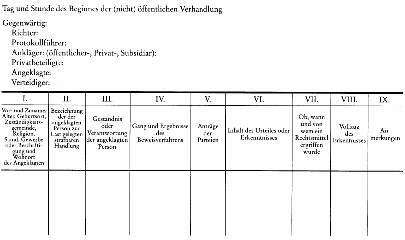

Verordnung vom 25. Mai 1914 betreffend die Einführung eines Strafregisterblattes für das Verfahren in einfachen Übertretungsfällen beim Fürstlich Liechtensteinischen Landgericht Vaduz Aufgrund des § 307 des Gesetzes vom 31. Dezember 1913, LGBl. 1914 Nr. 3 , betreffend die Einführung einer Strafprozessordnung wird verordnet wie folgt: § 1 In einfachen Übertretungsfällen ist das Verhandlungsprotokoll in Form eines Strafregisterblattes nach dem beigeschlossenen Formulare zu führen. § 2 Ein Strafregisterblatt darf nur für einen Straffall verwendet werden. Es bildet einen Bestandteil des betreffenden Strafaktes und ist mit demselben zu registrieren. § 3 1) Was im Strafregisterblatt anzuführen ist, zeigen die Überschriften der einzelnen Rubriken. 2) Zu denselben wird bemerkt: In Rubrik II ist die unter Anklage gestellte Tat kurz zu bezeichnen. 3) Rubrik III hat die wesentlichen Momente aus der Verantwortung der angeklagten Person zu enthalten. Gesteht dieselbe die ihr zur Last gelegte Handlung ein, ist nur das Wort "Geständnis" einzutragen. 4) Rubrik IV soll den Gang des Verfahrens ersichtlich machen und die Ergebnisse des Beweisverfahrens in möglichst gedrängter Darstellung enthalten. 5) Die zur Verlesung gebrachten Aktenstücke sind kurz zu bezeichnen und aus den Aussagen der Zeugen und Sachverständigen nur die entscheidenden Punkte anzuführen. 6) Bei den Zeugen und Sachverständigen sind Vor- und Zuname, Alter, Stand, Gewerbe und Aufenthaltsort anzugeben. Der Umstand, ob ein Zeuge oder Sachverständiger beeidet wurde, ist ebenfalls anzuführen. 7) In Rubrik V sind die Schlussanträge der Parteien und deren allfällige Zwischenanträge, welchen nicht stattgegeben wurde, zu protokollieren. 8) Rubrik VI ist nach den Bestimmungen des § 307 alinea 3 der Strafprozessordnung vom 31. Dezember 1913 LGBl. 1914 Nr. 3 auszufüllen und darin auch die Rechtsmittelbelehrung anzumerken. § 4 1) Das Strafregisterblatt ist vom Richter und Protokollführer zu fertigen. 2) Eine Unterfertigung von den Parteien, Zeugen und Sachverständigen findet nicht statt. 3) Die für die Parteien bestimmte Abschrift des Strafregisterblattes wird nur vom Richter unterschrieben. Vaduz, den 25. Mai 1914 Fürstliche Regierung: Leopold Freiherr von Imhof m. p. Fürstlicher Landesverweser Strafregisterblatt des Fürstlich Liechtensteinischen Landgerichtes in Vaduz (§ 307 StPO) 

