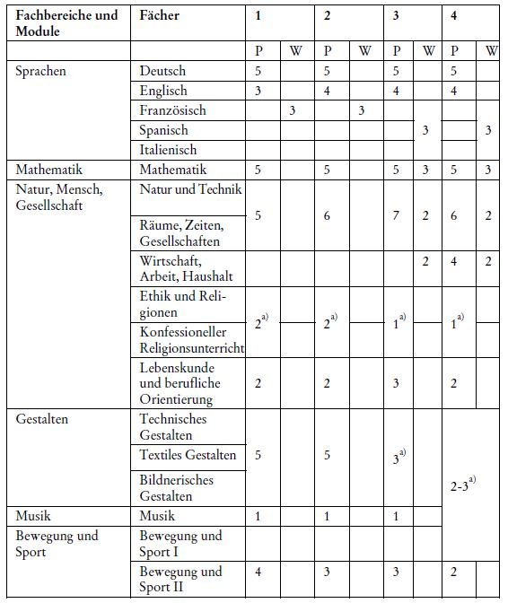
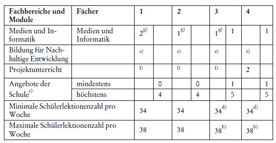
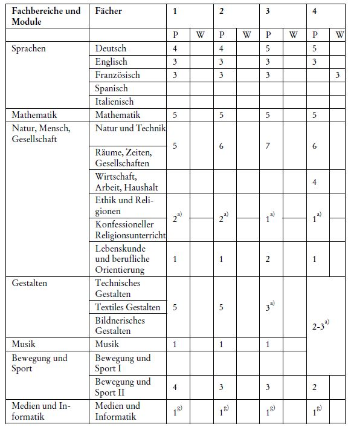
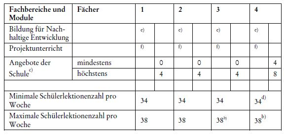
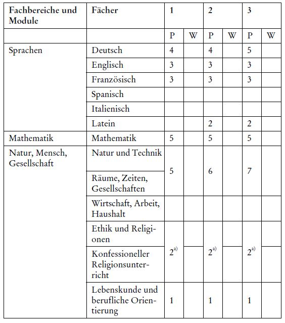
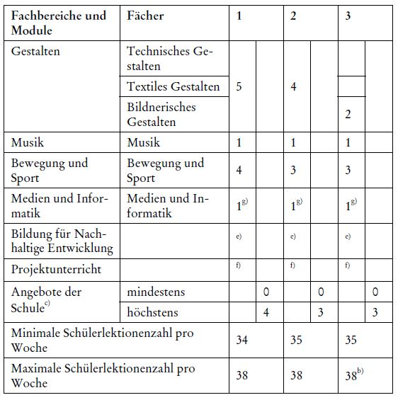

Verordnung vom 6. Juli 2004 über die Organisation der öffentlichen Schulen (Schulorganisationsverordnung, SchulOV) Aufgrund von Art. 5 Abs. 3, Art. 7 Abs. 4, Art. 8, 11, 12, 13, 21, 23a Abs. 1, Art. 27 Abs. 2, Art. 38, 41 Abs. 2, Art. 45, 48 Abs. 2, Art. 51d Abs. 4, Art. 75 Abs. 2 und 3, Art. 91 Abs. 4 sowie Art. 102 Abs. 2, 4 und 5 des Schulgesetzes (SchulG) vom 15. Dezember 1971, LGBl. 1972 Nr. 7, in der geltenden Fassung, verordnet die Regierung: I. Allgemeine Bestimmungen Art. 1 Geltungsbereich und Gegenstand 1) Diese Verordnung gilt vorbehaltlich Abs. 2 für alle öffentlichen Schulen nach Art. 3 des Schulgesetzes. 2) Sie gilt mit Ausnahme von Art. 7a nicht für die Berufsmittelschule, die Sonderschulen und das Freiwillige 10. Schuljahr. 2a) Die Art. 13d und 13e gelten nur für den Kindergarten, die Primarschule sowie die Stufen 1 bis 4 der Sekundarschulen (ohne 4. Stufe des Gymnasiums). 3) Sie regelt: a) die Schulbezirke; b) die Klassen; b bis ) die Lehrerstellen; b ter ) den Schuljahresbeginn, die Ferien und die Einstellung des Schulbetriebes; c) die ordentliche Unterrichtszeit; c bis ) den Lehrplan und die Lektionentafeln für die Schularten nach Abs. 2a; d) die ausserordentlichen Schulveranstaltungen; e) das Absenzenwesen; f) die Schulordnung; f bis ) die Abgabe von Lehrmitteln und Schulmaterial; g) die Einschreibung sowie den Ein- und Austritt von Schülern; g bis ) die Aufnahme von Schülern mit ausländischem Wohnsitz; h) die Schulorgane und deren Aufgaben; i) die Zusammenarbeit zwischen Schule und Eltern sowie die Öffentlichkeitsarbeit. k) die Mitverwendung von Schulgebäuden und -anlagen für schulfremde Zwecke. Art. 2 Begriffe und Bezeichnungen 1) Im Sinne dieser Verordnung gelten als "Eltern" alle zur Erziehung berechtigten Personen. 2) Unter den in dieser Verordnung verwendeten Personen-, Berufs- und Funktionsbezeichnungen sind Angehörige des weiblichen und männlichen Geschlechts zu verstehen. II. Schulbezirke Art. 3 Kindergarten, Primarschule 1) Bei den Kindergärten ist der Schulbezirk die Gemeinde. 2) Bei den Primarschulen bestimmt der Gemeindeschulrat die Schulbezirke je Schule nach geographischen Gesichtspunkten, damit in den einzelnen Bezirken möglichst gleich grosse Klassen gebildet werden können. 3) Werden Klassen des Kindergartens und der Primarschule zusammengelegt, bestimmt der Gemeindeschulrat den massgeblichen Schulbezirk. Art. 4 Sekundarschulen 1) Bei der Oberschule sind die Schulbezirke wie folgt festgelegt: a) Schulbezirk Balzers, Triesen und Triesenberg; b) Schulbezirk Vaduz, Schaan und Planken; c) Schulbezirk Unterland. 2) Bei der Realschule sind die Schulbezirke wie folgt festgelegt: a) Schulbezirk Balzers; b) Schulbezirk Triesen und Triesenberg; c) Schulbezirk Vaduz; d) Schulbezirk Schaan und Planken; e) Schulbezirk Unterland. 3) Beim Gymnasium und bei Sportklassen an Realschulen ist der Schulbezirk das Land Liechtenstein. Art. 4a Absehen vom vorgesehenen Schulbezirk aus besonderen Gründen 1) Das Schulamt kann nach Anhörung der betroffenen Schulen anstelle des vorgesehenen Schulbezirks einen anderen festlegen, wenn: a) Schulen in benachbarten Schulbezirken gleichmässig ausgelastet werden sollen; b) die ausserfamiliäre Betreuung eines Schulpflichtigen dies erfordert; c) ein Wechsel des schulischen Umfelds aus psychosozialen Gründen angezeigt ist. 2) In den Fällen nach Abs. 1 Bst. b und c ist ein begründeter Antrag der Eltern erforderlich. III. Klassen Bildung von Klassen Art. 5 a) Grundsatz 1) In jeder Schulart werden die Schüler entsprechend der von ihnen zu absolvierenden Schulstufe in Klassen zusammengefasst. 2) Sind in einem Schulbezirk mehrere Klassen auf derselben Schulstufe zu bilden, hat die Zuteilung der Schüler in die einzelnen Klassen nach sachgerechten Kriterien zu erfolgen. Die Zuteilung der Schüler in die einzelnen Klassen erfolgt durch die Schulleitung. Beim Kindergarten ist zusätzlich die Genehmigung des Gemeindeschulrates erforderlich. Art. 5a b) Abweichende Vorschriften 1) Klassen der Kindergärten, Primarschulen und Tagesschulen sowie Sportklassen der Realschulen können schulstufen- und/oder schulartenübergreifend geführt werden. Die Zuteilung der Schüler in die einzelnen Klassen erfolgt durch die Schulleitung. Bei schulartenübergreifenden Klassen des Kindergartens und der Primarschule ist zusätzlich die Genehmigung des Gemeindeschulrates erforderlich. 2) Besondere Vorschriften für die Bildung von Klassen gelten für: a) die Integration sonderschulbedürftiger Kinder (Art. 23a Abs. 5 und Art. 82 Abs. 2 SchulG); b) die Bildung von Leistungszügen (Art. 41 und 48 Abs. 1 SchulG); c) besondere schulische Massnahmen (Art. 15a SchulG). Art. 6 Richtzahlen für die Klassenbestände 1) Massgeblich für die Bildung von Klassen im Schulbezirk sind: a) die unteren und oberen Richtzahlen nach Anhang 1; und b) die effektiven Schülerzahlen an dem vom Schulamt bestimmten Stichtag im Frühjahr. 2) Von Abs. 1 kann im Schulbezirk abgewichen werden, wenn: a) die obere Richtzahl geringfügig überschritten wird; für einzelne Lektionen kann die Gruppe erforderlichenfalls in zwei Gruppen aufgeteilt werden; b) dadurch die Stilllegung eines Kindergartenstandorts verhindert oder eine sachgerechte Zuteilung (Art. 5 Abs. 2) in Gemeinden mit mehr als zwei Kindergartenstandorten ermöglicht wird und zu erwarten ist, dass im nächstfolgenden Schuljahr die Richtzahlen wieder eingehalten werden. Andernfalls hat der Gemeindeschulrat die Anzahl der Kindergartenstandorte zu verringern; c) Aufgehoben d) dadurch alternierende Gruppen bei höchstens zwei Wochenlektionen in Klassen der ersten oder zweiten Stufe der Primarschule mit mehr als 15 Schülern gebildet werden; e) im nächstfolgenden Schuljahr auf der Primarstufe Zugänge von Einführungsklassen bzw. auf der Sekundarstufe I Zu- und Abgänge infolge Umteilungen und Repetitionen zu erwarten sind; vorbehalten bleibt Abs. 4; f) dadurch die Zusammenlegung oder Trennung von Klassen der fünften Stufe der Primarschule und von Klassen der vierten Stufe der Ober- und Realschulen verhindert werden kann. Die Abweichung von der Richtzahl muss geringfügig sein; g) die untere Richtzahl für Sportklassen, bilinguale Klassen, einzelne Profile oder einzelne alternativ wählbare Profilfächer der gymnasialen Oberstufe infolge Abgängen später unterschritten wird; h) eine integrierte Sonderschulung Betreuungsaufwand verursacht, der weder durch Ergänzungsunterricht noch durch eine Klassenhilfe abgedeckt werden kann; oder i) das Platzangebot nicht ausreichend und eine Platzerweiterung unverhältnismässig ist. 2a) Abweichend von Abs. 1 können bestehende schularten- und/oder schulstufenübergreifende Klassen des Kindergartens und der Primarschule mit folgenden Schülerzahlen geführt werden: a) 12 bis 28 Schüler: 1 Klasse; b) 25 bis 56 Schüler: 2 Klassen; c) 48 bis 81 Schüler: 3 Klassen; d) 68 bis 104 Schüler: 4 Klassen; e) 85 bis 130 Schüler: 5 Klassen; f) 108 bis 150 Schüler: 6 Klassen; g) 126 bis 175 Schüler: 7 Klassen. 3) Über Abweichungen nach Abs. 2 und 2a entscheidet das Schulamt auf Antrag der Schulleitung; in den Fällen nach Abs. 2 Bst. b ist vorgängig der Gemeindeschulrat anzuhören. 4) Im Fall von Abs. 2 Bst. e kann eine zweite Klasse derselben Stufe geführt werden, wenn die obere Richtzahl, einschliesslich höchstens vier (an der Oberschule höchstens zwei) im nächstfolgenden Schuljahr erwarteten Zu- und Abgängen, eingehalten wird. Eine dritte, vierte bzw. fünfte Klasse derselben Stufe kann geführt werden, wenn die obere Richtzahl, einschliesslich bis höchstens acht, zwölf bzw. sechzehn (an der Oberschule vier, sechs bzw. acht) erwarteten Zu- und Abgängen, eingehalten wird. Bei Zu- und Abgängen auf der Sekundarstufe I ist auf den Durchschnitt der Erfahrungswerte der letzten drei Schuljahre abzustellen. IIIa. Lehrerstellen Art. 6a Festlegung von Lehrerstellen 1) Das Schulamt legt vorbehaltlich Abs. 2 die erforderlichen Lehrerstellen je Schulart und Schulstufe unter Berücksichtigung der Klassenbestände nach Art. 6 fest. 2) Lehrerstellen werden unabhängig von den Klassenbeständen festgelegt zur Durchführung: a) von Angeboten der Schule auf der 4. Stufe der Ober- und Realschule; b) des Fachbereichs Gestalten; c) des Faches Wirtschaft, Arbeit, Haushalt; d) der Grundschulung im Fach Musik im Kindergarten und auf den ersten beiden Stufen der Primarschule; und e) von besonderen schulischen Massnahmen und Massnahmen der Begabtenförderung. 3) Die Lehrerstellen nach Abs. 2 sind unter Angabe der Stellenprozente im Rahmen des Voranschlags so festzulegen, dass die Zwecke der Angebote und Massnahmen erreicht werden können. Das Schulamt kann das Nähere in Richtlinien festlegen. Art. 7 Leitung der Klasse 1) Die Leitung einer Klasse obliegt dem Klassenlehrer. 2) Die Zuteilung der Klassenlehrer zu den einzelnen Klassen erfolgt nach Rücksprache mit dem Schulamt und nach Anhörung der betroffenen Lehrer durch die Schulleitung. IIIb. Schuljahresbeginn, Ferien und Einstellung des Schulbetriebes Art. 7a Ferien 1) Der Schuljahresbeginn und die Verteilung der Ferien auf das Schuljahr richten sich nach Anhang 2. 2) Dem Schulamt obliegt die Publikation der Feriendaten; sie hat mindestens ein Schuljahr im Voraus zu erfolgen. Art. 7b Einstellung des Schulbetriebes aus besonderen Anlässen 1) Die Schulleitung kann den Schulbetrieb aus besonderen schulbezogenen Anlässen insgesamt höchstens bis zu einem Tag pro Jahr einstellen. Als besondere schulbezogene Anlässe gelten insbesondere: a) Besuch von auswärtigen Schulen zu Studienzwecken; b) Weiterbildungsveranstaltungen, sofern sie nicht in der unterrichtsfreien Zeit durchgeführt werden können; c) Besuch von pädagogischen Veranstaltungen. 2) Die Einstellung des Schulbetriebes ist den Eltern unter Angabe des Grundes mindestens zwei Wochen im Voraus schriftlich anzukündigen. IV. Ordentliche Unterrichtszeit Art. 8 Beginn und Ende, Mittagspause 1) Der Unterricht beginnt im Kindergarten und an der Primarschule nicht vor 8.00 Uhr, an den Sekundarschulen nicht vor 7.30 Uhr. 2) Die Mittagspause dauert mindestens 75 Minuten. An Schulen mit Mittagsverpflegung kann die Pause zugunsten von Wahlfächern bis auf 40 Minuten verkürzt werden. 3) Während der Mittagspause ist Pflicht- oder Wahlpflichtunterricht untersagt. Ausgenommen hievon ist das Fach Wirtschaft, Arbeit, Haushalt, sofern das Mittagessen während des Unterrichtes eingenommen wird. 4) Der Pflicht- und Wahlpflichtunterricht endet spätestens um 17.00 Uhr. 5) Abweichungen von Abs. 1 bis 4 sind mit Zustimmung des Schulamtes zulässig, sofern schulorganisatorische Gründe, insbesondere knappe Raumangebote, dies erfordern. Art. 9 Unterrichtseinheit Die Unterrichtseinheit beträgt auf allen Schulstufen eine Lektion zu 45 Minuten. Art. 10 Unterrichtspause 1) Vormittags sind Unterrichtspausen wie folgt einzulegen: a) auf allen Stufen eine zusammenhängende Unterrichtspause von mindestens 20 Minuten; b) auf der Sekundarstufe zusätzlich mindestens zwei Unterrichtspausen von fünf Minuten. 2) Nachmittags ist eine Unterrichtspause von 15 Minuten einzulegen, sofern der Nachmittagsunterricht mehr als zwei Lektionen aufweist. Umfasst der Nachmittagsunterricht auf der Primarstufe drei Lektionen, kann die Unterrichtspause verkürzt werden. Art. 10a Pflicht-, Wahlpflicht- und Wahlunterricht 1) Es wird unterschieden zwischen: a) Pflichtunterricht; b) Wahlpflichtunterricht; c) Wahlunterricht. 2) Pflichtunterricht ist von allen Kindern zu besuchen. Beim Wahlpflichtunterricht müssen einzelne oder mehrere Teilbereiche aus einem vorgegebenen Angebot ausgewählt und besucht werden. Beim Wahlunterricht kann der Teilbereich frei gewählt werden. 3) Das Schulamt kann Richtlinien über den Umfang und Inhalt des Wahlunterrichts erlassen. Art. 11 Verteilung der Lektionen 1) Es ist eine möglichst gleichmässige Belegung der Wochentage mit Lektionen anzustreben. 2) Für den Pflicht- und Wahlpflichtunterricht gelten die folgenden Mindest- und Höchstlektionenzahlen je Schulwoche, -tag und -halbtag: Kindergarten Primarstufe Sekundarstufe je Unterrichtswoche höchstens 28 Lektionen höchstens 30 Lektionen höchstens 38 Lektionen je Schultag mit der Primarschule zu koordinieren 4 bis 8 Lektionen 3 bis 9 Lektionen (ohne Wirtschaft, Arbeit, Haushalt) je Schulvormittag mit der Primarschule zu koordinieren 4 Lektionen im Block 2 bis 5 Lektionen je Schulnachmittag mit der Primarschule zu koordinieren 2 bis 4 Lektionen 2 bis 5 Lektionen 3) Abweichend von Abs. 2 darf mit Bewilligung der Schulleitung ab der 3. Sekundarstufe die Höchstlektionenzahl um maximal drei Lektionen überschritten werden. 4) Der Unterricht findet statt: a) an fünf Vormittagen; und b) an Nachmittagen wie folgt: 1. im Kindergarten und auf der 1. und 2. Stufe der Primarschule: an mindestens drei Nachmittagen; 2. auf allen anderen Schulstufen: in der Regel an vier Nachmittagen. 5) Sofern schulorganisatorische Gründe, insbesondere knappe Raumangebote, dies erfordern, kann das Schulamt für jeweils ein Schuljahr Ausnahmen von den Bestimmungen nach Abs. 4 bewilligen. 6) Der Samstag und der Mittwochnachmittag sind vorbehaltlich Abs. 7 unterrichtsfrei. 7) Auf der Oberstufe des Gymnasiums kann, sofern dies aus zwingenden schulorganisatorischen Gründen, insbesondere knappen Raumangeboten, erforderlich ist: a) der Mittwochnachmittag mit einem anderen Nachmittag getauscht werden; b) ein Wahlfach am Abend eines Schultages bis spätestens 21.00 Uhr oder am Samstagvormittag angesetzt werden. Art. 12 Stundenplan 1) Je Klasse ist ein Stundenplan mit den folgenden Angaben festzulegen: a) Beginn und Ende der Unterrichtszeit; b) Verteilung der Lektionen auf die Wochentage; c) Fächer (auf der Sekundarstufe); d) Klassenlehrer und alle weiteren der Klasse zugeteilten Lehrer; e) Unterrichtsräume; f) weitere Informationen nach Weisung des Schulamtes. 2) Die Stundenplanung im Schulhaus obliegt der Schulleitung; sie sorgt in Zusammenarbeit mit den einzelnen Lehrern dafür, dass: a) die Eltern bzw. der mündige Schüler rechtzeitig vor Beginn des Schuljahres oder eines Semesters einen Klassenstundenplan erhalten, der mindestens die Angaben nach Abs. 1 Bst. a bis d enthält; b) das Schulamt rechtzeitig vor Beginn des Schuljahres oder eines Semesters für jeden eingesetzten Lehrer einen Lehrerstundenplan nach Weisung des Schulamtes erhält. Art. 13 Besondere Regelung für den Kindergarten 1) Der Unterricht ist soweit als möglich mit den Unterrichtszeiten an der Primarschule zu koordinieren. 2) Die Kindergärtnerin kann pro Woche einen Nachmittag bestimmen, an dem es den Eltern überlassen wird, ob sie ihr Kind in den Kindergarten schicken wollen oder nicht. Vor der Festlegung des Nachmittags hat die Kindergärtnerin die Eltern anzuhören. 3) Die Kindergärtnerin kann auf Gesuch der Eltern Kinder im ersten Kindergartenjahr vom Kindergartenbesuch am Nachmittag dispensieren, längstens bis zu den Herbstferien. Art. 13a Besondere Regelung für Sportklassen 1) Die Unterrichts- und Trainingszeiten von Sportklassen sind zu koordinieren. 2) Die Schulleitung legt die Unterrichts- und Trainingszeiten in Absprache mit der Kommission Sportschule fest. Art. 13b Besondere Regelung für Tagesschulen Die Schulleitung kann für Tagesschulen abweichende Unterrichtszeiten festlegen. Bei Schulen, die von den Gemeinden getragen werden, ist die Zustimmung des Gemeindeschulrates erforderlich. Art. 13c Besondere Regelung für Eingangs- und Blockzeiten an Kindergärten und Primarschulen Die Schulleitung kann mit Zustimmung des Gemeindeschulrates zusätzliche Eingangs- und Blockzeiten für den Wahlunterricht festlegen. IVa. Lehrplan und Lektionentafeln Art. 13d Lehrplan 1) Der Lehrplan für die Schulen nach Art. 1 Abs. 2a wird von der Regierung nach Massgabe von Art. 8 des Schulgesetzes erlassen und auf der Internetseite des Schulamtes veröffentlicht. 2) Er legt die Ziele für den Unterricht verbindlich fest und ist ein verbindliches Planungsinstrument für Lehrpersonen, Schulen, Schulamt und Regierung. 3) Ausserdem orientiert er Eltern und Erziehungsberechtigte, Schüler und die Öffentlichkeit über die an den Schulen nach Art. 1 Abs. 2a zu erreichenden Kompetenzen. Art. 13e Lektionentafeln 1) Die Lektionentafeln für die Schulen nach Art. 1 Abs. 2a sind in den Anhängen 3 bis 6 aufgeführt. 2) In den Lektionentafeln wird jedem Fachbereich und Modul sowie gegebenenfalls jedem Fach eine bestimmte Anzahl Wochenlektionen zugeordnet. 3) Von den Lektionentafeln kann ausnahmsweise abgewichen werden: a) aus didaktischen Gründen (z.B. für Projektunterricht), sofern Abweichungen bis zum Ende eines Schuljahres ausgeglichen werden; b) aus organisatorischen Gründen in Klassen, welche mehrere Stufen der Primarschule und/oder des Kindergartens umfassen, sofern mit geeigneten Massnahmen dafür gesorgt wird, dass jedes Kind die im Lehrplan vorgegebenen Kompetenzen erlangen kann; c) bei Sportklassen an Realschulen in den Fachbereichen Gestalten, Musik, Bewegung und Sport sowie in Teilbereichen ohne Promotionsnoten im Rahmen einer Reduktion von höchstens sieben Wochenlektionen. 4) Das Schulamt kann Richtlinien zur praktischen Anwendung der Lektionentafeln erlassen. V. Ausserordentliche Schulveranstaltungen Art. 14 Begriff Als ausserordentlich gelten vom Stundenplan nach Art. 12 Abs. 2 Bst. a abweichende Schulveranstaltungen, insbesondere Schulreisen, Sporttage, Klassenlager, Exkursionen, Sportwochen sowie Theater-, Kino- und Konzertbesuche. Art. 15 Kategorien Es werden folgende Kategorien von ausserordentlichen Schulveranstaltungen unterschieden: a) Veranstaltungen, die höchstens einen halben Schultag dauern und im Schulhaus keinen Koordinierungsbedarf bewirken; b) Veranstaltungen, die höchstens einen Schultag dauern und im Schulhaus einen Koordinierungsbedarf bewirken; c) Veranstaltungen, die mehr als einen Schultag dauern. Art. 16 Pflichten des für die Durchführung der Veranstaltung verantwortlichen Lehrers 1) Veranstaltungen nach Art. 15 Bst. a, welche ausserhalb des Schulareals stattfinden, sind der Schulleitung rechtzeitig zu melden. 2) Veranstaltungen nach Art. 15 Bst. b und c sind durch die Schulleitung zu bewilligen. 3) Veranstaltungen nach Art. 15 Bst. c sind zudem in der Jahresplanung der Schule zu berücksichtigen. 4) Veranstaltungen nach Art. 15, die nicht in der ordentlichen Unterrichtszeit stattfinden, sind den Eltern rechtzeitig anzukündigen. Die Ankündigung von Veranstaltungen nach Art. 15 Bst. b und c hat in der Regel schriftlich zu erfolgen; ihr ist ein Programm über den geplanten Verlauf der Veranstaltung beizulegen. Art. 17 Kosten 1) Es ist darauf zu achten, dass ausserordentliche Schulveranstaltungen möglichst kostengünstig für die Eltern durchgeführt werden. 2) Im Kindergarten, in den Primarschulen und in den Sekundarschulen der Stufen 1 bis 4 darf von den Eltern ein Beitrag von höchstens 10 Franken je Schüler und Tag für die Verpflegung eingehoben werden. VI. Absenzenwesen Art. 18 Schulbesuchspflicht 1) Die Schüler haben an allen Schulen den Unterricht gemäss Stundenplan regelmässig und pünktlich zu besuchen. Diese Pflicht gilt auch für vorschriftsgemäss angekündigte ausserordentliche Schulveranstaltungen (Art. 16 Abs. 4) sowie bei Wahlfächern, für die Schüler angemeldet worden sind. 2) Die Schulbesuchspflicht entfällt bei Wahlfächern, sobald ein Schüler aus einem der beiden folgenden Gründe auf Ende eines Semesters vom Wahlfach abgemeldet wird: a) Änderung in der Berufswahl auf der 9. Schulstufe; b) gefährdete Promotion. Art. 19 Begriff und Feststellung der Absenz 1) Als eine Absenz gilt: a) das Fernbleiben vom Unterricht oder von einer ausserordentlichen Schulveranstaltung während einer Lektion; oder b) mehrmaliges Zuspätkommen. 2) Die Feststellung der Absenz obliegt dem jeweils unterrichtenden Lehrer. Art. 20 Kontrolle und Massnahmen 1) Dem Klassenlehrer obliegt es, den für die Absenz angegebenen Rechtfertigungsgrund auf seine Berechtigung hin zu überprüfen. 2) Wird als Rechtfertigungsgrund eine Erkrankung oder Erholungsbedürftigkeit des Schülers geltend gemacht, kann der Klassenlehrer im Zweifelsfall die Vorlage eines ärztlichen Zeugnisses oder bei dessen Vorlage eine vertrauensärztliche Untersuchung durch den Amtsarzt verlangen. 3) Gibt es für eine Absenz keinen ausreichenden Rechtfertigungsgrund und kann der Schüler für die Absenz verantwortlich gemacht werden, ist nach Art. 24 vorzugehen. 4) Grobe Verstösse gegen die gesetzliche Schulbesuchspflicht sind dem Schulamt zu melden. Das Schulamt ist befugt, das unentschuldigte Fernbleiben vom Unterricht nach Art. 88 Abs. 2 und 3 des Schulgesetzes zu ahnden. 5) Die Schulleitung des Gymnasiums ist befugt, im Hinblick auf die Zulassung zur Matura (Art. 31 der Verordnung über den Lehrplan, die Promotion und die Matura auf der Oberstufe des Liechtensteinischen Gymnasiums) zusätzliche Regeln über die Handhabung des Absenzenwesens auf der 6. und 7. gymnasialen Schulstufe zu erlassen. Art. 21 Dispensen 1) Schüler können vorbehaltlich Abs. 7 und Art. 13 Abs. 3 aus gesundheitlichen oder anderen wichtigen Gründen vom ordentlichen Unterricht oder von ausserordentlichen Schulveranstaltungen dispensiert werden. 2) Die Dispens kann auf bestimmte Fächer oder auf bestimmte ausserordentliche Schulveranstaltungen beschränkt werden. 3) Die Dispens ist zu befristen, wenn sie nicht aus gesundheitlichen, sondern aus anderen wichtigen Gründen erteilt wird. 4) Die Zuständigkeit für die Erteilung des Dispenses richtet sich nach Art. 83 Abs. 6 des Schulgesetzes. 5) Im Zweifelsfall kann die für die Dispens zuständige Stelle die Vorlage eines ärztlichen Zeugnisses oder bei dessen Vorlage eine vertrauensärztliche Untersuchung durch den Amtsarzt verlangen. 6) Das Schulamt ist befugt, Richtlinien über das Dispenswesen zu erlassen. 7) Dispensationen zum Zweck der Befreiung von lehrplanmässigen Lernzielen sind unzulässig. VII. Schulordnung Art. 22 Rechte des Schülers und deren Einschränkung 1) Der Schüler hat Anspruch auf einen nach Massgabe des Lehrplanes vorbereiteten sowie nach pädagogischen Kriterien gestalteten Unterricht. 2) Der Schüler hat Anspruch auf eine kompetenzorientierte, sachgerechte und nachvollziehbare Beurteilung. 3) Die Rechte des Schülers dürfen nur insoweit eingeschränkt werden, als es für die Erlangung der in den Lehrplänen umschriebenen Ziele und Kompetenzen erforderlich ist. Dies gilt insbesondere in Bezug auf die persönliche Integrität des Schülers und in Bezug auf sein Recht, im vorgegebenen schulischen Rahmen die Meinung frei äussern zu dürfen. 4) Bei der Erteilung von Hausaufgaben ist darauf zu achten, dass dem Schüler eine angemessene Freizeit verbleibt. Am Vortag eines Feiertages dürfen keine Hausaufgaben auf den nächsten Schultag erteilt werden, ebenso wenig vom Freitag auf Montag sowie über Mittag. Art. 22a Mitverantwortung und Mitsprache der Schüler 1) Den Schülern ist entsprechend ihrem Alter und ihrem Entwicklungsstand Mitverantwortung und Mitsprache einzuräumen, insbesondere: a) im Unterricht, soweit der Lehrplan dies vorsieht; b) durch die Förderung der Selbstbeurteilung; c) bei Regelungen, die das Zusammenleben im Schulhaus betreffen; d) bei der Planung und Durchführung von ausserordentlichen Schulveranstaltungen; e) bei der Gestaltung von Schul- und Aufenthaltsräumen sowie Pausenplätzen. 2) Schulleitung und Lehrer fördern Bestrebungen von Schülern, welche ihre Mitverantwortung und Mitsprache in organisierter Form wahrnehmen möchten. Art. 23 Pflichten des Schülers Der Schüler ist verpflichtet, a) sich am Unterricht und an den Aktivitäten der Klassen- und Schulgemeinschaft zu beteiligen und sich für das Erreichen der vorgegebenen Lernziele nach Kräften einzusetzen; b) die Hausaufgaben sorgfältig zu erledigen; c) die Schulgemeinschaft zu respektieren, einen respektvollen Umgangston zu pflegen und die dem jeweiligen Unterricht oder der jeweiligen Schulveranstaltung angepasste Kleidung zu tragen. Unschickliche, ungesunde oder gefährliche Kleidungsstücke und Embleme sind untersagt. Ebenso ist das Mitbringen von Gegenständen, die die Sicherheit gefährden oder den Schulbetrieb stören, verboten; Alkohol-, Tabak- und Drogenkonsum ist auf sämtlichen Schulveranstaltungen untersagt; d) die im Rahmen der Aufsicht notwendigen Anordnungen der Schulleitung und der Lehrer zu befolgen sowie sich an die Hausordnung zu halten; e) Anlagen, Einrichtungen, Lehrmittel und Schulmaterial der Schule sorgfältig zu behandeln. Art. 24 Massnahmen 1) Gegen Schüler, die die Schulpflicht noch nicht erfüllt haben und vorsätzlich gegen die Pflichten nach Art. 23 verstossen, können nach Massgabe der Schwere des Verstosses und Verschuldens folgende Massnahmen angeordnet werden: a) mündlicher oder schriftlicher Verweis; b) Zusatzaufgaben unter Berücksichtigung der Belastung des Schülers; c) beaufsichtigtes Nachsitzen, jedoch nicht über Mittag; d) Versetzung in eine Parallelklasse desselben oder eines anderen Schulbezirkes; e) Androhung des Ausschlusses vom Wahlfach, sofern sich der Pflichtverstoss auf das Wahlfach bezieht; f) Androhung des Ausschlusses von der Schule; g) Ausschluss vom Wahlfach, sofern sich der Pflichtverstoss auf das Wahlfach bezieht; h) Ausschluss von einer bestimmten ausserordentlichen Schulveranstaltung, sofern der Pflichtverstoss die Teilnahme an der Veranstaltung als zu riskant erscheinen lässt; nach Möglichkeit ist der Schüler mit Zusatzaufgaben zu beschäftigen; i) zeitweiser Ausschluss vom regulären Unterrichtsbesuch oder vom Besuch einzelner Fächer; der Schüler ist verpflichtet, die durch den Ausschluss verpassten Lernziele selber zu erarbeiten; der Ausschluss darf nicht länger als für 15 Unterrichtswochen angeordnet werden; wird der Ausschluss eines noch nicht schulpflichtigen oder eines schulpflichtigen Schülers länger als für zehn Unterrichtstage angeordnet, sind begleitende Massnahmen zur Verbesserung des Verhaltens des Schülers zu treffen; die Massnahme kann mit einem Verbot verbunden werden, das Schulhausareal zu betreten; k) zeitweiser oder dauernder Ausschluss aus der Schule nach Art. 89 des Schulgesetzes, allenfalls verbunden mit einem Verbot, das Schulhausareal zu betreten. 1a) Hat der Schüler die Schulpflicht erfüllt, stehen nach Massgabe der Schwere des Verstosses und Verschuldens die Massnahmen nach Abs. 1 Bst. a, b, f und k zur Verfügung. 2) Zuständig für die Anordnung von Massnahmen sind: a) der einzelne Lehrer für Massnahmen nach Abs. 1 Bst. a bis c; b) die Schulleitung für Massnahmen nach Abs. 1 Bst. d bis h; c) die Schulleitung für Massnahmen nach Abs. 1 Bst. i, soweit die Dauer der Massnahme zehn Unterrichtstage nicht übersteigt; d) das Schulamt für Massnahmen nach Abs. 1 Bst. i, soweit die Dauer der Massnahme zehn Unterrichtstage übersteigt, sowie für Massnahmen nach Abs. 1 Bst. k. 3) Bei den Massnahmen nach Abs. 1 Bst. c bis d sind die Eltern zu informieren. Die Massnahmen nach Abs. 1 Bst. e bis k sind den Eltern oder dem mündigen Schüler schriftlich mitzuteilen und zu begründen. 4) Bei den Massnahmen nach Abs. 1 Bst. d bis k hat die zuständige Stelle (Abs. 2) Protokoll zu führen über: a) das festgestellte Fehlverhalten des Schülers; b) die Begründung für die angeordnete Massnahme; c) die Gewährung des rechtlichen Gehörs. 5) Vorbehalten bleibt eine Beurteilung des Betragens im Zeugnis entsprechend den Bestimmungen über die Beurteilung der Schüler. 6) Nicht erlaubt sind Körper-, Kollektiv-, Geld- und Naturalstrafen. 7) Stört ein nicht mehr schulpflichtiger Schüler den Unterricht in schwerwiegender Weise, so kann ihn der Lehrer nach fruchtloser Mahnung unverzüglich und für die Dauer von höchstens zwei Lektionen vom Unterricht suspendieren. VIIa. Lehrmittel und Schulmaterial Art. 24a Begriffe 1) Als Lehrmittel gelten die aufgrund des Lehrplanes im Unterricht eingesetzten Medien, insbesondere Printmedien (z.B. Bücher, Arbeits- und Lösungshefte), elektronische Medien (z.B. Compact Discs, Digital Versatile Discs) und elektronische Lernplattformen. 2) Als Schulmaterial gilt, vorbehaltlich Abs. 3, das aufgrund des Lehrplanes für den Unterricht zwingend benötigte Material (z.B. Reprographien, Taschenrechner, Zirkel). 3) Nicht als Schulmaterial gelten insbesondere persönliche Kleidung (z.B. für den Sportunterricht) und persönliche Utensilien (z.B. Schreibzeug und -material, Schultasche). Art. 24b Subventionierung Lehrmittel und Schulmaterial für Schüler im Kindergarten, in den Primarschulen und in den Sekundarschulen der Stufen 1 bis 4 werden zu Lasten des Schulträgers unentgeltlich abgegeben; für Schüler anderer Schulen erfolgt die Abgabe ermässigt. Die Ermässigung beträgt 25 % vom Anschaffungspreis für die Schulen. Art. 24c Mehrfachverwendung Lehrmittel und Schulmaterial sind nach Empfehlung des Schulamtes mehrfach zu verwenden. VIII. Einschreibung, Ein- und Austritt von Schülern Art. 25 Einschreibung 1) Durch die Einschreibung werden erfasst: a) Kinder, die nach Art. 25a berechtigt sind, in den Kindergarten einzutreten; b) Kinder, die nach Art. 25b verpflichtet sind, in die Primarschule einzutreten. 2) Bei Kindern, die in eine schulartenübergreifende Klasse des Kindergartens und der Primarschule eintreten, genügt die Einschreibung nach Abs. 1 Bst. a. 3) Das Schulamt setzt den Zeitpunkt der Einschreibung der Kinder fest und gibt deren Zeitpunkt durch öffentliche Kundmachung bekannt. Art. 25a Eintritt in den Kindergarten und vorzeitige Aufnahme 1) Kinder, welche am 30. Juni (Stichtag) das vierte Lebensjahr erfüllt haben, sind berechtigt, in den Kindergarten einzutreten. 2) Die Frist nach Art. 23a Abs. 1 des Schulgesetzes, innert welcher die Eltern nach vorgängiger Orientierung durch die Schulleitung frei über einen Eintritt ihres Kindes in den Kindergarten entscheiden können, beträgt zwei Monate. Sie beginnt am 1. Juli und endet am 31. August eines Jahres. 3) Kinder, welche nach dem 30. Juni das vierte Lebensjahr erfüllt haben, werden vorerst provisorisch aufgenommen. Das Provisorium dauert bis zu den Herbstferien. Zeigt sich, dass ein Kind noch nicht fähig ist, dem Unterricht im Kindergarten zu folgen, entfällt das Recht zum Kindergartenbesuch. Im Streitfall entscheidet das Schulamt auf der Grundlage eines schulpsychologischen Gutachtens. 4) Über eine vorzeitige Aufnahme nach Art. 23a Abs. 2 des Schulgesetzes entscheidet die Schulleitung. Art. 25b Eintritt in die Schule, vorzeitige Aufnahme und Rückstellung 1) Schulpflichtig sind Kinder, welche am 30. Juni (Stichtag) das sechste Lebensjahr erfüllt haben. 2) Die Frist nach Art. 75 Abs. 3 des Schulgesetzes, innert welcher die Eltern frei über den Eintritt ihres Kindes in die Schulpflicht entscheiden können, beträgt vier Monate. Sie beginnt jeweils am 1. Mai und endet am 31. August eines Jahres. 3) Die Schulleitung entscheidet über: a) die vorzeitige Aufnahme in die Schulpflicht nach Art. 75 Abs. 4 des Schulgesetzes; b) die Rückstellung eines noch nicht schulfähigen Kindes nach Art. 86 Abs. 1 des Schulgesetzes. Art. 26 Späterer Eintritt 1) Schüler, die zufolge Zuzugs oder Schulwechsels später eintreten, sind raschmöglichst in jene Schulart und Schulstufe aufzunehmen, welche sie bisher besucht haben. 2) Später eintretende Schüler sind vorbehaltlich Abs. 3, 3a und 4 vorerst für 20 Unterrichtswochen provisorisch aufzunehmen. Erfüllen sie in dieser Zeit die Lernziele oder Promotionsbedingungen der betreffenden Schulart und -stufe, so gelten sie als definitiv aufgenommen, andernfalls werden sie auf Antrag der Schulleitung vom Schulamt in eine dem Schüler angepasste Schulart und/oder Schulstufe zugewiesen. 3) In das Gymnasium und in die Realschule dürfen vorbehaltlich Abs. 3a und 4 nur Schüler aufgenommen werden, die: a) die Aufnahmebedingungen nach der Verordnung über die Aufnahme in die sowie die Promotion und den Übertritt auf der Sekundarstufe I bzw. nach der Verordnung über den Lehrplan, die Promotion und die Matura auf der Oberstufe des Liechtensteinischen Gymnasiums erfüllen; oder b) ein anderes vom Schulamt als gleichwertig beurteiltes Aufnahmeverfahren erfolgreich durchlaufen haben. Als gleichwertig gelten insbesondere Aufnahmeverfahren von ausländischen Staaten mit vergleichbaren Schulsystemen. 3a) Schüler, die die Bedingungen nach Abs. 3 nicht erfüllen, haben auf Gesuch hin eine schriftliche Aufnahmeprüfung in Deutsch, Mathematik, Englisch und höchstens einem weiteren Promotionsfach zu absolvieren. Eine einzelne schriftliche Prüfung dauert je Fach 60 bis höchstens 120 Minuten. 4) In Sportklassen dürfen ausserdem nur Schüler aufgenommen werden, die: a) die sportspezifischen Aufnahmebedingungen nach Art. 8a der Verordnung über die Aufnahme in die sowie die Promotion und den Übertritt auf der Sekundarstufe I erfüllen; oder b) ein anderes vom Schulamt als gleichwertig beurteiltes sportspezifisches Aufnahmeverfahren erfolgreich durchlaufen haben. Als gleichwertig gelten insbesondere sportspezifische Aufnahmeverfahren von ausländischen Staaten mit vergleichbaren Sportförderkonzepten. Art. 27 Austritt 1) Ein Austritt erfolgt, wenn ein Schüler: a) alle Schulstufen der betreffenden Schulart absolviert hat; b) in eine andere Schulart aufgenommen oder umgeteilt wird; oder c) wegzieht. 2) Ein Austritt erfolgt ausserdem auf Wunsch der Eltern, sofern der Schüler die Schulpflicht erfüllt hat. 3) Auf Antrag der Eltern kann die Schulleitung den Schüler vom Besuch des neunten Schuljahres befreien. Die Schulleitung holt die für den Entscheid notwendigen Gutachten ein. 4) Beim Austritt sind dem Schüler sämtliche Zeugnisse auszuhändigen. Kann kein Zeugnis ausgehändigt werden, ist der Schulbesuch schriftlich zu bestätigen. Art. 27a Bewilligung für den Besuch einer anerkannten ausländischen Schule 1) Über die Erteilung einer Bewilligung für den Besuch einer anerkannten ausländischen Schule nach Art. 85 des Schulgesetzes entscheidet das Schulamt. 2) Das Schulamt prüft, ob die ausländische Schule vom Sitzstaat anerkannt ist. VIIIa. Aufnahme von Schülern mit ausländischem Wohnsitz Art. 27b Aufnahme 1) Über die Aufnahme von Schülern mit ausländischem Wohnsitz entscheidet das Schulamt auf Gesuch der Eltern, bei den von den Gemeinden getragenen Schulen nach Anhörung des Gemeindeschulrates. Art. 26 findet sinngemäss Anwendung. 2) Es besteht kein Rechtsanspruch auf Aufnahme. 3) Nach Abs. 1 aufgenommene Schüler sind vorbehaltlich Art. 27d inländischen Schülern gleichgestellt. Art. 27c Verlegung des Wohnsitzes ins Ausland während des Schuljahres Schüler, welche ihren Wohnsitz während eines Schuljahres ins Ausland verlegen, sind berechtigt, bis zum Ende des laufenden Schuljahres an der Schule zu verbleiben. Art. 27d Schulgeld 1) Für nach Art. 27b aufgenommene Schüler ohne Anspruch auf unentgeltlichen Unterricht (Art. 7 Abs. 1 Bst. b SchulG) erhebt das Schulamt ein Schulgeld von 8 000 Franken pro Schuljahr. Das Schulgeld für den Besuch einer Primarschule oder eines Kindergartens ist der Gemeinde gutzuschreiben, die Träger der betreffenden Schule bzw. des betreffenden Kindergartens ist. 2) Wird das Schulgeld nicht entrichtet, so wird der Schüler aus der Schule ausgeschlossen. IX. Schulorgane A. Lehrerkonferenz Art. 28 Zusammensetzung, Beschlussfassung und Aufgaben 1) Die Lehrerkonferenz besteht aus allen Lehrern, welche im Schulbezirk unterrichten. Sie kann zur Verbesserung der Effizienz in Teilkonferenzen und Arbeitsgruppen aufgegliedert werden. 2) Die Lehrerkonferenz wird vom Schulleiter geleitet. Sie fasst ihre Beschlüsse mit einfacher Stimmenmehrheit. Für besonders wichtige Geschäfte kann ein Abstimmungsverfahren mit qualifiziertem Mehr vorgesehen werden. Bei Stimmengleichheit entscheidet der Schulleiter. Bei Abwesenheit des Schulleiters übernimmt dessen Stellvertreter seine Funktionen. 3) Die Lehrerkonferenz beschäftigt sich insbesondere mit Fragen der Schulentwicklung. 4) Sie erlässt eine Hausordnung. An Schulstandorten mit mehreren Schularten sind die entsprechenden Regelungen der Hausordnung zu koordinieren. 5) Aufgehoben B. Schulleitung Art. 29 Anforderungen an die Schulleitung 1) Als Schulleiter sind Lehrer zu bestellen, welche die Fähigkeit besitzen: a) ein Lehrerteam zu führen; b) Konflikte zu bewältigen; c) Schulentwicklungsprozesse zu leiten; und d) die Schulorganisation und -administration zu führen. 2) Die Bereitschaft zur entsprechenden Aus- und Weiterbildung wird vorausgesetzt. Art. 30 Aufgaben der Schulleitung 1) Der Schulleitung obliegen insbesondere: a) die Führung des Lehrpersonals hinsichtlich Schülerberatung und Elternzusammenarbeit (Art. 19 Bst. c LdG), Zusammenarbeit mit anderen Lehrern und Beteiligung an gemeinschaftlichen Aufgaben in der Schule (Art. 19 Bst. d LdG), Aufsicht über die Schüler (Art. 23 LdG), Einhaltung der Unterrichtszeiten (Art. 20 und 21 LdG) sowie Bewilligung und Kontrolle von Nebenbeschäftigungen (Art. 26 LdG); b) die Führung des übrigen Personals, bei Staatsangestellten nach den Vorschriften für das Staatspersonal; c) die Mitwirkung bei der Bestellung (Art. 8 LdV), Beurteilung (Art. 31a LdG), Versetzung (Art. 36 LdG) und Entlassung (Art. 41 und 42 LdG) von Lehrpersonal sowie bei der Stellenplanung (Art. 7 LdV); d) die Organisation des Schulbetriebs, einschliesslich Klassenbildung (Art. 5), Stundenplanung (Art. 12a SchulG sowie Art. 12 Abs. 2 und Art. 13a), Planung und Durchführung von ausserordentlichen Schulveranstaltungen (Art. 16 Abs. 2), Jahresplanung der Schule (Art. 16 Abs. 3), Absenzenwesen (Art. 20 Abs. 5 und Art. 21 Abs. 4), Disziplinarmassnahmen (Art. 24 Abs. 2 Bst. b), Lehrmittel- und Schulmaterialversorgung (Art. 24a), Entscheidung über die Mitverwendung von Schulräumlichkeiten (Art. 35a Abs. 1) sowie Krisen- und Evakuationsmanagement; e) die Entscheidung über die vorzeitige Aufnahme in den Kindergarten oder die Schule (Art. 23a Abs. 2 und Art. 75 Abs. 4 SchulG), die Befreiung vom 9. Schuljahr (Art. 76 Abs. 2 SchulG sowie Art. 27 Abs. 3) sowie die Rückstellung eines noch nicht schulfähigen Kindes (Art. 86 Abs. 1 SchulG); f) die Durchführung der Schüler- und Elternarbeit; g) die Durchführung der Öffentlichkeitsarbeit (Art. 35); h) die Zusammenarbeit mit dem Schulamt, insbesondere die Teilnahme an den vom Schulamt anberaumten Schulleiterkonferenzen; i) die Verwaltung der Schulkredite im Rahmen des Voranschlags aufgrund der Finanzhaushaltsgesetzgebung und der Weisungen des Schulamtes; k) die Aufbereitung und Zurverfügungstellung von Schülerdaten nach dem vom Schulamt vorgegebenen Standard; l) die Wahrnehmung von Meldepflichten nach Art. 80 Abs. 2 des Schulgesetzes; m) die Registrierung und Archivierung der Schulakten nach den massgeblichen Archivierungsrichtlinien; n) die Ablegung der Rechenschaft gegenüber den zuständigen Behörden und die Berichterstattung nach Weisung der vorgesetzten Behörden. 2) Aufgehoben 3) Die Schulleitung steuert und überwacht den Schulhausbetrieb und veranlasst raschestmögliche Abhilfe, wenn Misstände auftauchen. 4) Besteht die Schulleitung aus mehreren Personen (Stellvertreter, Prorektoren), kann der Schulleiter einzelne Schulleitungsaufgaben an diese Personen delegieren. Die Verantwortung für die Schulleitung verbleibt jedoch beim Schulleiter. 5) Schulleiter der Primarschulen und des Kindergartens nehmen mit beratender Stimme an den Sitzungen des Gemeindeschulrates teil. Art. 30a Richtlinien betreffend die Schulleitungen 1) Das Schulamt erlässt Richtlinien über das Verfahren zur Bestellung von Schulleitungen. 2) Aufgehoben C. Klassenkonferenz Art. 31 Klassenkonferenz bei Sekundarschulen 1) Die Klassenkonferenz besteht aus allen Lehrern, die in einer Klasse unterrichten. 2) Die Klassenkonferenz wird vom Klassenlehrer geleitet. Sie fasst ihre Beschlüsse mit einfacher Stimmenmehrheit. Bei Stimmengleichheit entscheidet der Klassenlehrer. 2a) Bei Promotionsentscheidungen, Übertrittsempfehlungen und Umteilungsanträgen hat der Lehrer für jedes Fach, das er unterrichtet, eine Stimme. Lehrer, die die Funktion des Klassenlehrers ausüben, und Ergänzungslehrer haben zusätzlich eine Stimme. 2b) Über die Beschlussfassung in der Klassenkonferenz ist ein Protokoll zu führen. 3) Die Zuständigkeiten der Klassenkonferenz sind geregelt in: a) der Verordnung über die Aufnahme in die sowie die Promotion und den Übertritt auf der Sekundarstufe I; b) der Verordnung über den Lehrplan und die Promotion auf der Oberstufe des Liechtensteinischen Gymnasiums. 4) Ausserdem behandelt sie fachliche, methodische und pädagogische Fragen, welche die Klasse betreffen. D. Klassenlehrer Art. 32 Klassenlehrer Der Klassenlehrer betreut die Schüler seiner Klasse in schulischen und persönlichen Angelegenheiten und berät die Klasse und die Eltern. Zu seinen Aufgaben gehören insbesondere: a) Zusammenarbeit mit anderen Lehrern, erforderlichenfalls auch mit Fachleuten und Fachstellen; b) Koordination der schulischen Erziehungsarbeit, soweit diese Koordination nicht in den Aufgabenbereich des Ergänzungslehrers fällt; c) Information und Beratung der Schüler und der Eltern in schulischer und erzieherischer Hinsicht; d) Zusammenarbeit mit den Eltern; e) Wahrnehmung organisatorischer Aufgaben und Führung des die Klasse betreffenden Schriftverkehrs. E. Kommission Sportschule Art. 32a Bestellung und Zusammensetzung 1) Die Regierung bestellt für die Sportklassen an der Realschule und am Gymnasium eine aus sechs Mitgliedern bestehende Kommission, deren Amtsdauer vier Jahre beträgt. 2) Die Kommission setzt sich aus mindestens je einem Vertreter des Schulamtes, der Stabstelle für Sport, der Realschule, des Gymnasiums und des Liechtenstein Olympic Comittee (LOC) zusammen. Die Regierung bestimmt einen Mitarbeiter des Schulamtes zum Vorsitzenden. Art. 32b Sitzungen und Beschlussfassung 1) Die Sitzungen der Kommission erfolgen nach Bedarf auf Einladung des Vorsitzenden. 2) Die Kommission ist beschlussfähig, wenn mindestens der Vorsitzende oder dessen Stellvertreter und vier weitere Mitglieder anwesend sind. 3) Die Kommission fasst ihre Beschlüsse mit Stimmenmehrheit. Bei Stimmengleichheit entscheidet der Vorsitzende. Art. 32c Aufgaben Der Kommission obliegen: a) die Entscheidung über die Erfüllung der sportspezifischen Aufnahme- und Verbleibebedingungen bei Schülern von Sportklassen; b) die Reihung von in Sportklassen aufzunehmenden Schülern nach den sportspezifischen Aufnahmebedingungen, wenn das Platzangebot nicht ausreicht; c) die Information der Schulleitung, dass: 1. ein Schüler einzelne Verbleibebedingungen nicht mehr erfüllt; oder 2. bei einem Schüler die Bereitschaft oder Fähigkeit zum Leistungssport nicht mehr vorhanden ist; d) die Beratung in sportspezifischen Angelegenheiten; e) die Ablegung von Rechenschaft über ihre Tätigkeit. X. Zusammenarbeit zwischen Schule und Eltern Art. 33 Aufgaben der Schule 1) Zur Zusammenarbeit mit den Eltern verpflichtet sind: a) die einzelnen Lehrer im Rahmen ihres Dienstauftrages (Art. 19 Lehrerdienstgesetz); b) die Klassenlehrer im Rahmen von Art. 32; c) im Übrigen die Schulleitung. 2) Die Zusammenarbeit mit den Eltern beinhaltet insbesondere: a) Information über den Ablauf des Schuljahres und über wichtige schulische Ereignisse; b) Ankündigung von ausserordentlichen Schulveranstaltungen; c) Information über die Schülerbeurteilung nach den einschlägigen Verordnungen; d) Besprechung von schulrelevanten Auffälligkeiten von Schülern und Hilfestellung, allenfalls unter Beizug von Fachleuten; e) Pflege der Schule als Gemeinschaft. 3) Als Formen der Zusammenarbeit stehen insbesondere zur Verfügung: a) schriftliche Informationen; b) Elterngespräche und mündliche Aussprachen, allenfalls unter Beizug von Fachleuten; c) Elternsprechtage; d) Elternabende; e) Schulbesuche; f) Schulbesuchstage; g) ausserordentliche Schulveranstaltungen. h) Informationsaustausch mit Elternvereinigungen. 4) Es ist Sache des einzelnen Lehrers, des Klassenlehrers oder der Schule, die für einen bestimmten Anlass geeignete Form der Zusammenarbeit zu bestimmen. Art. 34 Rechte und Pflichten der Eltern 1) Die Eltern haben Anspruch darauf, über alle wichtigen schulischen Ereignisse, welche ihr Kind betreffen, informiert zu werden. Dies gilt auch für Eltern von mündigen Schülern des Gymnasiums. 2) Die Eltern sind zur Zusammenarbeit mit der Schule verpflichtet (§ 137 Abs. 1 und § 146 ABGB, Art. 88 Abs. 1 Schulgesetz). 3) Erscheinen die Eltern ohne Angabe eines Grundes nicht zu Besprechungen, zu welchen sie vom Schulamt, von der Schulleitung, vom Klassenlehrer, vom Schulpsychologischen Dienst oder vom Therapeuten eingeladen worden sind, hat das Schulamt den Eltern die hieraus entstehenden Unkosten bis zu einem Betrag von 250 Franken in Rechnung zu stellen. 4) Beschädigt ein Schüler durch pflichtwidriges Verhalten Anlagen, Einrichtungen, Lehrmittel und Schulmaterial der Schule, so sind seine Eltern dem Schulträger nach den Bestimmungen des Allgemeinen bürgerlichen Gesetzbuches zum Ersatz des Schadens verpflichtet. Art. 35 Öffentlichkeitsarbeit Die Schule leistet die für ein positives Erscheinungsbild notwendige Öffentlichkeitsarbeit. Xa. Mitverwendung von Schulgebäuden und -anlagen für schulfremde Zwecke Art. 35a Schulgebäude und -anlagen des Landes 1) Über die Mitverwendung von landeseigenen Schulgebäuden und -anlagen für schulfremde Zwecke entscheidet die Schulleitung, bei Sporthallen das Schulamt. 2) Wer Schulgebäude und -anlagen nach Abs. 1 benutzt, ist verpflichtet, diese nach Weisung der Schulleitung und der Schulbehörden sorgfältig zu behandeln. 3) Beschädigt ein Benutzer durch pflichtwidriges Verhalten Anlagen, Einrichtungen, Lehrmittel und Schulmaterial der Schule, so ist er nach den Bestimmungen des Allgemeinen bürgerlichen Gesetzbuches zum Ersatz des Schadens verpflichtet. 4) Das Schulamt erlässt Richtlinien über die Mitverwendung von Schulgebäuden und -anlagen nach Abs. 1, insbesondere über allfällig zu erhebende Nutzungsgebühren. Es kann die Entscheidung über die Mitverwendung von Sporthallen für schulfremde Zwecke der Stabstelle für Sport übertragen. XI. Rechtsschutz Art. 36 Beschwerderecht 1) Gegen Entscheidungen und Beschlüsse der Schulorgane kann binnen 14 Tagen ab Zustellung Beschwerde beim Schulamt erhoben werden. 2) Gegen Verfügungen des Schulamtes kann binnen 14 Tagen ab Zustellung Beschwerde bei der Regierung erhoben werden. XII. Schlussbestimmungen Art. 36a Richtlinien für Sportschulen Das Schulamt erlässt auf Vorschlag der Kommission Sportschule Richtlinien, insbesondere über: a) die Zielsetzungen der Sportklassen; b) das Aufnahmeverfahren; c) die zur Verfügung stehenden Plätze; d) die Rechte und Pflichten der für die Durchführung der Trainingseinheiten verantwortlichen Sportverbände. Art. 37 Aufhebung bisherigen Rechts Es werden aufgehoben: a) Verordnung vom 30. August 1977 über Führung und Organisation der Kindergärten, LGBl. 1977 Nr. 58; b) Verordnung vom 23. August 1983 betreffend die Abänderung der Verordnung vom 30. August 1977 über Führung und Organisation der Kindergärten, LGBl. 1983 Nr. 46; c) Verordnung vom 28. Juli 1992 betreffend die Abänderung der Verordnung über Führung und Organisation der Kindergärten, LGBl. 1992 Nr. 72; d) Verordnung vom 1. April 1997 betreffend die Abänderung der Verordnung über Führung und Organisation der Kindergärten, LGBl. 1997 Nr. 83; e) Verordnung vom 31. März 1976 über Aufbau und Organisation der Primarschulen, LGBl. 1976 Nr. 36; f) Verordnung vom 13. Januar 1987 betreffend die Abänderung der Verordnung über Aufbau und Organisation der Primarschulen, LGBl. 1987 Nr. 13; g) Verordnung vom 9. Juni 1987 betreffend die Abänderung der Verordnung über Aufbau und Organisation der Primarschulen, LGBl. 1987 Nr. 20; h) Verordnung vom 28. Juli 1992 betreffend die Abänderung der Verordnung über Aufbau und Organisation der Primarschulen, LGBl. 1992 Nr. 75; i) Verordnung vom 4. Mai 1976 über Aufbau und Organisation der Oberschule, LGBl. 1976 Nr. 39; k) Verordnung vom 28. Juli 1992 betreffend die Abänderung der Verordnung über Aufbau und Organisation der Oberschule, LGBl. 1992 Nr. 74; l) Verordnung vom 28. April 1976 über Aufbau und Organisation der Realschulen, LGBl. 1976 Nr. 38; m) Verordnung vom 28. Juli 1992 betreffend die Abänderung der Verordnung über Aufbau und Organisation der Realschulen, LGBl. 1992 Nr. 76; n) Verordnung vom 26. Oktober 1993 betreffend die Abänderung der Verordnung über Aufbau und Organisation der Realschulen, LGBl. 1993 Nr. 97; o) Verordnung vom 28. September 1981 über Aufbau und Organisation des Liechtensteinischen Gymnasiums, LGBl. 1981 Nr. 56; p) Verordnung vom 28. Juli 1992 betreffend die Abänderung der Verordnung über Aufbau und Organisation des Liechtensteinischen Gymnasiums, LGBl. 1992 Nr. 73; q) Verordnung vom 19. April 1994 betreffend die Abänderung der Verordnung über Aufbau und Organisation des Liechtensteinischen Gymnasiums, LGBl. 1994 Nr. 25; r) Verordnung vom 7. Januar 1997 betreffend die Abänderung der Verordnung über Aufbau und Organisation des Liechtensteinischen Gymnasiums, LGBl. 1997 Nr. 37; s) Verordnung vom 12. August 1997 betreffend die Abänderung der Verordnung über Aufbau und Organisation des Liechtensteinischen Gymnasiums, LGBl. 1997 Nr. 168; t) Verordnung vom 22. August 2000 betreffend die Abänderung der Verordnung über Aufbau und Organisation des Liechtensteinischen Gymnasiums, LGBl. 2000 Nr. 179; u) Verordnung vom 30. Mai 1972 über die Errichtung und die Zuständigkeit des Schulamtes, LGBl. 1972 Nr. 40; v) Schulordnung vom 10. Dezember 1985 für die Primarschule und die ersten fünf Schulstufen der Hilfsschule, LGBl. 1986 Nr. 6; w) Schulordnung vom 10. Dezember 1985 für die Realschule, Oberschule und Hilfsschul-Oberstufe, LGBl. 1986 Nr. 5. Art. 38 Inkrafttreten Diese Verordnung tritt am 1. August 2004 in Kraft. Fürstliche Regierung: gez. Otmar Hasler Fürstlicher Regierungschef Anhang 1 (Art. 6 Abs. 1) Richtzahlen (RZ) für Klassenbestände Klassenbestand untere RZ obere RZ Schulart Kindergarten 10 20 schulartenübergreifende Klassen des Kindergartens und der Primarschule 12 24 Primarschule 12 24 Oberschule 8 16 Realschule 12 24 Gymnasium 12 24 Sportklasse auf der 1. Stufe der Sekundarschule 12 16 Sportklasse auf der 2. bis 4. Stufe der Sekundarschule 12 19 Sportklasse auf der gymnasialen Oberstufe 12 24 Teilbereiche (Pflichtunterricht) Sport auf der 1. bis 4. Stufe der Sekundarschule 10 20 Natur und Technik - 20 Praktische Übungen in Biologie, Chemie, Physik und Kunsterziehung auf der gymnasialen Oberstufe - 16 Wahlpflicht- und Wahlbereiche Sport 10 - Musisch-kulturelle Projekte und Angebote der Schule 8 a) - Ethik und Religionen; Konfessioneller Religionsunterricht 8 b) - Übrige Wahlpflichtfächer und -kurse 8 - Übrige Wahlfächer 10 c) - Legende a) Zur Einrichtung oder Aufrechterhaltung von Blockzeiten können Ausnahmen gemacht werden. b) Wird eine Doppellektion halbiert, kann der Minimalwert um zwei Schüler unterschritten werden. c) Auf der gymnasialen Oberstufe können für die Vorbereitung auf internationale Wissenschaftswettbewerbe und für das Kleine Latinum Ausnahmen gemacht werden. Anhang 2 (Art. 7a Abs. 1) Schuljahresbeginn und Ferien Ereignis Beginn Dauer/Ende 1. Semester des Schuljahres 17. August Fällt der 17. August auf einen Donnerstag, Freitag, Samstag oder Sonntag, beginnt das Schuljahr am darauffolgenden Montag. Herbstferien Erster Samstag im Monat Oktober 2 Wochen Weihnachtsferien 24. Dezember Fällt der 24. Dezember auf einen Dienstag, so beginnen die Ferien am 21. Dezember. 6. Januar Fällt der 6. Januar auf einen Donnerstag, so enden die Ferien am 9. Januar. 2. Semester des Schuljahres 2. Februar Fällt der 2. Februar auf einen Dienstag, so ist am 1. Februar schulfrei. Fällt der 2. Februar auf einen Donnerstag, so ist der 3. Februar schulfrei. Sportferien Fasnachtssamstag Fastensonntag Osterferien Mittag des Gründonnerstages Sonntag der zweiten auf Ostern folgenden Woche Wochenendbrücke Auffahrt Sonntag nach Auffahrt Wochenendbrücke Fronleichnam Sonntag nach Fronleichnam Sommerferien Erster Samstag des Monats Juli Fällt der erste Samstag auf den ersten Tag des Monats, so beginnen die Ferien am zweiten Samstag des Monats Juli. Anhang 3 (Art. 13e Abs. 1) Lektionentafel für den Kindergarten (KG) und die Primarschule Fachbereiche und Module Fächer KG Primarschule 1 2 3 4 5 Sprachen Deutsch a) 6 5 5 5 5 Englisch b) 2 2 2 2 Mathematik Mathematik a) 5 5 5 5 5 Natur, Mensch, Gesellschaft Natur, Mensch, Gesellschaft a) 4 e) 4 e) 5 e) 6 e) 6 e) Konfessioneller Religionsunterricht 1 2 2 2 2 Gestalten Technisches Gestalten Textiles Gestalten a) 4 4 4 4 4 Bildnerisches Gestalten Musik Musik a) 1 c) 1 c) 2 2 2 Bewegung und Sport Bewegung und Sport a) 3 3 3 3 3 Medien und Informatik Medien und Informatik a) b) b) b) 1 c) 1 c) Bildung für Nachhaltige Entwicklung a) b) b) b) b) b) Projektunterricht f) f) f) f) f) f) Schülerlektionenzahl pro Woche 23.3 24 26 28 30 30 Angebote der Schule d) d) d) d) d) d) Legende: a) Wird in den Unterricht integriert. b) Wird in andere Fächer integriert. c) Kompetenzen werden zusätzlich in andere Fächer integriert. d) Wahlunterricht (z.B. Chorgesang, Schulorchester, Schultheater, Sport, Technikförderung, Frühförderung, Hausaufgabenhilfe), insbesondere auch im Zusammenhang mit Eingangs- und Blockzeiten; islamischer Religionsunterricht. e) Zusätzlicher Unterricht für alle Schüler, welche den konfessionellen Religionsunterricht nicht besuchen. f) Kompetenzen und Inhalte verschiedener Fächer können im Rahmen von Art. 13e Abs. 3 Bst. a in Projektunterricht zusammengeführt werden. Anhang 4 (Art. 13e Abs. 1) Lektionentafel für die Oberschule 

 

 Legende: P = Pflichtunterricht; W = Wahlunterricht a) Eines der Fächer muss gewählt werden (Wahlpflicht). b) Abweichung zulässig nach Massgabe von Art. 11 Abs. 3. c) Wahlunterricht (z.B. Stütz- und Förderkurse sowie Lernbegleitung auf der 1. bis 3. Stufe, Chorgesang, Schulorchester, Schultheater, Sport, Technikförderung, Hausaufgabenhilfe); islamischer Religionsunterricht. d) Es ist mindestens so viel Wahlunterricht zu belegen, bis die minimale Schülerlektionenzahl pro Woche erreicht ist. e) Wird in andere Fachbereiche integriert. f) Kompetenzen und Inhalte verschiedener Fächer können im Rahmen von Art. 13e Abs. 3 Bst. a in Projektunterricht zusammengeführt werden. g) Kompetenzen werden zusätzlich in andere Fächer integriert. Anhang 5 (Art. 13e Abs. 1) Lektionentafel für die Realschule 

 

 Legende: P = Pflichtunterricht; W = Wahlunterricht a) Eines der Fächer muss gewählt werden (Wahlpflicht). b) Abweichung zulässig nach Massgabe von Art. 11 Abs. 3. c) Wahlunterricht (z.B. Stütz- und Förderkurse sowie Lernbegleitung auf der 1. bis 3. Stufe, Chorgesang, Schulorchester, Schultheater, Sport, Technikförderung, Hausaufgabenhilfe); islamischer Religionsunterricht. d) Es ist mindestens so viel Wahlunterricht zu belegen, bis die minimale Schülerlektionenzahl pro Woche erreicht ist. e) Wird in andere Fachbereiche integriert. f) Kompetenzen und Inhalte verschiedener Fächer können im Rahmen von Art. 13e Abs. 3 Bst. a in Projektunterricht zusammengeführt werden. g) Kompetenzen werden zusätzlich in andere Fächer integriert. Anhang 6 (Art. 13e Abs. 1) Lektionentafel für die Unterstufe des Gymnasiums 

 

 Legende: P = Pflichtunterricht; W = Wahlunterricht a) Eines der Fächer muss gewählt werden (Wahlpflicht). b) Abweichung zulässig nach Massgabe von Art. 11 Abs. 3. c) Wahlunterricht (z.B. Stütz- und Förderkurse sowie Lernbegleitung auf der 1. bis 3. Stufe, Chorgesang, Schulorchester, Schultheater, Sport, Technikförderung, Hausaufgabenhilfe); islamischer Religionsunterricht. d) Es ist mindestens so viel Wahlunterricht zu belegen, bis die minimale Schülerlektionenzahl pro Woche erreicht ist. e) Wird in andere Fachbereiche integriert. f) Kompetenzen und Inhalte verschiedener Fächer können im Rahmen von Art. 13e Abs. 3 Bst. a in Projektunterricht zusammengeführt werden. g) Kompetenzen werden zusätzlich in andere Fächer integriert. Übergangsbestimmungen 411.201 Schulorganisationsverordnung (SchulOV) Verordnung vom 16. April 2019 über die Abänderung der Schulorganisationsverordnung ... II. Übergangsbestimmungen 1) Während einer Einführungsfrist von längstens vier Jahren nach Inkrafttreten dieser Verordnung darf vom neuen Lehrplan (Art. 13d) abgewichen werden, sofern: a) inhaltliche, schulorganisatorische oder personelle Gründe einer Umstellung auf den neuen Lehrplan entgegenstehen; und b) sich dadurch keine Nachteile für die Schüler ergeben, insbesondere hinsichtlich ihrer schulischen Laufbahn. 2) Das Schulamt bestimmt im Einvernehmen mit der Schulleitung, in welchen Bereichen die einzelne Schule vom neuen Lehrplan abweichen darf. 3) Im Schuljahr 2019/20 gilt auf der dritten Stufe des Gymnasiums Folgendes: a) Für das Fach Latein stehen vier Wochenlektionen zur Verfügung. b) Das Fach Medien und Informatik wird nicht geführt. ...
