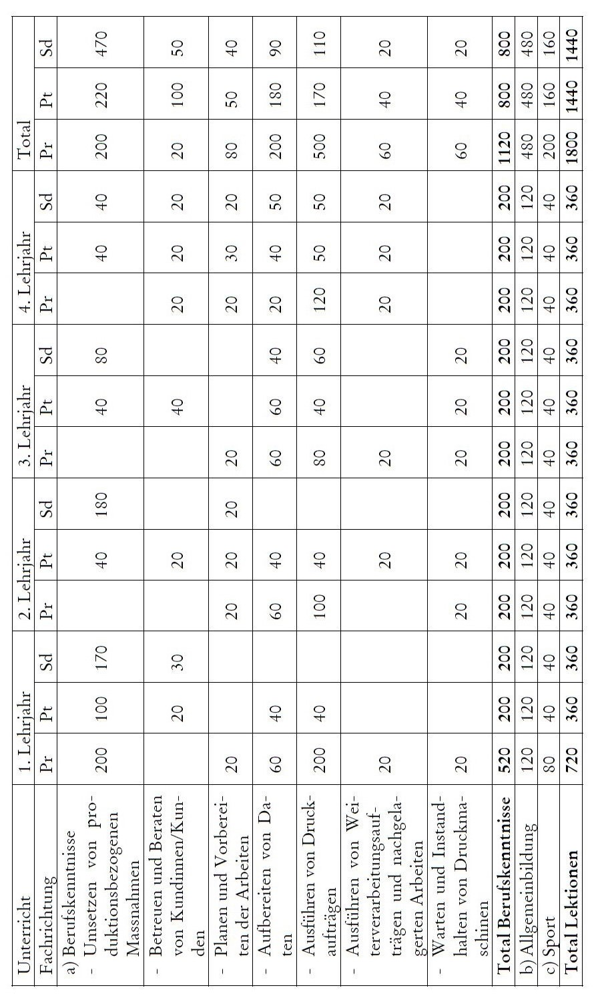

Verordnung vom 22. Januar 2019 über die berufliche Grundbildung Medientechnologin/Medientechnologe mit Fähigkeitszeugnis (FZ) Aufgrund von Art. 26 des Berufsbildungsgesetzes (BBG) vom 13. März 2008, LGBl. 2008 Nr. 103, in der geltenden Fassung, verordnet die Regierung: I. Gegenstand, Fachrichtungen und Dauer Art. 1 Berufsbild und Fachrichtungen 1) Medientechnologinnen/Medientechnologen beherrschen namentlich die folgenden Tätigkeiten und zeichnen sich durch folgende Kenntnisse, Fähigkeiten und Haltungen aus: a) Sie erstellen die unterschiedlichsten Druckprodukte wie zum Beispiel Zeitungen, Zeitschriften, Prospekte, Flyer oder Plakate und setzen dabei produktionsbegleitende Massnahmen zur Arbeitssicherheit, zum Gesundheitsschutz und zum Umweltschutz um. b) Sie nehmen Aufträge von Kundinnen/Kunden oder der Druckvorstufe entgegen und planen und bereiten die Arbeiten vor; hierzu stellen sie die Koordination mit vor- und nachgelagerten Abteilungen (Druckvorstufe, Weiterverarbeitung) sowie mit externen Partnern (Lieferanten, Versand) sicher. c) Sie übernehmen, bearbeiten und erstellen Druckdaten. d) Sie überprüfen und optimieren die Druckdaten, um ein optimales Druckergebnis sicherzustellen. e) Sie richten die Druckmaschinen und -systeme ein und führen sämtliche Vorbereitungsarbeiten aus. f) Sie führen einfache Weiterverarbeitungen sowie Verpackungs- und Versandaufträge aus. g) Sie überwachen den Druckprozess, ergreifen bei Störungen die entsprechenden Massnahmen und stellen die Instandhaltung der Maschinen sicher. 2) Innerhalb des Berufs der Medientechnologin/des Medientechnologen gibt es die folgenden Fachrichtungen: a) Print (Pr); b) Printmediatechnik (Pt); c) Siebdruck (Sd). 3) Die Fachrichtung wird vor Beginn der beruflichen Grundbildung im Lehrvertrag festgehalten. Art. 2 Dauer und Beginn 1) Die berufliche Grundbildung dauert vier Jahre. 2) Der Beginn der beruflichen Grundbildung richtet sich nach dem Schuljahr der zuständigen Berufsfachschule. II. Ziele und Anforderungen Art. 3 Grundsätze 1) Die Ziele und die Anforderungen der beruflichen Grundbildung werden in Form von Handlungskompetenzen, gruppiert nach Handlungskompetenzbereichen, festgelegt. 2) Die Handlungskompetenzen umfassen Fach-, Methoden-, Sozial- und Selbstkompetenzen. 3) Beim Aufbau der Handlungskompetenzen arbeiten alle Lernorte zusammen. Sie koordinieren die Inhalte der Ausbildung und der Qualifikationsverfahren. Art. 4 Handlungskompetenzen Die Ausbildung umfasst in den folgenden Handlungskompetenzbereichen die nachstehenden Handlungskompetenzen: a) Umsetzen von produktionsbezogenen Massnahmen: 1. Arbeitssicherheit, Gesundheitsschutz und Umweltschutz sicherstellen; 2. fachbezogene Berechnungen im Produktionsprozess vornehmen; 3. fachspezifische Anwenderprogramme in der Datenaufbereitung und im Produktionsprozess einsetzen; 4. produktionsrelevante naturwissenschaftliche Grundlagen berücksichtigen und anwenden; 5. Fertigungs- und Hilfsmaterialien sowie Bedruckstoffe im Produktionsprozess einsetzen; 6. Wertschöpfungskette der grafischen Industrie berücksichtigen und im Produktionsprozess der Betriebe umsetzen; 7. Druckverfahren vergleichen und beurteilen; 8. Medien und Technologien anwenden; b) Betreuen und Beraten von Kundinnen/Kunden: 1. Kommunikation mit Mitarbeiterinnen/Mitarbeitern sowie Kundinnen/Kunden sicherstellen; 2. Kundinnen/Kunden bezüglich Produktionsverfahren und Möglichkeiten der Produktion beraten; 3. Offerten für Druckerzeugnisse erstellen; 4. Reklamationen der Kundschaft entgegennehmen und bearbeiten; c) Planen und Vorbereiten der Arbeiten: 1. Fertigungsablauf für Druckaufträge erarbeiten; 2. Auftragsausführung mit vor- und nachgelagerten Abteilungen sowie externen Partnern koordinieren; 3. Automatisierungen im Produktionsablauf von Drucksachen planen und aufbauen; 4. Material einkaufen und disponieren; d) Aufbereiten von Daten: 1. Daten für Druckaufträge übernehmen und optimieren; 2. Druckdaten entsprechend dem Kundenwunsch und den betrieblichen Vorgaben gestalten; 3. Druckdaten personalisieren; 4. Gut zum Druck oder Prüfdruck (Proof) erstellen und auf Qualität und Vollständigkeit prüfen; 5. Formen oder Nutzen für einen effizienten Druck herstellen und Daten ausgeben; 6. Digitalisierungen von Dokumenten durchführen und bearbeiten; e) Ausführen von Druckaufträgen: 1. Farben herstellen und mischen; 2. Druckmaschinen und -systeme sowie Peripheriegeräte einrichten und umstellen; 3. Probeabzug oder ersten Druck des Druckerzeugnisses erstellen; 4. Druckerzeugnisse drucken und Druckprozess überwachen; 5. Druckerzeugnisse veredeln; 6. Druckerzeugnisse mit integrierten Anlagen weiterverarbeiten; 7. grossformatige Produkte herstellen; f) Ausführen von Weiterverarbeitungsaufträgen und nachgelagerten Arbeiten: 1. Druckerzeugnisse mit externen Anlagen zu fertigen Produkten weiterverarbeiten; 2. personalisierte Sendungen von Druckprodukten (Lettershop) herstellen; 3. Druckprodukte verpacken und versenden; g) Warten und Instandhalten von Druckmaschinen: 1. Druckmaschinen instand halten; 2. Störungen an Maschinen, auch solche aufgrund von Materialmängeln, beheben. III. Arbeitssicherheit, Gesundheitsschutz und Umweltschutz Art. 5 1) Die Anbieter der Bildung geben den Lernenden zu Beginn und während der Bildung Vorschriften und Empfehlungen zur Arbeitssicherheit, zum Gesundheitsschutz und zum Umweltschutz, insbesondere zur Gefahrenkommunikation (Gefahrensymbole, Piktogramme, Gebotszeichen) in diesen drei Bereichen, ab und erklären sie ihnen. 2) Diese Vorschriften und Empfehlungen werden an allen Lernorten vermittelt und in den Qualifikationsverfahren berücksichtigt. 3) Den Lernenden wird an allen Lernorten das Wissen über nachhaltige Entwicklung, insbesondere über den Ausgleich zwischen gesellschaftlichen, ökologischen und wirtschaftlichen Interessen, vermittelt. 4) Gemäss Art. 12 ArGV V können die Lernenden entsprechend ihrem Ausbildungsstand für die im Anhang zum Bildungsplan aufgeführten Arbeiten herangezogen werden. 5) Voraussetzung für einen Einsatz nach Abs. 4 ist, dass die Lernenden entsprechend den erhöhten Gefährdungen ausgebildet, angeleitet und überwacht werden; diese besonderen Vorkehrungen werden im Anhang zum Bildungsplan als begleitende Massnahmen der Arbeitssicherheit und des Gesundheitsschutzes festgelegt. IV. Umfang der Bildung an den einzelnen Lernorten und Unterrichtssprache Art. 6 Bildung in beruflicher Praxis im Betrieb und an vergleichbaren Lernorten Die Bildung in beruflicher Praxis im Betrieb umfasst: a) für die Fachrichtung Print: im ersten Bildungsjahr drei und ab dem zweiten Bildungsjahr vier Tage pro Woche; b) für die Fachrichtungen Printmediatechnik und Siebdruck: über die ganze Dauer der beruflichen Grundbildung vier Tage pro Woche. Art. 7 Berufsfachschule 1) Der obligatorische Unterricht an der Berufsfachschule umfasst: a) für die Fachrichtung Print: 1800 Lektionen; davon entfallen 200 Lektionen auf den Sportunterricht; b) für die Fachrichtungen Printmediatechnik und Siebdruck: 1440 Lektionen; davon entfallen 160 Lektionen auf den Sportunterricht. 2) Die Lektionen teilen sich gemäss nachfolgender Tabelle auf: 

 3) Bei den Lektionenzahlen sind geringfügige Verschiebungen zwischen den Lehrjahren innerhalb des gleichen Handlungskompetenzbereichs in Absprache mit dem Amt für Berufsbildung und Berufsberatung und den zuständigen Organisationen der Arbeitswelt möglich. Das Erreichen der vorgegebenen Bildungsziele muss in jedem Fall gewährleistet sein. 4) Für die Allgemeinbildung gilt die Verordnung über Mindestvorschriften für die Allgemeinbildung in der beruflichen Grundbildung. 5) Unterrichtssprache ist die Landessprache. Die Regierung kann neben dieser Unterrichtssprache andere Unterrichtssprachen zulassen. 6) Zweisprachiger Unterricht in der Landessprache und in einer Fremdsprache ist empfohlen. Art. 8 Überbetriebliche Kurse 1) Die überbetrieblichen Kurse umfassen 14 Tage zu acht Stunden. 2) Die Tage sind wie folgt auf drei Kurse aufgeteilt: a) Kurs 1: fünf Tage; b) Kurs 2: fünf Tage; c) Kurs 3: vier Tage. 3) Die Inhalte sind wie folgt auf die drei Kurse aufgeteilt: Lehrjahr Kurse Handlungskompetenzen Fachrichtungen Pr Pt Sd 1 Kurs 1 a1 Arbeitssicherheit, Gesundheitsschutz und Umweltschutz sicherstellen X X X a2 fachbezogene Berechnungen im Produktionsprozess vornehmen X X X a5 Fertigungs- und Hilfsmaterialien sowie Bedruckstoffe im Produktionsprozess einsetzen X X X b1 Kommunikation mit Mitarbeiterinnen/Mitarbeiter sowie Kundinnen/Kunden sicherstellen X X X b4 Reklamationen der Kundschaft entgegennehmen und bearbeiten X e2 Druckmaschinen und -systeme sowie Peripheriegeräte einrichten und umstellen X X X e4 Druckerzeugnisse drucken und Druckprozess überwachen X X X f1 Druckerzeugnisse mit externen Anlagen zu fertigen Produkten weiterverarbeiten X 2 Kurs 2 a3 fachspezifische Anwenderprogramme in der Datenaufbereitung und im Produktionsprozess einsetzen X X X b2 Kundinnen/Kunden bezüglich Produktionsverfahren und Möglichkeiten der Produktion beraten X d1 Daten für Druckaufträge übernehmen und optimieren X X X e3 Probeabzug oder ersten Druck des Druckerzeugnisses erstellen X e4 Druckerzeugnisse drucken und Druckprozess überwachen X X f1 Druckererzeugnisse mit externen Anlagen zu fertigen Produkten weiterverarbeiten X X g1 Druckmaschinen instand halten X 3 Kurs 3 d2 Druckdaten entsprechend dem Kundenwunsch und den betrieblichen Vorgaben gestalten X d3 Druckdaten personalisieren X e1 Farben herstellen und mischen X X e3 Probeabzug oder ersten Druck des Druckerzeugnisses erstellen X X e4 Druckerzeugnisse drucken und Druckprozess überwachen X X g1 Druckmaschinen instand halten X g2 Störungen an Maschinen, auch solche aufgrund von Materialmängeln, beheben X 4) Im letzten Semester der beruflichen Grundbildung dürfen keine überbetrieblichen Kurse stattfinden. V. Bildungsplan Art. 9 1) Mit dem Inkrafttreten dieser Verordnung liegt ein Bildungsplan der zuständigen Organisationen der Arbeitswelt vor. 2) Der Bildungsplan hat folgenden Inhalt: a) Er enthält das Qualifikationsprofil; dieses besteht aus: 1. dem Berufsbild; 2. der Übersicht über die Handlungskompetenzbereiche und die Handlungskompetenzen; 3. dem Anforderungsniveau des Berufes. b) Er führt die Inhalte der Grundbildung sowie die Bestimmungen zur Arbeitssicherheit, zum Gesundheitsschutz und zum Umweltschutz aus. c) Er bestimmt, an welchen Lernorten welche Handlungskompetenzen vermittelt und gelernt werden. 3) Dem Bildungsplan angefügt ist das Verzeichnis der Instrumente zur Sicherstellung und Umsetzung der beruflichen Grundbildung sowie zur Förderung der Qualität mit Angabe der Bezugsquelle. VI. Anforderungen an die Berufsbildnerinnen/Berufsbildner und Höchstzahl der Lernenden im Betrieb Art. 10 Fachliche Anforderungen an Berufsbildnerinnen/Berufsbildner Die fachlichen Anforderungen an eine Berufsbildnerin/einen Berufsbildner erfüllt, wer über eine der folgenden Qualifikationen verfügt: a) Medientechnologin/Medientechnologe mit mindestens zwei Jahren beruflicher Praxis im Lehrgebiet; b) Drucktechnologin/Drucktechnologe mit mindestens zwei Jahren beruflicher Praxis im Lehrgebiet; c) Fähigkeitszeugnis eines verwandten Berufs mit den notwendigen Berufskenntnissen im Bereich der Medientechnologin/des Medientechnologen und mit mindestens fünf Jahren beruflicher Praxis im Lehrgebiet; d) einschlägiger Abschluss der höheren Berufsbildung. Art. 11 Höchstzahl der Lernenden 1) Betriebe, die eine Berufsbildnerin/einen Berufsbildner zu 100 % oder zwei Berufsbildnerinnen/Berufsbildner zu je mindestens 60 % beschäftigen, dürfen eine lernende Person ausbilden. 2) Mit jeder zusätzlichen Beschäftigung einer Fachkraft zu 100 % oder von zwei Fachkräften zu je mindestens 60 % darf eine weitere lernende Person im Betrieb ausgebildet werden. 3) Als Fachkraft gilt, wer im Fachbereich der lernenden Person über ein Fähigkeitszeugnis oder über eine gleichwertige Qualifikation verfügt. 4) In Betrieben, die nur eine lernende Person ausbilden dürfen, kann eine zweite lernende Person ihre Bildung beginnen, wenn die erste in das letzte Jahr der beruflichen Grundbildung eintritt. 5) In besonderen Fällen kann das Amt für Berufsbildung und Berufsberatung einem Betrieb, der seit mehreren Jahren Lernende mit überdurchschnittlichem Erfolg ausgebildet hat, die Überschreitung der Höchstzahl der Lernenden bewilligen. VII. Lerndokumentation, Bildungsbericht und Leistungsdokumentationen Art. 12 Lerndokumentation 1) Die lernende Person führt während der Bildung in beruflicher Praxis eine Lerndokumentation, in der sie laufend alle wesentlichen Arbeiten im Zusammenhang mit den zu erwerbenden Handlungskompetenzen festhält. 2) Mindestens einmal pro Semester kontrolliert und unterzeichnet die Berufsbildnerin/der Berufsbildner die Lerndokumentation und bespricht sie mit der lernenden Person. Art. 13 Bildungsbericht 1) Die Berufsbildnerin/der Berufsbildner hält am Ende jedes Semesters den Bildungsstand der lernenden Person in einem Bildungsbericht fest. Sie oder er stützt sich dabei auf die Leistungen in der beruflichen Praxis und auf Rückmeldungen über die Leistungen in der Berufsfachschule und in den überbetrieblichen Kursen. Sie oder er bespricht den Bildungsbericht mit der lernenden Person. 2) Die Berufsbildnerin/der Berufsbildner und die lernende Person vereinbaren wenn nötig Massnahmen zum Erreichen der Bildungsziele und setzen dafür Fristen. Sie halten die getroffenen Entscheide und vereinbarten Massnahmen schriftlich fest. 3) Die Berufsbildnerin/der Berufsbildner überprüft die Wirkung der vereinbarten Massnahmen nach der gesetzten Frist und hält den Befund im nächsten Bildungsbericht fest. 4) Werden trotz der vereinbarten Massnahmen die Ziele nicht erreicht oder ist der Ausbildungserfolg gefährdet, so teilt die Berufsbildnerin/der Berufsbildner dies den Vertragsparteien und dem Amt für Berufsbildung und Berufsberatung schriftlich mit. Art. 14 Leistungsdokumentation in der Berufsfachschule Die Berufsfachschule dokumentiert die Leistungen der lernenden Person in den unterrichteten Handlungskompetenzbereichen und in der Allgemeinbildung und stellt ihr am Ende jedes Semesters ein Zeugnis aus. Art. 15 Leistungsdokumentation in den überbetrieblichen Kursen 1) Die Anbieter der überbetrieblichen Kurse dokumentieren die Leistungen der Lernenden in Form je eines Kompetenznachweises für jeden überbetrieblichen Kurs. 2) Die Kompetenznachweise werden in Noten ausgedrückt. Diese fliessen ein in die Berechnung der Erfahrungsnote. VIII. Qualifikationsverfahren Art. 16 Zulassung Zu den Qualifikationsverfahren wird zugelassen, wer die berufliche Grundbildung absolviert hat: a) nach den Bestimmungen dieser Verordnung; b) in einer dafür anerkannten Bildungsinstitution; oder c) ausserhalb eines geregelten Bildungsganges, soweit sie oder er: 1. die nach Art. 46 Abs. 3 BBG erforderliche Erfahrung erworben hat; 2. von dieser beruflichen Erfahrung mindestens vier Jahre im Bereich der Medientechnologin/des Medientechnologen erworben hat; und 3. glaubhaft macht, den Anforderungen der jeweiligen Qualifikationsverfahren gewachsen zu sein. Art. 17 Gegenstand In den Qualifikationsverfahren ist nachzuweisen, dass die Handlungskompetenzen nach Art. 4 erworben worden sind. Art. 18 Umfang und Durchführung des Qualifikationsverfahrens mit Abschlussprüfung 1) Im Qualifikationsverfahren mit Abschlussprüfung werden die Handlungskompetenzen in den nachstehenden Qualifikationsbereichen wie folgt geprüft: a) Praktische Arbeit, als individuelle praktische Arbeit (IPA) im Umfang von 20 bis 32 Stunden; dafür gilt Folgendes: 1. dieser Qualifikationsbereich wird gegen Ende der beruflichen Grundbildung geprüft; 2. die lernende Person muss zeigen, dass sie fähig ist, die geforderten Tätigkeiten fachlich korrekt sowie bedarfs- und situationsgerecht auszuführen; 3. die Lerndokumentation und die Unterlagen der überbetrieblichen Kurse dürfen als Hilfsmittel verwendet werden; 4. der Qualifikationsbereich umfasst alle Handlungskompetenzbereiche und enthält die folgenden Positionen mit den nachstehenden Gewichtungen: Position Beschreibung Gewichtung 1 Ausführen und Resultat der Arbeit 60 % 2 Dokumentation 10 % 3 Präsentation 10 % 4 Fachgespräch 20 % b) Berufskenntnisse, im Umfang von drei Stunden; dafür gilt Folgendes: 1. dieser Qualifikationsbereich wird gegen Ende der beruflichen Grundbildung geprüft; 2. der Qualifikationsbereich wird schriftlich geprüft und umfasst die folgenden Handlungskompetenzbereiche mit den nachstehenden Gewichtungen: Position Handlungskompetenzbereiche Gewichtung 1 Umsetzen von produktionsbezogenen Massnahmen Betreuen und Beraten von Kundinnen/Kunden Planen und Vorbereiten der Arbeiten Aufbereiten von Daten 50 % 2 Ausführen von Druckaufträgen Ausführen von Weiterverarbeitungsaufträgen und nachgelagerten Arbeiten Warten und Instandhalten von Druckmaschinen 50 % c) Allgemeinbildung: Dieser Qualifikationsbereich richtet sich nach der Verordnung über Mindestvorschriften für die Allgemeinbildung in der beruflichen Grundbildung. 2) In jedem Qualifikationsbereich beurteilen mindestens zwei Prüfungsexpertinnen/Prüfungsexperten die Leistungen. Art. 19 Bestehen, Notenberechnung, Notengewichtung 1) Das Qualifikationsverfahren mit Abschlussprüfung ist bestanden, wenn: a) der Qualifikationsbereich "praktische Arbeit" mindestens mit der Note 4 bewertet wird; und b) die Gesamtnote mindestens 4 beträgt. 2) Die Gesamtnote ist das auf eine Dezimalstelle gerundete Mittel aus der Summe der gewichteten Noten der einzelnen Qualifikationsbereiche der Abschlussprüfung und der gewichteten Erfahrungsnote; dabei gilt folgende Gewichtung: a) praktische Arbeit: 40 %; b) Berufskenntnisse: 20 %; c) Allgemeinbildung: 20 %; d) Erfahrungsnote: 20 %. 3) Die Erfahrungsnote ist das auf eine Dezimalstelle gerundete Mittel aus der Summe der folgenden Noten mit nachstehender Gewichtung: a) Note für den Unterricht in den Berufskenntnissen: 60 %; b) Note für die überbetrieblichen Kurse: 40 %. 4) Die Note für den Unterricht in den Berufskenntnissen ist das auf eine ganze oder halbe Note gerundete Mittel aus der Summe der acht Semesterzeugnisnoten. 5) Die Note für die überbetrieblichen Kurse ist das auf eine ganze oder halbe Note gerundete Mittel aus der Summe der drei benoteten Kompetenznachweise. Art. 20 Wiederholungen 1) Wiederholungen von Qualifikationsverfahren sind höchstens zweimal möglich. 2) Muss ein Qualifikationsbereich wiederholt werden, so ist er in seiner Gesamtheit zu wiederholen. 3) Wird die Abschlussprüfung ohne erneuten Besuch des Unterrichts in den Berufskenntnissen wiederholt, so wird die bisherige Erfahrungsnote beibehalten. Wird der Unterricht in den Berufskenntnissen während mindestens zwei Semestern wiederholt, so zählen für die Berechnung der Erfahrungsnote nur die neuen Noten. 4) Wird die Abschlussprüfung ohne erneuten Besuch von überbetrieblichen Kursen wiederholt, so wird die bisherige Note beibehalten. Werden die Kurse 2 und 3 wiederholt, so zählen für die Berechnung der Erfahrungsnote nur die neuen Noten. Art. 21 Qualifikationen ausserhalb eines geregelten Bildungsganges (Spezialfall) 1) Hat eine kandidierende Person die erforderlichen Handlungskompetenzen ausserhalb der geregelten beruflichen Grundbildung erworben und die Abschlussprüfung nach dieser Verordnung absolviert, so entfällt die Erfahrungsnote. 2) Für die Berechnung der Gesamtnote werden in diesem Fall die einzelnen Noten wie folgt gewichtet: a) praktische Arbeit: 50 %; b) Berufskenntnisse: 30 %; c) Allgemeinbildung: 20 %. IX. Ausweise und Titel Art. 22 Fähigkeitszeugnis 1) Wer ein Qualifikationsverfahren erfolgreich durchlaufen hat, erhält ein Fähigkeitszeugnis. 2) Das Fähigkeitszeugnis berechtigt, den gesetzlich geschützten Titel "Medientechnologin FZ"/"Medientechnologe FZ" zu führen. 3) Ist das Fähigkeitszeugnis mittels Qualifikationsverfahren mit Abschlussprüfung erworben worden, so werden im Notenausweis aufgeführt: a) die Gesamtnote; b) die Noten jedes Qualifikationsbereichs der Abschlussprüfung sowie, unter dem Vorbehalt von Art. 21 Abs. 1, die Erfahrungsnote. X. Qualitätsentwicklung und Organisation Art. 23 Kommission für Berufsentwicklung und Qualität Die Regierung kann eine Kommission bestimmen, der die Förderung der Berufsentwicklung und die Sicherstellung der Qualität für Medientechnologinnen/Medientechnologen obliegt. Art. 24 Trägerschaft und Organisation der überbetrieblichen Kurse 1) Träger für die überbetrieblichen Kurse sind: a) Viscom; b) Verband Werbetechnik + Print (VWP); c) Copyprintsuisse. 2) Die Regierung kann die Durchführung der überbetrieblichen Kurse unter Mitwirkung der zuständigen Organisationen der Arbeitswelt einer anderen Trägerschaft übertragen, namentlich wenn die Qualität oder die Durchführung der überbetrieblichen Kurse nicht mehr gewährleistet ist. 3) Sie regelt mit der Trägerschaft die Organisation und die Durchführung der überbetrieblichen Kurse. 4) Das Amt für Berufsbildung und Berufsberatung hat jederzeit Zutritt zu den Kursen. XI. Übergangs- und Schlussbestimmungen Art. 25 Aufhebung bisherigen Rechts Die Verordnung vom 26. Oktober 2010 über die berufliche Grundbildung Drucktechnologin/Drucktechnologe mit Fähigkeitszeugnis (FZ), LGBl. 2010 Nr. 299, in der geltenden Fassung, wird aufgehoben. Art. 26 Übergangsbestimmungen 1) Lernende, die ihre Bildung als Drucktechnologin/Drucktechnologe vor dem Inkrafttreten dieser Verordnung begonnen haben, schliessen sie nach bisherigem Recht ab, längstens jedoch bis zum 31. Dezember 2024. 2) Kandidierende, die das Qualifikationsverfahren mit Abschlussprüfung für Drucktechnologin/Drucktechnologe bis zum 31. Dezember 2024 wiederholen, werden nach bisherigem Recht beurteilt. Auf ihren schriftlichen Antrag hin werden sie nach neuem Recht beurteilt. 3) Die Bestimmungen über Qualifikationsverfahren, Ausweise und Titel (Art. 16 bis 22) kommen ab dem 1. Januar 2023 zur Anwendung. Art. 27 Inkrafttreten Diese Verordnung tritt am 1. Februar 2019 in Kraft. Fürstliche Regierung: gez. Dr. Daniel Risch Regierungschef-Stellvertreter
