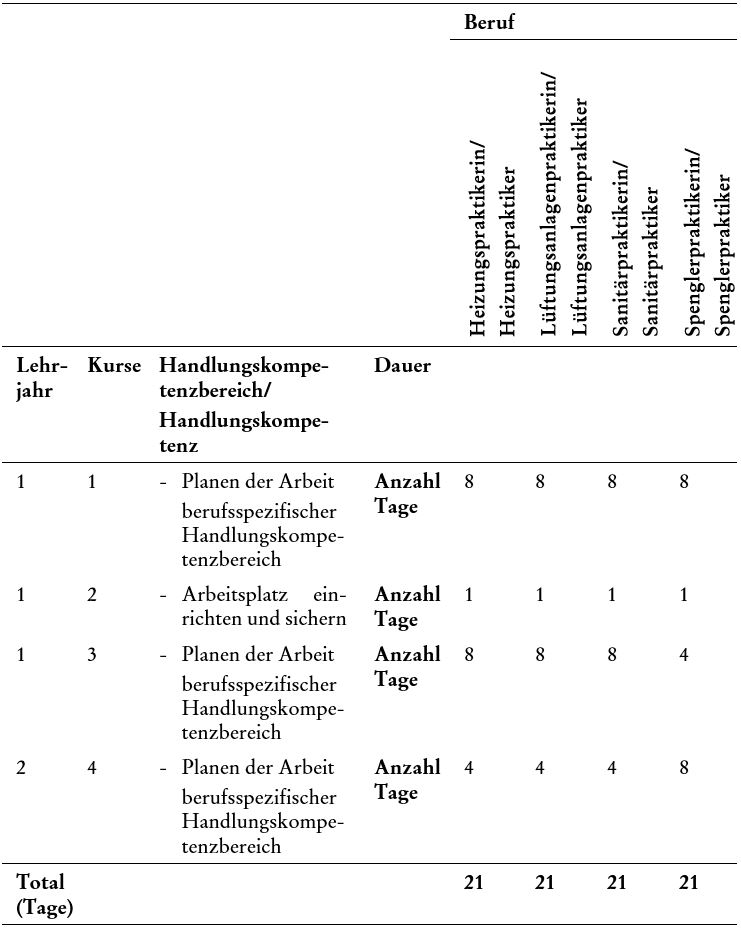

Verordnung vom 13. Juni 2023 über die berufliche Grundbildung im Berufsfeld "Gebäudetechnik" mit Berufsattest (BA) Aufgrund von Art. 26 des Berufsbildungsgesetzes (BBG) vom 13. März 2008, LGBl. 2008 Nr. 103, in der geltenden Fassung, verordnet die Regierung: I. Berufe, Gegenstand und Dauer Art. 1 Berufe und Berufsbild 1) Das Berufsfeld "Gebäudetechnik" umfasst folgende Berufe: a) Heizungspraktikerin/Heizungspraktiker; b) Lüftungsanlagenpraktikerin/Lüftungsanlagenpraktiker; c) Sanitärpraktikerin/Sanitärpraktiker; d) Spenglerpraktikerin/Spenglerpraktiker. 2) Der Beruf wird vor Beginn der beruflichen Grundbildung im Lehrvertrag festgehalten. 3) Die Fachleute im Berufsfeld "Gebäudetechnik" beherrschen namentlich die folgenden Tätigkeiten und zeichnen sich durch folgende Kenntnisse, Fähigkeiten und Haltungen aus: a) Heizungspraktikerinnen/Heizungspraktiker führen einfache Teilaufträge oder Routinetätigkeiten in der Vorfabrikation und der Installation von Leitungsrohren für Heizungsanlagen selbstständig aus; ausserdem unterstützen sie ihr Team bei der Montage von wärmetechnischen Anlagen; sie arbeiten grundsätzlich in Absprache mit ihrer vorgesetzten Person und verantworten die gewissenhafte und termingerechte Ausführung ihres Auftrags; sie zeichnen sich durch handwerkliches Geschick, speditives Arbeiten und körperliche Belastbarkeit aus. b) Lüftungsanlagenpraktikerinnen/Lüftungsanlagenpraktiker sind Fachpersonen für die Produktion oder Montage verschiedener Elemente von Lüftungs- und Klimaanlagen; sie führen einfache Teilaufträge oder Routinetätigkeiten selbstständig aus; ausserdem unterstützen sie das Team bei anspruchsvollen Montagearbeiten; sie arbeiten grundsätzlich in Absprache mit ihrer vorgesetzten Person und verantworten die gewissenhafte und termingerechte Ausführung ihres Auftrags; sie zeichnen sich durch handwerkliches Geschick, speditives Arbeiten und körperliche Belastbarkeit aus. c) Sanitärpraktikerinnen/Sanitärpraktiker führen einfache Teilaufträge oder Routinetätigkeiten bei der Montage von Trink- und Abwasseranlagen sowie bei der Installation von einfachen Vorwandsystemen und sanitären Apparaten selbstständig aus; ausserdem unterstützten sie das Team bei anspruchsvollen Montageaufträgen; sie arbeiten grundsätzlich in Absprache mit ihrer vorgesetzten Person und verantworten die gewissenhafte und termingerechte Ausführung ihres Auftrags; sie zeichnen sich durch handwerkliches Geschick, speditives Arbeiten und körperliche Belastbarkeit aus. d) Spenglerpraktikerinnen/Spenglerpraktiker sind Fachpersonen für Blech- und Montagearbeiten an Dächern und Fassaden; sie führen einfache Teilaufträge oder Routinetätigkeiten selbstständig aus; ausserdem unterstützen sie das Team bei anspruchsvollen Blecharbeiten; sie arbeiten grundsätzlich in Absprache mit ihrer vorgesetzten Person und verantworten die gewissenhafte und termingerechte Ausführung ihres Auftrags; sie zeichnen sich durch handwerkliches Geschick, speditives Arbeiten und körperliche Belastbarkeit aus. Art. 2 Dauer und Beginn 1) Die berufliche Grundbildung dauert zwei Jahre. 2) Der Beginn der beruflichen Grundbildung richtet sich nach dem Schuljahr der zuständigen Berufsfachschule. II. Ziele und Anforderungen Art. 3 Grundsätze 1) Die Ziele und die Anforderungen der beruflichen Grundbildung werden in Form von Handlungskompetenzen, gruppiert nach Handlungskompetenzbereichen, festgelegt. 2) Die Handlungskompetenzen umfassen Fach-, Methoden-, Sozial- und Selbstkompetenzen. 3) Beim Aufbau der Handlungskompetenzen arbeiten alle Lernorte zusammen. Sie koordinieren die Inhalte der Ausbildung und der Qualifikationsverfahren. Art. 4 Handlungskompetenzen für Heizungspraktikerin/Heizungspraktiker Die Ausbildung als Heizungspraktikerin/Heizungspraktiker umfasst in den folgenden Handlungskompetenzbereichen die nachstehenden Handlungskompetenzen: a) Planen der Arbeiten: 1. Auftrag entgegennehmen und erläutern; 2. Arbeitsplatz einrichten und sichern; 3. Rapporte erstellen; 4. Abfälle trennen und entsorgen; 5. Werkzeuge und Maschinen unterhalten; b) Montieren von wärmetechnischen Anlagen und Apparaten: 1. Anlagenkomponenten einbringen; 2. Wärmeerzeuger mit erneuerbaren Energien im Team montieren; 3. Wärmeerzeuger mit fossilen Brennstoffen im Team montieren; 4. Anlagen im Team demontieren; c) Installieren von Leitungen und Armaturen: 1. Material kontrollieren und lagern; 2. Montageskizzen erstellen; 3. Leitungen vorfabrizieren; 4. Leitungen nach Absprache installieren; 5. Armaturen, Pumpen, Mess-, Regel-, und Sicherheitseinrichtungen nach Absprache installieren; d) Montieren von wärmeabgebenden Komponenten: 1. Heizkörper nach Absprache montieren; 2. Fussbodenheizungen im Team verlegen; 3. Luftheizapparate und Deckenstrahlplatten im Team montieren; e) Inbetriebnehmen von wärmetechnischen Anlagen: 1. Druckprüfung im Team durchführen; 2. Anlage spülen; 3. Installation im Team befüllen. Art. 5 Handlungskompetenzen für Lüftungsanlagenpraktikerin/Lüftungsanlagenpraktiker Die Ausbildung als Lüftungsanlagenpraktikerin/Lüftungsanlagenpraktiker umfasst in den folgenden Handlungskompetenzbereichen die nachstehenden Handlungskompetenzen: a) Planen der Arbeiten: 1. Auftrag entgegennehmen und erläutern; 2. Arbeitsplatz einrichten und sichern; 3. Rapporte erstellen; 4. Abfälle trennen und entsorgen; 5. Werkzeuge und Maschinen unterhalten; b) Vorbereiten der Produktion und der Montage: 1. Material- und Stückliste für die Montage erstellen; 2. Materialbedarfsliste für die Produktion erstellen; 3. Produktionsablauf für die Herstellung von einfachen Formstücken und Luftleitungen bestimmen; c) Herstellen von Luftleitungssystemen und Bauteilen: 1. einfache eckige Formstücke und Luftleitungen von Hand abwickeln; 2. eckige Formstücke und Luftleitungen herstellen; 3. Formstücke und Luftleitungen maschinell abwickeln; 4. Formstücke und Luftleitungen zusammensetzen; 5. eckige Schalldämpfer herstellen; d) Installieren von Luftleitungssystemen und Bauteilen: 1. standardisierte Luftaufbereitungsgeräte montieren; 2. Luftleitungssysteme im Team installieren; 3. Luftdurchlässe montieren; 4. Anlagen im Team demontieren. Art. 6 Handlungskompetenzen für Sanitärpraktikerin/Sanitärpraktiker Die Ausbildung als Sanitärpraktikerin/Sanitärpraktiker umfasst in den folgenden Handlungskompetenzbereichen die nachstehenden Handlungskompetenzen: a) Planen der Arbeiten: 1. Auftrag entgegennehmen und erläutern; 2. Arbeitsplatz einrichten und sichern; 3. Rapporte erstellen; 4. Abfälle trennen und entsorgen; 5. Werkzeuge und Maschinen unterhalten; b) Installieren von Versorgungsleitungen Trinkwasser: 1. Werkstattplan für einfache Trinkwasserinstallationen erstellen; 2. Trinkwasserleitungen nach Absprache demontieren; 3. Trinkwasserleitungen gemäss Werkstattplan vorfabrizieren; 4. Trinkwasserleitungen nach Absprache montieren; 5. Trinkwasserleitungen, Formstücke und Armaturen nach Absprache dämmen; c) Installieren von Entsorgungsleitungen: 1. Werkstattplan für einfache Entsorgungsinstallationen erstellen; 2. Entsorgungsleitungen nach Absprache demontieren; 3. Entsorgungsleitungen gemäss Werkstattplan vorfabrizieren; 4. Entsorgungsleitungen nach Absprache montieren; 5. Entsorgungsleitungen nach Absprache dämmen; d) Installieren von Vorwandsystemen: 1. einfache Vorwände vorfabrizieren; 2. einfache Vorwände nach Absprache montieren; e) Montieren von sanitären Anlagen und Apparaten: 1. Apparate, Entnahmearmaturen und Garnituren demontieren; 2. einfache Apparate, Entnahmearmaturen und Garnituren nach Absprache montieren. Art. 7 Handlungskompetenzen für Spenglerpraktikerin/Spenglerpraktiker Die Ausbildung als Spenglerpraktikerin/Spenglerpraktiker umfasst in den folgenden Handlungskompetenzbereichen die nachstehenden Handlungskompetenzen: a) Planen der Arbeiten: 1. Auftrag entgegennehmen und erläutern; 2. Arbeitsplatz einrichten und sichern; 3. Rapporte erstellen; 4. Abfälle trennen und entsorgen; 5. Werkzeuge und Maschinen unterhalten; b) Herstellen von Bauteilen: 1. Bauteile und Blechprofile nach Absprache aufnehmen; 2. Blechprofile herstellen; 3. Blechprofile zu Bauteilen zusammenbauen; 4. Bauteile und Material laden und sichern; c) Montieren von Bauteilen, Blechprofilen und Fertigbauteilen: 1. Material rückbauen; 2. Blechprofile nach Absprache montieren; 3. Fertigbauteile und Bauteile nach Absprache montieren; 4. Ausmass im Team aufnehmen. III. Arbeitssicherheit, Gesundheitsschutz und Umweltschutz Art. 8 1) Die Anbieter der Bildung geben den Lernenden zu Beginn und während der Bildung Vorschriften und Empfehlungen zur Arbeitssicherheit, zum Gesundheitsschutz und zum Umweltschutz, insbesondere zur Gefahrenkommunikation mit Gefahrensymbolen, Piktogrammen und Gebotszeichen in diesen drei Bereichen, ab und erklären sie ihnen. 2) Diese Vorschriften und Empfehlungen werden an allen Lernorten vermittelt und in den Qualifikationsverfahren berücksichtigt. 3) Den Lernenden wird an allen Lernorten das Wissen über nachhaltige Entwicklung, insbesondere über den Ausgleich zwischen gesellschaftlichen, ökologischen und wirtschaftlichen Interessen, vermittelt. 4) Gemäss Art. 12 ArGV V können die Lernenden entsprechend ihrem Ausbildungsstand für die im Anhang zum Bildungsplan aufgeführten Arbeiten herangezogen werden. 5) Voraussetzung für einen Einsatz nach Abs. 4 ist, dass die Lernenden entsprechend den erhöhten Gefährdungen ausgebildet, angeleitet und überwacht werden; diese besonderen Vorkehrungen werden im Anhang zum Bildungsplan als begleitende Massnahmen der Arbeitssicherheit und des Gesundheitsschutzes festgelegt. IV. Umfang der Bildung an den einzelnen Lernorten und Unterrichtssprache Art. 9 Bildung in beruflicher Praxis im Betrieb und an vergleichbaren Lernorten Die Bildung in beruflicher Praxis im Betrieb umfasst über die ganze Dauer der beruflichen Grundbildung im Durchschnitt vier Tage pro Woche. Art. 10 Berufsfachschule 1) Der obligatorische Unterricht an der Berufsfachschule umfasst 720 Lektionen. Diese teilen sich gemäss nachfolgender Tabelle auf: Unterricht 1. Lehrjahr 2. Lehrjahr Total a) Berufskenntnisse - berufsübergreifender Unterricht: Planen der Arbeiten 60 40 100 - berufsspezifischer Unterricht 140 160 300 Total Berufskenntnisse 200 200 400 b) Allgemeinbildung 120 120 240 c) Sport 40 40 80 Total Lektionen 360 360 720 2) Bei den Lektionenzahlen sind geringfügige Verschiebungen zwischen den Lehrjahren innerhalb des gleichen Handlungskompetenzbereichs in Absprache mit dem Amt für Berufsbildung und Berufsberatung und den zuständigen Organisationen der Arbeitswelt möglich. Das Erreichen der vorgegebenen Bildungsziele muss in jedem Fall gewährleistet sein. 3) Für die Allgemeinbildung gilt die Verordnung über Mindestvorschriften für die Allgemeinbildung in der beruflichen Grundbildung. 4) Unterrichtssprache ist die Landessprache. Die Regierung kann neben dieser Unterrichtssprache andere Unterrichtssprachen zulassen. 5) Zweisprachiger Unterricht in der Landessprache und in einer Fremdsprache ist empfohlen. Art. 11 Überbetriebliche Kurse 1) Die überbetrieblichen Kurse umfassen 21 Tage zu acht Stunden. 2) Die Tage und die Inhalte sind wie folgt auf vier Kurse aufgeteilt: 

 3) Im letzten Semester der beruflichen Grundbildung dürfen keine überbetrieblichen Kurse stattfinden. V. Bildungsplan Art. 12 1) Mit dem Inkrafttreten dieser Verordnung liegt ein Bildungsplan der zuständigen Organisationen der Arbeitswelt vor. 2) Die Bildungspläne haben folgenden Inhalt: a) Sie enthalten das Qualifikationsprofil; dieses besteht aus: 1. dem Berufsbild; 2. der Übersicht über die Handlungskompetenzbereiche und die Handlungskompetenzen; 3. dem Anforderungsniveau des Berufes. b) Sie führen die Inhalte der Grundbildung sowie die Bestimmungen zur Arbeitssicherheit, zum Gesundheitsschutz und zum Umweltschutz aus. c) Sie bestimmen, an welchen Lernorten welche Handlungskompetenzen vermittelt und gelernt werden. 3) Den Bildungsplänen angefügt ist das Verzeichnis der Instrumente zur Sicherstellung und Umsetzung der beruflichen Grundbildung sowie zur Förderung der Qualität mit Angabe der Bezugsquelle. VI. Anforderungen an die Berufsbildnerinnen/Berufsbildner und Höchstzahl der Lernenden im Betrieb Art. 13 Fachliche Anforderungen an Berufsbildnerinnen/Berufsbildner Die fachlichen Anforderungen an eine Berufsbildnerin/einen Berufsbildner erfüllt, wer über eine der folgenden Qualifikationen verfügt: a) Fähigkeitszeugnis im entsprechenden Beruf mit mindestens zwei Jahren beruflicher Praxis im Lehrgebiet; b) Fähigkeitszeugnis eines verwandten Berufs mit den notwendigen Berufskenntnissen im Bereich des entsprechenden Berufs und mit mindestens drei Jahren beruflicher Praxis im Lehrgebiet; c) einschlägiger Abschluss der höheren Berufsbildung; d) einschlägiger Hochschulabschluss mit mindestens drei Jahren beruflicher Praxis im Lehrgebiet. Art. 14 Höchstzahl der Lernenden 1) Betriebe, die eine Berufsbildnerin/einen Berufsbildner zu 100 % oder zwei Berufsbildnerinnen/Berufsbildner zu je mindestens 60 % beschäftigen, dürfen eine lernende Person ausbilden. 2) Mit jeder zusätzlichen Beschäftigung einer Fachkraft zu 100 % oder von zwei Fachkräften zu je mindestens 60 % darf eine weitere lernende Person im Betrieb ausgebildet werden. 3) Als Fachkraft gilt, wer im Fachbereich der lernenden Person über ein Fähigkeitszeugnis, ein Berufsattest oder über eine gleichwertige Qualifikation verfügt. 4) In Betrieben, die nur eine lernende Person ausbilden dürfen, kann eine zweite lernende Person ihre Bildung beginnen, wenn die erste in das letzte Jahr der beruflichen Grundbildung eintritt. 5) In besonderen Fällen kann das Amt für Berufsbildung und Berufsberatung einem Betrieb, der seit mehreren Jahren Lernende mit überdurchschnittlichem Erfolg ausgebildet hat, die Überschreitung der Höchstzahl der Lernenden bewilligen. VII. Lerndokumentation, Bildungsbericht und Leistungsdokumentationen Art. 15 Lerndokumentation 1) Die lernende Person führt während der Bildung in beruflicher Praxis eine Lerndokumentation, in der sie laufend alle wesentlichen Arbeiten im Zusammenhang mit den zu erwerbenden Handlungskompetenzen festhält. 2) Mindestens einmal pro Semester kontrolliert und unterzeichnet die Berufsbildnerin/der Berufsbildner die Lerndokumentation und bespricht sie mit der lernenden Person. Art. 16 Bildungsbericht 1) Die Berufsbildnerin/der Berufsbildner hält am Ende jedes Semesters den Bildungsstand der lernenden Person in einem Bildungsbericht fest. Sie oder er stützt sich dabei auf die Leistungen in der beruflichen Praxis und auf Rückmeldungen über die Leistungen in der Berufsfachschule und in den überbetrieblichen Kursen. Sie oder er bespricht den Bildungsbericht mit der lernenden Person. 2) Die Berufsbildnerin/der Berufsbildner und die lernende Person vereinbaren wenn nötig Massnahmen zum Erreichen der Bildungsziele und setzen dafür Fristen. Sie halten die getroffenen Entscheide und vereinbarten Massnahmen schriftlich fest. 3) Die Berufsbildnerin/der Berufsbildner überprüft die Wirkung der vereinbarten Massnahmen nach der gesetzten Frist und hält den Befund im nächsten Bildungsbericht fest. 4) Werden trotz der vereinbarten Massnahmen die Ziele nicht erreicht oder ist der Ausbildungserfolg gefährdet, so teilt die Berufsbildnerin/der Berufsbildner dies den Vertragsparteien und dem Amt für Berufsbildung und Berufsberatung schriftlich mit. Art. 17 Leistungsdokumentation in der Berufsfachschule Die Berufsfachschule dokumentiert die Leistungen der lernenden Person in den unterrichteten Handlungskompetenzbereichen und in der Allgemeinbildung und stellt ihr am Ende jedes Semesters ein Zeugnis aus. Art. 18 Leistungsdokumentation in den überbetrieblichen Kursen 1) Die Anbieter der überbetrieblichen Kurse dokumentieren die Leistungen der Lernenden in Form je eines Kompetenznachweises für die Kurse 1, 3 und 4. 2) Die Kompetenznachweise werden in Noten ausgedrückt. Diese fliessen ein in die Berechnung der Erfahrungsnote. VIII. Qualifikationsverfahren Art. 19 Zulassung Zu den Qualifikationsverfahren wird zugelassen, wer die berufliche Grundbildung absolviert hat: a) nach den Bestimmungen dieser Verordnung; b) in einer anerkannten Bildungsinstitution; oder c) ausserhalb eines geregelten Bildungsganges und: 1. die nach Art. 46 Abs. 3 BBG erforderliche Erfahrung erworben hat; 2. von dieser beruflichen Erfahrung mindestens drei Jahre im Bereich des angestrebten Berufs des Berufsfelds "Gebäudetechnik" erworben hat; und 3. glaubhaft macht, den Anforderungen der jeweiligen Qualifikationsverfahren gewachsen zu sein. Art. 20 Gegenstand In den Qualifikationsverfahren ist nachzuweisen, dass die Handlungskompetenzen des jeweiligen Berufs nach Art. 4 bis 7 erworben worden sind. Art. 21 Umfang und Durchführung des Qualifikationsverfahrens mit Abschlussprüfung 1) Im Qualifikationsverfahren mit Abschlussprüfung werden die Handlungskompetenzen in den nachstehenden Qualifikationsbereichen wie folgt geprüft: a) praktische Arbeit, als vorgegebene praktische Arbeit (VPA); dafür gilt Folgendes: 1. dieser Qualifikationsbereich wird gegen Ende der beruflichen Grundbildung geprüft; 2. die lernende Person muss zeigen, dass sie fähig ist, die geforderten Tätigkeiten fachlich korrekt sowie bedarfs- und situationsgerecht auszuführen; 3. die Lerndokumentation und die Unterlagen der überbetrieblichen Kurse dürfen als Hilfsmittel verwendet werden; 4. die Prüfung dauert für: - die Heizungspraktikerin/den Heizungspraktiker: 10 Stunden 30 Minuten; - die Lüftungsanlagenpraktikerin/den Lüftungsanlagenpraktiker: 13 Stunden; - die Sanitärpraktikerin/den Sanitärpraktiker: 13 Stunden; - die Spenglerpraktikerin/den Spenglerpraktiker: 13 Stunden; 5. der Qualifikationsbereich umfasst die folgenden Handlungskompetenzbereiche sowie das Fachgespräch im Umfang von 30 Minuten mit den nachstehenden Gewichtungen: - für den Beruf Heizungspraktikerin/Heizungspraktiker: Position Handlungskompetenzbereiche/Handlungskompetenzen Gewichtung 1 Auftrag entgegennehmen und erläutern (Art. 4 Bst. a Ziff. 1) Montageskizze erstellen (Art. 4 Bst. c Ziff. 2) 15 % 2 Arbeitsplatz einrichten und sichern (Art. 4 Bst. a Ziff. 2) Abfälle trennen und entsorgen (Art. 4 Bst. a Ziff. 4) Installieren von Leitungen und Armaturen (Art. 4 Bst. c Ziff. 1 und 3 bis 5) Heizkörper nach Absprache montieren (Art. 4 Bst. d Ziff. 1) 65 % 3 Fachgespräch 20 % - für den Beruf Lüftungsanlagenpraktikerin/Lüftungsanlagenpraktiker: Position Handlungskompetenzbereiche/Handlungskompetenzen Gewichtung 1 Auftrag entgegennehmen und erläutern (Art. 5 Bst. a Ziff. 1) Arbeitsplatz einrichten und sichern (Art. 5 Bst. a Ziff. 2) Material- und Stückliste für die Montage erstellen (Art. 5 Bst. b Ziff. 1) Installieren von Luftleitungssystemen und Bauteilen 50 % 2 Arbeitsplatz einrichten und sichern (Art. 5 Bst. a Ziff. 2) Abfälle trennen und entsorgen (Art. 5 Bst. a Ziff. 4) Vorbereiten der Produktion und der Montage Herstellen von Luftleitungssystemen und Bauteilen 30 % 3 Fachgespräch 20 % - für den Beruf Sanitärpraktikerin/Sanitärpraktiker: Position Handlungskompetenzbereiche/Handlungskompetenzen Gewichtung 1 Auftrag entgegennehmen und erläutern (Art. 6 Bst. a Ziff. 1) Werkstattplan für einfache Trinkwasserinstallationen erstellen (Art. 6 Bst. b Ziff. 1) Werkstattplan für einfache Entsorgungsinstallationen erstellen (Art. 6 Bst. c Ziff. 1) 15 % 2 Arbeitsplatz einrichten und sichern (Art. 6 Bst. a Ziff. 2) Abfälle trennen und entsorgen (Art. 6 Bst. a Ziff. 4) Installieren von Versorgungsleitungen Trinkwasser (Art. 6 Bst. b Ziff. 3 bis 5) Installieren von Entsorgungsleitungen (Art. 6 Bst. c Ziff. 3 bis 5) Installieren von Vorwandsystemen Montieren von sanitären Anlagen und Apparaten 65 % 3 Fachgespräch 20 % - für den Beruf Spenglerpraktikerin/Spenglerpraktiker: Position Handlungskompetenzbereiche/Handlungskompetenzen Gewichtung 1 Planen der Arbeiten Bauteile und Blechprofile nach Absprache aufnehmen (Art. 7 Bst. b Ziff. 1) 15 % 2 Herstellen von Bauteilen (Art. 7 Bst. b Ziff. 2 und 3) Montieren von Bauteilen, Blechprofilen und Fertigbauteilen 65 % 3 Fachgespräch 20 % b) Allgemeinbildung: Dieser Qualifikationsbereich richtet sich nach der Verordnung über Mindestvorschriften für die Allgemeinbildung in der beruflichen Grundbildung. 2) In jedem Qualifikationsbereich beurteilen mindestens zwei Prüfungsexpertinnen/Prüfungsexperten die Leistungen. Art. 22 Bestehen, Notenberechnung, Notengewichtung 1) Das Qualifikationsverfahren mit Abschlussprüfung ist bestanden, wenn: a) der Qualifikationsbereich "praktische Arbeit" mindestens mit der Note 4 bewertet wird; und b) die Gesamtnote mindestens 4 beträgt. 2) Die Gesamtnote ist das auf eine Dezimalstelle gerundete Mittel aus der Summe der gewichteten Noten der einzelnen Qualifikationsbereiche der Abschlussprüfung und der gewichteten Erfahrungsnote; dabei gilt folgende Gewichtung: a) praktische Arbeit: 40 %; b) Allgemeinbildung: 20 %; c) Erfahrungsnote: 40 %. 3) Die Erfahrungsnote ist das auf eine Dezimalstelle gerundete Mittel aus der Summe der folgenden Noten mit nachstehender Gewichtung: a) Note für den Unterricht in den Berufskenntnissen: 50 %; b) Note für die überbetrieblichen Kurse: 50 %. 4) Die Note für den Unterricht in den Berufskenntnissen ist das auf eine ganze oder halbe Note gerundete Mittel aus der Summe der vier Semesterzeugnisnoten. 5) Die Note für die überbetrieblichen Kurse ist das auf eine ganze oder halbe Note gerundete Mittel aus der Summe der drei benoteten Kompetenznachweise. Art. 23 Wiederholungen 1) Wiederholungen von Qualifikationsverfahren sind höchstens zweimal möglich. 2) Muss ein Qualifikationsbereich wiederholt werden, so ist er in seiner Gesamtheit zu wiederholen. 3) Wird die Abschlussprüfung ohne erneuten Besuch des Unterrichts in den Berufskenntnissen wiederholt, so wird die bisherige Erfahrungsnote beibehalten. Wird der Unterricht in den Berufskenntnissen während mindestens zwei Semestern wiederholt, so zählen für die Berechnung der Erfahrungsnote nur die neuen Noten. 4) Wird die Abschlussprüfung ohne erneuten Besuch von überbetrieblichen Kursen wiederholt, so wird die bisherige Note beibehalten. Werden die letzten zwei bewerteten überbetrieblichen Kurse wiederholt, so zählen für die Berechnung der Erfahrungsnote nur die neuen Noten. Art. 24 Qualifikationen ausserhalb eines geregelten Bildungsganges (Spezialfall) 1) Hat eine kandidierende Person die erforderlichen Handlungskompetenzen ausserhalb der geregelten beruflichen Grundbildung erworben und die Abschlussprüfung nach dieser Verordnung absolviert, so entfällt die Erfahrungsnote. 2) Für die Berechnung der Gesamtnote werden in diesem Fall die einzelnen Noten wie folgt gewichtet: a) praktische Arbeit: 80 %; b) Allgemeinbildung: 20 %. IX. Ausweise und Titel Art. 25 Berufsattest 1) Wer ein Qualifikationsverfahren erfolgreich durchlaufen hat, erhält das Berufsattest (BA). 2) Das Berufsattest berechtigt, je nach erlerntem Beruf einen der folgenden gesetzlich geschützten Titel zu führen: a) "Heizungspraktikerin BA"/"Heizungspraktiker BA"; b) "Lüftungsanlagenpraktikerin BA"/"Lüftungsanlagenpraktiker BA"; c) "Sanitärpraktikerin BA"/"Sanitärpraktiker BA"; d) "Spenglerpraktikerin BA"/"Spenglerpraktiker BA". 3) Ist das Berufsattest mittels Qualifikationsverfahren mit Abschlussprüfung erworben worden, so werden im Notenausweis aufgeführt: a) die Gesamtnote; b) die Noten jedes Qualifikationsbereichs der Abschlussprüfung sowie, unter dem Vorbehalt von Art. 24 Abs. 1, die Erfahrungsnote. X. Qualitätsentwicklung und Organisation Art. 26 Kommission für Berufsentwicklung und Qualität Die Regierung kann eine Kommission bestimmen, der die Förderung der Berufsentwicklung und die Sicherstellung der Qualität der Grundbildung für Gebäudetechnikberufe obliegt. Art. 27 Trägerschaft und Organisation der überbetrieblichen Kurse 1) Träger für die überbetrieblichen Kurse ist der Verband "suissetec". 2) Die Regierung kann die Durchführung der überbetrieblichen Kurse unter Mitwirkung der zuständigen Organisationen der Arbeitswelt einer anderen Trägerschaft übertragen, namentlich wenn die Qualität oder die Durchführung der überbetrieblichen Kurse nicht mehr gewährleistet ist. 3) Sie regelt mit der Trägerschaft die Organisation und die Durchführung der überbetrieblichen Kurse. 4) Das Amt für Berufsbildung und Berufsberatung hat jederzeit Zutritt zu den Kursen. XI. Übergangs- und Schlussbestimmungen Art. 28 Aufhebung bisherigen Rechts Die Verordnung vom 15. März 2011 über die berufliche Grundbildung Haustechnikpraktikerin/Haustechnikpraktiker mit Berufsattest (BA), LGBl. 2011 Nr. 104, in der geltenden Fassung, wird aufgehoben. Art. 29 Übergangsbestimmungen 1) Lernende, die ihre Bildung als Haustechnikpraktikerin/Haustechnikpraktiker vor dem Inkrafttreten dieser Verordnung begonnen haben, schliessen sie nach bisherigem Recht ab, längstens jedoch bis zum 31. Dezember 2026. 2) Kandidierende, die das Qualifikationsverfahren mit Abschlussprüfung für Haustechnikpraktikerin/Haustechnikpraktiker bis zum 31. Dezember 2026 wiederholen, werden nach bisherigem Recht beurteilt. Auf ihren schriftlichen Antrag hin werden sie nach neuem Recht beurteilt. 3) Die Bestimmungen über Qualifikationsverfahren, Ausweise und Titel (Art. 19 bis 25) kommen ab dem 1. Januar 2025 zur Anwendung. Art. 30 Inkrafttreten Diese Verordnung tritt am 1. Juli 2023 in Kraft. Fürstliche Regierung: gez. Dr. Daniel Risch Fürstlicher Regierungschef
