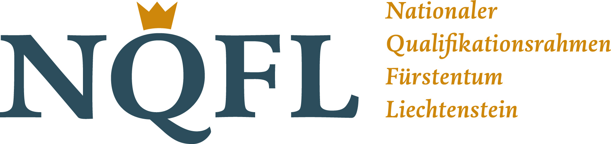

Verordnung vom 12. Dezember 2017 über den Nationalen Qualifikationsrahmen des Fürstentums Liechtenstein für Abschlüsse der Berufsbildung (NQFL-BBV) Aufgrund von Art. 41 Abs. 1 des Berufsbildungsgesetzes (BBG) vom 13. März 2008, LGBl. 2008 Nr. 103, verordnet die Regierung: I. Allgemeine Bestimmungen Art. 1 Gegenstand und Zweck 1) Diese Verordnung legt den Nationalen Qualifikationsrahmen für alle in Liechtenstein erworbenen Abschlüsse der Berufsbildung (Qualifikationsrahmen) sowie die Zeugniserläuterungen und die Diplomzusätze für solche Abschlüsse fest. 2) Mit dem Qualifikationsrahmen sollen die nationale und internationale Transparenz und Vergleichbarkeit der Berufsbildungsabschlüsse hergestellt und damit die Mobilität im Bildungsbereich und im Arbeitsmarkt gefördert werden. Art. 2 Geltungsbereich Diese Verordnung gilt für die in der Berufsbildungsgesetzgebung geregelten Bildungsgänge und ihre Abschlüsse (Berufsbildungsabschlüsse): a) der beruflichen Grundbildung; b) der höheren Berufsbildung. II. Qualifikationsrahmen, Zeugniserläuterungen und Diplomzusätze Art. 3 Qualifikationsrahmen 1) Der Qualifikationsrahmen umfasst acht Niveaustufen mit den drei Anforderungskategorien "Kenntnisse", "Fertigkeiten" und "Kompetenzen". Die Niveaustufen und Anforderungskategorien sind im Anhang 1 definiert. Sie orientieren sich an Anhang II der Empfehlung des Europäischen Parlaments und des Rates vom 23. April 2008 zur Errichtung des Europäischen Qualifikationsrahmens für lebenslanges Lernen ( ABl. C 111 vom 6.5.2008, S. 1 ). 2) Jeder Berufsbildungsabschluss wird einer Niveaustufe zugeordnet. Art. 4 Zeugniserläuterungen und Diplomzusätze 1) Zu jedem Abschluss der beruflichen Grundbildung wird eine standardisierte Zeugniserläuterung erstellt. 2) Zu jedem Abschluss der höheren Berufsbildung wird ein personalisierter Diplomzusatz erstellt. 3) Die Zeugniserläuterungen und Diplomzusätze umfassen namentlich: a) eine Zuweisung des Abschlusses zu einer Niveaustufe des Qualifikationsrahmens samt entsprechendem Logo; b) eine Beschreibung der Kenntnisse, Fertigkeiten und Kompetenzen, über welche die Personen mit dem entsprechenden Abschluss verfügen; c) die Berufsbezeichnung in englischer Sprache. 4) Die Zeugniserläuterungen und Diplomzusätze werden nach Anhang 2 gestaltet. 5) Die Zeugniserläuterungen und Diplomzusätze werden in deutscher und englischer Sprache zur Verfügung gestellt. 6) Die Zeugniserläuterung und der Diplomzusatz entfalten ihre Wirkung in Verbindung mit dem entsprechenden Abschluss. 7) Die Angaben nach Abs. 3 Bst. a und c können auch in die Zeugnisse und Diplome aufgenommen werden. Art. 5 Abgabe der Zeugniserläuterung und Diplomzusätze 1) Die Agentur für Internationale Bildungsangelegenheiten als nationale Koordinationsstelle (nachfolgend NQFL-Koordinationsstelle) stellt die zu den liechtensteinischen Berufsattesten und zu den liechtensteinischen Fähigkeitszeugnissen gehörenden Zeugniserläuterungen auf ihrer Internetseite zur Verfügung. 2) Die Stellen, welche die Fachausweise und die Diplome ausstellen, geben auch die Diplomzusätze ab. Art. 6 Einstufung der Berufsbildungsabschlüsse und Grundlagendokumente 1) Die Einstufung jedes Berufsbildungsabschlusses erfolgt nach den in den Grundlagendokumenten beschriebenen Anforderungen. 2) Als Grundlagendokumente gelten: a) bei einem Abschluss der beruflichen Grundbildung: die Bildungsverordnung, der Bildungsplan und das Qualifikationsprofil; b) bei einem Abschluss mit Fachausweis oder mit Diplom: die Prüfungsordnung und die Wegleitung. Art. 7 Verfahren 1) Die Einstufungen der Berufsbildungsabschlüsse werden von der Regierung vorgenommen; sie kann dabei die Einstufungen der Berufsbildungsabschlüsse des schweizerischen Staatssekretariats für Bildung, Forschung und Innovation (SBFI) berücksichtigen. 2) Bei Berufsbildungsabschlüssen, für die keine Einstufung des SBFI vorliegt, kann die Regierung die entsprechenden Empfehlungen des Eidgenössischen Hochschulinstituts für Berufsbildung berücksichtigen. 3) Die Einstufung wird durch die Aufnahme des Abschlusses in das Verzeichnis nach Art. 8 verbindlich. Art. 8 Verzeichnis 1) Die NQFL-Koordinationsstelle führt ein Verzeichnis der Berufsbildungsabschlüsse in alphabetischer Reihenfolge mit den dazugehörigen geschützten Titeln. 2) Das Verzeichnis nach Abs. 1 ist auf der Internetseite der NQFL-Koordinationsstelle abrufbar. Art. 9 Übergangsbestimmung Personen, die einen Abschluss der beruflichen Grundbildung vor Inkrafttreten dieser Verordnung erworben haben, sind berechtigt, die Zeugniserläuterung zu demjenigen Abschluss zu verwenden, dessen Titel zu führen sie berechtigt sind; Art. 4 Abs. 7 findet keine Anwendung. Art. 10 Inkrafttreten Diese Verordnung tritt am 1. Januar 2018 in Kraft. Fürstliche Regierung: gez. Adrian Hasler Fürstlicher Regierungschef Anhang 1 (Art. 3 Abs. 1) Nationaler Qualifikationsrahmen für Abschlüsse der Berufsbildung Niveau 1 Kenntnisse Fertigkeiten Kompetenzen Wissen: Über grundlegende Fachkenntnisse des Arbeits- oder Lernbereichs und über grundlegende Allgemeinbildung verfügen. Verstehen: Grundlegende, allgemeine Zusammenhänge im Arbeits- oder Lernkontext verstehen und mit eigenen Worten erklären können. Prozedurale Fertigkeiten: In der Lage sein, grundlegende standardisierte Aufgaben in einem Fachgebiet ansatzweise zu erkennen. Sensomotorische Fertigkeiten: Zur Lösung von grundlegenden standardisierten Aufgaben in standardisierten Situationen aus einem Fachgebiet fachspezifische Hilfsmittel und Instrumente gemäss konkreten Vorgaben anwenden können. Berufliche Kompetenzen: Über erste praktische Erfahrungen in einem Betrieb oder in einem betriebsähnlichen Umfeld verfügen, auf welchen weitere Kenntnisse und Fertigkeiten aufgebaut werden können. Die Mitarbeit kann nach Anleitung stattfinden. Personale Kompetenzen: Selbstkompetenzen: In der Lage sein, die geforderten Kenntnisse und Fertigkeiten unter Anleitung bzw. nach betrieblichen Vorgaben in klar definierten zugewiesenen Aufgaben im Betrieb und/oder einem betriebsähnlichen Umfeld anzuwenden und verbindliche Anforderungen einhalten zu können. Sozialkompetenzen: In der Lage sein, das Verhalten der Situation anzupassen und sich gegenüber Mitmenschen korrekt zu verhalten, teamorientiert zu handeln sowie sich mündlich und schriftlich mitzuteilen. Niveau 2 Kenntnisse Fertigkeiten Kompetenzen Wissen: Über grundlegende Fachkenntnisse des Arbeits- oder Lernbereichs und über grundlegende Allgemeinbildung verfügen. Verstehen: Allgemeine Zusammenhänge im konkreten Arbeits- oder Lernkontext und/oder der Branche verstehen und mit eigenen Worten erklären können. Prozedurale Fertigkeiten: In der Lage sein, standardisierte Aufgaben in einem Fachgebiet ansatzweise zu erkennen. Basierend auf den betrieblichen Vorgaben handeln können. Sensomotorische Fertigkeiten: Zur Lösung von standardisierten Aufgaben in ziemlich vertrauten und/oder standardisierten Situationen aus einem Fachgebiet fachspezifische Hilfsmittel und Instrumente vorschriftsgemäss anwenden können. Berufliche Kompetenzen: Durch erste berufliche Praxiserfahrung führen die auf diesem Niveau geforderten Kenntnisse und Fertigkeiten zu geordnetem und geplantem Arbeiten im Betrieb. Die Mitarbeit kann nach Anleitung stattfinden. Personale Kompetenzen: Selbstkompetenzen: In der Lage sein, die geforderten Kenntnisse und Fertigkeiten in zugewiesenen Aufgaben in einem Fachgebiet teilweise selbständig anzuwenden. Innerhalb des Fachgebiets einfache Aufgaben mitgestalten und verbindliche Anforderungen einhalten können. Sozialkompetenzen: In der Lage sein, das Verhalten der Situation anzupassen und sich gegenüber Mitmenschen korrekt zu verhalten, teamorientiert zu handeln sowie einfache Informationen aus dem Fachgebiet mündlich und schriftlich in angemessener Form zu kommunizieren. Niveau 3 Kenntnisse Fertigkeiten Kompetenzen Wissen: Über Fachkenntnisse des Arbeits- oder Lernbereichs und über Allgemeinbildung verfügen. Verstehen: Zusammenhänge im konkreten Arbeits- oder Lernkontext und/oder der Branche verstehen und mit eigenen Worten erklären können. Prozedurale Fertigkeiten: In der Lage sein, Aufgaben in einem Fachgebiet zu erkennen. Basierend auf den betrieblichen Vorgaben bekannte Problemlösungsstrategien umsetzen können. Sensomotorische Fertigkeiten: Zur Lösung von standardisierten Aufgaben in vertrauten Situationen aus einem Fachgebiet fachspezifische Hilfsmittel und Instrumente vorschriftsgemäss anwenden können. Berufliche Kompetenzen: Durch berufliche Praxiserfahrung führen die auf diesem Niveau geforderten Kenntnisse und Fertigkeiten zu erfolgreichen Arbeitstechniken, welche grundlegende Arbeitsprozesse im Betrieb sicherstellen. Die Mitarbeit kann teilweise selbständig stattfinden. Personale Kompetenzen: Selbstkompetenzen: In der Lage sein, die geforderten Kenntnisse und Fertigkeiten in einem Fachgebiet teilweise selbständig anzuwenden. Innerhalb des Fachgebiets Mitverantwortung für einfache Aufgaben übernehmen und verbindliche Anforderungen einhalten können. Sozialkompetenzen: In der Lage sein, das Verhalten der Situation und den Bedürfnissen der Mitmenschen anzupassen, teamorientiert zu handeln sowie Informationen aus dem Fachgebiet mündlich und schriftlich in angemessener Form zu kommunizieren. Niveau 4 Kenntnisse Fertigkeiten Kompetenzen Wissen: Über erweiterte Fachkenntnisse des Arbeits- oder Lernbereichs und über Allgemeinbildung verfügen. Zudem fähig sein, sich selbständig fachspezifische Kenntnisse zu erschliessen. Verstehen: Zusammenhänge im konkreten Arbeits- oder Lernkontext und/oder der Branche sowie aus thematisch verwandten Fachgebieten verstehen und mit eigenen Worten erklären können. Prozedurale Fertigkeiten: In der Lage sein, Aufgaben in einem Fachgebiet zu erkennen. Basierend auf den betrieblichen Vorgaben oder durch die Anwendung bekannter Problemlösungsstrategien Aufgaben umsetzen können. Sensomotorische Fertigkeiten: Zur Lösung von ziemlich schwierigen Aufgaben in vertrauten Situationen aus einem Fachgebiet fachspezifische Hilfsmittel und Instrumente basierend auf den betrieblichen Vorgaben vorschriftsgemäss oder mit Hilfe bekannter Methoden und/oder Werkzeuge anwenden können. Grundlegende Kommunikationsmittel anwenden können. Berufliche Kompetenzen: Durch berufliche Praxiserfahrung führen die auf diesem Niveau geforderten Kenntnisse und Fertigkeiten zur Sicherstellung des reibungslosen Ablaufs der eigenen Arbeitsprozesse im Betrieb. Die Mitarbeit kann selbständig stattfinden. Routinearbeiten anderer Personen können beaufsichtigt werden. Personale Kompetenzen: Selbstkompetenzen: In der Lage sein, die geforderten Kenntnisse und Fertigkeiten in einem Fachgebiet grösstenteils selbständig anzuwenden. Innerhalb des Fachgebiets Verantwortung für klar definierte Aufgaben übernehmen können und wechselnden Anforderungen gerecht werden. Sozialkompetenzen: In der Lage sein, das Verhalten der Situation und den Bedürfnissen der Mitmenschen anzupassen, teamorientiert zu handeln sowie Informationen aus dem Fachgebiet mündlich und schriftlich in angemessener Form zu kommunizieren. Führungskompetenzen: In der Lage sein, Arbeitskräfte in einen konkreten Aufgabenbereich des Arbeitskontextes einzuführen. Niveau 5 Kenntnisse Fertigkeiten Kompetenzen Wissen: Über umfassende Fachkenntnisse der bedeutenden Arbeitsbereiche und über erweiterte Allgemeinbildung verfügen. Zudem fähig sein, sich selbständig fachspezifische Kenntnisse zu erschliessen. Verstehen: Zusammenhänge in- oder ausserhalb des konkreten Arbeitskontextes und/oder der Branche verstehen und mit eigenen Worten erklären können. Prozedurale Fertigkeiten: In der Lage sein, Aufgaben in einem Fachgebiet zu erkennen und zu analysieren. Basierend auf den betrieblichen Vorgaben oder durch die Anwendung bekannter Problemlösungsstrategien Aufgaben umsetzen können. Sensomotorische Fertigkeiten: Zur Lösung von ziemlich schwierigen Aufgaben in verschiedenen Situationen aus einem Fachgebiet fachspezifische Hilfsmittel und Instrumente basierend auf den betrieblichen Vorgaben vorschriftsgemäss oder mit Hilfe bekannter Methoden und/oder Werkzeuge angemessen vorbereiten und anwenden können. Grundlegende Kommunikationsmittel sinnvoll anwenden und Informationen aus dem Fachgebiet präsentieren können. Berufliche Kompetenzen: Durch berufliche Praxiserfahrung führen die auf diesem Niveau geforderten Kenntnisse und Fertigkeiten zur Sicherstellung des reibungslosen Ablaufs der eigenen Arbeitsprozesse im Betrieb. Die geleistete Arbeit kann in Form von selbständiger und strategischer Mitarbeit stattfinden. Routinearbeiten anderer Personen können beaufsichtigt und angeleitet werden. Personale Kompetenzen: Selbstkompetenzen: In der Lage sein, die geforderten Kenntnisse und Fertigkeiten in einem Fachgebiet selbständig anzuwenden. Innerhalb des Fachgebiets Verantwortung für Aufgaben übernehmen können sowie wechselnden Anforderungen gerecht werden. Sozialkompetenzen: In der Lage sein, die eigene Rolle zu reflektieren und das Verhalten der Situation und den Bedürfnissen der Mitmenschen anzupassen, teamorientiert zu handeln sowie Informationen aus dem Fachgebiet mündlich und schriftlich treffend und in angemessener Form zu kommunizieren. Führungskompetenzen: In der Lage sein, Arbeitskräfte in mehreren konkreten Aufgabenbereichen des Arbeitskontextes anzuleiten. Niveau 6 Kenntnisse Fertigkeiten Kompetenzen Wissen: Über fortgeschrittene Fachkenntnisse aller bedeutenden Arbeitsbereiche und über erweiterte Allgemeinbildung verfügen. Zudem fähig sein, sich selbständig fachspezifische und fachübergreifende Kenntnisse zu erschliessen. Verstehen: Zusammenhänge in- oder ausserhalb des konkreten Arbeitskontextes und/oder der Branche verstehen und mit thematisch verwandten Fachgebieten verknüpfen können. Prozedurale Fertigkeiten: In der Lage sein, komplexe Aufgaben in einem Fachgebiet zu erkennen, zu analysieren und zu bewerten. Basierend auf den betrieblichen Vorgaben oder durch die Anwendung bekannter Problemlösungsstrategien Aufgaben umsetzen können. Sensomotorische Fertigkeiten: Zur Lösung von schwierigen Aufgaben in verschiedenen Situationen aus den Fachgebieten fachspezifische Hilfsmittel und Instrumente basierend auf geeigneten und bekannten Methoden und/oder Werkzeugen angemessen vorbereiten und anwenden können. Kommunikationsmittel sinnvoll und adressatengerecht anwenden und Informationen aus dem Fachgebiet präsentieren können. Berufliche Kompetenzen: Durch vielseitige berufliche Praxiserfahrung führen die auf diesem Niveau geforderten Kenntnisse und Fertigkeiten zum reibungslosen Ablauf der eigenen Arbeitsprozesse und zu strategischen Ergebnissen im Betrieb. Die geleistete Arbeit kann in Form von selbständiger und strategischer Mitarbeit sowie Beratungstätigkeit stattfinden. Komplexe fachliche Tätigkeiten/Projekte können angeleitet und die Verantwortung für Entscheidungen getragen werden. Personale Kompetenzen: Selbstkompetenzen: In der Lage sein, die geforderten Kenntnisse und Fertigkeiten in einem Fachgebiet und den thematisch verwandten Fachgebieten selbständig anzuwenden. Innerhalb des gesamten Fachgebiets Verantwortung für Aufgaben und Prozesse tragen können sowie wechselnden Anforderungen gerecht zu werden. Sozialkompetenzen: In der Lage sein, die eigene Rolle und die Rolle des Gegenübers zu reflektieren und sich im Umgang mit Mitmenschen verantwortungsbewusst zu verhalten, teamorientiert zu handeln sowie Informationen aus dem Fachgebiet mündlich und schriftlich treffend, verständlich und in angemessener Form zu kommunizieren. Führungskompetenzen: In der Lage sein, Arbeitskräfte in mehreren Aufgabenbereichen des Arbeitskontexts zu leiten, die Verantwortung für diese teilweise zu übernehmen sowie sie zu fördern. Niveau 7 Kenntnisse Fertigkeiten Kompetenzen Wissen: Über fortgeschrittene, fundierte und detaillierte Fachkenntnisse aller bedeutenden Arbeitsbereiche und über umfassende Allgemeinbildung verfügen. Zudem fähig sein, sich selbständig fachspezifische und fachübergreifende Kenntnisse zu erschliessen. Verstehen: Komplexe Zusammenhänge in- oder ausserhalb des konkreten Arbeitskontextes und/oder der Branche verstehen und interdisziplinär mit thematisch verwandten und/oder nicht verwandten Fachgebieten verknüpfen können. Prozedurale Fertigkeiten: In der Lage sein, komplexe Aufgaben in einem interdisziplinären Fachgebiet zu erkennen, zu analysieren und zu bewerten. Basierend auf den betrieblichen Vorgaben oder durch die Anwendung von geeigneten, innovativen Problemlösungsstrategien Aufgaben umsetzen können. Sensomotorische Fertigkeiten: Zur Lösung von sehr schwierigen und anspruchsvollen Aufgaben in thematisch verwandten Fachgebieten in jeder Situation fachspezifische Hilfsmittel und Instrumente basierend auf geeigneten und gegebenenfalls weitgehend neuartigen Methoden und/oder Werkzeugen angemessen vorbereiten und anwenden können. Die Möglichkeiten, welche verschiedene Kommunikationsmittel bieten, ausschöpfen und komplexe Informationen aus dem Fachgebiet präsentieren können. Berufliche Kompetenzen: Durch vielseitige berufliche Praxiserfahrung führen die auf diesem Niveau geforderten Kenntnisse und Fertigkeiten zum reibungslosen Ablauf der eigenen Arbeitsprozesse und zu strategischen Ergebnissen im Betrieb. Die geleistete Arbeit, die Teil eines komplexen Arbeitsprozesses ist und zur Weiterentwicklung des Betriebes oder zur Verbesserung von Arbeitsprozessen beiträgt, kann in Form einer Führungsfunktion sowie Beratungstätigkeit stattfinden. Komplexe, unvorhersehbare Tätigkeiten/Projekte können mit neuen strategischen Ansätzen angeleitet und gestaltet werden. Personale Kompetenzen: Selbstkompetenzen: In der Lage sein, die geforderten Kenntnisse und Fertigkeiten in einem anspruchsvollen Fachgebiet und den thematisch verwandten Fachgebieten selbständig und verantwortungsbewusst anzuwenden. Innerhalb des gesamten anspruchsvollen Fachgebietes Verantwortung für zunehmend komplexe Aufgaben und Prozesse tragen können sowie wechselnden Anforderungen gerecht werden. Sozialkompetenzen: In der Lage sein, die eigene Rolle und die Rolle des Gegenübers zu reflektieren, zu bestimmen und sich im Umgang mit Mitmenschen verantwortungsbewusst zu verhalten, teamorientiert zu handeln sowie komplexe Informationen aus dem Fachgebiet mündlich und schriftlich treffend, verständlich und in angemessener Form mit der intendierten Wirkung adressatengerecht zu kommunizieren. Führungskompetenzen: In der Lage sein, Arbeitskräfte im gesamten Aufgabenbereich des Arbeitskontexts zu führen, vollständig die Verantwortung für diese zu übernehmen sowie sie gezielt zu fördern. Niveau 8 Kenntnisse Fertigkeiten Kompetenzen Wissen: Über fortgeschrittene, fundierte, spezialisierte, detaillierte und systematische Fachkenntnisse aller Arbeitsbereiche und über umfassende Allgemeinbildung verfügen. Zudem fähig sein, sich selbständig fachspezifische und fachübergreifende Kenntnisse zu erschliessen. Verstehen: Komplexe Zusammenhänge in- oder ausserhalb des konkreten Arbeitskontextes und/oder der Branche, verstehen und interdisziplinär mit thematisch verwandten und/oder nicht verwandten komplexen Fachgebieten verknüpfen können. Prozedurale Fertigkeiten: In der Lage sein, komplexe und hoch anspruchsvolle Aufgaben in einem interdisziplinären Fachgebiet umfassend zu erkennen, zu analysieren und zu bewerten. Basierend auf den betrieblichen Vorgaben oder durch geeignete, innovative Problemlösungsstrategien Aufgaben umsetzen können sowie darauf aufbauend Prognosen oder Empfehlungen erstellen können. Sensomotorische Fertigkeiten: Zur Lösung von neuartigen, sehr schwierigen und hoch anspruchsvollen Aufgaben in thematisch verwandten Fachgebieten in jeder Situation fachspezifische Hilfsmittel und Instrumente basierend auf geeigneten, weitgehend neuartigen oder innovativen Methoden und/oder Werkzeugen angemessen vorbereiten und anwenden können. Die Möglichkeiten, welche verschiedene Kommunikationsmittel bieten, vollständig ausschöpfen und komplexe und differenzierte Informationen aus dem Fachgebiet präsentieren können. Berufliche Kompetenzen: Durch umfassende berufliche Praxiserfahrung führen die auf diesem Niveau geforderten Kenntnisse und Fertigkeiten zielgerichtet zum reibungslosen Ablauf der eigenen Arbeitsprozesse und zu strategischen Ergebnissen im Betrieb. Die geleistete Arbeit, die Teil eines oder mehrerer komplexer Arbeitsprozesse ist und die Weiterentwicklung des Betriebes oder zur Verbesserung von Arbeitsprozessen beiträgt, kann in Form einer Führungsfunktion sowie Beratungstätigkeit stattfinden. Personale Kompetenzen: Selbstkompetenzen: In der Lage sein, die geforderten Kenntnisse und Fertigkeiten in einem hoch anspruchsvollen Fachgebiet und den thematisch verwandten Fachgebieten völlig selbständig und verantwortungsbewusst anzuwenden. Innerhalb des gesamten hoch anspruchsvollen Fachgebietes Verantwortung für komplexe Aufgaben und Prozesse tragen können sowie wechselnden Anforderungen gerecht werden. Sozialkompetenzen: In der Lage sein, die eigene Rolle und die Rolle des Gegenübers zu reflektieren, zu bestimmen und sich im Umgang mit Mitmenschen verantwortungsbewusst zu verhalten, teamorientiert zu handeln und die Reflexionsfähigkeiten im Arbeitskontext strategisch einzusetzen sowie komplexe und differenzierte Informationen aus dem Fachgebiet mündlich und schriftlich treffend, verständlich, in angemessener Form, professionell und mit der intendierten Wirkung adressatengerecht zu kommunizieren. Führungskompetenzen: In der Lage sein, Arbeitskräfte im gesamten hoch anspruchsvollen Aufgabenbereich des Arbeitskontexts zu führen, vollständig die Verantwortung für diese zu übernehmen sowie sie eigenverantwortlich und gezielt zu fördern. Anhang 2 (Art. 4 Abs. 4) I. Formular der Zeugniserläuterung zum Abschluss der beruflichen Grundbildung 

 

 Zeugniserläuterung Diese Zeugniserläuterung stützt sich auf Art. 4 Abs. 1 der Verordnung über den Nationalen Qualifikationsrahmen des Fürstentums Liechtenstein für Abschlüsse der Berufsbildung (NQFL-BBV). Die Vorlage für diese Zeugniserläuterung wurde vom Europäischen Parlament und Rat empfohlen (Entscheidung Nr. 2241/2004/EG). Die Zeugniserläuterung stellt hinreichende Daten zur Verfügung, welche die internationale Transparenz und angemessene berufliche Anerkennung von Qualifikationen (Urkunden, Zeugnisse, Abschlüsse, Zertifikate etc.) verbessern. Sie beschreibt Eigenschaften, Stufe, Zusammenhang, Inhalte sowie Art der Qualifikation, die von der in der Originalurkunde bezeichneten Person erfolgreich abgeschlossen wurde. Diese Zeugniserläuterung ist nur mit der Originalurkunde zu verwenden. Die Zeugniserläuterung ist frei von jeglichen Werturteilen, Äquivalenzaussagen oder Empfehlungen zur Anerkennung. Weitere Informationen finden sich unter: www.nqfl.li 1. Geschützter Titel (de), Beruf 2. Übersetzter Titel (en), Profession 3. Profil der beruflichen Tätigkeit 4. Berufliche Tätigkeitsfelder 5. Amtliche Grundlagen des Abschlusses Zuständige Trägerschaft für den Abschluss Nationale Behörde, die für den Erlass des Abschlusses zuständig ist Niveau (national/international) des Abschlusses Bestehensregeln/Notenskala Rechtsgrundlage 6. Offiziell anerkannte Wege zur Erlangung des Abschlusses Zusätzliche Informationen: Nationale Referenzstelle: II. Formular des Diplomzusatzes zum Abschluss der höheren Berufsbildung 

 

 Diplomzusatz Dieser Diplomzusatz stützt sich auf Art. 4 Abs. 2 der Verordnung über den Nationalen Qualifikationsrahmen des Fürstentums Liechtenstein für Abschlüsse der Berufsbildung (NQFL-BBV). Die Vorlage für diesen Diplomzusatz wurde vom Europäischen Parlament und Rat empfohlen (Entscheidung Nr. 2241/2004/EG). Der Diplomzusatz stellt hinreichende Daten zur Verfügung, welche die internationale Transparenz und angemessene berufliche Anerkennung von Qualifikationen (Urkunden, Zeugnisse, Abschlüsse, Zertifikate etc.) verbessern. Er beschreibt Eigenschaften, Stufe, Zusammenhang, Inhalte sowie Art der Qualifikation, die von der in der Originalurkunde bezeichneten Person erfolgreich abgeschlossen wurde. Der Diplomzusatz ist nur mit der Originalurkunde zu verwenden. Der Diplomzusatz ist frei von jeglichen Werturteilen, Äquivalenzaussagen oder Empfehlungen zur Anerkennung. Weitere Informationen finden sie unter: www.nqfl.li 1. Angaben zur Person der Inhaberin oder Inhabers der Qualifikation 1.1. Familienname 1.2. Vorname 1.3. Geburtsdatum 1.4. Matrikelnummer 2. Angaben zur Qualifikation 2.1. Bezeichnung der Qualifikation und verliehener Titel 2.2. Hauptstudienfach oder -fächer für die Qualifikation 2.3. Name der Einrichtung, welche die Qualifikation verliehen hat 2.4. Name der Einrichtung, welche die Qualifikation durchgeführt hat 2.5. Im Unterricht/in der Prüfung verwendete Sprache(n) 3. Angaben zum Niveau der Qualifikation 3.1. Niveau der Qualifikation 3.2. Dauer und Umfang der Ausbildung 3.3. Zulassungsvoraussetzung 4. Angaben zum Inhalt und zu den erzielten Ergebnissen 4.1. Qualifikationsart 4.2. Anforderungen der Qualifikation 4.3. Einzelheiten der Qualifikation 4.4. Notenskala und Anmerkungen zur Vergabe von Noten 4.5. Gesamtbewertung 5. Angaben zum Zweck der Qualifikation 5.1. Zugangsberechtigung zu weiterführenden Qualifikationen 5.2. Beruflicher Status 6. Weitere Angaben 6.1. Weitere Angaben 6.2. Informationsquellen für ergänzende Angaben 7. Beurkundung des Zusatzes Ausgestellt durch:
