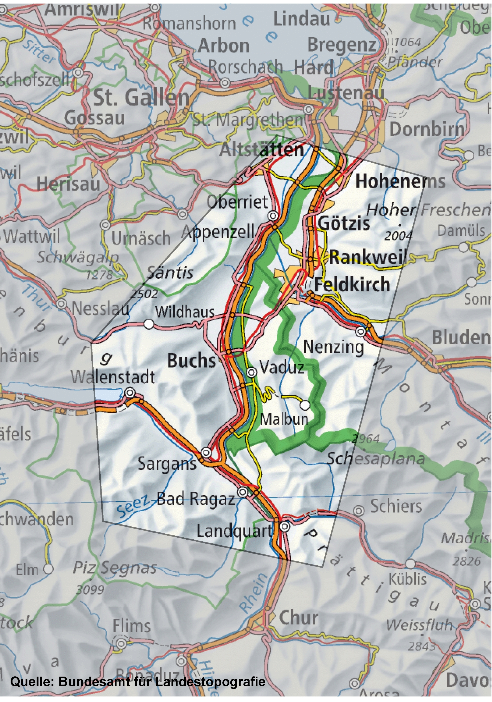

Verordnung vom 20. März 2013 über die staatlichen Ausbildungsbeihilfen (Stipendienverordnung; StipV) Aufgrund von Art. 11 Abs. 2, Art. 19 Abs. 2, Art. 33 Abs. 2, Art. 35a Abs. 2 und Art. 38 des Gesetzes vom 20. Oktober 2004 über die staatlichen Ausbildungsbeihilfen (Stipendiengesetz; StipG), LGBl. 2004 Nr. 262, in der Fassung des Gesetzes vom 20. Juni 2012, LGBl. 2012 Nr. 263, verordnet die Regierung: Art. 1 Übertragung von Geschäften Die nach Art. 6 Abs. 5 und Art. 26 Abs. 6 StipG der Regierung zugewiesenen Geschäfte werden an das für den Geschäftsbereich Bildung zuständige Regierungsmitglied zur selbständigen Erledigung übertragen. Art. 2 Verlängerung der Unterstützungsdauer für ein Masterstudium Die Unterstützungsdauer für ein Masterstudium kann nach Art. 8 Abs. 1 StipG über die minimale Ausbildungsdauer hinaus verlängert werden, sofern nicht schon im Bachelorstudium eine Verlängerung gewährt wurde. Art. 3 Einzureichende Belege bei Verlängerung der Unterstützungsdauer 1) Für eine Verlängerung der Unterstützungsdauer nach Art. 8 Abs. 1 StipG müssen folgende Dokumente und Unterlagen eingereicht werden: a) Schulvertrag oder Einschreibebestätigung für die beantragte Unterstützungsdauer; und b) Ausbildungsnachweis (Art. 27 StipG). 2) Für eine Verlängerung der Unterstützungsdauer nach Art. 8 Abs. 2 StipG müssen zusätzlich zu den in Abs. 1 genannten die folgenden Dokumente und Unterlagen eingereicht werden: a) Nachweis, dass die Studierfähigkeit durch einen in Art. 8 Abs. 2 StipG erwähnten Grund eingeschränkt ist (z.B. ärztliches Zeugnis, Geburtsurkunde); und b) Studienplanung bis zum Abschluss der Ausbildung. Art. 4 Unzumutbarer Weg zur auswärtigen Ausbildungsstätte Der Weg vom liechtensteinischen Wohnort zur auswärtigen Ausbildungsstätte ist im Sinne von Art. 11 Abs. 1 StipG unzumutbar, wenn sich die Ausbildungsstätte ausserhalb des im Anhang eingezeichneten Gebietes befindet. Art. 5 Kürzung der Beiträge für Unterkunft, Verpflegung und Basiskosten bei geringerer Ausbildungsdauer Bei geringerer Ausbildungsdauer sind die Beiträge nach Art. 11, 12 und 15 StipG wie folgt zu kürzen: a) für die Unterkunft: höchstens 39 Franken pro Tag; b) für die Verpflegung: höchstens 28 Franken pro Tag; c) für die Basiskosten: höchstens 33.35 Franken pro Tag. Art. 6 Daten des Informationssystems Im Informationssystem der Stipendienstelle werden folgende Personendaten erfasst: a) Name, Geburtsdatum, Adresse und Telefonnummer der Antrag stellenden Person; b) Ausbildungsdaten; c) Namen der Familienangehörigen; d) Daten über die finanziellen Verhältnisse der Antrag stellenden Person (Vermögen, Einkommen, Drittunterstützungen); e) Steuerdaten der Antrag stellenden Person, ihrer Eltern und ihres Ehegatten oder ihrer Ehegattin. Art. 7 Inkrafttreten Diese Verordnung tritt am 1. August 2013 in Kraft. Fürstliche Regierung: gez. Dr. Aurelia Frick-Muggli Regierungsrätin Anhang (Art. 4) Gebiet nach Art. 4 

 Übergangs- und Inkrafttretensbestimmungen 416.01 Stipendienverordnung (StipV) Verordnung vom 9. Dezember 2025 über die Abänderung der Stipendienverordnung ... II. Übergangsbestimmung Diese Verordnung findet erstmals auf Anträge Anwendung, die sich auf einen Ausbildungsabschnitt beziehen, der mit oder nach dem Inkrafttreten dieser Verordnung beginnt. ...
