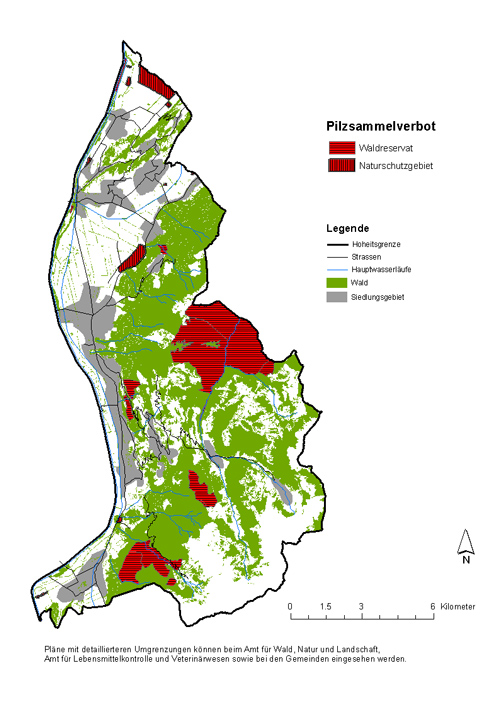

Verordnung vom 18. Juni 2002 zum Schutz der Pilze (Pilzschutzverordnung, PSV) Aufgrund von Art. 26, 27 Abs. 1, Art. 30 Abs. 1 Bst. l und Art. 53 Bst. h des Gesetzes vom 23. Mai 1996 zum Schutz von Natur und Landschaft, LGBl. 1996 Nr. 117 , verordnet die Regierung: Art. 1 Geltungsbereich 1) Diese Verordnung regelt das Sammeln von wildwachsenden Pilzen aller Art. 2) Pilze gelten als wildwachsende Pflanzen im Sinne von Art. 25 Bst. a des Gesetzes zum Schutz von Natur und Landschaft. Art. 2 Sammelbeschränkungen 1) Das Sammeln von Pilzen aller Art ist während des ganzen Jahres nur jeweils vom 11. bis zum letzten Tag eines Monats in der Zeit zwischen 8.00 Uhr und 20.00 Uhr erlaubt. 2) An diesen Tagen dürfen pro Person und Tag insgesamt höchstens 1 kg Steinpilze, Eierschwämme und Morcheln sowie 2 kg der übrigen Speisepilze gesammelt werden. 3) Das Sammeln in Gruppen von mehr als drei Personen, ausgenommen Familien, ist verboten. Art. 3 Pilzschutzgebiete 1) In Naturschutzgebieten und in Waldreservaten besteht ein absolutes Pflückverbot für Pilze. Die Regierung kann für die Entnahme von Pilzen zu wissenschaftlichen Zwecken Ausnahmen bewilligen. 2) Die Gebiete mit Pflückverbot für Pilze sind im Plan gemäss Anhang dargestellt. 3) Die Gemeinden können nach Rücksprache mit dem Amt für Wald, Natur und Landwirtschaft weitere Pilzschutzgebiete in ihrem Zuständigkeitsbereich ausweisen. Art. 4 Vollzug und Überwachung 1) Mit dem Vollzug dieser Verordnung ist das Amt für Wald, Natur und Landwirtschaft betraut. Diesem obliegt in Absprache mit dem Amt für Lebensmittelkontrolle und Veterinärwesen insbesondere die Instruktion der mit der Überwachung beauftragten Organe und die Ausgabe von Dienstabzeichen und Ausweisen. 2) Zur Überwachung dieser Bestimmungen berechtigt und verpflichtet sind die Landespolizei, die Jagd- und Fischereiaufseher, die Mitglieder der Naturwacht, die Pilzkontrolleure und die Forstorgane. Die Gemeinden können weitere Personen benennen. Die beauftragten Organe tragen beim Einsatz ein Dienstabzeichen und weisen sich aus. 3) Die genannten Organe sind berechtigt, die einer Widerhandlung verdächtigte Person anzuhalten, deren Personalien festzustellen, sich den Inhalt der Taschen, Rucksäcke und Fahrzeuge zeigen zu lassen und widerrechtlich angeeignete Pilze abzunehmen. Das Amt für Wald, Natur und Landwirtschaft ist nachfolgend über den gegen die Person vorliegenden Verdacht auf Widerhandlung zu informieren. Art. 5 Strafbestimmung Wer dieser Verordnung oder einer auf diese Verordnung gestützten Verfügung zuwiderhandelt, ist gemäss Art. 50 des Gesetzes zum Schutz von Natur und Landschaft zu bestrafen. Art. 6 Aufhebung bisherigen Rechts Die Verordnung vom 27. September 1994 zum Schutz der Pilze, LGBl. 1994 Nr. 57, wird aufgehoben. Art. 7 Inkrafttreten Diese Verordnung tritt am Tage der Kundmachung in Kraft. Fürstliche Regierung: gez. Otmar Hasler Fürstlicher Regierungschef Anhang (Art. 3 Abs. 2) 

