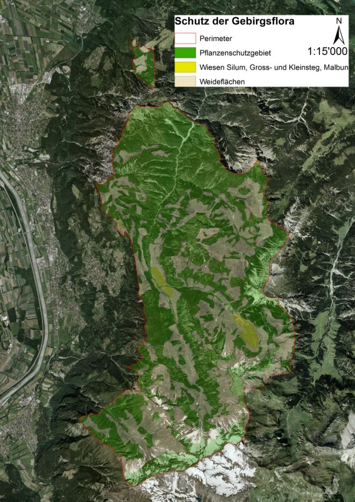

Verordnung vom 17. Mai 1989 zum Schutz der Gebirgsflora Aufgrund von Art. 21 und 53 Bst. e des Gesetzes vom 23. Mai 1996 zum Schutz von Natur und Landschaft, LGBl. 1996 Nr. 117, in der geltenden Fassung, verordnet die Regierung: Art. 1 Unterschutzstellung Die in Art. 2 näher umschriebenen Gebiete im Alpengebiet werden als Pflanzenschutzgebiet im Sinne von Art. 21 des Naturschutzgesetzes festgelegt. Art. 2 Umfang des Pflanzenschutzgebietes und Verbote 1) Der Umfang des Pflanzenschutzgebietes ist im Anhang dieser Verordnung dargestellt. 2) Im Pflanzenschutzgebiet ist es verboten, wildwachsende Pflanzen auszureissen, auszugraben, zu pflücken, zu beschädigen oder deren Lebensräume zu zerstören. Art. 3 Nutzungs- und Pflegevorschriften 1) Die Beweidung der im Plan ausgeschiedenen Weideflächen mit Gross- und Kleinvieh und deren ordnungsgemässe alpwirtschaftliche Pflege und Nutzung sind gestattet. Die Gross- und Kleinviehweide ausserhalb der ausgeschiedenen Weideflächen ist verboten. 2) Die ordnungsgemässe landwirtschaftliche Nutzung der Wiesen von Malbun, Gross- und Kleinsteg und Silum ist gestattet. 3) Die ordnungsgemässe forstwirtschaftliche Nutzung ist gestattet. 4) Für die Erstellung von Bauten und Anlagen gelten die baurechtlichen Vorschriften. Art. 4 Verstösse Verstösse gegen Art. 2 und 3 dieser Verordnung werden, sofern nicht eine strafbare Handlung nach Art. 49 des Gesetzes vorliegt, nach Art. 50 des Gesetzes bestraft. Art. 5 Aufhebung bisherigen Rechts Die Verordnung vom 8. August 1952 [Pflanzenschutzgebiet Malbun], LGBl. 1952 Nr. 12, und die Verordnnung vom 7. Juli 1960 betreffend das Pflanzenschutzgebiet Alpe Sareis, LGBl. 1960 Nr. 15, werden aufgehoben. Art. 6 Inkrafttreten Diese Verordnung tritt am Tage der Kundmachung in Kraft. Fürstliche Regierung: gez. Hans Brunhart Fürstlicher Regierungschef Anhang (Art. 2) Begrenzung des Pflanzenschutzgebietes 

