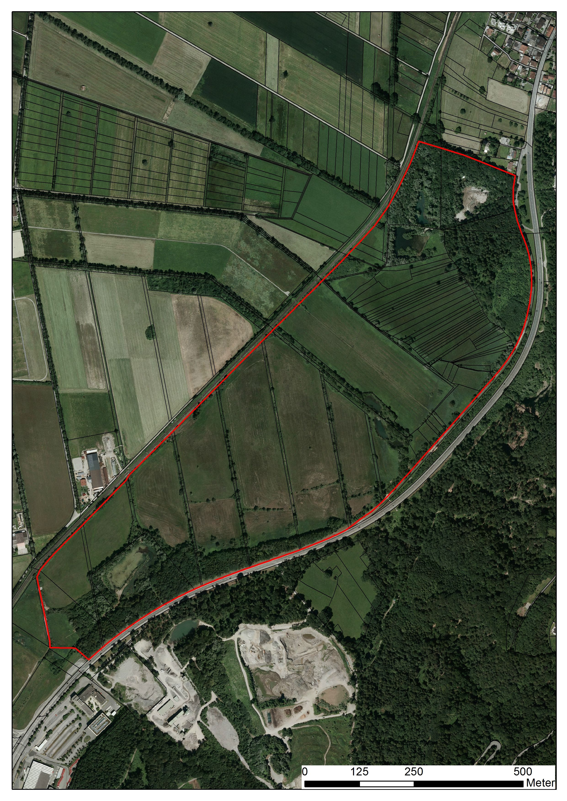

Verordnung vom 28. September 1961 betreffend das Naturschutzgebiet "Schwabbrünnen/Äscher" Aufgrund von Art. 19 Abs. 3 und Art. 53 Bst. c des Gesetzes vom 23. Mai 1996 zum Schutz von Natur und Landschaft, LGBl. 1996 Nr. 117, in der geltenden Fassung, verordnet die Regierung: Art. 1 Unterschutzstellung Das Gebiet in den Schwabbrünnen, im Äscher und im Auslauf der Nendler Rüfe (Gemeindebezirke Schaan, Planken und Eschen) wird als schutzwürdig erklärt und unter Naturschutz gestellt. Art. 2 Umfang des Naturschutzgebietes Das Schutzgebiet hat ein Flächenausmass von 53.8 ha. Der Perimeter des Naturschutzgebietes ist als Situationsplan im Anhang dieser Verordnung dargestellt. Der Umfang des Naturschutzgebietes ist vor Ort zu beschildern. Art. 3 Verbote 1) Das Naturschutzgebiet Schwabbrünnen/Äscher ist im heutigen Zustande zu belassen. 2) Insbesondere wird verboten: a) wildwachsende Pflanzen oder Pflanzenteile zu entnehmen oder zu beschädigen, b) die Streue oder das Trockengras abzubrennen, c) den Riedbiotop durch irgendwelche Eingriffe zu verändern, d) die Kulturart der Grundstücke zu ändern, e) die Bodengestalt durch Grabungen oder auf sonstige Weise zu verändern, f) Müll, Schutt oder Abraum abzulagern, g) freilebenden Tieren nachzustellen, sie mutwillig zu beunruhigen, zu ihrem Fang Vorrichtungen anzubringen, sie zu fangen oder zu töten oder Puppen, Larven, Eier, Nester oder sonstige Brut- und Wohnstätten solcher Tiere fortzunehmen oder zu beschädigen; h) die Jagd und Fischerei auszuüben; i) in den Wasserflächen der Rüfeeinfangdämme zu baden, diese mit Floss zu befahren oder anderweitig zu beunruhigen, k) Hochbauten irgendwelcher Art zu errichten. l) Herbizide, Insektizide und andere Pestizide zu verwenden. Art. 4 Pflegemassnahmen Die anfallende Streue ist alljährlich ab dem 15. September bis zum 15. März des folgenden Jahres zu schneiden und zu entfernen. Die waldbaulichen Eingriffe haben auf einen mehrstufigen Bestandesaufbau mit standortgerechten, heimischen Baum- und Straucharten hinzuzielen. Art. 5 Unterhaltsmassnahmen Die bereits vorhandenen Wasserabzugsgräben dürfen unterhalten werden. Jede weitere und stärkere Bodenentwässerung ist verboten. Art. 6 Rüfebauliche Massnahmen Die im Naturschutzgebiet notwendigen rüfebaulichen Massnahmen bleiben von dieser Verordnung unberührt. Art. 7 Aufsichtsorgane Die Aufsicht über das Naturschutzgebiet "Schwabbrünnen/Äscher" obliegt der Liechtensteinischen Naturwacht. Im Weiteren sind die Forst-, Gewässer- und Jagdschutzorgane verpflichtet, die Einhaltung dieser Verordnung zu überwachen und Übertretungen der Regierung zur Anzeige zu bringen. Art. 8 Verstösse Verstösse gegen Art. 3 bis 5 dieser Verordnung werden, sofern nicht eine strafbare Handlung nach Art. 49 des Gesetzes vorliegt, nach Art. 50 des Gesetzes bestraft. Art. 9 Inkrafttreten Diese Verordnung tritt am Tage ihrer Kundmachung in Kraft. Fürstliche Regierung: gez. Alexander Frick Fürstlicher Regierungschef Anhang (Art. 2) Begrenzung des Naturschutzgebietes "Schwabbrünnen/Äscher" 

