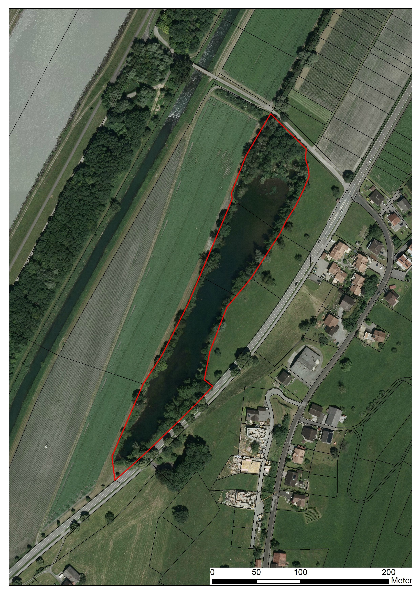

Verordnung vom 28. September 1961 betreffend das Naturschutzgebiet "Gampriner Seelein" Aufgrund von Art. 19 Abs. 3 und Art. 53 Bst. c des Gesetzes vom 23. Mai 1996 zum Schutz von Natur und Landschaft, LGBl. 1996 Nr. 117, in der geltenden Fassung, verordnet die Regierung: Art. 1 Das stehende Gewässer im Äule, Gemeindebezirk Gamprin (Gampriner Seelein), wird mitsamt dem Uferschilf und dem Ufergehölz als schutzwürdig erklärt und unter Naturschutz gestellt. Art. 1a Umfang des Naturschutzgebietes Das Schutzgebiet hat ein Flächenausmass von 2.33 ha. Der Perimeter des Naturschutzgebietes ist als Situationsplan im Anhang dieser Verordnung dargestellt. Der Umfang des Naturschutzgebietes ist vor Ort zu beschildern. Art. 2 Verbote Das Naturschutzgebiet "Gampriner Seelein" ist im heutigen Zustande zu belassen. Insbesondere wird verboten: a) den Grundwasseraufstoss künstlich zu beeinflussen, b) durch Vertiefung des Wasserabzugsgrabens den Wasserspiegel zu senken, c) durch jede Art von Auffüllung die Wasserfläche zu verkleinern, d) das Wasser zu verunreinigen, e) im Wasser oder am Ufer Schutt, Müll oder andere Abfälle abzulagern, f) durch Grabungen die Schilf- und Ufergehölzzone zu verändern, g) im Seelein zu baden und die Wasserfläche mit Floss oder sonstwie zu befahren, h) die Jagd auf alle Arten von Wasser- und Sumpfvögel auszuüben, i) wildwachsende Sumpf- und Wasserpflanzen zu pflücken, auszugraben oder zu beschädigen, k) das Ufergehölz zu roden, kahlzuschlagen oder abzubrennen. Art. 3 Pflegemassnahmen Die fachgemässe Durchforstung des Ufergehölzes und die Entnahme von hiebsreifen Bäumen sind den Bodenbesitzern nach vorausgegangener Anzeichnung durch den Forstdienst gestattet. Die waldbauliche Behandlung des Ufergehölzes hat auf standortgerechte, heimische Baum- und Straucharten sowie mehrstufigen Bestandesaufbau hinzuzielen. Art. 4 Aufsichtsorgane Die Aufsicht über das Naturschutzgebiet "Gampriner Seelein" obliegt der Liechtensteinischen Naturwacht. Im Weiteren sind die Forst-, Gewässer- und Jagdschutzorgane verpflichtet, die Einhaltung dieser Verordnung zu überwachen und Übertretungen der Regierung zur Anzeige zu bringen. Art. 5 Verstösse Verstösse gegen Art. 2 und 3 dieser Verordnung werden, sofern nicht eine strafbare Handlung nach Art. 49 des Gesetzes vorliegt, nach Art. 50 des Gesetzes bestraft. Art. 6 Inkrafttreten Diese Verordnung tritt am Tage ihrer Kundmachung in Kraft. Fürstliche Regierung: gez. Alexander Frick Fürstlicher Regierungschef Anhang (Art. 1a) Begrenzung des Naturschutzgebietes "Gampriner Seelein" 

